# CASCoDe: A Closed-Loop Agentic Framework for Analog Sizing–Layout Co-Design

Ziming Wei, Bingyang Liu, and David Z. Pan

The University of Texas at Austin, Austin, TX, USA

Abstract—Expert analog layouts differ from auto-generated ones in density and regularity, not in legality: experts make a succession of discrete, hierarchical physical decisions and revisit each after extracted electrical results, while existing automated flows act on a physical search space fixed before the controller runs. We present CASCoDe, a closed-loop LLM agent framework for analog netlist-to-layout design that formalizes those expert decisions as a hierarchical discrete action space—sizing candidate pool, structural floorplan, intra-row refinement, routing-attempt selection—on which the agent runs feedback-driven tree search from a sizing pool to a verified GDS. The same loop drives all 20 evaluated circuits, with distinct physical bottlenecks, unchanged; the agent authors the circuit-specific floorplans and helper scripts, and a thin execution layer of interface adaptations over unmodified tools makes every action land at exact coordinates and be judged by DRC, LVS, and extracted-RC simulation. On 20 SKY130 amplifiers spanning single-, two-, and three-stage topologies, CASCoDe is the only flow that delivers a DRC- and LVS-clean routed layout for every circuit; it reduces area by 59– 85% (mean 71%) against a conventional P&R flow on identical PCells, raises mean device density from 0.39 to 0.74, and attains a higher mean post-layout FoM than APPlace, MAGICAL, and ALIGN, which are DRC-clean on 15, 0, and 1 circuits. A layout that beats every baseline in area and legality appears after 11 minutes of agent time on average, and ablations show that the structured action space and the feedback-guided tree search each reduce area and search cost.

Index Terms—Analog layout automation, large language models, LLM agents, closed-loop design, sizing–layout cooptimization, physical design.

## I. INTRODUCTION

Analog design automation ultimately aims to produce compact physical layouts that satisfy circuit performance requirements. Sizers [1], [2] and placement-and-routing tools [3]– [5] have improved the quality and efficiency of individual design stages. However, these improvements do not necessarily translate into better final layouts, because layout compactness and post-layout performance depend on coordinated decisions across stages. Although several frameworks integrate multiple stages [6]–[8], further refinement is still required to achieve the quality of carefully engineered layouts. These remaining limitations can manifest as excessive layout area and inefficient device organization.

The remaining gap lies in coordinating refinement across design stages. MAGICAL and ALIGN [3], [4] automate placement and routing, while DiffSP [5] further improves placement optimization. Within a forward flow, however, these advances leave upstream sizing and device realization unchanged after layout evaluation (Fig. 1, top). Row-based synthesis [9] couples sizing with quantized device geometry, and post-layoutdriven sizing [6] brings extracted performance into parameter optimization. Their exploration nevertheless remains bounded by the prescribed row-height fabric or the physical choices of the layout generator. Recent LLM-based frameworks extend stage coordination [8] and introduce simulation-guided parameter refinement [10]. Yet orchestration and parameter tuning alone do not provide direct control over every structural decision. When adjustments are mediated by generator parameters, a localized physical or electrical diagnosis may not translate into a targeted layout change.

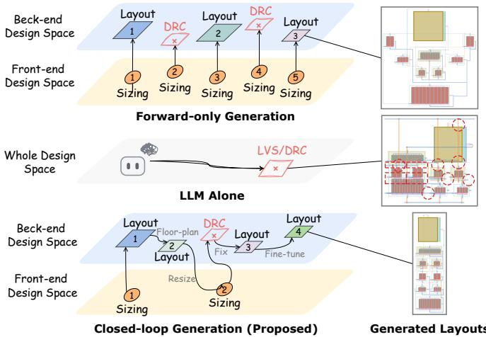  
Fig. 1. Forward-only generation (top) maps each sizing point to a layout independently and discards DRC-failing results. Generation with feedback (bottom) revisits floorplan, sizing, and local geometry from post-layout observations, yielding a more compact final layout.

Closing this gap requires a framework that exposes structural changes as executable actions and revisits them using post-layout feedback. We argue that what an optimizer can observe and decide is as important as how effectively it searches. Building such a framework raises two challenges: (1) How much freedom should the optimizer have? A narrow action space excludes useful structural alternatives, while unrestricted changes cause combinatorial growth beyond practical evaluation budgets. (2) How can the framework close the optimization loop beyond merely calling tools? Aggregate scores cannot explain degradation. Physical and electrical feedback must attribute limitations to specific devices, nets, or geometric structures and guide targeted cross-stage revisions.

We present CASCoDe, an closed-loop agentic framework for analog sizing–layout co-design. CASCoDe organizes revisable design decisions into a structured action space explored through parallel tree search. Physical and electrical feedback guide targeted revisions (Fig. 1, bottom), while an agent-oriented execution environment supports precise tool operations and verification. Together, these components form a domain-specific agent harness that connects observation, decision, and execution. Our contributions are summarized as follows:

• A hierarchical action space spanning sizing, device realization, floorplan restructuring, geometric refinement, and routing configuration, explored by parallel tree search that combines inexpensive geometric screening with selective post-layout evaluation.

• Physical and electrical feedback that attributes area overhead and performance degradation to specific structures, devices, and nets, guiding local corrections and crossstage revisions such as renewed candidate selection and resizing.

• An execution environment with precise tool interfaces, structured trial records, and artifact consistency checks, which the agent extends through task-specific bridging tools under fixed acceptance criteria.

• On 20 SKY130 amplifiers, CASCoDe is the only flow among APPlace, MAGICAL, and ALIGN that is DRCand LVS-clean on every circuit; it reduces routed area by 59–85% (mean 71%) against APPlace at equal or higher mean post-layout FoM, and ablations isolate the contributions of the action space and the tree search.

## II. RELATED WORK

Circuit sizing. Sizing is commonly cast as black-box optimization over device parameters. Bayesian optimization (BO) methods such as MACE [1] and the trust-region TuRBO [11] improve sample efficiency, AutoCkt [2] applies deep reinforcement learning (RL), and PVTSizing [12] combines TuRBO with RL for PVT-robust synthesis. Large language models (LLMs) now inject circuit knowledge into this process: ADO-LLM [13] couples in-context learning with BO, LEDRO [14] and TopoSizing [15] use LLM reasoning to reduce or structure the design space, and AnalogCoder [16] generates circuits through code. These methods optimize schematic-level metrics and leave layout effects to downstream stages.

Layout synthesis. Analog placement has been addressed by hierarchically bounded enumeration with shape functions [17], by differentiable sequence-pair optimization in DiffSP [5], and by routing-aware placement that co-optimizes device locations and access points [18]. End-to-end generators such as MAG-ICAL [3] and ALIGN [4], [19] translate a sized netlist into a layout through constraint extraction, primitive generation, placement, and routing. These tools run as forward pipelines: sizing is fixed on entry, and post-layout results are not fed back to revise earlier decisions.

Sizing–layout co-design. Coupling the two stages has a long history, from simultaneous placement and module optimization [20] to constraint-based layout-driven sizing [21] and sizing with in-loop layout generation [22]. BagNet [23] optimizes parameterized layout generators against post-layout simulation with a DNN-boosted search, Liu et al. [24] apply BO to hierarchical layout synthesis, post-layout-simulationdriven sizing [6] brings extracted performance into parameter optimization, and row-based synthesis [9] couples sizing with height-quantized device geometry. Budak et al. [25] discuss the open challenges of such joint optimization. In these flows the optimizer acts on sizing or generator parameters, while the layout structure itself is fixed by templates, generators, or a prescribed row fabric.

LLM agents for analog design. LLMs have also extended automation across stages. LayoutCopilot [26] uses collaborating agents to turn designer requests into layout edits, PANDA [7] chains topology synthesis, sizing, placement, and routing under LLM planning, AnalogMaster [8] generates layouts starting from circuit images, and in-context policy improvement [10] refines layout parameters from simulation feedback. Open datasets such as LOADBench [27] further support learning-based analog design. CASCoDe differs in what the agent can act on: rather than orchestrating tools or tuning their parameters, it exposes structural layout decisions and the return to sizing as executable actions, and attributes post-layout degradation to specific devices, nets, and structures to guide each revision.

## III. CASCODE

## A. Overview

CASCoDe couples a general LLM agent with a sizer, a placer, and a router through an execution layer (Fig. 2). Given a circuit netlist, testbenches, and design specifications, the framework explores configurations x specifying sizing, device realization, placement, and routing. It minimizes routed area under a post-layout performance constraint,

$$
\operatorname* { m i n } _ { x \in \mathcal { D } _ { \mathrm { v a l i d } } } A ( x ) \quad { \mathrm { s u b j e c t ~ t o } } \quad F _ { \mathrm { p o s t } } ( x ) > 0 ,\tag{1}
$$

where $A ( x )$ is the bounding-box area of the final GDS, $F _ { \mathrm { p o s t } } ( x )$ is the FoM from RC post-layout simulation, which is zero unless every performance metric retains at least 80% of a pre-layout reference (Sec. IV-A), and $\mathcal { D } _ { \mathrm { v a l i d } }$ contains designs satisfying physical and functional checks. The testbenches, checks, and performance requirements remain fixed throughout a run.

Labor division. The provided tools perform numerical search, physical implementation, and evaluation. Predefined actions specify the objects and parameters the agent can modify through their interfaces. The agent decides where to search and what to change, schedules tool calls, and writes bridging scripts for diagnosis and candidate generation. Pareto sizing and standardized PCell realizations reduce the design space to structured candidates. Parameterized, composable actions bound the agent’s edits while retaining flexibility. The same prompt and loop serve all circuits.

Framework components. The execution layer provides Perception O, Action Execution T, and Verification V. The agent implements Feedback-Guided Tree Search π. Let $\mathcal { H } _ { t }$ denote the search history before expansion t, including stored designs, parent links, actions, and tool results. One candidate expansion is

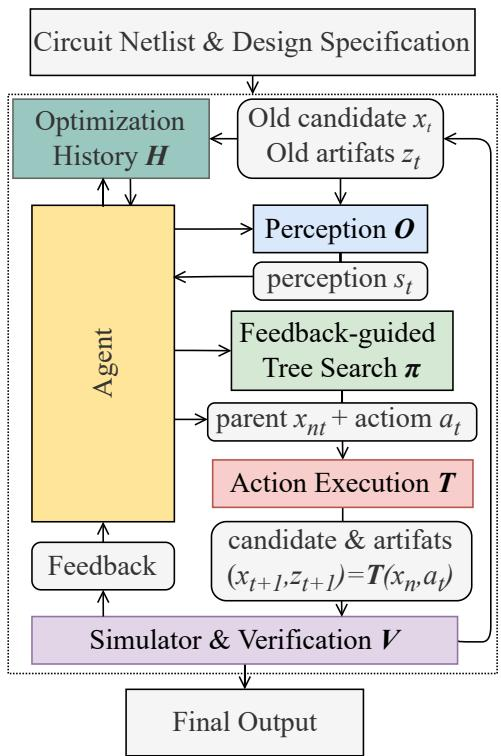  
Fig. 2. Closed-loop framework of CASCoDe. Verification V checks candidate designs and their artifacts, while Perception O organizes the accumulated evidence. The LLM agent implements Feedback-Guided Tree Search $\pi ,$ selecting a stored parent $x _ { n _ { t } }$ and an action sequence $\mathbf { } \mathbf { } \mathbf { } \mathbf { } \mathbf { } \mathbf { } \mathbf { } \mathbf { } \mathbf { } \mathbf { } \mathbf { } \mathbf { } \mathbf { } \mathbf { } \mathbf { } \mathbf { } \mathbf { } \mathbf { } \mathbf { } \mathbf { } \mathbf { } \mathbf { } \mathbf { } \mathbf { } \mathbf { } \mathbf { } \mathbf { } \mathbf { } \mathbf { } \mathbf { } \mathbf { } \mathbf { } \mathbf { } \mathbf { } \mathbf { } \mathbf { } \mathbf { } \mathbf { } \mathbf { } \mathbf { } \mathbf { } \mathbf { } \mathbf { } \mathbf { } \mathbf { } \mathbf { } \mathbf { } \mathbf { } \mathbf { } \mathbf { } \mathbf { } \mathbf { } \mathbf { } \mathbf { } \mathbf { } \mathbf { } \mathbf { } \mathbf { } \mathbf { } \mathbf { } \mathbf { } \mathbf { } \mathbf { } \mathbf { } \mathbf { } \mathbf { } \mathbf { } \mathbf { } \mathbf { } \mathbf { } \mathbf { } \mathbf { } \mathbf { } \mathbf { } \mathbf { } \mathbf { } \mathbf { } \mathbf { } \mathbf { } \mathbf { } \mathbf { } \mathbf { } \mathbf { } \mathbf { } \mathbf { } \mathbf { } \mathbf { } \mathbf { } \mathbf { } \mathbf { } \mathbf { } \mathbf { } \mathbf { } \mathbf { } \mathbf { } \mathbf { } \mathbf { } \mathbf { } \mathbf { } \mathbf { } \mathbf { } \mathbf { } \mathbf { } \mathbf { } \mathbf { } \mathbf { } \mathbf { } \mathbf { } \mathbf { } \mathbf { } \mathbf { } \mathbf { } \mathbf { } \mathbf { } \mathbf { } \mathbf { } \mathbf { } \mathbf { } \mathbf { } \mathbf \mathbf { } \mathbf { } \mathbf { } \mathbf { } \mathbf \mathbf { } \mathbf { } \mathbf { } \mathbf \mathbf { } \mathbf { } \mathbf \mathbf { } \mathbf { } \mathbf \mathbf { } \mathbf { } \mathbf \mathbf { } \mathbf { } \mathbf \mathbf { } \mathbf \mathbf { } \mathbf \mathbf { } \mathbf \mathbf { } \mathbf \mathbf { } \mathbf \mathbf { } \mathbf \mathbf { } \mathbf \mathbf { } \mathbf \mathbf { } \mathbf \mathbf { } \mathbf \mathbf \mathbf { } \mathbf \mathbf \Psi \mathbf { } \mathbf \mathbf { } \mathbf \mathbf \mathbf { } \mathbf \mathbf { } \mathbf \mathbf \mathbf { } \mathbf \mathbf \mathbf { } \mathbf \mathbf $ Action Execution T (detailed in Fig. 3) produces a new candidate $x _ { t + 1 }$ and artifacts $z _ { t + 1 }$ for subsequent evaluation.

$$
\begin{array} { r } { \begin{array} { c } { s _ { t } = O ( \mathcal { H } _ { t } ) , } \\ { \ } \\ { ( n _ { t } , \pmb { a } _ { t } ) = \pi ( s _ { t } , \mathcal { H } _ { t } ) , } \\ { \ } \\ { ( x _ { t + 1 } , z _ { t + 1 } ) = T ( x _ { n _ { t } } , \pmb { a } _ { t } ) , } \\ { v _ { t + 1 } = V ( x _ { t + 1 } , z _ { t + 1 } ) . } \end{array} } \end{array}\tag{2}
$$

Here $s _ { t }$ is the observation, $n _ { t }$ identifies a stored parent, and $\mathbf { } \mathbf { a } _ { t }$ is an ordered action sequence. Execution produces a candidate $x _ { t + 1 }$ and artifacts $z _ { t + 1 }$ , including layout, netlists, and simulation outputs. Verification returns check outcomes and performance in $v _ { t + 1 }$ . The new record extends $\mathcal { H } _ { t }$ . Diagnostic requests can enrich the history before an expansion, and independent expansions can execute in parallel.

## B. Perception

Perception O organizes the artifacts in $\mathcal { H } _ { t }$ into observations $s _ { t }$ at three levels. The agent can supplement these observations with targeted probes.

Design-level outcomes. Area, FoM, circuit metrics, and check outcomes summarize each candidate. Comparing the sizing schematic, realized schematic, capacitance-only extraction, and RC extraction helps separate realization effects from capacitive and resistive degradation. Parent–child comparisons reveal the benefit of each edit.

Device-level geometry. PCell footprints, pins, and keep-outs expose packing constraints. Comparing the placed-cell envelope with the routed GDS localizes unused space and routing overhang. Geometric queries associate violations with nearby devices or gaps.

Net-level parasitics. Extracted nodes are mapped to circuit nets. Capacitance, resistive paths, and device-terminal voltage drops identify connections that warrant electrical diagnosis.

Active probing. The agent invokes or writes scripts to obtain targeted observations. For example, a resistive probe scales the extracted resistances $R _ { n }$ of net n by $0 < \kappa \ll 1$ and measures

$$
\Delta F _ { n } = F _ { \mathrm { p o s t } } ( x \mid R _ { n }  \kappa R _ { n } ) - F _ { \mathrm { p o s t } } ( x ) .\tag{3}
$$

A positive response indicates potential benefit from reducing that net’s resistance and guides routing or placement edits. Probe results enrich $\mathcal { H } _ { t }$ . Verification uses the unmodified extracted circuit.

## C. Action Execution

Action Execution $T$ realizes an action sequence on a selected parent and returns the resulting configuration and artifacts. It connects provided tools, predefined design actions, and agent-generated bridging tools (Fig. 3).

Provided tools. The sizer returns Pareto candidates and supports trust-region re-sizing after realization changes. The placer supplies initial arrangements using standardized PCells. The router accepts explicit coordinates and routing configurations. These fast solvers support repeated evaluation. Script interfaces expose PCell geometry, layout queries, and configuration updates.

Structured actions. An action $\displaystyle \boldsymbol { a } ~ = ~ ( \omega , \mathcal { T } , \theta )$ specifies an operation ω, target objects I, and parameters θ. The sequence $\mathbf { \boldsymbol { a } } _ { t } = ( a _ { t , 1 } , \dots , a _ { t , k _ { t } } )$ combines $k _ { t }$ such edits into one candidate. For example, device splitting can be followed by row reassignment, a swap, and gap compression. Execution applies these edits to $x _ { n _ { 1 } }$ and invokes the tools needed to implement and evaluate the result. Configuration editing and tool execution thus remain distinct within T.

Bridging tools. The agent builds floorplan generators, local searchers, and diagnostic probes as needed. Local searchers use randomized sampling or simulated annealing to explore row assignments, group orderings, and device shapes. A geometry planner converts these choices into exact coordinates and checks packing constraints. Geometric ranking retains a small set for physical evaluation,

$$
\mathrm { L o c a l ~ s e a r c h ~ \longrightarrow ~ P l a n ~ a n d ~ s c r e e n } ~ \longrightarrow ~ \mathrm { P } \& \mathrm { R } .
$$

The agent defines the search scope and selects candidates using feedback. Generators extend T and probes extend O, while V remains fixed. These scripts can be reused across branches and promoted into the reusable tool set for later runs.

## D. Feedback-Guided Tree Search

Feedback-Guided Tree Search π selects the parent $n _ { t }$ and action sequence $\mathbf { } \mathbf { a } _ { t }$ in Eq. (2). Exploration proceeds through floorplan branches, placement variants, and routing attempts (Fig. 4). Parent links and results in $\mathcal { H } _ { t }$ support expansion, comparison, and backtracking.

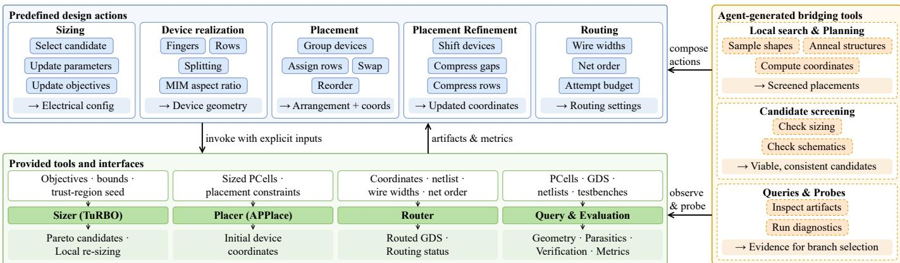  
Fig. 3. Action Execution T in the framework of Fig. 2, expanded across sizing, device realization, placement, routing, and post-layout evaluation. Structured actions are implemented through bridging scripts and underlying tools. Colors distinguish provided tools, reused scripts, and agent-generated or adapted scripts

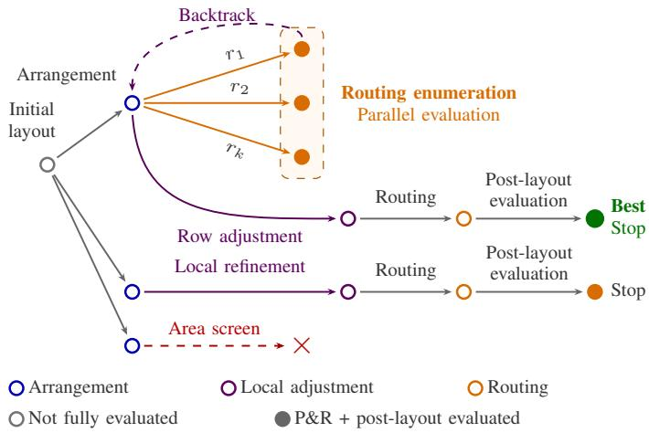  
Fig. 4. Tree search over the back-end design space.

Floorplan branches. Functionally screened sizing candidates seed alternative floorplan forms. The agent assesses their ideal packing potential using PCell geometry. For configuration x and floorplan form $f ,$ let $B _ { i } ( x , f )$ be the footprint of device i positioned by the planner under the specified spacing constraints. The estimated placement area is

$$
\widehat { A } _ { \mathrm { p l a n } } ( x , f ) = \mathrm { a r e a } \left[ \mathrm { b b o x } \left( \bigcup _ { i } B _ { i } ( x , f ) \right) \right] .\tag{4}
$$

This estimate covers rows, stacked devices, and side columns within one representation. Compact realizations indicate the area reduction available before routing. The agent prioritizes promising forms relative to the incumbent area A⋆ and retains alternatives as separate branches. Routed area $A ( x )$ determines actual improvement.

Placement and routing expansion. Local search and agentdirected edits produce placement variants within each branch. Realization changes are screened by $| F _ { \mathrm { r e a l } } - F _ { \mathrm { s i z e } } | \le \epsilon _ { \mathrm { r e a l } }$ where the two FoMs correspond to the realized and sizing schematics. Only shortlisted configurations proceed to full evaluation. Each placement supports parallel routing attempts with different wire widths and net orders. Promising attempts are compared using their own extracted circuits and performance checks. Independent branches, placement variants, and routing attempts can execute in parallel.

Feedback and backtracking. Perception turns completed results into evidence for the next expansion. Excessive whitespace motivates placement refinement, routing overhang motivates placement or routing changes, and performance loss motivates probes, realization changes, or local re-sizing. If an attempt is infeasible or falls short of expectations, the agent returns to a stored parent and explores another modification. Repeated failures or exhausted improvement opportunities terminate that branch and redirect the search to another placement or floorplan. Gap compression is judged after routing because routing-grid effects can offset geometric gains.

Verification and termination. Verification V evaluates candidates using DRC, LVS, functional checks, and RC postlayout simulation under the fixed protocol. Search stops when the budget is exhausted or two consecutive rounds yield no qualifying area improvement. The selected design is rebuilt and verified before delivery.

## IV. EXPERIMENTAL RESULTS

## A. Experimental Setup

Implementation. The agent is Claude Opus 5.5 at high reasoning effort, running on an 8-core Ryzen 9 9950X3D workstation with 16 GB of memory. All layouts are in SKY130, and postlayout metrics are simulated with ngspice-43 on RC-extracted netlists.

Benchmarks. Table I lists 20 SKY130 amplifiers: ten onestage OTAs (1s), five two-stage (2s) and five three-stage (3s) amplifiers, with 6–39 devices each (Figs. 6 and 7). The twoand three-stage designs carry MIM compensation capacitors. Compared methods. APPlace [18] is a conventional rowbased P&R flow on the same PCells as CASCoDe. MAG-ICAL [3] (the authors’ SKY130 branch) and ALIGN [4] (ALIGN-public with its SKY130 PDK) run as released after minimal fixes for crashes and PDK mismatches; their DRC counts omit violations caused by PDK-mismatched device generation and keep only genuine, unrepairable ones, and layouts failing LVS are minimally repaired before simulation. Metrics. We report the DRC violation count, LVS result, routed bounding-box area, and device density, the summed PCell bounding-box area divided by the routed area.

TABLE I  
LAYOUT AND POST-LAYOUT PERFORMANCE COMPARISON. AREA IS IN $\mu \mathrm { { m } ^ { 2 } }$
<table><tr><td rowspan="2">Circuit</td><td colspan="4">MAGICAL*</td><td colspan="4">ALIGN†</td><td colspan="4">APPlace</td><td colspan="4">CASCoDe</td></tr><tr><td>DRC/LVS</td><td>Area</td><td>FoM</td><td>Density</td><td>DRC/LVS</td><td>Area</td><td>FoM</td><td>Density</td><td>DRC/LVS</td><td>Area</td><td>FoM</td><td>Density</td><td>DRC/LVS</td><td>Area</td><td>FoM</td><td>Density</td></tr><tr><td>1s_5t</td><td>84/√</td><td>1,050</td><td>7.24</td><td>0.16</td><td>0/√</td><td>549</td><td>6.85</td><td>0.37</td><td>0/√</td><td>884</td><td>6.94</td><td>0.36</td><td>0/√</td><td>233±10%</td><td>6.64</td><td>0.71</td></tr><tr><td>1s_fcse</td><td>254/√</td><td>3,162</td><td>6.21</td><td>0.35</td><td>17/×</td><td>2,102</td><td>5.71†</td><td>0.52</td><td>0/√</td><td>2,186</td><td>6.71</td><td>0.54</td><td>0/√</td><td>806±11%</td><td>7.10</td><td>0.71</td></tr><tr><td>1s_fcfd</td><td>120/√</td><td>13,411</td><td>6.75</td><td>0.33</td><td>114/√</td><td>11,530</td><td>6.63</td><td>0.40</td><td>0/√</td><td>14,270</td><td>6.79</td><td>0.41</td><td>0/√</td><td>4,054 ±7%</td><td>6.66</td><td>0.61</td></tr><tr><td>1s_iwil</td><td>150/√</td><td>2,719</td><td>6.94</td><td>0.25</td><td>20/√</td><td>1,885</td><td>6.96</td><td>0.34</td><td>0/√</td><td>2,454</td><td>6.97</td><td>0.33</td><td>0/√</td><td>447 ±9%</td><td>6.93</td><td>0.64</td></tr><tr><td>1s_ntele</td><td>207/√</td><td>1,887</td><td>6.97</td><td>0.20</td><td>63/√</td><td>1,481</td><td>6.97</td><td>0.28</td><td>0/√</td><td>1,559</td><td>6.97</td><td>0.34</td><td>0/√</td><td>455±17%</td><td>6.76</td><td>0.72</td></tr><tr><td>1s_nwil</td><td>166/√</td><td>2,705</td><td>6.70</td><td>0.41</td><td>134/√</td><td>1,680</td><td>6.81</td><td>0.57</td><td>0/√</td><td>2,969</td><td>6.82</td><td>0.34</td><td>0/√</td><td>541 ±14%</td><td>6.93</td><td>0.82</td></tr><tr><td>1s_sym</td><td>60/√</td><td>11,373</td><td>7.05</td><td>0.37</td><td>97/×</td><td>5,805</td><td>5.32†</td><td>0.59</td><td>0/√</td><td>8,701</td><td>6.99</td><td>0.39</td><td>0/√</td><td>1,326 ±6%</td><td>6.97</td><td>0.70</td></tr><tr><td>1s_tele</td><td>226/√</td><td>1,974</td><td>6.95</td><td>0.20</td><td>88/√</td><td>1,148</td><td>6.94</td><td>0.33</td><td>0/√</td><td>1,429</td><td>6.97</td><td>0.42</td><td>0/√</td><td>587 ±12%</td><td>6.69</td><td>0.68</td></tr><tr><td>1s_twil</td><td>226/√</td><td>2,650</td><td>6.92</td><td>0.25</td><td>88/√</td><td>1,967</td><td>6.75</td><td>0.41</td><td>0/√</td><td>2,513</td><td>6.81</td><td>0.45</td><td>0/√</td><td>1,040 ±5%</td><td>6.79</td><td>0.64</td></tr><tr><td>1s_wsc</td><td>193/√</td><td>4,802</td><td>6.66</td><td>0.31</td><td>58/×</td><td>3,137</td><td>4.98†</td><td>0.52</td><td>0/√</td><td>4,425</td><td>6.75</td><td>0.39</td><td>0/√</td><td>774±9%</td><td>6.71</td><td>0.74</td></tr><tr><td>1s Summary</td><td>0%</td><td>4,573</td><td>80%</td><td>0.28</td><td>10%</td><td>3,128</td><td>60%</td><td>0.43</td><td>100%</td><td>4,139</td><td>100%</td><td>0.40</td><td>100%</td><td> ${ \bf 1 } , { \bf 0 } 2 { \bf 6 } \pm 1 0 \%$ </td><td>100%</td><td>0.70</td></tr><tr><td>2s_se</td><td>112/√</td><td>4,014</td><td>6.31</td><td>0.35</td><td>48/√</td><td>1,935</td><td>6.81</td><td>0.55</td><td>0/√</td><td>3,183</td><td>6.87</td><td>0.41</td><td>0/√</td><td>877 ±10%</td><td>7.12</td><td>0.89</td></tr><tr><td>2s_miller</td><td>447/√</td><td>4,238</td><td>6.79</td><td>0.29</td><td>47/√</td><td>4,462</td><td>6.84</td><td>0.46</td><td>0/√</td><td>4,535</td><td>6.75</td><td>0.32</td><td>0/√</td><td>1,347 ±7%</td><td>6.74</td><td>0.76</td></tr><tr><td>2s_nfc</td><td>363/√</td><td>9,921</td><td>1.99</td><td>0.33</td><td>250/×</td><td>4,544</td><td>6.31†</td><td>0.61</td><td>0/√</td><td>8,682</td><td>6.66</td><td>0.34</td><td>0/√</td><td>3,195 ±4%</td><td>6.93</td><td>0.73</td></tr><tr><td>2s_pcas</td><td>337/×</td><td>3,726</td><td>4.31*</td><td>0.26</td><td>384/√</td><td>1,884</td><td>6.68</td><td>0.43</td><td>0/√</td><td>2,780</td><td>6.65</td><td>0.34</td><td>0/√</td><td>802 ±5%</td><td>6.70</td><td>0.81</td></tr><tr><td>2s_wsc</td><td>236/√</td><td>22,532</td><td>5.30</td><td>0.45</td><td>134/√</td><td>3,320</td><td>6.94</td><td>0.53</td><td>0/√</td><td>10,479</td><td>6.79</td><td>0.27</td><td>0/√</td><td>1,934 ±6%</td><td>6.99</td><td>0.75</td></tr><tr><td>2s Summary</td><td>0%</td><td>8,886</td><td>20%</td><td>0.34</td><td>0%</td><td>3,229</td><td>60%</td><td>0.52</td><td>100%</td><td>5,932</td><td>60%</td><td>0.34</td><td>100%</td><td>1,631 ±6%</td><td>100%</td><td>0.79</td></tr><tr><td>3s_acbc</td><td>214/√</td><td>13,519</td><td>5.89</td><td>0.37</td><td>24/√</td><td>7,237</td><td>5.87</td><td>0.60</td><td>20/√</td><td>14,095</td><td>6.23</td><td>0.37</td><td>0/√</td><td>5,736±3%</td><td>7.71</td><td>0.79</td></tr><tr><td>3s_affc</td><td>269/×</td><td>36,928</td><td>4.89*</td><td>0.25</td><td>124/√</td><td>11,757</td><td>6.37</td><td>0.63</td><td>34/√</td><td>16,636</td><td>6.48</td><td>0.51</td><td>0/√</td><td>5,453 ±3%</td><td>7.16</td><td>0.79</td></tr><tr><td>3s_dacfc</td><td>307/×</td><td>29,526</td><td>5.63*</td><td>0.41</td><td>137/√</td><td>20,807</td><td>6.16</td><td>0.48</td><td>41/×</td><td>39,913</td><td>6.52‡</td><td>0.32</td><td>0/√</td><td>8,425 ±4%</td><td>7.02</td><td>0.64</td></tr><tr><td>3s_smc</td><td>377/√</td><td>27,281</td><td>5.32</td><td>0.28</td><td>15/√</td><td>8,215</td><td>7.45</td><td>0.51</td><td>16/√</td><td>12,915</td><td>6.77</td><td>0.44</td><td>0/√</td><td>5,219±5%</td><td>6.96</td><td>0.85</td></tr><tr><td>3s_tcfc</td><td>一</td><td></td><td></td><td>一</td><td>250/√</td><td>20,548</td><td>7.09</td><td>0.55</td><td>27/√</td><td>24,699</td><td>6.69</td><td>0.50</td><td>0/√</td><td> ${ \bf 5 , 9 8 9 \pm 4 \% }$ </td><td>6.79</td><td>0.69</td></tr><tr><td>3s Summary</td><td>0%</td><td>26,814</td><td>0%</td><td>0.33</td><td>0%</td><td>13,713</td><td>40%</td><td>0.55</td><td>0%</td><td>21,652</td><td>20%</td><td>0.43</td><td>100%</td><td> ${ \bf 6 , 1 6 4 \pm } 4 \%$ </td><td>100%</td><td>0.75</td></tr><tr><td>All (20) Ratio</td><td>0%</td><td>10,390</td><td>45%</td><td>0.31</td><td>5%</td><td>5,800</td><td>55%</td><td>0.48</td><td>75%</td><td>8,965</td><td>70%</td><td>0.39</td><td>100%</td><td>2,462 ±8%</td><td>100%</td><td>0.74</td></tr></table>

DRC/LVS shows the DRC violation count and LVS result (✓ pass, × fail); – denotes unavailable data. Shaded FoM cells fail the pass criterion of Sec. IV-A \*†‡ FoM after minimal LVS repair (MAGICAL, ALIGN, APPlace). MAGICAL produced no layout for $3 s \_ t \subset \mathsf { E c }$ Summary rows give the share of clean (zero-DRC, LVS-passing) layouts under DRC/LVS and of passing layouts under FoM. CASCoDe values are means of three runs, whose shares count every run; ± is the range of routed area over the runs relative to the mean. Area and density are arithmetic means over available layouts; Ratio normalizes mean area and density to APPlace. Bold marks the best area, FoM, and density in each row and the highest shares in each summary (ties included).

Performance requirement. Because CASCoDe optimizes end to end, from sizing to the routed layout, every flow is held to the same pre-layout reference. The reference is one sizing point, the smallest-area initial sample within the top 5% of every metric, whose pre-layout simulation gives values $m _ { k } ^ { \mathrm { r e f } }$ for seven metrics. Each post-layout metric $m _ { k }$ is expressed as a ratio oriented so that $r _ { k } \geq$ 1 means at least the reference performance: $r _ { k } ~ = ~ m _ { k } / m _ { k } ^ { \mathrm { r e f } }$ for Gain, GBW, SR, CMRR, and PSRR, and $r _ { k } = m _ { k } ^ { \mathrm { r e f } } / m _ { k }$ for the supply current $I _ { \mathrm { d c } }$ and Noise. A layout must keep every metric at no less than 80% of the reference, $r _ { k } \ge 0 . 8$ for all $k ,$ and meet the phase-margin requirement $\mathrm { P M } \geq \theta _ { \mathrm { P M } }$ , with $\theta _ { \mathrm { P M } } = 6 0 ^ { \circ }$ for one-stage and $4 5 ^ { \circ }$ for two- and three-stage amplifiers.

Among layouts that meet this requirement, the FoM ranks overall performance. Each ratio is clipped to [0, 2] before summation, and the phase-margin requirement adds one point:

$$
\mathrm { F o M } = \sum _ { k = 1 } ^ { 7 } \operatorname* { m i n } \{ 2 , \operatorname* { m a x } \{ 0 , r _ { k } \} \} + k \lvert \mathrm { F I M } \geq \theta _ { \mathrm { P M } } ] ,
$$

$$
F _ { \mathrm { p o s t } } = \mathrm { F o M } \cdot \nVdash \left[ \mathrm { P M } \geq \theta _ { \mathrm { P M } } { \mathrm { ~ a n d ~ } } \operatorname* { m i n } _ { k } r _ { k } \geq 0 . 8 \right] .\tag{5}
$$

(6)

The two bounds keep a single anomalous metric from dominating the sum in either direction, and stop a design from collecting credit by over-optimizing one metric far beyond the reference. A layout passes when $F _ { \mathrm { p o s t } } > 0$ , i.e., when every metric meets the 80% requirement and the phase margin holds; this is the constraint of Eq. (1). Because a ratio above 1 can offset a weak metric in the sum, the FoM value alone does not decide passing: a layout whose FoM exceeds $1 + 7 \times 0 . 8 = 6 . 6$ still fails if any single metric falls below 0.8. Tables report the FoM and shade failing layouts.

## B. End-to-End Comparison

Eq. (1) asks for the smallest layout that meets the performance requirement, so every flow is given that same problem: each baseline receives every sizing CASCoDe used during its run plus the 20 best initial samples, runs five times on each, and reports its smallest-area passing layout, or its highest-FoM layout if none passes; CASCoDe reports its delivered design, averaged over three runs, whose routed area varies by 3–17% (mean 8%) across runs. Table I lists every layout, and Fig. 5 plots its area, FoM, and density per circuit.

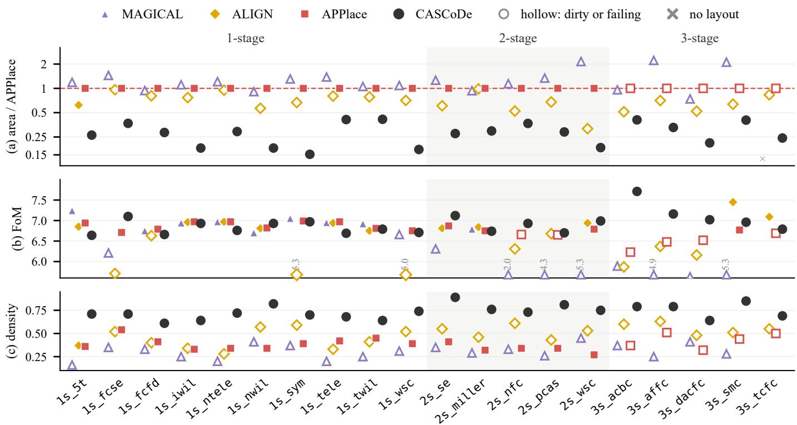  
Fig. 5. Visual summary of Table I for every circuit: (a) routed area relative to APPlace (log scale), (b) post-layout FoM, and (c) device density. Hollow markers in (a) and (c) are layouts that are not DRC- and LVS-clean; in (b) they fail the performance requirement, which is checked per metric, so a hollow marker can sit above a filled one. FoM values below the plotted range are pinned to its floor and printed. Shaded: two-stage class.

CASCoDe is the only flow that is DRC- and LVS-clean on all 20 circuits: APPlace is clean on 15, MAGICAL on none, and ALIGN on one, and they fail LVS on one, three, and four circuits. CASCoDe also meets the performance criterion on all 20, against 14, 9, and 11, although each baseline picks its best layout over all sizings. Under this criterion it is smaller than every baseline on every circuit, reducing area by 59–85% (mean 71%) against APPlace on identical PCells. Its mean FoM (6.92) exceeds every baseline (6.76, 6.04, and 6.52) and is the highest on nine circuits; where a baseline scores higher, the gap is at most 0.30 against APPlace and 0.60 against a DRC-dirty MAGICAL or ALIGN layout.

Per-circuit view. Fig. 5 makes the per-circuit pattern of Table I visible at a glance. In panel (a), CASCoDe forms a separate band at 0.15–0.41× the APPlace area on every circuit, while MAGICAL lies above the APPlace line on 14 circuits. ALIGN is the closest baseline in area (0.32–0.98×), but its markers are hollow on 19 of 20 circuits: its smaller footprint comes with DRC or LVS violations. Even against the smallest baseline layout of each circuit, dirty ones included, CASCoDe needs only 0.23–0.79× the area. Panel (b) shows that this saving does not trade away performance: every CASCoDe layout passes (FoM 6.64–7.71), whereas the baselines have 25 failing layouts (ten for MAGICAL, nine for ALIGN, and six for APPlace), 19 of them in the two- and three-stage classes. The panel also shows why passing is checked per metric rather than by FoM: five baseline layouts with FoM between 6.63 and 6.69 fail because a single metric or the phase margin misses its requirement, while CASCoDe layouts with similar FoM, such as 1s\_5t at 6.64, meet all of them. Panel (c) explains the area gap: CASCoDe reaches a device density of 0.61–0.89, above every baseline layout (at most 0.63), and exceeds the densest baseline of each circuit by 0.11 (1s\_sym) to 0.38 (2s\_pcas).

## C. Layout Analysis

Figs. 6 and 7 draw the APPlace and CASCoDe layouts of every circuit side by side; the two layouts of a circuit share one scale, so their footprints compare directly. The area gap builds up in three steps.

(1) Regular arrangement. The first saving comes from regularity. APPlace keeps the row structure of the conventional P&R flow, but its rows are loosely filled and separated by wide routing channels, and large devices protrude from the device array: the wide multi-finger devices of 1s\_iwil and 1s\_nwil and the large blocks of 1s\_ntele and 1s\_wsc each extend the bounding box well beyond the rest of the layout. CASCoDe first chooses an arrangement, i.e., which devices form rows, stacks, or side columns (Sec. III-D), and only then realizes it as aligned rows. Devices of similar height share a row and rows share a common width, so every CASCoDe layout is close to a filled rectangle with no device sticking out. This step removes most of the whitespace before any fine-grained tuning: it accounts for 62% of the reduction (Table III) and lifts device density to 0.61–0.89 (Table I).

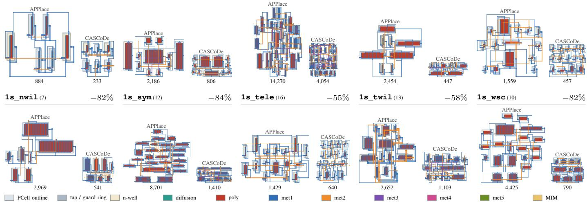  
Fig. 6. Routed layouts of APPlace (left of each pair) and CASCoDe (right) on identical PCells: one-stage amplifiers. Header: circuit, number of netlis devices, and area reduction; below each layout: routed bounding-box area in µm2. The two layouts of a circuit share one scale; every pair is scaled to about the same height. The CASCoDe layout shown is one delivered run; Table I reports three-run means. li1, contacts, pins, labels and well taps are not drawn.

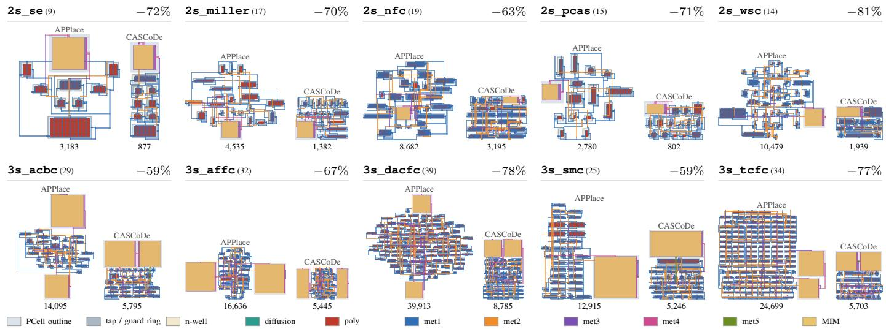  
Fig. 7. Routed layouts of APPlace (left of each pair) and CASCoDe (right) on identical PCells: two- and three-stage amplifiers. Header: circuit, number of netlist devices, and area reduction; below each layout: routed bounding-box area in µm2. The two layouts of a circuit share one scale; every pair is scaled to about the same height. The CASCoDe layout shown is one delivered run; Table I reports three-run means. li1, contacts, pins, labels and well taps are not drawn.

(2) Adaptation to circuit structure. The same action set adapts to the structure of each circuit instead of applying one template. Symmetric circuits. In the differential and fully differential amplifiers, such as 1s\_5t, 1s\_sym, and 1s\_fcfd, matched devices are moved as groups, so the compact arrangement keeps the two halves of the circuit mirrored about a common axis. Large passive devices. In the two- and threestage amplifiers, the MIM compensation capacitors are several times larger than any transistor. APPlace places them as separate blocks at the periphery and spreads the active devices between them, whereas CASCoDe abuts them to the active array: along the top edge in 2s\_se, 3s\_acbc, 3s\_dacfc, 3s\_smc, and 3s\_tcfc, in a corner in 2s\_miller and 2s\_pcas, and on both flanks in 3s\_affc. The active array is shaped to the capacitor edge, so the capacitor no longer leaves empty space around it; on 2s\_se the whole amplifier becomes a single narrow column under its capacitor. Dominant wide devices. When a few wide devices dominate the footprint, as in 1s\_iwil, 1s\_nwil, and 1s\_fcse, device splitting and shape changes fold them into the rows rather than leaving them as separate long blocks. Each case is handled by a different sequence drawn from the same predefined actions, which is what lets one unchanged loop serve all 20 circuits. (3) Discrete refinement. Once the arrangement is set, the remaining gain comes from many small discrete decisions, each kept only if the layout stays DRC- and LVS-clean and passes the post-layout criterion. Geometric fine-tuning compresses row gaps and changes device shapes, and local re-sizing shrinks devices that have slack in the post-layout metrics; each accounts for 19% of the reduction (Table III). These edits are routing-aware: gap compression is judged only after routing, because the routing grid can offset a geometric gain; routing attempts vary wire widths and net orders; and resistive probes (Eq. (3)) point to nets whose resistance limits the FoM. The run of Fig. 8 shows the progression: after the floorplan actions reach 1,144 $\mu \mathrm { { m } ^ { 2 } }$ , row-gap tuning, deviceshape changes, and a final capacitor and transistor re-sizing bring the area to $8 7 7 \mu \mathrm { { m } ^ { 2 } }$ , and every incumbent along the way is legal and passing.

TABLE II COMPARISON AT IDENTICAL SIZING
<table><tr><td>Circuits</td><td>Metric</td><td>APPlace</td><td>MAGICAL</td><td>ALIGN</td><td>CASCoDe</td></tr><tr><td rowspan="3">1-stage (10)</td><td>Area</td><td>3,343</td><td>3,502</td><td>2,318</td><td>1,026</td></tr><tr><td>Pass</td><td>70%</td><td>60%</td><td>50%</td><td>100%</td></tr><tr><td>Density</td><td>0.41</td><td>0.29</td><td>0.45</td><td>0.70</td></tr><tr><td rowspan="3">2-stage (5)</td><td>Area</td><td>5,332</td><td>7,692</td><td>2,911</td><td>1,631</td></tr><tr><td>Pass</td><td>40%</td><td>0%</td><td>20%</td><td>100%</td></tr><tr><td>Density</td><td>0.37</td><td>0.36</td><td>0.51</td><td>0.79</td></tr><tr><td rowspan="3">3-stage (5)</td><td>Area</td><td>18,933</td><td>20,082</td><td>10,328</td><td>6,164</td></tr><tr><td>Pass</td><td>0%</td><td>0%</td><td>0%</td><td>100%</td></tr><tr><td>Density</td><td>0.45</td><td>0.37</td><td>0.56</td><td>0.79</td></tr></table>

TABLE III

AREA REDUCTION AGAINST APPLACE AT IDENTICAL SIZING PER CIRCUIT CLASS, SPLIT BY SOURCE. AREAS ARE CLASS MEANS; SHARES ARE PERCENTAGES OF THE REDUCTION.
<table><tr><td></td><td colspan="3">Area  $( \mu \mathrm { { m } ^ { 2 } ) }$ </td><td colspan="3">Share of reduction (%)</td></tr><tr><td>Class</td><td>APPlace</td><td>CASCoDe</td><td>Red.</td><td>Sizing</td><td></td><td>Arrange. Fine-tune</td></tr><tr><td>1-stage (10)</td><td>4,139</td><td>1,026</td><td>-75.2%</td><td>25.6</td><td>59.8</td><td>14.6</td></tr><tr><td>2-stage (5)</td><td>5,932</td><td>1,631</td><td>-72.5%</td><td>13.9</td><td>66.3</td><td>19.8</td></tr><tr><td>3-stage (5)</td><td>21,652</td><td>6,164</td><td>-71.5%</td><td>17.6</td><td>61.7</td><td>20.7</td></tr><tr><td>All (20)</td><td>一</td><td>一</td><td></td><td>18.9</td><td>62.0</td><td>19.1</td></tr></table>

TABLE IV

MEAN COST PER CIRCUIT CLASS. BASELINES: RUNTIME PER RUN. CASCODE: TOTAL AGENT TIME (TRIALS RUN IN PARALLEL), TOKENS, AND TRIALS AT THE FIRST LAYOUT THAT BEATS EVERY BASELINE AND AT THE END OF THE RUN.
<table><tr><td></td><td colspan="3">Baselines (s)</td><td colspan="6">CASCoDe</td></tr><tr><td></td><td></td><td></td><td></td><td></td><td>First win</td><td></td><td></td><td>Full run</td><td></td></tr><tr><td>Class</td><td></td><td>APPlace MAGICAL ALIGN</td><td></td><td>min</td><td>M tok. trials</td><td></td><td>min</td><td>M tok.</td><td>trials</td></tr><tr><td>1-stage (10)</td><td>53</td><td>15.1</td><td>232</td><td>3.1</td><td>0.017</td><td>4.2</td><td>41.7</td><td>0.259</td><td>46.4</td></tr><tr><td>2-stage (5)</td><td>274</td><td>43.5</td><td>319</td><td>8.8</td><td>0.052</td><td>7.6</td><td>58.0</td><td>0.362</td><td>69.4</td></tr><tr><td>3-stage (5)</td><td>601</td><td>121.2</td><td>368</td><td>29.2</td><td>0.136</td><td>17.8</td><td>233.4</td><td>0.734</td><td>81.0</td></tr><tr><td>All (20)</td><td>240</td><td>48.7</td><td></td><td>29011.1</td><td>0.056</td><td>8.5</td><td>93.7</td><td>0.420</td><td>60.8</td></tr></table>

## D. Area Reduction Analysis

(1) Same-sizing comparison. Table II reruns every baseline on the final sizing CASCoDe delivers, so that only the layout flow differs. The area advantage narrows but remains clear: per class, CASCoDe goes from 3.5–4.0× smaller than APPlace in Table I to 3.1–3.3×, from 4.3–5.4× to 3.3–4.7× against MAGICAL, and from 2.0–3.0× to 1.7–2.3× against ALIGN, while the baselines meet the criterion on only 45%, 30%, and 30% of the circuits at this sizing and on no three-stage amplifier.

(2) Decomposition of the reduction. Table III quantifies the split: with APPlace as a fixed layout engine, re-sizing accounts for 19% of the reduction, arrangement (floorplan and placement) for 62%, and geometric fine-tuning for 19%. Device density agrees: 0.74 for CASCoDe against 0.39, 0.31, and 0.48. The reduction therefore does not rest on re-sizing; it comes from co-optimizing sizing with the arrangement decisions.

## E. Overhead and Mitigation

The main cost of CASCoDe is time and tokens (Table IV): a run averages 61 trials, 94 min, and 0.42 M tokens against seconds to minutes for the baselines. Most of the budget, however, refines an already-winning incumbent: the first layout that beats every baseline in area and DRC count while retaining 80% of the pre-layout FoM appears after 8.5 trials, 11 min, and 0.056 M tokens on average, about 12% of the run. In the run of Fig. 8, two floorplan actions and one re-sizing beat every baseline by trial 10 (6.1 min, 0.013 M tokens); 29 further refinement trials gain another 23%.

## F. Ablation Study

Table V isolates the two components of CASCoDe on three benchmark circuits plus an LDO and a comparator from prior sizing studies [12], [15]. w/o Action removes the structured action set, leaving the raw tool interfaces; w/o Tree Search replaces the tree with a single chain that always extends the latest trial; Agent alone removes the execution environment, leaving the tool command lines.

Fig. 9 normalizes every variant to the full framework. Against these variants the full framework yields the smallest area, the least time, and the fewest tokens on all five circuits and the highest FoM on four. Removing the action set inflates area by 1.1–3.8× and time by 1.5–2.4×, and leaves DRC violations on cmp\_ct and 2s\_pcas; removing tree search inflates them by up to 1.7× and 2.4×, with the largest loss on the three-stage 3s\_affc. The agent alone finishes three cases, none DRC-clean.

Reading Fig. 9 panel by panel separates what each component contributes. In the FoM panel, the single-chain variant stays close to the full framework (0.85–1.00×), whereas removing the action set costs 15–51% of the FoM (down to 0.49× on ldo) and the agent alone 16–44%: the structured actions are what let the agent reach high-quality designs at all. The tree search matters mainly for cost. Without it the agent cannot return to an earlier parent, so on 3s\_affc it spends

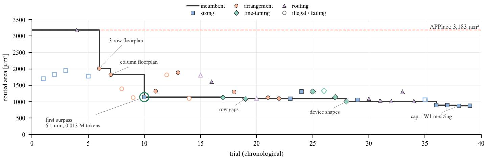  
Fig. 8. One CASCoDe run on 2s\_se: trials coloured by action kind (hollow: illegal or failing), the incumbent staircase from the APPlace layout with each improving action labelled, and the first layout that beats every baseline circled.

TABLE V  
ABLATION STUDY: FOM, ROUTED AREA $( \mu \mathrm { { m } ^ { 2 } ) }$ , TIME (MIN)/TOKENS (M), AND DRC COUNT; ALL LAYOUTS PASS LVS. BOLD: BEST VARIANT; –: UNFINISHED.
<table><tr><td>Variant</td><td colspan="4">1do</td><td colspan="4">cmp_ct</td><td colspan="4">1s_nwil</td><td colspan="4">2s_pcas</td><td colspan="4">3s_affc</td></tr><tr><td></td><td>FoM Area</td><td></td><td>Time/Tok.</td><td>DRC</td><td>FoM Area</td><td>Time/Tok.</td><td></td><td>DRC</td><td>FoM Area</td><td>Time/Tok.</td><td></td><td>DRC</td><td>FoM</td><td>Area Time/Tok.</td><td></td><td>DRC</td><td>FoM</td><td>Area</td><td>Time/Tok.</td><td>DRC</td></tr><tr><td>CASCoDe</td><td>4.19</td><td>1,340</td><td>48/0.33</td><td>0</td><td>3.64</td><td>942</td><td>65/0.49</td><td>0</td><td>6.93</td><td>541</td><td>36/0.25</td><td>0</td><td>6.70</td><td>802</td><td>74/0.44</td><td>0</td><td>7.16</td><td>5,453</td><td>232/0.72</td><td>0</td></tr><tr><td>w/o Action</td><td>2.06</td><td>2,499</td><td>72/0.57</td><td>0</td><td>2.97 1,683</td><td></td><td>156/0.63</td><td>17</td><td>5.92</td><td>613</td><td>59/0.35</td><td>0</td><td>5.66 3,033</td><td></td><td>146/0.75</td><td>19</td><td></td><td></td><td></td><td></td></tr><tr><td>w/o Tree Search</td><td>3.56</td><td>1,537</td><td>69/0.51</td><td>0</td><td>3.55 1,175</td><td></td><td>103/0.71</td><td>0</td><td>6.63</td><td>546</td><td>41/0.33</td><td>0</td><td>6.73 1,319</td><td></td><td>104/0.64</td><td>4</td><td>7.08</td><td>9,254</td><td>556/2.12</td><td>8</td></tr><tr><td>Agent alone</td><td>2.35</td><td>2,889</td><td>122/0.91</td><td>5</td><td>3.04</td><td>2,181</td><td>187/1.01</td><td>23</td><td>4.84</td><td>2,032</td><td>77/0.54</td><td>17</td><td></td><td></td><td></td><td></td><td></td><td></td><td></td><td></td></tr></table>

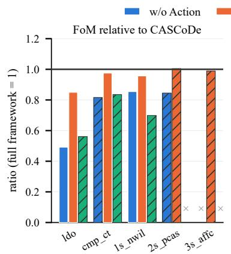

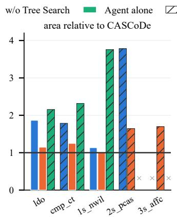

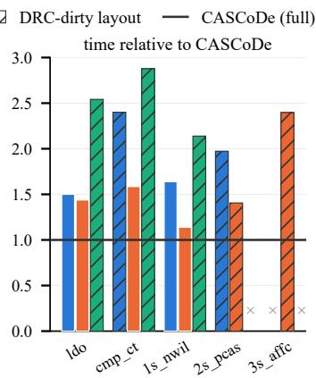

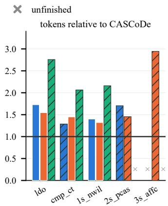  
Fig. 9. Ablation variants relative to the full framework (horizontal line at 1) on the five circuits of Table V. Bars below 1 in FoM and above 1 in area, time, and tokens are losses; hatched bars are DRC-dirty layouts and × marks an unfinished run.

2.4× the time and 2.9× the tokens and still ends 1.7× larger. The agent alone is the most expensive variant on every circuit it finishes (2.1–2.9× the time and 2.1–2.8× the tokens), and all of its bars are hatched: without the execution environment it neither reaches a compact layout nor a DRC-clean one.

## G. Sensitivity to the Agent Model

Table VI swaps Opus 5.5, the latest high-end model, for a mid-tier model of the same family (Sonnet 5.5) and another vendor’s flagship (Astra) on the same five circuits, with prompt, tools, and budget unchanged. All three deliver DRCand LVS-clean layouts on every circuit: legality rests on the action space and the verification loop, not on the model.

The models differ in how they spend the search budget. Sonnet is conservative, keeping FoM at or above Opus on four circuits at 1.2–2.0× the area and 40% more trials, and on $3 s \_ a \pounds \mathrm { f c }$ it neither passes nor saves area. Astra is greedy, following one route with 12% fewer trials to within 6% of Opus’s area while scoring a lower FoM than Opus on four of the five circuits (by up to 5.5%, on cmp\_ct). Both alternatives still produce smaller layouts than every baseline of Table I on the three benchmark circuits, although Sonnet’s 3s\_affc

TABLE VI  
AGENT-MODEL SWAP WITH PROMPT, TOOLS, AND BUDGET UNCHANGED: FOM, ROUTED AREA (µm2), TIME (MIN)/TOKENS (M), AND DRC COUNT; ALL LAYOUTS PASS LVS. \*: FAILS THE PASS CRITERION.
<table><tr><td>Agent model</td><td colspan="4">1do</td><td colspan="4">cmp_ct</td><td colspan="4"> $\mathtt { 1 s \_ n w i l }$ </td><td colspan="4">2s_pcas</td><td colspan="4"> $3 s \_ a \pounds \mathrm { f } \mathsf { c }$ </td></tr><tr><td></td><td>FoM</td><td>Area</td><td>Time/Tok.</td><td>DRC</td><td>FoM</td><td>Area</td><td>Time/Tok.</td><td>DRC</td><td>FoM</td><td>Area</td><td>Time/Tok.</td><td>DRC</td><td>FoM</td><td>Area</td><td>Time/Tok.</td><td>DRC</td><td>FoM</td><td>Area</td><td>Time/Tok.</td><td>DRC</td></tr><tr><td>Opus 5.5 (default)</td><td>4.19</td><td>1,340</td><td>48/0.33</td><td>0</td><td>3.64</td><td>942</td><td>65/0.49</td><td>0</td><td>6.93</td><td>541</td><td>36/0.25</td><td>0</td><td>6.70</td><td>802</td><td>74/0.44</td><td>0</td><td>7.16</td><td>5,453</td><td>232/0.72</td><td>0</td></tr><tr><td>Sonnet 5.5</td><td>4.311,667</td><td></td><td>72/0.44</td><td>0</td><td>3.91</td><td>1,761</td><td>77/0.62</td><td>0</td><td>7.01</td><td>992</td><td>51/0.34</td><td>0</td><td>6.91</td><td>1,572</td><td>134/0.79</td><td>0</td><td>6.51*</td><td>9,901</td><td>301/1.24</td><td>0</td></tr><tr><td>Astra</td><td>4.12</td><td>1,281</td><td>57/0.43</td><td>0</td><td>3.44</td><td>1,001</td><td>49/0.41</td><td>0</td><td>6.63</td><td>563</td><td>50/0.31</td><td>0</td><td>6.82</td><td>814</td><td>84/0.40</td><td>0</td><td>6.99</td><td>5,311</td><td>198/0.61</td><td>0</td></tr></table>

layout fails the pass criterion.

## H. Limitations

Gap to expert layouts. The structured actions encode part of the knowledge a layout designer applies, such as moving matched devices as groups, abutting large capacitors to the active array, and folding wide devices into rows. This clearly improves on the automated flows, but the delivered layouts still fall short of carefully hand-crafted ones. The agent can only combine the predefined actions with the bridging tools it writes, and the objective covers routed area and post-layout performance under a fixed set of testbenches. Practices that DRC, LVS, and these metrics do not capture, such as gradientaware matching, shielding of sensitive nets, and reliability considerations, are therefore not optimized explicitly.

Cost–quality trade-off. CASCoDe buys layout quality with time and tokens: a run averages 94 min and 0.42 M tokens, against seconds to minutes for the baselines (Table IV), and the cost grows with circuit size, to 233 min for the threestage class. The first layout that beats every baseline appears after about 12% of this budget and independent trials run in parallel, so a run can stop early at much lower cost; the further refinement, such as the final 23% in the run of Fig. 8, is paid for with additional trials.

## V. CONCLUSION

CASCoDe is a closed-loop LLM agent framework that runs feedback-guided tree search over a hierarchical action space from sizing to a verified GDS. One unchanged loop handles 20 SKY130 amplifiers, delivering DRC- and LVS-clean layouts on every circuit at 59–85% less area than a conventional P&R flow, most of it from arrangement decisions. Ablations confirm that both the action space and the tree search reduce area and search cost.

[1] W. Lyu, F. Yang, C. Yan, D. Zhou, and X. Zeng, “Batch Bayesian optimization via multi-objective acquisition ensemble for automated analog circuit design,” in International Conference on Machine Learning (ICML), ser. PMLR, vol. 80, 2018, pp. 3306–3314. [Online]. Available: https://proceedings.mlr.press/v80/lyu18a.html

[2] K. Settaluri, A. Haj-Ali, Q. Huang, K. Hakhamaneshi, and B. Nikolic, “AutoCkt: Deep reinforcement learning of analog circuit designs,” in Design, Automation & Test in Europe Conference & Exhibition (DATE), 2020, pp. 490–495.

[3] B. Xu, K. Zhu, M. Liu, Y. Lin, S. Li, X. Tang, N. Sun, and D. Z. Pan, “MAGICAL: Toward fully automated analog IC layout leveraging human and machine intelligence,” in IEEE/ACM International Conference on Computer-Aided Design (ICCAD), 2019. [Online]. Available: https://yibolin.com/publications/papers/ANALOG\_ ICCAD2019\_Xu.pdf

[4] T. Dhar, K. Kunal, Y. Li, M. Madhusudan, J. Poojary, A. K. Sharma, W. Xu, S. M. Burns, R. Harjani, J. Hu, D. A. Kirkpatrick, P. Mukherjee, S. S. Sapatnekar, and S. Yaldiz, “ALIGN: A system for automating analog layout,” IEEE Design & Test, vol. 38, no. 2, pp. 8–18, 2021.

[5] P. Xu, M. Wang, Y. Li, Y. Ye, T. Chen, T.-Y. Ho, and B. Yu, “DiffSP: Differentiable sequence pair-based analog placement,” in ACM/IEEE Design Automation Conference (DAC), 2026.

[6] X. Gao, H. Zhang, S. Ye, M. Liu, D. Z. Pan, L. Shen, R. Wang, Y. Lin, and R. Huang, “Post-layout simulation driven analog circuit sizing,” arXiv:2310.14049, 2023. [Online]. Available: https://arxiv.org/abs/2310.14049

[7] H. Zhang, W. Fan, X. Gao, B. Liu, R. Wang, and Y. Lin, “PANDA: An LLM-enhanced performance-driven analog design framework bridging design intent and layout generation,” arXiv:2606.15052, 2026, preprint version cited. [Online]. Available: https://arxiv.org/abs/2606.15052

[8] X. R. Qin, Y. Zhang, Y. Hu, T. Su, B.-W. Jia, and N. Xu, “AnalogMaster: Large language model-based automated analog IC design framework from image to layout,” arXiv:2604.20916, 2026. [Online]. Available: https://arxiv.org/abs/2604.20916

[9] E. Y. Gebru, Ramprasath S., R. Harjani, and S. S. Sapatnekar, “Row-based layout synthesis for analog circuits using heightquantized primitives,” arXiv:2606.21767, 2026. [Online]. Available: https://arxiv.org/abs/2606.21767

[10] B. Liu, Z. Wei, X. Gao, and D. Z. Pan, “Simulation-aware incontext policy improvement for LLM-aided analog layout refinement,” arXiv:2608.13767, 2026. [Online]. Available: https://arxiv.org/abs/2608. 13767

[11] D. Eriksson, M. Pearce, J. R. Gardner, R. Turner, and M. Poloczek, “Scalable global optimization via local bayesian optimization,” in Advances in Neural Information Processing Systems, vol. 32, 2019, pp. 5497–5508. [Online]. Available: https://arxiv.org/abs/1910.01739

[12] Z. Kong, X. Tang, W. Shi, Y. Du, Y. Lin, and Y. Wang, “PVTSizing: A TuRBO-RL-based batch-sampling optimization framework for PVTrobust analog circuit synthesis,” in Proceedings of the 61st ACM/IEEE Design Automation Conference (DAC), 2024.

[13] Y. Yin, Y. Wang, B. Xu, and P. Li, “ADO-LLM: Analog design Bayesian optimization with in-context learning of large language models,” in IEEE/ACM International Conference on Computer-Aided Design (IC-CAD), 2024.

[14] D. V. Kochar, H. Wang, A. Chandrakasan, and X. Zhang, “LEDRO: LLM-enhanced design space reduction and optimization for analog circuits,” arXiv:2411.12930, 2024. [Online]. Available: https://arxiv.org/ abs/2411.12930

[15] Z. Wei, Z. Kong, Y. Wang, D. Z. Pan, and X. Tang, “TopoSizing: An LLM-aided framework of topology-based understanding and sizing for AMS circuits,” IEEE Transactions on Computer-Aided Design of Integrated Circuits and Systems, vol. 45, no. 11, pp. 5136–5148, 2026.

[16] Y. Lai, S. Lee, G. Chen, S. Poddar, M. Hu, D. Z. Pan, and P. Luo, “AnalogCoder: Analog circuit design via training-free code generation,” in AAAI Conference on Artificial Intelligence (AAAI), 2025.

[17] M. Strasser, M. Eick, H. Graeb, U. Schlichtmann, and F. M. Johannes, “Deterministic analog circuit placement using hierarchically bounded enumeration and enhanced shape functions,” in IEEE/ACM International Conference on Computer-Aided Design (ICCAD), 2008, pp. 306–313.

[18] B. Liu, X. Gao, S. Poddar, and D. Z. Pan, “APPlace: Co-optimizing device locations and access points for routing-aware analog placement,”

in Asia and South Pacific Design Automation Conference (ASP-DAC), 2027, arXiv:2610.39515.

[19] M. Madhusudan, A. K. Sharma, Y. Li, J. Hu, S. S. Sapatnekar, and R. Harjani, “Analog layout generation using optimized primitives,” in Design, Automation and Test in Europe Conference (DATE), 2021, pp. 1234–1239.

[20] E. Charbon, E. Malavasi, D. Pandini, and A. L. Sangiovanni-Vincentelli, “Simultaneous placement and module optimization of analog IC’s,” in ACM/IEEE Design Automation Conference (DAC), 1994, pp. 31–35.

[21] H. Habal and H. Graeb, “Constraint-based layout-driven sizing of analog circuits,” IEEE Transactions on Computer-Aided Design of Integrated Circuits and Systems, vol. 30, no. 8, pp. 1089–1102, 2011.

[22] N. Lourenço, R. Martins, A. Canelas, R. Póvoa, and N. Horta, “AIDA: Layout-aware analog circuit-level sizing with in-loop layout generation,” Integration, the VLSI Journal, vol. 55, pp. 316–329, 2016.

[23] K. Hakhamaneshi, N. Werblun, P. Abbeel, and V. Stojanovic, “BagNet:´ Berkeley analog generator with layout optimizer boosted with deep neural networks,” in IEEE/ACM International Conference on Computer-Aided Design (ICCAD), 2019.

[24] M. Liu, K. Zhu, X. Tang, B. Xu, W. Shi, N. Sun, and D. Z. Pan, “Closing the design loop: Bayesian optimization assisted hierarchical analog layout synthesis,” in ACM/IEEE Design Automation Conference (DAC), 2020.

[25] A. F. Budak, K. Zhu, H. Chen, S. Poddar, L. Zhao, Y. Jia, and D. Z. Pan, “Joint optimization of sizing and layout for AMS designs: Challenges and opportunities,” in ACM International Symposium on Physical Design (ISPD), 2023, pp. 84–92.

[26] B. Liu, H. Zhang, X. Gao, Z. Kong, X. Tang, Y. Lin, R. Wang, and R. Huang, “LayoutCopilot: An LLM-powered multiagent collaborative framework for interactive analog layout design,” IEEE Transactions on Computer-Aided Design of Integrated Circuits and Systems, vol. 44, no. 8, pp. 3126–3139, 2025.

[27] M. Leibl, F. Azevedo, S. Uhlich, A. Bonetti, A. Venkitaraman, C.-Y. Hsieh, P. Pham, L. Servadei, H. Graeb, and R. Martins, “LOADBench: A large open analog dataset and benchmark for machine learning in IC design,” in ACM/IEEE International Symposium on Machine Learning for CAD (MLCAD), 2026. [Online]. Available: https://arxiv.org/abs/2610.21591