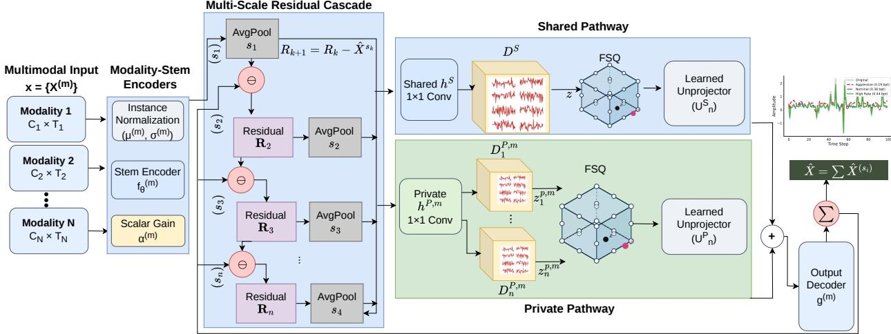

# CHORD: Multi-resolution Compression for Multimodal Time Series

Bibhus Luitel1, Payal Mohapatra2, Subrata Biswas3, Ekata Poudel3,

Sunwoong Kim4, Qi Zhu4, Bashima Islam1

1University of Massachusetts Amherst

2Arm

3Worcester Polytechnic Institute

4Northwestern University

## Abstract

Wearables, mobile devices, and IoT platforms generate multimodal time-series data continuously and at scale, making eficient storage and transfer a primary concern. The same recordings are reused after collection by many downstream models, often at diferent temporal resolutions, so a compressed representation should be small, useful across resolutions, and produced at a bit rate known in advance. Prior work meets parts of this: symbolic and error-bounded compressors reconstruct accurately but fix resolution at compression time, learned codecs target one signal domain, and discrete tokenizers reconstruct without accounting for rate. We introduce CHORD, a coarse-to-fine compressor for heterogeneous multimodal time series. A residual cascade orders each payload from broad to fine temporal scales and synthesizes corrections through learned shapelet-inspired atoms. A shared pathway supplies a reusable synthesis basis across modalities, while private pathways retain capacity for sensor-specific morphology. Finite scalar quantization fixes the bit width of every modality and scale, so payload size is known before encoding, and scale dropout trains each coarse-to-fine prefix to be a valid reconstruction operating point. Across seven wearablesensing and forecasting benchmarks, CHORD stays within 0.62 points of uncompressed classification accuracy on average at the 8× target, the smallest gap of any compressed method, with all resolutions decoded from one payload.

## Introduction

Sensors in wearable, mobile, clinical, and Internet of Things (IoT) systems continuously generate multimodal time-series data. We use modality to denote one sensor stream, such as an accelerometer recording or electrocardiogram channels. Modalities difer substantially in sampling rate, number of channels, amplitude range, frequency content, and waveform morphology. We consider regularly sampled modality windows, including streams bufered and resampled on device. At deployment scale the resulting volume quickly exceeds what can be stored or transferred at low cost: for the WE-SAD dataset (Schmidt et al. 2018), storing day-long chest and wrist recordings would require approximately 2.0 GB, as the dataset records 5,768 float32 scalars per second. The same recordings are later reused by classifiers, forecasters, and pretrained models with diferent architectures, motivating compact storage that preserves information across downstream analyses.

Diferent analyses require diferent amounts of temporal detail. Activity recognition sensors are often sampled faster than classification performance requires (Khan et al. 2016), and models can be trained to tolerate changes in sampling rate (Hasegawa 2021). Adaptive systems exploit this by first processing a coarse signal and invoking a finer-resolution model only when needed (Yang et al. 2023). These approaches select resolution during acquisition or within a taskspecific model, but do not address how a recording should be stored for later reuse. Existing storage choices remain limited. Reducing temporal detail before storage permanently discards information. Storing only a high-fidelity encoding requires every analysis to read the full representation, while separate encodings per fidelity level duplicate storage and encoding work. A preferable representation would support progressive refinement from one stored record.

Existing compression methods provide only parts of this functionality. Signal-reduction methods (Agrawal, Faloutsos, and Swami 1993; Keogh et al. 2001b,a; Oppenheim and Schafer 2009), symbolic representations (Lin et al. 2003; Malinowski et al. 2013; Elsworth and Güttel 2020), and error-bounded compressors (Liang et al. 2022; Chandak et al. 2020) produce compact representations, but generally commit to one configuration and primarily control sample-level approximation. Learned codecs (Lee, Malacarne, and Aune 2023; Zeghidour et al. 2021; Défossez et al. 2022) reconstruct signals through quantized latents, while multimodal representation learning (Guo, Wang, and Wang 2019) produces task-oriented features rather than rate-accounted reconstructive storage. Progressive compressors (Barbarioli et al. 2023; Lin et al. 2024) provide nested reconstruction levels, but use deterministic constant or linear primitives and do not evaluate whether partial reconstructions preserve downstream neuralmodel utility. Reusing recordings across models and fidelity levels therefore calls for one compressed record, or payload, whose bit size is known before encoding and whose prefixes give progressively refined reconstructions. The payload aggregates modality-specific codes under one recording-level budget, with fixed stored footprint reported separately.

We introduce CHORD, a coarse-to-fine neural compressor for heterogeneous multimodal time series. First, CHORD organizes each modality into a residual scale ladder, where later scales encode detail earlier ones missed. Scale-wise corrections are synthesized from learned shapelet-inspired temporal atoms, and scale dropout trains truncated prefixes as valid reconstruction operating points. Second, shared temporal atoms provide reusable synthesis structure across modalities, while private pathways retain sensor-specific capacity. Third, finite scalar quantization assigns fixed scalar levels to each coeficient dimension, making the payload bit width predictable once a checkpoint is trained.

Our contributions are as follows.

• Rate-accounted progressive storage. We formulate time-series compression as a payload measured in bits whose successive prefixes provide multiple reconstruction-fidelity levels without re-encoding.

• Learned coarse-to-fine synthesis. Unlike progressive compressors based on constant or linear pieces, CHORD synthesizes residual corrections from learned shapeletinspired temporal atoms and explicitly trains every prefix to be usable.

• Shared and private multimodal structure. Existing codecs and tokenizers generally encode each series or modality independently. CHORD aggregates modalityspecific codes into one rate-accounted payload while sharing temporal atoms across modalities and retaining private capacity for sensor-specific morphology.

We evaluate CHORD on seven datasets spanning wearable sensing, activity recognition, and forecasting against signal-reduction, symbolic, error-bounded, progressive, and learned-codec baselines. All methods are evaluated under dataset-level nominal payload budgets, with each modality retaining its native channel count and sampling rate. At the 8× target, CHORD stays within 0.62 points of uncompressed classification accuracy on average, the smallest gap of any method evaluated. CHORD also achieves the highest mean compressed accuracy in all sensor-foundation-model dataset–regime comparisons and the lowest CPU latency among learned codecs on all three eficiency datasets, and matches uncompressed forecasting MAE where the learned codecs degrade by three to five times. Each checkpoint supports a finite ladder of prefix operating points from one encoded payload; separate checkpoints are trained for diferent target compression regimes.

## Related Work

Signal reduction, symbolic, and error-bounded compression. Signal-reduction methods based on piecewise approximation and Fourier truncation provide inexpensive lossy reductions. Symbolic methods (Lin et al. 2003; Malinowski et al. 2013; Elsworth and Güttel 2020) convert signals into compact discrete sequences, while SZ3 and LFZip (Liang et al. 2022; Chandak et al. 2020) control reconstruction through user-specified error tolerances. These approaches typically select one operating point before storage and optimize numerical approximation rather than downstream utility.

Subsequence primitives and dictionary reconstruction. Shapelet methods represent time series using recurring local subsequences, progressing from search-based discovery to diferentiable learned primitives (Rakthanmanon and Keogh

2013; Grabocka et al. 2014; Liu et al. 2025). Their locality and reuse make them suitable temporal atoms, although conventional shapelets are primarily discriminative. Convolutional sparse coding (Jas et al. 2017; Dupré la Tour et al. 2018) reconstructs signals as superpositions of shifted atoms, allowing a dictionary to be stored once and each window represented by its coeficients. Standard formulations, however, do not discretize these coeficients into rate-controlled progressive payloads.

Learned codecs. TimeVQ-VAE, SoundStream, and En-Codec (Lee, Malacarne, and Aune 2023; Zeghidour et al. 2021; Défossez et al. 2022) combine neural encoders, discrete latents, and learned decoders. SoundStream and En-Codec vary residual-vector-quantization depth over a fixed latent grid rather than organizing refinement by temporal scale. Finite scalar quantization (Mentzer et al. 2023) instead uses fixed per-dimension scalar levels, providing predictable discrete capacity without a learned vector codebook. These codecs are generally designed for individual signal domains rather than heterogeneous modality collections.

Discrete tokenizers and sensor foundation models. TOTEM (Talukder, Yue, and Gkioxari 2024) trains a convolutional VQ-VAE tokenizer across time-series domains, while VQShape (Wen et al. 2024) represents series through abstract temporal shapes and transformation parameters. Masked-reconstruction sensor models recover masked signal regions or multiscale coeficients (Thukral et al. 2026), and multimodal representation learning (Guo, Wang, and Wang 2019) handles heterogeneous inputs for prediction. These methods target tokenization or transferable features rather than progressive storage with explicit payload accounting. Task-oriented communication (Shao, Mao, and Zhang 2023) similarly transmits features optimized for one predetermined inference task.

Progressive compression. HIRE (Barbarioli et al. 2023) builds a hierarchical residual encoding serving several accuracy levels from one representation; PBEPLA-RR (Lin et al. 2024) stores piecewise-linear residual layers whose partial sums tighten error bounds. Both establish the value of a nested payload, but their hierarchies are deterministic and error-driven, use constant or linear primitives rather than learned synthesis, and are not examined for whether partial payloads preserve what neural models need.

## The CHORD Framework

CHORDis a progressive neural compressor for heterogeneous multimodal time series. Let $\mathcal { M } = \{ 1 , \dots , M \}$ denote a set of M sensing modalities and $\mathbf { x } ~ = ~ \{ X ^ { ( m ) } \} _ { m \in \mathcal { M } }$ a multimodal window, where $X ^ { ( m ) } \in \mathbb { R } ^ { C _ { m } \times T _ { m } }$ has modalityspecific channel count $C _ { m } .$ , sampling rate, and length $T _ { m } .$ For each modality, CHORD produces discrete residual codes over an ordered coarse-to-fine scale ladder ${ \mathcal { S } } ^ { ( m ) }$ = $\{ s _ { 1 } , \ldots , s _ { N } \}$ , where $s _ { n } \in \mathbb { Z } ^ { + }$ and with $s _ { 1 } > \cdots > s _ { N }$ , is a latent downsampling factor. At scale $s _ { n } .$ , the latent sequence of length $T _ { m } ^ { \prime }$ is represented using $T _ { \mathrm { e f f } } ^ { ( m ) } ( s _ { n } ) = \lceil T _ { m } ^ { \prime } / s _ { n } \rceil$ code positions, so larger $s _ { n }$ corresponds to a coarser scale. Decoding an active prefix $\mathcal { A } ^ { ( m ) } = \{ s _ { 1 } , \ldots , s _ { k } \} \subseteq \mathcal { S } ^ { ( m ) }$ yields an approximation of $X ^ { ( m ) }$ that later scales progressively refine. Figure 1 shows the architecture; implementation details and hyperparameters are provided in Appendix B.

  
Figure 1: Overview of CHORD. Each modality $X ^ { ( m ) }$ is normalized and mapped to a modality-specific latent sequence. At each scale, the pooled residual for each modality is projected into a shared pathway, using the global dictionary $D ^ { \dot { S } }$ , and a private pathway, using the modality- and scale-specific dictionary $D _ { n } ^ { P , m }$ . Both coeficient streams are quantized with FSQ, synthesized through their temporal dictionaries, and returned to the stem latent width through learned unprojections. The resulting scale-wise corrections are accumulated and passed through the modality-specific output decoder $g ^ { ( m ) }$ to produce $\widehat { X } ^ { ( m ) }$

## Progressive Encoding

Modality Stems. Each modality is normalized independently along time, giving per-window, per-channel statistics $\boldsymbol { \mu } ^ { ( m ) } , \boldsymbol { \sigma } ^ { ( m ) } \in \mathbb { R } ^ { C _ { m } }$ and $\widetilde { X } ^ { ( m ) } = ( X ^ { ( m ) } - \mu ^ { ( m ) } ) / ( \sigma ^ { ( m ) } + \epsilon )$ A modality-specific stem $f ^ { ( m ) }$ maps $\begin{array} { c c c } { { \widetilde { X } ^ { ( m ) } } } & { { { \mathrm { t o } } { \ z } ^ { ( m ) } } } & { { = } } \end{array}$ $\alpha ^ { ( m ) } f ^ { ( m ) } ( \tilde { X } ^ { ( m ) } ) \in \mathbb { R } ^ { K \times T _ { m } ^ { \prime } }$ , where K is the common latent width, $T _ { m } ^ { \prime }$ is the modality-specific latent length, and the learned scalar $\alpha ^ { ( m ) }$ adjusts the latent scale.

Residual Cascade. Within each modality, CHORD encodes $z ^ { ( m ) }$ through a coarse-to-fine residual cascade inspired by Laplacian pyramids (Burt and Adelson 1987). We initialize $\bar { z } _ { 0 } ^ { ( m ) } = 0$ and $r _ { 1 } ^ { ( m ) } ~ = ~ z ^ { ( m ) }$ . At scale $s _ { n } ,$ the residual is average-pooled to $T _ { \mathrm { e f f } } ^ { ( m ) } ( s _ { n } )$ positions, giving $\widehat { z } _ { n } ^ { ( m ) } \ = \ \mathrm { A v g P o o l } ( r _ { n } ^ { ( m ) } , s _ { n } )$ The pooled residual is then projected, quantized, and synthesized into the scalespecific correction $\mathrm { r e c } _ { n } ^ { ( m ) } \in \mathbb { R } ^ { K \times T _ { m } ^ { \prime } }$ . The cascade updates as $\bar { z } _ { n } ^ { ( m ) } = \bar { z } _ { n - 1 } ^ { ( m ) } + \mathrm { r e c } _ { n } ^ { ( m ) }$ and $r _ { n + 1 } ^ { ( m ) } = z ^ { ( m ) } - \bar { z } _ { n } ^ { ( m ) }$ Shared and Private Pathways. At each scale, the pooled residual is mapped through shared and modality-private projections $W _ { n } ^ { S } \in \mathbb { R } ^ { K ^ { S } \times K }$ and $W _ { n } ^ { P , m } \in \mathbb { R } ^ { K ^ { P , m } \times K }$

$$
h _ { n } ^ { S , m } = W _ { n } ^ { S } \widehat { z } _ { n } ^ { ( m ) } , \qquad h _ { n } ^ { P , m } = W _ { n } ^ { P , m } \widehat { z } _ { n } ^ { ( m ) } .
$$

$W _ { n } ^ { S }$ is reused across modalities, whereas $W _ { n } ^ { P , m }$ is modality specific. The codes remain separate per modality, while cross-modal sharing occurs through shared model parameters. Both pathways use finite scalar quantization (Mentzer et al. 2023). We write $( \widetilde h _ { n } ^ { S , m } , c _ { n } ^ { ( m ) } ) \ = \ \mathrm { F S Q } ( h _ { n } ^ { S , m } )$ and $( \widetilde { h } _ { n } ^ { P , m } , p _ { n } ^ { ( m ) } ) \ = \ \mathrm { F S Q } ( h _ { n } ^ { P , m } )$ , where $\widetilde { h }$ denotes quantized coeficients and $c , p$ their stored indices. Their implicit vocabulary sizes are $\begin{array} { r } { \dot { V } _ { n } ^ { S } = \prod _ { i } L _ { i } ^ { S , n } } \end{array}$ and $\begin{array} { r } { V _ { n } ^ { P , m } = \prod _ { i } ^ { * } L _ { i } ^ { P , m , n } } \end{array}$ giving checkpoint-defined bit widths.

## Temporal Synthesis and Decoding

The quantized coeficients are synthesized using a global temporal dictionary $D ^ { S } \in \mathbb { R } ^ { K ^ { S } \times } \mathbf { \bar { K } } ^ { S } \times L$ , while private codes use a modality-specific dictionary $\boldsymbol { D } ^ { P , m } \in \mathbb { R } ^ { K ^ { \frac { \mathtt { k } } { P } , m } \times K ^ { P , m } \times L }$ where L is the atom length. Following convolutional sparse coding (Jas et al. 2017; Dupré la Tour et al. 2018) and shapelet methods (Grabocka et al. 2014; Liu et al. 2025), these dictionaries contain learned local temporal atoms optimized for reconstruction. Reusing $D ^ { S }$ across modalities encourages temporal atoms that are useful across sensors, while $D ^ { \tilde { P } , m }$ retains modality-specific capacity. At scale $s _ { n } ,$ the quantized coeficients are upsampled to $T _ { m } ^ { \bar { \prime } }$ and convolved with their dictionaries, producing shared and private synthesis outputs $y _ { n } ^ { S , m }$ and $y _ { n } ^ { P , m }$ . Learned unprojections $U _ { n } ^ { S , m } \in \mathbb { R } ^ { K \times K ^ { S } }$ and $\bar { U } _ { n } ^ { P , m } \in \mathbb { R } ^ { K \times K ^ { P , m } }$ return both outputs to the stem latent width: $\mathrm { r e c } _ { n } ^ { ( m ) } = U _ { n } ^ { S , m } y _ { n } ^ { S , m } + U _ { n } ^ { P , m } y _ { n } ^ { P , m }$ . Given an active prefix $A ^ { ( m ) }$ , the decoder accumulates these corrections and reconstructs

$$
\widehat X ^ { ( m ) } = \sigma ^ { ( m ) } g ^ { ( m ) } \left( \sum _ { s _ { n } \in \mathcal A ^ { ( m ) } } \mathrm { r e c } _ { n } ^ { ( m ) } \right) + \mu ^ { ( m ) } .
$$

The modality-specific head $g ^ { ( m ) }$ is an adapted 1D subpixel decoder (Shi et al. 2016) that returns the latent reconstruction to the native signal grid. Longer prefixes are trained to improve reconstruction at higher payload cost without reencoding. One checkpoint therefore defines a finite ladder of prefix operating points, while separate checkpoints are trained for each target compression regime.

## Payload Rate and Storage Footprint

At scale $s _ { n }$ , the shared and private FSQ codes require $b _ { n } ^ { S } =$ $\lceil \log _ { 2 } V _ { n } ^ { S } \rceil$ and $b _ { n } ^ { P , m } = \lceil \log _ { 2 } ^ { \bullet } V _ { n } ^ { P , m } \rceil$ bits per position. The full code payload for a multimodal window is

$$
B _ { \mathrm { F S Q } } ( \mathbf { x } ) = \sum _ { m = 1 } ^ { M } \sum _ { s _ { n } \in S ^ { ( m ) } } T _ { \mathrm { e f f } } ^ { ( m ) } ( s _ { n } ) \left( b _ { n } ^ { S } + b _ { n } ^ { P , m } \right) .
$$

A prefix payload is obtained by replacing ${ \mathcal { S } } ^ { ( m ) }$ with $A ^ { ( m ) }$ Normalization statistics are window dependent and are therefore included in the payload: storing a mean and standard deviation per channel at $\boldsymbol { b } _ { \mathrm { n o r m } }$ bits gives $B _ { \mathrm { n o r m } } ( \mathbf { x } ) =$ $\textstyle 2 b _ { \mathrm { n o r m } } \sum _ { m = 1 } ^ { M } C _ { m }$ . The complete payload is $B _ { \mathrm { p a y l o a d } } ( \mathbf { x } ) =$ $B _ { \mathrm { F S Q } } ( \mathbf { x } ) \overset { \ldots } { + } \bar { B _ { \mathrm { n o r m } } } ( \mathbf { x } )$ , with compression ratio $\mathrm { C R _ { p a y l o a d } = }$ $\mathrm { b i t s } ( { \bf x } ) / B _ { \mathrm { p a y l o a d } } ( { \bf x } )$ , where bits $\begin{array} { r } { \mathbf { \Pi } ( \mathbf { x } ) = b _ { \mathrm { r a w } } \sum _ { m = 1 } ^ { M } C _ { m } T _ { m } . } \end{array}$ Because $\bar { B } _ { \mathrm { n o r m } }$ is independent of the code budget, it can dominate at aggressive compression on short windows. Checkpoint parameters and configurations are stored once, reported separately as stored footprint, and excluded from the sample-dependent payload ratio; their cost is amortized across encoded windows.

## Training

Scale dropout. At each step and for each modality we sample prefix length $q _ { m }$ uniformly from $\{ 1 , \ldots , | S ^ { ( m ) } | \}$ and decode only $\mathcal { A } ^ { ( m ) } = \{ s _ { 1 } , . . . , s _ { q _ { m } } \}$ , so modalities may be truncated at diferent depths within a step. This exposes the model to truncated payloads during training and prevents it from relying on the finest scale.

Objective. Losses are computed in normalized signal space,

with $\widetilde { \widehat { X } } ^ { ( m ) } = ( \widehat { X } ^ { ( m ) } - \mu ^ { ( m ) } ) / ( \sigma ^ { ( m ) } + \epsilon ) \colon$

$$
\mathcal { L } _ { \mathrm { r e c } } = \sum _ { m \in \mathcal { M } } \frac { w _ { m } } { C _ { m } T _ { m } } \left. \widetilde { X } ^ { ( m ) } - \widetilde { \widehat { X } } ^ { ( m ) } \right. _ { 2 } ^ { 2 } + \lambda _ { \mathrm { s t f t } } \mathcal { L } _ { \mathrm { M R S T F T } } ,
$$

where $w _ { m }$ balances modalities and the multi-resolution STFT term is applied to selected modalities (Yamamoto, Song, and Kim 2020). After first-stage training, we add Soft-DTW for temporal alignment (Cuturi and Blondel 2017) and correlation loss for signal shape: ${ \mathcal { L } } _ { \mathrm { h y b r i d } } ~ = ~ { \mathcal { L } } _ { \mathrm { r e c } } +$ $\lambda _ { \mathrm { d t w } } \mathcal { L } _ { \mathrm { S o f t D T W } } + \lambda _ { \mathrm { c o r r } } \mathcal { L } _ { \mathrm { c o r r } }$ . We regularize quantized coeficient magnitude using $\begin{array} { r } { \mathcal { L } _ { \mathrm { s p a r s e } } = \sum _ { m } \sum _ { n \in \mathcal { A } ^ { ( m ) } } \bigr ( \bigr \| \widetilde { h } _ { n } ^ { S , m } \bigr \| _ { 1 } + } \end{array}$ $\| \widetilde { h } _ { n } ^ { P , m } \| _ { 1 } )$ ; this term does not change the fixed-width payload. Scale dropout determines the available prefix, while progressive supervision trains every accumulated latent within that prefix: $\begin{array} { r } { \mathcal { L } _ { \mathrm { p r o g } } ~ = ~ \sum _ { m } | \mathcal { A } ^ { ( m ) } | ^ { - 1 } \sum _ { n \in \mathcal { A } ^ { ( m ) } } \big \| \bar { z } _ { n } ^ { ( m ) } ~ - } \end{array}$ $z ^ { ( m ) } \big \| _ { 2 } ^ { 2 } / ( K T _ { m } ^ { \prime } )$ . Both stages add $\lambda _ { 1 } \mathcal { L } _ { \mathrm { s p a r s e } } + \lambda _ { p } \mathcal { L } _ { \mathrm { p r o g } } .$ , using ${ \mathcal { L } } _ { \mathrm { r e c } }$ in the first stage and $\mathcal { L } _ { \mathrm { h y b r i d } }$ in the second.

## Experiments

## Experimental Setup

Datasets. We evaluate CHORD on seven multivariate time-series datasets spanning wearable physiological sensing (WESAD, DaliaHAR (Reiss, Indlekofer, and Schmidt 2019)), human activity recognition (UCI-HAR (Reyes-Ortiz et al. 2013), HHAR (Blunck et al. 2015), SHOAIB(Shoaib et al. 2014), MotionSense(Malekzadeh et al. 2018)), and long-horizon forecasting (ETTh1 (Zhou et al. 2021)). They vary in modality count, channel count, sampling rate, and waveform morphology; per-dataset statistics are in Appendix A. Three downstream task families are evaluated: multimodal classification with MAESTRO (Mohapatra et al. 2025) on WESAD, DaliaHAR, and UCI-HAR; sensor foundationmodel evaluation with LIMU-BERT (Xu et al. 2025) on HHAR, MotionSense, UCI-HAR, and SHOAIB; and forecasting with AutoARIMA and Chronos (Ansari et al. 2024) on ETTh1. Reconstruction is evaluated on all seven (Appendix C).

Baselines. We compare against signal-reduction methods (downsampling, average pooling, PAA (Keogh et al. 2001a), PLA (Keogh et al. 2001b), and DFT truncation (Agrawal, Faloutsos, and Swami 1993)), symbolic methods (SAX and 1D-SAX), error-bounded compressors (SZ3 and LFZip), the progressive residual compressor HIRE, and neural codecs (TimeVQ-VAE, SoundStream, and EnCodec). Every baseline operates on each modality at its native channel count, sampling rate, and window length, and the reconstructed modalities are reassembled into the dataset’s standard multimodal representation. Neural codecs are trained from scratch on the same training split as CHORD, with a separate model per dataset, modality, target ratio, and seed, and no audiopretrained weights. Each baseline therefore receives dedicated per-modality capacity, whereas CHORD serves every modality from one jointly trained checkpoint. Per-method hyperparameter search spaces are in Appendix B.

Metrics. Compression is reported as the realized payload compression ratio $\mathrm { C R } _ { \mathrm { p a y l o a d } }$ , computed at the dataset level as total raw bytes over total payload bytes across all modalities rather than as an average of per-modality ratios. Downstream performance is accuracy and macro-F1 for classification and MAE for forecasting. Stored footprint, reported separately from the payload, is the persistent on-disk footprint in MiB; it’s method specific details are found in Appendix B . Eficiency is total encoding-plus-decoding latency per window on CPU and GPU. Appendix C gives rate–distortion results (SNR and NMSE), peak GPU memory, and per-dataset breakdowns.

Evaluation Protocol. We evaluate all methods at Low (8×), High (100×), and Aggressive (500×) target ratios. For each dataset and target, we derive a common payload budget from the total raw size of all modalities, and each method searches its rate-controlling parameters for the configuration closest to that budget: signal-reduction and symbolic methods vary retained samples, segments, coeficients, and alphabet sizes; SZ3 and LFZip vary error tolerances; HIRE varies its residual-encoding configuration; and neural codecs vary encoder reduction, latent length, quantizer count, and codebook size. The payload includes any side information needed for decoding, such as segment boundaries, alphabet breakpoints, or normalization statistics; realized ratios for every method, dataset, and regime are in Appendix B. Downstream models are trained on raw signals and tested on reconstructed signals, measuring whether a compressed archive can serve models that were never adapted to it. CHORD results use the full payload from the checkpoint trained for that target rather than a truncated prefix of a finer checkpoint.

<table><tr><td></td><td colspan="3">DaliaHAR</td><td colspan="3">UCI-HAR</td><td colspan="3">WESAD</td></tr><tr><td>Method</td><td>CR</td><td> $\mathbf { A c c . } \uparrow$ </td><td>F1↑</td><td>CR</td><td>Acc. ↑</td><td>F1↑</td><td>CR</td><td>Acc. ↑</td><td>F1↑</td></tr><tr><td>Original</td><td>一</td><td> $8 4 . 8 2 _ { \pm 1 . 6 1 }$ </td><td> $8 6 . 9 9 { \scriptstyle \pm 1 . 1 4 }$ </td><td>一</td><td> $8 4 . 1 8 { \scriptstyle \pm 2 . 7 0 }$ </td><td> $8 5 . 9 6 _ { \pm 2 . 3 0 }$ </td><td>一</td><td> $6 6 . 2 8 { \scriptstyle \pm 0 . 4 1 }$ </td><td> $5 8 . 4 1 { \scriptstyle \pm 1 . 8 9 }$ </td></tr><tr><td>Downsampling</td><td>8.00</td><td> $7 3 . 7 1 { \scriptstyle \pm 3 . 8 9 }$ </td><td> $7 3 . 5 8 { \scriptstyle \pm 6 . 0 4 }$ </td><td>8.00</td><td> $3 0 . 6 1 { \scriptstyle \pm 0 . 7 7 }$ </td><td> $2 2 . 5 4 { \scriptstyle \pm 2 . 3 5 }$ </td><td>8.00</td><td> $6 1 . 9 8 { \scriptstyle \pm 1 . 6 8 }$ </td><td> $5 5 . 8 8 { \scriptstyle \pm 2 . 4 5 }$ </td></tr><tr><td>Average Pool</td><td>8.00</td><td> $7 3 . 6 3 { \scriptstyle \pm 3 . 6 4 }$ </td><td> $7 4 . 1 3 { \scriptstyle \pm 5 . 4 4 }$ </td><td>8.00</td><td> $4 4 . 8 1 _ { \pm 4 . 3 5 }$ </td><td> $3 5 . 9 9 { \scriptstyle \pm 7 . 7 1 }$ </td><td>8.00</td><td> $5 5 . 4 6 { \scriptstyle \pm 1 . 3 9 }$ </td><td> $4 6 . 8 9 _ { \pm 2 . 1 4 }$ </td></tr><tr><td>PAA</td><td>8.00</td><td> $7 2 . 7 8 { \scriptstyle \pm 2 . 8 6 }$ </td><td> $7 1 . 2 2 { \scriptstyle \pm 4 . 9 9 }$ </td><td>8.00</td><td> $4 5 . 2 4 _ { \pm 3 . 9 6 }$ </td><td> $3 6 . 4 4 { \scriptstyle \pm 6 . 6 6 }$ </td><td>8.00</td><td> $5 7 . 8 2 _ { \pm 1 . 7 3 }$ </td><td> $5 0 . 7 5 { \scriptstyle \pm 2 . 0 4 }$ </td></tr><tr><td>PLA</td><td>8.00</td><td> $7 3 . 7 4 { \scriptstyle \pm 3 . 0 7 }$ </td><td> $7 4 . 0 5 { \scriptstyle \pm 4 . 5 6 }$ </td><td>7.50</td><td> $4 7 . 5 3 { \scriptstyle \pm 6 . 4 0 }$ </td><td> $3 9 . 8 9 _ { \pm 1 0 . 4 0 }$ </td><td>8.00</td><td> $5 7 . 4 7 { \scriptstyle \pm 0 . 7 0 }$ </td><td> $4 9 . 8 1 _ { \pm 0 . 8 9 }$ </td></tr><tr><td>DFT</td><td>8.00</td><td> $7 2 . 5 5 { \scriptstyle \pm 3 . 8 9 }$ </td><td> $7 2 . 1 0 { \scriptstyle \pm 4 . 8 1 }$ </td><td>7.50</td><td> $4 7 . 2 8 _ { \pm 5 . 0 7 }$ </td><td> $3 9 . 7 8 { \scriptstyle \pm 8 . 7 0 }$ </td><td>8.00</td><td> $5 7 . 1 8 { \scriptstyle \pm 1 . 7 2 }$ </td><td> $4 8 . 3 8 { \scriptstyle \pm 2 . 2 1 }$ </td></tr><tr><td>SAX</td><td>7.92</td><td> $8 3 . 1 5 { \scriptstyle \pm 2 . 7 4 }$ </td><td> $8 5 . 1 5 { \scriptstyle \pm 2 . 3 7 }$ </td><td>7.96</td><td> $\mathbf { 8 3 . 6 7 { \scriptstyle \pm 0 . 9 2 } }$ </td><td> $\mathbf { 8 5 . 3 8 { \scriptstyle \pm 0 . 8 5 } }$ </td><td>7.89</td><td> $6 2 . 0 1 { \scriptstyle \pm 4 . 3 2 }$ </td><td> $5 2 . 0 6 { \scriptstyle \pm 6 . 3 0 }$ </td></tr><tr><td>1D-SAX</td><td>7.93</td><td> $7 9 . 2 6 { \scriptstyle \pm 2 . 8 7 }$ </td><td> $8 0 . 8 2 _ { \pm 2 . 1 7 }$ </td><td>6.97</td><td> $8 2 . 6 5 { \scriptstyle \pm 0 . 9 2 }$ </td><td> $8 4 . 5 2 { \scriptstyle \pm 0 . 5 1 }$ </td><td>7.90</td><td> $6 2 . 7 0 { \scriptstyle \pm 4 . 6 3 }$ </td><td> $5 2 . 0 1 { \scriptstyle \pm 7 . 0 6 }$ </td></tr><tr><td>SZ3</td><td>11.93</td><td> $8 2 . 8 5 { \scriptstyle \pm 0 . 6 1 }$ </td><td> $8 4 . 7 6 { \scriptstyle \pm 0 . 5 8 }$ </td><td>7.95</td><td> $4 7 . 2 8 { \scriptstyle \pm 5 . 5 7 }$ </td><td> $4 8 . 0 7 { \scriptstyle \pm 9 . 1 5 }$ </td><td>6.51</td><td> $6 0 . 0 3 { \scriptstyle \pm 0 . 4 6 }$ </td><td> $5 2 . 3 6 { \scriptstyle \pm 0 . 3 6 }$ </td></tr><tr><td> $\mathrm { L F Z i p }$ </td><td>7.82</td><td> $3 2 . 0 1 { \scriptstyle \pm 4 . 2 6 }$ </td><td> $2 0 . 2 5 { \scriptstyle \pm 3 . 8 9 }$ </td><td>7.18</td><td> $2 2 . 2 8 { \scriptstyle \pm 1 . 6 6 }$ </td><td> $2 5 . 9 0 { \scriptstyle \pm 6 . 1 0 }$ </td><td>8.73</td><td> $3 4 . 3 2 { \scriptstyle \pm 3 . 8 3 }$ </td><td> $3 0 . 5 3 { \scriptstyle \pm 0 . 5 8 }$ </td></tr><tr><td>HIRE</td><td>8.00</td><td> $7 3 . 9 4 { \scriptstyle \pm 1 . 4 9 }$ </td><td> $7 2 . 9 3 { \scriptstyle \pm 2 . 3 6 }$ </td><td>8.00</td><td> $6 2 . 1 6 { \scriptstyle \pm 8 . 6 0 }$ </td><td> $5 8 . 0 5 { \scriptstyle \pm 9 . 5 0 }$ </td><td>7.96</td><td> $4 0 . 6 6 { \scriptstyle \pm 4 . 7 7 }$ </td><td> $3 5 . 6 0 { \scriptstyle \pm 6 . 0 2 }$ </td></tr><tr><td>TimeVQ-VAE</td><td>7.98</td><td> $7 1 . 9 7 { \scriptstyle \pm 1 . 4 7 }$ </td><td> $7 6 . 0 6 { \scriptstyle \pm 1 . 0 1 }$ </td><td>7.92</td><td> $6 2 . 3 3 { \scriptstyle \pm 1 2 . 9 6 }$ </td><td> $6 4 . 9 7 _ { \pm 1 3 . 8 3 }$ </td><td>7.87</td><td> $5 7 . 8 1 { \scriptstyle \pm 2 . 9 7 }$ </td><td> $5 5 . 1 3 { \scriptstyle \pm 2 . 6 6 }$ </td></tr><tr><td>SoundStream</td><td>7.99</td><td> $7 0 . 2 5 { \scriptstyle \pm 7 . 7 1 }$ </td><td> $7 1 . 5 4 { \scriptstyle \pm 4 . 4 0 }$ </td><td>7.94</td><td> $4 9 . 1 5 { \scriptstyle \pm 5 . 8 7 }$ </td><td> $4 8 . 5 1 { \scriptstyle \pm 5 . 9 0 }$ </td><td>7.99</td><td> $5 1 . 1 8 _ { \pm 0 . 8 4 }$ </td><td> $4 0 . 4 9 { \scriptstyle \pm 1 . 7 1 }$ </td></tr><tr><td>EnCodec</td><td>7.96</td><td> $8 0 . 2 1 { \scriptstyle \pm 2 . 5 8 }$ </td><td> $8 2 . 4 7 _ { \pm 1 . 6 3 }$ </td><td>7.42</td><td> $8 2 . 1 4 { \scriptstyle \pm 6 . 4 2 }$ </td><td> $8 2 . 7 9 { \scriptstyle \pm 8 . 0 0 }$ </td><td>7.94</td><td> $5 9 . 1 6 _ { \pm 1 . 2 2 }$ </td><td> $5 3 . 1 3 { \scriptstyle \pm 1 . 9 7 }$ </td></tr><tr><td>CHORD</td><td>8.29</td><td> $\mathbf { 8 3 . 6 2 \pm 2 . 1 8 }$ </td><td> $\mathbf { 8 5 . 8 3 _ { \pm 1 . 8 4 } }$ </td><td>8.10</td><td> $8 3 . 5 9 { \scriptstyle \pm 1 . 6 4 }$ </td><td> $8 4 . 9 0 { \scriptstyle \pm 1 . 4 4 }$ </td><td>8.81</td><td> ${ \bf 6 6 . 2 0 { \scriptstyle \pm 1 } }$  .80</td><td> ${ \bf 5 7 . 2 0 { \scriptstyle \pm 2 . 7 0 } }$ </td></tr></table>

Table 1: Downstream classification at the nominal 8× compression target. MAESTRO is trained on raw signals and evaluated on reconstructed signals. CR is the realized aggregate compression ratio across all modalities. Values are mean ± standard deviation over three runs. Best compressed accuracy and macro-F1 per dataset in bold.

## Downstream Task Performance

Multimodal Classification. Table 1 reports classification at the nominal 8× target. CHORD is the only method that stays close to uncompressed performance on all three datasets. It gives the best compressed accuracy and macro-F1 on DaliaHAR (83.62%, 85.83%) and WESAD (66.20%, 57.20%), and is second on UCI-HAR (83.59%, 84.90%), where SAX leads by 0.08 and 0.48 points, well inside the reported deviations. Averaged over the three datasets, the accuracy gap to uncompressed is 0.62 points for CHORD against 2.15 for SAX, the next closest method. Baselines that approach CHORD on one dataset fail on another: SAX loses 4.27 points on WESAD, SZ3 is within 2 points on DaliaHAR but loses 36.90 on UCI-HAR, and EnCodec, the strongest neural codec, trails by 7.12 points on WESAD. CHORD also reaches these results at or above the nominal target on every dataset (8.29, 8.10, 8.81), using 1 to 10% fewer bits than SAX. Error-bounded compressors deviate most from the target because they control error tolerance rather than rate directly, with SZ3 realizing 11.93× on DaliaHAR and 6.51× on WESAD. Consistency across heterogeneous datasets, rather than a win on any single benchmark, is what distinguishes CHORD here.

the strongest baseline by 3.90 to 15.54 points. The advantage widens under stronger compression: margins reach 32.7 points at the high regime and 44.1 at the aggressive regime on HHAR, where every baseline falls below 37% while CHORD holds near 70%. Appendix D reports the F1.

Forecasting. Table 3 reports MAE on reconstructed ETTh1 signals using AutoARIMA and Chronos. Most non-learned methods remain close to the uncompressed reference: average pooling, PAA, PLA, SAX, 1D-SAX, SZ3, and HIRE all fall within one standard deviation of 2.12 and 2.06 MAE, as does CHORD at 1.88 and 1.94. Only DFT truncation and LFZip fall outside among the non-learned methods. The learned codec baselines are the exception, degrading by roughly three to five times, with EnCodec reaching 11.29 and 10.29. ETTh1 is a compact, homogeneous forecasting benchmark that exercises none of the heterogeneity CHORD is built for; the result is that a jointly trained neural compressor need not break on such data, as the other neural codecs do. Stored footprint marks the boundary of the approach: at 0.92 MiB uncompressed, the dataset is far too small for a 26.09 MiB checkpoint to amortize.

Sensor Foundation Model. Table 2 reports LIMU-BERT accuracy across three compression regimes on four HAR datasets. CHORD gives the highest compressed accuracy in all twelve dataset–regime comparisons. At the low regime it nearly matches the original signal on UCI-HAR (88.76% vs. 89.00%) and stays within 5.3 points on HHAR and Shoaib, though MotionSense loses 16.6 points, and it leads

## Reconstruction and Eficiency

Reconstruction Fidelity. At the aggressive regime CHORD reaches the lowest NMSE of any method on DaliaHAR (0.050 at 0.068 bits per sample (BpS)), WESAD (0.017 at 0.063 BpS), and UCI-HAR (0.040 at 0.107 BpS), in each case at the smallest bit rate shown, and is competitive on Shoaib, HHAR, and MotionSense. The margins are largest on the multimodal datasets whose modalities difer most in sampling rate and morphology, consistent with the shared– private allocation mattering most when a limited budget must be divided across heterogeneous signals. ETTh1 is the exception: CHORD has the highest NMSE there while achieving the lowest forecasting MAE (Table 3). Reconstruction on this benchmark discards high-frequency variation that neither forecaster uses, so NMSE and downstream utility diverge, which is why we evaluate compressed signals on downstream models rather than on reconstruction error alone. Full rate– distortion curves for SNR and NMSE on all seven datasets are in Appendix C.

<table><tr><td>Reg.</td><td>HHAR</td><td>MotionSense UCI-HAR</td><td></td><td>Shoaib</td></tr><tr><td>0 -</td><td>81.00</td><td>91.00</td><td>89.00</td><td>84.00</td></tr><tr><td>TL H A</td><td> $\underline { { 7 1 . 8 6 } } _ { \pm 1 0 . 0 3 }$   $1 7 . 3 1 _ { \pm 2 . 4 8 }$   $1 7 . 1 1 _ { \pm 1 . 3 2 }$ </td><td> $6 3 . 0 4 _ { \pm 4 . 7 5 }$   $3 7 . 7 6 _ { \pm 4 . 9 2 }$   $2 2 . 6 7 _ { \pm 1 . 1 6 }$ </td><td> $5 4 . 6 7 _ { \pm 4 . 8 4 }$   $1 9 . 4 2 _ { \pm 7 . 0 3 }$   $1 5 . 6 2 _ { \pm 3 . 7 5 }$ </td><td> $3 5 . 0 3 _ { \pm 3 . 3 4 }$   $3 1 . 9 0 _ { \pm 3 . 2 4 }$   $\underline { { 2 8 . 6 1 } } _ { \pm 1 . 5 7 }$ </td></tr><tr><td>S L H A R L</td><td> $4 9 . 2 1 _ { \pm 3 . 8 3 }$   $3 3 . 8 3 _ { \pm 2 . 3 6 }$   $1 8 . 0 0 _ { \pm 1 3 . 5 6 }$ </td><td> $\underline { { 6 7 . 0 5 } } _ { \pm 1 . 9 2 }$   $\underline { { 6 0 . 7 9 } } \underline { { \pm 0 . 8 2 } }$   $\underline { { 3 2 . 0 4 } } _ { \pm 5 . 6 3 }$ </td><td> $6 6 . 9 6 _ { \pm 1 . 2 7 }$   $\underline { { 6 5 . 8 1 } } _ { \pm 1 . 6 7 }$   $3 7 . 5 8 _ { \pm 2 . 4 4 }$ </td><td> $\underline { { 6 3 . 8 5 } } _ { \pm 2 . 3 7 }$   $5 6 . 6 1 _ { \pm 3 . 4 2 }$   $2 8 . 3 2 _ { \pm 8 . 8 9 }$ </td></tr><tr><td>H A EL H</td><td> $3 6 . 1 1 _ { \pm 1 . 1 8 }$   $2 3 . 7 2 _ { \pm 1 . 2 5 }$   $1 1 . 9 8 _ { \pm 0 . 9 9 }$   $5 4 . 2 4 _ { \pm 4 . 4 8 }$ </td><td> $4 3 . 9 3 _ { \pm 1 . 9 0 }$   $9 . 8 1 _ { \pm 1 . 2 4 }$   $9 . 8 1 _ { \pm 1 . 2 5 }$   $5 2 . 5 4 _ { \pm 0 . 8 6 }$ </td><td> $\underline { { 7 8 . 9 3 } } _ { \pm 2 . 2 8 }$   $4 3 . 2 7 _ { \pm 3 . 3 0 }$   $\underline { { 6 2 . 0 2 } } _ { \pm 3 . 3 6 }$   $3 2 . 4 0 _ { \pm 1 . 7 1 }$ </td><td> $2 2 . 7 8 _ { \pm 0 . 0 0 }$   $2 1 . 6 2 _ { \pm 1 . 3 4 }$   $1 8 . 0 0 _ { \pm 1 . 1 7 }$   $4 9 . 8 3 _ { \pm 0 . 8 5 }$ </td></tr><tr><td>A CL H A</td><td> $\underline { { 3 6 . 9 2 } } _ { \pm 1 . 8 6 }$   $\underline { { 2 5 . 6 1 } } _ { \pm 0 . 5 9 }$   $\mathbf { 7 5 . 7 6 _ { \pm 2 . 0 9 } }$   ${ \bf 6 9 . 6 5 _ { \pm 0 . 4 5 } }$ </td><td> $3 9 . 9 0 _ { \pm 8 . 6 6 }$   $3 0 . 1 1 _ { \pm 1 . 5 6 }$   $\mathbf { 7 4 . 3 6 _ { \pm 0 . 8 8 } }$ </td><td> $2 9 . 4 3 _ { \pm 1 . 5 7 }$   $2 4 . 8 4 _ { \pm 3 . 4 3 }$   $\mathbf { 8 8 . 7 6 _ { \pm 0 . 2 0 } }$ </td><td> $4 7 . 0 1 _ { \pm 0 . 3 8 }$   $1 9 . 9 1 _ { \pm 0 . 9 9 }$   ${ \bf 7 9 . 3 9 _ { \pm 0 . 1 8 } }$ </td></tr></table>

Table 2: Sensor foundation-model evaluation with LIMU-BERT at low (L, 8×), high (H, 100×), and aggressive (A, 500×) targets, trained on raw and evaluated on reconstructed signals. Mean accuracy (%) ± standard deviation over three runs. Best compressed result per column and regime in bold, second-best underlined. O: Original, T: TimeVQ-VAE, S: SoundStream, R: HIRE, E: EnCodec, C: CHORD.

Multi-Resolution Decoding. We decode one trained checkpoint at prefix lengths corresponding to scales 1 through 64 and report SNR at each. On DaliaHAR, CHORD holds 27.30 dB at the coarsest scale and 40.67 dB at the finest, and ranges from WESAD 28.49 to 38.99 dB, while the learned codecs, which must be re-encoded for each rate, stay below 8.1 dB throughout. HIRE also serves several accuracy levels from one stored representation and is competitive on SNR at 27.37 to 43.83 dB on DaliaHAR, but its truncated payloads do not transfer to downstream models: at the low regime it reaches 36.11% and 22.78% LIMU-BERT accuracy on HHAR and Shoaib against 75.76% and 79.39% for CHORD (Table 2), and it stores 411.77 MiB on DaliaHAR against 16.04 for CHORD (Table 4). Progressive access alone is therefore not suficient; the prefixes must be trained to remain usable, which is what scale dropout provides. Per-scale SNR curves are in Appendix C.

Eficiency. Table 4 reports latency and stored footprint at the 8× target. Among learned codecs CHORD has the lowest CPU latency on all three datasets and the lowest GPU latency on two; EnCodec is faster on GPU for DaliaHAR, the dataset with the most modalities, where CHORD runs a cascade per modality within one checkpoint. HIRE decodes faster on CPU, but stores 411.77 and 496.85 MiB on DaliaHAR and WESAD against 16.04 and 21.81 for CHORD, and loses 12.90 and 21.60 macro-F1 points (Table 1). Peak GPU memory is in Appendix C.

<table><tr><td>Method</td><td>Footprint AutoARIMA MiB↓</td><td>MAE↓</td><td>Chronos MAE↓</td></tr><tr><td>Original</td><td>0.92</td><td> $\overline { { 2 . 1 2 _ { \pm 0 . 8 3 } } }$ </td><td> $\overline { { 2 . 0 6 _ { \pm 0 . 8 3 } } }$ </td></tr><tr><td>Downsampling</td><td>0.12</td><td> $\overline { { 2 . 9 7 _ { \pm 2 . 1 7 } } }$ </td><td> $2 . 4 8 _ { \pm 1 . 1 2 }$ </td></tr><tr><td>Avg.</td><td>0.12</td><td> $2 . 3 3 _ { \pm 1 . 5 5 }$ </td><td> $2 . 3 6 _ { \pm 0 . 8 7 }$ </td></tr><tr><td>Pool</td><td></td><td></td><td></td></tr><tr><td>PAA PLA</td><td>0.12 0.12</td><td> $2 . 2 3 _ { \pm 1 . 1 2 }$ </td><td> $2 . 1 0 _ { \pm 1 . 1 0 }$ </td></tr><tr><td>DFT</td><td>0.12</td><td> $2 . 5 5 { \scriptstyle \pm 1 . 4 4 }$ </td><td> $2 . 6 0 { \scriptstyle \pm 1 . 3 8 }$   $2 . 2 5 { \scriptstyle \pm 1 . 0 5 }$ </td></tr><tr><td>SAX</td><td>0.12</td><td> $5 . 5 4 _ { \pm 3 . 5 0 }$   $2 . 1 0 { \scriptstyle \pm 0 . 9 6 }$ </td><td> $2 . 1 3 { \scriptstyle \pm 1 . 3 0 }$ </td></tr><tr><td>1D-SAX</td><td>0.12</td><td></td><td></td></tr><tr><td>SZ3</td><td>0.10</td><td> $1 . 9 8 _ { \pm 0 . 8 9 }$ </td><td> $2 . 0 5 _ { \pm 1 . 0 9 }$ </td></tr><tr><td> $\mathrm { L F Z i p }$ </td><td>0.05</td><td> $1 . 9 7 _ { \pm 0 . 9 5 }$ </td><td> $2 . 1 7 _ { \pm 0 . 8 0 }$ </td></tr><tr><td>HIRE</td><td></td><td> $2 . 6 5 _ { \pm 1 . 3 2 }$ </td><td> $3 . 1 4 _ { \pm 1 . 4 7 }$ </td></tr><tr><td></td><td>0.12</td><td> $\overline { { 2 . 1 2 _ { \pm 0 . 8 3 } } }$ </td><td> $\overline { { 2 . 0 0 _ { \pm 0 . 7 7 } } }$ </td></tr><tr><td>TimeVQ-VAE</td><td>36.72</td><td> $\overline { { 7 . 8 2 _ { \pm 2 . 6 4 } } }$ </td><td> $\overline { { 7 . 8 2 _ { \pm 2 . 6 4 } } }$ </td></tr><tr><td>SoundStream</td><td>356.03</td><td> $6 . 9 1 _ { \pm 2 . 1 5 }$ </td><td> $5 . 9 7 _ { \pm 2 . 2 0 }$ </td></tr><tr><td>EnCodec CHORD</td><td>41.54 26.09</td><td> $1 1 . 2 9 _ { \pm 7 . 1 4 }$   $\overline { { { \bf 1 . 8 8 _ { \pm 0 . 7 0 } } } }$ </td><td> $1 0 . 2 9 { \scriptstyle \pm 4 . 5 2 }$   $\overline { { { \bf { 1 . 9 4 _ { \pm 0 . 9 6 } } } } }$ </td></tr></table>

Table 3: Long-horizon forecasting on ETTh1 at the nominal 8× target. AutoARIMA and Chronos are evaluated on reconstructed signals. MAE is mean ± standard deviation across forecast origins. Best compressed result per column in bold.

## Ablation Studies

Architectural Components. Table 5 ablates the shared and private pathways, scale dropout, and the subpixel decoder on WESAD. Private-only outperforms shared-only at every scale (0.273 vs. 0.514 at scale 1), so modality-specific capacity carries most of the reconstruction, and the shared pathway contributes only in combination with the decoder. The full model reaches the lowest MSE at every scale, from 0.157 at scale 8 to 0.004 at scale 1. Scale dropout and the subpixel decoder are confounded here: the one configuration with dropout and no decoder is the worst in the table, and we lack a decoder-without-dropout run to separate them. The table establishes that the full combination is necessary, not that each component contributes on its own.

Shared–Private Specialization. Table 6 shows the private pathway carrying roughly 61% of decoded energy at every scale despite lower latent activation, so activation magnitude is a poor proxy for contribution. The two diverge most for wrist temperature in Table 7, where 79.1% shared activation yields 5.1% of decoded energy, indicating the modalityspecific unprojection suppresses a pathway the encoder still drives. Mean shared–private cosine similarity is low, but per-modality values at the finest scale span −0.148 to 0.879, so the average partly reflects cancellation rather than uniform decorrelation. Specialization is otherwise modalitydependent, with private contributions dominating the physiological channels and the shared pathway leading only for chest accelerometry. The pathways therefore learn distinct representations for most modalities rather than collapsing.

<table><tr><td>Dataset</td><td>Method</td><td>Footprint MiB↓</td><td>GPU total ms↓</td><td>CPU total ms↓</td></tr><tr><td>Dalia HAR</td><td>HIRE TVQ-VAE SStream EnCodec CHORD</td><td>411.77 51.27 253.83 18.23 16.04</td><td> $2 9 . 7 3 _ { \pm 1 . 7 4 }$   $1 8 7 . 8 3 { \scriptstyle \pm 0 . 1 6 }$   $\mathbf { 2 8 . 9 2 _ { \pm 0 . 0 4 } }$   $4 3 . 5 6 _ { \pm 0 . 0 6 }$ </td><td> $8 . 3 3 { \scriptstyle \pm 0 . 0 8 }$   $2 0 5 . 7 0 { \scriptstyle \pm 3 . 1 4 }$   $4 3 9 . 4 0 { \scriptstyle \pm 5 . 2 7 }$   $9 8 . 9 6 _ { \pm 2 . 3 3 }$   $\mathbf { 8 2 . 9 1 _ { \pm 2 . 7 1 } }$ </td></tr><tr><td>UCI HAR</td><td>HIRE TVQ-VAE SStream EnCodec CHORD</td><td>0.72 1.69 101.91 7.29 1.99</td><td> $1 6 . 6 5 { \scriptstyle \pm 3 . 5 7 }$   $1 8 . 9 8 _ { \pm 0 . 4 7 }$   $9 . 9 2 _ { \pm 0 . 0 8 }$   ${ \bf 6 . 5 1 { _ { \pm 0 . 0 9 } } }$ </td><td> $2 . 4 5 _ { \pm 0 . 0 6 }$   $6 1 . 8 6 _ { \pm 4 . 2 4 }$   $9 8 . 7 0 { \scriptstyle \pm 2 . 1 2 }$   $4 7 . 1 9 _ { \pm 0 . 4 0 }$   ${ \bf 2 0 . 5 9 { \scriptstyle \pm 0 . 6 9 } }$ </td></tr><tr><td>WESAD</td><td>HIRE TVQ-VAE SStream EnCodec CHORD</td><td>496.85 18.48 304.60 106.55 21.88</td><td> $2 4 0 . 0 0 { \scriptstyle \pm 2 . 1 3 }$   $2 9 0 . 9 9 { \scriptstyle \pm 0 . 8 6 }$   $1 4 2 . 0 1 { \scriptstyle \pm 2 . 6 2 }$   ${ \bf 5 0 . 5 5 { \scriptstyle \pm 0 . 5 8 } }$ </td><td> $4 . 0 8 _ { \pm 0 . 0 2 }$   $2 0 0 . 6 4 _ { \pm 1 2 . 2 4 }$   $2 5 3 . 8 2 { \scriptstyle \pm 5 . 7 0 }$   $2 9 0 . 1 7 { \scriptstyle \pm 3 . 6 9 }$   ${ \bf 7 5 . 5 9 { \scriptstyle \pm 0 . 1 1 } }$ </td></tr></table>

Table 4: Inference eficiency at the 8× target. Footprint MiB is the persistent on-disk footprint; GPU and CPU columns report total encoding-plus-decoding latency per window. Bold denotes the best learned-codec result; HIRE is included as a lightweight CPU reference. TVQ-VAE: TimeVQ-VAE, SStream: SoundStream.

<table><tr><td colspan="4">Enabled Components</td><td colspan="4">Reconstruction MSE↓</td></tr><tr><td></td><td>SPD</td><td></td><td>Dec</td><td></td><td></td><td>Scale 8 Scale 4 Scale 2 Scale 1</td><td></td></tr><tr><td>V</td><td>X X</td><td></td><td>X</td><td>0.929</td><td>0.957</td><td>0.963</td><td>1.002</td></tr><tr><td></td><td> $x \ , \ x$ </td><td></td><td>X</td><td>0.868</td><td>0.858</td><td>0.724</td><td>0.324</td></tr><tr><td></td><td> $\checkmark \checkmark \ X$ </td><td></td><td>X</td><td>0.973</td><td>0.979</td><td>1.042</td><td>0.279</td></tr><tr><td></td><td> $\swarrow \ V \ V$ </td><td></td><td>X</td><td>3.874</td><td>3.978</td><td>4.272</td><td>2.444</td></tr><tr><td></td><td> $x \checkmark$ </td><td></td><td>√</td><td>0.369</td><td>0.333</td><td>0.297</td><td>0.273</td></tr><tr><td></td><td> $\swarrow \ x \ J$ </td><td></td><td>J</td><td>0.572</td><td>0.555</td><td>0.529</td><td>0.514</td></tr><tr><td></td><td></td><td></td><td>1</td><td>0.157</td><td>0.093</td><td>0.038</td><td>0.004</td></tr></table>

Table 5: Architectural component ablation on WESAD (lower MSE is better). S: shared pathway, P: private pathway, D: scale dropout, Dec: subpixel decoder.

Quantizer Representation. We compare FSQ against EMA-VQ at a matched capacity of 512 codes on WESAD. FSQ activates 376 codes against 70 for EMA-VQ and reaches lower reconstruction MSE (0.0643 vs. 0.0783). FSQ reaches that utilization early in training while EMA-VQ stays concentrated on a small set of codes (Appendix C). The choice is nonetheless driven by rate rather than fidelity: fixed scalar levels fix the bit width per position once a checkpoint is trained, so $B _ { \mathrm { p a y l o a d } }$ is computable before encoding. The utilization result shows this guarantee costs nothing in reconstruction quality.

<table><tr><td rowspan="2"></td><td colspan="2">Activation (%)</td><td colspan="2">Contribution (%)</td><td rowspan="2">Cosine</td></tr><tr><td>Scale</td><td>Shared Private</td><td>Shared</td><td>Private</td></tr><tr><td>8</td><td>56.4</td><td>43.6</td><td>38.1</td><td>61.9</td><td>0.195</td></tr><tr><td>4</td><td>57.2</td><td>42.8</td><td>38.5</td><td>61.5</td><td>0.188</td></tr><tr><td>2</td><td>53.4</td><td>46.6</td><td>38.8</td><td>61.2</td><td>0.187</td></tr><tr><td>1</td><td>52.3</td><td>47.7</td><td>39.2</td><td>60.8</td><td>0.178</td></tr></table>

Table 6: Shared and private pathway behavior across temporal scales. Activation is normalized latent magnitude, contribution is relative decoded energy, and cosine is the similarity between the two representations.
<table><tr><td>Modality Sh. act. Pr. act. Sh. ctr. Pr. ctr.</td><td></td><td></td><td>Cosine</td></tr><tr><td>C ACC 34.7%</td><td>65.3% 58.4%</td><td>41.6%</td><td> $- 0 . 0 9 2 _ { \pm 0 . 0 4 2 }$ </td></tr><tr><td>C ECG 33.6%</td><td>66.4% 21.4%</td><td>78.6%</td><td> $0 . 5 2 3 _ { \pm 0 . 0 3 0 }$ </td></tr><tr><td>C EDA 66.0%</td><td>34.0% 50.0%</td><td>50.0%</td><td> $0 . 0 8 2 _ { \pm 0 . 0 4 3 }$ </td></tr><tr><td>C EMG 50.6%</td><td>49.4% 44.0%</td><td>56.0%</td><td> $- 0 . 1 4 8 _ { \pm 0 . 0 1 1 }$ </td></tr><tr><td>C RESP 39.0%</td><td>61.0% 34.3%</td><td>65.7%</td><td> $0 . 4 6 3 _ { \pm 0 . 1 3 9 }$ </td></tr><tr><td>C TEMP 87.4%</td><td>12.6% 47.7%</td><td>52.3%</td><td> $0 . 1 3 0 { \scriptstyle \pm 0 . 0 0 8 }$ </td></tr><tr><td>W ACC 35.0%</td><td>65.0% 48.7%</td><td>51.3%</td><td> $0 . 0 4 8 _ { \pm 0 . 0 6 8 }$ </td></tr><tr><td>W BVP 26.2%</td><td>73.8% 38.5%</td><td>61.5%</td><td> $0 . 8 7 9 _ { \pm 0 . 0 3 6 }$ </td></tr><tr><td>W EDA 71.4%</td><td>28.6% 43.6%</td><td>56.4%</td><td> $- 0 . 0 9 8 _ { \pm 0 . 1 3 4 }$ </td></tr><tr><td>W TEMP 79.1%</td><td>20.9% 5.1%</td><td>94.9%</td><td> $- 0 . 0 1 0 { \scriptstyle \pm 0 . 0 9 9 }$ </td></tr></table>

Table 7: Per-modality pathway behavior on WESAD at the finest scale, with columns as in Table 6. Cosine similarity is mean ± standard deviation. C: Chest, W: Wrist.

## Conclusion

We presented CHORD, a progressive neural compressor for heterogeneous multimodal time series combining a learned residual scale ladder, shared and modality-private temporal synthesis, and fixed-width finite scalar quantization. Treating the compressed record as a payload with a bit budget known before encoding lets one checkpoint serve several reconstruction levels without re-encoding. Under matched budgets CHORD stays within 0.62 points of uncompressed classification accuracy on average, the smallest gap among the methods evaluated. Limitations remain: the framework assumes regular sampling and a fixed modality schema, and we do not test missing modalities or cross-device transfer; progressive decoding operates within one checkpoint; the pathway analysis does not guarantee that shared atoms are reused across sensors; and CPU and GPU measurements do not establish wearable deployment. Future work will address irregular streams, entropy-coded payloads, edge evaluation, and policies that select prefix depth from downstream requirements.

## References

Agrawal, R.; Faloutsos, C.; and Swami, A. N. 1993. Eficient Similarity Search In Sequence Databases. In Proceedings of the 4th International Conference on Foundations of Data Organization and Algorithms, FODO ’93, 69–84. Berlin, Heidelberg: Springer-Verlag. ISBN 3540573011.

Ansari, A. F.; Stella, L.; Turkmen, C.; Zhang, X.; Mercado, P.; Shen, H.; Shchur, O.; Rangapuram, S. S.; Arango, S. P.; Kapoor, S.; et al. 2024. Chronos: Learning the language of time series. arXiv preprint arXiv:2403.07815.

Barbarioli, B.; Mersy, G.; Sintos, S.; and Krishnan, S. 2023. Hierarchical Residual Encoding for Multiresolution Time Series Compression. Proc. ACM Manag. Data, 1(1).

Blunck, H.; Bhattacharya, S.; Prentow, T.; Kjrgaard, M.; and Dey, A. 2015. Heterogeneity Activity Recognition. UCI Machine Learning Repository. DOI: https://doi.org/10.24432/C5689X.

Burt, P. J.; and Adelson, E. H. 1987. The Laplacian pyramid as a compact image code. In Readings in computer vision, 671–679. Elsevier.

Chandak, S.; Tatwawadi, K.; Wen, C.; Wang, L.; Ojea, J. A.; and Weissman, T. 2020. LFZip: Lossy compression of multivariate floating-point time series data via improved prediction. In 2020 Data Compression Conference (DCC), 342– 351. IEEE.

Cuturi, M.; and Blondel, M. 2017. Soft-dtw: a diferentiable loss function for time-series. In International conference on machine learning, 894–903. PMLR.

Défossez, A.; Copet, J.; Synnaeve, G.; and Adi, Y. 2022. High fidelity neural audio compression. arXiv preprint arXiv:2210.13438.

Dupré la Tour, T.; Moreau, T.; Jas, M.; and Gramfort, A. 2018. Multivariate convolutional sparse coding for electromagnetic brain signals. Advances in Neural Information Processing Systems, 31.

Elsworth, S.; and Güttel, S. 2020. Abba: adaptive brownian bridge-based symbolic aggregation of time series. Data Mining and Knowledge Discovery, 34(4): 1175–1200.

Grabocka, J.; Schilling, N.; Wistuba, M.; and Schmidt-Thieme, L. 2014. Learning time-series shapelets. In Proceedings ofthe 20th ACM SIGKDD international conference on Knowledge discovery and data mining, 392–401.

Guo, W.; Wang, J.; and Wang, S. 2019. Deep multimodal representation learning: A survey. Ieee Access, 7: 63373– 63394.

Hasegawa, T. 2021. Smartphone Sensor-Based Human Activity Recognition Robust to Diferent Sampling Rates. IEEE Sensors Journal, 21(5): 6930–6941.

Jas, M.; Dupré la Tour, T.; Simsekli, U.; and Gramfort, A. 2017. Learning the morphology of brain signals using alphastable convolutional sparse coding. Advances in Neural Information Processing Systems, 30.

Keogh, E. J.; Chakrabarti, K.; Pazzani, M. J.; and Mehrotra, S. 2001a. Dimensionality Reduction for Fast Similarity Search in Large Time Series Databases. Knowledge and Information Systems, 3: 263–286.

Keogh, E. J.; Chu, S.; Hart, D.; and Pazzani, M. J. 2001b. An Online Algorithm for Segmenting Time Series. In Proceedings of the 2001 IEEE International Conference on Data Mining, ICDM ’01, 289–296. USA: IEEE Computer Society. ISBN 0769511198.

Khan, A.; Hammerla, N.; Mellor, S.; and Plötz, T. 2016. Optimising sampling rates for accelerometer-based human activity recognition. Pattern Recognition Letters, 73: 33–40.

Lee, D.; Malacarne, S.; and Aune, E. 2023. Vector quantized time series generation with a bidirectional prior model. arXiv preprint arXiv:2303.04743.

Liang, X.; Zhao, K.; Di, S.; Li, S.; Underwood, R.; Gok, A. M.; Tian, J.; Deng, J.; Calhoun, J. C.; Tao, D.; et al. 2022. Sz3: A modular framework for composing prediction-based error-bounded lossy compressors. IEEE Transactions on Big Data, 9(2): 485–498.

Lin, J.; Keogh, E.; Lonardi, S.; and Chiu, B. 2003. A symbolic representation of time series, with implications for streaming algorithms. In Proceedings of the 8th ACM SIGMOD workshop on Research issues in data mining and knowledge discovery, 2–11.

Lin, J.-W.; Liao, S.-W.; Tsai, Y.-H.; and Huang, C.-C. 2024. Progressive Bounded Error Piecewise Linear Approximation with resolution Reduction for time series data compression. Sensors (Basel), 25(1): 145.

Liu, Z.; Luo, Y.; Li, B.; Eldele, E.; Wu, M.; and Ma, Q. 2025. Learning soft sparse shapes for eficient time-series classification. arXiv preprint arXiv:2505.06892.

Malekzadeh, M.; Clegg, R. G.; Cavallaro, A.; and Haddadi, H. 2018. Protecting Sensory Data against Sensitive Inferences. In Proceedings of the 1st Workshop on Privacy by Design in Distributed Systems, EuroSys ’18, 1–6. ACM.

Malinowski, S.; Guyet, T.; Quiniou, R.; and Tavenard, R. 2013. 1d-sax: A novel symbolic representation for time series. In International Symposium on Intelligent Data Analysis, 273–284. Springer.

Mentzer, F.; Minnen, D.; Agustsson, E.; and Tschannen, M. 2023. Finite scalar quantization: Vq-vae made simple. arXiv preprint arXiv:2309.15505.

Mohapatra, P.; Sui, Y.; Pandey, A.; Xia, S.; and Zhu, Q. 2025. MAESTRO: Adaptive Sparse Attention and Robust Learning for Multimodal Dynamic Time Series. arXiv preprint arXiv:2509.25278.

Oppenheim, A. V.; and Schafer, R. W. 2009. Discrete-Time Signal Processing. USA: Prentice Hall Press, 3rd edition. ISBN 0131988425.

Rakthanmanon, T.; and Keogh, E. 2013. Fast shapelets: A scalable algorithm for discovering time series shapelets. In proceedings of the 2013 SIAM International Conference on Data Mining, 668–676. SIAM.

Reiss, A.; Indlekofer, I.; and Schmidt, P. 2019. PPG-DaLiA. UCI Machine Learning Repository. DOI: https://doi.org/10.24432/C53890.

Reyes-Ortiz, J.; Anguita, D.; Ghio, A.; Oneto, L.; and Parra, X. 2013. Human Activity Recognition Using Smartphones. UCI Machine Learning Repository. DOI: https://doi.org/10.24432/C54S4K.

Schmidt, P.; Reiss, A.; Duerichen, R.; Marberger, C.; and Van Laerhoven, K. 2018. Introducing WESAD, a Multimodal Dataset for Wearable Stress and Afect Detection. In Proceedings of the 20th ACM International Conference

on Multimodal Interaction, ICMI ’18, 400–408. New York, NY, USA: Association for Computing Machinery. ISBN 9781450356923.

Shao, J.; Mao, Y.; and Zhang, J. 2023. Task-Oriented Communication for Multidevice Cooperative Edge Inference. IEEE Transactions on Wireless Communications, 22(1): 73– 87.

Shi, W.; Caballero, J.; Huszar, F.; Totz, J.; Aitken, A. P.; Bishop, R.; Rueckert, D.; and Wang, Z. 2016. Real-Time Single Image and Video Super-Resolution Using an Eficient Sub-Pixel Convolutional Neural Network. In 2016 IEEE Conference on Computer Vision and Pattern Recognition, CVPR 2016, Las Vegas, NV, USA, June 27-30, 2016, 1874– 1883. IEEE Computer Society.

Shoaib, M.; Bosch, S.; Incel, O. D.; Scholten, H.; and Havinga, P. J. M. 2014. Fusion of Smartphone Motion Sensors for Physical Activity Recognition. Sensors, 14(6): 10146–10176.

Talukder, S. J.; Yue, Y.; and Gkioxari, G. 2024. TOTEM: Tokenized Time Series Embeddings For General Time Series Analysis. In ICLR 2024 Workshop on Learning from Time Series For Health.

Thukral, M.; Tanade, C.; Lee, S. A.; Lee, J.; Zhou, H.; Chun, K. S.; Gwak, M.; Nathan, V.; Rahman, M. M.; Zhu, L.; Morshed, M. B.; Venkatraman, S.; and Desai, S. A. 2026. Wavelet-Driven Masked Multiscale Reconstruction for PPG Foundation Models. arXiv:2601.12215.

Wen, Y.; Ma, T.; Weng, T.-W.; Nguyen, L. M.; and Julius, A. A. 2024. Abstracted Shapes as Tokens - A Generalizable and Interpretable Model for Time-series Classification. In The Thirty-eighth Annual Conference on Neural Information Processing Systems.

Xu, H.; Zhang, Y.; Gao, W.; Shen, G.; and Li, M. 2025. Experience Paper: Adopting Activity Recognition in Ondemand Food Delivery Business. In Proceedings of the 31st Annual International Conference on Mobile Computing and Networking, 1015–1028.

Yamamoto, R.; Song, E.; and Kim, J.-M. 2020. Parallel WaveGAN: A fast waveform generation model based on generative adversarial networks with multi-resolution spectrogram. arXiv:1910.11480.

Yang, G.; Zhang, L.; Bu, C.; Wang, S.; Wu, H.; and Song, A. 2023. FreqSense: Adaptive Sampling Rates for Sensor-Based Human Activity Recognition Under Tunable Computational Budgets. IEEE Journal ofBiomedical and Health Informatics, 27(12): 5791–5802.

Zeghidour, N.; Luebs, A.; Omran, A.; Skoglund, J.; and Tagliasacchi, M. 2021. Soundstream: An end-to-end neural audio codec. IEEE/ACM Transactions on Audio, Speech, and Language Processing, 30: 495–507.

Zhou, H.; Zhang, S.; Peng, J.; Zhang, S.; Li, J.; Xiong, H.; and Zhang, W. 2021. Informer: Beyond Eficient Transformer for Long Sequence Time-Series Forecasting. arXiv:2012.07436.