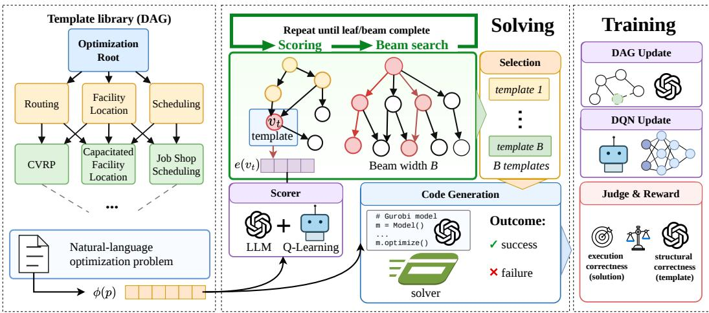

# COMPASS: Composable Policy-Amortized Structured Search for LLM-Based Optimization Modeling

Nguyen Le Minh Hoang<sup>1</sup> Van Duc Cuong<sup>12∗</sup> Bui Trong Duc<sup>1†</sup> Huynh Thi Thanh Binh<sup>1</sup>

<sup>1</sup>Hanoi University of Science and Technology, Hanoi, Vietnam

<sup>2</sup>VinMotion, Hanoi, Vietnam

hoang.nlm2417125@sis.hust.edu.vn, cuong.vd220021@sis.hust.edu.vn ducbt@soict.hust.edu.vn, binhht@soict.hust.edu.vn

## Abstract

Large language models offer a promising technique for translating natural-language optimization problems into solver code, but their reliability remains constrained by the quality of template retrieval. While recent structured methods improve over flat prompting through hierarchical taxonomy search, their traversal rules remain fixed or LLM-driven at inference time, leaving retrieval unable to improve from past successes and failures. This motivates treating template retrieval as a policy that can be learned from modeling experience, rather than as a static inference-time rule. We propose COMPASS, a policy-amortized framework for retrieving optimization templates in LLM-based solver modeling, which represents the template library as a directed acyclic graph and formulates retrieval as a sequential decision process over template nodes. A deep Q-network learns a reusable traversal policy from template-level judgments and execution feedback, reducing reliance on fixed heuristic traversal through feedback-driven graph navigation. To support extensible retrieval, COMPASS embeds problem descriptions and template nodes in a shared semantic space, allowing newly inserted templates to be scored from their text descriptions without redefining the action space. Experiments across multiple LLM backbones and optimization-modeling benchmarks demonstrate that COMPASS consistently improves over heuristic structured retrieval, with the largest gains on complex and mixed-category problems.

## 1 Introduction

Large language models (LLMs) are increasingly used to translate natural-language optimization problems into mathematical formulations and executable solver code. This setting, often referred to as autoformulation, has the potential to lower the expertise barrier for building operations-research models [Astorga et al., 2025, Liu et al., 2025, Li et al., 2025]. However, optimization problems rarely follow a single canonical pattern. A single description may combine routing, assignment, scheduling, capacity, and resource-allocation structures, making correct template selection a central bottleneck for downstream code generation.

Recent methods improve reliability by injecting structured modeling knowledge into the prompting process. Autoformulation approaches decompose problems into variables, objectives, and constraints, while structured retrieval methods organize modeling knowledge into hierarchical taxonomies [Astorga et al., 2025, Liu et al., 2025, Li et al., 2025]. Yet these retrieval strategies are typically fixed at inference time. They can guide an LLM toward relevant modeling patterns, but they do not learn from which templates previously led to valid formulations, feasible solver runs, or execution failures.

In contrast, search-based methods can adaptively explore alternative formulations, but doing so separately for each instance incurs substantial test-time cost.

This paper is motivated by the view that optimization-template retrieval is not only a semantic matching problem, but a sequential decision process over structured modeling knowledge. Early retrieval choices determine which modeling families and executable templates remain reachable, so a good retriever should both exploit the organization of the template library and improve from past modeling feedback. We propose COMPASS, a policy-amortized framework that represents the template library as a directed acyclic graph (DAG) and learns a traversal policy from LLM-based structural judgments and solver-execution signals. By scoring problem-template compatibility in a shared semantic space, COMPASS can evaluate newly inserted templates from their textual metadata without changing the policy architecture, while beam traversal enables retrieval of complementary templates for mixed-structure problems.

Our main contributions are:

• We recast optimization-template retrieval as a graph-structured sequential decision problem over a template DAG, where internal nodes represent modeling families and leaves represent executable templates. The DAG captures shared substructures among optimization models and allows a template to belong to multiple related modeling paths, making the retrieval structure more flexible than a strict tree taxonomy.

• We develop a policy-amortized retrieval algorithm that learns reusable traversal decisions from LLM-based structural judgment and solver-execution feedback. The method uses semantic node scoring to evaluate candidate templates from textual metadata, enabling new templates to be inserted without redefining the policy output space.

• We empirically validate COMPASS across multiple optimization-modeling benchmarks and LLM backbones, demonstrating consistent improvements over direct prompting, heuristic structured retrieval, and test-time search baselines, with the largest gains on structurally complex problems.

## 2 Related Work

LLM-based optimization modeling has recently advanced through autoformulation, structured retrieval, and feedback-guided search [Van Chien et al., 2026]. AutoFormulator explores the formulation space with MCTS and symbolic pruning [Astorga et al., 2025], SolverLLM uses test-time MCTS with dynamic expansion, prompt backpropagation, and uncertainty-aware feedback [Li et al., 2025], and OptiTree retrieves modeling thoughts from a hierarchical OR taxonomy [Liu et al., 2025]. Related systems extend this direction to mathematical modeling and OR reasoning, including MATHMO for sequential decision-making under uncertainty [Liu and van der Schaar, 2026], StepORLM for reinforcement learning and generative process supervision [Zhou et al., 2026], and operator-theoretic autoformulation for Bellman-equation operator graphs [Baillet et al., 2026]. Beyond autoformulation, LLMs have also been used as optimizers or heuristic designers: OPRO performs optimization through iterative prompting [Yang et al., 2024], ReEvo combines evolutionary search with LLM reflection [Ye et al., 2024], and HiFo-Prompt improves long-term knowledge reuse in automated heuristic design [ChentongChen et al., 2026]. More broadly, LLM reasoning systems use search, decomposition, tool feedback, and memory to improve inference-time decisions, as in Tree of Thoughts [Yao et al., 2023a], self-consistency [Wang et al., 2023], Auto-CoT [Zhang et al., 2023], least-to-most prompting [Zhou et al., 2023], ReAct [Yao et al., 2023b], CRITIC [Gou et al., 2024], Self-Refine [Madaan et al., 2023], and Reflexion [Shinn et al., 2023]. Retrieval-augmented and tool-using systems such as Self-RAG [Asai et al., 2024], DSPy [Khattab et al., 2024], ToolLLM [Qin et al., 2024], DRAFT [Qu et al., 2025], and ToolEVO [Chen et al., 2025] further show the value of grounding LLM behavior in external evidence and execution feedback. In contrast to methods that rely on fixed traversal rules, costly per-instance search, or prompt/tool optimization, COMPASS learns a reusable semantic value function over a persistent template DAG, allowing structured optimization-template retrieval to improve from solver and judge feedback while remaining efficient at inference time. More related work is presented in Appendix B.

  
Figure 1: Overview of COMPASS. The template library is represented as a DAG, and retrieval is performed through a learned traversal policy guided by semantic priors and execution feedback.

## 3 Methodology

We propose COMPASS, a retrieval-augmented framework for translating natural-language optimization problems into executable solver programs. The core difficulty lies in formulation selection: before solver code can be generated, the system must identify suitable modeling abstractions, variables, objectives, and constraints. Since early formulation choices determine which templates and constraint structures remain plausible, template retrieval cannot be treated as independent semantic matching. Instead, retrieval should model the dependencies among successive formulation decisions. Figure 1 illustrates this formulation-selection process and shows how COMPASS connects graph-based retrieval, template composition, solver-code generation, and feedback-driven policy improvement. Algorithmic details of the inference and training procedures are provided in Appendix D.

COMPASS represents the formulation library as a DAG rather than a flat set of templates or a strict taxonomy. Each node denotes a modeling state with associated textual metadata, and each edge specifies a valid refinement from a broader abstraction to a more specialized formulation. This representation captures the fact that optimization models often share intermediate structures: for example, routing, assignment, and capacity constraints may co-occur across otherwise distinct problem classes. Allowing multiple incoming paths to a node enables such shared modeling patterns to be reused without duplicating templates.

Given a problem description p, the system computes a semantic embedding $x = \phi ( p )$ and evaluates candidate graph nodes during traversal. The learned value function estimates the expected usefulness of selecting a node with respect to downstream formulation quality, rather than relying only on local textual similarity. A language-model semantic prior provides an additional compatibility signal when execution feedback is sparse. The final retrieval procedure combines these scores within beam search to identify one or more templates that can jointly support solver-code generation.

Training uses supervision from structural judgments and solver execution. After a retrieved template is instantiated and evaluated, the resulting feedback is assigned to the visited trajectory, so both terminal templates and intermediate modeling decisions receive credit. This mechanism converts retrieval into an experience-driven policy over the graph: previous successes and failures shape future traversal, while inference remains substantially cheaper than repeated per-instance search.

## 3.1 Structured Retrieval over a Formulation DAG

We organize the template library as a directed acyclic graph $\mathcal { G } = ( \nu , \mathcal { E } )$ , where each node represents a reusable formulation abstraction and each edge encodes a valid refinement relation between modeling concepts. A retrieval trajectory therefore corresponds to the progressive specialization of a modeling hypothesis: starting from broad formulation families, such as routing, scheduling, or resource allocation, the policy moves toward more specific abstractions and eventually reaches executable template nodes.

At each retrieval step, the traversal state is defined as $s = ( x , \phi ( v ) )$ , where $v \in \mathcal V$ is the current graph node, and $\phi ( v )$ is the semantic embedding. The admissible action set is restricted to the children of the current node, $A ( s ) = { \mathcal { C } } ( v )$ , where $\mathcal { C } ( \overset { \vartriangle } { \boldsymbol { v } } ) = \{ u \in \mathcal { V } \mid ( v , u ) \in \mathcal { E } \}$ . This constrained action space preserves structural consistency among successive formulation decisions and reduces the effective search space relative to flat selection over all templates in the library.

The DAG representation plays a key role in modeling the non-mutually exclusive structure of optimization knowledge. In contrast to a strict tree taxonomy, where each abstraction has a single parent, a DAG permits multiple refinement contexts for the same formulation node. This is important because modeling concepts such as capacity, precedence, assignment, and flow conservation often recur across different optimization families. The resulting structure supports parameter sharing across related formulations, avoids redundant template duplication, and defines a structured decision space suitable for learning long-horizon retrieval policies.

## 3.2 Semantic Value Function

The traversal policy should remain valid when the formulation library evolves. To this end, COMPASS represents both problem descriptions and formulation nodes in a shared semantic space, rather than binding actions to fixed template identifiers. Let $\tau ( \cdot )$ denote the tokenization map, $F _ { \eta }$ a Transformer encoder, and $P \textbf { a }$ pooling operator. For a text sequence z, we define $h _ { z } \ = \ P \dot { ( } F _ { \eta } ( \tau ( z ) ) )$ and $\phi ( z ) = h _ { z } / ( \| h _ { z } \| _ { 2 } + \epsilon )$ , where $\epsilon > 0$ is a small constant for numerical stability. The problem embedding and node embedding are given by $x = \phi ( p )$ and $e _ { v } \ = \ \phi ( m _ { v } )$ , respectively, where $m _ { v }$ denotes the textual metadata associated with node v. For each candidate node $v ,$ its semantic representation is projected into the policy space as $r _ { v } = \sigma ( W _ { p } e _ { v } + b _ { p } )$ , where $\sigma ( a ) = \operatorname* { m a x } ( a , 0 )$ is applied elementwise. The semantic value function is then defined as $Q _ { \theta } ( x , e _ { v } ) { \stackrel { . } { = } } q _ { \theta } ( [ x \parallel r _ { v } ] )$ where $q _ { \theta }$ is a scalar-valued neural function and $[ \cdot \parallel \cdot ]$ denotes vector concatenation.

This parameterization makes the traversal policy depend on semantic compatibility between the input problem and candidate formulation node, rather than on memorized template indices. Consequently, related formulations can share statistical strength, and newly inserted nodes can be embedded and evaluated directly from their metadata without modifying the output dimension of the value function.

## 3.3 Inference: Value-Guided Traversal with LLM Regularization

At inference time, COMPASS selects child nodes using a score that combines the learned value estimate with a language-model compatibility prior. For a candidate child $c \in \mathcal { C } ( v )$ , we define $\psi ( c \mid p ) = Q _ { \theta } ( x , e _ { c } ) + \lambda \ell ( c , p )$ , where $\ell ( c , p ) \in [ 0 , 1 ]$ ] denotes the semantic compatibility assigned by the language model and $\lambda \geq 0$ controls the strength of this prior.

The language-model prior is used as a regularizer rather than as the main retrieval policy. Since $Q _ { \theta }$ is trained from a finite set of execution trajectories, its estimates may be less reliable for rare, underexplored, or newly inserted nodes. The prior $\ell ( c , p )$ provides a zero-shot semantic signal over optimization concepts and formulation patterns, while $Q _ { \theta }$ encodes task-specific experience accumulated from previous solver executions. Their combination improves traversal robustness under sparse feedback without reverting to costly language-model-driven search.

To handle problems with multiple interacting modeling structures, COMPASS performs beam traversal with beam size $k .$ . The procedure maintains the top-k partial paths according to ψ and returns a set of candidate leaves $\mathcal { L } ( p )$ . The beam width is selected on validation instances to balance coverage and computational cost. This is especially useful for hybrid optimization problems whose complete formulation may require complementary templates from different refinement paths.

The retrieved leaves are converted into templates and composed into a final formulation $t ^ { \star } = \mu ( \{ t _ { v } :$ $v \in { \mathcal { L } } ( p ) \} )$ , where $\mu$ denotes the template composition operator. The resulting formulation is then instantiated into executable solver code.

## 3.4 Learning from Execution Feedback

We model DAG traversal as a deterministic finite-horizon contextual decision process. Each episode starts from a problem embedding $x \ = \ \phi ( p )$ , follows a trajectory over formulation nodes, and terminates with template instantiation, solver-code generation, and execution. For a terminal node $v ,$ the reward is defined as $R ( p , v ) = \alpha R _ { \mathrm { j u d g e } } ( p , v ) + ( 1 - \alpha ) R _ { \mathrm { e x e c } } ( p , v )$ , where $R _ { \mathrm { e x e c } }$ measures solver-level correctness and $R _ { \mathrm { j u d g e } }$ assesses structural compatibility between the problem and the retrieved formulation. This decomposition mitigates the sparsity of pure execution feedback by providing an additional semantic signal when generated programs fail syntactically, numerically, or due to incomplete constraints.

The optimal node-value function satisfies $Q ^ { \star } ( x , e _ { v } ) = \mathbb { E } [ R ( p , v ) ]$ for $v \in \mathcal { T }$ and $Q ^ { \star } ( x , e _ { v } ) =$ $\gamma \operatorname* { m a x } _ { c \in \mathcal { C } ( v ) } Q ^ { \star } \big ( x , e _ { c } \big )$ otherwise, where $\tau$ denotes the set of terminal nodes and $\gamma$ mildly penalizes unnecessarily long refinement paths. Bellman propagation assigns credit from terminal execution outcomes to earlier modeling abstractions, allowing the policy to learn not only which templates succeed, but also which intermediate decisions tend to lead to valid formulations.

We train the value network with temporal-difference learning. For transition $i ,$ the target is $y _ { i } =$ $r _ { i } + ( 1 - d _ { i } ) \gamma \operatorname* { m a x } _ { c \in \mathcal { C } ( v _ { i } ) } Q _ { \theta ^ { - } } { \left( x _ { i } , e _ { c } \right) }$ , where $d _ { i }$ indicates termination and $\theta ^ { - }$ denotes the target network. The training objective is $\mathcal { L } ( \theta ) = \mathbb { E } _ { i \sim \mathcal { B } } [ w _ { i } \ell _ { \delta } ( Q _ { \theta } ( x _ { i } , e _ { v _ { i } } ) - y _ { i } ) ]$ , where $\textstyle \ell _ { \delta } ( a ) = { \frac { 1 } { 2 } } a ^ { 2 }$ if $| a | \le \delta$ and $\begin{array} { r } { \ell _ { \delta } ( a ) = \delta ( | a | - \frac { 1 } { 2 } \delta ) } \end{array}$ otherwise. This smooth $L _ { 1 }$ objective improves stability under noisy execution and judge feedback.

To improve sample efficiency, we use prioritized experience replay. Each transition is sampled with probability $\begin{array} { r } { \dot { P } ( i ) = p _ { i } ^ { \alpha _ { \mathrm { P E R } } } / \sum _ { j } p _ { j } ^ { \alpha _ { \mathrm { P E R } } ^ { * } } } \end{array}$ , where $p _ { i } = | \Delta _ { i } | + \varepsilon _ { \mathrm { P E R } }$ and $\Delta _ { i } = Q _ { \theta } ( x _ { i } , e _ { v _ { i } } ) - y _ { i }$ The corresponding importance weight is $w _ { i } = ( 1 / ( N P ( i ) ) ) ^ { \beta } / \operatorname* { m a x } _ { j } ( 1 / ( N P ( j ) ) ) ^ { \beta }$ . Prioritizing high-error transitions focuses updates on underexplored or poorly estimated regions of the traversal space, which is particularly important under sparse terminal rewards. Hyperparameters such as $\lambda , k .$ $\alpha _ { \mathrm { { P E R } } }$ , and $\beta$ are selected on validation instances.

## 3.5 Adaptive Template Expansion

Execution failures can also indicate limitations of the formulation library, rather than only errors in the traversal policy. To address this case, COMPASS allows the formulation graph to expand when repeated failures suggest that existing templates do not sufficiently cover a recurring modeling pattern. Expansion is enabled only after the retrieval policy has reached a minimum level of stability. Specifically, we use the gate $g _ { t } \stackrel { \cdot } { = } \mathcal { H } ( t \geq \tau _ { \operatorname* { m i n } } ) \mathcal { H } ( \bar { \varepsilon _ { t } } \leq \tau _ { \varepsilon } )$ , where t denotes the training step, $\varepsilon _ { t }$ is the exploration rate, and $g _ { t } \in \{ 0 , 1 \}$ indicates whether expansion is permitted. This condition prevents early exploration noise and unstable value estimates from producing redundant or low-quality templates. Once the gate is active, persistent execution failures are treated as evidence of missing formulation abstractions.

When expansion is triggered, the language model abstracts reusable formulation patterns from failed instances and reference solutions, and proposes new template nodes with textual metadata. These nodes are inserted into $\mathcal { G }$ and embedded through the same semantic encoder used for existing nodes, allowing the value function to score them without changing its output space. Subsequent feedback then determines whether the newly added nodes become useful retrieval targets. DAG expansion is performed only on training instances.

Thus, COMPASS adapts along two complementary axes: the traversal policy improves through execution-driven value learning, while the formulation graph evolves when the current template set lacks sufficient expressive coverage. This converts template retrieval from a fixed-library procedure into an adaptive structured search process.

## 4 Experiments

## 4.1 Experimental Setting

We evaluate whether COMPASS improves the reliability, compositionality, and transferability of LLM-based optimization modeling through learned structured retrieval.

Benchmarks and backbones. We conduct experiments on six benchmarks: NL4Opt (245 problems)[Ramamonjison et al., 2021], MAMO-Easy (652)[Huang et al., 2024], MAMO-Complex (211)[Huang et al., 2024], LPWP (288)[Xiao et al., 2024], IndustryOR (100)[Xiao et al., 2024], and OptMATH [Lu et al., 2025] (166) [Lu et al., 2025]. These benchmarks cover linear programming, mixed-integer formulations, mathematical word problems, and industrial optimization scenarios, providing a diverse testbed for heterogeneous and compositional modeling. We use DeepSeek-V3 and GPT-5-mini as primary code-generation backbones, and evaluate transfer to Qwen-32B, LLaMA-8B, and DeepSeek-R1. This setup separates the effect of retrieval from the choice of downstream.

Baselines. We compare COMPASS with direct prompting, OptiTree [Liu et al., 2025], SolverLLM [Li et al., 2025], and AutoFormulator [Astorga et al., 2025]. We also include DAG-Greedy, which uses the same template library and generator as COMPASS but replaces the learned value function with the LLM-derived prior. This baseline isolates the contribution of policy learning over the shared DAG structure.

Metrics. We report exact accuracy, which requires both successful execution and correct solutions, and code execution rate (CER), which measures runtime validity independently of solution correctness.

Research questions. Our evaluation addresses the following questions:

• RQ1: Effectiveness. Does COMPASS improve accuracy and robustness over existing LLM-based optimization modeling approaches?

• RQ2: Structured retrieval. How much does DAG-based structured retrieval contribute compared to flat or unstructured retrieval?

• RQ3: Ablation. How does each component of COMPASS affect overall performance?

• RQ4: Sensitivity. How sensitive is COMPASS to key design choices such as beam width, regularization strength, and replay configuration?

## 4.2 Experimental Results

Table 1: Comparison of modeling accuracy (%) between COMPASS and existing baselines. Best results are shown in bold; second-best results are underlined.
<table><tr><td rowspan="2">Model</td><td rowspan="2">Method</td><td rowspan="2">NL4Opt</td><td rowspan="2">MAMO EasyLP</td><td rowspan="2">MAMO ComplexLP</td><td rowspan="2">LPWP</td><td rowspan="2">IndustryOR</td><td rowspan="2">OptMATH</td></tr><tr><td></td></tr><tr><td colspan="9">Reasoning LLMs</td></tr><tr><td rowspan="3">Reasoning LLMs</td><td>DeepSeek-R1</td><td>91.8</td><td>80.8</td><td>57.3</td><td>69.4</td><td>72.0</td><td>50.0</td></tr><tr><td>OpenAI-o1</td><td>92.7</td><td>85.4</td><td>57.8</td><td>70.5</td><td>74.0</td><td>47.6</td></tr><tr><td colspan="9">Prompt-based Methods</td></tr><tr><td rowspan="5">DeepSeek-V3</td><td>Direct</td><td>89.4</td><td>78.8</td><td>53.1</td><td>67.7</td><td>54.0</td><td>40.9</td></tr><tr><td>SolverLLM</td><td>92.2</td><td>80.8</td><td>55.5</td><td>69.1</td><td>62.0</td><td>43.4</td></tr><tr><td>AutoForm.</td><td>91.4</td><td>79.7</td><td>54.1</td><td>68.4</td><td>57.0</td><td>41.6</td></tr><tr><td>OptiTree</td><td>93.4</td><td>82.8</td><td>56.4</td><td>71.2</td><td>65.0</td><td>49.4</td></tr><tr><td>COMPASS</td><td>95.1</td><td>85.9</td><td>61.6</td><td>72.6</td><td>66.0</td><td>50.6</td></tr><tr><td rowspan="5">GPT-5-mini</td><td>Direct</td><td>89.7</td><td>82.2</td><td>49.7</td><td>64.6</td><td>67.0</td><td>36.7</td></tr><tr><td>SolverLLM</td><td>92.2</td><td>85.7</td><td>52.1</td><td>67.4</td><td>71.0</td><td>40.4</td></tr><tr><td>AutoForm.</td><td>90.6</td><td>84.2</td><td>50.7 53.5</td><td>66.3 68.9</td><td>69.0</td><td>39.8</td></tr><tr><td>OptiTree</td><td>93.4</td><td>87.4</td><td></td><td></td><td>75.0</td><td>43.3</td></tr><tr><td>COMPASS</td><td>95.9</td><td>88.2</td><td>57.8</td><td>72.2</td><td>78.0</td><td>48.0</td></tr></table>

Main results. Table 1 evaluates whether policy-guided DAG retrieval improves LLM-based optimization modeling over direct prompting and existing retrieval baselines. Across most datasets, COMPASS achieves the highest accuracy, with the strongest gains on structurally complex benchmarks such as MAMO-Complex, IndustryOR, and OptMATH. With DeepSeek-V3, COMPASS improves over the strongest retrieval baseline by 5.2% on MAMO-Complex and 3.1% on MAMO-Easy. With GPT-5-mini, the gains are larger on several datasets, including 4.3% on MAMO-Complex, 3.3% on LPWP, 3.0% on IndustryOR, and 4.7% on OptMATH.

The results demonstrate a clear pattern: the advantage of COMPASS becomes more pronounced as formulation complexity increases. Direct prompting and flat retrieval are more susceptible to early modeling errors, which can propagate into invalid constraints or incorrect solver code. In contrast, COMPASS performs progressive refinement over a compositional DAG, enabling intermediate modeling hypotheses to be assessed before final template selection. The consistent gains over reasoning-oriented LLMs further suggest that scaling reasoning ability alone is insufficient when the retrieved formulation scaffold is inadequate. These findings substantiate our central premise that optimization modeling is best treated as a structured retrieval problem. By learning a reusable traversal policy from solver and judge feedback, COMPASS enhances formulation consistency and final solver accuracy, particularly on problems requiring compositional modeling.

Table 2: Accuracy (Acc) and code execution rate (CER, %) of COMPASS across different LLM backbones.
<table><tr><td>Models</td><td>NL4Opt Acc / CER</td><td>MAMO-Easy Acc / CER</td><td>MAMO-Complex Acc / CER</td><td>IndustryOR Acc / CER</td></tr><tr><td>Qwen-32B (COMPASS)</td><td>80.8 / 100.0</td><td>76.2 / 100.0</td><td>29.9 / 100.0</td><td>48.0 / 100.0</td></tr><tr><td>Qwen-32B (Direct)</td><td>72.7 / 100.0</td><td>65.3 / 100.0</td><td>20.4 / 100.0</td><td>32.0 / 98.0</td></tr><tr><td>LLaMA-8B (COMPASS)</td><td>55.9 / 100.0</td><td>66.9 / 100.0</td><td>24.2 / 100.0</td><td>15.0 / 98.0</td></tr><tr><td>LLaMA-8B (Direct)</td><td>51.4 / 100.0</td><td>16.1 / 98.6</td><td>10.4 / 97.2</td><td>10.0 / 96.0</td></tr><tr><td>DeepSeek-R1 (COMPASS)</td><td>93.8 / 100.0</td><td>90.4 / 100.0</td><td>66.8 / 100.0</td><td>75.0 / 100.0</td></tr><tr><td>DeepSeek-R1 (Direct)</td><td>91.8 / 100.0</td><td>80.8 / 100.0</td><td>57.3 / 100.0</td><td>72.0 / 100.0</td></tr></table>

Generalization across LLM backbones. We further evaluate whether COMPASS transfers across generator families and model scales by pairing the same retrieval policy with Qwen-32B, LLaMA-8B, and DeepSeek-R1. Table 2 indicates that COMPASS consistently improves over direct prompting across all evaluated backbones, with particularly large gains for weaker generators, such as +50.8% on MAMO-Easy with LLaMA-8B and +16.0% on IndustryOR with Qwen-32B.

These results suggest two conclusions. First, the learned retrieval policy transfers across model architectures, indicating that the benefit of structured formulation retrieval is largely backbone-agnostic. Second, smaller generators benefit more substantially from DAG-guided retrieval, suggesting that COMPASS serves as an external modeling scaffold that reduces the formulation burden on the downstream LLM. In addition, COMPASS achieves near-perfect code execution rates in most settings, indicating that structured retrieval improves not only solution accuracy but also the syntactic and structural reliability of generated solver programs.

To assess whether these gains are merely due to additional inference computation, we compare COMPASS against repeated direct prompting under matched inference budgets. Increasing the sampling or prompting budget alone does not recover the improvements obtained by COMPASS, indicating that the gains arise from policy-guided formulation selection rather than brute-force inference scaling.

Table 3: Accuracy (%) comparison between COMPASS and DAG-Greedy using DeepSeek-V3.
<table><tr><td>Method</td><td>NL4Opt</td><td>MAMO-E</td><td>MAMO-C</td><td>LPWP</td><td>IndustryOR</td><td>OptMATH</td></tr><tr><td>DAG-Greedy</td><td>93.9</td><td>82.4</td><td>54.5</td><td>71.5</td><td>63.0</td><td>48.8</td></tr><tr><td>COMPASS</td><td>95.1</td><td>85.9</td><td>61.6</td><td>72.6</td><td>66.0</td><td>50.6</td></tr></table>

Learned traversal versus heuristic retrieval. We compare COMPASS with DAG-Greedy, a controlled baseline that uses the same DAG, template library, and DeepSeek-V3 generator, but replaces the learned value function with locally greedy traversal based only on the LLM-derived prior. Table 3 shows that COMPASS consistently improves accuracy across all benchmarks, with the largest margins on MAMO-Complex (+7.1%) and IndustryOR (+3.0%). Since the retrieval space and generator are held fixed, these gains isolate the effect of learned traversal.

Table 4: McNemar tests for COMPASS versus DAG-Greedy on MAMO. Wins and losses denote discordant pairs only.
<table><tr><td>Split</td><td>Wins</td><td>Losses</td><td>p-value</td></tr><tr><td>MAMO-Easy</td><td>33</td><td>10</td><td>&lt;0.001</td></tr><tr><td>MAMO-Complex</td><td>17</td><td>2</td><td>&lt;0.001</td></tr><tr><td>Combined</td><td>50</td><td>12</td><td>&lt;0.001</td></tr></table>

The comparison indicates that local semantic compatibility is insufficient for globally correct formulation selection. DAG-Greedy can select plausible intermediate nodes while committing to refinement branches that omit essential constraints or modeling structures. In contrast, COMPASS learns from execution-level outcomes and judge feedback, allowing earlier traversal decisions to account for their downstream effect on final solver correctness.

Statistical significance. Table 4 reports paired McNemar tests on the MAMO splits. The improvements are statistically significant on both MAMO-Easy and MAMO-Complex $( p < 0 . 0 0 1 )$ , with a particularly strong imbalance on MAMO-Complex, where COMPASS corrects 17 instances missed by DAG-Greedy while losing only 2. Because both methods share the same templates and generator, this asymmetry provides evidence that the learned traversal policy systematically resolves failures of heuristic retrieval rather than benefiting from random variation.

Table 5: IndustryOR accuracy stratified by problem difficulty using DeepSeek-V3. Fractions indicate correct/total instances within each stratum.
<table><tr><td>Difficulty</td><td># Problems</td><td>DAG-Greedy</td><td>COMPASS</td><td>∆</td></tr><tr><td>Easy</td><td>39</td><td>30/39 (76.9%)</td><td>29/39 (74.4%)</td><td>-1</td></tr><tr><td>Medium</td><td>41</td><td>20/41 (48.8%)</td><td>21/41 (51.2%)</td><td>+1</td></tr><tr><td>Hard</td><td>20</td><td>11/20 (55.0%)</td><td>16/20 (80.0%)</td><td>+5</td></tr><tr><td>All</td><td>100</td><td>61/100 (61.0%)</td><td>66/100 (66.0%)</td><td>+5</td></tr></table>

Difficulty-stratified analysis. Table 5 stratifies IndustryOR by difficulty. The advantage of COM-PASS is concentrated on harder instances: while DAG-Greedy is slightly better on easy problems, COMPASS improves accuracy from 55.0% to 80.0% on hard problems. This pattern indicates that local heuristic traversal is adequate for shallow formulations, but becomes less reliable when the problem requires multiple interacting modeling choices. Learned traversal is therefore most beneficial when early decisions have long-range effects on the final formulation.

Table 6: Accuracy (Acc) and code execution rate (CER, %) for COMPASS and DAG-Greedy on four datasets using DeepSeek-V3.
<table><tr><td>Method</td><td>IndustryOR Acc / CER</td><td>MAMO-Easy Acc / CER</td><td>MAMO-Complex Acc / CER</td><td>OptMATH Acc / CER</td></tr><tr><td>COMPASS</td><td>66.0 / 100.0</td><td>85.9 / 100.0</td><td>61.6 / 100.0</td><td>50.6 / 100.0</td></tr><tr><td>DAG-Greedy</td><td>63.0 / 99.0</td><td>82.4 / 100.0</td><td>54.5 / 98.0</td><td>48.8 / 98.8</td></tr><tr><td></td><td></td><td></td><td></td><td></td></tr></table>

Generation reliability. Table 6 compares code execution rate in addition to accuracy. COMPASS attains nearly perfect CER across all evaluated datasets, but the accuracy gains are larger than the execution-rate differences, especially on MAMO-Complex. This distinction suggests that the main benefit is not merely improved syntactic executability. Instead, policy-guided retrieval also improves the mathematical correctness of the generated optimization formulations.

Component ablations. Table 7 isolates the contribution of each design component. Removing learned traversal causes the largest degradation, especially on MAMO-Complex, where accuracy drops from 61.6% to 54.5%. This confirms that the primary improvement comes from policyguided navigation over the DAG, rather than from the template library alone. Removing the LLM prior also reduces accuracy across datasets, indicating that semantic regularization complements execution-trained value estimation, particularly when feedback is sparse.

Table 7: Component ablations on three diagnostic datasets using DeepSeek-V3 (accuracy, %).
<table><tr><td>Variant</td><td>MAMO-Complex</td><td>OptMATH</td><td>IndustryOR</td></tr><tr><td>Full COMPASS</td><td>61.6</td><td>50.6</td><td>66.0</td></tr><tr><td>w/o learned traversal (DAG-Greedy)</td><td>54.5</td><td>48.8</td><td>63.0</td></tr><tr><td>w/o soft LLM prior (λ = 0)</td><td>58.3</td><td>48.2</td><td>63.0</td></tr><tr><td>w/o beam retrieval  $( K = 1 )$ </td><td>59.2</td><td>49.4</td><td>64.0</td></tr><tr><td>w/o guarded DAG expansion</td><td>58.8</td><td>48.2</td><td>65.0</td></tr></table>

The beam ablation shows that single-path retrieval is insufficient for many optimization problems, as restricting traversal to K = 1 consistently weakens performance. This suggests that several instances require combining multiple formulation patterns. Guarded DAG expansion also contributes positively, especially on MAMO-Complex and OptMATH, suggesting that controlled template growth improves coverage of missing modeling structures without introducing early noisy expansions. Overall, the ablations indicate that COMPASS’s performance arises from the interaction of learned long-horizon traversal, semantic regularization, compositional retrieval, and adaptive library expansion.

## 4.3 Sensitivity to Hyperparameter Settings

We analyze the robustness of COMPASS to key hyperparameters and use validation sweeps to select the default settings used in the main experiments.

Soft LLM prior. Table 8 evaluates the effect of the prior weight λ, which controls the interpolation between the learned value estimate and the LLM-derived compatibility prior. Performance is maximized at $\lambda = 0 . 3$ across the three diagnostic datasets, and we therefore adopt this setting in the main experiments.

Table 8: Effect of the soft-prior weight λ on accuracy (%) across three datasets using DeepSeek-V3.
<table><tr><td>Dataset</td><td> $\lambda = 0 . 0$ </td><td> $\lambda = 0 . 1$ </td><td> $\lambda = 0 . 3$ </td><td> $\lambda = 0 . 5$ </td><td> $\lambda = 1 . 0$ </td></tr><tr><td>MAMO-Complex</td><td>58.3</td><td>59.2</td><td>61.6</td><td>59.7</td><td>57.3</td></tr><tr><td>OptMATH</td><td>48.2</td><td>49.4</td><td>50.6</td><td>48.8</td><td>49.4</td></tr><tr><td>IndustryOR</td><td>63.0</td><td>65.0</td><td>66.0</td><td>61.0</td><td>62.0</td></tr></table>

The sweep reveals a clear bias-variance trade-off in traversal. When $\lambda = 0 ,$ , retrieval relies entirely on the learned value function and loses zero-shot semantic guidance in underexplored regions of the graph. Conversely, large values overemphasize the LLM prior and move the policy closer to heuristic semantic traversal. The intermediate setting $\lambda = 0 . 3$ provides the strongest balance, indicating that the LLM prior is most effective as a lightweight regularizer rather than as the dominant decision signal.

Beam width. Table 9 studies the beam width K used during DAG traversal. The best overall performance is obtained with $K = 2 ,$ , which provides limited retrieval diversity while preserving structural precision. A beam width of $K = 1$ restricts retrieval to a single refinement path and therefore weakens the ability to combine complementary modeling patterns. However, wider beams introduce noisy or mutually inconsistent templates, causing substantial degradation at $K = 4 .$ . These results indicate that optimization modeling benefits from controlled compositional retrieval, rather than greedy single-path selection or overly broad exploration.

Table 9: Effect of beam width K on accuracy (%) across three datasets using DeepSeek-V3.
<table><tr><td>Dataset</td><td> $K = 1$ </td><td> $K = 2$ </td><td> $K = 3$ </td><td> $K = 4$ </td></tr><tr><td>MAMO-Complex</td><td>59.2</td><td>61.6</td><td>59.7</td><td>42.2</td></tr><tr><td>OptMATH</td><td>49.4</td><td>50.6</td><td>48.8</td><td>37.3</td></tr><tr><td>IndustryOR</td><td>64.0</td><td>66.0</td><td>61.0</td><td>43.0</td></tr></table>

## 5 Conclusion

This paper introduced COMPASS, a framework that treats optimization-template retrieval as a structured sequential decision problem rather than a one-shot prompting or ranking procedure. By representing the template library as a compositional DAG, COMPASS learns reusable traversal policies from solver-execution feedback and LLM-based structural judgments. The framework combines value-guided retrieval, semantic regularization, beam-based template composition, and adaptive template expansion to support robust formulation selection for LLM-based optimization modeling. Empirical results across diverse benchmarks and LLM backbones indicate that retrieval quality is a central bottleneck in optimization code generation. COMPASS achieves the largest gains on structurally complex and mixed-category problems, where early formulation errors are difficult to recover from during code synthesis. These findings suggest that learning how to navigate structured modeling knowledge can provide gains beyond scaling the downstream language model alone. More broadly, this work points toward adaptive optimization modeling systems that accumulate reusable retrieval experience from execution feedback.

## Acknowledgments and Disclosures

Funding. This research was funded by Hanoi University of Science and Technology under project code T2025-TN-005.

Competing Interests. The authors declare no competing financial interests related to this work.

## References

Nicolás Astorga, Tennison Liu, Yuanzhang Xiao, and Mihaela van der Schaar. Autoformulation of mathematical optimization models using LLMs. In Forty-second International Conference on Machine Learning, 2025.

Haoyang Liu, Jie Wang, Yuyang Cai, Xiongwei Han, Yufei Kuang, and Jianye Hao. Optitree: Hierarchical thoughts generation with tree search for llm optimization modeling. In D. Belgrave, C. Zhang, H. Lin, R. Pascanu, P. Koniusz, M. Ghassemi, and N. Chen, editors, Advances in Neural Information Processing Systems, pages 120713–120781. Curran Associates, Inc., 2025.

Dong Li, Xujiang Zhao, Linlin Yu, Yanchi Liu, Wei Cheng, Zhengzhang Chen, Zhong Chen, Feng Chen, Chen Zhao, and Haifeng Chen. Solverllm: Leveraging test-time scaling for optimization problem via llm-guided search. In D. Belgrave, C. Zhang, H. Lin, R. Pascanu, P. Koniusz, M. Ghas semi, and N. Chen, editors, Advances in Neural Information Processing Systems, volume 38, pages 100028–100058. Curran Associates, Inc., 2025.

Trinh Van Chien, Bui Trong Duc, Nguyen Xuan Tung, Van Duc Nguyen, Waqas Khalid, Symeon Chatzinotas, and Lajos Hanzo. Single-and multi-objective stochastic optimization for next-generation networks in the generative ai and quantum computing era. arXiv preprint arXiv:2601.02175, 2026.

Tennison Liu and Mihaela van der Schaar. MATHMO: Automated mathematical modeling through adaptive search. In The Fourteenth International Conference on Learning Representations, 2026.

Chenyu Zhou, Tianyi Xu, Jianghao Lin, and Dongdong Ge. StepORLM: A self-evolving framework with generative process supervision for operations research language models. In The Fourteenth International Conference on Learning Representations, 2026.

Victor Baillet, Yuanzhang Xiao, Nicolás Astorga, and Mihaela van der Schaar. Operator theorydriven autoformulation of MDPs for control of queueing systems. In The Fourteenth International Conference on Learning Representations, 2026.

Chengrun Yang, Xuezhi Wang, Yifeng Lu, Hanxiao Liu, Quoc V Le, Denny Zhou, and Xinyun Chen. Large language models as optimizers. In The Twelfth International Conference on Learning Representations, 2024.

Haoran Ye, Jiarui Wang, Zhiguang Cao, Federico Berto, Chuanbo Hua, Haeyeon Kim, Jinkyoo Park, and Guojie Song. Reevo: Large language models as hyper-heuristics with reflective evolution. In A. Globerson, L. Mackey, D. Belgrave, A. Fan, U. Paquet, J. Tomczak, and C. Zhang, editors, Advances in Neural Information Processing Systems, volume 37, pages 43571–43608. Curran Associates, Inc., 2024. doi: 10.52202/079017-1381.

ChentongChen, Mengyuan Zhong, Jialong Shi, Jianyong Sun, and Ye Fan. Hifo-prompt: Prompting with hindsight and foresight for LLM-based automatic heuristic design. In The Fourteenth International Conference on Learning Representations, 2026.

Shunyu Yao, Dian Yu, Jeffrey Zhao, Izhak Shafran, Tom Griffiths, Yuan Cao, and Karthik Narasimhan. Tree of thoughts: Deliberate problem solving with large language models. In A. Oh, T. Naumann, A. Globerson, K. Saenko, M. Hardt, and S. Levine, editors, Advances in Neural Information Processing Systems, volume 36, pages 11809–11822. Curran Associates, Inc., 2023a.

Xuezhi Wang, Jason Wei, Dale Schuurmans, Quoc V Le, Ed H. Chi, Sharan Narang, Aakanksha Chowdhery, and Denny Zhou. Self-consistency improves chain of thought reasoning in language models. In The Eleventh International Conference on Learning Representations, 2023.

Zhuosheng Zhang, Aston Zhang, Mu Li, and Alex Smola. Automatic chain of thought prompting in large language models. In The Eleventh International Conference on Learning Representations, 2023.

Denny Zhou, Nathanael Schärli, Le Hou, Jason Wei, Nathan Scales, Xuezhi Wang, Dale Schuurmans, Claire Cui, Olivier Bousquet, Quoc V Le, and Ed H. Chi. Least-to-most prompting enables complex reasoning in large language models. In The Eleventh International Conference on Learning Representations, 2023.

Shunyu Yao, Jeffrey Zhao, Dian Yu, Nan Du, Izhak Shafran, Karthik R Narasimhan, and Yuan Cao. React: Synergizing reasoning and acting in language models. In The Eleventh International Conference on Learning Representations, 2023b.

Zhibin Gou, Zhihong Shao, Yeyun Gong, yelong shen, Yujiu Yang, Nan Duan, and Weizhu Chen. CRITIC: Large language models can self-correct with tool-interactive critiquing. In The Twelfth International Conference on Learning Representations, 2024.

Aman Madaan, Niket Tandon, Prakhar Gupta, Skyler Hallinan, Luyu Gao, Sarah Wiegreffe, Uri Alon, Nouha Dziri, Shrimai Prabhumoye, Yiming Yang, Shashank Gupta, Bodhisattwa Prasad Majumder, Katherine Hermann, Sean Welleck, Amir Yazdanbakhsh, and Peter Clark. Self-refine: Iterative refinement with self-feedback. In A. Oh, T. Naumann, A. Globerson, K. Saenko, M. Hardt, and S. Levine, editors, Advances in Neural Information Processing Systems, volume 36, pages 46534–46594. Curran Associates, Inc., 2023.

Noah Shinn, Federico Cassano, Ashwin Gopinath, Karthik Narasimhan, and Shunyu Yao. Reflexion: language agents with verbal reinforcement learning. In A. Oh, T. Naumann, A. Globerson, K. Saenko, M. Hardt, and S. Levine, editors, Advances in Neural Information Processing Systems, volume 36, pages 8634–8652. Curran Associates, Inc., 2023.

Akari Asai, Zeqiu Wu, Yizhong Wang, Avirup Sil, and Hannaneh Hajishirzi. Self-RAG: Learning to retrieve, generate, and critique through self-reflection. In The Twelfth International Conference on Learning Representations, 2024.

Omar Khattab, Arnav Singhvi, Paridhi Maheshwari, Zhiyuan Zhang, Keshav Santhanam, Sri Vardhamanan A, Saiful Haq, Ashutosh Sharma, Thomas T. Joshi, Hanna Moazam, Heather Miller, Matei Zaharia, and Christopher Potts. DSPy: Compiling declarative language model calls into state-of-the-art pipelines. In The Twelfth International Conference on Learning Representations, 2024.

Yujia Qin, Shihao Liang, Yining Ye, Kunlun Zhu, Lan Yan, Yaxi Lu, Yankai Lin, Xin Cong, Xiangru Tang, Bill Qian, Sihan Zhao, Lauren Hong, Runchu Tian, Ruobing Xie, Jie Zhou, Mark Gerstein, dahai li, Zhiyuan Liu, and Maosong Sun. ToolLLM: Facilitating large language models to master 16000+ real-world APIs. In The Twelfth International Conference on Learning Representations, 2024.

Changle Qu, Sunhao Dai, Xiaochi Wei, Hengyi Cai, Shuaiqiang Wang, Dawei Yin, Jun Xu, and Ji-Rong Wen. From exploration to mastery: Enabling LLMs to master tools via self-driven interactions. In The Thirteenth International Conference on Learning Representations, 2025.

Guoxin Chen, Zhong Zhang, Xin Cong, Fangda Guo, Yesai Wu, Yankai Lin, Wenzheng Feng, and Yasheng Wang. Learning evolving tools for large language models. In The Thirteenth International Conference on Learning Representations, 2025.

Rindranirina Ramamonjison, Timothy T. L. Yu, Raymond Li, Haley Li, Giuseppe Carenini, Bissan Ghaddar, Shiqi He, Mahdi Mostajabdaveh, Amin Banitalebi-Dehkordi, Zirui Zhou, and Yong Zhang. NL4Opt competition: Formulating optimization problems based on their natural language descriptions. In NeurIPS 2022 Competition Track, pages 189–203, Virtual, 2021.

Xuhan Huang, Qingning Shen, Yan Hu, Anningzhe Gao, and Benyou Wang. Mamo: A mathematical modeling benchmark with solvers. CoRR, abs/2405.13144, 2024.

Ziyang Xiao, Dongxiang Zhang, Yangjun Wu, Lilin Xu, Yuan Jessica Wang, Xiongwei Han, Xiaojin Fu, Tao Zhong, Jia Zeng, Mingli Song, and Gang Chen. Chain-of-experts: When LLMs meet complex operations research problems. In The Twelfth International Conference on Learning Representations, 2024.

Hongliang Lu, Zhonglin Xie, Yaoyu Wu, Can Ren, Yuxuan Chen, and Zaiwen Wen. Optmath: A scalable bidirectional data synthesis framework for optimization modeling. In International Conference on Machine Learning, ICML, Proceedings of Machine Learning Research, 2025.

Naman Jain, King Han, Alex Gu, Wen-Ding Li, Fanjia Yan, Tianjun Zhang, Sida Wang, Armando Solar-Lezama, Koushik Sen, and Ion Stoica. Livecodebench: Holistic and contamination free evaluation of large language models for code. In The Thirteenth International Conference on Learning Representations, 2025.

## A Limitations and Future Work

Although COMPASS is evaluated on multiple optimization benchmarks and LLM backbones, our experiments cannot fully cover the diversity of real-world optimization tasks, solver interfaces, data formats, and future language models. The selected benchmarks span different formulation types, difficulty levels, and generator families, providing a broad but necessarily incomplete assessment of the proposed retrieval framework. Extending the evaluation to larger industrial instances, domainspecific solvers, and more heterogeneous problem settings is an important direction for future work.

LLM-based optimization modeling also remains sensitive to prompt design. Prompt variation can affect problem interpretation, retrieved templates, and generated solver code. To reduce this source of variability, all experiments use standardized prompt templates with fixed structure, as described in Appendix E. Future work could study prompt-robust retrieval policies and adaptive prompting strategies for more diverse deployment settings.

## B Additional Related Work

LLM-based optimization modeling. LLMs have recently been used to automate optimization modeling by translating natural-language problem descriptions into mathematical formulations and solver-ready code. AutoFormulator explores the large formulation space with MCTS and symbolic pruning [Astorga et al., 2025], while SolverLLM uses test-time MCTS with dynamic expansion, prompt backpropagation, and uncertainty-aware feedback [Li et al., 2025]. OptiTree organizes OR problems into a hierarchical modeling taxonomy and retrieves modeling thoughts through tree search [Liu et al., 2025]. Related work further extends autoformulation to broader mathematical modeling and dynamic decision-making: MATHMO treats modeling as sequential decision-making under uncertainty [Liu and van der Schaar, 2026], StepORLM studies reinforcement learning and generative process supervision for OR reasoning [Zhou et al., 2026], and operator-theoretic autoformulation constructs Bellman-equation operator graphs for MDP and queueing problems [Baillet et al., 2026]. These methods show that structured search and feedback are crucial for optimization modeling, but they typically rely on heuristic traversal or expensive test-time exploration. COMPASS instead amortizes structured retrieval into a reusable policy over a persistent template DAG.

LLMs for optimization and heuristic design. Another line of work uses LLMs as optimizers or heuristic designers. OPRO casts optimization itself as prompting, where candidate solutions and their scores are iteratively fed back to the LLM [Yang et al., 2024]. ReEvo combines evolutionary search with LLM reflection to generate heuristics for combinatorial optimization [Ye et al., 2024], while HiFo-Prompt introduces hindsight and foresight mechanisms to improve global control and long-term knowledge reuse in automated heuristic design [ChentongChen et al., 2026]. In contrast, COMPASS does not directly search over heuristic programs or solution candidates; it learns to retrieve modeling templates that guide downstream solver-code generation.

Search, reasoning, and feedback in LLM systems. LLM reasoning can be improved by exploring multiple intermediate reasoning paths and using feedback to revise decisions. Tree of Thoughts enables deliberate search over coherent reasoning states [Yao et al., 2023a], self-consistency aggregates diverse reasoning paths [Wang et al., 2023], Auto-CoT automatically constructs chain-of-thought demonstrations [Zhang et al., 2023], and least-to-most prompting decomposes difficult problems into simpler subproblems [Zhou et al., 2023]. ReAct combines reasoning with external actions [Yao et al., 2023b], CRITIC validates and revises outputs using external tools [Gou et al., 2024], Self-Refine iteratively improves generations through self-feedback [Madaan et al., 2023], and Reflexion stores linguistic feedback in memory for later trials [Shinn et al., 2023]. These methods mainly improve inference-time reasoning, whereas COMPASS uses feedback to train a retrieval policy whose search cost is amortized across future problems.

Retrieval, tool use, and adaptive LLM pipelines. Retrieval-augmented and tool-using LLM systems provide mechanisms for grounding and adapting model behavior. Self-RAG trains models to decide when to retrieve and how to reflect on retrieved evidence [Asai et al., 2024]. DSPy abstracts LM pipelines as optimizable computational graphs [Khattab et al., 2024]. ToolLLM studies tool-use instruction tuning and API retrieval [Qin et al., 2024], DRAFT refines tool documentation from execution feedback [Qu et al., 2025], and ToolEVO adapts tool usage under changing tool environments with MCTS and self-reflection [Chen et al., 2025]. Evaluation work such as Live-CodeBench highlights the importance of contamination-resistant and execution-aware assessment for code-generating LLMs [Jain et al., 2025]. COMPASS is aligned with this broader trend of grounded and adaptive LLM pipelines, but focuses specifically on structured template retrieval for optimization autoformulation.

Table 10: Evaluation matrix organized by research question.
<table><tr><td>RQ</td><td>Evaluation focus</td><td>Reported results</td></tr><tr><td>RQ1</td><td>End-to-end effectiveness against direct prompting, structured retrieval, Table 1 search-based autoformulation, and reasoning-oriented LLM baselines across the six main benchmarks</td><td></td></tr><tr><td>RQ1</td><td>Cross-backbone generalization with Qwen-32B, LLaMA-8B, DeepSeek- Table 2 R1, and DeepSeek-V3</td><td></td></tr><tr><td>RQ2</td><td>Effect of learned traversal relative to DAG-Greedy under the same DAG, Table 3 template library, generator, and executor</td><td></td></tr><tr><td>RQ2</td><td>Paired statistical significance for COMPASS versus DAG-Greedy on Table 4 MAMO</td><td></td></tr><tr><td>RQ2 RQ3</td><td>Difficulty-stratified analysis and execution-reliability diagnostics Component ablations on learned traversal, LLM prior, beam retrieval, and Table 7</td><td>Tables 5 and 6</td></tr><tr><td></td><td>guarded DAG expansion</td><td></td></tr><tr><td>RQ4</td><td>Sensitivity to the soft-prior weight λ and beam width K</td><td>Tables 8 and 9</td></tr></table>

Table 11: Core hyperparameters used by COMPASS.
<table><tr><td>Hyperparameter</td><td>Value</td></tr><tr><td>Encoder</td><td>all-MiniLM-L6-v2</td></tr><tr><td>Embedding dimension</td><td>384</td></tr><tr><td>Projection dimension</td><td>64</td></tr><tr><td>MLP hidden width</td><td>256</td></tr><tr><td>Discount factor γ</td><td>0.95</td></tr><tr><td>Soft-prior weight λ</td><td>0.3</td></tr><tr><td>Reward blend α</td><td>0.3</td></tr><tr><td>PER exponent αPER</td><td>0.6</td></tr><tr><td>Importance exponent  $\beta$ </td><td>0.4 → 1.0</td></tr><tr><td>Target sync interval</td><td>20 updates</td></tr><tr><td>Gradient clip</td><td>1.0</td></tr><tr><td>Minimum DAG-update step  $\tau _ { \mathrm { m i n } }$ </td><td>1600</td></tr><tr><td>Maximum update epsilon  $\tau _ { \varepsilon }$ </td><td>0.4</td></tr><tr><td>Retry queue capacity</td><td>50</td></tr><tr><td>Training passes</td><td>2</td></tr></table>

## C Additional Experimental Details

## C.1 Benchmark Matrix

Table 10 records the full study matrix targeted by the current scripts. It is included here so that the appendix follows the RQ-organized experimental structure in the main text.

## C.2 Training Hyperparameters

Table 11 summarizes the core hyperparameters used to train COMPASS. We use a fixed configuration across all main experiments unless otherwise specified, with the soft-prior weight λ and beam width K selected from the validation sweeps in Section 4.3. The configuration balances stable value learning, controlled semantic regularization, and delayed DAG expansion, ensuring that template updates occur only after the traversal policy has reached sufficient maturity.

## C.3 Dataset Problems, Hardness, and Complexity

Table 12 summarizes the datasets used in our experiments. We distinguish modeling hardness from conventional solver complexity. A benchmark may be challenging not only because the resulting solver program contains many variables or constraints, but because the natural-language description must be mapped to the correct decision variables, objective, constraint families, indexing scheme, integrality assumptions, and, in many cases, multiple interacting formulation patterns. This distinction is central to our setting: COMPASS aims to retrieve the appropriate formulation structure before the downstream LLM instantiates it into executable code.

Table 12: Dataset characteristics. Instance counts are computed from the repository files. Hardness refers to modeling hardness rather than solely to algorithmic solver complexity.
<table><tr><td>Dataset</td><td># Inst.</td><td>Problem structure</td><td>Modeling hardness</td></tr><tr><td>OR-Instruct train</td><td>1731</td><td>Heterogeneous OR instruction prob- lems used for policy learning and guarded DAG updates.</td><td>Provides broad supervision over for- mulation families and long-tail linguis- tic patterns; excluded from held-out benchmark evaluation.</td></tr><tr><td>NL4Opt</td><td>245</td><td>Natural-language linear optimization problems with compact business-style statements.</td><td>Primarily shallow LP structure, but re- quires accurate extraction of variables, coefficients, inequality directions, and objective sense.</td></tr><tr><td>MAMO-Easy</td><td>652</td><td>LP-style allocation problems with ex- plicit variables, bounds, and linear con- straints.</td><td>Low structural ambiguity; evaluates whether retrieval preserves simple for- mulation structure without introducing unnecessary complexity.</td></tr><tr><td>MAMO-Complex</td><td>211</td><td>Longer linear or mixed-integer mod- eling statements with multiple con- straints, ratios, equalities, bounds, and implicit integrality.</td><td>High modeling hardness due to inter- acting constraint families; early re- trieval errors are difficult for the code generator to correct.</td></tr><tr><td>LPWP</td><td>288</td><td>Linear-programming word problems from everyday domains such as pro- duction, transportation, staffing, and</td><td>Moderate hardness arising from prose- to-math translation, ratio constraints, minimum/maximumrequirements,</td></tr><tr><td>IndustryOR</td><td>100</td><td>resource allocation. Industrial OR scenarios involving rout- ing, scheduling, facility location, ca- pacity, and logistics variants.</td><td>and objective ambiguity. High compositional complexity; in- stances may combine multiple OR sub- structures with data tables, indexing</td></tr><tr><td>OptMATH</td><td>166</td><td>Mathematical optimization word prob- lems with symbolic constraints and nu- meric answer checking.</td><td>requirements, and side constraints. Compact but symbolically dense; fail- ures often arise from algebraic transla- tion, domain restrictions, rounding, or missing integrality.</td></tr></table>

The benchmark suite spans a broad spectrum of retrieval difficulty. NL4Opt, MAMO-Easy, and LPWP primarily assess whether COMPASS preserves the correct linear-programming scaffold under varied natural-language descriptions. MAMO-Complex and OptMATH test deeper constraint interpretation and symbolic consistency. IndustryOR provides the most compositional setting, since a single instance may require several modeling families, such as routing with capacity and time-window constraints or facility location with assignment constraints. This range is important for evaluating structured retrieval: simple benchmarks verify that the policy does not degrade easy cases, whereas complex benchmarks test whether learned DAG traversal improves over greedy or heuristic template selection.

All datasets are evaluated under the same exact-accuracy criterion: the generated solver program must execute successfully and return an objective value or solution accepted by the benchmark checker. IndustryOR is further analyzed by easy, medium, and hard tiers in Table 5. The largest gains of COMPASS occur on hard instances, indicating that learned structured retrieval is most beneficial when modeling difficulty arises from interacting subproblem structures rather than surface-level language variation alone.

```latex
Algorithm 1 COMPASS DAG Search for Template Retrieval
Require: Problem $p ,$ template DAG $\overline { { \mathcal { G } = ( \mathcal { V } , \mathcal { E } ) } }$ , root node $v _ { 0 } .$ , value function $Q _ { \theta } ,$ , prior weight λ,
beam width k
Ensure: Merged template $t ^ { \star }$ , selected leaves ${ \mathcal { L } } ,$ traversal trace $\tau$
1: function $\mathbf { \bar { S } } _ { \mathrm { E A R C H D A G } ( p , \mathcal { G } , Q _ { \theta } , \lambda , k ) }$
2: $x  \phi ( p )$
3: $\mathcal { B }  \{ ( v _ { 0 } , [ v _ { 0 } ] , 0 ) \} , \mathcal { L }  \emptyset , \tau  [ ]$
4: while $\dot { \boldsymbol { B } } \neq \dot { \boldsymbol { \varnothing } }$ and $| { \mathcal { L } } | < k$ do
5: $u  \emptyset$
6: for each $( v , \rho , a ) \in B$ do
7: ${ \mathcal { C } } ( v ) \not  \{ c \in \mathcal { V } : ( v , c ) \in \mathcal { E } \}$
8: Append $( v , \mathcal { C } ( v ) )$ to τ
9: $\mathbf { i f } { \hat { C } } ( v ) = \varnothing$ then
10: ${ \dot { \mathcal { L } } } \gets { \mathcal { L } } \cup \{ v \}$
11: continue
12: end if
13: Obtain $\ell ( c , p )$ for each $c \in \mathcal { C } ( v )$
14: for each $\dot { c } \in \mathcal { C } ( v )$ do
15: $s ( c ) \gets Q _ { \theta } ( x , e _ { c } ) + \lambda \ell ( c , p )$
16: ${ \mathcal { U } } \gets { \mathcal { U } } \cup \{ ( c , \rho \| [ c ] , a + s ( c ) ) \}$
17: end for
18: end for
19: $\boldsymbol { B } \gets \mathrm { T o p K } ( \boldsymbol { \mathcal { U } } , \boldsymbol { k } )$
20: end while
21: if ${ \mathcal { L } } = \emptyset$ then
22: $\mathcal { L }  \{ v _ { 0 } \}$ ▷ fallback template
23: end if
24: $t ^ { \star } \gets \mu ( \{ t _ { v } : v \in \mathcal { L } \} )$
25: return $t ^ { \star } , { \cal { L } } , \tau$
26: end function
```

## D Algorithmic Details of COMPASS

This appendix summarizes the implementation of COMPASS. Algorithm 1 describes value-guided retrieval over the formulation DAG at inference time. Algorithm 2 presents the training loop, including reward construction, temporal-difference updates, guarded DAG expansion, and retry scheduling.

Algorithm 2 COMPASS Policy Training and Guarded DAG Expansion   
Require: Training set D, template DAG G, replay buffer R, value function $Q _ { \theta } ,$ target network $Q _ { \theta ^ { - } }$   
Require: Reward weight α, prior weight λ, beam width k, expansion thresholds $( \tau _ { \operatorname* { m i n } } , \tau _ { \varepsilon } )$ , retry   
queue Q   
Ensure: Updated value function $Q _ { \theta } ,$ template DAG G, replay buffer $\mathcal { R }$   
1: function $\mathrm { T R A I N C O M P A S S } ( \bar { \mathcal { D } } , \mathcal { G } , \bar { Q _ { \theta } } , Q _ { \theta ^ { - } } )$   
2: for each training pass do   
3: for each instance $( p , y ) \in \mathcal { D }$ do   
4: $t ^ { \star } , \mathcal { L } , \tau \gets \mathrm { S E A R C H D A G } ( p , \mathcal { G } , Q _ { \theta } , \lambda , k )$ with $\varepsilon { - } \mathfrak { g } \mathfrak { n }$ eedy exploration   
5: Generate solver code from $( p , t ^ { \star } )$ and execute the program   
6: $R _ { \mathrm { e x e c } }  { \bf 1 }$ {checker accepts the output}   
7: $R _ { \mathrm { j u d g e } }$ ← structural compatibility score for $( p , t ^ { \star } )$   
8: $R ^ { ' } {  } \alpha R _ { \mathrm { j u d g e } } + ( 1 - \alpha ) \mathbf { \bar { \alpha } } _ { \mathrm { e x e c } }$   
9: for each transition $( v , \mathcal { C } ( v ) )$ in $\tau$ do   
10: $d  { \bf 1 } \{ v \in \mathcal { L } \}$   
11: $r \gets \bar { R \operatorname { i f } d = 1 }$ , and $r \gets 0$ otherwise   
12: Store $( \phi ( p ) , v , r , \mathcal { C } ( v ) , d )$ in $\mathcal { R }$   
13: end for   
14: for each update step do   
15: Sample a prioritized mini-batch from R   
16: Update $\bar { Q _ { \theta } }$ using the Huber temporal-difference objective   
17: if target synchronization interval is reached then   
18: ${ \bar { \theta ^ { - } } }  { \bar { \theta } }$   
19: end if   
20: end for   
21: if $R _ { \mathrm { e x e c } } = 0$ and $t \geq \tau _ { \mathrm { m i n } }$ and $\varepsilon \leq \tau _ { \varepsilon }$ then   
22: Use the language model to propose a reusable missing formulation subtype   
23: Insert the corresponding template node into $\mathcal { G }$ and compute its embedding   
24: Remove redundant transitive edges from $\mathcal { G }$   
25: Push $( p , y )$ into $\mathcal { Q }$   
26: end if   
27: if Q is scheduled for retry then   
28: Re-evaluate queued instances with $\varepsilon = 0$ and DAG expansion disabled   
29: end if   
30: end for   
31: end for   
32: return $Q _ { \theta } , { \mathcal { G } } , { \mathcal { R } }$   
33: end function

## E Prompts

## E.0.1 Template Compatibility Scoring

{Template Compatibility Scoring Prompt}   
You are a mathematical formulator working with a team of optimization experts.   
The objective is to tackle a complex optimization problem.   
You are given a specific optimisation problem and a list of candidate template types.   
For EACH candidate, rate how compatible it is with the problem on a scale from 0.0 to   
1.0.   
Scoring guide:   
- 1.0 = The problem is clearly an instance of this type   
- 0.7 = Strong match - most structural aspects align   
- 0.4 = Partial match - some aspects overlap

- 0.1 = Weak match - only superficial similarity   
- 0.0 = No match at all   
Input problem:   
{input\_problem}   
Current parent type:   
{basic\_type}   
Candidate subtypes with descriptions:   
{template\_info}   
Return the results in JSON format:   
{   
"ratings": {   
"<subtype\_name\_1>": <float\_score>,   
"<subtype\_name\_2>": <float\_score>   
},   
"reasoning": "<brief explanation of each rating>"   
}

## E.0.2 Subtype Identification and Formulation

{Subtype Formulation Prompt}   
You are a mathematical formulator working with a team of optimization experts.   
You are given:   
- a specific problem   
- its current basic problem type   
- the description of that type   
Specific Problem:   
{specific\_problem}   
Current Basic Problem Type:   
{current\_basic\_problem\_type}   
Description:   
{description\_of\_basic\_problem\_type}   
Your task is to determine a more specific subtype and describe it.   
Return JSON:   
{   
"current\_basic\_problem\_type": "...",   
"formulated\_subtype": "<subtype>",   
"description\_of\_subtype": {   
"description": "<detailed description>",   
"constraints": {   
"constraint\_1": "...",   
"constraint\_2": "..."   
}   
}   
}

{Industrial Scenario Classification Prompt}   
You are given a combinatorial optimization problem.   
Your task is to classify it into a precise industrial scenario.   
Avoid broad categories such as:   
- linear programming   
- integer programming   
Use specific categories such as:   
- Traveling Salesman Problem   
- Facility Location Problem   
- Parallel Machine Scheduling   
Input:   
{specific\_problem}   
Return JSON:   
{   
"industrial\_scene\_type": "<type>",   
"description": {   
"description": "<detailed explanation>",   
"constraints": {   
"constraint\_1": "...",   
"constraint\_2": "..."   
}   
}   
}

## E.0.3 Industrial Scenario Classification

## E.0.4 Optimization Template Construction

{Gurobi Template Generation Prompt}   
You are a mathematical formulator working with a team of optimization experts.   
Given:   
- problem\_type   
- description   
- specific\_problem   
- solution\_step   
Your task is to construct a reusable template.   
Requirements:   
1. problem\_type   
2. description   
3. reason\_flow   
4. example\_application   
5. increment (empty list)   
You MUST use this fixed Gurobi structure:   
import gurobipy as gp   
from gurobipy import GRB   
model = gp.Model()

# variables   
# constraints   
# objective   
model.optimize()   
Return JSON only.

## E.0.5 Problem Type Hierarchy Construction

{Problem Type Hierarchy Construction Prompt}   
You are given:   
- a primary problem type   
- its description   
- a list of other problem types   
Task:   
Identify which are subtypes of the primary type.   
Return JSON:   
{   
"primary\_problem\_type": "...",   
"matching\_subtypes": ["..."]   
}

## E.0.6 Template-Guided Solution Generation

{Solution Generation Prompt}   
You are an expert in optimization problem solving.   
Input:   
{user\_input}   
Template:   
{thought\_template}   
Task:   
Generate a solution based on the template.   
Rules:   
- If code is required -> output ONE Python block only   
- Otherwise -> return clear final answer

## E.0.7 Code Refinement and Correction

{Code Correction Prompt}   
You are an expert Python programmer.

Task:   
1. Analyze the given code   
2. Fix errors and improve correctness   
Output format:   
‘‘‘python   
# corrected code

## E.0.8 Template Quality Evaluation

{Template Evaluation Prompt}   
You are evaluating whether a selected template matches a problem.   
Input:   
- problem   
- template\_type   
- template\_description   
Score from 0.0 to 1.0 based on structural match.   
Return JSON:   
{   
"template\_quality": <score>,   
"reasoning": "<brief explanation>"   
}

## E.0.9 Sample Problem Formulation Template

{Traveling Salesman Problem Formulation and Gurobi Template}   
You are a mathematical formulator working with a team of optimization experts.   
The Traveling Salesman Problem (TSP) is a combinatorial optimization problem where a   
salesperson must visit a set of cities exactly once and return to the starting   
city while minimizing total travel cost.   
Problem Description:   
Each city must be visited exactly once.   
The tour must return to the starting city.   
The objective is to minimize total travel distance or cost.   
Key Constraints:   
Single Visit Constraint:   
Each city is visited exactly once.   
Return to Origin Constraint:   
The route must form a Hamiltonian cycle.   
Complete Tour Constraint:   
All cities must be included without repetition.   
Reasoning Flow:   
1. Define binary decision variables x[i,j] indicating whether edge (i,j) is selected.   
2. Minimize total travel cost:   
sum(cost[i,j] \* x[i,j]).

3. Add degree constraints:

\- each city entered exactly once

\- each city exited exactly once

4. Add subtour elimination constraints using MTZ formulation.

5. Add bounds on auxiliary variables.

6. Optimize the model using Gurobi.

Common Formulation Errors:

\- Forgetting to forbid self-loops.

\- Missing subtour elimination constraints.

\- Incorrect MTZ indexing.

\- Missing bounds on auxiliary variables.

\- Confusing symmetric and asymmetric cost matrices.

Fixed Gurobi Template:

import gurobipy as gp

from gurobipy import GRB

\# Create model

model = gp.Model("TSP")

\# Parameters

\# cities

\# cost matrix

\# Variables

\# x[i,j]

\# Constraints

\# visit constraints

\# subtour elimination constraints

\# Objective

\# minimize total cost

model.optimize()

Return JSON only.

## NeurIPS Paper Checklist

## 1. Claims

Question: Do the main claims made in the abstract and introduction accurately reflect the paper’s contributions and scope?

Answer: [Yes].

Justification: The abstract and Introduction state the method, scope, and empirical claims, while the Experiments, Conclusion, and Limitations and Future Work sections provide the corresponding evidence and scope qualifications.

Guidelines:

• The answer [N/A] means that the abstract and introduction do not include the claims made in the paper.

• The abstract and/or introduction should clearly state the claims made, including the contributions made in the paper and important assumptions and limitations. A [No] or [N/A] answer to this question will not be perceived well by the reviewers.

• The claims made should match theoretical and experimental results, and reflect how much the results can be expected to generalize to other settings.

• It is fine to include aspirational goals as motivation as long as it is clear that these goals are not attained by the paper.

## 2. Limitations

Question: Does the paper discuss the limitations of the work performed by the authors?

Answer: [Yes].

Justification: The paper includes a dedicated Limitations and Future Work section discussing syntactic template merging, evaluation coverage across datasets and backbones, and prompt sensitivity.

Guidelines:

• The answer [N/A] means that the paper has no limitation while the answer [No] means that the paper has limitations, but those are not discussed in the paper.

• The authors are encouraged to create a separate “Limitations” section in their paper.

• The paper should point out any strong assumptions and how robust the results are to violations of these assumptions (e.g., independence assumptions, noiseless settings, model well-specification, asymptotic approximations only holding locally). The authors should reflect on how these assumptions might be violated in practice and what the implications would be.

• The authors should reflect on the scope of the claims made, e.g., if the approach was only tested on a few datasets or with a few runs. In general, empirical results often depend on implicit assumptions, which should be articulated.

• The authors should reflect on the factors that influence the performance of the approach. For example, a facial recognition algorithm may perform poorly when image resolution is low or images are taken in low lighting. Or a speech-to-text system might not be used reliably to provide closed captions for online lectures because it fails to handle technical jargon.

• The authors should discuss the computational efficiency of the proposed algorithms and how they scale with dataset size.

• If applicable, the authors should discuss possible limitations of their approach to address problems of privacy and fairness.

• While the authors might fear that complete honesty about limitations might be used by reviewers as grounds for rejection, a worse outcome might be that reviewers discover limitations that aren’t acknowledged in the paper. The authors should use their best judgment and recognize that individual actions in favor of transparency play an important role in developing norms that preserve the integrity of the community. Reviewers will be specifically instructed to not penalize honesty concerning limitations.

## 3. Theory assumptions and proofs

Question: For each theoretical result, does the paper provide the full set of assumptions and a complete (and correct) proof?

Answer: [N/A].

Justification: The paper does not present formal theoretical results. The equations and algorithms define the COMPASS method and training objective, but no theorem, lemma, or proof is claimed in the final paper.

## Guidelines:

• The answer [N/A] means that the paper does not include theoretical results.

• All the theorems, formulas, and proofs in the paper should be numbered and crossreferenced.

• All assumptions should be clearly stated or referenced in the statement of any theorems.

• The proofs can either appear in the main paper or the supplemental material, but if they appear in the supplemental material, the authors are encouraged to provide a short proof sketch to provide intuition.

• Inversely, any informal proof provided in the core of the paper should be complemented by formal proofs provided in appendix or supplemental material.

• Theorems and Lemmas that the proof relies upon should be properly referenced.

## 4. Experimental result reproducibility

Question: Does the paper fully disclose all the information needed to reproduce the main experimental results of the paper to the extent that it affects the main claims and/or conclusions of the paper (regardless of whether the code and data are provided or not)?

Answer: [Yes].

Justification: The Methodology, Experiments, Appendix algorithms, prompt templates, benchmark matrix, dataset discussion, and hyperparameter table describe the retrieval policy, reward, training setup, evaluation metrics, and main run configuration. Reproduction with closed LLM backends requires valid API access.

## Guidelines:

• The answer [N/A] means that the paper does not include experiments.

• If the paper includes experiments, a [No] answer to this question will not be perceived well by the reviewers: Making the paper reproducible is important, regardless of whether the code and data are provided or not.

• If the contribution is a dataset and/or model, the authors should describe the steps taken to make their results reproducible or verifiable.

• Depending on the contribution, reproducibility can be accomplished in various ways. For example, if the contribution is a novel architecture, describing the architecture fully might suffice, or if the contribution is a specific model and empirical evaluation, it may be necessary to either make it possible for others to replicate the model with the same dataset, or provide access to the model. In general. releasing code and data is often one good way to accomplish this, but reproducibility can also be provided via detailed instructions for how to replicate the results, access to a hosted model (e.g., in the case of a large language model), releasing of a model checkpoint, or other means that are appropriate to the research performed.

• While NeurIPS does not require releasing code, the conference does require all submissions to provide some reasonable avenue for reproducibility, which may depend on the nature of the contribution. For example

(a) If the contribution is primarily a new algorithm, the paper should make it clear how to reproduce that algorithm.

(b) If the contribution is primarily a new model architecture, the paper should describe the architecture clearly and fully.

(c) If the contribution is a new model (e.g., a large language model), then there should either be a way to access this model for reproducing the results or a way to reproduce the model (e.g., with an open-source dataset or instructions for how to construct the dataset).

(d) We recognize that reproducibility may be tricky in some cases, in which case authors are welcome to describe the particular way they provide for reproducibility. In the case of closed-source models, it may be that access to the model is limited in some way (e.g., to registered users), but it should be possible for other researchers to have some path to reproducing or verifying the results.

## 5. Open access to data and code

Question: Does the paper provide open access to the data and code, with sufficient instructions to faithfully reproduce the main experimental results, as described in supplemental material?

Answer: [Yes].

Justification: Our paper submission include the zip file with code and datasets to reproduce main experimental results.

Guidelines:

• The answer [N/A] means that paper does not include experiments requiring code.

• Please see the NeurIPS code and data submission guidelines (https://neurips.cc/ public/guides/CodeSubmissionPolicy) for more details.

• While we encourage the release of code and data, we understand that this might not be possible, so [No] is an acceptable answer. Papers cannot be rejected simply for not including code, unless this is central to the contribution (e.g., for a new open-source benchmark).

• The instructions should contain the exact command and environment needed to run to reproduce the results. See the NeurIPS code and data submission guidelines (https: //neurips.cc/public/guides/CodeSubmissionPolicy) for more details.

• The authors should provide instructions on data access and preparation, including how to access the raw data, preprocessed data, intermediate data, and generated data, etc.

• The authors should provide scripts to reproduce all experimental results for the new proposed method and baselines. If only a subset of experiments are reproducible, they should state which ones are omitted from the script and why.

• At submission time, to preserve anonymity, the authors should release anonymized versions (if applicable).

• Providing as much information as possible in supplemental material (appended to the paper) is recommended, but including URLs to data and code is permitted.

## 6. Experimental setting/details

Question: Does the paper specify all the training and test details (e.g., data splits, hyperparameters, how they were chosen, type of optimizer) necessary to understand the results?

Answer: [Yes].

Justification: The Methodology and Appendix specify the semantic encoder, value function, replay buffer, reward blend, beam width, DAG-expansion gate, training passes, validationselected settings, benchmark counts, and core hyperparameters used in the experiments.

Guidelines:

• The answer [N/A] means that the paper does not include experiments.

• The experimental setting should be presented in the core of the paper to a level of detail that is necessary to appreciate the results and make sense of them.

• The full details can be provided either with the code, in appendix, or as supplemental material.

## 7. Experiment statistical significance

Question: Does the paper report error bars suitably and correctly defined or other appropriate information about the statistical significance of the experiments?

Answer: [Yes].

Justification: The paired comparison against DAG-Greedy reports McNemar contingency tables and exact binomial McNemar significance tests on MAMO-Easy, MAMO-Complex, and the combined split.

## Guidelines:

• The answer [N/A] means that the paper does not include experiments.

• The authors should answer [Yes] if the results are accompanied by error bars, confidence intervals, or statistical significance tests, at least for the experiments that support the main claims of the paper.

• The factors of variability that the error bars are capturing should be clearly stated (for example, train/test split, initialization, random drawing of some parameter, or overall run with given experimental conditions).

• The method for calculating the error bars should be explained (closed form formula, call to a library function, bootstrap, etc.)

• The assumptions made should be given (e.g., Normally distributed errors).

• It should be clear whether the error bar is the standard deviation or the standard error of the mean.

• It is OK to report 1-sigma error bars, but one should state it. The authors should preferably report a 2-sigma error bar than state that they have a 96% CI, if the hypothesis of Normality of errors is not verified.

• For asymmetric distributions, the authors should be careful not to show in tables or figures symmetric error bars that would yield results that are out of range (e.g., negative error rates).

• If error bars are reported in tables or plots, the authors should explain in the text how they were calculated and reference the corresponding figures or tables in the text.

## 8. Experiments compute resources

Question: For each experiment, does the paper provide sufficient information on the computer resources (type of compute workers, memory, time of execution) needed to reproduce the experiments?

Answer: [No].

Justification: The paper reports model backbones and experimental settings, but it does not yet provide complete hardware, memory, wall-clock, or API-budget information for each run.

Guidelines:

• The answer [N/A] means that the paper does not include experiments.

• The paper should indicate the type of compute workers CPU or GPU, internal cluster, or cloud provider, including relevant memory and storage.

• The paper should provide the amount of compute required for each of the individual experimental runs as well as estimate the total compute.

• The paper should disclose whether the full research project required more compute than the experiments reported in the paper (e.g., preliminary or failed experiments that didn’t make it into the paper).

## 9. Code of ethics

Question: Does the research conducted in the paper conform, in every respect, with the NeurIPS Code of Ethics https://neurips.cc/public/EthicsGuidelines?

Answer: [Yes].

Justification: The work uses optimization benchmark problems and LLM APIs for solvercode generation, does not involve human subjects, and documents limitations. No deviation from the NeurIPS Code of Ethics is required.

Guidelines:

• The answer [N/A] means that the authors have not reviewed the NeurIPS Code of Ethics.

• If the authors answer [No], they should explain the special circumstances that require a deviation from the Code of Ethics.

• The authors should make sure to preserve anonymity (e.g., if there is a special consideration due to laws or regulations in their jurisdiction).

## 10. Broader impacts

Question: Does the paper discuss both potential positive societal impacts and negative societal impacts of the work performed?

Answer: [No].

Justification: The paper focuses on technical methodology, experiments, and limitations, but it does not include a dedicated discussion of both positive and negative societal impacts.

Guidelines:

• The answer [N/A] means that there is no societal impact of the work performed.

• If the authors answer [N/A] or [No], they should explain why their work has no societal impact or why the paper does not address societal impact.

• Examples of negative societal impacts include potential malicious or unintended uses (e.g., disinformation, generating fake profiles, surveillance), fairness considerations (e.g., deployment of technologies that could make decisions that unfairly impact specific groups), privacy considerations, and security considerations.

• The conference expects that many papers will be foundational research and not tied to particular applications, let alone deployments. However, if there is a direct path to any negative applications, the authors should point it out. For example, it is legitimate to point out that an improvement in the quality of generative models could be used to generate Deepfakes for disinformation. On the other hand, it is not needed to point out that a generic algorithm for optimizing neural networks could enable people to train models that generate Deepfakes faster.

• The authors should consider possible harms that could arise when the technology is being used as intended and functioning correctly, harms that could arise when the technology is being used as intended but gives incorrect results, and harms following from (intentional or unintentional) misuse of the technology.

• If there are negative societal impacts, the authors could also discuss possible mitigation strategies (e.g., gated release of models, providing defenses in addition to attacks, mechanisms for monitoring misuse, mechanisms to monitor how a system learns from feedback over time, improving the efficiency and accessibility of ML).

## 11. Safeguards

Question: Does the paper describe safeguards that have been put in place for responsible release of data or models that have a high risk for misuse (e.g., pre-trained language models, image generators, or scraped datasets)?

Answer: [N/A].

Justification: The paper does not release high-risk pretrained generative models, image generators, or scraped datasets; it studies a retrieval and solver-code generation pipeline over optimization benchmarks.

Guidelines:

• The answer [N/A] means that the paper poses no such risks.

• Released models that have a high risk for misuse or dual-use should be released with necessary safeguards to allow for controlled use of the model, for example by requiring that users adhere to usage guidelines or restrictions to access the model or implementing safety filters.

• Datasets that have been scraped from the Internet could pose safety risks. The authors should describe how they avoided releasing unsafe images.

• We recognize that providing effective safeguards is challenging, and many papers do not require this, but we encourage authors to take this into account and make a best faith effort.

## 12. Licenses for existing assets

Question: Are the creators or original owners of assets (e.g., code, data, models), used in the paper, properly credited and are the license and terms of use explicitly mentioned and properly respected?

Answer: [Yes].

Justification: The paper cites prior work and names the benchmarks and LLM backbones. Guidelines:

• The answer [N/A] means that the paper does not use existing assets.

• The authors should cite the original paper that produced the code package or dataset.

• The authors should state which version of the asset is used and, if possible, include a URL.

• The name of the license (e.g., CC-BY 4.0) should be included for each asset.

• For scraped data from a particular source (e.g., website), the copyright and terms of service of that source should be provided.

• If assets are released, the license, copyright information, and terms of use in the package should be provided. For popular datasets, paperswithcode.com/datasets has curated licenses for some datasets. Their licensing guide can help determine the license of a dataset.

• For existing datasets that are re-packaged, both the original license and the license of the derived asset (if it has changed) should be provided.

• If this information is not available online, the authors are encouraged to reach out to the asset’s creators.

## 13. New assets

Question: Are new assets introduced in the paper well documented and is the documentation provided alongside the assets?

Answer: [Yes].

Justification: The paper introduces COMPASS and documents the method through its template-DAG representation, algorithms, prompt templates, hyperparameters, and evaluation pipeline. Additional asset-level documentation would be needed if the code and DAG files are released as standalone artifacts.

Guidelines:

• The answer [N/A] means that the paper does not release new assets.

• Researchers should communicate the details of the dataset/code/model as part of their submissions via structured templates. This includes details about training, license, limitations, etc.

• The paper should discuss whether and how consent was obtained from people whose asset is used.

• At submission time, remember to anonymize your assets (if applicable). You can either create an anonymized URL or include an anonymized zip file.

## 14. Crowdsourcing and research with human subjects

Question: For crowdsourcing experiments and research with human subjects, does the paper include the full text of instructions given to participants and screenshots, if applicable, as well as details about compensation (if any)?

Answer: [N/A].

Justification: The paper does not involve crowdsourcing experiments or research with human subjects.

Guidelines:

• The answer [N/A] means that the paper does not involve crowdsourcing nor research with human subjects.

• Including this information in the supplemental material is fine, but if the main contribution of the paper involves human subjects, then as much detail as possible should be included in the main paper.

• According to the NeurIPS Code of Ethics, workers involved in data collection, curation, or other labor should be paid at least the minimum wage in the country of the data collector.

## 15. Institutional review board (IRB) approvals or equivalent for research with human subjects

Question: Does the paper describe potential risks incurred by study participants, whether such risks were disclosed to the subjects, and whether Institutional Review Board (IRB) approvals (or an equivalent approval/review based on the requirements of your country or institution) were obtained?

## Answer: [N/A].

Justification: The paper does not involve crowdsourcing, user studies, or other humansubjects research, so IRB approval is not applicable.

## Guidelines:

• The answer [N/A] means that the paper does not involve crowdsourcing nor research with human subjects.

• Depending on the country in which research is conducted, IRB approval (or equivalent) may be required for any human subjects research. If you obtained IRB approval, you should clearly state this in the paper.

• We recognize that the procedures for this may vary significantly between institutions and locations, and we expect authors to adhere to the NeurIPS Code of Ethics and the guidelines for their institution.

• For initial submissions, do not include any information that would break anonymity (if applicable), such as the institution conducting the review.

## 16. Declaration of LLM usage

Question: Does the paper describe the usage of LLMs if it is an important, original, or non-standard component of the core methods in this research? Note that if the LLM is used only for writing, editing, or formatting purposes and does not impact the core methodology, scientific rigor, or originality of the research, declaration is not required.

## Answer: [Yes].

Justification: LLMs are central to the method as compatibility judges, template constructors, and solver-code generators; the Methodology, Experiments, and Appendix prompt section describe these uses.

## Guidelines:

• The answer [N/A] means that the core method development in this research does not involve LLMs as any important, original, or non-standard components.

• Please refer to our LLM policy in the NeurIPS handbook for what should or should not be described.