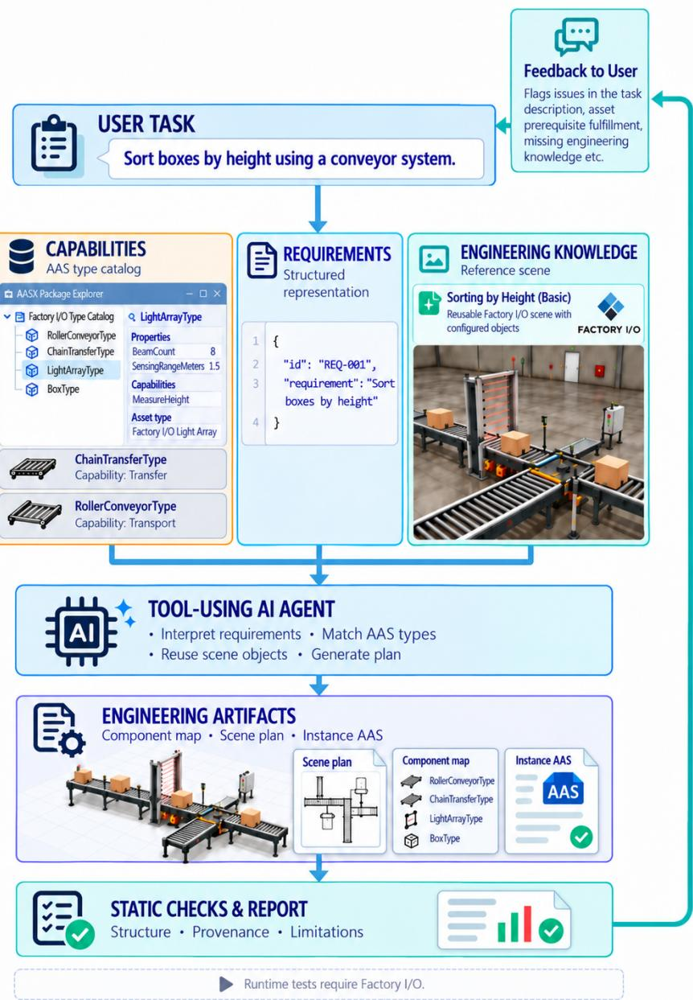
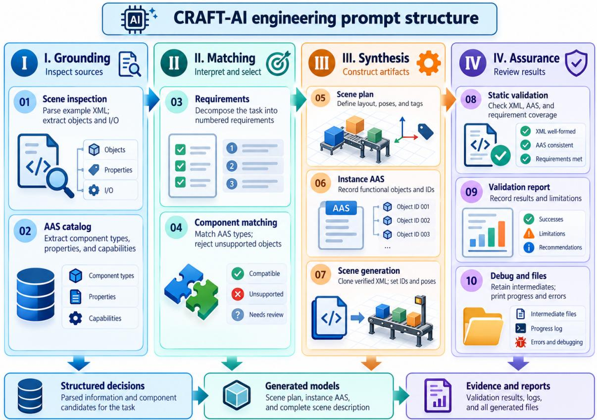
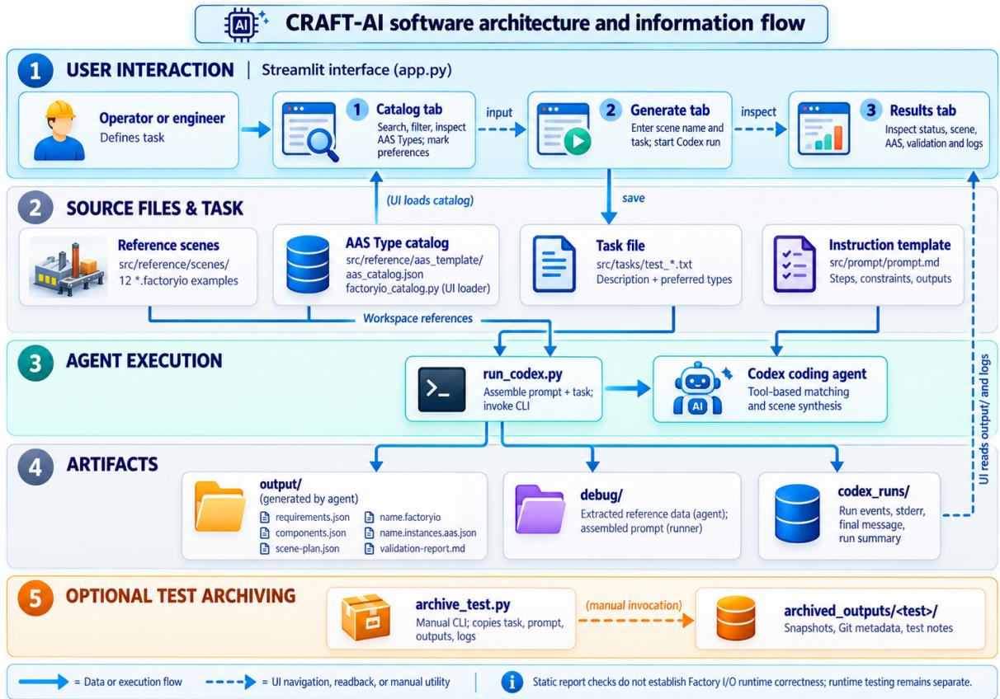
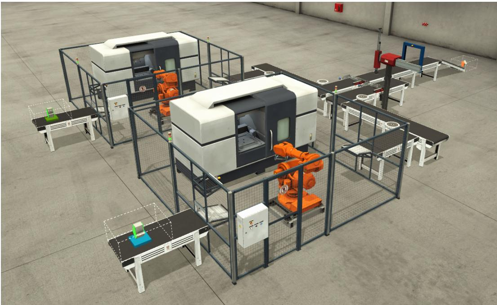

# CRAFT-AI: Capability and Requirement Alignment for Flexible Manufacturing through Agentic AI

Kiavash Fathi Hans Wernher van de Venn∗

European Institute for Robotics, Automation & Resilient Systems (EIRAS) Winterthur, 8409 Switzerland kiavash@eiras.eu | wernher@eiras.eu

Preprint

## Abstract

One of the fundamental needs for reaching resilient production infrastructure is flexible manufacturing, which requires translating changing production requirements into implementable system configurations. This paper introduces CRAFT-AI, an agentic AI approach combining natural language (NL) requirement interpretation, Asset Administration Shell (AAS)-based capability descriptions, and reusable engineering knowledge from existing manufacturing configurations. A tool-using AI agent matches requirements with available capabilities and reference implementations to generate manufacturing scenes and corresponding AAS instances. The approach is demonstrated using a Factory I/O prototype with twelve reference scenes and five illustrative manufacturing tasks of varying complexity, providing an initial feasibility assessment of the proposed AAS-enabled, system level generative engineering approach. For the four valid user task descriptions, proper requirements, correct references to the relevant engineering knowledge, correct components and lastly a valid Factory I/O scene are generated. For the task with missing engineering knowledge and a wrong sensor selection, the user is informed about which requirements of the scene generation lack domain knowledge and also which sensor is not compatible with the selected raw material by the user with link to the related documentation. After fixing the task description, the correct scene is seamlessly generated. CRAFT-AI highlights the importance of safeguards for risk perception and communication in foundation model-driven solutions.

Keywords: Agentic AI, Flexible Manufacturing, Asset Administration Shell, Requirement and Capability Matching, Resilient Manufacturing Infrastructure, Generative Engineering.

## 1 Introduction

Manufacturing systems increasingly operate under changing product requirements, smaller batch sizes, and disruptions that demand rapid reconfiguration of production resources. Beyond product customization, supply-chain disturbances can require manufacturers to reconsider both the resources employed and the configurations in which they operate. The ability to safely and reliably reconfigure production resources in response to changing demands and disruptions is therefore a fundamental prerequisite for resilient manufacturing infrastructure (Puchkova et al., 2020; Kechagias et al., 2026). In that regard, Manufacturing-as-a-Service (MaaS) has been investigated as one mechanism for improving flexibility and resilience across production networks (Chen et al., 2023; Sidorenko et al., 2026). At the factory level, however, responding to new demands still entails the engineering task of translating often informal objectives into resource selections and implementable system (re)configurations (Keddis et al., 2015; Elbasheer et al., 2025).

Capability-based engineering addresses part of this challenge by decoupling required functions from specific manufacturing resources. In the product–process–resource perspective, a required capability, also referred to as requirement, describes what a production task demands, whereas an ofered capability, also referred to as capability, describes a function an arbitrary resource can provide. Moreover, the capability–skill–service literature further distinguishes capabilities as implementation-independent functional descriptions from skills, which in the related literature is referred to as their executable implementations (Eichenwald et al., 2024; Wagner et al., 2025).

A practical dificulty remains: the presence of a suitable capability in a resource catalog does not, on its own, establish that a compatible implementation, configuration, and suficient engineering knowledge are available for a specific production environment. Existing research provides substantial foundations for resolving diferent parts of this problem. Keddis et al. (2015) map product requirements and resource capabilities to executable action sequences; Köcher et al. (2023) generate a formal planning problem from a semantic capability model. More recently, Shi et al. (2026) combine Asset Administration Shell (AAS) descriptions and large language models (LLMs) for production requirement–resource capability matching. At the implementation level, Wagner et al. (2025) address feasibility information for chaining machining skills using AASs and in-process workpieces.

Together, these contributions demonstrate how structured capability descriptions can support requirement-driven resource selection and feasibility assessment. Building on these foundations, the present work investigates how agentic AI can additionally incorporate domain knowledge from previously implemented manufacturing configurations, referred to as engineering knowledge, to bridge the gap between requirements and capabilities matching and translating them into concrete implementable engineering solutions.

LLMs and tool-using agents provide complementary means of interpreting natural language (NL) tasks and generating engineering artifacts. Ni et al. (2026) propose LLM-based process planning with state machine verification; Korth et al. (2026) combine multiple agents with simulation and optimization for production planning. At the system-model level, Elbasheer et al. (2025) generate simulation models from NL requests, while Wang et al. (2026) investigate agent-driven reconfigurable manufacturing layouts. Thus, neither NL interpretation nor system-level generation and verification are absent from the literature.

The pertinent question is instead how to create valid system-level digital twin prototypes with explicit engineering knowledge. Concretely, this refers to converting requirement and capability matches into valid solutions that are in accordance with compatibility, prerequisite, working conditions, etc., of the chosen skills (Grieves and Vickers, 2016). To address this question, the current paper presents CRAFT-AI, an agentic, requirement-driven prototype for generating Factory I/O manufacturing scenes using engineering knowledge sources (Fig. 1). A brief demonstration of CRAFT-AI is available online.

In our solution, the NL task description from the user is translated into diferent requirements by the AI agent. Thereafter, an AAS Type catalog which describes the available assets along with their capabilities, technical properties, etc., is used to address the requirements. Afterwards, a collection of reference Factory I/O scenes, as a set of functioning digital twin prototypes, is used to generate valid Factory I/O scenes.

During the process of requirement extraction, matching of requirements and capabilities, reference to engineering knowledge and also final solution validation, diferent artifacts are generated for enhanced traceability and reproducibility. Furthermore, a candidate scene without a supported engineering knowledge or not compatible or with wrong capabilities must be flagged and reported instead of being aborted for creating a starting point for a valid solution in collaboration the user. In our setting, the user can adapt the task description, provide more engineering knowledge, etc., to improve the initially proposed solution by CRAFT-AI. This interaction as a result, transforms our approach into a human-in-the-loop requirement capability matching tool as opposed to a generic agentic AI artifact generator.

  
Figure 1: Overview on CRAFT-AI.

The contributions of CRAFT-AI are 3-fold:

1. Requirement and capability-driven agentic engineering workflow for converting NL task descriptions into digital twin prototypes.

2. Engineering knowledge-grounded capability selection mechanism for valid solution generation.

3. Traceable generation and checking procedure for improved traceability, reproducibility and facilitating debugging.

The remainder of this paper defines the problem, introduces the proposed architecture and workflow, describes the prototype deployment, presents its evaluation, and discusses the findings and limitations.

## 2 Methodology

Building on existing research in generative engineering Gräßler et al. (2023); Köring and Gerhard (2026), we propose a system-level generative engineering framework for resilient manufacturing systems, which we define as follows:

Generative Engineering is an iterative, requirement-driven approach to the AI-assisted synthesis, evaluation, and refinement of engineering solutions. It combines structured representations of available resource capabilities, customer requirements, and reusable engineering knowledge to generate candidate system configurations. These configurations are evaluated against functional and quantitative performance criteria using simulation and other verification methods. The resulting feedback guides the iterative refinement of the solutions until the specified acceptance criteria are satisfied or the process is terminated.

A key architectural principle of the proposed approach is its application independence. While engineering requirements are inherently application-specific, capabilities are represented through standardized, semantically defined AAS descriptions, independently of their concrete implementation. The core engineering methodology therefore remains application-independent, while domain-specific engineering knowledge, constraints, and capabilities are used to generate application-specific system solutions.

The definition above describes the envisioned end-to-end framework of system-level generative engineering. The present CRAFT-AI prototype implements its initial stages, including NL requirement grounding, AAS-based capability matching, configuration synthesis, and structural assurance. These stages enable the generation of traceable manufacturing configurations and corresponding AAS instances. However, the current implementation does not yet perform automated functional verification through simulation execution or autonomously improve generated solutions based on operational feedback. Simulation-based verification, closed-loop refinement, and systematic learning from engineering experience therefore remain subjects of further research.

In this context, requirements specify the intended functionality of the manufacturing system, while capabilities describe what an asset, as a technical resource, can do without reducing it to a specific implementation of it. In the current paper, examples of capabilities, include but are not limited to transfer, weigh, detect material, etc. Furthermore, skill is an executable deployment of a given capability. This determines how a given functionality can be attained in the production system through its realization. Lastly, engineering knowledge describes how diferent assets in the existing technical solutions are configured, arranged, parametrized and connected with each another (Verhagen et al., 2012; Eichenwald et al., 2024; Wagner et al., 2025; Zheng et al., 2021).

Problem formulation: Given a NL manufacturing task, a catalog of available resource capabilities, and a set of reusable engineering knowledge, the objective is to generate a system configuration that satisfies the specified requirements while respecting the available engineering knowledge and the constraints of the target environment.

The objective is not necessarily to identify a globally optimal configuration. At the system level, the number of possible resource combinations, spatial arrangements, and interface dependencies can result in a large configuration space. Instead, the initial objective is to obtain a traceable, technically plausible candidate that satisfies the specified requirements and can be evaluated by a human engineer.

If requirements are contradictory, suitable capabilities are unavailable, or implementation knowledge is insuficient, the resulting limitations must be explicitly reported. A partially generated configuration may provide useful engineering information, but it must not be presented as a fully validated solution (Freuder and Wallace, 1992).

Information dependencies: Generating a manufacturing configuration requires information at diferent levels of abstraction. The proposed approach distinguishes between the following complementary information sources:

1. Capability information: AAS Type descriptions provide structured information about resource types and their available functionality (Grangel-González et al., 2016). Relevant submodels include:

• FactoryIOComponent, which describes component-specific properties and roles;

• CapabilityDescription, which contains declared capabilities where available; and

• TechnicalData, which provides additional technical information where defined.

2. Engineering knowledge as implementation information: Previously implemented reference scenes contain concrete component representations, configuration parameters, spatial arrangements, identifiers, and interface structures. These examples provide implementation-specific information that cannot necessarily be derived from abstract capability descriptions alone.

3. AAS Instance-specific information: The generated system must assign unique identifiers, component names, positions, orientations, and appropriate configuration values to the selected resources. These properties describe individual instances of the selected component types and establish the relationship between the manufacturing configuration and its generated AAS instances.

The dependencies between these information sources vary according to the component functionality. For example, selecting a conveyor requires a suitable transport capability, whereas its integration into the manufacturing system additionally requires information about its physical placement and configuration. Similarly, selecting a sensor based on its detection capability is insuficient unless its position and relevant input/output identifiers are correctly represented. These dependencies must be considered when generating a coherent system configuration.

Representation constraints: In the presented prototype, Factory I/O serves as the target digital twin prototype environment. Its scene files are represented using XML and contain both scene-level information and individual object descriptions. An object is associated with a PrefabName, which identifies a predefined Factory I/O component type. The corresponding object representation also contains the information needed for its instantiation and configuration.

Conceptually, the relevant information in a scene can be represented as follows:

Scene:   
- Version and scene metadata   
- Object 1   
- Instance identifier   
- PrefabName   
- Position and rotation   
- Component configuration   
- I/O, tags and references   
- Object 2

  
Figure 2: Structure of the engineering prompt provided to the tool-using AI agent.

This representation illustrates the logical information dependencies rather than the exact XML schema. The actual serialization is obtained from the existing reference scenes.

A prefab provides a predefined component representation within the Factory I/O environment. However, the corresponding PrefabName alone is not suficient to generate a valid scene object. The complete object structure, its internal configuration, and the consistency of referenced identifiers must also be preserved.

The central challenge is therefore to combine abstract capability information with concrete engineering knowledge without introducing unsupported component definitions or invalid references. Furthermore, the generated AAS instances must remain consistent with the components actually included in the resulting manufacturing configuration. Accordingly, the proposed approach investigates how a tool-using AI agent can bridge these information layers to generate traceable manufacturing configurations from NL requirements. Structural validation provides an initial consistency check, while functional correctness and operational behavior require separate verification in the target environment.

## 3 Solution Overview

Our CRAFT-AI approach combines NL requirement interpretation, AAS-based capability matching, and reusable engineering knowledge within an agentic engineering workflow. As illustrated in Fig. 2, the workflow is organized into four phases: grounding, matching, synthesis, and assurance. A structured prompt defines ten processing steps, while a tool-using AI agent executes the engineering tasks using the available information sources.

Structuring capabilities and skills as an AAS catalog: For having a single source of truth for diferent capabilities and the related skills, AAS representation of the relevant information from diferent sources of unstructured data is created. This so-called AAS Type catalog provides structured component descriptions, including technical properties and ofered capabilities. The AAS catalog is developed using ChatGPT based on the unstructured data in Factory I/O documentation and the standardization guidelines from the IDTA submodel templates, followed by refinement performed by an AAS domain expert.

Engineering knowledge for digital twin prototyping: The twelve existing manufacturing simulation scenes from Factory I/O represent reusable engineering knowledge, providing component configurations, object structures, and interface information. While the AAS catalog describes what resources can potentially accomplish, the reference scenes provide implementation knowledge describing how components should be configured.

Requirement & capability matching: The agent decomposes the user-provided NL task into individual requirements with unique identifiers. These requirements are matched against the capabilities and skills ofered by the AAS Type catalog to identify suitable resources. Each selection is documented with its corresponding requirement, AAS Type, matched capabilities, candidate skills, and also justification. Subsequently, the agent verifies whether a corresponding implementation from the chosen skills exists in the reference scenes. Components without a valid reference object are excluded to prevent unsupported configurations. This combines functional capability matching with experience-based implementation constraints.

Digital twin prototype generation and validation: Based on the selected components, the agent generates a scene plan defining component instances, positions, orientations, and configurations. Reference objects are reused to construct the manufacturing scene, while corresponding AAS instances maintain the relationship between component types and their generated representations. Intermediate artifacts, including requirements, component selections, and the scene plan, preserve decision traceability. Static validation checks structural consistency, identifiers, reference provenance, and requirement coverage. However, functional correctness in Factory I/O environment requires separate runtime verification.

Human–AI interaction: A Streamlit-based interface enables users to explore the AAS catalog, inspect available capabilities and skills, specify preferred components, and submit manufacturing tasks in NL. The application invokes the Codex agent through a Python execution wrapper and subsequently presents the generated engineering artifacts, validation results, and execution logs.

The current implementation follows a human-supervised engineering workflow. While the AI agent performs requirement interpretation, capability matching, and configuration synthesis, the human engineer remains responsible for evaluating the generated results. If required implementation knowledge is unavailable or inconsistencies between selected components are identified, the agent reports the corresponding limitations and provides relevant supporting information. The user can subsequently revise the task description, modify component selections, or provide additional engineering knowledge before initiating another generation cycle.

This interaction establishes an initial human-in-the-loop mechanism for identifying and resolving limitations in generated engineering configurations. However, the current prototype does not autonomously learn from human corrections or systematically incorporate these interactions into an evolving engineering knowledge base. Within the broader system-level generative engineering framework, engineering decisions, expert assessments, corrective interventions, and validated operational feedback are envisioned as sources of reusable engineering knowledge that can support the continuous improvement of subsequent engineering solutions.

  
Figure 3: Software architecture and information flow of the CRAFT-AI prototype.

## 4 Solution Deployment

The software architecture and information flow for CRAFT-AI are illustrated in Fig. 3. The application consists of three main modules. The app.py module provides the user interface for exploring available capabilities and skills, submitting manufacturing requirements, and inspecting generated results.

factoryio\_catalog.py parses and prepares the AAS Type catalog for user interaction. The run\_codex.py module combines the task description with the structured engineering prompt and invokes the Codex agent within the project workspace.

During execution, the agent accesses the AAS catalog and engineering knowledge to generate manufacturing configurations and corresponding AAS instances for the skills. Intermediate artifacts, validation reports, and execution logs are stored in dedicated directories to support traceability and debugging. An additional utility, archive\_test.py, enables the archiving of individual test runs for subsequent analysis and reproducibility.

The prototype operates locally and requires human inspection of the generated configurations. Operational validation in Factory I/O remains separate from the automated static checks.

  
Figure 4: Scene IV generated by CRAFT-AI as an assembly line example.

## 5 Results

The CRAFT-AI prototype was examined using five illustrative manufacturing tasks of varying complexity. These examples investigate the generation of manufacturing configurations and the handling of missing engineering knowledge. Given the higher system-level view of this paper, automatic PLC code generation is out of the scope of this work. Therefore, the performance of the proposed solution CRAFT-AI is evaluated by inspecting: (KPI-I Task) if the requirements completely cover the NL task description, (KPI-II # Reqs) how many of the requirements could be addressed, (KPI-III # AAS) if all the selected skills have a dedicated AAS instance and (KPI-IV DTP) if a valid digital twin prototype is generated from the NL task description. The aforementioned five illustrative manufacturing tasks are as follows. The results are presented in Table 1.

Scene I & II - Basic manufacturing scenes: The first two examples involve relatively simple configurations. In the first case, the agent was instructed to generate green bases, transport them along a conveyor belt, and remove them at the end of the line. The second case involved a water tank with dedicated “Fill” and “Empty” buttons.

Scene III - Unit sorting and storage: In this scene, mixed production units are sorted based on their height, sent to their corresponding conveyor belt and then palletized for eficient storage.

Scene IV - Multi-stage assembly line: As a more complex task, this case required two production lines to manufacture green bases and blue lids, transport them to a pick-and-place assembly station, inspect the assembled product, and subsequently remove it. The resulting scene is illustrated in Fig. 4.

Scene V - Unavailable engineering skill with wrong instructions: The last example requested a raw material-handling configuration involving a curved conveyor selected through the user interface, a pick-and-place station, and an RFID sensor. Since suitable implementation knowledge for the curved conveyor was unavailable in the reference scenes, the agent could not generate the complete configuration. Additionally, the agent identified that the selected RFID reader was unsuitable for detecting the raw material, since raw material objects in Factory

Table 1: CRAFT-AI performance.
<table><tr><td>Scene</td><td>KPI-I Task</td><td>KPI-II # Reqs</td><td>KPI-III # AAS</td><td>KPI-IV DTP</td></tr><tr><td>I</td><td>Yes</td><td>3/3</td><td>4/4</td><td>Yes</td></tr><tr><td>II</td><td>Yes</td><td>4/4</td><td>3/3</td><td>Yes</td></tr><tr><td>III</td><td>Yes</td><td>6/6</td><td>32/32</td><td>Yes</td></tr><tr><td>IV</td><td>Yes</td><td>9/9</td><td>26/26</td><td>Yes</td></tr><tr><td> $\mathrm { ~ V ~ } ( 1 ^ { s t } ~ \mathrm { T r y } )$ </td><td>Yes</td><td>5/7</td><td>5/7</td><td>No</td></tr><tr><td> $\mathrm { ~ V ~ } ( 2 ^ { n d } \mathrm { ~ T r y } )$ </td><td>Yes</td><td>7/7</td><td>9/9</td><td>Yes</td></tr></table>

I/O do not contain RFID tags. The user is also provided a link to the documentation to verify this warning issued by the agent and chose a fitting sensor. After changing the conveyor belt and the sensor for counting the throughput in the NL task description by the user, the scene is successfully generated.

Overall, the examples illustrate how CRAFT-AI can combine capability descriptions with reusable engineering knowledge to generate traceable manufacturing configurations. They also demonstrate a limitation of the approach: successful generation depends on suficient reference knowledge, indicating that structural consistency alone does not establish functional correctness.

## 6 Conclusion

This paper presented CRAFT-AI, an agentic AI approach combining NL requirement interpretation, AAS-based capability descriptions, and reusable engineering knowledge to generate traceable manufacturing configurations and corresponding digital twin prototypes.

The proposed approach builds on a fundamental separation between application-specific requirements, semantically described resource capabilities, and reusable engineering knowledge. This separation establishes an application-independent architectural foundation for systemlevel generative engineering, in which a common engineering methodology can be applied to generate solutions for diferent industrial applications.

The feasibility of the approach was investigated through five illustrative manufacturing tasks using Factory $\mathrm { I } / \mathrm { O }$ as the target environment. The results demonstrated that CRAFT-AI can translate NL tasks into structured requirements, identify suitable capabilities, reuse implementation knowledge, and generate structurally consistent manufacturing configurations with corresponding AAS instances. All five tasks ultimately achieved complete requirement coverage and successful prototype generation. The initial unsuccessful attempt in the fifth scenario further highlighted the importance of identifying missing engineering knowledge and incompatible component selections, enabling the human user to revise the task and initiate a subsequent generation cycle.

The current implementation addresses the initial stages of system-level generative engineering, including requirement grounding, capability matching, configuration synthesis, and structural assurance. However, structural consistency alone does not establish functional correctness or operational feasibility. Automated simulation-based verification, quantitative performance evaluation, and closed-loop improvement remain important subjects of further research.

Future work will therefore focus on integrating functional verification and iterative optimization into the generative engineering workflow, investigating the systematic reuse of knowledge obtained from engineering decisions and operational feedback, and evaluating the practical applicability of the proposed architecture across diferent industrial domains.

Ultimately, the research aims to advance system-level generative engineering towards a knowledge-driven, capability-based, and AI-assisted methodology for the development of intelligent industrial systems.

## Acknowledgements

The authors gratefully acknowledge Real Games for their support of this research.

This manuscript is a preprint intended for submission to the 37th European Safety and Reliability Conference (ESREL 2027), taking place on 6–10 June 2027 at ETH Zürich, Switzerland, for peer review and publication in the conference proceedings.

## Generative AI Disclosure

During the preparation of this work the authors used ChatGPT in order to summarize information, generate figures and process text. The authors reviewed and edited the content and take full responsibility for it.

## References

Chen, T., V. Sampath, M. C. May, S. Shan, O. J. Jorg, J. J. Aguilar Martin, F. Stamer, G. Fantoni, G. Tosello, and M. Calaon (2023). Machine learning in manufacturing towards industry 4.0: From ‘for now’to ‘four-know’. Applied Sciences 13(3), 1903.

Eichenwald, M., J. Molter, D. Kuhn, and R. Müller (2024). Production system ontology for continuous capability-based engineering. Procedia CIRP 128, 387–392.

Elbasheer, M., Y. Laili, F. Longo, V. Solina, Y. Tao, P. Veltri, Y. Zhang, and L. Zhang (2025). Natural language-driven production planning: integrating large language models with automatic simulation model generation in manufacturing systems. Journal of Intelligent Manufacturing, 1–28.

Freuder, E. C. and R. J. Wallace (1992). Partial constraint satisfaction. Artificial Intelligence 58 (1-3), 21–70.

Grangel-González, I., L. Halilaj, G. Coskun, S. Auer, D. Collarana, and M. Hofmeister (2016). Towards a semantic administrative shell for industry 4.0 components. In 2016 IEEE Tenth International Conference on Semantic Computing (ICSC), pp. 230–237. IEEE.

Gräßler, I., D. Preuß, L. Brandt, and M. Mohr (2023). Eficient formalisation of technical requirements for generative engineering. Proceedings of the Design Society 3, 1595–1604.

Grieves, M. and J. Vickers (2016). Digital twin: Mitigating unpredictable, undesirable emergent behavior in complex systems. In Transdisciplinary perspectives on complex systems: New findings and approaches, pp. 85–113. Springer.

Kechagias, E. P., S. P. Gayialis, N. A. Panayiotou, and G. A. Papadopoulos (2026). Reconfigurable manufacturing systems: A systematic review and classification framework with implications for supply chain resilience. Logistics (2305-6290) 10(5), 117.

Keddis, N., A. Zoitl, and A. Knoll (2015). Adaptable capability-based planning. IFAC-PapersOnLine 48(3), 1204–1209.

Köcher, A., L. M. V. da Silva, and A. Fay (2023). Automated process planning based on a semantic capability model and smt.

Köring, T. and D. Gerhard (2026). A structural framework for generative engineering and design assistance systems development. Proceedings of the Design Society 6, 2383–2392.

Korth, M., M. Benfer, and G. Lanza (2026). Multi-agentic production planning utilising simulation and optimisation. CIRP Annals.

Ni, M., T. Wang, J. Leng, C. Chen, and L. Cheng (2026). A large language model-based manufacturing process planning approach under industry 5.0. International Journal of Production Research 64 (12), 5189–5208.

Puchkova, A., D. McFarlane, R. Srinivasan, and A. Thorne (2020). Resilient planning strategies to support disruption-tolerant production operations. International Journal of Production Economics 226, 107614.

Shi, D., O. Meyer, Z. Fan, H. Wang, and T. Bauernhansl (2026). Cognitive digital twins for capability matching toward reconfigurable manufacturing: Leveraging asset administration shells and large language models. Robotics and Computer-Integrated Manufacturing 97, 103105.

Sidorenko, A., B. Meyers, V. Siatras, P. Burget, P. Kremser, T. Legler, J. Hermann, J. Groß, E. Xanthakis, J. Hamernik, K. Suri, K. Alexopoulos, and A. Wagner (2026). The RAASCE-MAN approach: Resilient and adaptive supply chains for capability-based manufacturing as a service networks. Journal of Intelligent Manufacturing.

Verhagen, W. J., P. Bermell-Garcia, R. E. Van Dijk, and R. Curran (2012). A critical review of knowledge-based engineering: An identification of research challenges. Advanced Engineering Informatics 26(1), 5–15.

Wagner, A., T. Legler, and M. Ruskowski (2025). Using in-process workpieces and asset administration shells for chaining machining skills. Procedia Computer Science 253, 2841– 2848.

Wang, T., Z. Liu, X. V. Wang, and L. Wang (2026). Llm agents-driven layout generation for reconfigurable manufacturing systems. CIRP annals.

Zheng, C., Y. An, Z. Wang, X. Qin, and F. Yu (2021). Application of configuration principle on knowledge-based engineering for manufacturing system design. Procedia CIRP 104, 1378–1383.