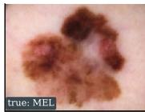
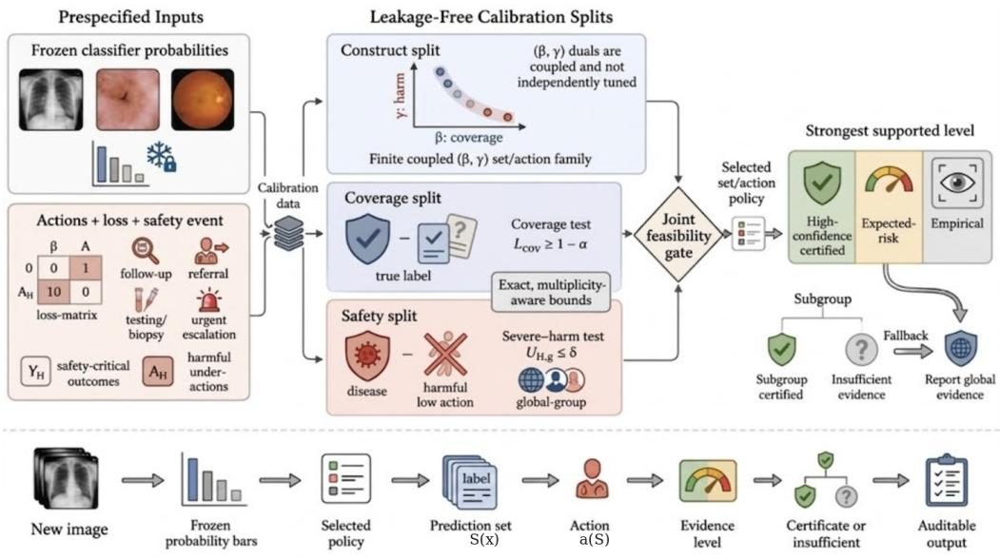
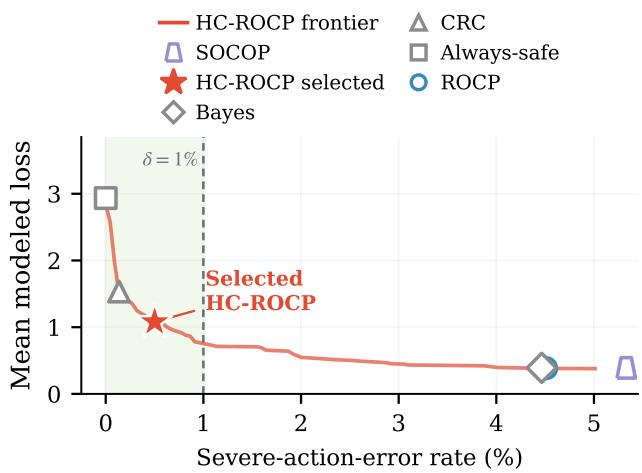
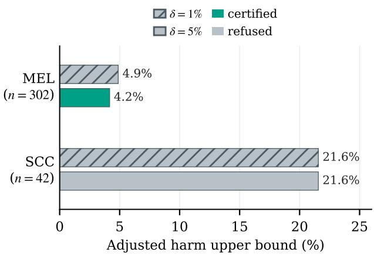
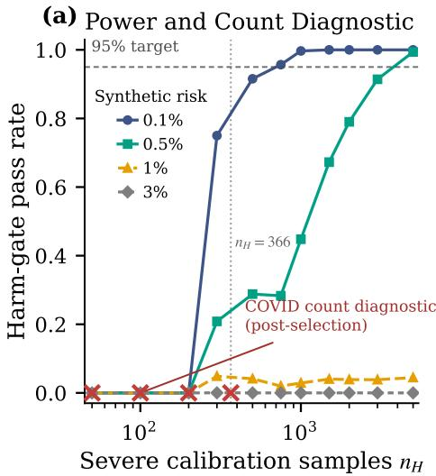
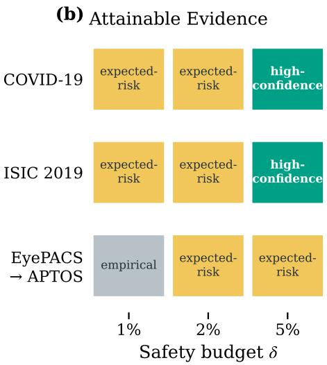
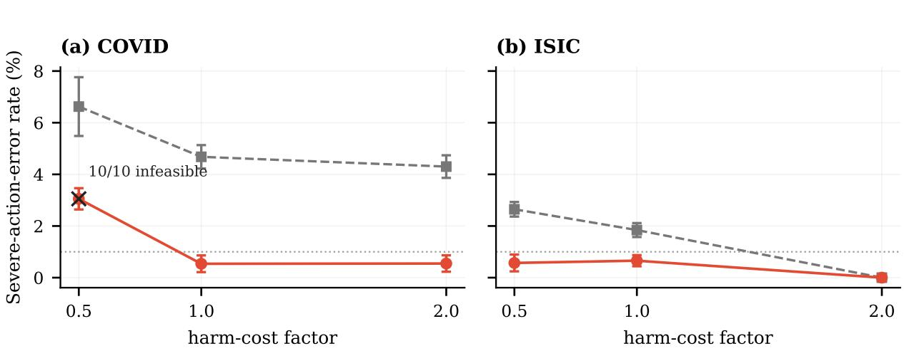
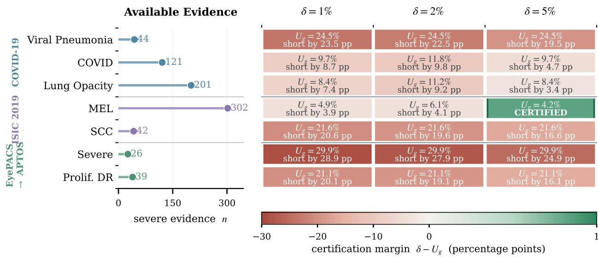
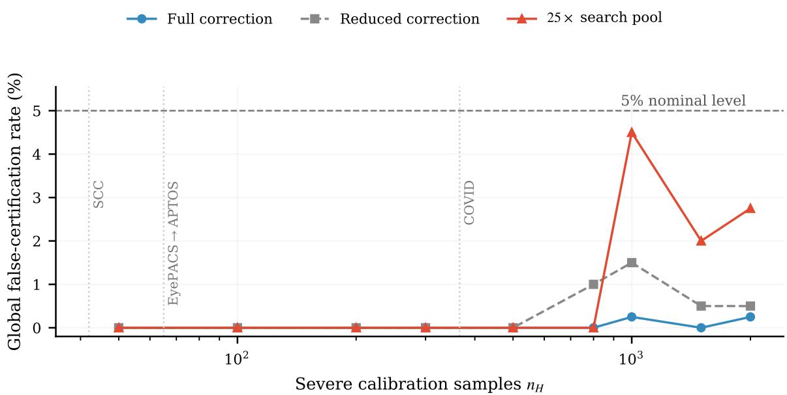

# Certify, Report, or Refuse: Harm-Constrained Conformal Prediction for Clinical Actions

Zhiyuan Li1

zli2562@wisc.edu

Lequan Yu2†

lqyu@hku.hk

1College of Computing & Artificial Intelligence, University of Wisconsin–Madison, Madison, WI, USA

2School of Computing and Data Science, The University of Hong Kong, Hong Kong SAR, China

## Abstract

Routing a melanoma case to routine follow-up is a serious action error that diagnostic coverage alone does not rule out. We present Harm-Constrained Risk-Optimal Conformal Prediction (HC-ROCP), a training-free framework that uses frozen classifier probabilities and adds a harm penalty when choosing prediction sets and actions. We test the resulting policies on disjoint calibration splits with multiplicity adjustment. HC-ROCP certifies supported claims, reports descriptive fallback policies, and refuses unsupported subgroup claims. We evaluate these outputs retrospectively on COVID-19 radiographs, ISIC 2019 dermoscopy, and EyePACS-to-APTOS retinopathy transfer. Across ten calibration seeds, HC-ROCP reduces COVID-19 severe-action errors from the exact risk-optimal baseline’s 4.68% to 0.54%. At a 5% budget, global claims are certified for COVID-19 and ISIC, but the rare squamouscell-carcinoma claim is refused. At 1%, all settings receive descriptive reports. For each budget, we also report the minimum severe-case count needed to pass the global harm gate with zero errors, providing a starting point for further data collection.

Keywords: conformal prediction, conformal risk control, clinical decision support, medical imaging

Data and Code Availability We use publicly available medical-imaging benchmarks: COVID-19 chest radiographs (Chowdhury et al., 2020; Rahman et al., 2021), ISIC 2019 skin-lesion images (Codella et al., 2019; Tschandl et al., 2018; Hern´andez-P´erez et al., 2024), and an EyePACS-to-APTOS diabetic-retinopathy transfer split (EyePACS and California Healthcare Foundation, 2015; Asia Pa-

cific Tele-Ophthalmology Society (APTOS), 2019). Instructions for obtaining and preprocessing the datasets, together with the complete code implementation, are available at https://github.com/LZYEIL/ HC-ROCP.

Institutional Review Board (IRB) This work does not require IRB approval as we analyze existing publicly available datasets.

## 1. Introduction

Medical-image classifiers can inform decisions about routine follow-up, further testing, or specialist referral. A serious error occurs when a severe condition receives an inappropriate action, such as routing melanoma to routine follow-up. Conformal prediction provides sets of possible diagnoses with marginal label-coverage guarantees (Vovk et al., 2005; Shafer and Vovk, 2008). Risk-Optimal Conformal Prediction (ROCP) uses these sets to choose downstream actions under a robust loss criterion (Wang and Dobriban, 2026).

Neither label coverage nor average loss directly controls how often a severe case receives a harmful action. A set may contain the true diagnosis even when the selected action is harmful, and low average loss can conceal errors concentrated in a rare severe class. Low observed error also needs enough data to support a population-level claim. In our ISIC study, for example, zero errors among 42 squamous-cell-carcinoma cases are insuficient to certify an error rate below 5% under our multiplicity correction. We therefore assess severe-action errors separately and test which global and subgroup claims the calibration data support.

Risk-controlling prediction sets, conformal risk control, and learn-then-test provide tools for evaluating prespecified risks (Bates et al., 2021; Angelopoulos et al., 2024a, 2025). We use these tools to connect two tasks: constructing policies that target severeaction errors and auditing the evidence for their coverage and harm claims. The audit supports three reporting decisions: certify a supported claim, report a descriptive fallback policy, or refuse an unsupported subgroup claim.

We introduce Harm-Constrained Risk-Optimal Conformal Prediction (HC-ROCP), a framework based on frozen classifier probabilities. We extend ROCP’s objective with a penalty for harmful actions, weighted by the predicted probability of a severe label. Varying this penalty and the coverage parameter produces a finite family of policies. Separate calibration splits test their coverage and harm rates with multiplicity adjustment. These tests determine the selected policy’s global evidence label and which subgroup claims are supported. Figure 1 shows an actual output. Section 3 explains these labels before introducing the optimization.

We evaluate the method retrospectively in three imaging settings. On COVID-19, severe-action error is roughly ninefold lower than exact ROCP across ten calibration seeds, at higher modeled loss. ISIC tests whether aggregate evidence also supports a raresubgroup claim. EyePACS-to-APTOS examines recalibration after a domain shift with few severe cases. No setting certifies at 1%. We vary the budget to identify which claims can pass and calculate the severe-case counts needed even with zero observed errors.

The paper makes three contributions:

• We extend ROCP with a penalty for prespecified severe-action errors, targeting them during the construction of prediction sets and actions (Section 4).

• We jointly test coverage and harm when selecting a policy, report descriptive fallbacks, and withhold unsupported subgroup claims (Sections 4.3 and 5).

• We measure how subgroup size and candidate multiplicity afect certification, and how costs and referral options change the available policies (Section 7).

  
Reference diagnosis: MEL Set: {MEL, SCC} Modeled action: urgent specialist pathway Policy: expected-risk (descriptive) MEL subgroup: insuficient evidence

Figure 1: An ISIC melanoma case and the output of HC-ROCP. This MEL case receives an urgent action, a descriptive policy label, and refusal of the MEL subgroup claim at δ = 1%.

## 2. Related Work

Coverage and Risk Control. Split conformal prediction controls marginal label coverage under exchangeability (Vovk et al., 2005; Shafer and Vovk, 2008). Risk-controlling prediction sets extend the target to losses (Bates et al., 2021), while conformal risk control and learn-then-test provide general tools for risk calibration and testing (Angelopoulos et al., 2024a, 2025). These tools can evaluate many kinds of decision policies. Our contribution integrates these bounds with harm-aware set/action construction and explicit global/subgroup reporting.

Decisions from Prediction Sets. ROCP optimizes a prediction set and its downstream action under a robust loss criterion (Wang and Dobriban, 2026). HC-ROCP preserves this action rule but adds a penalty for harmful actions on severe cases and tests their frequency alongside coverage. Conformal decision theory and utility-directed conformal prediction also connect uncertainty to decisions and util ities (Lekeufack et al., 2024; Cortes-Gomez et al., 2025). Conformal triage separates cases into highrisk, low-risk, and uncertain groups, with predictivevalue guarantees for the first two (Angelopoulos et al., 2024b). Action-conditional conformal prediction defines risk conditional on the action taken (Zhu et al., 2026). We instead measure harmful-action frequency among cases whose true labels belong to the prespecified severe classes.

Joint Tests and Evidence Reporting. Related work studies joint certification across candidate policies (Yu and Liu, 2026) and hierarchical groupconditional control (Salem et al., 2026). Gurram (2026) distinguishes average-risk statements from high-confidence guarantees. Liu et al. (2026) study joint certification of error among accepted answers and a minimum answer rate under bounded-ratio covariate shift. Their procedure returns a refusal when no candidate passes both tests. HC-ROCP instead tests diagnostic label coverage and harmful-action frequency among severe cases over a finite, potentially non-nested policy family. We report global and subgroup evidence separately and retain descriptive fallbacks when joint certification fails.

  
Figure 2: Overview of the HC-ROCP framework. A construct split defines candidate policies; disjoint coverage and safety splits test their coverage and severe-action error before loss-based selection. The selected policy carries global and subgroup evidence labels.

## 3. Problem and Outputs

The Decision Problem. An image X has label $Y ~ \in ~ \{ 1 , \ldots , K \}$ and frozen classifier probabilities $p ( \cdot \mid X )$ (notation: Appendix A). Before calibration, we specify actions A, a loss matrix Λ, severe labels $Y _ { H }$ , and harmful actions $A _ { H }$ . A policy π returns a nonempty set $S _ { \pi } ( X )$ and action $a _ { \pi } ( S _ { \pi } ( X ) )$ . The severe-action-error event is

$$
H = \mathbf { 1 } \{ Y \in Y _ { H } , \ a _ { \pi } ( S _ { \pi } ( X ) ) \in A _ { H } \} .
$$

We require coverage cov $\cdot ( \pi ) = P ( Y \in S _ { \pi } ( X ) ) \geq 1 - \alpha$ and conditional error

$$
R _ { H } ( \pi ) = P ( a _ { \pi } ( S _ { \pi } ( X ) ) \in A _ { H } \mid Y \in Y _ { H } ) \leq \delta .
$$

The denominator contains only severe cases. Modeled loss is ${ \mathcal { L } } ( \pi ) = \mathbb { E } [ \ell ( a _ { \pi } ( S _ { \pi } ( X ) ) , Y ) ]$ , using Λ to express relative action preferences.

Evidence Labels. A gate tests a requested claim against the available calibration evidence (Table 1). HC-ROCP certifies a policy when coverage and allsevere harm gates pass together. Otherwise, it reports a fallback policy with its descriptive evidence level. Each subgroup claim receives its own harm test: passing supports certification, and failing produces a refusal. Disease-defined subgroup membership is determined from retrospective reference labels.

A Running Example. For the melanoma image in Figure 1, the selected ISIC policy returns {MEL, SCC} and the urgent specialist pathway. The policy carries an expected-risk descriptive label, and the MEL subgroup’s insuficient label records refusal of its requested claim. The global label applies to the policy; the subgroup label applies to the MEL population. ISIC sets are larger on average (Section 7.5).

## 4. HC-ROCP: Construction and Audit

We first construct a set/action family, then audit it on separate data (Figure 2; Algorithm 1).

## 4.1. From a Prediction Set to an Action

We retain $\mathrm { R O C P ^ { \circ } s }$ robust action rule. Let $\ell _ { \mathrm { i n } } ( a ; S )$ and $\ell _ { \mathrm { o u t } } ( a ; S )$ be the largest losses inside and outside

<table><tr><td>Label</td><td>Meaning</td></tr><tr><td>High-confidence</td><td>Adjusted coverage and global harm gates pass.</td></tr><tr><td>Expected-risk</td><td>Add-one criteria pass; descriptive fallback.</td></tr><tr><td>Empirical</td><td>Raw-rate criteria pass; descrip- tive fallback.</td></tr><tr><td>Infeasible fallback</td><td>No preceding criteria pass; diag- nostic only.</td></tr><tr><td>cient</td><td>Subgroup: insuffi- Its adjusted harm gate fails; claim withheld.</td></tr></table>

Table 1: Evidence labels refer to policies or subgroups, not individual risk. Certification requires passing the applicable adjusted gates.

$S ,$ setting $\ell _ { \mathrm { o u t } } = \ell _ { \mathrm { i n } }$ when the outside is empty. The robust risk is

$$
\rho ( S ) = \operatorname* { m i n } _ { a \in \mathcal { A } } [ \ell _ { \mathrm { i n } } ( a ; S ) + \alpha _ { \mathrm { a c t } } \{ \ell _ { \mathrm { o u t } } ( a ; S ) - \ell _ { \mathrm { i n } } ( a ; S ) \} _ { + } ] \ : .
$$

It bounds worst-case expected loss when at most $\alpha _ { \mathrm { a c t } }$ mass lies outside S (Wang and Dobriban, 2026). The minimizing action is $a ( S )$ , with fixed-order tiebreaking. Here $\alpha _ { \mathrm { a c t } }$ defines the action rule, while α defines the audited coverage target. ROCP balances this risk against $\begin{array} { r } { p ( S \mid x ) = \sum _ { y \in S } p ( y \mid x ) } \end{array}$

$$
S _ { \beta } ( x ) \in \arg \operatorname* { m i n } _ { S \neq \emptyset } \{ \rho ( S ) - \beta p ( S \mid x ) \} .
$$

## 4.2. Constructing Harm-Aware Policies

HC-ROCP selects a set minimizing

$$
\rho ( S ) - \beta p ( S \mid x ) + \gamma p ( Y _ { H } \mid x ) \mathbf { 1 } \{ a ( S ) \in A _ { H } \} .\tag{1}
$$

The added term targets harmful actions on inputs assigned high severe-class probability. Its indicator activates only for sets whose robust action lies in $A _ { H } ,$ while $p ( Y _ { H } \mid x )$ weights that penalty by the classifier’s evidence of severity. The action map stays fixed and $\gamma = 0$ recovers exact ROCP.

The two parameters act through the same set choice. Increasing $\beta$ rewards probability mass; increasing $\gamma$ favors sets whose associated action avoids $A _ { H }$ on likely severe cases. A change in the preferred action can therefore change which labels enter the set. Jointly varying the parameters searches this coverage/action trade-of (Section 7.6). We enumerate all nonempty subsets in the small label spaces studied here.

This objective generates candidates for

$$
\operatorname* { m i n } _ { \pi } ~ \mathcal L ( \pi ) ~ \mathrm { s . t . } ~ \mathrm { c o v } ( \pi ) \geq 1 - \alpha , ~ R _ { H } ( \pi ) \leq \delta .\tag{2}
$$

Equation (1) is a pointwise, Lagrangian-inspired surrogate for (2); the audit in Section 4.3 tests the population constraints. Joint changes to the set and action produce a potentially non-nested family. We use a construct split to fix the finite candidate family F before auditing.

## 4.3. Joint Testing and Selection

For each candidate, we test whether coverage meets its target and severe-action error stays within budget. On a separate coverage split, $K _ { \mathrm { c o v } } ( \pi )$ of $n _ { \mathrm { c o v } }$ labels fall inside the set. On the safety split, $K _ { H , g } ( \pi )$ of $n _ { H , g }$ severe cases receive harmful actions in group g; group 0 includes all severe labels.

For $M = | \mathcal { F } |$ policies and G safety groups including group 0, each test receives $\eta = \varepsilon / [ M ( 1 + G ) ]$ . Onesided Clopper–Pearson tests produce coverage lower value $L _ { \mathrm { c o v } }$ and harm upper values $U _ { H , g } .$ A policy receives global certification if and only if

$$
L _ { \mathrm { c o v } } ( \pi ) \geq 1 - \alpha \quad \mathrm { a n d } \quad U _ { H , 0 } ( \pi ) \leq \delta .
$$

These gates are binomial-exact for a single class and conservative for stratified mixtures under Section 5’s conditions. Among passing policies, we minimize safety-split loss. Simultaneous testing permits this selection on the safety data; utility itself receives no guarantee.

We use the construct split to propose parameter pairs or screen a shortlist, then freeze the family before inspecting coverage or safety outcomes. Because the simultaneous bounds cover every retained candidate, we can select any policy within that family. Adding candidates after inspecting failed gates would require a new validity argument. We use held-out test data to summarize the selected policy’s performance. Only the calibration gates determine which certificate to issue.

## 4.4. Descriptive Fallbacks and Subgroup Claims

If no policy certifies, the expected-risk fallback requires

$$
\frac { K _ { \mathrm { c o v } } + 1 } { n _ { \mathrm { c o v } } + 1 } \geq 1 - \alpha , \qquad \frac { K _ { H , 0 } + 1 } { n _ { H , 0 } + 1 } \leq \delta .
$$

If none qualifies, the empirical fallback uses raw proportions. Both select the lowest-loss eligible policy. If neither is feasible, a diagnostic policy minimizes coverage shortfall, empirical harm, then loss. Empty severe groups cannot pass.

Both fallbacks are descriptive (Proposition 2). Each subgroup’s adjusted harm gate determines its own certification status, regardless of the global label.

## 5. What the Certificate Guarantees

A certificate controls false claims across the tested family for a fixed decision specification. Under the conditions below, with probability at least $1 \ - \ \varepsilon$ over calibration, every certified harm claim meets its requested budget. The two quantities have distinct roles: ε controls the probability of issuing a false claim, while δ bounds the action-error frequency among severe cases. Proofs are in Appendix B.

We condition on the construct split so that the candidate family is fixed, and on the class counts produced by stratified splitting. Observations are i.i.d. within each class, but error probabilities can difer across classes. Accordingly, $\mathrm { c o v } _ { w }$ and $R _ { H , g , w }$ average class-conditional coverage and harm using the realized certification-split proportions (Appendix B).

For a single-class subgroup, the count is binomial. For a global mixture, we use the tail comparison below to justify gates computed from the binomial-reference Clopper–Pearson values $\mathrm { C P } _ { L }$ and $\mathrm { C P } _ { U }$ . The $M ( 1 + G )$ correction accounts for one coverage test and G safety tests for each of the M policies.

Theorem 1 (Joint finite-sample certification) Let F have size M and be fixed without inspecting certification outcomes, conditional on the realized class counts. For each policy and group, form the Clopper–Pearson gate values $L _ { \mathrm { c o v } }$ and $U _ { H , g }$ with $\eta = \varepsilon / [ M ( 1 { + } G ) ]$ . Assume every nonempty binomialreference gate cutof lies at least one count beyond its null mean, as formalized in Lemma $\it 4 .$ Then, with probability at least $1 - \varepsilon ,$ , simultaneously over ${ \mathcal { F } } ,$ passing $L _ { \mathrm { c o v } } ( \pi ) \geq 1 - \alpha$ implies cov ${ \tau _ { w } ( \pi ) \geq 1 - \alpha }$ and passing $U _ { H , g } ( \pi ) \leq \delta _ { g }$ implies $R _ { H , g , w } ( \pi ) \leq \delta _ { g }$ for every group g. Thus selection preserves the global statements and every separately passing subgroup statement.

Empirical Check. Gate-cutof checks confirm the separation condition throughout (Appendix B); $\mathrm { A p \mathrm { - } }$ pendix G gives a simplified simulation of global harm tests.

Proof Sketch. Conditional on class counts, a global count is a sum of classwise binomials. Under the stated separation, Hoefding’s comparison bounds its gate tail by the binomial tail with the same mean (Hoefding, 1956); Clopper–Pearson inversion and a union bound over $M ( 1 { + } G )$ gates complete the result.

Proposition 2 (Add-one estimate) Conditional on fixed stratified class counts, let π be fixed without inspecting safety outcomes and write $\begin{array} { r } { K _ { H } = \sum _ { i = 1 } ^ { n _ { H } } Z _ { i } } \end{array}$ where the $Z _ { i }$ are independent Bernoulli variables with possibly diferent probabilities $p _ { i }$ . For $\begin{array} { r l } { p _ { w } } & { { } = } \end{array}$ $\begin{array} { r } { n _ { H } ^ { - 1 } \sum _ { i } p _ { i } = R _ { H , 0 , w } ( \pi ) } \end{array}$ ，

$$
\mathbb { E } \bigg [ \frac { K _ { H } + 1 } { n _ { H } + 1 } \bigg ] = \frac { n _ { H } p _ { w } + 1 } { n _ { H } + 1 } \geq p _ { w } .
$$

The analogous identity holds for coverage indicators and $\operatorname { c o v } _ { w } ( \pi )$ . Thus both add-one estimates are upward biased for a fixed policy, but neither is a conditional bound after observing its count or selecting π from $\mathcal { F }$

Proof Sketch. Since $\begin{array} { r } { \mathbb E [ K _ { H } ] = \sum _ { i } p _ { i } = n _ { H } p _ { w } } \end{array}$ , the displayed identity follows by linearity of expectation; identical reasoning applies to coverage. The expectation is taken before observing the count for the fixed policy.

Theorem 3 (Subgroup certify-or-fallback)

Under the multiplicity correction of Theorem 1 applied to the global group and every requested subgroup, on the simultaneous-validity event: (i) every subgroup g with $U _ { H , g } ( \pi ^ { * } ) \leq \delta _ { g }$ is certified; (ii) a subgroup that fails the gate receives no subgroup certificate and the separately certified global policy remains valid (fallback); (iii) the realized risk of a failed subgroup is never claimed to be at most $\delta _ { g }$

Proof Sketch. Apply Theorem 1 with groups equal to the global group plus all requested subgroups. The simultaneous event includes the global statement and every passing subgroup statement, so withholding a failed subgroup claim preserves the certified global statement.

Choice of Bound. The binomial-reference bound is useful in the rare-event regime: for SCC’s 42 cases with zero errors and $\eta \approx 3 . 7 \times 1 0 ^ { - 5 }$ , its upper value is 21.6%, compared with 34.8% for Hoefding and 62.0% for empirical-Bernstein at the same test level.

## 6. Experimental Setup

Datasets and Decisions. We evaluate retrospective, single-stage policies against observed disease labels. COVID-19 radiographs (Chowdhury et al., 2020; Rahman et al., 2021) test the action-error/loss trade-of: the three abnormal labels are severe, and taking no action on these cases is harmful. ISIC 2019 dermoscopy (Codella et al., 2019; Tschandl et al., 2018; Hern´andez-P´erez et al., 2024) tests rare-subgroup evidence: MEL and SCC are severe, and routine follow-up is harmful. EyePACS-to-APTOS retinopathy transfer (EyePACS and California Healthcare Foundation, 2015; Asia Pacific Tele-Ophthalmology Society (APTOS), 2019) tests targetdomain recalibration: the two highest grades are severe, and routine rescreen is harmful. Action sets and expert-specified loss matrices appear in Appendix C; partitions are in Table 6.

Models and Calibration. All classifiers use ConvNeXt V2-Tiny (Woo et al., 2023) and are frozen before HC-ROCP calibration, which requires no further classifier training. Class-stratified assignment produces disjoint construct, coverage, and safety splits. We set $\alpha _ { \mathrm { a c t } } = \alpha = 0 . 0 5$ , family-wise error allowance $\varepsilon = 0 . 0 5$ , and reference budgets $\delta \in \{ 1 \% , 2 \% , 5 \% \}$ Five clinicians contributed to the decision specifications and endorsed these budgets as reference points (Appendix C).

Candidate β values target coverage 0.95, 0.975, and 0.99, crossed with the γ grid. The higher targets provide room for finite-sample uncertainty, so joint selection can yield coverage above the required 0.95.

Interpreting the Costs. The loss matrices encode relative preferences among available actions. For MEL, costs of 10, 4, 1, and 0 rank routine follow-up, dermatology referral, biopsy workup, and the urgent specialist pathway. We define the severe-action-error event separately from these costs, so we can vary the costs without changing which errors we count.

Comparisons and Metrics. Exact ROCP uses the same subset enumeration with γ = 0; the original release solver uses a diferent threshold-based implementation (Wang and Dobriban, 2026). We also compare RAC, APS, RAPS, SAPS, Mondrian APS, LAS, SOCOP, utility-directed CP, Bayes action, alwayssafe action, and CRC/LTT action adapters (Kiyani et al., 2025; Romano et al., 2020; Angelopoulos et al., 2021; Huang et al., 2024; Vovk, 2013; Sadinle et al., 2019; Wang et al., 2026; Cortes-Gomez et al., 2025).

Appendix C documents oficial-code and formula adapters; action-only methods have no set coverage.

All methods share frozen probabilities, losses, and test observations. Tables 3 and 10 compare full protocols (calibration details in Appendix E). Table 10 summarizes ten-seed baseline comparisons; Table 11 compares protocol variants on the reference split. We report coverage, mean modeled loss, severe-actionerror rate, and evidence labels. Ten-seed means and sample standard deviations quantify calibrationpartition variation on fixed test sets. Table 2, budget sweeps, and subgroup counts use one reference split. Paired tests are detailed in Appendix E; 500 nestedbootstrap repetitions are described in Appendix F.

## 7. Results

Three findings organize the results: HC-ROCP reduces severe-action error at a modeled-loss cost; global and subgroup audits support diferent claims; and budget, severe-case counts, and candidate multiplicity determine the evidence required for certification.

## 7.1. COVID-19: Lower Error at Higher Modeled Loss

Across ten seeds, HC-ROCP reduces severe-action error from exact ROCP’s 4.68% to 0.54%, while loss increases from 0.391 to 1.181. This approximately 8.7-fold error reduction costs less than always taking the safe action, whose loss is 2.935.

The reference policy has test harm 0.50% and loss 1.080 (Figure 3). Its adjusted safety upper bound is 4.69% from 366 severe cases, yielding an expectedrisk report at 1%. The oficial CRC action adapter reaches 0.14% harm at loss 1.534 on this split; it reports an action-only output (Figure 3).

## 7.2. ISIC: Aggregate Evidence Leaves SCC Unsupported

On ISIC, the reference policy has test harm 0.87% and an expected-risk label at the 1% budget. The subgroup bounds are much wider. MEL has 302 safety cases and an upper bound of 4.88%, compared with 21.56% for SCC’s 42 cases. Neither subgroup passes at 1%. At 5%, the global and MEL claims pass, but the SCC claim is still refused (Figure 4; all subgroups in Figure 7).

<table><tr><td colspan="2"></td><td colspan="2">EyePACS ISIC 2019</td></tr><tr><td></td><td>COVID-19</td><td></td><td>→APTOS</td></tr><tr><td>Coverage</td><td>0.9898</td><td>0.9477</td><td>0.9638</td></tr><tr><td>Harm</td><td>0.50%</td><td>0.87%</td><td>0.00%</td></tr><tr><td>Loss</td><td>1.080</td><td>1.488</td><td>1.623</td></tr><tr><td></td><td>Evidence expected-risk</td><td>expected-risk</td><td>empirical</td></tr><tr><td> $\beta$ </td><td>35.72</td><td>11.93</td><td>28.88</td></tr><tr><td> $\gamma$ </td><td>1.778</td><td>1.778</td><td>0.000</td></tr></table>

Table 2: Single-split selected operating points at $\delta =$ $1 \% .$ with descriptive evidence labels. Seed averaged comparisons appear in Tables 3 and 10.

<table><tr><td>Data</td><td>Exact ROCP  $( \gamma { = } 0 )$ </td><td>HC-ROCP</td></tr><tr><td>COVID-19</td><td> $4 . 6 8 \% \pm 0 . 4 5 \% ^ { \dagger }$ </td><td> $0 . 5 4 \% \pm 0 . 3 2 \%$ </td></tr><tr><td>ISIC 2019</td><td> $1 . 8 4 \% \pm 0 . 2 7 \% ^ { \dagger }$ </td><td> $0 . 6 6 \% \pm 0 . 2 2 \%$ </td></tr><tr><td> $\mathrm { E y e P A C S } {  } \mathrm { A P T O S }$ </td><td> $0 . 0 0 \% \pm 0 . 0 0 \%$ </td><td> $0 . 0 0 \% \pm 0 . 0 0 \%$ </td></tr></table>

Table 3: Severe-action-error rate (mean ± sample standard deviation over ten calibration seeds). $\dagger$ denotes a Holm-significant reduction of at least 1 percentage point $( \mathrm { A p - }$ pendix E).

Ten-seed mean harm falls from exact ROCP’s 1.84% to 0.66%. The release solver has numerically lower harm and loss at diferent coverage; Appendix E reports the paired comparisons. The 5% certified ISIC policy selects $\gamma = 0 .$ , with test coverage 0.9766, harm 0.47%, and loss 1.631.

## 7.3. EyePACS to APTOS: Zero Errors, Limited Evidence

On EyePACS-to-APTOS, all methods have zero test harm. HC-ROCP selects $\gamma = 0 .$ , with ten-seed mean loss 1.705 versus exact ROCP’s 1.514. The joint search includes $\gamma = 0 .$ , allowing it to retain an unpenalized policy. We also observe zero safety errors for the selected reference policy, but this is based on only 65 severe cases. At its adjusted test level $\eta ,$ , the upper bound is $1 - \eta ^ { 1 / 6 5 } = 1 3 . 2 2 \%$ , well above the 1% budget. The policy receives an empirical fallback label (Table 2).

  
Figure 3: Lower severe-action error has a modeledloss cost. The single-split COVID-19 frontier shows candidate operating points and baseline policies. Shading marks test harm below $1 \% ;$ the selected policy’s calibration upper bound is 4.69%, so its evidence at this budget is descriptive.

  
Figure 4: MEL certifies at $5 \% .$ while SCC remains refused at both budgets. Bounds use the reference ISIC split and correspond to the policy selected at each budget.

## 7.4. Budgets and Evidence Requirements

For COVID-19, we select the same policy at the 1% and 5% budgets. Its calibration bound passes only the latter. In this sweep, global claims are certified for COVID-19 and ISIC only at 5%. EyePACS-to-

APTOS returns descriptive reports at all three budgets (Figure 5).

The zero-error case gives an optimistic sample requirement. For zero errors among $n _ { H }$ severe cases, the binomial-reference upper value is $1 - \eta ^ { 1 / n _ { H } }$ . The minimum count for this gate to meet a budget δ is

$$
n _ { 0 } = \left\lceil \frac { \log \eta } { \log ( 1 - \delta ) } \right\rceil .
$$

Table 4 evaluates this threshold under the reference full-family Bonferroni correction. At 1%, all three settings have fewer severe cases than this zero-error threshold. Nonzero errors and the separate coverage and subgroup gates impose further requirements.

A construct-only shortlist lowers COVID-19’s zeroerror requirement from 1,233 cases for the full family to 459 for one candidate with the same coverage and subgroup claims. Both exceed the available 366 cases (Table 12). Aggressive screening can also discard a policy that performs better on the disjoint safety split.

Figure 5(a) combines synthetic single-policy power curves with a separate post-selection count diagnostic on real COVID-19 severe cases. The real-data series yields zero gate passes; its sampling procedure is described in Appendix F.

The oficial LTT action adapter likewise certifies zero policies at 1%, then certifies 16 COVID-19 and 7 ISIC candidates at 5% (Table 9).

## 7.5. Set Size, Costs, and Referral

Set Size. Set size counts the diagnosis labels returned for an image. We use these sets primarily to choose actions. Mean sizes across ten seeds are $1 . 7 3 2 \pm 0 . 1 8 5$ of four labels for COVID-19, 6.172 ± 0.404 of eight for ISIC, and $4 . 3 5 1 \pm 0 . 1 3 9$ of five for retinopathy. Each exceeds exact ROCP’s mean (Table 10), quantifying the set-size cost alongside coverage.

Cost Scale. We halve the costs assigned to harmful actions on severe COVID-19 cases and repeat the full procedure. No empirically feasible candidate remains in any of the ten seeds, and the diagnostic fallbacks have harm $3 . 0 5 \% \pm 0 . 4 1 \%$ (Figure 6). With the original and doubled costs, harm is 0.54% ± 0.32% and 0.55% ± 0.32%, respectively. Both retain expectedrisk labels.

Referral. We add a referral action, modeled as non-harmful, and vary its cost. On the reference split, modeled loss falls from 1.080 to 0.28–0.40. At the lowest cost, however, the policy refers every case (Appendix H). We report referral rates alongside loss to distinguish selective referral from referring every case.

<table><tr><td>Data</td><td>Available  $n _ { H }$ </td><td>1%2%</td><td>5%</td></tr><tr><td>COVID-19</td><td>366</td><td>1233</td><td>614 242</td></tr><tr><td>ISIC 2019</td><td></td><td>344 1015</td><td>505 199</td></tr><tr><td>EyePACS→APTOS</td><td>65</td><td>918</td><td>3457 180</td></tr></table>

Table 4: Minimum severe-case counts for the zeroerror global harm gate under the reference full-family correction. Coverage and subgroup gates impose further requirements.

## 7.6. Why Joint Selection Matters

The fixed-β diagnostic loses coverage: calibrating β on the construct split at $\gamma = 0$ and then choosing γ by a safety-count rule gives 78.6% test coverage, versus 99.0% under joint selection (Appendix F).

Nested bootstrap retains each dataset’s original global evidence label in all 500 repetitions while the selected parameters vary.

## 8. Discussion and Limitations

Certify, Report, and Refuse. Across the three datasets, we obtain global certificates for COVID-19 and ISIC at 5% and descriptive reports for all settings at 1%. The SCC subgroup claim remains unsupported even when ISIC’s global claim passes. We report observed performance for all selected policies, including those whose requested claims fail the certification tests.

Testing more candidate policies increases the multiplicity correction and raises the zero-error sample requirement. Costs and available actions instead change which policies are constructed. Future work will compare frozen classifiers under matched decision specifications and calibration budgets, improve construct-only screening, and develop reassessment procedures for workflow changes. The same certification tests can be applied to other prespecified policy families with appropriate selection control.

Path to Clinical Evaluation. Local clinicians would specify actions, harmful events, costs, and acceptable budgets, followed by auditing on representative labeled data. A prospective silent-mode study could assess action errors, subgroup evidence, and projected referral volume before recommendations enter care. An approved clinician-supervised study would subsequently evaluate overrides, escalation delays, workload, and patient outcomes. Hospitalspecific review would also determine whether available referral capacity supports the modeled policies.

  
Figure 5: Certification depends on the budget and available evidence. (a) Lines: synthetic single-policy power at $\delta = 1 \%$ over 5,000 repetitions. Crosses: post-selection count diagnostics from COVID-19 severe-case subsampling. Both use an unadjusted one-sided 95% Clopper–Pearson harm gate. (b) Global evidence status under the full protocol.

Limitations. First, we evaluate modeled actions against retrospective labels. The results therefore say nothing about actual patient outcomes or clinician workload. Expert-specified costs have not been validated as clinical utilities. The single-stage models omit treatment sequences, capacity constraints, and overrides, and COVID-19 actions may co-occur.

Second, calibration seeds share classifiers and test observations. Validity requires within-class i.i.d. sampling and the gate-cutof conditions of Section 5, and targets the realized calibration mixtures. Changes in prevalence or workflow require reassessment.

Third, the objective has no cardinality penalty, so large prediction sets can limit diagnostic specificity. Exact enumeration scales exponentially with label count, and robustness across classifier backbones remains to be evaluated.

## 9. Conclusion

We presented HC-ROCP, which constructs prediction sets and actions to target severe-action errors and tests the evidence for global and subgroup claims. Across three imaging settings, global claims are certified for COVID-19 and ISIC at 5%, but SCC remains unsupported and all settings return descriptive reports at 1%. Under the full-family correction, even zero observed errors would require more severe cases than are available at 1%, giving practitioners a concrete starting point for further data collection.

## References

American Academy of Ophthalmology. Diabetic retinopathy preferred practice pattern 2024, 2024. URL https: //www.aao.org/preferred-practice-pattern/ diabetic-retinopathy-ppp. Approved 13 September 2024; accessed 8 November 2026.

Anastasios N. Angelopoulos, Stephen Bates, Jitendra Malik, and Michael I. Jordan. Uncertainty sets for image classifiers using conformal prediction. In International Conference on Learning Representations, 2021.

Anastasios N. Angelopoulos, Stephen Bates, Adam Fisch, Lihua Lei, and Tal Schuster. Conformal risk control. In International Conference on Learning Representations, 2024a.

Anastasios N. Angelopoulos, Stuart Pomerantz, Synho Do, Stephen Bates, Christopher P. Bridge, Daniel C. Elton, Michael H. Lev, R. Gilberto Gonz´alez, Michael I. Jordan, and Jitendra Malik. Conformal triage for medical imaging AI deployment. medRxiv preprint, 2024b. doi: 10.1101/2024. 02.09.24302543.

Anastasios N. Angelopoulos, Stephen Bates, Emmanuel J. Cand\`es, Michael I. Jordan, and Lihua Lei. Learn then test: Calibrating predictive algorithms to achieve risk control. The Annals of Applied Statistics, 19(2):1641–1662, 2025. doi: 10.1214/24-AOAS1998.

Asia Pacific Tele-Ophthalmology Society (APTOS). APTOS 2019 blindness detection. Kaggle competition dataset, 2019. URL https://www.kaggle. com/c/aptos2019-blindness-detection. Accessed 8 November 2026.

Stephen Bates, Anastasios N. Angelopoulos, Lihua Lei, Jitendra Malik, and Michael I. Jordan. Distribution-free, risk-controlling prediction sets. Journal of the ACM, 68(6):1–34, 2021. doi: 10. 1145/3478535.

Muhammad E. H. Chowdhury, Tawsifur Rahman, Amith Khandakar, Rashid Mazhar, Muhammad Abdul Kadir, Zaid Bin Mahbub, Khandakar Reajul Islam, Muhammad Salman Khan, Atif Iqbal, Nasser Al Emadi, Mamun Bin Ibne Reaz, and Mohammad Tariqul Islam. Can AI

help in screening viral and COVID-19 pneumonia? IEEE Access, 8:132665–132676, 2020. doi: 10.1109/ACCESS.2020.3010287.

Noel Codella, Veronica Rotemberg, Philipp Tschandl, M. Emre Celebi, Stephen Dusza, David Gutman, Brian Helba, Aadi Kalloo, Konstantinos Liopyris, Michael Marchetti, Harald Kittler, and Allan Halpern. Skin lesion analysis toward melanoma detection 2018: A challenge hosted by the international skin imaging collaboration (ISIC). arXiv preprint arXiv:1902.03368, 2019.

Santiago Cortes-Gomez, Carlos Pati˜no, Yewon Byun, Steven Wu, Eric Horvitz, and Bryan Wilder. Utility-directed conformal prediction: A decisionaware framework for actionable uncertainty quantification. In International Conference on Learning Representations, 2025.

EyePACS and California Healthcare Foundation. Diabetic retinopathy detection. Kaggle competition dataset, 2015. URL https://www.kaggle.com/c/ diabetic-retinopathy-detection. Accessed 8 Novem ber 2026.

Bhaskar Gurram. Valid per-field selective risk control for document extraction: Three failure modes, a validity ladder, and when conditioning pays. arXiv preprint arXiv:2608.14639, 2026.

Carlos Hern´andez-P´erez, Marc Combalia, Sebastian Podlipnik, Noel C. F. Codella, Veronica Rotemberg, Allan C. Halpern, Ofer Reiter, Cristina Carrera, Alicia Barreiro, Brian Helba, Susana Puig, Veronica Vilaplana, and Josep Malvehy. BCN20000: Dermoscopic lesions in the wild. Scientific Data, 11:641, 2024. doi: 10.1038/ s41597-024-03387-w.

Wassily Hoefding. On the distribution of the number of successes in independent trials. The Annals of Mathematical Statistics, 27(3):713–721, 1956. doi: 10.1214/aoms/1177728178.

Jianguo Huang, Huajun Xi, Linjun Zhang, Huaxiu Yao, Yue Qiu, and Hongxin Wei. Conformal prediction for deep classifier via label ranking. In Proceedings of the 41st International Conference on Machine Learning, volume 235 of Proceedings of Machine Learning Research, pages 20331–20347, 2024.

Shayan Kiyani, George J. Pappas, Aaron Roth, and Hamed Hassani. Decision theoretic foundations for conformal prediction: Optimal uncertainty quantification for risk-averse agents. In Proceedings of the 42nd International Conference on Machine Learning, volume 267 of Proceedings of Machine Learning Research, pages 30943–30965, 2025.

Jordan Lekeufack, Anastasios N. Angelopoulos, Andrea Bajcsy, Michael I. Jordan, and Jitendra Malik. Conformal decision theory: Safe autonomous decisions from imperfect predictions. In IEEE International Conference on Robotics and Automation, pages 11668–11675, 2024. doi: 10.1109/ ICRA57147.2024.10610041.

Jiamiao Liu, Dewen Qiao, Yu Zhang, and Xuetao Chen. Certify or refuse: A cross-model map for selective risk control with coverage floors under covariate shift. arXiv preprint arXiv:2608.10893, 2026.

National Institute for Health and Care Excellence. Suspected cancer: recognition and referral. NICE guideline NG12, 2015. URL https://www.nice.org. uk/guidance/ng12. Updated 15 April 2026; accessed 8 November 2026.

Tawsifur Rahman, Amith Khandakar, Yazan Qiblawey, Anas Tahir, Serkan Kiranyaz, Saad Bin Abul Kashem, Mohammad Tariqul Islam, Somaya Al Maadeed, Susu M. Zughaier, Muhammad Salman Khan, and Muhammad E. H. Chowdhury. Exploring the efect of image enhancement techniques on COVID-19 detection using chest Xray images. Computers in Biology and Medicine, 132:104319, 2021. doi: 10.1016/j.compbiomed. 2021.104319.

Yaniv Romano, Matteo Sesia, and Emmanuel Cand\`es. Classification with valid and adaptive coverage. In Advances in Neural Information Processing Systems, volume 33, pages 3581–3591, 2020.

Mauricio Sadinle, Jing Lei, and Larry Wasserman. Least ambiguous set-valued classifiers with bounded error levels. Journal of the American Statistical Association, 114(525):223–234, 2019. doi: 10.1080/01621459.2017.1395341.

Murilo Salem, Daniel Pontes, Lu´ısa B¨ohm, and Anderson Ferrugem. Hierarchical group-conditional conformal risk control for selective prediction in language models. arXiv preprint

arXiv:2607.24562v1, 2026. URL https://arxiv.org/ abs/2607.24562v1.

Glenn Shafer and Vladimir Vovk. A tutorial on conformal prediction. Journal of Machine Learning Research, 9:371–421, 2008.

Martin Than, Mel Herbert, Dylan Flaws, Louise Cullen, Erik Hess, Judd E. Hollander, Deborah Diercks, Michael W. Ardagh, Jefery A. Kline, Zea Munro, and Allan Jafe. What is an acceptable risk of major adverse cardiac event in chest pain patients soon after discharge from the emergency department? A clinical survey. International Journal of Cardiology, 166(3):752–754, 2013. doi: 10.1016/j.ijcard.2012.09.171.

Christian A. Tomaszewski, David Nestler, Kaushal H. Shah, Amita Sudhir, and Michael D. Brown. Clinical policy: Critical issues in the evaluation and management of emergency department patients with suspected non–ST-elevation acute coronary syndromes. Annals of Emergency Medicine, 72(5): e65–e106, 2018. doi: 10.1016/j.annemergmed.2018. 07.045.

Philipp Tschandl, Clif Rosendahl, and Harald Kittler. The HAM10000 dataset, a large collection of multi-source dermatoscopic images of common pigmented skin lesions. Scientific Data, 5:180161, 2018. doi: 10.1038/sdata.2018.161.

Vladimir Vovk. Conditional validity of inductive conformal predictors. Machine Learning, 92(2–3):349– 376, 2013. doi: 10.1007/s10994-013-5355-6.

Vladimir Vovk, Alex Gammerman, and Glenn Shafer. Algorithmic Learning in a Random World. Springer, 2005. doi: 10.1007/b106715.

Tao Wang and Edgar Dobriban. Optimal decisionmaking based on prediction sets. In Proceedings of the 43rd International Conference on Machine Learning, volume 306 of Proceedings of Machine Learning Research, pages 125896–125918, 2026. URL https://proceedings.mlr.press/v306/ wang26ar.html.

Tao Wang, Yan Sun, and Edgar Dobriban. Singletonoptimized conformal prediction. In International Conference on Learning Representations, 2026. URL https://iclr.cc/virtual/2026/poster 10007582.

Sanghyun Woo, Shoubhik Debnath, Ronghang Hu, Xinlei Chen, Zhuang Liu, In So Kweon, and Saining Xie. ConvNeXt V2: Co-designing and scaling ConvNets with masked autoencoders. In IEEE/CVF Conference on Computer Vision and Pattern Recognition, pages 16133–16142, 2023. doi: 10.1109/CVPR52729.2023.01548.

World Health Organization. Clinical management of COVID-19: interim guidance, 27 May 2020. WHO/2019-nCoV/clinical/2020.5, 2020. URL https://iris.who.int/handle/10665/332196.

Xiaoli Yu and Jiamiao Liu. A joint finite-sample cer tificate for adaptive selective conformal risk control. arXiv preprint arXiv:2606.08517, 2026.

Zihan Zhu, Shayan Kiyani, George J. Pappas, and Hamed Hassani. Conformal risk-averse decision making with action conditional guarantee. In Proceedings of the 43rd International Conference on Machine Learning, volume 306 of Proceedings of Machine Learning Research, pages 167248–167276, 2026. URL https://proceedings.mlr.press/v306 zhu26z.html.

## Appendix Contents

A Notation . . . . . 14   
B Full Proofs . . . . . . . . . . . . . . . . 14   
C Implementation Details . . . . . . . . . . . . . . . . . . . . . . . . . . . . 16   
D Loss-Matrix Sensitivity . . . . . . . . . 18   
E Complete Baseline Comparison and Statistical Tests . . . . . . . . . . . . . . . . . . . . . . . . . . . . . . . . . . 19   
F Protocol Diagnostics and Parameter Sensitivity . . . . . . . . . . . . . . . . . 22   
G Simplified False-Certification Simulation . . . . . . . . . . . . . . . . . . . . 23   
H Referral Actions and the Action-Space Gap . . . . . . . . . . . . . . . . 24

## Appendix A. Notation

<table><tr><td>Symbol</td><td>Meaning</td></tr><tr><td> $X , Y \in \{ 1 , \ldots , K \}$ </td><td>image and its label</td></tr><tr><td> $p ( \cdot \mid X )$ </td><td>frozen classifier probability vector</td></tr><tr><td> $S ( X ) , a ( S )$ </td><td>prediction set and selected action</td></tr><tr><td> $Y _ { H } , A _ { H }$ </td><td>severe outcomes and harmful actions</td></tr><tr><td> $H = \mathbf { 1 } \{ Y \in Y _ { H } , \ a ( S ( X ) ) \in A _ { H } \}$ </td><td>severe-action-error event</td></tr><tr><td> $\delta , 1 - \alpha$ </td><td>harm budget and coverage target</td></tr><tr><td> $\pi = ( S _ { \pi } , a _ { \pi } )$ </td><td>set/action policy</td></tr><tr><td> $\mathrm { c o v } ( \pi ) , R _ { H } ( \pi )$ </td><td>population coverage and severe-action-error rate</td></tr><tr><td> $\mathrm { c o v } _ { w } ( \pi ) , R _ { H , g , w } ( \pi )$ </td><td>design-weighted certification targets</td></tr><tr><td> $\Lambda$ </td><td>modeled decision-loss matrix</td></tr><tr><td> $\rho ( S )$ </td><td>robust set risk</td></tr><tr><td> $\alpha _ { \mathrm { a c t } }$ </td><td>worst-case mass fraction outside  $S$  in the action rule</td></tr><tr><td> $\beta , \gamma$ </td><td>coverage and harm parameters</td></tr><tr><td>ε</td><td>family-wise error allowance</td></tr><tr><td>M</td><td>candidate family size</td></tr><tr><td>G</td><td>safety-group count, including the global group</td></tr><tr><td>η</td><td>per-test error  $\varepsilon / [ M ( 1 + G ) ]$ </td></tr><tr><td> $\mathrm { C P } _ { L } , \mathrm { C P } _ { U }$ </td><td>binomial-reference Clopper-Pearson values</td></tr></table>

Table 5: Notation.

## Appendix B. Full Proofs

Clopper–Pearson Bounds. For $K \sim$ Binomia $\displaystyle { \mathsf { I } } ( n , p )$ , the exact one-sided lower bound

$$
\mathrm { C P } _ { L } ( k , n , \eta ) = \operatorname* { i n f } \left\{ p : \mathrm { P r } ( \mathrm { B i n } ( n , p ) \geq k ) \geq \eta \right\}
$$

equals the η-quantile of the Beta distribution Beta $, ( k , n - k + 1 )$ (for $k \geq 1$ , and 0 otherwise), and satisfies $\mathrm { P r } ( p \geq \mathrm { C P } _ { { \cal L } } ) \geq 1 - \eta$ . The exact upper bound

$$
\mathrm { C P } _ { U } ( k , n , \eta ) = \operatorname* { s u p } \{ p : \operatorname* { P r } _ { p } ( \mathrm { B i n } ( n , p ) \leq k ) \geq \eta \}
$$

equals the (1−η)-quantile of Bet $\operatorname { a } ( k + 1 , n - k )$ (for $k < n$ , and 1 otherwise), and satisfies P $\cdot ( p \leq \mathrm { C P } _ { U } ) \geq 1 - \eta$ Stratified Targets and Gate Cutofs. Let $n _ { \mathrm { c o v } , y }$ be the fixed number of coverage-split observations with label $y ,$ and let $n _ { H , g , y }$ be the fixed number of safety-split observations from severe class y in group g. The conditional targets are

$$
\operatorname { c o v } _ { w } ( \pi ) = \sum _ { y } { \frac { n _ { \mathrm { c o v } , y } } { n _ { \mathrm { c o v } } } } \operatorname* { P r } ( Y \in S _ { \pi } ( X ) \mid Y = y ) ,
$$

$$
R _ { H , g , w } ( \pi ) = \sum _ { y \in \mathcal { V } _ { H , g } } \frac { n _ { H , g , y } } { n _ { H , g } } \operatorname* { P r } ( a _ { \pi } ( S _ { \pi } ( X ) ) \in A _ { H } \mid Y = y ) .
$$

For a binomial-reference coverage target $q$ and harm target r, define

$$
\begin{array} { r } { k _ { \eta } ( n , q ) = \operatorname* { m i n } \{ k : \mathrm { C P } _ { L } ( k , n , \eta ) \geq q \} , \qquad c _ { \eta } ( n , r ) = \operatorname* { m a x } \{ k : \mathrm { C P } _ { U } ( k , n , \eta ) \leq r \} . } \end{array}
$$

If either defining set is empty, the corresponding gate cannot pass.

Lemma 4 (Poisson–binomial tail comparison) Let $Z _ { 1 } , \ldots , Z _ { n }$ be independent Bernoulli variables with means $p _ { 1 } , \ldots , p _ { n }$ , let $K = \textstyle \sum _ { i } Z _ { i }$ , and let $\bar { p } = n ^ { - 1 } \sum _ { i } p _ { i }$ . For an integer $k \geq n \bar { p } + 1$ ，

$$
\operatorname* { P r } ( K \geq k ) \leq \operatorname* { P r } \{ { \mathrm { B i n o m i a l } } ( n , { \bar { p } } ) \geq k \} ;
$$

for an integer $c \leq n { \bar { p } } - 1$

$$
\operatorname* { P r } ( K \leq c ) \leq \operatorname* { P r } \{ { \mathrm { B i n o m i a l } } ( n , { \bar { p } } ) \leq c \} .
$$

These are the separated-tail comparisons of Hoefding (1956); the one-count conditions are essential. For their use below, we require a nonempty coverage gate at null value q to satisfy $k _ { \eta } ( n , q ) \ge n q + 1$ , and a nonempty harm gate at null value r to satisfy $c _ { \eta } ( n , r ) \leq n r - 1$

Proof of Theorem 1. Fix π and condition on the construct split and the stratified class counts. Write $C _ { y , j } ( \pi )$ for the coverage indicator of the jth coverage observation in class y. These variables are independent, with a common mean within each class, and

$$
K _ { \mathrm { c o v } } ( \pi ) = \sum _ { y } \sum _ { j = 1 } ^ { n _ { \mathrm { c o v } , y } } C _ { y , j } ( \pi ) , \qquad \mathbb { E } [ K _ { \mathrm { c o v } } ( \pi ) ] = n _ { \mathrm { c o v } } \mathrm { c o v } _ { w } ( \pi ) .
$$

Passing the coverage gate is equivalent to $K _ { \mathrm { c o v } } ( \pi ) \ge k _ { \eta } ( n _ { \mathrm { c o v } } , q )$ . If $\mathrm { c o v } _ { w } ( \pi ) < q$ and the gate can pass, the assumed cutof satisfies $k _ { \eta } \ge n _ { \mathrm { c o v } } q + 1 > n _ { \mathrm { c o v } } \mathrm { c o v } _ { w } ( \pi ) + 1$ . Lemma 4, monotonicity of a binomial upper tail in its success probability, and the definition of $\mathrm { C P } _ { L }$ give

$$
\operatorname* { P r } \{ L _ { \mathrm { c o v } } ( \pi ) \ge q \} \le \operatorname* { P r } \{ \mathrm { B i n } ( n _ { \mathrm { c o v } } , \mathrm { c o v } _ { w } ( \pi ) ) \ge k _ { \eta } \} \le \operatorname* { P r } \{ \mathrm { B i n } ( n _ { \mathrm { c o v } } , q ) \ge k _ { \eta } \} \le \eta .
$$

Similarly, within group $g , K _ { H , g } ( \pi )$ is a sum of classwise binomials with mean ${ n _ { H , g } R _ { H , g , w } ( \pi ) }$ . Passing its gate is equivalent to $K _ { H , g } ( \pi ) \le c _ { \eta } ( n _ { H , g } , \delta _ { g } )$ . If $R _ { H , g , w } ( \pi ) > \delta _ { g }$ , the second cutof condition, Lemma 4, lower-tail monotonicity, and $\mathrm { C P } _ { U }$ inversion yield

$$
\operatorname* { P r } \{ U _ { H , g } ( \pi ) \le \delta _ { g } \} \le \operatorname* { P r } \{ \mathrm { B i n } ( n _ { H , g } , R _ { H , g , w } ( \pi ) ) \le c _ { \eta } \} \le \operatorname* { P r } \{ \mathrm { B i n } ( n _ { H , g } , \delta _ { g } ) \le c _ { \eta } \} \le \eta .
$$

For a single-class subgroup, the corresponding Poisson–binomial distribution is binomial and the comparison is equality. Direct evaluation of the integer cutofs verifies the separation conditions for every setting evaluated under Theorem 1; the largest per-test error is 0.01. Each of the $M ( 1 + G )$ false-passing events has probability at most $\eta = \varepsilon / [ M ( 1 + G ) ]$ ; a union bound gives

$$
\operatorname* { P r } \left( \exists \pi : \mathrm { ~ a ~ v i o l a t e d ~ c r i t e r i o n ~ p a s s e s ~ i t s ~ g a t e } \right) \leq M ( 1 + G ) \eta = \varepsilon .
$$

Hence, with probability at least 1 − ε, every passing coverage or group-safety gate supports its corresponding design-weighted criterion. Because this event is simultaneous over the candidate family, selecting $\pi ^ { * }$ by certification-split utility leaves the global and separately passing subgroup statements intact; utility itself receives no guarantee.

Proof of Proposition 2. Conditional on the stratified counts, fix π without inspecting the safety outcomes. Independence and linearity give $\begin{array} { r } { \mathbb E [ K _ { H } ] = \sum _ { i } p _ { i } = n _ { H } p _ { w } } \end{array}$ . Therefore

$$
\mathbb { E } \bigg [ \frac { K _ { H } + 1 } { n _ { H } + 1 } \bigg ] = \frac { n _ { H } p _ { w } + 1 } { n _ { H } + 1 } = p _ { w } + \frac { 1 - p _ { w } } { n _ { H } + 1 } \geq p _ { w } .
$$

Replacing the harm indicators by coverage indicators gives the same identity with $p _ { w } = \mathrm { c o v } _ { w } ( \pi )$

Proof of Theorem 3. Run the construction of Theorem 1 with the safety groups equal to {global} ∪ {requested subgroups}, so $G = 1 + \left| { \mathrm { s u b g r o u p s } } \right|$ and the per-test error is $\varepsilon / [ M ( 1 + G ) ]$ . On the simultaneous gate-validity event, $U _ { H , g } ( \pi ^ { * } ) \leq \delta _ { g }$ implies $R _ { H , g , w } ( \pi ^ { * } ) \leq \delta _ { g } .$ . If a subgroup fails the gate, the algorithm withholds its certificate and reports the global status; the global design-weighted coverage and safety statements hold on the same event regardless of the subgroup decisions. No statement about $R _ { H , g , w } ( \pi ^ { * } )$ is made for a refused subgroup.

## Appendix C. Implementation Details

<table><tr><td>Data</td><td>Train</td><td>Classifier val.</td><td>Calibration</td><td>Target dev.</td><td>Safety nH</td><td>Test</td></tr><tr><td>COVID-19</td><td>12,699</td><td>2,116</td><td>2,116</td><td>N/A</td><td>366</td><td>4,234</td></tr><tr><td>ISIC 2019</td><td>17,731</td><td>2,534</td><td>5,066</td><td>N/A</td><td>344</td><td>6,191</td></tr><tr><td>EyePACS→APTOS</td><td>31,612</td><td>3,514</td><td>1,464</td><td>732</td><td>65</td><td>1,466</td></tr></table>

Table 6: Dataset partitions and severe calibration counts. $\mathrm { { N / A } } \mathrm { { : } }$ no target-domain development split in the non-transfer settings; nH is the severe-case count in the safety split.

## Action Sets and Loss Matrices

Five clinical experts designed the action categories and severe-action-error definitions: two dermatologists for ISIC, two ophthalmologists for EyePACS–APTOS, and one respiratory-medicine clinician for COVID-19. These experts specified the loss matrices for their respective tasks and confirmed the final entries shown in Table 7.

(a) ISIC 2019
<table><tr><td colspan="2">Label Routine Referral Biopsy Urgent</td></tr><tr><td>MEL</td><td>10 4 1</td></tr><tr><td>NV 0</td><td>0 1 3 6</td></tr><tr><td>BCC</td><td>7 2 0 4</td></tr><tr><td>AK 5</td><td>1 2 4</td></tr><tr><td>BKL 0</td><td>1 3 6</td></tr><tr><td>DF 0</td><td>1 3 6</td></tr><tr><td>VASC 1</td><td>1 3 6</td></tr><tr><td>SCC 9</td><td>3 1 0</td></tr></table>

(b) COVID-19
<table><tr><td>Label</td><td></td><td>No action Antibiotics Quarantine Testing</td><td></td><td></td></tr><tr><td>Normal</td><td>0</td><td></td><td>8</td><td>6</td></tr><tr><td>Viral pneumonia</td><td>10</td><td>8 0</td><td>7</td><td>3</td></tr><tr><td>COVID-19</td><td>10</td><td>7</td><td>0</td><td>2</td></tr><tr><td>Lung opacity</td><td>9</td><td>6</td><td>6</td><td>0</td></tr></table>

(c) EyePACS–APTOS
<table><tr><td>Grade</td><td>Routine Shortened Ophthalmology Retina</td><td></td><td></td></tr><tr><td>No DR</td><td>0</td><td>1</td><td>3 6</td></tr><tr><td>Mild NPDR</td><td>1</td><td>0</td><td>5</td></tr><tr><td>Moderate NPDR</td><td>4</td><td>2</td><td>3</td></tr><tr><td>Severe NPDR</td><td>8</td><td>5</td><td>2 0</td></tr><tr><td>PDR</td><td>10</td><td>6</td><td>3 0</td></tr></table>

Table 7: Expert-specified action loss matrices. Lower costs indicate preferred actions under each dataset’s decision model.

The escalation ordering is informed by NICE NG12 and dermatology guidance for skin lesions (National   
Institute for Health and Care Excellence, 2015), and AAO guidance for retinopathy (American Academy of   
Ophthalmology, 2024). The primary 1% budget was motivated as a cross-domain reference by chest-pain   
risk tolerances (Than et al., 2013) and the ACEP policy’s 30-day MACE framing (Tomaszewski et al., 2018). COVID-19 actions are informed by WHO management guidance (World Health Organization, 2020).

We allocate one third of calibration observations to each of the construct, coverage, and safety splits, using stratified assignment. The β grid is obtained by coverage calibration at targets {0.95, 0.975, 0.99} crossed with a log-spaced γ grid, yielding M = 2394 (COVID-19), 336 (ISIC 2019), and 126 (EyePACS–APTOS) candidates. Randomized RAPS/SAPS baselines use independent fixed random streams for calibration and test.

Baseline Implementations. We use the authors’ released implementations of ROCP, RAPS, SOCOP, CRC, and LTT with the same frozen classifier probabilities. For ROCP’s reference-split comparison, a single global β is fitted by bisection to 95% empirical coverage on the full calibration split. The exact, matched ROCP variant instead enumerates every nonempty label subset and is the $\gamma = 0$ member of our family.

Algorithm 1: HC-ROCP joint certification   
Input: frozen probabilities $p ( \cdot | x )$ on calibration; coverage target $1 - \alpha ;$ harm budget $\delta ;$ family size $M ;$   
groups $G ;$ level $\varepsilon$   
Output: selected policy $\pi ^ { * }$ , evidence level, subgroup statuses   
Split calibration into disjoint $\mathcal { D } _ { \mathrm { c o n s t r u c t } } , \mathcal { D } _ { \mathrm { c o v } } , \mathcal { D } _ { \mathrm { s a f e t y } } ;$   
Build candidate family $\mathcal { F } = \{ ( \beta , \gamma ) \}$ on $\mathcal { D } _ { e }$ construct;   
$\eta  \varepsilon / [ M ( 1 + G ) ] \}$   
foreach $\pi \in { \mathcal { F } }$ do   
$K _ { \mathrm { c o v } } ( \pi )  \#$ covered points of $\pi$ on $\mathcal { D } _ { \mathrm { c o v } } ;$   
$L _ { \mathrm { c o v } } ( \pi ) \gets \mathrm { C P } _ { L } ( K _ { \mathrm { c o v } } ( \pi ) , n _ { \mathrm { c o v } } , \eta ) ;$   
foreach group g do   
$K _ { H , g } ( \pi ) \gets$ #severe-action errors of π on $ { \mathcal { D } _ { \mathrm { s a f e t y } } }$ in group $g ;$   
$U _ { H , g } ( \pi )  \mathrm { C P } _ { U } ( K _ { H , g } ( \pi ) , n _ { H , g } , \eta ) ;$   
end   
end   
Define $\widehat { R } _ { H , 0 } ( \pi ) = K _ { H , 0 } ( \pi ) / n _ { H , 0 }$ when $n _ { H , 0 } > 0$ , and $\widehat { R } _ { H , 0 } ( \pi ) = 1$ when $n _ { H , 0 } = 0$ (an empty severe   
group is infeasible). ${ \mathcal { F } } _ { \mathrm { f e a s } } \gets \{ \pi : L _ { \mathrm { c o v } } ( \pi ) \geq 1 - \alpha , ~ U _ { H , 0 } ( \pi ) \leq \delta \}$   
$\mathcal { F } _ { \mathrm { e x p } } \gets \{ \pi : ( K _ { \mathrm { c o v } } ( \pi ) + 1 ) / ( n _ { \mathrm { c o v } } + 1 ) \geq 1 - \alpha , ~ ( K _ { H , 0 } ( \pi ) + 1 ) / ( n _ { H , 0 } + 1 ) \leq \delta \}$   
$\mathcal { F } _ { \mathrm { e m p } }  \{ \pi : K _ { \mathrm { c o v } } ( \pi ) / n _ { \mathrm { c o v } } \geq 1 - \alpha , ~ \widehat { R } _ { H , 0 } ( \pi ) \leq \delta \} ;$   
if $\mathcal { F } _ { \mathrm { f e a s } } \neq \emptyset$ then   
π∗ ← arg minπ∈Ffeas lossDsafety (π);   
level ← high-confidence;   
else   
if $\mathcal { F } _ { \mathrm { e x p } } \neq \emptyset$ then   
$\pi ^ { * } $ arg min $\pi \in \mathcal { F } _ { \mathrm { e x p } }$ loss $\scriptstyle { \mathcal { D } } _ { \mathrm { s a f e t y } } ( { \boldsymbol { \pi } } ) ;$   
level ← expected-risk;   
else   
if $\mathcal { F } _ { \mathrm { e m p } } \neq \emptyset$ then   
$\begin{array} { r } { \pi ^ { * }  \arg \operatorname* { m i n } _ { \pi \in \mathcal { F } _ { \mathrm { e m p } } } \log \log _ { \mathrm { s a f e t y } } { ( \pi ) } ; } \end{array}$   
level ← empirical;   
else   
$\begin{array} { r } { \pi ^ { * }  \arg \operatorname* { m i n } _ { \pi \in \mathcal { F } } \big [ \operatorname* { m a x } ( 0 , 1 - \alpha - K _ { \mathrm { c o v } } ( \pi ) / n _ { \mathrm { c o v } } ) , ~ \widehat { R } _ { H , 0 } ( \pi ) , ~ \mathrm { l o s s } _ { \mathcal { D } _ { \mathrm { s a f e t y } } } ( \pi ) \big ] } \end{array}$   
level ← infeasible fallback;   
end   
end   
end   
foreach subgroup g do   
status ${ \mathfrak { g } } ) $ certified if $U _ { H , g } ( \pi ^ { * } ) \leq \delta _ { g }$ , else insuficient;   
end

RAPS uses a randomized score with $k _ { \mathrm { r e g } } = 1$ and $\lambda = 0 . 0 1$ , and SOCOP uses $\lambda = 0 . 0 6 2 5$ . CRC applies its published calibration rule to the monotone action family; LTT uses Hoefding–Bentkus p-values with Bonferroni correction. SAPS implements the published randomized scoring formula. Utility-directed CP uses the score-3 adapter distributed with ROCP.

Classifiers and Preprocessing. All classifiers are ConvNeXt V2-Tiny backbones (Woo et al., 2023) initialized from ImageNet-22k pre-trained weights and fine-tuned per dataset (Table 8). Images are resized to $2 2 4 \times 2 2 4$ and normalized with ImageNet statistics; training uses random resized crops, horizontal/vertical flips, and color jitter, while validation and test use a 256-resize followed by a center crop. Models are optimized with AdamW under a cosine learning-rate schedule, early stopping on validation balanced accuracy, and cross-entropy loss with label smoothing 0.1. COVID-19 and ISIC use inverse-square-root class weights. The EyePACS classifier uses class-balanced sampling without loss class weights. All training and evaluation ran on a single NVIDIA RTX 3090 (24 GB), CUDA 12.4, PyTorch 2.6, and Python 3.11.

Target-domain recalibration fits and audits HC-ROCP on the 1,464-case APTOS calibration split, with the EyePACS-trained classifier frozen.

<table><tr><td>Setting</td><td>COVID-19</td><td>ISIC 2019</td><td>EyePACS→APTOS</td></tr><tr><td>Classes</td><td>4</td><td>8</td><td>5</td></tr><tr><td>Batch size</td><td>64</td><td>64</td><td>64</td></tr><tr><td>Max epochs</td><td>12</td><td>12</td><td>15</td></tr><tr><td>Backbone LR</td><td> $3 \times 1 0 ^ { - 4 }$ </td><td> $3 \times 1 0 ^ { - 4 }$ </td><td> $1 \times 1 0 ^ { - 5 }$ </td></tr><tr><td>Head LR</td><td> $3 \times 1 0 ^ { - 4 }$ </td><td> $3 \times 1 0 ^ { - 4 }$ </td><td> $1 \times 1 0 ^ { - 4 }$ </td></tr><tr><td>Weight decay</td><td>0.05</td><td>0.05</td><td>0.05</td></tr><tr><td>Label smoothing</td><td>0.1</td><td>0.1</td><td>0.1</td></tr><tr><td>Drop path</td><td>0.1</td><td>0.1</td><td>0.1</td></tr><tr><td>Precision</td><td>fp16</td><td>fp16</td><td>fp32</td></tr><tr><td>Head-only epochs</td><td>0</td><td>0</td><td>2</td></tr><tr><td>Early-stop patience</td><td>4</td><td>4</td><td>5</td></tr></table>

Table 8: Classifier fine-tuning settings.

## Appendix D. Loss-Matrix Sensitivity

Figure 6 scales only the severe-label–harmful-action loss entries by 0.5, 1, or 2 and reruns the full construct/coverage/safety protocol over the same ten calibration seeds and fixed test sets as Table 10. The 1× results reproduce Table 10. Each scale is a separately fixed sensitivity scenario, not selected across scales using test or certification results.

  
Figure 6: HC-ROCP matches or lowers exact $\mathrm { R O C P ^ { \circ } s }$ mean severe-action-error rate at all three tested cost scales. Points: mean ± sample standard deviation over ten seeds; dotted line: 1% budget. Crosses mark diagnostic fallbacks with no empirically feasible candidate in any seed.

On EyePACS–APTOS, both methods have zero test harm at all tested cost scales. COVID-19 at $1 \times / 2 \times$ and ISIC at all scales retain expected-risk labels; EyePACS–APTOS retains empirical labels. No scenario yields a global or subgroup high-confidence certificate at $\delta = 1 \%$

## Appendix E. Complete Baseline Comparison and Statistical Tests

Table 10 reports the full held-out test comparison averaged over ten calibration-split seeds. All methods use the same frozen probabilities and fixed test observations. Standard baselines and exact ROCP calibrate on each seed’s coverage split; HC-ROCP additionally uses construct and safety splits. The comparisons therefore include the cost of data separation.

For set size, we average the number of returned labels over the fixed test set within each seed, then summarize across the same ten seeds for every set-valued method.

Table 9 reports the action-only LTT adapter.
<table><tr><td>Data</td><td>δ</td><td>Certified</td><td>Threshold</td><td>Test harm</td><td>Test loss</td></tr><tr><td>COVID-19</td><td>1%</td><td>0</td><td></td><td>None certified</td><td></td></tr><tr><td>ISIC 2019</td><td>1%</td><td>0</td><td></td><td>None certified</td><td></td></tr><tr><td>EyePACS→APTOS</td><td>1%</td><td>0</td><td></td><td>None certified</td><td></td></tr><tr><td>COVID-19</td><td>5%</td><td>16</td><td>0.15</td><td>0.68%</td><td>0.954</td></tr><tr><td>ISIC 2019</td><td>5%</td><td>7</td><td>0.06</td><td>1.01%</td><td>1.193</td></tr><tr><td>EyePACS→APTOS</td><td>5%</td><td>0</td><td></td><td>None certified</td><td></td></tr></table>

Table 9: Oficial-code LTT action adapter on the same safety split as HC-ROCP. The adapter tests 101 prespecified action thresholds with the repository’s Hoefding–Bentkus p-value and Bonferroni correction. “None certified” means that no threshold passed; no policy is selected for test evaluation.

Statistical Tests. We use ten stratified calibration partitions (seeds 20260815–20260824). Two-sided paired t-tests compare seed-level severe-action-error rate and loss. Holm correction is applied separately within each dataset/metric over the 13 eligible baselines. Identical paired values receive $p = 1$ Tests quantify calibration-partition variation conditional on these fixed data and classifier, not new training runs or independent test cohorts. The ISIC release-solver harm value is $0 . 4 7 \% \pm 0 . 0 0 \%$ because all ten coveragesplit recalibrations select the same test action pattern.

Practical Significance. Before these comparisons, we specified minimum efect sizes of 1 percentage point for harm (the primary δ) and 0.1 for loss. For ISIC’s release solver versus HC-ROCP, the Holm-adjusted values are $p = 0 . 0 6 7 9$ for harm and $p = 0 . 0 1 7 1$ for loss. The mean loss advantage is 0.0546, below the 0.1 minimum-efect threshold.

Reporting. A baseline receives † if HC-ROCP is better and ‡ if the baseline is better, requiring both adjusted $p < 0 . 0 5$ and the relevant minimum efect size. Coverage is reported descriptively. Absence of a mark does not establish equivalence. Evidence labels and certificate counts are not tested. Tables 3 and 10 use the same tests.

Severe-Subgroup Results. Figure 7 reports severe-subgroup status at each budget.

  
Figure 7: Only MEL $( n = 3 0 2 )$ certifies, at $\delta = 5 \%$ , across the tested subgroup–budget pairs. Each cell reports the Clopper–Pearson upper bound $U _ { g }$ and is colored by $\delta - U _ { g }$ (rust: insuficient; green: certified). Lollipops show subgroup safety-calibration counts.

<table><tr><td>(a) COVID-19 Method</td><td> $\mathrm { C o v e r a g e }$ </td><td> $\mathrm { H a r m ~ ( \% ) }$ </td><td>Loss</td><td>Set size</td></tr><tr><td></td><td> $0 . 9 5 2 \pm 0 . 0 0 4$ </td><td> $4 . 4 5 \pm 0 . 1 3 ^ { \dagger }$ </td><td> $0 . 3 9 1 \pm 0 . 0 0 5 ^ { \ddagger }$ </td><td> $1 . 0 2 0 \pm 0 . 0 2 3$ </td></tr><tr><td>ROCP (release solver) ROCP (exact, matched)</td><td></td><td> $4 . 6 8 \pm 0 . 4 5 ^ { \dagger }$ </td><td> $0 . 3 9 1 \pm 0 . 0 1 0 ^ { \ddagger }$ </td><td> $1 . 0 1 9 \pm 0 . 0 2 9$ </td></tr><tr><td>RAC</td><td> $0 . 9 5 2 \pm 0 . 0 0 6$ </td><td> $5 . 1 0 \pm 0 . 4 0 ^ { \dagger }$ </td><td> $0 . 3 8 9 \pm 0 . 0 0 6 ^ { \ddagger }$ </td><td> $1 . 0 2 0 \pm 0 . 0 3 0$ </td></tr><tr><td>LAS</td><td> $0 . 9 5 3 \pm 0 . 0 0 4$   $0 . 9 5 1 \pm 0 . 0 0 6$ </td><td> $4 . 8 6 \pm 0 . 3 1 ^ { \dagger }$ </td><td> $0 . 3 8 8 \pm 0 . 0 0 9 ^ { \ddagger }$ </td><td> $1 . 0 0 5 \pm 0 . 0 1 4$ </td></tr><tr><td>APS</td><td> $0 . 9 5 3 \pm 0 . 0 0 4$ </td><td> $5 . 0 1 \pm 0 . 4 2 ^ { \dagger }$ </td><td> $0 . 3 8 7 \pm 0 . 0 0 8 ^ { \ddagger }$ </td><td> $1 . 0 0 8 \pm 0 . 0 1 0$ </td></tr><tr><td>RAPS (rand., official)</td><td> $0 . 9 4 3 \pm 0 . 0 0 8$ </td><td> $2 . 6 9 \pm 0 . 4 5 ^ { \dagger }$ </td><td> $0 . 7 4 9 \pm 0 . 1 4 1 ^ { \ddagger }$ </td><td></td></tr><tr><td>SAPS (rand., formula)</td><td> $0 . 9 5 8 \pm 0 . 0 0 8$ </td><td> $0 . 5 6 \pm 0 . 4 6$ </td><td> $1 . 5 2 7 \pm 0 . 6 0 7$ </td><td> $1 . 0 8 7 \pm 0 . 0 4 0$   $1 . 5 1 4 \pm 0 . 1 6 1$ </td></tr><tr><td>Mondrian APS</td><td> $0 . 9 6 3 \pm 0 . 0 0 4$ </td><td> $3 . 0 3 \pm 0 . 6 9 ^ { \dagger }$ </td><td> $0 . 4 4 5 \pm 0 . 0 5 6 ^ { \ddagger }$ </td><td> $1 . 0 4 4 \pm 0 . 0 1 9$ </td></tr><tr><td>SOCOP (official)</td><td> $0 . 9 5 2 \pm 0 . 0 0 6$ </td><td> $4 . 8 6 \pm 0 . 3 3 ^ { \dagger }$ </td><td> $0 . 3 8 5 \pm 0 . 0 0 8 ^ { \ddagger }$ </td><td></td></tr><tr><td>Utility-directed CP (score adapter)</td><td> $0 . 9 5 3 \pm 0 . 0 0 7$ </td><td> $0 . 0 0 \pm 0 . 0 0$ </td><td> $3 . 4 2 2 \pm 0 . 0 0 0 ^ { \dagger }$ </td><td> $1 . 0 1 8 \pm 0 . 0 3 1$ </td></tr><tr><td>Bayes action</td><td></td><td> $4 . 4 6 \pm 0 . 0 0 ^ { \dagger }$ </td><td> $0 . 3 9 1 \pm 0 . 0 0 0 ^ { \ddagger }$ </td><td> $3 . 2 9 7 \pm 0 . 0 9 6$ </td></tr><tr><td></td><td>N/A  $\mathrm { { N } / A }$ </td><td> $0 . 0 0 \pm 0 . 0 0$ </td><td> $2 . 9 3 5 \pm 0 . 0 0 0 ^ { \dagger }$ </td><td>N/A</td></tr><tr><td>Always-safe action CRC action (official)</td><td> $\mathrm { N } / \mathrm { A }$ </td><td> $0 . 3 0 \pm 0 . 2 6$ </td><td> $1 . 3 6 0 \pm 0 . 2 8 0$ </td><td>N/A N/A</td></tr><tr><td>HC-ROCP</td><td> $0 . 9 8 9 \pm 0 . \dot { 0 } 0 2$ </td><td> $0 . 5 4 \pm 0 . 3 2$ </td><td> $1 . 1 8 1 \pm 0 . 3 3 7$ </td><td> $1 . 7 3 2 \pm 0 . \dot { 1 } 8 5$ </td></tr><tr><td></td><td></td><td></td><td></td><td></td></tr></table>

<table><tr><td>(b) ISIC 2019 Method</td><td>Coverage</td><td>Harm (%)</td><td>Loss</td><td>Set size</td></tr><tr><td>ROCP (release solver)</td><td> $0 . 9 4 2 \pm 0 . 0 0 4$ </td><td> $0 . 4 7 \pm 0 . 0 0$ </td><td> $1 . 4 7 5 \pm 0 . 0 1 8$ </td><td> $5 . 7 5 5 \pm 0 . 1 0 2$ </td></tr><tr><td>ROCP (exact, matched)</td><td> $0 . 9 4 3 \pm 0 . 0 0 5$ </td><td> $1 . 8 4 \pm 0 . 2 7 ^ { \dagger }$ </td><td> $1 . 4 7 8 \pm 0 . 0 1 6$ </td><td> $5 . 7 3 9 \pm 0 . 1 3 1$ </td></tr><tr><td>RAC</td><td> $0 . 9 4 3 \pm 0 . 0 0 5$ </td><td> $3 . 4 4 \pm 0 . 3 1 ^ { \dagger }$ </td><td> $1 . 5 0 5 \pm 0 . 0 1 1$ </td><td> $5 . 7 2 5 \pm 0 . 1 1 8$ </td></tr><tr><td>LAS</td><td> $0 . 9 4 2 \pm 0 . 0 0 4$ </td><td> $0 . 5 7 \pm 0 . 0 4$ </td><td> $1 . 9 0 6 \pm 0 . 0 0 4 ^ { \dag }$ </td><td> $4 . 7 9 0 \pm 0 . 1 9 8$ </td></tr><tr><td>APS</td><td> $0 . 9 4 3 \pm 0 . 0 0 3$ </td><td> $0 . 3 4 \pm 0 . 0 6$ </td><td> $1 . 9 1 2 \pm 0 . 0 0 2 ^ { \dagger }$ </td><td> $4 . 6 2 2 \pm 0 . 1 4 7$ </td></tr><tr><td>RAPS (rand., official)</td><td> $0 . 9 3 9 \pm 0 . 0 0 4$ </td><td> $0 . 0 5 \pm 0 . 0 7$ </td><td> $1 . 9 0 5 \pm 0 . 0 0 6 ^ { \dagger }$ </td><td> $4 . 3 8 5 \pm 0 . 1 3 7$ </td></tr><tr><td>SAPS (rand., formula)</td><td> $0 . 9 4 9 \pm 0 . 0 0 6$ </td><td> $1 . 0 1 \pm 0 . 2 8$ </td><td> $1 . 8 8 4 \pm 0 . 0 0 7 ^ { \dagger }$ </td><td> $6 . 2 0 3 \pm 0 . 1 6 7$ </td></tr><tr><td>Mondrian APS</td><td> $0 . 9 4 1 \pm 0 . 0 0 5$ </td><td> $0 . 0 0 \pm 0 . 0 0$ </td><td> $1 . 9 0 4 \pm 0 . 0 1 2 ^ { \dagger }$ </td><td> $5 . 7 0 7 \pm 0 . 1 6 2$ </td></tr><tr><td>SOCOP (official)</td><td> $0 . 9 4 8 \pm 0 . 0 0 5$ </td><td> $1 . 6 6 \pm 0 . 2 4 ^ { \dagger }$ </td><td> $1 . 8 3 6 \pm 0 . 0 0 5 ^ { \dagger }$ </td><td> $6 . 2 0 2 \pm 0 . 1 4 7$ </td></tr><tr><td>Utility-directed CP (score adapter)</td><td> $0 . 9 4 1 \pm 0 . 0 0 3$ </td><td> $0 . 0 6 \pm 0 . 0 2$ </td><td> $1 . 9 8 2 \pm 0 . 0 0 1 ^ { \dagger }$ </td><td> $5 . 7 8 8 \pm 0 . 1 5 5$ </td></tr><tr><td>Bayes action</td><td>N/A</td><td> $3 . 2 2 \pm 0 . 0 0 ^ { \dagger }$ </td><td> $1 . 1 3 7 \pm 0 . 0 0 0 ^ { \ddagger }$ </td><td>N/A</td></tr><tr><td>Always-safe action</td><td>N/A</td><td> $0 . 0 0 \pm 0 . 0 0$ </td><td> $1 . 2 4 9 \pm 0 . 0 0 0 ^ { \ddagger }$ </td><td>N/A</td></tr><tr><td>CRC action (official)</td><td>N/A</td><td> $0 . 6 6 \pm 0 . 7 3$ </td><td> $1 . 2 1 6 \pm 0 . 0 3 6 ^ { \ddagger }$ </td><td>N/A</td></tr><tr><td>HC-ROCP</td><td> $0 . 9 5 6 \pm 0 . { \dot { 0 } } 1 2$ </td><td> $0 . 6 6 \pm 0 . 2 2$ </td><td> $1 . 5 3 0 \pm 0 . 0 5 9$ </td><td> $6 . 1 7 2 \pm 0 . { \dot { 4 } } 0 4$ </td></tr></table>

<table><tr><td>(c) EyePACS→APTOS Method</td><td>Coverage</td><td>Harm (%)</td><td>Loss</td><td>Set size</td></tr><tr><td>ROCP (release solver)</td><td> $0 . 9 4 9 \pm 0 . 0 0 7$ </td><td> $0 . 0 0 \pm 0 . 0 0$ </td><td> $1 . 3 8 1 \pm 0 . 0 6 7 ^ { \ddagger }$ </td><td> $3 . 8 3 6 \pm 0 . 1 3 7$ </td></tr><tr><td>ROCP (exact, matched)</td><td> $0 . 9 5 0 \pm 0 . 0 0 5$ </td><td> $0 . 0 0 \pm 0 . 0 0$ </td><td> $1 . 5 1 4 \pm 0 . 0 5 1 ^ { \ddagger }$ </td><td> $3 . 9 9 4 \pm 0 . 1 0 3$ </td></tr><tr><td>RAC</td><td> $0 . 9 5 1 \pm 0 . 0 0 5$ </td><td> $0 . 0 0 \pm 0 . 0 0$ </td><td> $1 . 3 9 0 \pm 0 . 0 5 7 ^ { \ddagger }$ </td><td> $3 . 9 2 6 \pm 0 . 0 9 7$ </td></tr><tr><td>LAS</td><td> $0 . 9 3 6 \pm 0 . 0 0 5$ </td><td> $0 . 0 0 \pm 0 . 0 0$ </td><td> $1 . 3 1 5 \pm 0 . 0 3 6 ^ { \ddagger }$ </td><td> $3 . 4 5 5 \pm 0 . 0 6 9$ </td></tr><tr><td>APS</td><td> $0 . 9 3 8 \pm 0 . 0 0 6$ </td><td> $0 . 0 0 \pm 0 . 0 0$ </td><td> $1 . 3 5 6 \pm 0 . 0 7 4 ^ { \ddagger }$ </td><td> $3 . 4 3 1 \pm 0 . 0 9 6$ </td></tr><tr><td>RAPS (rand., official)</td><td> $0 . 9 3 7 \pm 0 . 0 1 1$ </td><td> $0 . 0 0 \pm 0 . 0 0$ </td><td> $1 . 3 0 2 \pm 0 . 1 1 7 ^ { \ddagger }$ </td><td> $3 . 3 3 0 \pm 0 . 1 4 2$ </td></tr><tr><td>SAPS (rand., formula)</td><td> $0 . 9 5 3 \pm 0 . 0 0 6$ </td><td> $0 . 0 0 \pm 0 . 0 0$ </td><td> $1 . 9 9 5 \pm 0 . 0 0 4 ^ { \dag }$ </td><td> $4 . 5 9 7 \pm 0 . 0 3 5$ </td></tr><tr><td>Mondrian APS</td><td> $0 . 9 3 9 \pm 0 . 0 0 7$ </td><td> $0 . 0 0 \pm 0 . 0 0$ </td><td> $1 . 8 3 4 \pm 0 . 1 7 3 ^ { \dagger }$ </td><td> $3 . 6 6 3 \pm 0 . 2 2 0$ </td></tr><tr><td>SOCOP (official)</td><td> $0 . 9 5 5 \pm 0 . 0 0 5$ </td><td> $0 . 0 0 \pm 0 . 0 0$ </td><td> $1 . 9 8 3 \pm 0 . 0 0 5 ^ { \dagger }$ </td><td> $4 . 5 3 4 \pm 0 . 0 6 3$ </td></tr><tr><td>Utility-directed CP (score adapter)</td><td> $0 . 9 3 5 \pm 0 . 0 0 9$ </td><td> $0 . 0 0 \pm 0 . 0 0$ </td><td> $2 . 0 2 7 \pm 0 . 0 0 0 ^ { \dagger }$ </td><td> $4 . 4 0 4 \pm 0 . 0 8 5$ </td></tr><tr><td>Bayes action</td><td>N/A</td><td> $0 . 0 0 \pm 0 . 0 0$ </td><td> $1 . 3 2 3 \pm 0 . 0 0 0 ^ { \ddagger }$ </td><td>N/A</td></tr><tr><td>Always-safe action</td><td> $\mathrm { { N } / A }$ </td><td> $0 . 0 0 \pm 0 . 0 0$ </td><td> $1 . 4 1 5 \pm 0 . 0 0 0 ^ { \ddagger }$ </td><td>N/A</td></tr><tr><td>CRC action (official)</td><td>N/A</td><td> $0 . 0 0 \pm 0 . 0 0$ </td><td> $1 . 4 1 5 \pm 0 . 0 0 0 ^ { \ddagger }$ </td><td>N/A</td></tr><tr><td>HC-ROCP</td><td> $0 . 9 6 7 \pm 0 . { \dot { 0 } } 0 6$ </td><td> $0 . 0 0 \pm 0 . 0 0$ </td><td> $1 . 7 0 5 \pm 0 . 0 8 1$ </td><td> $4 . 3 5 1 \pm 0 . \dot { 1 } 3 9$ </td></tr></table>

Table 10: Ten-seed held-out comparison (mean ± sample standard deviation). Harm: severe-action-error rate (%); loss: modeled decision loss; set size: mean label count. †/‡: baseline harm/loss significantly worse/better than HC-ROCP (paired Holm $p < 0 . 0 5$ and minimum efect size; Appendix E). N/A: not applicable to action-only methods, which return no prediction set.

## Appendix F. Protocol Diagnostics and Parameter Sensitivity

Table 11 compares protocol variants on frozen COVID-19 probabilities. The $\gamma = 0$ exact-ROCP row uses 1,410 calibration cases to fit $\beta ,$ whereas the full protocol constructs its candidate family on 705 cases and uses separate coverage and safety splits. The change from 4.51% to 0.50% harm is therefore a protocol-level comparison, not an isolated causal efect of adding γ.

The fixed-β diagnostics use the full protocol’s construct and safety observations, but change the selection rule. Fitting $\beta$ at $\gamma = 0$ and choosing the first $\gamma$ meeting the safety-count criterion yields 0.786 test coverage. Taking the largest construct-calibrated $\beta$ across the grid yields loss 1.405.

Reusing calibration observations changes the selected operating point but produces no high-confidence certificate in this experiment. This empirical outcome does not validate the reuse: independence between construction and certification is a condition of Theorem 1. On ISIC, dropping the subgroup multiplicity factor tightens the SCC upper bound from 21.6% to 18.9%, still above 5%.

<table><tr><td>Protocol variant</td><td> $\operatorname { C o v . }$ </td><td>Loss</td><td>Harm (%)</td><td>Level</td></tr><tr><td>Full (ours)</td><td>0.990</td><td>1.080</td><td>0.50</td><td>expected-risk</td></tr><tr><td>Naïve single-split</td><td>0.989</td><td>0.973</td><td>0.68</td><td>expected-risk</td></tr><tr><td>Two-split (construct=coverage)</td><td>0.990</td><td>1.080</td><td>0.50</td><td>expected-risk</td></tr><tr><td>Two-split (coverage=safety)</td><td>0.990</td><td>1.042</td><td>0.59</td><td>expected-risk</td></tr><tr><td>No subgroup multiplicity</td><td>0.990</td><td>1.080</td><td>0.50</td><td>expected-risk</td></tr><tr><td>Fixed  $- \beta$  (sweep γ)</td><td>0.786</td><td>1.285</td><td>0.32</td><td>coverage collapse</td></tr><tr><td> $\mathrm { F i x e d } { - } \beta \ ( \mathrm { m a x ~ o v e r ~ g r i d } )$ </td><td>0.959</td><td>1.405</td><td>0.23</td><td>over-conservative</td></tr><tr><td> $\gamma { = } 0 \ ( \mathrm { e x a c t \ R O C P } )$ </td><td>0.947</td><td>0.394</td><td>4.51</td><td>no harm control</td></tr><tr><td> $\mathrm { S p a r s e \ g r i d } \ ( M { = } 4 0 )$ </td><td>0.949</td><td>2.950</td><td>0.00</td><td>expected-risk</td></tr><tr><td>Dense grid (M=135)</td><td>0.991</td><td>1.350</td><td>0.27</td><td>expected-risk</td></tr></table>

Table 11: Protocol diagnostics on frozen COVID-19 probabilities. Level reports descriptive evidence for the split, multiplicity, and grid variants, and diagnostic outcomes for the fixed-β and $\gamma = 0$ rows.

Table 12 isolates candidate screening by starting from the full M = 2394 family. Using only the construct split, we rank candidates by expected-coverage shortfall, expected-harm excess, and utility, then freeze the top L before testing. We evaluate prespecified $L \in \{ 1 , 5 , 1 0 , 2 0 , 5 0 , 1 0 0 , 2 5 0 , 5 0 0 , 1 0 0 0 \}$ separately, with correction $L ( 1 + G )$ ; the table shows representative sizes. Smaller families tighten the bounds, but no shortlist certifies at 1%. Even one candidate requires more severe cases than are available under zero errors. Aggressive screening can discard the policy recovered by larger shortlists, exposing a trade-of between candidate quality and multiplicity.
<table><tr><td> $L$ </td><td>η</td><td> $n _ { 0 }$ </td><td> $\operatorname { S a f e t y } k / n$ </td><td> $U _ { H }$ </td><td>Evidence</td><td>Test loss / harm</td><td></td></tr><tr><td>1</td><td>1.00e-2</td><td>459</td><td>4/366</td><td>3.14%</td><td>infeasible</td><td></td><td>0.972 / 0.68%</td></tr><tr><td>10</td><td>1.00e-3</td><td>688</td><td>4/366</td><td>3.98%</td><td>infeasible</td><td></td><td>0.972 / 0.68%</td></tr><tr><td>50</td><td>2.00e-4</td><td>848</td><td>4/366</td><td>4.54%</td><td>infeasible</td><td></td><td>0.972 / 0.68%</td></tr><tr><td>250</td><td>4.00e-5</td><td>1008</td><td>2/366</td><td>4.02%</td><td>expected-risk</td><td></td><td>1.080 / 0.50%</td></tr><tr><td>1000</td><td>1.00e-5</td><td>1146</td><td>2/366</td><td>4.43%</td><td>expected-risk</td><td></td><td>1.080 / 0.50%</td></tr><tr><td>2394</td><td>4.18e-6</td><td>1233</td><td>2/366</td><td>4.69%</td><td>expected-risk</td><td></td><td>1.080 / 0.50%</td></tr></table>

Table 12: Construct-only shortlist ablation on COVID-19 at $\delta = 1 \%$ $n _ { 0 } \colon$ minimum severe-case count for the zero-error global harm gate at each row’s multiplicity. $U _ { H } { : }$ selected policy’s global harm Clopper–Pearson upper bound on the disjoint safety split.

Table 13 reports the coverage-target sensitivity of the recalibrated candidate family. Each row recalibrates its own candidate family, so the candidate sets need not be nested across targets. The 0.95 and 0.99 targets select the same $( \beta , \gamma )$ pair. At the looser 0.90 target, selection instead returns $\beta = 6 . 1 7$ and $\gamma = 3 1 . 6$ , with loss 1.190 rather than 1.080. Thus loss is non-monotone across these separately constructed families.
<table><tr><td>α</td><td>Target</td><td> $\operatorname { C o v . }$ </td><td>Loss</td><td>Harm (%)</td><td> $\beta$ </td><td> $\gamma$ </td></tr><tr><td>0.10</td><td>0.90</td><td>0.906</td><td>1.190</td><td>0.50</td><td>6.17</td><td>31.6</td></tr><tr><td>0.05</td><td>0.95</td><td>0.990</td><td>1.080</td><td>0.50</td><td>35.7</td><td>1.78</td></tr><tr><td>0.01</td><td>0.99</td><td>0.990</td><td>1.080</td><td>0.50</td><td>35.7</td><td>1.78</td></tr></table>

Table 13: Coverage-target (α) sensitivity on COVID-19 with separately recalibrated candidate families. All selected policies have expected-risk status and 0.50% test harm.

Count Diagnostic. The real-data series in Figure 5(a) uses the already selected COVID-19 policy and subsamples its severe safety cases, then applies an unadjusted single-test harm bound. The diagnostic uses 20 subsamples each at $n _ { H } = 5 0 , 1 0 0$ , 200 and the single full safety sample at $n _ { H } = 3 6 6 ;$ all gate-pass rates are zero. Because selection used the same safety data, this is an exploratory count diagnostic, not a fresh certification test or an independent estimate of the complete protocol’s power.

Nested Bootstrap. For each of 500 repetitions at $\delta = 1 \%$ , we resample the full calibration set’s frozen probability–label pairs with replacement within label strata and independently bootstrap the test pairs without stratification (base seed 20260821). We then redraw the three stratified calibration splits, reconstruct the candidate family, repeat all coverage and harm tests, select a policy, and evaluate it on the resampled test set. COVID-19 and ISIC retain expected-risk labels in 500/500 repetitions each, and EyePACS–APTOS retains its empirical label in 500/500.

## Appendix G. Simplified False-Certification Simulation

We report a simplified simulation of global false-certification rates under diferent multiplicity and search assumptions (Figure 8). With full correction, the observed rate ranges from 0% to 0.25%, below the 5% nominal level. We simulate $M = 1 0 0$ candidates with true harm 1.1δ at $\delta = 1 \%$ , using 400 Monte Carlo repetitions per sample size for each of the three settings. The plotted event is at least one false global-harm claim among the candidates.

Full correction uses $\eta = \varepsilon / [ M ( 1 + G ) ]$ with $\varepsilon = 0 . 0 5$ and $G = 4$ . Reduced correction uses $\eta = \varepsilon / M$ . The expanded-search curve tests 25M candidates at the full-correction level computed for M. Each setting and sample size uses a separate random stream derived from seed 20261108. These settings isolate correction and search-size assumptions in binomial harm tests; the coverage gate and data-dependent policy construction are outside this simulation.

For the complete accounting of $M ( 1 + G )$ tests, replacing the per-test allowance by $\varepsilon / M$ loosens the unionbound ceiling to $\varepsilon ( 1 + G ) = 2 5 \%$ . This is a bound on error probability, rather than a predicted or attained rate.

  
Figure 8: Global false-certification rate under three correction and search settings. Vertical markers show reference severe-case counts: SCC (42), EyePACS–APTOS (65), and COVID-19 (366).

## Appendix H. Referral Actions and the Action-Space Gap

Adding referral tests how the action space afects the COVID-19 trade-of. The original actions are no action, antibiotics, quarantine, and additional testing. We append a “refer to human” action with fixed modeled cost c, classify referral as non-harmful, and rerun the joint protocol on the reference split. Across $c \in [ 0 . 3 , 1 . 0 ]$ , test loss falls from 1.080 to 0.28–0.40, while the severe-action-error rate stays at or below 0.50% (Table 14). Referral volume varies from 22% to 100%: at $c = 0 . 3 ,$ the policy refers every case and has loss 0.300. The harm rate is non-monotone in c because selection minimizes calibration loss among expected-feasible candidates rather than minimizing test harm.

<table><tr><td>Action set</td><td>Cov.</td><td>Loss</td><td>Harm (%)</td><td>Referred</td></tr><tr><td>Original (4 actions)</td><td>0.990</td><td>1.080</td><td>0.50</td><td>N/A</td></tr><tr><td>+Refer (c=0.3)</td><td>1.000</td><td>0.300</td><td>0.00</td><td>100%</td></tr><tr><td>+Refer (c=0.4)</td><td>0.991</td><td>0.342</td><td>0.00</td><td>74%</td></tr><tr><td>+Refer (c=0.5)</td><td>0.993</td><td>0.326</td><td>0.00</td><td>56%</td></tr><tr><td>+Refer (c=0.6)</td><td>0.977</td><td>0.288</td><td>0.18</td><td>25%</td></tr><tr><td>+Refer (c=0.7)</td><td>0.979</td><td>0.284</td><td>0.36</td><td>22%</td></tr><tr><td>+Refer (c=0.8)</td><td>0.982</td><td>0.355</td><td>0.14</td><td>30%</td></tr><tr><td>+Refer (c=1.0)</td><td>0.983</td><td>0.399</td><td>0.14</td><td>29%</td></tr></table>

Table 14: COVID-19 referral-cost sweep. $\mathrm { { N / A } } \mathrm { { : } }$ the original action set has no referral option.