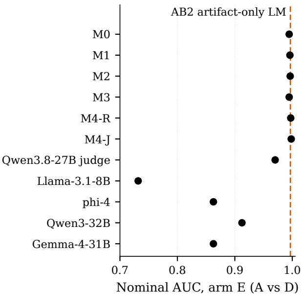
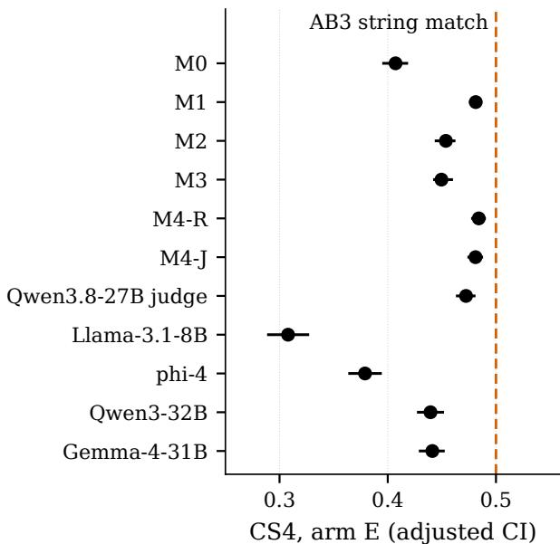
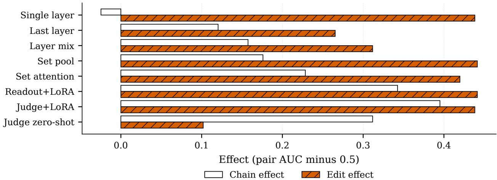
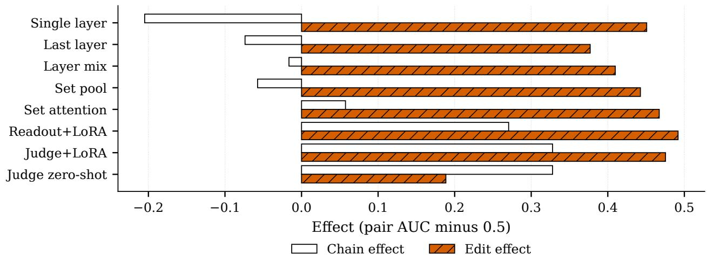
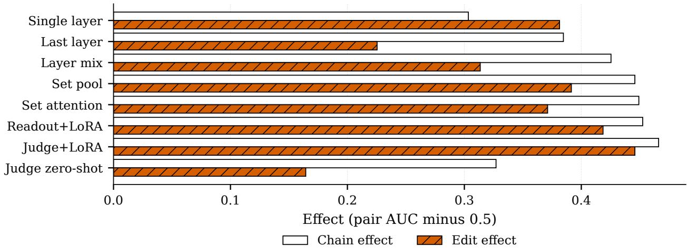
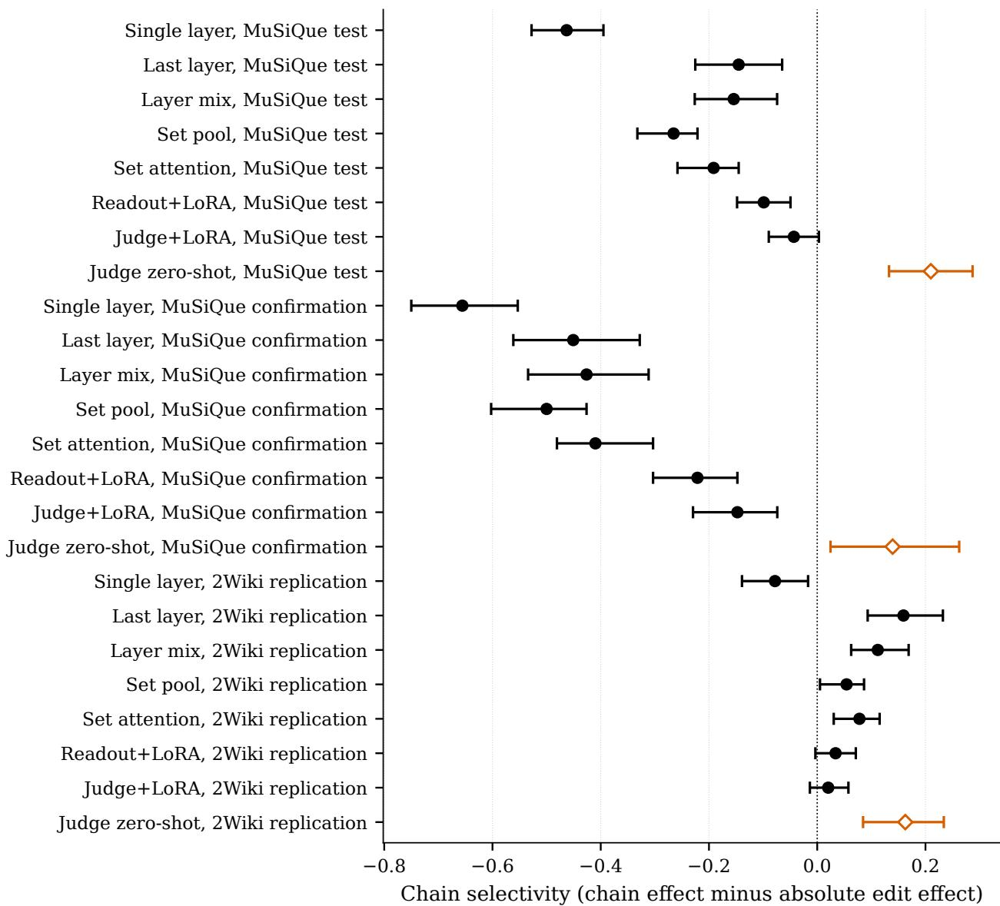
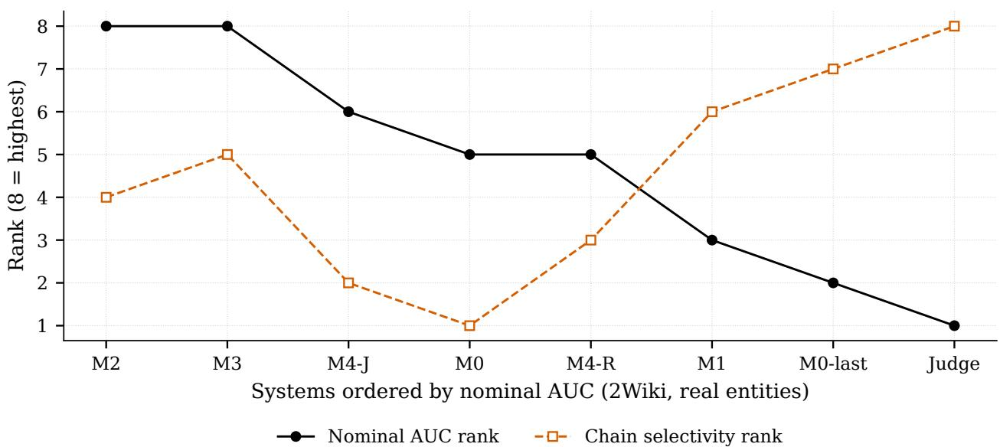
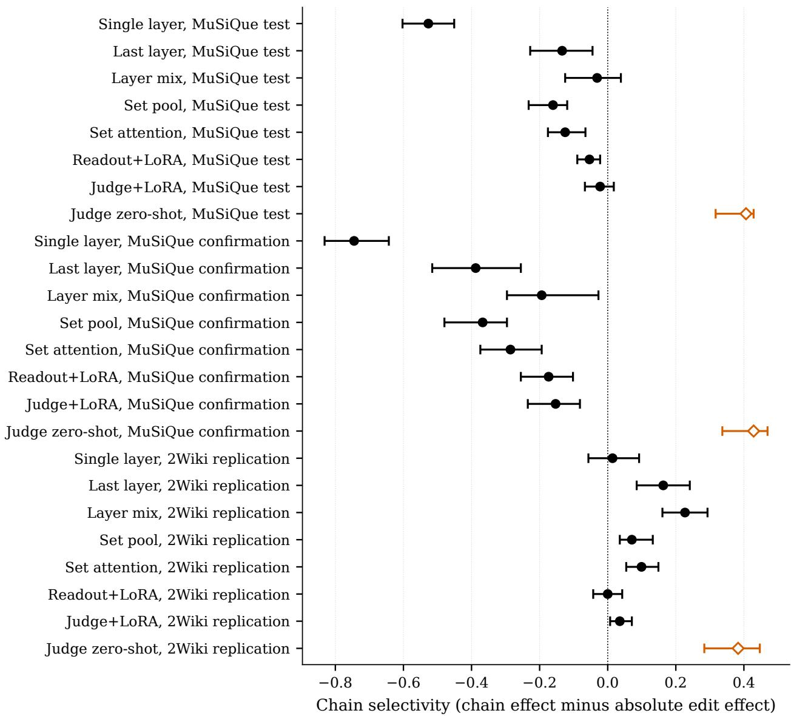
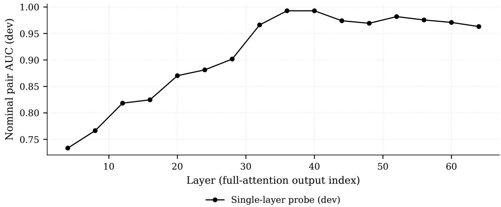

# ChainCheck: Near-Perfect Evidence-Suficiency Scores Can Conceal Sensitivity to Construction Artifacts Paired Conditional Contrasts that Expose an Evaluation Confound

Hyojung Han1,† Ryangkyung Kang1 Youngeun Kim2 Seung-Hun Jeon1

1ThakiCloud 2Korea University

†Corresponding author: hyojung.han@thakicloud.com

2026-11-08

## Abstract

Evidence-suficiency benchmarks ask whether a model can tell a complete passage set from one whose reasoning chain is broken. When broken sets are made by editing text, near-perfect suficiency scores—and even positive crossed-control scores—need not demonstrate multi-hop reasoning. We present ChainCheck, an evaluation-validity audit that pairs validator-certified counterfactual cells with artifact-only baselines. In an exploratory crossed control on 2,214 HotpotQA pairs, a language-model scorer that never reads the chain reaches a nominal AUC of 0.997, and a one-string match reaches the maximum of the crossed chain-sensitivity statistic CS4 (0.500), while the 11 evaluated systems score from 0.308 to 0.484; the two statistics are diferent metrics. We therefore read positive CS4 as operational bridge-consistency sensitivity, not as semantic multi-hop reasoning. Every system is also sensitive to one extra edit, and the edits are detectable according to model-based naturalness ratings. On an independent HotpotQA set of 2,276 pairs, patterns pre-specified on MuSiQue and 2WikiMultiHopQA did not replicate: 5 of 6 trained readouts were edit-dominated, and the reference judge’s selectivity interval [−0.007, +0.042] includes zero. Judge scores also depended on batch layout. The MuSiQue and 2Wiki records are public; the HotpotQA records and the fine-tuned checkpoints are not, so external reproduction is partial.

## 1 Introduction

How do we know that an evidence-suficiency model detects broken reasoning chains rather than artifacts left behind when the benchmark was built? A suficiency benchmark needs negatives: passage sets that look like the positives but lack a complete evidence chain. Every way of making them leaves a trace. Deleting a supporting passage lowers the query relevance of the set, so a surface classifier recovers the label. Substituting the bridge entity in a later hop keeps query overlap fixed, but it places an unexpected entity in a fluent passage, and a large language model can notice that the text was edited without following the chain at all. The ordinary score, a pair AUC of positive over negative, mixes these behaviours. Once several systems sit near the ceiling, it also leaves little headroom to order them.

Shortcut learning is well documented [7], and counterfactual evaluation of multi-hop reasoning is not new. ACCORD controls reasoning depth with multi-hop counterfactuals [23]; CRiT-QA and CofCA use counterfactual entities and chains to remove parametric knowledge and shallow shortcuts [31, 27]; SURE-RAG validates a suficiency verifier under an artifact-aware protocol [21];

and Pair-ID audits how a generated answer responds to paired evidence interventions [5]. These works use counterfactual edits as a tool. ChainCheck asks whether the counterfactual edit itself becomes a new shortcut. Rather than proposing a harder benchmark, it reports, next to the ordinary score, a chain efect, an edit efect and chain selectivity, each a paired conditional contrast on pairs whose labels follow mechanically from validated provenance-preserving interventions. We position it as a protocol that exposes an evaluation confound: a positive selectivity says that a system’s response on these records is not explained by the edit trace alone, not that the system understands the chain.

The protocol grew out of a failure. We had pre-specified a comparison between a structured evidence readout and a single-layer probe on a provenance-built benchmark. The headline gate failed because the probe was already at the ceiling, and a matched-adaptation comparison against a one-token judge ended in a tie (Section 6.1). Controls added before the test read showed that much of the probe’s score was edit detection. ChainCheck formalises those controls into a protocol.

## Contributions.

1. A validity problem for suficiency scores. Near-ceiling nominal scores and positive crossedcontrol scores can both be reached without reading the chain. On the crossed HotpotQA arm the evaluated systems’ nominal AUC lies between 0.732 and 0.998, an artifact-only languagemodel scorer reaches 0.997, and a string-match reference reaches the CS4 maximum of 0.500 (Figure 1, Section 11.2). We separate three claims: sensitivity to bridge string consistency (supported), sensitivity to the edit trace (supported) and semantic multi-hop reasoning (not established by any measurement here).

2. An audit protocol, with its boundary. ChainCheck admits a pair only when a deterministic validator (checks Q1 to Q9) certifies every counterfactual cell, reports a chain efect, an edit efect and their diference as paired conditional contrasts, and adds a crossed control with artifact-only baselines (Sections 3 and 11.2). Its boundary is stated with it: a broken chain without any edit cannot be constructed, so the contrasts are conditional, not an additive decomposition, and CS4 measures operational chain sensitivity in the sense defined in Section 11.2.

3. Limits on generalization and reproduction. Patterns pre-specified on MuSiQue (Section 6.3) and tested on 2WikiMultiHopQA (Section 6.4) do not replicate on an independent HotpotQA set whose clustered intervals are informative (Section 11.1); record dependence limits the earlier sets (Section 7); judge scores depend on batch layout (Section 11.3); and the data and fine-tuned checkpoints are private, which bounds what outside researchers can reproduce (Section 12).

Status of the evidence. Section 6.2 is exploratory: selectivity and its criterion were defined after the single read of the MuSiQue test split. Before scoring any confirmation pair we committed three hypotheses, their thresholds and the system list to a time-stamped internal decision record (not public) (Section 6.3), and before scoring any 2Wiki pair we fixed the replication patterns and the only permitted builder adaptations (Section 6.4). The headline wording of this paper was narrowed after the 2Wiki result; no criterion, number or system choice changed. Section 7 was added after every pre-specified result had been read; it changes no pre-specified verdict, and its informativeness rule was itself chosen post hoc. Section 11 was run after all of these results had been read; the tier of each of its analyses is stated there (Table 4).

  
(a) Nominal AUC

  
(b) CS4  
Figure 1: Artifact-only baselines against the evaluated systems on the crossed HotpotQA arm E (2,214 pairs, exploratory). (a) Nominal pair AUC of the original contrast (A over D) for the 11 systems; the dashed line is AB2, a per-passage language-model log-probability scorer that never sees the chain (0.997). (b) CS4, the crossed chain-sensitivity statistic of Section 11.2, with Bonferroni-adjusted document-group bootstrap intervals; the dashed line is AB3, which checks whether one bridge string equals one title and reaches the maximum 0.500. The panels use diferent metrics on separate axes and are not compared with each other. Values are in Table 6.

## 2 Related work

Shortcuts and annotation artifacts. Models often reach high benchmark scores through cues that the benchmark designers did not intend [7]. Hypothesis-only baselines in natural language inference reach well above chance [8, 19], models trained on that task adopt syntactic heuristics that fail on targeted evaluation sets [17], and reading-comprehension models answer many questions from the question or the passage alone [15]. ChainCheck addresses one artifact of this kind that is specific to suficiency benchmarks: the trace that constructing a negative leaves in the text.

Shortcuts in multi-hop question answering. HotpotQA introduced explainable multi-hop questions with supporting facts [29], and several analyses then showed that many of its questions can be answered with a single hop [18, 3]. Adversarial distractors [12] and transformations that expose disconnected reasoning [25] were proposed to close these shortcuts, and models that answer a multi-hop question correctly often fail its single-hop sub-questions [24]. Language models show a compositionality gap between answering sub-questions and composing them [20]. MuSiQue composes multi-hop questions from single-hop ones so that each hop is needed and records per-hop supporting paragraphs [26]; 2WikiMultiHopQA provides evidence triples for each reasoning path [10]. We use that provenance as the only source of labels.

Counterfactual and minimal-edit evaluation. Contrast sets [6] and counterfactually augmented data [14] use minimal edits to probe or train decision boundaries. For multi-hop reasoning, ACCORD uses controlled multi-hop anti-factuals to separate commonsense grounding from reasoning and to vary reasoning complexity [23]; ACCORD controls what reasoning is required, whereas ChainCheck controls what construction artifact accompanies the reasoning intervention. CofCA builds step-wise counterfactual questions [27], and CRiT-QA replaces factual chains with counterfactual entities and adds distractor chains that diverge at diferent hops [31]. CRiT-QA uses counterfactual edits to remove shortcuts; ChainCheck measures whether the counterfactual edit itself becomes a shortcut. It adds a cell in which the edit is present but the label does not change, and reports the response to the chain and the response to the edit as separate quantities.

Knowledge conflicts. When context contradicts what a model memorised, models may follow the context or their parametric knowledge [16, 28]. Our consistent bridge swap with a real entity creates exactly such a conflict in the earlier hop, which is why the protocol includes a syntheticentity control.

Evidence suficiency in retrieval-augmented generation. SQuAD 2.0 made unanswerable questions a reading-comprehension construct [22], and suficient context has been proposed as a lens on retrieval-augmented generation [13]. Benchmarks and analyses of retrieval-augmented generation test robustness to noisy, irrelevant or missing evidence [2, 4, 30], SURE-RAG treats evidence suficiency as a set-level property and validates a proposed suficiency verifier with counterfactual swaps, shortcut baselines and no-oracle checks [21]. ChainCheck asks a diferent question: whether the counterfactual construction itself creates a signal that can masquerade as suficiency detection. It therefore adds an intact-chain edit control and measures chain and edit sensitivity separately for any evaluated scorer, rather than proposing a scorer. Pair-ID holds a query, retrieval state and reader fixed and crosses support addition with nonsupport deletion to audit how a failed answer responds to evidence repair [5]. Its crossed design resembles ours, but its object is the generated response; ChainCheck’s object is the evaluation itself, asking how much of a suficiency score responds to the benchmark’s construction edit rather than to the broken chain. Pair-ID is a response audit; ChainCheck is an evaluation-confound audit.

Probes and judges. Probing classifiers can report high accuracy for reasons unrelated to the property of interest, which control tasks were designed to expose [9]; our edit-only cell plays a similar role for suficiency readouts. Language models are widely used as zero-shot judges [32]; here they are evaluated systems, not labelers. LLM safety evaluators shift their preferences with superficial artifacts such as apologetic phrasing, and agreement with human labels does not imply robustness to such artifacts [1]. ChainCheck makes the same point for evidence-suficiency scorers, with a construction edit in place of a stylistic one.

## 3 The ChainCheck protocol

## 3.1 Counterfactual cells

Cells are indexed by chain status (alive, broken) and edit trace (absent, present). Three of the four cells are constructed; the design is therefore not a full factorial.

<table><tr><td></td><td>No edit trace</td><td>Edit trace</td></tr><tr><td>Chain alive</td><td>A: original passage set</td><td>B: consistent bridge swap</td></tr><tr><td>Chain broken</td><td>C: not constructed</td><td>D: bridge substitution in the later hop</td></tr></table>

D replaces the bridge entity X with a diferent entity Y in the later-hop supporting passage only, so the earlier hop yields X, the later hop speaks of Y, and the chain is cut. B replaces X with Y in both the earlier and the later supporting passages, so the chain is intact but carries an edit trace. B and D share the later passage exactly and difer only in the earlier supporting passage. C, a broken chain without any edit, cannot be built without an intervention and is not used. Removing a hop is the nearest candidate, but it carries a diferent artifact (lower query relevance), so hop removal appears only as a diagnostic. Because C is missing, ChainCheck cannot estimate an interaction between chain status and edit trace, and the chain efect is measured in the presence of an edit.

## 3.2 Metrics

The primitive statistic is a within-record concordance probability over the n accepted records, $\begin{array} { r } { \mathrm { A U C } ( X > Y ) = n ^ { - 1 } \sum _ { i } \big [ { \bf 1 } \big ( s _ { X _ { i } } > s _ { Y _ { i } } \big ) + \frac { 1 } { 2 } { \bf 1 } \big ( s _ { X _ { i } } = s _ { Y _ { i } } \big ) \big ] } \end{array}$ , which we call a pair AUC; it is invariant to score scale and calibration. CE, EE and Σ are contrasts derived from it, not AUCs themselves. They are paired conditional contrasts, not an additive decomposition: AUC is nonlinear and C is absent, so the nominal score is not the sum of the chain and edit efects. Each contrast is identified only conditionally: CE is the response to a broken chain given that an edit is present, and EE is the response to an edit given that the chain is alive. No interaction between chain status and edit trace is estimable from three cells, and we do not read CE and EE as components of the nominal score.

$$
\begin{array} { r l r l } & { \mathrm { N o m i n a l } = \mathrm { A U C } ( A > D ) , \qquad } & & { \mathrm { C E } = \mathrm { A U C } ( B > D ) - 0 . 5 , } \\ & { \qquad \mathrm { E E } = \mathrm { A U C } ( A > B ) - 0 . 5 , \qquad } & & { \Sigma = \mathrm { C E } - | \mathrm { E E } | . } \end{array}
$$

The chain efect CE is the B-versus-D response to breaking the chain under a shared later-passage edit; the edit efect EE is the response to an edit that leaves the chain alive; chain selectivity Σ is positive when chain sensitivity exceeds edit sensitivity. A system is chain-selective on a slice when the lower bound of the 95% pair-bootstrap interval of Σ is above zero. Intervals are 2,000-resample percentile bootstraps over accepted records. For trained systems, displayed point estimates are medians of three seed-level metrics, whereas the bootstrap resamples per-record outcomes averaged over the seeds; the intervals therefore target a seed-averaged statistic, are not uncertainty intervals for the displayed medians, and do not include training-seed variation. The chain-selectivity criterion and H1 were applied to this seed-averaged bootstrap. B edits two passages and D edits one, so for a scorer that responds only to the number of edited passages this asymmetry would push CE downward. No general bias direction follows for other scorers, because B and D may also difer in edit coherence, naturalness, or chain-correlated surface cues. The same mismatch cuts the other way for EE: A versus B compares an unedited set with a two-passage edit, so EE may exceed the edit efect of a single-passage edit, and |EE| enters Σ at that larger value. Neither contrast is edit-matched, so CE is not a chain-only efect. A follow-up edit-matched control confirms the predicted direction: matching raises CE for every system on MuSiQue, most for the trained readouts (Section 10).

## 3.3 Deterministic validator

A pair enters the counts only if nine checks pass: Q1 the query is identical across cells; Q2 passage positions are identical; Q3 untouched passages are byte-identical; Q4 the later passage is identical in B and D; Q5 the earlier-passage edit in B is exactly the X to Y replacement; Q6 X and Y are aliasdisjoint; Q7 the answer-span count is identical; Q8 each passage’s query-lexical signature is identical across cells; Q9 the chain graph is alive in A and B and broken in D. Labels come only from dataset provenance and these checks. Our claim is restricted to programmatically verifiable provenancepreserving interventions: the benchmark labels follow mechanically from validated interventions, and human audit is not part of the protocol. The checks are string- and graph-level: they do not certify that an edited passage reads naturally or that the substituted entity is plausible in context, so any such cue counts as part of the edit trace rather than being removed.

<table><tr><td>Construction of the negative (MuSiQue test) Surface-only paired AUC</td><td></td><td>Role</td></tr><tr><td>ABSENT, all support removed</td><td>0.959</td><td>diagnostic</td></tr><tr><td>PARTIAL, hop removal</td><td>0.922</td><td>diagnostic</td></tr><tr><td>PARTIAL, bridge substitution</td><td>0.568</td><td>primary</td></tr></table>

Table 1: A surface-only classifier (BM25, Jaccard, length, near-duplicate features) under group-aware crossvalidation. Deletion-based negatives are separable from the surface alone; bridge substitution is below the pre-specified gate of 0.65.

## 3.4 Controls

(1) Closed-book separation: questions the reference backbone answers without passages, under a lenient string-containment rule, are excluded. This reduces but does not eliminate parametric bypass, and it does not establish closed-book hardness for the additional judge families. (2) Editonly control: cell B, measured by EE. (3) Conditional chain contrast: B against D, measured by CE. (4) Synthetic entities: Y is a deterministic fictional name of matched token count and capitalisation, which reduces bridge-specific world-knowledge conflict in B and D. (5) Permutation invariance: passage order is shufled and features are re-extracted from the language model, not just re-pooled. A diagnostic, construction transfer, scores systems trained on substitution against negatives built by hop removal or full removal.

## 4 Construction

MuSiQue. We group examples by a hash of their sorted supporting document titles and split by group. The original MuSiQue split is not document-disjoint: of 12,304 train and 2,328 validation documents, 196 are shared, and only 1,424 of 2,417 validation examples (58.9%) are fully disjoint; we keep only those for test. An earlier build took the group identifier from the prefix of the example id, which encodes the hop count; that produced 120 groups and silently turned group-aware crossvalidation into ordinary k-fold. The corrected definition gives 18,534 groups, at most 48 examples per group and 88.3% singletons, and re-measuring the surface gate moved it from 0.608 to 0.568.

Table 1 shows why the negatives are built by substitution: a surface-only classifier separates deletion-based negatives from the original set but not substitution-based ones. On all 463 test pairs the deltas of maximum and mean query Jaccard, answer presence and answer count are exactly zero; the BM25 maximum changes for 2.38% of pairs. A legacy eight-invariant builder gate, applied before the Q1–Q9 validator, decides which substitution candidates enter the benchmark; 6,196 of 6,944 train candidates (89.2%) and 463 of 504 validation candidates (91.9%) pass. It catches two corruptions that surface audits cannot see: a bridge that is part of the answer string, so that substitution also edits the answer (487 train candidates), and an intermediate passage that mentions the bridge and rebuilds the chain (172 train and 30 validation candidates). The primary arm has 4,925 train, 636 dev, 635 calibration and 463 test pairs.

On the test split, 338 of 463 real-entity candidates and 234 of 270 synthetic-entity candidates (the pairs admitted by the builder gate) pass Q1 to Q9, of which 324 and 224 are closed-book-hard. Every rejection was Q8 (125 real and 36 synthetic): the earlier-passage edit in B had changed that passage’s query-lexical signature. Kept, those pairs would have turned part of the A-versus-B diference into a query-relevance artifact, the confound the protocol exists to remove. Only the validator caught it.

MuSiQue confirmation. The confirmation set takes MuSiQue validation examples that the test split excluded for sharing documents with training, built by the same builder, controls and validator (122 real and 98 synthetic closed-book-hard pairs). Because these examples share documents with the training split, confirmation rests on the untrained judge and on contrasts, not on absolute scores of trained systems; the hypothesis about trained systems (H1 below) is a within-distribution check rather than an independent confirmation.

2WikiMultiHopQA. The only permitted changes were to the builder, and they were fixed before any score: the bridge is the object of the first evidence triple and the subject of the second; only compositional and inference questions are used; each set has 8 passages because 2Wiki gives ten per question; and at most 1,500 examples are drawn in a fixed seeded order. The validator rejected 185 candidates for Q8, leaving 295 real and 141 synthetic closed-book-hard pairs. Passages are rendered as a title followed by the body, and in every admitted 2Wiki example the later-hop passage title is the bridge entity, so the bridge substitution also rewrites that title prefix in B and D; MuSiQue passages carry titles too, but the later-hop title is not in general the bridge.

## 5 Systems evaluated

The eight primary systems use the same Qwen3.8-27B base checkpoint, with the passages packed into one prompt that ends in a decision token. M0 to M3 and the zero-shot judge keep the backbone frozen; M4-R and M4-J add matched rank-8 LoRA adapters. The systems are subjects of the evaluation; none is proposed here. M0 is a logistic probe on the decision token of the single layer that is best on dev (layer 36, dev pair AUC 0.993); M0-last uses the last layer. M1 mixes sixteen layers with a softmax gate. M2 pools per-passage representations with attention and a learned query, without cross-passage interaction. M3 lets the mixed decision token attend over the passage set without positional encoding. M4-R and M4-J spend the same rank-8 LoRA budget [11] (5,242,880 parameters on the full-attention layers) to feed a readout head or to score a onetoken answer. The zero-shot judge is the backbone’s one-token yes/no probability, untrained. M0 to M3 are trained with binary cross-entropy and a pair hinge on primary substitution pairs only (A against D), early-stopped on dev, and reported as the median of three seeds. The M4 adapters train on 4,925 pairs. For 2Wiki, every trained system is the MuSiQue-trained model; nothing is retrained or recalibrated.

Additional judges. Separately from the eight primary systems, we score four zero-shot judges from other model families on both evaluation sets, with the same prompt and score definition: Llama-3.1-8B-Instruct, phi-4, Qwen3-32B and Gemma-4-31B-it. They are not part of the primary ranking.

## 6 Results

## 6.1 The nominal ceiling

On the 447 closed-book-hard MuSiQue test pairs (the backbone answered 3.5% of the questions closed-book), the nominal pair AUC is 0.970 for M0, 0.990 for M3, 0.996 for both M4 systems and 0.893 for the zero-shot judge. The pre-specified gate requiring M3 to beat M0 by at least 0.05 failed (gain 0.022 [0.007, 0.038]), and the matched-adaptation comparison was a tie (diference 0.000 [−0.009, 0.009]). These ceiling-level values leave limited headroom, and we do not report inferential comparisons of the nominal ranks. We report these outcomes as the observation that motivated the protocol, not as contributions. This section reports the original pre-specified A-versus-D test on 447 closed-book-hard pairs. ChainCheck additionally requires a valid B cell and checks Q1 to Q9, which leaves 324 real-entity pairs for the sections that follow.

## 6.2 Exploratory contrasts on the MuSiQue test split

Table 8 and Figure 2 give the contrasts for every system on the 324 real-entity test pairs (224 synthetic). On the test split every system trained on A versus D treats the intact but edited chain B almost as a negative: edit efects lie between +0.312 and +0.441. The single-layer probe shows no chain sensitivity at all (chain efect −0.025 [−0.080, 0.031]), structured readouts and adaptation raise the chain efect, and the edit efect stays larger, so every trained system has negative selectivity. The zero-shot judge is the only chain-selective system, +0.210 [0.133, 0.287], while having the lowest nominal score, 0.889. With synthetic bridge names (Table 9) the judge’s edit efect falls to +0.000 [−0.067, 0.067], which is consistent with a contribution from bridgespecific world-knowledge conflict to its residual edit sensitivity, whereas the trained systems keep their edit efect. Selectivity and the chain-selectivity criterion were defined after this read, so this section motivates the hypotheses tested next and does not confirm them.

## 6.3 Sealed confirmation on MuSiQue

Three hypotheses were frozen before any confirmation pair was scored. H1: every trained system has an edit efect whose lower bound exceeds 0.25 and a selectivity whose upper bound is below zero. H2: the reference zero-shot judge has a selectivity lower bound above zero on both the real and the synthetic slice. H3: the judge’s edit efect is larger on real than on synthetic entities. H1 and H2 met their pre-specified criteria. H3 had the pre-specified direction, but its independent-slice bootstrap ignores shared source questions and documents; we report H3 descriptively and do not assign it a confirmatory pass/fail interpretation. H1 concerns trained systems scored on documents shared with their training split; it is a within-distribution check, not an independent confirmation.

On real entities (122 pairs; 98 synthetic), the lower bounds of the trained systems’ edit efects lie between 0.361 and 0.475, and every trained selectivity interval lies below zero. The reference judge’s selectivity is +0.139 [0.025, 0.262] on real and +0.429 [0.337, 0.469] on synthetic entities; the margin on real entities is thin. Its edit efect is 0.219 [0.092, 0.344] lower on the synthetic slice than on the real slice. The interval is the diference of independent bootstraps of two separately validated slices whose membership difers (122 and 98 pairs), so the diference is consistent with, but not identified as, a contribution from bridge-specific world-knowledge conflict to its residual edit sensitivity.

One exploratory observation does not carry over. On the test split the judge had the lowest nominal score; on the confirmation set it ranks 3 of 8 by nominal score and 1 by selectivity. What holds is that nominal scores lie between 0.902 and 1.000 on real entities and leave little headroom, while the selectivity point estimates order them diferently, with overlapping intervals.

(a) MuSiQue test (exploratory)  

(b) MuSiQue confirmation  
  
(c) 2WikiMultiHopQA replication  
Figure 2: Chain efect (open bars, AUC(B>D)−0.5) and edit efect (hatched bars, AUC(A>B)−0.5) per system, real bridge entities. Trained systems (M0 to M4) show large edit efects in every setting; their chain efects are smaller on MuSiQue and large on 2Wiki. The two contrasts vary separately in these data.

Other judge families. Following a rule fixed before their scores were seen, every additional judge is reported on both datasets (Tables 10 and 11). On the MuSiQue confirmation set, 1 of the 4 additional judges meet the H2 criterion on both slices: Gemma-4-31B-it is chain-selective, while phi-4 is edit-dominated on real entities, with selectivity −0.205 [−0.336, −0.066]. On 2Wiki all 4 of 4 meet it, phi-4 included (+0.156 [0.078, 0.237] on real entities). The pre-specified reference judge replicates, while selectivity varies across judge families and datasets. Being untrained on the nominal contrast is therefore not by itself what makes a system chain-selective, which is what one expects if the two contrasts are separable.

## 6.4 External replication on 2WikiMultiHopQA

The replication was run because H1 and H2 passed, as pre-specified, and was required to reproduce four patterns rather than absolute numbers. Three replicate on the 295 real-entity pairs (141 synthetic). Nominal scores lie between 0.905 and 1.000, and the judge ranks 8 of 8 (last) by nominal score on both slices. Its selectivity is positive, +0.163 [0.085, 0.234] on real and +0.383 [0.284, 0.447] on synthetic entities, and it ranks 1 by the point estimate of selectivity, so the two rankings difer (Figure 4). The rank is a point estimate: the judge’s interval overlaps those of M0-last, M1, M3 and M2, and the judge and M0-last are nearly tied, so the ordering at the top is not established by these data.

The fourth pattern, the H1 criterion, fails. Trained readouts keep large edit efects (lower bounds above 0.25 on real entities, with one exception on synthetic entities, where the lower bound of M1 is 0.207), but on 2Wiki they also show large chain efects, between +0.303 and +0.466 on real entities, and 5 of the 6 systems covered by H1 (every trained system except M0-last) have positive point estimates of selectivity. Edit sensitivity replicates; edit dominance does not. The same MuSiQue-trained readouts that were edit-dominated on MuSiQue show much stronger chain sensitivity on 2Wiki. We do not know why. One of several possible explanations is surface leakage through the title: the 2Wiki later-hop passage is titled with the bridge entity (Section 4), so in D the earlier passage names X while the later title names Y, a mismatch visible without following the chain. Entity-linking noise and the shift to eight-passage sets and 2Wiki question types are other candidates. A follow-up title-masking control finds the title to be a small cue for the readouts and not detectably one for the judge; the other candidates are untested (Section 10).

## 6.5 Order and construction diagnostics

Table 2 collects both diagnostics on the MuSiQue test split. Under re-extraction with shufled passage order the single-vector probes fail the pre-specified jitter criterion, and the set models, the adapted systems and the zero-shot judge pass. The backbone is causal, so set models are not orderinvariant by construction; this control has to be measured on re-extracted features. Construction transfer does not track selectivity: M1 has negative selectivity on MuSiQue but the highest hopremoval transfer among trained systems. Hop removal also has a high surface ceiling (Table 1), so transfer there may reflect query-relevance cues, and we treat this axis as a diagnostic only.

  
Figure 3: Chain selectivity with 95% pair-bootstrap intervals in all three settings, real bridge entities. Open diamonds mark the reference zero-shot judge. A system is chain-selective when its interval lies right of the dotted zero line. The synthetic-entity version is Figure 5.

<table><tr><td>System</td><td>Order jitter ratio</td><td>Hop-removal transfer</td><td>ABSENT transfer</td></tr><tr><td>M0 single layer</td><td>0.456</td><td>0.794</td><td>0.909</td></tr><tr><td>M0-last</td><td>0.534</td><td>0.888</td><td>0.912</td></tr><tr><td>M1 layer mix</td><td>0.421</td><td>0.964</td><td>0.985</td></tr><tr><td>M2 set pool</td><td>0.148</td><td>0.782</td><td>0.916</td></tr><tr><td>M3 set attention</td><td>0.150</td><td>0.768</td><td>0.911</td></tr><tr><td>M4-R readout+LoRA</td><td>0.076</td><td>0.862</td><td>0.951</td></tr><tr><td>M4-J judge+LoRA</td><td>0.066</td><td>0.872</td><td>0.957</td></tr><tr><td>Judge zero-shot</td><td>0.168</td><td>0.937</td><td>0.990</td></tr></table>

Table 2: Diagnostics on the MuSiQue test split. Order jitter ratio: mean per-record score standard deviation over three re-extracted passage orders divided by the mean FULL-to-PARTIAL gap; the pre-specified pass criterion is below 0.25. Transfer: nominal pair AUC of systems trained on substitution, scored on sets built by another method.

## 7 Post-hoc robustness analysis

Nothing in this section was pre-specified. It reuses the frozen models, scores and pairs, uses $B =$ 10000 resamples with a fixed seed, and changes no number or verdict reported above. We report it because it determines how far the pre-specified results generalise.

Reproduction. Recomputing the MuSiQue confirmation metrics from the frozen features failed our strict reproduction gate. The nominal score of M0 came out as 0.918 against the ledger value 0.934. M0 produces 10 exact A/D score ties, and 14 of its pairs have bit-identical scores. A singlethreaded BLAS rerun returns the ledger value (0.934) but changes the order of 4 pairs; we do not assert a cause. Under a post-hoc rule that excludes the nominal score, the reproduction is partial: the chain efect, the edit efect, selectivity and the verdicts derived from them reproduce. The MuSiQue nominal values in this paper are therefore ledger values from the original run and are sensitive to ties; the conditional contrasts, which carry the claims, are not afected. The 2Wiki recomputation passed the gate.

Bootstrap design. The pre-specified intervals resample pairs independently within each slice. Pairs built from the same source question or sharing documents are not independent. We group records into connected components of shared documents and resample whole groups, jointly across the real and synthetic slices, taking the median over the system’s scoring seeds within each resample; a coarser grouping by passage title gives a second variant. The re-implemented unclustered bootstrap used as the reference for these comparisons is not byte-identical to the pre-specified one: for the judge on real entities it gives [0.016, 0.262] on MuSiQue and [0.088, 0.237] on 2Wiki, against the pre-specified [0.025, 0.262] and [0.085, 0.234]. Verdicts use the pre-specified intervals.

The efective-sample problem. A clustered interval is informative only if the groups are many and balanced. With group sizes $\begin{array} { r } { n _ { g } , } \end{array}$ we use the efective number of groups $K _ { \mathrm { e f f } } = ( \sum _ { g } n _ { g } ) ^ { 2 } / \sum _ { g } n _ { g } ^ { 2 }$ and call a clustered interval informative when the largest group holds at most half the records, $K _ { \mathrm { e f f } } \ \geq \ 2 0$ , and each slice has at least 20 groups. Only the largest-group rule existed before the first clustered run; the other two were added afterwards. The MuSiQue confirmation records form 52 document groups (220 records, largest group 18.2%), with $K _ { \mathrm { e f f } } = 1 8 . 2 2 ;$ grouping by title gives $K _ { \mathrm { e f f } } = 2 . 0 3$ . The 2Wiki records form 30 groups (436 records), the largest holding 76.1% of them. Neither dataset yields an informative clustered interval.

How we read it. We apply three rules. First, the pre-specified pair-bootstrap verdicts stand as reported; a post-hoc analysis does not turn them into failures. Second, the $K _ { \mathrm { e f f } }$ rule is post hoc, so we do not use it to rescue H2 either: we do not claim that H2 survives clustering. Third, an uninformative clustered interval is not a refutation. On MuSiQue the clustered interval for the judge’s selectivity on real entities is [−0.089, 0.341] and includes zero, while on synthetic entities it is [0.216, 0.468]; on 2Wiki the corresponding intervals are [0.054, 0.255] and [0.206, 0.411]. None of these is decisive, in either direction. H2 therefore holds as a pre-specified criterion met on these records; it cannot be read as general confirmation that the judge is chain-selective.

The H1 and H3 results are a separate matter from informativeness. On MuSiQue, H1 holds under the pair bootstrap and under both groupings, but it remains a within-distribution check on documents shared with training. The judge’s real-minus-synthetic edit-efect diference (H3) is 0.219 [0.095, 0.347] under document clustering on MuSiQue and 0.118 [0.068, 0.260] on 2Wiki; because the two slices difer in membership, H3 stays exploratory. Finally, the judge ranks first by point-estimate selectivity on both datasets, but the rank means diferent things. On 2Wiki it rests on a diference from M0-last of +0.003 [−0.083, 0.091] under the pair bootstrap, a near-tie; on MuSiQue the same diference is +0.590 [0.443, 0.738], against a readout that is edit-dominated there. Which system ranks first, and by how much, is a dataset-specific point estimate rather than a general ordering.

## 8 Discussion

Two contrasts. High edit sensitivity does not imply the absence of a positive conditional chain contrast. On MuSiQue the trained readouts are edit-dominated; on 2Wiki the same MuSiQuetrained readouts are both edit- and chain-sensitive. An ordinary score mixes the two, and so does any benchmark that reports nominal accuracy alone. One hypothesis for the dataset dependence is that the 2Wiki later-hop passage is titled with the bridge entity, so the substitution also changes the passage title and makes the break visible at the surface; a pre-specified follow-up title-masking control tested it: the observed shift is a few hundredths of AUC for the trained readouts and not detectable for the judge at the record level; because its verdict is inconclusive under document dependence, this does not rule out title-related explanations beyond these records (Section 10).

Construction and dependence as findings. Two results of this study are about the protocol rather than about any system. First, on the document-dependent MuSiQue confirmation records, the edit-matched control changes the point estimate of M0’s chain contrast from negative to positive. This shows construction sensitivity on these records; because the verdict is INCON-CLUSIVE\_DEPENDENCE, its generality is unresolved, and a sign read from one construction should not be taken as a property of the system alone. Second, the reliability of every comparison here is bounded by document dependence, not by the number of records or systems: 2Wiki has fewer than two efective document groups in every slice, and only one MuSiQue slice reaches the informativeness threshold. Both belong in the report of any edited suficiency benchmark.

Judge families and datasets. The additional judges argue against a simple reading in which zero-shot judges are inherently better at following evidence chains. Only 1 of 4 is chain-selective on the MuSiQue confirmation set, yet all 4 of 4 are on 2Wiki. Chain and edit sensitivity vary with the system family and with the dataset, and the nominal score shows neither.

Lessons for benchmark builders. Ship an edit-only cell with any construction that edits text; without it, a score near the ceiling cannot be attributed to chain following, and it cannot be dismissed as an artifact either. Match the amount of editing between the control and treatment cells; where that is not possible, as here, state which direction the mismatch biases each contrast. Validate every cell in code, including the control cells: our own consistent swap broke query-lexical neutrality in 125 of 463 real-entity test candidates. Use synthetic entities before reading a residual edit efect as a weakness. Group splits by document, and check that the group key means what you think it does. Record the batch layout of every scoring run, and keep it fixed when cells scored in diferent runs are compared.

## 9 Limitations

1. Evidence tiers. Section 6.2 is exploratory. The confirmation pairs come from the same source dataset and share documents with training, so confirmation rests on the untrained judge and on contrasts. The 2Wiki replication reproduced three of four patterns; edit dominance of trained readouts is not part of our claim. Section 11 adds one confirmatory result, which is a non-replication, one exploratory result and one indicative result; the eligibility rule of its confirmation set was revised after a manifest check and before any score.

2. Thin margin and dependence. H2 passed on MuSiQue real entities with a lower bound of 0.025. Records share documents, and too few independent document groups exist for an informative clustered interval on either dataset (Section 7), so H2 is not general confirmation of chain selectivity. On the independent HotpotQA set, where clustered intervals are informative, the H2-type pattern did not replicate (Section 11.1).

3. Rank stability and multiple comparisons. Rankings are point-estimate ranks of eight systems whose selectivity intervals overlap, and only three hypotheses were pre-specified; every other contrast across systems, slices and judge families is reported without correction for their number. Intervals are pair bootstraps; pairs built from the same source question or sharing documents are not independent. A post-hoc cluster bootstrap over document groups widens the intervals and is not informative on these data (Section 7).

4. Partial reproduction. Recomputed from frozen features, the MuSiQue conditional contrasts and their verdicts reproduce, but the MuSiQue nominal score of M0 is numerically unstable under recomputation (0.918 against the ledger value 0.934) in a case with many exact score ties; the cause is unresolved, and the nominal rank of M0 inherits this instability (Section 7).

5. Partial synthetic control. Only the bridge entity is renamed; other entities keep their real names.

6. Scope. One backbone (Qwen3.8-27B), one language (English), three source datasets (HotpotQA only in Section 11). All eight primary systems share that checkpoint, so the rank contrast is a within-backbone result; the additional judges come from other families but are untrained, so no cross-backbone comparison of trained readouts exists. 2Wiki carries entitylinking noise (a later-hop page may describe a namesake); labels still follow from provenance, but such passages are less natural.

7. Missing cell. C is not constructed, so no cell isolates a broken chain without an edit; CE and EE are conditional contrasts, no interaction is estimable, and B and D difer in the number of edited passages (two versus one). The crossed control of Section 11.2 cancels additive per-passage efects but does not construct C either.

8. Validator scope. Q1 to Q9 certify string- and graph-level properties. They do not certify the naturalness or semantic plausibility of an edited passage, and no human or blinded model audit of the edited text was run, so a system may be reacting to unnatural text rather than to an edit as such; the protocol counts both as edit trace.

9. Selection of independent groups. A confirmation set built only from records that share no document, question or group with each other or with any earlier split removes frequently reused documents. Independence then comes at the cost of representativeness: the retained items may difer in distribution from the source datasets, so results on such a set describe that set, not the full benchmark population. A first attempt under a separately fixed eligibility protocol produced no slice that met its minimum independent-sample threshold and contributes no result. The HotpotQA set of Section 11.1 meets the threshold only after a post-manifest amendment of its eligibility rule and comes from the training split of one source dataset, so its non-replication describes that set.

10. Batch layout. Judge scores depend on how records are packed into batches (Section 11.3). Our results are reproducible under the recorded layouts, not invariant to batching, and the cause of the largest single-record shift is unexplained.

11. Closed-book filter. The rule is lenient string containment; residual parametric leakage is not ruled out, and the filter uses the reference backbone only.

## 10 Pre-specified follow-up controls

Status. The two controls below were designed after the original MuSiQue and 2Wiki results had been seen. Their samples, statistics and decision rules were fixed in an internal record before any of their scores existed, and auxiliary analyses were added to that record, again before any score was read, without changing a decision rule. They are pre-specified follow-up controls, not a preregistration of the study. They test two alternative explanations of the judge’s selectivity; neither is meant to make H2 pass. All four verdicts (two controls, two datasets) are INCONCLU-SIVE\_DEPENDENCE under the dependence rule of Section 7, which is what the group structure predicted before any score: on MuSiQue the synthetic slice and the joint comparison have fewer than 20 efective clusters, and on 2Wiki one document group carries most records in every slice (Table 3). We therefore report efect sizes rather than verdicts: the direction, the point change, a record-level interval and a cluster interval, with the efective cluster count. The primary comparison is with the original scores on the same records: one paired bootstrap (10000 resamples) draws each record’s original and controlled cells together, so the change has its own interval. Results on the full original hard set are reported in the analysis output as auxiliary only. Intervals on 2Wiki rest on fewer than two efective groups and should be read that way.

Control 1: edit matching. The new cell D′ edits the earlier passage as well $( X \to Z )$ . On 2Wiki real, $D ^ { \prime }$ could not be built for every pair because no second substitute entity Z was available for some of them, so this control uses 287 of the 295 real pairs; the MuSiQue slices and the 2Wiki synthetic slice keep every pair. The control scores six systems: the judge, M0, M0-last, M1, M2 and M3. With $D ^ { \prime } { } _ { ; }$ , the chain contrast $\mathrm { C E } _ { m } = \mathrm { A U C } ( B > D ^ { \prime } ) - 0 . 5$ compares two edited passages with two. The asymmetry predicted in Section 3 is visible: for a scorer that counts edits, the original CE should rise once edits are matched. It rises for every system on MuSiQue and falls for none on 2Wiki. For the judge the change on MuSiQue is +0.107 on the real slice (record interval $\left[ + 0 . 0 3 3 , \ + 0 . 1 8 0 \right]$ , cluster [+0.025, +0.214]) and +0.041 on the synthetic slice $\left( \left[ + 0 . 0 1 0 , \ + 0 . 0 8 2 \right] \right.$ ; cluster $\left[ + 0 . 0 0 0 , + 0 . 0 9 4 \right] )$ ; on 2Wiki it is +0.129 (real, [+0.087, +0.171]; cluster [−0.020, +0.177]) and +0.014 (synthetic, [−0.021, +0.050]). The edit-dominated readout M0 moves far more on MuSiQue: its CE goes from −0.205 to +0.180 on the real slice and from −0.276 to +0.306 on the synthetic slice, a reversal of sign on both slices. This is the largest change either control produced. It shows that the negative chain contrasts of the trained readouts on MuSiQue are highly sensitive to the edit-matching intervention; it does not yet show that the edit-count asymmetry alone caused them, because matching the edit count also edits a second passage and may change its coherence, naturalness or other surface cues. The automated artifact-detectability audit below is designed to separate these in part, and the reversal has so far been observed only on the document groups of this confirmation set.

<table><tr><td>Control</td><td>Dataset</td><td>Slice</td><td>Records</td><td>Clusters</td><td> $K _ { \mathrm { e f f } }$  (largest share, %)</td></tr><tr><td rowspan="5">Edit-matched</td><td>MuSiQue</td><td>real</td><td>122</td><td>52</td><td>20.9 (16.4)</td></tr><tr><td></td><td>synthetic</td><td>98</td><td>40</td><td>14.64 (20.4)</td></tr><tr><td>2Wiki</td><td>joint</td><td>220</td><td>52</td><td>18.22 2 (18.2)</td></tr><tr><td></td><td>real</td><td>287</td><td>28</td><td>1.7 (76.3)</td></tr><tr><td></td><td>synthetic</td><td>141 428</td><td>19</td><td>1.63 (78.0)</td></tr><tr><td rowspan="6">Title masking</td><td>MuSiQue</td><td>joint</td><td></td><td>28</td><td>1.68 (76.9)</td></tr><tr><td></td><td>real</td><td>118</td><td>51</td><td>19.89 (17.0)</td></tr><tr><td></td><td>synthetic joint</td><td>97 215</td><td>39 51</td><td>14.36 (20.6)</td></tr><tr><td>2Wiki</td><td>real</td><td>278</td><td>29</td><td>17.52 (18.6) 1.7 (76.3)</td></tr><tr><td></td><td>synthetic</td><td>140</td><td>19</td><td>1.64 (77.9)</td></tr><tr><td></td><td>joint</td><td>418</td><td>29</td><td>1.68 (76.8)</td></tr></table>

Table 3: Dependence structure of the follow-up controls. Clusters are shared-document groups; $K _ { \mathrm { e f f } }$ is the efective number of clusters and the parenthesis gives the share of records in the largest cluster. A clustered interval counts as informative only with at least 20 efective clusters, at least 20 clusters and a largest share of at most one half. Only the MuSiQue real slice of the edit-matched control meets the rule; the title-masking MuSiQue real slice falls just below it after masking excludes records.

The point estimate of Σ remains positive after matching in all four analyzed slices. The judge’s $\Sigma _ { m }$ stays positive: +0.246 on MuSiQue real (record [+0.147, +0.344], cluster [+0.082, +0.393]), the one slice whose clustered interval is informative, and +0.480, +0.289 and +0.418 elsewhere, with every record and cluster lower bound above zero. On the MuSiQue real slice every trained readout stays edit-dominated, with record intervals below zero; M0 has $\Sigma _ { m }$ of −0.279 (real, cluster [−0.358, −0.190]) and −0.173 (synthetic, cluster [−0.259, −0.056]), down from −0.656 and −0.745. On the synthetic slice two of the five readouts no longer separate from zero, and on 2Wiki M0’s near-zero Σ turns slightly positive (−0.084 to +0.066, cluster [−0.053, +0.109]). Edit matching therefore changes the size of both contrasts, by a lot for the readouts, and moves readouts that were close to the boundary. Only the MuSiQue real slice has an informative clustered interval, and every control verdict is INCONCLUSIVE\_DEPENDENCE, so these estimates do not establish that the judge’s chain selectivity or the readouts’ edit dominance is unchanged. The judge ranks first by Σ before and after matching in every slice; the rank correlation of these six systems between Σ and $\Sigma _ { m }$ is 0.657 (MuSiQue real), 0.829 (MuSiQue synthetic), 1.000 (2Wiki real) and 0.943 (2Wiki synthetic). One asymmetry remains by construction: B introduces one new entity and $D ^ { \prime }$ two.

Control 2: title masking. Every passage title in every cell was replaced by a neutral placeholder, and an unmasked copy of the same cells was scored in the same run. Records whose bridge entity no longer appears in any passage body after masking were excluded, as specified: 2Wiki keeps 278 of 295 real and 140 of 141 synthetic records, MuSiQue 118 of 122 and 97 of 98. The masking changed what it was meant to change and little else. On 2Wiki the bridge entity named the earlier-hop title in 100.0% of real A cells and the substituted entity named the later-hop title in 100.0% of real D cells; after masking both are 0.0%, while the bridge entity stays in the D body in 100.0% of records. Length fell by the same small amount in every cell, from 784 to 760 tokens for the real D cell on 2Wiki and from 1,261 to 1,238 on MuSiQue, and the passage count, order and body text are unchanged by construction. MuSiQue is a weaker negative control than intended: its earlier-hop title names the bridge entity in 20.3% of real A cells.

Masking leaves the judge’s chain contrast on 2Wiki almost unchanged: $\Delta _ { \mathrm { m a s k } } = \mathrm { C E } _ { M } - \mathrm { C E } _ { U }$ is −0.018 on the real slice (record [−0.054, +0.022], cluster $[ - 0 . 0 4 2 , + 0 . 0 7 8 ] )$ and −0.014 on the synthetic slice ([−0.057, +0.029]; cluster [−0.127, +0.080]). Both record intervals lie inside the prespecified equivalence margin of ±0.1 AUC; the synthetic cluster interval does not, and no 2Wiki cluster interval is informative. Against the original scores on the same records the masked CE difers by −0.018 (real, $[ - 0 . 0 5 8 , + 0 . 0 2 2 ] ,$ ) and +0.000 (synthetic, $\left[ - 0 . 0 4 3 , + 0 . 0 4 3 \right] )$ , and the judge’s $\Sigma _ { M }$ stays at +0.180 and +0.393 with record and cluster lower bounds above zero. On MuSiQue the judge moves by a similar amount, −0.025 (real) and −0.031 (synthetic), so the pre-specified reading that 2Wiki should move more than the negative control does not hold for the judge. That small shifts of this size are within run-to-run variation is suggested by the unmasked rebuild itself: on MuSiQue real its CE is +0.356 against +0.339 for the original cells.

The trained readouts behave diferently. On 2Wiki real, masking lowers CE for every readout, by −0.061 for M0 (record [−0.095, −0.029]) and −0.045 for M3 $( [ - 0 . 0 7 2 , ~ - 0 . 0 1 4 ] )$ , whereas on MuSiQue the same readouts show no consistent direction (M0 +0.009, M3 +0.072). The title is a measurable but small channel for the readouts on 2Wiki: it explains a few hundredths of AUC, not their large 2Wiki chain contrasts. System ranks by Σ are nearly unchanged by masking (rank correlation with the original 1.000 on 2Wiki real and 1.000 on 2Wiki synthetic); the judge is first after masking in every slice, and second only in the unmasked 2Wiki real rebuild.

What the controls change. Neither control returns a decisive verdict, and neither is used to change H1, H2 or H3. Read as efect sizes they narrow the explanations. The edit-count asymmetry is a construction variable that moves every system’s chain contrast in the predicted direction and moves the trained readouts most, but it does not create the judge’s positive Σ and does not remove the readouts’ edit dominance on the MuSiQue real slice; readouts near the boundary move across it. Masking the bridge entity in the 2Wiki title moves the trained readouts by a few hundredths and has no detectable record-level efect on the judge; because the verdict is inconclusive, this does not rule out title-related explanations of the large 2Wiki chain contrasts. The dataset dependence of trained-readout edit dominance—the H1 pattern that failed on 2Wiki—remains unexplained. The shift in set size and question type between the two datasets is the first untested candidate we would examine, with entity-linking noise as another; neither has been tested.

Open controls. Two of the controls planned at this point have since been run (Section 11): a confirmation set of independent document groups and, within the crossed control, an artifact-only edit detector cross-fitted over document groups together with model-based naturalness ratings by judges outside the backbone family. These do not establish human-validated semantic plausibility, and detectability does not show that a system used the cue. Still unrun is a trained readout on a second backbone, which would show whether the within-backbone rank contrast is specific to this checkpoint; scored on the same dependent records it would not narrow the clustered intervals, so it belongs on independent sets.

<table><tr><td>Analysis</td><td>Records</td><td>Finding</td><td>Evidence grade</td></tr><tr><td>HotpotQA independent 2,276 pairs confirmation</td><td></td><td>H1-type and H2-type patterns not replicated</td><td>confirmatory</td></tr><tr><td>Crossed control, arm E 2,214 pairs</td><td></td><td>all 11 systems bridge-consistency sensitive (CS4); all edit-count sensitive</td><td>exploratory</td></tr><tr><td>Crossed control, holdouts C1/C2</td><td>50 / 231 pairs</td><td>CS4 direction agrees for every system</td><td>indicative</td></tr><tr><td>Batch-layout diagnostic 8,856 records</td><td></td><td>layout dependence confirmed; gate passes after recovery</td><td>methodological</td></tr></table>

Table 4: Evidence tiers of the analyses in Section 11. Confirmatory: decision rules, sample and systems fixed before any score of the set was computed. Exploratory: items whose earlier scores had been read. Indicative: unseen holdouts too small for a verdict under the pre-specified size rule, reported as point estimates only. Methodological: a reproducibility check of the scoring pipeline, not a result about systems. The grade describes how the analysis was designed, not how large an efect is; efect sizes and intervals are in Tables 5 and 6.

## 11 Independent confirmation and a crossed edit-trace control

Status and evidence tiers. The analyses in this section were run after every result above had been read, to address the limitation that ends Section 7: no earlier slice had enough independent document groups for an informative clustered interval. Each was fixed in an internal record before its scores existed; none is a public preregistration, and none changes H1, H2, H3 or any verdict above. The four results carry diferent weight, and we report them at the tier at which they were designed (Table 4).

## 11.1 HotpotQA independent confirmation

Design. We built the same $\mathrm { A } / \mathrm { B } / \mathrm { D } / \mathrm { D } ^ { \prime }$ cells from the HotpotQA training split, which none of the systems saw in training or selection. Every record was checked against every training, selection, control and synthetic manifest used earlier (question identifiers, normalised gold-passage titles and passage-body hashes). The first check failed on gold-title overlap, and the set was stopped. A revised eligibility rule—drop every pair any of whose gold passages shares a normalised title with a passage of those manifests—was then fixed after seeing that check and before any system score, and is reported as a post-manifest amendment, not as the original design. It kept 2,453 of 2,650 real-entity pairs, all of which passed the full check again; the closed-book filter of Section 4 left 2,276 pairs. Under the document-group clustering of Section 7 every pair is its own group $( K _ { \mathrm { e f f } } = 2 , 2 7 6 )$ so, unlike every earlier slice, clustered and pair intervals coincide and are informative. Systems, checkpoints, prompts, metrics and the thresholds of H1 and H2 are those of Section 6.3, applied without retraining; the trained readouts and LoRA systems were trained on MuSiQue, so this is also a cross-dataset test for them. Synthetic-entity pairs were scored as a diagnostic only.

Result. Neither pattern replicated (Table 5). The H1-type pattern (edit efect lower bound above 0.25 and selectivity upper bound below zero for every trained system) held for 5 of the 6 trained systems; M1 is not edit-dominated (selectivity upper bound +0.022). The H2-type pattern failed for the reference judge, whose selectivity lower bound is −0.007. Of the 4 additional judges, 3 have a selectivity interval above zero and phi-4 does not (lower bound −0.057). This is the only set in this study on which the dependence rule allows a decisive clustered verdict, and on it the pre-specified pattern does not hold. We therefore do not read the MuSiQue and 2Wiki passes of H2 as transferring to an independent sample. With the edit-matched cell $D ^ { \prime }$ in place of $D ,$ the trained readouts’ $\Sigma _ { m }$ lies between −0.019 and +0.125, so on these records much of their negative selectivity tracks the unequal number of edited passages, as on MuSiQue (Section 10).

<table><tr><td>System</td><td>Nominal</td><td>CE</td><td>EE</td><td></td><td>Σ [95% CI]</td><td></td><td> $\Sigma _ { m }$  [95% CI]</td><td></td></tr><tr><td>M0 single layer</td><td>0.995</td><td>+0.192</td><td>+0.432</td><td>-0.240</td><td>[−0.262, -0.216]</td><td></td><td>-0.019</td><td>[-0.035, -0.003]</td></tr><tr><td>M0-last</td><td>0.975</td><td>+0.312</td><td>+0.324</td><td>-0.012</td><td>[−0.036, +0.013]</td><td></td><td>+0.132</td><td>[+0.114, +0.150]</td></tr><tr><td>M1 layer mix</td><td>0.996</td><td>+0.355</td><td>+0.358</td><td>-0.004</td><td>[−0.021, +0.022]</td><td></td><td>+0.125</td><td>[+0.116, +0.145]</td></tr><tr><td>M2 set pool</td><td>0.996</td><td>+0.347</td><td>+0.456</td><td>-0.108</td><td>[−0.130, -0.097]</td><td></td><td>-0.002</td><td>[-0.012, +0.009]</td></tr><tr><td>M3 set attention</td><td>0.994</td><td>+0.365</td><td>+0.436</td><td>一 -0.071</td><td>[−0.090, -0.059]</td><td></td><td>+0.022</td><td>[+0.009, +0.031]</td></tr><tr><td>M4-R readout+LoRA</td><td>0.997</td><td>+0.418</td><td>+0.470</td><td>-0.052</td><td>[−0.066, -0.038]</td><td></td><td>+0.011</td><td>[+0.002, +0.020]</td></tr><tr><td>M4-J judge+LoRA</td><td>0.998</td><td>+0.456</td><td>+0.474</td><td>-0.018</td><td>[−0.029, -0.008]</td><td></td><td>+0.007</td><td>[−0.002, +0.015]</td></tr><tr><td>Qwen3.8-27B judge (reference)</td><td>0.969</td><td>+0.321</td><td>+0.303</td><td>+0.018</td><td>[−0.007, +0.042]</td><td></td><td>+0.171</td><td>[+0.153, +0.189]</td></tr><tr><td>Llama-3.1-8B-Instruct</td><td>0.729</td><td>+0.140</td><td>+0.080</td><td>+0.059</td><td>[+0.025, +0.091]</td><td></td><td>+0.242</td><td>[+0.215, +0.267]</td></tr><tr><td>phi-4</td><td>0.856</td><td>+0.182</td><td>+0.210</td><td>-0.027</td><td>[-0.057, +0.004]</td><td></td><td>+0.169</td><td>[+0.145, +0.193]</td></tr><tr><td>Qwen3-32B</td><td>0.913</td><td>+0.292</td><td>+0.167</td><td>+0.126</td><td>[+0.098, +0.153]</td><td></td><td>+0.269</td><td>[+0.246, +0.290]</td></tr><tr><td>Gemma-4-31B-it</td><td>0.859</td><td></td><td></td><td></td><td>+0.322 +0.046 +0.276 [+0.257, +0.294]</td><td></td><td></td><td>+0.399 [+0.386, +0.413]</td></tr></table>

Table 5: HotpotQA independent confirmation (train split, real entities, closed-book-hard, n = 2, 276 pairs, each its own document group). Intervals are document-group bootstraps. $\Sigma _ { m } = \mathrm { C E } _ { m } - | \mathrm { E E } |$ replaces D with the edit-matched cell D′. M0-last is a reference column outside the H1-type set.

## 11.2 Crossed edit-trace control

Design. The ordinary contrasts compare cells that difer in both chain status and edit trace. The crossed control removes additive per-passage efects. Write e for the earlier supporting passage, which mentions the bridge entity X, and l for the later passage, titled X. Cell $( u , v )$ replaces X by u in e and by v in $l ;$ the chain is intact only when u = v. With a second substitute $Z$ chosen by the same rule as $Y$ , the four cells $B = ( Y , Y ) , B _ { Z } = ( Z , Z ) , D _ { Z Y } = ( Z , Y )$ and $D _ { Y Z } = \left( Y , Z \right)$ use the same four edited passage versions, each once in an intact and once in a broken cell. The main estimand is

$$
\begin{array} { r } { \mathrm { C S 4 } = \frac 1 4 \big [ W ( B > D _ { Z Y } ) + W ( B > D _ { Y Z } ) + W ( B _ { Z } > D _ { Z Y } ) + W ( B _ { Z } > D _ { Y Z } ) \big ] - 0 . 5 , } \end{array}
$$

where W is the paired win rate with ties counted as one half. Each of the four pairs difers in one passage, so any scorer that adds per-passage scores, whatever those scores reflect (entity identity, edit trace or counterfactuality), has CS4 = 0. Two secondary contrasts isolate the edit trace: the edit-count efect $\mathrm { E C } = W ( D > D _ { Z Y } ) - 0 . 5$ compares two broken cells that share l and difer only in whether e is also edited, and the position efect $\mathrm { P T } = W ( D _ { E } > D ) - 0 . 5$ , with $D _ { E } = ( Y , X )$ , compares editing e with editing and retitling l. Arm E uses the crossed-eligible HotpotQA confirmation pairs (2,214 after the same closed-book filter); because their original cells had been scored, it is exploratory by design. Two unseen holdouts, HotpotQA validation (C1) and 2WikiMultiHopQA train (C2), were checked against all earlier sets; after that check they hold 50 and 231 pairs, below the pre-specified size for any verdict, and serve only as a direction check. Verdicts use document-group bootstrap intervals, Bonferroni-adjusted for the 11 systems in the family; each statistic (CS4, EC, PT) is corrected separately, and the artifact-only baselines below are outside the family. A system is called chain-sensitive (code label CHAIN\_SENSITIVE) when the adjusted lower bound of its CS4 is above zero. The label is operational: it means sensitivity to bridge-string consistency, not semantic multi-hop reasoning. Four artifact-only baselines that never see the chain are reported beside them: three additive scorers (surface form, a cross-fitted character n-gram edit detector, and per-passage language-model log-probability from Llama-3.1-8B-Instruct) and a string-match reference (AB3) that scores whether the bridge string in e equals the title of l.

Result. All 11 systems are chain-sensitive in this operational sense under the adjusted rule: CS4 ranges from 0.308 to 0.484, every adjusted lower bound is at least 0.290, and the five judges no longer disagree in verdict (Table 6). The additive baselines have CS4 = 0 exactly, as the estimand requires, which the analysis also checks as a validity gate. In both holdouts the sign of CS4 agrees with arm E for 11 and 11 of the 11 systems. The edit trace does not disappear. Every system also shows an edit-count efect (EC adjusted lower bound above zero for 11 of 11), and 10 of 11 show a position efect, all except M4-R. The artifact-only language-model baseline reaches a nominal score of 0.997 without reading the chain, so on these records the ordinary score is available from edit traces alone. This does not contradict Table 1, where a surface-only classifier stays at 0.568 on substitution negatives: that classifier sees query-overlap and retrieval features, which substitution leaves unchanged, whereas AB2 scores each passage with a language model and so sees the edit itself. The sets and detectors difer, so the two numbers are not directly comparable. Edits are detectable according to model-based naturalness ratings: three non-Qwen judges, asked blind whether a single passage reads naturally, rate an edited later passage lower than its original (Gemma-4-31B-it by −0.604, Llama-3.1-8B-Instruct by −0.499, phi-4 by −0.536 in mean P(yes)), while the Y and Z versions are rated alike (largest absolute diference 0.011), which supports the exchangeability that CS4 assumes. These ratings are supplementary evidence, not human validation.

Reading. CS4 measures sensitivity to whether the two passages name the same bridge entity once additive per-passage efects cancel. AB3 reaches the maximum, 0.5, by checking one string, so a positive CS4 is evidence of sensitivity to the consistency of the linking string, not of multi-hop reasoning. We separate three claims. Sensitivity to bridge-string consistency is supported, and so is sensitivity to the edit trace; semantic multi-hop reasoning is not established by this control. The control therefore shows both kinds of sensitivity together in every system. It does not remove the edit confound: the edit-count efect remains, the edited passages remain detectable, and the C cell (a broken chain without any edit) still does not exist, so non-additive reactions such as a response to the same unfamiliar entity appearing twice are not separated from chain consistency. Nor does it reverse the HotpotQA non-replication above: CS4 is a diferent estimand from Σ, the arm is exploratory, and the holdouts are indicative.

## 11.3 Batch-layout sensitivity of the scoring pipeline

What failed. The pre-specified analysis checks that old cells rescored inside the crossed bench reproduce their earlier scores (minimum per-cell Spearman correlation at least 0.999 and $| \Delta W ( A >$ D)| at most 0.005). The first run failed this check for one judge, Gemma-4-31B-it (minimum Spearman 0.990383), so the analysis stopped as invalid before any new-cell score was read; that record is kept. Scoring sorts records by length and packs them into batches of at most 8,192 tokens, so adding the new records changed the batches of the old ones. A diagnostic fixed before it ran showed that identical layouts reproduce exactly in repeated runs (Spearman 1, $\Delta W = 0 )$ and that a changed layout alone changes scores. On the 8,856 afected records, 82.7% of scores are bit-identical, the A>D outcome flips in 17 of 2,214 pairs (0.77%), all of them with score gaps below $1 0 ^ { - 3 }$ , and one record moves by 0.992. Large shifts of this kind are unexplained; we do not attribute them to numerical rounding.

<table><tr><td rowspan=1 colspan=7>Arm E (exploratory)                             C1  C2System                              CS4 [adj. CI]          EC [adj. CI]             PT [adj. CI]       CS4 CS4</td></tr><tr><td rowspan=1 colspan=2>M0 single layer                  0.407 [0.396, 0.417]</td><td rowspan=1 colspan=1>+0.374 [+</td><td rowspan=1 colspan=1>0.354, +0.394]</td><td rowspan=1 colspan=1>+0.171 [+</td><td rowspan=1 colspan=1>0.142, +0.198]</td><td rowspan=1 colspan=1>0.3800.451</td></tr><tr><td rowspan=1 colspan=1>M1 layer mix                   0.481 [</td><td rowspan=1 colspan=1>0.476, 0.486]</td><td rowspan=1 colspan=1>+0.352 [+0</td><td rowspan=1 colspan=1>.330, +0.371] −</td><td rowspan=1 colspan=1>0.057 [−</td><td rowspan=1 colspan=1>0.087, -0.031]</td><td rowspan=1 colspan=1>0.4850.486</td></tr><tr><td rowspan=1 colspan=1>M2 set pool                     0.454 [</td><td rowspan=1 colspan=1>0.445, 0.461]</td><td rowspan=1 colspan=1>+0.300 [+</td><td rowspan=1 colspan=1>0.286, +0.329]</td><td rowspan=1 colspan=1>+0.189 [+</td><td rowspan=1 colspan=1>0.164, +0.215]</td><td rowspan=1 colspan=1>0.4400.464</td></tr><tr><td rowspan=1 colspan=1>M3 set attention                0.450 [</td><td rowspan=1 colspan=1>0.443, 0.459]</td><td rowspan=1 colspan=1>+0.240 [+</td><td rowspan=1 colspan=1>0.214, +0.260]</td><td rowspan=1 colspan=1>+0.133 [+</td><td rowspan=1 colspan=1>0.114, +0.166]</td><td rowspan=1 colspan=1>0.4500.462</td></tr><tr><td rowspan=1 colspan=1>M4-R readout+LoRA          0.484 [</td><td rowspan=1 colspan=1>0.478, 0.489]</td><td rowspan=1 colspan=1>+0.327 [</td><td rowspan=1 colspan=1>+0.303, +0.349]</td><td rowspan=1 colspan=1>-0.006[</td><td rowspan=1 colspan=1>-0.036, +0.024]</td><td rowspan=1 colspan=1>0.4850.474</td></tr><tr><td rowspan=1 colspan=1>M4-J judge+LoRA             0.481 [</td><td rowspan=1 colspan=1>0.475, 0.487]</td><td rowspan=1 colspan=1>+0.157 [</td><td rowspan=1 colspan=1>+0.128, +0.186</td><td rowspan=1 colspan=1>] +0.165[+</td><td rowspan=1 colspan=1>0.136, +0.192]</td><td rowspan=1 colspan=1>0.4900.480</td></tr><tr><td rowspan=1 colspan=1>Qwen3.8-27B judge (reference)0.472 [0</td><td rowspan=1 colspan=1>.464, 0.480]</td><td rowspan=1 colspan=1>+0.268 [+</td><td rowspan=1 colspan=2>0.242, +0.293]-0.215</td><td rowspan=1 colspan=1>[−0.242, -0.189]</td><td rowspan=1 colspan=1>0.4600.486</td></tr><tr><td rowspan=2 colspan=1>Llama-3.1-8B-Instruct         0.308 [phi-4                            0.379 [</td><td rowspan=1 colspan=1>0.290, 0.326]</td><td rowspan=1 colspan=1>+0.238 [+</td><td rowspan=1 colspan=1>0.212, +0.265]</td><td rowspan=1 colspan=1>-0.192</td><td rowspan=1 colspan=1>[-0.221, -0.165]</td><td rowspan=1 colspan=1>0.3300.379</td></tr><tr><td rowspan=1 colspan=1>0.365, 0.393]</td><td rowspan=1 colspan=1>+0.284 [+</td><td rowspan=1 colspan=1>0.259, +0.308]</td><td rowspan=1 colspan=1>-0.144[</td><td rowspan=1 colspan=1>−0.174, -0.115]</td><td rowspan=1 colspan=1>0.3450.442</td></tr><tr><td rowspan=1 colspan=1>Qwen3-32B                      0.440 [</td><td rowspan=1 colspan=1>0.428, 0.451]</td><td rowspan=1 colspan=1>+0.240 [</td><td rowspan=1 colspan=1>+0.213, +0.266]</td><td rowspan=1 colspan=1>-0.181</td><td rowspan=1 colspan=1>[-0.209, -0.152]</td><td rowspan=1 colspan=1>0.395 0.465</td></tr><tr><td rowspan=1 colspan=1>Gemma-4-31B-it                0.441 [0</td><td rowspan=1 colspan=1>.430, 0.451]</td><td rowspan=1 colspan=1>+0.197 [+</td><td rowspan=1 colspan=1>0.170, +0.223]</td><td rowspan=1 colspan=1>-0.192</td><td rowspan=1 colspan=1>[−0.219, −0.164]</td><td rowspan=1 colspan=1>0.435 0.457</td></tr><tr><td rowspan=1 colspan=7>AB0 surface form (additive)           0.000                  -0.022</td></tr><tr><td rowspan=2 colspan=7>AB1 char n-gram (additive)                                    +0.021AB2 LM log-prob (additive)          0.000                 +0.495AB3 string match (reference)          0.500                 +0.000</td></tr><tr><td rowspan=1 colspan=1>0.000</td><td rowspan=1 colspan=1></td></tr></table>

Table 6: Crossed edit-trace control. CS4 averages four contrasts in which a chain-intact and a chain-broken cell difer in one passage and every passage version appears equally often in both chain states, so any additive per-passage scorer has CS4 = 0; a scorer that only checks whether the bridge string in the earlier passage matches the later title (AB3) has CS4 = 0.5. EC compares two broken cells that difer only in one extra edit; PT compares editing the earlier passage with editing (and retitling) the later one. Adjusted intervals are Bonferroni-corrected for the 11 systems in the family (document-group bootstrap, 10,000 resamples); each statistic (CS4, EC, PT) is corrected separately, and the family is the 11 systems listed above the baselines (M0–M3, M4-R, M4-J and the five judges). Baselines are not in the family and carry no verdict. Arm E (n = 2, 214) reuses HotpotQA confirmation items and is exploratory; C1 $( n = 5 0$ , HotpotQA validation) and C2 $( n = 2 3 1$ , 2WikiMultiHopQA train) are unseen holdouts below the size threshold, reported as indicative point estimates only.

Recovery. As fixed in the diagnostic record, we rescored the judge with the original layout: the 15,452 records of the original bench as one run, and the 12,024 crossed records outside it as a second bench, then merged by record identifier. The crossed set has 21,576 unique records, 9,552 of which are in the original bench; the 5,900 original records outside the crossed set (4,890 syntheticentity variants, 880 records of pairs that were not crossed-eligible and 130 others) were not used, and no record was selected by position or deduplicated. The merged scores match the crossed set exactly in identifiers and order, the original-bench run reproduces the committed scores byte for byte, and the rerun passed every validity gate (Gemma minimum Spearman 1.0). This pass shows reproducibility under the recovery layout. It does not show that the judges are invariant to batching: the other judges’ old-cell scores also moved between layouts by amounts within the threshold (minimum Spearman 0.999504, |∆W| up to 0.00271). Rankings and win rates near ties can depend on a scoring detail that papers rarely report.

## 12 Data, code and checkpoint availability

Every measured result in this paper is a macro generated from an experiment ledger field, and tables and figures are generated from the same ledgers. Not all of those ledgers, records and checkpoints are public, so external reproduction is partial. We state the boundary explicitly.

Public. The assets in Table 7 are public. The ChainCheck dataset contains the MuSiQue test and sealed-confirmation records and the 2WikiMultiHopQA replication records, together with a standalone evaluator (chaincheck\_eval.py) that recomputes the paired contrasts from a score file. The three released judges come from a separate release training run and are not the M4-R or M4-J checkpoints evaluated here; results for M4 in this paper should not be expected from them. Our local copies of the external judges are byte-identical to the pinned revisions.
<table><tr><td>Asset</td><td>Repository (Hugging Face)</td><td>Revision</td></tr><tr><td>Dataset and evaluator</td><td>datasets/ThakiCloud/ChainCheck</td><td>825d836d1b</td></tr><tr><td>Released judges</td><td>ThakiCloud/ChainCheck-Judge-*</td><td>not used in this paper</td></tr><tr><td>Backbone, reference judge</td><td>Qwen/Qwen3.8-27B</td><td>dbdc473dea</td></tr><tr><td>Additional judge</td><td>meta-1lama/Llama-3.1-8B-Instruct</td><td>8c22764a7e</td></tr><tr><td>Additional judge</td><td>microsoft/phi-4</td><td>2db69c1c3e</td></tr><tr><td>Additional judge</td><td>Qwen/Qwen3-32B</td><td>a09d5ccb54</td></tr><tr><td>Additional judge</td><td>google/gemma-4-31B-it</td><td>842da3794e</td></tr></table>

Table 7: Public assets. The released judges (Qwen3.5-4B, 9B and Qwen3.8-27B variants) are listed for completeness; they are not the checkpoints evaluated in this paper.

Not public. The HotpotQA confirmation records (2,276 pairs), the crossed bench (arm E, C1 and C2), the probe heads of M0–M3, the M4-R and M4-J checkpoints (identified by sha256 in internal ledgers), the code repository with the validator and the builders, and the time-stamped pre-specification records are internal; their release has not been approved.

What can be reproduced. With the public dataset and evaluator, a reader can rescore any system, including the pinned zero-shot judges, on the MuSiQue and 2Wiki records and recompute the contrasts of Sections 6.3 and 6.4. The trained-system results (M0–M4), the HotpotQA confirmation, the crossed control and the batch diagnostic cannot be reproduced externally from public material, and the pre-specification cannot be verified by a third party. We therefore do not claim full reproducibility.

## 13 Conclusion

A near-perfect score on an edited suficiency benchmark can conceal sensitivity to how the benchmark was built. It does not show that a model follows evidence chains, and it does not show that the model ignores them. ChainCheck exposes this confound by reporting, next to that score, a chain efect and an edit efect measured as paired conditional contrasts on pairs certified by a deterministic validator. In a sealed confirmation and an untuned replication, nominal scores stay near the ceiling while the contrasts separate the systems: trained readouts have large edit efects, and whether edit sensitivity dominates depends on the dataset. Under the pre-specified criterion with unclustered intervals the reference zero-shot judge is chain-selective in every setting, but the records share documents, too few independent groups exist for an informative clustered interval, and the judge’s first rank on 2Wiki is dataset-specific. How strongly these data support chain selectivity depends on dataset structure and on the treatment of dependent records, which is itself a reason to report the edit-only cell and the dependence structure alongside any suficiency score. Two follow-up controls point the same way without settling it: matching the number of edited passages changes every chain contrast, most for the trained readouts, and masking passage titles changes them by a few hundredths at most; on these records the point estimates of the judge’s Σ remain positive, but all four verdicts are inconclusive under document dependence, so neither control rules out its alternative explanation, and neither explains why edit dominance depends on the dataset.

On an independent HotpotQA set with one pair per document group, the only set here that allows a decisive clustered verdict, neither pre-specified pattern replicated. A crossed control that cancels additive per-passage efects shows that every system responds to whether the bridge-entity strings agree and that every system also responds to the edit itself. String consistency is not multi-hop reasoning: an artifact-only string match reaches the maximum of the same statistic. Both kinds of sensitivity are observed together, the edit confound is not removed, and the nonreplication stands. A scoring detail that papers rarely report, how records are batched, changed one judge’s scores enough to fail a reproducibility gate; what we report is reproducibility under fixed layouts, not invariance to batching.

## References

[1] Hongyu Chen and Seraphina Goldfarb-Tarrant. Safer or luckier? LLMs as safety evaluators are not robust to artifacts. In Proceedings of the 63rd Annual Meeting of the Association for Computational Linguistics (Volume 1: Long Papers), pages 19750–19766, 2025. arXiv:2503.09347.

[2] Jiawei Chen, Hongyu Lin, Xianpei Han, and Le Sun. Benchmarking large language models in retrieval-augmented generation. In Proceedings of AAAI 2024, 2024. arXiv:2309.01431.

[3] Jifan Chen and Greg Durrett. Understanding dataset design choices for multi-hop reasoning. In Proceedings of NAACL-HLT 2019, 2019. arXiv:1904.12106.

[4] Florin Cuconasu, Giovanni Trappolini, Federico Siciliano, Simone Filice, Cesare Campagnano, Yoelle Maarek, Nicola Tonellotto, and Fabrizio Silvestri. The power of noise: Redefining retrieval for RAG systems. In Proceedings of SIGIR 2024, 2024. arXiv:2401.14887.

[5] Wenzhang Du. What would fix this RAG failure? auditing counterfactual response with paired evidence interventions, 2026.

[6] Matt Gardner, Yoav Artzi, Victoria Basmova, Jonathan Berant, Ben Bogin, Sihao Chen, et al. Evaluating models’ local decision boundaries via contrast sets. In Findings of EMNLP 2020, 2020. arXiv:2004.02709.

[7] Robert Geirhos, Jörn-Henrik Jacobsen, Claudio Michaelis, Richard Zemel, Wieland Brendel, Matthias Bethge, and Felix A. Wichmann. Shortcut learning in deep neural networks. Nature Machine Intelligence, 2020. arXiv:2004.07780.

[8] Suchin Gururangan, Swabha Swayamdipta, Omer Levy, Roy Schwartz, Samuel R. Bowman, and Noah A. Smith. Annotation artifacts in natural language inference data. In Proceedings of NAACL-HLT 2018, 2018. arXiv:1803.02324.

[9] John Hewitt and Percy Liang. Designing and interpreting probes with control tasks. In Proceedings of EMNLP-IJCNLP 2019, 2019. arXiv:1909.03368.

[10] Xanh Ho, Anh-Khoa Duong Nguyen, Saku Sugawara, and Akiko Aizawa. Constructing a multihop QA dataset for comprehensive evaluation of reasoning steps. In Proceedings of COLING 2020, 2020. arXiv:2011.01060.

[11] Edward J. Hu, Yelong Shen, Phillip Wallis, Zeyuan Allen-Zhu, Yuanzhi Li, Shean Wang, Lu Wang, and Weizhu Chen. LoRA: Low-rank adaptation of large language models. In Proceedings of ICLR 2022, 2022. arXiv:2106.09685.

[12] Yichen Jiang and Mohit Bansal. Avoiding reasoning shortcuts: Adversarial evaluation, training, and model development for multi-hop QA. In Proceedings of ACL 2019, 2019. arXiv:1906.07132.

[13] Hailey Joren, Jianyi Zhang, Chun-Sung Ferng, Da-Cheng Juan, Ankur Taly, and Cyrus Rashtchian. Suficient context: A new lens on retrieval augmented generation systems. In International Conference on Learning Representations (ICLR), 2025. arXiv:2411.06037.

[14] Divyansh Kaushik, Eduard Hovy, and Zachary C. Lipton. Learning the diference that makes a diference with counterfactually-augmented data. In Proceedings of ICLR 2020, 2020. arXiv:1909.12434.

[15] Divyansh Kaushik and Zachary C. Lipton. How much reading does reading comprehension require? a critical investigation of popular benchmarks. In Proceedings of EMNLP 2018, 2018. arXiv:1808.04926.

[16] Shayne Longpre, Kartik Perisetla, Anthony Chen, Nikhil Ramesh, Chris DuBois, and Sameer Singh. Entity-based knowledge conflicts in question answering. In Proceedings of EMNLP 2021, 2021. arXiv:2109.05052.

[17] R. Thomas McCoy, Ellie Pavlick, and Tal Linzen. Right for the wrong reasons: Diagnosing syntactic heuristics in natural language inference. In Proceedings of ACL 2019, 2019. arXiv:1902.01007.

[18] Sewon Min, Eric Wallace, Sameer Singh, Matt Gardner, Hannaneh Hajishirzi, and Luke Zettlemoyer. Compositional questions do not necessitate multi-hop reasoning. In Proceedings of ACL 2019, 2019. arXiv:1906.02900.

[19] Adam Poliak, Jason Naradowsky, Aparajita Haldar, Rachel Rudinger, and Benjamin Van Durme. Hypothesis only baselines in natural language inference. In Proceedings of the Seventh Joint Conference on Lexical and Computational Semantics (\*SEM), 2018. arXiv:1805.01042.

[20] Ofir Press, Muru Zhang, Sewon Min, Ludwig Schmidt, Noah A. Smith, and Mike Lewis. Measuring and narrowing the compositionality gap in language models. In Findings of EMNLP 2023, 2023. arXiv:2210.03350.

[21] Jingxi Qiu, Zeyu Han, and Cheng Huang. SURE-RAG: Suficiency and uncertainty-aware evidence verification for selective retrieval-augmented generation, 2026.

[22] Pranav Rajpurkar, Robin Jia, and Percy Liang. Know what you don’t know: Unanswerable questions for SQuAD. In Proceedings of the 56th Annual Meeting of the Association for Computational Linguistics (Volume 2: Short Papers), 2018. arXiv:1806.03822.

[23] François Roewer-Després, Jinyue Feng, Zining Zhu, and Frank Rudzicz. ACCORD: Closing the commonsense measurability gap. In Proceedings of NAACL 2025 (Long Papers), 2025. arXiv:2406.02804.

[24] Yixuan Tang, Hwee Tou Ng, and Anthony K. H. Tung. Do multi-hop question answering systems know how to answer the single-hop sub-questions?, 2020.

[25] Harsh Trivedi, Niranjan Balasubramanian, Tushar Khot, and Ashish Sabharwal. Is multihop QA in DiRe condition? measuring and reducing disconnected reasoning. In Proceedings of EMNLP 2020, 2020.

[26] Harsh Trivedi, Niranjan Balasubramanian, Tushar Khot, and Ashish Sabharwal. MuSiQue: Multihop questions via single-hop question composition. Transactions of the Association for Computational Linguistics, 2022. arXiv:2108.00573.

[27] Jian Wu, Linyi Yang, Zhen Wang, Manabu Okumura, and Yue Zhang. CofCA: A step-wise counterfactual multi-hop QA benchmark, 2024.

[28] Jian Xie, Kai Zhang, Jiangjie Chen, Renze Lou, and Yu Su. Adaptive chameleon or stubborn sloth: Revealing the behavior of large language models in knowledge conflicts. In Proceedings of ICLR 2024, 2024. arXiv:2305.13300.

[29] Zhilin Yang, Peng Qi, Saizheng Zhang, Yoshua Bengio, William W. Cohen, Ruslan Salakhutdinov, and Christopher D. Manning. HotpotQA: A dataset for diverse, explainable multi-hop question answering. In Proceedings of EMNLP 2018, 2018. arXiv:1809.09600.

[30] Ori Yoran, Tomer Wolfson, Ori Ram, and Jonathan Berant. Making retrieval-augmented language models robust to irrelevant context. In Proceedings of ICLR 2024, 2024. arXiv:2310.01558.

[31] JungMin Yun, JuneHyoung Kwon, and YoungBin Kim. CRiT-QA: Evaluating multi-hop reasoning with counterfactual chains and distractor traps. In Proceedings of LREC 2026, 2026. arXiv:2607.10562.

[32] Lianmin Zheng, Wei-Lin Chiang, Ying Sheng, Siyuan Zhuang, Zhanghao Wu, Yonghao Zhuang, Zi Lin, Zhuohan Li, Dacheng Li, Eric P. Xing, Hao Zhang, Joseph E. Gonzalez, and Ion Stoica. Judging LLM-as-a-judge with MT-Bench and chatbot arena. In Advances in Neural Information Processing Systems (Datasets and Benchmarks Track), 2023. arXiv:2306.05685.

## A Additional tables and figures

  
Figure 4: Point-estimate rank contrast on 2WikiMultiHopQA (real bridge entities), shown for completeness. The judge and M0-last difer in selectivity by +0.003 [−0.083, 0.091] under the pair bootstrap, so the rank change is not evidence of an ordering. Systems are ordered by nominal pair $\mathrm { A U C } ;$ solid line, rank by nominal AUC; dashed line, rank by chain selectivity. The vertical axis plots 8 + 1 − rank, so the best system is at the top; ranks quoted in the text use 1 for the best. M4-R and M4-J are the LoRA-adapted readout and judge. The zero-shot judge is rank 8 (last) by nominal AUC and rank 1 (first) by the point estimate of selectivity; ranks are point-estimate ranks, not significance tests. The judge’s interval (+0.163 [0.085, 0.234]) overlaps those of M0-last (+0.159 [0.093, 0.232]), M1 (+0.112 [0.063, 0.169]), M3 (+0.078 [0.030, 0.115]) and M2 (+0.054 [0.005, 0.086]); the judge and M0-last are nearly tied, and M2 and M3 tie by nominal AUC. Values are in Table 8.

  
Figure 5: Chain selectivity with 95% pair-bootstrap intervals, synthetic bridge entities. Open diamonds mark the reference zero-shot judge.

<table><tr><td>System</td><td>Nominal</td><td>Chain effect</td><td>Edit effect</td><td></td><td>Σ seed median [seed-avg. boot.]</td></tr><tr><td colspan="6">MuSiQue test (exploratory, post hoc), n = 324</td></tr><tr><td>M0 single layer</td><td>0.968</td><td>-0.025</td><td>+0.438</td><td>-0.463</td><td>[-0.528, -0.395]</td></tr><tr><td>M0-last</td><td>0.912</td><td>+0.120</td><td>+0.265</td><td>-0.145</td><td>[−0.225, -0.065]</td></tr><tr><td>M1 layer mix</td><td>0.971</td><td>+0.157</td><td>+0.312</td><td>-0.154</td><td>[-0.226, -0.074]</td></tr><tr><td>M2 set pool</td><td>0.989</td><td>+0.176</td><td>+0.441</td><td>-0.265</td><td>[-0.332, -0.221]</td></tr><tr><td>M3 set attention</td><td>0.992</td><td>+0.228</td><td>+0.420</td><td>-0.191</td><td>[−0.258, -0.145]</td></tr><tr><td>M4-R readout+LoRA</td><td>0.997</td><td>+0.343</td><td>+0.441</td><td>-0.099</td><td>[−0.148, -0.049]</td></tr><tr><td>M4-J judge+LoRA</td><td>0.994</td><td>+0.395</td><td>+0.438</td><td>-0.043</td><td>[-0.089, 0.003]</td></tr><tr><td>Judge zero-shot</td><td>0.889</td><td>+0.312</td><td>+0.102</td><td></td><td>+0.210 [0.133, 0.287]</td></tr><tr><td colspan="6">MuSiQue confirmation (pre-specified), n = 122</td></tr><tr><td>M0 single layer M0-last</td><td>0.934</td><td>-0.205 -0.074</td><td>+0.451 +0.377</td><td></td><td>-0.656 [−0.750, -0.553]</td></tr><tr><td>M1 layer mix</td><td>0.902</td><td>-0.016</td><td>+0.410</td><td>-0.426</td><td>-0.451 [−0.561, -0.328]</td></tr><tr><td>M2 set pool</td><td>0.918</td><td></td><td>+0.443</td><td></td><td>[−0.534, -0.311]</td></tr><tr><td>M3 set attention</td><td>0.926</td><td>-0.057</td><td></td><td>-0.500</td><td>[-0.603, -0.426]</td></tr><tr><td>M4-R readout+LoRA</td><td>0.926</td><td>+0.057</td><td>+0.467</td><td>-0.410</td><td>[-0.481, -0.303]</td></tr><tr><td>M4-J judge+LoRA</td><td>0.963</td><td>+0.271</td><td>+0.492</td><td>-0.221</td><td>[-0.303, -0.147]</td></tr><tr><td>Judge zero-shot</td><td>1.000 0.943</td><td>+0.328 +0.328</td><td>+0.475 +0.189</td><td>+0.139 [0.025, 0.262]</td><td>-0.147 [-0.230, -0.074]</td></tr><tr><td colspan="6">2WikiMultiHopQA replication (pre-specified), n = 295</td></tr><tr><td>M0 single layer M0-last</td><td>0.993 0.976</td><td>+0.303</td><td>+0.381</td><td></td><td>-0.078 [-0.139, -0.017]</td></tr><tr><td>M1 layer mix</td><td></td><td>+0.385</td><td>+0.225</td><td></td><td>+0.159 [0.093, 0.232]</td></tr><tr><td>M2 set pool</td><td>0.990</td><td>+0.425</td><td>+0.314</td><td></td><td>+0.112 [0.063, 0.169]</td></tr><tr><td>M3 set attention</td><td>1.000</td><td>+0.446</td><td>+0.392</td><td></td><td>+0.054 [0.005, 0.086]</td></tr><tr><td>M4-R readout+LoRA</td><td>1.000 0.993</td><td>+0.449</td><td>+0.371</td><td></td><td>+0.078 [0.030, 0.115]</td></tr><tr><td>M4-J judge+LoRA</td><td></td><td>+0.453</td><td>+0.419 +0.446</td><td></td><td>+0.034 [-0.003, 0.071]</td></tr><tr><td>Judge zero-shot</td><td>0.997</td><td>+0.466</td><td></td><td></td><td>+0.020 [−0.014, 0.058] +0.163 [0.085, 0.234]</td></tr><tr><td></td><td>0.905</td><td>+0.327</td><td>+0.164</td><td></td><td></td></tr></table>

Table 8: All ChainCheck metrics on closed-book-hard pairs (real bridge entities). Nominal is AUC(A>D); chain efect is AUC(B>D)−0.5; edit efect is AUC(A>B)−0.5; selectivity is chain efect minus the absolute edit efect, with a 95% percentile pair-bootstrap interval (2,000 resamples of accepted quads; not clustered by source question or document). For trained systems the point estimate is a median over three seeds, while the interval resamples seed-averaged per-quad outcomes, so it is not an interval for the displayed median. M0–M4 are trained on the nominal contrast; the judge is untrained. MuSiQue nominal values are ledger values from the original run; recomputed from the frozen features, the MuSiQue confirmation nominal of M0 is 0.918 (many exact score ties; cause unresolved; Section 7), so its nominal rank is unstable.

<table><tr><td>System Nominal</td></tr><tr><td>Chain effect Edit effect Σ seed median [seed-avg. boot.] MuSiQue test (exploratory, post hoc), n = 224</td></tr><tr><td colspan="3">M0 single layer 0.991 -0.062 +0.464 -0.527 [−0.603, -0.451] M0-last -0.134 [−0.228, -0.045]</td></tr><tr><td>M1 layer mix</td><td>0.942 +0.183 0.978 +0.268 0.991 +0.290</td><td>+0.317 +0.299</td></tr><tr><td>M2 set pool M3 set attention M4-R readout+LoRA M4-J judge+LoRA 0.996</td><td>+0.451</td><td>-0.031 [-0.125, 0.039] -0.161 [−0.232, -0.119]</td></tr><tr><td>MuSiQue confirmation (pre-specified), n = 98</td><td>0.987 +0.317 +0.442 1.000 +0.438 +0.491</td><td>-0.125 [−0.176, -0.065] -0.054 [−0.089, -0.022]</td></tr><tr><td>+0.438 +0.460 -0.022 [−0.067, 0.018] Judge zero-shot 0.920 +0.406 +0.000 +0.406 [0.317, 0.429]</td></tr></table>

Table 9: All ChainCheck metrics on closed-book-hard pairs (synthetic bridge entities). Nominal is AUC(A>D); chain efect is AUC(B>D)−0.5; edit efect is AUC(A>B)−0.5; selectivity is chain efect minus the absolute edit efect, with a 95% percentile pair-bootstrap interval (2,000 resamples of accepted quads; not clustered by source question or document). For trained systems the point estimate is a median over three seeds, while the interval resamples seed-averaged per-quad outcomes, so it is not an interval for the displayed median. M0–M4 are trained on the nominal contrast; the judge is untrained.

<table><tr><td>System</td><td>Nominal</td><td>Chain effect</td><td>Edit effect</td><td>Σ seed median [seed-avg. boot.]</td></tr><tr><td colspan="5">MuSiQue confirmation (pre-specified), n = 122</td></tr><tr><td>Qwen3.8-27B (reference)</td><td>0.943</td><td>+0.328</td><td>+0.189</td><td>+0.139 [0.025, 0.262]</td></tr><tr><td>Llama-3.1-8B-Instruct</td><td>0.779</td><td>+0.147</td><td>+0.082</td><td>+0.066 [-0.082, 0.197]</td></tr><tr><td>phi-4</td><td>0.877</td><td>+0.049</td><td>+0.254</td><td>-0.205 [−0.336, -0.066]</td></tr><tr><td>Qwen3-32B</td><td>0.820</td><td>+0.205</td><td>+0.115</td><td>+0.090 [-0.049, 0.238]</td></tr><tr><td>Gemma-4-31B-it</td><td>0.873</td><td>+0.414</td><td>-0.033</td><td>+0.381 [0.299, 0.434]</td></tr><tr><td colspan="5">2WikiMultiHopQA replication (pre-specified), n = 295</td></tr><tr><td>Qwen3.8-27B (reference)</td><td>0.905</td><td>+0.327</td><td>+0.164</td><td>+0.163 [0.085, 0.234]</td></tr><tr><td>Llama-3.1-8B-Instruct</td><td>0.797</td><td>+0.232</td><td>+0.093</td><td>+0.139 [0.051, 0.224]</td></tr><tr><td>phi-4</td><td>0.885</td><td>+0.276</td><td>+0.120</td><td>+0.156 [0.078, 0.237]</td></tr><tr><td>Qwen3-32B</td><td>0.885</td><td>+0.324</td><td>+0.134</td><td>+0.190 [0.112, 0.265]</td></tr><tr><td>Gemma-4-31B-it</td><td>0.780</td><td>+0.254</td><td>-0.005</td><td>+0.249 [0.185, 0.286]</td></tr></table>

Table 10: Zero-shot judges from four model families, same prompt and score definition as the reference judge, real bridge entities. Every judge is reported; none is selected. Synthetic-entity results are in Table 11.
<table><tr><td>System</td><td>Nominal</td><td>Chain effect</td><td>Edit effect</td><td>Σ seed median [seed-avg. boot.]</td><td></td></tr><tr><td colspan="6">MuSiQue confirmation (pre-specified), n = 98</td></tr><tr><td>Qwen3.8-27B (reference)</td><td>0.929</td><td>+0.459</td><td>-0.031</td><td></td><td>+0.429 [0.337, 0.469]</td></tr><tr><td>Llama-3.1-8B-Instruct</td><td>0.725</td><td>+0.214</td><td>-0.031</td><td></td><td>+0.184 [0.061, 0.255]</td></tr><tr><td>phi-4</td><td>0.775</td><td>+0.122</td><td>+0.122</td><td></td><td>+0.000 [−0.163, 0.153]</td></tr><tr><td>Qwen3-32B</td><td>0.775</td><td>+0.347</td><td>-0.133</td><td></td><td>+0.214 [0.122, 0.306]</td></tr><tr><td>Gemma-4-31B-it</td><td>0.862</td><td>+0.403</td><td>-0.143</td><td></td><td>+0.260 [0.184, 0.342]</td></tr><tr><td colspan="6">2WikiMultiHopQA replication (pre-specified), n = 141</td></tr><tr><td>Qwen3.8-27B (reference)</td><td>0.922</td><td>+0.429</td><td>+0.046</td><td></td><td>+0.383 [0.284, 0.447]</td></tr><tr><td>Llama-3.1-8B-Instruct</td><td>0.837</td><td>+0.323</td><td>+0.053</td><td></td><td>+0.270 [0.163, 0.355]</td></tr><tr><td>phi-4</td><td>0.957</td><td>+0.379</td><td>+0.067</td><td></td><td>+0.312 [0.199, 0.404]</td></tr><tr><td>Qwen3-32B</td><td>0.894</td><td>+0.365</td><td>-0.004</td><td></td><td>+0.362 [0.248, 0.397]</td></tr><tr><td>Gemma-4-31B-it</td><td>0.837</td><td>+0.362</td><td>-0.050</td><td></td><td>+0.312 [0.245, 0.379]</td></tr></table>

Table 11: As Table 10, synthetic bridge entities.

  
Figure 6: Nominal dev pair AUC of a single-layer probe on each full-attention layer of the backbone.