# DForkTree: Accelerating Speculative Decoding with Fork-Aware Block Diffusion Draft Trees

Zhicheng Zheng \* 1 Cheng Zhang \* 1 Chenkai Tang 2

1The Hong Kong University of Science and Technology (Guangzhou) 2Tsinghua University zzheng186@connect.hkust-gz.edu.cn Code: https://github.com/Perseus037/DForkTree

## Abstract

Speculative decoding speeds up language models by letting a lightweight drafter propose several future tokens that the target model verifies in parallel. Block diffusion drafters such as DFlash draft a whole block in one forward pass, and DDTree builds a draft tree from their per-position distributions. Each of these distributions assumes that the drafter’s own most likely continuation is correct. A tree, however, gains over a chain only on branches that leave this continuation, where the drafter’s top-1 accuracy drops from 89% to 18% and its candidate lists miss the right token far more often. When re-run from the fork token, the same drafter is usually correct, so the errors come from the prefix that the distributions condition on rather than from what the drafter knows. We introduce DForkTree, a training-free method that re-anchors each branch on its own tokens. DForkTree adds n-gram statistics from the target model’s own outputs to the drafter’s scores as pointwise mutual information, weights them more after the fork, and builds the optimal tree under these scores exactly on the GPU. On Qwen3.5-4B and 9B, with all tree methods sharing one drafter, tree pipeline and verifier, DForkTree is the fastest tree method on every benchmark. It is up to 41.5% faster than DFlash and 15.1% faster than DDTree in the same setting, with average speedups of up to 4.75× over autoregressive decoding.

## 1. Introduction

Large language models (LLMs) generate text one token at a time, and each step is limited by memory bandwidth rather than by computation. Speculative decoding puts this idle computation to use (Leviathan et al., 2023; Chen et al.,

DFlash EAGLE-3 tree DDTree DForkTree (ours)  
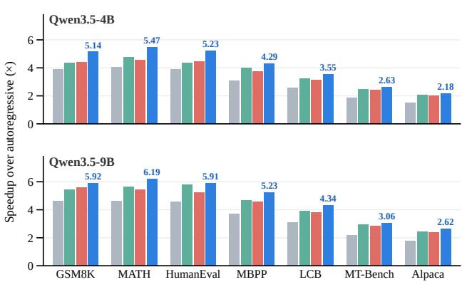  
Figure 1. Speedup over autoregressive decoding at temperature 0 on seven benchmarks (MATH is MATH-500), with the numbers of Table 1. DFlash drafts a chain of 24 tokens, and all tree methods share the DFlash drafter, the GPU tree pipeline and our verifier. Labels give DForkTree’s speedup.

2023). A fast drafter proposes several future tokens, and the target model checks them all in one forward pass. Because the target keeps only the tokens it would have produced itself, the output distribution does not change. Draft trees extend the idea by checking many continuations at once (Miao et al., 2024; Cai et al., 2024; Li et al., 2024; Chen et al., 2024), but extra nodes pay off only if accepted.

Block diffusion drafters such as DFlash (Chen et al., 2026) make drafting much faster by predicting all positions of a block in a single forward pass. Each position therefore comes with a marginal distribution that does not know which tokens a branch has chosen before it. DDTree (Ringel & Romano, 2026) builds strong trees from these marginals, and later methods add trained modules to restore the missing dependencies (Liang et al., 2026; Ye et al., 2026; Li et al., 2026; Oda et al., 2026; Lin & Jang, 2026). A common view behind them is that the drafter already holds the right tokens among its top candidates and only fails to select them (Inco AI, 2026; Eisenstadt et al., 2026). These works do not measure where the marginals go wrong, and hence which

part of a tree to fix.

We call the drafter’s own most likely continuation its spine and compare the nodes on it with the nodes that leave it. On the spine the marginals are reliable, with a correct top-1 token in 89% of cases and the true token among the top 16 at almost every position. Right after the path forks away from the spine, top-1 accuracy falls to 18% and up to a quarter of the true tokens drop out of the top 16. The path probabilities also turn from underestimating acceptance to overestimating it. When we re-anchor the drafter at the fork token, as the next round would once the target accepts it, it predicts the following token correctly 84% of the time, against 29% inside the original block. The drafter therefore knows how the branch continues, and its marginals fail because they still describe the spine. This also explains the coverage decay that prior work reports.

However, the drafter continues a branch this well only after the target has read it, which happens in the next round. DForkTree approximates this re-anchoring within the current round, without training and without another forward pass. It counts n-grams in text that the target model generated offline and re-anchors each candidate on the tokens that precede it on its own branch. Bayes’ rule shows that this context should enter the drafter’s score as pointwise mutual information (PMI) rather than as the raw n-gram probability, which would count the token’s frequency twice. We weight this term by what it adds beyond the drafter, which is small on the spine and large after a fork. A layer-wise GPU search still finds the optimal tree under these path-dependent scores.

We evaluate DForkTree on Qwen3.5-4B and 9B (Qwen Team, 2026) with 848 prompts from seven benchmarks. As Figure 1 shows, it is the fastest tree method on every benchmark, with up to 9.9% higher throughput than the strongest tree baseline and up to 15.1% higher than DDTree. On average, it decodes up to 4.75× faster than autoregressive decoding. Our main contributions are as follows.

• We show that the per-position marginals of a block diffusion drafter fail because they assume its spine. They are accurate on the spine, but after a fork their top-1 accuracy, candidate lists and path probabilities all degrade, even though the same drafter predicts these branches well once re-anchored.

• We propose DForkTree, which re-anchors each branch on its own tokens without training. We derive from Bayes’ rule why this evidence enters the score as PMI, show that its optimal weight follows what it adds beyond the drafter, and prove that the optimal tree under these scores can be built exactly on the GPU.

• With all tree methods sharing the same drafter, GPU tree pipeline and verifier, DForkTree outperforms nine baselines on two model sizes at temperatures 0 and 1. Our analyses trace nearly all of its extra accepted tokens to branches and show that neither calibrating DDTree by node type nor a trained selector matches it.

## 2. Background

Let p be the target model and $x _ { \leq t }$ the committed prefix. In each round, a drafter proposes a tree T rooted at the last committed token r, and the target scores all of its nodes in one forward pass with an ancestor mask. Under greedy decoding, the round accepts the longest path whose tokens match the target’s choices and adds one bonus token. We write τ for the mean number of tokens per round.

A block diffusion drafter such as DFlash reads the prefix once and returns a marginal $q _ { k }$ over the vocabulary for each of K future positions. Each $q _ { k }$ is predicted without knowing which tokens a path has chosen before position k. DDTree scores a path $u = ( u _ { 1 } , \ldots , u _ { d } )$ by the product of its marginals and keeps the tree that would accept the most draft tokens in expectation under this product,

$$
Q ( u ) = \prod _ { k = 1 } ^ { d } q _ { k } ( u _ { k } ) , \quad T ^ { \star } = \arg \operatorname* { m a x } _ { | T | \leq B } \sum _ { u \in \mathcal { T } } Q ( u ) .\tag{1}
$$

Because $Q$ never increases along a path, $\mathcal { T } ^ { \star }$ consists of the B prefixes with the largest Q, and a best-first heap finds it exactly. We call the path of top-1 tokens (arg max q1, arg max $q _ { 2 } , \dots )$ the drafter’s spine. A node forks when its token is not the top-1 token at its position, and all of its descendants are then off the spine.

## 3. Where the Marginals Fail

We first ask which nodes of a tree the marginals score well. On 155 development trajectories, we follow the target’s true continuation through the top-16 candidates of each position, with blocks of 16 tokens, and record at every node whether the top-1 candidate is the true next token. This yields about one million events, grouped by how each node relates to the spine. A node is on the spine if all its ancestors are top-1 tokens, justforked if its parent is not, and back on rank 1 if an earlier ancestor forked but the parent is top-1.

The groups differ sharply (Figure 2a). On the spine, which holds two thirds of the events, the drafter’s top-1 token is correct 89% of the time. Right after a fork it is correct only 18% of the time, and nodes that return to a top-1 token recover only partly. The deficit also persists along the branch (Figure 10). The cause lies in how the drafter conditions its predictions. It predicts every position for one hypothetical prefix, its own spine, so after a fork a later marginal answers a question about a prefix that the branch no longer contains.

Drafter marginal DForkTree Drafter re-run at the fork

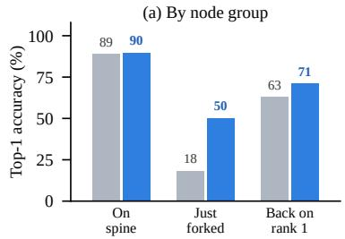

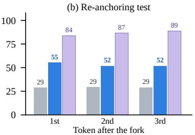

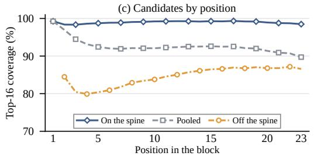  
Figure 2. Where the marginals fail on Qwen3.5-4B. (a) Top-1 accuracy of the drafter’s marginal and of DForkTree’s score by node group, over 1.03M events from 155 development trajectories. (b) Top-1 accuracy at the first three tokens after the first fork on the target’s true continuation (20K, 5K and 5K nodes), with the drafter re-run from the fork token as the next round would. (c) Share of positions on A210 whose true token is in the top 16 while all earlier ones are.

The candidate lists suffer from the same problem, because they come from the same marginals. On A210, a fixed subset of 210 test prompts, the true next token is among the top 16 for 98.3% of the spine nodes in the trees of Section 5.4, but only for 74–80% of the nodes after a fork. The lists also miss more often the lower the fork token ranks. Prior work reports that coverage decays along the block and attributes this to the drafter running out of candidates (Inco AI, 2026). Figure 2c splits that measurement by whether the path is still on the spine. On the spine, coverage stays at 98–99% at every position. Of the decay over the first seven positions, 95% comes from the growing share of paths that have already left it, and 90% for DFlash 2 (Section H). Coverage thus falls mostly because more paths have forked.

If this explanation is right, giving the drafter the correct prefix should restore its accuracy. For 20K nodes right after the first fork on the target’s true continuation, we reanchor the drafter, running it again from the fork token as the next round would after the target accepts it. Its top-1 accuracy on the following token rises from 29% inside the original block to 84%, and to 87% and 89% at the next two tokens (Figure 2b). Re-anchored spine tokens reach 95%, and Qwen3.5-9B behaves almost identically. The drafter thus knows how a branch continues once the target has read it. Filling only the branch tokens into the drafter’s block, without the target’s features of them, recovers just 11–16% of this gain (Section H).

The same assumption also distorts the path probabilities that a tree compares. In DDTree’s 32-node trees on A210, spine nodes are accepted 1.20 times as often as their path probabilities predict. Nodes after a fork, in contrast, are accepted only 0.71 times as often, and the EAGLE-3 tree shows similar ratios (Section H). A tree ranks nodes of all depths against one budget, so errors of opposite sign misallocate it. No global recalibration can remove both.

Since a tree gains over a chain only through its branches, better scores after a fork promise a large gain. Such scores should leave the accurate spine nearly untouched and should not assume that the true token is among the candidates. DForkTree’s score (blue in Figure 2a) raises post-fork accuracy to 50% while barely changing the spine. In the re-anchoring test, it closes 38–48% of the gap at the first three tokens after the fork without a second pass.

## 4. DForkTree

DForkTree changes only how nodes are scored and how the tree is built, as Figure 3 illustrates.

## 4.1. Path Statistics from Self-Generated Text

DForkTree draws its statistics from text that the target model generated itself, here 100K responses of Qwen3.5-4B to instruction prompts on math, code, chat and general requests. We count unigrams, bigrams and trigrams once, offline, and smooth the counts with interpolated Dirichlet estimates (MacKay & Peto, 1995) (Section D). For a candidate c that follows the tokens $( a , b )$ on a path, the statistic is the pointwise mutual information (Church & Hanks, 1990)

$$
T ( a , b , c ) = \log { \frac { P ( c \mid a , b ) } { P ( c ) } } ,\tag{2}
$$

where $P ( c \mid a , b )$ and $P ( c )$ are the trigram and unigram estimates and T is clipped to [−10, 10]. T is positive when the target writes c after (a, b) more often than in general.

## 4.2. Fork-Aware Path Scores

Proposition 4.1 (Evidence combination). Let h be the information the drafter uses for a position and (a, b) the two preceding tokens on a path. Ifh and $( a , b )$ are conditionally independent given the next token c, then $p ( c \mid h , a , b )$ ∝ $p ( c \mid h ) p ( c \mid a , b ) / p ( c )$

In log space, the proposition corrects the drafter’s logprobability by the PMI rather than by the n-gram logprobability. Adding the log-probability directly, as DART does with external n-gram scores (Liu et al., 2026), counts the frequency $p ( c )$ twice, because the drafter’s marginal already reflects it. Density-ratio fusion of language models removes such a shared prior in the same way (McDermott et al., 2019). Since the two sources are not exactly independent, we temper the correction with a weight λ, as in a product of experts.

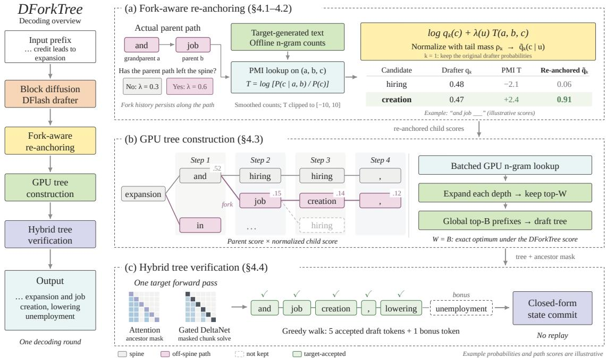  
Figure 3. Overview of DForkTree on an example adapted from an MT-Bench round, with illustrative numbers. (a) The drafter’s marginals describe its own spine, so after the fork to job they rate hiring and creation almost equally, and DForkTree re-scores each child by the PMI of its grandparent, parent and child, with a larger weight off the spine. (b) The tree grows one depth at a time on the GPU, and the best B prefixes by path score form the tree. (c) One target pass verifies the tree and commits the state of the accepted path in closed form.

Let $\mathcal { C } _ { k }$ be the top-M candidates of $q _ { k }$ and $\rho _ { k }$ the mass outside them. For a path $u _ { < k }$ , with $u _ { 0 } = r$ and $u _ { - 1 } = x _ { t - 1 }$ DForkTree scores $c \in { \mathcal { C } } _ { k }$ at position $k \geq 2$ by

$$
\tilde { q } _ { k } ( c \mid u _ { < k } ) = \frac { q _ { k } ( c ) e ^ { \lambda ( u _ { < k } ) T ( u _ { k - 2 } , u _ { k - 1 } , c ) } } { \rho _ { k } + \sum _ { z \in \mathcal { C } _ { k } } q _ { k } ( z ) e ^ { \lambda ( u _ { < k } ) T ( u _ { k - 2 } , u _ { k - 1 } , z ) } } ,\tag{3}
$$

and each child extends the score of its parent,

$$
\tilde { Q } ( u _ { \le k } ) = \tilde { Q } ( u _ { < k } ) \tilde { q } _ { k } ( u _ { k } \mid u _ { < k } ) .\tag{4}
$$

Keeping $\rho _ { k }$ in the normalizer leaves room for a true token outside the candidates, which is common after a fork. Renormalizing over the candidates instead, as UBTree (Liang et al., 2026) and the DFlash 2 selector that we test do, makes branch scores overconfident (Section 5.5). The first position keeps $\tilde { q } _ { 1 } = q _ { 1 }$ . Unlike Q in Equation (1), Q˜ depends on the tokens that the path has chosen, and this is how DForkTree re-anchors a branch on its own tokens.

The weight $\lambda ( u _ { < k } )$ equals $\lambda _ { a }$ if every token of $u _ { < k }$ is the top-1 token at its position and $\lambda _ { p }$ once the path has left the spine. On the spine, the drafter’s context was built for exactly these tokens, so the n-gram evidence largely repeats what the drafter already knows. Off the spine, the context describes a different prefix, and the evidence should count more. Weights fitted separately for each group of nodes follow this order, at about 0.25 on the spine and 0.6– 0.75 after the fork (Figure 11), and we use $\lambda _ { a } = 0 . 3$ and $\lambda _ { p } = 0 . 6$ . This order can also be predicted from the data. For a group of nodes, let $L ( \lambda )$ be the mean log-likelihood of the true next token $c ^ { \star }$ under Equation (3), with the tail mass as one more class with $T = 0$

Proposition 4.2 (Weight of overlapping evidence). L is concave in λ, and its maximizer $\lambda ^ { \star }$ satisfies $\mathbb { E } [ T ( c ^ { \star } ) ] =$ $\mathbb { E } \big [ \mathbb { E } _ { \tilde { q } _ { k } } T \big ]$ . One Newton step from $\lambda = 0$ gives

$$
\hat { \lambda } = \frac { \mathbb { E } \big [ T ( c ^ { \star } ) - \mathbb { E } _ { q _ { k } } T \big ] } { \mathbb { E } \big [ \mathrm { V a r } _ { q _ { k } } T \big ] } .
$$

$H c ^ { \star }$ is distributed according to qk given everything that T depends on, the numerator is zero and so is $\lambda ^ { \star }$

The numerator measures how far T points to the true token beyond what the drafter already expects. Evidence that the drafter already reflects adds to the variance of T but not to the numerator. On the spine, the true token’s PMI exceeds its expectation under $q _ { k }$ by only 0.48, against 4.4–4.5 after the fork, and λˆ rises from 0.14 to 0.33–0.39. Figure 4 tests the estimate on 37 node groups from both drafters and three kinds of evidence. It ranks the fitted weights with a Spearman correlation of 0.89, the fitted weights are about

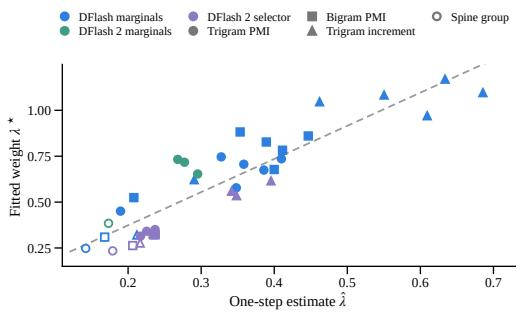

Figure 4. One-step estimate λˆ of Theorem 4.2 against the fitted weight $\lambda ^ { \star }$ for 37 groups of development nodes. Colors give the drafter and the base score, shapes the evidence, and hollow markers the spine groups. The line is a least-squares fit.  
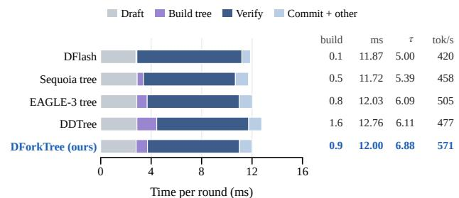  
Figure 5. One decoding round of Qwen3.5-4B for the 24-token DFlash chain and four tree methods with the budgets of Table 1, over 42 test prompts on one GPU. CUDA events, which add 0.7– 2.1%, split each round into four stages, and building includes DDTree’s host search. The columns give the build time and time per round in ms, τ and throughput.

1.8 times as large $( R ^ { 2 } = 0 . 8 2 )$ , and they fall as the overlap between log $q _ { k }$ and T grows (Spearman −0.78).

With $\lambda _ { a } = \lambda _ { p } = 0$ , DForkTree reduces to DDTree, which is row (a) of our ablation. We select both weights and the smoothing by two-fold cross-validation on development replays and fix them for all benchmarks and both models.

## 4.3. Building the Optimal Tree Exactly

The optimality result of DDTree carries over to pathdependent scores, and the optimal tree can be found without a sequential heap.

Proposition 4.3 (Optimal tree). (a) Ifthe continuation were drawn from q˜, a tree $\tau$ would accept $\textstyle \sum _ { u \in T } { \tilde { Q } } ( u )$ draft tokens in expectation, and the B prefixes with the largest $\tilde { Q }$ form a valid tree that maximizes this sum among all trees with B nodes whose tokens at depth k come from ${ \mathcal { C } } _ { k } .$ (b) Growing the tree depth by depth and keeping at each depth the W children with the largest $\tilde { Q }$ among children of the kept nodes recovers exactly these B prefixes $i f W \geq B$

Part (a) holds because $\tilde { Q }$ never increases along a path, as in DDTree. Part (b) is a counting argument close to Lemma 1 of DARTree (Li et al., 2026), here applied to path-dependent scores, and Section C proves both parts.

In practice, DForkTree evaluates $T$ for every grandparent, parent and child candidate in one batched lookup on the GPU. Each depth of the search then takes a single top-W with fixed shapes (Algorithm 1), so the whole construction compiles into a CUDA graph. We set $W = B$ and do not force the spine into the tree. Building takes 0.9 ms of a DForkTree round, compared with 0.8 ms for the EAGLE-3 tree and 1.6 ms for DDTree, whose heap runs on the host (Figure 5). A whole DForkTree round is only 1% longer than a round of the 24-token chain, and DForkTree’s and DDTree’s rounds stay within 2% of each other from 16 to 128 nodes. Longer accepted paths therefore turn directly into the throughput gains of Figure 6a.

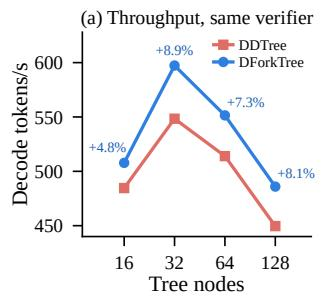

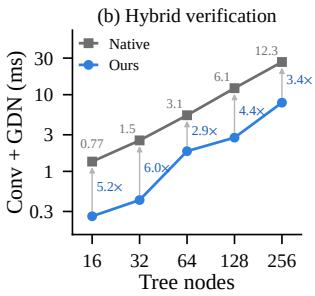  
Figure 6. Throughput and verification cost on Qwen3.5-4B. (a) Throughput on A210 with 23 draft positions and the same verifier and GPU packing. Labels give DForkTree’s gain over DDTree with its CPU heap. DForkTree’s points at 16, 64 and 128 nodes come from a second GPU that decodes about 0.6% faster. (b) Short convolution and 24 GDN layers for one tree verification, over 50 trees per point, with native snapshot sizes in GiB and our speedup.

## 4.4. Verifying Trees on Hybrid Models

Qwen3.5 interleaves attention with Gated DeltaNet (GDN) layers (Yang et al., 2025), whose matrix-valued state differs from path to path in a tree. SGLang’s native tree verification (Zheng et al., 2024) writes this state for every node. We instead follow the ancestor-masked chunk form of Oda et al. (2026), keep only $d _ { k } + d _ { v } + 1$ numbers per node and head, and commit the state of the accepted path in closed form rather than replaying it (Section D). The GDN layers and their short convolutions then run 2.9–6.0× faster than with native verification (Figure 6b). Every tree method in our experiments uses this verifier, which speeds up each tree baseline by 10–17% (Section E).

## 5. Experiments

## 5.1. Setup

Models and serving. We use Qwen3.5-4B and Qwen3.5- 9B (Qwen Team, 2026) with their released DFlash drafters in BF16, served by SGLang 0.5.22 on RTX 5090 GPUs with batch size one and thinking mode disabled. Tree methods run on one GPU. At temperature 0, the other methods use two GPUs of the same model, which differ by at most about

Table 1. Speedup S over autoregressive decoding and acceptance length τ at temperature 0, best per model in bold. MTP is Qwen3.5’s built-in head with 4 steps and top-4. All tree methods share the DFlash drafter, the GPU tree packing and our verifier and use 32 nodes, with blocks of 16 for the baselines and 24 for DForkTree as selected on the development set. DART and DForkTree count n-grams in 100K Qwen3.5-4B generations.
<table><tr><td>T = 0</td><td colspan="2">GSM8K</td><td colspan="2">MATH-500</td><td colspan="2">HumanEval</td><td colspan="2">MBPP</td><td colspan="2">LCB</td><td colspan="2">MT-Bench</td><td colspan="2">Alpaca</td><td colspan="2">Avg.</td></tr><tr><td>Method</td><td>S</td><td>T</td><td>S</td><td>T</td><td>S</td><td>T</td><td>S</td><td>T</td><td>S</td><td>T</td><td>S</td><td>T</td><td>S</td><td>T</td><td>S T</td></tr><tr><td>Qwen3.5-4B</td><td></td><td></td><td></td><td></td><td></td><td></td><td></td><td></td><td></td><td></td><td></td><td></td><td></td><td></td><td></td></tr><tr><td>Autoregressive</td><td>1.001.00</td><td></td><td>1.001.00</td><td></td><td>1.00</td><td>1.00</td><td>1.001.00</td><td></td><td>1.001.00</td><td></td><td>1.001.00</td><td>1.001.00</td><td></td><td>1.001.00</td><td></td></tr><tr><td>N-gram</td><td>1.001.68</td><td></td><td>1.09</td><td>1.85</td><td>0.80</td><td>1.54</td><td>0.84 1.44</td><td></td><td>0.961.64</td><td></td><td>0.791.32</td><td>0.75 1.25</td><td></td><td>0.89 1.53</td><td></td></tr><tr><td>MTP</td><td>2.07 4.67</td><td></td><td>2.05</td><td>54.70</td><td>1.87</td><td>4.62</td><td>1.98 4.42</td><td></td><td>1.85 4.34</td><td></td><td>1.63 3.88</td><td></td><td>1.53 3.57</td><td>1.85 4.32</td><td></td></tr><tr><td>DFlash, 16 tokens</td><td>3.61 7.09</td><td></td><td>3.70 7.43</td><td></td><td>3.67</td><td>7.72</td><td>2.94 5.91</td><td></td><td>2.45 4.99</td><td></td><td>1.74 3.60</td><td></td><td>1.44 2.86</td><td></td><td>2.79 5.66</td></tr><tr><td>DFlash, 24 tokens</td><td>3.88 7.42</td><td></td><td>4.06 7.87</td><td></td><td>3.87</td><td>8.03</td><td>3.09 6.04</td><td></td><td>2.58 5.05</td><td></td><td>1.86 3.66</td><td></td><td>1.48 2.92</td><td></td><td>2.97 5.85</td></tr><tr><td>Sequoia tree</td><td>4.12 7.24</td><td></td><td>4.19 7.47</td><td></td><td>3.97</td><td>7.64</td><td>3.52 6.29</td><td></td><td>3.06 5.58</td><td></td><td>2.23 4.22</td><td></td><td>1.89 3.43</td><td></td><td>3.28 5.98</td></tr><tr><td>DART tree</td><td>3.36 7.62</td><td></td><td>3.59 8.24</td><td></td><td>3.13</td><td>7.75</td><td>3.10 6.77</td><td></td><td>2.59 5.92</td><td></td><td>1.99 4.62</td><td></td><td>1.69 3.81</td><td></td><td>2.78 6.39</td></tr><tr><td>EAGLE-3 tree</td><td>4.33 8.26</td><td></td><td>4.76 8.92</td><td></td><td>4.36</td><td>8.95</td><td>3.99 7.29</td><td></td><td>3.25 6.21</td><td></td><td>2.46 4.74</td><td></td><td>2.07 3.84</td><td></td><td>3.60 6.89</td></tr><tr><td>DDTree</td><td>4.38 8.39</td><td></td><td>4.568.87</td><td></td><td>4.46 9.12</td><td></td><td>3.73 7.38</td><td></td><td>3.12 6.25</td><td></td><td>2.41 4.72</td><td></td><td>1.99 3.86</td><td>3.52 6.94</td><td></td></tr><tr><td>DForkTree</td><td>5.14 9.47</td><td></td><td>5.47 10.25</td><td></td><td>5.23 10.55</td><td></td><td>4.29 8.14</td><td></td><td>3.55 6.82</td><td></td><td>2.63 5.04</td><td></td><td>2.18 4.07</td><td>4.07 7.76</td><td></td></tr><tr><td>Qwen3.5-9B</td><td></td><td></td><td></td><td></td><td></td><td></td><td></td><td></td><td></td><td></td><td></td><td></td><td></td><td></td><td></td></tr><tr><td>Autoregressive</td><td>1.001.00</td><td></td><td>1.001.00</td><td></td><td>1.001.00</td><td></td><td>1.001.00</td><td></td><td>1.001.00</td><td></td><td>1.001.00</td><td></td><td>1.001.00</td><td>1.001.00</td><td></td></tr><tr><td>N-gram</td><td>1.22 1.65</td><td></td><td>1.34 1.82</td><td></td><td>1.12</td><td>1.49</td><td>1.07 1.42</td><td></td><td>1.18 1.62</td><td></td><td>0.92 1.30</td><td></td><td>0.91 1.25</td><td>1.11 1.51</td><td></td></tr><tr><td>MTP</td><td>2.41 4.74</td><td></td><td>2.374.75</td><td></td><td>2.31</td><td>4.64</td><td>2.25 4.50</td><td></td><td>2.24 4.41</td><td></td><td>1.92 3.96</td><td></td><td>1.82 3.69</td><td>2.19 4.38</td><td></td></tr><tr><td>DFlash, 16 tokens</td><td>4.12 7.17</td><td></td><td>4.62 7.67</td><td></td><td>4.76</td><td>7.80</td><td>3.88 6.15</td><td></td><td>3.02 5.03</td><td></td><td>2.18 3.66</td><td></td><td>1.82 3.05</td><td>3.49 5.79</td><td></td></tr><tr><td>DFlash, 24 tokens</td><td>4.61 7.80</td><td></td><td>4.62</td><td>27.98</td><td>4.59</td><td>7.91</td><td>3.73 6.21</td><td></td><td>3.10 5.15</td><td></td><td>2.18 3.76</td><td></td><td>1.79 3.03</td><td>3.52 5.98</td><td></td></tr><tr><td>Sequoia tree</td><td>5.17 8.22</td><td></td><td>5.27 8.41</td><td></td><td>4.85</td><td>8.09</td><td>4.27 6.88</td><td></td><td>3.59 5.84</td><td></td><td>2.61 4.28</td><td></td><td>2.19 3.61</td><td>3.99 6.48</td><td></td></tr><tr><td>DART tree</td><td>4.01 7.98</td><td></td><td>4.44 8.40 5.65 9.22</td><td></td><td>4.52</td><td>8.22</td><td></td><td>3.80 6.94</td><td>3.19 6.00</td><td></td><td>2.48 4.73</td><td></td><td>2.14 4.00</td><td></td><td>3.51 6.61</td></tr><tr><td>EAGLE-3 tree</td><td>5.45 9.01</td><td></td><td>5.43</td><td>9.26</td><td>5.78</td><td>9.25</td><td></td><td>4.66 7.60</td><td>3.91 6.42</td><td></td><td>2.95 4.92</td><td></td><td>2.45 4.10</td><td></td><td>4.41 7.22</td></tr><tr><td>DDTree</td><td>5.58 9.20</td><td></td><td></td><td></td><td>5.25</td><td>9.23</td><td></td><td>4.57 7.63</td><td>3.82 6.43</td><td></td><td>2.84 4.93</td><td></td><td>2.40 4.09</td><td></td><td>4.27 7.25</td></tr><tr><td>DForkTree</td><td>5.92 9.91</td><td></td><td></td><td>6.19 10.40</td><td></td><td>5.91 10.43</td><td></td><td>5.23 8.35</td><td>4.34 7.04</td><td></td><td>3.06 5.25</td><td></td><td>2.62 4.34</td><td></td><td>4.75 7.96</td></tr></table>

1% in decoding time.

Benchmarks and metrics. As in DFlash and DDTree, we take 128 prompts each from GSM8K (Cobbe et al., 2021), MATH-500 (Hendrycks et al., 2021; Lightman et al., 2024), HumanEval (Chen et al., 2021), MBPP (Austin et al., 2021), LiveCodeBench (LCB) (Jain et al., 2025) and Alpaca (Li et al., 2023), and add the first turns of the 80 MT-Bench prompts (Zheng et al., 2023), for 848 prompts with at most 2048 new tokens each. The speedup S divides the decoding time of autoregressive decoding by that of the method, and τ counts output tokens per round, including the bonus token. We report throughput with paired-bootstrap 95% CIs, and repeated runs differ by less than 0.4%.

Baselines. We compare with SGLang’s native n-gram lookup, the built-in MTP head of Qwen3.5 and native DFlash with 16 and 24 draft tokens. We re-implement four tree strategies on the same DFlash drafter, namely Sequoia’s static tree (Chen et al., 2024), DART’s n-gram pruned tree with its official C++ search (Liu et al., 2026), the dynamic tree of EAGLE-2 and EAGLE-3 (Li et al., 2024; 2025), which we call the EAGLE-3 tree, and DDTree with its official heap (Ringel & Romano, 2026). All tree methods share our verifier and GPU packing and keep their own construction and defaults (Section F). For each, we chose the number of nodes from {16, 32, 64} and the block size from {16, 24} on a 21-prompt development set before any test run. This gave 32 nodes for all methods, blocks of 16 for the baselines and 24 for DForkTree. DForkTree uses M = 16, $\lambda _ { a } = 0 . 3$ and $\lambda _ { p } = 0 . 6 ,$ , after removing six corpus records that a 13-gram check flags as near duplicates of test prompts, and Qwen3.5-9B reuses its counts and hyperparameters.

## 5.2. Main Results

DForkTree has the longest acceptance and the highest speedup on every benchmark for both models (Table 1). On Qwen3.5-4B, its throughput is 9.9% higher than that of the strongest tree baseline, the EAGLE-3 tree (95% CI 8.9–10.9%), and 15.1% higher than that of DDTree (14.0– 16.2%). On Qwen3.5-9B, the two margins are 8.1% (7.1– 9.0%) and 11.0% (10.0–12.0%). The lead is largest on MATH-500 and HumanEval and smallest on Alpaca, likely because trigrams capture formulas and identifiers better than open-ended prose. On average, it decodes 4.07× and 4.75× faster than autoregressive decoding, and its throughput is 41.5% and 40.6% higher than that of the 24-token DFlash chain. Its outputs match autoregressive decoding about as often as native DFlash does (Section B).

Table 2. Ablations on Qwen3.5-4B (848 prompts) with 64 nodes and 23 positions. τ is averaged over benchmarks, and ∆ is the throughput change relative to DForkTree.
<table><tr><td>Variant</td><td>T</td><td>tok/s</td><td>∆</td></tr><tr><td>(a) Marginal scores, GPU construction</td><td>7.72</td><td>515</td><td>-7.0%</td></tr><tr><td>(b) Raw log-prob, single λ (as DART)</td><td>8.00</td><td>531</td><td>-4.2%</td></tr><tr><td>(c) DForkTree with 15 positions</td><td>7.86</td><td>536</td><td>-3.2%</td></tr><tr><td>(d) Bigram PMI, single λ</td><td>8.17</td><td>543</td><td>-2.1%</td></tr><tr><td>(e) DForkTree with forced spine</td><td>8.17</td><td>543</td><td>-2.0%</td></tr><tr><td>(f) Trigram PMI, single λ</td><td>8.18</td><td>550</td><td>-0.7%</td></tr><tr><td>(g) DForkTree, fork-aware λ</td><td>8.36</td><td>554</td><td></td></tr></table>

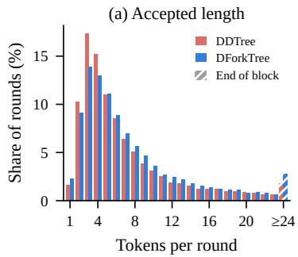

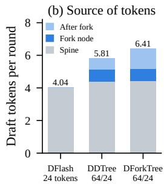  
Figure 7. Replay of the 24-token DFlash chain and of DDTree and DForkTree with 64 nodes and 23 draft positions on A210. (a) Tokens produced per round. A round produces at most 24 tokens, so the hatched bar counts all rounds that reach the end of the block. (b) Accepted draft tokens per round on the spine, at the fork node where the accepted path leaves it, and after the fork. A chain accepts only spine tokens.

## 5.3. Ablations

Table 2 varies the components of DForkTree at 64 nodes, where branches hold a larger part of the tree. Row (a) scores nodes by the marginals alone but keeps our depth, budget and construction, so it isolates the path prior, which adds 7.6% in throughput. Most of this gain comes from the bigram PMI in row (d), a training-free counterpart of firstorder edge scorers such as GRAFT (Ye et al., 2026). The trigram in row (f), which looks beyond the parent, adds a smaller but significant step. The fork-aware weight raises τ further, although its throughput gain over row (f) has a confidence interval that includes zero. As Theorem 4.1 predicts, the raw n-gram log-probability that DART uses lowers throughput in row (b), and so do drafting 15 positions and forcing the spine into the tree.

## 5.4. Where the Extra Tokens Come From

To check the diagnosis on whole decoding rounds, we replay the 24-token DFlash chain and DDTree and DForkTree with 64 nodes on A210, which reproduces the online τ within 1%, and classify each accepted draft token by its position relative to the spine. DForkTree accepts 0.60 more draft tokens per round than DDTree, and 96% of them lie at or after the fork (Figure 7b). These better branches mainly lengthen the long rounds (Figure 7a). Both trees spend about 55 of their 63 nodes off the spine (Table 3), so DForkTree does not gain by moving budget away from the spine. Its branches grow deeper instead, and each of its off-spine nodes yields 38% more accepted tokens.

Table 3. Tree shape per round on A210 (replay, mean over rounds). Branching nodes have two or more children, and the depth of a node counts its draft positions.
<table><tr><td rowspan="2">Nodes / block</td><td>DDTree</td><td>DForkTree</td></tr><tr><td>32 / 16 64 / 24</td><td>64 / 24</td></tr><tr><td>Spine nodes</td><td>7.3 8.3</td><td>7.9</td></tr><tr><td>Off-spine nodes</td><td>23.7 54.7</td><td>55.1</td></tr><tr><td>Branching nodes</td><td>5.3 10.2</td><td>10.6</td></tr><tr><td>Maximum depth</td><td>7.3 8.3</td><td>10.3</td></tr><tr><td>Rounds leaving the spine (%)</td><td>58.6 71.7</td><td>74.2</td></tr></table>

Table 4. Share of the gap to the re-anchored drafter closed at the first three tokens after a fork on A210 (range, %). Rows use different events, so only numbers within a row compare.
<table><tr><td>Correction (drafter)</td><td>DForkTree</td><td>Correction</td><td>Both</td></tr><tr><td>Branch tokens (DFlash)</td><td>41-46</td><td>11-16</td><td></td></tr><tr><td>Distilled head (DFlash)</td><td>36-45</td><td>34-38</td><td>41-49</td></tr><tr><td>Trained selector (DFlash 2)</td><td>44-45</td><td>46-47</td><td>49-50</td></tr></table>

DForkTree’s path scores are also better calibrated where the marginals fail most. In the 32-node trees of Section 3, nodes after a fork are accepted 0.94 times as often as DForkTree predicts, against 0.71 for DDTree. Calibration alone does not explain the gain, however. Temperatures fitted per node type bring DDTree’s post-fork ratio to 0.95 but raise its offline τ by only 1.1%, whereas DForkTree leads it by 8.0% (Section H).

## 5.5. Comparison with Learned Corrections

Table 4 compares DForkTree with two trained corrections and with feeding the branch tokens to the drafter, each measured against its own drafter re-run at the fork. On DFlash 2, the trained selector (Inco AI, 2026) closes about as much of the gap as DForkTree, and on DFlash, a head distilled from the re-anchored drafter closes less. Adding the PMI to either brings it to about half of the gap, while 4–21% of the gap lies outside the 16 candidates that all of these scores re-rank.

In full trees, the selector even accepts 1.9% fewer tokens than DForkTree on DFlash 2. It renormalizes over its candidates, so its path scores predict an acceptance of 8.7% for branch nodes that are accepted only 5.4% of the time (Section H). A second, LoRA-tuned drafter pass from the eight best branch nodes does not pay off either, since it raises offline τ by 2.0–2.9% but costs 3.1–6.2 ms per round. Room remains. On 28 prompts of A210, an oracle that re-anchors every kept branch node up to three tokens after a fork gains another 10.4% and 13.0% in offline τ at 32 and 64 nodes, so DForkTree recovers 39–41% of the gap to it.

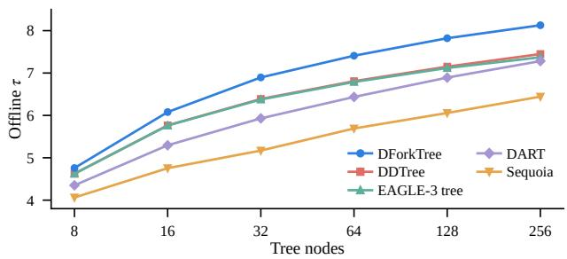  
Figure 8. Offline τ of five construction strategies on Qwen3.5-4B with 23 draft positions, replayed along the autoregressive outputs of A210.

Table 5. Average results at temperature 1 (848 prompts per model), with S the throughput ratio to autoregressive sampling. Section A gives all methods per benchmark.
<table><tr><td rowspan="2">Method</td><td colspan="3">Qwen3.5-4B</td><td colspan="3">Qwen3.5-9B</td></tr><tr><td>S</td><td>T</td><td>tok/s</td><td>S</td><td>T</td><td>tok/s</td></tr><tr><td>MTP</td><td>1.69</td><td>3.90</td><td>282</td><td>2.03</td><td>4.04</td><td>194</td></tr><tr><td>DFlash, 16 tokens</td><td>2.15</td><td>4.36</td><td>325</td><td>2.88</td><td>4.76</td><td>243</td></tr><tr><td>DFlash, 24 tokens</td><td>2.31</td><td>4.53</td><td>341</td><td>2.91</td><td>4.97</td><td>241</td></tr><tr><td>EAGLE-3 tree</td><td>2.80</td><td>5.69</td><td>429</td><td>3.64</td><td>6.23</td><td>310</td></tr><tr><td>DDTree</td><td>2.61</td><td>5.64</td><td>404</td><td>3.44</td><td>6.16</td><td>297</td></tr><tr><td>DForkTree</td><td>3.05</td><td>6.17</td><td>465</td><td>3.88</td><td>6.73</td><td>331</td></tr></table>

## 5.6. Node Budget and System Gains

DForkTree is 4–9% faster than DDTree at every budget, and both are fastest at 32 nodes, the budget that the development set also selected (Figure 6a). Offline, DForkTree has the highest τ from 8 to 256 nodes, and its lead over DDTree grows to about 9% (Figure 8). Choosing each round’s budget from calibrated path scores gains only 0.3% in estimated throughput, against 4.9% for an oracle. With DDTree’s own scores, our GPU construction matches the official heap within 1% (Section E).

## 5.7. Sampling

At temperature 1, all tree methods use the lossless sampleand-match verification of DDTree, and DForkTree keeps its lead (Table 5). Its throughput is 8.5% and 6.7% higher than that of the EAGLE-3 tree on the two models and 15.2% and 11.4% higher than that of DDTree, while in-budget accuracy stays on par with autoregressive sampling. Replays of the committed tokens and $\bar { \chi ^ { 2 } }$ tests over the first eight output tokens also find no difference from autoregressive sampling (Section A).

## 6. Related Work

Speculative decoding and draft trees. Tree verification (Miao et al., 2024) checks many continuations in one pass. Medusa (Cai et al., 2024) and EAGLE-2 and EAGLE-3 (Li et al., 2024; 2025) draft with heads on the target model, and Sequoia (Chen et al., 2024) optimizes the shape of the tree. Prompt lookup (Saxena, 2023) and REST (He et al., 2024) draft from n-grams alone, whereas DForkTree uses them only to re-score the drafter’s candidates.

Trees from block diffusion drafters. DFlash (Chen et al., 2026) drafts a whole block in one pass, and DDTree (Ringel & Romano, 2026) builds the optimal tree under its factorized marginals. Most follow-up work restores the dependencies between positions with trained selectors and edge scorers (Liang et al., 2026; Ye et al., 2026; Inco AI, 2026), correction heads (Li et al., 2026; Cheng et al., 2026), a pairwise corrector (Eisenstadt et al., 2026) or the autoregressive adapter Weaver (Oda et al., 2026). Weaver lists re-anchoring the drafter mid-draft as future work. Carryover drafting (Koo et al., 2026) and DFlow (Zhang et al., 2026) pass the target’s hidden states of rejected tokens to the next round, which agrees with our finding that a branch is best continued once the target has read it. DominoTree (Lin & Jang, 2026), TreeSpark (Zhou et al., 2026) and CAST (Lee & Eo, 2026) find or warn that drafter probabilities overestimate acceptance, while we find errors of opposite sign on and off the spine. Closest to our scoring, DART (Liu et al., 2026) and PRESTO (Wang et al., 2026) add fixed-weight n-gram scores to the marginals.

Linear attention and tree verification. STree (Wu et al., 2025), Weaver, DominoTree and UBTree verify trees on hybrid models with linear-recurrent layers (Gu & Dao, 2023; Yang et al., 2025), and our verifier adds a closed-form commit to the form of Weaver.

## 7. Conclusion

Block diffusion draft trees gain mostly after a branch leaves the drafter’s most likely continuation, where its scores, candidates and path probabilities all still assume the spine. Re-anchored at the fork, the same drafter continues these branches well, so the problem is the prefix it assumes, not its knowledge. DForkTree re-scores them with counts from the target’s own outputs, weighted by what they add beyond the drafter, and is the fastest of ten decoding methods without training. Counted n-grams and the learned corrections we test close about half of the gap to a re-anchored drafter, suggesting that the rest needs the target to read the branch. On DFlash 2, our counts also beat a trained selector in full trees, so this mismatch is not specific to one drafter. Drafters that condition on the branch they extend are a natural next step.

## References

Ahmad, W. U., Narenthiran, S., Majumdar, S., Ficek, A., et al. OpenCodeReasoning: Advancing data distillation for competitive coding. arXiv preprint arXiv:2504.01943, 2025.

Austin, J., Odena, A., Nye, M., Bosma, M., Michalewski, H., et al. Program synthesis with large language models. arXiv preprint arXiv:2108.07732, 2021.

Cai, T., Li, Y., Geng, Z., Peng, H., Lee, J. D., Chen, D., and Dao, T. Medusa: Simple LLM inference acceleration framework with multiple decoding heads. In International Conference on Machine Learning, 2024.

Chen, C., Borgeaud, S., Irving, G., Lespiau, J.-B., Sifre, L., and Jumper, J. Accelerating large language model decoding with speculative sampling. arXiv preprint arXiv:2302.01318, 2023.

Chen, J., Liang, Y., and Liu, Z. DFlash: Block diffusion for flash speculative decoding. arXiv preprint arXiv:2602.06036, 2026.

Chen, M., Tworek, J., Jun, H., Yuan, Q., Pinto, H. P. d. O., et al. Evaluating large language models trained on code. arXiv preprint arXiv:2107.03374, 2021.

Chen, Z., May, A., Svirschevski, R., Huang, Y., Ryabinin, M., Jia, Z., and Chen, B. Sequoia: Scalable, robust, and hardware-aware speculative decoding. In Advances in Neural Information Processing Systems, 2024.

Cheng, X., Yu, X., Shao, C., Li, J., et al. DSpark: Confidence-scheduled speculative decoding with semi-autoregressive generation. arXiv preprint arXiv:2607.05147, 2026.

Chiang, W.-L., Zheng, L., Sheng, Y., Angelopoulos, A. N., Li, T., et al. Chatbot arena: An open platform for evaluating LLMs by human preference. In International Conference on Machine Learning, 2024.

Church, K. W. and Hanks, P. Word association norms, mutual information, and lexicography. Computational Linguistics, 16(1):22–29, 1990.

Cobbe, K., Kosaraju, V., Bavarian, M., Chen, M., Jun, H., et al. Training verifiers to solve math word problems. arXiv preprint arXiv:2110.14168, 2021.

Cui, G., Yuan, L., Ding, N., Yao, G., He, B., et al. UltraFeedback: Boosting language models with scaled AI feedback. In International Conference on Machine Learning, 2024.

Ding, N., Chen, Y., Xu, B., Qin, Y., Zheng, Z., et al. Enhancing chat language models by scaling high-quality instructional conversations. In Conference on Empirical Methods in Natural Language Processing, 2023.

Dong, G., Lu, K., Li, C., Xia, T., Yu, B., et al. Self-play with execution feedback: Improving instruction-following capabilities of large language models. In International Conference on Learning Representations, 2025.

Eisenstadt, R., Lidar, H., Gonen, T., Luxembourg, O., Zimerman, I., Wolf, L., David, E., and Naiman, I. Contextual correction of parallel drafts for speculative decoding. arXiv preprint arXiv:2610.12570, 2026.

Gu, A. and Dao, T. Mamba: Linear-time sequence modeling with selective state spaces. arXiv preprint arXiv:2312.00752, 2023.

He, Z., Zhong, Z., Cai, T., Lee, J. D., and He, D. REST: Retrieval-based speculative decoding. In Annual Conference of the North American Chapter of the Association for Computational Linguistics, 2024.

Hendrycks, D., Burns, C., Kadavath, S., Arora, A., Basart, S., et al. Measuring mathematical problem solving with the MATH dataset. In Advances in Neural Information Processing Systems Datasets and Benchmarks Track, 2021.

Inco AI. DFlash 2: Keep drafting parallel. https://in co.ai/blog/dflash2/, 2026.

Jain, N., Han, K., Gu, A., Li, W.-D., Yan, F., et al. Live-CodeBench: Holistic and contamination free evaluation of large language models for code. In International Conference on Learning Representations, 2025.

Koo, J., Woo, S., Kil, J., Lee, J., Lee, S., Jung, K., and Kim, M. Carryover drafting: Recycling rejected states for speculative decoding. arXiv preprint arXiv:2609.14717, 2026.

Lee, J. and Eo, S. CAST: Cost-aware speculative trees from one-pass block drafters. arXiv preprint arXiv:2610.00321, 2026.

Leviathan, Y., Kalman, M., and Matias, Y. Fast inference from transformers via speculative decoding. In International Conference on Machine Learning, 2023.

Li, T., Luo, Y., Shang, X., and Shen, Z. DARTree: Speculative diffusion decoding with autoregressive draft trees. arXiv preprint arXiv:2608.13524, 2026.

Li, X., Zhang, T., Dubois, Y., Taori, R., Gulrajani, I., et al. AlpacaEval: An automatic evaluator of instructionfollowing models. https://github.com/tatsu -lab/alpaca\_eval, 2023.

Li, Y., Wei, F., Zhang, C., and Zhang, H. EAGLE-2: Faster inference of language models with dynamic draft trees. In Conference on Empirical Methods in Natural Language Processing, 2024.

Li, Y., Wei, F., Zhang, C., and Zhang, H. EAGLE-3: Scaling up inference acceleration of large language models via training-time test. arXiv preprint arXiv:2503.01840, 2025.

Liang, C., Wang, L., Peng, X., Liu, H., Chen, Y., Liu, G., Lin, G., Song, Q., and Li, J. UBTree: Parallel tree drafting via unigram and bigram models for speculative decoding. arXiv preprint arXiv:2609.39972, 2026.

Lightman, H., Kosaraju, V., Burda, Y., Edwards, H., Baker, B., et al. Let’s verify step by step. In International Conference on Learning Representations, 2024.

Lin, S. S. and Jang, J.-S. R. DominoTree: Conditional treestructured drafting with Domino for speculative decoding. arXiv preprint arXiv:2607.08642, 2026.

Liu, F., Li, X., Zhao, K., Gao, Y., Zhou, Z., Zhang, Z., Wang, Z., Dou, W., Zhong, S., and Tian, C. DART: Diffusioninspired speculative decoding for fast LLM inference. arXiv preprint arXiv:2601.19278, 2026.

Luo, Z., Xu, C., Zhao, P., Sun, Q., Geng, X., et al. WizardCoder: Empowering code large language models with Evol-Instruct. In International Conference on Learning Representations, 2024.

MacKay, D. J. C. and Peto, L. C. B. A hierarchical Dirichlet language model. Natural Language Engineering, 1(3): 289–308, 1995.

McDermott, E., Sak, H., and Variani, E. A density ratio approach to language model fusion in end-to-end automatic speech recognition. In IEEE Automatic Speech Recognition and Understanding Workshop, 2019.

Miao, X., Oliaro, G., Zhang, Z., Cheng, X., Wang, Z., et al. SpecInfer: Accelerating large language model serving with tree-based speculative inference and verification. In ACM International Conference on Architectural Support for Programming Languages and Operating Systems, 2024.

Mitra, A., Khanpour, H., Rosset, C., and Awadallah, A. Orca-Math: Unlocking the potential of SLMs in grade school math. arXiv preprint arXiv:2402.14830, 2024.

Oda, Y., Mathieu, R., Knyazhitskiy, R., and Chakhvadze, A. Trees from marginals: Autoregressive drafting with factorized priors. arXiv preprint arXiv:2607.06763, 2026.

Qwen Team. Qwen3.5 models. https://huggingfac e.co/Qwen, 2026.

Ringel, L. and Romano, Y. Accelerating speculative decoding with block diffusion draft trees. arXiv preprint arXiv:2604.12989, 2026.

Saxena, A. Prompt lookup decoding. https://github .com/apoorvumang/prompt-lookup-decod ing, 2023.

Wang, Z., Ye, Z., et al. PRESTO: Prefix-aligned tree drafting for diffusion speculative decoding. arXiv preprint arXiv:2607.22634, 2026.

Wu, Y., Qin, Z., Wong, A., and Soatto, S. STree: Speculative tree decoding for hybrid state-space models. In Advances in Neural Information Processing Systems, 2025.

Yang, S., Kautz, J., and Hatamizadeh, A. Gated delta networks: Improving Mamba2 with delta rule. In International Conference on Learning Representations, 2025.

Ye, X., Ma, Z., Yu, R., Liu, Y., Li, T., Bai, S., Zhou, J., and Wu, F. GRAFT: Adaptive DLM-based draft tree construction with target-distilled edge scoring. arXiv preprint arXiv:2608.20375, 2026.

Yu, L., Jiang, W., Shi, H., Yu, J., Liu, Z., et al. MetaMath: Bootstrap your own mathematical questions for large language models. In International Conference on Learning Representations, 2024.

Yuan, L., Cui, G., Wang, H., Ding, N., Wang, X., et al. Advancing LLM reasoning generalists with preference trees. In International Conference on Learning Representations, 2025.

Zhang, Y., Zhang, L., Cui, B., and Miao, X. DFlow: Enabling verifier information flow in block diffusion speculative decoding. arXiv preprint arXiv:2609.06498, 2026.

Zheng, L., Chiang, W.-L., Sheng, Y., Zhuang, S., Wu, Z., et al. Judging LLM-as-a-judge with MT-Bench and chatbot arena. In Advances in Neural Information Processing Systems Datasets and Benchmarks Track, 2023.

Zheng, L., Yin, L., Xie, Z., et al. SGLang: Efficient execution of structured language model programs. In Advances in Neural Information Processing Systems, 2024.

Zhou, H., Wang, H., and Wang, X. TreeSpark: Calibrated, load-adaptive draft trees for semi-autoregressive speculative decoding. arXiv preprint arXiv:2609.22098, 2026.

## A. Results at Temperature 1

Table 6. Speedup S and acceptance length τ at temperature 1, with top-p 1 and no top-k (848 prompts per model). Sampled outputs differ between methods, so S is the ratio of decoding throughputs to autoregressive sampling on each benchmark. Autoregressive sampling runs at 169 tok/s on Qwen3.5-4B and 97 tok/s on Qwen3.5-9B on the same GPU, and DForkTree is best in every column.
<table><tr><td rowspan=1 colspan=17>T = 1             GSM8K MATH-500 HumanEval  MBPP     LCB   MT-Bench   Alpaca      Avg.Method             S  T    S  T    S  T    S  T    S T    S  T    S  T    S  T</td></tr><tr><td rowspan=1 colspan=17>Qwen3.5-4B</td></tr><tr><td rowspan=1 colspan=1>Autoregressive</td><td rowspan=1 colspan=2>1.001.00</td><td rowspan=1 colspan=1>1.001</td><td rowspan=1 colspan=1>.00</td><td rowspan=1 colspan=2>1.001.00</td><td rowspan=1 colspan=2>1.001.00</td><td rowspan=1 colspan=2>1.001.00</td><td rowspan=1 colspan=2>1.001.00</td><td rowspan=1 colspan=1>1.001</td><td rowspan=1 colspan=1>.00</td><td rowspan=1 colspan=2>1.001.00</td></tr><tr><td rowspan=1 colspan=1>N-gram</td><td rowspan=1 colspan=2>0.941.62</td><td rowspan=1 colspan=1>1.041</td><td rowspan=1 colspan=1>.78</td><td rowspan=1 colspan=2>0.881.52</td><td rowspan=1 colspan=2>0.82 1.41</td><td rowspan=1 colspan=2>0.901.53</td><td rowspan=1 colspan=2>0.77 1.33</td><td rowspan=1 colspan=1>0.73</td><td rowspan=1 colspan=1>1.25</td><td rowspan=1 colspan=2>0.87 1.49</td></tr><tr><td rowspan=1 colspan=1>MTP</td><td rowspan=1 colspan=2>1.904.40</td><td rowspan=1 colspan=2>1.95 4.48</td><td rowspan=1 colspan=2>1.804.15</td><td rowspan=1 colspan=2>1.76 4.06</td><td rowspan=1 colspan=2>1.68 3.83</td><td rowspan=1 colspan=2>1.48 3.40</td><td rowspan=1 colspan=2>1.28 2.96</td><td rowspan=1 colspan=2>1.69 3.90</td></tr><tr><td rowspan=1 colspan=1>DFlash, 16 tokens2.85</td><td rowspan=1 colspan=2>5.78</td><td rowspan=1 colspan=2>3.05 6.17</td><td rowspan=1 colspan=4>2.59 5.26 2.17 4.39</td><td rowspan=1 colspan=2>1.81 3.64</td><td rowspan=1 colspan=2>1.45 2.94</td><td rowspan=1 colspan=2>1.16 2.36</td><td rowspan=1 colspan=2>2.15 4.36</td></tr><tr><td rowspan=1 colspan=1>DFlash, 24 tokens</td><td rowspan=1 colspan=2>3.02 5.96</td><td rowspan=1 colspan=2>3.26 6.40</td><td rowspan=1 colspan=2>3.02 5.94</td><td rowspan=1 colspan=2>2.22 4.36</td><td rowspan=1 colspan=2>1.94 3.76</td><td rowspan=1 colspan=2>1.52 2.99</td><td rowspan=1 colspan=2>1.18 2.32</td><td rowspan=1 colspan=2>2.31 4.53</td></tr><tr><td rowspan=1 colspan=1>Sequoia tree</td><td rowspan=1 colspan=2>3.15 6.25</td><td rowspan=1 colspan=2>3.35 6.61</td><td rowspan=1 colspan=2>3.03 5.97</td><td rowspan=1 colspan=2>2.52 4.96</td><td rowspan=1 colspan=2>2.22 4.35</td><td rowspan=1 colspan=2>1.803.56</td><td rowspan=1 colspan=1>1.43</td><td rowspan=1 colspan=1>2.84</td><td rowspan=1 colspan=2>2.504.94</td></tr><tr><td rowspan=1 colspan=1>DART tree</td><td rowspan=1 colspan=1>2.72</td><td rowspan=1 colspan=1>6.74</td><td rowspan=1 colspan=1>2.88</td><td rowspan=1 colspan=1>7.09</td><td rowspan=1 colspan=2>2.53 6.27</td><td rowspan=1 colspan=1>2.22</td><td rowspan=1 colspan=1>5.51</td><td rowspan=1 colspan=1>1.97</td><td rowspan=1 colspan=1>4.80</td><td rowspan=1 colspan=2>1.59 3.93</td><td rowspan=1 colspan=1>1.28</td><td rowspan=1 colspan=1>3.16</td><td rowspan=1 colspan=2>2.17 5.36</td></tr><tr><td rowspan=1 colspan=1>EAGLE-3 tree</td><td rowspan=1 colspan=1>3.63</td><td rowspan=1 colspan=1>7.42</td><td rowspan=1 colspan=1>3.77</td><td rowspan=1 colspan=1>7.66</td><td rowspan=1 colspan=2>3.41 6.962.77</td><td rowspan=1 colspan=2>5.65</td><td rowspan=1 colspan=1>2.46</td><td rowspan=1 colspan=1>4.96</td><td rowspan=1 colspan=2>1.97 4.01</td><td rowspan=1 colspan=1>1.56</td><td rowspan=1 colspan=1>3.18</td><td rowspan=1 colspan=2>2.80 5.69</td></tr><tr><td rowspan=1 colspan=1>DDTree</td><td rowspan=1 colspan=2>3.21 6.94</td><td rowspan=1 colspan=2>3.54 7.60</td><td rowspan=1 colspan=2>3.13 6.78</td><td rowspan=1 colspan=2>2.80 6.07</td><td rowspan=1 colspan=2>2.28 4.87</td><td rowspan=1 colspan=2>1.874.04</td><td rowspan=1 colspan=2>1.47 3.17</td><td rowspan=1 colspan=2>2.61 5.64</td></tr><tr><td rowspan=1 colspan=5>DForkTree       3.76 7.66 4.29 8.67</td><td rowspan=1 colspan=4>3.84 7.79 3.11 6.31</td><td rowspan=1 colspan=2>2.66 5.34</td><td rowspan=1 colspan=6>2.03 4.12 1.64 3.32 3.05 6.17</td></tr><tr><td rowspan=1 colspan=11>Qwen3.5-9B</td><td rowspan=1 colspan=6></td></tr><tr><td rowspan=1 colspan=1>Autoregressive</td><td rowspan=1 colspan=1>1.00</td><td rowspan=1 colspan=1>1.00</td><td rowspan=1 colspan=1>1.001</td><td rowspan=1 colspan=1>.00</td><td rowspan=1 colspan=1>1.001</td><td rowspan=1 colspan=1>.00</td><td rowspan=1 colspan=2>1.001.00</td><td rowspan=1 colspan=2>1.001.00</td><td rowspan=1 colspan=2>1.001.00</td><td rowspan=1 colspan=1>1.001</td><td rowspan=1 colspan=1>.00</td><td rowspan=1 colspan=1>1.001</td><td rowspan=1 colspan=1>.00</td></tr><tr><td rowspan=1 colspan=2>N-gram           1.17</td><td rowspan=1 colspan=1>1.61</td><td rowspan=1 colspan=1>1.32</td><td rowspan=1 colspan=1>1.80</td><td rowspan=1 colspan=1>1.091</td><td rowspan=1 colspan=1>.49</td><td rowspan=1 colspan=2>1.041.42</td><td rowspan=1 colspan=2>1.11 1.51</td><td rowspan=1 colspan=2>0.94 1.28</td><td rowspan=1 colspan=1>0.88</td><td rowspan=1 colspan=1>1.21</td><td rowspan=1 colspan=1>1.081</td><td rowspan=1 colspan=1>.48</td></tr><tr><td rowspan=1 colspan=2>MTP               2.28</td><td rowspan=1 colspan=1>4.56</td><td rowspan=1 colspan=1>2.31</td><td rowspan=1 colspan=1>4.60</td><td rowspan=1 colspan=1>2.15</td><td rowspan=1 colspan=1>4.31</td><td rowspan=1 colspan=2>2.09 4.17</td><td rowspan=1 colspan=2>1.98 3.93</td><td rowspan=1 colspan=2>1.773.52</td><td rowspan=1 colspan=1>1.60</td><td rowspan=1 colspan=1>3.20</td><td rowspan=1 colspan=2>2.03 4.04</td></tr><tr><td rowspan=1 colspan=2>DFlash, 16 tokens3.85</td><td rowspan=1 colspan=1>6.38</td><td rowspan=1 colspan=1>4.03</td><td rowspan=1 colspan=1>6.64</td><td rowspan=1 colspan=2>3.58 5.93</td><td rowspan=1 colspan=2>2.97 4.92</td><td rowspan=1 colspan=2>2.34 3.85</td><td rowspan=1 colspan=1>1.893</td><td rowspan=1 colspan=1>.13</td><td rowspan=1 colspan=1>1.51</td><td rowspan=1 colspan=1>2.49</td><td rowspan=1 colspan=2>2.88 4.76</td></tr><tr><td rowspan=1 colspan=1>DFlash, 24 tokens</td><td rowspan=1 colspan=1>3.67</td><td rowspan=1 colspan=1>6.28</td><td rowspan=1 colspan=1>4.11</td><td rowspan=1 colspan=1>7.01</td><td rowspan=1 colspan=1>3.95</td><td rowspan=1 colspan=1>6.77</td><td rowspan=1 colspan=2>2.95 5.04</td><td rowspan=1 colspan=2>2.35 3.99</td><td rowspan=1 colspan=1>1.85</td><td rowspan=1 colspan=1>3.16</td><td rowspan=1 colspan=1>1.47</td><td rowspan=1 colspan=1>2.51</td><td rowspan=1 colspan=2>2.91 4.97</td></tr><tr><td rowspan=1 colspan=1>Sequoia tree</td><td rowspan=1 colspan=1>4.22</td><td rowspan=1 colspan=1>7.15</td><td rowspan=1 colspan=1>4.46</td><td rowspan=1 colspan=1>7.49</td><td rowspan=1 colspan=1>4.05</td><td rowspan=1 colspan=1>6.85</td><td rowspan=1 colspan=2>3.34 5.65</td><td rowspan=1 colspan=1>2.774</td><td rowspan=1 colspan=1>.65</td><td rowspan=1 colspan=1>2.19</td><td rowspan=1 colspan=1>3.70</td><td rowspan=1 colspan=1>1.78</td><td rowspan=1 colspan=1>3.00</td><td rowspan=1 colspan=1>3.26</td><td rowspan=1 colspan=1>5.50</td></tr><tr><td rowspan=1 colspan=1>DART tree</td><td rowspan=1 colspan=1>3.71</td><td rowspan=1 colspan=1>7.41</td><td rowspan=1 colspan=1>3.89</td><td rowspan=1 colspan=1>7.70</td><td rowspan=1 colspan=2>3.48 6.93</td><td rowspan=1 colspan=2>3.02 6.04</td><td rowspan=1 colspan=1>2.53</td><td rowspan=1 colspan=1>4.99</td><td rowspan=1 colspan=1>2.08</td><td rowspan=1 colspan=1>4.13</td><td rowspan=1 colspan=1>1.71</td><td rowspan=1 colspan=1>3.41</td><td rowspan=1 colspan=1>2.92</td><td rowspan=1 colspan=1>5.80</td></tr><tr><td rowspan=1 colspan=1>EAGLE-3 tree</td><td rowspan=1 colspan=2>4.79 8.24</td><td rowspan=1 colspan=2>4.87 8.34</td><td rowspan=1 colspan=2>4.507.74</td><td rowspan=1 colspan=2>3.83 6.57</td><td rowspan=1 colspan=2>3.01 5.12</td><td rowspan=1 colspan=2>2.46 4.22</td><td rowspan=1 colspan=1>1.99</td><td rowspan=1 colspan=3>3.41 3.64 6.23</td></tr><tr><td rowspan=1 colspan=1>DDTree</td><td rowspan=1 colspan=4>4.38 7.87 4.61 8.25</td><td rowspan=1 colspan=2>4.277.67</td><td rowspan=1 colspan=2>3.59 6.44</td><td rowspan=1 colspan=8>2.88 5.14 2.39 4.28 1.95 3.49 3.44 6.16</td></tr><tr><td rowspan=1 colspan=17>DForkTree       5.11 8.89 5.32 9.23 4.81 8.39 3.96 6.89 3.25 5.61 2.61 4.54 2.08 3.60 3.88 6.73</td></tr></table>

Table 6 gives the full results at temperature 1 under the protocol of Table 1, with one sampled output per prompt and method. Tree methods use sample-and-match verification, while the chains and MTP use the native sampling rule of SGLang, and Sequoia keeps the tree it calibrated at temperature 0. On Qwen3.5-4B, DForkTree’s throughput is 8.5% higher than that of the EAGLE-3 tree (95% CI 7.1–10.0%), 15.2% higher than that of DDTree (13.7–16.7%) and 36.3% higher than that of the 24-token DFlash chain (34.3–38.4%). On Qwen3.5-9B, the three margins are 6.7% (5.3–8.1%), 11.4% (10.2–12.9%) and 37.4% (35.6–39.0%). The in-budget accuracy of the three tree methods in Table 5 on GSM8K, MATH-500, HumanEval and MBPP differs from autoregressive sampling by at most 6.3 points, and 23 of the 24 95% intervals include zero. The one exception is DForkTree on MBPP with Qwen3.5-9B. With 24 comparisons and one sampled output per prompt, chance alone predicts about one such case, and the sampling checks below find no difference in the output distribution.

Sampling check. For every tree method and model, we replayed three generations of up to 512 tokens and checked that each committed token falls into the target’s sampling interval at its node. All 1,538 and 1,381 committed tokens of DForkTree pass on the two models, and the only miss among all methods is one token of the EAGLE-3 tree on Qwen3.5-4B that lies on a floating-point boundary of its interval. The uniform numbers behind the committed tokens pass a Kolmogorov–Smirnov test for uniformity for every method $( p \ge 0 . 2 5 )$ . On 10 prompts we also drew 500 short samples each from autoregressive sampling, DDTree and DForkTree. Position-wise $\chi ^ { 2 }$ tests over the first eight output tokens find no difference, with $p > 0 . 0 1$ in all 80 tests per method and model and a smallest p of 0.048 for DForkTree.

## B. Output Agreement and In-Budget Accuracy

Table 7 reports outputs identical to autoregressive decoding and in-budget accuracy under the 2048-token limit. GSM8K uses the last number and MATH-500 the last complete boxed answer, both after text normalization. HumanEval and MBPP run the original unit tests in a sandbox, and all 256 reference solutions pass them. MBPP prompts often do not name the function, so all methods pass fewer than 10% of MBPP tests as written. We therefore report the rate with a fixed alias when the output defines a single top-level function. Differences from autoregressive decoding stay within four problems per benchmark and go in both directions. DForkTree, for example, solves four more MATH-500 problems on Qwen3.5-4B and three fewer GSM8K and MATH-500 problems on Qwen3.5-9B. About a third of the outputs of every speculative method match autoregressive decoding token by token, and native DFlash without a tree is no exception. Multi-token verification changes the order of BF16 reductions and can flip near-ties in the greedy choice.

Table 7. Outputs identical to autoregressive decoding (out of 848) and in-budget accuracy (%).
<table><tr><td></td><td colspan="5">Qwen3.5-4B</td><td colspan="5">Qwen3.5-9B</td></tr><tr><td>Method</td><td>identical</td><td>GSM8K</td><td>MATH</td><td>HumanEval</td><td>MBPP</td><td>identical</td><td>GSM8K</td><td>MATH</td><td>HumanEval</td><td>MBPP</td></tr><tr><td>Autoregressive</td><td>848</td><td>91.4</td><td>68.8</td><td>84.4</td><td>65.6</td><td>848</td><td>94.5</td><td>74.2</td><td>88.3</td><td>68.0</td></tr><tr><td>DFlash, 16 tokens</td><td>286</td><td>91.4</td><td>70.3</td><td>85.9</td><td>67.2</td><td>316</td><td>93.0</td><td>74.2</td><td>88.3</td><td>66.4</td></tr><tr><td>DFlash, 24 tokens</td><td>276</td><td>90.6</td><td>73.4</td><td>83.6</td><td>67.2</td><td>298</td><td>93.0</td><td>72.7</td><td>89.8</td><td>67.2</td></tr><tr><td>EAGLE-3 tree</td><td>272</td><td>90.6</td><td>69.5</td><td>82.8</td><td>66.4</td><td>302</td><td>92.2</td><td>71.9</td><td>88.3</td><td>67.2</td></tr><tr><td>DDTree</td><td>282</td><td>92.2</td><td>68.8</td><td>85.2</td><td>68.0</td><td>304</td><td>93.0</td><td>74.2</td><td>86.7</td><td>66.4</td></tr><tr><td>DForkTree</td><td>281</td><td>91.4</td><td>71.9</td><td>83.6</td><td>65.6</td><td>306</td><td>92.2</td><td>71.9</td><td>87.5</td><td>67.2</td></tr></table>

Repeated runs. We ran DFlash with 24 tokens and DForkTree with 64 nodes three times each on A210. DFlash reached 434.3, 437.1 and 436.7 tokens/s and DForkTree 554.8, 557.1 and 557.3 tokens/s, a coefficient of variation of 0.35% and 0.25%.

## C. Proofs

Proof of Theorem 4.1. By Bayes’ rule and conditional independence,

$$
\begin{array} { r } { p ( c \mid h , a , b ) \propto p ( h , a , b \mid c ) p ( c ) = p ( h \mid c ) p ( a , b \mid c ) p ( c ) . } \end{array}
$$

Writing $p ( h \mid c ) = p ( c \mid h ) p ( h ) / p ( c )$ and $p ( a , b \mid c ) = p ( c \mid a , b ) p ( a , b ) / p ( c )$ and dropping factors that do not depend on c gives $p ( c \mid h , a , b ) \propto p ( c \mid h ) p ( c \mid a , b ) / p ( c )$ □

Proof of Theorem 4.2. Write $\tilde { q } _ { k } ( c ) ~ = ~ q _ { k } ( c ) e ^ { \lambda T ( c ) } / Z ( \lambda )$ over the candidates and the tail class, so log $\tilde { q } _ { k } ( c ^ { \star } ) ~ =$ log $q _ { k } ( c ^ { \star } ) + \lambda T ( c ^ { \star } ) - \log Z ( \lambda )$ . Its first derivative in λ is $T ( c ^ { \star } ) - \mathbb { E } _ { \tilde { q } _ { k } } T$ and its second derivative is $- \mathrm { V a r } _ { \tilde { q } _ { k } } T \le 0$ so the mean L is concave, and setting $L ^ { \prime } ( \lambda ^ { \star } ) = 0$ gives the moment condition. $\mathrm { A t } \lambda = 0 , \tilde { q } _ { k } = q _ { k } $ , so the Newton step $- L ^ { \prime } ( 0 ) / L ^ { \prime \prime } ( 0 )$ is λˆ. $\mathrm { I f } ~ c ^ { \star } \sim q _ { k }$ given everything that T depends on, then $\mathbb { E } [ T ( c ^ { \star } ) \mid \cdot ] = \mathbb { E } _ { q _ { k } } T .$ , so $L ^ { \prime } ( 0 ) = 0$ , and concavity together with $\lambda \geq 0$ gives ${ { \lambda } ^ { \star } } = 0$ □

Proof of Theorem 4.3, part (a). A draft token at node u is accepted exactly when the continuation starts with the path to u, which has probability $\tilde { Q } ( u )$ under ${ \tilde { q } } .$ Summing over nodes gives the expectation. Each factor $\tilde { q } _ { k } \le 1$ , so $\tilde { Q } ( \mathrm { c h i l d } ) \le \tilde { Q } ( \mathrm { p a r e n t } )$ . Ordering prefixes by $\tilde { Q }$ and breaking ties by depth, every prefix in the top $B$ has its parent in the top $B _ { ; }$ , so the set is a valid tree. No other valid tree with $B$ nodes can have a larger sum, since its sum is bounded by the sum of the B largest values. □

Proof of Theorem 4.3, part (b). Let $S ^ { \star }$ be the top-B prefixes, which form a tree by part (a). We show by induction over depth that every $u \in S ^ { \star }$ at depth d is kept. For $d = 1$ , u has at most $B - 1$ better prefixes, so at most $B - 1$ better nodes at depth 1, and u is among the top $W \geq B$ candidates. For $d > 1$ , the parent of u is in $S ^ { \star }$ and is kept by induction, so u is a candidate at depth $d ,$ and the same counting argument shows that it is kept. All of $S ^ { \star }$ is therefore among the kept nodes, and the $B$ best kept nodes are $S ^ { \star }$ □

## D. Implementation Details

Algorithm 1 DForkTree construction for one round   
Require: marginals $q _ { 1 : K } ,$ , candidates $\mathcal { C } _ { 1 : K } , \mathcal { C } _ { 0 } = \{ r \} , \mathcal { C } _ { - 1 } = \{ x _ { t - 1 } \}$ , budget B, width $W \geq B$   
1: Look up $\check { T } ( a , b , \dot { c } )$ for all $k \geq 2$ and $( a , b , c ) \in \mathcal { C } _ { k - 2 } \times \mathcal { C } _ { k - 1 } \times \mathcal { C } _ { k }$   
2: $L _ { 1 } $ the W best $c \in { \mathcal { C } } _ { 1 }$ by log q1(c)   
3: for $k = 2 , \ldots , K$ do   
4: for all u $\in L _ { k - 1 }$ and $c \in { \mathcal { C } } _ { k }$ in parallel do   
5: $\lambda  \lambda _ { a }$ if u is on the spine, else $\lambda _ { p }$   
6: $s ( u , c ) \gets \log \tilde { Q } ( u ) + \log \tilde { q } _ { k } ( c \mid u )$ by Equation (3)   
7: end for   
8: $L _ { k } \gets$ the W best pairs $( u , c )$ by $s ( u , c )$   
9: end for   
10: ${ \mathcal { T } } \gets \{ r \} \cup$ the B best nodes of $L _ { 1 } \cup \dots \cup L _ { K }$   
11: return $\tau$ with parent indices and ancestor mask

Corpus. The corpus answers 100K prompts in seven categories, all drawn from public instruction datasets rather than from the evaluation benchmarks. Applied math (20K) comes from the rephrased GSM8K training questions in MetaMathQA (Yu et al., 2024) and from Orca-Math (Mitra et al., 2024). Competition math (15K) comes from the rephrased MATH training questions in MetaMathQA and the math subset of UltraInteract (Yuan et al., 2025). Competition code (20K) combines the coding subset of UltraInteract with OpenCodeReasoning (Ahmad et al., 2025), and function-level code (15K) comes from Evol-CodeAlpaca, an open reproduction of the code instructions of WizardCoder (Luo et al., 2024). Multi-turn chat (12K) keeps two or three user turns from UltraChat (Ding et al., 2023), instruction following (8K) uses AutoIF (Dong et al., 2025), and real user requests (10K) come from Chatbot Arena conversations (Chiang et al., 2024) and UltraFeedback (Cui et al., 2024), in English and Chinese only. We keep only the prompts and discard every reference response. Qwen3.5-4B answers each prompt once with thinking disabled, greedily for 60K prompts and with temperature 0.7, top-p 0.8 and top-k 20 for the other 40K. In multi-turn chat it answers turn by turn after its own earlier answers, so every response token in the corpus is target text. Only response tokens are counted. Before generation, we drop prompts that share a 16-gram with any prompt of the seven benchmarks or that match a GSM8K or MATH test question exactly. For LiveCodeBench we also drop the AtCoder and LeetCode problems of OpenCodeReasoning, its main sources, and the recently added Codeforces problems. After generation, the 13-gram check of Section 5.1 flags six near duplicates of test prompts. Removing them leaves 99,994 responses and changes the throughput of DForkTree by $+ 0 . 2 \%$ and that of DART by −0.02%.

Count tables. We tokenize the corpus with the target tokenizer and count unigrams, bigrams and trigrams over each response. With counts $n ( \cdot )$ , N tokens and vocabulary V, the smoothed estimates in Equation (2) are

$$
P ( c ) = \frac { n ( c ) + 1 } { N + \vert \mathcal { V } \vert } , \qquad P ( c \mid b ) = \frac { n ( b , c ) + \beta _ { 2 } P ( c ) } { n ( b ) + \beta _ { 2 } } , \qquad P ( c \mid a , b ) = \frac { n ( a , b , c ) + \beta _ { 3 } P ( c \mid b ) } { n ( a , b ) + \beta _ { 3 } } ,
$$

where $\beta _ { 2 } = 2 0$ and $\beta _ { 3 } = 6 0$ control how quickly higher-order counts are trusted. Trigrams seen once are removed, and the context counts $n ( a , b )$ are recomputed from the remaining trigrams so that the trigram estimate stays normalized. Each table is stored on the GPU as a sorted array of packed integer keys with a parallel array of counts. A lookup is a binary search over the keys, so the whole lattice of Algorithm 1 is evaluated with one batched search per table. For $K = 2 3$ positions and $M = 1 6$ candidates, the lattice holds about $( K - 1 ) M ^ { 3 } \approx 9 \times 1 0 ^ { 4 }$ grandparent, parent and child combinations per round. The tables hold 0.25M unigrams, 5.5M bigrams and 6.1M trigrams that occur at least twice. Counting them over the 95.7M tokens of the 99,994 responses takes 27 s on one CPU thread, and their keys, counts and context counts take 163 MB of GPU memory.

Kernels. Each GDN layer updates its state with the gated delta rule $\begin{array} { r } { S _ { t } = \alpha _ { t } S _ { t - 1 } ( I - \beta _ { t } k _ { t } k _ { t } ^ { \top } ) + \beta _ { t } v _ { t } k _ { t } ^ { \top } } \end{array}$ (Yang et al., 2025). The ancestor-masked chunk form uses $1 6 \times 1 6$ diagonal blocks, and the relative residual of the triangular solve stays near $2 \times 1 0 ^ { - 7 }$ even for paths of depth 23. Tiles are sized to fit the 99 KiB of shared memory per block on the RTX 5090, which matters at 48 and 64 nodes. With $G _ { t }$ the cumulative log-decay along the path to node $t , \tilde { v } _ { t }$ the corrected values from the solve, $S _ { 0 }$ the committed state and n the last node of the accepted path $P ,$ unrolling the recurrence gives

$$
S _ { n } = e ^ { G _ { n } } S _ { 0 } + \sum _ { t \in P } e ^ { G _ { n } - G _ { t } } k _ { t } \tilde { v } _ { t } ^ { \top } .\tag{5}
$$

This closed-form commit runs as one kernel over all GDN layers, heads and accepted nodes, and the convolution states are gathered from the inputs of the last three accepted nodes. Attention planning for the tree mask is done on the device, so no host–device copy is needed inside a round.

Numerical checks. With a chain-shaped tree, our verifier reproduces the outputs of native DFlash verification. On Qwen3.5-9B, the relative error of the fused tree GDN against an FP32 reference is 0.040, compared with 0.036 for the native recurrence. The closed-form commit matches the replayed states with a maximum relative error of 0.010 for the recurrent states and 0.0036 for the convolution states.

Offline replay. The replay in Section 5.6 follows the autoregressive output of each A210 prompt. At every round it builds the tree from cached drafter outputs (the top-64 candidates of each position for 24-token blocks), walks the tree along the reference output, and moves on by the accepted length plus one. DDTree selects a candidate of rank 64 for at most 0.053% of its nodes, so the cache does not truncate it. The replayed τ differs from the online value by 0.08% for DForkTree and 0.40% for DDTree at 64 nodes.

Trees with 128 nodes. At 128 nodes the native state pool of SGLang needs about 12 GiB of scratch memory, so for both methods we raise the static memory fraction from 0.70 to 0.85 and keep every other setting. Our kernels use 32-row tiles with 16 × 16 forward substitution and 64-bit state addressing at this size, and pass an FP64 reference check.

## E. System Details

Construction. With DDTree’s marginal scores at 64 nodes and 23 positions, our layer-wise GPU search reaches the same acceptance as the official heap within 1% (τ 7.72 vs. 7.67), as Theorem 4.3 predicts. Table 8 times both on 100 cached rounds that start once the candidate scores are ready, with the heap followed by the GPU packing that all tree methods share. The two cost about the same at 64 nodes. The heap is faster for smaller trees and our search for larger ones, even though our search also evaluates the PMI. Only the heap needs a round trip between GPU and host, which is part of the 1.6 ms build time that Figure 5 shows for DDTree.

Table 8. Construction time per round in ms on cached rounds of Qwen3.5-4B with 23 positions, from candidate scores to the packed tree. Our search includes the PMI lookup.
<table><tr><td>Nodes</td><td>16</td><td>32</td><td>64</td><td>128</td></tr><tr><td>DDTree heap and GPU packing</td><td>0.21</td><td>0.25</td><td>0.41</td><td>0.57</td></tr><tr><td>Layer-wise GPU search (ours)</td><td>0.31</td><td>0.37</td><td>0.42</td><td>0.49</td></tr></table>

Verification. Table 9 runs each tree baseline with SGLang’s native tree verification and with our verifier. Our verifier speeds up all four tree methods by 13–17% and shortens each round by 1.8–1.9 ms on Qwen3.5-4B, and it speeds them up by 10–12% on Qwen3.5-9B.

Table 9. Native SGLang tree verification versus our verifier on Qwen3.5-4B (848 prompts, one GPU, the same GPU packing in both columns). Throughput in tokens/s and time per round in ms.

<table><tr><td colspan="3">tok/s</td><td colspan="3">ms / round</td></tr><tr><td>Method</td><td>native</td><td>ours</td><td>gain</td><td>native</td><td>ours</td></tr><tr><td>Sequoia tree</td><td>429</td><td>501</td><td>+16.8%</td><td>12.83</td><td>10.92</td></tr><tr><td>DART tree</td><td>386</td><td>437</td><td>+13.2%</td><td>15.38</td><td>13.59</td></tr><tr><td>EAGLE-3 tree</td><td>480</td><td>557</td><td>+16.0%</td><td>13.08</td><td>11.19</td></tr><tr><td>DDTree</td><td>461</td><td>532</td><td>+15.4%</td><td>13.56</td><td>11.76</td></tr></table>

Microbenchmark. Figure 6b isolates the short convolution and the 24 GDN layers. Native verification takes 1.3, 2.5, 5.4, 12.2 and 26.7 ms at 16, 32, 64, 128 and 256 nodes and writes 0.77 to 12.3 GiB of state snapshots per round. Our kernels take 0.26, 0.42, 1.8, 2.8 and 7.9 ms. At 256 nodes our kernels tile the solve in blocks of 64 columns to stay within shared memory.

## F. Baselines

All tree baselines take the top-16 candidates of the same DFlash drafter, use blocks of 16 draft tokens and 32 nodes, and run on the verifier of Section 4.4. They also share DForkTree’s packing of the tree on the GPU, which computes depths, ancestor masks and child and sibling links without reading device values on the host. Sequoia gathers its static tree and the EAGLE-3 tree expands and ranks its candidates on the GPU, both inside CUDA graphs. DDTree and DART run their official searches on the host and pass only tokens and parents to the GPU packer. On 400 cached rounds and 14 prompts, these implementations select the same nodes and produce the same outputs as direct ports of the original code, so the baselines differ only in how the tree is built.

Sequoia. We estimate the probability that the candidate of rank j is accepted given that its parent is accepted, from offline replays of drafter outputs, pooled over depths. Sequoia’s dynamic program then finds the static tree with the largest expected acceptance under this vector. The vector is calibrated again for Qwen3.5-9B.

DART. We use the official C++ tree search with its default settings, namely 25 candidates per position, beam width 20, level weights $( l + 1 ) ^ { - 0 . 7 }$ , logit weights 0.9l, an n-gram weight of 0.5 and no n-gram score at the first position. The n-gram trie is built from the same corpus as DForkTree. The official encoder can produce an invalid tree when two scores tie exactly, and we break such ties by index, which changes only the affected rounds.

EAGLE-3 tree. We follow the dynamic tree of EAGLE-2, which EAGLE-3 also uses. At each depth the 10 nodes with the largest cumulative log-probability are expanded with their top-10 children, and the final tree keeps the best nodes by cumulative score up to the budget, closed under ancestors. We use all 15 draft positions, since a block diffusion drafter produces them in one pass.

DDTree. We use the official best-first heap on the drafter’s marginals.

The budgets and block sizes of all tree methods were selected on a 21-prompt development set before the test runs, as described in Section 5.1. For the offline replay in Section 5.6, Sequoia’s acceptance vector is calibrated for 24-token blocks on the first three A210 prompts of each benchmark, which are part of the analysis set.

## G. Corpus Size, Domain and Source

DForkTree needs a corpus of target generations, so we measure how its benefit depends on that corpus. The offline numbers below replay the 155 development trajectories with blocks of 16 tokens and 64 nodes, and the online numbers use A210 with 64 nodes and 23 positions.

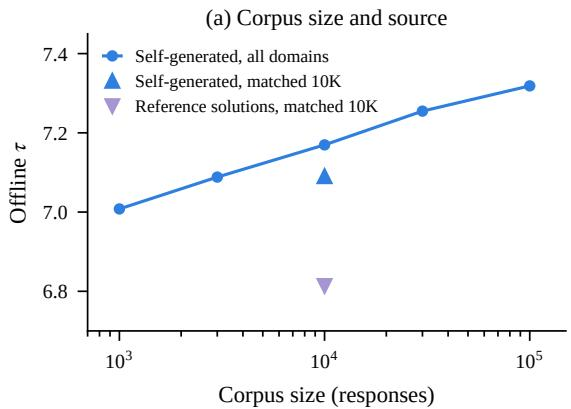

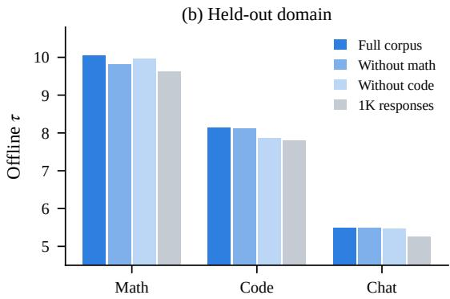  
Figure 9. (a) Offline τ as the corpus shrinks, and with 10K matched math and code prompts answered by the target or by published reference solutions. (b) Offline τ pooled by domain when the corpus excludes all math or all code responses.

Size. We subsample the 100K responses with a fixed seed into nested subsets. In Figure 9a, τ grows roughly linearly in the logarithm of the corpus size, from 7.01 with 1K responses to 7.32 with 100K, and has not saturated. Online on A210, 1K, 10K and 100K responses give 532, 543 and 555 tokens/s, against 514 tokens/s for DDTree in the same configuration.

Source. For 10K math and code prompts we take published, correctness-filtered reference solutions to the same prompts from UltraInteract (Yuan et al., 2025) and count them with the same settings. Self-generated text gives a higher τ on every benchmark (7.09 vs. 6.81 overall), although it also contains 2.7 times as many tokens (9.1M vs. 3.4M).

Domain. Figure 9b removes all math or all code responses, about 35K each. On the held-out domain τ drops by 2–3%, which still beats a 1K corpus that includes the domain, and the other domains change by less than 1%.

## H. Sensitivity and Variants

Table 10 replays DForkTree on the 155 development trajectories with blocks of 16 tokens and 64 nodes. Because these trajectories were used to select the hyperparameters, the table describes sensitivity and does not estimate held-out gains. The selected point is the best of the grid, and $\beta _ { 3 }$ hardly matters. The best single weight, $\lambda _ { a } = \lambda _ { p } = 0 . 3$ , is 1.4% lower, and reversing the order of the two weights is worse than either single weight. A 4-gram level on top of the trigram counts and a prior at the first position both lower τ slightly.

Table 10. Offline τ on the development set (155 trajectories, blocks of 16, 64 nodes).
<table><tr><td>Setting</td><td> $\lambda _ { a }$ </td><td> $\lambda _ { p }$ </td><td> $\beta _ { 3 }$ </td><td>T</td></tr><tr><td>Selected</td><td>0.3</td><td>0.6</td><td>60</td><td>7.318</td></tr><tr><td>Smoothing</td><td>0.3</td><td>0.6</td><td>20 / 180</td><td>7.313 / 7.316</td></tr><tr><td>Single weight</td><td>0.3</td><td>0.3</td><td>60</td><td>7.216</td></tr><tr><td>Single weight</td><td>0.6</td><td>0.6</td><td>60</td><td>7.169</td></tr><tr><td>Reversed order</td><td>0.6</td><td>0.3</td><td>60</td><td>7.094</td></tr><tr><td>No prior on the spine</td><td>0</td><td>0.6</td><td>60</td><td>7.167</td></tr><tr><td>Weaker spine weight</td><td>0.15</td><td>0.6</td><td>60</td><td>7.309</td></tr><tr><td>Stronger branch weight</td><td>0.3</td><td>0.9 / 1.2</td><td>60</td><td>7.274/7.212</td></tr><tr><td>4-gram level  $( \beta _ { 4 } = 6 0 )$ </td><td>0.3</td><td>0.6</td><td>60</td><td>7.309</td></tr><tr><td>Prior at the first position</td><td>0.3</td><td>0.6</td><td>60</td><td>7.291</td></tr></table>

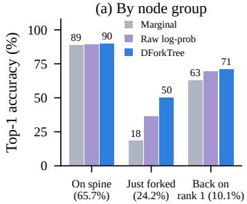

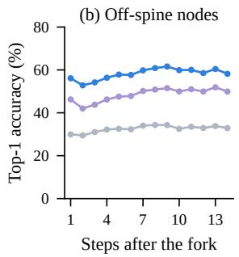

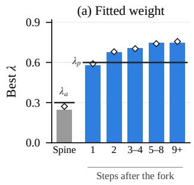  
Figure 10. (a) Top-1 accuracy of the drafter’s marginal, of the marginal corrected by the raw n-gram log-probability as in DART, and of DForkTree’s score, by node group. Parentheses give each group’s share of the 1.03M events. (b) Top-1 accuracy of off-spine nodes by the number of steps since the path left the spine.

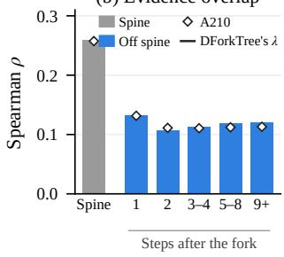  
Figure 11. Fitted weight and evidence overlap by the number of steps since the parent path left the spine. Bars show development replays and diamonds show A210. (a) Best λ per group, with DForkTree’s two weights as black lines. (b) Spearman correlation between the drafter’s log-probability and the PMI over the candidates of a position.

Per-group fit. Figure 10 compares the three scores by node group and follows off-spine nodes along the branch. Figure 11 summarizes the weights fitted per group, and Figure 12 shows the curves behind it. Each group contains the reachable positions $k \geq 2$ whose parent path has the given relation to the spine, 1.03M events in total, and targets outside the top-16 candidates count with probability $\rho _ { k } / Z$ . On the spine the prior lowers the negative log-likelihood by only 0.05 nats at its best weight and slightly raises top-1 accuracy from 88.8% to 89.9%. After the fork it lowers the negative log-likelihood by about 1.1 nats and raises top-1 accuracy from 31.4% to 56.8%. Among off-spine nodes whose parent is again a top-1 token, the best weight is 0.45, between the two groups. The difference between the off-spine and spine weights is 0.43 (95% CI 0.42–0.45) on the development replays and 0.42 (0.41–0.43) on A210.

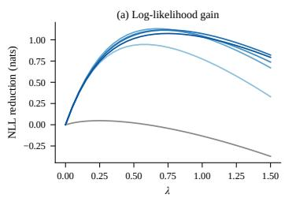

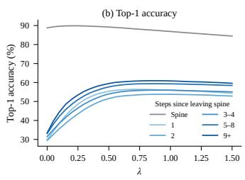  
Figure 12. Development replays grouped by the number of steps since the parent path left the spine. (a) Reduction in the negative log-likelihood of the true next token as a function of λ. (b) Top-1 accuracy of the re-scored candidates as a function of λ.

Weight and overlap. We test Theorem 4.2 on 37 groups of nodes, on the development replays and on A210. For DFlash they are the seven groups above, each with the trigram PMI, the bigram PMI and the trigram increment as evidence. For DFlash 2 they are the spine and the first three tokens after a fork, with the trigram PMI on its marginals and with the bigram PMI, the trigram PMI and the increment on its selector, which is given the tail mass as in the full-tree comparison below. Across groups, λˆ and λ⋆ have Spearman correlations of 0.89 and 0.87 on the two sets. The fitted weight falls with the mean correlation between log $q _ { k }$ and $T \ : ( - 0 . 7 8$ on both sets) and with the share of T that log $q _ { k }$ explains (−0.77 and −0.69). On top of the selector, the bigram PMI receives 0.26–0.33 at every distance, whereas the increment rises from 0.28 on the spine to 0.53–0.62 after a fork. The groups share events, so these correlations describe a pattern rather than independent replicates. Figures 4 and 13 also show what the overlap does not explain. Along a branch of DFlash, λ⋆ for the trigram PMI rises from 0.58 at the first token after a fork to 0.75 five or more tokens later. The overlap stays near 0.18 over this range and λˆ does not rise, so deeper tokens need more weight than the first-order estimate suggests. The trigram increment on DFlash’s marginals also receives weights near 1 after a fork, because its values span a smaller range than those of the full PMI.

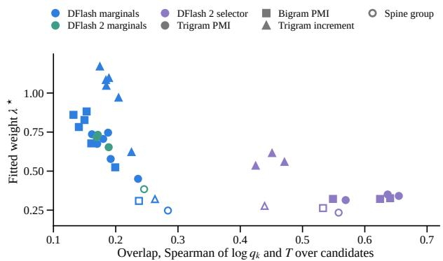  
Figure 13. Overlap of the evidence with the base score against its fitted weight, for the 37 groups of Figure 4. The overlap is the mean Spearman correlation between the base log-probability and the evidence over the candidates of a position.

Mechanism checks. Further replays test the explanation of Section 3. Right after the first fork, the drafter’s top-1 accuracy rises from 18% to 48% with the marginal probability of the fork token itself. This is what we would expect if each marginal averages over the drafter’s own predecessors, although DForkTree’s gain does not shrink as that probability grows. The trigram’s advantage over the bigram grows along the branch, from 0.06 nats and 2.0 points of top-1 accuracy at the first token after a fork to 0.12 nats and 3.4 points five or more tokens later. In the trees of Section 5.4, DForkTree lowers the expected calibration error of the path scores from 0.092 to 0.074 on spine nodes and from 0.0038 to 0.0033 on off-spine nodes.

Further variants. Several further training-free variants do not help. Replacing $P ( c )$ in Equation (2) by the trigram mixture over the drafter’s candidates at the previous position, weighted by their marginals, changes offline $\tau \ : { \bf b y } \ : - 0 . 2 \%$ and +0.2% at 32 and 64 nodes. The weights fitted per group still differ between spine and off-spine nodes, at 0.40 against 0.80. Splitting the branch weight into one for the first token after a fork and one for deeper tokens raises offline τ on A210 by at most 0.4% at 32 and 64 nodes, with or without a four-gram level whose weights are fitted for each group. None of these variants decodes faster than DForkTree’s own scores in the same implementation on the development prompts. Adding counts from the current prompt and output to the corpus raises offline τ by only 0.3%. Choosing each round’s budget is studied with calibrated scores below.

Branch tokens without target features. Re-anchoring gives the drafter both the branch tokens and the target’s features of them. To separate the two, we fill the branch tokens into the drafter’s block in place of the masks and keep the context features of the committed prefix. At the first three tokens after a fork, this raises the drafter’s top-1 accuracy from 30–31% to 37–39%, against 54–56% for DForkTree and 86–90% for the full re-run. Replacing DForkTree’s scores with these predictions up to one or three tokens after a fork in the trees of Section 5.4 even lowers offline τ, to 6.79 and 6.72 against 6.96 at 32 nodes. DFlash is trained with masks after the first position of a block, so these inputs lie outside its training distribution, and a drafter trained to read branch tokens may behave differently. For the released drafter, the knowledge that re-anchoring reveals is thus reached through the target’s features of the branch. An extra drafter pass over the branch tokens does worse than DForkTree’s counts.

A learned selector. DFlash 2 (Inco AI, 2026) adds to the DFlash drafter a trained selector that scores each candidate given its predecessor with a low-rank bilinear term. We use community weights for Qwen3.5-4B, trained against a quantized target, and define the spine and the forks on DFlash 2’s own marginals with blocks of 16. At the first three tokens after a fork on A210, the PMI correction of DForkTree closes 44–45% of the gap between DFlash 2’s marginals and DFlash 2 re-run at the fork. The trained selector closes 46–47%. Adding the PMI to the selector, with a weight of 0.20–0.30 fitted on the development replays instead of 0.55–0.60 on the marginals, closes 49–50%. Splitting the PMI into its bigram part log $P ( c \mid b ) / P ( c )$ and its trigram increment log $P ( c \mid a , b ) / P ( c \mid b )$ shows where this gain comes from. On top of the selector, the bigram part adds only 0.5–1.7 points of closure and receives a weight of 0.15–0.20. The increment adds 3.5–4.2 points with a weight of 0.45–0.55 and does slightly better than the full PMI. The selector and the bigram both condition on the parent, so the counts add mainly the token before the parent, which a first-order selector does not see. The fitted weight again follows how much the evidence overlaps with what the scorer already knows, as on the spine in Section 4.2. The gain is largest for trigram contexts of medium frequency, where counts are reliable but not so frequent that the drafter already reflects them. At the node level, the trigram increment alone is therefore the evidence to add to a learned first-order module.

Full trees with DFlash 2. In full trees the order reverses. We use blocks of 16, the same exact search for every score and weights selected on the development replays. On A210, DForkTree’s scores on DFlash 2’s marginals then raise offline τ by 10.9% at 32 nodes and 11.6% at 64 nodes, against 8.8% and 9.6% for the trained selector. DForkTree thus accepts 1.9% and 1.8% more tokens per round (95% CIs 1.4–2.4% and 1.3–2.3%), and adding the trigram increment to the selector gains only 0.7%. Two controlled variants locate the gap. Giving the selector the tail mass that DForkTree keeps raises its τ by 0.7%, a third of the gap, and removes its overconfidence on branch nodes. Without the tail mass, the selector’s path scores at 32 nodes predict an acceptance rate of 8.7% for branch nodes against an actual 5.4%, while DForkTree predicts 3.9% against 5.6%. Restoring the marginals for the children of spine nodes instead lowers τ by 5.7%. Most of the selector’s gain therefore comes from re-ranking the candidates where a branch leaves the spine, and DForkTree’s prior does this at least as well. Replacing DForkTree’s scores on branches by the selector with tail mass and the increment changes τ by less than 0.1%, so in full trees the selector adds nothing to DForkTree’s counts.

Candidates after a fork. All scores above re-rank the drafter’s top 16 candidates at a position, and these candidates are computed for the spine too. On A210 the true next token is among them for 98.3% of spine nodes but for only 80.1%, 74.0% and 73.9% of the nodes one, two and three tokens after a fork. Even the top 64 miss 9.5–12.3% of the latter. Any re-ranking of the 16 candidates is capped at these rates, which accounts for 4%, 18% and 21% of the gap to the re-anchored drafter at the three steps. The rest lies in the ranking, where DForkTree reaches 45–47% of the room between the marginals and the cap and the learned head below reaches 51–52%. The eight most frequent trigram continuations of the grandparent and parent that are not among the candidates contain 37–41% of the missing tokens after a fork and raise the coverage to 84–87%. This is 3.3–5.8 points above the same number of extra candidates from the drafter’s own ranking, whereas on the spine they add nothing.

Candidates by position. Figure 2c follows the target’s true continuation from every anchor of A210 with 23 draft positions. It counts a position only while the true tokens at all earlier positions are among their top 16 candidates, which is the condition under which DFlash 2 reports coverage (Inco AI, 2026). A position is on the spine if all earlier true tokens are top-1 tokens, and off the spine otherwise. With $S _ { k }$ and $F _ { k }$ the coverage on and off the spine at position $k , p _ { k }$ the share of positions still on the spine and $p _ { 1 } = 1$ , the pooled coverage $R _ { k } = p _ { k } S _ { k } + ( 1 - p _ { k } ) F _ { k }$ falls from position 1 to K by

$$
R _ { 1 } - R _ { K } = ( S _ { 1 } - S _ { K } ) + ( 1 - p _ { K } ) ( S _ { K } - F _ { K } ) ,
$$

where the first term is the decline on the spine and the second the growing share of paths that have left it. Table 11 shows that the second term accounts for 90–95% of the decline for both drafters, while coverage on the spine stays above 96% at the end of the block. On the GSM8K prompts of A210 the share is 89% for DFlash and 78% for DFlash 2 at K = 7. Coverage after a fork also falls with the rank of the fork token. For DFlash it is 86.9% after a fork to the second candidate, 81.4% after the third or fourth and 74.2% after a lower one, and for DFlash 2 the same numbers are 83.6%, 79.2% and 72.9%. Top-1 accuracy on the spine does fall in the deepest positions, from about 90% to 75% between positions 15 and 23 for DFlash, so deep on the spine the true token stays among the candidates while the first choice weakens. Because the condition drops paths whose earlier true tokens left the top 16, off-spine coverage here is 4.7–8.3 points higher than for the tree nodes of Section 3.

Table 11. Decomposition of the decline of top-16 coverage between position 1 and position K on A210, in percentage points, with 95% CIs of the share from a prompt-clustered bootstrap. The share can exceed 100% when the two terms have opposite signs.
<table><tr><td>Drafter</td><td>K</td><td>Decline</td><td>On the spine</td><td>Leaving the spine</td><td>Share of the second term</td><td>Spine coverage at K (%)</td></tr><tr><td>DFlash</td><td>7</td><td>7.3</td><td>0.4</td><td>7.0</td><td>95% (92–98)</td><td>98.9</td></tr><tr><td>DFlash</td><td>23</td><td>9.5</td><td>0.8</td><td>8.8</td><td>92% (88–96)</td><td>98.5</td></tr><tr><td>DFlash 2</td><td>7</td><td>10.3</td><td>1.0</td><td>9.3</td><td>90% (86–95)</td><td>96.7</td></tr><tr><td>DFlash 2</td><td>15</td><td>10.8</td><td>0.6</td><td>10.2</td><td>95% (88–103)</td><td>97.1</td></tr></table>

Calibration by node type. We replay DDTree, the EAGLE-3 tree and DForkTree with 23 draft positions on A210 and compare each node’s path score with whether the target’s true continuation passes through it. Table 12 shows that all three underestimate acceptance on the spine and at the fork node and overestimate it after a fork. Pooled over each round, the three trees predict 0.88–0.91 of the draft tokens they accept at 32 nodes and 0.89–0.91 at 64 nodes. The spine carries most of the probability and hides the opposite error after the fork. DForkTree’s scores leave a slightly smaller error on the spine and remove most of the overestimate after the fork.

Table 12. Mean path score and acceptance rate by node type in trees with 32 nodes on A210, with their ratio. The fork node is where a path first leaves the spine.
<table><tr><td></td><td colspan="3">Spine</td><td colspan="3">Fork node</td><td colspan="3">After the fork</td></tr><tr><td>Method</td><td>score</td><td>accepted</td><td>ratio</td><td>score</td><td>accepted</td><td>ratio</td><td>score</td><td>accepted</td><td>ratio</td></tr><tr><td>DDTree</td><td>0.474</td><td>0.570</td><td>1.20</td><td>0.051</td><td>0.058</td><td>1.13</td><td>0.050</td><td>0.035</td><td>0.71</td></tr><tr><td>EAGLE-3 tree</td><td>0.458</td><td>0.551</td><td>1.20</td><td>0.052</td><td>0.059</td><td>1.13</td><td>0.049</td><td>0.035</td><td>0.72</td></tr><tr><td>DForkTree</td><td>0.528</td><td>0.604</td><td>1.15</td><td>0.067</td><td>0.073</td><td>1.09</td><td>0.064</td><td>0.060</td><td>0.94</td></tr></table>

Calibrated scores. The opposite errors of Table 12 suggest giving each kind of node its own temperature. We raise the drafter’s probabilities of the candidates and of the tail to a power $\beta _ { g }$ before the normalization of Equation (3). The eight groups g are given by whether the parent path is on the spine and by four depth ranges. We fit the $\beta _ { g }$ on the development replays in three ways, by the edge likelihood, by the path calibration error from shallow to deep depths, or by offline τ directly. Table 13 shows that one global temperature changes almost nothing, and that per-group temperatures remove most of the post-fork overestimate for both methods but raise offline τ by at most 1.1%. DDTree gains the most, but DForkTree still leads calibrated DDTree by 6.8% at 32 nodes. DForkTree’s gain thus comes mainly from re-ranking the candidates of a branch rather than from rescaling its scores. Fitting to the path calibration or to τ beats fitting to the edge likelihood by 0.030 and 0.011 in τ at 32 nodes (95% CIs 0.015–0.046 and 0.001–0.022), a small effect in the direction of Section 5.5. We also choose each round’s budget among 16, 24, 32, 48 and 64 nodes from the path scores, using measured times per round. Compared with a fixed 32 nodes, this changes estimated throughput by −0.3% with raw scores, by −0.3% with one global rescaling and by +0.3% with the per-group temperatures, against +4.9% for an oracle that knows each round’s acceptance. On 21 development prompts, the temperatures fitted to τ did not raise online throughput (−2.8%, 95% CI −5.1 to −0.7%), so DForkTree keeps its uncalibrated scores.

Table 13. Offline τ on A210 with temperatures per node group fitted on the development replays, and the ratio of acceptance rate to path score for nodes after a fork at 32 nodes. Changes are relative to the same method without calibration.
<table><tr><td>Method</td><td>Temperatures fitted by</td><td>τ, 32 nodes</td><td>change</td><td>τ, 64 nodes</td><td>change</td><td>Post-fork ratio</td></tr><tr><td>DDTree</td><td>none</td><td>6.376</td><td></td><td>6.789</td><td></td><td>0.71</td></tr><tr><td>DDTree</td><td>one global temperature</td><td>6.391</td><td>+0.23%</td><td>6.797</td><td>+0.11%</td><td>0.70</td></tr><tr><td>DDTree</td><td>edge likelihood</td><td>6.447</td><td>+1.11%</td><td>6.840</td><td>+0.76%</td><td>0.95</td></tr><tr><td>DForkTree</td><td>none</td><td>6.887</td><td></td><td>7.399</td><td></td><td>0.94</td></tr><tr><td>DForkTree</td><td>edge likelihood</td><td>6.911</td><td>+0.35%</td><td>7.431</td><td>+0.44%</td><td>1.00</td></tr><tr><td>DForkTree</td><td>offline τ</td><td>6.922</td><td>+0.51%</td><td>7.447</td><td>+0.65%</td><td>1.02</td></tr><tr><td>DForkTree</td><td>path calibration</td><td>6.941</td><td>+0.79%</td><td>7.454</td><td>+0.75%</td><td>1.03</td></tr></table>

A learned re-anchoring head. We also distill the re-anchored drafter into a small head on top of the frozen DFlash drafter. The head reads the drafter’s hidden state at the position, 256-dimensional embeddings of the parent, the grandparent and the spine token that the drafter assumed there, and the distance from the fork. From these it adds a bilinear correction to the scores of the 16 candidates and keeps the tail mass. We train it on 2.5M nodes from 3,000 responses held out from the corpus, with the re-anchored drafter as the teacher, and recount the n-grams without these responses for every method. In this setting DForkTree closes 45%, 37% and 36% of the gap at the first three tokens after a fork on A210. The head alone closes 38%, 34% and 34%, and with the PMI as an additional input it closes 49%, 43% and 41%, keeps the spine unchanged and halves the calibration error on branches. Without the drafter’s hidden state, it loses only 1–2 points. By the oracle of Section 5.5, five more points of closure would lengthen acceptance by only about 1%, less than a head of this size likely costs per round. The head sees far less data than the counts, so a larger model or corpus may close more. Within this budget, however, the drafter’s own state carries little of the missing information, which agrees with the test above in which branch tokens alone did not help.

A second drafter pass. Re-anchoring needs the target’s features of the branch, but a drafter trained to read branch tokens might recover part of the gain in a second pass. We fine-tune a LoRA adapter (rank 64, 21.4M parameters) on all linear layers of the frozen DFlash drafter for one epoch on 3,000 responses held out from the corpus. Given the context features up to the anchor and the true tokens of a path, the adapted drafter predicts the next eight tokens. In each round of the replay, the adapter re-drafts from the K best branch nodes up to depth four in DForkTree’s tree. The candidates and scores below these nodes then come from this second pass, with the PMI added as before. On A210, offline τ rises by 1.0–2.0% at 32 nodes and by 1.4–2.9% at 64 nodes for K from 1 to 8. A CUDA-graph benchmark puts the second pass at 2.5–6.2 ms on Qwen3.5-4B and 3.6–7.7 ms on Qwen3.5-9B, depending on K and on contexts of 256 to 2048 tokens. Against rounds of 12 and 19 ms, it would need 21–52% and 18–40% longer acceptance to pay off. The replay does not separate the effect of training from that of the second pass itself, and we leave an online test to future work.

## I. Limitations

All our measurements use batch size one on RTX 5090 GPUs. Larger batches leave less idle computation for verification, so the gains of all tree methods, including DForkTree, may change under batched serving, which we have not measured. DForkTree also needs a corpus of target generations, which the target produces once, offline. With only 1K responses, DForkTree already reaches 532 tokens/s on A210 against 514 for DDTree (Section G), and Qwen3.5-9B reuses the corpus of Qwen3.5-4B. Our analysis applies to any drafter whose positions are predicted independently, but we test it only on block diffusion drafters. Finally, both target models come from the Qwen3.5 family, and we test DFlash 2 only in offline replays with community weights trained against a quantized target.