# Detecting Shadow AI: Unsanctioned LLM Agents on Enterprise Endpoints

A Taxonomy, an Open Detector and a Controlled Evaluation

Jeremy Canale

Fabien Soulis

contact@jeremycanale.com

soulis.fabien@gmail.com

## Abstract

Shadow IT, the use of technology that the IT organisation has not approved, is a longstanding governance problem. We argue that autonomous AI agents can make it grow much faster: agents make building tools nearly free, act with their user’s privileges, and leave behind scripts, automations and MCP servers that are themselves unsanctioned. A simple compounding model shows that, under its assumptions, shadow IT grows exponentially once agentic artifacts reproduce faster than the organisation retires them; retiring them starts with detecting them. We then ask whether unsanctioned agents can be detected on Windows endpoints. We propose a taxonomy of nine classes of agents and six layers of endpoint footprint, and argue that rules based only on the structure of processes and connections cannot separate an agent from its behavioural twin, the same program talking to a non-AI service. We present Agent Detector, an open-source Windows detector that anchors behaviour to the identity of the remote service and correlates it with configuration, installation and execution history, using a catalog of 39 tools and 184 LLM endpoint entries; it informs users through a notice they must acknowledge instead of blocking. On a controlled bench of 12 synthetic agents, 3 AI components and 9 benign workloads, repeated 5 times on one workstation, two behavioural rules flagged every behavioural twin, while Agent Detector flagged none and detected every agent in the majority of runs. Its limits are temporal: a connection to a provider behind a shared content-delivery network is attributable only while the DNS cache holds the provider’s name, one to five minutes, and an intermittent agent was seen by about one scan in three. A scan costs about 154 ms. The bench is too small to rank detectors; it maps what each kind of evidence can see: unsanctioned agents can be partly detected, and not by behaviour alone.

## 1 Introduction

Shadow IT. Every organisation runs software that its IT department never approved. The phenomenon has a name, shadow IT: “all hardware, software, or any other solutions used by employees inside of the organisational ecosystem which have not received any formal IT department approval” [72]. It is old, it is mostly well-intentioned, since employees adopt tools to get their work done, and it is persistently underestimated: a systematic review of the literature concludes that “the true extent of Shadow IT usage in companies is vastly underestimated by CIOs” [36]. Its risks are those of any system nobody has listed: data held by unknown providers, security controls that do not apply, compliance obligations that cannot be met. Its governance starts with finding it [22].

Shadow AI. Generative AI produced the fastest wave of shadow IT so far. In 2024, 75% of knowl edge workers used generative AI at work and “78% of AI users are bringing their own AI tools to work” [51]; in a 2025 global study, 44% of employees admitted using AI in ways that contravene their organisation’s policies and 61% avoided revealing their use [24]. Among the breached organisations that IBM studied, one in five reported a breach involving shadow AI, and only 37% had policies to manage AI or detect shadow AI [32]. This first wave was conversational: employees pasted text into a chatbot, in a browser, where network controls could see it.

Agents change the rate, not just the scale. The second wave is made of agents: software in which a language model, in a loop, decides on actions that tools then execute on the user’s machine, with the user’s privileges. Coding agents such as Claude Code, Codex and GitHub Copilot’s agent mode, desktop agents, AI-native IDEs, local model runtimes and home-made scripts now run on enterprise laptops, often outside any inventory [74, 75]. We argue that this wave does not merely add a category to shadow IT; it changes how fast shadow IT grows. Agents make building a tool nearly free; they act without asking; and the scripts, automations, packages and MCP servers they leave behind are themselves unsanctioned, and sometimes agentic in turn. We make the argument explicit with a compounding model in which, under stated assumptions, shadow IT grows exponentially as soon as agentic artifacts reproduce faster than the organisation retires them (Section 4). The model does not measure anything; it shows which quantities matter. Since deliberately retiring an artifact requires finding it first, detection is a precondition of governance, though not a suficient one.

Why detecting agents is hard. Detecting agents is harder than detecting the chatbots of the first wave. The network sees an encrypted connection to an API, often through a content-delivery network shared with unrelated services, sometimes through an aggregator or a relay with an innocuous name; it does not see which process opened it, it does not see laptops outside the corporate network, and it does not see local models at all. Inventories see installed products, but a script of a few dozen lines has no installer. Behavioural detection, the usual answer to software without a signature, looks promising: an agent holds a connection to a remote service and runs commands. But so does npm install, so does an IDE with an integrated terminal, so does an administrator’s automation script. We argue that for every agent there is a behavioural twin, the same program talking to a non-AI service, that a detector using only the structure of processes and connections cannot separate from it, and we measure the consequence for two simple behavioural rules (Sections 6 and 11). What separates an agent from its twin is the identity of the remote service and of the software.

Approach. We therefore detect agents on the endpoint by correlating weak signals around identity: which process talks to which LLM service (attributed through the Windows DNS cache or through address ranges dedicated to a provider), whether that process also runs shells, what configuration it carries (base URLs, MCP server definitions), what is installed, and what Windows remembers having executed. We implement this in Agent Detector, an open-source Windows detector deployed with Microsoft Intune, which runs every hour as SYSTEM, reads only local state, never reads content, and never blocks. When it finds an agent, it shows the user a notice that they must acknowledge, and it records the acknowledgement: the user is informed rather than silently observed.

Contributions. This paper makes six contributions.

C1. An argument, with a simple compounding model and the available evidence, that agents accelerate shadow IT through second-order artifacts, and that detection is a precondition, though not a suficient one, for keeping an organisation below the threshold of exponential growth (Section 4).

C2. An analysis of why behaviour-only detection of agents falls short, centred on the behavioural twin argument, with an operational boundary between behaviour and identity (Section 6).

C3. A taxonomy of nine classes of agents and six layers of endpoint footprint, arguing that productless agents are visible only at run time, in the network and in configuration (Section 7).

C4. An open, dated catalog of 39 tool signatures and 184 LLM endpoint entries in nine categories, including aggregators, inference platforms, gateways and relays (Section 7, Section A).

C5. The design and implementation of Agent Detector, which correlates these layers, protects privacy by design, informs users instead of blocking, and deploys with standard enterprise tooling (Sections 9 and 10).

C6. A controlled evaluation with synthetic agents in three languages, behavioural twins, AI components, developer workloads and an in-situ cross-check, repeated 5 times as standard user and as administrator against a signature baseline and two behavioural baselines, with two experiments on time: the expiry of DNS cache entries and intermittent agents (Section 11). The bench is small and run on one workstation; it shows where each kind of evidence fails rather than ranking detectors. The behavioural rules flag every twin; Agent Detector separates agents from their twins, but attributes connections to providers behind a shared content-delivery network only while the DNS cache holds their names, sees an intermittent agent at about one scan in three, and misses ephemeral agents, undeclared relays and agents inside WSL 2; a scan takes about 154 ms.

Organisation. Section 2 reviews shadow IT and shadow AI, and Section 3 introduces agents and their ecosystem. Section 4 develops the acceleration argument. Section 5 states the threat model and the requirements. Section 6 explains why behaviour is not enough. Section 7 presents the taxonomy and the catalog, and Section 8 the landscape of existing approaches. Sections 9 and 10 describe Agent Detector, and Section 11 evaluates it. Section 12 discusses the inform-not-block design, the legal framework and the limitations; Section 13 reviews related work and Section 14 concludes.

## 2 Shadow IT and Shadow AI

## 2.1 Shadow IT: an old problem

Shadow IT is as old as end-user computing. Silic and Back define it as “all hardware, software, or any other solutions used by employees inside of the organisational ecosystem which have not received any formal IT department approval” [72]; earlier work describes it as the “user-driven fulfilment of requirements” and calls it “a widespread challenge amongst IT departments” [29]. The informationsystems literature has studied its nature, its management and its outcomes for more than a decade [30, 91]. A systematic review of 107 studies characterises it by its covertness, “i.e., without alignment with the IT organization”, and concludes that “the true extent of Shadow IT usage in companies is vastly underestimated by CIOs” [36].

The causes are well understood: business units need tools faster than central IT can provide them; cloud services, consumer applications and personal devices made acquisition trivial; and the people who adopt them are rarely malicious. The consequences are also well understood: data held by providers that the organisation does not know, licences and costs outside any budget, security controls that do not apply, and compliance obligations that cannot be met for systems no one has listed. Analysts have long expected the share of employees who “acquire, modify or create technology outside IT’s visibility” to keep growing, from 41% in 2022 to 75% by 2027 according to a Gartner prediction reported in the press [55].

Two findings from this literature frame our work. The first is that shadow IT is not only a risk: the governance literature distinguishes control-oriented, user-oriented and user-driven approaches, and treats user-driven innovation as something to channel rather than suppress [29]. The second is that every governance outcome starts with identification. A study of 27 shadow systems traces what happens once they are found: they are phased out, replaced, or continued as IT-managed or businessmanaged systems [22]. None of these outcomes is available for a system that has not been found.

## 2.2 Shadow AI

Generative AI produced the most rapid wave of shadow IT so far. Silic et al. define shadow AI as “the unsanctioned use of AI systems outside approved governance frameworks” and frame it as a “sociotechnical governance failure” [73]; recent work documents it in critical infrastructure [7] and proposes maturity models for “bring your own AI” [9].

Survey data show both its scale and its covertness. In Microsoft and LinkedIn’s 2024 study of 31,000 people, 75% of knowledge workers used generative AI at work, “78% of AI users are bringing their own AI tools to work”, and 52% of those who used AI at work were reluctant to admit it for their most important tasks [51]. A 2025 global study of 48,000 respondents found that 58% of employees regularly used AI tools for work, mostly “free public options (70%) rather than employer-provided tools (42%)”; 44% admitted using AI in ways that contravene their organisation’s policies, and 61% avoided revealing when they had used it [24].

The risk is not hypothetical. In 2023, Samsung banned generative AI tools for its staf after discovering that employees had uploaded sensitive source code to a public chatbot [28]. IBM’s 2025 breach study reports that one organisation in five sufered a breach due to shadow AI, that organisations with high levels of shadow AI paid on average \$670,000 more per breach, and that only 37% had policies to manage AI or detect shadow AI [32]. Prohibition alone does not solve the problem: a parameterised model of bring-your-own-AI governance finds that “prohibition-based solutions will result in residual risk levels close to those achieved through baseline solutions” [9].

## 2.3 From chatbots to agents

The first wave of shadow AI was conversational: employees pasted text into a web chatbot. That wave is visible where web trafic is visible, and it is the target of the network and data-centric controls reviewed in Section 8. The second wave is diferent. Agents run on the endpoint, act with the user’s privileges, and talk to models through APIs, aggregators, relays or local runtimes rather than through a web page.

Industry measurements of developer machines show how far this wave has already gone. In nearly 10,000 developer environments, 50.8% of developers had at least one MCP server installed, 43% ran two or more AI coding environments, and MCP servers were found “installed on developer machines outside the centralized inventory” [74]. The same vendor reports that security programs see “roughly a third of their organization’s real AI footprint” [75]. Security researchers describe personal agents that “can run shell commands, read and write files, and execute scripts”, and warn that such agents “can become covert data-leak channels that bypass traditional data loss prevention” [15].

Shadow AI has therefore moved from the browser, where organisations already look, to the endpoint, where they mostly do not. Section 4 argues that this move does not just add one more category of shadow IT: it changes the rate at which shadow IT grows.

## 3 Autonomous LLM Agents

This section summarises what an AI agent is, how agents reached the enterprise desktop, and the two ecosystem features that matter most for their detection: the Model Context Protocol and the many routes from an agent to a model.

## 3.1 What an agent is

A chatbot answers; an agent acts. The step from one to the other is a control loop in which the model’s output is parsed into actions, the actions are executed by tools, and their results are fed back to the model. ReAct showed that interleaving reasoning traces and actions lets a model “interface with external sources, such as knowledge bases or environments” [88]; Toolformer showed that a model can learn “which APIs to call, when to call them, what arguments to pass” [70]. Surveys now describe LLM-based agents through a common architecture of profile, memory, planning and action modules [82].

For detection purposes we use a deliberately operational definition. An agent is software that (i) reaches a language model, through a remote API or a local runtime; (ii) runs a loop that turns the model’s output into actions; and (iii) owns tools that act on its environment: a shell, the file system, a browser, network services or MCP servers. This definition is behavioural on purpose: it covers a commercial coding assistant as well as a script of a few dozen lines. Agent Detector’s probable-agent rule tests a narrower proxy of it on the endpoint: a process that talks to a model and has a shell among its descendants. Agents whose tools run inside their own process, such as file edits, HTTP calls or a browser driven over a pipe, start no shell and escape that rule; other evidence must find them.

## 3.2 Coding agents on the desktop

Software engineering is where agents first became everyday tools. On SWE-bench, a benchmark of 2,294 real GitHub issues, the best-performing model at the time, Claude 2, solved “a mere 1.96% of the issues” [34]; SWE-agent reached 12.5% by giving the model an agent–computer interface [87], and open platforms such as OpenHands let agents work “by writing code, interacting with a command line, and browsing the web” [83]. The tools followed. Claude Code, Codex, GitHub Copilot’s agen mode, Cursor and their peers now run on developers’ laptops with the developer’s privileges.

Adoption data come from repositories and surveys. A study of 128,018 GitHub projects estimates that between 22.2% and 28.7% of them already use coding agents [69]; a dataset of more than 456,000 pull requests documents five agents operating “in the wild” [37]; and a study of pull requests generated with Claude Code reports that 83.8% of them were eventually merged [85]. The 2026 Stack Overflow developer survey, with more than 30,000 respondents, names Claude Code (66%) and GitHub Copilot (59%) as “the leaders for coding agents” [78]. These numbers describe developers, but the same tools, and general-purpose desktop agents such as Claude Desktop’s Cowork mode, are spreading to analysts, marketers and managers.

Not every agent runs on the endpoint. GitHub’s cloud coding agent, for instance, edits files and runs tests “in a cloud development environment, rather than your local IDE” [25]. Such agents leave no footprint on the laptop; we treat them as out of scope (Section 5).

## 3.3 The Model Context Protocol

The Model Context Protocol (MCP), open-sourced by Anthropic in November 2024 [3], standardises how an agent (the host) talks to servers that expose tools, resources and prompts. Messages are JSON RPC 2.0; with the stdio transport, a server is a “client-launched subprocess” that exchanges newline delimited messages over its standard streams [54]. The specification itself warns that “tools represent arbitrary code execution and must be treated with appropriate caution”, and the documentation of local servers notes that a server “runs with your user account permissions” [53].

MCP grew fast. An analysis of 177,436 agent tools created between November 2024 and February 2026 finds that software development accounts for 67% of the tools and 90% of MCP server downloads, and that the share of “action” tools, which change the state of the world, rose from 27% to 65% of usage [79].

For an endpoint detector, MCP has two consequences. First, an agent at work is often a process tree: the host, its MCP servers started through npx, uvx or python, and the shells and browsers they drive. Second, MCP servers are declared in configuration files that live in the user profile: %APPDATA%\Claude\claude\_desktop\_config.json for Claude Desktop [53], \~/.claude.json for Claude Code [4], \~/.codex/config.toml for Codex [57], mcp.json files for VS Code and Copilot [48], and \~/.cursor/mcp.json for Cursor [17]. These files are evidence that an agent is installed and configured, even when it is not running. Many clients also read project-scoped files, such as an .mcp.json or a .vscode/mcp.json inside a repository; the evaluated catalog reads only the files in the user profile, so servers declared per project escape it. They are also a target: MITRE ATLAS lists “Discover AI Agent Configuration” and “Modify AI Agent Configuration” among adversary techniques [52].

## 3.4 Routes to a model

An agent is only as visible as its route to a model. The routes have multiplied:

• Model providers expose first-party APIs (OpenAI, Anthropic, Google, Mistral) and are resold by cloud platforms such as Azure OpenAI or Amazon Bedrock under the customer’s own subdomain.

• Aggregators such as OpenRouter resell hundreds of models from many providers behind a single, OpenAI-compatible API; the agent’s trafic then goes to the aggregator, whatever the model.

• Inference platforms host open-weight models (Groq, Together AI, Fireworks AI and others).

• Gateways and relays, hosted (Cloudflare AI Gateway, Portkey) or self-hosted (LiteLLM), sit between the agent and the provider; relays re-expose a provider’s API under an arbitrary domain.

• Local runtimes such as Ollama or LM Studio serve open-weight models on a local port, with no external trafic at all.

Most agents and SDKs let the user switch between these routes with a single environment variable, such as OPENAI\_BASE\_URL or ANTHROPIC\_BASE\_URL. That convenience makes the route itself unreliable as a sole signal, but the variable that sets it is a signal in its own right, which Agent Detector read (Section 9).

## 3.5 Agents as a security concern

The security literature on agents focuses on what an attacker can make an agent do: indirect prompt injection turns retrieved data into instructions [27]; benchmarks show tool-integrated agents following injected instructions in a substantial share of cases [18, 89]; poisoned MCP tool descriptions hijack agents [10, 84]; and frameworks name the risk of “excessive agency” [58, 60], and a separate list now covers agentic applications [59]. All of these presuppose that the organisation knows which agents run where. The question of this paper comes first: which agents are there at all?

## 4 Why Agents Accelerate Shadow IT

This section argues that AI agents will make shadow IT grow faster than any previous wave, and that under conditions we make explicit the growth becomes exponential. The argument rests on three mechanisms, a simple model that shows how they combine, and the available evidence. It is an argument, not a measurement: we state the assumptions, and we mark which numbers are illustrative.

## 4.1 Three mechanisms

1. Creating a tool becomes nearly free. Classic shadow IT is acquired: an employee subscribes to a service or installs an application that someone else built. Agents let employees build. Research has shown models that “create their own reusable tools for problem-solving”, with “continual tool generation and caching as new requests emerge” [11]. Practice has followed: more than 1.1 million public repositories use an LLM SDK, and GitHub’s coding agent created more than one million pull requests in its first five months [26]. In McKinsey’s 2026 survey, as reported in the trade press, nearly a third of respondents said their organisation had decided against buying a software product because it “could be built internally with agentic coding tools” [68]. Productivity evidence is mixed for experienced developers working on mature code bases: a randomised trial found that AI assistance increased completion time by 19% [8], while an earlier controlled experiment found a 55.8% speedup on a well-defined task [61]. What matters for shadow IT, however, is not the speed of expert maintenance work but the cost of producing a new, small, good-enough tool for oneself. For that, the evidence points one way.

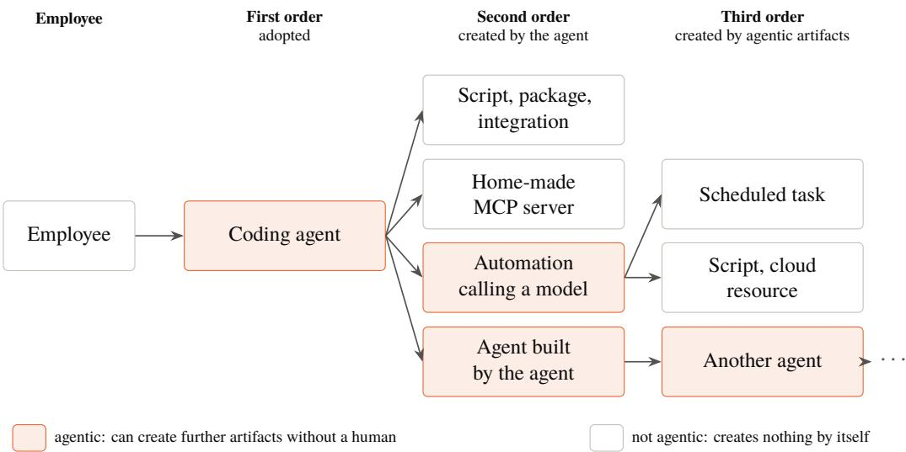  
Figure 1: Orders of shadow IT. Classic shadow IT stops at the first order: a tool adopted by an employee. Agents add a second order, the artifacts they create, and a third, the artifacts created by those of them that are agentic themselves. Only the agentic branches can keep growing without a human.

2. Agents act with the user’s privileges. An agent does not wait for IT. It installs packages, starts MCP servers, writes and schedules scripts, configures other tools and calls external services, all with the rights of the user who runs it. The MCP documentation is explicit that a local server “runs with your user account permissions” [53], and security frameworks list “excessive agency” among the main risks of LLM applications [58, 60]. Each of these actions can create an artifact that no one approved.

3. Agents produce shadow IT, and some of it is agentic. The artifacts an agent leaves behind are themselves shadow IT: scripts, automations, integrations, MCP servers, packages, cloud resources. We call them second-order shadow IT. Some of them are agentic in turn, such as an automation that calls a model or an agent built by an agent: they can create further artifacts without a human in the loop. Others, such as a home-made MCP server, are not agentic themselves but extend what the agents that use them can do. The ecosystem data are consistent with this: half of the developers in a large sample already had an MCP server installed [74], and the share of “action” tools in MCP usage rose from 27% to 65% in little more than a year [79]. Figure 1 illustrates the three orders.

## 4.2 A compounding model

The three mechanisms combine multiplicatively. Consider an organisation of � employees and let �<sub>�</sub> be the number of employees who use an unapproved agent in month �. In classic shadow IT, adopters acquire unapproved tools at a rate � per month and the organisation retires a share $\delta$ of them each month, because it finds and phases them out or because they are abandoned. The stock $S _ { t }$ of unapproved tools follows

$$
S _ { t + 1 } = \left( 1 - \delta \right) S _ { t } + \kappa A _ { t } ,\tag{1}
$$

and converges to $\kappa N / \delta$ once adoption saturates: shadow IT grows with the number of adopters, and stops.

With agents, two terms change. Agent users create artifacts at a rate $\rho$ that is much larger than � (mechanism 1), and a fraction $\phi$ of the stock $X _ { t }$ of artifacts is agentic and creates new artifacts at a

Classic shadow IT (� = 0.05) Agents, �� = 0.03 < � = 0.05  
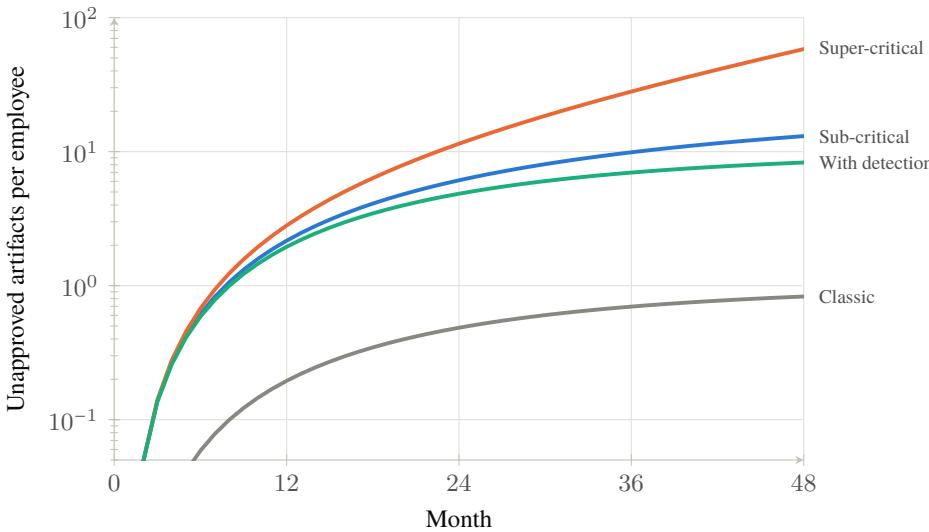  
Figure 2: Stock of unapproved artifacts per employee under the model of Section 4, with adoption $A _ { t } / N =$ $1 - e ^ { - 0 . 1 t }$ and agent users creating $\rho = 0 . 5$ artifacts per month. All parameter values are illustrative, chosen to show the regimes, not fitted to data (logarithmic scale).

rate � (mechanism 3):

$$
X _ { t + 1 } = \left( 1 - \delta + \sigma \phi \right) X _ { t } + \rho A _ { t } .\tag{2}
$$

Write $g = 1 - \delta + \sigma \phi$ . When $\sigma \phi < \delta , g < 1$ and the stock converges to $\rho N / ( \delta - \sigma \phi )$ : larger than in classic shadow IT by a factor that grows as �� approaches �, but bounded. When

$$
\sigma \phi > \delta ,\tag{3}
$$

$g > 1$ and the stock grows exponentially, as $g ^ { t }$ , whatever the number of employees. The condition has a plain reading: shadow IT explodes when agentic artifacts reproduce faster than the organisation retires them.

Figure 2 plots the four regimes with illustrative parameters. The point of the figure is qualitative, not numerical: the classic curve saturates; the agentic curves start higher because $\rho \gg \kappa ;$ the super critical curve diverges; and raising the retirement rate � above $\sigma \phi$ brings it back to a bounded regime.

## 4.3 What the model says about detection

The organisation has several levers. Sanctioned alternatives lower adoption $A _ { t } ;$ application control, least privilege and allowlists of MCP servers lower the creation rates $\rho$ and $\sigma ;$ a policy on automations lowers the agentic share $\phi ;$ and retirement raises �. Detection does not act on any of these parameters by itself. It is the precondition of the last lever and the measurement that the others need. Abandonment retires artifacts without anyone finding them, but every deliberate retirement starts with identification: an artifact that is not found cannot be phased out, replaced or brought under management [22]. Today most of it is not found: a vendor study of its own discovery customers reports that security programs see roughly a third of the real AI footprint [75], and most breached organisations in IBM’s sample had no policy to detect shadow AI [32]. With invisible artifacts, the deliberate part of � is close to zero.

Detection is therefore necessary but not suficient. In Figure 2, raising � from 0.05 to 0.15 bounds the super-critical curve, but its stock still settles at $\rho / ( \delta - \sigma \phi ) = 1 0$ artifacts per employee, ten times the classic level: retirement alone does not bring shadow IT back to its pre-agent size, and the other levers remain necessary. We therefore treat agent detection as the first step of agent governance, not as its whole.

## 4.4 Evidence and caveats

Four caveats apply. First, the model is linear: once � > 1, exponential growth follows by construction, and a real organisation would hit limits that the model omits (the attention of its employees, compute budgets, the saturation of useful tasks). The model makes the threshold explicit; it does not predict growth. Second, the parameters are not known; we do not claim that any organisation is above the threshold today. In particular, we know of no measurement of $\sigma ,$ the rate at which agentic artifacts create further artifacts without a human in the loop: the ecosystem data cited above show that agents increasingly act, not that their artifacts reproduce. Third, Second, the macro trends that make the super-critical regime plausible come from analyst predictions and vendor surveys, which are gray literature: Gartner predicts, as reported by Reuters, that a third of enterprise software applications will include agentic AI by 2028 and that 15% of day-to-day work decisions will then be made autonomously, but also that more than 40% of agentic AI projects will be cancelled by the end of 2027 [67]; these forecasts mostly concern sanctioned enterprise software, so they indicate the spread of agentic capability rather than of shadow artifacts. Fourth, adoption is moving fast and unevenly: in the 2025 Stack Overflow survey, AI agents were “not yet mainstream” among developers [77], while one year later the survey reported clear leaders among coding agents [78], and repository studies estimate that a quarter of active GitHub projects already use them [69].

The argument therefore stands on its mechanisms rather than on its numbers: agents lower the cost of creating tools, act without asking, and create artifacts that act in turn. The first two mechanisms are documented; the third is plausible but unmeasured; their combination is compounding by construction. Whether a given organisation is above or below the threshold is an empirical question, and answering it requires the measurement capability that the rest of this paper builds.

## 5 Threat Model and Requirements

## 5.1 Setting

We consider an organisation that manages a fleet of Windows laptops with a mobile device management service, here Microsoft Intune, and that has adopted an AI usage policy listing approved tools. Employees, and in particular developers, have user accounts that may or may not hold administrator rights. The organisation operates a SIEM that collects Windows events. Its question is not whether an employee could use an unapproved agent, but which agents are actually present or in use, on which machine, for which user, and whether the user was informed of the policy.

## 5.2 Actors

## A1 – The well-intentioned employee.

The primary actor. They install or run an agent to be more productive, without asking IT Security and often without knowing that a policy exists. They do not try to hide the agent. This is the classic profile of shadow IT (Section 2), and the one that matters most by volume.

## A2 – The builder.

A developer or analyst who writes their own agent: a script that calls a model API, possibly through an aggregator or a company-unknown relay, with tools that run commands. They do not hide either, but their agent has no product name, no installer and no signature.

## A3 – The agent itself.

An agent acts with the privileges of its user and can, by itself, install packages, start MCP servers, write scripts, schedule tasks or configure other tools. It creates shadow IT of its own (Section 4).

## A4 – The evader.

A user who deliberately hides an agent, for example by renaming binaries, running it in a virtual machine or a container, or routing it through an obscure domain. A4 is not the design target:

an endpoint detector cannot win against a determined local administrator. Section 11 nevertheless measures how simple evasions afect detection, and Section 12 discusses the complementary controls.

## 5.3 Risks addressed

The risks of unapproved agents are those of shadow IT, amplified by autonomy: company data sent to providers that have no contract with the organisation; code and commands executed by a model on a machine that holds credentials and source code; supply-chain exposure through MCP servers and agent extensions [10, 31]; and the loss of accountability when no one can say which agent did what. The regulatory dimension adds to these: an organisation subject to the GDPR must know which processors receive personal data, and the EU AI Act asks deployers to support the AI literacy of their staf [20, 21].

## 5.4 Goal and non-goals

The goal is visibility with informed acknowledgement: to know, per machine and per user, which agents are installed, used recently or active, with evidence an analyst can trust; and to make sure that each user who runs one has been shown the policy. The non-goals are as important. The detector does not block agents, because blocking without visibility only pushes usage to less visible channels, and because blocking decisions belong to existing controls such as application control. It does not inspect content, because the question is which agent is used, not what it is asked. And it does not claim to see what happens outside the endpoint: agents that run entirely in the cloud are the job of network and cloud controls.

## 5.5 Requirements

## R1 – Coverage beyond products.

Detect known tools and product-less agents (A1 and A2), including agents reached through aggregators, relays and local runtimes.

## R2 – Precision.

Do not flag ordinary developer activity. Every false alert erodes the trust of users and analysts, and with a notice that the user must acknowledge, a false positive is also a usability defect.

## R3 – Privacy.

Collect no content and no secret; minimise what is collected to what identifies a tool.

## R4 – Low cost.

Run on every laptop every hour without noticeable impact.

## R5 – Explainability.

Attach evidence to every finding.

## R6 – Deployability.

Deploy and update with the MDM the organisation already uses, including on locked-down machines.

## R7 – Graceful degradation.

Report partial results and coverage gaps instead of failing, and never interfere with the user’s work beyond the notice.

## 5.6 Out of scope

Agents that run entirely in a provider’s cloud and never touch the endpoint; agents inside virtual machines, containers or WSL, whose processes and sockets are invisible from the host (we measure one such case); non-Windows endpoints; unmanaged personal devices; and deliberate evasion by a local administrator.

## 6 Why Behavioral Detection Falls Short

Behavioural detection is the obvious answer to agents that have no signature. Endpoint detection and response (EDR) products have long caught unknown malware by what it does rather than by what it is: a document editor that starts a shell, a process that injects code into another. An agent has an equally distinctive behaviour, or so it seems: it keeps a connection to a remote service and, between two messages, runs commands. This section argues that behaviour alone cannot separate agents from ordinary software on a developer’s workstation, explains why, and derives the design principle that Agent Detector follows. Section 11.7 measures the claim.

## 6.1 What behavioural detection means here

We draw the boundary operationally. A feature belongs to identity, written �, when it is a string that names a piece of software or a service: an image name or path that names a product, a publisher or signer, a package or module name, a command-line argument that names a package, a host name, an address range, the value of a configuration variable. Every other observable belongs to behaviour, written �: the shape of the process tree, the kind of process (shell, interpreter), file and registry activity, and the number, duration, timing and volume of network connections. We treat the names of generic system components such as cmd.exe or python.exe as behavioural, because they say what a process does, not which product it is. A detector is behavioural when its decision depends only on �. Ignoring identity is what makes behavioural detection attractive: it promises to catch agents that no catalog lists.

The canonical structural rule for agents, which we evaluate, is: an interpreter or runtime that holds an outbound connection on port 443 and has a shell among its descendants. A broader variant drops the interpreter condition.

## 6.2 Seven reasons it falls short

1. Agents make the same gestures as developers. An agent edits files, runs git, installs packages with npm or pip, runs tests and opens HTTPS connections. So does a developer, and so do the tools a developer uses every minute. npm install downloads packages over TLS and runs their install scripts through cmd.exe; test runners and build systems start shells; an administrator’s PowerShell script calls the Microsoft Graph API and runs commands. On a developer workstation, “an interpreter with a TLS connection that runs a shell” is not a rare event; it is the background.

2. The host processes are legitimate. Commercial agents run inside processes that are themselves legitimate and signed: the extension host of VS Code (a Node.js process), python.exe, node.exe, a packaged desktop application. A signature identifies the publisher of the host, not what the host is doing. Flagging node.exe because it runs shells flags the IDE.

3. The trafic does not say what it is. Model APIs use TLS like everything else, often behind content-delivery networks that also serve unrelated sites. Aggregators and relays put another name in front of the provider, and Encrypted Client Hello hides the server name [66]. Trafic analysis can recover a great deal from packet sizes and timing [38, 62, 86, 90], but it needs a capture point on the network path, trained models, and it answers with a probability, not with a process and a user.

4. Agents can be tiny and short-lived. A working agent fits in a few dozen lines of Python and can run for a few seconds. There is no installer, no service and no long-lived window. A periodic observer misses it unless the agent happens to run at observation time; continuous telemetry catches it, but must then decide, in real time and without context, what a short burst of HTTPS and shell activity means.

5. Local models are silent on the network. An agent that uses a local runtime such as Ollama talks to a loopback port. Every rule that keys on outbound TLS misses it entirely.

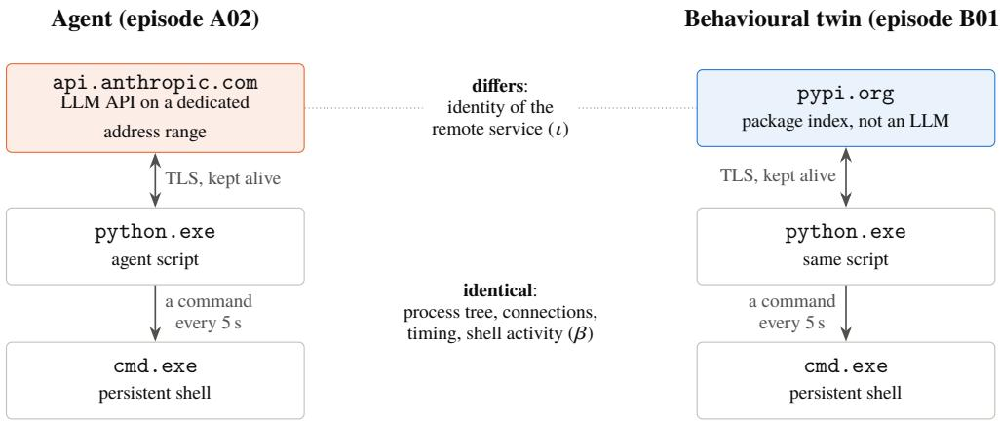

Behaviour-only rules (D1, D2): flag both, so the twin is a false positive; or flag neither, so the agent is missed.

Agent Detector: flags the agent only: an LLM endpoint identified by its address range, and a shell among its children.

Figure 3: A behavioural twin from the evaluation. The agent and its twin run the same script with the same shell and the same connection pattern; only the remote service difers. Any detector that ignores the identity of the remote service must treat them alike.

6. Agents are benign by nature. Behavioural engines are trained and tuned on malicious behaviour. An agent’s actions are, by construction, the actions its user asked for, executed with the user’s rights. The relevant question is not whether the behaviour is malicious but whether the tool is authorised, which is a property of identity and policy, not of behaviour.

7. False positives are expensive. For a security analyst, a false positive costs a few minutes. When the response is a notice that a user must acknowledge, a false positive interrupts a person who did nothing wrong, and a detector that interrupts every build loses its users’ trust within a day. Precision is therefore a first-class requirement (R2 in Section 5).

## 6.3 The behavioural-twin argument

The first three reasons can be stated precisely. Describe the observable footprint of a running program � as a pair

$$
x ( p ) = { \bigl ( } \beta ( p ) , \iota ( p ) { \bigr ) } ,
$$

where $\beta ( p )$ collects the behavioural features (process tree, command patterns, number and timing of connections) and $\iota ( p )$ collects the identities (software identity and the identity of the remote services). Call two programs � and � behavioural twins when $\beta ( a ) = \beta ( b )$ and $\iota ( a ) \neq \iota ( b )$

For any detector � that depends only on �, and any pair of behavioural twins �, � , $f ( a ) = f ( b )$ . If � is an agent and � is not, � either misses � or falsely flags �.

The statement is trivial, and that is its point: twins are not a corner case to be engineered around (Figure 3). Take an agent that polls a model API over a keep-alive connection and pipes commands into a persistent shell; replace the model API with any other HTTPS API, such as a package index, and the result is an ordinary automation script with exactly the same behaviour. Real benign workloads are not exact twins, but they are close, and they are numerous: the build tools of point 1 difer from an agent in timing and volume, not in kind. A behavioural detector can only trade recall for precision along that continuum.

The argument has a clear limit. Exact twins exist, but real agents and real automation difer in features that a richer behavioural detector could use: the token-streaming shape of LLM responses, which trafic analysis exploits on the wire, or the coupling between the end of a model response and the next command an agent runs. Such features are behavioural under our definition, and nothing in the argument rules them out. What we test is narrower: the structural rules D1 and D2, which use only the process tree and the presence of connections (Section 11.7). A stronger behavioural baseline, built on timing and volume and evaluated on real agents against real automation, is future work. On the endpoint, however, the identity of the remote service is usually available directly, and reading it is cheaper and more explainable than inferring it.

## 6.4 Design principle: anchor behaviour to identity

The argument does not make behaviour useless. It makes it insuficient alone. Identity alone has the symmetric weakness: a connection to a model API says that a process talks to a model, not that it acts; a chat client and an agent look the same. The combination is what discriminates:

• talks to a model service (identity of the remote, from the DNS cache or a dedicated address range) and

• acts on the machine (behaviour: shells and interpreters among its descendants, MCP servers, automated browsers),

completed by the evidence that does not depend on the process being alive: configuration (base URLs, MCP definitions), installation and history. This is the probable-agent rule of Section 9.5 and, more generally, the reason why Agent Detector correlates layers instead of scoring behaviour. Section 11.7 tests the principle on behavioural twins and on real developer workloads, against three baselines: a signature detector and the two behavioural rules above.

## 7 A Taxonomy of Agent Footprints

To detect agents without depending on any single product, we first characterise what agents leave behind on a Windows endpoint. This section defines nine classes of agents and six layers of observable footprint, and maps one onto the other. The taxonomy is the result of building and maintaining the catalog of Agent Detector: every class is represented in it, and every layer is read by at least one collector.

## 7.1 Classes of agents

Table 1 lists the classes, with examples taken from the catalog. They difer in how the agent is packaged, which process hosts it, how it reaches a model, and what state it keeps on disk.

Two properties of this list shape the detection problem. First, the classes are not disjoint in practice: a C1 agent such as Claude Code may run inside a C4 host as an IDE extension, start C9 MCP servers, and reach its model through an aggregator. Second, the classes span a gradient of product-ness, from signed, packaged desktop applications (C2) to agents that exist only as a text file run by a generalpurpose interpreter (C8). The more an agent looks like C8, the fewer stable identifiers it ofers.

## 7.2 Layers of footprint

We distinguish six layers of evidence that an agent can leave on an endpoint.

## L1 – Software identity.

Image name, install path, version resource (product and company), Authenticode signer, MSIX package family.

## L2 – Runtime structure.

Command line, parent and child processes, loaded modules, environment variables of the running

Table 1: Classes of AI agents found on enterprise endpoints, with the catalog examples, the process that hosts them and their usual route to a model.
<table><tr><td>Class</td><td>Examples</td><td>Host process</td><td>Route to a model</td></tr><tr><td>C1 Command-line coding agents</td><td>Claude Code, OpenAI Codex CLI, Gemini CLI, GitHub Copilot CLI, OpenCode, Aider, Goose,</td><td>Native executable, or Node.js / Python runtime</td><td>Vendor API, aggregator, or a base URL set by the user</td></tr><tr><td>C2 Desktop agents</td><td>Open Interpreter Claude Desktop (including its Cowork mode), the ChatGPT and Codex</td><td>Packaged (MSIX) application, sometimes with a SYSTEM service</td><td>Vendor API</td></tr><tr><td>C3 AI-native IDEs</td><td>desktop applications Cursor, Windsurf, Kiro, Trae</td><td>Electron application</td><td>Vendor back end</td></tr><tr><td>C4 IDE agents and assistants</td><td>GitHub Copilot, Cline, Roo Code, Kilo Code, Continue, Amazon Q, Gemini Code Assist, Augment, Tabnine, Qodo, JetBrains AI and</td><td>IDE extension host (VS Code) or JVM (JetBrains)</td><td>Vendor back end or any API configured by the user</td></tr><tr><td>C5 Local LLM runtimes</td><td>Junie Ollama, LM Studio, Jan, GPT4All, AnythingLLM, 1lama.cpp and llamafile,</td><td>Own server process; in-process inference libraries</td><td>Local port (loopback)</td></tr><tr><td>C6 Agentic browsers and extensions C7 Frameworks and</td><td>Hugging Face models Perplexity Comet; AI browser extensions</td><td>Browser</td><td>Vendor back end</td></tr><tr><td>SDKs</td><td>LangChain-style frameworks, CrewAI. AutoGen, OpenAI Agents SDK, Claude Agent SDK, Browser Use, LiteLLM</td><td>Python or Node.js interpreter</td><td>Any API</td></tr><tr><td>C8 Home-made agents</td><td>proxy A script that calls a model API in a loop and runs</td><td>Interpreter</td><td>Any API, often through an aggregator or relay</td></tr><tr><td>C9 Agent infrastructure</td><td>MCP servers, self-hosted gateways and relays, automated browsers</td><td>Interpreter, browser</td><td>Serves an agent</td></tr></table>

<table><tr><td></td><td>L1 Identity</td><td>L2 Runtime</td><td>L3 Network</td><td>L4 Install</td><td>L5 Config</td><td>L6 History</td></tr><tr><td>C1 Command-line agents</td><td></td><td></td><td></td><td></td><td></td><td></td></tr><tr><td>C2 Desktop agents</td><td></td><td></td><td></td><td></td><td></td><td></td></tr><tr><td>C3 AI-native IDEs</td><td></td><td></td><td></td><td></td><td></td><td></td></tr><tr><td>C4 IDE agents</td><td></td><td></td><td></td><td></td><td></td><td></td></tr><tr><td>C5 Local LLM runtimes</td><td></td><td></td><td></td><td></td><td></td><td></td></tr><tr><td>C6 Agentic browsers</td><td></td><td></td><td></td><td></td><td></td><td></td></tr><tr><td>C7 Frameworks and SDKs</td><td></td><td></td><td></td><td></td><td>O</td><td></td></tr><tr><td>C8 Home-made agents</td><td></td><td></td><td></td><td></td><td></td><td></td></tr><tr><td>C9 Agent infrastructure</td><td></td><td></td><td></td><td></td><td></td><td></td></tr></table>

Figure 4: Where each class of agent is visible. Dark cells (●): primary signal; light cells (❍): secondary or occasional signal; blank cells (–): no signal of its own. The classes are ordered from packaged products (top) to product-less agents and infrastructure (bottom). Browsers are deliberately excluded from network attribution (L3) in Agent Detector.

process.

## L3 – Network.

Established connections and the identity of the remote service, listening ports, connections to local LLM ports.

## L4 – Installation.

Installed-program records, packaged-application registrations, services, IDE and browser extensions, global npm and pip packages.

## L5 – Configuration and state.

Configuration folders, MCP server definitions [4, 17, 48, 53, 57], base-URL variables, the presence of API-key variables, downloaded models.

## L6 – History.

Execution traces kept by Windows (BAM and Prefetch [56, 81]) and the modification time of an agent’s history folders.

Layers L1, L4, L5 and L6 describe what is installed or was used; layers L2 and L3 describe what is happening now. Signature-based inventories, such as the software inventory of an EDR platform [45], live in L1 and L4. Behavioural detection lives in L2 and, from the network vantage point, in L3.

## 7.3 Mapping classes to layers

Figure 4 maps each class to the layers in which it is usually visible. The pattern that matters is the last rows: home-made agents (C8) and most agent infrastructure (C9) have no software identity, no installation record and no history of their own. A script run by python.exe leaves, in L1, L4 and L6, only the trace of python.exe. For these classes, the only evidence is what the process does now (L2), what it talks to (L3) and, sometimes, how it was configured (L5). This is why product-less agents defeat inventories, and why, as Section 6 argues, behaviour alone cannot replace the missing identity: it must be anchored to the identity of the remote service.

Table 2: Evidence collected for a commercial agent and for a home-made agent on the same workstation (standard-user scans; paths anonymised).
<table><tr><td>Layer</td><td>Claude Code (in-situ)</td><td>Home-made Python agent (episode A02)</td></tr><tr><td>L1 Identity</td><td>claude . exe, matched by its install path</td><td>-(python.exe)</td></tr><tr><td>L2 Runtime</td><td>runs cmd.exe and powershell.exe</td><td>runs cmd.exe</td></tr><tr><td>L3 Network</td><td>connected to the Anthropic API range</td><td>connected to the Anthropic API range</td></tr><tr><td>L4 Installation</td><td>VS Code extension (two versions), global npm package, launcher script</td><td></td></tr><tr><td>L5 Configuration</td><td>configuration and data folders under the profile</td><td></td></tr><tr><td>L6 History</td><td>last activity in its project-history folder</td><td></td></tr><tr><td>Finding</td><td>Claude Code: active, high confidence</td><td>LLM API used by python. exe, and probable custom agent: active, medium confidence</td></tr></table>

## 7.4 Anatomy of two footprints

Table 2 makes the gradient concrete with two agents observed during the evaluation (Section 11). Claude Code, a commercial coding agent installed on the evaluation workstation, left evidence in all six layers: its process, identified by its install path; a connection to the address range dedicated to its provider’s API; the shells it ran; a VS Code extension in two versions, a global npm package and a launcher script; its configuration folders; and the modification time of its project history. The home-made agent of the bench, a short Python script that reproduces the same behaviour, left two: a connection and a shell. Remove either, and nothing remains.

## 7.5 The endpoint catalog

Network attribution needs a list of the services that agents talk to. The catalog of the evaluated version lists 184 endpoint entries (exact hosts, host sufixes and address ranges) in nine categories (Table 3). The long tail matters: beyond the well-known model providers, agents reach models through aggregators that resell many models behind a single API, inference platforms that host open-weight models, hosted gateways, and relays that re-expose a provider’s API under another domain.

Two attributes of an entry drive the confidence of a network finding. An entry is shared when the host also serves non-AI trafic (eight entries, such as huggingface.co); a connection to it alone never makes a finding of medium confidence. An entry can also be an address range dedicated to a service: the evaluated catalog contains the IPv4 and IPv6 ranges that Anthropic documents for its API [5]. In the evaluation, the IPv4 range gives every agent that uses this API a finding of medium confidence on its own, whether or not the provider’s name is still in the DNS cache (Section 11). An earlier version of the catalog lacked the IPv6 range and still flagged the IPv4 range as unverified after it had been checked; we report this as it is, because it illustrates the main maintenance risk of any catalog-driven detector: drift between the catalog and a fast-moving ecosystem (Section 12).

Finally, the catalog holds 39 tool signatures. By category, they cover command-line agents (8), IDE agents (8), local LLM runtimes (7), AI-native IDEs (4), IDE assistants (4), agent frameworks and SDKs (3), and one entry each for desktop agents, desktop assistants, agentic browsers, AI browser extensions and LLM gateways. Section A lists them.

## 8 Landscape of Detection Approaches

Organisations already have several instruments that could, in principle, see AI agents. This section reviews them by vantage point (network, trafic analysis, data, endpoint inventory, vendor agent discovery) and asks of each the questions of Section 5: does it see product-less agents, local models,

Table 3: Endpoint categories of the catalog (version 2026.11.09), with representative providers.
<table><tr><td>Category</td><td>Entries</td><td>Representative providers</td></tr><tr><td>Model provider</td><td>50</td><td>OpenAI, Anthropic, Google Gemini and Vertex AI, Azure OpenAI and Azure AI Foundry, Mistral, xAI, DeepSeek, Alibaba DashScope, Moonshot</td></tr><tr><td>Inference platform</td><td>29</td><td>Together AI, Fireworks AI, Groq, Cerebras, SambaNova, DeepInfra, Repli- cate, Hugging Face inference, NVIDIA NIM</td></tr><tr><td>Web assistant</td><td>28</td><td>ChatGPT, Claude.ai, Gemini, Microsoft Copilot, Perplexity, Le Chat, Grok, Meta AI</td></tr><tr><td>Aggregator</td><td>25</td><td>OpenRouter, Requesty, Poe API, OpenCode Zen, AI/ML API, Eden AI, Unify, Glama, Martian</td></tr><tr><td>Developer tool</td><td>24</td><td>GitHub Copilot (personal, Business, Enterprise), Cursor, Kiro and Amazon Q, Windsurf, Augment, Amp, Zed, Trae, Tabnine</td></tr><tr><td>Agent infrastructure</td><td>11</td><td>Browserbase, Browser Use Cloud, Steel, Hyperbrowser, E2B sandboxes, Composio, Smithery, hosted MCP servers</td></tr><tr><td>Gateway</td><td>8</td><td>Portkey, Cloudflare AI Gateway, Vercel AI Gateway, Helicone</td></tr><tr><td>Relay</td><td>7</td><td>Publicly known resellers of OpenAI-compatible APIs</td></tr><tr><td>Model download</td><td>2</td><td>Ollama model registry, Hugging Face (shared with non-AI use)</td></tr><tr><td>Total</td><td>184</td><td></td></tr></table>

laptops outside the corporate network, and the user behind the agent; and does it inform that user? Figure 5 shows where each approach looks, and Table 4 summarises the answers.

## 8.1 Network discovery: proxies and CASB

Secure web gateways and cloud access security brokers discover cloud applications from trafic logs and match them against a catalog. Microsoft Defender for Cloud Apps, for example, lists more than 31,000 discoverable applications, with categories for generative AI, AI model providers and MCP servers; by design, it “can’t discover apps that aren’t in the catalog” [41]. Network discovery is the natural place to govern web use of AI services, and Agent Detector deliberately leaves browser trafic to it.

For agents, the network vantage point has four structural limits. It sees a connection to an API, not the process behind it, so an unapproved script and an approved application that call the same provider are indistinguishable. Laptops spend much of their time outside the corporate network, where only an endpoint-based proxy client sees their trafic. Local runtimes generate no external trafic. And encryption keeps tightening: with TLS Encrypted Client Hello, now a published standard, the server name no longer travels in clear, even though the RFC notes that ECH alone “is not in itself suficient to protect the identity of the server” when DNS queries or server addresses remain visible [66].

## 8.2 Encrypted trafic analysis

A line of research shows that LLM trafic remains highly informative even when encrypted. The token-length side channel of streaming assistants allowed Weiss et al. to reconstruct 27% of responses and infer the topic of 53% of them [86]; Whisper Leak infers prompt topics from packet sizes and timing across 28 models [38]; AgentPrint identifies which agent produced a trafic trace with an F1-score of 0.866 [90]; and a large-scale benchmark reports model fingerprinting at 97.7% balanced accuracy, with task fingerprints detectable “even from a single agent’s trafic” [62]. At the transport layer, TLS client fingerprints such as JA3 and JA4 characterise the client library that opened a connection [1, 2].

These results establish that agent behaviour is, in principle, learnable from the network. They also show the cost of that route: a capture point on the path, trained models per agent and per provider, a probabilistic answer, no attribution to a process or a user, and an analysis that, by inferring topics, comes uncomfortably close to the content that a governance tool should not look at. This is the trade-of discussed in Section 6.

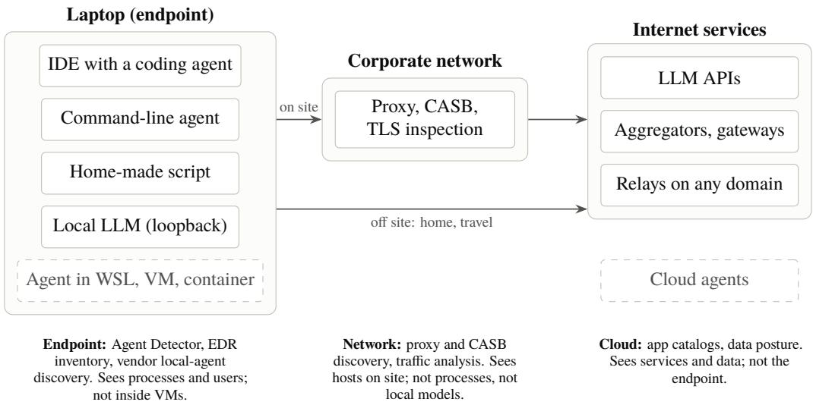  
Figure 5: Vantage points. Each approach sees part of the path from an agent to its model. Dashed boxes are out of reach of the endpoint: agents inside virtual machines, containers or WSL, and agents that run entirely in the cloud.

Continuous endpoint telemetry is a natural alternative that this paper does not evaluate. Sysmon logs process creation (event 1), network connections (event 3) and, when enabled, DNS queries with the querying process (event 22) [47]; EDR platforms expose similar tables for hunting queries [42]. A rule such as “a process resolved an LLM host and then started a shell” implements the principle of Section 6 continuously: it needs no access to the DNS cache and would catch short-lived agents that a periodic scan misses. It requires the telemetry pipeline and its volume, and it sees neither configuration nor installation; the two approaches are complementary. Scanners of MCP configurations look at a diferent layer: they read the MCP servers that clients declare and analyse their tool descriptions for poisoning [33].

## 8.3 Data-centric controls

Data security posture management takes the opposite view: rather than “focusing on infrastructure or endpoints”, it “centers on the data itself” [43]. Such controls answer which sensitive data reaches which AI service, and complement agent discovery; they do not answer which agents run on a laptop.

## 8.4 Endpoint software inventory

EDR and vulnerability-management platforms maintain a software inventory of every device, built from registry and disk evidence and refreshed every few hours [45]. An inventory sees installed products (layers L1 and L4 of Section 7), including AI tools, but it sees neither the agent that has no installer nor whether an installed tool is used. Forensic work on the ChatGPT Windows application shows how much an AI client leaves behind, including traces recoverable after deletion [35]; this supports using history and residue as evidence, but on its own it describes the past, not current use.

## 8.5 Vendor discovery of local agents

The closest commercial analogue to this work appeared while it was under way. Microsoft Defender for Endpoint now discovers local AI agents: “for process-based discovery, Defender identifies an agent when it observes the agent’s process running”, and it defines an agent as “a combination of a user, a device, and an agent type” [44], which is the same unit as our per-tool, per-user findings. The

Table 4: Detection approaches against the requirements of Section 5. ✓: yes; ❍: partially or under conditions; ✗: no.
<table><tr><td>Approach</td><td>Known products</td><td>Product-less agents</td><td>Local models</td><td>Off network</td><td>Per user</td><td>Informs user</td></tr><tr><td>Proxy and CASB discovery [41]</td><td>O</td><td>O</td><td>x</td><td>O</td><td>O</td><td>x</td></tr><tr><td>Encrypted traffic analysis [62, 90]</td><td>O</td><td>O</td><td>x</td><td>x</td><td>x</td><td>x</td></tr><tr><td>Endpoint software inventory [45]</td><td>√</td><td>x</td><td>O</td><td>√</td><td>O</td><td>x</td></tr><tr><td>Vendor local-agent discovery [44]</td><td>√</td><td>x</td><td>O</td><td>√</td><td>√</td><td>x</td></tr><tr><td>Continuous telemetry rules [47]</td><td>O</td><td>O</td><td>O</td><td>√</td><td>√</td><td>x</td></tr><tr><td>Agent Detector (this work)</td><td>√</td><td>O</td><td>O</td><td>√</td><td>√</td><td>√</td></tr></table>

Microsoft 365 admin center surfaces the result as shadow AI, in public preview, for a list of named agents that includes ChatGPT Desktop, Ollama, OpenCode and Claude Desktop, with blocking avail able for one of them; it requires Defender for Endpoint and Intune enrolment [46]. Microsoft’s deployment guidance states that the scans “run silently on managed devices; end users are not notified or afected” [50].

This confirms both the demand and the endpoint vantage point. It difers from our approach in three ways that the rest of this paper examines: discovery is tied to a list of products, so product-less agents fall outside it; it is silent, so it produces visibility without the informed acknowledgement that the governance goal of Section 5 requires; and it depends on a specific security suite.

The table is a summary of design properties, not of measured performance. For Agent Detector, the partial marks anticipate what Section 11 measures: product-less agents are caught only when their remote service can be identified and while they run, and local models only on their default ports or through known module names. Informing the user is a design choice that any endpoint approach could adopt. The “product-less” column is the one this paper is about; Section 6 explained why the obvious way to fill it, behavioural detection alone, is weaker than it looks, and the next section presents our design.

## 9 Design of Agent Detector

This section presents Agent Detector, the open-source endpoint detector we built to test the claim of this paper: that shadow AI agents become observable when several weak, individually ambiguous signals are correlated around the identity of the software and the identity of the remote service. The source code, the catalog and the evaluation bench are public [12]. Section 10 describes the implementation and its deployment with Microsoft Intune; this section focuses on the detection logic.

## 9.1 Design goals

The requirements of Section 5 translate into six design goals.

## G1 – Product-less coverage.

Detect agents that ship as no product at all, such as a short script that calls a model API, and not only the well-known tools.

## G2 – Silence on the network.

Never send a packet. Everything is read from local state that Windows already maintains: process table, TCP table, DNS client cache, registry and file system.

## G3 – Explainability.

Every finding carries the evidence that produced it, so that an analyst, and the user, can understand why a tool was reported.

## G4 – Privacy by design.

Never read prompts, conversations or file contents; never record or transmit secret values: record

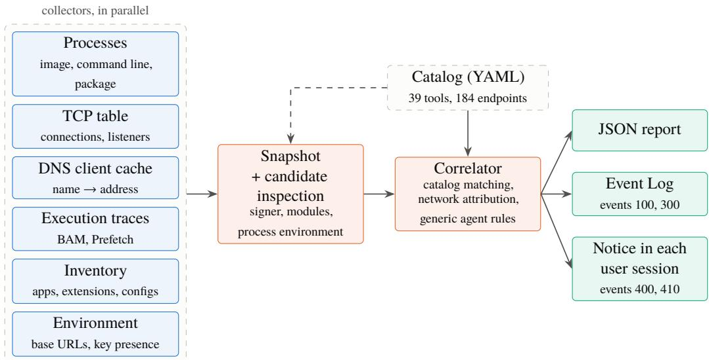  
Figure 6: Architecture of Agent Detector. The collectors only read local state; the catalog drives both candidate inspection and correlation.

the presence of an API key, never its value, and only the host part of a base URL.

## G5 – Low cost.

One scan must take well under two seconds and a few tens of megabytes, so that it can run every hour on every laptop.

## G6 – Inform, do not block.

The output is a finding, an event and, when relevant, a notice that the user acknowledges. The detector never kills, quarantines or uninstalls anything.

## 9.2 Architecture

Figure 6 shows the pipeline. A scan is a one-shot process, started by a scheduled task. Six collectors run in parallel and fill a snapshot; a candidate-inspection stage enriches the processes that matter; a correlator turns the snapshot into findings; the findings feed three outputs: a JSON report, Windows Event Log entries for the SIEM, and the detect-and-inform loop described in Section 9.6.

## 9.3 Collectors

Table 5 lists the collectors, the Windows source each one reads and the privilege it needs. Two properties matter. First, each collector reads state that Windows maintains anyway: the scan creates no network trafic and leaves no trace beyond its own report. Second, coverage depends on privilege. A standard user sees only their own processes and profile; the Background Activity Moderator (BAM) keys and the Prefetch folder require administrator or SYSTEM rights. In production the scan runs as SYSTEM; Section 11 quantifies what is lost without these rights.

Candidate inspection. Reading the Authenticode signer of an executable, its loaded modules or the environment block of a running process is comparatively expensive. Agent Detector therefore inspects only candidates: processes whose image, path, command line or package matches the catalog, processes connected to a catalog endpoint, processes listening on a port used by a local LLM runtime, and, for modules and environment, interpreters such as python.exe, node.exe or powershell.exe. The environment block is read from the process memory (ReadProcessMemory on the process environment block) and filtered on the fly: only LLM base-URL variables are kept, with their host, and API-key variables are kept by name only.

Table 5: Collectors of Agent Detector. “Admin” means that the source is readable only with administrator or SYSTEM rights on the Windows build we tested (Section 11).
<table><tr><td>Collector</td><td>Windows source</td><td>Yields</td><td>Privilege</td></tr><tr><td>Processes</td><td>Toolhelp snapshot, QueryFullProcessImageName, NtQueryInformationProcess, GetPackageFullName</td><td>Image, path, command line (masked), parent, owner, session, MSIX package</td><td>User (own processes)</td></tr><tr><td>TCP table</td><td>GetExtendedTcpTable (IPv4, IPv6)</td><td>Established connections and lis- User tening ports, with owning pro- cess</td><td></td></tr><tr><td>DNS cache</td><td>DnsGetCacheDataTable, DnsQuery without wire query</td><td>Catalog host names currently User cached, and their addresses</td><td></td></tr><tr><td>Traces</td><td>BAM registry keys, Prefetch file names and times</td><td>Programs executed recently, per Admin user (BAM)</td><td></td></tr><tr><td>Inventory</td><td>AppX and Uninstall registry keys, services, extension and package folders, configuration and history</td><td>Installed tools, IDE and browser extensions, global npm and pip packages, MCP configurations,</td><td>User (own profile)</td></tr><tr><td>Environment</td><td>folders User and machine environment variables in the registry</td><td>local models *_BASE_URL hosts, presence of User *_API_KEY variables</td><td></td></tr></table>

## 9.4 Network attribution

The TCP table gives, for each connection, the owning process and the remote address; it does not give the host name. Since almost all LLM services sit behind TLS, and many behind content-delivery networks shared with unrelated services, an address alone proves little. Agent Detector attributes a connection to a catalog endpoint in two ways:

1. By the DNS client cache. The cache maps the names recently resolved by the machine to their addresses. Inverting it gives, for a remote address, the catalog host names that resolved to it a few minutes earlier. This attribution is strong when the address is dedicated to the service and weaker when it belongs to a shared CDN range.

2. By dedicated address ranges. A few providers publish address ranges reserved for their API; the catalog records them, for example the range announced for the Anthropic API. A connection to such a range is attributed without any DNS information, which also covers software that resolves names without the system resolver.

Reading the cache is less simple than it looks. The detector lists the cached names with DnsGetCacheDataTable, which Microsoft does not document, and then looks up the addresses of each catalog name with DnsQuery in cache-only mode, which never sends a query on the network. On the Windows build we tested, the list was empty with or without administrator rights, so only the exact host names of the catalog could be looked up; host sufixes such as Azure OpenAI’s per-tenant names could not be attributed through DNS. The lookups themselves are subtle: a cache-only lookup found an entry only when it used the same record type and query options as the query that had created it. The resolver of Python, Node.js and .NET (getaddrinfo with an unspecified address family) stores a single IPv6 (AAAA) entry, queried with options that return the IPv4 answers as IPv4-mapped IPv6 addresses. Up to version 0.3.1, Agent Detector looked up only plain IPv4 and IPv6 entries and therefore missed the resolutions of most agents, at every privilege level; we had first attributed the loss to missing privileges. The evaluated version looks each name up under the three keys that resolvers use.

Connections from browsers are deliberately ignored: a browser talking to chatgpt.com is web use of an AI service, which the web proxy already governs, and attributing it on the endpoint would flood the results.

## 9.5 Correlation model

The correlator produces one finding per tool and per user. A finding groups all the evidence about a tool for a user, whatever the collector that produced it, and carries three attributes.

## Level

How present the tool is: active (running or connected now), recent (executed within the last 30 days according to the execution traces or the history folders; the BAM keys may keep a shorter history than Prefetch and the history folders), installed, or residue (leftover data of a removed tool). The level of a finding is the highest level of its evidence.

## Confidence

How sure the attribution is: high when it rests on a package identity, an install path, a command line or a vendor signature; medium for an executable name, a behaviour or a configuration; low for circumstantial evidence, such as a connection to a shared CDN address.

## Approval

Whether the tool or the endpoint is in the sanctioned list of the catalog.

A finding is actionable when it is not approved, at least installed, and of medium or high confidence. Actionable findings raise warnings in the Event Log and set the exit code. The notice uses a related but broader trigger (Section 9.6).

Generic agent rules. Catalog matching covers known tools. Product-less agents are caught by generic findings, built from the catalog’s generic patterns rather than from tool signatures:

• llm-api: a non-browser process connected to an LLM endpoint; medium confidence on a dedicated address, low otherwise.

• probable-agent: a process that talks to an LLM and has a shell or interpreter among its children or grandchildren. This rule encodes the definition of an agent used in this paper: a model in a loop with the ability to act.

• relay-candidate: an LLM base-URL variable, in the environment of a process or in the user or machine environment, that points to a host absent from the catalog.

• local-llm: a process listening on a port used by local LLM runtimes, a client of such a port, or a process that loads an inference library such as ggml or llama.

• mcp-server: a process whose command line matches the conventions of Model Context Protocol servers; it is attached to the finding of the agent that started it, when that agent is identified.

• browser-automation: a browser started with automation flags, attached to the agent that drives it, or reported with low confidence otherwise.

Ownership is resolved through the process tree: an MCP server or an automated browser is attached to the nearest ancestor that already holds an LLM finding, with a guard against reused process identifiers.

Algorithm 1 summarises the correlation. Its structure reflects the principle of Section 6: behaviour (line 18) is only evaluated for processes whose remote service, configuration or local port has already identified them as talking to a model (lines 4–15).

## 9.6 The detect-and-inform loop

Detection alone leaves the governance question open: the user does not know that the tool is unapproved, and the organisation cannot show that the user was informed. Agent Detector closes the loop with a notice that the user must acknowledge (Figures 7 and 8).

1. Trigger. A finding opens the notice when it is active, recent or installed and of medium or high confidence and at least one tool of the user is not approved; approved tools are then listed alongside. Residues and low-confidence findings never open it, and a user of approved tools only is never interrupted. (Version 0.3.0 also opened the notice for approved tools alone, which would have interrupted every user of a sanctioned tool every hour.)

Algorithm 1 Correlation of a snapshot into findings (simplified).   
Require: snapshot � (processes, connections, DNS map, traces, inventory, environment), catalog �   
Ensure: findings, one per (tool, user), each with its evidence   
1: for each process � of � do   
2: for each tool � of � whose image, path, command line, package or signer matches � do   
3: add evidence (process, active) to finding �, user �   
4: for each established connection � owned by process � do   
5: � endpoint of � matching the names that resolved to �.remote in the DNS map, else the dedicated   
range containing it   
6: if � is defined and � is not a browser then   
7: if � matches a tool � then   
8: add evidence (network, active) to finding �, user �   
9: else   
10: add generic finding llm-api �, � : medium if � is a dedicated, non-shared entry, else low   
11: mark � as LLM-connected   
12: for each base-URL variable � (in a process environment or in the registry) do   
13: if host � is a catalog endpoint then add llm-config else add relay-candidate (medium)   
14: mark the process holding �, if any, as LLM-connected   
15: for each listener on a local LLM port, and each client of such a port do   
16: add local-llm evidence; mark the client as LLM-connected   
17: for each process � marked LLM-connected do   
18: if a shell or interpreter is among the children or grandchildren of � then   
19: add evidence (behaviour, active) to the finding of �, or generic probable-agent � (medium)   
20: for each MCP server or automated browser � do   
21: attach it to the nearest LLM-connected ancestor of �, else add a generic finding   
22: for each trace, inventory item, configuration or history folder matching a tool � do   
23: add evidence to finding �, user , with level recent, installed or residue   
24: for each finding � do   
25: level � highest level of its evidence; confidence � highest confidence   
26: approved � tool or endpoint of � is in the sanctioned list of �

2. Session launch. The scan runs as SYSTEM in session 0, which cannot draw on a user’s desktop. For each active session that holds triggering findings, it obtains the user token (WTSQueryUserToken), builds the user environment, and starts its own executable in the user’s session (CreateProcessAsUser) with the list of tools. It does not wait for the user.

3. Notice. The window lists the detected tools, each marked approved or not approved, followed by the organisation’s text, a link to its AI policy and a contact address. The texts, the logo and the links come from a branding file read at run time.

4. Acknowledgement. When the user accepts, the window process, which runs under the user’s identity, writes an event that carries the user’s security identifier, the version of the text and the tools. The organisation can therefore record which text each user acknowledged. The record is not proof: any process running as the user can write an event under the same source, so event 410 shows that code ran under the user’s identity, not that the person read the text, and a SIEM should accept events 100 and 300 only when they carry the SYSTEM identifier. Returning the acknowledgement to the SYSTEM component over an authenticated channel would make the record stronger.

5. Repetition. The notice comes back at every scan for as long as the agent is still detected. Acknowledgement is a record, not an exemption.

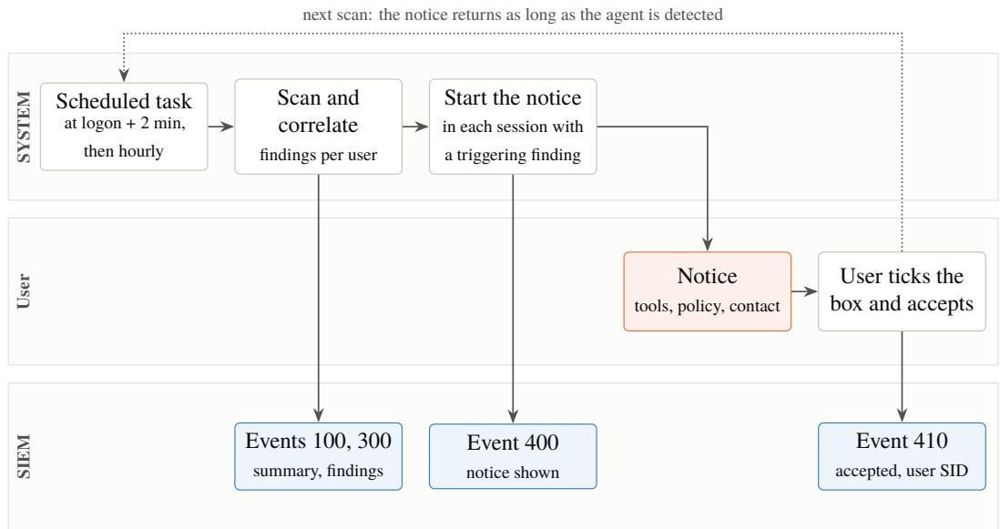  
Figure 7: The detect-and-inform loop. The scan runs as SYSTEM in session 0; for each user session with a triggering finding it starts the notice in that session with the user’s token. Every step leaves an event for the SIEM; the acknowledgement is written under the user’s own identity.

## 9.7 Privacy by design

The detector observes behaviour on employees’ machines, so its data minimisation is part of its design rather than a configuration option. Prompts, conversations and file contents are never read: history folders are characterised only by their modification time. Command lines and messages pass through a masking stage that removes API keys of known formats, bearer tokens, credentials embedded in URLs and the values of variables whose names denote secrets. Of a base URL only the host is kept, and of an API-key variable only its name. The environment block of a candidate process, which may hold API keys, is read in memory and filtered before anything is recorded; secrets are read transiently but never stored or transmitted. Reading another process’s memory can itself raise EDR alerts, which an organisation must expect or exclude. Section 12 discusses the legal framework.

## 10 Implementation and Deployment

## 10.1 Implementation

Agent Detector is written in Go and compiled without cgo into a single static Windows executable of about 3.9 MiB. It depends only on the Go standard library, the golang.org/x/sys/windows package for system calls, and a YAML parser. The production code amounts to about 5,500 non-blank, noncomment lines in 27 files, and 40 unit tests cover catalog matching, correlation on synthetic snapshots, the notice trigger rules, branding validation, logo rendering, parsing helpers, DNS record decoding and secret masking.

Operating system interfaces. Processes are enumerated with a Toolhelp snapshot and inspected with QueryFullProcessImageName, NtQueryInformationProcess for the command line and the process environment block, GetPackageFullName for packaged (MSIX) applications and a module snapshot for loaded libraries. Executables are identified by their version resource (GetFileVersionInfo) and, for candidates, by the subject of their embedded Authenticode certificate (CryptQueryObject). A signer counts only if the signature verifies (WinVerifyTrust), ofline: the file hash and the certificate chain are checked against the local trust store, without revocation checks or URL retrieval, so a scan never touches the network. Without this check, anyone could sign a binary with a self-issued certificate bearing a vendor’s name and obtain a finding of high confidence; version 0.3.0 parsed signatures without verifying them. Verification hashes the whole binary, which is costly for large agents, so it runs only when no package, install path or command line already identifies the tool. Binaries signed through a catalog file rather than an embedded signature are identified by other evidence, and packaged applications by their package family name. The TCP table comes from GetExtendedTcpTable, the DNS cache from DnsGetCacheDataTable complemented by cache-only DnsQuery lookups, and execution traces from the BAM registry keys and the names and timestamps of Prefetch files [56, 81]. DnsGetCacheDataTable is not documented by Microsoft, and the detector mirrors a structure that a Windows release may change. This risk has materialised: on the build we tested, the function returned no table at all (Section 9.4). The cache-only lookups run in four parallel workers, three per catalog host.

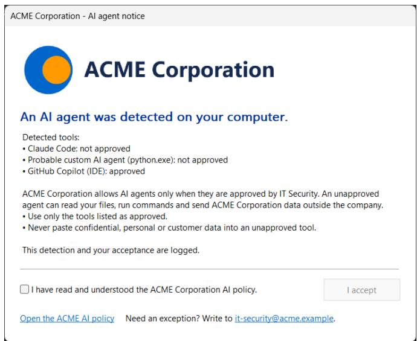  
Figure 8: The notice shown to a user when an agent is detected, here with the branding of a fictitious company. The user must tick the box before the only button is enabled; the window has no close button.

Catalog. Everything that names a product or a service lives in a YAML catalog embedded in the binary (771 lines in the evaluated version). A tool entry lists its identifiers by kind: process images, install paths, command-line patterns, package family names, vendor signer and product names, services, IDE and browser extension identifiers, npm and pip packages, configuration and history folders, listening ports and API endpoints. The catalog also holds the generic patterns used by the rules of Section 9.5: the names of shells and interpreters, the command-line conventions of MCP servers, the module names of inference runtimes, and the patterns of base-URL and API-key variables. An organisation lists its approved tools, hosts and host sufixes in a sanctioned section. The catalog can be replaced at run time for testing, and a version string identifies it in every report.

Robustness of the scan. Each collector runs in its own goroutine and hands back a function that stores its result; only the main goroutine applies these functions, so a collector that misses the global deadline is simply ignored and the report states that the results are partial. A collector that panics is reported as an error without stopping the others. The report lists every coverage gap, such as the absence of administrator rights, so that a missing finding is never mistaken for an absence of agents.

Outputs. A scan writes a JSON report (findings with their evidence, coverage notes, summary counters and, on request, cost metrics), Windows Event Log entries whose message is a JSON document, and an exit code: 0 when nothing actionable was found, 1 when at least one unapproved tool was found, 2 on error. Table 6 lists the events, which are designed for SIEM collection.

Table 6: Windows Event Log entries written by Agent Detector (Application log, source DetectorAgent).
<table><tr><td>Id</td><td>Level</td><td>Content</td></tr><tr><td>100</td><td>Information or Warning</td><td>Scan summary and compact list of all findings; one per scan and per machine, so its absence reveals a removed or broken agent</td></tr><tr><td>300</td><td>Information or Warning</td><td>One finding with its evidence (installed or above, medium or high confidence)</td></tr><tr><td>400</td><td>Information</td><td>Notice shown to a user, with the tools listed</td></tr><tr><td>410</td><td>Information</td><td>Notice accepted; written under the user&#x27;s identity, with the version of the text</td></tr><tr><td>900</td><td>Error</td><td>Scanner or notice error</td></tr></table>

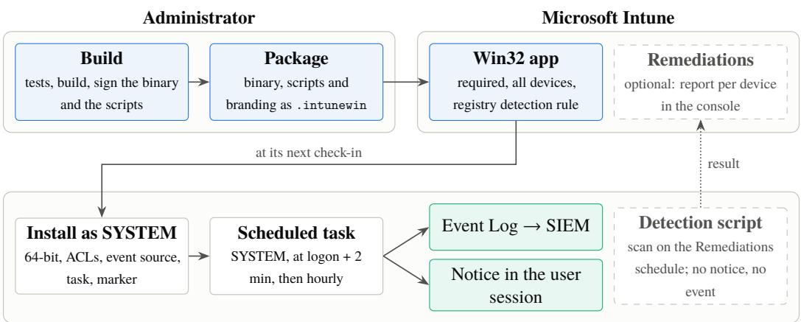  
Every managed laptop  
Figure 9: Deployment with Microsoft Intune. The administrator builds, signs and packages once; every managed laptop installs the package as SYSTEM at its next check-in and then scans on schedule.

## 10.2 Deployment with Microsoft Intune

The target environment is a fleet of Windows laptops managed by Microsoft Intune, the mobile device management service of Microsoft 365 (Figure 9). Agent Detector is packaged as an Intune Win32 application [49]: the executable, an installation script, an uninstallation script and the branding folder are wrapped into an .intunewin package and assigned as required to device groups. The installation script, run as SYSTEM:

1. restarts itself in 64-bit PowerShell when Intune starts it as a 32-bit process [40], so that files, registry keys and the scheduled task land in their 64-bit locations;

2. copies the executable and the branding folder to Program Files, where only administrators can modify them, and refuses an invalid branding file;

3. recreates the report folder under ProgramData with an access control list that only SYSTEM and administrators can write, because standard users can pre-create folders there;

4. registers the Event Log source;

5. creates a scheduled task that runs the scan as SYSTEM two minutes after every logon and then every hour, one instance at a time, with a ten-minute limit, on battery too, and that runs a missed scan as soon as the device wakes up;

6. writes, last, an installation marker in the registry. Its value combines the version of the executable, the version of the notice text and the mode (with or without notice). The Intune detection rule compares this value, so that Intune sees the application as installed only when every step succeeded, and reinstalls it whenever any of the three components changes.

A silent mode installs the same task without the notice. It lets an organisation observe what the detector finds on a pilot population before any user sees a notice, then switch the population to the notice by changing the install command and the detection value. An optional detection-only Intune Remediations script runs a scan without notice or event and reports, per device, the unapproved tools found, which gives administrators a fleet view in the Intune console without a SIEM; Remediations require Windows Enterprise or Education licences, or an equivalent, for the users of the devices [39].

Signing. Where the PowerShell execution policy AllSigned is enforced by group policy, it overrides the -ExecutionPolicy Bypass argument of the install command, and unsigned scripts do not run. The build script therefore signs the executable and the three scripts with the organisation’s code-signing certificate, and the certificate must also be deployed to the devices’ Trusted Publishers store, which Intune can do through a custom configuration profile. These details matter in practice: a detector that cannot be installed silently on locked-down machines does not cover them.

## 11 Evaluation

We evaluate Agent Detector against six research questions:

RQ1 – Coverage.

Which classes of agents does it detect, and at which level, including product-less agents, relays, local models, MCP servers and automated browsers? How does it fare on a real workstation?

RQ2 – Signals.

Which layers of evidence support each detection?

RQ3 – False positives.

Does it flag ordinary developer activity?

RQ4 – Cost.

How long does a scan take, and how much CPU and memory does it use?

RQ5 – Robustness.

What happens with an undeclared relay, an agent that runs for a few seconds, an agent inside WSL 2, an agent that is only intermittently visible, and DNS cache entries that expire?

RQ6 – Behavioural baselines.

How do signature-only and behaviour-only detectors compare, in particular on behavioural twins?

## 11.1 Setup

Machine and configuration. All measurements were taken on a laptop with an 8-core AMD Ryzen 7 4800H processor and 64 GB of memory, running Windows 11 Home, version 26H2 (build 26300.9711), with Agent Detector version 0.3.2 and catalog 2026.11.09. This is a consumer edition on a recent build: it is not enrolled in Intune and cannot enforce group policy, so the deployment of Section 10 was not exercised on it, and its privilege behaviour may difer from the Pro and Enterprise editions of enterprise fleets. We ran the whole bench in two configurations: with standard user rights, and from an elevated administrator window. On this build, the BAM keys, the Prefetch folder and the processes of other users could be read only with elevation, and the reports of the standard-user scans state these gaps. The elevated configuration approaches the production scheduled task, which runs as SYSTEM, without being identical to it (Section 11.8). Unless stated otherwise, the results below are for the standard user, the configuration that sees less. The machine is the first author’s development workstation, with real AI tools installed and running, which we use for an in-situ cross-check.

The evaluated version, and how the bench shaped it. All results are for version 0.3.2, and two of its rules were changed because of this bench. The first version we evaluated (0.3.0) flagged benign episode B09 as an agent, because it treated a process carrying a base-URL variable as connected to an LLM; version 0.3.1 requires an actual connection and ignores values inherited from the user’s persistent environment. Version 0.3.1 then detected none of the agents whose provider sits behind a shared content-delivery network (CDN), in either configuration. We had first attributed this gap to privilege, since the standard-user reports said so; the administrator run, which showed the same gap, is what revealed the real cause, the key under which the DNS client stores its entries (Section 9.4), and version 0.3.2 fixed it. Because these corrections were made after observing the bench, the episodes that revealed them (B09 and the four CDN-hosted agents) are no longer held-out tests: they show that the corrections work, not how the detector fares on cases nobody has looked at.

The bench. The evaluation bench is part of the published artifact [12]. It runs episodes: each episode starts one or more processes, waits 8 s for them to settle, observes them for 24 s, and stops them. During the observation window, the baseline detectors sample the process table and the TCP table about once per second, and Agent Detector scans three times. A detection is attributed to an episode when it concerns a process of the episode’s tree: its root processes and their descendants created after the episode started. For Agent Detector, an episode counts as detected when at least one finding of medium or high confidence carries evidence from that tree; all findings of the episodes are at the active level, so this is also the threshold that opens the notice. The sampling is asymmetric: the baselines look about once per second, Agent Detector three times per window, and once per hour in production, which favours the baselines on transient patterns. The bench also measures a favourable case for network attribution: every scan follows the start of the agent by seconds, while the agent’s own name resolution is still in the DNS cache; Section 11.6 measures what happens later.

We ran the whole bench 5 times in each configuration (standard user: runs 20261109-132251 to 20261109-142759; administrator: 20261109-112950 to 20261109-123502). For each episode and detector, Table 7 reports whether the detection occurred in every run, in none, or in some, and the metrics use the majority outcome. Every run records its provenance (Windows build, source commit, SHA-256 of the executable, beginning with 396416552dca in both configurations, and catalog version), and the scoring script refuses to combine runs that difer in any of them or that miss an episode.

Synthetic agents. To exercise every class without accounts, costs or real model calls, the bench uses synthetic agents written in Python, Node.js and PowerShell. Each one reproduces the footprint that matters on the endpoint: it keeps a TLS connection to a real API endpoint, polled every five seconds with an invalid key (the service answers HTTP 401; no prompt or data is sent, nothing is billed), and it keeps a persistent shell to which it sends a harmless command at every poll. This makes the agents easy to see: both signals are present all the time. Real agents are often intermittent: some start a process per command instead of keeping a shell, HTTP clients close idle connections after a few seconds, and users pause between requests. Episode A12 reproduces this pattern: a call every ten seconds, a connection closed five seconds after each call, and one short-lived shell per call. Options add an MCP server (the reference filesystem server, started with npx), a headless browser with a remote-debugging port, a local LLM-style HTTP server on Ollama’s port, or a module named like an inference runtime.

We separate two kinds of positives. An agent (A01–A12) matches the definition of Section 3: it reaches a model and acts through tools. An AI component (C01–C03) is AI software that is not an agent by itself: a process loading an inference runtime, an MCP server alone, and a client that calls a model API without any tool. Components are shadow AI, and Agent Detector reports them, but a detector of agents need not flag them, so precision and recall are computed on agents only and components are reported apart.

Benign workloads and behavioural twins. The benign episodes are of two kinds. Three behavioural twins run the same agent scripts against non-LLM APIs (the PyPI JSON API, the npm registry, Microsoft Graph): identical process trees, connections and timing, a diferent remote service. Five developer workloads repeat ordinary tasks in a loop: npm install of a package with an install script, a shallow git clone over HTTPS, a pip download, a .NET restore and build, and a Go build with module download, each with an empty cache so that it really uses the network. A ninth benign episode (B09) targets a false-positive mode of Agent Detector itself: a PowerShell loop running git that inherited an OPENAI\_BASE\_URL variable, as every process does when a developer sets such a variable at user level to reach a corporate LLM gateway.

Baselines. Three baselines run on the same samples, without any code from Agent Detector. D0, a signature detector, flags a process whose image name is one of the executable names of the catalog, used alone. D1, the behavioural rule of Section 6, flags an interpreter or runtime host (Python, Node.js, PowerShell, .NET, Java and similar) that holds an established connection to a remote port 443, taken as TLS, and has a shell among its children or grandchildren. D2 drops the interpreter condition and flags any process with these properties.

An experimenter efect, and how we removed it. The bench was itself driven by an AI coding agent. In a first run, an MCP server started by an episode was attributed to that coding agent, its genuine ancestor, because Agent Detector attaches MCP servers to their nearest LLM-connected ancestor. The attribution was correct for the machine but wrong for the experiment, and a production scan never has the bench as an ancestor. The bench therefore starts every episode through a shortlived launcher, so that episode processes have no living ancestor, and all results below come from that configuration.

## 11.2 RQ1: Coverage

Table 7 lists all episodes and the detectors that caught them. With standard-user rights, Agent Detector detected 12 of the 12 agent episodes in the majority of runs, and 3 of the 3 AI components in every run. The detected agents cover every class of the bench: agents that reach a provider with a dedicated address range or one behind a shared CDN, written in Python, Node.js and PowerShell or run by a renamed copy of the Node.js runtime; an agent configured through OPENAI\_BASE\_URL to use a relay unknown to the catalog; a local LLM-style server and its client; agents with an MCP server or an automated browser; and the intermittent agent. The components were found through a module name, an MCP command line and a connection to the Anthropic API.

The evidence difers by provider. Anthropic publishes a dedicated address range, so a connection to it yields an llm-api finding of medium confidence on its own. The four CDN-hosted providers do not: a connection attributed through the DNS cache yields an llm-api finding of low confidence, below the detection threshold, and these agents count as detected only because they also run a shell (the probable-agent rule).

Two agents were detected in only three runs out of five, and each instability has a cause that matters beyond the bench. The OpenAI agent (A01) was missed twice. OpenAI’s answers live at most 60 s, and when the agent receives one near the end of its life, the cache entry expires before the first scan, 8.6 s after the start; this is the expiry efect of Section 11.6, visible even in the favourable case. The intermittent agent (A12) was caught in three runs as standard user and in none as administrator; Section 11.6 shows that this depends on the phase between two regular schedules, not on privilege. The baselines were stable in the standard-user runs.

In-situ cross-check. On the workstation itself, with the tools actually installed, 9 of the 9 expected tools were reported at the expected level (Table 8). The expectation comes from a separate script that lists installed packages, extension folders, global npm packages and running processes. That script does not share code with Agent Detector, but it reads the same kinds of sources, so the check is a cross-check of the detector’s logic, not an independent ground truth; it covers only the tools we expected, and it cannot verify recent use. Three tools were active (Claude Code, GitHub Copilot in VS Code, the Codex desktop application), Claude Desktop was installed and had been used within the trace window according to its log folder, OpenCode was installed, and three tools had left residues after being uninstalled. An earlier catalog disagreed on one tool, and the disagreement is instructive: Agent Detector reported a residue of the GitHub Copilot command-line agent, which is not installed, because its configuration folder \~/.copilot is now also used by the Copilot runtime built into VS Code. We removed that folder from the evidence of the command-line agent, and kept the row in the table as a check. A vendor that moves or shares its state folder silently changes the meaning of a catalog entry; here the consequence was limited, because residues never open the notice.

Table 7: Episodes and detections with standard-user rights over 5 runs: ✓ detected in every run, ✗ in none, � � in � of � runs. A: agents; C: AI components; B: benign; R: robustness. D0: signature; D1: interpreter + port 443 + shell; D2: any process + port 443 + shell; AD: Agent Detector (finding of medium or high confidence). The last column lists the kinds of findings Agent Detector produced.
<table><tr><td>Id</td><td>Class</td><td>Episode</td><td>D0</td><td>D1</td><td>D2</td><td>AD</td><td>Agent Detector findings</td></tr><tr><td>A01</td><td>Model provider (CDN-hosted)</td><td>Python agent, OpenAI API, persistent cmd</td><td>x</td><td>√</td><td>V</td><td>3/5</td><td>probable-agent</td></tr><tr><td>A02</td><td>Model provider (dedicated range)</td><td>Python agent, Anthropic API, persistent cmd</td><td>x</td><td>V</td><td>V</td><td></td><td>llm-api, probable-agent</td></tr><tr><td>A03</td><td>Model provider (dedicated range)</td><td>Node.js agent, Anthropic API, persistent PowerShell</td><td>x</td><td>V</td><td>V</td><td></td><td>llm-api, probable-agent</td></tr><tr><td>A04</td><td>Model provider (CDN-hosted)</td><td>PowerShell agent, Mistral API, persistent cmd</td><td>x</td><td>√</td><td>J</td><td></td><td>probable-agent</td></tr><tr><td>A05</td><td>Aggregator</td><td>Python agent, OpenRouter, persistent cmd</td><td>x</td><td>√</td><td>V</td><td>V</td><td>probable-agent</td></tr><tr><td></td><td>A06 Inference platform</td><td>Python agent, Groq API, persistent cmd</td><td>x</td><td>√</td><td>1</td><td></td><td>probable-agent</td></tr><tr><td>A07</td><td>Unknown relay (declared)</td><td>Python agent through a relay set in OPENAI_BASE_URL</td><td>x</td><td>√</td><td>1</td><td>V</td><td>probable-agent, relay-candidate</td></tr><tr><td></td><td>A08 Local LLM</td><td>Local LLM-style server on port 11434 and an agent using it</td><td>x</td><td>x</td><td>x</td><td>V</td><td>local-llm-server,</td></tr><tr><td></td><td>A09 Agent with MCP server</td><td>Python agent, Anthropic API, reference MCP filesystem server</td><td>x</td><td>√</td><td>√</td><td>√</td><td>probable-agent llm-api, probable-agent</td></tr><tr><td></td><td>A10 Agent driving a browser</td><td>Python agent, Anthropic API, headless Chrome with remote debugging, no shell</td><td>x</td><td>x</td><td>x</td><td></td><td>llm-api</td></tr><tr><td></td><td>A11 Renamed runtime</td><td>Node.js agent run by a copy of node.exe renamed updater.exe</td><td>x</td><td>x</td><td>」</td><td>V</td><td>llm-api, probable-agent</td></tr><tr><td></td><td>A12 Intermittent agent</td><td>Python agent, Anthropic API, a call every 10 s, connection closed after 5 s, one short shell per call</td><td>x</td><td></td><td></td><td>3/5</td><td>llm-api</td></tr><tr><td>C01</td><td>Inference runtime</td><td>Process loading a module named like an</td><td>x</td><td>x</td><td>x</td><td>V</td><td>local-llm-runtime</td></tr><tr><td>C02</td><td>MCP server</td><td>inference runtime (ggml), no network Reference MCP filesystem server alone, no</td><td>x</td><td>√</td><td>√</td><td>V</td><td>mcp-server</td></tr><tr><td>C03</td><td>LLM client without tools</td><td>LLM connection Python script polling the Anthropic API, no shell, no tools</td><td>x</td><td>x</td><td>x</td><td>V</td><td>llm-api</td></tr><tr><td>B01</td><td>Behavioural twin</td><td>Twin of A02: Python script, PyPI JSON</td><td>x</td><td>√</td><td>√</td><td>x</td><td></td></tr><tr><td>B02</td><td>Behavioural twin</td><td>API, persistent cmd Twin of A03: Node.js script, npm registry, persistent PowerShell</td><td>x</td><td>√</td><td>J</td><td>X</td><td></td></tr><tr><td>B03</td><td>Behavioural twin</td><td>Twin of A04: PowerShell script, Microsoft Graph, persistent cmd</td><td>x</td><td>√</td><td>1</td><td>X</td><td></td></tr><tr><td></td><td>B04 Developer workload</td><td>npm install with install script (cmd)</td><td>x</td><td>√</td><td>√</td><td>x</td><td></td></tr><tr><td>B05</td><td>Developer workload</td><td>git clone over HTTPS</td><td>X</td><td>x</td><td>x</td><td>x</td><td></td></tr><tr><td></td><td>B06 Developer workload</td><td>pip download of a large wheel</td><td>x</td><td>x</td><td>x</td><td>x</td><td></td></tr><tr><td>B07</td><td>Developer workload</td><td>dotnet restore and build</td><td>x</td><td>x</td><td>x</td><td>x</td><td></td></tr><tr><td>B08</td><td>Developer workload</td><td>go build with module download</td><td>x</td><td>X</td><td>x</td><td>x</td><td></td></tr><tr><td>B09</td><td>Inherited base URL</td><td>git loop in a PowerShell that inherited OPENAI_BASE_URL from the user environment</td><td>x</td><td>x</td><td>x</td><td>x</td><td></td></tr><tr><td>R01</td><td>Undeclared relay</td><td>Python agent through a relay hard-coded in the script</td><td>x</td><td>√</td><td>√</td><td>x</td><td></td></tr><tr><td></td><td>R02 Ephemeral agent</td><td>Python agent running 5 s, scanned after it exited</td><td>x</td><td>x</td><td>x</td><td>x</td><td></td></tr><tr><td></td><td>R03 Agent inside WSL 2</td><td>Python agent running in the Ubuntu WSL 2</td><td>x</td><td>x</td><td>x</td><td>x</td><td></td></tr></table>

Table 8: In-situ cross-check: findings on the first author’s workstation (standard user) against the expectation of a separate inventory script.
<table><tr><td>Tool</td><td>Evidence found by the inventory script</td><td>Expected</td><td>Reported</td><td></td></tr><tr><td>Claude Code</td><td>claude.exe running; VS Code extension anthropic.claude-code; global npm package @anthropic-ai/claude-code</td><td>active</td><td>active, high</td><td>√</td></tr><tr><td>GitHub Copilot (IDE)</td><td>copilot-runtime.exe running in VS Code</td><td>active</td><td>active, high</td><td>√</td></tr><tr><td>OpenAI Codex / ChatGPT app</td><td>MSIX package OpenAI.Codex installed; codex.exe and ChatGPT.exe running</td><td>active</td><td>active, high</td><td>√</td></tr><tr><td>Claude Desktop (incl. Cowork)</td><td>MSIX package Claude installed (use within 30 days not independently verifiable)</td><td>installed</td><td>recent, high</td><td>√</td></tr><tr><td>OpenCode</td><td>installed program OpenCode 1.18.3</td><td>installed</td><td>installed, high</td><td>√</td></tr><tr><td>Cursor</td><td>~/.cursor folder present; Cursor not installed</td><td>residue</td><td>residue, medium</td><td>√</td></tr><tr><td>Ollama</td><td>~/.ollama folder present; Ollama not installed</td><td>residue</td><td>residue, medium</td><td>√</td></tr><tr><td>Perplexity Comet (agentic</td><td>empty %LOCALAPPDATA%\Perplexity folder;</td><td>residue</td><td>residue, medium</td><td>√</td></tr><tr><td>browser) github-copilot-cli</td><td>Comet not installed Copilot CLI not installed; ~/.copilot is used by the Copilot runtime of VS Code</td><td>absent</td><td></td><td></td></tr></table>

Table 9: Evidence kinds behind the detected agent and component episodes (findings of medium or high confidence; an episode can have several).
<table><tr><td>Evidence kind</td><td>Layer</td><td>Episodes</td><td>Which</td></tr><tr><td>LLM endpoint</td><td>L3 network</td><td>7</td><td>A02, A03, A09, A10, A11, A12, C03</td></tr><tr><td>LLM + shell</td><td>L2 runtime</td><td>10</td><td>A01, A02, A03, A04, A05, A06, A07, A08, A09, A11</td></tr><tr><td>base URL</td><td>L2/L5 configuration</td><td>1</td><td>A07</td></tr><tr><td>local LLM port</td><td>L3 network</td><td>1</td><td>A08</td></tr><tr><td>inference module</td><td>L2 runtime</td><td>1</td><td>C01</td></tr><tr><td>MCP server</td><td>L2 runtime</td><td>2</td><td>A09, C02</td></tr><tr><td>automated browser</td><td>L2 runtime</td><td>1</td><td>A10</td></tr></table>

## 11.3 RQ2: Signals

Table 9 shows which kinds of evidence supported the detections. Two observations stand out. First, the generic rules carried every detection of a synthetic agent: none of them matched a product signature, by construction, yet each was found through network attribution, behaviour, configuration, a local port, a module, an MCP command line or a browser flag. Second, no single layer covers all classes: the network layer is useless for local models and for relays it does not know; the configuration layer catches the declared relay but not the hard-coded one; the module and port signals catch local inference but nothing else. Detection coverage comes from the union of layers, and confidence from their conjunction.

## 11.4 RQ3: False positives

Agent Detector flagged 0 of the 9 benign episodes. It flagged none of the three behavioural twins, whose behaviour is identical to that of agents, and none of the five developer workloads, including npm install, which runs shells while downloading over TLS. Nor did it flag B09, the git loop whose PowerShell inherited an OPENAI\_BASE\_URL variable, but this episode is no longer a fair test. Version 0.3.0 flagged it as a probable agent with a relay candidate, because it treated a process that carries a base-URL variable as connected to an LLM, and git counts among the shells it looks for. This was a real false-positive mode, not an artefact of the bench: a developer who sets such a variable at user level, to reach a corporate gateway, makes every interpreter that runs a command look like an agent. The rule now requires an outbound connection and ignores values inherited from the persistent environment. The change has a cost: a relay declared in the persistent environment is still reported, at the installed level, but the processes that inherit the variable are no longer marked as connected to an LLM, so an agent that relies on such a relay is found only if its connection is identified otherwise. On the workstation, all findings concerned AI tools (Table 8). The baselines tell a diferent story, discussed under RQ6.

Table 10: Cost of a scan (standard user, 100 consecutive scans). Collectors run in parallel, so their times do not add up to the total.
<table><tr><td>Stage</td><td>Median (ms)</td><td>p95 (ms)</td></tr><tr><td>Processes</td><td>23.2</td><td>27.5</td></tr><tr><td>TCP table</td><td>2.2</td><td>4.6</td></tr><tr><td>DNS cache</td><td>30.0</td><td>32.2</td></tr><tr><td>Traces</td><td>0.0</td><td>0.6</td></tr><tr><td>Inventory</td><td>29.0</td><td>31.4</td></tr><tr><td>Environment</td><td>0.5</td><td>1.2</td></tr><tr><td>Candidate inspection</td><td>53.8</td><td>58.7</td></tr><tr><td>Correlation</td><td>27.2</td><td>28.3</td></tr><tr><td>Scan duration (elapsed)</td><td>154</td><td>166</td></tr><tr><td>CPU time (all threads)</td><td>406</td><td>531</td></tr></table>

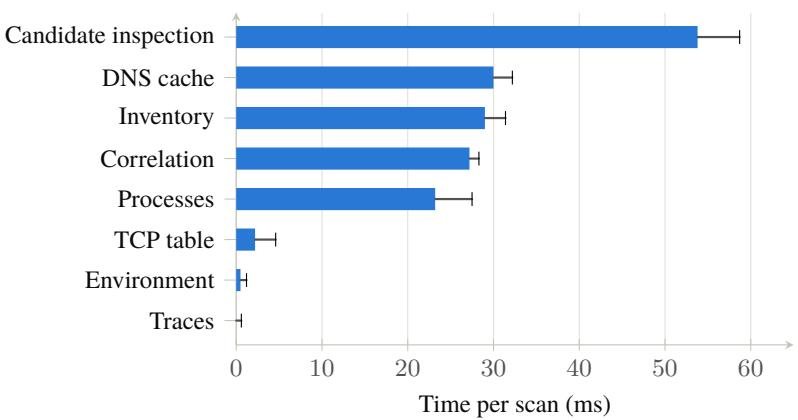  
Figure 10: Time of each stage of a scan (standard user, 100 scans): the bar is the median, the whisker reaches the 95th percentile. The collectors run in parallel; candidate inspection and correlation follow them. Values are in Table 10.

## 11.5 RQ4: Cost

Table 10 breaks down the cost of 100 consecutive scans on the workstation, which ran a median of 352 processes with 62 TCP connections. A scan took 154 ms at the median (166 ms at the 95th percentile, 177 ms including process start as seen from outside), consumed 406 ms of CPU time across its parallel collectors, and peaked at 22.3 MB of working set. At one scan per hour, this amounts to less than ten seconds of CPU per laptop and per day. These figures are for a standard user with warm caches: BAM and Prefetch were unreadable and the processes of other users could not be inspected. With these sources read, as administrator, a scan took 168 ms (Section 11.8). The most expensive stages are candidate inspection, the cache-only DNS lookups, inventory, correlation and process enumeration, each of the order of a few tens of milliseconds.

Figure 10 ranks the stages by their median time; Figure 11 shows the distribution of the totals: scan times are tightly grouped, with no long tail, because every collector reads bounded, local state and the candidate inspection is limited to the processes that matter.

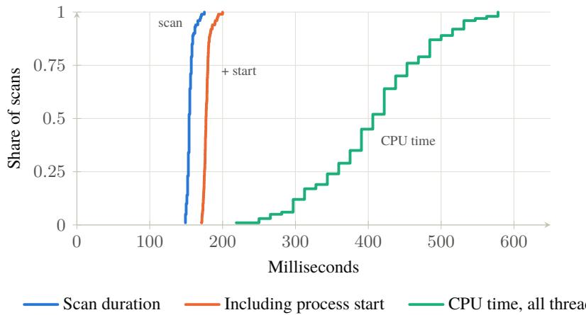  
Figure 11: Cumulative distribution of the cost of 100 consecutive scans (standard user, warm caches). The scan duration is reported by the scanner; the second curve adds the start of the process, measured from outside. Windows counts CPU time in clock ticks of 15.6 ms, hence the steps of the third curve.

## 11.6 RQ5: Robustness

The three robustness episodes probe known limits (lower part of Table 7), and two separate experiments measure the efect of time: an agent that is visible only part of the time, and DNS cache entries that expire.

• Undeclared relay. An agent that reaches its model through a relay hard-coded in its source, on a domain absent from the catalog, with no base-URL variable, is invisible to Agent Detector: nothing identifies the remote service as an LLM. The behavioural rules flag it, but, as RQ6 shows, they flag its benign twin just as readily.

• Ephemeral agent. An agent that runs for five seconds and is gone at scan time is missed by every periodic detector. This is not a corner case: it is how many home-made scripts run. With administrator rights, the execution traces record that python.exe ran, which says nothing about an agent; continuous telemetry would see it (Section 8).

• Agent in WSL 2. An agent running inside the Ubuntu distribution of WSL 2 is invisible to all detectors: its processes and sockets live in the WSL virtual machine, and the host’s tables show neither.

• Intermittent agent. Episode A12 was caught in three of the five standard-user runs and in none of the administrator runs, and the cause lies in the bench, not in privilege. Its scans fall at nearly the same moments of every episode, and the agent’s calls are just as regular, so every run samples almost the same phase. Across the fifteen runs of versions 0.3.1 and 0.3.2 in both configurations, A12 was detected exactly when the third scan started less than about 26.0 s after the episode began, and missed when it started up to a second later: the agent closes its connection at about that moment. To measure detection rather than phase, we ran the same agent for about seven minutes and scanned it 40 times at random intervals of 4 to 11 s. The agent held a connection at 18 of the scans, and Agent Detector reported it at 15 of them (0.38, 95% CI [0.23, 0.54]), always through its connection to the Anthropic API; the probable-agent finding, which needs the connection and one of the short-lived shells at the same instant, appeared at only 4. A scan at a random moment thus sees this agent about as often as its connection is open, here a little more than one scan in three while it works. Behind a CDN, where a connection alone gives only a low-confidence finding, the same agent would be detected only at the rare scans that also find one of its shells.

• Expiring DNS entries. A connection to a CDN-hosted provider is attributable only while the name it was opened with is in the DNS cache, and an agent that keeps its connection open never resolves the name again. We ran one such agent for each of the four CDN-hosted providers, scanned every 15 s for six minutes, and repeated the experiment three times (Figure 12). All twelve agents stayed connected to the end, but no connection was attributed after 295 s: attribution ended with the cache entry, after two to five minutes for Mistral, OpenRouter and Groq, whose answers live up to 300 s. OpenAI’s answers live at most 60 s, and its connection was attributed for 55 s in the first repetition, ten seconds in the second, and not at all in the third, although an answer obtained just before the agent started still had 43 s to live: the agent’s own answer, obtained a second later, can come from another cache, closer to its expiry. Over the six minutes, 168 of the 288 scans attributed the connection. In a second phase, the agents’ connections were closed two seconds after each call, as pooled HTTP clients do when idle, so that each new connection resolved the name again: 25 of the 31 scans that found an agent connected attributed its connection, including connections opened after the first entry had expired. The misses include connections opened while that entry was still valid, which points to connections that closed between our check and the scan rather than to the cache. For a periodic scan, a CDN-hosted agent is attributable only if some process resolved the provider’s name within the last few minutes: an agent that holds one connection for an hour is attributable during its first minutes only, and an hourly scan will usually miss it. The episodes, scanned seconds after the agents start, measure the favourable case; the dedicated address ranges, which do not expire, are the robust signal, for the providers that publish them.

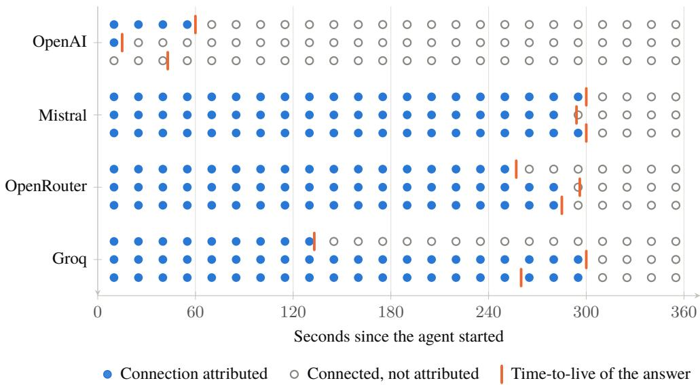  
Figure 12: Attribution of a long-lived connection through the DNS cache (standard user). For each CDN-hosted provider, a synthetic agent keeps one connection open and Agent Detector scans every 15 s; each row is one of three repetitions. A filled dot means that the scan attributed the agent’s connection to the provider’s host name, an open dot that the agent was connected but the connection was not attributed. The tick marks the time-to-live of an answer obtained just before the agent started; the agent’s own answer, obtained a second later, may come from another cache and live a little longer or shorter. Attribution ends when the cache entry expires, while the connection lives on.

The renamed-runtime episode (A11) belongs to the main set but is also a robustness test: a copy of the Node.js runtime renamed updater.exe defeats D1, whose interpreter list is name-based, and the signature detector D0. D2 and Agent Detector still catch it, Agent Detector through its connection and its shell, which do not depend on the name of the executable. Its inspection of modules and environment, by contrast, covers known interpreter names and processes already connected to a known LLM service, so a renamed runtime that reaches an unknown relay declared in a base-URL variable would escape it.

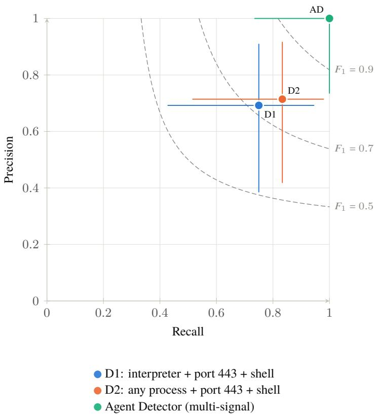  
Figure 13: Precision and recall of the detectors on the agent episodes (standard user, majority outcome over 5 runs), with exact 95% confidence intervals (Clopper–Pearson). Dashed curves join the points of equal $F _ { 1 } .$ The intervals overlap: with 12 agents and 9 benign workloads, the bench shows where each detector fails rather than ranking them. The signature detector D0 flagged no episode, so its precision is undefined and it is not shown. Values are in Table 11.

## 11.7 RQ6: Behavioural baselines

Table 11 summarises the four detectors on the main episodes, and Figure 13 places them in the precision–recall plane.

The behavioural rules behave as Section 6 predicts. They flag every behavioural twin and npm install: 4 of the 9 benign episodes for D1 and 4 for D2, for a precision of 0.69 and 0.71. They also miss the agents that do not fit the pattern: the local-model agent (no connection on port 443) and the agent that drives a browser rather than a shell; among the components, they flag only the MCP server, because npx downloads it over TLS and starts it through cmd.exe. On the workstation, D2 also flagged code.exe, the VS Code editor, whose integrated terminal runs shells while the editor keeps TLS connections, explorer.exe, the Windows shell, which also starts command prompts and holds TLS connections, and claude.exe, a real coding agent: the rule is right about the agent and wrong about the editor and the shell, for the same reason. The signature detector D0, by construction, catches none of the product-less agents, although it does find the real tools running on the workstation.

Agent Detector detected every agent in the majority of runs without flagging any benign workload (precision 1.00, recall 1.00, F1 1.00, against 0.72 and 0.77 for the behavioural rules). The twins difer from the agents only in the identity of the remote service, which the behavioural rules do not see and Agent Detector does. These figures flatter Agent Detector more than any other in this paper, for three reasons: two of its detections held in only three runs out of five; the episodes that once produced its errors (B09 and the CDN-hosted agents) were used to correct it; and every episode is scanned in the favourable seconds after the agent starts. The confidence intervals overlap widely, and precision depends on how many twins the bench contains, so these numbers describe the bench, not a population. What the bench does establish is qualitative: each detector fails on identifiable classes of episodes, and the classes difer. The structural rules cannot separate an agent from its twin; Agent Detector cannot see an agent whose service it cannot identify, such as the undeclared relay of R01, and it sees a CDN-hosted agent only while the provider’s name is in the DNS cache.

Table 11: Detectors on the 12 agent episodes and the 9 benign episodes of the main set (standard user, majority outcome over 5 runs), with exact 95% confidence intervals. The last column counts the AI components (inference runtime, MCP server, LLM client without tools) that each detector flagged; they are not agents and are not counted in precision and recall.
<table><tr><td>Detector</td><td>TP</td><td>FN</td><td>FP</td><td>TN</td><td>Precision [95% CI]</td><td>Recall [95% CI]</td><td>F1</td><td>Components</td></tr><tr><td>DO signature</td><td>0</td><td>12</td><td>0</td><td>9</td><td>n/a</td><td>0.00 [0.00, 0.26]</td><td>n/a</td><td>0/3</td></tr><tr><td>D1 interpreter rule</td><td>9</td><td>3</td><td>4</td><td>5</td><td>0.69 [0.39, 0.91]</td><td>0.75 [0.43, 0.95]</td><td>0.72</td><td>1/3</td></tr><tr><td>D2 any-process rule</td><td>10</td><td>2</td><td>4</td><td>5</td><td>0.71 [0.42, 0.92]</td><td>0.83 [0.52, 0.98]</td><td>0.77</td><td>1/3</td></tr><tr><td>Agent Detector</td><td>12</td><td>0</td><td>0</td><td>9</td><td>1.00 [0.74, 1.00]</td><td>1.00 [0.74, 1.00]</td><td>1.00</td><td>3/3</td></tr></table>

Table 12: Detectors on the main episodes from an elevated administrator window (majority outcome over 5 runs), with exact 95% confidence intervals; compare with Table 11.
<table><tr><td>Detector</td><td>TP</td><td>FN</td><td>FP</td><td>TN</td><td>Precision [95% CI]</td><td>Recall [95% CI]</td><td>F1</td><td>Components</td></tr><tr><td>DO signature</td><td>0</td><td>12</td><td>0</td><td>9</td><td>n/a</td><td>0.00 [0.00, 0.26]</td><td>n/a</td><td>0/3</td></tr><tr><td>D1 interpreter rule</td><td>9</td><td>3</td><td>4</td><td>5</td><td>0.69 [0.39, 0.91]</td><td>0.75 [0.43, 0.95]</td><td>0.72</td><td>1/3</td></tr><tr><td>D2 any-process rule</td><td>10</td><td>2</td><td>4</td><td>5</td><td>0.71 [0.42, 0.92]</td><td>0.83 [0.52, 0.98]</td><td>0.77</td><td>1/3</td></tr><tr><td>Agent Detector</td><td>11</td><td>1</td><td>0</td><td>9</td><td>1.00 [0.72, 1.00]</td><td>0.92 [0.62, 1.00]</td><td>0.96</td><td>3/3</td></tr></table>

## 11.8 Administrator configuration

An elevated administrator token reads what a standard user cannot on this build: the BAM keys, the Prefetch folder, the processes of other accounts, including services, and the profiles of every user. It is the closest configuration to the production SYSTEM task that we could measure without enrolling the machine, but not the same one: the scan ran in the administrator’s interactive session rather than in session 0, under another account. We ran the whole bench 5 times in this configuration (Table 12).

On the episodes, elevation changed little, as expected: the episodes run under the user’s own account and are visible at either level, and the sources that elevation opens describe past executions and other accounts, which the episodes do not exercise. Agent Detector detected 11 of the 12 agents and 3 of the 3 components, and flagged 0 benign workloads (precision 1.00, recall 0.92). The two diferences with the standard user are the timing efects of RQ1: the intermittent agent was missed in every run, and the OpenAI agent was caught in every run. The ephemeral agent R02 was still missed: Prefetch and BAM record that python.exe ran, which identifies no agent.

Elevation changed the in-situ scan in two ways. First, the execution traces confirmed what the log folder suggested: Claude Desktop had last run on 22 October, eighteen days before the scan, so its recent level now rests on a BAM entry. Second, the scan found two more findings at the active level, attributed to the SYSTEM account: the virtual-machine service of Claude Desktop’s Cowork mode and the sandbox service of the Codex application, two Windows services that run whether or not anyone uses the application. They open no notice, since the notice lists only the findings of the session’s user, but they show that active means that a process of the tool runs, not that a person uses it; a fleet report should count service findings apart from user findings.

Elevation also costs little. A scan took 168 ms at the median (174 ms at the 95th percentile), against 154 ms for the standard user, used 469 ms of CPU time (406 ms) and peaked at 22.5 MB (22.3 MB).

## 11.9 Threats to validity

Internal validity. Synthetic agents reproduce the footprint that the detector observes, not the full behaviour of real agents; they poll with invalid keys instead of streaming completions, and all but one keep both of their signals present all the time. Real agents are intermittent: Section 11.6 measures, for one synthetic pattern, how often a scan at a random moment sees such an agent, but the share of time during which real agents hold an identifiable connection, and a shell, remains to be measured on real sessions. The baselines sample about once per second and Agent Detector three times per window, an asymmetry that favours the baselines on transient patterns in the bench and would reverse in production. The behavioural twins are constructed by us; they are a worst case for structural rules, but a realistic one, as the npm install and VS Code cases show. Each relay episode uses httpbin.org as a stand-in relay. The in-situ cross-check reads the same kinds of sources as the detector.

Privilege, time and production configuration. The elevated runs approach the SYSTEM task without reproducing it (Section 11.8). In both configurations, a connection attributed through the DNS cache is never treated as dedicated: the llm-api finding stays at low confidence, and detection rests on the probable-agent rule, so an agent behind a CDN without a shell child is reported below the notice threshold. The inversion of the DNS cache is machine-wide, so a process that talks to an address of a shared CDN that also served an LLM host is marked as LLM-connected; no benign workload of the bench was afected, but few of them talk to the same CDNs, so this precision is not established for a population. Above all, the episodes are scanned seconds after the agents start, while their name resolutions are still cached and their signals present: they measure the best case of a periodic scan. The two experiments of Section 11.6 measure how fast this best case decays, on one machine and with synthetic agents.

External validity. One machine, one consumer edition of Windows on a recent build, one user, and a small number of episodes per class: the results establish what each layer can and cannot see, not rates that would hold across a fleet. The confidence intervals of Table 11 overlap for all detectors. Benign workloads on other machines (build farms, data-science notebooks, administrators’ automation, LLM pipelines that use several processes) will produce other patterns.

Construct validity. Our operational definition of an agent and our detection threshold (medium confidence) are choices, and Agent Detector’s probable-agent rule (talks to a model and has a shell descendant) is a narrower proxy of the definition. Counting a finding of AI use, such as llm-api, as the detection of an agent is generous to Agent Detector: such a finding says that a process talks to a model, not that it acts. Table 7 lists the kinds of findings behind each detection so that a reader can apply a stricter criterion.

Next step: a field study. The natural complement is a silent field study: Agent Detector deployed in its silent mode on a pilot population for a few weeks, reporting only aggregated counts per tool, level and confidence, after the information and consultation steps discussed in Section 12. Such a study would measure what this paper cannot: the prevalence of shadow agents, the share of product-less agents among them, and the false-positive rate on a real population.

## 12 Discussion

## 12.1 Inform rather than block

Agent Detector never blocks. This is a design decision, not a missing feature, and it rests on three arguments. First, visibility must come before control: an organisation that blocks what it cannot see pushes usage towards what it cannot see, such as personal devices or web interfaces, and loses even the partial view it had. Second, the agents of this paper are mostly used in good faith (actor A1 of Section 5); for them, the most efective control is often to learn that a policy exists, which approved alternatives it lists, and whom to ask. Third, the tools that should block already exist: application control can refuse to run an executable, and the network can refuse a domain. A detector that feed those controls with evidence is more useful than one that duplicates them with less context.

The notice is the part of the system that turns detection into governance. It informs the user at the moment of use, it records which version of the policy text each user acknowledged, and it repeats as long as the agent remains, so that acknowledgement documents awareness without granting an exemption. This contrasts with silent discovery, which Microsoft’s deployment guidance describes in so many words: “end users are not notified or afected” [50]. Silent discovery gives the organisation a list; it does not give the employee the information that would let them comply, and it leaves the organisation unable to show that the employee was informed.

The repetition has a cost. A user whose approved tool is installed sees the notice, with the tool marked approved, at every scan; organisations will likely want approved tools to be listed without re-opening the notice, or a lower frequency once the user has acknowledged a given version of the text. We kept the strictest behaviour in the evaluated version and report it as a usability question for field studies.

## 12.2 Legal and ethical framework

A detector that observes employees’ machines is a monitoring device, and it must be designed and deployed as one. We discuss the European and French frameworks, which are among the strictest; other jurisdictions difer.

Data protection. Under the GDPR, the processing needs a legal basis, typically the legitimate interest of the employer in securing its information system (Article 6(1)(f)), and it must respect data minimisation: data “adequate, relevant and limited to what is necessary in relation to the purposes” [19, Art. 5(1)(c)]. The design choices of Section 9 serve this principle directly: no content, no secret values, the host of a base URL rather than the URL, tool names rather than activity logs. Minimisation has a limit that we must state: an hourly finding of an active tool, per user, accumulates into a timeline of when that user works with an agent. The retention period of the events, and who may query them, are therefore part of the design of a deployment, not details. Employees must be informed when the data are collected (Article 13), and a data protection impact assessment is required where the processing is likely to result in a high risk to their rights, with “an assessment of the necessity and proportionality” (Article 35) [19]; for a sensor that runs on every laptop every hour, an organisation should assume that an assessment is needed. The legal basis is not consent: between an employer and its employees, consent is rarely free, and the acknowledgement that the notice collects is information, not consent. Legitimate interest is, moreover, not available to public authorities in the performance of their tasks, which need another basis. The notice contributes to the information duty, since it tells users that detections and acknowledgements are logged, but it does not replace the general information of the workforce.

French labour law. In France, “no information personally concerning an employee may be col lected by a device that has not been brought to their attention beforehand” [64], and, in undertakings of at least fifty employees, the works council (CSE) must be informed and consulted before the introduction of “means or techniques that allow the monitoring of employees’ activity” [65]. More generally, any restriction of employees’ rights must be justified by the nature of the task and proportionate to its aim (article L1121-1 of the Labour Code). The French data protection authority adds that monitoring must not be excessive, that permanent surveillance is generally considered an exces sive infringement, and that the employer must check that no less intrusive means exists [16]. In our reading, these requirements favour the design choices we made (collect identities of tools, not activity; inform at the time of use; never record content) and they make the deployment process, not the code, the place where compliance is achieved: policy update, worker information and consultation, record of processing, impact assessment.

AI literacy. The AI Act initially required providers and deployers of AI systems to “take measures to ensure, to their best extent, a suficient level of AI literacy of their staf”, from 2 February 2025 [20].

The Digital Omnibus on AI of July 2026 replaced this with an obligation to “take measures to support the development of AI literacy” of staf [21]. Either way, informing an employee, at the moment they use an agent, of the organisation’s AI policy and of the approved tools is a measure of that kind. We do not claim that a notice satisfies the obligation on its own, nor that an employer is the deployer of a tool that an employee uses without authorisation; where it is not, the notice is good practice rather than compliance.

Fleet reporting. Intune’s documentation asks administrators not to use detection scripts “to collect personal data from devices” [39]. The optional fleet report of Agent Detector outputs tool names, not user names; but a laptop usually belongs to one person, so the report should be treated as personal data and included in the impact assessment.

## 12.3 Operational lessons

Building the detector was the smaller part of the work; packaging it for Intune, and checking each step against the platform’s documentation, taught lessons that we believe generalise to any endpoint sensor for agents. They come from building and testing the package, not from a measured fleet deployment.

1. Privilege is coverage, but test the cause of each gap. On the Windows build we tested, the BAM keys, the Prefetch folder and the processes of other users were not readable without administrator or SYSTEM rights; we have not checked whether this holds on other builds and editions. We first believed the same of the DNS client cache, because a standard-user scan found almost nothing in it. The cause was a lookup key (Section 9.4), and the elevated run, which found nothing either, is what revealed it. The sensor should run as SYSTEM, and every report must state what it could not see, so that an absence of findings is never read as an absence of agents; but a coverage note is a hypothesis about its cause until it has been tested.

2. Session 0 cannot speak to users. A SYSTEM process runs in an isolated session and cannot show a window. Informing the user requires starting a process in each interactive session with the user’s token, which has a useful side efect: the acknowledgement is then recorded under the user’s own identity. It records who acknowledged, but it does not prove it (Section 9.6).

3. The deployment agent may run in 32 bits. The Intune management extension can start installation commands as 32-bit processes [40]; an installer that does not relaunch itself in 64 bits writes its files and registry keys to redirected locations, and the application is never detected as installed.

4. Detect the installation, not the file. Writing an installation marker last, whose value combines the binary version, the notice-text version and the mode, makes the MDM’s detection rule reliable and turns every change of text or mode into an automatic reinstallation.

5. Signing is not enough under strict policies. When group policy enforces the AllSigned PowerShell policy, scripts must be signed and their publisher trusted, or PowerShell waits for a confirmation that a silent installation can never give.

6. Never trust a pre-created folder. Standard users can create folders under ProgramData; a sensor that writes its reports there must recreate the folder with its own access control list.

7. Start silently. A silent first phase, in which the sensor reports but shows nothing, measures the false positives of a real population before any user is interrupted, and lets the organisation complete its approved-tools list first.

8. Mind notice fatigue. Repeating the notice at every scan keeps awareness high but also reminds users of tools that are already approved; the right frequency is a policy decision that deserves measurement.

9. Expect the catalog to drift. Vendors rename products, move or share configuration folders, and add address ranges; new agents appear between two catalog releases. Personal agents such as OpenClaw, which security vendors describe as able to “run shell commands, read and write files, and execute scripts” [15] and which Microsoft lists among detected local agents [46], appeared after our catalog was designed; until a signature is added, only the generic rules can see them.

## 12.4 Limitations

Privilege and periodicity. Coverage depends on privilege (Section 11): without administrator rights, BAM and Prefetch are unreadable and the processes of other users cannot be inspected. In production the scan runs as SYSTEM, but a standard-user run is a realistic picture of what a nonprivileged sensor sees. Periodic scanning also misses agents that start and stop between two scans; known tools leave history, but a short script run by python.exe leaves only the trace of python.exe. Continuous telemetry, for example from Event Tracing for Windows, would close this gap at a higher cost.

The DNS cache. Attribution through the DNS client cache works only while the entries live, at most one to five minutes for the CDN-hosted providers we measured (Figure 12), and only for names resolved through the system resolver. An agent that keeps one connection open for an hour is therefore attributable during its first minutes only, and an hourly scan will usually miss it; lengthening the timeto-live is not ours to decide, but a sensor could keep its own record of recent resolutions, at the cost of running continuously. Software that resolves names itself, or uses DNS over HTTPS internally, escapes it. It also rests on two behaviours that Microsoft does not document: the listing of the cache, which returned nothing on the build we tested, and the keys under which resolvers store their entries, which we inferred from experiments (Section 9.4). Either may change with a Windows release; a sensor that relies on them needs a regression test per build, such as the bench of Section D.

Out-of-host execution. Agents in virtual machines, containers and WSL 2 run behind a virtual network interface; their processes and sockets are not in the host’s tables. Cloud agents never touch the endpoint. These cases need hypervisor-, network- or cloud-side controls.

Catalog drift. The generic rules reduce the dependence on the catalog, but network attribution still needs to know which hosts are LLM services. While writing this paper we found that an earlier version of the catalog lacked the IPv6 range that Anthropic documents for its API [5], and that the configuration folder used as residue evidence for the GitHub Copilot command-line agent had become shared with the Copilot runtime of VS Code. Endpoint lists, configuration paths [48] and product names change monthly. A catalog-driven detector must be maintained like an antivirus signature base, from vendor documentation, analyst catalogs and the unknown relays reported by the fleet itself.

Evaluation scope. Our evaluation runs on one workstation, with synthetic agents that poll real endpoints with invalid keys rather than performing real tasks, and with a small set of benign workloads. Synthetic agents reproduce the footprint that the detector observes, which is what is being measured, but not the full diversity of real agents; real deployments will show other false positives. Section 11.9 describes the field study that would complement it.

## 12.5 Evasion

A deliberate evader (actor A4) can defeat endpoint detection: run the agent in a virtual machine or container, reach the model through a relay on an innocuous domain without any base-URL variable, rename the interpreter, run for seconds at a time, or simply disable the scheduled task with local administrator rights. We measured some of these cases (Section 11) and describe them only at the level of classes, which are well known. The operational answers are outside the endpoint detector: remove local administrator rights, alert on missing scan summaries (the absence of event 100 from a machine for more than a day is itself a signal), and combine endpoint findings with network controls for relays and with application control for virtualisation software.

## 12.6 Beyond Windows

The taxonomy and the correlation model do not depend on Windows. On macOS and Linux, the same layers exist: process tables with command lines and environments, socket tables, resolver caches where a local caching resolver runs, package managers, application bundles and configuration files in the user’s home directory. Execution history is weaker on Linux and diferent on macOS. Porting the collectors is engineering; the hypothesis that identity must anchor behaviour carries over unchanged.

## 13 Related Work

Shadow IT and shadow AI. Information-systems research has studied shadow IT for over a decade: its definition [30, 72], its governance approaches [29], its nature and management in case studies [91], its causes and outcomes in a systematic review [36], and what happens to shadow systems once they are identified [22]. Recent work extends the concept to generative AI [73], studies it in critical infrastructure [7], and models the governance of “bring your own AI” [9]. This literature is mostly organisational and survey-based; it documents that shadow systems are under-estimated and that identification is the precondition of governance, but it does not provide the instrument that identifies them. Our work supplies such an instrument for the agentic case, and our acceleration argument (Section 4) connects the two literatures through the retirement rate of shadow artifacts.

LLM agents and their ecosystem. The agent paradigm builds on reasoning-and-acting loops [88] and tool use [70], surveyed in [82]. Software engineering benchmarks and agents [34, 83, 87] made coding agents practical, and empirical studies now measure them in public repositories: their pull requests [37, 85], their adoption [69], the configuration mechanisms developers use to steer them [23], and the MCP tools they call [79]. These studies observe agents through the traces they leave in code repositories. We observe them through the traces they leave on the machines where they run, which is where an organisation’s governance applies and where agents that never commit code are visible.

Security of agents. A large body of work studies how agents can be attacked or misused: indirect prompt injection [27], injection benchmarks for tool-integrated agents [18, 89], MCP-specific threats [31, 63] and tool poisoning [10, 84]. Frameworks catalogue these risks for practitioners [52, 58–60] and for risk management [6, 80]. This work secures agents that an organisation knows about. Ours addresses the prior question of which agents are present at all; the two meet in the configuration files that both attackers and defenders target.

Network-side observation of LLM trafic. Side-channel and trafic-analysis studies show that encrypted LLM trafic reveals response contents [86], prompt topics [38], the agent at work [90], and the serving model and task [62]; TLS fingerprints characterise client libraries [1, 2], while Encrypted Client Hello reduces what the network sees [66]. These works take an attacker’s or a network observer’s vantage point and answer probabilistically. We take the endpoint’s vantage point, which attributes connections to processes and users deterministically but sees only the machine it runs on. The two are complementary, and Section 6 explains why the discriminating signal, in both cases, is the identity of the remote service.

Endpoint forensics and inventory. Digital forensics has long used Windows execution artifacts such as BAM and Prefetch as evidence of program execution [56, 81], and recent work documents the artifacts left by the ChatGPT Windows application [35]. EDR platforms maintain software inventories [45]. We reuse forensic artifacts as one layer among six, and difer from inventories by covering software that is not installed.

Vendor discovery of shadow AI. Cloud discovery catalogs classify generative-AI services [41], data-centric posture management tracks sensitive data flowing to AI applications [43], and, most recently, endpoint security now discovers named local agents and reports them as shadow AI [44, 46]. To our knowledge, the vendor documentation does not describe a mechanism for agents without a product, and the discovery is designed to be silent for users [50]. Continuous telemetry (Sysmon, EDR hunting tables) and scanners of MCP configurations cover parts of the same ground (Section 8) [33, 47]. Forensic studies have characterised the artifacts that individual AI applications leave on a machine [35]. We are not aware of academic work that characterises the endpoint footprint of AI agents across classes, compares behavioural and multi-signal detection on the same bench, or couples detection with an acknowledgement loop; this paper is a first step in that direction.

Visibility into agents. A line of work on AI governance asks how the deployers and users of agents can see what agents do: agent identifiers, real-time monitoring and activity logs [13], agent infrastructure for attribution, interaction and response [14], authenticated delegation of authority from a user to an agent [76], and practices such as legibility, attributability and automatic monitoring [71]. These proposals assume that agents cooperate, by carrying an identifier or by running on infrastructure that logs them. Shadow agents are, by definition, the ones that do not: they run on a laptop, outside the deployer’s infrastructure, often written by their user. Endpoint detection is the fallback for this population, and the footprint we measure is what an agent reveals without cooperating. The two directions meet: an agent that declares itself, for example in its user agent or in the client information of the Model Context Protocol, would make the identity layer of our taxonomy reliable.

## 14 Conclusion

Can unsanctioned agents be detected on enterprise endpoints? Our answer has three parts.

Not by their products alone. Signature and inventory approaches see the agents that ship as products, and the products are many: our catalog lists 39 of them, and it was already incomplete by the time we wrote this paper. But the agents that matter most for the acceleration of shadow IT are the ones that ship as no product at all: scripts that call a model through an aggregator, automations written by other agents, MCP servers started on the fly. By construction, signatures miss them.

Not by simple behaviour. An agent behaves like a developer, inside processes that are legitimate. Its behavioural twin, the same program talking to a package index instead of a model, is indistinguishable to any detector that looks only at the structure of processes and connections. Our bench illustrates the argument: two structural rules flagged every twin and an ordinary npm install, and still missed agents that use local models or drive browsers. Richer behavioural features remain to be tested.

Partly, when behaviour is anchored to identity. Correlating what a process does with the identity of the service it talks to, and completing the picture with the configuration, installation and history that agents leave behind, separates agents from their twins. It is not enough on its own, and its limits are mostly about time. On our bench, Agent Detector saw an agent behind a shared contentdelivery network only while the DNS cache held the provider’s name, a few minutes at most; it saw an intermittent agent at about one scan in three; and it missed agents active too briefly for a periodic scan, agents behind an undeclared relay and agents inside WSL 2. The one false positive of an earlier version came from an inherited configuration variable, and the bench showed how to remove it. A scan costs about 154 ms and 22.3 MB. The bench is small, synthetic and run on one workstation; it maps what each kind of evidence can and cannot see, and it does not estimate rates for a fleet.

Detection is only the first step of governance. We have argued that it is a precondition for the others: an organisation that cannot see agentic artifacts cannot deliberately retire them, and if they reproduce faster than they are retired, shadow IT can grow exponentially. Detection alone does not bound that growth; sanctioned alternatives, least privilege and policies on automations are needed too. Coupling detection with a notice that users acknowledge informs users rather than observing them silently, and gives organisations a record that their policies were communicated.

Future work. Five directions follow. Running real agents on a fixed set of tasks, and recording their endpoint footprint over time, would replace our synthetic agents and measure how often a periodic scan catches them. A field study in silent mode would measure the prevalence of shadow agents and the share of product-less agents on a real population. Continuous telemetry, for instance from Event

Tracing for Windows or Sysmon, would catch short-lived agents that periodic scans miss, and keep the name resolutions that the DNS cache forgets. Collectors for macOS and Linux would test the claim that the taxonomy and the correlation model are platform-independent. And standard ways for agents to declare themselves, such as agent identities and registries, would turn part of the detection problem into a disclosure protocol, leaving detection for the agents that do not declare.

Availability. Agent Detector, its catalog, the evaluation bench and the scripts that produce every table and number of this paper are open source [12].

## References

[1] John Althouse. JA4+ network fingerprinting. https://github.com/FoxIO-LLC/ja4, 2023. FoxIO, GitHub repository. Accessed 2026-11-08.

[2] John Althouse, Jef Atkinson, and Josh Atkins. JA3: A method for profiling SSL/TLS clients. https: //github.com/salesforce/ja3, 2017. Salesforce, GitHub repository (archived). Accessed 2026-11-08.

[3] Anthropic. Introducing the Model Context Protocol. https://www.anthropic.com/news/model-con text-protocol, November 2024. Published 25 November 2024. Accessed 2026-11-08.

[4] Anthropic. Settings files and precedence – Claude Code documentation. https://code.claude.com/ docs/en/settings, 2026. Accessed 2026-11-08.

[5] Anthropic. IP addresses – Claude API documentation. https://platform.claude.com/docs/en/api/ ip-addresses, 2026. Accessed 2026-11-08.

[6] Chloe Autio, Reva Schwartz, Jesse Dunietz, Shomik Jain, Martin Stanley, Elham Tabassi, Patrick Hall, and Kamie Roberts. Artificial intelligence risk management framework: Generative artificial intelligence profile. Technical Report NIST AI 600-1, National Institute of Standards and Technology, July 2024.

[7] Mohan Baruwal Chhetri, Shahroz Tariq, Tooba Aamir, Marthie Grobler, Chandra Thapa, and Ronal Singh. From frontier to shadow AI: A simmering threat to assurance and security in critical infrastructure. https: //arxiv.org/abs/2606.00088, 2026. Preprint.

[8] Joel Becker, Nate Rush, Elizabeth Barnes, and David Rein. Measuring the impact of early-2025 AI on experienced open-source developer productivity. https://arxiv.org/abs/2507.09089, 2025. Preprint.

[9] Dare Bello and John Hastings. Governing bring your own AI: A parameterized maturity model. https: //arxiv.org/abs/2609.05236, 2026. Preprint.

[10] Luca Beurer-Kellner and Marc Fischer. MCP security notification: Tool poisoning attacks. https:// invariantlabs.ai/blog/mcp-security-notification-tool-poisoning-attacks, April 2025. Invariant Labs blog. Accessed 2026-11-08.

[11] Tianle Cai, Xuezhi Wang, Tengyu Ma, Xinyun Chen, and Denny Zhou. Large language models as tool makers. In International Conference on Learning Representations (ICLR), 2024. URL https://arxiv. org/abs/2305.17126.

[12] Jeremy Canale. Agent Detector: Open-source detection of AI agents on Windows endpoints. https: //github.com/jeremy1392/IntuneAgentDetector, 2026. Version 0.3.2, catalog 2026.11.09. Accessed 2026-11-09.

[13] Alan Chan, Carson Ezell, Max Kaufmann, Kevin Wei, Lewis Hammond, Herbie Bradley, Emma Bluemke, Nitarshan Rajkumar, David Krueger, Noam Kolt, Lennart Heim, and Markus Anderljung. Visibility into AI agents. In Proceedings of the 2024 ACM Conference on Fairness, Accountability, and Transparency (FAccT), 2024. doi: 10.1145/3630106.3658948. URL https://arxiv.org/abs/2401.13138.

[14] Alan Chan, Kevin Wei, Sihao Huang, Nitarshan Rajkumar, Elija Perrier, Seth Lazar, Gillian K. Hadfield, and Markus Anderljung. Infrastructure for AI agents. Transactions on Machine Learning Research, 2025. URL https://arxiv.org/abs/2501.10114.

[15] Amy Chang, Vineeth Sai Narajala, and Idan Habler. Personal AI agents like OpenClaw are a security nightmare. Cisco Blogs, 28 January 2026, https://blogs.cisco.com/ai/personal-ai-agents-lik e-openclaw-are-a-security-nightmare, 2026. Accessed 2026-11-08.

[16] Commission nationale de l’informatique et des libertés (CNIL). Travail, ressources humaines : le contrôle de l’activité des personnes employées. https://www.cnil.fr/fr/controle-de-lactivite-des-per sonnes-employees, 2026. In French. Accessed 2026-11-08.

[17] Cursor. Model context protocol (MCP) – Cursor documentation. https://cursor.com/docs/context/ mcp, 2026. Accessed 2026-11-08.

[18] Edoardo Debenedetti, Jie Zhang, Mislav Balunović, Luca Beurer-Kellner, Marc Fischer, and Florian Tramèr. AgentDojo: A dynamic environment to evaluate prompt injection attacks and defenses for LLM agents. In Advances in Neural Information Processing Systems 37 (NeurIPS 2024), Datasets and Bench marks Track, 2024. doi: 10.52202/079017-2636.

[19] European Parliament and Council of the European Union. Regulation (EU) 2016/679 on the protection of natural persons with regard to the processing of personal data and on the free movement of such data (general data protection regulation). https://eur-lex.europa.eu/eli/reg/2016/679/oj/eng, 2016. OJ L 119, 4.5.2016, pp. 1–88. Accessed 2026-11-08.

[20] European Parliament and Council of the European Union. Regulation (EU) 2024/1689 laying down harmonised rules on artificial intelligence (artificial intelligence act). https://eur-lex.europa.eu/eli/r eg/2024/1689/oj/eng, 2024. OJ L, 2024/1689, 12.7.2024. Accessed 2026-11-08.

[21] European Parliament and Council of the European Union. Regulation (EU) 2026/1744 amending regulations (EU) 2024/1689, (EU) 2018/1139 and (EU) 2023/1230 as regards the simplification of the implementation of harmonised rules on artificial intelligence (digital omnibus on AI). https://eur-lex.eur opa.eu/legal-content/EN/TXT/HTML/?uri=CELEX:32026R1744, 2026. OJ L, 2026/1744, 24.7.2026. Accessed 2026-11-08.

[22] Daniel Fürstenau, Hannes Rothe, and Matthias Sandner. Leaving the shadow: A configurational approach to explain post-identification outcomes of shadow IT systems. Business & Information Systems Engineering, 63(2):97–111, 2021. doi: 10.1007/s12599-020-00635-2.

[23] Matthias Galster, Seyedmoein Mohsenimofidi, Jai Lal Lulla, Muhammad Auwal Abubakar, Christoph Treude, and Sebastian Baltes. Harness engineering for agentic AI coding tools: An exploratory study. https://arxiv.org/abs/2602.14690, 2026. Preprint.

[24] N. Gillespie, S. Lockey, T. Ward, A. Macdade, and G. Hassed. Trust, attitudes and use of artificial intelligence: A global study 2025. The University of Melbourne and KPMG; executive summary at https://kpmg.com/kpmg-us/content/dam/kpmg/pdf/2025/trust-attitudes-artificial-i ntelligence-executive-summary.pdf, 2025. Accessed 2026-11-08.

[25] GitHub. GitHub Copilot on GitHub.com and GitHub Mobile. https://docs.github.com/en/copilot /concepts/copilot-surfaces/copilot-on-github, 2026. Accessed 2026-11-08.

[26] GitHub Staf. Octoverse: A new developer joins GitHub every second as AI leads TypeScript to #1. https://github.blog/news-insights/octoverse/octoverse-a-new-developer-joins-githu b-every-second-as-ai-leads-typescript-to-1/, 2025. 28 October 2025. Accessed 2026-11-08.

[27] Kai Greshake, Sahar Abdelnabi, Shailesh Mishra, Christoph Endres, Thorsten Holz, and Mario Fritz. Not what you’ve signed up for: Compromising real-world LLM-integrated applications with indirect prompt injection. In Proceedings of the 16th ACM Workshop on Artificial Intelligence and Security (AISec ’23), pages 79–90. ACM, 2023. doi: 10.1145/3605764.3623985.

[28] Mark Gurman. Samsung bans staf’s AI use after spotting ChatGPT data leak. Bloomberg News, 2 May 2023, https://news.bloomberglaw.com/tech-and-telecom-law/samsung-bans-staffs-ai-use -after-spotting-chatgpt-data-leak-2, 2023. Accessed 2026-11-08.

[29] Andreas Györy, Anne Cleven, Falk Uebernickel, and Walter Brenner. Exploring the shadows: IT governance approaches to user-driven innovation. In Proceedings of the European Conference on Information Systems (ECIS 2012), 2012. URL https://aisel.aisnet.org/ecis2012/222. Paper 222.

[30] Stefi Haag and Andreas Eckhardt. Shadow IT. Business & Information Systems Engineering, 59(6): 469–473, 2017. doi: 10.1007/s12599-017-0497-x.

[31] Xinyi Hou, Yanjie Zhao, Shenao Wang, and Haoyu Wang. Model context protocol (MCP): Landscape, security threats, and future research directions. https://arxiv.org/abs/2503.23278, 2025. Preprint.

[32] IBM. IBM report: 13% of organizations reported breaches of AI models or applications, 97% of which reported lacking proper AI access controls. IBM Newsroom (Cost of a Data Breach Report 2025, conducted by the Ponemon Institute), https://newsroom.ibm.com/2025-07-30-ibm-report-13-of-organiz ations-reported-breaches-of-ai-models-or-applications,-97-of-which-reported-lacki ng-proper-ai-access-controls, 2025. 30 July 2025. Accessed 2026-11-08.

[33] Invariant Labs. Introducing MCP-Scan: Protecting MCP with Invariant. https://invariantlabs.ai /blog/introducing-mcp-scan, 2025. Vendor blog; the tool has since become part of Snyk’s agent scanning. Accessed 2026-11-09.

[34] Carlos E. Jimenez, John Yang, Alexander Wettig, Shunyu Yao, Kexin Pei, Ofir Press, and Karthik Narasimhan. SWE-bench: Can language models resolve real-world GitHub issues? In International

Conference on Learning Representations (ICLR), 2024. URL https://openreview.net/forum?id=VT F8yNQM66.

[35] Malithi Wanniarachchi Kankanamge, Nick McKenna, Santiago Carmona, Syed Mhamudul Hasan, Ab dur R. Shahid, and Ahmed Imteaj. Digital forensic investigation of the ChatGPT Windows application. https://arxiv.org/abs/2505.23938, 2025. Preprint.

[36] Stefan Klotz, Andreas Kopper, Markus Westner, and Susanne Strahringer. Causing factors, outcomes, and governance of shadow IT and business-managed IT: A systematic literature review. International Journal ofInformation Systems and Project Management, 7(1):15–43, 2019. doi: 10.12821/ijispm070102.

[37] Hao Li, Haoxiang Zhang, and Ahmed E. Hassan. The rise of AI teammates in software engineering (SE) 3.0: How autonomous coding agents are reshaping software engineering. https://arxiv.org/abs/25 07.15003, 2025. Preprint.

[38] Geof McDonald and Jonathan Bar Or. Whisper leak: A side-channel attack on large language models. https://arxiv.org/abs/2511.03675, 2025. Preprint.

[39] Microsoft. Use remediations to detect and fix support issues – Microsoft Intune. https://learn.micros oft.com/en-us/intune/device-management/tools/deploy-remediations, 2025. Microsoft Learn documentation. Accessed 2026-11-08.

[40] Microsoft. Add, assign, and monitor a Win32 app in Microsoft Intune. https://learn.microsoft.co m/en-us/intune/intune-service/apps/apps-win32-add, 2026. Microsoft Learn documentation. Accessed 2026-11-08.

[41] Microsoft. Cloud app catalog and risk scores – Microsoft Defender for Cloud Apps. https://learn. microsoft.com/en-us/defender-cloud-apps/risk-score, 2026. Microsoft Learn documentation. Accessed 2026-11-08.

[42] Microsoft. DeviceNetworkEvents table in the advanced hunting schema. https://learn.microsoft.co m/en-us/defender-xdr/advanced-hunting-devicenetworkevents-table, 2026. Microsoft Learn documentation. Accessed 2026-11-09.

[43] Microsoft. Learn about Microsoft Purview data security posture management (DSPM). https://lear n.microsoft.com/en-us/purview/data-security-posture-management-learn-about, 2026. Microsoft Learn documentation. Accessed 2026-11-08.

[44] Microsoft. Local AI agent discovery with Microsoft Defender for Endpoint. https://learn.micros oft.com/en-us/defender-endpoint/local-agent-discovery-overview, 2026. Microsoft Learn documentation. Accessed 2026-11-08.

[45] Microsoft. Software inventory – Microsoft Defender Vulnerability Management. https://learn.mi crosoft.com/en-us/defender-vulnerability-management/tvm-software-inventory, 2026. Microsoft Learn documentation. Accessed 2026-11-08.

[46] Microsoft. Understand shadow AI in Microsoft 365 admin center. https://learn.microsoft.com/en -us/microsoft-agent-365/admin/agent-shadow-ai, 2026. Microsoft Learn documentation, public preview. Accessed 2026-11-08.

[47] Microsoft. Understanding Sysmon events. https://learn.microsoft.com/en-us/windows/securi ty/operating-system-security/sysmon/sysmon-events, 2026. Microsoft Learn documentation. Accessed 2026-11-09.

[48] Microsoft. Add MCP servers in VS Code. https://code.visualstudio.com/docs/copilot/customi zation/mcp-servers, 2026. Accessed 2026-11-08.

[49] Microsoft. Win32 app management in Microsoft Intune. https://learn.microsoft.com/en-us/intu ne/app-management/deployment/win32, 2026. Microsoft Learn documentation. Accessed 2026-11-08.

[50] Microsoft. Enable shadow AI detection for local agents on endpoints (AI\_176). https://microsoft.gi thub.io/zerotrustassessment/docs/workshop-guidance/AI/AI\_176, 2026. Zero Trust assessment workshop guidance. Accessed 2026-11-08.

[51] Microsoft and LinkedIn. AI at work is here. now comes the hard part (2024 work trend index annual report). https://www.microsoft.com/en-us/worklab/work-trend-index/ai-at-work-is-her e-now-comes-the-hard-part, 2024. 8 May 2024. Accessed 2026-11-08.

[52] MITRE. ATLAS: Adversarial threat landscape for AI systems. https://atlas.mitre.org/, 2026. Data release 2026.10; changelog at https://github.com/mitre-atlas/atlas-data. Accessed 2026-11-08.

[53] Model Context Protocol Project. Connect to local MCP servers. https://modelcontextprotocol.io/ docs/develop/connect-local-servers, 2026. Accessed 2026-11-08.

[54] Model Context Protocol Project. Model Context Protocol specification, version 2026-07-28. https: //modelcontextprotocol.io/specification/2026-07-28, 2026. Accessed 2026-11-08.

[55] Nation Thailand. Gartner unveils top eight cybersecurity predictions for 2023–2024. https://www.na tionthailand.com/blogs/business/tech/40026178, 2023. 30 March 2023; reports Gartner’s predictions. Accessed 2026-11-08.

[56] Ashar Neyaz and Narasimha Shashidhar. Windows prefetch forensics. In Kevin Daimi, Guillermo Francia III, and Luis Hernández Encinas, editors, Breakthroughs in Digital Biometrics and Forensics, pages 191–210. Springer, Cham, 2022. doi: 10.1007/978-3-031-10706-1\_9.

[57] OpenAI. Model context protocol – Codex documentation. https://learn.chatgpt.com/docs/exten d/mcp?surface=cli, 2026. Accessed 2026-11-08.

[58] OWASP Gen AI Security Project. OWASP top 10 for LLM applications 2025. https://genai.owasp.or g/resource/owasp-top-10-for-llm-applications-2025/, November 2024. Accessed 2026-11-08.

[59] OWASP Gen AI Security Project. OWASP top 10 for agentic applications for 2026. https://genai. owasp.org/resource/owasp-top-10-for-agentic-applications-for-2026/, December 2025. Accessed 2026-11-08.

[60] OWASP Gen AI Security Project. OWASP top 10 for LLM applications 2026. https://genai.owasp. org/resource/owasp-genai-llm-top-10-2026/, 2026. Accessed 2026-11-08.

[61] Sida Peng, Eirini Kalliamvakou, Peter Cihon, and Mert Demirer. The impact of AI on developer productivity: Evidence from GitHub Copilot. https://arxiv.org/abs/2302.06590, 2023. Preprint.

[62] Shahrooz Pouryousef, Jesus Lopez, Saeefa Rubaiyet Nowmi, Md Mahmuduzzaman Kamol, Moinul Hossain, Muoi Tran, and Mohammad Saidur Rahman. A large-scale benchmark and risk assessment of trafic analysis attacks on cloud LLM services. https://arxiv.org/abs/2609.31877, 2026. Preprint.

[63] Brandon Radosevich and John Halloran. MCP safety audit: LLMs with the Model Context Protocol allow major security exploits. https://arxiv.org/abs/2504.03767, 2025. Preprint.

[64] République française. Code du travail, article L1222-4. https://www.legifrance.gouv.fr/codes/art icle\_lc/LEGIARTI000006900861, 2008. Légifrance, in force since 1 May 2008. Accessed 2026-11-08.

[65] République française. Code du travail, article L2312-38. https://www.legifrance.gouv.fr/cod es/article\_lc/LEGIARTI000035610275, 2018. Légifrance, in force since 1 January 2018. Accessed 2026-11-08.

[66] E. Rescorla, K. Oku, N. Sullivan, and C. A. Wood. TLS encrypted client hello. Request for Comments 9849, Internet Engineering Task Force, March 2026. URL https://www.rfc-editor.org/rfc/rfc984 9.html.

[67] Reuters. Over 40 per cent of agentic AI projects will be scrapped by 2027, Gartner says. Republished by Cyprus Mail, 29 June 2025, https://cyprus-mail.com/2025/06/29/over-40-per-cent-of-agent ic-ai-projects-will-be-scrapped-by-2027-gartner-says, 2025. Accessed 2026-11-08.

[68] Katy Ring. We’re on the road to ROI: McKinsey’s verdict on AI in 2026. diginomica, 4 November 2026, https://diginomica.com/were-road-roi-mckinseys-verdict-ai-2026, 2026. Reports McKinsey’s global survey on the state of AI. Accessed 2026-11-08.

[69] Romain Robbes, Théo Matricon, Thomas Degueule, Andre Hora, and Stefano Zacchiroli. Agentic much? Adoption of coding agents on GitHub. https://arxiv.org/abs/2601.18341, 2026. Preprint.

[70] Timo Schick, Jane Dwivedi-Yu, Roberto Dessì, Roberta Raileanu, Maria Lomeli, Eric Hambro, Luke Zettlemoyer, Nicola Cancedda, and Thomas Scialom. Toolformer: Language models can teach themselves to use tools. In Advances in Neural Information Processing Systems 36 (NeurIPS 2023), 2023. URL https://arxiv.org/abs/2302.04761.

[71] Yonadav Shavit, Sandhini Agarwal, Miles Brundage, et al. Practices for governing agentic AI systems. https://openai.com/index/practices-for-governing-agentic-ai-systems/, 2023. OpenAI white paper.

[72] Mario Silic and Andrea Back. Shadow IT – a view from behind the curtain. Computers & Security, 45: 274–283, 2014. doi: 10.1016/j.cose.2014.06.007.

[73] Mario Silic, Dario Silic, and Kathrin Kind-Trüller. From shadow IT to shadow AI: Threats, risks and opportunities for organizations. Strategic Change, 2025. doi: 10.1002/jsc.2682.

[74] Ricardo Miguel Silva. What nearly 10,000 developer environments reveal about agentic development risk. Snyk blog, 23 June 2026, https://snyk.io/blog/agentic-development-security-ai-coding-r isk/, 2026. Accessed 2026-11-08.

[75] Snyk. Snyk 2026 state of agentic AI adoption, volume II. https://snyk.io/news/snyk-2026-state -of-agentic-ai-adoption-volume-ii/, 2026. 3 August 2026. Accessed 2026-11-08.

[76] Tobin South, Samuele Marro, Thomas Hardjono, Robert Mahari, Cedric Deslandes Whitney, Dazza Greenwood, Alan Chan, and Alex Pentland. Authenticated delegation and authorized AI agents. https: //arxiv.org/abs/2501.09674, 2025.

[77] Stack Overflow. 2025 developer survey: AI. https://survey.stackoverflow.co/2025/ai, 2025. Accessed 2026-11-08.

[78] Stack Overflow. 2026 developer survey: AI. https://survey.stackoverflow.co/2026/ai, October 2026. Accessed 2026-11-08.

[79] Merlin Stein. How are AI agents used? Evidence from 177,000 MCP tools. https://arxiv.org/abs/ 2603.23802, 2026. Preprint.

[80] Elham Tabassi. Artificial intelligence risk management framework (AI RMF 1.0). Technical Report NIST AI 100-1, National Institute of Standards and Technology, January 2023.

[81] Velociraptor. Windows.Forensics.Bam (artifact reference). https://docs.velociraptor.app/arti fact\_references/pages/windows.forensics.bam/, 2026. DFIR tool documentation. Accessed 2026-11-08.

[82] Lei Wang, Chen Ma, Xueyang Feng, Zeyu Zhang, Hao Yang, Jingsen Zhang, Zhiyuan Chen, Jiakai Tang, Xu Chen, Yankai Lin, Wayne Xin Zhao, Zhewei Wei, and Jirong Wen. A survey on large language model based autonomous agents. Frontiers of Computer Science, 18(6):186345, 2024. doi: 10.1007/s11704-0 24-40231-1.

[83] Xingyao Wang, Boxuan Li, Yufan Song, Frank F. Xu, Xiangru Tang, Mingchen Zhuge, Jiayi Pan, Yueqi Song, Bowen Li, Jaskirat Singh, Hoang H. Tran, Fuqiang Li, Ren Ma, Mingzhang Zheng, Bill Qian, Yanjun Shao, Niklas Muennighof, Yizhe Zhang, Binyuan Hui, Junyang Lin, Robert Brennan, Hao Peng, Heng Ji, and Graham Neubig. OpenHands: An open platform for AI software developers as generalist agents. In International Conference on Learning Representations (ICLR), 2025. URL https://arxiv.org/abs/ 2407.16741.

[84] Zhiqiang Wang, Yichao Gao, Yanting Wang, Suyuan Liu, Haifeng Sun, Haoran Cheng, Guanquan Shi, Haohua Du, and Xiangyang Li. MCPTox: A benchmark for tool poisoning on real-world MCP servers. In Proceedings of the AAAI Conference on Artificial Intelligence, volume 40, pages 35811–35819, 2026. doi: 10.1609/aaai.v40i42.40895.

[85] Miku Watanabe, Hao Li, Yutaro Kashiwa, Brittany Reid, Hajimu Iida, and Ahmed E. Hassan. On the use of agentic coding: An empirical study of pull requests on GitHub. https://arxiv.org/abs/2509.14745, 2025. Preprint.

[86] Roy Weiss, Daniel Ayzenshteyn, Guy Amit, and Yisroel Mirsky. What was your prompt? A remote keylogging attack on AI assistants. In 33rd USENIX Security Symposium (USENIX Security 24), pages 3367–3384, Philadelphia, PA, 2024. USENIX Association. URL https://www.usenix.org/confere nce/usenixsecurity24/presentation/weiss.

[87] John Yang, Carlos E. Jimenez, Alexander Wettig, Kilian Lieret, Shunyu Yao, Karthik Narasimhan, and Ofir Press. SWE-agent: Agent-computer interfaces enable automated software engineering. In Advances in Neural Information Processing Systems 37 (NeurIPS 2024), 2024. doi: 10.52202/079017-1601.

[88] Shunyu Yao, Jefrey Zhao, Dian Yu, Nan Du, Izhak Shafran, Karthik Narasimhan, and Yuan Cao. Re-Act: Synergizing reasoning and acting in language models. In International Conference on Learning Representations (ICLR), 2023. URL https://arxiv.org/abs/2210.03629.

[89] Qiusi Zhan, Zhixiang Liang, Zifan Ying, and Daniel Kang. InjecAgent: Benchmarking indirect prompt injections in tool-integrated large language model agents. In Findings of the Association for Computational Linguistics: ACL 2024, pages 10471–10506. Association for Computational Linguistics, 2024. doi: 10.1 8653/v1/2024.findings-acl.624.

[90] Yixiang Zhang, Xinhao Deng, Zhongyi Gu, Yihao Chen, Ke Xu, Qi Li, and Jianping Wu. Exposing LLM user privacy via trafic fingerprint analysis: A study of privacy risks in LLM agent interactions. https://arxiv.org/abs/2510.07176, 2025. Preprint.

[91] Stephan Zimmermann, Christopher Rentrop, and Carsten Felden. A multiple case study on the nature and management of shadow information technology. Journal of Information Systems, 31(1):79–101, 2017. doi: 10.2308/isys-51579.

## A The Evaluated Catalog

This appendix lists the content of the catalog evaluated in this paper (version 2026.11.09). The tables are generated from the catalog embedded in the evaluated binary, through the same loader as the detector, so that they cannot drift from it.

## A.1 Tool signatures

Each tool is recognised by one or more kinds of identifiers: process image names, version-resource product names, Authenticode signer names, install paths, command-line patterns, MSIX package families, services, uninstall entries, IDE or browser extension identifiers, npm or pip packages, installed files, history folders, residue folders, MCP configuration files, model folders, listening ports and environment variables.

Table 13: Tool signatures of the evaluated catalog (version 2026.11.09).
<table><tr><td>Id</td><td>Tool</td><td>Category</td><td>Identifiers</td></tr><tr><td>agent-frameworks</td><td>AI agent framework (Python)</td><td>agent- framework</td><td>pip</td></tr><tr><td>agent-sdks-node</td><td>AI agent SDK (Node.js,</td><td>agent- framework</td><td>npm</td></tr><tr><td>browser-use</td><td>global) Browser Use</td><td>agent-</td><td>pip</td></tr><tr><td>perplexity-comet</td><td>Perplexity Comet (agentic browser)</td><td>framework agentic- browser</td><td>image, product, signer, path, uninstall, residue</td></tr><tr><td>cursor</td><td>Cursor</td><td>ai-ide</td><td>image, product, signer, path, cmdline, uninstall, files, history,</td></tr><tr><td>kiro</td><td>Kiro</td><td>ai-ide</td><td>residue, MCP config image, product, path, uninstall, files, residue, MCP config</td></tr><tr><td>trae</td><td>Trae</td><td>ai-ide</td><td>image, product, uninstall, residue</td></tr><tr><td>windsurf</td><td>Windsurf</td><td>ai-ide</td><td>image, product, path, uninstall, extension, files, history, residue, MCP config</td></tr><tr><td>browser-ai- extension</td><td>AI browser extension</td><td>browser-</td><td>extension</td></tr><tr><td>aider</td><td>Aider</td><td>extension cli-agent</td><td>image, cmdline, pip, residue</td></tr><tr><td>claude-code</td><td>Claude Code</td><td>cli-agent</td><td>image, product, signer, path, cmdline, extension, npm, files,</td></tr><tr><td>gemini-cli</td><td>Gemini CLI</td><td>cli-agent</td><td>env cmdline, npm, history, residue, MCP config</td></tr><tr><td>github-copilot- cli</td><td>GitHub Copilot CLI</td><td>cli-agent</td><td>cmdline, npm</td></tr><tr><td>goose</td><td>Goose</td><td>cli-agent</td><td>image, residue, env</td></tr><tr><td>open-interpreter</td><td>Open Interpreter</td><td>cli-agent</td><td>cmdline, pip</td></tr><tr><td>openai-codex</td><td>OpenAI Codex / ChatGPT app</td><td>cli-agent</td><td>image, product, signer, path, cmdline, MSIX, service,</td></tr><tr><td>opencode</td><td>OpenCode</td><td>cli-agent</td><td>extension, npm, files, history, residue, env image, product, signer, path, cmdline, uninstall, npm, files,</td></tr><tr><td>claude-desktop</td><td>Claude Desktop (incl. Cowork)</td><td>desktop-agent</td><td>path, MSIX, service, files, history, residue, MCP config</td></tr><tr><td>chatgpt-desktop</td><td>ChatGPT Classic desktop</td><td>desktop- assistant</td><td>product, signer, path, MSIX</td></tr><tr><td>litellm</td><td>LiteLLM proxy</td><td>gateway</td><td>cmdline, pip, port</td></tr><tr><td>augment</td><td>Augment Code</td><td>ide-agent</td><td>extension, residue</td></tr><tr><td>cline</td><td>Cline</td><td>ide-agent</td><td>extension</td></tr><tr><td>continue</td><td>Continue</td><td>ide-agent</td><td>extension, residue</td></tr><tr><td>jetbrains-ai</td><td>JetBrains AI Assistant / Junie</td><td>ide-agent</td><td>extension</td></tr><tr><td>kilo-code</td><td>Kilo Code</td><td>ide-agent</td><td>extension</td></tr><tr><td>qodo</td><td>Qodo Gen</td><td>ide-agent</td><td>extension</td></tr><tr><td>roo-code</td><td>Roo Code</td><td>ide-agent</td><td>extension</td></tr><tr><td>vscode-agent-mcp</td><td>VS Code agent mode (MCP servers configured)</td><td>ide-agent</td><td>MCP config</td></tr><tr><td>amazon-q</td><td>Amazon Q Developer</td><td>ide-assistant</td><td>extension</td></tr><tr><td>gemini-code- assist</td><td>Gemini Code Assist</td><td>ide-assistant</td><td>extension</td></tr><tr><td>github-copilot</td><td>GitHub Copilot (IDE)</td><td>ide-assistant</td><td>image, product, signer,</td></tr><tr><td>tabnine</td><td>Tabnine</td><td>ide-assistant</td><td>extension extension</td></tr><tr><td>anythingllm</td><td>AnythingLLM</td><td>local-1lm</td><td>image, product, uninstall,</td></tr><tr><td>gpt4all</td><td>GPT4All</td><td>local-1lm</td><td>residue, port path, uninstall, residue, port</td></tr><tr><td>huggingface- models</td><td>Hugging Face local models</td><td>local-1lm</td><td>models</td></tr><tr><td>jan</td><td>Jan</td><td>local-1lm</td><td>image, product, path, uninstall, residue, port</td></tr><tr><td>1lama-cpp</td><td>1lama.cpp / llamafile</td><td>local-1lm</td><td>image, port</td></tr><tr><td>1m-studio</td><td>LM Studio</td><td>local-1lm</td><td>image, product, path, uninstall, residue, models, port</td></tr><tr><td>ollama</td><td>Ollama</td><td>local-1lm</td><td>image, path, uninstall, files, residue, models, port, env</td></tr></table>

## A.2 Generic patterns

The generic rules of Section 9.5 rely on the following patterns of the catalog.

## Shells and interpreters counted as agent actions

cmd.exe, powershell.exe, pwsh.exe, bash.exe, sh.exe, wsl.exe, git.exe, python.exe, python3.exe, node.exe

Interpreters whose modules and environment are inspected python.exe, python3.exe, pythonw.exe, py.exe, node.exe, bun.exe, deno.exe, pwsh.exe, powershell.exe, java.exe

Browsers (excluded from network attribution) chrome.exe, msedge.exe, brave.exe, firefox.exe, chromium.exe, chrome-headless-shell.exe, opera.exe, vivaldi.exe

Browser automation flags --remote-debugging-port, --remote-debugging-pipe, --enable-automation, --headless, msplaywright, puppeteer, -juggler

MCP server command-line patterns (?i)@modelcontextprotocol[\\/], (?i)\bmcp-server-[a-z0-9-]+, (?i)\bmcp-remote\b, (?i)@playwright[\\/]mcp, (?i)chrome-devtools-mcp, (?i)\buvx(\.exe)?"?\s+mcp-[a-z0-9-

]+

## Inference module patterns

(?i)^ggml[a-z0-9\_-]\*\.dll\$, (?i)^llama[a-z0-9\_-]\*\.dll\$, (?i)^onnxruntime-genai\.dll\$, (?i)^mlc\_llm[a-z0-9\_-]\*\.dll\$

## Tokenizer module patterns

(?i)^\_tiktoken[^\\]\*\.pyd\$, (?i)^tokenizers[^\\]\*\.pyd\$

## Base-URL variable patterns

(?i)^(OPENAI|ANTHROPIC|AZURE\_OPENAI|GEMINI|GOOGLE\_GEMINI|GOOGLE\_GENAI|MISTRAL|GROQ|OPENROUTER|DEEPSEEK|XAI|TOGETHER|FIREWORKS|COHERE|PERPLEXITY|LITELLM|LLM|HF|HUGGINGFACE|AI\_GATEWAY|CLAUDE|CODEX)\_[A-Z0-9\_]\*(BASE\_URL|API\_BASE|API\_URL|ENDPOINT)\$

## API-key variable patterns

(?i)^(OPENAI|ANTHROPIC|AZURE\_OPENAI|GEMINI|GOOGLE\_GENAI|GOOGLE\_AI|MISTRAL|GROQ|OPENROUTER|DEEPSEEK|XAI|TOGETHER|FIREWORKS|COHERE|PERPLEXITY|HUGGINGFACE|HF|REPLICATE|CEREBRAS|POE|REQUESTY|PORTKEY|HELICONE|VOYAGE|AI\_GATEWAY|MOONSHOT|DASHSCOPE|ZHIPU|SILICONFLOW)\_(API\_)?(KEY|TOKEN)\$, (?i)^CLAUDE\_CODE\_OAUTH\_TOKEN\$

## A.3 Endpoints

Table 14: Endpoint entries of the evaluated catalog (version 2026.11.09). A sufix entry matches every subdomain; “shared” marks hosts that also serve non-AI trafic; “unverified” marks entries not yet confirmed on an oficial source when the catalog was frozen.

<table><tr><td>Category</td><td>Entry</td><td>Provider</td></tr><tr><td>agent-infra</td><td>*.e2b.app</td><td>E2B sandboxes</td></tr><tr><td>agent-infra</td><td>pattern ^mcp\.[a-z0-9.-]+$</td><td>Remote MCP server</td></tr><tr><td>agent-infra</td><td>api.browser-use.com</td><td>Browser Use Cloud</td></tr><tr><td>agent-infra</td><td>api.browserbase.com</td><td>Browserbase</td></tr><tr><td>agent-infra</td><td>api.e2b.dev</td><td>E2B sandboxes</td></tr><tr><td>agent-infra</td><td>api.hyperbrowser.ai</td><td>Hyperbrowser</td></tr><tr><td>agent-infra</td><td>api.steel.dev</td><td>Steel</td></tr><tr><td>agent-infra</td><td>backend.composio.dev</td><td>Composio</td></tr><tr><td>agent-infra</td><td>connect.browserbase.com</td><td>Browserbase</td></tr><tr><td>agent-infra</td><td>mcp.zapier.com</td><td>Zapier MCP</td></tr><tr><td>agent-infra</td><td>server.smithery.ai</td><td>Smithery hosted MCP</td></tr><tr><td>aggregator</td><td>*.crazyrouter.com</td><td>Crazyrouter</td></tr><tr><td>aggregator</td><td>ai-gateway.kilo.ai</td><td>Kilo gateway</td></tr><tr><td>aggregator</td><td>aihubmix.com</td><td>AIHubMix</td></tr><tr><td>aggregator</td><td>api.302.ai</td><td>302.AI</td></tr><tr><td>aggregator</td><td>api.aimlapi.com</td><td>AI/ML API</td></tr><tr><td>aggregator</td><td>api.aisa.one</td><td>AIsa</td></tr><tr><td>aggregator</td><td>api.cline.bot</td><td>Cline provider</td></tr><tr><td>aggregator</td><td>api.edenai.run</td><td>Eden AI</td></tr><tr><td>aggregator</td><td>api.kilo.ai</td><td>Kilo gateway</td></tr><tr><td>aggregator</td><td>api.kilocode.ai</td><td>Kilo gateway (legacy name)</td></tr><tr><td>aggregator</td><td>api.1lmgateway.io</td><td>LLM Gateway</td></tr><tr><td>aggregator</td><td>api.notdiamond.ai</td><td>Not Diamond</td></tr><tr><td>aggregator</td><td>api.poe.com</td><td>Poe API</td></tr><tr><td>aggregator</td><td>api.puter.com</td><td>Puter AI</td></tr><tr><td>aggregator</td><td>api.unify.ai</td><td>Unify</td></tr><tr><td>aggregator</td><td>api.venice.ai</td><td>Venice AI</td></tr><tr><td>aggregator</td><td>api.withmartian.com</td><td>Martian</td></tr><tr><td>aggregator</td><td>gen.pollinations.ai</td><td>Pollinations</td></tr><tr><td>aggregator</td><td>glama.ai</td><td>Glama</td></tr><tr><td>aggregator</td><td>nano-gpt.com</td><td>NanoGPT</td></tr><tr><td>aggregator</td><td>opencode.ai</td><td>OpenCode Zen (shared)</td></tr><tr><td>aggregator</td><td>openrouter.ai</td><td>OpenRouter</td></tr><tr><td>aggregator</td><td>router.requesty.ai</td><td>Requesty</td></tr><tr><td>aggregator</td><td>text.pollinations.ai</td><td>Pollinations (legacy name)</td></tr><tr><td>aggregator</td><td>withmartian.com</td><td>Martian (legacy API base and website) (shared)</td></tr><tr><td>dev-tool</td><td>*.api.augmentcode.com</td><td>Augment Code</td></tr><tr><td>dev-tool</td><td>*.business.githubcopilot.com</td><td>GitHub Copilot Business</td></tr><tr><td>dev-tool</td><td>*.codeium.com</td><td>Windsurf / Codeium</td></tr><tr><td>dev-tool</td><td>*.codeiumdata.com</td><td>Windsurf / Codeium</td></tr><tr><td>dev-tool</td><td>*.cursor.sh</td><td>Cursor</td></tr><tr><td>dev-tool</td><td>*.devin.ai</td><td>Devin / Windsurf</td></tr><tr><td>dev-tool</td><td>*.enterprise.githubcopilot.com</td><td>GitHub Copilot Enterprise</td></tr><tr><td>dev-tool</td><td>*.factory.ai</td><td>Factory</td></tr><tr><td>dev-tool</td><td>*.githubcopilot.com</td><td>GitHub Copilot</td></tr><tr><td>dev-tool</td><td>*.individual.githubcopilot.com</td><td>GitHub Copilot (personal plan)</td></tr><tr><td>dev-tool</td><td>*.kiro.aws.dev</td><td>Kiro</td></tr><tr><td>dev-tool</td><td>*.kiro.dev</td><td>Kiro</td></tr><tr><td>dev-tool</td><td>*.mchost.guru</td><td>Trae</td></tr><tr><td>dev-tool</td><td>*.tabnine.com</td><td>Tabnine</td></tr><tr><td>dev-tool</td><td>*.trae.ai</td><td>Trae</td></tr><tr><td>dev-tool</td><td>*.traeapi.us</td><td>Trae</td></tr><tr><td>dev-tool</td><td>*.windsurf.com</td><td>Windsurf</td></tr><tr><td>dev-tool</td><td>*.zed.dev pattern ^q\.[a-z0-9-]+\.amazonaws\.</td><td>Zed AI (shared) Amazon Q / Kiro</td></tr><tr><td>dev-tool</td><td>com$</td><td></td></tr><tr><td>dev-tool</td><td>ampcode.com</td><td>Amp v0 API</td></tr><tr><td>dev-tool</td><td>api.v0.dev</td><td></td></tr><tr><td>dev-tool</td><td>copilot-proxy.githubusercontent.com</td><td>GitHub Copilot</td></tr><tr><td>dev-tool</td><td>cursor-cdn.com</td><td>Cursor</td></tr><tr><td>dev-tool</td><td>marketplace.cursorapi.com</td><td>Cursor</td></tr><tr><td>gateway</td><td>ai-gateway.helicone.ai</td><td>Helicone AI Gateway</td></tr><tr><td>gateway</td><td>ai-gateway.vercel.sh</td><td>Vercel AI Gateway</td></tr><tr><td>gateway</td><td>anthropic.helicone.ai</td><td>Helicone (Anthropic proxy)</td></tr><tr><td>gateway</td><td>api.keywordsai.co</td><td>Keywords AI (legacy name)</td></tr><tr><td>gateway</td><td>api.portkey.ai</td><td>Portkey</td></tr><tr><td>gateway</td><td>api.respan.ai</td><td>Respan (formerly Keywords AI)</td></tr><tr><td>gateway</td><td>gateway.ai.cloudflare.com</td><td>Cloudflare AI Gateway</td></tr><tr><td>gateway</td><td>oai.helicone.ai</td><td>Helicone (OpenAI proxy)</td></tr><tr><td>inference-platform</td><td>*.endpoints.huggingface.cloud</td><td>Hugging Face Inference Endpoints</td></tr><tr><td>inference-platform</td><td>*.lepton.run</td><td>Lepton (NVIDIA DGX Cloud)</td></tr><tr><td>inference-platform</td><td>*.modal.run</td><td>Modal endpoints (shared)</td></tr><tr><td>inference-platform</td><td>api-inference.huggingface.co</td><td>Hugging Face Inference API</td></tr><tr><td>inference-platform</td><td>api.arliai.com</td><td>ArliAI</td></tr><tr><td>inference-platform</td><td>api.cerebras.ai</td><td>Cerebras</td></tr><tr><td>inference-platform</td><td>api.deepinfra.com</td><td>DeepInfra</td></tr><tr><td>inference-platform</td><td>api.featherless.ai</td><td>Featherless</td></tr><tr><td>inference-platform</td><td>api.fireworks.ai</td><td>Fireworks AI</td></tr><tr><td>inference-platform</td><td>api.friendli.ai</td><td>FriendliAI</td></tr><tr><td>inference-platform</td><td>api.groq.com</td><td>Groq</td></tr><tr><td>inference-platform</td><td>api.hyperbolic.xyz</td><td>Hyperbolic</td></tr><tr><td>inference-platform</td><td>api.inference.net</td><td>Inference.net</td></tr><tr><td>inference-platform</td><td>api.kluster.ai</td><td>kluster.ai</td></tr><tr><td>inference-platform</td><td>api.novita.ai</td><td>Novita AI</td></tr><tr><td>inference-platform</td><td>api.parasail.io</td><td>Parasail</td></tr><tr><td>inference-platform</td><td>api.replicate.com</td><td>Replicate</td></tr><tr><td>inference-platform</td><td>api.runpod.ai</td><td>RunPod Serverless</td></tr><tr><td>inference-platform</td><td>api.sambanova.ai</td><td>SambaNova</td></tr><tr><td>inference-platform</td><td>api.siliconflow.cn</td><td>SiliconFlow</td></tr><tr><td>inference-platform</td><td>api.siliconflow.com</td><td>SiliconFlow</td></tr><tr><td>inference-platform</td><td>api.studio.nebius.com</td><td>Nebius AI Studio (legacy name)</td></tr><tr><td>inference-platform</td><td>api.together.ai</td><td>Together AI</td></tr><tr><td>inference-platform</td><td>api.together.xyz</td><td>Together AI</td></tr><tr><td>inference-platform</td><td>api.tokenfactory.nebius.com</td><td>Nebius Token Factory</td></tr><tr><td>inference-platform</td><td>inference.baseten.co</td><td>Baseten</td></tr><tr><td>inference-platform</td><td>integrate.api.nvidia.com</td><td>NVIDIA NIM API</td></tr><tr><td>inference-platform</td><td>1lm.chutes.ai</td><td>Chutes</td></tr><tr><td>inference-platform</td><td>router.huggingface.co</td><td>Hugging Face Inference Providers</td></tr><tr><td>model-download</td><td>huggingface.co</td><td>Hugging Face (shared)</td></tr><tr><td>model-download</td><td>registry.ollama.ai</td><td>Ollama model registry</td></tr><tr><td>model-provider</td><td>*.cognitiveservices.azure.com</td><td>Azure AI services (shared)</td></tr><tr><td>model-provider</td><td>*.openai.azure.com</td><td>Azure OpenAI</td></tr><tr><td>model-provider</td><td>*.services.ai.azure.com</td><td>Azure AI Foundry</td></tr><tr><td>model-provider</td><td>160.79.104.0/23</td><td>Anthropic API (dedicated range)</td></tr><tr><td>model-provider</td><td>2607:6bc0::/48</td><td>Anthropic API (dedicated range)</td></tr><tr><td>model-provider</td><td>pattern^[a-z0-9-]+-aiplatform\. googleapis\.com$</td><td>Google Vertex AI (regional) (shared)</td></tr><tr><td>model-provider</td><td>pattern^bedrock-(agent-)?runtime(- fips)?\.[a-z0-9-]+\.amazonaws\.com$</td><td>AWS Bedrock</td></tr><tr><td>model-provider model-provider</td><td>aip.baidubce.com</td><td>Baidu ERNIE</td></tr><tr><td>model-provider</td><td>aiplatform.googleapis.com</td><td>Google Vertex AI (shared)</td></tr><tr><td>model-provider</td><td>api.ai21.com</td><td>AI21 API</td></tr><tr><td>model-provider</td><td>api.aleph-alpha.com</td><td>Aleph Alpha API</td></tr><tr><td>model-provider</td><td>api.anthropic.com</td><td>Anthropic API</td></tr><tr><td>model-provider</td><td>api.baichuan-ai.com</td><td>Baichuan API</td></tr><tr><td>model-provider</td><td>api.cohere.ai</td><td>Cohere API</td></tr><tr><td>model-provider</td><td>api.cohere.com</td><td>Cohere API</td></tr><tr><td>model-provider</td><td>api.deepseek.com</td><td>DeepSeek API</td></tr><tr><td>model-provider</td><td>api.hunyuan.cloud.tencent.com</td><td>Tencent Hunyuan API</td></tr><tr><td>model-provider</td><td>api.inceptionlabs.ai</td><td>Inception API</td></tr><tr><td>model-provider</td><td>api.lingyiwanwu.com</td><td>01.AI API</td></tr><tr><td>model-provider</td><td>api.llama.com</td><td>Meta Llama API</td></tr><tr><td>model-provider</td><td>api.minimax.io</td><td>MiniMax API</td></tr><tr><td>model-provider</td><td>api.minimaxi.com</td><td>MiniMax API (China)</td></tr><tr><td>model-provider</td><td>api.mistral.ai</td><td>Mistral AI API</td></tr><tr><td></td><td>api.moonshot.ai</td><td>Moonshot Kimi API</td></tr><tr><td>model-provider</td><td>api.moonshot.cn</td><td>Moonshot Kimi API</td></tr><tr><td>model-provider</td><td>api.openai.com</td><td>OpenAI API</td></tr><tr><td>model-provider</td><td>api.perplexity.ai</td><td>Perplexity API</td></tr><tr><td>model-provider</td><td>api.reka.ai</td><td>Reka API</td></tr><tr><td>model-provider</td><td>api.sarvam.ai</td><td>Sarvam API</td></tr><tr><td>model-provider</td><td>api.stepfun.com</td><td>StepFun API</td></tr><tr><td>model-provider</td><td>api.upstage.ai</td><td>Upstage API</td></tr><tr><td>model-provider</td><td>api.writer.com</td><td>Writer API</td></tr><tr><td>model-provider model-provider</td><td>api.x.ai</td><td>xAI API</td></tr><tr><td>model-provider</td><td>api.z.ai</td><td>Z.ai GLM API</td></tr><tr><td>model-provider</td><td>ark.cn-beijing.volces.com</td><td>ByteDance Doubao (Volcano Ark)</td></tr><tr><td>model-provider</td><td>auth.openai.com</td><td>OpenAI sign-in</td></tr><tr><td>model-provider</td><td>chatgpt.com</td><td>OpenAI ChatGPT / Codex backend</td></tr><tr><td>model-provider</td><td>cloudcode-pa.googleapis.com</td><td>Google Gemini Code Assist API</td></tr><tr><td></td><td>codestral.mistral.ai</td><td>Mistral Codestral API</td></tr><tr><td>model-provider</td><td>console.anthropic.com</td><td>Anthropic Console</td></tr><tr><td>model-provider</td><td>dashscope-intl.aliyuncs.com</td><td>Alibaba Qwen (DashScope intl)</td></tr><tr><td>model-provider</td><td>dashscope.aliyuncs.com</td><td>Alibaba Qwen (DashScope)</td></tr><tr><td>model-provider</td><td>generativelanguage.googleapis.com</td><td>Google Gemini API</td></tr><tr><td>model-provider</td><td>models.github.ai</td><td>GitHub Models</td></tr><tr><td>model-provider</td><td>models.inference.ai.azure.com</td><td>GitHub Models (legacy)</td></tr><tr><td>model-provider</td><td>open.bigmodel.cn</td><td>Zhipu GLM API</td></tr><tr><td>model-provider</td><td>platform.claude.com</td><td>Anthropic Console</td></tr><tr><td>model-provider</td><td>qianfan.baidubce.com</td><td>Baidu ERNIE (Qianfan)</td></tr><tr><td>model-provider</td><td>spark-api-open.xf-yun.com</td><td>iFlytek Spark API</td></tr><tr><td>model-provider</td><td>statsig.anthropic.com</td><td>Anthropic telemetry</td></tr><tr><td>relay</td><td>api.chatanywhere.org</td><td>ChatAnywhere relay</td></tr><tr><td>relay</td><td>api.chatanywhere.tech</td><td>ChatAnywhere relay</td></tr><tr><td>relay</td><td>api.ohmygpt.com</td><td>OhMyGPT relay</td></tr><tr><td>relay</td><td>api.openai-hk.com</td><td>OpenAI-HK relay</td></tr><tr><td>relay</td><td>apic1.ohmycdn.com</td><td>OhMyGPT relay</td></tr><tr><td>relay</td><td>c-z0-api-01.hash070.com</td><td>OhMyGPT relay</td></tr><tr><td>relay</td><td>oa.api2d.net</td><td>API2D relay</td></tr><tr><td>web-assistant</td><td>aistudio.google.com</td><td>Google AI Studio</td></tr><tr><td>web-assistant</td><td>bolt.new</td><td>Bolt</td></tr><tr><td>web-assistant</td><td>character.ai</td><td>Character.AI</td></tr><tr><td>web-assistant</td><td>chat.deepseek.com</td><td>DeepSeek Chat</td></tr><tr><td>web-assistant</td><td>chat.mistral.ai</td><td>Mistral Le Chat</td></tr><tr><td>web-assistant</td><td>chat.openai.com</td><td>OpenAI ChatGPT</td></tr><tr><td>web-assistant</td><td>chat.qwen.ai</td><td>Qwen Chat</td></tr><tr><td>web-assistant</td><td>chat.z.ai</td><td>Z.ai Chat</td></tr><tr><td>web-assistant</td><td>claude.ai</td><td>Claude.ai</td></tr><tr><td>web-assistant</td><td>copilot.microsoft.com</td><td>Microsoft Copilot</td></tr><tr><td>web-assistant</td><td>duck.ai</td><td>Duck.ai</td></tr><tr><td>web-assistant</td><td>gemini.google.com</td><td>Google Gemini</td></tr><tr><td>web-assistant</td><td>genspark.ai</td><td>Genspark</td></tr><tr><td>web-assistant</td><td>grok.com</td><td>Grok</td></tr><tr><td>web-assistant</td><td>jules.google.com</td><td>Google Jules</td></tr><tr><td>web-assistant</td><td>kimi.com</td><td>Kimi</td></tr><tr><td>web-assistant</td><td>lmarena.ai</td><td>LMArena</td></tr><tr><td>web-assistant</td><td>lovable.dev</td><td>Lovable</td></tr><tr><td>web-assistant</td><td>manus.im</td><td>Manus</td></tr><tr><td>web-assistant</td><td>meta.ai</td><td>Meta AI</td></tr><tr><td>web-assistant</td><td>notebooklm.google.com</td><td>Google NotebookLM</td></tr><tr><td>web-assistant</td><td>perplexity.ai</td><td>Perplexity</td></tr><tr><td>web-assistant</td><td>poe.com</td><td>Poe</td></tr><tr><td>web-assistant</td><td>t3.chat</td><td>T3 Chat</td></tr><tr><td>web-assistant</td><td>typingmind.com</td><td>TypingMind</td></tr><tr><td>web-assistant</td><td>v0.app</td><td>v0</td></tr><tr><td>web-assistant</td><td>www.perplexity.ai</td><td>Perplexity</td></tr><tr><td>web-assistant</td><td>you.com</td><td>You.com</td></tr></table>

## B Report Format

Agent Detector writes a JSON report whose findings carry their evidence. The excerpt below is a finding produced during the evaluation, for the synthetic Python agent of episode A02, with standarduser rights.

{   
"tool\_id": "probable-agent:python.exe",   
"tool\_name": "Probable custom AI agent (python.exe)",   
"category": "custom-agent",   
"level": "active",   
"confidence": "medium",   
"approved": false,   
"user\_sid": "S-1-5-21-...",   
"user": "HOST\\user",   
"evidence": [   
{   
"kind": "behavior",

```jsonl
"detail": "python.exe pid 15656 talks to an LLM and runs cmd.exe",
"path": "C:\\Python311\\python.exe",
"pid": 15656,
"cmdline": "\"C:\\Python311\\python.exe\" C:\\Users\\user\\Documents\\detectorAg
ent\\paper\\eval\\agents\\agent.py --endpoint https://api.anthropic.com/v1/m
odels --shell cmd",
"level": "active",
"confidence": "medium"
}
]
}
```

Each Windows event of Table 6 carries a JSON message. The summary event (100) contains the product and catalog versions, the host, the account, the coverage notes, the summary counters and a compact list of all findings; a finding event (300) contains one finding with its evidence; the acknowledgement event (410) contains the version of the notice text and the list of tools, and is written under the identity of the user who accepted.

## C Default Notice Text

The default text below is a starting point that organisations replace through the branding file; it must be validated by the organisation’s legal counsel and data protection oficer before use. An earlier version told users that they remain responsible for any action an agent takes on their computer; we removed that sentence because it may misstate the law of some countries: in France, for instance, an employee’s liability towards the employer is limited, and the employer answers to third parties for its employees’ acts.

## An AI agent was detected on your computer.

Detected tools: (list, each marked “approved” or “not approved”)

An AI agent can read your files, run commands, and send data to external services. Its use is governed by the AI policy of (company):

• Only use approved tools.

• Never share confidential, personal, or customer data with a tool that is not approved.

• If you are not sure that a tool is approved, ask IT Security before using it.

This detection and your acceptance are logged by IT Security.

I have read and understood the AI acceptable use policy.

I accept

## D Reproducing the Evaluation

The evaluation bench lives in the paper/eval folder of the repository [12].

## agents/

The synthetic agents (agent.py, agent.js, agent.ps1). They poll real endpoints with an invalid key and keep a persistent shell or start one shell per call; options add an MCP server, an automated browser, a local LLM-style server, an inference-like module or idle connection closing.

## workloads/dev-loop.ps1

The benign developer workloads (npm, git, pip, .NET, Go).

## run-episodes.ps1

Runs the episodes, the baselines (defined in lib.ps1) and three Agent Detector scans per episode, once or several times; each run records its provenance in run.json.

## bench-overhead.ps1

Runs 100 consecutive scans with cost metrics.

intermittent.ps1

Runs the intermittent agent of episode A12 and scans it at random intervals.

## dns-ttl.ps1

Measures how long connections to CDN-hosted providers stay attributable through the DNS cache. It runs alone, at least five minutes after any other part of the bench, because a recent resolution of the same names would refresh the entries it measures.

insitu.ps1, inventory.ps1, ground-truth.csv

The in-situ cross-check and its expected findings.

## score.py

Scores everything and writes every table and number of Section 11 as LaTeX files.

## model.py

Computes the illustrative trajectories of Figure 2.

## run-all.ps1

Runs the whole bench for the current privilege level, with five runs of the episodes by default: started from a standard PowerShell window, it reproduces the standard-user results of this paper; started from an administrator window, the administrator results, which approach the production SYSTEM task (Section 11.8). It refuses to start while processes of an interrupted run are still alive.