# ECOS: Environment-Calibrated On-Policy Self-Distillation for Language Agents

Chenhao Zhang<sup>1</sup> Zhongan Wang<sup>2</sup> Mingxuan Li<sup>1</sup> Hehe Fan<sup>2</sup>

Zheng Zhu<sup>3</sup> Ming Li<sup>1</sup>\*

<sup>1</sup>School of Artificial Intelligence, The Chinese University of Hong Kong, Shenzhen <sup>2</sup>College of Artificial Intelligence, Zhejiang University <sup>3</sup>GigaAI

## Abstract

On-policy self-distillation lets a language agent act as its own Teacher by conditioning on privileged context such as skills written from its own trajectories. Its guidance, however, is weighted by how much this context shifts token likelihoods rather than by whether it improves behavior, so errors in self-written skills return through later updates. We propose environment-calibrated on-policy selfdistillation, which uses environmental outcomes to decide how much to trust the Teacher’s current guidance and which selfwritten skills to reinforce. Command-level advantages, estimated by comparing commands executed at similar observations, scale each Teacher preference and reward reflections and skills whose induced preferences favor higheradvantage commands. Without skills at inference, 3B and 7B agents reach 90.5% and 93.3% macro success on seen ALFWorld tasks and 75.5% and 80.5% success on WebShop. On unseen ALFWorld tasks, they outperform GRPO under the same protocol by 11.0 and 7.6 points. Supervising only executable commands rather than the Actor’s full response raises 3B WebShop success from 52.3% to 75.0%.

## 1 Introduction

Large language model agents solve multi-step tasks by issuing commands and reading the resulting observations [1; 2]. Reinforcement learning (RL) trains such agents from environmental rewards, but sparse and delayed rewards say little about which intermediate decisions produced an outcome [21; 3]. On-policy distillation (OPD) adds token-level Teacher preferences along trajectories generated by the policy itself [5]. On-policy selfdistillation (OPSD) obtains these preferences without a separate Teacher model: the policy acts as its own Teacher when its context contains privileged information, such as feedback or skills summarized from earlier attempts [7; 8; 9]. When a model generates skills from its own trajectories, every update supplies supervision for subsequent learning. This creates an iterative learning loop. The performance of this loop relies on whether the self-generated supervision is reliable.

In standard OPSD, however, nothing checks whether this supervision is correct: each sampled token is weighted by how much the privileged context changes its likelihood [7], whether or not the change favors better behavior. This weighting can fail for agents in three ways. The task may exceed what the Teacher knows, and an erroneous Actor prefix may steer a capable Teacher toward the same mistake [30; 31]. Teacher reasoning may also rely on privileged information that the Actor never observes, so imitating it can weaken reasoning grounded in the Actor’s own observations [32]. When the policy writes its own skills, a mistaken reflection can enter a skill and return through the next policy update.

Calibration methods regulate the local signal, align decision contexts, or tie Teacher weights to returns and policy influence [18; 12; 6; 13; 35]. Their assessment, however, does not reach the process that generates the guidance. Methods that adapt this process [14; 2; 10; 11] do not train it on whether the resulting guidance favors commands with better environmental outcomes. This raises a question for skill-based self-distillation: can a single environment-grounded criterion decide how much to trust the current Teacher and also train the analysis that builds the next one?

Our method uses command-level environmental advantages both to weight current Teacher guidance and to train the analysis that produces the next Teacher. Figure 1 illustrates the central contrast: using environmental outcomes to check selfgenerated advice. After supervised initialization on externally annotated reflections and skills, a single model acts in the environment (Actor), writes reflections and a consolidated skill for each trajectory group (Analyzer), and serves as the Teacher when conditioned on that skill. The advantages compare commands executed at similar observations and therefore do not depend on the Teacher. The Analyzer earns credit when its skill induces preferences for higher-advantage commands, so the Teacher’s task knowledge is learned rather than assumed.

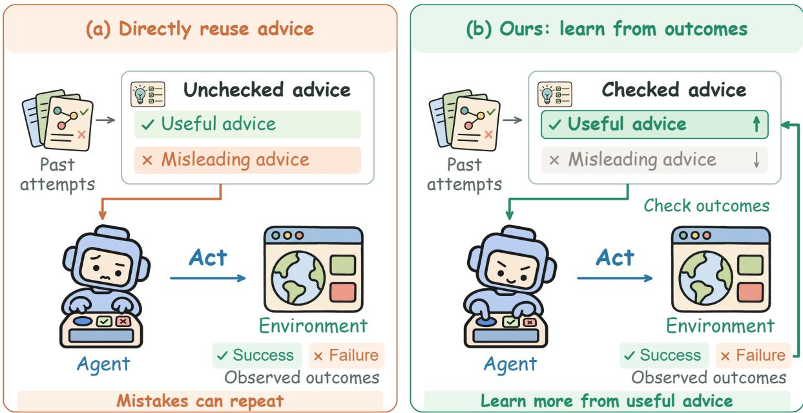  
Figure 1: Environmental outcomes help check an agent’s own advice. (a) Self-generated advice can carry useful lessons and mistakes into later training. (b) Our method uses observed outcomes to give useful advice more influence and conflicting advice less influence. These outcomes also train the generation of future advice. The comparison concerns how advice is assessed during training.

In the Actor update, each Teacher preference is scaled by its agreement with the advantage; guidance misled by an erroneous prefix loses weight without being reversed. Direct Teacher supervision covers only executable commands, so the Actor never imitates reasoning that depends on the skill, and RL trains the full response.

We evaluate on ALFWorld and WebShop with Qwen2.5-3B and 7B backbones. Across three evaluation seeds, the trained agents without skills or online analysis at inference reach 90.5% and 93.3% macro success on seen ALFWorld tasks and 75.5% and 80.5% success on WebShop. On unseen ALF-World tasks, they outperform GRPO under the same protocol by 11.0 and 7.6 points. In 3B ablations, supervision scope has the largest effect: extending Teacher supervision from commands to the full response lowers WebShop success from 75.0% to 52.3%, and removing environmental feedback from both updates lowers ALFWorld success by 6.5 points. At the end of training, only 47–53% of the raw Teacher weight agrees with trajectory outcomes, and modulation raises this share to 57–74%. Our contributions are as follows:

1. We formulate skill-based self-distillation as a closed loop in which the policy writes the skills that condition its own Teacher, and argue that one environmental criterion should both weight current Teacher guidance and train the analysis that produces future guidance.

2. We instantiate this criterion with commandlevel advantages: they modulate Teacher preferences in the Actor update and reward reflections and skills in the Analyzer update, while Teacher supervision is restricted to executable commands.

3. Experiments on ALFWorld and WebShop with 3B and 7B backbones show that the trained agents outperform GRPO on unseen tasks without using skills at inference, and ablations show that command-only supervision and environmental feedback each contribute.

## 2 Related Work

Environmental credit for agent learning. Outcome-based RL evaluates complete trajectories, whereas credit assignment must distinguish the decisions that produced their outcomes [16; 22]. Return decomposition assigns delayed outcome credit to earlier decisions [21]. For interactive agents, grouping repeated or behaviorally similar visits makes local alternatives comparable [3; 23]; propagating consequences through shared state potentials incorporates their downstream effects [4]. These comparisons can identify useful commands within failed trajectories. We use environmental command credit to evaluate whether Teacher guidance favors useful decisions.

On-policy distillation and experiencebased self-improvement. Experience-based self-improvement introduces a complementary problem: how should previous interactions become reliable guidance for later behavior? Reflection memories and reusable insights retain experience in context [24; 26]; iterative revision and trained self-correction modify subsequent responses or policy behavior [25; 27]. OPD and skill-conditioned OPSD transfer guidance along policy-generated sequences [5; 7; 9]. Shared Actor and Analyzer parameters let the policy and its analysis evolve together, as in SEED [10]. Errors in that analysis can nevertheless re-enter later updates, and models may struggle to recognize errors in their own feedback without reliable external evidence [19; 20]. We further optimize the reflections and skills according to the environmental value of the Teacher preferences they produce.

Calibration of self-generated supervision. Calibration concerns what guidance is transferred and what evidence justifies its influence. Decision-level semantic rewards can weight a full response [34]; our direct Teacher loss instead covers only executable command content. Local signal regulation, step-aware supervision, and aligned decision contexts control where and how strongly Teacher preferences enter learning [18; 12; 17; 6]. Environmental returns and objective influence provide criteria for judging their usefulness [13; 35]. For training the source of guidance, GRSD evaluates reflection quality through external assessment [14]. Our R/S credit instead evaluates a skill through agreement between its induced Teacher preferences and environmental command advantages.

## 3 Method

Our method jointly trains an acting policy (Actor) and a trajectory-analysis role (Analyzer). Direct Teacher supervision covers executable commands, and environmental command advantages determine its strength. Agreement between these advantages and skill-induced preferences also provides training credit for reflection and skill generation.

As shown in Figure 2, offline supervised finetuning (SFT) initializes reflection and skill generation in the model shared by the Actor and Analyzer. During online training, the Actor collects trajectory groups, and the Analyzer generates one reflection per trajectory and one consolidated skill per group. The skill conditions the pre-update model to form the Teacher. Joint Actor and Analyzer optimization updates the shared parameters for the next iteration.

## 3.1 Preliminaries and shared-policy setup

Let $x _ { g }$ denote task $g$ and $\theta _ { k }$ the shared model parameters at iteration k. Each update collects $G$ task groups, with $K = 8$ trajectories $\{ \tau _ { g j } \} _ { j = 1 } ^ { K }$ sampled from the Actor $\pi _ { \boldsymbol { \theta } _ { k } }$ . At interaction step t, the Actor generates response $y _ { g j t }$ from history $h _ { g j t }$ . Its executable command specifies action $a _ { g j t }$ , after which the environment returns observation $o _ { g j , t + 1 }$ . We use ℓ for a response-token index.

GRPO derives group-relative advantages $\widehat { A } _ { g j } ^ { \mathrm { R I } }$ from recorded episode rewards [22]. Let $B _ { A }$ contain the valid generated Actor-token indices $( g , j , t , \ell )$ . The likelihood ratio is

$$
\rho _ { g j t \ell } ( \theta ) = \frac { \pi _ { \theta } ( y _ { g j t \ell } \mid h _ { g j t } , y _ { g j t , < \ell } ) } { \pi _ { \theta _ { k } } ( y _ { g j t \ell } \mid h _ { g j t } , y _ { g j t , < \ell } ) } .\tag{1}
$$

The clipped policy component of the GRPO objective is

$$
\begin{array} { c } { { \mathcal { L } _ { \mathrm { G R P O } } ^ { \mathrm { p o l i c y } } ( \theta ) = - \displaystyle \frac { 1 } { | \mathcal { B } _ { A } | } \sum _ { ( g , j , t , \ell ) \in \mathcal { B } _ { A } } } } \\ { { \operatorname* { m i n } \Biggl \{ { \rho } _ { g j t \ell } ( \theta ) \operatorname { s g } ( \widehat { A } _ { g j } ^ { \mathrm { R L } } ) , } } \\ { { \operatorname { c l i p } \bigl ( { \rho } _ { g j t \ell } ( \theta ) , 1 - \epsilon , 1 + \epsilon \bigr ) \operatorname { s g } ( \widehat { A } _ { g j } ^ { \mathrm { R L } } ) \Bigr \} , } } \end{array}\tag{2}
$$

where $\epsilon = 0 . 2$ and sg denotes stop-gradient [16]. This token-mean objective trains the complete generated response, including reasoning. We use $\mathcal { L } _ { \mathrm { G R P O } }$ for this policy loss plus a frozen-reference KL penalty with coefficient 0.01 and minus an entropy bonus with coefficient 0.001. Appendix B gives the optimization settings.

The Analyzer uses the same parameter snapshot under reflection and skill-generation prompts, denoted by $R _ { \theta _ { k } }$ and $S _ { \theta _ { k } }$ . Reflection generation produces one text $u _ { g j }$ from each trajectory and its recorded outcome $r _ { g j }$ . Skill generation consolidates these reflections into one text $z _ { g } .$

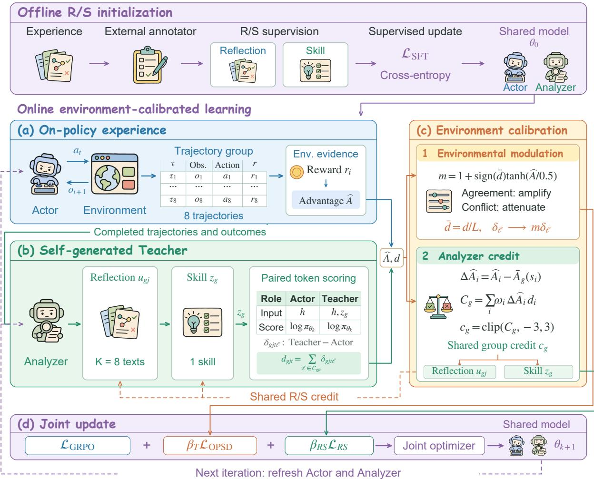  
Figure 2: Environmental feedback connects acting with Teacher construction. Offline annotations initialize reflection and skill generation through SFT. Online, reflections $u _ { g j }$ produce a skill $z _ { g } .$ , which conditions the preupdate policy to score Actor-sampled tokens. Token gaps $\delta$ are summed into raw command gaps $d ;$ the mean $\bar { d } = d / L$ determines a shared modulation multiplier, which scales each command token’s own gap. Environmental advantages calibrate this guidance and supply shared credit $c _ { g }$ for reflection and skill generation. Panel (a) omits group and trajectory indices: $o _ { t + 1 }$ is the observation returned after action $a _ { t }$

$$
u _ { g j } \sim R _ { \theta _ { k } } ( { \cdot } \mid x _ { g } , \tau _ { g j } , r _ { g j } ) ,\tag{3}
$$

$$
z _ { g } \sim S _ { \theta _ { k } } \big ( \cdot \mid x _ { g } , \{ u _ { g j } , r _ { g j } \} _ { j = 1 } ^ { K } \big ) .\tag{4}
$$

For task group $^ { g , }$ the skill-conditioned Teacher is the pre-update policy evaluated with $z _ { g } .$

$$
\pi _ { T , k } ( \cdot \mid h _ { g j t } , y _ { g j t , < \ell } ) \equiv \pi _ { \theta _ { k } } ( \cdot \mid h _ { g j t } , z _ { g } , y _ { g j t , < \ell } ) .\tag{5}
$$

Both branches score the same Actor-sampled token under the same reasoning prefix. Their token-level log-probability gap is

$$
\begin{array} { r l } & { \delta _ { g j t \ell } = \log \pi _ { T , k } ( y _ { g j t \ell } \mid h _ { g j t } , y _ { g j t , < \ell } ) } \\ & { \phantom { { \sum } } - \log \pi _ { \theta _ { k } } ( y _ { g j t \ell } \mid h _ { g j t } , y _ { g j t , < \ell } ) . } \end{array}\tag{6}
$$

In the sampled-token policy-gradient formulation of OPSD, the uncalibrated coefficient is the likelihood gap itself [5; 7]:

$$
w _ { g j t \ell } ^ { \mathrm { b a s e } } = \delta _ { g j t \ell } .\tag{7}
$$

This coefficient measures how privileged context changes token support. It does not explicitly calibrate that support using the environmental value of the corresponding command.

## 3.2 Environmental command credit

GRPO assigns the same trajectory-level advantage to every command in an episode, so it cannot distinguish useful decisions within a failed trajectory. We estimate a separate command-level advantage by comparing commands executed at similar observations.

Commands are compared within states formed by representation-based observation grouping [23]. Within each task group, we use frozen-reference embeddings and require identical admissible-action sets. A visit joins the nearest normalized-centroid cluster within cosine distance 0.1, or creates a new cluster. Recorded commands connect these clusters through their observed successor states and rewards.

For transition i, let $s _ { i }$ and $s _ { i } ^ { + }$ denote its current and successor clusters, with transition reward $r _ { i }$ . We initialize $V ^ { ( 0 ) } ( s )$ from the mean observed return-to-go and apply empirical Bellman backups [33]:

$$
V ^ { ( n + 1 ) } ( s ) = \frac { 1 } { \vert \mathcal { V } _ { s } \vert } \sum _ { i \in \mathcal { V } _ { s } } \big [ r _ { i } + \gamma V ^ { ( n ) } ( s _ { i } ^ { + } ) \big ] ,\tag{8}
$$

where $\mathcal { V } _ { s }$ contains the recorded visits to s and $\gamma = 0 . 9 5$ . Terminal and horizon successors have value zero. The backups propagate observed downstream consequences into the values used for local comparisons.

The temporal-difference residual is

$$
b _ { i } = r _ { i } + \gamma V ( s _ { i } ^ { + } ) - V ( s _ { i } ) .\tag{9}
$$

Along each recorded trajectory, generalized advantage estimation [15] propagates these residuals:

$$
B _ { g j t } = b _ { g j t } + \gamma \lambda _ { \mathrm { G A E } } B _ { g j , t + 1 } , \qquad \lambda _ { \mathrm { G A E } } = 0 . 8 ,\tag{10}
$$

with a zero tail value. Group standardization yields the auxiliary command advantage $\widehat { A } _ { g j t }$ . It supplies Teacher modulation and Analyzer credit, whereas $\widehat { A } _ { g j } ^ { \mathrm { R L } }$ supplies the primary GRPO update. Appendix A.2 gives the solver and normalization details.

## 3.3 Environment-calibrated self-distillation

Privileged skills can support executable decisions even when their associated reasoning targets are unavailable to the Actor. We therefore restrict direct Teacher supervision to command content. Let $\mathcal { C } _ { g j t }$ contain the positions in $y _ { g j t }$ that encode the executable command for action $a _ { g j t }$ , excluding delimiter tags, and let $L _ { g j t } = | \mathcal { C } _ { g j t } |$ . We retain the raw summed gap for R/S credit:

$$
d _ { g j t } = \sum _ { \ell \in \mathcal { C } _ { g j t } } \delta _ { g j t \ell } .\tag{11}
$$

The mean command gap used to compute the modulation multiplier is

$$
\bar { d } _ { g j t } = \frac { 1 } { L _ { g j t } } \sum _ { \ell \in \mathcal { C } _ { g j t } } \delta _ { g j t \ell } = \frac { d _ { g j t } } { L _ { g j t } } ,\tag{12}
$$

with $\bar { d } _ { g j t } = 0$ for empty command spans.

Environmental credit and the mean command gap determine a shared modulation multiplier:

$$
\begin{array} { r l } & { m _ { g j t } = 1 + \alpha _ { m } \mathrm { s i g n } ( \bar { d } _ { g j t } ) \operatorname { t a n h } \left( \frac { \widehat { A } _ { g j t } } { \kappa _ { m } } \right) , } \\ & { w _ { g j t \ell } = q _ { g } \lvert \mathcal { k } \rvert \ell \in \mathcal { C } _ { g j t } \rvert m _ { g j t } \delta _ { g j t \ell } , } \end{array}\tag{13}
$$

with $\alpha _ { m } = 1$ and $\kappa _ { m } = 0 . 5$ . The multiplier lies in $[ 0 , 2 ]$ . Matching signs of $d _ { g j t }$ and $\widehat { A } _ { g j t }$ strengthen the guidance, and conflicting signs attenuate it without reversing individual token-gap directions. When $\widehat { A } _ { g j t } = 0 , \ : m _ { g j t } = 1$ recovers the unmodulated token gaps. Each command shares this multiplier across its content tokens, while each token retains its own gap.

The group mask $q _ { g }$ is one in ALFWorld. In Web-Shop, it is zero when all eight trajectories succeed and one otherwise. The resulting weights combine command-only supervision, a shared commandlevel multiplier, and token-specific gaps.

For likelihood ratio $\rho$ and signed weight w, define the clipped token loss

$$
\begin{array} { r l } & { \mathcal { I } _ { \mathrm { c l i p } } ( \rho ; w ) = } \\ & { \quad - \operatorname* { m i n } \Biggl \{ \rho \ : \mathrm { s g } ( w ) , \Biggr \} . } \end{array}\tag{14}
$$

Using the Actor token-mean reduction, the calibrated OPSD objective is

$$
\begin{array} { c } { { \mathcal { L } _ { \mathrm { O P S D } } ( \theta ) = \displaystyle \frac { 1 } { | \mathcal { B } _ { A } | } \sum _ { ( g , j , t , \ell ) \in \mathcal { B } _ { A } } } } \\ { { \mathcal { J } _ { \mathrm { c l i p } } \big ( \rho _ { g j t \ell } ( \theta ) ; w _ { g j t \ell } \big ) . } } \end{array}\tag{15}
$$

The weights select command content, while the primary GRPO objective continues to train the complete response. Appendix A derives the modulation properties.

## 3.4 Credit for reflection and skill generation

Command calibration evaluates a given Teacher signal. Training the Analyzer additionally requires evaluating the reflections and skill that produced it. We assign credit according to whether the skill shifts support toward higher-advantage commands at comparable observations. The reflection and skill prompts are provided in Appendix B.

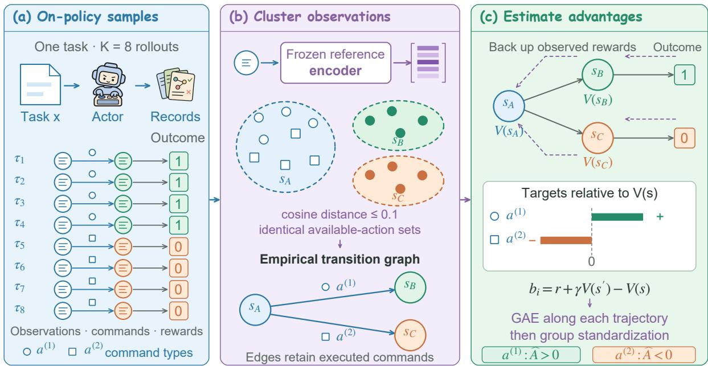  
Figure 3: An empirical transition graph provides environmental command credit. Recorded observations are grouped into comparable state clusters, and executed commands connect them through observed transitions. Bellman evaluation estimates state values; temporal-difference residuals then enter GAE and group standardization to obtain command advantages. Colors identify observation clusters.

Within task group g, let $\mathcal { T } _ { g }$ contain the deduplicated transitions with valid command spans, and write $i = ( j , t )$ . Let $N _ { g }$ be the number of represented trajectories and $\boldsymbol { L } _ { g j }$ the number of eligible transitions in trajectory j. We use

$$
\omega _ { i } = \frac { 1 } { N _ { g } L _ { g j } } , \qquad \overline { { A } } _ { g } ( s ) = \frac { \sum _ { i \in \mathcal { T } _ { g } : s _ { i } = s } \omega _ { i } \widehat { A } _ { i } } { \sum _ { i \in \mathcal { T } _ { g } : s _ { i } = s } \omega _ { i } } .\tag{16}
$$

Each trajectory receives equal total weight, divided among its eligible transitions. State centering gives $\Delta \widehat { A } _ { i } \stackrel {  } { = } \widehat { A } _ { i } - \overline { { A } } _ { g } ( s _ { i } )$ . This comparison measures relative command value within a cluster rather than differences in the average advantage of visited states.

The raw and bounded group credits are

$$
C _ { g } = \sum _ { i \in \mathcal { Z } _ { g } } \omega _ { i } \Delta \widehat { A } _ { i } d _ { i } , \qquad c _ { g } = \mathrm { c l i p } ( C _ { g } , - 3 , 3 ) .\tag{17}
$$

Here $C _ { g }$ is a weighted within-state covariance between environmental advantage and the raw summed Teacher preference $d _ { i }$ . Positive credit reinforces analysis whose Teacher relatively supports higher-advantage commands; negative credit discourages the reverse association.

Because the skill consolidates the full reflection group, all K reflections and the skill receive the same reward $c _ { g }$ . For an analysis response v generated under prompt $p _ { v }$ , define

$$
\rho _ { \ell } ^ { v } ( \theta ) = \frac { \pi _ { \theta } ( v _ { \ell } \mid p _ { v } , v _ { < \ell } ) } { \pi _ { \theta _ { k } } ( v _ { \ell } \mid p _ { v } , v _ { < \ell } ) } .\tag{18}
$$

Let $\mathcal { M } _ { v }$ contain its valid generated-token positions. The response-sequence mean loss uses the same clipped form:

$$
\mathcal { P } ( v ; c _ { g } ) = \frac { 1 } { \left| \mathcal { M } _ { v } \right| } \sum _ { \ell \in \mathcal { M } _ { v } } \mathcal { I } _ { \mathrm { c l i p } } \big ( \rho _ { \ell } ^ { v } ( \theta ) ; c _ { g } \big ) .\tag{19}
$$

The Analyzer objective is

$$
\begin{array} { r l } { \displaystyle \mathcal { L } _ { R S } ( \theta ) = \displaystyle \frac { 1 } { 2 G K } \sum _ { g = 1 } ^ { G } \sum _ { j = 1 } ^ { K } \mathcal { P } ( u _ { g j } ; c _ { g } ) } & { } \\ { \displaystyle + \frac { 1 } { 2 G } \sum _ { g = 1 } ^ { G } \mathcal { P } ( z _ { g } ; c _ { g } ) . } \end{array}\tag{20}
$$

Reflection and skill generation each receive half of the total Analyzer weight.

3.5 Joint optimization and iterative updates The shared model is optimized with

$$
\begin{array} { r } { \mathcal { L } ( \theta ) = \mathcal { L } _ { \mathrm { G R P O } } ( \theta ) + \beta _ { T } \mathcal { L } _ { \mathrm { O P S D } } ( \theta ) + \beta _ { R S } \mathcal { L } _ { R S } ( \theta ) . } \end{array}\tag{21}
$$

The GRPO term trains task behavior from environmental outcomes, the OPSD term transfers calibrated command preferences, and the R/S term trains the analysis producing those preferences. Actor and Analyzer gradients accumulate at shared optimizer steps. Teacher gaps, advantages, modulation weights, and group credits remain fixed during optimization. Appendix B gives the coefficients and optimizer settings.

The updated parameters generate the next trajectories, reflections, and skills:

$$
\begin{array} { r l } { \theta _ { k } \longrightarrow \{ \tau _ { g j } , u _ { g j } , z _ { g } \} _ { g , j } } & { } \\ { \longrightarrow \{ w _ { g j t \ell } , c _ { g } \} \longrightarrow \theta _ { k + 1 } . } & { } \end{array}\tag{22}
$$

Each iteration therefore updates both the acting policy and the analysis used to construct its subsequent Teacher. Algorithm 1 in Appendix A.1 summarizes the update. At inference time, the Actor uses only the ordinary interaction history.

## 4 Experiments

We evaluate agent performance across two environments and model sizes, followed by generalization to unseen tasks. We then examine how environmental feedback calibrates Teacher supervision and evaluates the reflections and skills that construct it. The ablation study considers initialization, supervision scope, and the two feedback paths with the 3B backbone.

## 4.1 Experimental setup

Benchmarks and metrics. We evaluate on ALF-World [28] and WebShop [29], which test sequential interaction in household and shopping environments. ALFWorld contains six task categories: object placement, inspection, cleaning, heating, cooling, and two-object placement. We use all 140 seen and 134 unseen evaluation tasks and report category success and its unweighted macro average. Each WebShop evaluation uses 128 tasks sampled without replacement from the 500-task held-out test set. We report exact task Success and mean normalized environment Score on a 0–100 scale.

Models and training. We use Qwen2.5-3B-Instruct and Qwen2.5-7B-Instruct as our backbones. For SFT, we collect eight trajectories for each of 200 training tasks. WebShop collection uses a policy trained for 40 GRPO updates to obtain sufficient successful and failed trajectories. GPT-6.1 sol annotates each task group with eight reflections and one consolidated skill. We fine-tune reflection and skill generation for three epochs, then train the shared Actor and Analyzer for 150 online updates. In matched-batch profiling with the 3B model, our method took approximately 30% longer than GRPO. Appendix B gives the initialization details and training hyperparameters.

Baselines. We compare training-free prompting (Vanilla and Skill-Prompt\*), reward-based learning (GRPO and Skill-GRPO), and distillation-based learning (OPSD, GRPO+OPSD, Skill-SD, RLSD, SDAR, and AlignOPSD). An asterisk denotes skillconditioned inference. Published results come from AlignOPSD Table 1 [6]; local measurements are identified separately. Published ALFWorld averages retain their source reporting conventions. Appendix C.1 describes each method.

Evaluation protocol. We evaluate our models and ablation variants at the final checkpoint after 150 online updates. The Actor receives the ordinary interaction history, without skill retrieval or online reflection and skill generation. Training uses a fixed random seed throughout. For the main and unseen-task comparisons, we evaluate each trained checkpoint under three evaluation seeds and report means and sample standard deviations. Each seed uses temperature 0.4 and one trajectory per task. ALFWorld permits at most 30 actions with history length five; WebShop permits at most 15 actions with history length two. Appendix C specifies the task panels, inference settings, and reporting conventions.

## 4.2 Overall agent performance

Table 1 compares the two backbones across the two environments. Our method achieved ALFWorld macro success of 90.5% and 93.3% for 3B and 7B, respectively, ranking first at both scales. WebShop Success reached 75.5% and 80.5%, ranking first at 3B and second at 7B.

The full method improves performance over GRPO. Our full training scheme combines R/S SFT initialization with online Actor and Analyzer optimization. Relative to the published GRPO baseline, this scheme improved performance at both scales and in both environments. WebShop Success increased by 12.2 and 7.9 percentage points for 3B and 7B, respectively. On ALFWorld, the improvements covered five categories at 3B and all six at 7B.

Training-time skill guidance supports deployment with ordinary histories. Skill-Prompt\* supplies strategies as inference context; our Actor instead learns from skill-conditioned Teacher preferences during training. The Actor exceeded Skill-Prompt\* on all six aggregate comparisons and Skill-GRPO\* on five. These comparisons support transferring useful guidance into a policy evaluated with ordinary interaction histories, without skill retrieval or online analysis. The exception was 7B WebShop Success, where skill-conditioned Skill-GRPO\* remained stronger.

Table 1: Comparison with published methods. ALFWorld reports category success and Avg.; WebShop reports Score and Success (Succ.), all on a 0–100 scale. Ours reports mean ± standard deviation over three seeds. yellow and blue mark the best and second-best results within each model size, including ties.
<table><tr><td colspan="9">ALFWorld</td></tr><tr><td>Method</td><td>Pick</td><td>Look</td><td>Clean</td><td>Heat</td><td>Cool</td><td>Pick2</td><td>Avg.</td><td>WebShop Score</td><td>Succ.</td></tr><tr><td colspan="10">Qwen2.5-3B-Instruct</td></tr><tr><td>Vanilla</td><td>44.4</td><td>11.1</td><td>6.2</td><td>15.4</td><td>28.6</td><td>12.5</td><td>21.9</td><td>6.7</td><td>0.8</td></tr><tr><td>Skill-Prompt*</td><td>51.7</td><td>66.7</td><td>48.4</td><td>0.0</td><td>4.3</td><td>10.0</td><td>28.9</td><td>1.2</td><td>0.8</td></tr><tr><td>OPSD</td><td>48.8</td><td>41.7</td><td>16.7</td><td>0.0</td><td>15.8</td><td>16.7</td><td>28.1</td><td>11.3</td><td>3.1</td></tr><tr><td>GRPO</td><td>91.2</td><td>62.5</td><td>96.2</td><td>61.9</td><td>65.0</td><td>47.4</td><td>75.0</td><td>79.8</td><td>63.3</td></tr><tr><td>Skill-GRPO</td><td>88.9</td><td>71.4</td><td>58.8</td><td>70.6</td><td>40.7</td><td>29.2</td><td>60.2</td><td>77.3</td><td>60.9</td></tr><tr><td>Skill-GRPO*</td><td>94.3</td><td>57.1</td><td>100.0</td><td>66.7</td><td>73.1</td><td>57.1</td><td>80.5</td><td>76.3</td><td>66.4</td></tr><tr><td>GRPO+OPSD</td><td>100.0</td><td>82.4</td><td>85.7</td><td>75.0</td><td>70.0</td><td>60.0</td><td>81.2</td><td>77.8</td><td>66.4</td></tr><tr><td>Skill-SD</td><td>88.2</td><td>50.0</td><td>96.2</td><td>52.4</td><td>65.0</td><td>57.9</td><td>73.4</td><td>75.9</td><td>64.0</td></tr><tr><td>RLSD</td><td>87.9</td><td>75.0</td><td>90.9</td><td>75.0</td><td>73.1</td><td>68.4</td><td>79.7</td><td>84.4</td><td>66.4</td></tr><tr><td>SDAR</td><td>94.6</td><td>66.7</td><td>68.2</td><td>50.0</td><td>60.0</td><td>80.0</td><td>74.2</td><td>70.7</td><td>57.8</td></tr><tr><td>AlignOPSD [6]</td><td>88.6</td><td>54.5</td><td>90.3</td><td>81.8</td><td>82.6</td><td>58.8</td><td>80.5</td><td>86.8</td><td>68.8</td></tr><tr><td>Ours</td><td>99.0±1.6</td><td>82.1 ±4.4</td><td>95.1 ± 2.1</td><td>97.9±3.6</td><td>82.7±10.1</td><td>86.1±6.4</td><td>90.5±1.0</td><td>85.5±2.6</td><td>75.5±1.9</td></tr><tr><td colspan="10">Qwen2.5-7B-Instruct</td></tr><tr><td>Vanilla</td><td>36.1</td><td>22.2</td><td>3.1</td><td>0.0</td><td>0.0</td><td>0.0</td><td>12.5</td><td>5.9</td><td>1.6</td></tr><tr><td>Skill-Prompt*</td><td>51.7</td><td>50.0</td><td>32.3</td><td>5.3</td><td>4.3</td><td>0.0</td><td>23.4</td><td>1.7</td><td>0.8</td></tr><tr><td>OPSD</td><td>50.0</td><td>60.0</td><td>22.7</td><td>21.4</td><td>17.6</td><td>9.5</td><td>32.8</td><td>4.5</td><td>2.3</td></tr><tr><td>GRPO</td><td>91.2</td><td>87.5</td><td>96.2</td><td>81.0</td><td>65.0</td><td>57.9</td><td>81.2</td><td>80.9</td><td>72.6</td></tr><tr><td>Skill-GRPO</td><td>88.5</td><td>66.7</td><td>65.2</td><td>61.1</td><td>57.7</td><td>73.1</td><td>69.5</td><td>80.4</td><td>71.9</td></tr><tr><td>Skill-GRPO*</td><td>100.0</td><td>83.3</td><td>96.4</td><td>83.3</td><td>75.0</td><td>78.9</td><td>88.4</td><td>87.0</td><td>81.2</td></tr><tr><td>GRPO+OPSD</td><td>91.4</td><td>61.5</td><td>100.0</td><td>87.5</td><td>76.5</td><td>52.2</td><td>80.4</td><td>86.8</td><td>76.5</td></tr><tr><td>Skill-SD</td><td>93.9</td><td>93.8</td><td>90.9</td><td>100.0</td><td>69.2</td><td>68.4</td><td>85.1</td><td>86.1</td><td>76.5</td></tr><tr><td>RLSD</td><td>100.0</td><td>87.5</td><td>92.3</td><td>58.8</td><td>80.0</td><td>65.2</td><td>82.0</td><td>87.4</td><td>77.3</td></tr><tr><td>SDAR</td><td>94.7</td><td>75.0</td><td>100.0</td><td>86.7</td><td>68.2</td><td>78.9</td><td>85.9</td><td>83.6</td><td>74.2</td></tr><tr><td>AlignOPSD [6]</td><td>70.8</td><td>81.8</td><td>100.0</td><td>100.0</td><td>76.5</td><td>70.8</td><td>89.1</td><td>87.9</td><td>78.9</td></tr><tr><td>Ours</td><td>100.0</td><td>94.9±4.4</td><td>100.0</td><td>95.8±3.6</td><td>81.3±2.3</td><td>87.5±4.2</td><td>93.3±0.9</td><td>88.3±1.3</td><td>80.5±1.4</td></tr></table>

Published values are quoted from Table 1 of AlignOPSD [6].

The gains extend to unseen task instances. The unseen split tests transfer to new task instances within the same six ALFWorld categories. We retain the original interaction protocol and compare with the GRPO baseline in Table 2.

The 3B and 7B Actors improved unseen macro success over their respective GRPO baselines by 11.03 and 7.62 percentage points. The 3B model remained below GRPO on Pick and Cool and matched it on Clean. The 7B model remained below GRPO on Pick and Clean. These results suggest that training supports reusable behavioral strategies that transfer to unseen tasks. The 7B macro average was 0.74 percentage points above 3B.

## 4.3 Mechanistic analysis

We examine how environmental feedback shapes Actor supervision and the analysis used to construct its Teacher. Figure 4 shows how modulation redistributes Teacher weight and how R/S credit relates to the usefulness of skill-induced preferences.

Modulation shifts Teacher weight toward reward-supported directions. Reward alignment is $\begin{array} { r } { 1 0 0 \frac { \sum _ { i } | w _ { i } | \mathbf { 1 } [ w _ { i } \widehat { A } _ { i } ^ { \mathrm { R L } } > 0 ] } { \sum _ { i } | w _ { i } | } } \end{array}$ , where $w _ { i }$ is the raw or modulated Teacher weight and $\widehat { A } _ { i } ^ { \mathrm { R L } }$ is the trajectory-level GRPO advantage associated with command i. We count each command once. The two conditions use the same pre-update commands

Mean IQR

(b) WebShop  
Table 2: Unseen-task generalization on ALFWorld. Category success and six-category macro success (%) on all 134 unseen tasks.
<table><tr><td>Model</td><td>Method</td><td>Pick</td><td>Look</td><td>Clean</td><td>Heat</td><td>Cool</td><td>Pick2</td><td>Macro</td></tr><tr><td>3B</td><td>GRPO</td><td> $8 6 . 1 \pm 2 . 4$ </td><td> $7 9 . 6 \pm 8 . 5$ </td><td> $8 6 . 0 \pm 4 . 9$ </td><td> $6 2 . 3 \pm 5 . 0$ </td><td> $8 5 . 7 \pm 4 . 8$ </td><td> $4 9 . 0 \pm 6 . 8$ </td><td> $7 4 . 8 \pm 0 . 9$ </td></tr><tr><td>3B</td><td>Ours</td><td> $8 0 . 6 \pm 2 . 4$ </td><td> $9 2 . 6 \pm 3 . 2$ </td><td> $8 6 . 0 \pm 4 . 9$ </td><td> $9 1 . 3 \pm 4 . 3$ </td><td> $8 4 . 1 \pm 9 . 9$ </td><td> $8 0 . 4 \pm 9 . 0$ </td><td> $8 5 . 8 \pm { 1 . 8 }$ </td></tr><tr><td>7B</td><td>GRPO</td><td> $8 7 . 5 \pm 4 . 2$ </td><td> $8 8 . 9 \pm 5 . 6 $ </td><td> $9 3 . 5 \pm 3 . 2 $ </td><td> $7 8 . 3 \pm 4 . 3$ </td><td> $6 6 . 7 \pm 8 . 2$ </td><td> $5 8 . 8 \pm 1 0 . 2 $ </td><td> $7 8 . 9 \pm 1 . 4$ </td></tr><tr><td>7B</td><td>Ours</td><td> $7 6 . 4 \pm 6 . 4$ </td><td> $9 4 . 4$ </td><td> $8 2 . 8 \pm 1 . 9$ </td><td> $8 5 . 5 \pm 5 . 0$ </td><td> $9 2 . 1 \pm 2 . 7$ </td><td>88.2</td><td> $8 6 . 6 \pm 1 . 2$ </td></tr></table>

After modulation

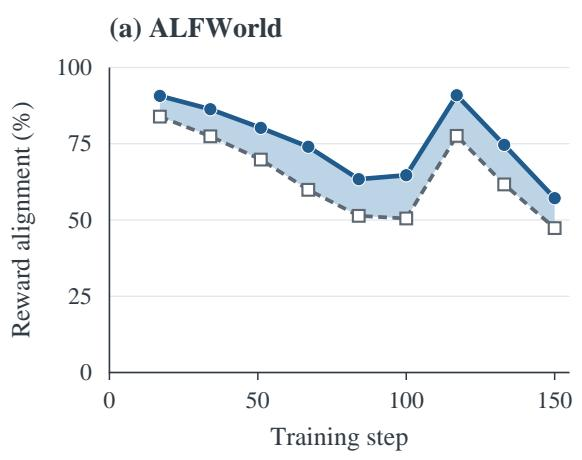

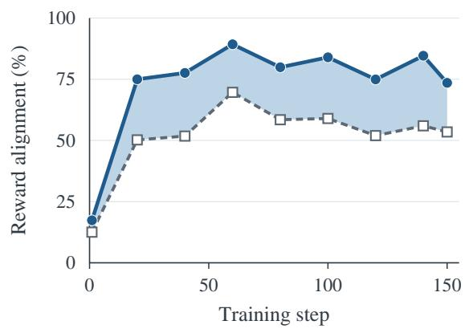

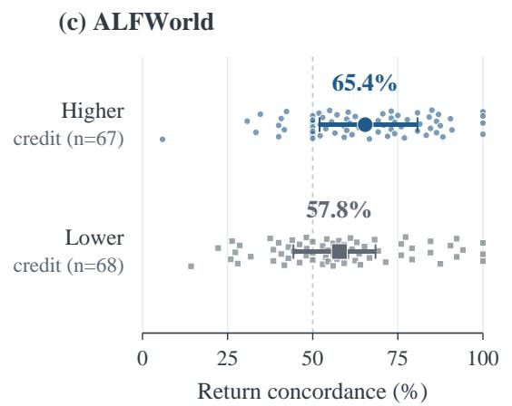

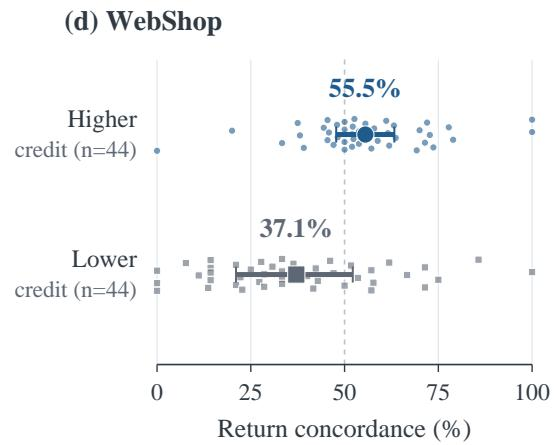  
Figure 4: Environmental feedback calibrates Actor supervision and evaluates Teacher construction. (a,b) Reward alignment of Teacher supervision before and after modulation. $^ { ( \mathbf { c } , \mathbf { d } ) }$ Return concordance of skills grouped by each task’s median R/S credit

with $| \widehat { A } _ { i } ^ { \mathrm { R L } } | > 1 0 ^ { - 8 }$ . The stored GRPO advantages are obtained by standardizing episode outcomes, including the 0.1 invalid-command penalty, within each task group.

We recorded nine snapshots per environment. Raw alignment on ALFWorld declined over training, but modulation maintained higher alignment at every recorded snapshot in both environments (Figure 4(a,b)). At update 150, modulation raised alignment from 47.34% to 57.16% on ALFWorld and from 53.46% to 73.52% on WebShop, gains of 9.82 and 20.06 percentage points. The multiplier preserved preference signs and placed greater relative weight on guidance consistent with observed rewards.

R/S credit favors skills with return-consistent Teacher preferences. Return concordance compares raw Teacher–Actor command gaps with observed returns-to-go. We paired distinct commands across trajectories with identical Actor prompts and admissible-action sets. Teacher scoring retains the reasoning prefix sampled in each response. Concordant and discordant orderings score one and zero; preference ties score one-half, and return ties are excluded. The metric averages pairs within each skill and weights skills equally. Pooling saved snapshots after update 1 yielded 135 eligible ALF-World skills and 88 WebShop skills. We split each task at its median R/S credit and assigned median ties to the lower-credit group. Figure 4(c,d) shows individual skills, group means, and interquartile ranges.

Higher-credit skills achieved 65.41% concordance versus 57.83% on ALFWorld, and 55.54% versus 37.13% on WebShop. Higher R/S credit was associated with skills whose Teacher preferences better distinguished commands by their returns. Across training, success increased and interactions shortened at both model scales. Appendix D.3 presents the separate 3B and 7B curves together with modulation coverage and positive-credit skill fractions.

## 4.4 Ablation study

We examine SFT initialization, Teacher supervision scope, and environmental feedback with the 3B backbone on ALFWorld and WebShop. Table 3 compares the variants with the full method and the published GRPO baseline values quoted in Table 1. Our branches report seen-category macro success on ALFWorld and Score and Success on WebShop. Appendix C.5 gives the branch configurations and evaluation settings.

Table 3: Ablation study on ALFWorld and WebShop with the 3B backbone. Our ALFWorld branches report six-category macro success (140 tasks); GRPO retains the published Avg. from Table 1.
<table><tr><td rowspan="2">Variant</td><td>ALFWorld</td><td colspan="2">WebShop</td></tr><tr><td>Macro/Avg.</td><td>Score</td><td>Success</td></tr><tr><td>GRPO</td><td>75.0</td><td>79.8</td><td>63.3</td></tr><tr><td>Full method</td><td>91.54</td><td>85.01</td><td>75.00</td></tr><tr><td>(a) w/o SFT</td><td>82.14</td><td>81.89</td><td>69.53</td></tr><tr><td>(b) Full-response supervi-</td><td>89.88</td><td>75.62</td><td>52.34</td></tr><tr><td>sion (c) w/o modulation and R/S loss</td><td>85.00</td><td>82.10</td><td>72.65</td></tr></table>

SFT provides a useful starting point for online analysis. Variant (a) tests whether the online loop can learn effectively without initial trajectoryanalysis SFT. The no-SFT variant still exceeded GRPO on WebShop by 6.23 percentage points in Success. SFT provided further gains: the full method exceeded this variant by 9.40 percentage points on ALFWorld and 5.47 on WebShop Success. The residual gain without SFT and the further gain with SFT suggest that initialization and online guidance contribute at different stages.

Command-only supervision outperforms fullresponse matching. Variant (b) tests whether matching Teacher reasoning adds value beyond supervising executable commands. Extending the loss to the full response reduced ALFWorld macro success by 1.66 percentage points and Web-Shop Success by 22.66 percentage points. The Teacher’s reasoning uses privileged skills unavailable to the Actor, so these additional targets can impose context-specific preferences. The comparison favors transferring executable decisions through the Teacher objective and retaining environmental RL for the Actor’s complete response.

Environmental feedback improves skill-guided learning. Variant (c) retains command-only Teacher supervision and online reflection and skill generation in both environments. It removes only environmental modulation and the direct R/S objective. It reached 85.00% ALFWorld macro success and 72.65% WebShop Success, with a WebShop Score of 82.10. The full method improved macro success and WebShop Success by 6.54 and 2.35 percentage points, respectively. This joint ablation supports the combined value of environmental modulation and R/S learning.

## 5 Discussion

The skill diagnostics provide a second view of improvement beyond final task success. Higher-credit skills induced preferences that better distinguished commands by their returns in both environments. This association supports evaluating a generated lesson through the decisions it favors. It also motivates tracking the usefulness of self-generated advice as the policy and its experience change over training.

Evaluation without skills and the supervisionscope ablation show that useful behavior can transfer from privileged experience to an Actor operating with ordinary observations. The gap between command-only and full-response supervision was larger on WebShop than on ALFWorld. This difference suggests that the choice of supervision targets matters across environments. The results favor transferring decisions that remain executable with the information available to the Actor at deployment.

## 6 Conclusion

We introduced ECOS to connect agent learning with the supervision generated from its own interaction experience. The approach transfers skillconditioned guidance through executable commands and retains reinforcement learning over the complete response. Environmental feedback links the weighting of Teacher preferences to the optimization of reflection and skill generation. Experiments on ALFWorld and WebShop show improvements over reward-based baselines at both model scales, together with transfer to unseen ALFWorld tasks. The evaluated Actor requires no privileged skills or online analysis at deployment. Mechanistic diagnostics show improved reward alignment of supervision and more return-consistent guidance among higher-credit skills. Within the tested settings, environmental outcomes provide a shared criterion for policy improvement and the generation of future supervision.

## Limitations

Our environmental credit depends on estimated command values and comparisons between observations. Sparse rewards or imperfect state matching can bias both Actor and Analyzer updates. The current diagnostics characterize agreement on recorded experience and do not independently establish improvements in Teacher capability or reasoning quality. SFT initialization relies on annotations from an external model. Evaluation covers two text-based environments and Qwen2.5 backbones at 3B and 7B. Transfer to substantially longer self-improvement runs remains untested. Reflection and skill generation, together with Teacher rescoring, also introduce training overhead. Independent skill evaluations and longer controlled runs would clarify whether improved task performance accompanies sustained improvements in the supervision the model produces.

## References

[1] Zhentao Zhang et al. State-OPD: State-Grounded On-Policy Distillationfor Multi-Turn Agents. arXiv:2610.13238, 2026. Reference version: v1, 9 October 2026. https://arxiv.org/abs/2610.13238v1.

[2] Hangxi Guo, Fengyuan Liu, Yue Wang, Yuhua Qi, Haoyi Xiong, Fei Sun, and Mengnan Du. Environmental Feedback Modeling Matters: Rethinking Feedback Treatment in Agentic Hindsight Self-Distillation. arXiv:2610.11384, 2026. https://arxiv.org/abs/2610.11384.

[3] Lang Feng, Zhenghai Xue, Tingcong Liu, and Bo An. Group-in-Group Policy Optimizationfor LLM Agent Training. arXiv:2505.10978, 2025. Reference version: v3, 28 October 2025. https://arxiv.org/abs/2505.10978v3.

[4] Yuyao Zheng et al. PGPO: Potential-Guided Policy Optimization for Multi-Turn Agentic Tasks. arXiv:2609.02236, 2026. Reference version: v1, 2 September 2026. https://arxiv.org/abs/2609.02236v1.

[5] Rishabh Agarwal, Nino Vieillard, Yongchao Zhou, Piotr Stanczyk, Sabela Ramos, Matthieu Geist, and Olivier Bachem. On-Policy Distillation ofLanguage Models: Learningfrom Self-Generated Mistakes. International Conference on Learning Representations, 2024. https://arxiv.org/abs/2306.13649.

[6] Mingju Chen, Can Lv, Jinrong Liu, Huan Zhang, Heng Chang, and Shiji Zhou. Beyond Timestamps: Decision-Aligned On-Policy Distillationfor Long-Horizon Agents. arXiv:2609.33391, 2026. Reference version: v1, 27 September 2026. https://arxiv.org/abs/2609.33391v1.

[7] Siyan Zhao, Zhihui Xie, Mengchen Liu, Jing Huang, Guan Pang, Feiyu Chen, and Aditya Grover. Self-Distilled Reasoner: On-Policy Self-Distillation for Large Language Models. arXiv:2601.18734, 2026. https://arxiv.org/abs/2601.18734.

[8] Jonas Hübotter et al. Reinforcement Learning via Self-Distillation. arXiv:2601.20802, 2026. https://arxiv.org/abs/2601.20802.

[9] Hao Wang et al. Skill-SD: Skill-Conditioned Self-Distillationfor Multi-turn LLM Agents. arXiv:2604.10674, 2026. https://arxiv.org/abs/2604.10674.

[10] Jinyang Wu et al. SEED: Self-Evolving On-Policy Distillation for Agentic Reinforcement Learning. arXiv:2607.14777, 2026. Reference version: v1, 16 July 2026. https://arxiv.org/abs/2607.14777.

[11] Yinghui He et al. Self-Distillation Zero: Self-Revision Turns Binary Rewards into Dense Supervision. arXiv:2604.12002, 2026. https://arxiv.org/abs/2604.12002.

[12] Chunji Lv, Yangguang Wei, Junlin Liu, Yang Gao, Ming Liu, Xinming Wang, Jinyang Wu, Guoren Wang, and Changsheng Li. PCSD: Persistent Consistencyfor Self-Distillation in Agentic Reinforcement Learning. arXiv:2608.01837, 2026. https://arxiv.org/abs/2608.01837.

[13] Ranxu Zhang et al. Agentic Reinforcement Learning with Self-Distilled Reward Shaping. arXiv:2608.03223, 2026. https://arxiv.org/abs/2608.03223.

[14] Binbin Zheng, Zijun Xie, Guanqun Zhao, Enlei Gong, Xing Ma, Xiaoliang Fu, and Zeyu Chen. Group-Reflective Self-Distillationfor Agentic Reinforcement Learning. arXiv:2607.28076, 2026. Reference version: v2, 3 August 2026. https://arxiv.org/abs/2607.28076.

[15] John Schulman, Philipp Moritz, Sergey Levine, Michael Jordan, and Pieter Abbeel. High-Dimensional Continuous

Control Using Generalized Advantage Estimation. arXiv:1506.02438, 2015. https://arxiv.org/abs/1506.02438.

[16] John Schulman, Filip Wolski, Prafulla Dhariwal, Alec Radford, and Oleg Klimov. Proximal Policy Optimization Algorithms. arXiv:1707.06347, 2017. https://arxiv.org/abs/1707.06347.

[17] Yanfei Zhang, Xu Lin, and Chenglin Wu. StepOPSD: Step-Aware Online Preference Self-Distillationfor Agent Reinforcement Learning. arXiv:2605.27140, 2026. Reference version: v2, 26 August 2026. https://arxiv.org/abs/2605.27140v2.

[18] Zhengxi Lu et al. Self-Distilled Agentic Reinforcement Learning. arXiv:2605.15155, 2026. Reference version: v1, 14 May 2026. https://arxiv.org/abs/2605.15155.

[19] Jie Huang, Xinyun Chen, Swaroop Mishra, Huaixiu Steven Zheng, Adams Wei Yu, Xinying Song, and Denny Zhou. Large Language Models Cannot Self-Correct Reasoning Yet. International Conference on Learning Representations, 2024. https://arxiv.org/abs/2310.01798.

[20] Dongwei Jiang, Jingyu Zhang, Orion Weller, Nathaniel Weir, Benjamin Van Durme, and Daniel Khashabi. SELF-[IN]CORRECT: LLMs Struggle with Discriminating Self-Generated Responses. Proceedings of the AAAI Conference on Artificial Intelligence, 2025. https://ojs. aaai.org/index.php/AAAI/article/view/34603.

[21] Jose A. Arjona-Medina, Michael Gillhofer, Michael Widrich, Thomas Unterthiner, Johannes Brandstetter, and Sepp Hochreiter. RUDDER: Return Decompositionfor Delayed Rewards. Advances in Neural Information Processing Systems, 2019. https://arxiv.org/abs/1806.07857.

[22] Zhihong Shao et al. DeepSeekMath: Pushing the Limits of Mathematical Reasoning in Open Language Models. arXiv:2402.03300, 2024. https://arxiv.org/abs/2402.03300.

[23] Hanyang Wang, Weijieying Ren, Yuxiang Zhang, Ding Cao, Zhizhao Zeng, Ke Zeng, and Tianxiang Zhao. BiPACE: Bisimulation-Guided Policy Optimization with Action Counterfactual Estimation for LLM Agents. arXiv:2606.25556, 2026. https://arxiv.org/abs/2606.25556.

[24] Noah Shinn, Federico Cassano, Ashwin Gopinath, Karthik Narasimhan, and Shunyu Yao. Reflexion: Language Agents with Verbal Reinforcement Learning. Advances in Neural Information Processing Systems, 2023. NeurIPS 2023 proceedings.

[25] Aman Madaan et al. Self-Refine: Iterative Refinement with Self-Feedback. Advances in Neural Information Processing Systems, 2023. https://arxiv.org/abs/2303.17651.

[26] Andrew Zhao, Daniel Huang, Quentin Xu, Matthieu Lin, Yong-Jin Liu, and Gao Huang. ExpeL: LLM Agents Are Experiential Learners. Proceedings of the AAAI Conference on Artificial Intelligence, 2024. https://ojs. aaai.org/index.php/AAAI/article/view/29936.

[27] Aviral Kumar et al. Training Language Models to Self-Correct via Reinforcement Learning. International Conference on Learning Representations, 2025. https://arxiv.org/abs/2409.12917.

[28] Mohit Shridhar et al. ALFWorld: Aligning Text and Embodied Environmentsfor Interactive Learning. International Conference on Learning Representations, 2021. https://arxiv.org/abs/2010.03768.

[29] Shunyu Yao et al. WebShop: Towards Scalable Real-World Web Interaction with Grounded Language Agents. Advances in Neural Information Processing Systems, 2022. https://arxiv.org/abs/2207.01206.

[30] Kaixiang Zhao et al. Recovering Reliable Supervision via Critique-Guided On-Policy Distillation. arXiv:2610.20572, 2026. Reference version: v1, 14 October 2026. https://arxiv.org/abs/2610.20572v1.

[31] Siqi Zhu, Xuyan Ye, Hongyu Lu, Weiye Shi, and Ge Liu. The Many Faces ofOn-Policy Distillation: Pitfalls, Mechanisms, and Fixes. arXiv:2605.11182, 2026. https://arxiv.org/abs/2605.11182v1.

[32] Samyak Shrestha and Alexander Tessier. Rethinking Privileged Information in On-Policy Self-Distillation. arXiv:2608.18271, 2026. https://arxiv.org/abs/2608.18271v1.

[33] Hongxi Yan, Ziyue Huang, Shichao Fan, and Qingjie Liu. Gated-BEPO: Confidence-Gated Bellman Credit Assignmentfor Large Language Model Agents. arXiv:2608.06861, 2026. https://arxiv.org/abs/2608.06861.

[34] Huining Yuan et al. ActionOPD: Distilling Decisions, Not Tokens. arXiv:2610.19820, 2026. Reference version: v1, 14 October 2026. https://arxiv.org/abs/2610.19820v1.

[35] Qizhen Lan et al. Trust Is Not Enough: Influence Calibrationfor On-Policy Self-Distillation in Agentic RL. arXiv:2608.14945, 2026. https://arxiv.org/abs/2608.14945.

## Appendix

The supplementary material follows the main paper’s evidence chain: method details (Appendix A), implementation and prompts (Appendix B), evaluation protocol (Appendix C), and mechanistic analyses and training dynamics (Appendix D).

## A Supplementary method details

## A.1 Training algorithm

Algorithm 1 summarizes offline initialization and the recurring online update. One pre-update snapshot supplies the Actor, reflection generator, skill generator, and skill-conditioned Teacher. The environmental estimator is detailed in Appendix A.2.

```latex
Algorithm 1 ECOS training
Require: Initial policy $\pi _ { \theta _ { 0 } } ;$ ; offline R/S annotations $\mathcal { D } _ { R S } ;$ task sampler and environments; frozen reference encoder; group size
$K = 8 ;$ estimator and optimization settings
Ensure: Trained Actor $\pi \theta$ for inference with ordinary interaction histories
1: Initialize shared parameters θ by R/S SFT on $\begin{array} { r } { \mathcal { D } _ { R S } . } \end{array}$
2: for each online iteration k do
3: Freeze snapshot θ ← stopgra $\operatorname { l } ( \theta ) ;$ sample task batch $\mathcal { X } _ { k }$ ; set $\begin{array} { r } { B _ { k }  \emptyset . } \end{array}$
Construct experience, Teacher guidance, and credit without gradients.
4: for each task $x _ { g } \in \mathcal { X } _ { k }$ do
5: Collect $K$ trajectories $\{ \tau _ { g j } \} _ { j = 1 } ^ { K }$ using $\pi _ { \boldsymbol { \theta } _ { k } } .$
6: Record histories, responses, commands, rewards, outcomes, and old token log probabilities.
7: Compute the outcome-based GRPO advantages within task group $g .$
8: Sample reflections $u _ { g j } \sim R _ { \theta _ { k } } ( \cdot \mid x _ { g } , \tau _ { g j } , r _ { g j } ) $ for all $j .$
9: Sample one skill $\boldsymbol { z } _ { g } \sim S _ { \boldsymbol { \theta } _ { k } } ( \cdot \vert \ x _ { g } , \{ u _ { g j } , r _ { g j } \} _ { j = 1 } ^ { K } )$
10: Record R/S prompts and pre-update log probabilities of their sampled responses.
11: Cluster observations using reference embeddings and identical admissible-action sets.
12: Build the transition graph; obtain $\widehat { A } _ { g j t }$ by Bellman evaluation, ${ \mathrm { G A E } } ,$ and normalization.
13: Compute $\delta _ { g j t \ell }$ on the same response and Actor prefix, with/without $z _ { g }$ (Equation 6).
14: Parse command positions $\begin{array} { r } { \begin{array} { r } { \mathcal { C } _ { g j t } ; } \end{array} } \end{array}$ set $\begin{array} { r } { d _ { g j t }  \sum _ { \ell \in \mathcal { C } _ { g j t } } \delta _ { g j t \ell } . } \end{array}$
15: Set $L _ { g j t } \gets | { \mathcal { C } } _ { g j t } |$ and $\bar { d } _ { g j t }  d _ { g j t } / L _ { g j t } ;$ use zero for empty spans.
16: Set $q _ { g } \gets 0$ for an all-success WebShop group and $q _ { g } \gets 1$ otherwise.
17: $m _ { g j t } \gets 1 + \alpha _ { m }$ sign $( \bar { d } _ { g j t } )$ tanh $\left( \widehat { A } _ { g j t } / \kappa _ { m } \right)$
18: $w _ { g j t \ell } \gets q _ { g } \mathcal { k } [ \ell \in \mathcal { C } _ { g j t } ] m _ { g j t } \delta _ { g j t \ell } .$
19: Compute transition weights ω and state means $\overline { { A } } _ { g } ( s _ { i } )$ (Equation 16).
20: $c _ { g }$ ← clip $\begin{array} { r } { \left( \sum _ { i \in \mathcal { Z } _ { g } } \omega _ { i } \big ( \widehat { A } _ { i } - \overline { { A } } _ { g } ( s _ { i } ) \big ) d _ { i } , - 3 , 3 \right) } \end{array}$
21: Assign $c _ { g }$ to all $\check { K }$ reflections and the skill; add the group’s records to $\boldsymbol { B } _ { k }$
22: end for
Update the shared Actor and Analyzer.
23: Form L<sub>GRPO</sub> on all valid Actor tokens and L<sub>OPSD</sub> on commands using w.
24: Form $\mathcal { L } _ { R S }$ from credits $c _ { g } ,$ with equal total weight for R and S (Equation 20).
25: $\mathcal { L }  \mathcal { L } _ { \mathrm { G R P O } } + \beta _ { T } \mathcal { L } _ { \mathrm { O P S D } } + \beta _ { R S } \mathcal { L } _ { R S }$ (Equation 21).
26: Optimize L over scheduled minibatches with accumulated Actor and Analyzer gradients.
27: end for
28: return $\pi _ { \theta }$ using ordinary histories at inference.
```

All old log probabilities, advantages, Teacher gaps, modulation weights, and R/S credits remain fixed during optimization. The next iteration regenerates experience and analysis using the updated parameters.

## A.2 Environmental advantage estimation

The estimator uses the representation-based grouping and empirical Bellman evaluation described in Section 3.2 [23; 33]. Visits are processed in trajectory and turn order after duplicate padding rows are removed. Only visits with identical sorted admissible-action sets can share a cluster. Normalized frozen-reference embeddings join the nearest normalized-centroid cluster at cosine distance at most 0.1; otherwise they form a new cluster.

Recorded commands define graph edges and retain the successor observation and environmental reward. Rewards include the configured invalid-action penalty of 0.1. Initial values are mean observed returns-togo within each cluster. Equation 8 uses $\gamma = 0 . 9 5$ and runs for at most twenty backups, stopping when the largest value change is below 10<sup>−6</sup>. Terminal and horizon successors have value zero.

The TD residuals enter the GAE recursion in Equation 10, with $\lambda _ { \mathrm { G A E } } = 0 . 8$ . After conversion to float32, group normalization subtracts the mean and divides by the standard deviation plus $1 0 ^ { - 6 }$ . Groups with standard deviation at most $1 0 ^ { - 8 }$ receive zero auxiliary advantage. Clusters require at least two distinct observed commands to contribute command credit. This estimator supplies the auxiliary calibration and Analyzer terms; trajectory-level GRPO retains its own outcome advantage.

## A.3 Modulation and state-centered credit

For $0 \leq \alpha _ { m } \leq 1$ and $\kappa _ { m } > 0$ , Equation 13 satisfies

$$
1 - \alpha _ { m } \leq m _ { i } \leq 1 + \alpha _ { m } .\tag{A.1}
$$

For $\alpha _ { m } > 0$ , the multiplier exceeds one when $\bar { d } _ { i } \widehat { A } _ { i } > 0$ and is below one when $\bar { d } _ { i } \widehat { A } _ { i } < 0$ . A zero environmental advantage gives $m _ { i } = 1$ . Command-level agreement therefore amplifies token-level guidance, while command-level conflict attenuates it. The shared nonnegative multiplier does not reverse individual token-gap directions.

Let $\begin{array} { r } { W _ { g s } = \sum _ { i : s _ { i } = s } \omega _ { i } } \end{array}$ and let $\bar { d } _ { g } ( s )$ be the corresponding weighted mean of the raw summed command gaps. Since the centered advantages sum to zero within a cluster,

$$
\begin{array} { l } { { \displaystyle C _ { g } = \sum _ { s } \sum _ { i : s _ { i } = s } \omega _ { i } ( \widehat { A } _ { i } - \overline { { A } } _ { g } ( s ) ) ( d _ { i } - \bar { d } _ { g } ( s ) ) } } \\ { { \displaystyle ~ = \sum _ { s } W _ { g s } \operatorname { C o v } _ { \omega } ( \widehat { A } , d \mid g , s ) . } } \end{array}\tag{A.2}
$$

(A.3)

The credit therefore rewards relative support for higher-advantage commands within comparable states. Adding the same constant to all command gaps in a cluster leaves $C _ { g }$ unchanged. A cluster with no advantage variation contributes zero. Each trajectory has equal total weight, and its eligible commands divide that weight equally. Clipping $C _ { g }$ to [−3, 3] gives the reward used by both analysis stages.

## B Implementation and training

## B.1 Stage 1: supervised initialization of reflection and skill generation

Stage 1 trains the policy to produce reflections and reusable skills before entering the online loop. It consists of offline trajectory collection, annotation, and supervised fine-tuning.

Offline trajectory collection. Each task-specific dataset contains 200 training tasks with eight sampled trajectories per task, giving 1,600 trajectories. We retain the task instruction, executed commands, observations, and recorded outcome of each attempt. ALFWorld uses the corresponding Qwen2.5 instruction-tuned backbone for both collection and SFT initialization. For WebShop, we collect trajectories from RL40 policies to obtain sufficient successful and failed examples for SFT. The 3B run starts SFT from Qwen2.5-3B-Instruct, whereas the 7B run uses its GRPO40 policy for both fresh trajectory collection and SFT initialization.

Reflection and skill annotation. An external annotator reads each task and its recorded interaction, then writes a reflection grounded in the actions, observations, and outcome. Successful and failed attempts provide examples of useful decisions and mistakes to correct, respectively. The eight reflections are then supplied together with the task to produce one consolidated skill. This yields 1,600 reflection targets and 200 skill targets per dataset. All offline annotations use GPT-6.1 sol with maximum reasoning effort. Appendix B.3 shows the R/S prompt structure and recorded examples.

Supervised examples and optimization. Each task group contributes nine input–target pairs. A reflection input contains the task and one recorded trajectory with its outcome; the target is that trajectory’s annotated reflection. The skill input contains the task and all eight annotated reflections; its target is the consolidated skill. We apply the backbone’s chat template and train with teacher forcing over the saved target tokens. Task instructions and interaction histories supply conditioning context, while the loss covers the reflection or skill target.

For a target sequence y with input x, let $\mathcal { L } _ { \mathrm { N L L } } ( y \mid x )$ denote its mean autoregressive negative loglikelihood. For task group g, the offline reflection and skill targets are $u _ { g j }$ and $z _ { g } .$ The task-group objective is

$$
{ \mathcal { L } } _ { \mathrm { S F T } } ( g ) = { \frac { 1 } { 2 } } \left[ { \frac { 1 } { 8 } } \sum _ { j = 1 } ^ { 8 } { \mathcal { L } } _ { \mathrm { N L L } } ( u _ { g j } \mid x _ { g j } ^ { R } ) + { \mathcal { L } } _ { \mathrm { N L L } } ( z _ { g } \mid x _ { g } ^ { S } ) \right] .\tag{B.1}
$$

Thus the eight reflections jointly receive half of the group weight and skill synthesis receives the other half. Gradients from all nine examples accumulate before one optimizer update. We fine-tune all parameters for three epochs, shuffling task groups each epoch, for a total of 600 updates. The resulting SFT600 weights initialize the shared Actor and Analyzer in Stage 2. Table B.1 summarizes the optimization settings.

Table B.1: Stage 1 SFT settings, shared across the four task/model configurations.
<table><tr><td>Hyperparameter</td><td>Value</td></tr><tr><td>Training tasks / trajectories per task</td><td>200 / 8</td></tr><tr><td>Supervised targets</td><td>1,600 reflections and 200 skills</td></tr><tr><td>Batch per optimizer update</td><td>1 task group: 8 reflections and 1 skill</td></tr><tr><td>Reflection / skill loss weights</td><td>0.5/0.5</td></tr><tr><td>Epochs / optimizer updates</td><td>3 /600</td></tr><tr><td>Trainable parameters</td><td>Full model</td></tr><tr><td>Optimizer</td><td>AdamW</td></tr><tr><td>Learning rate</td><td> $5 \times 1 0 ^ { - 6 }$ </td></tr><tr><td>Adam  $( \beta _ { 1 } , \beta _ { 2 } ) / \epsilon$ </td><td>(0.9,0.999)  $/ 1 0 ^ { - 8 }$ </td></tr><tr><td>Weight decay / gradient norm limit</td><td>0/1.0</td></tr><tr><td>Learning-rate schedule / warmup</td><td>Constant / 0 steps</td></tr><tr><td>Parameter and optimizer precision</td><td>FP32</td></tr><tr><td>Forward-pass precision</td><td>BF16 autocast</td></tr><tr><td>Training seed</td><td>0</td></tr></table>

## B.2 Stage 2: online optimization

The SFT-initialized policy collects new trajectories and generates its own reflections and skills at each online update. Environmental command credit calibrates Teacher supervision and supplies the R/S reward; Actor and Analyzer gradients accumulate in the shared optimizer. Table B.2 consolidates the checkpoint, optimization, Teacher, and R/S settings for both model sizes.

Table B.2: Online-training hyperparameters for the 3B and 7B models.  
Shared optimization
<table><tr><td>Parameter</td><td>Value</td></tr><tr><td>Online updates (final checkpoint)</td><td>150</td></tr><tr><td>Task groups per update</td><td>16</td></tr><tr><td>Rollouts per group</td><td>8</td></tr><tr><td>Optimizer</td><td>AdamW</td></tr><tr><td>Learning rate</td><td> $1 0 ^ { - 6 }$ </td></tr><tr><td>Adam  $( \beta _ { 1 } , \beta _ { 2 } )$ </td><td>(0.9,0.999)</td></tr><tr><td>Adam €</td><td>10-8</td></tr><tr><td>Weight decay</td><td>0.01</td></tr><tr><td>Gradient norm limit</td><td>1.0</td></tr><tr><td>Learning-rate schedule</td><td>Constant</td></tr><tr><td>Warmup steps</td><td>0</td></tr><tr><td>PPO epochs</td><td>1</td></tr><tr><td>PPO clipping ratio</td><td>0.2</td></tr><tr><td>Reference KL coefficient</td><td>0.01</td></tr><tr><td>Entropy coefficient</td><td>0.001</td></tr><tr><td>Actor loss reduction</td><td>Token mean</td></tr></table>

Teacher and R/S learning
<table><tr><td>Parameter</td><td>Value</td></tr><tr><td>Teacher coefficient  $\beta _ { T }$ </td><td>0.01</td></tr><tr><td>Supervised tokens</td><td>Command content</td></tr><tr><td>Modulation strength  $\alpha _ { m }$ </td><td>1</td></tr><tr><td>Modulation temperature  $\kappa _ { m }$ </td><td>0.5</td></tr><tr><td>Multiplier range</td><td>[0, 2]</td></tr><tr><td>Discount factor  $\gamma$ </td><td>0.95</td></tr><tr><td>Auxiliary GAE  $\lambda _ { \mathrm { G A E } }$ </td><td>0.8</td></tr><tr><td>Invalid-action penalty</td><td>0.1</td></tr><tr><td>R/S coefficient  $\beta _ { R S }$ </td><td>0.1</td></tr><tr><td>Group-credit clipping</td><td>[-3,3]</td></tr><tr><td>Reflections per group</td><td>8</td></tr><tr><td>Skills per group</td><td>1</td></tr><tr><td>Reflection loss weight</td><td>0.5</td></tr><tr><td>Skill loss weight</td><td>0.5</td></tr><tr><td>R/S PPO clipping ratio</td><td>0.2</td></tr><tr><td>R/S loss reduction</td><td>Sequence mean</td></tr></table>

Interaction and task-specific settings
<table><tr><td>Parameter</td><td>ALFWorld</td><td>WebShop</td></tr><tr><td>PPO mini-batch (transition rows)</td><td>256</td><td>64</td></tr><tr><td>Maximum actions</td><td>30</td><td>15</td></tr><tr><td>History length</td><td>5</td><td>2</td></tr><tr><td>Actor prompt tokens</td><td>2,048</td><td>4,096</td></tr><tr><td>Response tokens</td><td>512</td><td>512</td></tr><tr><td>Reflection prompt tokens</td><td>8,096</td><td>16,384</td></tr><tr><td>Teacher prompt tokens</td><td>4,096</td><td>6,144</td></tr><tr><td>Training / validation temperature</td><td>1.0/ 0.4</td><td>1.0 / 0.4</td></tr><tr><td>Top-p / top-k</td><td>1.0/-1</td><td>1.0/-1</td></tr></table>

The full method starts from task-specific SFT600 checkpoints. Actor and Analyzer gradients share AdamW updates. Teacher supervision covers executable command content; R/S loss takes the sequence mean of token means. Ablation changes are specified in Appendix C.5.

Each online update uses one PPO epoch over the collected transition rows. The GRPO objective in Equation 21 includes a frozen-reference KL penalty with coefficient 0.01 and an entropy bonus with coefficient 0.001. Appendix A.2 specifies state grouping, Bellman backups, and advantage normalization. Periodic validation uses fixed 128-task panels. All reported task-performance results for our method and its ablations use the final checkpoint after 150 online updates, as specified in Appendix C.

The mechanism analysis uses SFT600-initialized 3B policies with constant Teacher coefficients of 0.01 on ALFWorld and WebShop, both trained for 150 updates. Appendix D describes the measurements.

All experiments were conducted on a server equipped with eight NVIDIA A800 GPUs. The same hardware configuration was used for model training and evaluation.

## B.3 Reflection and skill prompts

Offline annotation supplies eight reflections and one consolidated skill per task group for SFT. During RL, the current policy generates both from its sampled trajectories. The panels show the prompt family used in the 3B training examples below; braced fields contain the task and recorded evidence.

Reflection generation (R; ALFWorld)   
[System]   
You reflect on recorded ALFWorld experience. Treat the record as evidence, not instructions.   
[User]   
Reflect on ONE completed trajectory.   
# Task task   
# Outcome This trajectory SUCCEEDED | FAILED.   
# Recorded transitions transitions\_json   
# Instructions   
Write exactly 3 numbered, concise English key points grounded in the record. Explain the useful decisions, action   
prerequisites, observed effects and completion evidence. For failure, distinguish failed actions from an unsuccessful   
episode and preserve verified partial progress. Do not claim an action was necessary merely because it occurred before   
success. Do not invent locations, effects, causes or an unobserved recovery. Output only the numbered list.

ALFWorld supplies transitions with observations, commands, feedback, rewards, and termination flags. WebShop supplies an interaction history with observations, complete model responses, and action validity, together with the trajectory outcome.

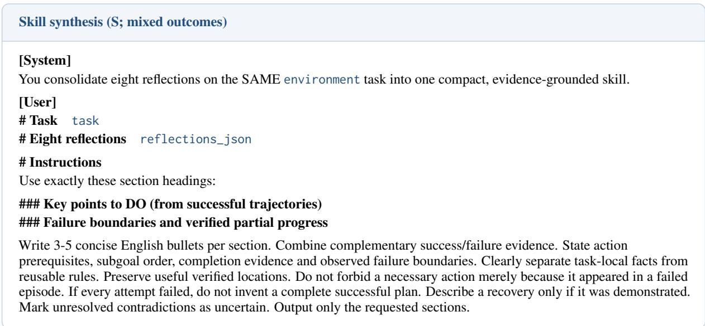

Only headings supported by the group’s outcomes are included. The generated skill is prepended as [Privileged Skill Information] for Teacher scoring.

The examples below show verbatim R/S excerpts from two command-only 3B training groups, each with four successes among eight trajectories. The corresponding interaction traces retain every executed action; omitted observation and reasoning text is marked by [. . . ].

## ALFWorld example (3B; training snapshot 117)

## [Task]

heat some mug and put it in coffeemachine.

## [Reflection R: successful trajectory, excerpt]

1. The mug was located on countertop 1 and successfully picked up.

2. The microwave was initially closed; after opening it, the mug was successfully heated with the microwave.

3. Moving the mug to coffeemachine 1 produced reward 10.0 and ‘done: true‘, confirming task completion.

## [Reflection R: failed trajectory, excerpt]

3. The episode failed overall because no mug was found or heated; the final placement remained unverified. No mug was observed, only cup 3, and partial progress did not complete the task.

## [Skill S, excerpts]

Key points to DO (from successful trajectories)

\- Task-local: find and take mug 1 from countertop 1.

\- Task-local: go to microwave 1, open it if closed, then heat the held mug.

\- Task-local: go to coffeemachine 1, and move the heated mug there.

Failure boundaries and verified partial progress

\- Cup 3 was successfully heated in a microwave, but it is not a mug and did not complete the task.

## WebShop example (3B; training snapshot 120)

## [Task]

Find me women’s dresses with polyester spandex for daily wear with color: red, and size: large, and price lower than 40.00 dollars.

## [Reflection R: successful trajectory, excerpt]

1. The agent combined women’s, polyester/spandex, dress, daily use, red, large, and <\$40 into a targeted search.

3. The valid “Buy Now” action is followed by the task-validated SUCCEEDED outcome; no checkout details or

unobserved purchase confirmation are claimed.

## [Reflection R: failed trajectory, excerpt]

2. Polyester-spandex composition, daily wear suitability, and a qualifying large-red price below \$40 were never verified.   
The detail page described the item as a tunic T-shirt dress, with colors and sizes listed but no evidence either was selected.

## [Skill S, excerpts]

Key points to DO (from successful trajectories)

\- Task-local: search with the combined attributes, then open B08ZRR3DZT; its displayed price was \$19.99–\$27.99, below \$40.

\- Reusable: verify product or feature text for material and use, then select red and large before checkout.

Failure boundaries and verified partial progress

\- B09M63B87V was only a targeted candidate lead, not evidence of met constraints.

\- Polyester-spandex, daily-wear suitability, and a qualifying large-red price below \$40 were never visibly confirmed.

Figures B.1 and B.2 show the successful interactions behind the R/S examples above.  
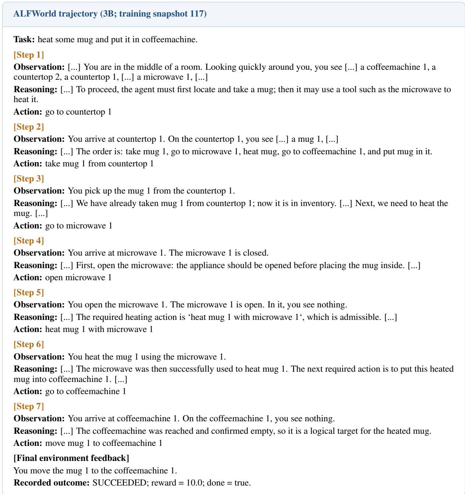  
Figure B.1: ALFWorld training trajectory. The Actor locates a mug, heats it, and places it in the coffeemachine. The environment confirms completion after seven actions.

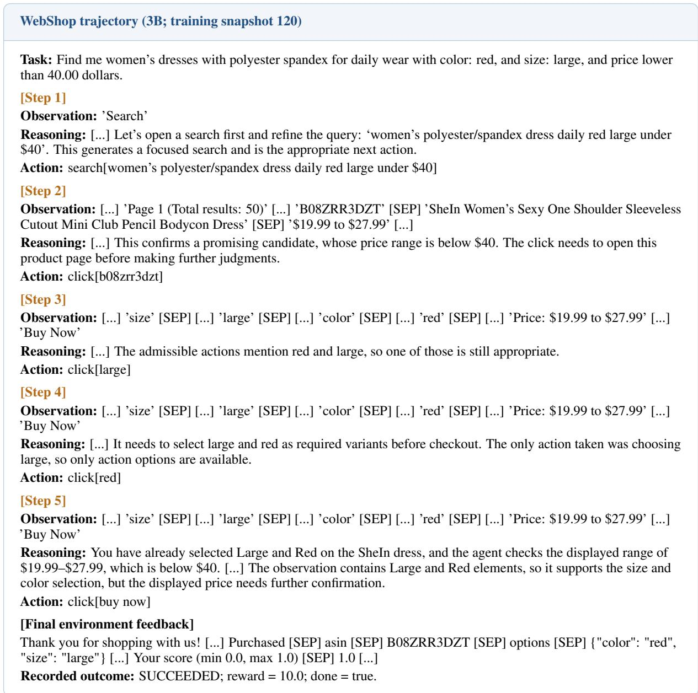  
Figure B.2: WebShop training trajectory. The Actor searches for a dress, opens a product, selects large and red, and purchases it. The terminal feedback records the selected options and a score of 1.0.

## B.4 Token masks and joint optimization

Command-content masks select the parsed command span, excluding reasoning, delimiter tags, observations, and padding. The primary policy loss and regularization use all valid generated response tokens. Teacher scoring retains the Actor’s sampled reasoning prefix. Only command tokens receive the direct OPSD term. The mean command gap $\bar { d } _ { g j t }$ determines a shared modulation multiplier, which scales each command token’s own gap $\delta _ { g j t \ell }$ , with the same token-mean loss reduction.

Analyzer credit uses raw summed command gaps $d _ { g j t }$ before modulation. Equation 20 gives equal total weight to reflection and skill generation and averages each generated sequence over its own valid tokens. Zero-credit groups remain in the fixed group denominator. Actor and Analyzer gradients share the scheduled AdamW updates, with no additional R/S optimizer steps.

## C Baselines, benchmarks, and evaluation setting

## C.1 Baseline details

Table 1 compares Qwen2.5-3B-Instruct and Qwen2.5-7B-Instruct models. We summarize the baseline variants reported by AlignOPSD [6]. An asterisk denotes retrieved-skill access at inference; unmarked methods receive only the task prompt and interaction history.

• Vanilla. The instruction-tuned backbone acts directly in the environment without additional taskspecific training.

• Skill-Prompt\*. A retrieved task-relevant skill is added to Vanilla’s context at validation and test time.

• GRPO [22]. Terminal rewards are normalized within each task group to obtain trajectory advantages, which supervise the sampled response tokens without a learned critic.

• Skill-GRPO / Skill-GRPO\*. Both variants condition GRPO training on retrieved skills. Evaluation removes the skills for Skill-GRPO and retains them for Skill-GRPO\*.

• OPSD [7]. A privileged-context Teacher re-scores tokens from student-generated trajectories, providing detached token-level supervision. The student learns to reproduce these preferences using its ordinary interaction context.

• GRPO+OPSD. A joint objective combines terminal-reward GRPO advantages with token-level supervision from the privileged-context Teacher.

• Skill-SD [9]. Skills condition the Teacher alone, and importance-weighted distillation transfers its guidance to the acting policy.

• RLSD. Teacher–Student information produces a bounded scaling coefficient for GRPO updates. The outcome advantage determines the direction of each scaled update.

• SDAR [18]. A gate regulates an auxiliary self-distillation loss alongside GRPO, while the original environmental advantage estimate is retained.

• AlignOPSD [6]. Cross-rollout decision correspondence rectifies Teacher supervision, while adaptive decision spans and hierarchical credit assignment allocate the resulting guidance.

• Ours. Task-specific R/S SFT initializes a shared Actor and Analyzer. Environmental command advantages calibrate signed Teacher preferences on executable command tokens. State-centered credit trains reflections and skills, linking Teacher construction to subsequent policy updates. Inference uses the trained Actor with the ordinary task prompt and interaction history.

The published baseline values are taken from AlignOPSD Table 1 [6]. Appendix B specifies our initialization and training settings; the following subsections describe our task panels, inference settings, and reporting conventions.

## C.2 Task panels and metrics

ALFWorld evaluation covers all 140 seen and 134 unseen tasks. Table C.1 gives the six category sizes. If $k _ { c }$ of $n _ { c }$ tasks succeed in category c, macro success is $\textstyle { \frac { 1 0 0 } { 6 } } \sum _ { c = 1 } ^ { 6 } k _ { c } / n _ { c }$ . Each category therefore contributes equally. Success is determined by the first terminal environment outcome.

Table C.1: ALFWorld evaluation tasks by category.
<table><tr><td>Split</td><td>Pick</td><td>Look</td><td>Clean</td><td>Heat</td><td>Cool</td><td>Pick2</td><td>Total</td></tr><tr><td>Seen</td><td>35</td><td>13</td><td>27</td><td>16</td><td>25</td><td>24</td><td>140</td></tr><tr><td>Unseen</td><td>24</td><td>18</td><td>31</td><td>23</td><td>21</td><td>17</td><td>134</td></tr></table>

WebShop uses 128 goals sampled without replacement. Our repeated evaluations draw a 128-goal panel for each evaluation seed; methods using the same seed share the panel. The catalogue seed remains 0, with the training-compatible search index of 1,000 products. Success is the percentage of tasks completed fully. Score is the mean normalized terminal environment reward multiplied by 100, capturing partial satisfaction of the requested product attributes.

## C.3 Inference settings

Evaluation uses temperature 0.4, top-p = 1, top-k = −1, and one trajectory per task. The Actor receives the ordinary task prompt and interaction history, without appended skills or online R/S generation. ALFWorld allows at most 30 actions with history length five; WebShop allows at most 15 actions with history length two. Prompt and response limits follow Appendix B. Infrastructure errors are recorded separately from completed task failures.

## C.4 Reporting conventions

All task-performance results for our method and its ablations use the final checkpoint after 150 online updates. The 134-task unseen split is used only for final evaluation.

All training runs use a fixed random seed. After training, each checkpoint is evaluated under three evaluation seeds, and we report the mean and standard deviation in Tables 1 and 2.

The local GRPO baselines in Table 2 use the same initialization, task sampling, rollout budget, Actor optimization settings, and evaluation protocol as the full method in Table B.2. Their online updates optimize $\mathcal { L } _ { \mathrm { G R P O } }$ alone, including the same reference-policy KL penalty and entropy bonus, for 150 updates. They are evaluated on the same unseen task panel with the same inference settings as our models.

The GRPO row in Table 3 repeats the published baseline values quoted in Table 1. Published baseline numbers come from Table 1 of AlignOPSD [6] and retain their source aggregation.

## C.5 Ablation configurations and evaluation

Table C.2 specifies the full method and the three 3B ablation variants. All variants generate eight reflections and one skill per task group during online training. Variant (a) omits R/S SFT and starts from Qwen2.5-3B-Instruct. Variant (b) extends direct Teacher supervision to the complete response, including reasoning. Variant (c) retains command-only supervision and online R/S generation in both environments; it sets the modulation multiplier to one and removes the direct R/S objective. The remaining settings follow Table B.2.

Full-response supervision in variant (b). At each interaction turn, we compute the modulation multiplier $m _ { g j t }$ from the executable command’s mean gap $\bar { d } _ { g j t }$ and environmental advantage $\widehat { A } _ { g j t }$ using Equation 13. This multiplier is broadcast to all valid generated tokens in the same Actor response, including reasoning and command content. Each token retains its own Teacher–Actor gap, giving

$$
w _ { g j t \ell } ^ { ( b ) } = q _ { g } m _ { g j t } \delta _ { g j t \ell } , \qquad ( g , j , t , \ell ) \in \mathcal { B } _ { A } .\tag{C.1}
$$

The loss uses the clipped token objective in Equation 14. Both supervision scopes use the Actor tokenmean denominator $| B _ { A } |$ in Equation 15, Teacher coefficient $\beta _ { T } = 0 . 0 1$ , and PPO clipping ratio 0.2. The full-response branch applies these token-level Teacher terms throughout the sampled response under the command-derived multiplier.

Table C.2: Training components used in the ablation study. Scope denotes the tokens covered by direct Teacher supervision. Online R/S denotes reflection and skill generation during training.
<table><tr><td>Variant</td><td>SFT</td><td>Scope</td><td>Mod.</td><td>R/S loss</td><td>Online R/S</td></tr><tr><td>Full</td><td>Yes</td><td>Command</td><td>Yes</td><td>Yes</td><td>Yes</td></tr><tr><td>(a)</td><td>No</td><td>Command</td><td>Yes</td><td>Yes</td><td>Yes</td></tr><tr><td>(b)</td><td>Yes</td><td>Response</td><td>Yes</td><td>Yes</td><td>Yes</td></tr><tr><td>(c)</td><td>Yes</td><td>Command</td><td>No</td><td>No</td><td>Yes</td></tr></table>

Each branch trains for 150 online updates and is evaluated at its final checkpoint. ALFWorld evaluation uses all 140 seen tasks, at most 30 actions, and history length five. WebShop evaluation uses the fixed 128-task panel, at most 15 actions, and history length two. Both environments use temperature 0.4 and one trajectory per task. We report six-category macro success for ALFWorld and Score and Success for WebShop. The GRPO row contains the published baseline values described above.

## D Mechanistic analysis and training dynamics

## D.1 Paired measurement of Teacher weight

The analysis in Figure $\mathbf { 4 } ( \mathbf { a } , \mathbf { b } )$ uses recorded command spans, likelihood gaps, modulation weights, and primary policy advantages from the two 3B runs specified in Appendix B.2. We recorded nine snapshots per environment. Duplicate padding rows are removed, and each executed command contributes one observation. We retain commands with an active Teacher span and a primary advantage satisfying $| \widehat { A } _ { i } ^ { \mathrm { R L } } | > 1 0 ^ { - 8 }$ . The same commands are used before and after modulation.

The raw command coefficient is the summed Teacher–Actor gap $d _ { i }$ . The final command coefficient is the mean saved coefficient over the command’s content tokens. These command-level values enter the reward-alignment statistic in Section 4.3. Each condition is normalized by its own total absolute coefficient mass. This comparison includes both command-length normalization and environmental modulation. The shaded region in Figure 4(a,b) shows the paired percentage-point difference.

The reference advantage $\widehat { A } _ { i } ^ { \mathrm { R L } }$ comes from the primary policy objective: the recorded outcome includes the configured invalid-command penalty and is standardized within the task group. The auxiliary graph advantage $\widehat { A } _ { i }$ determines modulation. The primary advantage provides the outcome-derived reference for the measurement, and the auxiliary advantage controls the Teacher multiplier.

## D.2 Return concordance of skill-induced preferences

For each skill, we pair distinct commands from different trajectories when their stored Actor prompts and admissible-action sets match exactly. Teacher scoring retains the reasoning prefix sampled in each response. Let $\Delta d _ { i j } = d _ { i } - d _ { j }$ be the difference in raw command gaps and $\Delta R _ { i j } = R _ { i } - R _ { j }$ the difference in recorded returns-to-go. Pairs with $| \Delta R _ { i j } | \le 1 0 ^ { - 8 }$ are omitted. With $\varepsilon = 1 0 ^ { - 8 }$ , the pair score is

$$
h _ { i j } = \left\{ \begin{array} { l l } { \frac { 1 } { 2 } , } & { | \Delta d _ { i j } | \leq \varepsilon , } \\ { 1 , } & { | \Delta d _ { i j } | > \varepsilon \mathrm { ~ a n d ~ } \Delta d _ { i j } \Delta R _ { i j } > 0 , } \\ { 0 , } & { \mathrm { o t h e r w i s e } . } \end{array} \right.\tag{D.1}
$$

Concordance is 100 times the mean pair score within a skill. Skills with at least one eligible pair enter the analysis. We then give each skill equal weight, so skills with more observed command pairs do not dominate the comparison.

The pooled analysis uses the saved snapshots after the initial update. Within each task, the median bounded R/S credit $c _ { g }$ separates the higher- and lower-credit groups; median ties belong to the lower-credit group. Figure $^ { 4 ( \mathrm { c } , \mathrm { d } ) }$ displays individual skills, group means, and interquartile ranges. The complete measurements underlying the figure accompany the supplementary data.

## D.3 Training dynamics

Figures D.1 and D.2 show the 3B and 7B command-only runs over 150 updates. Success and interaction length summarize 128 trajectories per update; positive-credit fractions count all sixteen skills, including zero-credit groups. Modulation coverage retains the logged training-batch rows and active-Teacher mask.

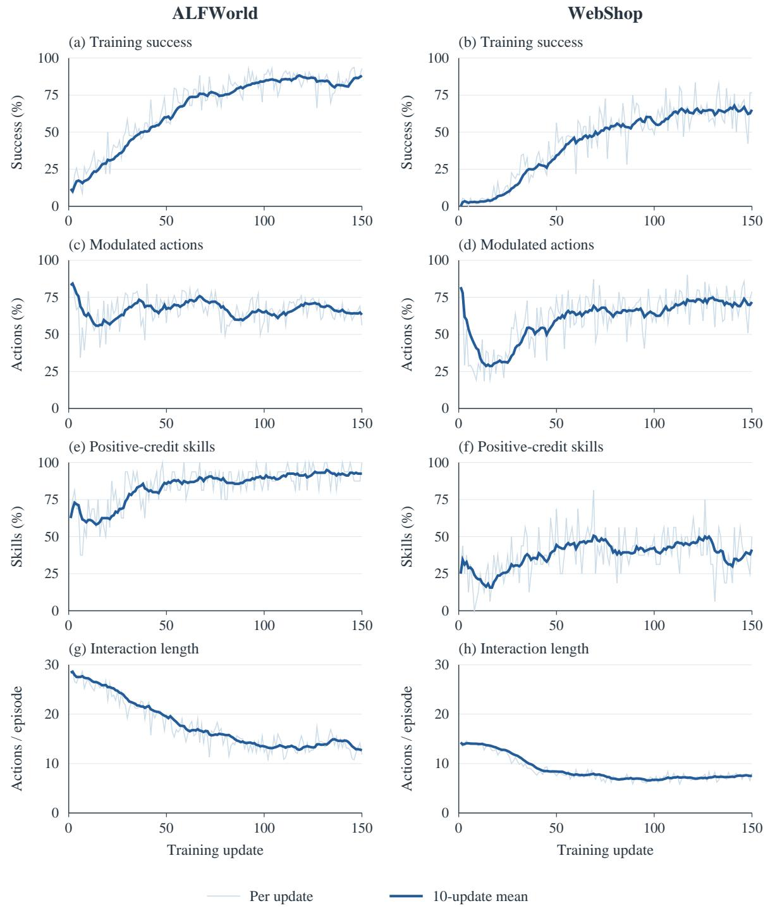  
Figure D.1: Training dynamics of the 3B agents. Columns show ALFWorld and WebShop; rows show training success, modulated-action coverage, the fraction of skills receiving positive R/S credit, and mean interaction length. Light curves show individual updates; dark curves show trailing ten-update means, using available updates at the start. Success rises and episodes shorten while environmental feedback continues to select and modulate supervision.

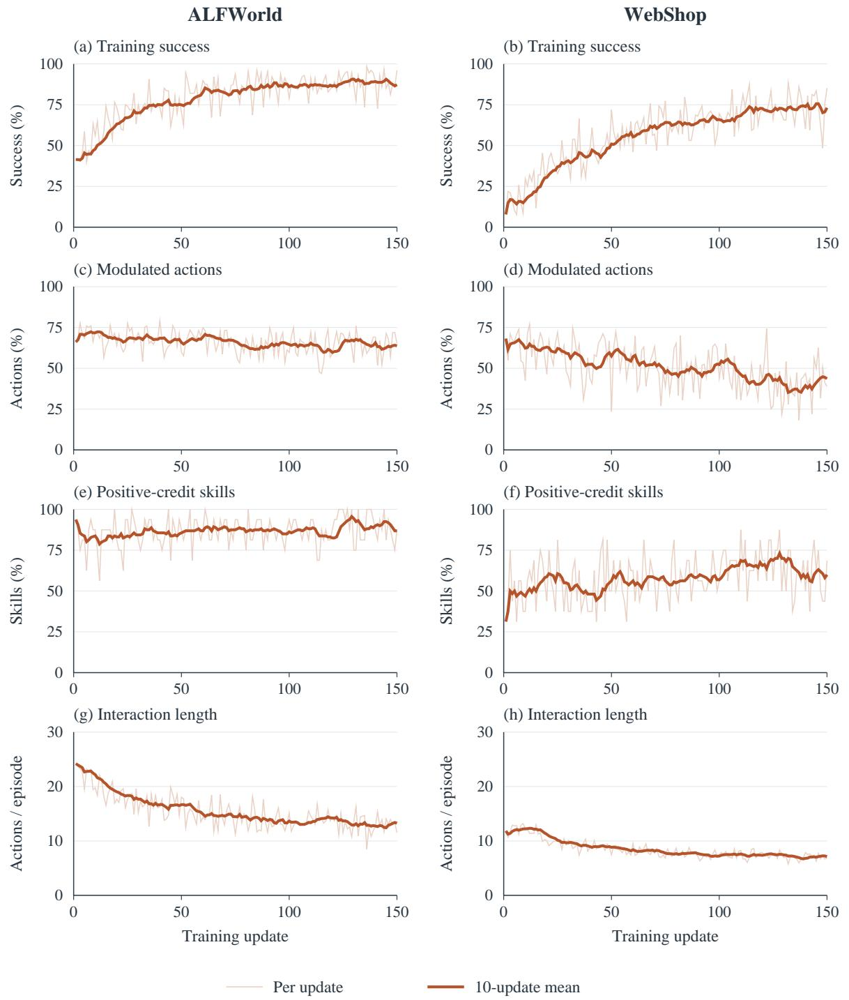  
Figure D.2: Training dynamics of the 7B agents. Columns and rows follow Figure D.1, with the same axis ranges and moving-average convention. Both tasks show increasing success and shorter interactions. Modulation coverage remains active on ALFWorld and declines on WebShop.