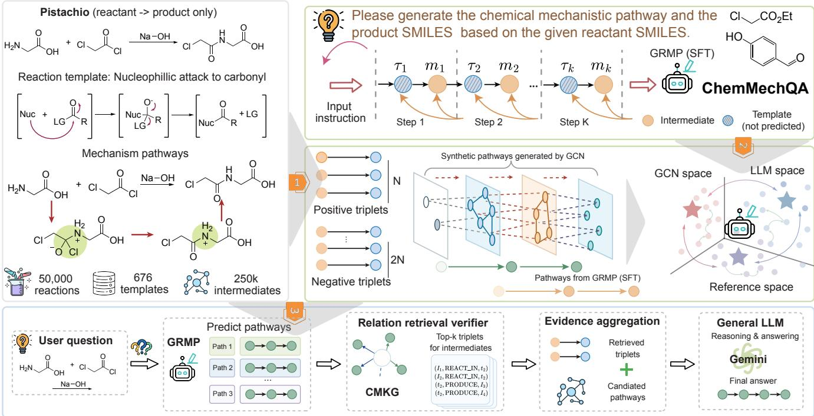
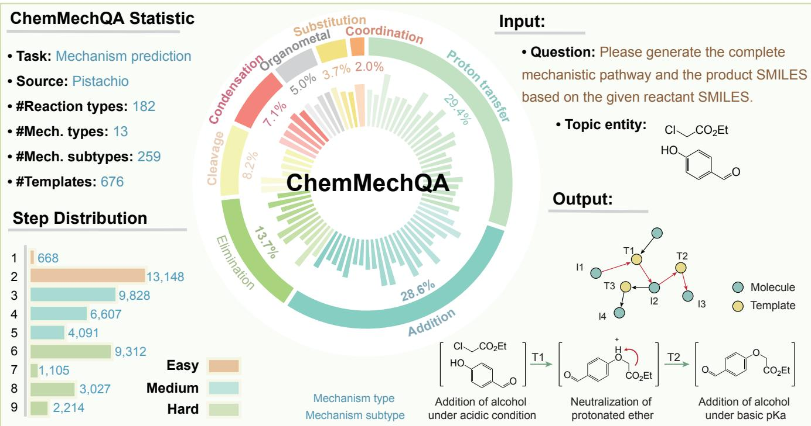
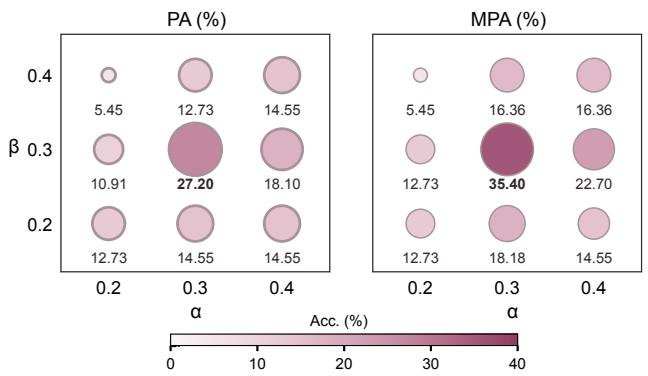
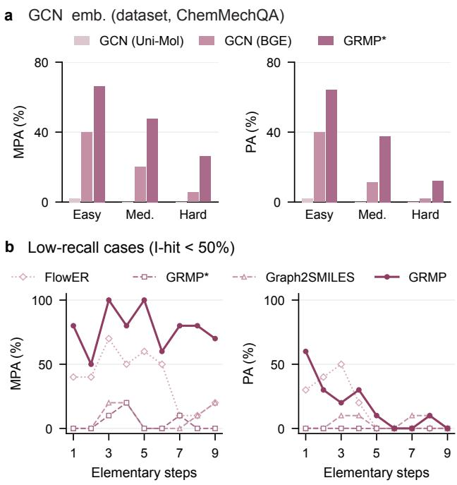
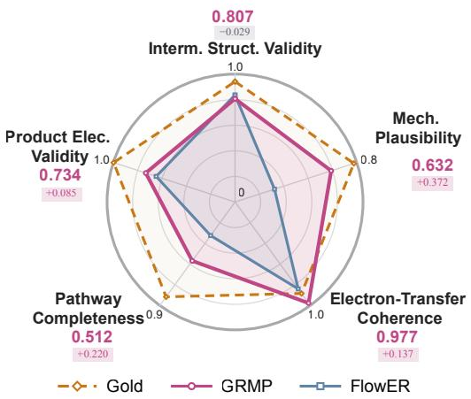
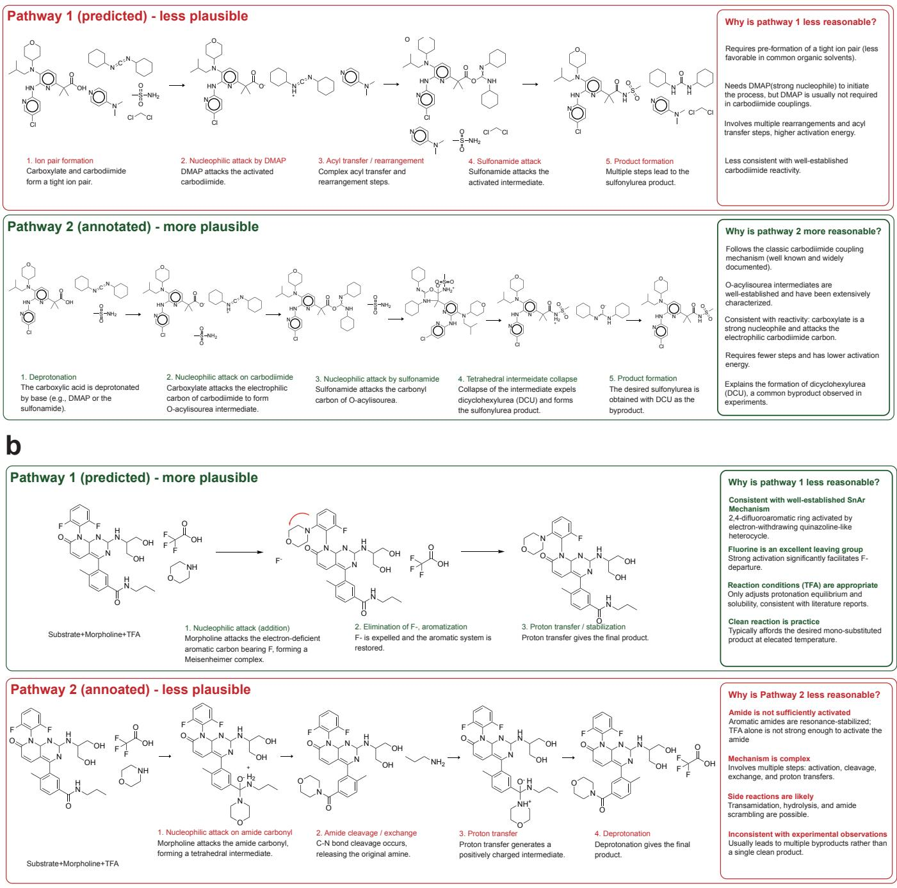
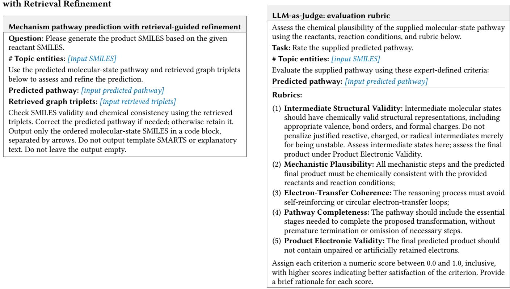
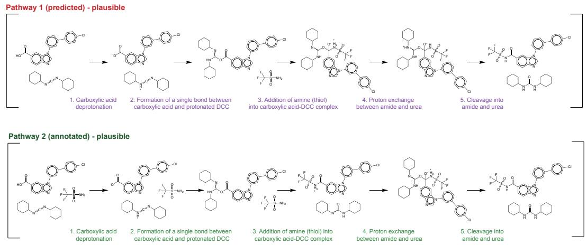

# Enhancing Multi-Step Chemical Mechanism Prediction with Graph-Guided Preference Data

Yu Zhang Shanghai Jiao Tong University Shanghai, China cynthiazhang@sjtu.edu.cn

Jinming Yang Shanghai Jiao Tong University Shanghai, China yangjm67@sjtu.edu.cn

Ruijie Yu Shanghai Jiao Tong University Shanghai, China el\_iauk@sjtu.edu.cn

Feng Zhu Shanghai Jiao Tong University Shanghai, China fzchem@sjtu.edu.cn

Yaohui Jin Shanghai Jiao Tong University Shanghai, China jinyh@sjtu.edu.cn

Xuelin Zhao Shanghai Jiao Tong University Shanghai, China xl\_zhao@sjtu.edu.cn

Xiaokang Yang Shanghai Jiao Tong University Shanghai, China xkyang@sjtu.edu.cn

## Abstract

Yanyan Xu✉ Shanghai Jiao Tong University Shanghai, China yanyanxu@sjtu.edu.cn

Predicting multi-step chemical reaction mechanisms requires identifying plausible intermediates and correctly ordering the elementary reaction steps. Existing computational methods focus on single-step elementary reaction prediction, limiting their ability to generalize to unseen reaction spaces. We introduce a graph-guided framework for multi-step chemical mechanism prediction that leverages a chemical mechanism knowledge graph (ChemMechKG) to guide large language models (LLMs). To improve pathway prediction, we develop a graph-aligned reaction mechanism predictor (GRMP) that uses graph neural networks to generate synthetic candidate pathways for pathway optimization. During inference, we design a relation retrieval (RR) module to extract relevant graph evidence from the KG for pathway refinement. Experiments show that GRMP achieves the highest pathway accuracy among all compared methods on ChemMechQA and oMe-Gold, reaching 48.1% and 57.9%, respectively. On a fixed sample of 110 out-of-distribution reactions from ChemMechQA-Hard, GRMP achieves 36.4% top-1 pathway accuracy. LLM-as-Judge and human assessment further demonstrate its ability to generalize to unseen reactions. Code and data are available in the grmp.

## 1 Introduction

In organic chemistry, a reaction mechanism is a theoretical trajectory mapping electron redistribution during a chemical transformation. Chemists rely on reaction mechanisms as a foundational framework for predicting outcomes, typically represented using “arrow pushing” formalism [21]. By sequentially applying arrowpushing logic to reactants, elementary intermediates are generated until final products are reached. However, due to the exponentially expanding search space of potential pathways, proposing accurate multi-step mechanistic routes remains a daunting challenge even for experienced domain experts.

Traditional methods for mechanism prediction involve three stages: (1) developing rule-based template systems to encode expert knowledge and label mechanistic data [2, 4, 18]; (2) retraining endto-end machine learning models on mechanism data for single-step elementary reaction prediction [29]; (3) developing deep learning based or generative methods to model electron redistribution to adhere to fundamental physical laws for single-step elementary reaction prediction [5, 17]. However, these methods are inherently constrained by their reliance on single-step elementary reaction data. Consequently, they are unable to extrapolate across complex, multi-step mechanistic pathways, even failing to generalize to unseen reactions where the mechanistic logic deviates from known training patterns.

Recent advances in large language models (LLMs) have demonstrated remarkable reasoning capabilities across diverse chemical domains [9, 22, 35]. Nevertheless, current LLM-based applications in mechanism prediction remain predominantly confined to simplified multiple-choice selection tasks, leaving true multi-step mechanistic generation virtually unexplored [11]. This gap stems from a fundamental bottleneck: multi-step mechanistic prediction requires complex, long-chain scientific reasoning, where standard LLMs severely struggle with structural hallucinations and a deficiency in chemical grounding [13, 14, 25, 32]. To mitigate hallucinations in long-chain reasoning, Knowledge Graph (KG) integration has emerged as a promising paradigm to anchor LLMs with factual domain knowledge. However, existing KG-augmented approaches falter when directly deployed in complex chemical spaces. Extracting multi-hop mechanistic pathways from dense chemical graphs introduces substantial topological noise.

To address these issues, many studies have integrated Knowledge Graphs (KGs), which encapsulate factual information in a structured format, to improve the reasoning abilities of LLMs. However, existing KG-augmented approaches fail when directly deployed in complex chemical spaces. Extracting comprehensive, multi-hop mechanistic pathways from a chemical graph introduces severe topological noise. Conversely, shallow retrieval is insuficient for governing chemical steps, leaving downstream LLMs under-informed and still prone to cascading hallucinations.

  
Figure 1: An illustration of our proposed framework. It contains GRMP, a graph-aligned LLM predictor, and a Relation Retrieval (RR) verifier for the mechanism pathway prediction and reasoning.

To bridge this gap, we construct the Chemical Mechanism Knowledge Graph (ChemMechKG) by enriching reaction sequences with inferred intermediates derived from expert-validated elementary reaction templates. Building on ChemMechKG, we propose a graphguided framework for multi-step chemical mechanism prediction (Figure 1). Specifically, we develop a GNN-based pathway generator to construct synthetic preference pairs for optimizing a graphaligned reaction mechanism predictor (GRMP) via direct preference optimization (DPO). During inference, we design a relation retrieval (RR) module to extract relevant graph evidence from the KG for pathway refinement. Evaluations on ChemMechQA and oMe-Gold demonstrate that our framework achieves the highest pathway accuracy among the evaluated methods, while additional ablation studies investigate its generalization to held-out reaction classes and mechanism templates.

The main contributions of this work are as follows:

• We construct ChemMechKG, a knowledge graph that enriches raw reaction data with imputed intermediates using expert-curated templates.

• We propose a graph-guided framework for multi-step chemical mechanism prediction, in which GCN-generated candi date pathways provide synthetic preference data for pathway optimization.

• We conduct extensive experiments and human evaluation, demonstrating that GRMP achieves state-of-the-art performance and generalizes efectively to unseen reactions.

## 2 Related Work

Mechanism prediction. Anticipating reaction mechanism inference at the elementary step level is crucial for predicting complex chemical outcomes. Early work focused on data curation by expertannotated templates, such as MechFinder [4], which subsequent works expanded to cover wider reaction distributions [5, 18]. Driven by these datasets, contemporary research applies deep learning to predict intermediate cascades [7]. Notably, graph-based models autoregressively generate consecutive intermediates over reaction graphs [18]. FlowER [17] models electron redistribution as a generative process for single-step predictions. LLMs are also applied to learn mechanistic reasoning for chemical reactions [1, 6]. Despite their success, these methods fail to autonomously extrapolate across multi-step mechanistic pathways and exhibit poor out-ofdistribution (OOD) generalization when facing novel, unseen transformations.

Synthetic data for LLM Training. Synthetic data generation plays a pivotal role in expanding LLM capabilities beyond humanannotated corpora [19]. Conventional selection strategies frequently filter synthetic data based on model confidence, prioritizing highprobability generations [12, 15]. However, recent studies demonstrate that such a strategy yields diminishing marginal information gains and exacerbates model bias. Consequently, contemporary paradigms advocate for balanced curriculum mining, strategically incorporating both low-uncertainty (“easy”) and high-uncertainty (“hard”) samples to maximize training eficiency [27, 36]. Nevertheless, systematically identifying informative samples remains non-trivial, particularly in complex scientific domains.

## 3 Preliminary

Chemical mechanism pathway. A chemical reaction transforms reactants under given conditions into final products P. We distinguish the molecular-state pathway $w = \left( m _ { 0 } , . . . , m _ { K } \right)$ from its auxiliary elementary-template sequence $\pmb { \tau } = \left( \tau _ { 1 } , \dots , \tau _ { K } \right)$ . The �-th elementary step is $m _ { i - 1 } \stackrel { \tau _ { i } } { \longrightarrow } m _ { i }$ � . Each $m _ { i }$ is a molecular state represented by SMILES and may contain multiple dot-separated chemical components; �� is a reaction template represented by SMARTS.

In ChemMechKG, molecular states and templates are distinct entity types, $\mathcal { E } _ { \mathrm { m o l } }$ and $\mathcal E _ { \mathrm { t p l } } .$ , with $\mathcal { E } = \mathcal { E } _ { \mathrm { m o l } } \cup \mathcal { E } _ { \mathrm { t p l } }$ . The corresponding annotated graph walk is $w _ { z } = \left( m _ { 0 } , \tau _ { 1 } , m _ { 1 } , \dots , \tau _ { K } , m _ { K } \right)$ . We use $e _ { j }$ for a generic entity at graph position $j ,$ so that $e _ { 2 i } = m _ { i }$ and $e _ { 2 i - 1 } = \tau _ { i } .$ Graph relations $r _ { j }$ label the edges between these entities and are distinct from the template entities $\tau _ { i } .$ . Thus, a pathway with � elementary chemical steps has 2� graph hops and $2 K + 1$ entity positions. GRMP generates the molecular-state pathway � during training and inference.

ChemMechQA. We frame multi-step mechanism prediction as a specialized QA task over G. Given a natural language query �, specifying the initial molecular state $m _ { 0 } ,$ the objective is to learn a function � that predicts a mechanistic pathway � ∈ A anchored in ${ \mathcal { G } } ,$ such that $w = f ( q , G )$

## 4 Methods

## 4.1 ChemMechKG Curation

We build our mechanistic dataset on the processed Pistachio database [23], containing 15 million reactions. Building on the previous methodology for imputing mechanistic pathways [18], we derive structured mechanistic pathways from 50,000 experimentally reported reactions using 676 expert-annotated reaction templates proposed by [17]. All mechanistic data are automatically reviewed and cleaned to enhance their consistency and reliability.

We define reaction templates and molecules as entities and labeled molecule–template connections as relations to construct ChemMechKG (Figure 2). This yields 247,832 entities: 247,156 molecule nodes and 676 template nodes. Unlike datasets centered on isolated elementary steps, ChemMechKG provides pathway-level annotations of ordered intermediates, mechanism templates, naturallanguage descriptions, and reaction conditions in SMILES format. Details of our KG are in Table 5 and Table 6. For model development, we extract the shortest reasoning paths, defined as sequences of consecutive triplets: $w _ { z } = e _ { 0 } \stackrel { r _ { 1 } } { \longrightarrow } e _ { 1 } \stackrel { r _ { 2 } } { \longrightarrow } \dots \stackrel { r _ { 2 K } } { \longrightarrow } e _ { 2 K }$ , where $( e _ { j - 1 } , r _ { j } , e _ { j } ) \ \in \ G , \ e _ { 2 i } \ = \ m _ { i }$ , and $e _ { 2 i - 1 } ~ = ~ \tau _ { i }$ to construct Chem-MechQA. Notably, all molecules and intermediates are excluded from the KG during model inference to avoid data leakage.

## 4.2 GCN for Pathway Prediction

We employ a query-dependent Graph Neural Network (GNN) model to learn the topological dependencies within ChemMechKG and predict the mechanism pathway. Our implementation uses a two-layer graph convolutional network (GCN) [20] encoder with a multilayer perceptron (MLP) decoder. Based on the definitions in the prelimi nary, we map each entity node $e \in { \mathcal { E } }$ to an initial textual embedding $\mathbf { z } _ { e } \in \mathbb { R } ^ { d }$ using a pre-trained text embedding model [3].

Algorithm 1 Pair-Wise Synthetic Preference Data Construction   
Require: Annotated training set $\mathcal D _ { \mathrm { t r a i n } } = \{ ( q _ { j } , m _ { 0 , j } , w _ { j } ^ { * } ) \} _ { j = 1 } ^ { n }$ ; graph $\mathcal { G }$   
Require: Trained GCN predictor and SFT model $\pi _ { \theta _ { s } }$ ; graph-hop limit $T _ { \mathrm { m a x } } ;$   
$\alpha , \beta$   
Ensure: Preference dataset $\mathcal { D } _ { \mathrm { p r e f } }$ and companion reference SFT data   
1: Initialize GCN-preferred set $\mathcal { D } _ { g }$ and reference-preferred set $\mathcal { D } _ { r }$ to ∅   
$2 ;$ for $( q _ { j } , m _ { 0 , j } , w _ { j } ^ { \ast } ) \in \mathcal { D } _ { \mathrm { t r a i n } }$ do   
3: Generate $w _ { j } ^ { \mathrm { { { \bar { s f t } } } } }$ from $\pi _ { \theta _ { s } } ( \cdot \mid q _ { j } , m _ { 0 , j } )$   
4: $s _ { s } \gets R _ { I } ( w _ { j } ^ { \mathrm { s f t } } , w _ { j } ^ { * } )$   
5: Generate GCN molecular-state pathway $w _ { j } ^ { \mathrm { g c n } }$ using $\mathcal { G }$ within $T _ { \mathrm { m a x } }$   
graph hops   
6: if $w _ { j } ^ { \mathrm { g c n } }$ reaches the annotated product then   
7: Retain $w _ { j } ^ { \mathrm { g c n } } \}$ set $s _ { g }  R _ { I } ( w _ { j } ^ { \mathrm { g c n } } , w _ { j } ^ { * } )$   
8: else   
9: Discard $w _ { j } ^ { \mathrm { g c n } }$ as a preference candidate   
10: end if   
11: if a retained GCN candidate exists and $s _ { g } - s _ { s } \ge$ � then   
12: Add $( q _ { j } , w _ { j } ^ { \mathrm { g c n } } , w _ { j } ^ { \mathrm { s f t } } )$ to ${ \mathcal { D } } _ { g }$   
13: else if $s _ { s } \leq \beta$ then   
14: Add $( q _ { j } , w _ { j } ^ { * } , w _ { j } ^ { \mathrm { s f t } } )$ to $\mathcal { D } _ { r }$   
15: end if   
16: end for   
17: Approximately balance pair types by downsampling excess pairs in D   
18: Form ${ \mathcal { D } } _ { \mathrm { p r e f } }$ from $\mathcal { D } _ { g } \cup \mathcal { D } _ { r }$ by deduplicating $( q , w ^ { + } , w ^ { - } )$ triples and   
serializing for DPO   
19: Save corresponding $\boldsymbol { w } _ { j } ^ { * }$ as companion SFT data, deduplicated by reac  
tion   
20: return $\mathcal { D } _ { \mathrm { p r e f } }$ and the companion SFT data

We designate the reactant nodes in the input query � as queryrelevant nodes, denoted $\mathcal { E } _ { q } \subseteq \mathcal { E }$ . The query-conditioned initial node representation ${ \bf h } _ { e } ^ { 0 }$ is defined as:

$$
\mathbf { h } _ { e } ^ { 0 } = \operatorname { I n i t } \left( \mathbf { z } _ { e } , \scriptscriptstyle \mathcal { K } \big [ e \in \mathcal { E } _ { q } \big ] \cdot \mathbf { z } _ { q } \right) , \quad \forall e \in \mathcal { E } .\tag{1}
$$

where $\mathbf { z } _ { q } \in \mathbb { R } ^ { d }$ is the query embedding derived from the input reactant SMILES, $\lVert \rVert ^ { \epsilon } [ \cdot ]$ denotes the indicator function, and Init is a single-layer MLP that fuses the intrinsic node embedding with the query vector for query-relevant nodes, while leaving non-query nodes unchanged. We then perform � message-passing layers over the entity graph. At each layer $l \in \{ 1 , . . . , L \}$ , the embedding of node � is updated by aggregating features from its localized neighborhood:

$$
\mathbf { h } _ { e } ^ { l } = \mathsf { U p d a t e } \big ( \mathbf { h } _ { e } ^ { l - 1 } , \mathsf { A g g } ( \boldsymbol { M } _ { e } ^ { l } ) \big ) ,\tag{2}
$$

where $\mathcal { M } _ { e } ^ { l } = \left\{ \mathsf { M } \mathsf { s g } \left( \mathbf { h } _ { e } ^ { l - 1 } , \mathbf { h } _ { e ^ { \prime } } ^ { l - 1 } \right) \mid \exists r : \ ( e ^ { \prime } , r , e ) \in \mathcal { G } \right\}$ represents the set of incoming messages from neighboring entities. The message function Msg parameterizes the interaction between connected entities as an element-wise product:

$$
\mathsf { M } \mathsf { s g } ( \mathbf { h } _ { e } , \mathbf { h } _ { e ^ { \prime } } ) = \mathbf { h } _ { e } \odot \mathbf { h } _ { e ^ { \prime } } ,\tag{3}
$$

where $\odot$ denotes element-wise multiplication. The Agg function aggregates neighbor messages, and Update non-linearly combines them with the previous node representation.

We construct pathways by iteratively selecting and applying reaction templates. The two-layer MLP decoder assigns an edge score $s ( m _ { t } , \tau ; q )$ to the current molecular state $m _ { t }$ and each candidate template �, using the query-conditioned GCN representations. During training, the encoder and decoder are optimized with a binary edge-classification loss that distinguishes positive from negative edges. During inference, we normalize the candidate template scores:

  
Figure 2: The distribution of our curated ChemMechQA.

$$
p ( \tau \mid m _ { t } , q ) = \frac { \exp s ( m _ { t } , \tau ; q ) } { \sum _ { \tau ^ { \prime } \in \mathcal { E } _ { \mathrm { t p l } } } \exp s ( m _ { t } , \tau ^ { \prime } ; q ) } .\tag{4}
$$

We select the highest-scoring template and apply its SMARTS transformation to �� to generate the next molecular state $m _ { t + 1 }$ . Repeating template selection and application constructs the pathway until termination or the predefined maximum graph-hop threshold $T _ { \mathrm { m a x } }$ is reached. The resulting alternating molecule–template sequence is denoted by $w _ { z } ^ { \mathrm { g c n } }$ . Its molecular-state subsequence provides candidate responses for the preference construction described below.

## 4.3 Graph-Aligned LLM for Mechanism Prediction (GRMP)

Given a chemical reasoning prompt � and an initial molecular state $m _ { 0 }$ identified within �, GRMP predicts an ordered molecularstate pathway $w = ( m _ { 0 } , . . . , m _ { K } )$ , as defined in the preliminary. Let $w ^ { * }$ denote the molecular-state subsequence of the shortest annotated walk in ChemMechKG. Reaction templates provide graph information but are not included in the LLM output. The workf

Supervised fine-tuning (SFT) stage. We first apply SFT [24] to learn these annotated pathways. Let $y ^ { * } = \mathrm { S e r i a l i z e } ( w ^ { * } )$ be its reference token sequence. For � target tokens, the objective is:

$$
\mathcal { L } _ { \mathrm { S F T } } ( \theta _ { s } ) = - \sum _ { t = 1 } ^ { N } \log P _ { \theta _ { s } } ( y _ { t } ^ { * } \mid y _ { < t } ^ { * } , q , m _ { 0 } ) ,\tag{5}
$$

where $\theta _ { s }$ denotes the SFT model parameters.

Graph-grounded synthetic data for preference optimization. For each training reaction, we extract all molecular-state subsequences of the SFT model and GCN-derived pathways to ensure they share the same format. GCN-derived pathways provide synthetic and diverse candidate pathways for constructing pair-wise preference data.

Below, $\boldsymbol { w } ^ { \mathrm { s f t } }$ and $w ^ { \mathrm { g c n } }$ denote these SFT and GCN molecular-state pathways, respectively. We extract intermediates from each candidate and the reference, canonicalize them, and compute their multiset matching rates against the reference. Let �(�) be the multiset of canonicalized intermediates in �, and $c _ { y } ( u )$ the multiplicity of intermediate �. The intermediate matching rate is referencenormalized multiset recall:

$$
R _ { I } ( w , w ^ { * } ) = \frac { \sum _ { u } \operatorname* { m i n } \{ c _ { y } ( u ) , c _ { w ^ { * } } ( u ) \} } { | I ( w ^ { * } ) | } .\tag{6}
$$

We define a criterion for preference selection termed the intermediate recall: $s _ { s } ~ = ~ R _ { I } ( w ^ { \mathrm { s f t } } , w ^ { \ast } )$ and $s _ { q } ~ = ~ R _ { I } { \left( w ^ { \mathrm { g c n } } , w ^ { * } \right) }$ . This score measures intermediate coverage without encoding step order.

Based on this criterion, we construct two types of preferred– rejected pairs using diferent thresholds � and �. The workflow of synthetic data selection is in Algorithm 1. A GCN-preferred pair $( w ^ { \mathrm { g c n } } , w ^ { \mathrm { s f t } } )$ is formed when $s _ { q } - s _ { s } \geq \alpha . \mathrm { A }$ reference-preferred pair $( w ^ { * } , w ^ { \mathrm { s f t } } )$ is formed when $s _ { s } \leq \beta .$ If a reaction satisfies both conditions, we retain only its GCN-preferred pair. We downsample excess reference-preferred pairs to approximately balance the two types, then deduplicate by the $( q , w ^ { + } , w ^ { - } )$ triple, where $w ^ { + }$ and $w ^ { - }$ are the preferred and rejected responses Finally, we use the resulting pairs to construct ${ \mathcal { D } } _ { \mathrm { p r e f } }$ for DPO training.

Preference Optimization. Starting from the SFT model, we optimize the target policy �� using DPO [26], with the frozen SFT model as $\pi _ { \mathrm { r e f } }$

$$
\begin{array} { r l } & { \mathcal { L } _ { \mathrm { D P O } } ( \theta ) = - \mathbb { E } _ { ( q , w ^ { + } , w ^ { - } ) \sim \mathcal { D } _ { \mathrm { p r e f } } } \Bigg [ \log \sigma } \\ & { \qquad \bigg ( \lambda \log \frac { \pi _ { \theta } ( w ^ { + } \mid q , m _ { 0 } ) } { \pi _ { \mathrm { r e f } } ( w ^ { + } \mid q , m _ { 0 } ) } } \\ & { \qquad - \lambda \log \frac { \pi _ { \theta } ( w ^ { - } \mid q , m _ { 0 } ) } { \pi _ { \mathrm { r e f } } ( w ^ { - } \mid q , m _ { 0 } ) } \bigg ) \Bigg ] , } \end{array}\tag{7}
$$

Here, $\pi ( \boldsymbol { w } \mid \boldsymbol { q } , m _ { 0 } )$ denotes the probability ofthe serialized molecularstate pathway. The function � is the sigmoid function and � scales the preference term. The objective favors reference pathways or GCN alternatives selected for greater intermediate coverage over the SFT candidates.

## 4.4 Relation Retrieval for Inductive Reasoning

During inference, the RR module extracts factual triplets as structural priors for inductive reasoning. Given an input reaction query $q ,$ GRMP generates a candidate molecular-state pathway $w = ( m _ { 0 } , \ldots ,$ $m _ { K } )$ . For each state $m _ { i } ,$ entity linking selects a molecular-state node $a _ { i } \in \mathcal { E } _ { \mathrm { m o l } }$ using Tanimoto similarity:

$$
a _ { i } = \arg \operatorname* { m a x } _ { e \in { \mathcal { E } } _ { \mathrm { m o l } } } { \mathrm { T a n i m o t o } } ( \mathrm { F P } ( m _ { i } ) , \mathrm { F P } ( e ) ) .\tag{8}
$$

The linked nodes form the anchor set $E _ { \mathrm { a n c h o r } } = \{ a _ { i } \} _ { i = 0 } ^ { K }$ . For each anchor $a _ { i } ,$ we retrieve the relation triplets in its ℎ-hop graph neighborhood $N _ { h } ( a _ { i } )$ . Here, ℎ counts graph edges rather than elementary chemical steps; the retrieved neighborhoods can include both molecular-state and template nodes. Finally, the retrieved triplets guide the general-purpose LLM to generate the final pathway $w _ { \mathrm { f i n a l } } .$ using the prompt in Appendix:

$$
w _ { \mathrm { f i n a l } } = \mathrm { L L M } _ { \mathrm { g e n e r a l } } \Bigl ( \mathrm { P r o m p t ( \bigcup _ { \alpha _ { i } \in E _ { \mathrm { a n c h o r } } } } N _ { h } ( a _ { i } ) \Bigr ) \Bigr )\tag{9}
$$

Leakage-controlled retrieval. Before retrieval, we remove the molecule nodes and incident edges associated with each test reaction from ChemMechKG, preventing RR from directly accessing its annotated pathway.

## 5 Experiments

Our experiments aim to address the following research questions (RQs):

(1) RQ1: How does GRMP compare with the general-purpose LLMs and prediction baselines?

(2) RQ2: How do the key components of GRMP contribute to generalization on unseen reactions?

(3) RQ3: How sensitive is performance to preference thresh olds, node embeddings, and pathway length?

(4) RQ4: How do automated and human assessments characterize pathway plausibility?

## 5.1 Experimental Setup

Datasets. We evaluate on ChemMechQA, our primary dataset constructed directly from ChemMechKG, oMe-Gold (196 literatureverified pathways) [34], and ChemMechQA-Hard. ChemMechQA-Hard comprises 2,009 reactions drawn from eleven held-out reaction classes and 24 unseen mechanism templates, providing an outof-distribution (OOD) evaluation setting. We conduct an ablation study and human evaluation using a fixed 110-reaction sample from ChemMechQA-Hard. Dataset statistics appear in Appendix A.

Baselines and metrics. We compare nine LLM configurations and three mechanistic baselines in three categories: 1) LLM reasoning methods, 2) mechanistic models including Reactron [5], FlowER [17], and Graph2SMILES [18], and 3) our graph-aligned method. Following prior work [17, 18], we report Validity, Main Product Accuracy (MPA), Intermediate Hit (I-hit), Pathway Accuracy (PA), and Sequence Rank (SR). PA measures exact pathway matching. MPA is evaluated from the final responses of model generation. Full metric definitions appear in Appendix B.

Implementation. We utilize Qwen2.5-7B-Instruct as the foundation model. For LLM training in both the SFT and DPO stages, we adopt LoRA-based fine-tuning. The batch size for SFT is set to 4, and the learning rate is set to 5e-6. To construct synthetic data for preference optimization, we design a two-layer GCN [20] with BGE embeddings [3] that follows an encoder–decoder architecture. We use 2× A6000-48G GPUs for training. During inference, our framework includes Gemini-3.1-Pro for final refinement. Gemini generates separate candidate sets for each $k ,$ so top-� scores need not be monotonic. Experimental settings and hyperparameters are detailed in Appendix B.

## 5.2 Main Results (RQ1)

We evaluate the mechanism prediction performance of GRMP against state-of-the-art baselines across two benchmark datasets: ChemMechQA and oMe-Gold. Table 1 reports top-1 results. Notably, GRMP∗ represents our proposed graph-aligned LLM utilizing our two-stage training but without inductive reasoning. GRMP (Gemini-3.1-Pro) achieves the highest reported Pathway Accuracy (PA) among the evaluated configurations on both datasets: 48.1% on ChemMechQA and 57.9% on oMe-Gold. Besides, our method outperforms the strongest mechanistic baseline (Graph2SMILES, 33.5% PA) by 14.6 percentage points on ChemMechQA. While generalpurpose LLMs like Gemini-3.1-Pro and DeepSeek-V4-Pro exhibit high SMILES validity (up to 95.0%), their full-pathway accuracy remains poor, frequently falling at or below 10.0%. Therefore, high molecular validity does not imply accurate reconstruction of complete pathways. On the independent, literature-verified oMe-Gold benchmark, Graph2SMILES and Reactron each achieve 5.2% PA. These results indicate limited generalization capabilities for the two evaluated mechanistic models on this benchmark. Instead, our method achieves 57.9% PA on oMe-Gold, exceeding Gemini-3.1-Pro (34.9%) by 23.0 percentage points and GPT-5.2 + CoT (36.9%) by 21.0 percentage points. Further, GRMP∗ without final LLM refinement also achieves 41.8% PA.

Next, we stratify ChemMechQA by the number of elementary steps �: Easy $\left( L \leq 2 \right)$ , Medium $( 2 < L \leq 5 )$ , and Hard $( 5 < L \leq 9 )$ Table 2 shows that Graph2SMILES leads in Easy PA (62.1%), but its PA falls to 11.2% on Hard reactions. On Hard reactions, GRMP∗ achieves 29.0% PA and 67.1% SR; refinement increases these to 32.0% and 73.1%. However, we notice that the gains are metric-dependent: refinement slightly reduces PA from 42.0% to 41.6% on Medium reactions. Overall, these results highlight the advantages of GRMP∗ over conventional baselines on complex, multi-step reactions, while indicating that the benefits of refinement vary across dificulty levels and evaluation metrics.

Table 1: Overall performance on ChemMechQA and oMe-Gold. For general-purpose LLMs, results are averaged over five runs, each using a randomly sampled subset of 200 samples from ChemMechQA. GRMP∗ excludes final general-purpose LLM refinement. Bold and underline indicate the best and second-best performance for each metric.
<table><tr><td rowspan="2">Method</td><td colspan="4">ChemMechQA ↑</td><td colspan="4">oMe-Gold ↑</td></tr><tr><td>Validity (%)</td><td>MPA (%)</td><td>I-hit (%)</td><td>PA (%)</td><td>Validity (%)</td><td>MPA (%)</td><td>I-hit (%)</td><td>PA (%)</td></tr><tr><td colspan="9">General LLMs for mechanism reasoning</td></tr><tr><td>GPT-5.2 [28]</td><td> $7 0 . 3 _ { \pm 0 . 0 9 }$ </td><td> $1 0 . 0 _ { \pm 0 . 0 9 }$ </td><td> $8 . 1 _ { \pm 0 . 5 1 }$ </td><td> $5 . 0 _ { \pm 0 . 2 2 }$ </td><td>90.1</td><td>23.1</td><td>29.1</td><td>23.6</td></tr><tr><td>GPT-5.2 + Few-shot [33]</td><td> $7 8 . 9 _ { \pm 0 . 8 5 }$ </td><td> $1 3 . 1 _ { \pm 0 . 2 7 }$ </td><td> $1 3 . 0 _ { \pm 0 . 0 0 }$ </td><td> $0 . 0 { \scriptstyle \pm 0 . 3 5 }$ </td><td>90.6</td><td>17.8</td><td>11.3</td><td>18.3</td></tr><tr><td>Gemini-3.1-Pro [31]</td><td> $9 0 . 1 _ { \pm 0 . 3 0 }$ </td><td> $5 2 . 2 _ { \pm 0 . 2 0 }$ </td><td> $7 . 3 _ { \pm 0 . 3 1 }$ </td><td> $1 0 . 0 _ { \pm 0 . 2 7 }$ </td><td>90.5</td><td>57.8</td><td>37.9</td><td>34.9</td></tr><tr><td>DeepSeek-V4-Pro [8]</td><td> $9 5 . 0 _ { \pm 0 . 2 4 }$ </td><td> $4 8 . 0 _ { \pm 0 . 3 0 }$ </td><td> $1 2 . 9 _ { \pm 1 . 0 1 }$ </td><td> $5 . 0 _ { \pm 0 . 4 0 }$ </td><td>87.6</td><td>45.3</td><td>25.0</td><td>22.5</td></tr><tr><td>Llama-3.1-8B [10]</td><td> $4 0 . 0 _ { \pm 0 . 7 7 }$ </td><td> $0 . 0 _ { \pm 0 . 0 0 }$ </td><td> $0 . 8 1 _ { \pm 0 . 0 0 }$ </td><td> $0 . 0 _ { \pm 0 . 0 0 }$ </td><td>73.5</td><td>12.6</td><td>3.3</td><td>2.7</td></tr><tr><td>Qwen2.5-7B [16]</td><td> $5 5 . 5 _ { \pm 0 . 5 0 }$ </td><td> $1 . 0 _ { \pm 0 . 0 0 }$ </td><td> $1 . 0 _ { \pm 0 . 2 2 }$ </td><td> $0 . 0 _ { \pm 0 . 0 0 }$ </td><td>58.4</td><td>14.9</td><td>4.7</td><td>3.2</td></tr><tr><td>ChemDFM [37]</td><td>44.2</td><td>0.0</td><td>0.0</td><td>0.0</td><td>17.4</td><td>0.0</td><td>0.0</td><td>0.0</td></tr><tr><td colspan="9">Mechanistic models for multi-step mechanism prediction</td></tr><tr><td>Reactron [5]</td><td>93.0</td><td>68.6</td><td>29.3</td><td>11.8</td><td>91.8</td><td>8.6</td><td>33.6</td><td>5.2</td></tr><tr><td>Graph2SMILES [18]</td><td>96.7</td><td>61.9</td><td>37.6</td><td>33.5</td><td>93.9</td><td>7.0</td><td>28.3</td><td>5.2</td></tr><tr><td>FlowER [17]</td><td>100.0</td><td>51.8</td><td>31.4</td><td>27.2</td><td>-</td><td>-</td><td>一</td><td>一</td></tr><tr><td colspan="9">Graph-aligned framework</td></tr><tr><td>GRMP* (w/o general LLMs)</td><td>92.1</td><td>48.3</td><td>50.3</td><td>36.9</td><td>83.4</td><td>53.6</td><td>61.3</td><td>41.8</td></tr><tr><td>GRMP (Gemini-3.1-Pro)</td><td>93.9</td><td>67.8</td><td>64.3</td><td>48.1</td><td>89.3</td><td>73.8</td><td>63.6</td><td>57.9</td></tr></table>

## 5.3 Ablation Study (RQ2)

As reported in Table 3, we evaluate four variants, including base predictors, LLM refinement, DPO parameters, and RR configurations on the fixed 110-reaction samples from ChemMechQA-Hard. We make the following observations:

Foundational models. Qwen2.5-7B consistently outperforms Llama-3.1-8B under the setting of w/o LLM refinement, achieving higher top-1 I-hit (19.9% vs. 11.3%), and MPA (14.5% vs. 11.8%). This superiority persists when paired with Gemini-3.1-Pro (30.9% vs. 21.8% top-1 MPA). These comparisons support Qwen2.5-7B as the base predictor among the two evaluated backbones.

LLM refinement. Integrating LLM refinement improves MPA in the reported comparisons, but its efect on PA depends on the base model and refiner itself. For the SFT-only predictor, integrating Gemini-3.1-Pro with Qwen2.5-7B boosts MPA from 14.5% to 30.9% at top-1, while PA remains 12.7%. For the GRMP∗ with Gemini-3.1- Pro, it substantially enhances top-1 MPA from 35.4% to 49.1% and top-1 PA from 27.2% to 34.5%.

DPO provides the largest sequential gain for predicting mechanism pathways. To isolate the contribution of graph-guided preference construction, we compare our approach with a referenceonly DPO baseline that constructs preference pairs directly from reference pathways and incorrect SFT predictions. The results show that reference-only DPO achieves a top-1 PA of only 5.5%, compared with 27.2% for graph-guided DPO, an absolute improvement of 21.7 percentage points. Next, we discuss the contribution of DPO for the prediction performance. Compared with GRMP (SFT-only) without final LLM refinement, DPO with $\alpha = \beta = 0 . 3$ raises top-1 MPA from 14.5% to 35.4% and PA from 12.7% to 27.2%, respectively. Collectively, using GCN-derived synthetic preference pairs for DPO training efectively improves OOD generalization, providing a structurally aligned foundation for subsequent LLM verification.

Table 2: Performance comparison across diferent reaction complexities on ChemMechQA. Bold and underline indicate the best and second-best performance for each dificulty level.
<table><tr><td>Method</td><td>MPA (%)↑</td><td>I-hit (%)↑</td><td>PA (%)↑</td><td>SR (%)↑</td></tr><tr><td colspan="5">Easy Complexity</td></tr><tr><td>FlowER</td><td>63.6</td><td>57.0</td><td>53.5</td><td>60.5</td></tr><tr><td>Graph2SMILES</td><td>73.4</td><td>64.2</td><td>62.1</td><td>67.4</td></tr><tr><td>GRMP*</td><td>64.2</td><td>40.9</td><td>32.4</td><td>62.3</td></tr><tr><td>GRMP</td><td>70.8</td><td>71.4</td><td>57.2</td><td>67.5</td></tr><tr><td colspan="5">Medium Complexity</td></tr><tr><td>FlowER</td><td>54.0</td><td>31.2</td><td>24.5</td><td>38.9</td></tr><tr><td>Graph2SMILES</td><td>65.0</td><td>38.6</td><td>31.6</td><td>46.0</td></tr><tr><td>GRMP*</td><td>55.7</td><td>60.4</td><td>42.0</td><td>81.6</td></tr><tr><td>GRMP</td><td>67.3</td><td>68.9</td><td>41.6</td><td>86.0</td></tr><tr><td colspan="5">Hard Complexity</td></tr><tr><td>FlowER</td><td>38.8</td><td>23.3</td><td>7.8</td><td>35.1</td></tr><tr><td>Graph2SMILES</td><td>48.1</td><td>28.1</td><td>11.2</td><td>43.1</td></tr><tr><td>GRMP*</td><td>37.1</td><td>41.9</td><td>29.0</td><td>67.1</td></tr><tr><td>GRMP</td><td>38.1</td><td>41.1</td><td>32.0</td><td>73.1</td></tr></table>

Table 3: Ablation study on the components of GRMP using fixed 110-reaction samples from ChemMechQA-Hard, where the best results are in bold.
<table><tr><td>Configuration</td><td colspan="3">Validity (%) ↑</td><td colspan="3">I-hit (%) ↑</td><td colspan="3">MPA (%) ↑</td><td colspan="3">PA (%) ↑</td></tr><tr><td>(Components of methods)</td><td>Top-1</td><td>Top-3</td><td>Top-5</td><td>Top-1</td><td>Top-3</td><td>Top-5</td><td>Top-1</td><td>Top-3</td><td>Top-5</td><td>Top-1</td><td>Top-3</td><td>Top-5</td></tr><tr><td colspan="9">Mechanistic models</td><td></td><td></td><td></td><td></td></tr><tr><td>FlowER</td><td>100.0</td><td>100.0</td><td>100.0</td><td>18.6</td><td>19.0</td><td>20.2</td><td>14.6</td><td>14.6</td><td>14.6</td><td>10.9</td><td>10.9</td><td>10.9</td></tr><tr><td>Graph2SMILES</td><td>89.1</td><td>90.9</td><td>90.9</td><td>15.7</td><td>17.7</td><td>18.2</td><td>12.7</td><td>14.6</td><td>14.6</td><td>7.3</td><td>9.1</td><td>9.1</td></tr><tr><td colspan="9">Ablation of general LLMs (SFT-only predictors; w/o DPO, w/o RR)</td><td></td><td></td><td></td><td></td></tr><tr><td>SFT-only predictor: Llama-3.1-8B</td><td></td><td></td><td></td><td></td><td></td><td></td><td></td><td></td><td></td><td></td><td></td><td></td></tr><tr><td>w/o LLM refinement</td><td>66.7</td><td>70.0</td><td>72.7</td><td>11.3</td><td>12.5</td><td>13.2</td><td>11.8</td><td>12.7</td><td>13.6</td><td>8.2</td><td>9.1</td><td>10.0</td></tr><tr><td>+ GPT-5.2</td><td>88.4</td><td>90.0</td><td>90.9</td><td>23.0</td><td>25.0</td><td>25.8</td><td>14.5</td><td>16.4</td><td>18.2</td><td>6.4</td><td>7.3</td><td>8.2</td></tr><tr><td>+ Gemini-3.1-Pro</td><td>90.0</td><td>92.7</td><td>93.6</td><td>25.4</td><td>29.2</td><td>30.5</td><td>21.8</td><td>24.5</td><td>26.4</td><td>10.0</td><td>10.9</td><td>11.8</td></tr><tr><td colspan="9">SFT-only predictor: Qwen2.5-7B</td><td></td><td></td><td></td><td></td></tr><tr><td>w/o LLM refinement</td><td>85.4</td><td>90.6</td><td>94.5</td><td>19.9</td><td>20.7</td><td>21.0</td><td>14.5</td><td>20.0</td><td>21.0</td><td>12.7</td><td>12.7</td><td>13.6</td></tr><tr><td>+ GPT-5.2</td><td>88.0</td><td>91.8</td><td>92.7</td><td>25.8</td><td>28.5</td><td>30.1</td><td>24.5</td><td>26.3</td><td>28.2</td><td>7.3</td><td>10.9</td><td>12.7</td></tr><tr><td>+ Gemini-3.1-Pro</td><td>90.3</td><td>93.6</td><td>94.5</td><td>28.4</td><td>28.2</td><td>29.5</td><td>30.9</td><td>33.6</td><td>33.6</td><td>12.7</td><td>12.7</td><td>13.6</td></tr><tr><td colspan="9">Ablation of training components (Qwen2.5-7B; w/o RR)</td><td></td><td></td><td></td><td></td></tr><tr><td>w/ DPO (reference-only)</td><td>78.2</td><td>80.0</td><td>85.4</td><td>14.1</td><td>24.6</td><td>28.2</td><td>3.6</td><td>7.3</td><td>9.1</td><td>5.5</td><td>12.7</td><td>12.7</td></tr><tr><td>w/ DPO (α = 0.3, β = 0.3)</td><td>93.6</td><td>93.6</td><td>96.3</td><td>23.0</td><td>25.8</td><td>29.4</td><td>35.4</td><td>36.3</td><td>38.2</td><td>27.2</td><td>36.3</td><td>36.3</td></tr><tr><td colspan="9">Ablation of relation retrieval components (Qwen2.5-7B + DPO; w/ Gemini-3.1-Pro)</td><td></td><td></td><td></td><td></td></tr><tr><td>GRMP*</td><td>96.4</td><td>96.4</td><td>96.4</td><td>29.8</td><td>38.3</td><td>38.4</td><td>49.1</td><td>52.7</td><td>52.7</td><td>34.5</td><td>34.5</td><td>34.5</td></tr><tr><td>GRMP (w/ RR, template-hidden KG)</td><td>90.9</td><td>93.6</td><td>93.6</td><td>34.7</td><td>40.3</td><td>40.7</td><td>66.4</td><td>70.9</td><td>75.5</td><td>37.3</td><td>38.1</td><td>40.9</td></tr><tr><td>GRMP (w/ RR, standard KG)</td><td>89.3</td><td>96.3</td><td>96.3</td><td>34.8</td><td>40.9</td><td>46.6</td><td>66.4</td><td>72.7</td><td>76.3</td><td>36.4</td><td>38.2</td><td>38.2</td></tr></table>

The RR module primarily improves intermediate and product prediction. For each prediction query, the standard RR refers to retrieving a KG that excludes its own reference pathway. Templatehidden KG additionally excludes the 24 held-out template nodes and their related edges. Compared to the GRMP∗ (w/o RR), RR with template-hidden KG raises top-1 I-hit from 29.8% to 34.7% and MPA from 49.1% to 66.4%, respectively. Compared to GRMP∗ (w/o RR), top-1 PA increases from 34.5% to 37.3% with template-hidden RR and to 36.4% with standard RR. These consistent gains confirm that incorporating external mechanistic knowledge via relation retrieval provides critical structural priors, efectively constraining search spaces and guiding the LLM toward globally coherent reaction pathways.

## 5.4 Sensitivity and Failure Analyses (RQ3)

Based on the ablation study results, we conduct sensitivity analysis of the DPO threshold parameters $( \alpha , \beta \in [ 0 . 2 , 0 . 4 ] )$ and GCN embeddings, respectively.

  
Figure 3: Top-1 PA and MPA (%) for nine preference-threshold configurations on the 110-reaction OOD samples. Both metrics are highest at $\alpha = \beta = 0 . 3$ among the evaluated settings.

Preference thresholds. As we discussed before, increasing � selects fewer GCN-preferred pairs with larger intermediate-recall gains over SFT predictions, whereas increasing $\beta$ broadens the candidate pool for reference-preferred pairs. Therefore, we design nine configurations where $\alpha , \beta \in \left[ 0 . 2 , 0 . 4 \right]$ for sensitivity analysis. In Figure 3, the highest observed PA and MPA occur at $\alpha = \beta = 0 . 3$ (27.2% and 35.4%). $\mathrm { A t } \left( 0 . 2 , 0 . 4 \right)$ , both scores fall to 5.45%. Increasing � to 0.4 with $\beta = 0 . 3$ yields 18.1% PA and 22.7% MPA. These results favor moderate selection thresholds, with both more permissive and more restrictive settings yielding lower PA and MPA than $\alpha = \beta = 0 . 3$ in the evaluated configurations.

  
Figure 4: GCN embedding comparison and failure-case analysis on ChemMechQA. (a) The performance of GCN with diferent embeddings and our GRMP∗ across diferent reaction complexities; (b) Failure-case analysis and optimization results of our GRMP∗.

GCN embeddings. We evaluate the efectiveness ofembeddings used for the GCN predictor on ChemMechQA. Note that we do not evaluate it on OOD reactions because standard GCN models exhibit severely degraded performance across all embedding variants in OOD regimes. Figure 4a compares 3D molecular embeddings (Uni-Mol) against textual semantic embeddings (BGE) alongside our complete $\mathrm { G R M P ^ { * } }$ across reaction complexities (Easy, Medium, Hard). Text-based BGE embeddings consistently outperform Uni-Mol across all complexities for the isolated GCN module (e.g., 39.8% vs. 2.1% MPA on Easy, 11.4% vs. 0.0% MPA on Medium, and 2.0% vs. 0.0% MPA on Hard). Building upon BGE’s superior semantic representation, our integrated GRMP∗ achieves substantial reason ing gains, reaching 64.2%, 37.7%, and 12.2% PA on Easy, Medium, and Hard tasks, respectively. Although full PA naturally decreases as reaction complexity grows due to step-wise error propagation, BGE’s strong domain alignment makes it the optimal structural foundation for our predictor.

Failure cases analysis across pathway lengths. Defining failure cases as samples with I-hit below 50% in the initial GRMP∗ predictions, we select a 90-subset from ChemMechQA to investigate model robustness. Figure 4b analyzes MPA and PA metrics across elementary steps, comparing baseline methods and our proposed framework GRMP. For the unrefined predictor GRMP∗, performance remains consistently low across all step counts. However, incorporating LLM refinement (GRMP) dramatically improves these failure cases across all steps. GRMP achieves perfect MPA (100.0%) at Step 3 and Step 5 and maintains a notable PA lead over both G2S and GRMP∗ on short-to-medium sequences (e.g., 60.0% PA at Step 1 and 30.0% at Step 2). While PA declines on long-chain reactions (≥ 6 steps), post-hoc refinement efectively prevents catastrophic error propagation, preserving robustness across complex multi-step mechanisms.

## 5.5 LLM-as-Judge and Human Evaluation (RQ4)

To evaluate the plausibility and chemical rigor of our generated pathways, we conduct an LLM-as-Judge evaluation alongside human assessment on the 110 sampled OOD reactions. Specifically, we prompt GPT-5.2 to evaluate the pathways across five expertdefined criteria detailed in Appendix. We evaluate three methods: FlowER, the reference pathway (Gold), and our GRMP.

Figure 5 shows that GRMP achieves higher scores than FlowER on four of the five criteria. Notably, GRMP obtains 0.632 on mechanistic plausibility and 0.512 on pathway completeness, representing absolute improvements of 0.372 and 0.220 over FlowER, respectively. Overall, after being verified by a powerful generalpurpose LLM, GRMP produces more chemically plausible and complete reaction pathways than FlowER, highlighting its efectiveness in modeling multi-step reaction mechanisms.

  
Figure 5: LLM-as-Judge assessments of reference pathways (Gold), FlowER, and GRMP based on five chemical criteria.

Next, we invite three organic chemistry Ph.D. candidates to independently evaluate the predicted pathways and score the results based on the same criteria. We then systematically compute the average scores across eleven distinct reaction classes, indexed from 1 to 11 as mapped in Table 7. Statistical analysis reveals that GRMP achieves an average score exceeding 0.60 in five out of the eleven reaction categories. Further, we supplement three representative case studies in Appendix C. These include: (1) a typical failure case; (2) a reaction example where experts judge the model’s prediction to be more reasonable than the reference label (Figure 6); and (3) an example where both the reference and the prediction are logical under the LLM judge, yet human experts prefer the model’s route on chemical grounds (Figure 7). These evaluations provide complementary evidence that the framework can generate plausible alternatives to a single reference annotation, while experimental validation would be required before any such route could be treated as a discovered mechanism.

## 6 Conclusion

We introduce a novel approach for reliable multi-step reaction mechanism prediction by integrating structural chemical knowledge graphs with the generative power of large language models. We construct ChemMechKG using expert-annotated reaction templates and intermediates. We propose a graph-aligned framework consisting of GRMP and an RR verifier for multi-step mechanism pathway prediction. Empirical experiments and human evaluation demonstrate the efectiveness of our approach, showcasing its potential to generate plausible mechanistic pathways.

## References

[1] AM Bran, TA Neukomm, DP Armstrong, Z Jončev, and P Schwaller. [n. d.]. Chemical reasoning in LLMs unlocks steerable synthesis planning and reaction mechanism elucidation. arXiv 2025. arXiv preprint arXiv.2503.08537 ([n. d.])

[2] Jordi Burés and Igor Larrosa. 2023. Organic reaction mechanism classification using machine learning. Nature 613, 7945 (2023), 689–695.

[3] Jianlv Chen, Shitao Xiao, Peitian Zhang, Kun Luo, Defu Lian, and Zheng Liu. 2024. Bge m3-embedding: Multi-lingual, multi-functionality, multi-granularity text embeddings through self-knowledge distillation. arXiv preprint arXiv:2402.03216 4, 5 (2024).

[4] Shuan Chen, Ramil Babazade, Taewan Kim, Sunkyu Han, and Yousung Jung. 2024. A large-scale reaction dataset of mechanistic pathways of organic reactions. Scientific Data 11, 1 (2024), 863.

[5] Shuan Chen, Kye Sung Park, Taewan Kim, Sunkyu Han, and Yousung Jung. 2025. Predicting Chemical Reaction Outcomes Based on Electron Movements Using Machine Learning. arXiv preprint arXiv:2503.10197 (2025).

[6] Xingyu Dang, Haocheng Tang, Junmei Wang, and Yanjun Li. 2026. Learning Mechanistic Reasoning for Chemical Reactions with Large Language Models. arXiv preprint arXiv:2607.12771 (2026).

[7] Manajit Das, Ajnabiul Hoque, Mayank Baranwal, and Raghavan B Sunoj. 2026. DeepMech: a machine learning framework for chemical reaction mechanism prediction. Chemical Science (2026).

[8] DeepSeek-AI. 2026. DeepSeek-V4: Towards Highly Eficient Million-Token Context Intelligence.

[9] Juraj Gottweis, Wei-Hung Weng, Alexander Daryin, Tao Tu, Petar Sirkovic, Artiom Myaskovsky, Grzegorz Glowaty, Felix Weissenberger, Alessio Orlandi, Dan Popovici, et al. 2026. Accelerating scientific discovery with Co-Scientist. Nature (2026), 1–3.

[10] Aaron Grattafiori, Abhimanyu Dubey, Abhinav Jauhri, Abhinav Pandey, Abhishek Kadian, Ahmad Al-Dahle, Aiesha Letman, Akhil Mathur, Alan Schelten, Alex Vaughan, et al. 2024. The llama 3 herd of models. arXiv preprint arXiv:2407.21783 (2024).

[11] Li Hao, He Cao, Bin Feng, Daniel Shao, Robert Tang, Zhiyuan Yan, Yonghong Tian, Li Yuan, and Yu Li. 2026. Beyond chemical qa: Evaluating llm’s chemical reasoning with modular chemical operations. Advances in Neural Information Processing Systems 38 (2026).

[12] Audrey Huang, Adam Block, Dylan Foster, Dhruv Rohatgi, Cyril Zhang, Max Simchowitz, Jordan Ash, and Akshay Krishnamurthy. 2025. Self-improvement in language models: The sharpening mechanism. In International Conference on Learning Representations, Vol. 2025. 76687–76739.

[13] Jie Huang and Kevin Chen-Chuan Chang. 2023. Towards Reasoning in Large Language Models: A Survey. In Findings of the Association for Computational Linguistics: ACL 2023. 1049–1065.

[14] Jie Huang, Xinyun Chen, Swaroop Mishra, Huaixiu Steven Zheng, Adams Wei Yu, Xinying Song, and Denny Zhou. 2024. Large Language Models Cannot Self-Correct Reasoning Yet. In The Twelfth International Conference on Learning Representations.

[15] Jiaxin Huang, Shixiang Gu, Le Hou, Yuexin Wu, Xuezhi Wang, Hongkun Yu, and Jiawei Han. 2023. Large language models can self-improve. In Proceedings ofthe 2023 conference on empirical methods in natural language processing. 1051–1068.

[16] Binyuan Hui, Jian Yang, Zeyu Cui, Jiaxi Yang, Dayiheng Liu, Lei Zhang, Tianyu Liu, Jiajun Zhang, Bowen Yu, Keming Lu, et al. 2024. Qwen2. 5-coder technical report. arXiv preprint arXiv:2409.12186 (2024).

[17] Joonyoung F Joung, Mun Hong Fong, Nicholas Casetti, Jordan P Liles, Ne S Dassanayake, and Connor W Coley. 2025. Electron flow matching for generative reaction mechanism prediction. Nature 645, 8079 (2025), 115–123

[18] Joonyoung F Joung, Mun Hong Fong, Jihye Roh, Zhengkai Tu, John Bradshaw, and Connor W Coley. 2024. Reproducing Reaction Mechanisms with Machine-Learning Models Trained on a Large-Scale Mechanistic Dataset. Angewandte Chemie International Edition 63, 43 (2024), e202411296.

[19] Feiyang Kang, Newsha Ardalani, Michael Kuchnik, Youssef Emad, Mostafa Elhoushi, Shubhabrata Sengupta, Shang-Wen Li, Ramya Raghavendra, Ruoxi Jia, and Carole-Jean Wu. 2025. Demystifying synthetic data in llm pre-training: A systematic study of scaling laws, benefits, and pitfalls. In Proceedings ofthe 2025 Conference on Empirical Methods in Natural Language Processing. 10750–10769.

[20] Thomas N Kipf and Max Welling. 2016. Semi-supervised classification with graph convolutional networks. arXiv preprint arXiv:1609.02907 (2016).

[21] Daniel E Levy. 2017. Arrow-pushing in organic chemistry: an easy approach to understanding reaction mechanisms. John Wiley & Sons.

[22] Haote Li, Sumon Sarkar, Wenxin Lu, Patrick O Loftus, Tianyin Qiu, Yu Shee, Abbigayle E Cuomo, John-Paul Webster, H Kelly, Vidhyadhar Manee, et al. 2026. Collective intelligence for AI-assisted chemical synthesis. Nature (2026), 1–3.

[23] NextMove Software. [n. d.]. Pistachio. https://www.nextmovesoftware.com/ pistachio.html.

[24] Long Ouyang, Jefrey Wu, Xu Jiang, Diogo Almeida, Carroll Wainwright, Pamela Mishkin, Chong Zhang, Sandhini Agarwal, Katarina Slama, Alex Ray, et al. 2022. Training language models to follow instructions with human feedback. Advances in neural information processing systems 35 (2022), 27730–27744

[25] Shuofei Qiao, Yixin Ou, Ningyu Zhang, Xiang Chen, Yunzhi Yao, Shumin Deng, Chuanqi Tan, Fei Huang, and Huajun Chen. 2023. Reasoning with Language Model Prompting: A Survey. In Proceedings ofthe 61st Annual Meeting ofthe Association for Computational Linguistics (Volume 1: Long Papers). 5368–5393.

[26] Rafael Rafailov, Archit Sharma, Eric Mitchell, Christopher D Manning, Stefano Ermon, and Chelsea Finn. 2023. Direct preference optimization: Your language model is secretly a reward model. Advances in neural information processing systems 36 (2023), 53728–53741.

[27] Amrith Setlur, Saurabh Garg, Xinyang Geng, Naman Garg, Virginia Smith, and Aviral Kumar. 2024. Rl on incorrect synthetic data scales the eficiency of llm math reasoning by eight-fold. Advances in Neural Information Processing Systems 37 (2024), 43000–43031.

[28] Aaditya Singh, Adam Fry, Adam Perelman, Adam Tart, Adi Ganesh, Ahmed El-Kishky, Aidan McLaughlin, Aiden Low, AJ Ostrow, Akhila Ananthram, et al. 2025. Openai gpt-5 system card. arXiv preprint arXiv:2601.03267 (2025).

[29] Mohammadamin Tavakoli, Pierre Baldi, Ann Marie Carlton, Yin Ting Chiu, Alexander Shmakov, and David Van Vranken. 2023. Ai for interpretable chemistry: Predicting radical mechanistic pathways via contrastive learning. Advances in Neural Information Processing Systems 36 (2023), 4080–4096.

[30] Mohammadamin Tavakoli, Yin Ting T Chiu, Pierre Baldi, Ann Marie Carlton, and David Van Vranken. 2023. Rmechdb: A public database of elementary radical reaction steps. Journal of chemical information and modeling 63, 4 (2023), 1114– 1123.

[31] Gemini Team, Rohan Anil, Sebastian Borgeaud, Jean-Baptiste Alayrac, Jiahui Yu, Radu Soricut, Johan Schalkwyk, Andrew M Dai, Anja Hauth, Katie Millican, et al. 2023. Gemini: a family of highly capable multimodal models. arXiv preprint arXiv:2312.11805 (2023).

[32] Keheng Wang, Feiyu Duan, Sirui Wang, Peiguang Li, Yunsen Xian, Chuantao Yin, Wenge Rong, and Zhang Xiong. 2023. Knowledge-Driven CoT: Exploring Faithful Reasoning in LLMs for Knowledge-intensive Question Answering. arXiv preprint arXiv:2308.13259 (2023).

[33] Jason Wei, Xuezhi Wang, Dale Schuurmans, Maarten Bosma, Fei Xia, Ed Chi, Quoc V Le, Denny Zhou, et al. 2022. Chain-of-thought prompting elicits reasoning in large language models. Advances in neural information processing systems 35 (2022), 24824–24837.

[34] Ruiling Xu, Yifan Zhang, Qingyun Wang, Carl Edwards, and Heng Ji. 2025. oMeBench: Towards Robust Benchmarking of LLMs in Organic Mechanism Elucidation and Reasoning. arXiv preprint arXiv:2510.07731 (2025).

[35] Yu Zhang, Yang Han, Shuai Chen, Ruijie Yu, Xin Zhao, Xianbin Liu, Kaipeng Zeng, Mengdi Yu, Jidong Tian, Feng Zhu, et al. 2025. Large language models to accelerate organic chemistry synthesis. Nature Machine Intelligence (2025), 1–13.

[36] Yu Zhang, Ruijie Yu, Jidong Tian, Feng Zhu, Jiapeng Liu, Xiaokang Yang, Yaohui Jin, and Yanyan Xu. 2025. ChemActor: Enhancing automated extraction of chemical synthesis actions with LLM-generated data. In Proceedings ofthe 63rd Annual Meeting of the Association for Computational Linguistics (Volume 1: Long Papers). 24291–24314.

[37] Zihan Zhao, Da Ma, Lu Chen, Liangtai Sun, Zihao Li, Yi Xia, Bo Chen, Hongshen Xu, Zichen Zhu, Su Zhu, et al. 2025. Developing ChemDFM as a large language foundation model for chemistry. Cell Reports Physical Science 6, 4 (2025).

Table 4: Comparison of representative mechanistic resources. ChemMechQA contains 259 categories of mechanistic subtypes (13 parent types). “MI?”, “NL”, “MP”, and “Cond” indicate the presence of mechanistic intermediates, natural language descriptions, mechanistic pathways, and reaction conditions in SMILES format, respectively.
<table><tr><td>Dataset</td><td>#Reactions</td><td>#Reaction Types</td><td>#Mech. types/ subtypes</td><td>MI?</td><td>NL?</td><td>MP?</td><td>Cond?</td></tr><tr><td>Tavakoli et al. [30]</td><td>5k+</td><td>一</td><td>7</td><td>√</td><td>X</td><td>X</td><td>X</td></tr><tr><td>Chen et al. [4]</td><td>31k</td><td>86</td><td>13</td><td>X</td><td>X</td><td>√</td><td>x</td></tr><tr><td>Joung et al. [18]</td><td>192k</td><td>86</td><td>13</td><td>√</td><td>X</td><td>X</td><td>1</td></tr><tr><td>Hao et al. [11]</td><td>275</td><td>86</td><td>13</td><td>X</td><td></td><td>X</td><td>X</td></tr><tr><td>Xu et al. [34]</td><td>2.8k</td><td></td><td>8</td><td></td><td></td><td></td><td>X</td></tr><tr><td>ChemMechQA</td><td>50k</td><td>182</td><td>259</td><td></td><td></td><td></td><td></td></tr></table>

## A Chemical Mechanism Knowledge Graph (ChemMechKG) Construction

ChemMechQA provides template-imputed pathways for multi-step mechanism prediction. Table 4 compares the source corpus with representative mechanistic resources, which difer in annotation granularity and coverage.

To construct the mechanistic dataset, we leverage the Pistachio patent database (2025Q2 release), which comprises more than 15 million organic reactions. To ensure data quality, we implement a rigorous preprocessing pipeline. First, we canonicalize all reaction components (reactants, products, agents, solvents, and catalysts) in SMILES format. Second, building upon the methodology introduced by [18], we impute mechanistic pathways from experimentally reported reactions. After filtering samples with invalid mechanistic pathways and eliminating duplicates, we obtain 942,343 reactions and 8,222,189 elementary reactions with mechanistic pathways across 182 reaction classes and 676 reaction templates (see Table 5).

Finally, from this refined pool, we randomly partition 40,000, 5,000, and 5,000 reactions for training, validation, and testing, respectively (Table 6). For OOD evaluation, we isolate 11 reaction classes and 24 mechanism templates absent from training to construct ChemMechQA-Hard, which contains 2,009 reactions (Table 7). Together, the resulting resource comprises 52,009 reactions and 217,441 elementary reaction steps.

## B Implementation Details and Experiment Settings

Foundation LLMs. We compare GPT-5.2 [28], Gemini-3.1-Pro [31], DeepSeek-V4-Pro [8], Llama-3.1-8B [10], Qwen2.5-7B [16], and ChemDFM [37].

Mechanistic Models. We evaluate three expert models as baselines for chemical mechanistic reasoning, including Reactron [5], FlowER [17], and Graph2SMILES [18].

• Reactron models electron movement to predict reaction products and arrow-pushing mechanisms.

• FlowER is a flow-matching-based generative model designed to model electronic rearrangement pathways in a continuous latent space. We adopt the publicly released implementation of this model and retain its default network architecture. We retrain the model on ChemMechQA. Due to the scale diference between datasets, we slightly adjust a subset of training hyperparameters. The modified training hyperparameters are: warmup\_steps = 3,000, epoch = 200, max $s \mathrm { t e p s } = 3 \mathrm { , } 0 0 0 \mathrm { , } 0 0 0$ , save\_iter = 3,000, log\_iter = 10, and eval\_iter = 3,000. When retraining and evaluating the FlowER model, we use atom-mapped versions of

Table 5: Key statistics of ChemMechKG.
<table><tr><td>Statistic</td><td>Count</td></tr><tr><td>Entities</td><td>247,832</td></tr><tr><td>Molecule nodes</td><td>247,156</td></tr><tr><td>Template nodes</td><td>676</td></tr><tr><td>Triples</td><td>422,160</td></tr><tr><td>Reaction types</td><td>182</td></tr><tr><td>Mechanism types</td><td>13</td></tr><tr><td>Mechanism subtypes</td><td>259</td></tr><tr><td>KG analysis</td><td></td></tr><tr><td>Maximum hops</td><td>18</td></tr><tr><td>Average hops</td><td>8.4432</td></tr><tr><td>Max. template in-degree</td><td>10,220</td></tr><tr><td>Min. template in-degree</td><td>1</td></tr><tr><td></td><td></td></tr><tr><td> $2 \leq \mathrm { h o p } < 6 $   $6 \leq \mathrm { h o p } < 1 2$ </td><td>13,816</td></tr><tr><td></td><td>20,526</td></tr><tr><td> $1 2 \leq \mathrm { h o p } \leq 1 8$ </td><td>15,658</td></tr></table>

Table 6: Split statistics for ChemMechQA and oMeBench. The oMeBench test split corresponds to oMe-Gold, with 722 elementary steps after preprocessing. ∗ denotes the class- and template-held-out OOD split.
<table><tr><td>Dataset</td><td>Split</td><td>Mol.</td><td>Rxns.</td><td>Steps Types</td><td></td></tr><tr><td rowspan="2">oMeBench</td><td>Train</td><td>12,684</td><td>2,508</td><td>10,619</td><td></td></tr><tr><td>Test</td><td>1,151</td><td>196</td><td>722</td><td>-</td></tr><tr><td rowspan="3">ChemMechQA</td><td>Train</td><td>197,759</td><td></td><td>40,000168,545</td><td>167</td></tr><tr><td>Val.</td><td>25,162</td><td>5,000</td><td>21,354</td><td>132</td></tr><tr><td>Test</td><td>24,981</td><td>5,000</td><td>21,181</td><td>132</td></tr><tr><td>ChemMechQA-Hard OOD Test</td><td></td><td>8,008</td><td>2,009</td><td>6,361</td><td>11</td></tr></table>

Table 7: Overview of mechanism and reaction types in ChemMechQA.
<table><tr><td>Category</td><td>Space</td></tr><tr><td>Mechanism Type</td><td>Pericyclic, Rearrangement, Radical, Electron transfer, Substitution, Cleavage, Addition, Elimination, Coordination, Proton transfer / Dissociation, Organometallic, Activation, Condensation</td></tr><tr><td>Mechanism Subtype</td><td>Deprotonation, Proton transfer, Elimination, Neutralization of protonated ether / Addition of alcohol under basic pKa, Nucleophilic Addition, Proton exchange, Amine addition, Halide leaves,</td></tr><tr><td>Hard Reaction Type</td><td>Alkoxide leaves, Hydroxide addition, .. Appel bromination (index 5), Carboxylic acid + sulfonamide condensation (index 6), Diels-Alder cycloaddition (index 9), Hydroxy to bromo (index 1), Menshutkin reaction (index 8), N-Bn deprotec- tion (index 11), Negishi coupling (index 2), Prilezhaev epoxidation (index 10), Staudinger reduction</td></tr></table>

ChemMechQA, as required by the model’s architecture. The same applies to Graph2SMILES. The model is trained for elementary reaction prediction.

• Graph2SMILES is a graph-to-sequence model that encodes molecular graphs using DGCN and decodes reaction outcomes as SMILES sequences with a Transformer. The reproduction method of Graph2SMILES is similar to that of FlowER. The modified training hyperparameters are: warmup\_steps = 800, epoch = 2,000, log\_iter = 10, eval\_iter = 500, and save\_iter = 1,000.

GCN-based mechanism prediction. The model architecture for mechanism prediction follows an encoder–decoder for link prediction. Specifically, the encoder is a two-layer GCN, and the decoder is an MLP. For training, existing relations in the dataset are treated as positive edges. For each positive edge, a template node is randomly sampled for its corresponding molecule node to construct a negative edge. This strategy preserves the same bipartite node-type constraints as the positive edges while generating non-existent molecule–template connections. Each positive edge is paired with two negative edges, resulting in a balanced 1:2 ratio between positive and negative samples. The encoder and decoder are optimized jointly with a binary link prediction loss. We train GCN-based predictors for 1000 epochs using Adam with a learning rate of 1 × 10−3. The dropout rate is set to 0.5.

Metrics. Previous works [17, 18] primarily evaluate model performance at the level of single-step elementary reactions. In this work, we focus on the more challenging task of multi-step mechanism imputation. To comprehensively assess pathway prediction quality, we adopt five evaluation metrics: Validity, Main Product Accuracy (MPA), Intermediate Hit (I-hit), Pathway Accuracy (PA), and Sequence Rank (SR). Specifically, the Validity metric measures the proportion of chemically valid molecules generated among the predicted mechanistic pathways. The Main Product Accuracy (MPA) metric evaluates whether the predicted main product exactly matches the ground-truth main product. The Intermediate Hit (I-hit) measures intermediate recall by calculating the proportion of correctly predicted intermediates among all ground truth intermediates across the dataset. Pathway Accuracy (PA) measures the proportion of samples whose entire predicted molecular mechanistic pathways exactly match the reference pathways, thereby evaluating end-to-end pathway reconstruction capability. Additionally, Sequence Rank (SR) measures whether the top-1 predicted mechanistic pathway matches any potential pathway within the ChemMechKG. For pathway prediction, each reported score is the arithmetic mean of the corresponding metric over five runs. For predictions without Gemini refinement, top-� MPA and PA use cumulative hits among the first � candidate pathways. For Gemini-based variants, a separate candidate set is generated for each value of �, and MPA and PA measure cumulative hits within that set. These sets are not required to be nested across �, so the reported scores need not increase with �. Top-� Validity and I-hit are arithmetic means of the corresponding candidate-level scores.

## C Cases

Figures 6 and 7 show qualitative judgments of predicted and reference pathways, rather than experimental validation.

a  
  
Figure 6: Qualitative pathway comparisons: a, a failure case; b, a prediction judged more reasonable than the reference by experts.

Table 8: Prompt for GRMP in Mechanism Pathway Prediction with Retrieval Refinement  
Table 9: Rubrics and Prompt for LLM-as-Judge  

  
Figure 7: The LLM judge accepts both pathways; human evaluators prefer the prediction. Neither route is experimentally validated by these judgments.