# Evaluating AI Agents for Industrial-Level Chip Floorplanning: A Framework and Empirical Study

xinxingyuan-sh@nova-silicon.com

## Abstract

Floorplanning is an early step in turning a logical circuit into a physical chip: it positions large circuit modules and constrains the space available for subsequent logic placement and wiring. These decisions afect congestion and timing, but their physical consequences emerge through downstream implementation. For AI agents, the task requires translating engineering constraints into spatial decisions whose quality cannot be judged by successful tool execution alone. We present an evaluation framework that connects submitted layouts to a prescribed downstream implementation flow, checks geometric validity, measures physical quality, and reports resource use. On one industrial design whose 99 macros occupy approximately 71% of a fixed L-shaped layout region, we compare our specialized system Nova-SI with general-purpose engineering agents and agents restricted to file access, obtaining complete physical measurements for 39 layout outputs. Under our 0–100 composite quality score, Nova-SI achieves a mean of 57.97 without online feedback from the prescribed power-grid and placement evaluation, compared with 31.17 for the strongest measured general-purpose configuration, GPT-6 Astra. The diference is supported by raw congestion and timing measurements and persists across scoring-sensitivity checks. Layoutlevel analysis further shows that similar global utilization can conceal substantially diferent local congestion. Together, the protocol and case study assess agents through the physical consequences of their delivered layouts and provide evidence about system performance on this industrial instance.

## 1 Introduction

Tool-using AI agents are being evaluated on increasingly substantial engineering tasks, including machine-learning experiments and command-line workflows (Chan et al., 2024; Merrill et al., 2026). Chip design presents a further question: can an agent turn its actions into a physically useful engineering artifact? A successful script or plausible explanation is not suficient. The delivered design must preserve the intended circuit and constraints, and its quality may become apparent only after downstream tools have implemented decisions made earlier.

We study floorplanning, an early stage in turning a logical circuit into a physical chip. The circuit specifies components and their connections; floorplanning assigns positions and orientations to large, fixed-shape modules called hard macros. Electronic design automation (EDA) tools then place the smaller logic elements, called standard cells (std), and construct their connections. Macro choices determine the space and passages available to those later stages. Even when every macro fits, concentrated connection demand can exceed local routing capacity, causing congestion, while long or slow paths can miss timing requirements. Early placement decisions thus constrain later implementation. Geometric packing and wirelength proxies alone do not capture this quality (Wang et al., 2024; Li et al., 2026b).

Floorplanning therefore tests whether agents can interpret project files and translate engineering constraints into coupled spatial decisions. Agents express these decisions in scripts or placement constraints and, where permitted, revise them using expensive downstream feedback. EDA tools then perform std placement and optimization. Evaluating the resulting system requires specifying both what the agent controls and how its submission becomes the measured design.

Our industrial instance makes these requirements concrete: over 230,000 instances must be implemented within a prescribed L-shaped region, with hard macros of varying sizes alone occupying approximately seven-tenths of its area. The missing corner excludes apparently available space within the bounding rectangle; the remaining area must accommodate logic and connections. Layout decisions therefore jointly organize large modules, smaller modules, and local passages rather than merely minimize a bounding box. Evaluating this instance asks not only whether an agent can produce legal coordinates, but also what physical conditions those coordinates leave for downstream implementation.

We address this evaluation problem through a framework and an industrial case study (Figure 1). The framework connects a fixed task contract, submission-to-measurement checks, and a prescribed downstream flow to a joint report of geometry, physical quality, and resources. In particular, it distinguishes changes made by normal downstream std optimization from changes to the submitted macro layout; it also keeps invalid geometry separate from poor quality and missing measurements. These choices make the comparison interpretable even when agents use diferent interfaces and delivery formats.

The case study evaluates our specialized system Nova-SI alongside general-purpose and file-only agents. We first compare the quality and resources of their delivered layouts, then examine whether scoring preferences explain the observed diferences, and finally use spatial and execution evidence to interpret them. Nova-SI has higher mean measured quality than the strongest observed baseline, but their individual outcomes overlap. Beyond that comparison, the study shows why similar global utilization can hide diferent local congestion and why equal first/final scores need not mean an absence of exploration. Our contribution is an evaluation method and an artifact-level empirical analysis of agent performance on a fixed industrial design.

## 2 Related Work

Physical design and downstream evaluation. Fixed-outline floorplanning studies emphasize boundary constraints, while Hier-RTLMP incorporates hierarchy, dataflow, and pin accessibility into large-scale macro placement (Adya and Markov, 2001; Kahng et al., 2023). These works motivate attention to shapes, connections, and usable space beyond macro count.

ChiPBench evaluates final PPA across circuits after downstream implementation, highlighting gaps between surrogate objectives and end-to-end performance (Wang et al., 2024). PlaceReasoner-Beta combines geometric checks and physical feedback, evaluating routed PPA and DRC for macro placement (Li et al., 2026b). PDAgent-Bench covers report interpretation, script generation, and executable physical-design workflows (Li et al., 2026a). Our study follows the downstream-evaluation principle but examines delivery within an existing industrial project, stopping at PG, placement, and global-route estimation. It adds artifactlevel analysis of what geometry each interface makes observable, how a submission reaches its measured state, and why execution success, geometric validity, and physical quality can diverge. The emphasis is on the connection between agent actions and post-placement outcomes within a single project.

Agent evaluation and engineering case studies. MLE-bench (Chan et al., 2024), Terminal-Bench (Merrill et al., 2026), and Long-Horizon Analog Design Bench (Analog Design Bench Team, 2026) evaluate agents through tasks, tool environments, and inspectable deliverables. Complementary single-project studies investigate engineering behavior in depth: Chip-Chat (Blocklove et al., 2023) follows a processor design, while Vibe Tapeout (Yoshioka, 2026) compares SAR ADC design conditions and separately evaluates six commercial-PDK tasks. We combine an explicit evaluation protocol with an industrial floorplanning case study, separating geometry, continuous quality, and resources. Kapoor et al. (2024) argue for evaluating expenditure and development exposure alongside performance; Agarwal et al. (2021) examine the uncertainty of aggregate performance estimates with few runs. These concerns motivate our reporting of individual outcomes, invalidity, missingness, and descriptive sensitivity rather than a cross-task leaderboard.

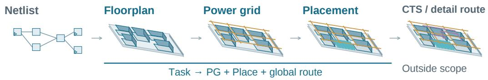

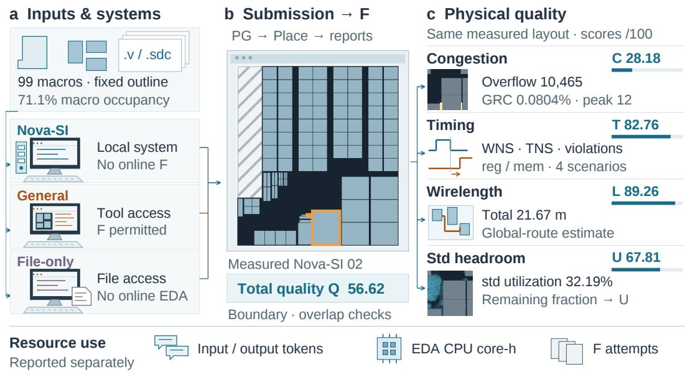  
Figure 1: Evaluating physical quality from agent deliverables. (a) Fixed inputs and three interfaces; only General permits online F feedback. (b) Submissions undergo PG and placement with macro-boundary and overlap checks. The native coordinates of Nova-SI output 02 illustrate a delivered layout rather than a common starting layout: hatching marks the excluded L-shaped corner; orange outlines mark the largest and smallest macros. (c) Congestion, timing, wirelength, and std headroom for the same output; resources are separate. Top stages, workstations, and waveforms are schematic, not extracted critical paths. Congestion/std share a zoom window: maximum positive overflow across layers per 40 µm bin, yellow–red at 0–12. F ends at placement and global-route estimation, not signof; quality is defined in Eq. 7.

Li (2026) discusses autonomous chip design in terms of action spaces, domain reasoning, and agent orchestration. That perspective motivates evaluating an engineering system beyond its language model. Our study complements this perspective with a protocol for assessing the physical outcomes of delivered layouts.

## 3 Task and Evaluation Framework

The framework answers three questions: what must an agent deliver, how is that artifact measured, and what do the reported quantities mean? The task contract fixes the engineering problem; submission checks connect the agent’s artifact to the measured state; physical

evaluation then separates layout quality from execution status. We instantiate this protocol on one design. Another design would require its own constraints, libraries, recipe, and justified scoring scales.

## 3.1 Task definition

The input project contains the netlist, technology and cell libraries, a fixed L-shaped layout boundary, 107 fixed signal ports, timing and power constraints, and measurement recipes. The original database contains 235,727 instances. Its 99 functional hard macros occupy 10.043 mm2, or 71.1% of the 14.123 mm2 layout region. They use 12 library references, with an approximately 121-fold ratio between the largest and smallest macro areas. Appendix C gives the attributes, measurement denominators, and scale context from published designs.

These conditions constrain more than whether the macros fit. Hard macros cannot be arbitrarily resized, the fixed boundary cannot be enlarged, and the missing corner is not usable whitespace. Positions and orientations determine whether the remaining space forms connected regions or fragmented strips, while shaping connections between macro pins and fixed ports. The agent must therefore place large modules legally while reserving usable space for downstream std placement and wiring. Suficient area does not guarantee that local connection demand can be accommodated.

Systems may choose macro coordinates and legal orientations, together with placement constraints supported by their interface. They may not delete logic, relax timing constraints (SDC), move fixed ports, or enlarge the boundary. Engineer-reference coordinates and golden grouping or shapes are not supplied as answers. Hard macros retain fixed shapes; the downstream flow optimizes the std logic. Here, L-shaped refers to the database layout region, without an additional claim about the manufactured outline of the complete chip.

The deliverable is a layout, not an agent-written quality report. Native engineering agents provide reopenable project states; file-only agents provide declarative macro placements that an external executor applies to the design database without searching for better coordinates. The evaluated state must remain associated with that submission. Agent access to tools and feedback is an experimental condition, described in Section 4.1, rather than a property inferred from the final score.

## 3.2 From submission to physical measurement

We denote a PG+placement evaluation by F. This prescribed flow builds the power grid (PG), performs placement, and measures congestion using global routing, which estimates wire demand against available routing capacity. It also measures setup timing, wirelength, and std area, before clock-tree synthesis (CTS), detailed routing, or signof. Existing native measurements are reused when they follow the prescribed flow and can be linked to the submitted layout; otherwise, external evaluation supplies the measurement without feedback to the terminated agent. Measurements are read from native EDA reports rather than accepted from an agent’s description of success.

This flow is not a passive scoring function: normal std placement, resizing, and bufer insertion change the design downstream of the macro decisions. We therefore check submission binding at the appropriate level. For 11 baselines whose submitted and measured std states difer, the audit covers all 99 macro geometries, 107 fixed signal ports, original cell names and references, and the supplied recipe. Across evaluation sources, 25 core PG, placement, and constraint files are byte-identical. These checks support interpreting the measurements as downstream outcomes of the submitted layouts, without requiring unchanged std geometry or claiming complete electrical equivalence (Appendix E).

A run is one agent execution, which may produce several candidate layouts and invoke F more than once. We call a complete physical measurement an observation. The system’s delivered layout determines the selected output; evaluation associates it with the latest complete matching measurement, or measures it externally when needed. Selection is therefore based on the submission, not its maximum historical score. For feedback analysis, the first observation is the earliest verifiable complete F measurement, possibly after failed attempts.

Candidate identifiers, report paths, and execution order distinguish these endpoints from the full search history.

## 3.3 Quality and resources

Our scoring rule uses fixed scales to map congestion c, setup timing t, wirelength l, and std headroom s into [0, 1] and scores each output as

$$
Q = 1 0 0 c ^ { 0 . 3 5 } t ^ { 0 . 5 0 } l ^ { 0 . 1 0 } s ^ { 0 . 0 5 } .\tag{1}
$$

Congestion includes the fraction of global-routing cells (GRCs) afected by overflow, its total, and its peak. Overflow measures demand exceeding capacity. Timing includes worst negative slack (WNS), total negative slack (TNS), and violation counts for reg-to-reg, reg-tomem, mem-to-reg, and other native path families; negative slack means a timing requirement is missed. Std headroom is $1 - A _ { s t d } \bar { / } ( A _ { d i e } - A _ { m a c r o } )$ . Losses use fixed half-score scales independent of sample rankings or a reference layout (Appendix B). They express engineering preferences, not universal process limits.

Reported std utilization is $A _ { s t d } / ( A _ { d i e } - A _ { m a c r o } )$ : its denominator already excludes macro area. It difers from macro occupancy of the whole layout and from placeable-site utilization. A std utilization near 32% therefore does not mean that roughly 68% of the entire design is empty, nor that local routing resources are suficient.

Measured outputs with confirmed macro boundary or overlap violations receive zero; legal but severely congested layouts retain their low score. An agent-caused failure to complete the required delivery also receives zero. A missing report alone does not establish such a failure: terminal records must identify the outcome. All included outcomes are resolved in this study. Normalized components and total quality average all included outcomes, with invalid geometry and delivery failure scored zero; raw physical means use only measured, geometry-passing layouts. A zero quality score is thus not a zero-congestion measurement.

The multiplicative quality score limits compensation: good wirelength alone cannot cancel arbitrarily poor timing or congestion. We assess sensitivity to the weights and scales to characterize how these preferences afect the comparison. Resources comprise input/output tokens, EDA CPU-core hours, and F attempts, including recorded failed attempts and subordinate-thread usage. Nova-SI and File-only core-hours cover external evaluation; General includes solving and evaluation activity in the available logs. Incomplete log coverage makes reported core-hours lower bounds on actual consumption. Tokens are not equa computational units across models. We do not combine quality and resources using an uncalibrated exchange rate.

## 4 Results

## 4.1 Experimental setup

Nova-SI (Super Intelligence) is our independently developed, locally deployed system. It contributes eight evaluated outputs, each weighted equally, without online feedback from the prescribed PG+placement flow. General has five model configurations and File-only three, each with four included runs. General can query native design databases and invoke EDA and PG+placement feedback. File-only can read and edit files and report status, but cannot run a shell, scripts, or EDA; its layout is evaluated after submission. Common project inputs thus do not imply identical observability: a binary database can be directly queryable in one interface and inaccessible to the file reader in another. Table 1 identifies model–harness configurations; reasoning settings and additional details appear in Appendix D.

We compare deployed system configurations, not isolated models under a common time or token budget. Nova-SI versus General is the principal engineering-system comparison; File-only additionally examines delivery under a restricted interface. The study includes 40 outputs and runs: eight Nova-SI outputs and 32 baseline runs. All eight Nova-SI outputs and 31 baseline runs have complete selected-layout measurements. Of these 39 layouts, 30 pass macro-boundary and overlap checks and nine do not. One General/DeepSeek run ended with a PG-state delivery after placement timed out; this agent-caused delivery failure scores zero, without imputing physical measurements. Thus all 40 included outcomes contribute to quality and resource summaries.

## 4.2 Layout quality

Table 1: Quality comparison with resource context. Higher quality is better; invalid geometry and delivery failure score zero.
<table><tr><td></td><td></td><td colspan="2">Coverage</td><td colspan="2">Resources</td><td colspan="5">Quality ↑</td></tr><tr><td>System / model</td><td>Harness</td><td>n/N</td><td>Inv.</td><td>Tok. (M)</td><td>Core-h</td><td>C</td><td></td><td>T</td><td>Qmax</td><td>Qmean</td></tr><tr><td>Human reference†</td><td></td><td>1/1</td><td></td><td></td><td></td><td>94.17</td><td></td><td>93.51</td><td>91.88</td><td>91.88</td></tr><tr><td>Nova-SI</td><td></td><td>8/8</td><td>0</td><td>36.13</td><td>22.49</td><td>34.67</td><td>79.68</td><td></td><td>81.09</td><td>57.97</td></tr><tr><td>General</td><td></td><td></td><td></td><td></td><td></td><td></td><td></td><td></td><td></td><td></td></tr><tr><td>GPT-6 Astra [xhigh]</td><td>Codex</td><td>4/4</td><td>0</td><td>131.36</td><td>30.79</td><td>13.87</td><td></td><td>59.45</td><td>64.75</td><td>31.17</td></tr><tr><td>GPT-6.1 Sol [xhigh]</td><td>Codex</td><td>4/4</td><td>0</td><td>286.50</td><td>53.81</td><td></td><td>7.59</td><td>39.89</td><td>38.37</td><td>22.73</td></tr><tr><td>DeepSeek-V4.1-Flash-1017 [max] DeepSeek Harness</td><td></td><td>4/4</td><td>0</td><td>156.45</td><td>25.89</td><td></td><td>4.44</td><td>34.58</td><td>39.00</td><td>16.18</td></tr><tr><td>GLM-5.3 [max]</td><td>zcode</td><td>4/4</td><td>0</td><td>62.11</td><td>22.23</td><td></td><td>3.23</td><td>44.49</td><td>22.71</td><td>18.92</td></tr><tr><td>GLM-5.3-Flash [max]</td><td>zcode</td><td>4/4</td><td>0</td><td>185.44</td><td>76.80</td><td></td><td>2.92</td><td>36.57</td><td>27.88</td><td>15.52</td></tr><tr><td>File-only</td><td></td><td></td><td></td><td></td><td></td><td></td><td></td><td></td><td></td><td></td></tr><tr><td>DeepSeek-V4.1-Flash-1017 [max] InternBootcamp</td><td></td><td>4/4</td><td>4</td><td>13.53</td><td>20.10</td><td></td><td>0.00</td><td>0.00</td><td>0.00</td><td>0.00</td></tr><tr><td>GLM-5.3 [max]</td><td>InternBootcamp</td><td>4/4</td><td>1</td><td>9.64</td><td>17.52</td><td></td><td>5.27</td><td>29.94</td><td>43.39</td><td>15.25</td></tr><tr><td>GLM-5.3-Flash [max]</td><td>InternBootcamp</td><td>4/4</td><td>4</td><td>10.96</td><td>15.32</td><td></td><td>0.00</td><td>0.00</td><td>0.00</td><td>0.00</td></tr></table>

C: congestion; T: timing; all quality scores use a 0–100 scale. n/N: scored / included outcomes; Inv.: macro-geometry violations. Complete measurements exist for 39 outputs; General/DeepSeek r03 failed to complete placement and scores zero. Quality columns average all N outcomes except Qmax. Invalid geometry and delivery failure zero both components and total quality, not raw physical quantities. Bold / underline mark the highest / second-highest observed agent scores, excluding REF; not statistical significance.  
Brackets: reasoning efort (Appendix D); Tok.: total tokens. Qmax uses selected outputs, not trace-wide best candidates. Resources average all N: Nova and File-only core-hours cover external evaluation; General covers recorded solving and evaluation. Logged values are lower bounds within these scopes, not full-system costs. †Historical engineer placement reference, not a matched rerun or signof; excluded from agent cohorts; costs unknown.

Nova-SI’s mean measured quality is 57.97, versus 31.17 for General/GPT-6 Astra, the strongest observed baseline (Table 1). Their congestion components are 34.67 versus 13.87, and timing components 79.68 versus 59.45. Section 5.1 examines the physical quantities and individual outcomes behind this diference; Appendix F gives the raw tables.

Aggregate diferences do not imply uniform dominance. Nova-SI spans 39.01–81.09 and General/GPT-6 Astra 17.19–64.75; one General output exceeds several Nova-SI outputs (Figure 2). Nine of 12 File-only outputs have invalid macro geometry: all four DeepSeek-V4.1-Flash-1017 and all four GLM-5.3-Flash outputs score zero, while GLM-5.3 has one invalid output and a configuration mean of 15.25. Favorable raw overflow cannot ofset a boundary violation. Two audited File-only failures used assumed geometry, with submitted macro poses preserved in measurement (Appendix J). General/DeepSeek-V4.1-Flash-1017 has three measured layouts and one terminal delivery failure, giving a mean quality of 16.18 over all four runs. General/GPT-6.1 Sol and GLM-5.3 have four measured layouts each, with means of 22.73 and 18.92. Appendix H separates physical-measurement coverage from zero-scored delivery failures. The historical engineer floorplan scores 91.88, above Nova-SI’s selected-output maximum of 81.09 and the strongest baseline maximum of 64.75. This is an earlier placement reference, not signof PPA or a matched rerun; unavailable costs are left blank. Maxima describe collected outcomes, not equal-budget best-of-k estimates.

## 4.3 Recorded resources

Token use across the eight Nova-SI outputs ranges from 18.10 to 65.54 million with a mean of 36.13 million; recorded EDA use averages 22.49 core-hours. Resource means in the main table retain all included outcomes. Figure 3 pairs all 40 quality scores with their own resources, retaining geometrically invalid outputs and the delivery failure at zero quality with their expenditure intact. File-only agents have no online EDA access but still incur external measurement costs.

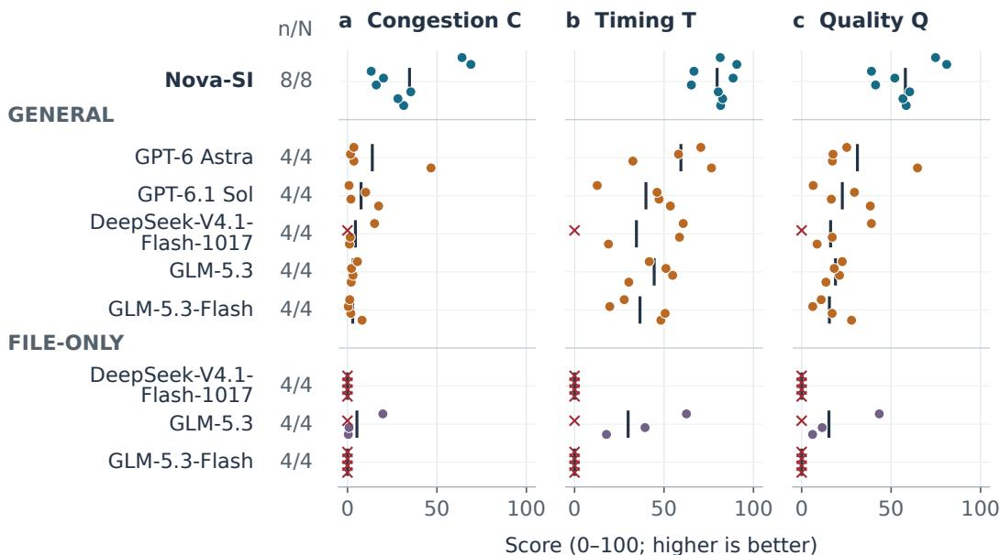  
Output Invalid / failed (0) Mean  
Figure 2: Per-output congestion, timing, and quality on aligned scales and run ofsets. Each panel contains 30 geometry-passing outputs (colored points), nine geometrically invalid outputs, and one delivery failure (red crosses, scored zero rather than zero raw measurements). Black ticks: all-outcome means; $n / N !$ : scored/included counts; colors: systems.

The plotted core-hours cover diferent activity, and token records may include shared upstream work; the scatter is not a complete-system Pareto frontier. Appendix I gives input/output splits, F attempts, and per-output records.

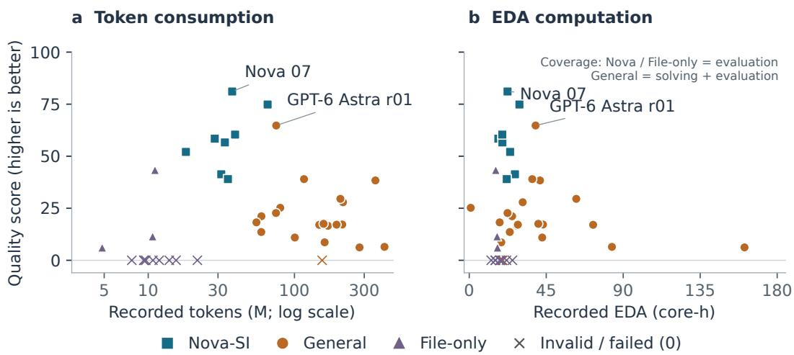  
Figure 3: Measured quality and recorded resources paired by output. Both panels contain eight Nova outputs and 32 baseline outcomes. (a) Total tokens, paired with the corresponding output. (b) EDA core-hours: external evaluation for Nova and File-only; recorded solving plus evaluation lower bounds for General. Crosses retain resource use of geometrically invalid outputs and the delivery failure, all scored zero. Quality and resources belong to the same included output at each point; this is not an equal-budget comparison or an exhaustive system-compute account.

## 5 Analysis

The aggregate results raise three questions: which physical quantities account for the system gap, why can apparently similar layouts difer so much, and how do execution records explain the delivered layout? We address them using configuration-level measurements, matched spatial views, and existing execution records. These are explanations at diferent levels of evidence, not interchangeable causal tests.

## 5.1 Nova-SI versus the strongest observed baseline

The Nova-SI–General/GPT-6 Astra comparison separates physical quality from basic deliverability: all eight Nova-SI outputs and all four Astra outputs pass the macro-boundary and overlap checks and have complete measurements. Their 26.80-point mean-quality gap therefore does not arise from zeroing invalid layouts or omitting unmeasured runs within these two configurations. The diference also extends beyond the means: median quality is 57.52 versus 21.37, and three of Astra’s four outputs score below Nova-SI’s lowest output, 39.01. Astra r01 nevertheless scores 64.75, above six Nova-SI outputs. The observed advantage is a higher center and fewer very low-quality outputs in this collection, not a claim that every Nova-SI layout is better.

The physical measurements locate the diference in congestion and timing rather than globa packing density. Mean std utilization is similar (32.27% for Nova-SI and 33.56% for Astra), whereas mean total overflow is 17,563 versus 281,748 and afected-GRC fraction is 0.0745% versus 0.9586%. Mean wirelength is also lower, at 21.89 versus 28.88 m. For reg-to-reg, regto-mem, and mem-to-reg respectively, mean worst-scenario WNS is −1.225/−1.104/−0.803 versus −2.352/ − 2.240/ − 2.325 ns, and TNS is −44.773/ − 41.806/ − 10.831 versus −530.426/ − 157.122/ − 85.630 ns. Both worst-path severity and accumulated timing violations favor Nova-SI at the configuration level. These correlated quantities jointly describe the physical diferences underlying the congestion and timing components.

Nova-SI achieves these outcomes without using the prescribed evaluation flow for online feedback; Astra’s interface permits this use. Access to downstream feedback alone therefore does not explain the quality ranking. Figures 4 and 5 show each configuration’s highestand lowest-scoring selected layouts at the same scale. In both configurations, substantial whitespace coexists with localized congestion; subsequent close-ups examine these spatial diferences. They help interpret physical failure modes, but do not identify which Nova-SI algorithmic choice causes the cross-system gap. Models, engineering priors, harnesses, and budgets difer together, so the evidence supports the evaluated system configuration rather than an isolated model or equal-budget advantage.

## 5.2 Sensitivity to scoring choices

Removing Nova-SI’s best output leaves a mean of 54.67, so one high-scoring output cannot explain the observed diference. Holding weights fixed, we multiply each of seven half-score scales by 0.5, 1, or 2. Across all 2,187 combinations, Nova-SI’s measured mean exceeds the strongest baseline mean by 22.30–30.38 points. This relationship persists, but three complete orderings occur among configurations. Fourteen separate single-deletion checks with remaining weights renormalized also preserve the principal relationship (Appendix G).

The sensitivity results apply to the collected outputs and tested scale ranges. Among the 30 geometry-passing outputs, Spearman correlation is 0.980 between afected-GRC fraction and total overflow, and 0.976 between TNS and violation-count summaries. These submetrics describe strongly covarying aspects of physical quality. Sensitivity checks probe scoring preferences; they do not correct selection, shared provenance, or missingness, or establish statistical significance.

## 5.3 Similar utilization, diferent congestion

Macros occupy approximately seven-tenths of this layout; std utilization describes std occupancy only within the remaining geometric area. It records neither how that space connects nor which connections must pass through it. The following comparison tests whether global summaries adequately describe the physical outcomes.

Nova-SI’s highest- and lowest-scoring outputs, 07 and 06, score 81.09 and 39.01 despite similar global std utilization (32.16% and 32.48%) and relatively close wirelengths (21.41 and 22.71 m). Total overflow is 1,587 versus 47,124 and afected-GRC fraction 0.012673% versus 0.179684%. They are separate outputs, not successive optimization steps. Figure 4 shows their full triptychs; Table 6 lists all eight outputs.

Figure 6 aligns a common local window. Output 07 distributes std through a broad lower region and connecting passages; in 06, std mostly occupies strips between tall macro columns. Macro-excluded geometric area in the window is 1.060 versus 0.372 mm2, while std area is 0.455 versus 0.077 mm2. The more congested output 06 thus has lower average local std occupancy: 20.82%, versus 42.97% in 07. This geometric ratio is not placeable-site utilization, but does not support an explanation based simply on more std or higher mean local density.

The window contains 525 versus 7,869 positive-overflow edges, totaling 701 versus 8,033 overflow. In output 06, 7,705 of those edges exceed capacity by only one: the local deficit is widespread rather than a few severe peaks. Fragmented space, connection demand, and routing capacity remain possible explanations; the export lists only overflowing edges, preventing a complete demand–capacity decomposition. The window covers only 17.0% of 06’s global overflow and is insuficient to explain the overall score diference. The case identifies spatial structure that global area and peak summaries omit; the available evidence does not isolate a particular geometric operation as its cause.

## 5.4 Timing severity and breadth are distinct

Output 07 has better timing than 06 in all three principal families, with diferent patterns across metrics (Table 2). Reg-to-reg worst WNS magnitude is 0.231 ns in 07 versus 2.041 ns in 06, whereas the maximum violation counts are relatively close: 429 and 467. For regto-mem, both severity and breadth difer substantially: TNS magnitudes are 4.106 and 236.917 ns, with 33 and 375 violations, respectively. Thus, a similar count can conceal much milder violations, and a single worst path does not describe the whole timing distribution.

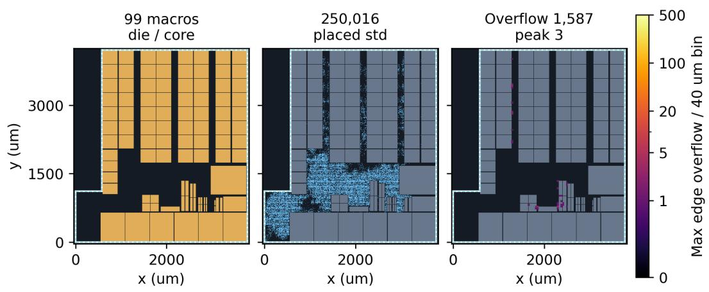  
Nova-SI 06 | Macro geometry checked

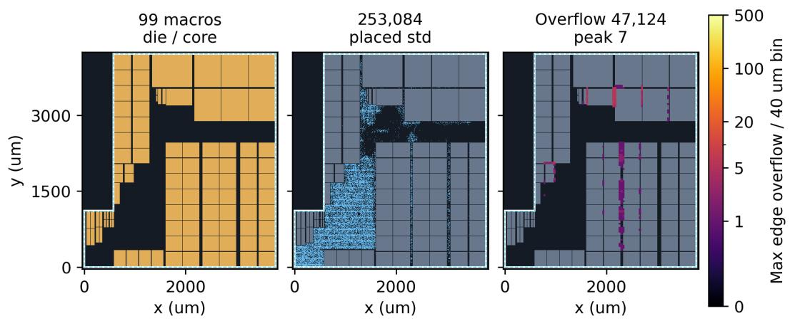  
Figure 4: Nova-SI layouts with the highest (07, $Q = 8 1 . 0 9 )$ and lowest (06, $Q = 3 9 . 0 1 )$ measured scores. These are separate outputs, not successive optimization steps. Each row shows macros, actual std cells, and congestion from the same measurement: maximum positive overflow across layers per 40 µm bin, on a shared 0–500 scale, linear over 0–1 and logarithmic thereafter. In 07, vertical open regions connect to the lower std region. Output 06 also leaves broad horizontal whitespace, yet has more extensive hotspots within macroarray channels. Whitespace alone does not characterize the local congestion. White denotes die and dashed cyan core; panels are reconstructed from native coordinate and measurement exports. Timing is measured separately in Table 2, not inferred from the heatmap.

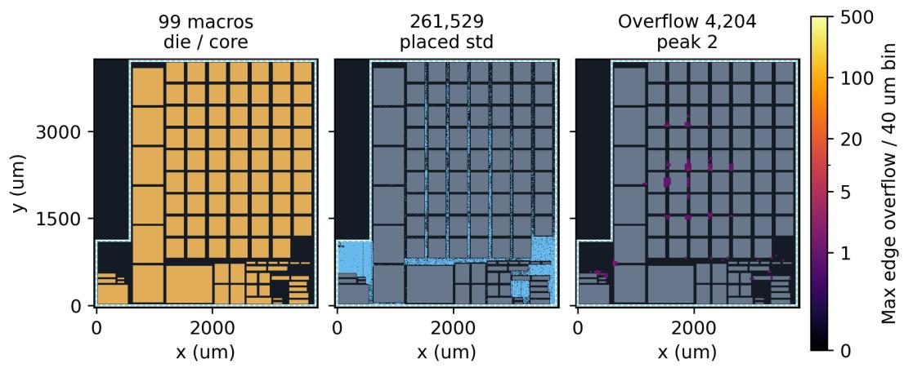  
General / GPT-6 Astra / r02 | Macro geometry checked

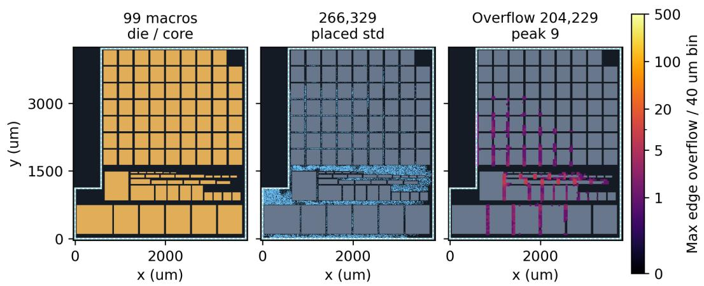  
Figure 5: Highest (r01, Q = 64.75) and lowest (r02, Q = 17.19) selected General/GPT-6 Astra outputs, using the same extrema rule as Nova in Figure 4. Left to right: macros, actual std, and congestion. Both figures use a shared 0–500 scale, linear over 0–1 and logarithmic thereafter, with the maximum positive overflow across layers per 40 µm bin. Global std utilization is 33.16% versus 33.94%, but total overflow is 4,204 versus 204,229. In r02, broader hotspots occur near std strips and entrances between lower horizontal macros. Output r01 is less congested and outperforms six Nova outputs. White denotes die and dashed cyan core; panels are reconstructed from native coordinate and measurement exports.

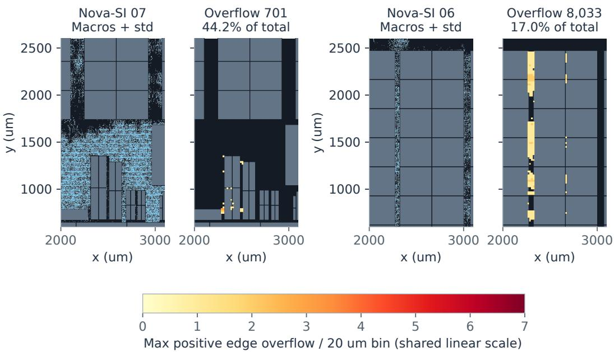  
Figure 6: A common spatial window: x from 2000 to 3100 and y from 600 to 2600 µm (upper bounds excluded), selected after full-layout inspection. Each pair shows macros with actual std, then maximum positive edge overflow across layers per 20 µm display bin, on a shared linear 0–7 scale. Native-edge midpoints give 525 and 7,869 positive-overflow edges, with totals of 701 and 8,033, for 07 and 06. The latter is only 17.0% of 06’s global overflow, so this window alone cannot explain the overall score diference.

Table 2: Timing severity and breadth for Nova 06 and 07.
<table><tr><td></td><td colspan="2">WNS (ns)</td><td colspan="2">TNS (ns)</td><td colspan="2">Violations</td></tr><tr><td>Path family</td><td>06</td><td>07</td><td>06</td><td>07</td><td>06</td><td>07</td></tr><tr><td>reg-to-reg</td><td>-2.041</td><td>-0.231</td><td>-54.420</td><td>-18.772</td><td>467</td><td>429</td></tr><tr><td>reg-to-mem</td><td>-2.491</td><td>-0.575</td><td>-236.917</td><td>-4.106</td><td>375</td><td>33</td></tr><tr><td>mem-to-reg</td><td>-0.998</td><td>-0.309</td><td>-20.041</td><td>-1.626</td><td>82</td><td>18</td></tr></table>

Each quantity takes its own worst value across four scenarios; violations are not summed across scenarios. WNS and TNS closer to zero, and fewer violations, are better. These are two diferent outputs, not before/after measurements of matched paths.

Existing path-endpoint exports also show that the worst reg-to-reg paths have diferent endpoints: output 06 links memory-test status logic to a controller counter, whereas 07’s is internal to controller pointer logic, under the same clock and scenario. The comparison therefore describes diferences in family-wise worst timing rather than a delay change along a matched path. The available detailed path report covers only IO paths and lacks cell/net delay breakdowns for these scored paths, leaving the specific delay sources unresolved.

## 5.5 Feedback and layout selection

Among 19 measured General runs, 16 first/selected pairs reference the same candidate. Four of these have a single recorded F attempt; ten have earlier attempts before their first complete measurement, and two have later attempts. Endpoint identity therefore does not mean that no exploration occurred. Attempt order alone does not distinguish failed searches, repairs, or rollbacks (Appendix H).

The three changed pairs illustrate diferent outcomes. GPT-6.1 Sol r03 declines from 43.37 to 29.52 after a reported correction to preserve the original placement-site definition and remeasurement, not simply a choice of the worse scalar score. GLM-5.3-Flash r04 uses congestion feedback to widen a notch corridor, increasing quality from 6.36 to 10.93; its report shows improved reg-to-reg timing but worse reg-to-mem timing in the same functional scenario. GLM-5.3 r04 changes from 22.25 to 22.71 despite a small increase in total overflow, from 135,768 to 136,296. A composite score need not track a single congestion quantity. Feedback can reveal tradeofs, and the selected state need not maximize our evaluation score. These observations do not isolate the causal benefit of feedback.

## 6 Discussion and Conclusion

This study evaluates engineering agents through the layouts they deliver and the physical consequences of those layouts under a specified downstream flow. Its central methodological distinction is between a submission, its measured implementation, and the interpretation of that measurement. Checking this connection matters when EDA legitimately changes std geometry, when an agent cannot observe the native input geometry, and when several tool attempts precede the selected result.

The empirical comparison favors Nova-SI’s mean delivered quality over the observed baselines on this instance, principally through congestion and timing, although their per-output score ranges overlap. The case analyses yield practical lessons for evaluation: inspect spatial demand rather than infer it from global utilization; read timing severity together with violation counts; and use execution records before interpreting first/final changes as search progress. Two audited File-only failures also connect reported geometry-access problems to assumed placements and verified geometric violations (Appendix J). These findings make the evaluation informative beyond a scalar ranking.

The fixed L-shaped boundary, heterogeneous hard macros, and downstream logic together define a concrete spatial-planning problem. Within this fixed project, geometrically feasible deliveries have substantially diferent physical outcomes. Linking submissions, measurements, and local layout evidence makes those diferences amenable to detailed analysis. Without a rectangular-outline control, the score diferences cannot be attributed to the L-shape alone.

The design was available during development; the outputs are a retrospective collection rather than independently repeated runs under a prospectively fixed experimental design. Models, engineering priors, permissions, and harnesses difer jointly. This case study therefore does not establish unseen-design generalization, isolated model contributions, or equalbudget eficiency.

Post-placement quality is not signof or electrical equivalence: PG-connectivity and DRC findings remain relevant outside the quality gate. Scales express preferences, absolute slack is not period-normalized, and resource coverage is incomplete. Private assets, code, databases, and traces prevent complete independent replication; the published protocol, scoring rules, per-output summaries, and 39-layout atlas support scrutiny within that limit. The contribution is a specified evaluation protocol supported by a detailed industrial case study. Broader designs and controlled system comparisons would be needed to test how far these observed diferences extend.

## References

Saurabh N. Adya and Igor L. Markov. Fixed-outline floorplanning through better local search. In Proceedings of the IEEE International Conference on Computer Design, 2001. URL https://vlsicad.eecs.umich.edu/BK/parquet/iccd\_2001\_floorplan.pdf.

Rishabh Agarwal, Max Schwarzer, Pablo Samuel Castro, Aaron Courville, and Marc G. Bellemare. Deep reinforcement learning at the edge of the statistical precipice. In Advances in Neural Information Processing Systems, 2021. URL https://arxiv.org/abs/2108.13264.

Analog Design Bench Team. Long-horizon analog design bench: Benchmarking agents on hours-long analog and mixed-signal circuit design tasks. arXiv preprint arXiv:2609.33356, 2026. URL https://arxiv.org/abs/2609.33356.

Jason Blocklove, Siddharth Garg, Ramesh Karri, and Hammond Pearce. Chip-chat: Challenges and opportunities in conversational hardware design. In ACM/IEEE Workshop on Machine Learning for CAD (MLCAD), 2023. doi: 10.1109/MLCAD58807.2023.10299874. URL https://arxiv.org/abs/2305.13243.

Jun Shern Chan, Neil Chowdhury, Oliver Jafe, James Aung, Dane Sherburn, Evan Mays, Giulio Starace, Kevin Liu, Leon Maksin, Tejal Patwardhan, Lilian Weng, and Aleksander Mądry. MLE-bench: Evaluating machine learning agents on machine learning engineering. arXiv preprint arXiv:2410.07095, 2024. URL https://arxiv.org/abs/2410.07095.

ChiPBench authors. ChiPBench: Oficial dataset statistics. Project repository, Dataset section. URL https://github.com/MIRALab-USTC/ChiPBench#dataset.

Andrew B. Kahng and Zhiang Wang. DG-RePlAce: A dataflow-driven GPU-accelerated analytical global placement framework for machine learning accelerators. arXiv preprint arXiv:2404.13049, 2024. URL https://arxiv.org/abs/2404.13049v2. Version 2.

Andrew B. Kahng, Ravi Varadarajan, and Zhiang Wang. Hier-RTLMP: A hierarchical automatic macro placer for large-scale complex IP blocks. arXiv preprint arXiv:2304.11761, 2023. URL https://arxiv.org/abs/2304.11761v2. Version 2.

Sayash Kapoor, Benedikt Stroebl, Zachary S. Siegel, Nitya Nadgir, and Arvind Narayanan. AI agents that matter. arXiv preprint arXiv:2407.01502, 2024. URL https://arxiv.org/abs/2407.01502.

Linyang Li. Agent-orchestration in autonomous chip design. arXiv preprint arXiv:2608.14035, 2026. URL https://arxiv.org/abs/2608.14035.

Qiufeng Li, Rongqian Chen, Quan Cheng, Chengxuan Wang, Sizhe Tang, Chia-Tung Ho, David Z. Pan, Tian Lan, and Weidong Cao. PDAGENT-BENCH: Characterizing, grounding, and architecting LLM/VLM agents for VLSI physical design. arXiv preprint arXiv:2606.17253, 2026a. URL https://arxiv.org/abs/2606.17253v7. Version 7.

Qiufeng Li, Chengxuan Wang, Rongqian Chen, Quan Cheng, Yihui Ren, Chia-Tung Ho, David Z. Pan, Tian Lan, and Weidong Cao. PlaceReasoner-Beta: Reasoning-driven macro placement and benchmarking. arXiv preprint arXiv:2609.21263, 2026b. URL https://arxiv.org/abs/2609.21263v2. Version 2.

Mike A. Merrill, Alexander G. Shaw, Nicholas Carlini, et al. Terminal-Bench: Benchmarking agents on hard, realistic tasks in command line interfaces. arXiv preprint arXiv:2601.11868, 2026. URL https://arxiv.org/abs/2601.11868.

Zhihai Wang, Zijie Geng, Zhaojie Tu, Jie Wang, Yuxi Qian, Zhexuan Xu, Ziyan Liu, Siyuan Xu, Zhentao Tang, Shixiong Kai, Mingxuan Yuan, Jianye Hao, Bin Li, Yongdong Zhang, and Feng Wu. Benchmarking end-to-end performance of ai-based chip placement algorithms. arXiv preprint arXiv:2407.15026, 2024. URL https://arxiv.org/abs/2407.15026.

Kentaro Yoshioka. The era of vibe tapeout: Dark age or golden age for analog circuit design? arXiv preprint arXiv:2610.15240, 2026. URL https://arxiv.org/abs/2610.15240.

## A Contributions

A.1 Project Lead

Linyang Li

## A.2 Core Contributors

Yue Shen, Yongkang Chen

## A.3 Contributors

Jianxi Xue, Zhishu He, Hanlin Chen, Jianqiu Chen, Jianze Liang, Le Gao, Peiji Li, Huanlong Zeng, Tianyi Lyu

## B Full Scoring Definition

A nonnegative loss z is converted using a half-score scale $h .$ . Here $p$ is the fraction of GRCs with overflow, O is total overflow, M is peak overflow, and ℓ is reported wirelength in meters.

$$
d ( z ; h ) = ( 1 + z / h ) ^ { - 1 } ,\tag{2}
$$

$$
c = d ( p ; 0 . 0 0 0 4 ) ^ { 0 . 4 } d ( O ; 2 0 0 0 ) ^ { 0 . 4 } d ( M ; 2 0 ) ^ { 0 . 2 } ,\tag{3}
$$

$$
t _ { j } = d ( W _ { j } ; 2 \mathrm { n s } ) ^ { 0 . 4 } d ( N _ { j } ; 2 0 0 \mathrm { n s } ) ^ { 0 . 4 } d ( V _ { j } ; 2 0 0 0 ) ^ { 0 . 2 } ,\tag{4}
$$

$$
t = t _ { r r } ^ { 8 / 1 7 } t _ { r m } ^ { 4 / 1 7 } t _ { m r } ^ { 4 / 1 7 } t _ { o t h e r } ^ { 1 / 1 7 } ,\tag{5}
$$

$$
l = d ( \ell ; 1 8 0 \mathrm { m } ) , \qquad u = \frac { A _ { s t d } } { A _ { d i e } - A _ { m a c r o } } , \qquad s = 1 - u ,\tag{6}
$$

$$
Q = 1 0 0 c ^ { 0 . 3 5 } t ^ { 0 . 5 0 } l ^ { 0 . 1 0 } s ^ { 0 . 0 5 } .\tag{7}
$$

For timing family $j ,$ , each scenario first takes the worst negative WNS magnitude and separately sums negative TNS magnitudes and violation counts. Each quantity is then maximized across four scenarios to obtain $W _ { j } , N _ { j } , V _ { j }$ . The maxima can come from diferent scenarios; they are not deduplicated cross-scenario violation totals. The scenarios combine functional/scan modes with $1 2 5 ^ { \circ } \mathrm { C } / - 4 0 ^ { \circ } \mathrm { C }$ under ssgnp, 1.08 V, cworst settings. The prescribed timing mode is graph-based analysis (GBA).

The rr, rm, mr families correspond to REG2REG, REG2MEM, and MEM2REG; other combines REG2GATE and default. Native INPUT, OUTPUT, and INOUT groups are excluded. The default group retains the tool’s native classification; no path-by-path endpoint reclassification is assumed. Ungated component scores are $C = 1 0 0 \bar { c } , T = \bar { 1 } 0 \bar { 0 } t , L = 1 \bar { 0 } 0 l , U = 1 0 0 s$

For the first F observation of General/GLM-5.3 r04, the report lists residual paths under automatic clock-named groups rather than a literal default group. These residual groups are mapped to the default bucket after verifying their membership and confirming zero TNS and violation counts for every component in the original report. Named reg/mem families remain unchanged; no timing quantities from a reopened state replace the original measurement.

Let N denote the number of included outcomes, O the subset with complete physical measurements, and $g _ { i } = 0$ for confirmed macro boundary or overlap violations and $g _ { i } = 1$ for outputs passing those geometric checks. Terminal delivery failures contribute zero. Because every included outcome is resolved, the reported mean is

$$
Q _ { \mathrm { m e a n } } = \frac { 1 } { N } \sum _ { i \in \mathcal { O } } g _ { i } Q _ { i } , \qquad Q _ { \mathrm { m a x } } = \operatorname* { m a x } \bigl ( \{ g _ { i } Q _ { i } : i \in \mathcal { O } \} \cup \{ 0 \} \bigr ) .\tag{8}
$$

Normalized component means in the main table apply the same $g _ { i }$ and denominator $N$ , with terminal delivery failures contributing zero. Raw physical means use only the measured $g _ { i } = 1$ subset. The failed run has no invented congestion or timing measurements. This is a delivered-quality summary, not a certificate of complete electrical validity.

A wirelength half-score scale of 180 m gives approximately 90 points at 20 m. It is a fixed preference for this study, not a claim that 20 m is satisfactory for every design. Std headroom is interpretable here because die and logic are fixed; it does not demonstrate that the die can shrink.

## C Instance Attributes and Design Context

Table 3 separates original-input attributes from post-placement metrics. Across all 39 measured outputs, the 99 functional macros match the input instance names, library references, and orientation-independent dimensions; native die/core boundary vertices also match. The dimension tolerance is 0.00021 µm, covering native coordinate-export precision. Macro positions need not match across layouts.

Table 3: Input attributes of the fixed instance. Areas come from native polygons or macro dimensions, not optimized post-placement std statistics; die/core denote database layout boundaries.
<table><tr><td>Attribute</td><td>Value</td></tr><tr><td>Original instances</td><td>235,727</td></tr><tr><td>Functional non-macros / hard macros / physical-only</td><td>235,618 / 99 / 10</td></tr><tr><td>Functional-macro library references</td><td>12</td></tr><tr><td>Fixed signal ports</td><td>107</td></tr><tr><td>Layout-region / core area (mm2)</td><td>14.123370 / 14.103612</td></tr><tr><td>Total functional-macro area (mm2)</td><td>10.042939</td></tr><tr><td>Macro / layout-region area</td><td>71.1%</td></tr><tr><td>Macro / core area</td><td>71.2%</td></tr><tr><td>Smallest / largest macro area (mm2)</td><td>0.004254 / 0.514510</td></tr><tr><td>Largest / smallest macro area</td><td>120.95</td></tr></table>

Published designs provide context for the instance’s scale. ChiPBench’s oficial dataset table spans 20 designs, 10–136 macros, and 26,667–427,003 cells (ChiPBench authors); Table II of Hier-RTLMP spans 25–760 macros and 95K–2,529K standard cells (Kahng et al., 2023). Its macro and instance counts lie within the ranges covered by these published designs. Their cell and std classifications are not interchangeable.

Two additional dimensions complement macro count. Hier-RTLMP lists largest-to-smallest macro-area ratios of 1–18.52, versus 120.95 here. The six accelerator instances in DG-RePlAce have macro/core occupancy of 46%–60%, versus 71.2% here (Kahng et al., 2023; Kahng and Wang, 2024). These comparisons contextualize size heterogeneity and macro occupancy, not dificulty: technologies, timing requirements, module definitions, and evaluation stages difer, and our instance also has a fixed concave boundary. DG-RePlAce’s separate overall Util includes a 2 µm macro halo and must not be conflated with our std utilization.

Macro-excluded geometric area is not a complete model of placement or routing capacity. It is the denominator of std utilization without subtracting every placement-site restriction and halo; routing capacity on metal layers has further constraints. Macro occupancy, std utilization, and native congestion measurements therefore describe diferent properties and should be interpreted together with local layout evidence.

D System Configurations and Measurement Coverage
<table><tr><td>Condition</td><td>Solving interface</td><td>Online feedback from prescribed PG+Place</td></tr><tr><td>Nova-SI</td><td>Specialized pipeline</td><td>Not used</td></tr><tr><td>General</td><td>Native engineering tools</td><td>Allowed, not required</td></tr><tr><td>File-only</td><td>Files and status reporting</td><td>Unavailable</td></tr></table>

General uses gpt-6-astra and gpt-6.1-sol with a Codex harness at xhigh efort; deepseek-v4.1- flash-1017 with DeepSeek Harness; and glm-5.3 and glm-5.3-flash with a zcode harness. Fileonly uses the latter three models with InternBootcamp. DeepSeek and both GLM models use max efort: General/GLM requests set it explicitly, while DeepSeek and File-only inherit deployment or chat-template defaults. Efort labels do not establish a common reasoning budget.

All eight Nova-SI outputs are included with equal weight. The analysis describes these collected outputs; it does not estimate an independent-run success probability.

All 32 baseline runs have terminal outcomes. Thirty-one have complete selected-layout measurements. In General/DeepSeek-V4.1-Flash-1017 r03, placement reached its agentconfigured 21,600-second time limit, after which the agent delivered a power-grid-stage layout and terminated without completing placement. This is a delivery failure rather than an unresolved measurement: it receives zero quality and remains in all-run resource accounting. Its physical quantities remain absent.

## E Native Measurements and Submission Binding

We verify both numerical fidelity and the connection between submissions and measured states. Congestion totals, wirelength, and WNS, TNS, and violation counts of the three principal timing families are checked against native reports. Recomputed total and component scores for all 39 measured outputs difer by less than $2 . 2 \times 1 \dot { 0 } ^ { - 1 4 }$ . Nova-SI reports match hashes recorded during evaluation. Twenty-five core PG, placement, and constraint recipe files are byte-identical across evaluation sources; report-export files difer.

For 11 baselines with diferent submitted and measured std states, checks cover all 99 macro geometries, 107 fixed signal ports, the original 235,727 cell names and references in the submitted state, and 27 recipe files against the provided native recipe. Source-to-PG-toplacement records connect submission and measurement. The submissions include unplaced std and earlier placed states. One retained-report recovery was checked against 343,865 exported objects, with no layout or timing reoptimization. These are normal stage diferences, not a requirement to submit the final post-placement database or a formal equivalence claim for all electrical states.

## F Raw Physical Quantities and Timing

Table 4: Mean raw physical quantities for geometry-passing layouts.
<table><tr><td>System / model</td><td> $n _ { g }$ </td><td>Overflow</td><td>Peak</td><td>GRC (%)</td><td>Length (m)</td><td>std (%)</td></tr><tr><td>Human reference†</td><td>1</td><td>142</td><td>2.00</td><td>0.0014</td><td>20.31</td><td>32.13</td></tr><tr><td>Nova-SI</td><td>8</td><td>17,563</td><td>9.50</td><td>0.0745</td><td>21.89</td><td>32.27</td></tr><tr><td>General</td><td></td><td></td><td></td><td></td><td></td><td></td></tr><tr><td>GPT-6 Astra</td><td>4</td><td>281,748</td><td>23.25</td><td>0.9586</td><td>28.88</td><td>33.56</td></tr><tr><td>GPT-6.1 Sol</td><td>4</td><td>526,552</td><td>19.50</td><td>1.7251</td><td>31.11</td><td>33.80</td></tr><tr><td>DeepSeek-V4.1-Flash-1017</td><td>3</td><td>673,784</td><td>43.33</td><td>1.5112</td><td>27.29</td><td>33.39</td></tr><tr><td>GLM-5.3</td><td>4</td><td>291,349</td><td>29.50</td><td>1.3516</td><td>30.31</td><td>33.82</td></tr><tr><td>GLM-5.3-Flash</td><td>4</td><td>1,033,158</td><td>49.75</td><td>4.0209</td><td>35.46</td><td>35.15</td></tr><tr><td>File-only</td><td></td><td></td><td></td><td></td><td></td><td></td></tr><tr><td>GLM-5.3</td><td>3</td><td>1,365,605</td><td>78.00</td><td>3.7338</td><td>31.96</td><td>35.05</td></tr></table>

$n _ { g }$ counts measured geometry-passing layouts; configurations with none are omitted. Invalid physical quantities are not imputed as zero. Overflow and Peak are counts, GRC is the percentage of global-route cells with overflow, and std is utilization.  
† Single historical engineer placement reference, not a matched rerun or signof; excluded from agent-cohort statistics.

The engineer reference is included in the physical, timing, and per-output quality tables. It has overflow 142, peak 2, afected GRC 0.001383%, wirelength 20.315 m, and std utilization 32.134%. Its historical PG state and recipe provenance preclude a controlled human–agent comparison. Nova-SI scores in output-ID order are 58.42, 56.62, 60.39, 41.33, 52.07, 39.01, 81.09, and 74.84. Every included output contributes equally.

Table 5: Mean worst-scenario setup timing for geometry-passing layouts.
<table><tr><td rowspan="2">System / model</td><td rowspan="2"></td><td colspan="2">reg→reg (ns)</td><td colspan="2"> $\mathbf { r e g - }$  →mem (ns)</td><td colspan="2">mem→reg (ns)</td></tr><tr><td>WNS</td><td>TNS</td><td>WNS</td><td>TNS</td><td>WNS</td><td>TNS</td></tr><tr><td>Human reference†</td><td>1</td><td>-0.229</td><td>-15.105</td><td>-0.209</td><td>-0.735</td><td>-0.099</td><td>-0.526</td></tr><tr><td>Nova-SI</td><td>8</td><td>-1.225</td><td>-44.773</td><td>-1.104</td><td>-41.806</td><td>-0.803</td><td>-10.831</td></tr><tr><td>General</td><td></td><td></td><td></td><td></td><td></td><td></td><td></td></tr><tr><td>GPT-6 Astra</td><td>4</td><td>-2.352</td><td>-530.426</td><td>-2.240</td><td>-157.122</td><td>-2.325</td><td>-85.630</td></tr><tr><td>GPT-6.1 Sol</td><td>4</td><td>-8.830</td><td>-3862.730</td><td>-2.608</td><td>-280.384</td><td>-3.326</td><td>-109.591</td></tr><tr><td>DeepSeek-V4.1-Flash-1017</td><td>3</td><td>-4.327</td><td>-2841.980</td><td>-3.476</td><td>-528.565</td><td>-2.156</td><td>-92.864</td></tr><tr><td>GLM-5.3 GLM-5.3-Flash</td><td>4 4</td><td>-3.367 -3.276</td><td>-797.730 -1926.729</td><td>-3.450 -6.441</td><td>-384.916 -1267.639</td><td>-3.483 -3.709</td><td>-184.465</td></tr><tr><td>File-only</td><td></td><td></td><td></td><td></td><td></td><td></td><td>-195.556</td></tr><tr><td>GLM-5.3</td><td>3</td><td>-6.757</td><td>-2393.181</td><td>-3.224</td><td>-603.979</td><td>-2.720</td><td>-132.878</td></tr></table>

$n _ { g }$ counts geometry-passing layouts. WNS (worst negative slack) and TNS (total negative slack) are each minimized across four scenarios per layout, then averaged across layouts; the worst scenarios can difer. † Single historical engineer placement reference, not a matched rerun or signof; excluded from agent-cohort statistics.

Table 6: Per-output Nova-SI quality and the historical human reference.
<table><tr><td>ID</td><td>Overflow</td><td> $\mathrm { P e a k }$ </td><td>std (%)</td><td> $C \uparrow$ </td><td> $^ { T \uparrow }$ </td><td>Q↑</td></tr><tr><td>REF</td><td>142</td><td>2</td><td>32.13</td><td>94.17</td><td>93.51</td><td>91.88</td></tr><tr><td>01</td><td>9,186</td><td>9</td><td>32.22</td><td>31.42</td><td>81.66</td><td>58.42</td></tr><tr><td>02</td><td>10,465</td><td>12</td><td>32.19</td><td>28.18</td><td>82.76</td><td>56.62</td></tr><tr><td>03</td><td>7,381</td><td>10</td><td>32.30</td><td>35.37</td><td>80.33</td><td>60.39</td></tr><tr><td>04</td><td>34,981</td><td>20</td><td>32.30</td><td>16.09</td><td>65.28</td><td>41.33</td></tr><tr><td>05</td><td>27,867</td><td>12</td><td>32.26</td><td>20.12</td><td>88.62</td><td>52.07</td></tr><tr><td>06</td><td>47,124</td><td>7</td><td>32.48</td><td>13.24</td><td>66.73</td><td>39.01</td></tr><tr><td>07</td><td>1,587</td><td>3</td><td>32.16</td><td>68.96</td><td>90.69</td><td>81.09</td></tr><tr><td>08</td><td>1,913</td><td>3</td><td>32.21</td><td>63.99</td><td>81.41</td><td>74.84</td></tr></table>

Outputs 01–08 follow output-ID order; all 99 macros pass boundary and overlap checks. Overflow and Peak are counts; std is utilization. Scores $C , T , Q$ range from 0 to 100; bold / underline mark the highest / second-highest among the eight outputs, with printed ties sharing a mark. REF is excluded from ranking and Nova statistics: it is a historical placement reference, not a matched rerun or signof.

## G Scoring Sensitivity

Removing Nova-SI’s highest-scoring output reduces its mean from 57.97 to 54.67. This checks concentration in a single outcome; it does not remove selection bias or produce a new independent sample.

We multiply each top-level quality weight by factors of 0.5, 1, and 2 and renormalize the four weights to sum to one. Nova-SI retains the highest measured mean in all 81 settings, with a gap of 22.97–27.36 points to the strongest baseline mean. Half-score scales and the collected outputs remain fixed. This tests sensitivity to the relative importance of components, not universal scale validity or statistical significance.

The seven half-score scales (afected GRC, overflow, peak, WNS, TNS, violation count, wirelength) each take factors 0.5, 1, and 2, with weights fixed: $3 ^ { 7 } = 2 \qquad $ , 187 settings. Nova-SI’s measured-mean gap to the strongest baseline, GPT-6 Astra, remains positive at 22.30– 30.38. Three complete configuration orderings occur, with changes among the baseline configurations. Separately, we delete one congestion submetric, one loss shared across timing families, one timing family, or one top-level component, renormalizing remaining weights within the afected group. These 14 checks give gaps of 16.99–28.94. The two analyses are separate, not an exhaustive joint perturbation. The sensitivity analysis was not preregistered before data collection.

Across 30 geometry-passing outputs, Spearman correlations are 0.980 for GRC/overflow, 0.845 for overflow/peak, 0.786 for GRC/peak, and 0.976 for TNS/violation-count summaries. Timing summaries sum family-wise worst-scenario quantities, not deduplicated paths across scenarios. Correlation describes covariation and deletion probes score dependence; neither identifies physical causality.

## H First and Selected Physical Observations

Table 7: Physical-measurement and delivery outcomes for the full cohort.
<table><tr><td>System / model</td><td>N</td><td>Measured</td><td>Inv.</td><td>Failed</td></tr><tr><td>Nova-SI</td><td>8</td><td>8</td><td>0</td><td>0</td></tr><tr><td>General</td><td></td><td></td><td></td><td></td></tr><tr><td>GPT-6 Astra</td><td>4</td><td>4</td><td>0</td><td>0</td></tr><tr><td>GPT-6.1 Sol</td><td>4</td><td>4</td><td>0</td><td>0</td></tr><tr><td>DeepSeek-V4.1-Flash-1017</td><td>4</td><td>3</td><td>0</td><td>1</td></tr><tr><td>GLM-5.3</td><td>4</td><td>4</td><td>0</td><td>0</td></tr><tr><td>GLM-5.3-Flash</td><td>4</td><td>4</td><td>0</td><td>0</td></tr><tr><td>File-only</td><td></td><td></td><td></td><td></td></tr><tr><td>DeepSeek-V4.1-Flash-1017</td><td>4</td><td>4</td><td>4</td><td>0</td></tr><tr><td>GLM-5.3</td><td>4</td><td>4</td><td>1</td><td>0</td></tr><tr><td>GLM-5.3-Flash</td><td>4</td><td>4</td><td>4</td><td>0</td></tr></table>

Inv. counts measured outputs with invalid macro geometry and is included in Measured; Failed is disjoint. General/DeepSeek r03 did not complete placement and scores zero, with physical measurements absent. All 40 outcomes have assigned scores; bounds for unresolved outcomes are unnecessary.

Table 7 distinguishes measured outcomes from terminal delivery failure. The latter has an assigned zero score, not an unknown score requiring imputation or a missing-outcome bound. Physical summaries and first/selected comparisons require actual measurements and therefore exclude this failed run.

Table 8: Paired quality at the first verifiable F and selected-layout F.
<table><tr><td>System / model</td><td> $n _ { g }$ </td><td> $Q _ { \mathrm { f i r s t } }$ </td><td> $Q _ { \mathrm { s e l e c t e d } }$ </td><td>∆Q</td></tr><tr><td>Nova-SI</td><td>8</td><td>57.97</td><td>57.97</td><td>+0.00</td></tr><tr><td>General</td><td></td><td></td><td></td><td></td></tr><tr><td>GPT-6 Astra</td><td>4</td><td>31.17</td><td>31.17</td><td>+0.00</td></tr><tr><td>GPT-6.1 Sol</td><td>4</td><td>26.19</td><td>22.73</td><td>-3.46</td></tr><tr><td>DeepSeek-V4.1-Flash-1017</td><td>3</td><td>21.58</td><td>21.58</td><td>+0.00</td></tr><tr><td>GLM-5.3</td><td>4</td><td>18.80</td><td>18.92</td><td>+0.12</td></tr><tr><td>GLM-5.3-Flash</td><td>4</td><td>14.37</td><td>15.52</td><td>+1.14</td></tr><tr><td>File-only</td><td></td><td></td><td></td><td></td></tr><tr><td>GLM-5.3</td><td>3</td><td>20.33</td><td>20.33</td><td>+0.00</td></tr></table>

$n _ { g }$ counts geometry-passing pairs; Q is the mean on a 0–100 scale. ∆Q is selected minus first, computed before rounding. The first verifiable F need not be the first attempt. Nova and File-only reuse the same external measurement at both endpoints, not an online optimization trajectory.

The first observation is the earliest retained complete F measurement, not necessarily the first attempted execution. The selected observation is the complete measurement associated with the system’s delivered layout, as defined in Section 3. For the 16 General pairs with identical candidate references, matching report paths and hashes also confirm that both endpoints reuse one measurement. Earlier attempts without complete measurements remain unscored; their recorded resource use is included. Nova-SI and File-only reuse their postsubmission evaluation at both endpoints by construction. The human reference has no retained first/selected pair and is excluded from this table.

Table 9: F-attempt ordering in the 19 measured General runs.
<table><tr><td>First / selected candidate</td><td>n</td><td>Recorded execution order</td></tr><tr><td>Same</td><td>4</td><td>One attempt only</td></tr><tr><td>Same</td><td>10</td><td>Attempts before first complete observation</td></tr><tr><td>Same</td><td>2</td><td>First attempt complete; later attempts follow</td></tr><tr><td>Different</td><td>3</td><td>Another candidate selected</td></tr></table>

Classes are mutually exclusive; the second may also include later attempts. Counts describe execution order, not distinct layouts or a classification of failures, repairs, and rollbacks.

The changed Sol r03 selection record states that a grid candidate worsened WNS and congestion, and that the retained automatic layout was repaired for original-site preservation before remeasurement. Its final report describes restoring std orientations while preserving macro poses. This is agent-reported selection intent, not a controlled attribution of the score decline. Flash r04’s report describes widening a notch corridor from 60 to 199 µm following congestion inspection. In its functional $1 2 5 ^ { \circ } \mathrm { C }$ comparison, reg-to-reg TNS changes from −37,357.2 to −1,364.4 ns, whereas reg-to-mem WNS worsens from −4.103 to −7.678 ns. This reported intervention illustrates a tradeof between timing families.

## I Resource Definitions and Coverage

Table 10: Mean resource components by baseline configuration.
<table><tr><td>System / model</td><td>Input tokens (M)</td><td>Output tokens (M)</td><td>EDA (core-h)</td><td>F</td><td> $n _ { F } / N$ </td></tr><tr><td>Human reference†</td><td></td><td></td><td></td><td></td><td></td></tr><tr><td>General</td><td></td><td></td><td></td><td></td><td></td></tr><tr><td>GPT-6 Astra</td><td>130.729</td><td>0.631</td><td>30.79</td><td>2.25</td><td>4/4</td></tr><tr><td>GPT-6.1 Sol</td><td>285.621</td><td>0.883</td><td>53.81</td><td>2.75</td><td>4/4</td></tr><tr><td>DeepSeek-V4.1-Flash-1017</td><td>156.154</td><td>0.292</td><td>25.89</td><td>2.00</td><td>3/4</td></tr><tr><td>GLM-5.3</td><td>61.486</td><td>0.622</td><td>22.23</td><td>4.25</td><td>4/4</td></tr><tr><td>GLM-5.3-Flash</td><td>185.211</td><td>0.234</td><td>76.80</td><td>6.00</td><td>4/4</td></tr><tr><td>File-only</td><td></td><td></td><td></td><td></td><td></td></tr><tr><td>DeepSeek-V4.1-Flash-1017</td><td>13.413</td><td>0.114</td><td>20.10</td><td>1.50</td><td>4/4</td></tr><tr><td>GLM-5.3</td><td>9.462</td><td>0.182</td><td>17.52</td><td>1.50</td><td>4/4</td></tr><tr><td>GLM-5.3-Flash</td><td>10.854</td><td>0.102</td><td>15.32</td><td>1.25</td><td>4/4</td></tr></table>

Each baseline has $N = 4 .$ F counts recorded PG+Place attempts, including failures; its mean uses only n records with counts. Missing is not zero. Counts are online for General and external for File-only, whose online F is zero. EDA values are lower bounds from logged CPU seconds / 3600, not reserved cores times wall time. †Historical human resource use and attempts are unknown, not zero.

The resource vector is $( T ^ { i n }$ , Tout, Hsolve, Heval, Fonline, Fexternal). Tokens include available root and subordinate-thread records. EDA core-hours sum CPU seconds in the available logs divided by 3600, including recorded failed attempts. Incomplete log coverage makes these totals lower bounds on actual consumption. F counts are recorded PG+Place attempts, not a complete inventory of every custom EDA invocation. Wall time depends on scheduling and concurrency and is not a substitute for CPU use.

Token counts are associated with the corresponding measured outputs. Nova-SI and Fileonly EDA figures measure external evaluation; General includes solving and evaluation activity in the available logs. Shared upstream token attribution and incomplete log coverage prevent interpreting all rows as independently metered, complete-system totals. We retain the components rather than assigning a resource score with an unsupported token-to-CPU exchange rate.

Table 11: Per-output Nova-SI resource records. EDA hours come from external evaluation.
<table><tr><td>ID</td><td>Input tokens (M)</td><td>Output tokens (M)</td><td>Total tokens (M)</td><td>EDA (core-h)</td></tr><tr><td>01</td><td>20.161</td><td>8.349</td><td>28.510</td><td>17.00</td></tr><tr><td>02</td><td>22.184</td><td>11.247</td><td>33.431</td><td>19.37</td></tr><tr><td>03</td><td>19.402</td><td>19.866</td><td>39.268</td><td>19.29</td></tr><tr><td>04</td><td>18.769</td><td>12.818</td><td>31.587</td><td>26.71</td></tr><tr><td>05</td><td>9.099</td><td>9.000</td><td>18.099</td><td>23.89</td></tr><tr><td>06</td><td>21.287</td><td>13.790</td><td>35.077</td><td>21.91</td></tr><tr><td>07</td><td>18.911</td><td>18.596</td><td>37.507</td><td>22.38</td></tr><tr><td>08</td><td>32.603</td><td>32.940</td><td>65.543</td><td>29.34</td></tr></table>

Tokens use records associated with each measured output. Native-response accounting includes rejected responses recorded in the available logs and does not add reasoning tokens again outside completion tokens. Upstream records may overlap; summing outputs does not establish a deduplicated request total. EDA covers external evaluation only.

## J Scope and Evidence for Spatial Case Studies

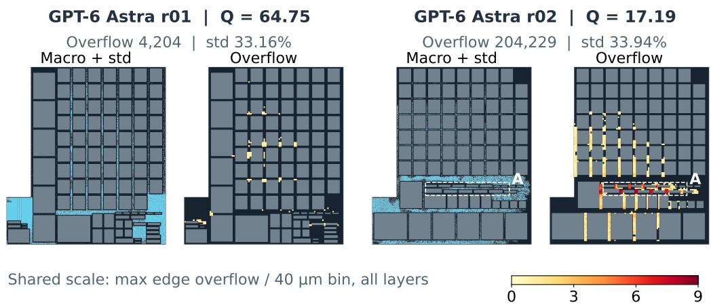  
Figure 7: Two measured layouts under the same model and harness. Each pair combines macros and actual std at left, with maximum positive edge overflow across layers per 40 µm bin at right on a shared linear 0–9 scale. In r02, region A contains std strips separated by horizontal small macros; several entrances coincide with hotspots absent at the same intensity in r01. Both sets of 99 macros pass geometry checks. Reconstructed from native post-placement exports: this locates diferences without isolating a causal efect of channel width.

General/GPT-6 Astra r01/r02 has global std utilization of 33.16% versus 33.94%, but overflow of 4,204 versus 204,229. In Figure 7, r02’s horizontal small macros partition strips containing std; several entrances coincide with strong hotspots absent at the same intensity in r01. Geometry and optimized std properties change together, so this comparison locates a diference without isolating the causal efect of channel width. The task example is Nova-SI’s mid-scoring output 02. The main comparisons use its highest/lowest outputs 07/06 and the General/GPT-6 Astra r01/r02 pair. The supplementary atlas includes all 39 measured outputs, ordered by Nova-SI output ID and then baseline configuration and run ID. The atlas includes the nine geometrically invalid outputs. The single failed run without completed placement falls outside its physical-panel coverage; it remains included at zero quality in the outcome summaries.

Each triptych shares a coordinate system across macros and boundaries, actual std geometry, and global-routing congestion. Comparison panels use common scales and state their layer aggregation. All figures are reconstructed from native coordinate and measurement exports.

Std geometry and congestion come from the corresponding post-placement measurement state.

Nova-SI’s mid-scoring output 02 has peak overflow 12, higher than output 06’s 7, but lower total overflow (10,465) and a better timing component. One peak cannot replace spatial extent. Worst-scenario reg-to-reg WNS is −0.231 and −2.041 ns for outputs 07 and 06; the congestion maps describe spatial patterns, whereas identifying the source of this timing diference requires cell/net delay breakdowns for the corresponding paths.

## File-only / GLM-5.3-Flash / r04 | INVALID

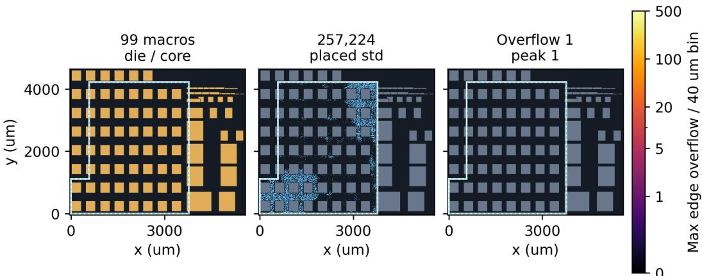  
Figure 8: Low overflow need not indicate a good layout: File-only/GLM-5.3-Flash r04. The axes cover all macros, including those outside the white die boundary. Native overflow is 1, but the geometry audit identifies 53 functional macros outside the die, giving efective score zero. Low overflow coexists with severe geometric violations here; the figure alone does not identify the specific cause of low overflow. The color scale is the same 0–500 scale used throughout the atlas.

The figure shows all out-of-bound objects in the invalid layout. This layout receives zero under the geometric-validity rule; its raw physical measurements serve only as diagnostic evidence. Spatial overlap with a hotspot is an observed association; without matched net/path evidence or a controlled intervention, it does not establish a unique physical cause.

For File-only/GLM-5.3-Flash r04 and GLM-5.3 r03, all 99 submitted origins and orientations match the measured macro poses within the export precision $( 1 0 ^ { - 4 } \mu \mathrm { m } )$ These outputs have 53 and six macros outside the die, respectively; the latter also has 295 overlapping macro pairs. Both agents’ final reports state that binary geometry was unreadable through their available interface and describe assumptions about dimensions or boundaries. GLM-5.3 estimates macro area at 4.77 mm2, versus the native total of $\mathrm { 1 0 . 0 4 3 m m ^ { 2 } }$ The unchanged macro poses place the geometric errors in the submitted layouts rather than in subsequent execution of those coordinates. The final reports suggest that limited geometry access contributed to these errors; they do not establish whether alternative extraction strategies were available.

For GLM-5.3 r03, the native tool-response trace records a UTF-8 decoding failure when reading the initial design database, followed by failures on library files. This provides toollevel evidence for the information-access dificulty reported in that run; for Flash r04, the access explanation rests on its final report. The sequence is a failed geometry read, explicit assumptions in the submitted report, then measured geometry violations with the submitted poses intact. It supports an interface-level failure explanation for this run, not a general causal attribution for all nine invalid outputs.