# Evidence or Marginal? What Moment-Vector Propagation Computes in Polynomial Density Neurons

Przemysław Spyra AGH University of Krakow pspyra@agh.edu.pl

## Abstract

When a neuron’s input is lost, or known through a belief �, what should it output? For a neuron storing a joint polynomial density � with input density �, two formulas compete. $p _ { \mathrm { C D } } = \mathbb { E } _ { q } [ N ] / \mathbb { E } _ { q } [ D ]$ costs one matrix–vector product; Hierarchical Correlation Reconstruction introduces it as a constant-denominator approximation to $p _ { \mathrm { E U } } = \mathbb { E } _ { q } [ N / D ]$ . For a density model both are exact answers to diferent questions: $p _ { \mathrm { C D } }$ is Bayesian updating with the belief as virtual evidence; $p _ { \mathrm { E U } }$ installs the belief as a new marginal (Jefrey’s rule). With a missing input �CD returns the model’s conditional; $p _ { \mathrm { E U } }$ generally does not. This post hoc reading is proved, and illustrated outside the pair family up to $k = 8$ inputs; it has no pre-registered test, only one exploratory real-data pilot. Post hoc, closed forms fall within a factor 2 of all 112 measured gaps, and negative density begins near input correlation $1 / k$ . In a pre-registered synthetic study (up to 32 inputs), 5 of 15 hypotheses are supported, 2 inconclusive and 8 not supported, including all three on transfer beyond equicorrelated Gaussians. Post hoc, where $p _ { \mathrm { E U } }$ is defined, truncation usually outweighs the gap for Beta beliefs in pair neurons; triple neurons under flat and data beliefs are exceptions.

## 1 Introduction

A neuron with two inputs loses one of them at test time. If the neuron stores the joint density of its inputs and output, the right output seems obvious: condition on the input that remains. Now write the loss as a belief � over the inputs, a point mass on the first and flat on the second, and pass � through the neuron. There are two natural formulas: average the conditional $N / D$ under �, or average numerator and denominator separately and divide. They disagree, and only the second returns the conditional the model implies. Change the story, and let the second input really be uniform and independent of the first in the population the neuron now serves. The same two formulas now swap roles, and the first is right.

This is not a numerical accident. Normalising after averaging looks like a cheap approximation to normalising before. This paper shows that the two are exact answers to diferent questions. In a density model, $p _ { \mathrm { C D } } ~ =$ $\mathrm { E } _ { q } [ N ] / \mathrm { E } _ { q } [ D ]$ is Bayesian updating with the belief as evidence (Pearl’s virtual evidence, one sum-product message), and $p _ { \mathrm { E U } } = \operatorname { E } _ { q } [ N / D ]$ installs the belief as a new marginal (Jefrey’s rule). Which is right depends on where the belief came from.

The question arises in density neurons, which store the joint density of inputs and output as coeficients of a polynomial basis. With many inputs the basis keeps only terms that couple at most two variables (a pair neuron) or three (a triple neuron), and a truncated expansion of this kind can turn negative. Hierarchical Correlation Reconstruction (HCR) is one such model [15, 16]. Holding a density, not only a function, such a neuron can take a density over its inputs and return one over its output. The natural formula integrates the conditional against the belief, an integral of a ratio of polynomials. HCR’s Eq. 10 [16] instead averages numerator and denominator separately; the belief then enters only through its moment vector, and propagation is one matrix–vector product. The HCR paper [16] states the integral of the conditional as the density to propagate, and presents this step as an approximation with a constant denominator. We ask what that step computes, how far it lies from the integral, and when either exists.

Contributions.

• Meaning (Section 3). We identify HCR’s Eq. 10 as virtual evidence and its target as Jefrey’s rule, and draw the consequence for missing inputs. The mathematics of uncertain evidence is classical [8, 36, 62], and any model that normalises after averaging has the same structure; what we add is this identification, not a new update.

• Size (Section 4). An exact expansion explains why the gap is second order in the pair basis and first order in the triple basis, and closed forms explain why the pre-registered single power law fits only one of its four cells (H1c, inconclusive).

• Existence (Section 5). A positive semidefinite form of the pair denominator gives a convex bound on the negativity onset, an exact corner formula covers the triple basis, a formula for $\mathrm { E } _ { q } [ D ]$ explains why pair messages survive where triple messages do not, and we give the sample size needed under noise.

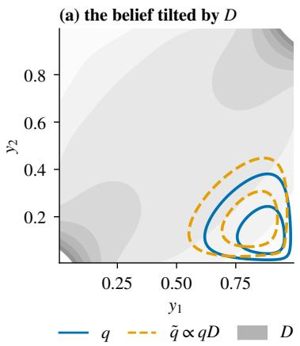

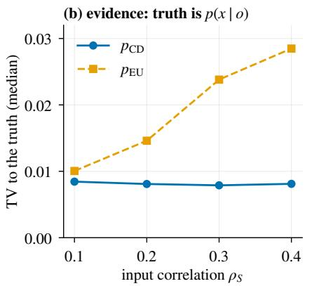

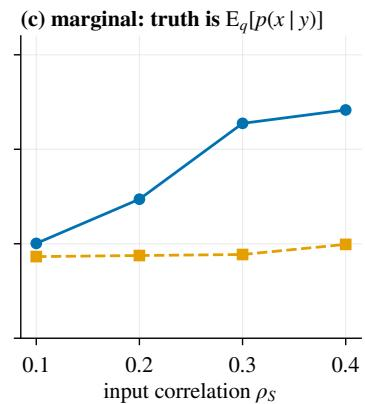  
Figure 1: Two questions, two exact answers (illustration, not a study result; $k = 2$ , full tensor model, $m = 4 ,$ population coeficients). (a) Under $p _ { \mathrm { C D } }$ the belief � is multiplied by the neuron’s input density �, giving �˜; the two inputs here report conflicting evidence. (b) If the belief is per-input evidence about an observation �, � matches �(� | �) up to truncation. (c) If the inputs really follow $q , p _ { \mathrm { E U } }$ matches. Medians over 200 observations at noise level $\sigma _ { \mathrm { o b s } } = 1 ;$ ; the flat floor near 0.008 is the truncation error of the degree-4 model.

• Measurement (Section 6). All 15 pre-registered outcomes are in Table 2, many of them unfavourable. Post hoc analyses of the same data show when truncation, not the denominator, sets the error, and when it does not (Section 6.2).

We do not claim that either form is right in general, nor that the contrast of Figure 1 persists at large �. It appears in full and triple models up to $k = 8 ,$ the largest case we tried, and the pair family loses it, because its rows cannot hold the conditional (Section 3.1). The study’s reference and metric names were fixed before the semantic reading was worked out, and its design tests only one of the two semantics.

## 2 Setting

The neuron. HCR works on variables normalised to [0, 1], for instance by their marginal distribution functions, so the object modelled is a copula density [54, 69]. Let $f _ { 0 } \equiv 1$ and $f _ { p } ( u ) = \sqrt { 2 p + 1 } P _ { p } ( 2 u - 1 )$ be the orthonormal shifted Legendre polynomials on [0, 1], and $\begin{array} { r } { f _ { \mathbf { j } } ( y ) = \prod _ { l } f _ { j _ { l } } ( y _ { l } ) } \end{array}$ for a multi-index j. A neuron with output � and inputs $y = \left( y _ { 1 } , \ldots , y _ { k } \right)$ models

$$
N ( x , y ) = \sum _ { i = 0 } ^ { m } f _ { i } ( x ) A _ { i } ( y ) , \qquad A _ { i } ( y ) = \sum _ { \bf j } a _ { i \bf j } f _ { \bf j } ( y ) ,\tag{1}
$$

with degree at most � per variable and $a _ { 0 0 } ~ = ~ 1$ . The coeficients are mixed moments, estimated by $\hat { a } _ { i \mathbf { j } } =$ $\begin{array} { r } { \frac { 1 } { n } \sum _ { t } f _ { i } ( x _ { t } ) f _ { \mathbf { j } } ( y _ { t } ) } \end{array}$ [16]. With exact moments of a known ground truth in place of estimates we speak of population coeficients. A full tensor is too large for big �, so a neuron keeps only multi-indices with few nonzero entries among the $k + 1$ variables: at most two (pair) or three (triple). For $k = 3 2 , m = 4$ this gives 8,581 and 357,765 coeficients. Integrating over � removes all rows $i > 0 ,$ , so $\begin{array} { r } { D ( y ) : = \int _ { 0 } ^ { 1 } N ( x , y ) d x = A _ { 0 } ( y ) } \end{array}$ is the neuron’s model of the input density, and $h _ { x } ( y ) = N ( x , y ) / D ( y )$ its conditional of � given �.

Two updates. Given a belief � on the inputs, define

$$
p _ { \mathrm { E U } } ( x ) = \mathrm { E } _ { q } \left[ { \frac { N ( x , y ) } { D ( y ) } } \right] , \qquad p _ { \mathrm { C D } } ( x ) = { \frac { \mathrm { E } _ { q } [ N ( x , y ) ] } { \mathrm { E } _ { q } [ D ( y ) ] } } = { \frac { \sum _ { i } f _ { i } ( x ) \sum _ { \mathbf { j } } a _ { i \mathbf { j } } b _ { \mathbf { j } } } { \sum _ { \mathbf { j } } a _ { 0 \mathbf { j } } b _ { \mathbf { j } } } } , \quad b _ { \mathbf { j } } = \mathrm { E } _ { q } [ f _ { \mathbf { j } } ( y ) ] .\tag{2}
$$

�CD is Eq. 10 of [16]. It sees � only through the moments $b _ { \mathbf { j } } .$ , costs one matrix–vector product, and integrates to 1 whenever $\mathrm { E } _ { q } [ D ] \ne 0 . p _ { \mathrm { E U } }$ needs $N / D$ to be integrable under �, which is more than $D \neq$ 0: at a regular sign change of � inside the support, $\operatorname { E } _ { q } { \left| { N } / { D } \right| } = \infty$ . For a general belief it needs an integral over �. If the density of � lies in the span of the basis, $p _ { \mathrm { E U } }$ is also linear in the moments, with output coeficients $\begin{array} { r } { c _ { i } = \sum _ { \mathbf j } M _ { i \mathbf j } b _ { \mathbf j } } \end{array}$ and $M _ { i \mathbf { j } } = \int f _ { \mathbf { j } } A _ { i } / D \ d y$ but � is a �-dimensional integral that needs $D > 0$ on the cube. So the diference in cost lies in obtaining the matrix, not in applying it. The label CD abbreviates constant denominator, and EU exact, uncalibrated, the protocol’s name for this form, where “exact” means only that the integral is evaluated without replacing the denominator. We keep it as a label; in the text � is the marginal-preserving form, for the reason given by Theorem 1.

Negativity and calibration. A truncated orthogonal expansion of a density need not be nonnegative. Orthogonalseries density estimation has a long history [6, 21, 41, 68], and corrections that turn an estimator into a bona fide density are known [26, 29]. The HCR paper proposes a calibration, for example max $\cdot ( \rho , 0 . 1 )$ or a softplus followed by normalisation, and says that in neural use it is mostly neglected, as the resulting approximations should be compensated during training; likelihood evaluation needs a positive density [16, Secs. II-A, IV]. This is separate from the constant denominator. The same paper states that step as an approximation [16, Sec. II-C], and notes that the denominator of its prediction formula can be removed given further inter-layer normalisation [16, Sec. II-B]. We keep the two issues apart throughout.

## 3 What the two forms compute

What does each form compute when � is a genuine density? Each is an exact Bayesian update, for a diferent reading of $q .$ . This reading is post hoc: it was worked out after the study was designed and run, and it changes no verdict. Proofs are in Appendix B. The signed case is treated after the theorem.

The intuition is one line of algebra. Averaging $N = h _ { x } D$ under � and dividing by $\mathrm { E } _ { q } [ D ]$ averages the conditional $h _ { x }$ under � reweighted by �. The denominator has not been approximated away: it has moved into the belief.

Theorem 1 (What $p _ { \mathrm { C D } }$ and $p _ { \mathrm { E U } }$ compute). Let $N \geq 0$ be a joint density and $q$ a bounded density with $D > 0$ on its support, and write $\tilde { q } = q D / \mathrm { E } _ { q } [ D ]$

(a) Evidence. Add a binary variable � with $P ( E = 1 \mid x , y ) = q ( y ) / \operatorname* { s u p } q$ , conditionally independent of � given $y .$ Under the model $N , p ( x \mid E = 1 ) = p _ { \mathrm { C D } } ( x )$ and $p ( y \mid E = 1 ) = \tilde { q } ( y )$

(b) Marginal. $q ( y ) h _ { x } ( y )$ is the unique joint density with input marginal � and the model’s conditional. Its output marginal is � .

(c) Same conditional, diferent belief. $\begin{array} { r } { p _ { \mathrm { C D } } = \int h _ { x } \tilde { q } d y \ \mathrm { a n d } \ p _ { \mathrm { E U } } = \int h _ { x } q d y } \end{array}$

(d) Conversion. If $\mathrm { E } _ { q } [ 1 / D ] < \infty$ , then $p _ { \mathrm { C D } } [ q / D ] = p _ { \mathrm { E U } } [ q ]$ and $p _ { \mathrm { E U } } [ q D ] = p _ { \mathrm { C D } } [ q ]$ , with beliefs normalised.

Part (a) is Pearl’s virtual evidence [62]: � acts as a likelihood, � as the prior, and �˜ as the posterior. Its numerator $\begin{array} { r } { \mathrm { E } _ { q } [ N ] = \int N q d y } \end{array}$ is the sum-product message [42] from the factor � to � when the incoming message on $y$ is $q .$ Part (b) is Jefrey’s rule [12, 36]. Both obey probability kinematics, as (c) shows, and difer only in how the evidence is specified [7]. Part (d) is the classical translation between them (Theorem 5 of [8], as described in [63]). So the question “how accurate is $p _ { \mathrm { C D } } ? ^ { \gamma }$ has no answer until one says what � means.

Signed models. Without $N \geq 0$ the identities in (c), (d) remain algebraically true wherever the denominators are nonzero, but �˜ is a signed measure and the probabilistic reading is lost. This matters from Section $5 \mathrm { o n }$

The next statement says which reading fits three situations a neuron meets in practice.

Proposition 2 (Evidence channels and missing inputs). Let the model have uniform one-dimensional input marginals.

(a) Let observations $o _ { l }$ of the inputs be independent given �, with likelihoods $\lambda _ { l } ( y _ { l } )$ , and let � be independent of � given �. Then the product of per-input posteriors $\begin{array} { r } { q = \prod _ { l } q _ { l } , q _ { l } \propto \lambda _ { l } } \end{array}$ , gives $p _ { \mathrm { C D } } [ q ] = p ( x \mid o )$ . In general $p _ { \mathrm { E U } } [ q ] \neq p ( x \mid o )$

(b) If instead $q ^ { * } = p ( y \mid o )$ is the joint posterior, then $p _ { \mathrm { E U } } [ q ^ { * } ] = p ( x \mid o )$ , and $p _ { \mathrm { C D } } [ q ^ { * } ]$ counts the prior � twice.

(c) Let inputs $y _ { 0 }$ be observed and inputs $y _ { \mathrm { m } }$ be missing, with belief a point mass on $y _ { 0 }$ and flat on $y _ { \mathrm { m } }$ . This belief is not a bounded density, so here $\operatorname { E } _ { q }$ means integration over $y _ { \mathrm { m } }$ at fixed $y _ { 0 } ;$ assume $\mathrm { E } _ { q } [ D ] > 0$ . Then $p _ { \mathrm { C D } }$ is the model’s conditional $\begin{array} { r } { p ( x \mid y _ { 0 } ) . \ p _ { \mathrm { E U } } = \int p ( x \mid y _ { \mathrm { 0 } } , y _ { \mathrm { m } } ) d y _ { \mathrm { m } } } \end{array}$ ignores the dependence of $y _ { \mathrm { m } }$ on $y _ { 0 }$ and in general difers from it.

Part (c) is the HCR paper’s rule for missing variables, which uses only coeficients with zero index for them [16, Sec. II-A]. So the HCR paper’s stated target for Eq. 10 is the marginal-preserving form, while its missing-data rule is the evidence form, and the same contraction serves both. Part (b) has a consequence for depth: a density passed forward through a chain is a predictive marginal of a hidden variable, which already contains that variable’s prior. The matching form at the next layer is then $p _ { \mathrm { E U } }$ , and the study’s ground truth takes that view.

None of this needs polynomials. Any model that averages before normalising tilts its belief the same way.

Proposition 3 (Any model that normalises after averaging). Let $\pi \geq 0 \mathrm { o n } X \times y$ and $\textstyle Z ( y ) = \int \pi d x > 0$ . Then $\begin{array} { r } { \mathrm { E } _ { q } [ \pi ] / \mathrm { E } _ { q } [ Z ] = \int ( \pi / Z ) } \end{array}$ ��˜ with $d \tilde { q } \propto Z d q$ . If � is integrable, this is virtual evidence in the joint model $p \propto \pi$ whose input density is proportional to $Z .$

So a softmax classifier whose exponentiated logits are averaged before normalising implicitly tilts the belief by $\begin{array} { r } { Z = \sum _ { x } \exp ( \mathrm { l o g i t } _ { x } ) } \end{array}$ , the unnormalised input density of the energy-based reading of Grathwohl et al. [31]; squared density models [65, 75] behave the same way. Linearity of � in the coeficients adds only one thing, the closed-form contraction with the moment vector.

The gap. How far apart are the two answers? They difer by how much the tilt moves the conditional, which is a covariance. Let $\mathrm { C V } _ { q } ( D ) = et { } { ' } \mathrm { s d } _ { q } ( D ) / \mathrm { E } _ { q } [ D ]$ . The first equality below is the classical covariance identity for a ratio of means [32, 67], applied pointwise in �.

Proposition 4 (Gap). Assume $\mathrm { E } _ { q } [ D ] > 0$ and $D \neq 0 q { \mathrm { - } } \mathbf { a } . \mathbf { s }$ ., and let $\begin{array} { r } { C _ { h } = \operatorname* { s u p } _ { y } \int | h _ { x } ( y ) | } \end{array}$ �� over the support of $q .$ If $h _ { x }$ is integrable under �, then for every �,

$$
p _ { \mathrm { C D } } ( x ) - p _ { \mathrm { E U } } ( x ) = \frac { \mathrm { C o v } _ { q } ( h _ { x } , D ) } { \mathrm { E } _ { q } [ D ] } .\tag{3}
$$

If moreover $h _ { x }$ is square-integrable under $q _ { \mathrm { : } }$

$$
\mathrm { T V } ( p _ { \mathrm { C D } } , p _ { \mathrm { E U } } ) = \frac { \mathrm { C V } _ { q } ( D ) } { 2 } \int \vert \operatorname { c o r r } _ { q } ( h _ { x } , D ) \vert \operatorname { s d } _ { q } ( h _ { x } ) d x \ \leq \ \frac { \mathrm { C V } _ { q } ( D ) } { 2 } \Big ( \sum _ { i \geq 1 } \mathrm { V a r } _ { q } ( A _ { i } / D ) \Big ) ^ { 1 / 2 } .\tag{4}
$$

Also $\mathrm { T V } ( p _ { \mathrm { C D } } , p _ { \mathrm { E U } } ) \leq C _ { h } \mathrm { T V } ( \tilde { q } , q ) \leq \frac { 1 } { \gamma } C _ { h } \mathrm { C V } _ { q } ( D )$ , with $C _ { h } = 1$ for a nonnegative conditional. The gap vanishes if � and � are independent under the model, or if � is constant on the support of $q .$

The bound in $\mathrm { C V } _ { q } ( D )$ alone is the cheap diagnostic, and it is loose: in the study the measured gap $d _ { \mathrm { d e n o m } } =$ $\mathrm { T V } ( p _ { \mathrm { C D } } , p _ { \mathrm { E U } } )$ never exceeded half of $\mathrm { C V } _ { q } ( D )$ over 149,880 evaluations (an evaluation is one seed at one setting; Section 6.1), with median ratio 0.037 (post hoc). Keeping the term in $\operatorname { s d } _ { q } ( h _ { x } )$ makes the bound 4.3 times tighter in median over 121 population cases, with median ratio 0.20 and maximum 0.85. What remains is the correlation of $h _ { x }$ with $D ,$ , which Section 4 computes.

## 3.1 Illustration at small �

Does the contrast show in a real polynomial model? It does where the model’s rows can hold the conditional and the belief is not too narrow, and it does not in the pair family. Take a Gaussian ground truth (type SUM, Section $6 . 1 )$ population coeficients, $m = 4 ,$ , and correlation below the negativity onset. An observation $o = s + \sigma _ { \mathrm { o b s } } e$ of the inputs’ normal scores defines three problems. In the evidence problem the belief is the product of per-input posteriors and the truth is $p ( x \mid o )$ . In the posterior problem the belief is the joint posterior with the same truth. In the marginal problem the inputs really follow the product belief, and the truth is $\operatorname { E } _ { q } \left[ p ( x \mid y ) \right]$ ]. All truths are closed forms. This illustrates the proved statements and is not a study result.

At $k = 2 , \rho _ { S } = 0 . 4 , \sigma _ { \mathrm { { o b s } } } = 1$ the median TV to the truth is 0.008 for $p _ { \mathrm { C D } }$ against 0.028 for $p _ { \mathrm { E U } }$ in the evidence problem, 0.034 against 0.008 in the posterior problem, and 0.024 against 0.010 in the marginal problem (Figure 1, Table 7). The order flips as Theorem 1 says, more weakly at $\sigma _ { \mathrm { o b s } } = 0 . 5$ , where the belief is narrower. With a missing input at the same correlation the medians are 0.019 against 0.081.

Beyond $k = 2$ the outcome depends on the family (post hoc, all settings below the onset; Tables 8 and 9). In the triple family at $k = 8 , \sigma _ { \mathrm { o b s } } = 1$ the same flip appears: $p _ { \mathrm { C D } }$ is closer in the evidence problem (0.033 against 0.044), and $p _ { \mathrm { E U } }$ in the posterior and marginal problems. The full tensor and the triple family at $k = 3$ , 4 show it too. In the pair family at $k = 4$ and 8 it is gone: errors of 0.07 to 0.19 swamp the contrast, and $p _ { \mathrm { C D } }$ is closer than $p _ { \mathrm { E U } }$ in most observations of the evidence and posterior problems, and in 48 % to 88 % of observations in the marginal problem. The reason is structural. Pair rows $i \geq 1$ are additive in �, so they cannot carry the conditional, and the contrast is lost to that model error. A narrower belief also shrinks the contrast: at $\sigma _ { \mathrm { o b s } } = 0 . 5$ the full tensor keeps the flip, while in the triple family at $k = 4 .$ , 8 the two forms difer by at most 0.0035 on the posterior and marginal problems. So the flip is proved for a model without truncation error, and it is visible in truncated models that keep the conditional, up to $k = 8$ , the largest case we tried. We make no claim for larger �, and the semantic reading has no pre-registered test.

An exploratory pilot on one real data set, run after the study’s results were seen, points the same way for the evidence side: $p _ { \mathrm { C D } }$ beat $p _ { \mathrm { E U } }$ with missing and with noisy inputs, while the neuron trailed gradient boosting by a wide margin and unguarded $p _ { \mathrm { C D } }$ failed where $\mathrm { E } _ { q } [ D ]$ was small or negative (Appendix D). It has no Jefrey-type arm, so it shows one side of the flip only.

## 4 How large the gap is

How does the gap grow with dependence and with �? Second order in the pair basis, first order in the triple basis, with closed forms that fit the measurements without a fitted constant. We compute the covariance of Proposition 4 under the flat belief �, the case of the pre-registered hypothesis H1c. A flat belief with correlated inputs is out of distribution for the neuron, so it is a test bed here and not a use case. Write $\begin{array} { r } { G = D - 1 , V = N - D = \sum _ { i \geq 1 } f _ { i } A _ { i } , } \end{array}$ and $\begin{array} { r } { \chi _ { D } ^ { 2 } = \mathrm { E } _ { u } [ G ^ { 2 } ] = \sum _ { \mathbf { j } \neq 0 } a _ { 0 \mathbf { j } } ^ { 2 } } \end{array}$ , the squared distance of � from flat. Since $\mathrm { E } _ { u } [ D ] = 1 , \chi _ { D } = \mathrm { s d } _ { u } ( D )$ . Expanding $1 / D$ around 1 orders the gap by powers of $G ,$ and the basis decides which powers survive orthogonality.

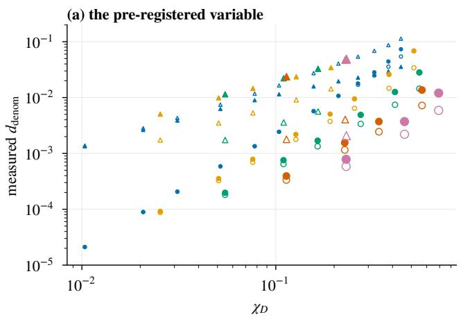

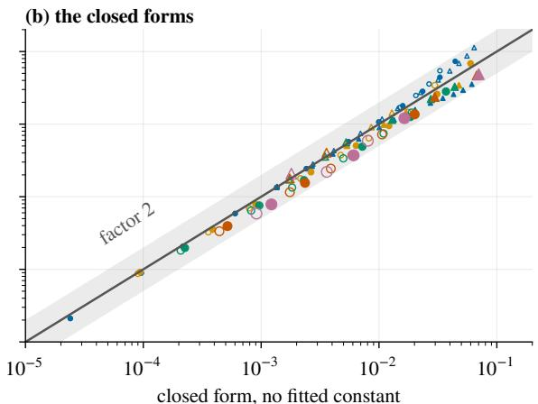  
k = 2 k = 4 k = 8 k = 16 k = 32 pair triple CONTRAST (hollow)  
Figure 2: Why a single power law in $\chi _ { D }$ fits only one cell, and what replaces it (population coeficients, flat belief $S 2 , m = 4 ,$ the 112 points of H1c). (a) Measured $d _ { \mathrm { d e n o m } }$ against $\chi _ { D } \colon$ the triple SUM cell collapses and the others separate by �. (b) The same points against the closed forms of Corollary $^ { 6 , }$ with no fitted constant. The band is a factor 2. Post hoc.

Proposition 5 (Flat belief, exact expansion). If $D > 0$ on the cube, with $T _ { 1 } = \mathrm { E } _ { u } [ G V ]$ and $\begin{array} { r } { \delta _ { h } = \operatorname* { s u p } _ { \mathrm { v } } \mathrm { T V } ( h . ( \mathrm { v } ) , 1 ) } \end{array}$

$$
\begin{array} { r } { p _ { \mathrm { C D } } - p _ { \mathrm { E U } } = T _ { 1 } - \mathrm { E } _ { u } [ G ^ { 2 } ( h _ { x } - 1 ) ] , \qquad \left| \mathrm { T V } ( p _ { \mathrm { C D } } , p _ { \mathrm { E U } } ) - \frac { 1 } { 2 } \| T _ { 1 } \| _ { 1 } \right| \le \chi _ { D } ^ { 2 } \delta _ { h } . } \end{array}\tag{5}
$$

(a) Pair basis, flat input marginals. Rows $i \geq 1$ hold single-input terms and � holds two-input terms, so $T _ { 1 } \equiv 0$ and $\mathrm { T V } ( p _ { \mathrm { C D } } , p _ { \mathrm { E U } } ) \leq \chi _ { D } ^ { 2 } \delta _ { h }$ . Further, $p _ { \mathrm { C D } } - p _ { \mathrm { E U } } = - T _ { 2 } + \mathrm { E } _ { u } [ G ^ { 3 } ( h _ { x } - 1 ) ]$ with $T _ { 2 } = \mathrm { E } _ { u } [ G ^ { 2 } V ]$ , and the remainder has $L ^ { 1 }$ norm at most $2 \delta _ { h } \| G \| _ { \infty } \chi _ { D } ^ { 2 }$

(b) Triple basis. Rows $i \geq 1$ hold two-input terms, which meet those of $\begin{array} { r } { G \colon T _ { 1 } = \sum _ { i \geq 1 } f _ { i } \sum _ { \mathbf { j } } a _ { 0 \mathbf { j } } a _ { i \mathbf { j } } } \end{array}$ over two-input indices j. The gap is first order.

Numerically the pair orthogonality holds to $2 \times 1 0 ^ { - 1 7 } ;$ with sampled coeficients single-input terms appear in $G .$ but only at noise level. For the equicorrelated Gaussian copula, the leading terms have closed forms.

Corollary 6 (Closed forms, equicorrelated Gaussian copula). Let inputs have correlation matrix with of-diagonal $r ,$ couplings �� to �, and population coeficients. Let $\Gamma _ { p q } = \operatorname { E } [ f _ { p } ( y _ { 1 } ) f _ { q } ( y _ { 2 } ) ]$ for $p , q \geq 1 , B _ { i p } ( c ) = \operatorname { E } [ f _ { i } ( x ) f _ { p } ( y ) ]$ at correlation $c , ( \Gamma _ { i } ^ { l l ^ { \prime } } ) _ { p q } = \operatorname { E } [ f _ { i } ( x ) f _ { p } ( y _ { l } ) f _ { q } ( y _ { l ^ { \prime } } ) ]$ , and $\begin{array} { r } { { \omega _ { p } } = \int f _ { p } ( u ) f ( u ) ^ { \top } \Gamma ^ { 2 } f ( u ) } \end{array}$ �� with $f = ( f _ { 1 } , \dots , f _ { m } )$ . Then

$$
T _ { 2 } = \left( k - 1 \right) \sum _ { l } \sum _ { i , p \geq 1 } f _ { i } ( x ) B _ { i p } ( c _ { l } ) \omega _ { p } \mathrm { ( p a i r ) } , \qquad T _ { 1 } = \sum _ { l < l ^ { \prime } } \sum _ { i \geq 1 } f _ { i } ( x ) \langle \Gamma , \Gamma _ { i } ^ { l l ^ { \prime } } \rangle \mathrm { ( t r i p l e ) } .\tag{6}
$$

Odd $p$ have $\omega _ { p } = 0$ , so the sign of $c _ { l }$ drops out of $T _ { 2 }$ , and $T _ { 2 }$ has no $f _ { 1 }$ term: at this order the variance of $p _ { \mathrm { C D } }$ moves and its mean does not.

These formulas explain the H1c result, which asked whether $d _ { \mathrm { d e n o m } }$ under the flat belief S2 is one power law of �� in each (type, basis) cell. Reading of the leading orders (a reading, not a proved rate): in the pair basis $T _ { 2 } \sim k ^ { 2 } \rho _ { \mathrm { { S } } } ^ { 2 } c ^ { 2 } \propto \dot { \chi _ { D } ^ { 2 } } c ^ { 2 }$ , which carries $c ^ { 2 }$ and hence $k ,$ so no single function of $\chi _ { D }$ fits. In the triple basis with type SUM, $T _ { 1 } \sim k ^ { 2 } \rho _ { S } c ^ { 2 }$ with $c ^ { 2 }$ a function of $k \rho _ { S }$ over �, so where the coupling is not clipped $d _ { \mathrm { d e n o m } }$ is a function of $k \rho _ { S }$ and $\chi _ { D }$ , of order $k \rho _ { S }$ , collapses the data. This is the one cell supported (share of points within a factor $2 \colon 1 . 0 0 )$ . In CONTRAST, where half the inputs have the opposite coupling to � (Section 6.1), the signs give $\begin{array} { r } { \sum _ { l < l ^ { \prime } } s _ { l } s _ { l ^ { \prime } } = - k / 2 } \end{array}$ so $T _ { 1 } \sim k \rho _ { S } c ^ { 2 }$ and � returns. Figure 2 and Table 22 compare $\begin{array} { r l r } {  { \frac { 1 } { 2 } \| T _ { 2 } \| _ { 1 } } } \end{array}$ (pair) and $\begin{array} { r } { \frac { 1 } { 2 } \| T _ { 1 } \| _ { 1 } } \end{array}$ (triple) with the 112 points of H1c: with no fitted constant all lie within a factor 2, with ratios 0.57 to 1.76, and 0.72 to 1.21 on the 64 points with $\chi _ { D } \leq 0 . 2$ . This post hoc comparison does not change the verdict of H1c.

The same term $T _ { 1 }$ reappears under the belief that matters most in practice, the data distribution.

Proposition 7 (Data belief and the pair structure). Assume uniform marginals and population coeficients, and let � be the true input density. Then $\mathrm { E } _ { q } [ D ] = 1 + \chi _ { D } ^ { 2 }$ , and the true propagated density is uniform. In the pair basis $p _ { \mathrm { C D } } \equiv 1$ , which is that density. In the triple basis $\overset {  } { p } _ { \mathrm { C D } } - 1 = T _ { 1 } / ( 1 + \chi _ { D } ^ { 2 } )$ , a real deviation. More generally, in the pair basis for any belief,

$$
p _ { \mathrm { C D } } ( x ) = 1 + \frac { 1 } { \mathrm E _ { q } [ D ] } \sum _ { l } \sum _ { i , p \geq 1 } f _ { i } ( x ) a _ { i , ( l , p ) } \mathrm E _ { q _ { l } } [ f _ { p } ] ,\tag{7}
$$

so a pair neuron sees the belief only through its one-dimensional marginals $q _ { l }$ and the scalar $\mathrm { E } _ { q } \left[ D \right]$

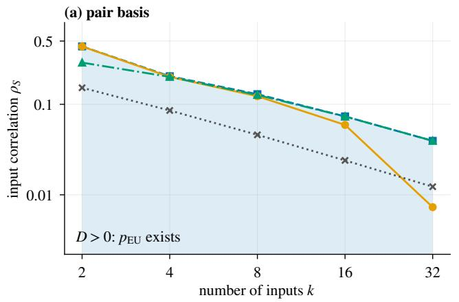

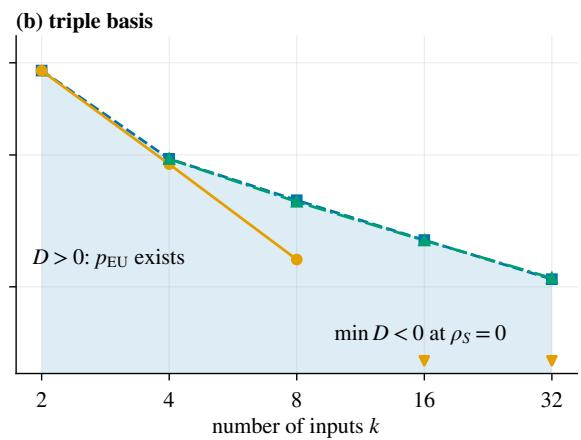  
population $\boldsymbol { \mathrm { ~ \wp ~ } } - \boldsymbol { n } = 1 0 ^ { 7 }$ first bound convex bound population $\boldsymbol { \mathrm { ~ \not ~ { ~ \_ } ~ } } \boldsymbol { n } = 1 0 ^ { 7 }$ balanced corner  
Figure 3: Where the marginal-preserving reference exists (type SUM, flat belief $\mathrm { S } 2 , m = 4 )$ . Shading: $D > 0$ on the cube at population level, below the measured onset. (a) Pair basis with the first and convex lower bounds of Proposition 8(a, b). (b) Triple basis with the balanced corner of Proposition 9, which lies on the population curve. $\mathrm { A t } n = 1 0 ^ { 7 }$ noise moves the onset down, and triangles mark triple cells with min $D < 0$ already at $\rho _ { S } = 0$ . Measured onsets are upper bounds (Section 6.1).

Thus $T _ { 1 }$ is both the first-order gap under the flat belief and the whole error under the data belief. On the 85 triple population points above the Monte Carlo level, the measured distance $d _ { \mathrm { t o t a l } }$ of $p _ { \mathrm { C D } }$ from the ground truth (Section 6.1), divided by ${ \textstyle \frac { 1 } { 2 } } \| T _ { 1 } \| _ { 1 } / ( 1 + \chi _ { D } ^ { 2 } )$ , lies between 0.97 and 1.01. In the pair basis the denominator reaches the output only as a scalar, which limits what training � can do to $p _ { \mathrm { C D } }$

## 5 When the reference and the message fail

Everything above needs $D > 0$ on the support of �. When does that fail? Figure 3 gives the answer: the region where � exists shrinks like $\rho _ { S } \sim 1 / k$ , sooner in the triple basis, and sampling noise removes it sooner still. The reason is that a truncated product of nonnegative factors need not stay nonnegative. We work with the equicorrelated Gaussian copula and population coeficients, then add noise.

Take $r \geq 0$ and write $s _ { l } = \sqrt { r } W + \sqrt { 1 - r } \nu _ { l }$ for the normal scores, let $g ( w ) ~ = ~ \mathrm { E } [ f ( y ) ~ \vert ~ W = w ]$ with $f = ( f _ { 1 } , \dots , f _ { m } )$ , and let $\xi _ { l } ( w ) = g ( w ) ^ { \top } f ( y _ { l } )$ . The untruncated density is E� $\prod _ { l } ( 1 + \xi _ { l } )$ with all degrees present, which is nonnegative. The neuron keeps

$$
D _ { \mathrm { p a i r } } = 1 + \mathrm { E } _ { W } [ e _ { 2 } ( \xi ) ] , \qquad D _ { \mathrm { t r i p l e } } = 1 + \mathrm { E } _ { W } [ e _ { 2 } ( \xi ) + e _ { 3 } ( \xi ) ] ,\tag{8}
$$

with $e _ { d }$ the elementary symmetric polynomials. Truncating the product in this way gives up positivity.

Proposition 8 (Pair basis: a positive semidefinite form). Let $r \geq 0$ and $\Gamma = \mathrm { E } _ { W } [ g g ^ { \top } ]$ , so $0 \preceq \Gamma \preceq r I ;$ let $\begin{array} { r } { \varphi ( u ) = f ( u ) ^ { \top } \Gamma f ( u ) , F = \sum _ { l } f ( y _ { l } ) } \end{array}$ and $\Theta = m ( m + 2 ) = \operatorname* { s u p } _ { u } | f ( u ) | ^ { 2 }$ . Then

$$
\begin{array} { r } { D _ { \mathrm { p a i r } } ( y ) = 1 + \frac { 1 } { 2 } F ^ { \top } \Gamma F - \frac { 1 } { 2 } \displaystyle \sum _ { l } \varphi ( y _ { l } ) . } \end{array}\tag{9}
$$

(a) min $\begin{array} { r } { D \geq 1 - \frac { k } { 2 } \operatorname* { m a x } _ { u } \varphi ( u ) } \end{array}$ , and $D > 0$ on the cube whenever $r < 2 / ( k \Theta )$ , that is $\textstyle \rho _ { S } < { \frac { 6 } { \pi } }$ arcsin $\scriptstyle { \frac { 1 } { k \Theta } }$

(b) min $D \geq \operatorname* { m i n } _ { \mu } \Psi _ { k } ( \mu )$ with $\begin{array} { r } { \Psi _ { k } ( \mu ) = 1 + \frac { k ^ { 2 } } { 2 } \bar { f } _ { \mu } ^ { \top } \Gamma \bar { f } _ { \mu } - \frac { k } { 2 } \int \varphi d \mu , \bar { f } _ { \mu } = \int f d \mu } \end{array}$ , a convex problem over probability measures on [0, 1].

The form shows what drives negativity: the term $- { \frac { 1 } { 2 } } \sum _ { l } \varphi ( y _ { l } )$ is linear in �, and the first term penalises any � whose $f ( y _ { l } )$ do not cancel in the directions of Γ. The bound (b), certified by a Frank–Wolfe duality gap on a grid of 1,001 nodes, is close to the truth: within 1.9 % of the measured onset for $k \geq 4$ at $m = 4$ (Table 1; all degrees in Table 12); it is loose at $k = 2 ,$ . Its minimiser is not a corner but has interior atoms. The measured product $k \rho _ { S } ^ { * }$ rises from 0.82 to 1.26 over $k \geq 4$ , and beyond the study’s range the convex bound’s product settles numerically near 1.325 (post hoc). This is a computation, not a limit theorem. The first bound in (a), solved numerically, gives the column “first” of Table 1; the explicit condition on $\rho _ { S }$ in (a) is cruder still. The form needs only conditional independence given a latent variable, so $\Gamma \succeq 0 , ( \mathbf { b } )$ and the first bound in (a) extend to exchangeable families with such a representation; $\Gamma \preceq r I$ is specific to the Gaussian case.

One might expect the worst point to be a balanced corner of the cube, where half the inputs sit at 1 and half at 0. For the pair basis that is false, and for the triple basis it is nearly exact.

Table 1: Negativity onset in $\rho _ { S }$ with population coeficients, type SUM, $m = 4$ (post hoc for the bounds). “first”: the value of $\rho _ { S }$ at which the first inequality of Proposition 8(a), $\begin{array} { r } { 1 - \frac { k } { 2 } \operatorname* { m a x } _ { u } \varphi ( u ) } \end{array}$ , reaches zero, solved numerically. “convex”: the bound of Proposition 8(b). “corner”: value of Proposition 9. Measured values come from interpolation on the study grid and are upper bounds, so small inversions are possible. Other degrees: Table 12.
<table><tr><td rowspan="2">k</td><td colspan="3">pair basis</td><td colspan="2">triple basis</td></tr><tr><td>first</td><td>convex</td><td>measured</td><td>corner</td><td>measured</td></tr><tr><td>2</td><td>0.152</td><td>0.289</td><td>0.437</td><td></td><td></td></tr><tr><td>4</td><td>0.085</td><td>0.201</td><td>0.204</td><td>0.093</td><td>0.094</td></tr><tr><td>8</td><td>0.046</td><td>0.127</td><td>0.129</td><td>0.044</td><td>0.045</td></tr><tr><td>16</td><td>0.024</td><td>0.073</td><td>0.074</td><td>0.022</td><td>0.023</td></tr><tr><td>32</td><td>0.012</td><td>0.039</td><td>0.039</td><td>0.012</td><td>0.011</td></tr></table>

Proposition 9 (Corners). Let $\xi _ { + } = g ^ { \top } f ( 1 ) , \xi _ { - } = g ^ { \top } f ( 0 )$ , and let $\kappa _ { 2 0 } = \mathrm { E } _ { W } \xi _ { + } ^ { 2 } , \kappa _ { 1 1 } = \mathrm { E } _ { W } \xi _ { + } \xi _ { - } , \kappa _ { 3 0 } = \mathrm { E } _ { W } \xi _ { + } ^ { 3 }$ $\kappa _ { 2 1 } = \mathrm { E } _ { W } \xi _ { + } ^ { 2 } \xi _ { - }$ . At a corner with � coordinates at 1,

$$
\begin{array} { r } { D _ { \mathrm { p a i r } } ( j ) = 1 + \left[ \binom { j } { 2 } + \binom { k - j } { 2 } \right] \kappa _ { 2 0 } + j ( k - j ) \kappa _ { 1 1 } , } \end{array}\tag{10}
$$

$$
D _ { \mathrm { t r i p l e } } ( j ) = D _ { \mathrm { p a i r } } ( j ) + \left[ { \binom { j } { 3 } } + { \binom { k - j } { 3 } } \right] \kappa _ { 3 0 } + \left[ { \binom { j } { 2 } } ( k - j ) + j { \binom { k - j } { 2 } } \right] \kappa _ { 2 1 } .\tag{11}
$$

With $\begin{array} { r } { \sigma _ { \mathrm { e } } ^ { 2 } = \frac { 1 } { 2 } \big ( \kappa _ { 2 0 } + \kappa _ { 1 1 } \big ) \ge 0 } \end{array}$ and $\begin{array} { r } { \sigma _ { 0 } ^ { 2 } = \frac 1 2 \big ( \kappa _ { 2 0 } - \kappa _ { 1 1 } \big ) \geq 0 } \end{array}$ , the energies of the even and odd degrees, $D _ { \mathrm { p a i r } } ( j ) =$ $\begin{array} { r } { 1 + \frac { 1 } { 2 } [ k ( k - 1 ) \sigma _ { \mathrm { e } } ^ { 2 } + ( ( 2 j - k ) ^ { 2 } - k ) \sigma _ { \mathrm { o } } ^ { 2 } ] } \end{array}$ . Any $\rho _ { S }$ at which min� $D ( j ) < 0$ is at or above the onset.

So the balanced corner $j = k / 2$ cancels only the odd degrees. Even polynomials have the same sign at 0 and 1 and add $\begin{array} { r } { \frac { 1 } { 2 } k ( k - 1 ) \sigma _ { \mathrm { e } } ^ { 2 } ; } \end{array}$ : over a grid of $\rho _ { S }$ , all � and even � up to 4,096, the balanced pair corner stays at or above 0.32, and no pair corner reached negative values in the study’s range. The triple term changes this. With $\xi _ { + } = \xi _ { \mathrm { e } } + \xi _ { 0 }$ split into parts even and odd in �, it adds $\begin{array} { r } { \frac { k } { 2 } ( \frac { k } { 2 } - 1 ) \mathopen { } \mathclose \bgroup \left[ \frac { 2 k - 2 } { 3 } \dot { \mathrm { E } } _ { W } \xi _ { \mathrm { e } } ^ { 3 } - 2 \mathrm { E } _ { W } \xi _ { \mathrm { e } } \xi _ { 0 } ^ { 2 } \aftergroup \egroup \right] } \end{array}$ , a negative term of the same order in �� as the others. For � $\geq$ 4 the balanced corner then matches the measured triple onset within 6.1 % (Table 1); at $m = 2$ no triple corner goes negative, so the formula gives no bound there.

The message. $p _ { \mathrm { C D } }$ needs only $\mathrm { E } _ { q } [ D ] \neq 0 .$ , a weaker condition than $D > 0$ on the support, because averaging can cancel negative lobes. Proposition 10 says when it does.

Proposition 10 (Mass of the message). Let � be a product belief with $b _ { l } = \operatorname { E } _ { q _ { l } } [ f ]$ , and $\bar { \xi } _ { l } ( w ) = g ( w ) ^ { \top } b _ { l }$ . Then $\mathrm { E } _ { q } [ D ] = 1 + \mathrm { E } _ { W } [ e _ { 2 } ( \bar { \xi } ) ]$ (pair) or $1 + \mathrm { E } _ { W } [ e _ { 2 } ( \bar { \xi } ) + e _ { 3 } ( \bar { \xi } ) ]$ (triple). In the pair basis

$$
\begin{array} { r } { \mathrm { E } _ { q } [ D ] = 1 + \frac { 1 } { 2 } \big ( \sum _ { l } b _ { l } \big ) ^ { \top } \Gamma \big ( \sum _ { l } b _ { l } \big ) - \frac { 1 } { 2 } \sum _ { l } b _ { l } ^ { \top } \Gamma b _ { l } \geq 1 - \frac { r } { 2 } \sum _ { l } | b _ { l } | ^ { 2 } , } \end{array}\tag{12}
$$

and $\mathrm { E } _ { q } [ D ] \geq 1$ if all $q _ { l }$ are equal. In the triple basis with equal $q _ { l } , \mathrm { E } _ { q } [ D ] = 1 + \binom { k } { 2 } \mathrm { E } _ { W } \bar { \xi } ^ { 2 } + \binom { k } { 3 } \mathrm { E } _ { W } \bar { \xi } ^ { 3 }$

The formula matches 800 sampled population evaluations within $0 . 5 \%$ , and it explains an asymmetry in the study. For a central belief the degree-2 moment is negative and $g _ { 2 }$ is right-skewed, so ${ \mathrm E } _ { W } \bar { \xi } ^ { 3 } < 0$ and the cubic term drives $\mathrm { E } _ { q } \left[ D \right]$ negative at large � (this last step is a heuristic reading). In the study $\mathrm { E } _ { q } [ D ] \leq 0$ occurred in 22,297 of 399,000 evaluations, all triple, at $k \geq 8$ , under Beta beliefs; with population coeficients it occurred too (2,230 of 39,900), so it is structural. The pair basis stayed at $\mathrm { E } _ { q } [ D ] \geq 0 . 7 1$ (population minimum 0.77 under the conflicting Beta belief S3c of Section 6.1). Pair safety is not universal: a point belief on a negative value of � gives $\mathrm { E } _ { q } [ D ] < 0$ in any basis, and the bound in (12) is vacuous for narrow beliefs. The statement ${ } ^ { 6 6 } p _ { \mathrm { C D } }$ stays defined past the onset” holds for pair neurons with the beliefs tested, and not for triple neurons.

Noise. Estimated coeficients move all of this, and the sample size needed for a positive $\hat { D }$ grows polynomially in �.

Proposition 11 (Sampling noise at independence). Let the inputs be independent and uniform. Then $\mathrm { E } \hat { D } ( y ) = 1$ and $\mathrm { V a r } \hat { D } ( y ) ~ = ~ K ( y ) / n$ with $K ( y ) ~ = ~ \textstyle \sum _ { { \bf j } \neq 0 } f _ { \bf j } ( y ) ^ { 2 }$ , maximal at corners, where $K _ { \mathrm { c } } \ = \ k \Theta + \ \binom { k } { 2 } \Theta ^ { 2 }$ (pair) or $K _ { \mathrm { c } } = k \Theta + \big ( { k \atop 2 } \big ) \Theta ^ { 2 } + \big ( { k \atop 3 } \big ) \Theta ^ { 3 }$ (triple). In the Gaussian limit of $\sqrt { n } ( \hat { a } _ { 0 \mathbf { j } } )$ at fixed �, write 1 − min $\hat { D } = z \sqrt { K _ { \mathrm { c } } / n }$ . For fixed �, $\mathrm { E } z \le C \sqrt { k m }$ , and for even �, $\mathrm { E } z \geq c \sqrt { k }$ , for absolute constants $c , C > 0$ (with � valid for $k \geq k _ { 0 }$ , where $k _ { 0 }$ depends on �); over corners $\mathrm { E } z \leq { \sqrt { 2 k \ln { 2 } } }$ , and � concentrates around its mean with $O ( 1 )$ fluctuations. Hence, for even �, $\hat { D } > 0$ needs $n \times z ^ { 2 } K _ { \mathrm { c } } ,$ , of order $k ^ { 3 }$ (pair) and $k ^ { 4 }$ (triple) up to factors in �.

This turns the rule of thumb $n \gtrsim z ^ { 2 } K$ into a statement on how � grows. In the study � grows from 1.0 to 4.4 (Table 13). In a Gaussian surrogate, a search over the cube at $k = 3 2$ reaches 5.5 and over corners 4.4, against 4.4 measured, consistent with min � being an upper bound. With the cube values, $z ^ { 2 } K _ { \mathrm { c } }$ is $8 . 6 \times 1 0 ^ { 6 }$ for pair at $k = 3 2$ and $1 . 1 \times 1 0 ^ { 8 }$ for triple at $k = 1 6$ , either side of the $\mathrm { s t u d y } ^ { \prime } \mathrm { s } n = 1 0 ^ { 7 }$ . In the pair basis the noise minimisers put $7 5 \% - 7 7 \%$ of coordinates on the boundary, while the population pair minimum has interior atoms.

Table 2: All pre-registered outcomes, with the verdict words of the protocol. H2b has two pre-registered evaluations, so 15 hypotheses occupy 16 lines. Fractions count significant cells among evaluable cells; “opposite” counts cells whose confidence interval lies entirely on the unpredicted side. H1c cells are shares of points within a factor 2, and its overall label is discussed in Section 6.3. H4b is also test M13 of the validation suite (Appendix J). � does not depend on the output coupling, so SUM and CONTRAST population cells coincide for negativity: the 4 cells of H1a are 2 distinct ones, the 20 of H2a are 10, and the 8 of H2b (population) are 4.
<table><tr><td></td><td>claim</td><td>verdict</td><td>evidence</td></tr><tr><td>H1a</td><td>population onset falls with k</td><td>supported</td><td>4/4 cells strictly decreasing</td></tr><tr><td>H1b</td><td>same at  $n = 1 0 ^ { 7 }$ </td><td>supported</td><td>4/4; SUM/pair 0.435 (k = 2) vs 0.007 (k = 32)</td></tr><tr><td>H1c</td><td> $d _ { \mathrm { d e n o m } }$  one power law of  $\chi _ { D }$ </td><td>inconclusive</td><td>within factor 2: SUM/pair 0.55, CONTRAST/pair 0.52, SUM/triple 1.00, CONTRAST/triple 0.48</td></tr><tr><td>H2a</td><td>higher m, earlier onset</td><td>supported</td><td>20/20</td></tr><tr><td>H2b</td><td>triple earlier than pair (population)</td><td>supported</td><td>8/8</td></tr><tr><td>H2b</td><td>triple earlier than pair  $( n = 1 0 ^ { 7 } )$ </td><td>supported</td><td>8/8</td></tr><tr><td>H2c</td><td> $d _ { \mathrm { d e n o m } }$  depends weakly on m</td><td>inconclusive</td><td>60 % of 221 points; supported needs ≥ 80 %</td></tr><tr><td>H3a</td><td>onset within ±0.05 of Gaussian</td><td>not supported</td><td>21/48 CIs inside, 27 entirely outside</td></tr><tr><td>H3b</td><td> $d _ { \mathrm { d e n o m } }$  within factor 2 of Gaussian</td><td>not supported</td><td>73/236 CIs inside, 156 entirely outside</td></tr><tr><td>H3c</td><td>Gaussian power law predicts LKJ</td><td>not supported</td><td>pair 39 %, triple 34 % of 272 matrices; k = 2 only</td></tr><tr><td>H4a</td><td>seed spread exceeds MC error</td><td>supported</td><td>93 % of 114 points; median ratio 2.1</td></tr><tr><td>H4b</td><td>doubling changes  $\mathrm { T V } <$  max  $( 3 \mathrm { S E } , 1 0 ^ { - 3 } )$ </td><td>not supported</td><td>5,460 violations, all under n  $, \times 2$ </td></tr><tr><td>H5a</td><td> $d _ { \mathrm { t o t a l } }$  grows from  $L = 1$  to 4</td><td>not supported</td><td>11/72; 51 significantly below 1</td></tr><tr><td>H5b</td><td>training reduces  $d _ { \mathrm { d e n o m } }$ </td><td>not supported</td><td>5/18; 1 opposite</td></tr><tr><td>H5c</td><td>training reduces  $P ( D < 0 )$ </td><td>not supported</td><td>24/78; 19 opposite</td></tr><tr><td>H5d</td><td>end-to-end training reduces held-out  $d _ { \mathrm { t o t a l } }$ </td><td>not supported</td><td>27/192; 84 opposite</td></tr></table>

## 6 A reliability atlas: the pre-registered study

The theory above came after the data. The study itself asked plainer questions, fixed in advance: how large is the gap, where does the reference vanish, do the numbers transfer, and do depth and training change them? It cannot test the thesis of Section 3: its truth is the Jefrey answer, so it measures distance to one of the two answers and never asks which form suits which belief. What it can give is an atlas of polynomial neurons, showing when the reference exists and what limits accuracy. Table 2 gives every answer. In short: the reference vanishes early, as predicted; thresholds do not transfer; depth and training did not show the expected efects; and, post hoc, where $p _ { \mathrm { E U } }$ is defined, in pair neurons under Beta beliefs, the gap is rarely the largest error.

## 6.1 Design

The design, hypotheses, decision rules, grids and budget rule were set out in a written protocol, fixed before any main run, with no recorded deviations. It was not entered in a public registry; its timing rests on the code lineage of the runs and on scheduler records, not on dated entries. A throughput run before that point, with its own seed, is excluded from all results. Analyses marked post hoc were not pre-registered and enter no verdict. The design tests the marginal reading only; Sections 3–5 came later. Full definitions are in Appendix E.

Ground truth. Output and inputs are uniform; dependence comes from a (� + 1)-dimensional copula. The Gaussian sweep has equicorrelated inputs with correlation $r = 2 \sin ( \pi \rho _ { S } / 6 ) , \mathrm { s o } \rho _ { S }$ is the Spearman correlation between inputs. In SUM each input has correlation $c = \operatorname* { m i n } ( 0 . 5 , 0 . 8 \sqrt { ( 1 + ( k - 1 ) r ) / k } )$ with �. In CONTRAST half the inputs have +� and half $^ { - c , }$ with $c = \operatorname* { m i n } ( 0 . 5 , 0 . 8 \sqrt { ( 1 - r ) / k } )$ . Other experiments use $t ,$ Clayton and Gumbel copulas and random LKJ correlation matrices.

Beliefs. Beliefs are product distributions unless stated. S2 is flat. S3a is Beta(3, 3) per input, S3b is Beta(4, 2), S3c alternates Beta(4, 2) and Beta(2, 4) (conflicting evidence), and S3d is the narrow Beta(6, 6). S4 is the true input copula (data belief). S1, the neuron’s own �, is computed but not primary. The primary beliefs are S2, S3c and S4. S2 is not the data distribution, so part of its error against the ground truth is mismatch between prior and data.

Compared densities. All four densities are computed from the same $M = 2 ^ { 2 0 }$ Monte Carlo samples of the belief, in $R = 1 6$ replicate blocks: �CD; �EU, defined in the protocol’s sense, that is $D \geq 0 . 0 1$ on the support cut $\{ q \ge 1 0 ^ { - 6 }$ max $q \}$ , which for Beta beliefs is weaker than mathematical definedness (Appendix E); $p _ { \mathrm { E C } }$ , the conditional calibrated at each value of � as max $( N , \varepsilon )$ divided by its integral over � $( \varepsilon \in \{ 0 . 1 , 0 . 0 1 , 0 . 0 0 1 \}$ , primary 0.01); and the ground truth $p _ { \mathrm { G } } = \mathrm { E } _ { q } \left[ p ( x \mid y ) \right]$ , the analytic conditional averaged over �. So the truth is the Jefrey answer, under which $p _ { \mathrm { E U } }$ is the matching form: all “errors” below carry that semantics. A joint normalising constant cancels in a conditional, so $p _ { \mathrm { E C } }$ is also the conditional of the jointly clipped density.

Table 3: Gap against truncation error, on defined evaluations with $\rho _ { S } > 0 , m = 4 , \varepsilon = 0 . 0 1$ ; truth is $p _ { \mathrm { G } } ,$ so $p _ { \mathrm { E U } }$ is the matching form (post hoc). Distances are medians. $\ " \mathrm { r a t i o } ^ { \prime \prime } :$ median of �model uncal/�denom per evaluation. “EU closer”: share with $p _ { \mathrm { E U } }$ nearer than to . “EC beats $\operatorname { E U } ^ { \mathbf { , \cdot } }$ share with $p _ { \mathrm { E C } }$ nearer than $p _ { \mathrm { E U } }$
<table><tr><td>basis</td><td>belief</td><td>evaluations</td><td> $d _ { \mathrm { d e n o m } }$ </td><td> $\mathrm { T V } ( p _ { \mathrm { E U } } , p _ { \mathrm { G } } )$ </td><td> $\mathrm { T V } ( p _ { \mathrm { C D } } , p _ { \mathrm { G } } )$ </td><td>ratio</td><td>EU closer</td><td>EC beats EU</td></tr><tr><td>pair</td><td>S2</td><td>2,902</td><td>0.0024</td><td>0.0119</td><td>0.0144</td><td>5.3</td><td>50%</td><td>16%</td></tr><tr><td></td><td>S3a</td><td>5,037</td><td>0.0004</td><td>0.0471</td><td>0.0472</td><td>120</td><td>52 %</td><td>24 %</td></tr><tr><td></td><td>S3b</td><td>6,200</td><td>0.0041</td><td>0.1063</td><td>0.1096</td><td>28</td><td>69 %</td><td>38 %</td></tr><tr><td></td><td>S3c</td><td>3,249</td><td>0.0019</td><td>0.0690</td><td>0.0675</td><td>30</td><td>24 %</td><td>8%</td></tr><tr><td></td><td>S3d</td><td>7,022</td><td>0.0002</td><td>0.0824</td><td>0.0830</td><td>420</td><td>67%</td><td>39 %</td></tr><tr><td></td><td>S4</td><td>2,902</td><td>0.0002</td><td>0.0004</td><td>0.0003</td><td>2.0</td><td>41 %</td><td>0%</td></tr><tr><td rowspan="6">triple</td><td>S2</td><td>1,804</td><td>0.0117</td><td>0.0027</td><td>0.0109</td><td>0.23</td><td>100%</td><td>28 %</td></tr><tr><td>S3a</td><td>3,155</td><td>0.0015</td><td>0.0103</td><td>0.0118</td><td>7.6</td><td>55 %</td><td>2%</td></tr><tr><td>S3b</td><td>3,337</td><td>0.0085</td><td>0.0280</td><td>0.0313</td><td>5.5</td><td>66%</td><td>32 %</td></tr><tr><td>S3c</td><td>2,051</td><td>0.0021</td><td>0.0139</td><td>0.0207</td><td>7.6</td><td>29 %</td><td>5%</td></tr><tr><td>S3d</td><td>4,399</td><td>0.0006</td><td>0.0234</td><td>0.0233</td><td>32</td><td>62 %</td><td>7%</td></tr><tr><td>S4</td><td>1,804</td><td>0.0127</td><td>0.0003</td><td>0.0126</td><td>0.027</td><td>100%</td><td>5%</td></tr></table>

Outcomes. Outcomes are total-variation distances $\begin{array} { r } { \mathrm { T V } ( p , p ^ { \prime } ) = \frac { 1 } { 2 } \int | p - p ^ { \prime } | } \end{array}$ on raw, never renormalised densities:

$$
\begin{array} { r l r } { d _ { \mathrm { d e n o m } } = \mathrm { T V } ( p _ { \mathrm { C D } } , p _ { \mathrm { E U } } ) , } & { \quad } & { d _ { \mathrm { n e g } } = \mathrm { T V } ( p _ { \mathrm { E U } } , p _ { \mathrm { E C } } ) , } & { \quad } & { d _ { \mathrm { m o d e l , u n c a l } } = \mathrm { T V } ( p _ { \mathrm { E U } } , p _ { \mathrm { G } } ) , } \\ { d _ { \mathrm { m o d e l , c a l } } = \mathrm { T V } ( p _ { \mathrm { E C } } , p _ { \mathrm { G } } ) , } & { \quad } & { d _ { \mathrm { t o t a l } } = \mathrm { T V } ( p _ { \mathrm { C D } } , p _ { \mathrm { G } } ) , } & { \quad } & { d _ { \mathrm { d c } } = \mathrm { T V } ( p _ { \mathrm { C D } } , p _ { \mathrm { E C } } ) . } \end{array}
$$

Densities can be signed, so TV here is an $L ^ { 1 }$ distance with a factor $\frac { 1 } { 2 }$ and can exceed 1. We also record variance and mean errors, $P ( D < 0 )$ under uniform $y , \chi _ { D }$ , and min � from a multi-start projected optimiser with 2,000 starts. This min � is an upper bound on the true minimum, so measured onsets are conservative: true onsets can only be earlier.

Thresholds and verdicts. A cell is a combination of design factors (such as type, basis and �), a point adds a value of $\rho _ { S }$ , and an evaluation is one seed at one point; each seed re-estimates all coeficients. A threshold is the first crossing of a level by the seed-median curve, over the run of defined points from $\rho _ { S } = 0$ . If the curve becomes undefined first, or the level is not reached by $\rho _ { S } = 0 . 9$ , the entry is $^ { 6 6 } - ^ { 5 5 }$ . The negativity onset is the first zero crossing of seed-median min $D ,$ and 0 if negative at $\rho _ { S } = 0$ . Confidence intervals are percentile bootstraps over seeds [22, 23]; they reflect estimation noise only, so very tight ones do not mean that the quantity is known beyond this design. A hypothesis over cells is supported if at least $2 / 3$ of evaluable cells are significant in the predicted direction, not supported if at least $2 / 3$ are not, and inconclusive otherwise or with fewer than three evaluable cells. Some hypotheses have their own rule (Appendix H). “Significant” is used only in this pre-registered sense.

Experiments. The Gaussian sweep crosses $k \in \{ 2 , 4 , 8 , 1 6 , 3 2 \}$ , both types, both bases, $m \in \{ 2 , 4 , 6 \} , n = 1 0 ^ { 7 }$ 50 seeds and 19 values of $\rho _ { S }$ from 0 to 0.9. The population sweep repeats these cells with exact coeficients. The convergence study doubles $M ,$ , � and two grid sizes on a subset. The copula-family and LKJ experiments $( k \leq 8 )$ vary the ground truth. The chain experiment builds up to $L = 4$ neurons, a neuron of the sweep followed by neurons with two independent inputs, on a Gaussian Markov ground truth with correlation $\alpha = 0 . 6$ per layer, trained under three losses and two optimisers at fixed, untuned settings (Appendix I). Altogether 2,900 runs finished with 0 failures on NVIDIA A100-SXM4-40GB GPUs in float64, with TF32 disabled and deterministic algorithms, using 176.7 GPU-hours of run time (196.25 GPU-hours billed for everything, including validation and benchmarks).

## 6.2 In pair neurons truncation, not the denominator, usually sets the error (post hoc)

We begin with a post hoc reading of metrics that were all pre-registered, because it answers the practical question: would replacing $p _ { \mathrm { C D } }$ with �EU help? Mostly not. Table 3 sets the gap $d _ { \mathrm { d e n o m } }$ against the error of the truncated model $d _ { \mathrm { m o d e l , u n c a l } } = \mathrm { T V } ( p _ { \mathrm { E U } } , p _ { \mathrm { G } } )$ , where both exist, under the semantics that favours $p _ { \mathrm { E U } }$ . In the pair basis the model error exceeds the gap by a median factor of 2.0 (S4) to 420 (S3d), and both forms sit at nearly the same distance from the truth, for example 0.0472 and 0.0471 under S3a. $p _ { \mathrm { E U } }$ is closer in $2 4 \%$ (S3c) to 69 % (S3b) of evaluations. A pair model with few coeficients cannot represent the conditional well enough for the diference to count.

There are two exceptions, both explained by Section 4. Triple neurons under S2 and S4 have model error far below the gap, with ratios 0.23 and 0.027, and $p _ { \mathrm { E U } }$ closer in 100 % of evaluations: here $T _ { 1 }$ is first order and it is the whole error of $p _ { \mathrm { C D } }$ . Under the Beta beliefs the triple ratio is 5.5 to 32. The illustration of Section 3.1 sends the same message for the pair family with the evidence truth at $k = 4 , 8$ , where model error of 0.07 to 0.19 hides the choice of form. These results are for $m = 4 , \varepsilon = 0 . 0 1 , \rho _ { S } > 0$ and defined evaluations only, and the filter that defines them also caps the gap (Section 6.3), so they say nothing about the region past the onset, where $p _ { \mathrm { E U } }$ does not exist. They concern synthetic ground truths, where the truncated part of the density is known, and a task could weigh the error diferently.

A denominator-free route to the Jefrey answer (post hoc). If the Jefrey answer is what is wanted, neither form need be used. Regressing $f _ { i } ( x )$ on features $\phi ( y )$ gives a matrix $B ,$ and $c = B ^ { \intercal } \mathrm { E } _ { q } [ \phi ]$ is a message with the same run-time form as $p _ { \mathrm { C D } } .$ , with no denominator, whose target is the conditional averaged under �. Table 4 compares it with both forms against $p _ { \mathrm { G } }$ over 64 settings. Additive features do no better than $p _ { \mathrm { C D } }$ . Pair features do much better, and fall below both forms in $9 6 . 9 \%$ of settings, past the onset too. The limits are plain: it needs a feature Gram matrix, that is four-way moments the neuron does not store; it has no positivity guarantee; and it gives the wrong semantics for missing inputs, because it averages a conditional instead of conditioning.

Table 4: Regression message against both forms (post hoc, not part of the study): median TV to $p _ { \mathrm { G } }$ over $\rho _ { S } \in \{ 0 . 1 , 0 . 3 , 0 . 5 , 0 . 7 \}$ and S2, S3a, S3c, S3d; type SUM, $m = 4 ,$ coeficients from $n = 2 ^ { 2 0 }$ samples. �EU drops belief samples with $D < 0 . 0 1$
<table><tr><td>k</td><td> $p _ { \mathrm { C D } }$ </td><td> $p _ { \mathrm { E U } }$ </td><td>additive features</td><td>pair features</td></tr><tr><td>2</td><td>0.019</td><td>0.023</td><td>0.017</td><td>0.009</td></tr><tr><td>4</td><td>0.046</td><td>0.056</td><td>0.041</td><td>0.008</td></tr><tr><td>8</td><td>0.076</td><td>0.073</td><td>0.074</td><td>0.013</td></tr><tr><td>16</td><td>0.089</td><td>0.086</td><td>0.091</td><td>0.023</td></tr></table>

## 6.3 The gap looks modest only where it can be measured

Under S2 the 1 % threshold of $d _ { \mathrm { d e n o m } }$ falls from 0.192 at $k = 2$ to $0 . 0 4 3$ at $k = 1 6$ (pair, Table 15, Figure 6), while at $k = 3 2$ the entry is empty. Empty does not mean small: $p _ { \mathrm { E U } }$ became undefined (from $\rho _ { S } = 0 . 0 1 0 )$ before the curve reached 1 %. In the triple basis at $k \geq 1 6$ the reference is undefined already at $\rho _ { S } = 0$

Selection explains this (post hoc). The filter that defines $d _ { \mathrm { d e n o m } }$ almost implies a modest gap: at $m = 4 , \rho _ { S } > 0$ within it $\mathrm { C V } _ { q } ( D )$ never exceeds 0.75, so Proposition 4 caps the gap, and $d _ { \mathrm { d e n o m } }$ never exceeds 0.13. “Modest where measured” should therefore not be read as “modest”: under S2 at $k = 3 2$ only 5 % of pair evaluations survive the filter (more in the caption of Table 18). Past the onset the outcomes are $d _ { \mathrm { t o t a l } }$ and $d _ { \mathrm { d c } } ;$ in the pair basis median $d _ { \mathrm { t o t a l } }$ is 0.05 to 0.10, apart from S4 (Table 19, post hoc). Under the narrow belief S3d, at $k = 1 6 , 3 2$ , pair $p _ { \mathrm { E U } }$ stays defined under the protocol’s support cut up to $\rho _ { S } = 0 . 9$ and $d _ { \mathrm { d e n o m } }$ never reaches 1 % (post hoc). That describes the cut and not an integral over the cube: a Beta density is positive on the open cube, so wherever � changes sign $\mathrm { E } _ { q } | N / D |$ is infinite (Appendix E). Width is not everything: the of-centre S3b reaches 1 % earlier than S2 at $k \geq 8$ for type SUM (Table 18).

H1c (inconclusive) asked for one power law in $\chi _ { D }$ . The share of points within a factor 2 was 0.55 (SUM/pair), 0.52 (CONTRAST/pair), 1.00 (SUM/triple) and 0.48 (CONTRAST/triple), which by the pre-registered rule makes these cells respectively inconclusive, inconclusive, supported and not supported. The protocol gives this rule per (type, basis) and does not say how the cells combine. The overall label comes from the analysis code fixed with the protocol, which requires all cells to agree. Counting a supported cell as significant under the general aggregation rule would instead give 1 of 4, that is not supported. We keep the recorded verdict; the cell pattern is what Corollary 6 explains. H2c (inconclusive). $d _ { \mathrm { d e n o m } }$ varied by at most a factor 1.5 across � at $6 0 \%$ of 221 points, between the rule’s 80 % and $5 0 \%$

What the gap moves is mostly spread (post hoc). Among 181 points of the pair basis the relative variance error exceeds the standardised mean error at $78 \%$ . Under S2 the mean is almost untouched (at most 0.0020) while the variance moves by up to 13.5 %, as Corollary 6 says (Figure 9).

## 6.4 The reference vanishes early, and noise brings it forward

Here the expectations held. H1a, H1b (supported, supported). The onset falls strictly with � in all 4 population cells, and at $n = 1 0 ^ { 7 }$ the diference between $k = 3 2$ and $k = 2$ has a confidence interval below zero in all 4 cells. For SUM in the pair basis it falls from 0.435 to 0.007, a diference with $9 5 \% \mathrm { C I } \left[ - 0 . 4 2 9 , - 0 . 4 2 8 \right]$ . H2a (supported). A higher degree gives an earlier onset in 20 of 20 population cells (Table 23). H2b (supported with population coeficients, supported at � = 107). The triple basis is earlier than pair in 8 of 8 and 8 of 8 cells. These outcomes are what one would expect as terms are added, and Propositions 8 and 9 now give their mechanism.

Noise moves the onset at large �: 0.007 against 0.039 (pair, $k = 3 2 )$ , and 0.000 against 0.023 (triple, $k = 1 6 )$ , in line with Proposition 11. Moving the floor on � from 0 to 0.05 changes the share of S2 evaluations with min � above it by at most 0.045 of evaluations in any cell (post hoc reanalysis), so the pre-registered floor decides little.

## 6.5 Estimation, not integration, limits the numbers

H4a (supported). The protocol states H4a for the defined headline points at $m = 4 , \varepsilon = 0 . 0 1$ ; the analysis code evaluates it on the pair basis at $k \in \{ 2 , 8 , 3 2 \}$ under S2, S3c and S4. There the across-seed standard deviation of $d _ { \mathrm { d e n o m } }$ exceeded the Monte Carlo standard error at $9 3 \%$ of 114 points (Table 2); over all headline cells it did so at 96 % of 293 (post hoc), so the verdict does not depend on this choice. H4b (not supported). Doubling �, �, or either grid must change every reported TV by less than max $( 3 \mathrm { S E } , 1 0 ^ { - 3 } )$ . There were 5,460 violations among 1,165,059 paired values, all under $n \times 2$ (Table 26). Numerical integration is converged and, at large �, the estimator is not: 93 % of violations are triple (post hoc). Such high-� triple cells are stress tests: they stay in the tables, but say little about usable neurons.

## 6.6 Clipping changes outputs more, and usually for the worse (post hoc)

Where $d _ { \mathrm { d e n o m } }$ and $d _ { \mathrm { n e g } }$ both exist and at least one is above the noise floor (873 points), $d _ { \mathrm { n e g } } > d _ { \mathrm { d e n o m } }$ at $6 8 \%$ of points (72 % for $\varepsilon = 0 . 1$ , 67 % for $\varepsilon = 0 . 0 0 1$ ; post hoc). But $d _ { \mathrm { n e g } }$ is movement, not harm. Against the truth, �EC beats $p _ { \mathrm { E U } }$ in only 0 % to 39 % of defined evaluations across beliefs and bases (Table 3), and under S4 it raises the pair distance from 0.0004 to 0.024. $d _ { \mathrm { n e g } }$ under S2 barely depends on � (0.024, 0.025, 0.028 for $\varepsilon = 0 . 0 0 1 , 0 . 0 1 , 0 . 1 )$ so it mostly reflects removing negative lobes and renormalising. Clipping is one calibration among several, and this says nothing about others.

Negativity removes $p _ { \mathrm { E U } } ;$ it does not remove pair $p _ { \mathrm { C D } }$ . Past the onset, pair $p _ { \mathrm { C D } }$ is closer to $p _ { \mathrm { G } }$ than $p _ { \mathrm { E C } }$ in $5 9 \%$ of evaluations (55 % pooled over both bases), with a strong dependence on the belief (Table 19). It does hurt triple $p _ { \mathrm { C D } }$ at $k \geq 8$ , where $\mathrm { E } _ { q } [ D ]$ can be nonpositive (Proposition 10), and $d _ { \mathrm { t o t a l } } > 1$ in 3,245 evaluations (0.8 %), 95 % of them triple, with a largest value of 473: the output is then a strongly signed function, not a density. Under S2, � is the marginal and $d _ { \mathrm { t o t a l } }$ is almost entirely mismatch between flat prior and truth (median gap to $\mathrm { T V } ( p _ { \mathrm G }$ , uniform) $1 . 6 \times 1 0 ^ { - 4 }$ , maximum 0.018); Figure 8 shows the components. Under S4 the data bear out Proposition 7: pair median $d _ { \mathrm { t o t a l } } = 2 . 9 \times 1 0 ^ { - 4 }$ , maximum $9 . 2 \times 1 0 ^ { - 4 }$ ; triple median 0.015, maximum 0.28.

## 6.7 Transfer, chains and training

Transfer. None of the three transfer hypotheses was supported. For H3a (not supported), 21 of 48 onset diferences from the Gaussian had a CI inside ±0.05 and 27 lay entirely outside. For H3b (not supported), $d _ { \mathrm { d e n o m } }$ at matched Kendall’s � was within a factor 2 of the Gaussian at 73 of 236 points. For H3c (not supported), the Gaussian power law held for 39 % (pair) of LKJ matrices, a result that rests on $k = 2$ . Numbers from the Gaussian sweep should not be carried to other dependence (Appendix H).

Chains and training. In H5a (not supported) the ratio $d _ { \mathrm { t o t a l } } ( L = 4 ) / d _ { \mathrm { t o t a l } } ( L = 1 )$ exceeded 1 significantly in 11 of 72 cells and was significantly below 1 in 51. Inputs of later neurons are independent, so their � is nearly flat, and H5a does not test compounding of denominator error over correlated inputs. Training reduced $d _ { \mathrm { d e n o m } }$ significantly in 5 of 18 evaluable cells (H5b, not supported; only $k = 2$ is evaluable), $P ( D < 0 )$ in 24 of 78 (H5c, not supported) and held-out $d _ { \mathrm { t o t a l } }$ in 27 of 192 (H5d, not supported). The causes limit what these verdicts mean. About half of the end-to-end runs at $L = 4$ kept the initial state (54 % with Adam, 50 % with L-BFGS; post hoc), and optimiser settings were fixed and untuned. The end-to-end objective fits only 12 numbers (3 beliefs × 4 moments) with 61 to 6,364 coeficients, and validation uses the same beliefs, so H5d says little about whether training can absorb the denominator. Under these settings, training did not reduce the three errors. Whether training can compensate remains open, and the HCR paper’s expectation that it compensates for neglected calibration has not been tested (Appendix I).

## 7 Related work

Uncertain evidence. Jefrey’s rule [12, 36] and virtual evidence [62] are the two classical updates, and Chan and Darwiche [7, 8] show that both obey probability kinematics and translate into each other; Peng et al. [63] develop the Bayesian-network case. Ben Mrad et al. [1] separate likelihood (virtual) from probabilistic (Jefrey) evidence in Bayesian networks, and Jacobs [35] contrasts the two update rules and shows that they can lead to diferent conclusions. Munk et al. [53] show in modern probabilistic models how results depend on which interpretation of uncertain evidence is chosen, and Yu [82] train Bayesian neural networks on soft evidence with approximations of Jefrey conditionalisation. We add no new update rule. Our point is that a moment-vector message in a polynomial density neuron is one of these two rules, and that a formula presented as an approximation of one is exactly the other.

Messages and embeddings. $\mathrm { E } _ { q } \left[ N \right]$ is one sum-product message [42], and a series message of this kind is sum-product by construction. The closest work on truncated series messages with estimated coeficients is the stochastic orthogonal-series message passing of Noorshams and Wainwright [56]. Kernel mean embeddings use the same pattern of linear operators on moment-like vectors: the kernel sum and Bayes rules [25] and kernel belief propagation [71], where estimated weights may also be negative. The kernel sum rule (Theorem 2 of [25]) reads $m _ { Q _ { Y } } = C _ { Y X } C _ { X X } ^ { - 1 }$ � , with � the input and � the output in their notation. Since $C _ { X X }$ applied to a function � gives the embedding of the input density times $f ,$ the inverse acts as division by the input density. At population level the rule therefore corresponds to feeding the message $q / D$ , that is Theorem 1(d), the Jefrey form; applying $C _ { Y X }$ with no inverse gives the evidence form. This is a correspondence, not a theorem, and the conversion is implicit in that literature. Expected predictions [39] compute $\operatorname { E } _ { q }$ of a model output under a generative input distribution in closed form, a diferent target from a normalised output density.

Positive and squared density models. Squared expansions give nonnegativity by construction: Gallant and Nychka [27] in econometrics, and PSD models [65], squared neural families [75] and subtractive mixtures via squaring [48] in machine learning. Some of these classes have closed forms for marginals, conditioning, or sum and product rules. The negativity of Section 5 is what those constructions avoid, at the cost of a quadratic form in place of a linear contraction. On corrections of series estimators see [26, 29]; on copula projection estimators see [9, 55].

Ratios and propagation. The identity (3) is classical in sampling theory [10, 32, 51, 67], the same structure appears in self-normalised importance sampling [5, 59], and delta-method expansions of a mean of a ratio are standard [58]. Most methods that push distributions through networks keep a parametric form: probabilistic backpropagation [34], natural-parameter networks [78], assumed density filtering [28], deterministic moment approximation [80], Gaussian inference [30], covariance propagation [79], and lost inputs described by a Gaussian mixture [70]; see also [37, 52]. HCR keeps a polynomial density, less restrictive in shape but possibly negative.

HCR and pre-registration. HCR grew out of polynomial density fitting [13, 15] and has been applied to time series [14], yield curves [18], spreads [20], income data [19] and redshifts [17]; Legendre KAN layers with an HCR reading are in [73]. We found no prior numerical study of the constant-denominator step. On pre-registration in machine learning see [2, 24, 45, 57, 64, 66, 72].

## 8 Discussion

Guidance. The results reduce to seven working rules.

1. Decide what the beliefis (Theorem 1). Per-input evidence and missing inputs call for $p _ { \mathrm { C D } }$ . A distribution the inputs really follow, or a posterior or predictive marginal that already contains the prior, calls for $p _ { \mathrm { E U } }$ . To obtain the Jefrey answer when $D > 0$ , feed the message $q / D$ , which costs the moments of $q / D ;$ the practical route is the regression message of Section 6.2 (post hoc), within its limits.

2. Read aflat beliefcorrectly. Under flat $q , p _ { \mathrm { C D } }$ is the model’s output marginal in any basis. It is the answer to “no information”, not the conditional averaged over a uniform input.

3. Check $\mathrm { E } _ { q } [ D ]$ and $\mathrm { C V } _ { q } ( D )$ (Propositions 4, 10). Both are cheap. A nonpositive or small $\mathrm { E } _ { q } \left[ D \right]$ should stop propagation.

4. Do not spend efort on the denominator in pair neurons under Beta-like beliefs where $p _ { \mathrm { E U } }$ is defined (Table 3, post hoc): truncation dominates. In triple neurons under flat and data beliefs it can matter.

5. Check negativity. For Gaussian-like dependence use the convex bound of Proposition 8 or the corners of Proposition 9. Expect an onset near $\rho _ { S } \sim 1 / k$ , and earlier with degree or a triple basis. Do not transfer the numbers to heavy-tailed or asymmetric dependence (H3a, H3b) or to unequal correlations (H3c).

6. Size � with $z ^ { 2 } K _ { \mathrm { c } }$ (Proposition 11). Prefer the pair basis with low degree at large $k ,$ or select coeficients, as the HCR paper suggests.

7. Be careful with clipping. Clipping � at each value of � moved outputs away from the truth in most defined evaluations (Table 3, post hoc).

## Limitations.

• Scope. One neuron family, a Legendre basis, $m \le 6$ and, in the study, synthetic copulas only. The only real data are an exploratory pilot with one data set and one untrained neuron (Appendix D), so we cannot say in general how much a TV of a given size matters on a task. The basis keeps all coeficients of its family, and coeficient selection was not tested. The HCR paper’s value-propagation mode does not use Eq. 10 and is outside this study.

• The semantic reading is post hoc and has no pre-registered test: the study’s truth is the Jefrey answer, and the evidence semantics is only illustrated, in full and triple models up to $k = 8$ , with the pair family losing the contrast to model error. The pilot has no Jefrey-type arm. Explanations ofered for tail dependence and mixing are consistent with the data but untested.

• Theory. Sections 4 and 5 assume population coeficients, uniform marginals and, for closed forms, equicorrelated Gaussian dependence; rates are at fixed �, the Gaussian limit in Proposition 11 is assumed, not proved uniformly in �, and the convex bound is computed on a grid.

• Design. The main sweep’s equicorrelation favours large pair sums, the coupling � is a design choice, and marginals are exactly uniform, whereas real pipelines use estimated quantiles. The chain has independent inputs after layer one, a fixed contractive kernel and no re-normalisation to quantiles, and training used one fixed setting per optimiser. The end-to-end objective fits 12 numbers on the beliefs also used for validation, so H5d says little about whether training can absorb the denominator.

• Measurement. Measured onsets are upper bounds on a grid; TV on signed densities is an $L ^ { 1 }$ distance, not a probability bound. Confidence intervals are per cell with no multiplicity correction; verdicts rest on the counting rules.

• Pre-registration. The protocol was not entered in a public registry; run records and scheduler times are the only evidence of its timing.

Broader impact. This is foundational work on a density model: a synthetic study and a small pilot on public census data aggregated to block groups, with no individual-level data. The practical risk is misuse of �CD or �EU as calibrated uncertainty when the belief’s meaning has not been considered; the guidance above is aimed at that.

## 9 Conclusion

A reader who propagates beliefs through a density model should ask first what the belief is, because the choice between normalising after and normalising before is a choice of question, not of accuracy. For polynomial neurons the rest can be quantified: the gap is second order in the dependence for pair bases and first order for triple bases, the reference disappears near $\rho _ { S } \sim 1 / k _ { \cdot }$ , and, post hoc, where �EU is defined, in pair neurons under Beta beliefs truncation usually outweighs the gap, while in triple neurons under flat and data beliefs it does not. Thresholds did not transfer beyond the Gaussian sweep, and whether training can compensate for any of this remains open. The study is entirely synthetic; an exploratory pilot on one real data set agrees with the evidence side of the thesis and leaves the neuron well behind a standard baseline. Three experiments would settle most of what we leave unsettled: a pre-registered test of the two semantics, a pre-registered real task with missing or noisy inputs, and chains whose inputs stay correlated.

## Code and data availability

The code is at https://github.com/Przemyslaw11/EvidenceOrMarginal. Appendix M gives batches, seeds, hardware and software. All data in the study are synthetic and generated by the code; the pilot of Appendix D uses the public California housing data [60].

## Acknowledgements

The author wishes to thank the PLGrid Infrastructure for its support and ACK Cyfronet AGH for providing the computational resources on the Athena cluster.

## References

[1] Ali Ben Mrad, Véronique Delcroix, Sylvain Piechowiak, Philip Leicester, and Mohamed Abid. An explication of uncertain evidence in Bayesian networks: likelihood evidence and probabilistic evidence. Applied Intelligence, 43(4):802–824, 2015. doi: 10.1007/s10489-015-0678-6.

[2] Luca Bertinetto, João F. Henriques, Samuel Albanie, Michela Paganini, and Gül Varol. Preface. In NeurIPS 2020 Workshop on Pre-registration in Machine Learning, volume 148 of Proceedings ofMachine Learning Research, 2021.

[3] Xavier Boyen and Daphne Koller. Tractable inference for complex stochastic processes. In Proceedings of the Fourteenth Conference on Uncertainty in Artificial Intelligence, pages 33–42, 1998.

[4] Martin Burtscher, Ivan Zecena, and Ziliang Zong. Measuring GPU power with the K20 built-in sensor. In Proceedings of the Workshop on General Purpose Processing Using GPUs, pages 28–36. ACM, 2014. doi: 10.1145/2588768.2576783.

[5] Gabriel Cardoso, Sergey Samsonov, Achille Thin, Eric Moulines, and Jimmy Olsson. BR-SNIS: Bias reduced self-normalized importance sampling. In Advances in Neural Information Processing Systems, volume 35, 2022.

[6] N. N. Čencov. Evaluation of an unknown distribution density from observations. Soviet Mathematics, 3:1559–1562, 1962.

[7] Hei Chan and Adnan Darwiche. On the revision of probabilistic beliefs using uncertain evidence. In Proceedings ofthe Eighteenth International Joint Conference on Artificial Intelligence, pages 99–105, 2003.

[8] Hei Chan and Adnan Darwiche. On the revision of probabilistic beliefs using uncertain evidence. Artificial Intelligence, 163(1):67–90, 2005. doi: 10.1016/j.artint.2004.09.005.

[9] O. Chatrabgoun, G. Parham, and R. Chinipardaz. A Legendre multiwavelets approach to copula density estimation. Statistical Papers, 58(3):673–690, 2017. doi: 10.1007/s00362-015-0720-0.

[10] William G. Cochran. Sampling Techniques. Wiley Series in Probability and Mathematical Statistics. Wiley, third edition, 1977.

[11] Stefano Demarta and Alexander J. McNeil. The � copula and related copulas. International Statistical Review, 73(1): 111–129, 2005. doi: 10.1111/j.1751-5823.2005.tb00254.x.

[12] Persi Diaconis and Sandy L. Zabell. Updating subjective probability. Journal ofthe American Statistical Association, 77 (380):822–830, 1982. doi: 10.1080/01621459.1982.10477893.

[13] Jaroslaw Duda. Rapid parametric density estimation. arXiv preprint arXiv:1702.02144, 2017.

[14] Jaroslaw Duda. Exploiting statistical dependencies of time series with Hierarchical Correlation Reconstruction. arXiv preprint arXiv:1807.04119, 2018.

[15] Jaroslaw Duda. Hierarchical Correlation Reconstruction with missing data, for example for biology-inspired neuron. arXiv preprint arXiv:1804.06218, 2018.

[16] Jaroslaw Duda. Biology-inspired joint distribution neurons based on Hierarchical Correlation Reconstruction allowing for multidirectional propagation of values and densities. arXiv preprint arXiv:2405.05097, 2024. Version 9, 4 June 2026.

[17] Jaroslaw Duda and Gopal Bhatta. Predicting conditional probability distributions of redshifts of Active Galactic Nuclei using Hierarchical Correlation Reconstruction. Monthly Notices ofthe Royal Astronomical Society, 530(2):2282–2291, 2024. doi: 10.1093/mnras/stae963.

[18] Jaroslaw Duda and Małgorzata Snarska. Modeling joint probability distribution of yield curve parameters. arXiv preprint arXiv:1807.11743, 2018.

[19] Jaroslaw Duda and Adam Szulc. Credibility evaluation of income data with Hierarchical Correlation Reconstruction. arXiv preprint arXiv:1812.08040, 2018.

[20] Jaroslaw Duda, Henryk Gurgul, and Robert Syrek. Modelling bid-ask spread conditional distributions using Hierarchical Correlation Reconstruction. Statistics in Transition New Series, 21(5):99–118, 2020. doi: 10.21307/stattrans-2020-057.

[21] Sam Efromovich. Orthogonal series density estimation. WIREs Computational Statistics, 2(4):467–476, 2010. doi: 10.1002/wics.97.

[22] B. Efron. Bootstrap methods: Another look at the jackknife. The Annals ofStatistics, 7(1):1–26, 1979. doi: 10.1214/aos/ 1176344552.

[23] Bradley Efron and R. J. Tibshirani. An Introduction to the Bootstrap. Monographs on Statistics and Applied Probability. Chapman & Hall, 1993. doi: 10.1201/9780429246593.

[24] Jessica Zosa Forde and Michela Paganini. The scientific method in the science of machine learning. arXiv preprint arXiv:1904.10922, 2019. Presented at the ICLR 2019 Debugging Machine Learning Models workshop.

[25] Kenji Fukumizu, Le Song, and Arthur Gretton. Kernel Bayes’ rule: Bayesian inference with positive definite kernels. Journal ofMachine Learning Research, 14:3753–3783, 2013.

[26] Leslaw Gajek. On improving density estimators which are not bona fide functions. The Annals of Statistics, 14(4): 1612–1618, 1986. doi: 10.1214/aos/1176350182.

[27] A. Ronald Gallant and Douglas W. Nychka. Semi-nonparametric maximum likelihood estimation. Econometrica, 55(2): 363–390, 1987. doi: 10.2307/1913241.

[28] Jochen Gast and Stefan Roth. Lightweight probabilistic deep networks. In Proceedings of the IEEE/CVF Conference on Computer Vision and Pattern Recognition, pages 3369–3378, 2018. doi: 10.1109/CVPR.2018.00355.

[29] Ingrid K. Glad, Nils Lid Hjort, and Nikolai G. Ushakov. Correction of density estimators that are not densities. Scandinavian Journal ofStatistics, 30(2):415–427, 2003. doi: 10.1111/1467-9469.00339.

[30] James-A. Goulet, Luong Ha Nguyen, and Saeid Amiri. Tractable approximate Gaussian inference for Bayesian neural networks. Journal ofMachine Learning Research, 22(251):1–23, 2021.

[31] Will Grathwohl, Kuan-Chieh Wang, Jörn-Henrik Jacobsen, David Duvenaud, Mohammad Norouzi, and Kevin Swersky. Your classifier is secretly an energy based model and you should treat it like one. In International Conference on Learning Representations, 2020.

[32] H. O. Hartley and A. Ross. Unbiased ratio estimators. Nature, 174(4423):270–271, 1954. doi: 10.1038/174270a0.

[33] Peter Henderson, Jieru Hu, Joshua Romof, Emma Brunskill, Dan Jurafsky, and Joelle Pineau. Towards the systematic reporting of the energy and carbon footprints of machine learning. Journal ofMachine Learning Research, 21(248):1–43, 2020.

[34] José Miguel Hernández-Lobato and Ryan P. Adams. Probabilistic backpropagation for scalable learning of Bayesian neural networks. In Proceedings of the 32nd International Conference on Machine Learning, volume 37 of Proceedings of Machine Learning Research, pages 1861–1869, 2015.

[35] Bart Jacobs. The mathematics of changing one’s mind, via Jefrey’s or via Pearl’s update rule. Journal of Artificial Intelligence Research, 65:783–806, 2019. doi: 10.1613/jair.1.11349.

[36] Richard C. Jefrey. The Logic ofDecision. McGraw-Hill, 1965.

[37] S. J. Julier and J. K. Uhlmann. Unscented filtering and nonlinear estimation. Proceedings of the IEEE, 92(3):401–422, 2004. doi: 10.1109/JPROC.2003.823141.

[38] Marek Kanter. Stable densities under change of scale and total variation inequalities. The Annals of Probability, 3(4): 697–707, 1975. doi: 10.1214/aop/1176996309.

[39] Pasha Khosravi, YooJung Choi, Yitao Liang, Antonio Vergari, and Guy Van den Broeck. On tractable computation of expected predictions. In Advances in Neural Information Processing Systems, volume 32, 2019.

[40] Diederik P. Kingma and Jimmy Ba. Adam: A method for stochastic optimization. In International Conference on Learning Representations, 2015.

[41] R. Kronmal and M. Tarter. The estimation of probability densities and cumulatives by Fourier series methods. Journal of the American Statistical Association, 63(323):925–952, 1968. doi: 10.1080/01621459.1968.11009321.

[42] F. R. Kschischang, B. J. Frey, and H.-A. Loeliger. Factor graphs and the sum-product algorithm. IEEE Transactions on Information Theory, 47(2):498–519, 2001. doi: 10.1109/18.910572.

[43] Daniel Lewandowski, Dorota Kurowicka, and Harry Joe. Generating random correlation matrices based on vines and extended onion method. Journal ofMultivariate Analysis, 100(9):1989–2001, 2009. doi: 10.1016/j.jmva.2009.04.008.

[44] Filip Lindskog, Alexander McNeil, and Uwe Schmock. Kendall’s tau for elliptical distributions. In Credit Risk, Contributions to Economics, pages 149–156. Physica-Verlag HD, 2003. doi: 10.1007/978-3-642-59365-9\_8.

[45] Zachary C. Lipton and Jacob Steinhardt. Troubling trends in machine learning scholarship. Queue, 17(1):45–77, 2019. doi: 10.1145/3317287.3328534.

[46] Dong C. Liu and Jorge Nocedal. On the limited memory BFGS method for large scale optimization. Mathematical Programming, 45(1–3):503–528, 1989. doi: 10.1007/BF01589116.

[47] Ziming Liu, Yixuan Wang, Sachin Vaidya, Fabian Ruehle, James Halverson, Marin Soljačić, Thomas Y. Hou, and Max Tegmark. KAN: Kolmogorov–Arnold networks. In International Conference on Learning Representations, 2025.

[48] Lorenzo Loconte, Aleksanteri M. Sladek, Stefan Mengel, Martin Trapp, Arno Solin, Nicolas Gillis, and Antonio Vergari. Subtractive mixture models via squaring: Representation and learning. In International Conference on Learning Representations, 2024.

[49] Albert W. Marshall and Ingram Olkin. Families of multivariate distributions. Journal of the American Statistical Association, 83(403):834–841, 1988. doi: 10.1080/01621459.1988.10478671.

[50] Alexander J. McNeil and Johanna Nešlehová. Multivariate Archimedean copulas, �-monotone functions and ℓ1-norm symmetric distributions. The Annals ofStatistics, 37(5B):3059–3097, 2009. doi: 10.1214/07-AOS556.

[51] Xiao-Li Meng. On the absolute bias ratio of ratio estimators. Statistics & Probability Letters, 18(5):345–348, 1993. doi: 10.1016/0167-7152(93)90026-F.

[52] Thomas P. Minka. Expectation propagation for approximate Bayesian inference. In J. Breese and D. Koller, editors, Proceedings ofthe Seventeenth Conference on Uncertainty in Artificial Intelligence, pages 362–369. Morgan Kaufmann, 2001.

[53] Andreas Munk, Alexander Mead, and Frank Wood. Uncertain evidence in probabilistic models and stochastic simulators. In Proceedings ofthe 40th International Conference on Machine Learning, volume 202 of Proceedings ofMachine Learning Research, pages 25486–25500, 2023.

[54] Roger B. Nelsen. An Introduction to Copulas. Springer Series in Statistics. Springer, second edition, 2006. doi: 10.1007/0-387-28678-0.

[55] Yves I. Ngounou Bakam and Denys Pommeret. Nonparametric estimation of copulas and copula densities by orthogonal projections. Econometrics and Statistics, 36:90–118, 2025. doi: 10.1016/j.ecosta.2023.04.002.

[56] Nima Noorshams and Martin J. Wainwright. Belief propagation for continuous state spaces: Stochastic message-passing with quantitative guarantees. Journal ofMachine Learning Research, 14:2799–2835, 2013.

[57] Brian A. Nosek, Charles R. Ebersole, Alexander C. DeHaven, and David T. Mellor. The preregistration revolution. Proceedings of the National Academy of Sciences, 115(11):2600–2606, 2018. doi: 10.1073/pnas.1708274114.

[58] Gary W. Oehlert. A note on the delta method. The American Statistician, 46(1):27–29, 1992. doi: 10.1080/00031305.1992. 10475842.

[59] Art B. Owen. Monte Carlo theory, methods and examples, 2013. URL https://artowen.su.domains/mc/. Unpublished manuscript.

[60] R. Kelley Pace and Ronald Barry. Sparse spatial autoregressions. Statistics & Probability Letters, 33(3):291–297, 1997. doi: 10.1016/S0167-7152(96)00140-X.

[61] Adam Paszke, Sam Gross, Francisco Massa, Adam Lerer, James Bradbury, Gregory Chanan, Trevor Killeen, Zeming Lin, Natalia Gimelshein, Luca Antiga, Alban Desmaison, Andreas Köpf, Edward Yang, Zach DeVito, Martin Raison, Alykhan Tejani, Sasank Chilamkurthy, Benoit Steiner, Lu Fang, Junjie Bai, and Soumith Chintala. PyTorch: An imperative style, high-performance deep learning library. In Advances in Neural Information Processing Systems, volume 32, 2019.

[62] Judea Pearl. Probabilistic Reasoning in Intelligent Systems: Networks ofPlausible Inference. Morgan Kaufmann, 1988.

[63] Yun Peng, Shenyong Zhang, and Rong Pan. Bayesian network reasoning with uncertain evidences. International Journal of Uncertainty, Fuzziness and Knowledge-Based Systems, 18(5):539–564, 2010. doi: 10.1142/S0218488510006696.

[64] Joelle Pineau, Philippe Vincent-Lamarre, Koustuv Sinha, Vincent Larivière, Alina Beygelzimer, Florence d’Alché Buc, Emily Fox, and Hugo Larochelle. Improving reproducibility in machine learning research (a report from the NeurIPS 2019 reproducibility program). Journal ofMachine Learning Research, 22(164):1–20, 2021.

[65] Alessandro Rudi and Carlo Ciliberto. PSD representations for efective probability models. In Advances in Neural Information Processing Systems, volume 34, 2021.

[66] Geir Kjetil Sandve, Anton Nekrutenko, James Taylor, and Eivind Hovig. Ten simple rules for reproducible computational research. PLoS Computational Biology, 9(10):e1003285, 2013. doi: 10.1371/journal.pcbi.1003285.

[67] Peter Z. Schochet, Nicole E. Pashley, Luke W. Miratrix, and Tim Kautz. Design-based ratio estimators and central limit theorems for clustered, blocked RCTs. Journal ofthe American Statistical Association, 117(540):2135–2146, 2022. doi: 10.1080/01621459.2021.1906685

[68] Stuart C. Schwartz. Estimation of probability density by an orthogonal series. The Annals ofMathematical Statistics, 38(4): 1261–1265, 1967. doi: 10.1214/aoms/1177698795.

[69] Abe Sklar. Fonctions de répartition à n dimensions et leurs marges. Publications de l’Institut de Statistique de l’Université de Paris, 8:229–231, 1959.

[70] Marek Śmieja, Łukasz Struski, Jacek Tabor, Bartosz Zieliński, and Przemysław Spurek. Processing of missing data by neural networks. In Advances in Neural Information Processing Systems, volume 31, pages 2719–2729, 2018.

[71] Le Song, Arthur Gretton, Danny Bickson, Yucheng Low, and Carlos Guestrin. Kernel belief propagation. In Proceedings of the Fourteenth International Conference on Artificial Intelligence and Statistics, volume 15 of Proceedings ofMachine Learning Research, pages 707–715, 2011.

[72] Victoria Stodden, Marcia McNutt, David H. Bailey, Ewa Deelman, Yolanda Gil, Brooks Hanson, Michael A. Heroux, John P. A. Ioannidis, and Michela Taufer. Enhancing reproducibility for computational methods. Science, 354(6317):1240–1241, 2016. doi: 10.1126/science.aah6168.

[73] Jakub Strawa and Jaroslaw Duda. Improving KAN with CDF normalization to quantiles. arXiv preprint arXiv:2507.13393, 2025.

[74] The mpmath development team. mpmath: a Python libraryfor arbitrary-precisionfloating-point arithmetic, 2026. URL https://mpmath.org/.

[75] Russell Tsuchida, Cheng Soon Ong, and Dino Sejdinovic. Squared neural families: A new class of tractable density models. In Advances in Neural Information Processing Systems, volume 36, 2023.

[76] Roman Vershynin. High-Dimensional Probability: An Introduction with Applications in Data Science. Cambridge University Press, 2018. doi: 10.1017/9781108231596.

[77] Pauli Virtanen, Ralf Gommers, Travis E. Oliphant, Matt Haberland, Tyler Reddy, David Cournapeau, Evgeni Burovski, Pearu Peterson, Warren Weckesser, Jonathan Bright, Stéfan J. van der Walt, Matthew Brett, Joshua Wilson, K. Jarrod Millman, Nikolay Mayorov, Andrew R. J. Nelson, Eric Jones, Robert Kern, Eric Larson, CJ Carey, İlhan Polat, Yu Feng, Eric W. Moore, Jake VanderPlas, Denis Laxalde, Josef Perktold, Robert Cimrman, Ian Henriksen, E. A. Quintero, Charles R. Harris, Anne M. Archibald, Antônio H. Ribeiro, Fabian Pedregosa, Paul van Mulbregt, and SciPy 1.0 Contributors. SciPy 1.0: fundamental algorithms for scientific computing in Python. Nature Methods, 17(3):261–272, 2020. doi: 10.1038/s41592-019-0686-2.

[78] Hao Wang, Xingjian Shi, and Dit-Yan Yeung. Natural-parameter networks: A class of probabilistic neural networks. In Advances in Neural Information Processing Systems, volume 29, 2016.

[79] Oren Wright, Yorie Nakahira, and José M. F. Moura. An analytic solution to covariance propagation in neural networks. In Proceedings ofthe 27th International Conference on Artificial Intelligence and Statistics, volume 238 of Proceedings of Machine Learning Research, pages 4087–4095, 2024.

[80] Anqi Wu, Sebastian Nowozin, Edward Meeds, Richard E. Turner, José Miguel Hernández-Lobato, and Alexander L. Gaunt. Deterministic variational inference for robust Bayesian neural networks. In International Conference on Learning Representations, 2019.

[81] Zeyu Yang, Karel Adamek, and Wesley Armour. Accurate and convenient energy measurements for GPUs: A detailed study of NVIDIA GPU’s built-in power sensor. In Proceedings ofthe International Conferencefor High Performance Computing, Networking, Storage and Analysis, pages 1–17. IEEE, 2024. doi: 10.1109/SC41406.2024.00028.

[82] Edward Yu. Bayesian neural networks with soft evidence. arXiv preprint arXiv:2010.09570, 2020.

## A Notation and status of claims

This appendix collects the symbols used across sections (Table 5) and states, claim by claim, what kind of evidence stands behind each (Table 6).

## B Proofs

All statements of Sections 3–5 are proved here, in order. Each was also checked numerically against exact formulas and the study’s data.

ProofofTheorem 1. (a) Let $c = \mathrm { 1 / s u p } q$ . The joint of $( x , y , E ~ = ~ 1 )$ is $N ( x , y ) c q ( y )$ , and its normaliser is � ∬ �� �� $d y = c \operatorname { E } _ { q } [ D ]$ . So $p ( x , y \mid E = 1 ) = N ( x , y ) q ( y ) / \mathrm { E } _ { q } [ D ]$ . Integrating over � gives $\mathrm { E } _ { q } [ N ] / \mathrm { E } _ { q } [ D ]$ integrating over � gives $D q / \mathrm { E } _ { q } [ D ] . ( \mathbf { b } ) \mathbf { A }$ joint density $J ( x , y )$ with input marginal � and conditional $h _ { x }$ on the support of � is $J = q h _ { x }$ by definition of a conditional. Integrating over � gives $\mathrm { E } _ { q } \left[ h _ { x } \right]$ . (c) $\begin{array} { r } { \int h _ { x } \tilde { q } d y = \mathrm { E } _ { q } [ h _ { x } D ] / \mathrm { E } _ { q } [ D ] = } \end{array}$ $\mathrm { E } _ { q } [ N ] / \mathrm { E } _ { q } [ D ]$ . The second equality is the definition. (d) Let $q ^ { \prime } = ( q / \mathsf { \bar { D } } ) / \mathrm { E } _ { q } [ 1 / \mathsf { \bar { D } } ]$ , a probability density. Then $\dot { \mathrm { E } _ { q ^ { \prime } } } [ N ] = \dot { \mathrm { E } _ { q } } [ N / D ] / \mathrm { E } _ { q } [ 1 / D ]$ and $\mathrm { E } _ { q ^ { \prime } } [ D ] = 1 / \mathrm { E } _ { q } [ 1 / D ]$ , so the ratio is �EU [�]. And $p _ { \mathrm { E U } } [ \tilde { q } ] = p _ { \mathrm { C D } } [ q ] \mathrm { i s } \left( \mathrm { c } \right)$ □

ProofofProposition 2. (a) Under the model $\begin{array} { r } { p ( x \mid o ) \propto \int N ( x , y ) \prod _ { l } \lambda _ { l } ( y _ { l } ) d y } \end{array}$ , since � is independent of � given �. With uniform one-dimensional marginals $q _ { l } = \lambda _ { l } / \int \lambda _ { l }$ is the posterior of $y _ { l }$ given �� alone, and $\Pi _ { l } \lambda _ { l } \propto q$ . So $p ( x \mid o ) \propto \operatorname { E } _ { q } [ N ]$ , and $\textstyle \int \operatorname { E } _ { q } [ N ] d x = \operatorname { E } _ { q } [ D ]$ normalises. In general $p _ { \mathrm { E U } } [ q ] = \operatorname { E } _ { q } [ h _ { x } ]$ difers by (3). (b) $q ^ { * } \propto D \prod _ { l } \lambda _ { l }$ . Then $\begin{array} { r } { p _ { \mathrm { E U } } [ q ^ { \mathrm { * } } ] \propto \int h _ { x } D \prod \lambda _ { l } d y = \int N \prod \lambda _ { l } d y } \end{array}$ . While $\begin{array} { r } { p _ { \mathrm { C D } } [ q ^ { * } ] \propto \int N D \prod \lambda _ { l } d y } \end{array}$ contains � as well as the prior already in $N . \ \mathrm { \bar { ( c ) } }$ The belief has moments $b _ { \mathbf { j } } = f _ { \mathbf { j } } ( y _ { \mathbf { o } } )$ if j is zero on the missing inputs, and $b _ { \mathbf { j } } = 0$ otherwise. So $\begin{array} { r } { \mathrm { E } _ { q } [ N ] = \int N ( x , y _ { \mathrm { o } } , y _ { \mathrm { m } } ) d y _ { \mathrm { m } } = p ( x , y _ { \mathrm { o } } ) } \end{array}$ and $\mathrm { E } _ { q } [ D ] = p ( y _ { 0 } )$ . The ratio is $\begin{array} { r } { p ( x ~ \mid ~ y _ { 0 } ) ~ = ~ \int p ( x ~ \mid ~ y _ { 0 } , y _ { \mathrm { m } } ) ~ p ( y _ { \mathrm { m } } ~ \mid ~ y _ { 0 } ) ~ d y _ { \mathrm { m } } , } \end{array}$ which equals the integral against the flat density when $y _ { \mathrm { m } }$ is independent of $y _ { 0 }$ under the model, and in general not otherwise. □

Table 5: Notation shared across sections. Symbols used in one proof only are defined there.
<table><tr><td>symbol</td><td>meaning</td><td>symbol</td><td>meaning</td></tr><tr><td> $N , D , h _ { x }$ </td><td>joint model, input density, conditional  $\mathbf { \bar { \Phi } } _ { N / D }$ </td><td> $G , \ V$ </td><td> $D - 1 \mathrm { a n d } N - D$ </td></tr><tr><td> $A _ { i } , \ a _ { i \mathrm { j } }$ </td><td>row polynomial and its coefficients</td><td> $T _ { 1 } , \ T _ { 2 }$ </td><td> $\operatorname { E } _ { u } [ G V ] { \mathrm { ~ a n d ~ } } \operatorname { E } _ { u } [ G ^ { 2 } V ]$ </td></tr><tr><td> $q , \tilde { q } , u$ </td><td>belief, tilted belief, flat belief</td><td> $\chi _ { D } , ~ \delta _ { h }$ </td><td>distance of D from flat; sup TV(h. (y), 1)</td></tr><tr><td> $b _ { \mathbf { j } } , \ b _ { l }$ </td><td>moments of q; moment vector of  $q \iota$ </td><td> $C _ { h }$ </td><td> $\textstyle \operatorname* { s u p } _ { \mathrm { v } } \int | h _ { x } ( y ) | d x$ </td></tr><tr><td> $p _ { \mathrm { C D } } , \ p _ { \mathrm { E U } } , \ p _ { \mathrm { E C } } , \ p _ { \mathrm { G } }$ </td><td>message, marginal-preserving form, clipped form, ground truth</td><td> $W , ~ g , ~ \xi _ { l } , ~ \bar { \xi } _ { l }$ </td><td>latent factor,  $\operatorname { E } [ f ( y ) \mid W ] , g ^ { \top } f ( y _ { l } ) , g ^ { \top } b _ { l }$ </td></tr><tr><td> $k , m , n$ </td><td>inputs, degree, sample size</td><td> $\Gamma , \ \Gamma _ { i } ^ { l l ^ { \prime } }$ </td><td>pair and triple coefficient arrays</td></tr><tr><td> $r , \rho _ { S } , c$ </td><td>input correlation, its Spearman value, coupling to x</td><td> $\Theta , K _ { \mathrm { c } } , z$ </td><td> $m ( m + 2 )$  , corner variance factor, standardised minimum</td></tr><tr><td> $\sigma _ { \mathrm { o b s } } , ~ o$ </td><td>observation noise, observation</td><td> $\kappa _ { a b } , ~ \sigma _ { \mathrm { e } } ^ { 2 } , ~ \sigma _ { \mathrm { o } } ^ { 2 }$ </td><td>corner moments, even and odd energies</td></tr><tr><td> $M , R$ </td><td>Monte Carlo samples, replicate blocks</td><td> $e _ { d } , \omega _ { p }$ </td><td>elementary symmetric polynomial; Corollary 6</td></tr><tr><td> $\alpha , \gamma , L$ </td><td>chain correlations and depth</td><td>j</td><td>coordinates at 1 of a corner</td></tr><tr><td> $d _ { \mathrm { d e n o m } } , \ d _ { \mathrm { n e g } }$ </td><td> $\mathrm { g a p T V } ( p _ { \mathrm { C D } } , p _ { \mathrm { E U } } ) ; \mathrm { c l i p p i n g }$   $\mathrm { T V } ( p _ { \mathrm { E U } } , p _ { \mathrm { E C } } )$ </td><td> $d _ { \mathrm { m o d e l , u n c a l } } , \ d _ { \mathrm { m o d e l , c a l } }$ </td><td>errors  $\mathrm { T V } ( p _ { \mathrm { E U } } , p _ { \mathrm { G } } ) , \mathrm { T V } ( p _ { \mathrm { E C } } , p _ { \mathrm { G } } )$ </td></tr><tr><td> $d _ { \mathrm { t o t a l } } , ~ d _ { \mathrm { d c } }$ </td><td> $\mathrm { T V } ( p _ { \mathrm { C D } } , p _ { \mathrm { G } } ) , \mathrm { T V } ( p _ { \mathrm { C D } } , p _ { \mathrm { E C } } )$ </td><td> $\mathrm { T V } , \mathrm { C V } _ { q } ( D )$ </td><td> $\textstyle { \frac { 1 } { 2 } } \int | p - p ^ { \prime } | ; { \mathrm { s d } } _ { q } ( D ) / { \mathrm { E } } _ { q } [ D ]$ </td></tr><tr><td> $_ { \mathrm { S 1 - S 4 } }$ </td><td>beliefs: own D, flat, Beta (S3a–d), data</td><td> $\mathrm { S U M , C O N T R A S T }$ </td><td>ground truths with equal or opposite couplings</td></tr><tr><td>ε</td><td>clipping level of pEC</td><td>floor</td><td> $D \geq 0 . 0 1$  needed for pEU to be defined</td></tr></table>

Table 6: Status of each main claim.
<table><tr><td>claim</td><td>status</td></tr><tr><td>Semantics, tilt, conversion (Thm. 1, Props. 2, 3)</td><td>Proved; classical mathematics, applied here. Post hoc. No pre-registered test. Illustrated in full and triple models up to  $k = 8 ;$  the pair family loses the contrast.</td></tr><tr><td>Kernel sum rule as the Jeffrey form (Sec. 7)</td><td>Population-level correspondence, not a theorem. Post hoc.</td></tr><tr><td>Gap identity and bounds (Prop. 4)</td><td>Proved; identity classical; bound checked on population cases. Proved under stated assumptions; the  $k , \rho _ { S }$ </td></tr><tr><td>Order of the gap, closed forms (Prop. 5, Cor. 6)</td><td>scaling is a leading-order reading; compared post hoc with H1c points.</td></tr><tr><td>Data belief and pair structure (Prop. 7) Onset bounds, corners (Props. 8, 9)</td><td>Proved; checked post hoc on population evaluations. Proved for the equicorrelated Gaussian copula; convex value computed on a</td></tr><tr><td></td><td>grid; closeness to the measured onset is numerical. The value of  $k \rho _ { S } ^ { * }$  at large k is a post hoc computation, with no limit theorem.</td></tr><tr><td>Mass of the message (Prop. 10)</td><td>Formula proved; sign reading for central beliefs heuristic.</td></tr><tr><td>Noise scaling (Prop. 11)</td><td>Moments proved; extremes proved in the Gaussian limit, which is assumed; surrogate numerics.</td></tr><tr><td>Truncation against gap; clipping (Secs. 6.2, 6.6)</td><td>Post hoc analysis of pre-registered metrics; pair-basis, Beta-belief statement on defined evaluations, with named exceptions.</td></tr><tr><td>Regression message (Table 4)</td><td>Post hoc computation on a Gaussian teacher, not part of the study; targets the Jeffrey answer only.</td></tr><tr><td>Real-data pilot (Appendix D)</td><td>Exploratory, not pre-registered, run after the results were seen; one data set, one untrained neuron, no tuning, no Jeffrey-type arm.</td></tr><tr><td>Onset and gap outcomes, H1–H5</td><td>Pre-registered; verdicts in Table 2.</td></tr><tr><td>Explanations for tail dependence and mixing</td><td>Consistent with the data; untested.</td></tr></table>

Proof of Proposition 3. $\begin{array} { r } { \int ( \pi / Z ) d \tilde { q } = \mathrm { E } _ { q } [ ( \pi / Z ) Z ] / \mathrm { E } _ { q } [ Z ] = \mathrm { E } _ { q } [ \pi ] / \mathrm { E } _ { q } [ Z ] . \mathrm { I f } \iint \pi < \infty , } \end{array}$ , then $p = \pi / \mathcal { J }$ � is a joint density with input density $z / f z$ and conditional ${ \pi } / { Z } ,$ and Theorem 1(a) applies, with bounded $q .$ □

ProofofProposition 4. $N = h _ { x } D$ gives $\operatorname { E } _ { q } [ N ] = \operatorname { E } _ { q } [ h _ { x } ] \operatorname { E } _ { q } [ D ] + \operatorname { C o v } _ { q } ( h _ { x } , D )$ ; divide by $\mathrm { E } _ { q } [ D ]$ . (� is bounded and $h _ { x }$ is �-integrable by assumption, so the covariance exists. Square-integrability makes the standard deviations below finite.) Writing the covariance as correlation times standard deviations and integrating over � gives the equality in (4). For the inequality use |corr| ≤ 1 and Cauchy–Schwarz on $\begin{array} { r } { [ 0 , 1 ] \colon \int \operatorname { s d } _ { q } ( h _ { x } ) \bar { d x } \leq ( \bar { \int \operatorname { V a r } _ { q } ( \bar { h } _ { x } ) d x } ) ^ { 1 / 2 } } \end{array}$ . Since $\begin{array} { r } { h _ { x } = \sum _ { i } f _ { i } ( x ) A _ { i } / D } \end{array}$ , Parseval gives $\begin{array} { r } { \int \operatorname { V a r } _ { q } ( h _ { x } ) d x = \sum _ { i } \operatorname { V a r } _ { q } ( A _ { i } / D ) } \end{array}$ , and the term $i = 0$ vanishes as $A _ { 0 } / D = 1$ For the second bound, �CD $\begin{array} { r } { - p _ { \mathrm { E U } } = \int h _ { x } \left( \tilde { q } - q \right) d y } \end{array}$ by Theorem 1(c), whose proof needs only $\mathrm { E } _ { q } [ D ] \neq 0 ;$ then $\begin{array} { r } { \int \left| p _ { \mathrm { C D } } - p _ { \mathrm { E U } } \right| d x \leq \int \int \left| h _ { x } \right| d x \left| \tilde { q } - q \right| d y \leq 2 C _ { h } \mathrm { T V } ( \tilde { q } , q ) } \end{array}$ , and $\begin{array} { r } { \mathrm { T V } ( \tilde { q } , q ) = \frac { 1 } { 2 } \mathrm { E } _ { q } | D / \mathrm { E } _ { q } [ D ] - 1 | \leq \frac { 1 } { 2 } \mathrm { C V } _ { q } ( D ) } \end{array}$ by Jensen. If � and � are independent, $h _ { x }$ is constant in �; if � is constant on the support of $q ,$ , the covariance in (3) vanishes. □

ProofofProposition 5. $\operatorname { E } _ { u } [ D ] = a _ { 0 0 } = 1 , \operatorname { s o } p _ { \mathrm { C D } } = \operatorname { E } _ { u } [ h _ { x } D ] = p _ { \mathrm { E U } } + \operatorname { E } _ { u } [ h _ { x } G ]$ , and $\operatorname { E } _ { u } [ h _ { x } G ] = \operatorname { E } _ { u } [ ( h _ { x } - 1 ) G ]$ since $\operatorname { E } _ { u } G = 0$ . Now $h _ { x } - 1 = V / D$ and, from $D = 1 + G , 1 / D = 1 - G / D ,$ , so

$$
h _ { x } - 1 = V - G ( h _ { x } - 1 ) .\tag{13}
$$

Substituting gives (5). For the bound, $\begin{array} { r } { \int | \mathrm { E } _ { u } [ G ^ { 2 } ( h _ { x } - 1 ) ] | d x \leq \mathrm { E } _ { u } [ G ^ { 2 } \int | h _ { x } - 1 | d x ] \leq 2 \chi _ { D } ^ { 2 } \delta _ { h } , \mathrm { a n d } | \mathrm { T V } ( p _ { \mathrm { C D } } , p _ { \mathrm { E U } } ) - \frac { 1 } { 2 } \int | h _ { x } - 1 | d x ] . } \end{array}$ $\frac { 1 } { 2 } \lVert T _ { 1 } \rVert _ { 1 } \rVert$ is at most half of that by the triangle inequality.

(a) In the pair basis $A _ { i } , i \geq 1$ , is a constant plus single-input terms, and with flat input marginals � is a sum of twoinput terms. These are orthogonal under �, and $\operatorname { E } _ { u } G = 0$ removes the constant, so $T _ { 1 } \equiv 0 . { \ : } F$ Applying $( 1 3 )$ once more in $\operatorname { E } _ { u } [ G ^ { 2 } ( h _ { x } - 1 ) ]$ gives $p _ { \mathrm { C D } } - p _ { \mathrm { E U } } = - T _ { 2 } + \mathrm { E } _ { u } \left[ G ^ { 3 } ( h _ { x } - 1 ) \right]$ , and $\begin{array} { r } { \int | \mathrm { E } _ { u } [ G ^ { 3 } ( h _ { x } - 1 ) ] | d x \leq \| G \| _ { \infty } \mathrm { E } _ { u } [ G ^ { 2 } \int | h _ { x } - 1 | d x ] \leq } \end{array}$ $2 \delta _ { h } \| G \| _ { \infty } \chi _ { D } ^ { 2 }$

(b) By orthonormality $\begin{array} { r } { \mathrm { E } _ { u } [ G A _ { i } ] = \sum _ { \mathbf { j } \neq \mathbf { 0 } } a _ { 0 \mathbf { j } } a _ { i \mathbf { j } } } \end{array}$ over common indices. With flat marginals only two-input indices are common. □

ProofofCorollary 6. Population coeficients with uniform marginals give $a _ { i 0 } = 0$ for $i \ge 1 , a _ { 0 , ( l , p ) } = 0$ , and $a _ { 0 , ( l , p ; l ^ { \prime } , q ) } = \Gamma _ { p q }$ for all pairs. So $\begin{array} { r } { G = \sum _ { l < l ^ { \prime } } f ( y _ { l } ) ^ { \top } \Gamma f ( y _ { l ^ { \prime } } ) } \end{array}$ and $\begin{array} { r } { V = \sum _ { i , p \geq 1 } f _ { i } ( x ) \sum _ { l } B _ { i p } ( c _ { l } ) f _ { p } ( y _ { l } ) } \end{array}$ . To compute $\operatorname { E } _ { u } [ G ^ { 2 } f _ { p } ( y _ { t } ) ]$ , expand $G ^ { 2 }$ over pairs of index pairs. Any variable that appears exactly once, other than $y _ { t }$ , integrates to zero, since each factor has degree at least 1. What remains are the $k - 1$ squares of pairs containing �, each giving $\begin{array} { r } { \int f _ { p } ( u ) f ( u ) ^ { \top } \Gamma \operatorname { E } [ f ( \nu ) f ( \nu ) ^ { \top } ] \Gamma f ( u ) d u = \omega _ { p } , } \end{array}$ , because $\operatorname { E } [ f f ^ { \top } ] = I$ under the flat law. Pairs without � vanish as $\operatorname { E } _ { u } f _ { p } = 0$ . This gives $T _ { 2 } , T _ { 1 }$ is Proposition 5(b) with $a _ { i , ( l , p ; l ^ { \prime } , q ) } = ( \Gamma _ { i } ^ { l l ^ { \prime } } ) _ { p q }$

Symmetry. Since $( y \mapsto 1 - y )$ preserves the equicorrelated law and $f _ { p } ( 1 - u ) = ( - 1 ) ^ { p } f _ { p } ( u ) , \Gamma _ { p q } = 0 \mathrm { f o r } p + q$ odd. So $u \mapsto f ( u ) ^ { \top } \Gamma ^ { 2 } f ( u )$ is even around $\frac { 1 } { 2 }$ , and $\omega _ { p } = 0$ for odd $p .$ Mehler’s expansion gives $B _ { i p } ( c ) = 0 { \mathrm { f o r } } i + p$ odd, and $B _ { i p } ( - c ) = ( - 1 ) ^ { p } B _ { i p } ( c )$ . So for even $p$ the sign of � drops, and only even � remain: $f _ { 1 }$ has no coeficient, and the mean, which is linear in the $f _ { 1 }$ coeficient, does not move at this order. □

Proof of Proposition $\begin{array} { r } { \mathrm { 7 . ~ } \operatorname { E } _ { q } [ D ] = \sum _ { \mathbf { j } } a _ { 0 \mathbf { j } } \operatorname { E } _ { q } [ f _ { \mathbf { j } } ] = \sum _ { \mathbf { j } } a _ { 0 \mathbf { j } } ^ { 2 } = 1 + \chi _ { D } ^ { 2 } } \end{array}$ , as $\operatorname { E } _ { q } \left[ f _ { \mathbf { j } } \right] = a _ { 0 \mathbf { j } }$ for population coeficients. The true propagated density is the marginal of �, which is uniform. For (7): in the pair basis ${ \mathrm { E } } _ { q } [ A _ { i } ] = a _ { i 0 } +$ $\textstyle \sum _ { l , p } a _ { i , ( l , p ) } \operatorname { E } _ { q _ { l } } [ f _ { p } ]$ with $a _ { i 0 } = 0$ , and $\operatorname { E } _ { q } [ A _ { 0 } ] = \operatorname { E } _ { q } [ D ]$ , so $\begin{array} { r } { p _ { \mathrm { C D } } = 1 + \sum _ { i \geq 1 } f _ { i } \mathrm { E } _ { q } \left[ A _ { i } \right] / \mathrm { E } _ { q } [ D ] } \end{array}$ . Under the data belief $\mathrm { E } _ { q _ { l } } [ f _ { p } ] = 0 , \mathrm { s o } p _ { \mathrm { C D } } \equiv 1$ . In the triple basis $\operatorname { E } _ { q } \left[ A _ { i } \right]$ gains $\begin{array} { r } { \sum a _ { i \mathbf { j } } \mathrm { E } _ { q } [ f _ { \mathbf { j } } ] = \sum a _ { i \mathbf { j } } a _ { 0 \mathbf { j } } } \end{array}$ over two-input j, which is the $f _ { i }$ coeficient of $T _ { 1 }$ □

Proof of Equation (8) and Proposition $\delta .$ Given $\begin{array} { r l r } { W } & { { } = } & { w } \end{array}$ the $y _ { l }$ are independent, each with density $1 ~ +$ $\begin{array} { r } { \sum _ { p \geq 1 } g _ { p } ( w ) f _ { p } ( y _ { l } ) } \end{array}$ in the full basis. So for an index j with active degrees $p _ { 1 } , \dotsc , p _ { d } \geq 1$ , we have $a _ { 0 \mathbf { j } } = \mathrm { E } _ { W } \prod _ { t } g _ { p _ { t } }$ Since $\operatorname { E } _ { W } g _ { p } = \operatorname { E } f _ { p } ( y ) = 0$ , single-input terms vanish, and summing the two- and three-input terms gives (8). With $\begin{array} { r } { \dot { \xi } _ { l } = g ^ { \top } f ( \dot { y _ { l } } ) , \dot { \mathrm { E } _ { W } } \dot { e } _ { 2 } ( \xi ) = \sum _ { l < l ^ { \prime } } f ( y _ { l } ) ^ { \top } \mathrm { T } f ( y _ { l ^ { \prime } } ) = \frac { 1 } { 2 } ( F ^ { \top } \Gamma F - \sum _ { l } \varphi ( y _ { l } ) ) } \end{array}$ , which ${ \mathrm { i s } } \left( 9 \right)$

$\Gamma \succeq 0$ as a second-moment matrix. For $\Gamma \preceq r I ,$ let $\nu \in \mathbb { R } ^ { m }$ and $U = \nu ^ { \top } f ( y )$ , a mean-zero function of $s = \sqrt { r } W + \sqrt { 1 - r } \nu$ with variance $| \nu | ^ { 2 }$ . Expand $\begin{array} { r } { U = \sum _ { n \geq 1 } \gamma _ { n } \mathrm { H e } _ { n } ( s ) / \sqrt { n ! } } \end{array}$ . Then $\operatorname { E } [ \operatorname { H e } _ { n } ( s ) \mid W ] = r ^ { n / 2 } \mathrm { H e } _ { n } ( W )$ , so $\begin{array} { r } { \nu ^ { \top } \Gamma \nu = \operatorname { E } [ ( \operatorname { E } [ U \mid W ] ) ^ { 2 } ] = \sum _ { n \geq 1 } r ^ { n } \gamma _ { n } ^ { 2 } \leq r | \nu | ^ { 2 } } \end{array}$

(a) $F ^ { \top } \Gamma F \geq 0$ gives the first bound. Also $\begin{array} { r } { \varphi ( u ) \le r | f ( u ) | ^ { 2 } \le r \sum _ { n = 1 } ^ { m } ( 2 p + 1 ) = r \Theta , \mathrm { a s } | f _ { p } | \le \sqrt { 2 p + 1 } } \end{array}$ . So $D > 0$ if $k r \Theta / 2 < 1$ . Finally $r = 2 \sin ( \pi \rho _ { S } / 6 )$ . (b) With $\begin{array} { r } { \mu = \frac { 1 } { k } \sum _ { l } \delta _ { y _ { l } } , F = k \bar { f } _ { \mu } } \end{array}$ and $\begin{array} { r } { \sum _ { l } \varphi ( y _ { l } ) = k \int \varphi d \mu , } \end{array}$ so $D ( y ) = \Psi _ { k } ( \mu )$ . Minimising over all probability measures can only lower the value. $\Psi _ { k }$ is a convex quadratic in $\bar { f _ { \mu } }$ plus a linear term, and $\bar { f _ { \mu } }$ is linear in $\mu .$ □

ProofofProposition 9. At a corner � has � entries $\xi _ { + }$ and $k - j$ entries $\xi _ { - }$ , so $e _ { 2 } = { \binom { j } { \gamma } } \xi _ { + } ^ { 2 } + { \binom { k - j } { \gamma } } \xi _ { - } ^ { 2 } + j ( k - j ) \xi _ { + } \xi _ { - } ,$ and $e _ { 3 }$ likewise. The map $y \mapsto 1 - y , w \mapsto - w$ gives $g _ { p } ( - w ) = ( - 1 ) ^ { p } g _ { p } ( w )$ , hence $\xi _ { - } ( w ) = \xi _ { + } ( - w )$ . As � is symmetric, $\mathrm { E } _ { W } \xi _ { - } ^ { 2 } = \kappa _ { 2 0 } , \mathrm { E } _ { W } \xi _ { - } ^ { 3 } = \kappa _ { 3 0 } , \mathrm { E } _ { W } \xi _ { + } \xi _ { - } ^ { 2 } = \kappa _ { 2 1 }$ . This gives (10) and (11). Writing $\xi _ { \pm } = \xi _ { \mathrm { e } } \pm \xi _ { 0 }$ with $\xi _ { \mathrm { e } }$ even and $\xi _ { 0 }$ odd in �, $\sigma _ { \mathrm { e } } ^ { 2 } = \mathrm { E } _ { W } \xi _ { \mathrm { e } } ^ { 2 } , \sigma _ { 0 } ^ { 2 } = \mathrm { E } _ { W } \xi _ { 0 } ^ { 2 } , \kappa _ { 2 0 } = \sigma _ { \mathrm { e } } ^ { 2 } + \sigma _ { 0 } ^ { 2 }$ and $\kappa _ { 1 1 } = \sigma _ { \mathrm { e } } ^ { 2 } - \sigma _ { \mathrm { o } } ^ { 2 }$ , and algebra gives the stated form. For the triple remark, $\kappa _ { 3 0 } = \mathrm { E } _ { W } \xi _ { \mathrm { e } } ^ { 3 } + 3 \mathrm { E } _ { W } \xi _ { \mathrm { e } } \xi _ { \mathrm { o } } ^ { 2 }$ and $\kappa _ { 2 1 } = \mathrm { E } _ { W } \xi _ { \mathrm { e } } ^ { 3 } - \mathrm { E } _ { W } \xi _ { \mathrm { e } } \xi _ { \mathrm { o } } ^ { 2 } ;$ put $j = k / 2 . \mathrm { A }$ corner lies in the cube, so a negative corner value means min $D < 0$ at that $\rho _ { S }$ □

ProofofProposition 10. � is afine in each $f ( y _ { l } )$ by (8), and � is a product, so $\operatorname { E } _ { q }$ replaces $f ( y _ { l } )$ by $b _ { l } .$ which gives the first formula. Equation (12) follows as in (9), with $\Gamma \succeq 0$ and $\Gamma \preceq r I . \mathrm { I f } \ : b _ { l } = b$ , then $\begin{array} { r } { \mathrm { E } _ { q } [ D ] = 1 + \binom { k } { 2 } b ^ { \top } \Gamma b \geq 1 } \end{array}$ The triple formula follows from $e _ { 2 }$ and $e _ { 3 }$ at equal arguments. □

ProofofProposition 11. With independent uniform inputs, �ˆ for $\mathbf { j } \neq 0$ have mean 0, variance $1 / n$ and are uncorrelated, by orthonormality of $f _ { \mathbf { j } } .$ So $\mathrm { V a r } \hat { D } ( y ) = \textstyle \sum _ { \mathbf { j } \neq 0 } f _ { \mathbf { j } } ( y ) ^ { 2 } / n . ~ k$ � is a sum of products of $s _ { l } = | f ( y _ { l } ) | ^ { 2 } \le \Theta$ attained at corners, where $| f _ { p } | = \sqrt { 2 p + 1 }$

Let $\zeta _ { \mathrm { j } }$ be i.i.d. standard normal and $\begin{array} { r } { P ( y ) = K _ { \mathrm { c } } ^ { - 1 / 2 } \sum _ { \mathbf { j } \neq 0 } \zeta _ { \mathbf { j } } f _ { \mathbf { j } } ( y ) , \mathsf { s o } z = \mathsf { s u p } _ { \mathrm { y } } ( - P ( y ) ) } \end{array}$ and −� has the law of �. Its variance is at most 1, and 1 at corners.

Corners. The maximum of $2 ^ { k }$ unit normals has mean at most ${ \sqrt { 2 k \ln 2 } } .$

Upper bound on the cube. Write $\begin{array} { r } { P = \sum _ { d \le d _ { \operatorname* { m a x } } } P _ { d } } \end{array}$ with $P _ { d }$ the part with � active inputs, $d _ { \operatorname* { m a x } } \leq 3 .$ . Let $\nu _ { l } = f ( y _ { l } )$ in the ball B of radius $\sqrt { \Theta }$ of $\mathbb { R } ^ { m }$ , and regard $P _ { d }$ as a function on $\mathbb { B } ^ { k }$ . It is afine in each $\nu _ { l }$ and homogeneous of degree �. Let N be a $\scriptstyle { \frac { 1 } { 2 } } { \sqrt { \Theta } } .$ -net of B with $| N | \le 5 ^ { m }$ , so $\frac { 1 } { 2 } \mathbb { B } \subset$ conv N [76]. A function afine in each block attains its maximum over a product of convex hulls at a product of vertices, so sup � $\begin{array} { r } { P _ { d } = 2 ^ { d } \operatorname* { s u p } _ { ( \mathbb { B } / 2 ) ^ { k } } P _ { d } \leq 2 ^ { d } } \end{array}$ max $\smash { N ^ { k } } ^ { P _ { d } }$ Each value is a centred normal with variance at most 1, so E max � $P _ { d } \leq \sqrt { 2 k m \ln { 5 } } ,$ . Summing over � gives ${ \mathrm { E } } z \leq C { \sqrt { k m } }$

Lower bound. Let � be even and take corners $y , y ^ { \prime }$ that difer in a fraction � of coordinates. Each coordinate gives $\langle f ( y _ { l } ) , f ( y _ { l } ^ { \prime } ) \rangle = \Theta$ if equal, and $\begin{array} { r } { \sum _ { p = 1 } ^ { m } ( - 1 ) ^ { p } ( 2 p + 1 ) = m } \end{array}$ if diferent, a ratio $1 / ( m + 2 )$ . The covariance of $P \mathrm { a t } y , y ^ { \prime }$ is thus $\sum _ { d } e _ { d }$ (inner products) $/ K _ { \mathrm { c } } ,$ , which for large � tends to the top-degree value $( 1 - \delta + \delta / ( m + 2 ) ) ^ { d _ { \operatorname* { m a x } } }$ . By the Gilbert–Varshamov bound there are $2 ^ { c _ { 1 } k }$ corners at pairwise distance at least $k / 4 ,$ so their pairwise correlations are at most a constant below 1 for large �, and their pairwise $L ^ { 2 }$ distances at least a constant. Sudakov’s minoration [76] gives $\mathrm { E } z \geq c \sqrt { k }$

Concentration. � is a supremum of a Gaussian process with variance at most 1, so by the Borell–TIS inequality [76] it has sub-Gaussian fluctuations of order 1 around its mean. Then min $\hat { D } > 0$ is the event $z \sqrt { K _ { \mathrm { c } } / n } < 1$ , which gives the stated order with $K _ { \mathrm { c } } \sim { \textstyle \frac { 1 } { 2 } } k ^ { 2 } \Theta ^ { 2 }$ or $\scriptstyle { \frac { 1 } { 6 } } k ^ { 3 } \Theta ^ { 3 }$ and $z ^ { 2 } \asymp k$ up to �. □

## C The illustration of Section 3.1

The tables below give the full grid behind Figure 1 and the same comparison at larger �: in the pair family, which loses the flip, and in the full and triple models, which keep it. All are post hoc illustrations, not study results.

Table 7: Illustration at $k = 2 \colon$ median TV to the truth over 200 observations, for the three problems of Section 3.1.
<table><tr><td colspan="2"></td><td colspan="2">evidence</td><td colspan="2">posterior</td><td colspan="2">marginal</td></tr><tr><td>ρS</td><td> $\sigma _ { \mathrm { o b s } }$ </td><td>CD</td><td>EU</td><td>CD</td><td>EU</td><td>CD</td><td>EU</td></tr><tr><td>0.1</td><td>0.5</td><td>0.013</td><td>0.013</td><td>0.014</td><td>0.013</td><td>0.014</td><td>0.013</td></tr><tr><td></td><td>1.0</td><td>0.008</td><td>0.010</td><td>0.011</td><td>0.008</td><td>0.010</td><td>0.009</td></tr><tr><td rowspan="2">0.2</td><td>0.5</td><td>0.011</td><td>0.013</td><td>0.014</td><td>0.011</td><td>0.014</td><td>0.012</td></tr><tr><td>1.0</td><td>0.008</td><td>0.015</td><td>0.017</td><td>0.008</td><td>0.015</td><td>0.009</td></tr><tr><td rowspan="2">0.3</td><td>0.5</td><td>0.011</td><td>0.016</td><td>0.015</td><td>0.011</td><td>0.014</td><td>0.011</td></tr><tr><td>1.0</td><td>0.008</td><td>0.024</td><td>0.030</td><td>0.008</td><td>0.023</td><td>0.009</td></tr><tr><td rowspan="2">0.4</td><td>0.5</td><td>0.010</td><td>0.016</td><td>0.015</td><td>0.010</td><td>0.014</td><td>0.010</td></tr><tr><td>1.0</td><td>0.008</td><td>0.028</td><td>0.034</td><td>0.008</td><td>0.024</td><td>0.010</td></tr></table>

Table 8: Illustration at $k = 4 , 8 .$ , pair basis, below the onset, 60 observations; “closer” is the share of observations with $p _ { \mathrm { { C } } }$ D nearer the truth than $p _ { \mathrm { E U } }$ . Pair rows $i \geq 1$ are additive in �, so they cannot carry the conditional, and this model error hides the flip of Table 7.
<table><tr><td></td><td></td><td></td><td></td><td colspan="3">evidence</td><td colspan="3">posterior</td><td colspan="3">marginal</td></tr><tr><td>k</td><td> $\rho _ { S }$ </td><td> $\sigma _ { \mathrm { o b s } }$ </td><td>CD</td><td>EU</td><td>closer</td><td>CD</td><td>EU</td><td>closer</td><td></td><td>CD</td><td>EU</td><td>closer</td></tr><tr><td>4</td><td>0.10</td><td>0.5</td><td>0.131</td><td>0.133</td><td>93 %</td><td></td><td>0.131</td><td>0.132</td><td>88 %</td><td>0.133</td><td>0.133</td><td>88 %</td></tr><tr><td></td><td></td><td>1.0</td><td>0.078</td><td>0.092</td><td></td><td>93 %</td><td>0.075</td><td>0.081</td><td>73 %</td><td>0.080</td><td>0.088</td><td>75%</td></tr><tr><td></td><td>0.15</td><td>0.5</td><td>0.132</td><td>0.136</td><td></td><td>90%</td><td>0.129</td><td>0.132</td><td>85 %</td><td>0.133</td><td>0.132</td><td>83 %</td></tr><tr><td></td><td></td><td>1.0</td><td>0.072</td><td>0.078</td><td></td><td>92 %</td><td>0.074</td><td>0.073</td><td>53 %</td><td>0.088</td><td>0.089</td><td>63 %</td></tr><tr><td>8</td><td>0.05</td><td>0.5</td><td>0.139</td><td>0.141</td><td></td><td>73 %</td><td>0.139</td><td>0.139</td><td>63 %</td><td>0.142</td><td>0.143</td><td>68 %</td></tr><tr><td></td><td></td><td>1.0</td><td>0.073</td><td>0.081</td><td></td><td>88 %</td><td>0.073</td><td>0.074</td><td>67 %</td><td>0.082</td><td>0.083</td><td>68 %</td></tr><tr><td></td><td>0.10</td><td>0.5</td><td>0.186</td><td>0.187</td><td></td><td>63 %</td><td>0.181</td><td>0.178</td><td>60%</td><td>0.173</td><td>0.176</td><td>63 %</td></tr><tr><td></td><td></td><td>1.0</td><td>0.099</td><td>0.113</td><td>67 %</td><td></td><td>0.092</td><td>0.101</td><td>55 %</td><td>0.119</td><td>0.124</td><td>48%</td></tr></table>

## D An exploratory real-data pilot

This pilot is exploratory. It was not pre-registered, it was run after the study’s results were seen, it uses one data set and one untrained, directly estimated neuron with no tuning, and it is not a statement about trained HCR networks. It enters no verdict.

Data and neuron. California housing [60] has 8 inputs and the median house value as target. All variables are mapped to [0, 1] by their empirical distribution functions on the training split, with 15,000 training and 2,500 test rows; 10 seeds redraw the split. In the first split the inputs’ Spearman correlations have median magnitude 0.12 and maximum 0.88, so the data lie well past the onset of Section 5. The neuron uses direct moment estimates in the pair and triple families with $m = 2 , 3$

Table 9: Post hoc illustration beyond the pair family, below the onset (min � over the cube between 0.03 and 0.45), 60 observations; “closer” as in Table 8. At $\sigma _ { \mathrm { o b s } } = 1$ every model flips as in Table 7. At $\sigma _ { \mathrm { o b s } } = 0 . 5$ the belief is narrower and the full tensor still flips, while the triple family at $k = 4 ,$ 8 shows almost no diference on the posterior and marginal problems. The median of 60 observations carries a Monte Carlo error of a few thousandths. � = 8 is the largest case tried.
<table><tr><td colspan="5"></td><td colspan="3">evidence</td><td colspan="3">posterior</td><td colspan="3">marginal</td></tr><tr><td>model</td><td>k</td><td>ρS</td><td> $\sigma _ { \mathrm { o b s } }$ </td><td>CD</td><td>EU</td><td>closer</td><td>CD</td><td>EU</td><td>closer</td><td>CD</td><td>EU</td><td>closer</td></tr><tr><td>full</td><td>3</td><td>0.15</td><td>0.5</td><td>0.024</td><td>0.030</td><td>85 %</td><td>0.029</td><td>0.025</td><td>25 %</td><td>0.028</td><td>0.025</td><td>28 %</td></tr><tr><td></td><td></td><td></td><td>1.0</td><td>0.010</td><td>0.027</td><td>92 %</td><td>0.028</td><td>0.011</td><td>3%</td><td>0.023</td><td>0.011</td><td>3%</td></tr><tr><td></td><td>4</td><td>0.15</td><td>0.5</td><td>0.026</td><td>0.034</td><td>87 %</td><td>0.031</td><td>0.026</td><td>18 %</td><td>0.028</td><td>0.023</td><td>17 %</td></tr><tr><td></td><td></td><td></td><td>1.0</td><td>0.013</td><td>0.042</td><td>97 %</td><td>0.053</td><td>0.013</td><td>0%</td><td>0.038</td><td>0.016</td><td>2 %</td></tr><tr><td>triple</td><td>3</td><td>0.15</td><td>0.5</td><td>0.033</td><td>0.043</td><td>92 %</td><td>0.037</td><td>0.033</td><td>45 %</td><td>0.036</td><td>0.035</td><td>52 %</td></tr><tr><td></td><td></td><td></td><td>1.0</td><td>0.015</td><td>0.039</td><td>97 %</td><td>0.049</td><td>0.015</td><td>12 %</td><td>0.040</td><td>0.020</td><td>25 %</td></tr><tr><td></td><td>4</td><td>0.09</td><td>0.5</td><td>0.059</td><td>0.065</td><td>87 %</td><td>0.060</td><td>0.060</td><td>52 %</td><td>0.061</td><td>0.064</td><td>58 %</td></tr><tr><td></td><td></td><td></td><td>1.0</td><td>0.023</td><td>0.041</td><td>88 %</td><td>0.047</td><td>0.024</td><td>5%</td><td>0.039</td><td>0.026</td><td>10%</td></tr><tr><td></td><td>8</td><td>0.04</td><td>0.5</td><td>0.088</td><td>0.090</td><td>78%</td><td>0.086</td><td>0.087</td><td>57 %</td><td>0.084</td><td>0.088</td><td>53 %</td></tr><tr><td></td><td></td><td></td><td>1.0</td><td>0.033</td><td>0.044</td><td>88 %</td><td>0.046</td><td>0.033</td><td>8%</td><td>0.045</td><td>0.037</td><td>15 %</td></tr></table>

Scenarios. All seen: the belief is a point. Halfmissing: each test input is lost with probability $\frac { 1 } { 2 }$ , and the belief is a point on the rest and flat on the lost ones, the case of Proposition 2(c). Noisy: each input’s normal score is seen with noise $\sigma _ { \mathrm { o b s } } = 0 . 7 ,$ , as in Section 3.1. Marginals are uniform, so the per-input posterior is the normalised likelihood, and Proposition 2(a) makes $p _ { \mathrm { C D } }$ the right form here too. Both of the last two scenarios are of evidence type. No Jefrey-type arm was run, so the pilot shows one side of the flip only.

Forms and scores. �CD is computed exactly from per-input moments. �EU uses 128 belief samples per row and drops those with $D < 0 . 0 1 ;$ a row with no sample left returns the marginal. REG is the regression message of Section 6.2 with ridge regression on the neuron’s features. Boosting is gradient boosting on trees with default settings, trained on inputs corrupted in the same way. We report the mean squared error of the predicted mean clipped to [0, 1], and the mean log density with the density clipped at 0.01 and renormalised.

Results. Table 10 reads in both directions. $p _ { \mathrm { C D } }$ beats $p _ { \mathrm { E U } }$ in the two evidence-type scenarios, as Proposition 2 predicts, in 40 of 40 seed and family pairs with half the inputs missing and 37 of 40 with noise, and the log density agrees. With all inputs seen the belief is a point, so the two forms coincide wherever � is not small; the diference in that line comes from rows below the floor, where $p _ { \mathrm { E U } }$ returns the marginal. The neuron trails boosting by a wide margin in every scenario. In clipped-mean error the regression message is ahead of both forms with all inputs seen and with noise, and level with $p _ { \mathrm { C D } }$ with half missing, despite its semantics; in log density it leads only with all inputs seen. Unguarded $p _ { \mathrm { C D } }$ fails on rows where $\mathrm { E } _ { q } \left[ D \right]$ is small or negative (Table 11): such rows are few, yet the raw mean squared error reaches $3 \times 1 0 ^ { 4 }$ , against a marginal baseline of 0.083. This is why Rule 3 of Section 8 matters. So on this one data set the choice of form has a visible efect in the predicted direction, and the neuron as estimated here is not competitive.

Table 10: Exploratory pilot, means over 10 seeds; ranges run over the four families. The largest standard deviation over seeds of any entry is 0.003. The marginal has log density 0 by construction.
<table><tr><td></td><td colspan="5">MSE of the clipped mean</td><td colspan="3">mean clipped log density</td></tr><tr><td>scenario</td><td>CD</td><td>EU</td><td>REG</td><td>boosting</td><td>marginal</td><td>CD</td><td>EU</td><td>REG</td></tr><tr><td>all inputs seen</td><td>0.046–0.059</td><td>0.042–0.056</td><td>0.019–0.021</td><td>0.012</td><td>0.083</td><td>0.18–0.32</td><td>0.21-0.36</td><td>0.55–0.68</td></tr><tr><td>half missing</td><td>0.057–0.064</td><td>0.071–0.075</td><td>0.057–0.058</td><td>0.038</td><td>0.083</td><td>0.14–0.21</td><td>0.02-0.08</td><td>0.07-0.12</td></tr><tr><td>noisy</td><td>0.058–0.064</td><td>0.065–0.070</td><td>0.050–0.057</td><td>0.046</td><td>0.083</td><td>0.13-0.17</td><td>0.04–0.13</td><td>0.01-0.17</td></tr></table>

Table 11: Where the neuron fails in the pilot; ranges run over the four families. “below the floor”: share of test points (all seen) or belief samples (other scenarios) with $D < 0 . 0 1 . \mathrm { \ddot { \Sigma } C D }$ ahead of $\operatorname { E U } ^ { \prime \prime } { \mathrm { : } }$ seed and family pairs with lower clipped-mean error for �CD. “largest raw MSE of CD”: worst seed and family with no clipping of the predicted mean.
<table><tr><td>scenario</td><td>below the floor</td><td>rows with  $\mathrm { E } _ { q } [ D ] \leq 0$ </td><td>CD ahead of EU</td><td>largest raw MSE of CD</td></tr><tr><td>all inputs seen</td><td> $0 . 6 { - } 1 . 2 \%$ </td><td> $0 . 6 { - } 1 . 2 \%$ </td><td>0/40</td><td> $4 \times 1 0 ^ { 3 }$ </td></tr><tr><td>half missing</td><td>17.3–24.3 %</td><td> $0 . 5 { - } 0 . 9 \%$ </td><td>40/40</td><td> $6 \times 1 0 ^ { 3 }$ </td></tr><tr><td>noisy</td><td>12.9–22.9 %</td><td> $1 . 1 { - } 1 . 5 \%$ </td><td>37/40</td><td> $3 \times 1 0 ^ { 4 }$ </td></tr></table>

## E Full definitions, grids and numerics

This appendix completes Section 6.1: exact definitions of each measured quantity, the grids and ground truths of each experiment, and the numerical settings.

Support and floor. The support of a belief is $\{ q \ge 1 0 ^ { - 6 }$ max �}. $p _ { \mathrm { E U } }$ is defined for an evaluation if no Monte Carlo sample in the support and no optimiser point in the support has $D < 0 . 0 1$ . For Beta beliefs this is not mathematical definedness. A Beta density is positive on the open cube, so wherever � changes sign $\mathrm { E } _ { q } | N / D |$ is infinite, and what is reported is the integral restricted to the cut. Under S3d at $m = 4 , \rho _ { S } > 0 , D$ changes sign on the cube in 14 % of defined evaluations at $k = 2$ and $1 0 0 \%$ at $k = 3 2$ . The cut acts on the joint density, so its reach changes with �: the share of Beta samples inside it falls to $0 . 5 2 – 0 . 7 9$ at $k = 3 2$ , depending on the belief, and the share of defined evaluations is not monotone in �. It should not be read as a trend at $k \geq 1 6$ . Values among defined evaluations are safe: samples dropped below the floor outside the cut are at most $3 \times 1 0 ^ { - 4 }$ of � (post hoc).

TV. $\begin{array} { r } { \mathrm { T V } ( p , p ^ { \prime } ) = \frac { 1 } { 2 } \int | p - p ^ { \prime } | } \end{array}$ on 801 nodes in normal score $s \in [ - 8 , 8 ]$ with a cubic sub-interval rule, on raw signed densities. Under a monotone change of variable TV does not change; the normal score resolves the sharp conditional densities at high correlation. $p _ { \mathrm { E C } }$ uses 192-node Gauss–Legendre integration.

Variance and mean errors. re $\mathrm { { l v a r } = ( \mathrm { { V a r } _ { C D } - \mathrm { { V a r } _ { r e f } ) / \mathrm { { V a r } _ { r e f } } } } }$ in �, and $\mathrm { s m e a n } = | \mathbf { M e a n } _ { \mathrm { C D } } - \mathbf { M e a n } _ { \mathrm { r e f } } | / \mathrm { s d } _ { \mathrm { r e f } }$ , with reference $p _ { \mathrm { E U } }$ (primary) or $p _ { \mathrm { G } }$

Noise. With � replicate blocks, ${ \mathrm { S E } } = { \mathrm { s d } } ( { \mathrm { r e p l i c a t e s } } ) / { \sqrt { R } } .$ , and the noise floor is the mean replicate-diference $L ^ { 1 }$ divided by $\sqrt { R - 1 }$ . Values below three times this floor are flagged and reported, not subtracted.

Seed-median curve. Undefined seed values count as +∞; a grid point is defined if at least 50 % of seeds are defined. H1c, H2c and the H3c fit use medians over defined seeds; with undefined seeds as +∞, no verdict changes (post hoc). “Undefined from” is the first grid point at which at least 50 % of seeds have $p _ { \mathrm { E U } }$ undefined. Thresholds are per seed too, and bootstrap CIs (2,000 resamples) resample seeds, paired where conditions share seeds; “not reached” counts as +∞ in the percentile.

Grids and ground truths. Besides the Gaussian sweep the study uses � and $t _ { 1 0 }$ copulas [11] in SUM, CONTRAST and exchangeable (EXCH) forms, and exchangeable Clayton and Gumbel copulas [50], all at matched Kendall’s � of the inputs [44]. Archimedean samples use the mixture representation of Marshall and Olkin [49], with Kanter’s method [38] for the positive stable variables. Random correlation matrices come from the LKJ distribution [43].

$\rho _ { S } \in \{ 0 , 0 . 0 1 , 0 . 0 2 , 0 . 0 3 , 0 . 0 5 , 0 . 0 7 5 , 0 . 1 , 0 . 1 5 , 0 . 2 , \ldots , 0 . 5 \mathrm { ~ s t e p } \} . 0 . 5 , 0 . 6 , 0 . 7 , 0 . 8 , 0 . 9 \} ; m \in \{ 2 , 4 , 6 \} ; \varepsilon \in \{ 0 , 5 \} .$ $\{ 0 . 1 , 0 . 0 1 , 0 . 0 0 1 \} ; M = 2 ^ { 2 0 } ; R = 1 6$ . Gaussian sweep: 50 seeds. Population sweep: exact coeficients, 5 belief seeds. Copula families: $k \in \{ 2 , 4 , 8 \}$ , 20 seeds. LKJ matrices: $k \in \{ 2 , 4 , 8 \} , \eta \in \{ 1 , 4 \}$ , 200 matrices. Convergence study: $k \in \{ 2 , 8 , 3 2 \}$ , 5 seeds. Chains: Appendix I. The budget rule for removing seeds was not triggered.

Numerics. min � uses 2,000 starts (corners, edge midpoints, the 256 lowest-� Monte Carlo samples of S2 and S4, and uniform random points), projected Adam for 400 steps, cosine learning rate from 0.005 to 0.0001, projected onto the support for Beta beliefs, and takes the minimum with the Monte Carlo minimum. These settings were chosen on $d = 3$ coeficients against brute-force grids, not on the study’s data. Random numbers come from the PCG64 generator, seeded from a fixed root seed and the indices of each condition, with common random numbers across conditions. Bootstraps use a fixed seed.

## F Negativity and noise: further results

Tables 12–14 extend Section 5 to all degrees and to the noise scale; Figures 4 and 5 show the measured negativity and where $d _ { \mathrm { d e n o m } }$ cannot be measured.

Table 12: Onsets for all degrees (population, SUM, S2; post hoc for the bounds). “first” and “convex” as in Table 1. “search”: best upper value found by coordinate descent, capped by “measured”. $\underline { { \cdots } } - \underline { { \cdots } }$ no corner goes negative, or $k = 2 ,$ where the triple family equals the pair family for �. Over all � the convex bound lies within 4.4 % of the measured onset for $k \geq 4 . \mathrm { A t } k = 3 2 .$ $m = 4$ its optimal measure has atoms at 0, 0.18, 0.82 and 1. Beyond the study’s range its product $k \rho _ { S }$ at � = 4 is 1.015, 1.263, 1.319, 1.324 and 1.325 at $k = 8 , 3 2$ , 128, 512, 2,048 (post hoc). The explicit condition on $\rho _ { S }$ in Proposition 8(a) gives 0.0398 at $k = 2$ and 0.0025 at $k = 3 2$
<table><tr><td colspan="2"></td><td colspan="5">pair</td><td colspan="2">triple</td></tr><tr><td>m</td><td>k</td><td>first</td><td>convex</td><td>search</td><td>measured</td><td> $k \rho _ { S } ^ { * }$ </td><td>corner</td><td>measured</td></tr><tr><td>2</td><td>2</td><td>0.247</td><td>0.406</td><td>0.545</td><td>0.545</td><td>1.09</td><td></td><td></td></tr><tr><td></td><td>4</td><td>0.140</td><td>0.261</td><td>0.261</td><td>0.261</td><td>1.04</td><td></td><td>0.199</td></tr><tr><td></td><td>8</td><td>0.075</td><td>0.158</td><td>0.158</td><td>0.158</td><td>1.26</td><td></td><td>0.087</td></tr><tr><td></td><td>16</td><td>0.039</td><td>0.090</td><td>0.090</td><td>0.090</td><td>1.44</td><td></td><td>0.041</td></tr><tr><td></td><td>32</td><td>0.020</td><td>0.049</td><td>0.049</td><td>0.049</td><td>1.57</td><td></td><td>0.021</td></tr><tr><td>4</td><td>2</td><td>0.152</td><td>0.289</td><td>0.437</td><td>0.437</td><td>0.87</td><td></td><td></td></tr><tr><td></td><td>4</td><td>0.085</td><td>0.201</td><td>0.204</td><td>0.204</td><td>0.82</td><td>0.093</td><td>0.094</td></tr><tr><td></td><td>8</td><td>0.046</td><td>0.127</td><td>0.129</td><td>0.129</td><td>1.03</td><td>0.044</td><td>0.045</td></tr><tr><td></td><td>16</td><td>0.024</td><td>0.073</td><td>0.074</td><td>0.074</td><td>1.18</td><td>0.022</td><td>0.023</td></tr><tr><td></td><td>32</td><td>0.012</td><td>0.039</td><td>0.039</td><td>0.039</td><td>1.26</td><td>0.012</td><td>0.011</td></tr><tr><td>6</td><td>2</td><td>0.120</td><td>0.229</td><td>0.398</td><td>0.398</td><td>0.80</td><td></td><td></td></tr><tr><td></td><td>4</td><td>0.068</td><td>0.167</td><td>0.168</td><td>0.168</td><td>0.67</td><td>0.070</td><td>0.070</td></tr><tr><td></td><td>8</td><td>0.036</td><td>0.111</td><td>0.116</td><td>0.116</td><td>0.92</td><td>0.033</td><td>0.035</td></tr><tr><td></td><td>16</td><td>0.019</td><td>0.068</td><td>0.068</td><td>0.068</td><td>1.09</td><td>0.017</td><td>0.018</td></tr><tr><td></td><td>32</td><td>0.010</td><td>0.038</td><td>0.038</td><td>0.038</td><td>1.21</td><td>0.009</td><td>0.009</td></tr></table>

Table 13: � = (1 − min $D ) / \sigma _ { \mathrm { c } }$ at $\rho _ { S } = 0 ,$ , � = 4 (post hoc). “measured”: from the study at $n = 1 0 ^ { 7 }$ . “corners” and “cube”: Gaussian surrogate of Proposition 11 by coordinate descent, medians over a few draws. “on the boundary”: share of coordinates on the boundary in the cube minimiser.
<table><tr><td>basis</td><td>k</td><td>z measured</td><td>z corners</td><td>z cube</td><td>on the boundary</td><td> $\sqrt { 2 k \ln { 2 } }$ </td></tr><tr><td>pair</td><td>2</td><td>1.0</td><td>1.2</td><td>1.2</td><td>100 %</td><td>1.7</td></tr><tr><td></td><td>4</td><td>1.8</td><td>1.5</td><td>1.7</td><td>75%</td><td>2.4</td></tr><tr><td></td><td>8</td><td>2.5</td><td>2.0</td><td>2.4</td><td>75 %</td><td>3.3</td></tr><tr><td></td><td>16</td><td>3.5</td><td>2.9</td><td>3.8</td><td>75 %</td><td>4.7</td></tr><tr><td></td><td>32</td><td>4.4</td><td>4.4</td><td>5.5</td><td>77 %</td><td>6.7</td></tr><tr><td>triple</td><td>4</td><td>1.8</td><td>1.5</td><td>1.8</td><td>100 %</td><td>2.4</td></tr><tr><td></td><td>8</td><td>2.6</td><td>2.4</td><td>2.7</td><td>88 %</td><td>3.3</td></tr><tr><td></td><td>16</td><td>3.3</td><td>3.7</td><td>3.7</td><td>91 %</td><td>4.7</td></tr></table>

Table 14: Noise scale at $\rho _ { S } = 0 , m = 4 , n = 1 0 ^ { 7 }$ , type SUM, S2 (post hoc). $\sigma _ { \mathrm { c } } = \sqrt { K _ { \mathrm { c } } / n }$ from Proposition 11; $| B _ { D } |$ is the number of nonzero multi-indices of �; “ratio” is $( 1 - \operatorname* { m i n } D ) / \sigma _ { \mathrm { c } }$ . The triple basis at $k = 2$ is omitted because it equals the pair basis for �.
<table><tr><td>basis</td><td>k</td><td> $| B _ { D } |$ </td><td> $\sigma _ { \mathrm { c } }$ </td><td> $1 - \operatorname* { m i n } D$ </td><td>ratio</td><td>XD</td><td> $\sqrt { | B _ { D } | / n }$ </td></tr><tr><td>pair</td><td>2</td><td>24</td><td>0.008</td><td>0.008</td><td>1.0</td><td> $1 . 5 2 \times 1 0 ^ { - 3 }$ </td><td> $1 . 5 5 \times 1 0 ^ { - 3 }$ </td></tr><tr><td></td><td>4</td><td>112</td><td>0.019</td><td>0.035</td><td>1.8</td><td> $3 . 3 2 \times 1 0 ^ { - 3 }$ </td><td> $3 . 3 5 \times 1 0 ^ { - 3 }$ </td></tr><tr><td></td><td>8</td><td>480</td><td>0.040</td><td>0.099</td><td>2.5</td><td> $6 . 8 7 \times 1 0 ^ { - 3 }$ </td><td> $6 . 9 3 \times 1 0 ^ { - 3 }$ </td></tr><tr><td></td><td>16</td><td>1,984</td><td>0.083</td><td>0.292</td><td>3.5</td><td> $1 . 4 1 \times 1 0 ^ { - 2 }$ </td><td> $1 . 4 1 \times 1 0 ^ { - 2 }$ </td></tr><tr><td>triple</td><td>32</td><td>8,064</td><td>0.169</td><td>0.746</td><td>4.4</td><td> $2 . 8 4 \times 1 0 ^ { - 2 }$ </td><td> $2 . 8 4 \times 1 0 ^ { - 2 }$ </td></tr><tr><td></td><td>4</td><td>368</td><td>0.077</td><td>0.134</td><td>1.8</td><td> $5 . 9 9 \times 1 0 ^ { - 3 }$ </td><td> $6 . 0 7 \times 1 0 ^ { - 3 }$ </td></tr><tr><td></td><td>8</td><td>4,064</td><td>0.281</td><td>0.734</td><td>2.6</td><td> $2 . 0 1 \times 1 0 ^ { - 2 }$ </td><td> $2 . 0 2 \times 1 0 ^ { - 2 }$ </td></tr><tr><td></td><td>16</td><td>37,824</td><td>0.884</td><td>2.948</td><td>3.3</td><td> $6 . 1 5 \times 1 0 ^ { - 2 }$ </td><td> $6 . 1 5 \times 1 0 ^ { - 2 }$ </td></tr><tr><td></td><td>32</td><td>325,504</td><td>2.624</td><td>11.066</td><td>4.2</td><td> $1 . 8 0 \times 1 0 ^ { - 1 }$ </td><td> $1 . 8 0 \times 1 0 ^ { - 1 }$ </td></tr></table>

(d)  
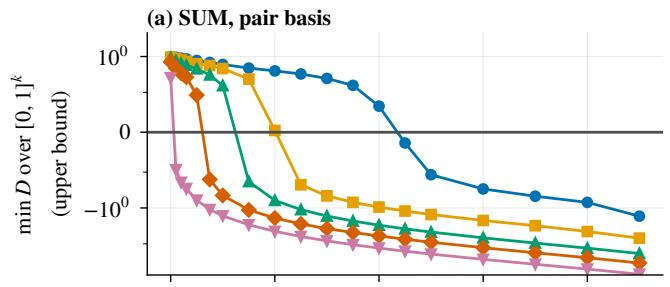

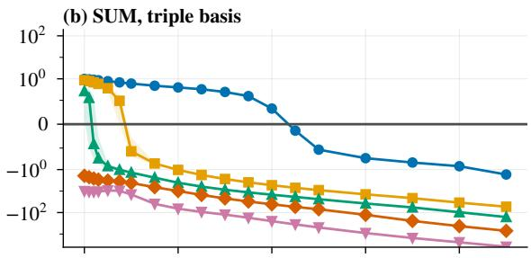

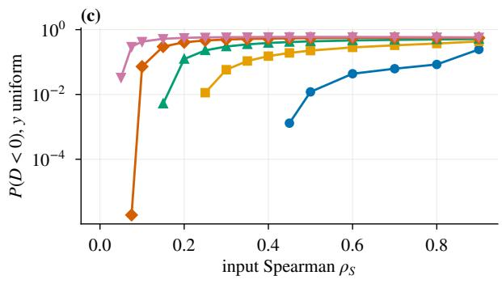

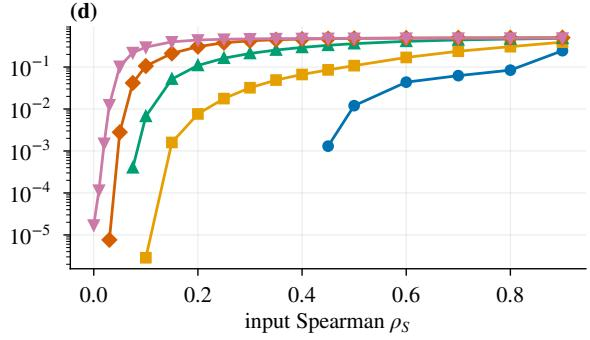

Figure 4: Negativity of � for type SUM, $m = 4 , n = 1 0 ^ { 7 }$ , seed medians. (a, b) min � over $[ 0 , 1 ] ^ { k }$ on a symmetric logarithmic axis; the value is an upper bound on the true minimum. (c, d) $P ( D < 0 )$ under uniform � on a logarithmic axis; points with zero observed probability are not drawn.  
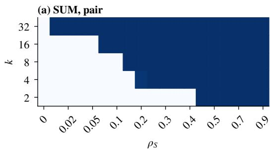

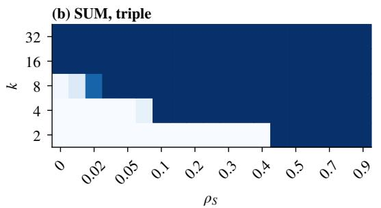

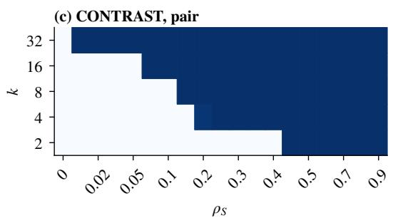

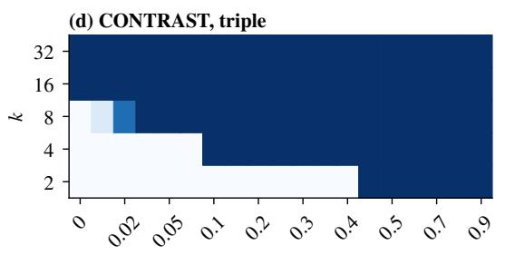  
Figure 5: Share of seeds with $p _ { \mathrm { E U } }$ undefined under $\mathrm { S } 2 , m = 4 , n = 1 0 ^ { 7 }$ . The $\rho _ { S }$ axis is categorical (grid values, unevenly spaced). Dark regions are where $d _ { \mathrm { d e n o m } }$ cannot be measured.

## G The gap and the errors: further results

This appendix holds the threshold tables and error components behind Sections 6.2, 6.3 and $6 . 6 .$ Table 15 and Figure 7 are the summary; Tables 16–18 add CONTRAST, confidence intervals, variance thresholds (Table 17) and all beliefs. Table 19 shows what happens past the onset. Table 20 and Figure 8 show how the error splits, and Figure 9 compares variance and mean errors.

Table 15: Thresholds in $\rho _ { S }$ for type SUM, flat belief S2, $m = 4 ,$ seed-median curves, $n = 1 0 ^ { 7 }$ except the population onset. $^ { 6 6 } - ^ { 5 5 }$ means the level was not reached before $p _ { \mathrm { E U } }$ became undefined; it never means that the error is small. “undefined from” is the first grid value at which most seeds have � undefined. Onsets are upper bounds.
<table><tr><td>basis</td><td>k</td><td> $d _ { \mathrm { d e n o m } } \geq 1 \%$ </td><td> $d _ { \mathrm { d e n o m } } \ge 5 \%$ </td><td> $\mathrm { o n s e t } , n = 1 0 ^ { 7 }$ </td><td>onset, pop.</td><td>undefined from</td></tr><tr><td>pair</td><td>2</td><td>0.192</td><td>0.359</td><td>0.435</td><td>0.437</td><td>0.450</td></tr><tr><td rowspan="7">triple</td><td>4</td><td>0.102</td><td>一</td><td>0.201</td><td>0.204</td><td>0.200</td></tr><tr><td>8</td><td>0.067</td><td>一</td><td>0.123</td><td>0.129</td><td>0.150</td></tr><tr><td>16</td><td>0.043</td><td>一</td><td>0.059</td><td>0.074</td><td>0.075</td></tr><tr><td>32</td><td></td><td>一</td><td>0.007</td><td>0.039</td><td>0.010</td></tr><tr><td>2</td><td>0.085</td><td>一</td><td>0.435</td><td>0.437</td><td>0.450</td></tr><tr><td>4</td><td>0.020</td><td>一</td><td>0.085</td><td>0.094</td><td>0.100</td></tr><tr><td>8</td><td>0.009</td><td>一</td><td>0.016</td><td>0.045</td><td>0.020</td></tr><tr><td></td><td>16</td><td>一</td><td>一</td><td>0.000</td><td>0.023</td><td>0.000</td></tr><tr><td></td><td>32</td><td>一</td><td>一</td><td>0.000</td><td>0.011</td><td>0.000</td></tr></table>

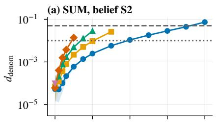

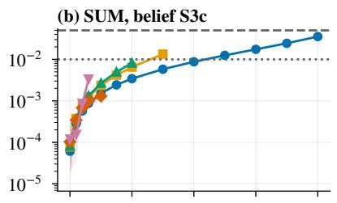

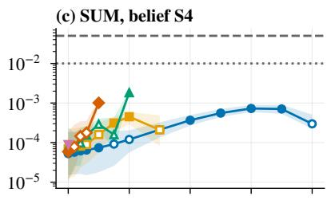

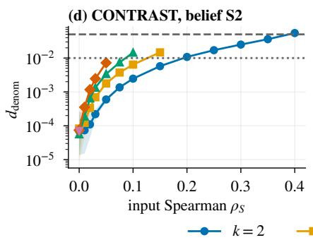

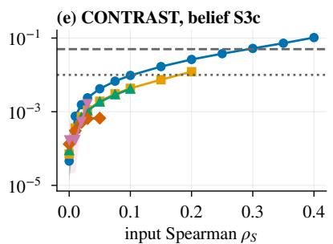

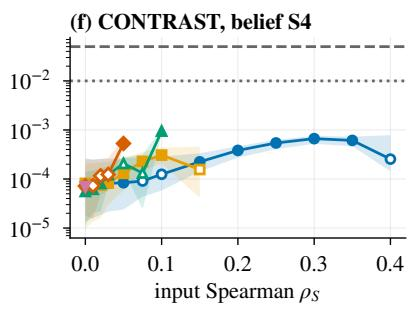  
Figure 6: $d _ { \mathrm { d e n o m } }$ against input Spearman correlation $\rho _ { S }$ for the pair basis, $m = 4 , n = 1 0 ^ { 7 } , \varepsilon = 0 . 0 1$ , beliefs S2, S3c and S4. Lines are seed medians and bands 2.5–97.5 % seed intervals. A curve ends where most seeds have $p _ { \mathrm { E U } }$ undefined; the gap carries no information about the error. Hollow markers are below three times the Monte Carlo noise floor. Dotted and dashed lines mark 1 % and 5 %.

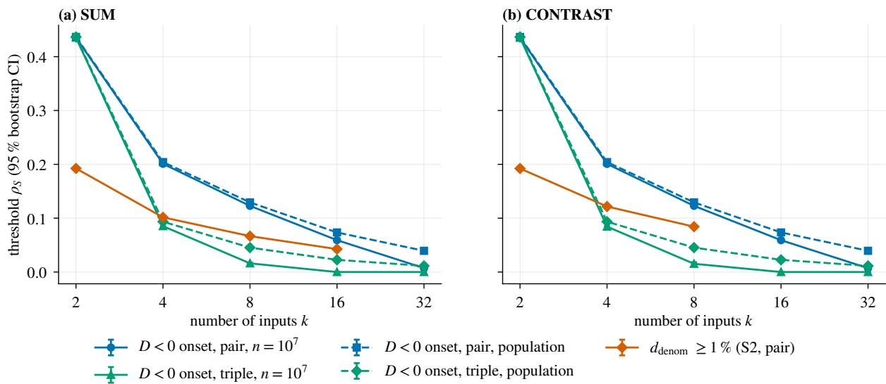  
Figure 7: Negativity onsets for both bases, at $n = 1 0 ^ { 7 }$ (solid) and with population coeficients (dashed), and the 1 % threshold of $d _ { \mathrm { d e n o m } }$ (S2, pair), against $k ,$ for $m = 4 .$ Error bars are 95 % bootstrap CIs and are often smaller than the markers. Missing points mean the level was not reached before $p _ { \mathrm { E U } }$ became undefined.

Table 16: All thresholds for S2, � = 4, with 95 % bootstrap CIs. $^ { 6 6 } - ^ { 5 5 }$ as in Table 15.
<table><tr><td>type</td><td>basis</td><td>k</td><td> $d _ { \mathrm { d e n o m } } \ge 1 \%$ </td><td> $d _ { \mathrm { d e n o m } } \ge 5 \%$ </td><td>onset,  $n = 1 0 ^ { 7 }$ </td><td>onset, pop.</td><td>undefined from</td></tr><tr><td>SUM</td><td>pair</td><td>2</td><td>0.192 (0.192–0.193)</td><td>0.359 (0.359–0.360)</td><td>0.435 (0.435–0.436)</td><td>0.437</td><td>0.450</td></tr><tr><td></td><td></td><td>4</td><td>0.102 (0.101–0.102)</td><td></td><td>0.201 (0.201–0.201)</td><td>0.204</td><td>0.200</td></tr><tr><td></td><td></td><td>8</td><td>0.067 (0.067–0.067)</td><td></td><td>0.123 (0.123–0.123)</td><td>0.129</td><td>0.150</td></tr><tr><td></td><td></td><td>16</td><td>0.043 (0.043–0.043)</td><td></td><td>0.059 (0.059–0.060)</td><td>0.074</td><td>0.075</td></tr><tr><td></td><td></td><td>32</td><td></td><td></td><td>0.007 (0.007–0.008)</td><td>0.039</td><td>0.010</td></tr><tr><td></td><td>triple</td><td>2</td><td>0.085 (0.085–0.086)</td><td></td><td>0.435 (0.435–0.436)</td><td>0.437</td><td>0.450</td></tr><tr><td></td><td></td><td>4</td><td>0.020 (0.020–0.020)</td><td></td><td>0.085 (0.083–0.087)</td><td>0.094</td><td>0.100</td></tr><tr><td></td><td></td><td>8</td><td>0.009 (0.009–0.009)</td><td></td><td>0.016 (0.015–0.017)</td><td>0.045</td><td>0.020</td></tr><tr><td></td><td></td><td>16</td><td></td><td></td><td>0.000 (0.000–0.000)</td><td>0.023</td><td>0.000</td></tr><tr><td>CONTRAST</td><td></td><td>32</td><td></td><td></td><td>0.000 (0.000–0.000)</td><td>0.011</td><td>0.000</td></tr><tr><td></td><td>pair</td><td>2</td><td>0.192 (0.192–0.192)</td><td>0.388 (0.387–0.388)</td><td>0.435 (0.435–0.435)</td><td>0.437</td><td>0.450</td></tr><tr><td></td><td></td><td>4</td><td>0.122 (0.121–0.122)</td><td></td><td>0.201 (0.201–0.201)</td><td>0.204</td><td>0.200</td></tr><tr><td></td><td></td><td>8</td><td>0.084 (0.084–0.084)</td><td></td><td>0.123 (0.123–0.123)</td><td>0.129</td><td>0.150</td></tr><tr><td></td><td></td><td>16</td><td></td><td></td><td>0.059 (0.059–0.060)</td><td>0.074</td><td>0.075</td></tr><tr><td></td><td></td><td>32</td><td></td><td></td><td>0.007 (0.007–0.008)</td><td>0.039</td><td>0.010</td></tr><tr><td></td><td>triple</td><td>2</td><td>0.065 (0.065–0.065)</td><td>0.235 (0.235–0.235)</td><td>0.435 (0.435–0.435)</td><td>0.437</td><td>0.450</td></tr><tr><td></td><td></td><td>4</td><td>0.054 (0.054–0.054)</td><td></td><td>0.084 (0.082–0.086)</td><td>0.094</td><td>0.100</td></tr><tr><td></td><td></td><td>8</td><td></td><td></td><td>0.015 (0.013–0.018)</td><td>0.045</td><td>0.020</td></tr><tr><td></td><td></td><td>16</td><td></td><td></td><td>0.000 (0.000–0.000)</td><td>0.023</td><td>0.000</td></tr><tr><td></td><td></td><td>32</td><td></td><td></td><td>0.000 (0.000–0.000)</td><td>0.011</td><td>0.000</td></tr></table>

Table 17: Thresholds of the relative variance error (S2, � = 4) and min � at $\rho _ { S } = 0 . \stackrel { \left. } { \quad } - \stackrel { \right. }$ as in Table 15.
<table><tr><td>type</td><td>basis</td><td>k</td><td>|relvar| ≥ 5 %</td><td>|relvar|  $\geq 2 0 \%$ </td><td>min D at  $\rho _ { S } = 0$ </td></tr><tr><td>SUM</td><td>pair</td><td>2</td><td>0.283 (0.282–0.283)</td><td></td><td>0.992</td></tr><tr><td rowspan="11">CONTRAST</td><td></td><td>4</td><td>0.147 (0.146–0.147)</td><td></td><td>0.965</td></tr><tr><td></td><td>8</td><td>0.095 (0.095–0.095)</td><td></td><td>0.901</td></tr><tr><td></td><td>16</td><td></td><td></td><td>0.708</td></tr><tr><td></td><td>32</td><td></td><td></td><td>0.254</td></tr><tr><td>triple</td><td>2</td><td>0.246 (0.245–0.246)</td><td></td><td>0.992</td></tr><tr><td></td><td>4 8</td><td>0.048 (0.048–0.048)</td><td></td><td>0.866</td></tr><tr><td></td><td>16</td><td></td><td></td><td>0.266</td></tr><tr><td></td><td></td><td></td><td></td><td>-1.948</td></tr><tr><td>pair</td><td>32</td><td></td><td></td><td>-10.066</td></tr><tr><td></td><td>2</td><td>0.299 (0.299–0.299)</td><td></td><td>0.992</td></tr><tr><td rowspan="8"></td><td></td><td>4</td><td></td><td></td><td>0.966</td></tr><tr><td></td><td>8</td><td></td><td></td><td>0.895</td></tr><tr><td></td><td>16</td><td></td><td></td><td>0.711</td></tr><tr><td></td><td>32</td><td></td><td></td><td>0.253</td></tr><tr><td>triple</td><td>2</td><td>0.139 (0.139–0.139)</td><td></td><td>0.992</td></tr><tr><td></td><td>4</td><td></td><td></td><td>0.863</td></tr><tr><td></td><td>8</td><td></td><td></td><td>0.250</td></tr><tr><td></td><td>16</td><td></td><td></td><td>-2.068</td></tr><tr><td></td><td></td><td>32</td><td></td><td></td><td>-10.202</td></tr></table>

Table 18: 1 % threshold of $d _ { \mathrm { d e n o m } }$ and undefined onset (shown as threshold / onset) for all beliefs, pair basis, $m = 4 , \mathrel { \mathop {  } } \mathrel { \mathop { - } } \mathrel { \mathop { \longrightarrow } }$ in the onset means $p _ { \mathrm { E U } }$ stayed defined up to $\rho { s } = 0 . 9 $ only then does $^ { 6 6 } - ^ { 5 5 }$ in the threshold mean that the level was not reached in the range. “Defined” is relative to the protocol’s support cut, whose reach changes with � (Appendix E), so do not read defined share or undefined onsets under Beta beliefs at $k \geq 1 6$ as a trend. Selection (Section 6.3): among defined evaluations at $m = 4 , \rho s > 0 ,$ $d _ { \mathrm { d e n o m } }$ has 99th percentile 0.062; over all $m , \mathrm { C V } _ { q } ( D )$ reaches 0.996 and $d _ { \mathrm { d e n o m } } 0 . 1 7 6$ . The 5 % level of $d _ { \mathrm { d e n o m } }$ is reached in 3 of 20 S2 cells and 9 of 120 cells over all beliefs. Under S3d the seed-median $d _ { \mathrm { d e n o m } }$ is at most 0.0032 for pair at $m = 4 ,$ , but 0.0124 for triple at � = 4 and 0.0211 at $m = 2$ (post hoc).
<table><tr><td>type</td><td>k</td><td>S2</td><td>S3a</td><td>S3b</td><td>S3c</td><td>S3d</td><td>S4</td></tr><tr><td>SUM</td><td>2</td><td>0.192 / 0.45</td><td>—/0.45</td><td>—/0.45</td><td>0.217 / 0.45</td><td>—/0.60</td><td>—/0.45</td></tr><tr><td></td><td>4</td><td>0.102 / 0.20</td><td>—/0.25</td><td>0.039 / 0.25</td><td>0.125 / 0.20</td><td>—/0.35</td><td>—/0.20</td></tr><tr><td></td><td>8</td><td>0.067 / 0.15</td><td>—/0.15</td><td>0.014 / 0.20</td><td>—/0.15</td><td>—/0.35</td><td>—/0.15</td></tr><tr><td></td><td>16</td><td>0.043 / 0.075</td><td>—/0.15</td><td>0.009 / 0.90</td><td>—/0.075</td><td>-/-</td><td>—/0.075</td></tr><tr><td></td><td>32</td><td>—/0.010</td><td>0.054 /—</td><td>0.027 /—</td><td>—/0.050</td><td>-/—</td><td>—/0.010</td></tr><tr><td>CONTRAST</td><td>2</td><td>0.192 / 0.45</td><td>—/0.45</td><td>—/0.45</td><td>0.102 / 0.45</td><td>—/0.60</td><td>—/0.45</td></tr><tr><td></td><td>4</td><td>0.122 / 0.20</td><td>—/0.25</td><td>—/0.25</td><td>0.177 / 0.25</td><td>—/0.35</td><td>—/0.20</td></tr><tr><td></td><td>8</td><td>0.084 / 0.15</td><td>—/0.15</td><td>—/0.20</td><td>—/0.15</td><td>—/0.35</td><td>—/0.15</td></tr><tr><td></td><td>16</td><td>—/0.075</td><td>—/0.15</td><td>—/0.90</td><td>—/0.075</td><td>-/—</td><td>—/0.075</td></tr><tr><td></td><td>32</td><td>—/0.010</td><td>-1—</td><td>—1—</td><td>—/0.050</td><td>-/—</td><td>—/0.010</td></tr></table>

Table 19: Past the onset: evaluations with $p _ { \mathrm { E U } }$ undefined, $\rho _ { S } > 0 , m = 4 , \varepsilon = 0 . 0 1$ , medians (post hoc). “CD closer than $\mathrm { E C } ^ { \bullet \bullet }$ share with � nearer to $p _ { \mathrm { G } }$ than $p _ { \mathrm { E C } } .$ . Here truth is the Jefrey answer.
<table><tr><td>basis</td><td>belief</td><td>evaluations</td><td>share undefined</td><td> $d _ { \mathrm { t o t a l } }$ </td><td> $d _ { \mathrm { d c } }$ </td><td> $d _ { \mathrm { { m o d e l , c a l } } }$ </td><td>CD closer than EC</td></tr><tr><td>pair</td><td>S2</td><td>6,098</td><td>68 %</td><td>0.098</td><td>0.086</td><td>0.146</td><td>64 %</td></tr><tr><td></td><td>S3a</td><td>3,963</td><td>44%</td><td>0.054</td><td>0.008</td><td>0.050</td><td>30 %</td></tr><tr><td></td><td>S3b</td><td>2,800</td><td>31 %</td><td>0.067</td><td>0.011</td><td>0.057</td><td>25 %</td></tr><tr><td></td><td>S3c</td><td>5,751</td><td>64%</td><td>0.067</td><td>0.052</td><td>0.086</td><td>64 %</td></tr><tr><td></td><td>S3d</td><td>1,978</td><td>22 %</td><td>0.046</td><td>0.001</td><td>0.041</td><td>25 %</td></tr><tr><td></td><td>S4</td><td>6,098</td><td>68 %</td><td>0.000</td><td>0.017</td><td>0.017</td><td>97 %</td></tr><tr><td rowspan="5">triple</td><td>S2</td><td>7,196</td><td>80%</td><td>0.079</td><td>0.051</td><td>0.068</td><td>41 %</td></tr><tr><td>S3a</td><td>5,845</td><td>65 %</td><td>0.078</td><td>0.042</td><td>0.073</td><td>50 %</td></tr><tr><td>S3b</td><td>5,663</td><td>63 %</td><td>0.112</td><td>0.053</td><td>0.086</td><td>38 %</td></tr><tr><td>S3c</td><td>6,949</td><td>77 %</td><td>0.033</td><td>0.053</td><td>0.061</td><td>71 %</td></tr><tr><td>S3d</td><td>4,601</td><td>51 %</td><td>0.102</td><td>0.036</td><td>0.105</td><td>54 %</td></tr><tr><td></td><td>S4</td><td>7,196</td><td>80%</td><td>0.022</td><td>0.039</td><td>0.021</td><td>54 %</td></tr></table>

Table 20: Error components at $k = 2 ,$ , pair basis, $m = 4$ $n = 1 0 ^ { 7 }$ $\varepsilon = 0 . 0 1$ , seed medians.
<table><tr><td>belief</td><td>type</td><td>ρs</td><td> $d _ { \mathrm { d e n o m } }$ </td><td> $d _ { \mathrm { n e g } }$ </td><td> $d _ { \mathrm { m o d e l , u n c a l } }$ </td><td> $d _ { \mathrm { m o d e l , c a l } }$ </td><td> $d _ { \mathrm { t o t a l } }$ </td></tr><tr><td rowspan="5">S2</td><td rowspan="5">SUM</td><td>0.1</td><td>0.0025</td><td>0.0111</td><td>0.0131</td><td>0.0241</td><td>0.0106</td></tr><tr><td>0.2</td><td>0.0108</td><td>0.0076</td><td>0.0287</td><td>0.0358</td><td>0.0180</td></tr><tr><td>0.4 CONTRAST</td><td>0.0736</td><td>0.0376</td><td>0.1002</td><td>0.0627</td><td>0.0265</td></tr><tr><td>0.1</td><td>0.0025</td><td>0.0123</td><td>0.0129</td><td>0.0026</td><td>0.0154</td></tr><tr><td>0.2</td><td>0.0108</td><td>0.0095</td><td>0.0267</td><td>0.0195</td><td>0.0374</td></tr><tr><td rowspan="5">S3c</td><td rowspan="5">SUM</td><td>0.4</td><td>0.0547</td><td>0.0238</td><td>0.0397</td><td>0.0617</td><td>0.0906</td></tr><tr><td>0.1 0.2</td><td>0.0034 0.0087</td><td>0.0064 0.0064</td><td>0.0399</td><td>0.0445</td><td>0.0368</td></tr><tr><td>0.4</td><td>0.0355</td><td>0.0061</td><td>0.0372</td><td>0.0415</td><td>0.0294</td></tr><tr><td>CONTRAST 0.1</td><td>0.0097</td><td>0.0391</td><td>0.0485 0.0650</td><td>0.0438 0.0673</td><td>0.0171</td></tr><tr><td>0.2</td><td>0.0262</td><td>0.0551</td><td>0.0854</td><td>0.0971</td><td>0.0710 0.1022</td></tr><tr><td rowspan="5">S4 SUM</td><td rowspan="5"></td><td>0.4</td><td>0.1030</td><td>0.1116</td><td>0.0985</td><td>0.1371</td><td>0.1526</td></tr><tr><td>0.1</td><td>0.0001</td><td>0.0120</td><td>0.0003</td><td>0.0119</td><td>0.0003</td></tr><tr><td>0.2</td><td>0.0004</td><td>0.0103</td><td>0.0004</td><td>0.0100</td><td>0.0003</td></tr><tr><td>0.4</td><td>0.0003</td><td>0.0037</td><td>0.0004</td><td>0.0037</td><td>0.0002</td></tr><tr><td>CONTRAST 0.1</td><td>0.0001</td><td>0.0118</td><td>0.0003</td><td>0.0118</td><td>0.0003</td></tr><tr><td rowspan="4"></td><td rowspan="4"></td><td>0.2</td><td>0.0004</td><td>0.0104</td><td>0.0004</td><td>0.0101</td><td>0.0003</td></tr><tr><td>0.4</td><td>0.0003</td><td>0.0044</td><td>0.0004</td><td>0.0045</td><td>0.0004</td></tr><tr><td></td><td></td><td></td><td></td><td></td><td></td></tr></table>

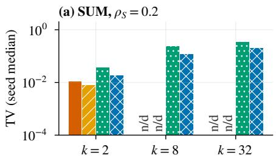  
(d) CONTRAST, ρS = 0.2

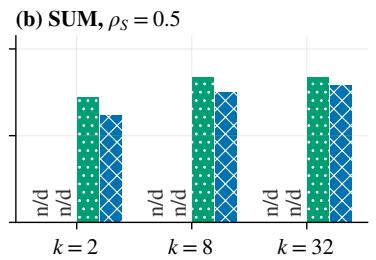  
(e) CONTRAST, ρS = 0.5

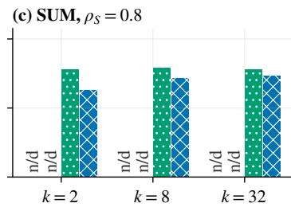  
(f) CONTRAST, ρS = 0.8

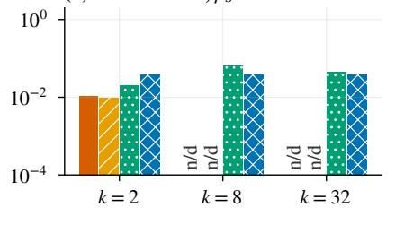

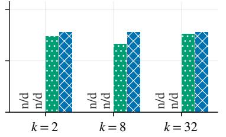

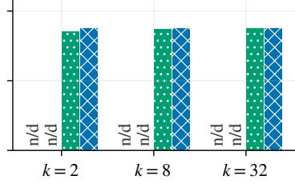  
dneg dmodel, cal dtotal

Figure 8: Error components under the flat belief S2, pair basis, $m = 4 , n = 1 0 ^ { 7 } , \varepsilon = 0 . 0 1 ;$ seed medians at three correlations and three values of $k , \mathrm { \Omega ^ { * } n } / \mathrm { d } ^ { * }$ marks quantities not defined because � is undefined, not values near zero. $d _ { \mathrm { t o t a l } }$ under S2 is dominated by the mismatch between the flat belief and the truth.  
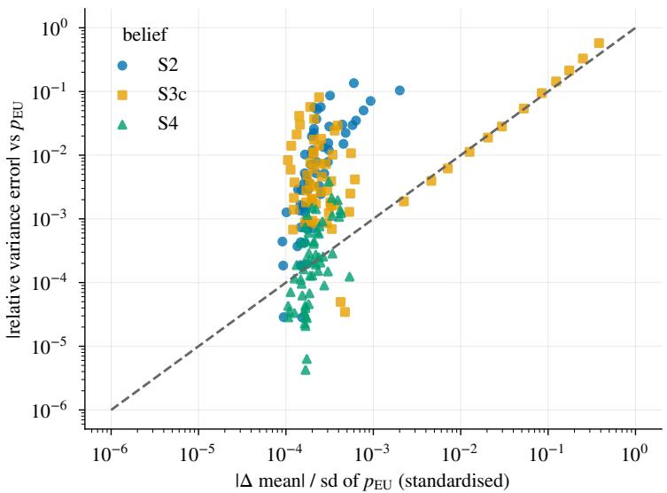  
Figure 9: Absolute relative variance error against standardised mean error, both relative to $p _ { \mathrm { E U } }$ , pair basis, $m = 4 , \varepsilon = 0 . 0 1$ , all �, types and $\rho _ { S } > 0$ where defined; seed medians. Points above the dashed line have larger variance error than mean error.

## H Decision rules and hypothesis details

The decision rules below are given in substance from the protocol. The tables and the figure that follow hold the detail behind H1c (Tables 21 and 22), H2a, H3a–c and H4b.

H1a, H2a, H2b (population): deterministic inequality per cell. H1b, H2b $( n = 1 0 ^ { 7 } )$ , H5a–d: aggregation rule of Section 6.1. H1c: power law per (type, basis), ≥ 90 % of points within a factor 2 for supported, < 50 % for not supported. H2c: max/min over � at most 1 $. 5 \mathrm { a t } \geq 8 0 \%$ of points for supported, ≤ 50 % for not supported. H3a: supported if every CI is inside [−0.05, 0.05], not supported if any is entirely outside. H3b: same with the ratio in [0.5, 2]. H3c: ≥ 80 % for supported, < 50 % for not supported; the analysis drops matrices whose $d _ { \mathrm { d e n o m } }$ lies below the noise floor, as the protocol does for points in H1c, H2c and H3b. H4a: ≥ 90 % for supported, $< 5 0 \%$ for not supported. H4b: every violation is listed in the released results. The two bases coincide for � at $k = 2 ,$ , which is why $k = 2$ is not in H2b.

Transfer in detail. None of the three transfer hypotheses was supported. H3a (not supported). The rule requires every onset diference from the Gaussian to have a CI inside ±0.05. Of 48 comparisons, 21 were inside and 27 entirely outside (Table 24, Figure 10). Onsets were mostly earlier, with diferences as low as −0.201 for $t _ { 3 }$ and −0.179 for Clayton. H3b (not supported). $d _ { \mathrm { d e n o m } }$ under S2 at matched Kendall’s � fell within a factor 2 of the Gaussian, with its CI, at 73 of 236 points and entirely outside at 156; median ratios were 2.08 $\left( t _ { 1 0 } \right)$ , 5.34 (Clayton),

7.22 $\left( t _ { 3 } \right)$ and 16.60 (Gumbel). H3c (not supported). For LKJ matrices the Gaussian power law predicted $d _ { \mathrm { d e n o m } }$ within a factor 2 for $3 9 \%$ (pair) and 34 % (triple) of the 272 defined matrices whose $d _ { \mathrm { d e n o m } }$ lies above the noise floor. This rests on � = 2: at � = 4 and 8 the numbers of defined matrices were 0 and $0 ,$ so Table 25 lists $k = 2$ only. Part of the � result is consistent with structure: a � copula is dependent at zero correlation, so $\rho _ { S } = 0$ is not independence. $\mathrm { A t } \ k = 2$ in the pair basis $\chi _ { D }$ at $\rho _ { S } = 0$ is 0.30 for $t _ { 3 }$ and 0.09 for $t _ { 1 0 } .$ , against 0.0015 for the Gaussian, and $t _ { 3 }$ already has min $D = - 0 . 6 7$ at $k = 4$ (post hoc). We did not test this further.

Table 21: H1c fits $d _ { \mathrm { d e n o m } } = C \chi _ { D } ^ { \beta }$ on population coeficients, S2, $m = 4 .$ Cell verdicts follow the H1c rule.
<table><tr><td>type</td><td>basis</td><td>points</td><td> $_ { \beta }$ </td><td>C</td><td>within 2×</td><td>cell verdict</td></tr><tr><td>CONTRAST</td><td>pair</td><td>33</td><td>1.59</td><td>0.040</td><td>0.52</td><td>inconclusive</td></tr><tr><td></td><td>triple</td><td>23</td><td>1.00</td><td>0.083</td><td>0.48</td><td>not supported</td></tr><tr><td>SUM</td><td>pair</td><td>33</td><td>1.76</td><td>0.070</td><td>0.55</td><td>inconclusive</td></tr><tr><td></td><td>triple</td><td>23</td><td>0.88</td><td>0.107</td><td>1.00</td><td>supported</td></tr></table>

Table 22: H1c points against the pre-registered power law and the closed forms (post hoc). “power law” and “closed form” give the share of points within a factor 2 of the fit and of the formula; “ratio” is measured $d _ { \mathrm { d e n o m } }$ over the formula.
<table><tr><td>type, basis</td><td>points</td><td>β(H1c)</td><td>power law</td><td>closed form</td><td>ratio range</td><td>median ratio</td></tr><tr><td> $\mathbf { S U M } , \mathbf { p a i r }$ </td><td>33</td><td>1.76</td><td>55 %</td><td>100 %</td><td>0.61-1.65</td><td>0.88</td></tr><tr><td>CONTRAST, pair</td><td>33</td><td>1.59</td><td>52 %</td><td>100 %</td><td>0.61-1.65</td><td>0.87</td></tr><tr><td>SUM, triple</td><td>23</td><td>0.88</td><td>100 %</td><td>100 %</td><td>0.57–0.99</td><td>0.79</td></tr><tr><td>CONTRAST, triple</td><td>23</td><td>1.00</td><td>48 %</td><td>100 %</td><td>1.00-1.76</td><td>1.07</td></tr></table>

Table 23: Population negativity onset by degree (H2a), type SUM. At $k = 2$ the two bases coincide for $D$
<table><tr><td rowspan="2">k</td><td colspan="3">pair</td><td colspan="3">triple</td></tr><tr><td> $m = 2$ </td><td> $m = 4$ </td><td> $m = 6$ </td><td> $m = 2$ </td><td> $m = 4$ </td><td> $m = 6$ </td></tr><tr><td>2</td><td>0.545</td><td>0.437</td><td>0.398</td><td>0.545</td><td>0.437</td><td>0.398</td></tr><tr><td>4</td><td>0.261</td><td>0.204</td><td>0.168</td><td>0.199</td><td>0.094</td><td>0.070</td></tr><tr><td>8</td><td>0.158</td><td>0.129</td><td>0.116</td><td>0.087</td><td>0.045</td><td>0.035</td></tr><tr><td>16</td><td>0.090</td><td>0.074</td><td>0.068</td><td>0.041</td><td>0.023</td><td>0.018</td></tr><tr><td>32</td><td>0.049</td><td>0.039</td><td>0.038</td><td>0.021</td><td>0.011</td><td>0.009</td></tr></table>

Table 24: Comparison with the Gaussian copula at matched Kendall’s $\tau \left( m = 4 , \right.$ pair and triple, $k \in \{ 2 , 4 , 8 \} , n = 1 0 ^ { 7 }$ , 20 seeds). Columns: smallest and largest onset diference from the Gaussian; number of $9 5 \%$ CIs inside and entirely outside $\pm 0 . 0 5 ;$ ; median ratio of $d _ { \mathrm { d e n o m } }$ to Gaussian under S2.
<table><tr><td>family</td><td>cells</td><td>min diff.</td><td>max diff.</td><td>CI inside</td><td>CI outside</td><td>median ratio</td></tr><tr><td>Clayton</td><td>6</td><td>-0.179</td><td>+0.006</td><td>2</td><td>4</td><td>5.34</td></tr><tr><td>Gumbel</td><td>6</td><td>-0.128</td><td>-0.013</td><td>1</td><td>5</td><td>16.60</td></tr><tr><td>t10</td><td>18</td><td>-0.102</td><td>+0.036</td><td>15</td><td>3</td><td>2.08</td></tr><tr><td>t3</td><td>18</td><td>-0.201</td><td>-0.016</td><td>3</td><td>15</td><td>7.22</td></tr></table>

Table 25: H3c by � and $\eta .$ “defined” counts matrices with $p _ { \mathrm { E U } }$ defined (pair basis, S2, $m = 4 )$ . Shares are among defined matrices with $d _ { \mathrm { d e n o m } }$ above the noise floor. The rule is at least $8 0 \%$ for supported and below 50 % for not supported.
<table><tr><td>k</td><td>η</td><td>defined</td><td>drawn</td><td>within  $2 \times ,$  pair</td><td>within  $2 \times ,$  triple</td></tr><tr><td>2</td><td>1</td><td>108</td><td>200</td><td>38 %</td><td>49 %</td></tr><tr><td>2</td><td>4</td><td>165</td><td>200</td><td>39 %</td><td>24 %</td></tr></table>

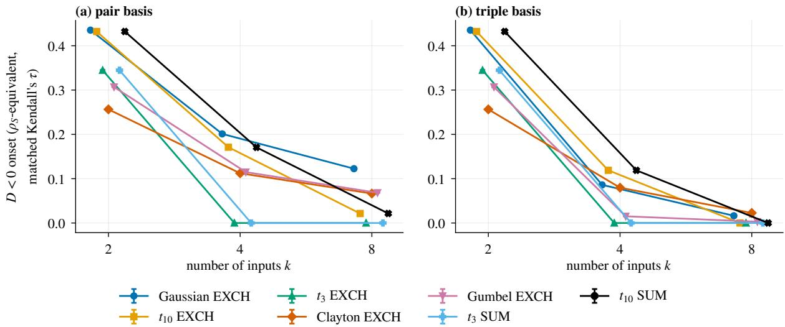  
Figure 10: Negativity onset by copula family at matched Kendall’s �, expressed in $\rho _ { S }$ units, $m = 4 , n = 1 0 ^ { 7 }$ , 20 seeds, with 95 % bootstrap CIs (mostly smaller than the markers). Points are shifted slightly in � for legibility. EXCH families and the � SUM forms are shown; � CONTRAST is in Table 24. An onset of 0 means min $D < 0$ at $\rho _ { S } = 0 .$

Table 26: Convergence test H4b on the subset of the convergence study $( k \in \{ 2 , 8 , 3 2 \} , 5$ seeds). Paired values are reported TVs before and after doubling one setting; a violation is a change of at least max(3 SE, 10−3). The final column is the largest ratio of change to tolerance. The 5,460 violations, 0.47 % of all paired values, fall at $k = 8 ( 4 9 8 )$ ) and � = 32 (4,962). Post hoc: 93 % of them are triple, with median relative change 2.8 %, and the largest change runs from 26.4 to 18.1, at $k = 3 2$ , triple, $m = 6 , \mathrm { S } 3 \mathrm { d } , \mathrm { : }$ a signed output.
<table><tr><td>variant</td><td>paired values</td><td>violations</td><td>median change</td><td>max change</td><td>worst ratio</td></tr><tr><td> $M \times 2$ </td><td>291,249</td><td>0</td><td> $1 . 9 \times 1 0 ^ { - 5 }$ </td><td> $4 . 6 \times 1 0 ^ { - 1 }$ </td><td>0.86</td></tr><tr><td> $n \times 2$ </td><td>291,258</td><td>5,460</td><td> $4 . 6 \times 1 0 ^ { - 5 }$ </td><td> $8 . 3 \times 1 0 ^ { 0 }$ </td><td>36.21</td></tr><tr><td>s-nodes  $\times 2$ </td><td>291,276</td><td>0</td><td> $2 . 7 \times 1 0 ^ { - 9 }$ </td><td> $3 . 7 \times 1 0 ^ { - 5 }$ </td><td>0.00</td></tr><tr><td>x-nodes ×2</td><td>291,276</td><td>0</td><td> $4 . 0 \times 1 0 ^ { - 1 0 }$ </td><td> $6 . 4 \times 1 0 ^ { - 6 }$ </td><td>0.00</td></tr></table>

## I Chains and training

This appendix defines the chain experiment and gives the detail behind Section 6.7.

Ground truth. The ground truth is a Markov chain in normal scores. The first hidden variable depends on � through a Gaussian-copula neuron of the sweep; for $l \ge 2 , s _ { h _ { l } } = \alpha s _ { h _ { l - 1 } } + \gamma s _ { w _ { l } } + \sqrt { 1 - \alpha ^ { 2 } - \gamma ^ { 2 } }$ �� with $\alpha = 0 . 6 , \gamma = 0 . 5$ , fresh independent side inputs $w _ { l }$ and noise $\nu _ { l }$ . Neuron $l \geq 2$ is a triple-basis model of $( h _ { l } ; h _ { l - 1 } , w _ { l } )$ , that is $k = 2 .$ . Neuron 1 uses pair or triple. Depth is $L \leq 4 .$ , with $k \in \{ 2 , 4 , 8 \} , \rho _ { S } \in \{ 0 , 0 . 2 , 0 . 4 , 0 . 6 \} , m = 4$ and 10 seeds. Estimation uses $n = 1 0 ^ { 6 } ;$ ; training, validation and test splits have 2 · 105, $1 0 ^ { 5 }$ and $1 0 ^ { 5 }$ samples. Between layers the only normalisation is $c _ { 0 } = 1$ , the first coeficient of the propagated polynomial; there is no re-mapping of variables to quantiles.

Training. Training uses three losses: value MSE as in Eq. 7 of [16], calibrated negative log-likelihood (NLL), and end-to-end squared $L ^ { 2 }$ distance between the $p _ { \mathrm { C D } }$ output and the projected target, summed over S2, S3c and S4. It uses two optimisers, Adam [40] and L-BFGS [46], each with fixed, untuned settings. Adam: learning rate 0.003, cosine decay to $0 ,$ at most 2,000 full-batch steps, validation every 50 steps, patience 10. L-BFGS: strong Wolfe line search, learning rate 1, 20 iterations per step, history 20, at most 50 steps, validation every step, patience 10. The best validation state is kept. $\varepsilon = 0 . 0 1$ in the likelihood loss. The value loss uses rows $i \in \{ 0 , 1 \}$ ; an all-rows variant is identical because its extra gradients vanish exactly (validation test M14, Appendix J). The end-to-end loss uses $2 ^ { 1 6 }$ samples per belief per split. The end-to-end run for depth � trains the first � neurons and evaluates them followed by the untrained remainder. A flat-� control starts from $a _ { 0 \mathbf { j } } = 0$ for j ≠ 0.

Results in detail. H5a (not supported). The ratio $d _ { \mathrm { t o t a l } } ( L = 4 ) / d _ { \mathrm { t o t a l } } ( L = 1 )$ exceeded 1 significantly in 11 of 72 cells and was significantly below 1 in 51. Table 27 and Figure 11 give median ratios of 0.05 (S2), 0.06 (S3c) and 1.25 (S4). This is not an improvement in itself, because the target moves: under S2 the variance of $p _ { \mathrm { G } }$ rises towards the uniform value $1 / 1 2$ (from 0.0713 to 0.0829), and $d _ { \mathrm { t o t a l } }$ falls because the true output forgets the belief. A variance-type deviation shrinks by $\alpha ^ { 6 } = 0 . 0 4 7$ over three layers, close to the S2 ratio, which is consistent with contraction under a mixing kernel [3], not something we tested. Under S4 the pair ratio rises to 1.91 (8 of 12 cells significant), while the triple ratio falls to 0.04 (post hoc); the significant cells are small (paragraph H5a below). Inputs of later neurons are independent, so their � is nearly flat (median min � 0.97): H5a does not test compounding of denominator error over correlated inputs. H5b (not supported), H5c (not supported), H5d (not supported). Training reduced $d _ { \mathrm { d e n o m } }$ of neuron 1 significantly in 5 of 18 evaluable cells (1 opposite), and only $k = 2$ is evaluable. It reduced $P ( D < 0 )$ in 24 of 78 cells (19 opposite), and held-out $d _ { \mathrm { t o t a l } }$ in 27 of 192 cells (84 opposite); the training runs are summarised in Table 28 and Figure 12. Three facts limit these verdicts. About half of the end-to-end runs at $L = 4$ kept the initial state (54 % with Adam, 50 % with L-BFGS), and their loss before training, $2 . 4 \times 1 0 ^ { - 4 }$ , is already near the noise level of the target, $1 . 8 \times 1 0 ^ { - 4 }$ , so those runs could not show learning; they supply 8 of the 18 H5b cells and 26 of the 78 H5c cells. Optimiser settings were fixed and untuned. And $d _ { \mathrm { d e n o m } }$ can be evaluated only at $k = 2$ . We conclude that training did not reduce these errors under these settings. The data do not show that training cannot compensate for the approximations, and the HCR paper’s expectation that training compensates for neglected calibration remains untested.

Table 27: Depth results by belief and neuron-1 basis, medians over � $, \rho _ { S } > 0$ and seeds. Columns: $d _ { \mathrm { t o t a l } }$ at each layer; variance of $p _ { \mathrm { G } }$ at � = 1 and $L = 4 ;$ median H5a ratio over cells including $\rho _ { S } = 0 ;$ numbers of H5a cells significantly above 1, significantly below 1, and total. The breakdown is post hoc; the verdict uses all 72 cells.
<table><tr><td></td><td></td><td colspan="4"> $d _ { \mathrm { t o t a l } }$  at layer</td><td colspan="2"> $\operatorname { V a r } p _ { \mathrm { G } }$ </td><td colspan="2">H5a</td></tr><tr><td>belief</td><td>basis</td><td> $L = 1$ </td><td> $L = 2$ </td><td> $L = 3$ </td><td> $L = 4$ </td><td> $L = 1$ </td><td> $L = 4$ </td><td>ratio</td><td>above/below/all</td></tr><tr><td>S2</td><td>pair</td><td>0.0648</td><td>0.0211</td><td>0.0071</td><td>0.0024</td><td>0.0713</td><td>0.0829</td><td>0.05</td><td>1/9/12</td></tr><tr><td></td><td>triple</td><td>0.0653</td><td>0.0213</td><td>0.0071</td><td>0.0025</td><td>0.0713</td><td>0.0829</td><td>0.05</td><td>1/9/12</td></tr><tr><td>S3c</td><td>pair</td><td>0.0516</td><td>0.0111</td><td>0.0043</td><td>0.0018</td><td>0.0642</td><td>0.0826</td><td>0.04</td><td>0/12/12</td></tr><tr><td></td><td>triple</td><td>0.0126</td><td>0.0071</td><td>0.0030</td><td>0.0015</td><td>0.0642</td><td>0.0826</td><td>0.10</td><td>0/12/12</td></tr><tr><td>S4</td><td>pair</td><td>0.0005</td><td>0.0010</td><td>0.0010</td><td>0.0011</td><td>0.0833</td><td>0.0833</td><td>1.91</td><td>8/0/12</td></tr><tr><td></td><td>triple</td><td>0.0748</td><td>0.0252</td><td>0.0086</td><td>0.0031</td><td>0.0833</td><td>0.0833</td><td>0.04</td><td>1/9/12</td></tr></table>

Table 28: Training runs from direct estimates, medians over runs (post hoc). “kept initial”: share of runs whose best validation state is the initial one. “coef. dist.”: coeficient distance moved. “test loss”: relative change of the training loss on the test split, and the share of runs with a decrease. $\Delta P ( D < 0 )$ is taken where $P ( D < 0 )$ was positive. Δ min � is the change in min �.
<table><tr><td>loss</td><td>optimiser</td><td>kept initial</td><td>coef. dist.</td><td>test loss</td><td>test loss down</td><td> $\Delta P ( D < 0 )$ </td><td>∆ min D</td></tr><tr><td rowspan="2">value</td><td>Adam</td><td>23 %</td><td>0.132</td><td>-0.3%</td><td>52 %</td><td>0.005</td><td>-0.47</td></tr><tr><td>L-BFGS</td><td>4%</td><td>0.131</td><td>-1.1%</td><td>82 %</td><td>0.000</td><td>-0.34</td></tr><tr><td rowspan="2">NLL</td><td>Adam</td><td>0%</td><td>0.649</td><td>-10.9%</td><td>100 %</td><td>-0.055</td><td>-7.35</td></tr><tr><td>L-BFGS</td><td>0%</td><td>0.660</td><td>-11.1%</td><td>100 %</td><td>-0.043</td><td>-8.06</td></tr><tr><td rowspan="2">end-to-end, L = 1</td><td>Adam</td><td>3%</td><td>0.432</td><td>-97.0%</td><td>96%</td><td>0.109</td><td>-13.67</td></tr><tr><td>L-BFGS</td><td>5%</td><td>0.216</td><td>-97.7%</td><td>94%</td><td>0.060</td><td>-1.21</td></tr><tr><td rowspan="2">end-to-end, L = 2</td><td>Adam</td><td>10%</td><td>0.167</td><td>-91.7%</td><td>88 %</td><td>0.035</td><td>-2.12</td></tr><tr><td>L-BFGS</td><td>9%</td><td>0.059</td><td>-91.8%</td><td>88 %</td><td>0.001</td><td>-0.04</td></tr><tr><td rowspan="2">end-to-end, L = 3</td><td>Adam</td><td>19%</td><td>0.154</td><td>-52.2 %</td><td>71 %</td><td>0.033</td><td>-1.34</td></tr><tr><td>L-BFGS</td><td>18%</td><td>0.045</td><td>-50.2 %</td><td>71 %</td><td>0.001</td><td>-0.02</td></tr><tr><td rowspan="2">end-to-end, L = 4</td><td>Adam</td><td>54%</td><td>0.000</td><td>0.0%</td><td>31 %</td><td>0.003</td><td>0.00</td></tr><tr><td>L-BFGS</td><td>50%</td><td>0.000</td><td>0.0%</td><td>33 %</td><td>0.000</td><td>0.00</td></tr></table>

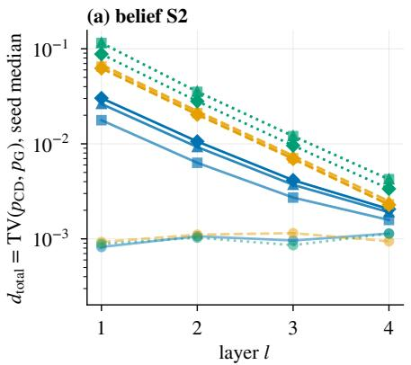

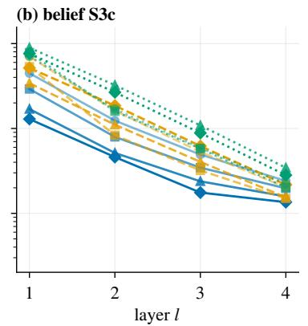

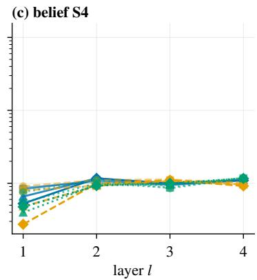  
Figure 11: �total by layer for chains with direct estimates: seed medians over 10 seeds, neuron 1 in the pair basis, $m = 4 , n = 1 0 ^ { 6 }$ for $k \in \{ 2 , 4 , 8 \}$ and $\rho _ { S } \in \{ 0 , 0 . 2 , 0 . 4 , 0 . 6 \}$ . The decline under S2 and S3c reflects the target approaching the uniform density, not improved accuracy. Values near $1 0 ^ { - 3 }$ are at Monte Carlo noise level.

H5a. The significant H5a cells all have tiny errors: $d _ { \mathrm { t o t a l } } ( L = 4 ) \leq 0 . 0 0 1 2$ , at most 2.43 times the noise floor (so below the flagging level), and 4 are at $\rho _ { S } = 0$ (post hoc). Lowest min � of later layers is 0.93.

H5b by loss (post hoc). NLL 4 of 6, value 1 of 4, end-to-end 0 of 8.

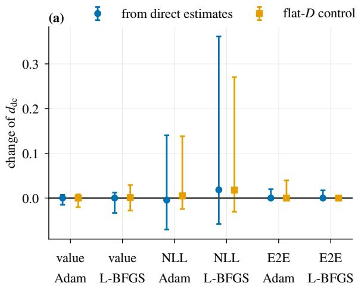

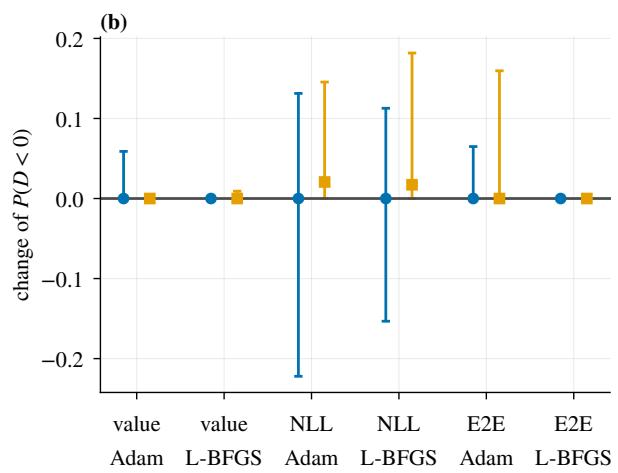  
Figure 12: Efect of training on neuron 1 under S2. (a) Change of $d _ { \mathrm { d c } } = \mathrm { T V } ( p _ { \mathrm { C D } } , p _ { \mathrm { E C } } )$ , shown because it exists everywhere; this is not the pre-registered $d _ { \mathrm { d e n o m } }$ of H5b. (b) Change of $P ( D < 0 )$ . Points are medians and bars 10–90 % ranges over all $k , \rho _ { S } .$ bases and seeds, from direct estimates and from the flat-� control. E2E: end-to-end training, the runs with $L = 4 .$

H5c by loss (post hoc). NLL 21 of 26 (4 opposite), value 3 of 26 (8 opposite), end-to-end 0 of 26 (7 opposite). NLL lowers the negative mass (median change of $P ( D < 0 ) - 0 . 0 5 5$ with Adam, −0.043 with L-BFGS, where it was positive) while deepening the minimum (min � falls by 7.3 and 8.1).

H5d. The count rises with � (0, 6, 21 of 64 each at $k = 2 , 4 , 8 )$ and is larger in the triple basis (23 against 4 of 96). At � = 1, median $d _ { \mathrm { t o t a l } }$ falls on the training beliefs (S2 by 0.036 with Adam and 0.031 with L-BFGS, S3c by 0.021 and 0.021), and rises on held-out beliefs (by 0.006 and 0.025), so the optimiser did learn (post hoc). The cause of the held-out result is the design: the objective fits 12 numbers (3 beliefs × 4 moments) with 61 to 6,364 coeficients, and validation uses the same beliefs. So H5d says little about whether training can absorb the denominator, and a fair test would need a distribution of training beliefs.

There were no non-finite losses in the 2,880 training runs from direct estimates. The flat-� control starts with $d _ { \mathrm { d e n o m } } = 0 ;$ after NLL training it has median $P ( D < 0 ) = 2 . 1 \%$ and $\chi _ { D } = 0 . 5 2$ , so likelihood training moves a flat model into the negative regime.

## J Validation

Fourteen validation tests check the implementation (Table 29). All code-validation tests (M1–M12, M14) pass on an A100 with a single version of the code. M13 is not a code test: it is hypothesis H4b on the study’s data and appears in Section 6.5 as not supported.

Table 29: Validation tests. M13 “fail” is the H4b outcome.
<table><tr><td>test</td><td>what it checks</td><td>result</td></tr><tr><td>M1</td><td>orthonormality of the basis, explicit  $f _ { 1 } , \ldots , f _ { 4 }$ </td><td>pass</td></tr><tr><td>M2</td><td>index families, coefficient counts, block vs dense estimator</td><td>pass</td></tr><tr><td>M3</td><td>estimator vs population moments, SE scaling, Gauss-Hermite convergence</td><td>pass</td></tr><tr><td>M4</td><td>reproduces the TV values of the  $d = 3$  study</td><td>pass</td></tr><tr><td>M5</td><td>flat-D control:  $p _ { \mathrm { C D } } = p _ { \mathrm { E U } }$ </td><td>pass</td></tr><tr><td>M6</td><td>covariance identity in sample</td><td>pass</td></tr><tr><td>M7</td><td>integrals of all densities; copula samplers and conditionals; Student-t CDF and quantile against 50-digit mpmath</td><td>pass</td></tr><tr><td>M8</td><td>TV in s vs x; grid refinement with spiky  $p _ { \mathrm { G } }$ </td><td>pass</td></tr><tr><td>M9</td><td>min-D optimiser vs brute-force grids and closed forms</td><td>pass</td></tr><tr><td>M10</td><td>positive definiteness of all correlation matrices; LKJ moments</td><td>pass</td></tr><tr><td>M11</td><td>bitwise reproducibility; a run interrupted and resumed</td><td>pass</td></tr><tr><td>M12</td><td>seed variance matches estimated SE; common random numbers</td><td>pass</td></tr><tr><td>M13</td><td>convergence under doubling = hypothesis H4b, on the study&#x27;s data</td><td>fail</td></tr><tr><td>M14</td><td>chain: L = 1 vs engine, closed form vs MC, autograd vs finite differences, teacher Markov property</td><td>pass</td></tr></table>

For instance, M6 checks Eq. (3) in sample: the maximum residual is $2 . 2 2 \times 1 0 ^ { - 1 6 }$ over 36 defined cases. M9 finds a largest diference of $8 . 2 \times 1 0 ^ { - 5 }$ between the optimiser and reference minima. M4 reproduces 2,088 TV values of the $d = 3$ study, with worst diference over tolerance 0.33.

Note on M7. The Student-� part of M7 was rewritten after the main runs. The earlier check compared $1 - F$ with SciPy [77] and could not resolve tails near $F = 1 ;$ ; it failed on CPU and GPU alike with SciPy 1.13.1. The reference is now 50-digit mpmath [74], whose version was not pinned: relative error $6 . 2 \times 1 0 ^ { - 1 5 }$ in the lower tail, absolute

error $2 . 8 \times 1 0 ^ { - 1 6 }$ on the upper side, and relative error $1 . 6 \times 1 0 ^ { - 1 4 }$ for the quantile’s tail probability. The study’s code did not change; the test changed.

## K Time and energy

This separate descriptive benchmark never enters the error tables. It gives the cost of what the moment contraction avoids. It compares one forward pass of four parameter-matched layers of width 64: HCR-CD (Eq. (2), pair, $m = 4 )$ HCR-CAL (calibrated conditional, $S = 6 4$ samples per belief, 192 �-nodes), an MLP layer with GELU, and a KAN layer [47] (grid 5, order 3). Settings are $k \in \{ 2 , 8 , 3 2 \}$ and batch size 16,384 or 256, in 6 runs (3 per precision) of 30 repeats of about 2 s, with NVML power sampling at 10 ms on one A100 type. Table 30 gives the main setting, and Tables 31 and 32 give all settings.

Table 30: One forward pass at $k = 8 ,$ , batch size 16,384, median over the 90 repeats of 3 runs per precision, energy including idle power. A descriptive microbenchmark of unoptimised code; see the caveats in the text. The layers do diferent jobs, and HCR-CAL uses $S = 6 4$ samples per belief, so the lines are not like-for-like.
<table><tr><td></td><td></td><td colspan="2">float32</td><td colspan="2">float64</td></tr><tr><td>layer</td><td>parameters</td><td>ms</td><td>J</td><td>ms</td><td>J</td></tr><tr><td>HCR-CD</td><td>39,232</td><td>0.484</td><td>0.137</td><td>0.666</td><td>0.203</td></tr><tr><td>HCR-CAL</td><td>39,232</td><td>308</td><td>88.7</td><td>580</td><td>168</td></tr><tr><td>MLP</td><td>39,265</td><td>0.289</td><td>0.0682</td><td>0.297</td><td>0.105</td></tr><tr><td>KAN</td><td>39,528</td><td>1.91</td><td>0.482</td><td>3.32</td><td>0.829</td></tr></table>

At this setting HCR-CD uses 2.0 times the energy of the MLP layer in float32 and 1.9 times in float64, KAN uses 3.5 and 4.1 times that of HCR-CD, and HCR-CAL uses 647 and 828 times. We draw no general claim that HCR is more or less eficient than the other layers. The comparison is parameter-matched, forward only and inference-shaped, on one GPU type with clocks not locked, and all implementations are unoptimised. The layers compute diferent things: an MLP returns values, and HCR-CD returns a density. The factor for HCR-CAL reflects $S = 6 4$ samples and many �-nodes per belief, a design choice, and not a like-for-like cost.

Measurement quality was acceptable for this purpose. The energy counter agrees with integrated sampled power at median ratio 0.999 (1st–99th percentile 0.953–1.061) over 4,320 repeats, which matters because built-in sensors have known sampling problems [4], including readings on the A100 that cover only part of the runtime [81]. Idle power dominates 8 of 48 configurations. Run-to-run diferences follow the physical GPU, with one GPU 5–6 % above the others, in two runs only. The float64 MLP at $k = 3 2$ , batch size 16,384, draws 398 W, at the 400 W power limit, so 71 repeats ran at 97.5 % of the limit or above. Also, float64 is faster than float32 for the MLP at $k = 2 .$ batch size 16,384 (0.0667 ms against 0.145 ms), an efect of cuBLAS kernel selection that a separate probe confirmed. On reporting energy in machine learning, see [33].

Table 31: Float32 forward pass: median over 90 repeats (3 runs) of time, energy, energy net of idle, power, SM clock, and the ratio of the energy counter to sampled energy.
<table><tr><td>k</td><td>batch</td><td>layer</td><td>params</td><td>ms</td><td>J</td><td>J net</td><td>W</td><td>MHz</td><td>counter</td></tr><tr><td>2</td><td>256</td><td>HCR-CAL</td><td>3,904</td><td>4.52</td><td>1.24</td><td>0.983</td><td>275</td><td>1,410</td><td>0.997</td></tr><tr><td></td><td></td><td>HCR-CD</td><td>3,904</td><td>0.147</td><td>0.00891</td><td>0.000430</td><td>61</td><td>1,095</td><td>1.017</td></tr><tr><td></td><td></td><td>KAN</td><td>4,158</td><td>1.06</td><td>0.0655</td><td>0.00319</td><td>62</td><td>1,095</td><td>0.995</td></tr><tr><td></td><td></td><td>MLP</td><td>3,883</td><td>0.0657</td><td>0.00399</td><td>0.000234</td><td>62</td><td>1,095</td><td>0.997</td></tr><tr><td></td><td>16,384</td><td>HCR-CAL</td><td>3,904</td><td>285</td><td>82.5</td><td>66.1</td><td>290</td><td>1,410</td><td>1.003</td></tr><tr><td></td><td></td><td>HCR-CD</td><td>3,904</td><td>0.178</td><td>0.0457</td><td>0.0354</td><td>256</td><td>1,410</td><td>0.980</td></tr><tr><td></td><td></td><td>KAN</td><td>4,158</td><td>1.07</td><td>0.0946</td><td>0.0338</td><td>92</td><td>1,260</td><td>0.992</td></tr><tr><td>8</td><td></td><td>MLP</td><td>3,883</td><td>0.145</td><td>0.0165</td><td>0.00814</td><td>114</td><td>1,410</td><td>0.993</td></tr><tr><td></td><td>256</td><td>HCR-CAL</td><td>39,232</td><td>4.87</td><td>1.37</td><td>1.09</td><td>283</td><td>1,410</td><td>1.009</td></tr><tr><td></td><td></td><td>HCR-CD</td><td>39,232</td><td>0.154</td><td>0.0113</td><td>0.00231</td><td>74</td><td>1,185</td><td>0.993</td></tr><tr><td></td><td></td><td>KAN</td><td>39,528</td><td>1.08</td><td>0.0688</td><td>0.00538</td><td>64</td><td>1,095</td><td>1.017</td></tr><tr><td></td><td>16,384</td><td>MLP</td><td>39,265</td><td>0.0685</td><td>0.00498</td><td>0.000946</td><td>73</td><td>1,170</td><td>0.998</td></tr><tr><td></td><td></td><td>HCR-CAL</td><td>39,232</td><td>308</td><td>88.7</td><td>71.0</td><td>289</td><td>1,410</td><td>0.992</td></tr><tr><td></td><td></td><td>HCR-CD</td><td>39,232</td><td>0.484</td><td>0.137</td><td>0.109</td><td>283</td><td>1,410</td><td>1.011</td></tr><tr><td></td><td></td><td>KAN</td><td>39,528</td><td>1.91</td><td>0.482</td><td>0.372</td><td>253</td><td>1,410</td><td>1.002</td></tr><tr><td>32</td><td></td><td>MLP</td><td>39,265</td><td>0.289</td><td>0.0682</td><td>0.0515</td><td>236</td><td>1,410</td><td>1.003</td></tr><tr><td></td><td>256</td><td>HCR-CAL</td><td>549,184</td><td>10.4</td><td>3.13</td><td>2.53</td><td>300</td><td>1,410</td><td>1.003</td></tr><tr><td></td><td></td><td>HCR-CD</td><td>549,184</td><td>0.152</td><td>0.0342</td><td>0.0254</td><td>226</td><td>1,410</td><td>0.994</td></tr><tr><td></td><td></td><td>KAN</td><td>549,504</td><td>1.06</td><td>0.115</td><td>0.0528</td><td>108</td><td>1,410</td><td>0.988</td></tr><tr><td></td><td></td><td>MLP</td><td>549,181</td><td>0.0713</td><td>0.0127</td><td>0.00859</td><td>179</td><td>1,410</td><td>1.004</td></tr><tr><td></td><td>16,384</td><td>HCR-CAL</td><td>549,184</td><td>663</td><td>202</td><td>164</td><td>305</td><td>1,410</td><td>1.000</td></tr><tr><td></td><td></td><td>HCR-CD</td><td>549,184</td><td>5.93</td><td>1.89</td><td>1.55</td><td>318</td><td>1,410</td><td>1.004</td></tr><tr><td></td><td></td><td>KAN</td><td>549,504</td><td>16.9</td><td>4.77</td><td>3.79</td><td>282</td><td>1,410</td><td>0.996</td></tr><tr><td></td><td></td><td>MLP</td><td>549,181</td><td>1.93</td><td>0.682</td><td>0.571</td><td>353</td><td>1,410</td><td>1.009</td></tr></table>

Table 32: Float64, as Table 31.
<table><tr><td>k</td><td>batch</td><td>layer</td><td>params</td><td>ms</td><td>J</td><td>J net</td><td>W</td><td>MHz</td><td>counter</td></tr><tr><td>2</td><td>256</td><td>HCR-CAL</td><td>3,904</td><td>8.76</td><td>2.49</td><td>1.97</td><td>284</td><td>1,410</td><td>1.000</td></tr><tr><td></td><td></td><td>HCR-CD</td><td>3,904</td><td>0.143</td><td>0.00908</td><td>0.000623</td><td>63</td><td>1,095</td><td>0.980</td></tr><tr><td></td><td></td><td>KAN</td><td>4,158</td><td>1.03</td><td>0.0628</td><td>0.00257</td><td>61</td><td>1,095</td><td>0.989</td></tr><tr><td></td><td></td><td>MLP</td><td>3,883</td><td>0.0693</td><td>0.00432</td><td>0.000278</td><td>63</td><td>1,095</td><td>0.989</td></tr><tr><td></td><td>16,384</td><td>HCR-CAL</td><td>3,904</td><td>557</td><td>159</td><td>126</td><td>285</td><td>1,410</td><td>0.989</td></tr><tr><td></td><td></td><td>HCR-CD</td><td>3,904</td><td>0.328</td><td>0.0830</td><td>0.0638</td><td>253</td><td>1,410</td><td>0.983</td></tr><tr><td></td><td></td><td>KAN</td><td>4,158</td><td>1.04</td><td>0.130</td><td>0.0697</td><td>126</td><td>1,410</td><td>0.984</td></tr><tr><td>8</td><td></td><td>MLP</td><td>3,883</td><td>0.0667</td><td>0.0124</td><td>0.00851</td><td>186</td><td>1,410</td><td>1.006</td></tr><tr><td></td><td>256</td><td>HCR-CAL</td><td>39,232</td><td>9.11</td><td>2.56</td><td>2.03</td><td>281</td><td>1,410</td><td>0.983</td></tr><tr><td></td><td></td><td>HCR-CD</td><td>39,232</td><td>0.147</td><td>0.0111</td><td>0.00251</td><td>76</td><td>1,260</td><td>1.001</td></tr><tr><td></td><td></td><td>KAN</td><td>39,528</td><td>1.01</td><td>0.0653</td><td>0.00515</td><td>63</td><td>1,095</td><td>1.003</td></tr><tr><td></td><td>16,384</td><td>MLP</td><td>39,265</td><td>0.0691</td><td>0.00490</td><td>0.000862</td><td>71</td><td>1,095</td><td>0.990</td></tr><tr><td></td><td></td><td>HCR-CAL</td><td>39,232</td><td>580</td><td>168</td><td>134</td><td>289</td><td>1,410</td><td>0.989</td></tr><tr><td></td><td></td><td>HCR-CD</td><td>39,232</td><td>0.666</td><td>0.203</td><td>0.164</td><td>304</td><td>1,410</td><td>1.003</td></tr><tr><td></td><td></td><td>KAN</td><td>39,528</td><td>3.32</td><td>0.829</td><td>0.634</td><td>250</td><td>1,410</td><td>1.001</td></tr><tr><td>32</td><td></td><td>MLP</td><td>39,265</td><td>0.297</td><td>0.105</td><td>0.0879</td><td>355</td><td>1,410</td><td>1.005</td></tr><tr><td></td><td>256</td><td>HCR-CAL</td><td>549,184</td><td>15.0</td><td>4.69</td><td>3.81</td><td>313</td><td>1,410</td><td>1.009</td></tr><tr><td></td><td></td><td>HCR-CD</td><td>549,184</td><td>0.241</td><td>0.0527</td><td>0.0386</td><td>219</td><td>1,410</td><td>0.996</td></tr><tr><td></td><td></td><td>KAN</td><td>549,504</td><td>1.03</td><td>0.146</td><td>0.0872</td><td>145</td><td>1,410</td><td>0.997</td></tr><tr><td></td><td></td><td>MLP</td><td>549,181</td><td>0.0837</td><td>0.0185</td><td>0.0136</td><td>223</td><td>1,410</td><td>1.006</td></tr><tr><td></td><td>16,384</td><td>HCR-CAL</td><td>549,184</td><td>955</td><td>300</td><td>243</td><td>313</td><td>1,410</td><td>0.993</td></tr><tr><td></td><td></td><td>HCR-CD</td><td>549,184</td><td>7.41</td><td>2.15</td><td>1.71</td><td>289</td><td>1,410</td><td>1.000</td></tr><tr><td></td><td></td><td>KAN</td><td>549,504</td><td>31.1</td><td>8.18</td><td>6.35</td><td>263</td><td>1,410</td><td>0.999</td></tr><tr><td></td><td></td><td>MLP</td><td>549,181</td><td>2.80</td><td>1.11</td><td>0.948</td><td>398</td><td>1,388</td><td>1.002</td></tr></table>

## L The earlier three-input study

This separate study is not pre-registered and motivated the present design; it uses $d = 3$ variables, that is $k = 2 ,$ with $m = 4$ . With a flat belief at $\rho _ { S } = 0 . 2 , d _ { \mathrm { d e n o m } }$ was 0.020 (SUM) and 0.041 (CONTRAST), and for a narrow belief at $\rho _ { S } = 0 . 3$ it was 0.0005 and 0.0039. Over 145 evaluations where �EU was undefined, �CD was closer to �G than �EC in 32 %. A Taylor-corrected denominator with 0, 1 or 2 terms (SUM, S2) gave TV to � of 0.0116, 0.0022, 0.0009 at $\rho _ { S } = 0 . 1$ , and 0.0353, 0.0412, 0.0758 at $\rho _ { S } = 0 . 4 $ it helps at small $\rho _ { S }$ and hurts once the series condition fails. These values come from a diferent setup and should not be compared directly with the main results.

## M Reproducibility

Batches. The study ran in 5 batches (Table 33). The only computational change between them was that the Student-� distribution came to be evaluated on the device; the other changes concerned scheduling and cost accounting. All � runs came after that change. Validation and the energy benchmark ran on later versions of the code than the main runs.

Table 33: Runs and GPU-hours by experiment, and runs by batch.
<table><tr><td>experiment</td><td>runs</td><td>GPU-h</td><td>batch 1</td><td>batch 2</td><td>batch 3</td><td>batch 4</td><td>batch 5</td></tr><tr><td>Gaussian sweep</td><td>1,000</td><td>66.0</td><td>6</td><td>137</td><td>857</td><td>一</td><td>1</td></tr><tr><td>population sweep</td><td>100</td><td>11.6</td><td>一</td><td>1</td><td>99</td><td>一</td><td></td></tr><tr><td>convergence study</td><td>240</td><td>23.2</td><td></td><td></td><td>240</td><td></td><td></td></tr><tr><td>copula families</td><td>1,080</td><td>42.5</td><td></td><td></td><td>1</td><td>42</td><td>1,037</td></tr><tr><td>LKJ matrices</td><td>240</td><td>2.8</td><td></td><td>2</td><td>24</td><td>1</td><td>213</td></tr><tr><td>chains</td><td>240</td><td>30.6</td><td>一</td><td></td><td>1</td><td>一</td><td>240</td></tr><tr><td>total</td><td>2,900</td><td>176.7</td><td>6</td><td>140</td><td>1,221</td><td>43</td><td>1,490</td></tr></table>

Seeds. Listed in Section 6.1 and Appendix E; the throughput run of Section 6.1 is excluded. Hardware. NVIDIA A100-SXM4-40GB, driver 595.91.07, float64, TF32 disabled, deterministic algorithms; the computations of Sections 3–5, the regression message and the pilot run on a CPU in minutes. Software. PyTorch [61] 2.4.0+cu121, NumPy 1.26.4, SciPy 1.13.1, all under BSD-style licences. The study uses no external data set. The pilot uses California housing through scikit-learn 1.9.1, in a separate environment.

Regeneration. The released code identifies each version and regenerates every number, table and figure. Every result in the text comes from generated macros and tables, and a separate pass re-derives them from the study’s outputs.