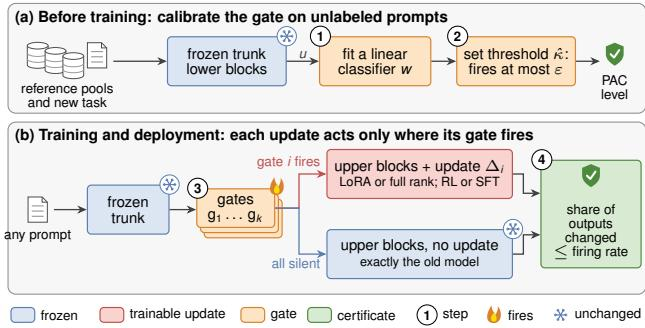
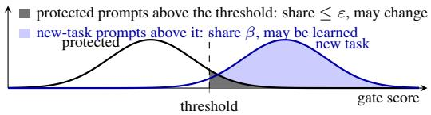
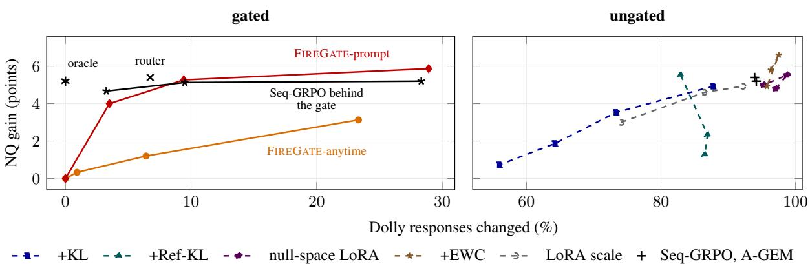
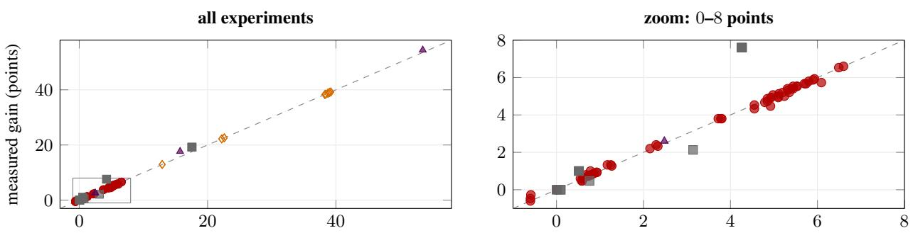
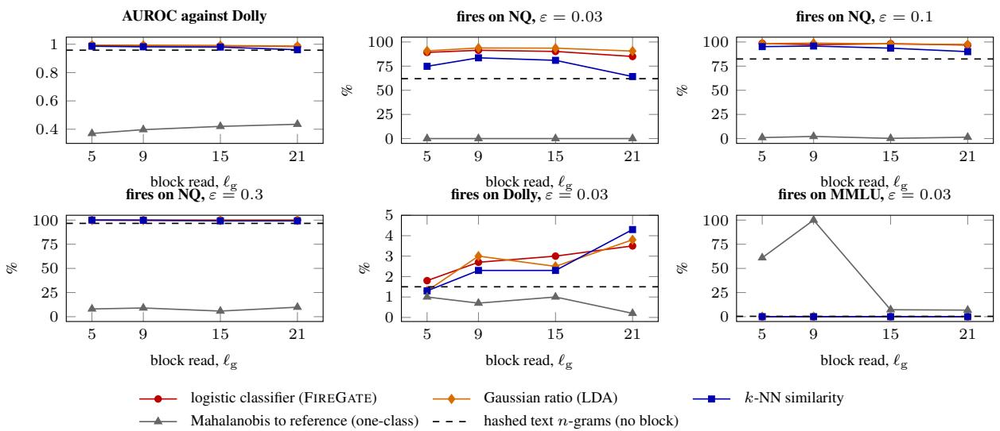

# FireGate: Bounding Behaviour Change Before Training in Continual RL Fine-Tuning

Md Anwar Hossen, Ali Jannesari Department of Computer Science, Iowa State University, Ames, IA, USA {manwar,jannesar}@iastate.edu

## Abstract

Fine-tuning a deployed language model on one task after another can change behaviour that should stay fixed, such as earlier skills, genera chat or refusals. Today, such forgetting is found only after training, on the benchmarks someone chose to run. This work bounds, before training, how often its outputs change on chosen prompt distributions. FIREGATE places each task’s update, such as a new LoRA, behind a gate, which is a classifier on the model’s frozen lower layers that decides for each prompt whether the update is used. Where no gate fires, the model computes exactly what the old one computes. As a result, on any prompt distribution, every bounded behaviour score changes by at most the gates firing rate there over a whole task stream. Calibrating each gate on unlabeled prompts of what must not change fixes that rate before training, with a PAC guarantee, whatever weights training produces. Forgetting is thus bounded by the gate’s false-alarm rate, and its price is the gate’s power: no update, gated or not, that changes as few protected outputs can change new-task outputs more often than the best test of that level tells new-task prompts from protected ones. On reinforcement-learning streams of up to five tasks, gated training keeps the earlier tasks and changes 3.3% of held-out chat responses, whereas ungated training changes 91.8%. Across seven models, the gain kept behind the gate follows its firing rate on new-task prompts, measured before training. The certificate covers the gated model as deployed, on the prompt distributions sampled for calibration, not against an adversary who searches for prompts that fire the gate. Code is available at https: //github.com/mahemon/firegate.

## 1. Introduction

A deployed language model is often fine-tuned again, for example with reinforcement learning (RL) on a new skill and later on another, but each update must leave the earlier skills and the rest of its behaviour intact. Today, this preservation is checked only after training, on whichever benchmarks were chosen, and the evidence is mixed. RL fine-tuning has been argued to forget less than supervised fine-tuning (Shenfeld et al., 2026; Chen et al., 2026; Lai et al., 2026), yet continual RL streams still forget (Luo et al., 2026b), if sometimes only modestly (Luo et al., 2026a). Benign fine-tuning also erodes behaviour that nobody targeted (Qi et al., 2024; Ung et al., 2024; Li & Lee, 2024; Betley et al., 2026).

The goal is to bound the change of behaviour before an update is trained, for every bounded behaviour score at once, without behaviour labels, from unlabeled prompts of what must not change. Before training, such a bound must hold for every model that training might produce. Regularisers, replay and orthogonal low-rank adaptation (LoRA) change which model training finds, not which models it could find. Therefore, for an expressive update, they give no bound of this kind, issued before training and uniform over updates, without assumptions on the trained weights or the reachable models (Theorems A.1 and 4.2). FIREGATE instead limits where an update acts.

The network is split into a frozen trunk, the lower blocks, and the upper blocks. Each new task gets a LoRA in the upper blocks that is switched on only after a gate fires; the gate is a test on trunk features of whether the input belongs to the new task (Figure 1). Until it fires, the adapted model performs exactly the old model’s computation. Consequently, by Theorem 3.2, the total-variation (TV) distance between their outputs on any prompt distribution is at most the gate’s firing rate there. That rate does not depend on the LoRA weights, so it is fixed before training. The gate’s threshold is set on unlabeled prompts of each component that must not change, as one sets the level of a Neyman–Pearson test (Theorem 3.6). Forgetting on those components is then at most the gate’s false-alarm rate. A prompt-time gate certifies any separately trained model behind it as a deployed pair (Theorem 3.4). The certificate is thus a guarantee on the deployed model that rests on exact fallback to the old one: it bounds how often outputs change on the sampled prompt distributions and leaves the outputs where a gate fires to the update.

The update can act only where the gate fires, so it can change the new task only on the share $\beta$ of new-task prompts that the gate accepts, which is estimated before training. This price binds every method. By Theorem 4.1, any update that changes at most a share ε of protected outputs, gated or not, changes new-task outputs no more often than the best size-ε test between the two prompt sources accepts newtask prompts. Furthermore, by Theorem 4.2, a certificate confines each large change to prompts of small reference mass.

The experiments test a linear-classifier gate with LoRA (Hu et al., 2022) trained by group-relative policy optimisation (GRPO) (Shao et al., 2024) on seven models from five families, on two task streams and a ladder of tasks whose prompts look increasingly like general chat, against eleven training baselines and gates built from other scores. No response on which the gate was silent ever changed. On the task streams, gated training keeps the earlier tasks, while every ungated method, even one regularised on the same prompts the gate uses, changes most general-chat responses. Models behind the gate keep about the share of their gain that its coverage, measured before training, indicates.

## The contributions are:

• A calibration of the gate on unlabeled prompts, before training and without behaviour labels, that turns the standard bound for exact fallback into a certificate on the deployed gated model, not on the trained weights: tight, composable over a stream and valid for any update above the split and any model behind a prompt-time gate (Section 3).

• The price of this certificate: a Neyman–Pearson limit per protected component that binds every method and that a likelihood-ratio gate on the trunk attains, a benchmark for the linear gate (Sections 4 and 6.4), and a recipe that prices each protected component before training (Section 5).

• An evaluation that separates what the switch, calibration and training under the gate contribute, with a preregistered test on benchmarks written by others (Section 6).

These claims differ in support: no change where no gate fires is proved and checked, firing at most ε on each sampled component has a PAC guarantee, and what changes where a gate fires is only measured (Table 6).

## 2. Behaviour change as total variation

A policy π maps a prompt x to a response $y = ( y _ { 1 } , y _ { 2 } , \dots )$ generated token by token until an end-of-sequence token or a length limit N. Write $\boldsymbol { s } = ( x , y )$ for the full token sequence and $s _ { \leq t }$ for its first t tokens. A decoding rule turns the nexttoken distribution and fresh randomness $U \sim \mathrm { U n i f } [ 0 , 1 ]$ into a token; sampling at any temperature, top-p sampling and greedy decoding are all of this form. For a prompt distribution $D ,$ , let $\breve { P } _ { \pi } ^ { D }$ be the law of $( x , y )$ , and $\pi ( \cdot \mid x )$ that of $y$ given x, when $x \sim D$ and $y$ is decoded from π. In continual post-training, stage k turns $\pi _ { k - 1 }$ into $\pi _ { k }$ using task $k ,$ given by prompts and a reward $r _ { k } \in [ 0 , 1 ] ; \pi _ { \mathrm { o l d } }$ and $\pi _ { \mathrm { n e w } }$ denote the models before and after an update. $D _ { \mathrm { n e w } }$ is the new task’s prompt distribution and $D _ { \mathrm { r e f } }$ a reference distribution: a mixture of components, such as general chat or harmful requests, on which behaviour should not change. The drift of an update on D is

$$
\mathrm { T V } \big ( P _ { \pi _ { \mathrm { n e w } } } ^ { D } , P _ { \pi _ { \mathrm { o l d } } } ^ { D } \big ) = \mathbb { E } _ { x \sim D } \mathrm { T V } \big ( \pi _ { \mathrm { n e w } } ( \cdot \mid x ) , \pi _ { \mathrm { o l d } } ( \cdot \mid x ) \big ) ,\tag{1}
$$

where the equality holds because both laws share the prompt marginal. For every behaviour score $f ( x , y ) ~ \in ~ [ 0 , 1 ]$ whether accuracy, refusal, a format check or a judge’s verdict, $| \mathbb { E } _ { \pi _ { \mathrm { n e w } } } f - \mathbb { E } _ { \pi _ { \mathrm { o l d } } } f | \le \mathrm { T V }$ , so a bound on TV bounds all of them, including the ones nobody thought to measure. The bound is on averages over $D \colon { \mathrm { a } }$ behaviour confined to a share of D smaller than the bound can still change completely, so prompts that must not change need their own reference component. Under greedy decoding the TV in Equation (1) is the share of prompts whose response changes, a conservative stand-in for changed behaviour, since a changed response may be a rewording.

## 3. Certifying an update before training

## 3.1. Gated updates and the coupling certificate

Let the network have L blocks with causal attention and position-wise feed-forward layers. Fix a split depth $\ell _ { \mathrm { g } }$ . The trunk, blocks $1 , \ldots , \ell _ { \mathrm { g } } - 1$ , is frozen for the whole stream; the trunk feature $u _ { t } ( s ) \in \mathbb { R } ^ { d }$ is the residual stream entering block $\ell _ { \mathrm { g } }$ at position t. Because attention is causal, $u _ { t } ( s )$ depends only on $s _ { \leq t }$

Definition 3.1 (Gated update). A gate is a map $g : \mathbb { R } ^ { d } $ {0, 1}, possibly randomised afresh per sequence, independently of input and decoding, and possibly restricted to a set of positions, where whether position t is used depends only on $s _ { \leq t }$ . Its first firing time on s is $T _ { g } ( s ) = $ min{t used : $: g ( u _ { t } ( s ) ) = 1 \}$ , or ∞ if it never fires, and its latch is $m _ { t } ( s ) = \mathbf { 1 } [ T _ { g } ( s ) \leq t ]$ . Given an old policy $\pi _ { \mathrm { o l d } }$ and an update $\Delta$ that modifies the computation of blocks $\ell _ { \mathrm { g } } , \ldots , L$ position-wise, such as a LoRA on their projections or a full-rank change of their weights, the gated policy $\pi _ { \Delta , g }$ applies $\Delta$ at position t if and only if $m _ { t } ( s ) = 1$ . An anytime gate may fire at any position after the chat-template prefix; a prompt-time gate only at the last prompt token.

  
Figure 1. Overview of FIREGATE. (a) Before training, the gate’s classifier is fitted (1) and calibrated on unlabeled prompts $( 2 )$ which fixes its firing rate. (b) Each task’s update acts only where its gate fires (3); elsewhere the model is exactly the old one, so at most that share of outputs changes (4). The update can be a LoRA or a full-rank change of the upper blocks, trained by RL or SFT, or a separately trained model behind a prompt-time gate.

The gate fires on s if it fires at a position that influences the generated text: $\mathsf { F } _ { g } ( s ) = \{ T _ { g } ( s ) \leq | s | - 1 \}$ }. A prompt-time gate either fires at the last prompt token, and then the update is on for the whole response, or it never fires.

Theorem 3.2 (Coupling certificate). For every prompt distribution D, every decoding rule, and every update $\Delta _ { : }$

$$
\mathrm { T V } \big ( P _ { \pi _ { \Delta , g } } ^ { D } , P _ { \pi _ { \mathrm { o l d } } } ^ { D } \big ) \ \leq \ \varphi _ { g } ( D ) : = P _ { \pi _ { \mathrm { o l d } } } ^ { D } \big ( \mathsf { F } _ { g } \big ) .
$$

Moreover $P _ { \pi _ { \Delta , g } } ^ { D } ( \mathsf { F } _ { g } ) = \varphi _ { g } ( D )$ , and with shared decoding randomness the response $o f \pi _ { \Delta , g }$ equals that of $\pi _ { \mathrm { o l d } }$ on every run on which the gate does notfire.

Proofidea: Run both models with the same uniform variables. By induction over positions and blocks, the runs share every hidden state until the gate first fires, and the firing decision depends only on that shared prefix; outside $\mathsf { F } _ { g }$ the runs are identical, and the coupling inequality (Lindvall, 1992) gives the bound. All proofs are in Section B. The bound is on the average over $D \colon$ it says nothing about any single prompt, about prompts outside $D ,$ or about how responses change where the gate fires (Table 6).

The certificate does not depend on $\Delta .$ , and no bound that depends only on the gate and holds for every update can improve it by more than a factor $1 - \eta \colon$

Proposition 3.3 (Tightness). Suppose an update can place all probability on a token $a ^ { \dagger }$ at the positions where it is active, and $\pi _ { \mathrm { o l d } }$ gives $a ^ { \dagger }$ probability at most η at those positions. Then $\mathrm { T } \mathrm { \bar { V } } ( P _ { \pi _ { \Delta , g } } ^ { D } , P _ { \pi _ { \mathrm { o l d } } } ^ { D } ) \geq ( 1 - \eta ) \varphi _ { g } ( D )$

Without a gate $( g \equiv 1 )$ some update drifts by nearly one (Theorems A.1 and 3.3).

A certified switch for any trained model: A prompt-time gate decides once: its decision $G ( x ) = g ( u _ { | x | } ( x ) )$ depends on x alone, as the trunk is frozen and attention causal.

Corollary 3.4 (Certified switch). Let G be the decision of a prompt-time gate and $\pi ^ { \prime }$ any policy. The switch $\pi _ { \pi ^ { \prime } , G }$ answers x with $\pi ^ { \prime } ~ i f G ( x ) = 1$ and with $\pi _ { \mathrm { o l d } }$ otherwise. Theorem 3.2 holdsfor $\pi _ { \pi ^ { \prime } , G }$ with $\varphi _ { g } ( D ) = D ( G = 1 )$ ), and its response equals $\pi _ { \mathrm { o l d } } \cdot _ { s }$ wherever $G ( x ) = 0 .$

The certificate thus takes two forms. Trained under its gate, an update acts only where the gate fires, as in parameter isolation (Aljundi et al., 2017; Liang et al., 2025) but with no task label at inference; behind a switch, any trained model is certified but keeps its own forgetting (Section 6.4).

## 3.2. Calibration without behaviour labels

The certificate is a firing probability of the old model, so it can be estimated, and the threshold set, before training, from unlabeled prompts and the old model’s responses.

Proposition 3.5 (Estimation on any distribution). Roll out πold on n i.i.d. prompts from $D ,$ , independent of $^ { g , }$ and let X be the number offirings. With probability at least $1 - \delta , \varphi _ { g } ( D ) \leq \mathrm { C P } _ { \delta } ( X , n )$ , the one-sided Clopper–Pearson bound (Clopper & Pearson, 1934).

A scored gate $g _ { \kappa } ( u ) = \mathbf { 1 } [ w ( u ) > \kappa ]$ fires on s only if $S ( s ) = \mathrm { m a x } _ { t } w ( u _ { t } ( s ) ) > \kappa ,$ , the maximum running over the positions where it is evaluated, so $\varphi _ { g _ { \kappa } } ( D ) \leq P _ { \pi _ { \mathrm { o l d } } } ^ { D } ( S >$ $\kappa )$ . The threshold κ is set before training with the Neyman– Pearson umbrella algorithm (Tong et al., 2018), a trainingconditional conformal bound (Vovk, 2012; Bates et al., 2021), applied to each reference component with a union bound, which gives a probably approximately correct (PAC) guarantee.

Theorem 3.6 (PAC calibration). Let w and $\pi _ { \mathrm { o l d } }$ be fixed independently of the calibration set. For each reference component $c = 1 , \ldots , C ,$ , draw $n _ { c } \ i . i . d .$ calibration trajectories $\pi _ { \mathrm { o l d } }$ on $D _ { c }$ and let $S _ { ( 1 ) } ^ { c } \leq \dots \leq S _ { ( n _ { c } ) } ^ { c }$ be their sorted scores. Let $k _ { c } = \operatorname* { m i n } \{ k$ $\operatorname* { P r } [ \mathrm { B i n } ( n _ { c } , 1 - \varepsilon ) \geq k ] \leq \delta / C \}$ ${ \hat { \kappa } } _ { c } = S _ { ( k _ { c } ) } ^ { c }$ (+∞ $i f k _ { c } > n _ { c } )$ , and $\hat { \kappa } = \operatorname* { m a x } _ { c } \hat { \kappa } _ { c } .$ Then with probability at least $1 - \delta$ over the calibration draws, $\varphi _ { g _ { \hat { \kappa } } } ( D _ { c } ) \leq \varepsilon f o r \ e \nu e r y \ c .$

Certified level and its check: On each reference component the certificate is the level $\varepsilon ,$ fixed before training with confidence $1 - \delta$ over the calibration draw, for prompts drawn like the calibration prompts. The level attained is lower, on average at most 1.7% for the 700 Dolly calibration prompts used here (Theorem A.3). It carries over to mixtures of components, and becomes $\varepsilon + \theta$ or Mε within TV distance θ of a component or at density ratio at most M to it (Theorem $_ { \mathrm { A . 4 ) } }$ . Held-out prompts of a component check the level with a one-sided binomial test. A prompt-time gate’s firing depends on the prompt alone, so its certificate holds under every decoding rule; an anytime gate’s holds for the rule it was calibrated under. On a distribution far from every component, such as MMLU, the only certificate is the bound of Theorem 3.5 from a sample of it, which holds for that distribution only and can be large (Table 1).

## 3.3. Streams and prompts unlike the task

In a stream, stage k adds a gate $g _ { k }$ on the same frozen trunk and a LoRA $\Delta _ { k }$ gated by its own latch, and leaves $\Delta _ { 1 } , \ldots , \Delta _ { k - 1 }$ and $g _ { 1 } , \ldots , g _ { k - 1 }$ unchanged.

Theorem 3.7 (Stream certificate). For every $j <$ k and every distribution $\begin{array} { r } { D , \mathrm { T V } \big ( P _ { \pi _ { k } } ^ { D } , P _ { \pi _ { j } } ^ { \bar { D } } \big ) \leq P _ { \pi _ { j } } ^ { D } \big ( \dot { \bigcup } _ { i = j + 1 } ^ { k } \mathsf { F } _ { g _ { i } } \big ) \leq } \end{array}$ $\textstyle \sum _ { i = j + 1 } ^ { k } P _ { \pi _ { j } } ^ { D } \bigl ( \mathsf { F } _ { g _ { i } } \bigr )$

Drift on task j is bounded by the firing of the later gates on $\pi _ { j } \mathrm { ' s }$ own trajectories, so earlier tasks are protected without replaying their labels, and calibrating each stage at ε certifies the union of K stages at $K \varepsilon$ with confidence $1 - K \delta$ (Theorem A.5). A prompt-time union can also be certified directly as one gate, by Theorem 3.5 on fresh prompts that no stage used, at confidence 1−δ and at a level that does not grow with K. Anytime gates need fresh calibration prompts at each stage (Theorem A.5); the gates here reuse them, so their later stages are only checked held out.

A classifier trained to tell the new task from the reference extrapolates on prompts unlike both, and may fire there. A second test, whether the prompt lies in the new task’s region, bounds the firing on such prompts.

Proposition 3.8 (Two-sided gate). Let $g _ { \kappa } = { \bf 1 }$ [w > κ] be a prompt-time gate with score $w ( u _ { | x | } ( x ) )$ , R a set of prompts, both fixed independently of the calibration prompts, and $h _ { \kappa } \ = \ g _ { \kappa } { \bf 1 } _ { R } .$ . (a) For every κ and every D, $\varphi _ { h _ { \kappa } } ( D ) \leq$ min $\{ \varphi _ { g _ { \kappa } } ( D ) , D ( R ) \}$ . (b) Theorem 3.6 applied to the score equal to w on R and to −∞ off R calibrates h with the same guarantee on every reference component. (c) Let $R = \{ x : d ( x ) \leq \hat { \tau } \}$ for afunction dfixed independently of n i.i.d. prompts of $D _ { \mathrm { n e w } } ,$ , and τˆ the k-th smallest value ofd on them, $o r + \infty \ i f k > n$ $\begin{array} { r } { I f \operatorname* { P r } [ \mathrm { B i n } ( n , 1 - \alpha ) \geq k ] \leq \delta } \end{array}$ then $D _ { \mathrm { n e w } } ( R ^ { c } ) ~ \leq ~ \alpha$ with probability at least $1 - \delta ,$ ; if $k \geq \lceil ( n + 1 ) ( 1 - \alpha ) \rceil$ , then $\mathbb { E } \big [ D _ { \mathrm { n e w } } ( R ^ { c } ) \big ] \leq \alpha .$

The region is not a safety filter: it excludes prompts unlike the task, not prompts written like it, such as harmful requests in the task’s format, which must be added to the reference. With 1,000 unlabeled RL prompts and $\alpha = 0 . 0 2$ , it misses at most 2.9% of new-task prompts with probability 0.95.

Checks without labels: An audit evaluates only fired prompts (Theorem A.10), an anytime-valid test (Ramdas et al., 2023) on the firing indicator raises an alarm when traffic fires more often than certified (Theorem A.11), and raising a threshold repairs a failed certificate without retraining (Theorem A.12).

  
Figure 2. The certificate and its price, schematically. At most a share ε of protected prompts lie above the threshold, the only ones whose outputs can change; the update acts only on the share $\beta$ of new-task prompts above it.

## 4. The price of certification

An update that changes at most a share ε of behaviour on the reference can change the new task only as far as a test of level ε tells the two apart, gated or not.

Theorem 4.1 (Certified plasticity limit). Let $\pi _ { \mathrm { n e w } }$ be any policy, gated or not, and $\rho ( x ) = \mathrm { T V } ( \pi _ { \mathrm { n e w } } ( \cdot \mid x ) , \pi _ { \mathrm { o l d } } ( \cdot \mid$ x)). $I f \mathbb { E } _ { D _ { \mathrm { r e f } } } \rho \leq \varepsilon ,$ , then $\mathbb { E } _ { D _ { \mathrm { n e w } } } \rho \le \beta ^ { * } ( \varepsilon )$ , the power of the size-ε Neyman–Pearson test of $D _ { \mathrm { r e f } }$ against $D _ { \mathrm { n e w } }$ , and, for $\varepsilon \in ( 0 , 1 )$ ,

$$
\beta ^ { * } ( \varepsilon ) \leq \frac { \mathrm { K L } ( D _ { \mathrm { n e w } } \| D _ { \mathrm { r e f } } ) + \log 2 } { \log ( 1 / \varepsilon ) } .\tag{2}
$$

The expected reward gain on $D _ { \mathrm { n e w } }$ is at most $\mathbb { E } _ { D _ { \mathrm { n e w } } } \rho$ times the reward range. If the update can move the response distribution of every prompt where it acts as Theorem 3.3 assumes, and the likelihood ratio of $D _ { \mathrm { n e w } }$ to $D _ { \mathrm { r e f } }$ is afunction of the trunk feature $u _ { \vert x \vert } ( x )$ , then $\beta ^ { * } ( \varepsilon )$ is attained up to the factor 1 − η by a gated update whose prompt-time gate is the likelihood-ratio test, randomised on ties (deterministic ifthe ratio has no atoms).

In words, an update can change the new task only as far as a test can tell its prompts from the reference, whether it is gated, regularised, replays data or uses orthogonal or null-space LoRA (Figure 2). The first claim is the Neyman– Pearson lemma (Neyman & Pearson, 1933); the KL form is rarely informative for distinct tasks (Theorem A.7). With a level per component, as Theorem 3.6 sets them, the limit is that of the generalised Neyman–Pearson lemma (Dantzig & Wald, 1951; Lehmann & Romano, 2022): a likelihood-ratio test against a weighted sum of components, whose weights price each component’s level (Theorem A.2). Where the limit is known (Section K.4), the linear score comes within about a point of it under a shift with enough prompts, PAC calibration costs about 5 points, near the 4 that Theorem A.3 predicts, and under a change of spread only a quadratic score comes close. On real tasks the limit is unknown, and the coverage of any gate is a lower bound on $\beta ^ { * } ( \varepsilon )$ , not an estimate of it. Responses add no evidence about a prompt’s source (Theorem A.8), so an optimal gate needs only the prompt, as FIREGATE-prompt reads, and thresholding an estimated density ratio loses at most its $L ^ { 1 }$ error in coverage, while calibration keeps the certificate valid (Theorem A.9).

Corollary 4.2 (A certificate before training confines every large change). Let U be the set of models that training can reach, and A a set ofprompts on which one $\pi \in \mathcal { U }$ moves every response distribution by at least $1 - \eta$ in TV, as an unconstrained update can on every prompt (Theorem 3.3). If every π $\in \mathcal { U }$ changes at most a share ε ofoutputs on $D _ { \mathrm { r e f } } ,$ then $D _ { \mathrm { r e f } } ( A ) \leq \varepsilon / ( 1 - \eta )$ and $D _ { \mathrm { n e w } } ( A ) \leq \beta ^ { * } { \bigl ( } \varepsilon / ( 1 - \eta ) { \bigr ) }$ .

So under a certificate before training each reachable model changes outputs strongly only on prompts of reference mass about ε. Different models may use different regions, so this does not force one common gate; a gate is the simplest way to fix the region in advance, and a likelihood-ratio gate on the trunk can attain the limit; a penalty bounds only the weights that optimise it, and only their sampled outputs (Theorem A.1). A class that moves no response by more than ε is certified at ε without a gate, but changes new-task responses by at most ε too.

Proposition 4.3 (Gain behind a gate). Let G be the decision of a prompt-time gate, $\pi ^ { \prime }$ any policy, $\Delta r ( x )$ the difference between the expected rewards of π′ and πold on prompt x, $\bar { G } = \mathbb { E } _ { D _ { \mathrm { n e w } } } \Delta r$ the gain of π′ itself, $\beta = D _ { \mathrm { n e w } } ( G = 1 ) \in$ $( 0 , 1 )$ , and $\bar { G } _ { 1 } , \bar { G } _ { 0 }$ the means of $\Delta r$ on new-task prompts with $G = 1$ and $G = 0$ . The gain of the switch $\pi _ { \pi ^ { \prime } , G }$ on $D _ { \mathrm { n e w \ } } i s \beta \bar { G } _ { 1 } = \beta \bar { G } + \beta ( 1 - \beta ) ( \bar { G } _ { 1 } - \bar { G } _ { 0 } )$

The coverage $\beta$ is the gate’s firing rate on unlabeled newtask prompts, so it is estimated before training; the gain kept is $\beta \bar { G }$ plus a covariance term that the certificate does not control. The term vanishes as $\beta  1$ 1 and when the prompts the gate misses would gain as much as the others, so $\beta \bar { G }$ is a prediction, tested in Section $6 . 3 ,$ not a bound.

## 5. FIREGATE in practice

The gate is a linear classifier with score $w _ { k } ( u ) = a _ { k } ^ { \top } \big ( ( \bar { u } -$ $\mu ) / \sigma ) + b _ { k }$ , where $\bar { u } ~ = ~ u / \mathrm { r m s } ( u )$ and $\mu , \sigma$ are percoordinate statistics. Class-balanced logistic regression fits it to separate prompts of the new task from those of the reference components; its only supervision is which pool a prompt came from. Fitting and calibration use disjoint prompts, as Theorem 3.6 requires. FIREGATE-prompt scores the last prompt token; FIREGATE-anytime scores every position after the template prefix; a whole-sequence variant of FIREGATE-prompt applies the LoRA to the whole sequence once the gate has fired, as a switch does. A LoRA is trained under its own gate, where rollouts on which the gate does not fire carry no gradient, or by any method and placed behind the gate afterwards (Theorem 3.4). The twosided region keeps prompts whose Mahalanobis distance to the new task’s fitting prompts, in the classifier’s feature space, is below its $1 - \alpha$ quantile on unlabeled RL prompts, with α = 0.02 (Algorithm 1, Section C).

Choosing the reference: The certificate covers the components one samples, so choosing them is part of the method, and each choice can be priced before training. (1) Calibrate on every kind of prompt whose behaviour must not change; a sample of the deployment’s own unlabeled traffic can itself be a component. (2) Check any other unlabeled pool before training, from one trunk pass: the bound of Theorem 3.5 on a sample of it is its certificate. (3) Use the two-sided gate, which caps the firing on any pool at its mass in the task’s region and misses about a share α of the task’s prompts. (4) If a pool still fires more often than ε, such as harmful requests written in the task’s format, add it as a component, the remedy. (5) If the task cannot be told apart from some component, such as general chat, calibrate only on the components to protect: they are then certified for any model, and the gate’s firing on the others, estimated before training, says how much of them may change. The coverage $\beta$ after each step is the price of that step, by Theorem 4.3, and the weights of Theorem A.2 say which component sets it. Steps (1) and (2) with Theorem 3.6 give the certificate; steps (3)–(5) change only which prompts it covers and the coverage. A distribution at density ratio at most M to a component is certified at $M \varepsilon$ (Theorem A.4).

Deciding before training: The coverage $\beta$ is measured on unlabeled task prompts before any training, and a model behind the gate keeps about $\beta \bar { G }$ of its gain (Theorem 4.3). The recipe therefore also says whether certification is worth its price. With $\beta$ near 1, as on the task streams, almost all of the gain is kept; with $\beta$ near $0 ,$ as on Concise (0.7%), the components to protect must be narrowed or the task left ungated. Certification is cheapest for tasks whose prompts are easy to tell apart from what must stay, and most costly for chat-like tasks, as Theorem 4.1 predicts.

## 6. Experiments

## 6.1. Setup

Models and tasks: Qwen2.5-1.5B- and 7B-Instruct (Qwen Team, 2024), OLMo-2-7B-Instruct (Team OLMo, 2024), Llama-3.2-3B- and 3.1-8B-Instruct (Grattafiori et al., 2024), DeepSeek-LLM-7B-Chat (Bi et al., 2024) and Mistral-7B-Instruct (Jiang et al., 2023). Two streams of tasks that are easy to tell apart from the reference: GSM8K (Cobbe et al., 2021), Countdown (Pan et al., 2025) and Knights and Knaves (Xie et al., 2025a;b), and a five-task stream that adds MATH (Hendrycks et al., 2021b) and Sudoku. An overlap ladder of tasks whose prompts resemble the reference more and more: IF, Dolly requests with a format constraint (Zhou et al., 2023); NQ, closed-book Natural Questions (Kwiatkowski et al., 2019; Lee et al., 2019); and Concise-ctx and Concise, Dolly requests with or without a passage, rewarded for a short answer. A natural task that overlaps chat: SQuAD 2.0 (Rajpurkar et al., 2018), rewarded for the gold answer or for abstaining. The gate reads block 9 of 28 in Qwen2.5 (about 0.3 of the depth in every model); LoRA of rank 16 above it; GRPO for 150 steps per task, 16 prompts × 8 samples; three seeds; fitting/calibration: Dolly 600/700, AdvBench 100/170, tasklike 900/700 (Section D).

Table 1. Certified levels and their checks (%). Every reference component, Dolly among them, is certified at 3% with probability 0.95 (Theorem 3.6). Dolly, MMLU: firing on held-out prompts and, in brackets, its 95% Clopper–Pearson bound (Theorem 3.5), a check on Dolly and the only certificate on MMLU. β: firing on the unlabeled RL prompts, which also set the two-sided gate’s region, so $\beta \leq 9 8$ there. Streams: union of per-stage gates, each at 3%. 10k: the bound from 10,000 fresh Dolly requests (Table 20).
<table><tr><td></td><td colspan="4">deployed gate</td><td colspan="4">two-sided gate</td></tr><tr><td>Experiment</td><td>β↑</td><td></td><td>Dolly↓ 10k↓</td><td>MMLU↓</td><td></td><td>β↑</td><td>Dolly↓</td><td>MMLU↓</td></tr><tr><td>NQ, Qwen 1.5B</td><td></td><td>92.2 3.2 [5.1]</td><td>1.7</td><td>0.0 [0.6]</td><td>90.7</td><td></td><td>2.8 [4.5]</td><td>0.0 [0.6]</td></tr><tr><td>NQ, Qwen 7B</td><td></td><td>97.9 2.8 [4.5]</td><td>2.5</td><td>0.0 [0.6]</td><td>96.1</td><td></td><td>2.0 [3.6]</td><td>0.0 [0.6]</td></tr><tr><td>NQ, OLMo-2 7B</td><td></td><td>96.8 2.2 [3.9]</td><td>2.2</td><td></td><td></td><td></td><td>0.0 [0.6] 95.0 2.2 [3.9]</td><td>0.0 [0.6]</td></tr><tr><td>IF, Qwen 1.5B</td><td></td><td>100.0 1.5 [2.9]</td><td></td><td></td><td></td><td></td><td></td><td>99.4 [99.8] 98.0 0.0 [0.7] 0.0 [0.6]</td></tr><tr><td>IF, Qwen 7B</td><td></td><td>100.0 1.8 [3.3]</td><td></td><td>– 100.0 [100.0] 98.0 0.0 [0.7]</td><td></td><td></td><td></td><td>0.0 [0.6]</td></tr><tr><td>Concise-ctx, 1.5B</td><td></td><td>3.8 1.8 [3.3]</td><td></td><td>0.0 [0.6]</td><td></td><td></td><td>3.7 1.5 [2.9]</td><td>0.0 [0.6]</td></tr><tr><td>3 tasks, Qwen 1.5B 100.0 4.0 [6.0]</td><td></td><td></td><td>3.3</td><td></td><td></td><td></td><td></td><td>8.6 [10.9] 98.0 0.0 [0.7] 0.0 [0.6]</td></tr><tr><td>3 tasks, Qwen 7B</td><td></td><td>100.0 3.0 [4.8]</td><td>2.8</td><td></td><td></td><td></td><td></td><td>39.0 [42.7] 98.0 0.0 [0.7] 0.0 [0.6]</td></tr><tr><td>5 tasks, Qwen 1.5B 100.0 6.0 [8.3]</td><td></td><td></td><td>4.5</td><td></td><td></td><td></td><td></td><td>50.0 [53.8] 98.0 0.0 [0.7] 0.0 [0.6]</td></tr></table>

Methods: FIREGATE-prompt, its whole-sequence variant and FIREGATE-anytime at $\varepsilon = 0 . 0 3 ,$ against eleven baselines with the same LoRA and budget: Seq-GRPO, an ungated LoRA per task; +KL to the previous model (Shenfeld et al., 2026); +Ref-KL, the same penalty on the reference prompts the gate uses (Li & Hoiem, 2018); null-space LoRA (Liang & Li, 2024), EWC (Kirkpatrick et al., 2017) and A-GEM (Chaudhry et al., 2019) on the same prompts; LoRA scaling (Wortsman et al., 2022), O-LoRA (Wang et al., 2023), replay, safety replay (Pham et al., 2025), and an uncalibrated router. The deployed gate is FIREGATEprompt’s classifier at $\varepsilon = 0 . 0 3 ;$ ; as Theorem 3.4 allows, every ungated run is also evaluated behind it. Two gates appear in the main text. The deployed gate, steps (1) and (2) of Section 5, gives the coverage, gain and switch results unless a result is marked otherwise (Table 7). The chosen gate of each experiment is what the full recipe selects: two-sided, with the remedy or a protected set where steps (4) and (5) apply. It was fixed before the external tests of Section 6.6.

Reference pools and evaluation: Gates are calibrated with δ = 0.05 on unlabeled prompts of four kinds: Dolly-15k requests (Conover et al., 2023), AdvBench harmful requests (Zou et al., 2023), task-like prompts (ARC, CommonsenseQA, OpenBookQA, BoolQ, Alpaca, MBPP) and stored prompts of earlier tasks. The share of changed responses is measured on held-out Dolly and AdvBench prompts and on XSTest (Rottger et al. ¨ , 2024) and MMLU (Hendrycks et al., 2021a), which are never calibrated on. Section D gives every setting; Table 8 marks what was fixed before its evidence.

## 6.2. The certificate holds as stated

Exactness: No response on which the gate was silent ever changed, under greedy decoding or under sampling (Table 9): the implementation realises Theorem 3.2 exactly.

The calibrated level: Held-out prompts are consistent with the level of 3% (Table 1), which 400 cannot confirm: the single-task deployed gates fire on at most 3.2% of heldout Dolly prompts (bounds up to 5.1%) and on no held-out harmful request. On $1 0 { , } 0 0 0$ fresh Dolly requests they fire on 1.5–2.2% (bounds at most 2.5%, Table 20), as Theorem A.3 predicts, and the stream unions’ bounds of 2.8–4.5% certify each union far below $K \varepsilon$ (Theorem 3.5).

## 6.3. Certified updates kept about the share $\beta$ of the gain

Ungated updates change most reference responses: Seq-GRPO changes over 90% of Dolly responses on every task, none of which it was trained on, and the regularisers change most of them too, including those built from the gate’s own reference prompts (Table 10); on NQ it also lowers refusal, though its data concern no refusals (Table 14; Qi et al., 2024). On NQ and SQuAD 2.0, every ungated setting (26 on NQ) changes at least 51% of Dolly responses, even at LoRA scale 0.02 or KL weight 100, since a penalty limits sampled outputs and a small change still flips greedy ones (Theorem A.1); gates that certify Dolly change 0.5–3.5% (Figure 3 and Table 27). A changed response may be a rewording, but the drift is real: response lengths alone bound Seq-GRPO’s TV distance on NQ far above the certified level (Table 9). Average scores can stay flat while responses change: on the three-task stream Seq-GRPO moves AdvBench refusal and MMLU accuracy by at most a point but lowers XSTest over-refusal by 15.5 points (Table 10). The certificate bounds every such score at once, including those nobody measured.

The gain kept follows the coverage: Table 2 places Seq-GRPO behind the deployed gate of seven models. On IF the gate fires on nearly every new-task prompt and the switch keeps all of the gain; on NQ, where the tasks overlap, it keeps within one point of $\beta \bar { G }$ on every model. On TriviaQA, a task first used after every setting was fixed, all seven predictions written before its data were downloaded hold (Section K.8): behind the gate Seq-GRPO keeps 23.1 of its 24.6-point gain, against 22.3 predicted before training, and changes 3.5% of Dolly responses instead of 95.8%. Given the trained model’s gain G¯, the deployed IF gates have $\beta =$ 1, where the prediction is exact by construction; where $\beta <$ 1 it is off by 0.5 points on average (Figure 4), and by 0.3–0.4 on NQ as the threshold sweeps $\beta$ from 0.1 to 0.9, though by up to 4.1 on IF once the sweep lowers its $\beta$ (Section D.3): the trunk features barely predict which prompts will gain, so on NQ a gate fitted to miss those prompts keeps as much as a random one, and only an oracle that knows each prompt’s gain does worse (Table 11); on SQuAD 2.0 it keeps 18.5 points against 20.8, as missed prompts gained about 40 points against 22 (Theorem 4.3). The streams, full-rank GRPO and SFT behave alike (Tables 3 and 19).

  
Figure 3. NQ, Qwen2.5-1.5B: gain against Dolly responses changed, mean of three seeds. Each curve sweeps one knob: the level ε for the gates and Seq-GRPO behind FIREGATE-prompt’s gate, the coefficient, energy share, weight or scale for the ungated methods. The router uses its logit-0 rule; the oracle knows each prompt’s task (Table 14).

Table 2. The switch on seven models from five families (three seeds, ε = 0.03). G¯, Chg.: Seq-GRPO’s gain (points) and changed Dolly responses (%); β: firing on unlabeled RL prompts, before training; Kept: the gain behind the deployed prompt-time gate; CP: 95% Clopper–Pearson bound of its held-out Dolly firing (%); Non-fired: changed non-fired responses of the FIREGATE-prompt runs; †two of three runs.
<table><tr><td>Model</td><td rowspan="2"></td><td colspan="2">ungated</td><td rowspan="2"></td><td colspan="4">behind the gate</td><td rowspan="2">Non-fired</td></tr><tr><td>Task</td><td></td><td>G Chg.</td><td>β</td><td>βG1 Kept↑</td><td>Chg.↓</td><td>CP↓</td></tr><tr><td>Qwen2.5-1.5B</td><td>IF</td><td>+38.7</td><td>93.3</td><td>100.0</td><td>+38.7</td><td>+38.7</td><td>1.5</td><td>2.9</td><td>0/4,797</td></tr><tr><td>Qwen2.5-1.5B</td><td>NQ</td><td>+5.2</td><td>94.2</td><td>92.2</td><td>+4.8</td><td>+4.7</td><td>3.2</td><td>5.1</td><td>0/9,363</td></tr><tr><td>Qwen2.5-7B</td><td>IF</td><td>+12.9</td><td>94.6</td><td>100.0</td><td>+12.9</td><td>+12.9</td><td>0.8</td><td>3.3</td><td>0/3,531</td></tr><tr><td>Qwen2.5-7B</td><td>NQ</td><td>+3.8</td><td>94.6</td><td>97.9</td><td>+3.7</td><td>+3.8</td><td>2.8</td><td>4.5</td><td>0/9,310</td></tr><tr><td>OLMo-2-7B</td><td>NQ</td><td>+5.9</td><td>91.2</td><td>96.8</td><td>+5.7</td><td>+5.7</td><td>2.2</td><td>3.9</td><td>0/9,303</td></tr><tr><td>Llama-3.2-3B</td><td>IF</td><td>+14.3</td><td>94.1</td><td>100.0</td><td>+14.3</td><td>+14.3</td><td>1.7</td><td>3.3</td><td>0/3,783</td></tr><tr><td>Llama-3.2-3B</td><td>NQ</td><td>+10.8</td><td>96.7</td><td>89.0</td><td>+9.6</td><td>+9.2</td><td>2.5</td><td>4.2</td><td>0/9,447</td></tr><tr><td>Llama-3.1-8B</td><td>IF</td><td>+11.4</td><td>95.5</td><td>100.0</td><td>+11.4</td><td>+11.4</td><td>1.8</td><td>3.3</td><td>0/3,957</td></tr><tr><td>Llama-3.1-8B</td><td>NQ</td><td>+7.1</td><td>99.9</td><td>95.5</td><td>+6.7</td><td>+6.8</td><td>2.5</td><td>4.2</td><td>0/9,342</td></tr><tr><td>DeepSeek-LLM-7B</td><td>IF</td><td>+35.3</td><td>99.5</td><td>99.9</td><td>+35.2</td><td>+35.3</td><td>2.3</td><td>3.9</td><td>0/3,429</td></tr><tr><td>DeepSeek-LLM-7B NQ</td><td></td><td>+10.7</td><td>97.3</td><td>84.5</td><td>+9.1</td><td>+8.7</td><td>1.3</td><td>2.6</td><td>0/9,519</td></tr><tr><td>Mistral-7B</td><td>IF</td><td>+34.8 98.5</td><td></td><td>100.0</td><td>+34.8</td><td>+34.8</td><td>1.0</td><td>2.3</td><td>0/4,008</td></tr><tr><td>Mistral-7B</td><td>NQ</td><td>+9.5 98.8</td><td></td><td>93.0</td><td>+8.8</td><td>+7.9</td><td>2.3</td><td>3.9</td><td>0/6,270†</td></tr></table>

## 6.4. Calibration, the switch and gated training

Calibration sets the level: Five gates built from the same features and prompts, as a router or an expert gate (Aljundi et al., 2017) would build them, fire on up to 31% of Dolly prompts on NQ at their own thresholds, which are set to separate the pools, not to keep the reference quiet; PACcalibrated, they fire on at most 3.2% and still keep most of the gain (Table 12). The score then sets only the coverage: four score classes calibrated together, each at δ/4, all keep protected harmful requests at most 1.6% (Table 18). A Gaussian ratio covers 95.3% of NQ, 85.4% of SQuAD 2.0 and 56.7% of Concise-ctx (protect + passages), the linear classifier 90.2, 81.4 and 11.0%, and the best score bounds $\beta ^ { * }$ from below; on 13 model–task pairs it covers at most 7.0 points more (Table 16), neither shown to reach the limit. Scores that see one pool cover little, the one-class score no NQ prompt (Figure 5), a language model told the task 2.9% (Table 17): a score needs both pools.

Table 3. Five-task stream, Qwen2.5-1.5B, three seeds. Avg, BWT: mean accuracy over the five tasks after the stream (base 29.9%) and backward transfer; Dolly: held-out responses changed (%), rewordings included (refusal, over-refusal and MMLU changes on a stream: Table 10); GB, time: peak memory and batched generation time against the base model, gated LoRAs unmerged, one or all five firing (Section D.6). Each stage is certified at 3%, so the union at 15% with probability at least 0.75 (Theorem A.5); certified directly as one gate on 10,000 fresh Dolly requests (Theorem 3.5), its Dolly firing is at most 4.5% with probability 0.95 (Table 20). One gate: the union of the five two-sided gates, set once to fire on at most 3% of the shared calibration prompts (Theorem A.6); on 400 fresh Dolly prompts it fires on none, which certifies its Dolly firing at 0.7% with probability 0.95 (Theorem 3.5). –: not measured.
<table><tr><td>Deployment</td><td>Avg↑</td><td>BWT↑</td><td>Dolly↓</td><td>GB</td><td>Time</td></tr><tr><td>Seq-GRPO, ungated</td><td>46.5±1.7</td><td>-3.5±0.7</td><td>91.8</td><td>8.1</td><td>×1.00</td></tr><tr><td>behind the gate</td><td>46.5±1.7</td><td>-3.5±0.7</td><td></td><td>4.810.9</td><td>×1.18</td></tr><tr><td>behind one gate</td><td>46.3±1.8</td><td></td><td>0.0</td><td></td><td></td></tr><tr><td>FIREGATE-prompt, gated training 49.6±2.9</td><td></td><td>+0.0±0.0</td><td></td><td></td><td>3.3 12.5 ×1.25–2.59</td></tr></table>

Training under the gate and the switch: On single tasks neither gains consistently more (Tables 4 and 14); the switch certifies a model trained by any method at the cost of a second model in memory (33.9 against 19.7 GB at 7B). Gated training stores the same LoRAs as the ungated baselines; matched in memory and routing, its comparison is the router, which uses the same features and LoRAs without calibration: it changes no chat on the 3-task stream, but on NQ it fires on 6.8% of Dolly prompts, a rate set by no level before training (Tables 10 and 14). On a stream, gated training keeps the earlier tasks, because their LoRAs and gates are y = x NQ IF (β = 1) Concise-ctx Concise

  
predicted gain behind the gate, βG¯ (points)  
Figure 4. Gain kept behind the prompt-time gate against βG¯ (Theorem 4.3; β measured before training, G¯ the trained model’s gain), every ungated method at three levels, mean over seeds; right: the box on the left. On IF β = 1; on the 78 other points the mean error is 0.3 points (0.5 where β < 1), the largest 3.4.

frozen and fire only on their own prompts, while the switch inherits the trained model’s forgetting (Table 3); the higher average comes mostly from seeds in which Seq-GRPO loses Countdown or K&K, and the time grows with the number of unmerged LoRAs whose gates fire. One gate set for the whole stream at 3%, instead of 3% per stage, is certified on fresh Dolly prompts at 0.7% (Theorem 3.5) and keeps 46.3 of 46.5 points. On this evidence, three streams of three or five tasks on Qwen2.5 at 1.5B and 7B, the switch suits one task and gated training suits streams; longer streams are untested.

## 6.5. Protecting chosen behaviours

Certified gain falls as the new prompts look more like the reference (Theorem 4.1): behind the deployed gate, Seq-GRPO keeps all of its IF gain but little of its Concise gain. When chat is what a task should change, the gate is calibrated only on what must stay, step (5) of Section 5 (Table 4).

SQuAD 2.0: Seq-GRPO’s refusal rate barely moves, yet it changes most of its responses to held-out harmful requests and half of its MMLU answers, and refuses far less often when a harmful request comes with a passage. The protect gate covers the task but also fires on almost all harmful requests followed by a passage, which are not drawn like the protected ones; with such requests added as a component, step (4), it fires on at most 1.6% of them and on no held-out harmful, MMLU or XSTest prompt, and Seq-GRPO behind it keeps almost all of its gain. Ref-KL and safety replay hold the rates they target, not the responses.

Tasks whose prompts are chat requests: On Concise and Concise-ctx, built to conflict with refusal, protecting harmful requests with a passage leaves the linear classifier 23 and 11% coverage, as the prompts resemble them. With the region check of step (3) the level must hold only inside the task’s region, so the threshold falls: the gate keeps

56.8 of Concise-ctx’s 65.2 points, firing on at most 1.2% of harmful requests in any form, but on up to 10.4% on Concise, whose region holds plain chat requests (Tables 18, 22 and 24).

## 6.6. Prompts outside the reference

Pools unlike the task: MMLU is never a component, and the deployed IF gate fires on almost every MMLU prompt, whose answer-format instruction resembles IF prompts; the IF and stream gates also fire on many harmful requests in jailbreak templates and on real WildChat first turns (Zhao et al., 2024; Section D.5). The two-sided gate fires on no MMLU or jailbreak prompt and on almost no WildChat prompt in any experiment, while keeping most of its coverage (Table 13). On all 13 model–task pairs of Table 2, the gate of steps (3) and (4) fires on no MMLU or jailbreak prompt and loses at most 3 points of the gain (Table 26).

Prompts written like the task: As Theorem 3.8 allows, harmful requests in IF’s answer format pass the region until the remedy adds them; with it the gate fires on none of twelve task-like forms on IF and the stream (Section I), and the gate chosen for each task on at most 2.4% of eight forms written before any gate saw them (Table 23); the task-like component, region and remedy followed failures (Table 8).

Benchmarks written by others: With every setting frozen and predictions written beforehand, the gates chosen for the eight experiments other than Concise fire on no HarmBench or StrongREJECT request (Mazeika et al., 2024; Souly et al., 2024) and on at most 1% of HarmBench’s contextual ones. On Concise, whose prompts are chat requests like the harmful ones, they fire on up to 9.0%, above the predicted levels (Table 5). On ten more sets written by others (MultiJail, oasst1, system prompts), all four predictions hold: outside Concise the chosen gates fire on at most 1.6% of any set (Table 29), and Seq-GRPO behind them newly answers at most 0.17% of harmful prompts (5.95% on Concise; Table 30). These sets test the recipe of Section 5 as it would be used on a new deployment, with no choice made after seeing them. The task-like component, the region, the remedy and the passage component were each added after a failure before the recipe was frozen (Table 8); after it, the predictions held on every external set for every experiment except Concise. On Concise, sampling harmful requests in more forms, a component added after this failure with its predictions written in advance, cuts this to 0.22%, and firing on unseen harmful sets to at most 0.5%, at half the coverage (Section K.7).

Table 4. Protecting chosen behaviours on SQuAD 2.0, a task that overlaps general chat (Qwen2.5-1.5B, ε = 0.03). Deployed: calibrated on every component; protect: on harmful and task-like prompts only; + passages: harmful requests followed by a passage added. β: coverage of RL prompts; changes in points; responses changed (%); harmful + passage: firing and refusal change on 250 such held-out requests, as given / as a question (seed 0; else three seeds). Concise, Concise-ctx: Tables 22 and 24.
<table><tr><td></td><td></td><td></td><td colspan="2">Change</td><td colspan="3">Responses changed (%)</td><td colspan="2">Harmful + passage</td></tr><tr><td>Method</td><td></td><td>β↑Gain↑</td><td>Refusal MMLU</td><td></td><td>AdvBench MMLU</td><td></td><td>Dolly</td><td>Gate fires (%)</td><td>Refusal</td></tr><tr><td colspan="10">SQuAD 2.0: passage and question, rewarded for the gold answer or for abstaining</td></tr><tr><td>Seq-GRPO</td><td></td><td>+24.4</td><td>-0.3</td><td>-2.9</td><td>77.1</td><td>49.3</td><td>99.3</td><td></td><td>-36.8 / -74.8</td></tr><tr><td>behind the deployed gate</td><td>85.4</td><td>+18.5</td><td>+0.0</td><td>+0.0</td><td>0.0</td><td>0.0</td><td>1.0</td><td>0.4 / 0.4</td><td>-0.4/+0.0</td></tr><tr><td>behind protect</td><td>100.0</td><td>+24.4</td><td>+0.0</td><td>-0.2</td><td>0.8</td><td>0.5</td><td>46.3</td><td>98.4 / 100.0</td><td>-36.8 / -74.8</td></tr><tr><td>behind protect + passages</td><td>99.8</td><td>+24.3</td><td>+0.0</td><td>+0.0</td><td>0.0</td><td>0.0</td><td>16.3</td><td>0.8 / 1.6</td><td>-0.8 /-1.2</td></tr><tr><td>Ref-KL, protected</td><td></td><td>+19.9</td><td>+0.0</td><td>+1.1</td><td>8.8</td><td>23.9</td><td>89.8</td><td></td><td></td></tr><tr><td>Safety replay</td><td></td><td>+27.4</td><td>+0.0</td><td>-1.6</td><td>52.5</td><td>35.0</td><td>98.1</td><td></td><td>-13.6 /-61.2</td></tr><tr><td>FIREGATE-prompt, deployed gate</td><td></td><td>+15.9</td><td>+0.0</td><td>+0.0</td><td>0.0</td><td>0.0</td><td>1.0 44.8</td><td></td><td>+0.0/+0.0</td></tr><tr><td>FIREGATE-prompt, protect</td><td></td><td>+33.3</td><td>+0.0</td><td>-0.1</td><td>0.5</td><td>0.2</td><td></td><td></td><td>-28.0 / -80.0</td></tr></table>

Table 5. Every setting frozen (Section K.1): firing (%) of the chosen gate on HarmBench (HB, n = 200), its contextual requests (ctx., 100) and StrongREJECT (SR, 288), a sampled check (95% bounds 1.5, 3.0, 1.0% where it fires on none). Base: the base model’s HB refusal (%), failures included; changes: points, seed 0. Con., Ctx: Concise(-ctx); O, L: OLMo-2, Llama-3.2.
<table><tr><td></td><td>Con.</td><td>Ctx SQuAD</td><td></td><td>NQ</td><td>IF IF 7B 3 tasksNQ ONQL</td><td></td><td></td><td></td><td></td></tr><tr><td>HB / SR fires↓</td><td>0/4.2</td><td>0/0</td><td>0/0</td><td></td><td>0/0 0/0</td><td>0/0</td><td>0/0</td><td>0/0</td><td>0/0</td></tr><tr><td>ctx. fires↓</td><td>9.0</td><td>1.0</td><td>0</td><td>0</td><td>0</td><td>0</td><td>0</td><td>0</td><td>0</td></tr><tr><td>HB refusal, base</td><td>93</td><td>93</td><td>93</td><td>93</td><td>93</td><td>86</td><td>93</td><td>96</td><td>88</td></tr><tr><td>HB refusal, ungated</td><td>-79</td><td>-51</td><td></td><td>-2-41</td><td>-4</td><td>+3</td><td>-12</td><td>-2</td><td>-25</td></tr><tr><td>HB refusal, gated</td><td>+0</td><td>+0</td><td>+0</td><td></td><td>+0 +0</td><td>+0</td><td>+0</td><td>+0</td><td>+0</td></tr></table>

## 7. Related work

Forgetting in continual post-training: Continual-learning methods regularise parameters (Kirkpatrick et al., 2017), distil the old model (Li & Hoiem, 2018), replay data (Rolnick et al., 2019) or isolate parameters, for language models often as orthogonal or null-space LoRA (Wang et al., 2023; Liang & Li, 2024; Liang et al., 2025). Under RL fine-tuning, forgetting has been tied to the KL divergence from the old policy (Shenfeld et al., 2026), to on-policy data (Chen et al., 2026; Lai et al., 2026) and to the circuits that training changes (Rojas Nunez et al., 2026), and continual RL streams still forget (Wołczyk et al., 2024; Luo et al.,

2026b;a). Benign fine-tuning also erodes alignment and refusals (Qi et al., 2024; Li & Lee, 2024; Ung et al., 2024), and safety-preserving methods keep the update in a safe region of the weights or choose its data (Lyu et al., 2024; Yang et al., 2026; Zhang et al., 2025; Pham et al., 2025; Sun et al., 2026). These methods reduce the change measured after training; they bound no change on distributions that were not evaluated.

Certificates for model updates: Stability of the training algorithm certifies unlearning (Ullah et al., 2021); evaluations certify after the fact that an update does not regress (Balachandran, 2026; Mondal et al., 2026), auditing tests detect a behavioural shift once it has happened (Richter et al., 2025), and Friedman & Meir (2026) bound the forgetting of trained weights. The certificate here is issued before training, from unlabeled prompts, for the model as deployed. Its proof is a coupling argument (Lindvall, 1992), and its calibration follows the Neyman–Pearson umbrella algorithm and training-conditional conformal risk control (Tong et al., 2018; Vovk, 2012; Bates et al., 2021).

Routing and gating: Expert gates (Aljundi et al., 2017), gated LoRA (Liang et al., 2025; Hoy & Celik, 2025), gated representation fine-tuning (Zeng et al., 2025), safety routing in mixture-of-experts models (Kim et al., 2025), model editors (Mitchell et al., 2022) and LLM routers (Ong et al., 2025) send inputs to specialised computation, with gates learned and judged on measured behaviour. By Theorem 4.2, a certified expressive update acts like such a gate. The contribution here is the connection of localisation with a percomponent Neyman–Pearson threshold with a finite-sample guarantee (Rigollet & Tong, 2011; Tong et al., 2018), which bounds the drift of any model behind it before training, and the limit that no update with the same budget beats the best such test. Section E discusses each line of work in more detail.

## 8. Limitations

The certificate holds on the prompt distributions that were sampled: someone must choose the reference components, and here several were added after failures before the recipe was frozen (Table 8); after that, it was tested only on sets and a task fixed before any gate saw them (Sections K.1, K.5 and K.8), which cannot rule out forms nobody sampled. It bounds how often behaviour changes, not how well the fired prompts are answered, so harm can concentrate where the gate fires (Section K.6), and it gives no protection against an adversary who searches for prompts that fire the gate. The proof needs a frozen trunk with causal attention and an update above the split. Serving costs a second model behind the switch or unmerged LoRAs under gated training, and coverage is low on tasks whose prompts resemble general chat, as Theorem 4.1 predicts.

## 9. Conclusion

Fine-tuning a deployed language model on one task after another can change behaviour that should stay fixed, and such forgetting is usually found only after training, on the benchmarks someone chose to run. This work bounds it before training. FIREGATE places each task’s update behind a calibrated gate: where no gate fires the model is exactly the old one, so every bounded behaviour score changes by at most the firing rate, for any weights training produces and over a whole task stream. Because the gate is calibrated on unlabeled prompts before training, forgetting becomes a false alarm whose rate is fixed in advance. The price is the gate’s power: no update with the same budget can change the new task more often than the best test between new-task and protected prompts allows. On reinforcementlearning streams, gated training kept the earlier tasks and left almost all general-chat responses unchanged, and models behind the gate kept about the share of their gain that the gate’s coverage, measured before training, predicted. Across seven models from five families, no response on which a gate was silent ever changed, and gates frozen in advance fired on no HarmBench or StrongREJECT request outside the two tasks built to conflict with refusals. The bound is therefore not an observation about one training run: it is fixed before training, from unlabeled prompts, and on the sampled prompt distributions no weights that training produces can break it.

## References

Aakanksha, Ahmadian, A., Ermis, B., et al. The multilingual alignment prism: Aligning global and local preferences to reduce harm. In EMNLP, 2024.

Aljundi, R., Chakravarty, P., and Tuytelaars, T. Expert gate: Lifelong learning with a network of experts. In CVPR,

2017.

Alssum, L., Itani, H., Hammoud, H. A. A. K., et al. Unforgotten safety: Preserving safety alignment of large language models with continual learning. arXiv preprint arXiv:2512.10150, 2025.

Arditi, A., Obeso, O., Syed, A., et al. Refusal in language models is mediated by a single direction. In NeurIPS, 2024.

Austin, J., Odena, A., Nye, M., et al. Program synthesis with large language models. arXiv preprint arXiv:2108.07732, 2021.

Balachandran, V. B. Pay only for disagreement: Certified noregression verdicts for model updates with matching labelcomplexity bounds. arXiv preprint arXiv:2609.17560, 2026.

Bates, S., Angelopoulos, A. N., Lei, L., et al. Distributionfree, risk-controlling prediction sets. Journal ofthe ACM, 68(6), 2021.

Betley, J., Warncke, N., Sztyber-Betley, A., et al. Training large language models on narrow tasks can lead to broad misalignment. Nature, 649:584–589, 2026.

Bi, X., Chen, D., et al. DeepSeek LLM: Scaling opensource language models with longtermism. arXiv preprint arXiv:2401.02954, 2024.

Biderman, D., Portes, J., Gonzalez Ortiz, J. J., et al. LoRA learns less and forgets less. Transactions on Machine Learning Research, 2024.

Cao, W. Fight fire with fire: Defending against malicious RL fine-tuning via reward neutralization. arXiv preprint arXiv:2505.04578, 2025.

Chaudhry, A., Ranzato, M., Rohrbach, M., and Elhoseiny, M. Efficient lifelong learning with A-GEM. In ICLR, 2019.

Chen, H., Razin, N., Narasimhan, K., and Chen, D. Retaining by doing: The role of on-policy data in mitigating forgetting. In ICML, 2026.

Chen, P.-Y., Shen, H., Das, P., and Chen, T. Fundamental safety-capability trade-offs in fine-tuning large language models. arXiv preprint arXiv:2503.20807, 2025.

Clark, C., Lee, K., Chang, M.-W., et al. BoolQ: Exploring the surprising difficulty of natural yes/no questions. In NAACL, 2019.

Clark, P., Cowhey, I., Etzioni, O., et al. Think you have solved question answering? Try ARC, the AI2 reasoning challenge. arXiv preprint arXiv:1803.05457, 2018.

Clopper, C. J. and Pearson, E. S. The use of confidence or fiducial limits illustrated in the case of the binomial. Biometrika, 26(4):404–413, 1934.

Cobbe, K., Kosaraju, V., Bavarian, M., et al. Training verifiers to solve math word problems. arXiv preprint arXiv:2110.14168, 2021.

Conover, M., Hayes, M., Mathur, A., et al. Free Dolly:

Introducing the world’s first truly open instruction-tuned LLM. Databricks blog, 2023.

Dantzig, G. B. and Wald, A. On the fundamental lemma of Neyman and Pearson. The Annals of Mathematical Statistics, 22(1), 1951.

Deng, Y., Zhang, W., Pan, S. J., and Bing, L. Multilingual jailbreak challenges in large language models. In ICLR, 2024.

Donsker, M. D. and Varadhan, S. R. S. Asymptotic evaluation of certain Markov process expectations for large time. IV. Communications on Pure and Applied Mathematics, 36(2):183–212, 1983.

Feng, W., Wang, L., Lv, P., et al. Token buncher: Shielding LLMs from harmful reinforcement learning fine-tuning. arXiv preprint arXiv:2508.20697, 2025.

Friedman, L. and Meir, R. Data-dependent and oracle bounds on forgetting in continual learning. In CoLLAs, 2026.

Grattafiori, A., Dubey, A., et al. The Llama 3 herd of models. arXiv preprint arXiv:2407.21783, 2024.

Hahm, D., Min, T., Jin, W., and Lee, K. Unintended misalignment from agentic fine-tuning: Risks and mitigation. In AAAI, 2026.

Halko, N., Martinsson, P.-G., and Tropp, J. A. Finding structure with randomness: Probabilistic algorithms for constructing approximate matrix decompositions. SIAM Review, 53(2):217–288, 2011.

Hendrycks, D., Burns, C., Basart, S., et al. Measuring massive multitask language understanding. In ICLR, 2021a.

Hendrycks, D., Burns, C., Kadavath, S., et al. Measuring mathematical problem solving with the MATH dataset. In NeurIPS Datasets and Benchmarks, 2021b.

Hoy, W. and Celik, N. STABLE: Gated continual learning for large language models. arXiv preprint arXiv:2510.16089, 2025.

Hu, E. J., Shen, Y., Wallis, P., et al. LoRA: Low-rank adaptation of large language models. In ICLR, 2022.

Huang, T., Hu, S., Ilhan, F., et al. Harmful fine-tuning attacks and defenses for large language models: A survey. arXiv preprint arXiv:2409.18169, 2024.

Ibrahim, L., Hafner, F. S., and Rocher, L. Training language models to be warm can reduce accuracy and increase sycophancy. Nature, 652:1159–1165, 2026.

Jiang, A. Q., Sablayrolles, A., Mensch, A., Bamford, C., Chaplot, D. S., de las Casas, D., Bressand, F., Lengyel, G., Lample, G., Saulnier, L., et al. Mistral 7B. arXiv preprint arXiv:2310.06825, 2023.

Joshi, M., Choi, E., Weld, D. S., and Zettlemoyer, L. TriviaQA: A large scale distantly supervised challenge dataset for reading comprehension. In Proceedings of the 55th Annual Meeting ofthe Associationfor Computational Linguistics (Volume 1: Long Papers), pp. 1601– 1611, 2017.

Kim, J., Song, M., Shin, S., and Son, S. Defending MoE LLMs against harmful fine-tuning via safety routing alignment. arXiv preprint arXiv:2509.22745, 2025.

Kirkpatrick, J., Pascanu, R., Rabinowitz, N., et al. Overcoming catastrophic forgetting in neural networks. Proceedings of the National Academy of Sciences, 114(13): 3521–3526, 2017.

Kopf, A., Kilcher, Y., von R¨ utte, D., et al. OpenAssis-¨ tant conversations – democratizing large language model alignment. In NeurIPS Datasets and Benchmarks, 2023.

Kwiatkowski, T., Palomaki, J., Redfield, O., et al. Natural questions: A benchmark for question answering research. Transactions ofthe Associationfor Computational Linguistics, 7:452–466, 2019.

Lai, S., Zhao, H., Feng, R., et al. Reinforcement fine-tuning naturally mitigates forgetting in continual post-training. In ICML, 2026. arXiv:2507.05386.

Lee, K., Chang, M.-W., and Toutanova, K. Latent retrieval for weakly supervised open domain question answering. In ACL, 2019.

Lehmann, E. L. and Romano, J. P. Testing Statistical Hypotheses. Springer, fourth edition, 2022.

Li, C.-A. and Lee, H.-Y. Examining forgetting in continual pre-training of aligned large language models. arXiv preprint arXiv:2401.03129, 2024.

Li, Z. and Hoiem, D. Learning without forgetting. IEEE Transactions on Pattern Analysis and Machine Intelligence, 40(12):2935–2947, 2018.

Liang, Y.-S. and Li, W.-J. InfLoRA: Interference-free lowrank adaptation for continual learning. In CVPR, 2024.

Liang, Y.-S., Chen, J.-R., and Li, W.-J. Gated integration of low-rank adaptation for continual learning of large language models. In NeurIPS, 2025.

Lindvall, T. Lectures on the Coupling Method. Wiley, 1992.

Luo, L., Zhang, G., Xu, H., et al. Continual reasoning gym: Diagnosing and harnessing shared reasoning in continual RLVR. arXiv preprint arXiv:2608.18574, 2026a.

Luo, M.-L., Wang, Z.-X., Zhou, Z.-H., et al. RL forgets! Towards continual policy optimization. arXiv preprint arXiv:2607.04364, 2026b.

Lyu, K., Zhao, H., Gu, X., et al. Keeping LLMs aligned after fine-tuning: The crucial role of prompt templates. In NeurIPS, 2024.

Martens, J. and Grosse, R. Optimizing neural networks with Kronecker-factored approximate curvature. In ICML, 2015.

Mazeika, M., Phan, L., Yin, X., et al. HarmBench: A standardized evaluation framework for automated red teaming and robust refusal. In ICML, 2024.

Mihaylov, T., Clark, P., Khot, T., and Sabharwal, A. Can a suit of armor conduct electricity? A new dataset for open book question answering. In EMNLP, 2018.

Mitchell, E., Lin, C., Bosselut, A., et al. Memory-based model editing at scale. In ICML, 2022.

Mondal, J. J., Banik, M., Apurba, M. S. A., and Al Mahmud, M. M. When can old evaluations certify a new model? Label-efficient release decisions under evaluator drift. arXiv preprint arXiv:2609.32267, 2026.

Neyman, J. and Pearson, E. S. On the problem of the most efficient tests of statistical hypotheses. Philosophical Transactions ofthe Royal Society A, 231:289–337, 1933.

Ong, I. et al. RouteLLM: Learning to route LLMs from preference data. In ICLR, 2025.

Pan, J., Zhang, J., Wang, X., et al. TinyZero. https: //github.com/Jiayi-Pan/TinyZero, 2025.

Pham, A., Thalanki, M., Sun, M., et al. Preventing catastrophic forgetting: Behavior-aware sampling for safer language model fine-tuning. arXiv preprint arXiv:2510.21885, 2025.

Qi, X., Zeng, Y., Xie, T., et al. Fine-tuning aligned language models compromises safety, even when users do not intend to! In ICLR, 2024.

Qwen Team. Qwen2.5 technical report. arXiv preprint arXiv:2412.15115, 2024.

Rajpurkar, P., Jia, R., and Liang, P. Know what you don’t know: Unanswerable questions for SQuAD. In ACL (Short Papers), 2018.

Ramdas, A., Grunwald, P., Vovk, V., and Shafer, G. Game-¨ theoretic statistics and safe anytime-valid inference. Statistical Science, 38(4):576–601, 2023.

Richter, L., He, X., Minervini, P., and Kusner, M. J. An auditing test to detect behavioral shift in language models. In ICLR, 2025.

Rigollet, P. and Tong, X. Neyman-Pearson classification, convexity and stochastic constraints. Journal ofMachine Learning Research, 12(86):2831–2855, 2011.

Ritter, H., Botev, A., and Barber, D. Online structured Laplace approximations for overcoming catastrophic forgetting. In NeurIPS, 2018.

Rojas Nunez, J., Sawant, V., Allen, N., et al. Mechanistic origins of catastrophic forgetting: Why RL preserves circuits better than SFT? arXiv preprint arXiv:2605.28860, 2026.

Rolnick, D., Ahuja, A., Schwarz, J., et al. Experience replay for continual learning. In NeurIPS, 2019.

Rottger, P., Kirk, H. R., Vidgen, B., et al. XSTest: A test¨ suite for identifying exaggerated safety behaviours in large language models. In NAACL, 2024.

Sabbaghi, M., Pappas, G., Javanmard, A., and Hassani, H. Robust policy optimization to prevent catastrophic forgetting. arXiv preprint arXiv:2602.08813, 2026.

Scialom, T., Chakrabarty, T., and Muresan, S. Fine-tuned language models are continual learners. In EMNLP, 2022.

Shao, Z., Wang, P., Zhu, Q., et al. DeepSeekMath: Pushing

the limits of mathematical reasoning in open language models. arXiv preprint arXiv:2402.03300, 2024.

Shenfeld, I., Pari, J., and Agrawal, P. RL’s razor: Why online reinforcement learning forgets less. In ICLR, 2026.

Souly, A., Lu, Q., Bowen, D., et al. A StrongREJECT for empty jailbreaks. In NeurIPS Datasets and Benchmarks, 2024.

Springer, M., Lee, C. P., Metevier, B., et al. The geometry of alignment collapse: When fine-tuning breaks safety. arXiv preprint arXiv:2602.15799, 2026.

Sun, G., Zhang, S., Wang, L., et al. Safety alignment as continual learning: Mitigating the alignment tax via orthogonal gradient projection. arXiv preprint arXiv:2602.07892, 2026.

Talmor, A., Herzig, J., Lourie, N., and Berant, J. CommonsenseQA: A question answering challenge targeting commonsense knowledge. In NAACL, 2019.

Taori, R., Gulrajani, I., Zhang, T., et al. Stanford Alpaca: An instruction-following LLaMA model. https:// github.com/tatsu-lab/stanford\_alpaca, 2023.

Team OLMo. 2 OLMo 2 furious. arXiv preprint arXiv:2501.00656, 2024.

Tong, X., Feng, Y., and Li, J. J. Neyman-Pearson classification algorithms and NP receiver operating characteristics. Science Advances, 4(2), 2018.

Ullah, E., Mai, T., Rao, A., et al. Machine unlearning via algorithmic stability. In COLT, 2021.

Ung, M., Sun, A., Bell, S. J., et al. Chained tuning leads to biased forgetting. arXiv preprint arXiv:2412.16469, 2024.

Ville, J. Etude critique de la notion de collectif ´ . Gauthier-Villars, 1939.

Vovk, V. Conditional validity of inductive conformal predictors. In ACML, 2012.

Wang, S., Zhu, X., Wang, H., et al. Emergent misalignment can be induced by sycophancy and reversed via alignment gating. arXiv preprint arXiv:2606.09068, 2026.

Wang, X., Chen, T., Ge, Q., et al. Orthogonal subspace learning for language model continual learning. In Findings of EMNLP 2023, 2023.

Wang, Y., Li, H., Han, X., et al. Do-not-answer: Evaluating safeguards in LLMs. In Findings of EACL, 2024.

Wołczyk, M., Cupiał, B., Ostaszewski, M., et al. Fine-tuning reinforcement learning models is secretly a forgetting mitigation problem. In ICML, 2024.

Wortsman, M., Ilharco, G., Kim, J. W., et al. Robust finetuning of zero-shot models. In CVPR, 2022.

Xie, C., Huang, Y., Zhang, C., et al. On memorization of large language models in logical reasoning. In Proceedings ofIJCNLP-AACL, 2025a.

Xie, T., Gao, Z., Ren, Q., et al. Logic-RL: Unleashing LLM

reasoning with rule-based reinforcement learning. arXiv preprint arXiv:2502.14768, 2025b.

Yang, S., Zhang, Q., Liu, Y., et al. AsFT: Anchoring safety during LLM fine-tuning within narrow safety basin. In AAAI, 2026.

Yu, Q. et al. DAPO: An open-source LLM reinforcement learning system at scale. In NeurIPS, 2025.

Zeng, S., He, P., Guo, K., et al. Towards context-robust LLMs: A gated representation fine-tuning approach. In ACL, 2025.

Zhan, Q., Fang, R., Bindu, R., et al. Removing RLHF protections in GPT-4 via fine-tuning. In NAACL (Short Papers), 2024.

Zhang, B., Yang, Y., Ren, Z., et al. A guardrail for safety preservation: When safety-sensitive subspace meets harmful-resistant null-space. arXiv preprint arXiv:2510.14301, 2025.

Zhao, W., Ren, X., Hessel, J., et al. WildChat: 1M ChatGPT interaction logs in the wild. In ICLR, 2024.

Zhou, J., Lu, T., Mishra, S., et al. Instruction-following evaluation for large language models. arXiv preprint arXiv:2311.07911, 2023.

Zhou, Z., Peng, A., Li, Q., et al. Efficient online reinforcement learning fine-tuning need not retain offline data. In ICLR, 2025.

Zou, A., Wang, Z., Carlini, N., et al. Universal and transferable adversarial attacks on aligned language models. arXiv preprint arXiv:2307.15043, 2023.

## A. Further theory: streams, the limit, the attained level, nearby distributions, audit and repair

Table 6. Status of each claim: proved, estimated before training, or observed.
<table><tr><td>Statement</td><td>Status</td><td>Conditions and evidence</td></tr><tr><td>Drift at most the firing rate (Theorem 3.2)</td><td>proved</td><td>frozen trunk, causal attention; checked exactly</td></tr><tr><td>Any model behind a prompt-time gate (Theorem 3.4)</td><td>proved</td><td>the deployed pair, not its forgetting</td></tr><tr><td>Firing at most ε per component (Theorem 3.6)</td><td>proved</td><td>i.i.d. prompts, score fixed before them; components only</td></tr><tr><td>Firing outside the region (Theorem 3.8)</td><td>proved</td><td>at most its mass; nothing about prompts inside</td></tr><tr><td>The Neyman-Pearson limit (Theorem 4.1)</td><td>proved</td><td>any policy; attained if the ratio reads the trunk</td></tr><tr><td>Large changes confined (Theorem 4.2)</td><td>proved</td><td>each reachable model&#x27;s region; not one common region</td></tr><tr><td>Coverage  $\boldsymbol { \beta }$ </td><td>estimated</td><td>unlabeled RL prompts; a lower bound on  $\beta ^ { * }$ </td></tr><tr><td>Gain kept ≈ βĠ (Theorem 4.3)</td><td></td><td>identity; fit observed exact if missed prompts gain alike; error 0.5 points</td></tr><tr><td>K stages at Kε (Theorem A.5)</td><td>proved</td><td>confidence  $1 - K \delta ;$  anytime: fresh prompts, one rule</td></tr><tr><td>Firing elsewhere; gains and changes</td><td>observed</td><td>held-out bounds; three seeds unless marked</td></tr></table>

Remark A.1 (No gate, no certificate before training). An ungated update is the case $g \equiv 1$ , and Theorem 3.3 then gives drift at least $1 - \eta$ on every distribution for some update. A drift bound for an ungated method whose updates can do this must therefore depend on the weights that training produced or on constraints placed on them; without such constraints it can be computed only after training, and only on the distributions one evaluates (Theorem $4 . { \overset { \frown } { 2 } } )$ . Regularisers change which update training finds, not this. A penalty does bound the weights that optimise it: if π scores at least as well as $\pi _ { \mathrm { o l d } }$ on $\mathbb { E } _ { D _ { \mathrm { { n e w } } } } r - \lambda \mathbb { E } _ { x \sim D _ { \mathrm { { r e f } } } } { \mathrm { K L } } _ { x }$ , with $r \in [ 0 , 1 ]$ and $\mathrm { K L } _ { x }$ either KL divergence between $\pi ( \cdot \mid { \bar { x } } )$ and $\pi _ { \mathrm { o l d } } ( \cdot \mid x )$ , then $\lambda \mathbb { E } _ { D _ { \mathrm { r e f } } } \mathrm { K L } _ { x }$ is at most the gain, hence at most 1, and by Pinsker’s and Jensen’s inequalities the drift on $D _ { \mathrm { r e f } }$ under sampling is at most $( 2 \lambda ) ^ { - 1 / 2 }$ . That bound needs training to reach such weights, holds only on $D _ { \mathrm { r e f } }$ and only for the sampling rule the KL is taken under, and says nothing about greedy outputs, whose argmax a small KL can flip: on NQ, Ref-KL at $\lambda = 1 0 0$ with four samples per reference prompt changes 73% of greedy Dolly responses (Table 14).

The limit per component: Theorem 3.6 sets a level for each component, and the limit of Theorem 4.1 is then a linear program with one constraint per component.

Proposition A.2 (Limit per component). Let $D _ { 1 } , \ldots , D _ { C }$ be the reference components, $p _ { \mathrm { n e w } }$ and $p _ { c }$ the densities of $D _ { \mathrm { n e w } }$ and $D _ { c }$ with respect to $\begin{array} { r } { \mu = D _ { \mathrm { n e w } } + \sum _ { c } D _ { c } , \varepsilon _ { c } \in ( 0 , 1 ) } \end{array}$ , and $\rho$ as in Theorem $4 . I . \ I f \mathbb { E } _ { D _ { c } } \rho \\leq \varepsilon _ { c } f o $ every c, then

$$
\mathbb { E } _ { D _ { \mathrm { n e w } } } \rho \leq \beta ^ { * } ( \varepsilon _ { 1 : C } ) : = \operatorname* { s u p } _ { \psi : \mathbb { E } _ { D _ { C } } , \psi \leq \varepsilon _ { C } \forall c } \mathbb { E } _ { D _ { \mathrm { n e w } } } \psi = \operatorname* { m i n } _ { \lambda \in [ 0 , \infty ) ^ { C } } \Big [ \sum _ { c } \lambda _ { c } \varepsilon _ { c } + \int \Big ( p _ { \mathrm { n e w } } - \sum _ { c } \lambda _ { c } p _ { c } \Big ) _ { + } d \mu \Big ] ,
$$

the supremum over tests ψ with values in $[ 0 , 1 ] .$ . For a minimiser $\lambda ^ { * }$ , every optimal test equals $\begin{array} { r } { \mathbf { 1 } [ p _ { \mathrm { n e w } } > \sum _ { c } \lambda _ { c } ^ { * } p _ { c } ] } \end{array}$ offthe set where the two sides are equal. Raising the level of component $c t o \ \varepsilon _ { c } ^ { \prime }$ raises the limit by at most $\lambda _ { c } ^ { * } \big ( \varepsilon _ { c } ^ { \prime } - \varepsilon _ { c } \big )$ ; in particular, dropping a component with ${ \lambda } _ { c } ^ { * } = 0$ leaves the limit unchanged. $I f p _ { \mathrm { n e w } }$ and every $p _ { c }$ are functions $o f u _ { | x | } ( x )$ and the update is as in Theorem 4.1, a gated update whose prompt-time gate is such a test attains $\beta ^ { * } \left( \varepsilon _ { 1 : C } \right)$ up to the factor $1 - \eta .$

With one component this is the Neyman–Pearson lemma, and with a common level the limit is at most that of the mixture in Theorem 4.1, often well below it: in the three-component scenario of Section K.4 it is 34.9% against 43.2%, and only the component nearest the new task has a non-negligible weight.

The level attained: Theorem 3.6 guarantees the level with probability $1 - \delta ;$ its exact law gives the price of that guarantee.

Proposition A.3 (Level attained by calibration). In Theorem $3 . 6 ,$ , suppose $k _ { c } \leq n _ { c }$ and the score $S o f \pi _ { \mathrm { o l d } } \mathrm { \Omega } ^ { \mathrm { : } }$ s trajectories on $D _ { c }$ has a continuous distribution. Then $\varphi _ { g _ { \hat { \kappa } } } ( D _ { c } ) \leq P _ { \pi _ { 0 } | \mathrm { d } } ^ { D _ { c } } ( S > \hat { \kappa } _ { c } )$ , and the right side has the Beta $( n _ { c } + 1 - k _ { c } , k _ { c } )$ distribution, with mean $( n _ { c } + 1 - k _ { c } ) / ( n _ { c } + 1 ) \AA$ ; it exceeds ε with probability $\mathrm { P r } [ \mathrm { B i n } ( n _ { c } , 1 - \varepsilon ) \geq k _ { c } ] \leq \delta / C$

For the 700 Dolly calibration prompts used here, three components, $\varepsilon = 0 . 0 3$ and $\delta = 0 . 0 5 , k _ { c } = 6 8 9$ : the bound on the attained level has mean 1.7% and 5–95% quantiles of 1.0 and 2.6%, and the coverage lost to this slack is part of the price of certifying before training (Section K.4 checks the law).

Nearby distributions: The firing probability is linear in the prompt distribution, so a level carries over.

Proposition A.4 (The level on nearby distributions). Let $q ( x ) \ = \ \operatorname* { P r } _ { \pi _ { \mathrm { o l d } } } ( \mathsf { F } _ { g } \ | \ x )$ , so that $\varphi _ { g } ( D ) = \mathbb { E } _ { x \sim D } q ( x )$ for every D. (a) $\begin{array} { r } { \varphi _ { g } ( \bar { \sum _ { j } \omega _ { j } D _ { j } } ) = \sum _ { i } \omega _ { j } \varphi _ { g } ( D _ { j } ) } \end{array}$ for weights $\omega _ { j } ~ \geq ~ 0$ summing to one. (b) $\begin{array} { r } { I f \dot { \mathrm { T V } } ( D ^ { \prime } , D ) \leq \dot { \theta } , } \end{array}$ , then $\varphi _ { g } ( D ^ { \prime } ) \leq \varphi _ { g } ( D ) + \theta .$ . (c) If $d D ^ { \prime } / \bar { d } D \leq M _ { ☉ }$ , then $\dot { \varphi } _ { g } ( D ^ { \prime } ) \leq M \varphi _ { g } ( D )$ . (d) For the two-sided gate h of Theorem 3.8 with region R and $D ^ { \prime } = ( 1 - \omega ) D + \omega Q ,$ $\varphi _ { h } ( \tilde { D } ^ { \prime } ) \leq ( 1 - \omega ) \varphi _ { h } ( \tilde { D } ) + \omega Q ( R )$

With Theorem 3.2, each right side bounds the drift on $D ^ { \prime }$ of every model behind the gate.

Certificates over a stream: Each stage is calibrated against the model that precedes it, not against the base model; the certificates still add up.

Corollary A.5 (Sequential calibration composes). $I f P _ { \pi _ { i - 1 } } ^ { D } ( \mathsf { F } _ { g _ { i } } ) \leq \varepsilon _ { i } f o r i = j + 1 , \ldots , k ,$ then $\begin{array} { r } { \mathrm { T V } ( P _ { \pi _ { k } } ^ { D } , P _ { \pi _ { j } } ^ { D } ) \leq \sum _ { i = j + 1 } ^ { k } \varepsilon _ { i } } \end{array}$

Calibrating K stages with failure probability δ each gives the composed target with probability at least $1 - K \delta .$ . To certify the union at ε with confidence $1 - \delta$ by calibration alone, calibrate each stage at $\varepsilon / K$ with failure probability $\delta / K ;$ with C components each needs at least $\ln ( K C / \delta ) / ( - \operatorname { l n } ( 1 - \varepsilon / K ) )$ calibration prompts, about 950 for $K = 5 , C = 3 , \varepsilon = 0 . 0 3 , \delta = 0 . 0 5$ and $\bar { 2 } , 1 3 0$ for $K = 1 0$ which prompt-time gates may share across stages. A prompt-time union can instead be checked once, as one gate, on prompts no stage used (Theorem 3.5), with a bound that does not grow with K (Table 20). For FIREGATE-anytime, Theorem 3.6 covers stage k only if its calibration prompts are not used by earlier stages, because $\pi _ { k - 1 }$ depends on the earlier thresholds; prompt-time gates may reuse them, since their scores and firing depend on the prompt alone. The held-out bound of Theorem 3.5 is unaffected.

With prompt-time gates the stream certificate no longer involves the models at all.

Proposition A.6 (Prompt-time streams). Let $g _ { 1 } , \ldots , g _ { K }$ be prompt-time gates on the frozen trunk with decisions $G _ { i }$ . (a) For gated updates, for every $j <$ k and every $\begin{array} { r } { D , \mathrm { T V } ( P _ { \pi _ { k } } ^ { D } , P _ { \pi _ { j } } ^ { D } ) \leq D \big ( \bigcup _ { i = j + 1 } ^ { k } \{ G _ { i } = 1 \} \big ) } \end{array}$ . (b) For any policy π′, the switch that answers with $\pi ^ { \prime }$ when any of $G _ { 1 } , \dots , G _ { K }$ fires has drift at most $D \big ( \cup _ { i = 1 } ^ { K } \{ G _ { i } = 1 \} \big ) f r o m \pi _ { 0 } .$

Both right sides are probabilities of an event in the prompt alone, so they are estimated from unlabeled prompts of D by Theorem 3.5 without generating any response. This allows one budget for a stream. Instead of calibrating every stage at ε (Theorem A.5), stage k’s threshold can be set so that the union of the first k gates fires on at most a share $\varepsilon k / K$ of each reference component’s calibration prompts, which leaves the whole stream at ε on the calibration prompts. The stages share calibration prompts, so Theorem 3.6 does not cover the union as such; its certificate comes instead from Theorem 3.5 on fresh prompts, at confidence $1 - \delta$ for each component checked.

Remark $\mathbf { A . 7 \ : ( W h e n }$ the KL form is informative). The right side of Equation (2) is below one only $\begin{array} { r } { \mathrm { i f } \mathrm { K L } ( D _ { \mathrm { n e w } } \| D _ { \mathrm { r e f } } ) < \log \frac { 1 } { 2 \varepsilon } } \end{array}$ , about $2 . 8$ nats $\mathrm { a t } \varepsilon = 0 . 0 3$ . They are often further apart: by data processing, the changed shares in the experiments give lower bounds of 3.0 nats on NQ and $4 . 2 \substack { - 2 0 . 2 }$ on IF, and Donsker–Varadhan estimates (Donsker & Varadhan, 1983) with the gate score as test function are far larger. The exact Neyman–Pearson form is therefore tested instead (Section K.4).

Prompt-only tests: A gate may read the response as well as the prompt; this adds no evidence about the prompt’s source.

Proposition A.8 (Responses carry no evidence). Let $\mu = D _ { \mathrm { n e w } } + D _ { \mathrm { r e f } }$ . For every policy π, the laws $P _ { \pi } ^ { D _ { \mathrm { n e w } } }$ and $P _ { \pi } ^ { D _ { \mathrm { r e f } } }$ have densities $\begin{array} { r } { \frac { d D _ { \mathrm { n e w } } } { d \mu } ( x ) } \end{array}$ and $\begin{array} { r } { \frac { d D _ { \mathrm { r e f } } } { d \mu } \bar { ( x ) } } \end{array}$ with respect to $\mu ( d x ) \pi ( d y \mid x )$ , functions of the prompt alone. Consequently every test on prompt–response pairs ofsize at most ε under $P _ { \pi _ { \mathrm { o l d } } } ^ { D _ { \mathrm { r e f } } }$ has power at most $\beta ^ { * } ( \varepsilon )$ under $P _ { \pi _ { \mathrm { o l d } } } ^ { D _ { \mathrm { n e w } } }$ , and a Neyman–Pearson test between the joint laws reads only the prompt.

Estimated gates: A gate built from an estimate of the density ratio loses coverage in proportion to the estimate’s error.

Proposition A.9 (Plasticity lost by an estimated gate). Let $\mu = D _ { \mathrm { n e w } } + D _ { \mathrm { r e f } }$ with densities $p _ { \mathrm { n e w } } , p _ { \mathrm { r e f } } , \hat { r } \geq 0$ any estimate of their ratio, and ψ a possibly randomised threshold test on rˆ with $\mathbb { E } _ { D _ { \mathrm { r e f } } } \psi = \varepsilon .$ Then $\begin{array} { r } { \beta ^ { * } ( \varepsilon ) - \mathbb { E } _ { D _ { \mathrm { n e w } } } \psi \leq \operatorname* { i n f } _ { \lambda > 0 } \int \left| p _ { \mathrm { n e w } } - \lambda \hat { r } p _ { \mathrm { r e f } } \right| d \mu , } \end{array}$ , which equals in $\dot { \lambda } > 0 \left\| \Lambda - \lambda \hat { r } \right\| _ { L ^ { 1 } ( D _ { \mathrm { r e f } } ) }$ with $\Lambda = d D _ { \mathrm { n e w } } / d D _ { \mathrm { r e f } }$ when $D _ { \mathrm { n e w } } \ll D _ { \mathrm { r e f . } }$ A threshold test on a strictly increasing transformation $o f { \hat { r } } ,$ such as a classifier’s logit, is a threshold test on rˆ, so the bound holdsfor it and may use the best rˆ with the same order.

## Audit, monitoring and repair:

Proposition A.10 (Exact decomposition and audit). With shared decoding randomness, for every score $f \in [ a , b ] , \mathbb { E } _ { D } f ( x , y _ { \mathrm { n e w } } ) -$ $\operatorname { \mathbb { E } } _ { D } f ( x , y _ { \mathrm { o l d } } ) = \varphi _ { g } ( D ) \operatorname { \mathbb { E } } _ { D } [ f ( x , y _ { \mathrm { n e w } } ) - f ( x , y _ { \mathrm { o l d } } ) \mid \operatorname { \mathbb { F } } _ { g } ]$ . With n i.i.d. prompts, $\begin{array} { r } { \hat { \Delta } = \frac { 1 } { n } \sum _ { i : \mathsf { F } _ { g } } ( f _ { \mathrm { n e w } , i } - f _ { \mathrm { o l d } , i } ) } \end{array}$ is unbiased, evaluates f only onfired prompts, and has variance at most $\varphi _ { g } ( D ) ( b - a ) ^ { 2 } / n$

The certificate is silent about the change of behaviour on fired prompts; Theorem A.10 shows that these are the only prompts to check, and that an audit there costs a share $\varphi _ { g } ( D )$ of a full evaluation.

Proposition A.11 (Anytime-valid monitoring). Le $X _ { t } ~ \in ~ \{ 0 , 1 \}$ record whether the gate fired on the t-th deployment prompt and $\begin{array} { r } { M _ { t } \mathbf { \bar { \Omega } } = \sum _ { i } \omega _ { j } \prod _ { i < t } \left( \mathbf { 1 } ^ { \cdot } + \lambda _ { j } ( X _ { i } - \varepsilon ) \right) } \end{array}$ with $\begin{array} { r } { \omega _ { j } \geq 0 , \sum _ { i } \omega _ { j } = 1 , \lambda _ { j } \in [ 0 , 1 / \varepsilon ) . ( a ) I f \mathbb { E } [ X _ { t } \mid X _ { < t } ] \leq \varepsilon _ { \mathcal { A } } } \end{array}$ for all t, then $\operatorname { P r } ( \exists t : M _ { t } \geq$ $1 / \delta ) \leq \delta . ( b )$ Let τ = min $\{ t : M _ { t } \geq 1 / \delta \}$ . Ifthe $X _ { t }$ are i.i.d. Bernoulli(p) with $\varepsilon < p < 1$ , thenfor every j with $\omega _ { j } > 0$ and $\nu _ { j } > 0 ,$ $\begin{array} { r } { \mathbb { E } \tau \leq { \left( \log \frac { 1 } { \delta \omega _ { i } } + \log ( 1 + \lambda _ { j } ) \right) } / { \nu _ { j } } + 1 } \end{array}$ , where $\begin{array} { r } { \nu _ { j } = \operatorname { \mathbb { E } } \log ( 1 + \lambda _ { j } ( X - \varepsilon ) ) ; f o r \lambda _ { j } = \frac { p - \varepsilon } { \varepsilon ( 1 - \varepsilon ) } , \nu _ { j } = \mathrm { k l } ( p \| \varepsilon ) > 0 , } \end{array}$ , the KL divergence between Bernoulli laws.

Proposition A.12 (Monotone repair). Raising a gate’s thresholdfrom κ to $\kappa ^ { \prime } \geq$ κ keeps the update and never increases $\varphi _ { g } ( D )$ for any D, so every certificate issued at κ remains valid. $I f \kappa ^ { \prime } = \mathrm { m a x } ( \kappa , S _ { ( k ) } )$ with $S _ { ( k ) }$ chosen as in Theorem 3.6, with $C = 1$ and $\delta ^ { \prime }$ in place $o f \delta ,$ , from n fresh i.i.d. trajectories of πold on a distribution $D _ { T }$ , then $\varphi _ { g _ { \kappa ^ { \prime } } } ( D _ { T } ) \leq \varepsilon$ with probability at least $1 - \delta ^ { \prime }$ , and all earlier guarantees hold simultaneously with probability at least $1 - \delta - \delta ^ { \prime }$ . In a stream with anytime gates, raising the threshold ofstage i keeps every certificate relative to πj, $j < i ,$ valid by Theorem 3.7; per-stage certificates oflater stages must be estimated again.

Monitoring and repair need prompts, not labels, and no retraining. Together they turn a valid but vacuous certificate, such as the MMLU certificate of a gate calibrated without task-like reference prompts, into a detected event with a repair whose cost in plasticity is measured on the new task.

## B. Proofs

The statements below are also checked numerically by scripts/verify theory.py on small synthetic problems: exact enumeration of every response of random autoregressive models for Theorems A.5, 3.2, 3.3 and 3.7, linear programs for Theorems A.8, A.9 and 4.1, and Monte Carlo for Theorems A.10 to A.12, 3.5 and 3.6. The statements about prompt-time gates (Theorems A.6, 3.4, 3.8 and 4.3) have short direct proofs.

Throughout, positions are $1 , \ldots , | s |$ , and a block’s output at position t is a function of the previous block’s outputs at positions $\leq t$ (causal attention followed by position-wise maps). The update acts position-wise.

Lemma B.1 (Locality). $L e t t < T _ { q } ( s )$ . Thenfor every block ℓ and every position $\tau \leq t ,$ , the hidden state of $\pi _ { \Delta , g } a t \left( \ell , \tau \right)$ on s equals that ofπ . Consequently $\pi _ { \Delta , g } ( \cdot \mid s _ { \leq t } ) = \pi _ { \mathrm { o l d } } ( \cdot \mid s _ { \leq t } )$

Proof. Blocks $\ell < \ell _ { \mathrm { g } }$ have the same weights in both models, so their states agree at all positions. For $\ell \geq \ell _ { \mathrm { g } }$ the proof is by induction on ℓ. The state at $( \ell , \tau )$ is computed from the states at $( \ell - 1 , \sigma ) , \sigma \leq \tau \leq t ,$ , which agree by the induction hypothesis, and the update is inactive at every position $\sigma \leq \tau$ because $m _ { \sigma } ( s ) = 0 { \mathrm { f o r } } \sigma < T _ { g } ( s )$ . The next-token distribution at t is a function of the last block’s state at t. □

ProofofTheorem 3.2. Draw $x \sim D$ and $U _ { 1 } , U _ { 2 } , \dots$ . i.i.d. uniform, independent of x. Generate $s ^ { \mathrm { o } }$ with $\pi _ { \mathrm { o l d } }$ and $s ^ { \mathrm { n } }$ with $\pi \Delta , g \cdot$ , both from x, using $U _ { i }$ for the i-th response token. Each has law $P ^ { D }$ of its model. Let $\mathsf { F } = \mathsf { F } _ { g } ( s ^ { \mathrm { o } } )$

On $\mathsf { F } ^ { c }$ the runs coincide: Suppose the first i − 1 response tokens agree and $s ^ { \mathrm { o } }$ has an i-th response token. The common prefix $p$ has length $| p | \leq | s ^ { \mathrm { o } } | - 1$ , and on $\mathsf { \bar { F } } ^ { c }$ the gate does not fire at any position $\leq | s ^ { \mathrm { o } } | - 1$ , so $T _ { g } ( s ^ { \mathrm { o } } ) \stackrel { \cdot } { > } | p |$ . Because uτ depends only on the prefix up to $\tau ,$ the same holds along $s ^ { \mathrm { { \bar { n } } } }$ . By Theorem B.1 both models have the same next-token distribution after $p ,$ and the shared $U _ { i }$ gives the same token. The stopping rule depends only on the tokens, so both runs stop together.

The firing event is the same in both runs: On F, let $t ^ { \ast } = T _ { q } ( s ^ { \mathrm { o } } ) \leq | s ^ { \mathrm { o } } | - 1$ . The runs agree on all tokens up to position $t ^ { * } .$ , so $u _ { t ^ { * } } \ ( s ^ { \mathrm { n } } ) \stackrel { \sim } { = } u _ { t ^ { * } } ( s ^ { \mathrm { o } } )$ and the gate fires at $t ^ { * }$ on $s ^ { \mathrm { n } } { } _ { \mathrm { \Omega } }$ ; since $s ^ { \mathrm { o } }$ does not stop at $t ^ { * }$ and the stopping rule reads only these tokens, neither does $s ^ { \mathrm { n } } .$ , so $t ^ { * } \leq | s ^ { \mathrm { n } } | - 1$ . Conversely a firing on $s ^ { \mathrm { n } }$ before any firing on $s ^ { \mathrm { { ^ { o } } } }$ is impossible because the runs agree until the first firing. Hence $\mathsf { F } _ { g } ( s ^ { \mathrm { n } } ) = \mathsf { F } _ { g } ( s ^ { \mathrm { o } } )$ pathwise.

Bound: $\{ s ^ { \mathrm { n } } \neq s ^ { \mathrm { o } } \} \subseteq \mathsf { F }$ , so by the coupling inequality $\mathrm { T V } ( P _ { \pi _ { \Delta , g } } ^ { D } , P _ { \pi _ { \mathrm { o l d } } } ^ { D } ) \leq \mathrm { P r } [ s ^ { \mathrm { n } } \neq s ^ { \mathrm { o } } ] \leq \varphi _ { g } ( D )$ , and for $f \in [ 0 , 1 ] , | \mathbb { E } f ( s ^ { \mathrm { n } } ) -$ $\mathbb { E } f ( s ^ { \mathrm { o } } ) | \leq \operatorname* { P r } [ s ^ { \mathrm { n } } \neq s ^ { \mathrm { o } } ]$ . A prompt-time gate is the special case in which $g$ is evaluated only at position $| x | .$ . The argument holds unchanged, conditionally, for a gate that also reads a random variable independent of x and of the $U _ { i }$ □

ProofofTheorem 3.3. Use the coupling above. On F, the first generated token at a position where the update is active is the token produced at position $t ^ { \dagger } = \operatorname* { m a x } ( T _ { g } , | x | ) \leq | s | - 1$ . Let $A = \mathsf { F } \cap$ {the token generated from position $t ^ { \dagger } \mathrm { i s } a ^ { \dagger } \}$ . Under $\pi _ { \Delta , g } , A$ has probability $\varphi _ { g } ( D )$ . Under $\pi _ { \mathrm { o l d } } , \mathsf { F }$ is decided by $^ { S } { \le } t ^ { \dagger }$ , the runs agree up to $t ^ { \dagger }$ , and $\pi _ { \mathrm { o l d } } ~ \mathrm { g i v e s } ~ a ^ { \dagger }$ probability at most η, so $\operatorname* { P r } _ { \pi _ { \mathrm { o l d } } } ( A ) \leq \eta \varphi _ { g } ( D )$ Hence $\mathrm { T V } \geq ( 1 - \eta ) \varphi _ { g } ( D )$ □

ProofofTheorem 3.7. Let $\begin{array} { r } { T _ { > j } = \operatorname* { m i n } _ { j < i \leq k } T _ { g _ { i } } } \end{array}$ , each gate on its own positions. Before $T _ { > j }$ every latch $m ^ { i }$ with $i > j$ is zero, so $\Delta _ { j + 1 } , \ldots , \Delta _ { k }$ are inactive; the latches with $i \leq j$ are computed from the same trunk features of the same prefix in both models, so $\Delta _ { 1 } , \ldots , \Delta _ { j }$ act identically. Theorem B.1 therefore holds with $\pi _ { j }$ in the role of $\pi _ { \mathrm { o l d } }$ and $T _ { > j }$ in that of $T _ { g } ,$ , and the proof of Theorem 3.2 applies. The event $\{ T _ { > j } \leq | s | - 1 \}$ is the union of the firing events of $g _ { j + 1 } , \ldots , g _ { k } ;$ the second inequality is the union bound. □

ProofofTheorem A.5. For $j < i \leq k$ let $\begin{array} { r } { E _ { i } = \bigcup _ { j < l < i } \mathsf { F } _ { g _ { l } } } \end{array}$ . The events $\mathsf { F } _ { g _ { i } } \setminus E _ { i }$ are disjoint with union $\bigcup _ { i > j } \mathsf { F } _ { g _ { i } }$ . On the complement of $E _ { i }$ no gate $g _ { j + 1 } , \dotsc , g _ { i - 1 }$ fires, so by the coupling in the proof of Theorem 3.7 the coupled trajectories of $\pi _ { j }$ and $\pi _ { i - 1 }$ coincide and $P _ { \pi _ { j } } ^ { D } ( \mathsf { F } _ { g _ { i } } \setminus E _ { i } ) = P _ { \pi _ { i - 1 } } ^ { D } ( \mathsf { F } _ { g _ { i } } \setminus E _ { i } ) \le \varepsilon _ { i }$ . Theorem 3.7 bounds the drift by $\begin{array} { r } { P _ { \pi _ { j } } ^ { D } ( \bigcup _ { i > j } \mathsf { F } _ { g _ { i } } ) \leq \sum _ { i > j } \varepsilon _ { i } . } \end{array}$ □

ProofofTheorem 3.4. The trunk is frozen and attention is causal, so $u _ { \left| x \right| }$ and hence $G ( x )$ depend on x alone. Both laws have prompt marginal $D ,$ so by Equation $( 1 ) \operatorname { T V } ( P _ { \pi _ { \pi ^ { \prime } \ / \ G } } ^ { D } , P _ { \pi _ { \mathrm { o l d } } } ^ { D } ) = \mathbb { E } _ { D } \left[ G ( x ) \operatorname { T V } ( \pi ^ { \prime } ( \cdot \mid x ) , \pi _ { \mathrm { o l d } } ( \cdot \mid x ) ) \right] \leq D ( G = 1 )$ . Every response has at least one token, so the last prompt token influences the generated text and $\mathsf { F } _ { g } = \{ G ( x ) = 1 \}$ , which gives $D ( G = 1 ) = \varphi _ { g } ( D )$ . With shared decoding randomness the switch runs $\pi _ { \mathrm { o l d } }$ itself on prompts with $G ( x ) = 0$ , so the two responses coincide there. □

ProofofTheorem A.6. (a) By Theorem 3.7, $\mathrm { T V } ( P _ { \pi _ { k } } ^ { D } , P _ { \pi _ { j } } ^ { D } ) \leq P _ { \pi _ { j } } ^ { D } ( \bigcup _ { i = j + 1 } ^ { k } \mathsf { F } _ { g _ { i } } )$ . For a prompt-time gate $\mathsf { F } _ { g _ { i } } = \{ G _ { i } ( x ) = 1 \}$ (proof of Theorem 3.4), an event in the prompt alone, whose probability under $P _ { \pi _ { i } } ^ { D }$ is its probability under D whatever $\pi _ { j }$ is. (b) maxi $G _ { i }$ is the decision of a prompt-time gate on the same trunk features; apply Theorem 3.4. □

ProofofTheorem 3.8. (a) $h _ { \kappa } \leq g _ { \kappa }$ and $h _ { \kappa } \leq \mathbf { 1 } _ { R }$ pointwise. (b) The score $\tilde { w }$ equal to w on R and $\mathrm { t o } - \infty$ off R is a fixed function, independent of the calibration prompts, and $h _ { \kappa } = \mathbf { 1 } [ \tilde { w } > \kappa ]$ . The proof of Theorem 3.6 does not use continuity, so it applies unchanged to $\tilde { w } ,$ whose distribution has an atom at $- \infty$ . (c) $\dot { R ^ { c } } = \{ d > \hat { \tau } \}$ is the firing event of a gate with score d whose threshold is the k-th smallest of n i.i.d. scores, so the first claim is Theorem 3.6 with one component, level α and failure probability $\delta ,$ applied on $D _ { \mathrm { n e w } } ;$ its proof uses $k _ { c }$ only through $\mathrm { P r } [ \mathrm { B i n } ( n _ { c } , 1 - \varepsilon ) \ge k _ { c } ] \le \delta / C$ . For the second, let $d _ { n + 1 } = d ( x )$ for a fresh $x \sim D _ { \mathrm { n e w } }$ . Since d is fixed independently of the n prompts, $d _ { 1 } , \ldots , d _ { n + 1 }$ are exchangeable, and with ties broken at random the rank of $d _ { n + 1 }$ among them is uniform on $\{ 1 , \ldots , n + 1 \} . \ d _ { n + 1 } > \hat { \tau }$ only if that rank exceeds $k \overset { \cdot } { \geq } \lceil ( n + 1 ) ( 1 - \alpha ) \rceil$ , which has probability $( n + 1 - k ) / ( n + 1 ) \leq \alpha$ . Hence $\mathbb { E } [ \hat { D } _ { \mathrm { n e w } } ( R ^ { c } ) ] = \operatorname* { P r } [ d _ { n + 1 } > \hat { \tau } ] \leq \alpha$ □

ProofofTheorem 4.3. The switch answers x with $\pi ^ { \prime } \operatorname { i f } G ( x ) = 1$ and with $\pi _ { \mathrm { o l d } }$ otherwise, so its expected reward on x exceeds $\pi _ { \mathrm { o l d } } \mathrm { ^ { * } s }$ by $G ( x ) \Delta r ( x )$ . Taking expectations over $D _ { \mathrm { n e w } } ,$ , its gain is $\mathbb { E } [ G \Delta r ] = \beta \bar { G } _ { 1 }$ . Since $\bar { G } = \beta \bar { G } _ { 1 } + ( 1 - \beta ) \hat { G } _ { 0 } , \beta \bar { G } _ { 1 } - \beta \bar { G } = \beta ( 1 - \beta ) ( \bar { G } _ { 1 } - \bar { G } _ { 0 } )$ which is $\mathrm { { C o v } } ( G , \Delta \bar { r } )$ ; it is zero exactly when missed prompts gain as much on average as the others, and the cost $\bar { G } - \beta \bar { G } _ { 1 } = \bar { ( } 1 - \beta ) \bar { G } _ { 0 }$ is then $( 1 - \beta ) \bar { G }$ □

ProofofTheorem 3.5. Firing is a Bernoull $\dot { \iota } ( \varphi _ { g } ( D ) )$ ) event per i.i.d. trajectory of $\pi _ { \mathrm { o l d } }$ , so $X \sim \mathrm { B i n } ( n , \varphi _ { g } ( D ) )$ and the Clopper–Pearson upper limit has coverage at least $1 - \delta$ □

ProofofTheorem 3.6. Fix c and let $\bar { F } ( \kappa ) = P _ { \pi _ { 0 } \mathrm { l d } } ^ { D _ { c } } ( S > \kappa )$ , which bounds $\varphi _ { g _ { \kappa } } ( D _ { c } )$ and is non-increasing and right-continuous. Let $q = \operatorname* { i n f } \{ \kappa : \bar { F } ( \kappa ) \leq \varepsilon \}$ ; then $\bar { F } ( q ) \leq \varepsilon$ and, since $\bar { F } ( \kappa ) > \varepsilon$ for $\kappa < q , P _ { \pi _ { \mathrm { o l d } } } ^ { D _ { c } } ( S \geq q ) \geq \varepsilon { \mathrm { ( i f } } q = - \infty$ there is nothing to prove). For $\hat { \kappa } _ { c } = S _ { ( k _ { c } ) } ^ { c } , \bar { F } ( \hat { \kappa } _ { c } ) > \varepsilon$ implies $\hat { \kappa } _ { c } < q ,$ so at least $k _ { c }$ calibration scores are below $q .$ Each is below q independently with probability $P _ { \pi _ { \mathrm { o l d } } } ^ { D _ { c } } ( S < q ) \leq 1 - \varepsilon$ , because the calibration trajectories are i.i.d. and independent of w and $\pi _ { \mathrm { o l d } }$ , so by the choice of $k _ { c }$ the event has probability at most $\mathrm { P r } [ \mathrm { B i n } ( n _ { c } , 1 - \varepsilon ) \geq k _ { c } ] \leq \delta \tilde { / } C .$ . A union bound over components and monotonicity $\left( \hat { \kappa } \geq \hat { \kappa } _ { c } \right)$ finish the proof. No continuity is needed: the gate fires only on scores strictly above the threshold. □

ProofofTheorem 4.1. By Equation (1), the drift on $D \operatorname { i s } \mathbb { E } _ { D } \rho .$ . The map $x \mapsto \rho ( x ) \in [ 0 , 1 ]$ is a randomised test with size $\mathbb { E } _ { D _ { \mathrm { r e f } } } \rho \le \varepsilon .$ so its power $\mathbb { E } _ { D _ { \mathrm { n e w } } } \rho$ is at most $\beta ^ { * } ( \varepsilon )$ by the Neyman–Pearson lemma. For the KL form, let ψ be any test with $\mathbb { E } _ { D _ { \mathrm { r e f } } } \psi \le \varepsilon ,$ a Neyman– Pearson test in particular. The channel $x \mapsto B \sim \operatorname { B e r n } ( \psi ( x ) )$ maps $D _ { \mathrm { n e w } } , D _ { \mathrm { r e f } }$ to $\mathrm { B e r n } ( a )$ , Bern(b) with $a = \mathbb { E } _ { D _ { \mathrm { { n e w } } } } \psi , b \leq \varepsilon ;$ by data processing $\mathrm { \hat { k l } } ( a \| b ) \leq \mathrm { K L } ( D _ { \mathrm { n e w } } \| D _ { \mathrm { r e f } } )$ , where kl is the KL divergence between Bernoulli laws, and $\begin{array} { r } { \mathrm { k l } ( a \| b ) \geq a \log \frac { 1 } { \rho } } \end{array}$ − log 2 for $\varepsilon \in ( 0 , 1 )$ . A reward $r \in [ r _ { \operatorname* { m i n } } , r _ { \operatorname* { m a x } } ]$ gains at most $( r _ { \operatorname* { m a x } } - r _ { \operatorname* { m i n } } ) \mathbb { E } _ { D _ { \mathrm { n e w } } } \rho .$ For achievability, let $\Lambda = p _ { \mathrm { n e w } } / p _ { \mathrm { r e f } } \in [ 0 , \infty ]$ be the ratio of the densities with respect to $\mu = D _ { \mathrm { n e w } } + D _ { \mathrm { r e f } }$ , and let a prompt-time gate fire with probability $\rho ^ { * } ( \bar { \boldsymbol { x } } ) = \bar { \mathbf { 1 } } [ \Lambda > \bar { c } ^ { * } ] + \dot { \gamma } \mathbf { 1 } [ \Lambda = c ^ { * } ]$ $\mathbb { E } _ { D _ { \mathrm { r e f } } } \rho ^ { * } = \varepsilon$ , using a random variable independent of x and of the decoding uniforms; it is a gate because Λ is a function of $u _ { \vert x \vert } ( x )$ With an update that puts all mass on a token of $\pi _ { \mathrm { o l d } }$ -probability at most $\eta , \pi _ { \mathrm { n e w } } ( \cdot \mid x ) = \rho ^ { * } ( x ) \pi _ { \Delta } ( \cdot \mid x ) + ( 1 - \rho ^ { * } ( x ) ) \pi _ { \mathrm { o l d } } ( \cdot \mid x )$ , with $\pi \Delta$ the adapted model switched on at |x|, so $\rho ( x ) = \bar { \rho ^ { * } ( x ) } \bar { \mathrm { T V } } ( \pi _ { \Delta } ( \cdot  { | } x ) , \pi _ { \mathrm { o l d } } ( \cdot  { | } x ) )$ , and Theorem 3.3 for the gate that always fires gives $( 1 - \bar { \eta } ) \rho ^ { * } ( x ) \leq \rho ( x ) \leq \rho ^ { * } ( x )$ , so $\mathbb { E } _ { D _ { \mathrm { n e w } } } \rho \geq ( 1 - \eta ) \beta ^ { \ast } ( \varepsilon )$ with $\mathbb { E } _ { D _ { \mathrm { r e f } } } \rho \le \varepsilon .$ □

ProofofTheorem 4.2. Let $\pi \in \mathcal { U }$ move every response distribution on A by at least $1 - \eta$ . By Equation (1), its drift on $D _ { \mathrm { r e f } }$ is $\mathbb { E } _ { D _ { \mathrm { r e f } } } \mathrm { T V } ( \pi ( \cdot \mid x ) , \pi _ { \mathrm { o l d } } ( \cdot \mid x ) ) \ge ( 1 - \eta ) D _ { \mathrm { r e f } } ( A )$ , and it is at most ε by assumption, so $D _ { \mathrm { r e f } } ( A ) \leq \varepsilon / ( 1 - \eta )$ . The indicator of A is then a test of size at most $\varepsilon / ( 1 - \eta )$ , so its power $D _ { \mathrm { n e w } } ( A )$ is at most $\beta ^ { * } ( \varepsilon / ( 1 - \bar { \eta } ) )$ ) by the Neyman–Pearson lemma. For a prompt-time gate, the update of Theorem 3.3 moves every prompt on which the gate fires, so these prompts form such a set A; for an ungated update, A is every prompt. □

ProofofTheorem A.2. The first inequality holds because ρ is a feasible test, as in the proof of Theorem 4.1. For any feasible ψ and $\begin{array} { r } { \lambda \ge 0 , \mathbb { E } _ { D _ { \mathrm { n e w } } } \psi = \int \psi \big ( p _ { \mathrm { n e w } } - \sum _ { c } ^ { \cdot } \lambda _ { c } p _ { c } \big ) d \mu + \sum _ { c } \lambda _ { c } \mathbb { E } _ { D _ { c } } \psi \le \int \big ( p _ { \mathrm { n e w } } - \sum _ { c } \lambda _ { c } p _ { c } \big ) _ { + } d \mu + \sum _ { c } \lambda _ { c } \varepsilon _ { c + } , } \end{array}$ , so the supremum is at most the infimum. The problem maximises a linear functional over tests, a convex set that is compact in the weak-∗ topology of $L ^ { \infty } ( \mu )$ subject to finitely many linear constraints, and the constant test min ${ \it \Omega } _ { \mathrm { { s } } } \varepsilon _ { c } / 2$ satisfies them strictly; Lagrangian duality under this Slater condition gives equality, a maximising test and a minimising $\lambda ^ { * }$ . This is the generalised Neyman–Pearson lemma (Dantzig & Wald, 1951; Lehmann & Romano, 2022). An optimal test $\psi ^ { * }$ attains equality in the display with $\lambda = \bar { \lambda ^ { * } }$ , so it maximises $\begin{array} { r } { \int \psi ( p _ { \mathrm { n e w } } - \sum _ { c } \lambda _ { c } ^ { * } p _ { c } ) d \mu } \end{array}$ over tests and equals 1 where the integrand’s factor is positive and 0 where it is negative. For levels $\varepsilon ^ { \prime } .$ , the bound with ${ \bar { \lambda } } = \lambda ^ { * }$ gives $\begin{array} { r } { \beta ^ { * } ( \varepsilon _ { 1 : C } ^ { \prime } ) \leq \beta ^ { * }  { \left( \varepsilon _ { 1 : C } \right) } + \sum _ { c } \lambda _ { c } ^ { * } ( \varepsilon _ { c } ^ { \prime } - \varepsilon _ { c } ) ; } \end{array}$ dropping component c is the level $\varepsilon _ { c } ^ { \prime } \doteq 1$ , and the limit cannot fall when a constraint is removed. Attainment follows as in the proof of Theorem 4.1, with an optimal test that is a function of $u _ { \left| x \right| } ( x )$ (the conditional expectation of any optimal test given $u _ { \left| x \right| } ( x )$ is one) in place of $\rho ^ { * }$ □

ProofofTheorem A.3. Firing requires $S > \hat { \kappa } \ge \hat { \kappa } _ { c } ,$ which gives the inequality. Let F be the continuous distribution function of S on $D _ { c }$ . Then $U _ { i } = F ( S _ { i } ^ { c } )$ ) are i.i.d. uniform, $F ( \hat { \kappa } _ { c } ) = U _ { ( k _ { c } ) }$ has the $\mathrm { B e t a } ( \bar { k _ { c } } , n _ { c } + 1 - k _ { c } )$ ) distribution, and $P _ { \pi _ { \mathrm { o l d } } } ^ { D _ { c } } ( S > \hat { \kappa } _ { c } ) = 1 - U _ { ( k _ { c } ) }$ has the Beta $( n _ { c } + \mathrm { \ i } - k _ { c } , k _ { c } )$ ) distribution (Vovk, 2012). It exceeds ε exactly when at least $k _ { c }$ of the $U _ { i }$ are below $1 - \varepsilon$ , an event of probability $\mathrm { P r } [ \mathrm { B i n } ( n _ { c } , 1 - \varepsilon ) \ge k _ { c } ] \le \delta / C$ by the choice of $k _ { c }$ □

ProofofTheorem A.4. $P _ { \pi _ { \mathrm { o l d } } } ^ { D } ( \mathsf { F } _ { g } ) = \mathbb { E } _ { x \sim D } \operatorname* { P r } _ { \pi _ { \mathrm { o l d } } } ( \mathsf { F } _ { g } \mid x )$ because the trajectory law is D followed by $\pi _ { \mathrm { o l d } } \mathbf { \dot { s } }$ kernel, and q does not depend on D. (a) is linearity. (b) holds because $q \in [ 0 , 1 ] , \thinspace \thinspace \mathrm { s o } \left| \mathbb { E } _ { D ^ { \prime } } q - \mathbb { E } _ { D } q \right| \leq \mathrm { T V } ( D ^ { \prime } , D ) . \thinspace ( \thinspace \mathrm { c } ) \mathbb { E } _ { D ^ { \prime } } q = \mathbb { E } _ { D } [ q d D ^ { \prime } / d D ] \leq M \mathbb { E } _ { D } q . \thinspace ( \mathrm { d } + \mathbb { E } _ { D } ) ,$ ) is (a) with $\varphi _ { h } ( Q ) \leq Q ( R )$ from Theorem $3 . 8 ( \mathrm { a } )$ □

ProofofTheorem A.8. Both laws share the kernel $\pi ( d y \mid x )$ : with $p _ { \mathrm { n e w } } = d D _ { \mathrm { n e w } } / d \mu , P _ { \pi } ^ { D _ { \mathrm { n e w } } } ( d x , d y ) = D _ { \mathrm { n e w } } ( d x ) \pi ( d y \mid x ) =$ $p _ { \mathrm { n e w } } ( x ) \mu ( d x ) \pi ( d y \mid x )$ , and likewise for $D _ { \mathrm { r e f } }$ , so both densities with respect to $\mu ( d x ) \pi ( d y \mid x )$ are functions of the prompt alone, and so is the likelihood ratio of the joint laws. A test $\psi ( x , y ) \in [ 0 , 1 ]$ induces the prompt-level test $\begin{array} { r } { \bar { \psi } ( x ) = \int \psi ( x , y ) \pi _ { \mathrm { o l d } } ( d y \mid x ) } \end{array}$ with the same size and power under $P _ { \pi _ { \mathrm { o l d } } } ^ { D _ { \mathrm { r e f } } }$ and $P _ { \pi _ { \mathrm { o l d } } } ^ { D _ { \mathrm { n e w } } }$ ; the Neyman–Pearson lemma applied to $\bar { \psi }$ gives the claim. □

ProofofTheorem A.9. With $\Lambda = p _ { \mathrm { n e w } } / p _ { \mathrm { r e f } }$ , let $\psi ^ { * } = \mathbf { 1 } [ \Lambda > c ^ { * } ] + \gamma \mathbf { 1 } [ \Lambda = c ^ { * } ]$ be a size-ε Neyman–Pearson test and $\psi = \mathbf { 1 } [ \hat { r } >$ $t ] + \gamma ^ { \prime } { \bf 1 } [ \hat { r } = t ]$ . Both have size ε, so $\begin{array} { r } { \int p _ { \mathrm { r e f } } \left( \psi ^ { * } - \psi \right) d \mu = 0 , } \end{array}$ , and $\begin{array} { r } { \dot { \mathbb { E } _ { D _ { \mathrm { n e w } } } } [ \dot { \psi ^ { * } } - \psi ] \stackrel { \cdot } { = } \int p _ { \mathrm { n e w } } ( \psi ^ { * } - \psi ) d \mu } \end{array}$ . For every $\lambda > 0$ , ψ maximises $\begin{array} { r } { \int \lambda ( \hat { r } - t ) p _ { \mathrm { r e f } } \chi } \end{array}$ dµ over $\begin{array} { r } { \chi \in [ 0 , 1 ] , \mathrm { { s o } } \int \lambda ( \hat { r } - t ) p _ { \mathrm { r e f } } ( \psi ^ { * } - \psi ) d \mu \leq 0 . } \end{array}$ . Subtracting, and using the equal sizes to remove the constant

Algorithm 1 FIREGATE: stage k of a continual stream   
Input: $\pi _ { k - 1 } ;$ task k prompts $P _ { k }$ and reward $r _ { k } ;$ unlabeled reference components $D _ { 1 } . . . D _ { C }$ (generic chat, harmful requests,   
task-like prompts, stored prompts of tasks $< k ) ;$ split depth $\ell _ { \mathrm { g } } ; \varepsilon , \delta ;$ mode (anytime or prompt-time); optionally a region   
level α.   
Roll out $\pi _ { k - 1 }$ greedily on fitting prompts from $P _ { k }$ and each $D _ { c } .$   
Fit $w _ { k } \colon$ logistic regression on normalised trunk features, label 1 for $P _ { k } , 0$ for $D _ { c }$ (all positions after the template prefix;   
prompt-time: the last prompt token).   
(two-sided) Fit the region $R _ { k }$ of $P _ { k } ;$ set $w _ { k } \gets - \infty$ outside it.   
Roll out $\pi _ { k - 1 }$ on calibration prompts of each $D _ { c }$ and record $S = \operatorname* { m a x } _ { t } w _ { k } ( u _ { t } ) .$   
Set $\kappa _ { k }$ by Theorem $3 . 6 ;$ the certificate on every $D _ { c }$ and the coverage of $P _ { k }$ are now fixed.   
Add LoRA $\Delta _ { k }$ to blocks $\ell _ { \mathrm { g } } . . L$ and train it with GRPO on $( P _ { k } , r _ { k } )$ , either gated by the latch of ${ \bf 1 } [ w _ { k } ( u _ { t } ) > \kappa _ { k } ]$ or   
ungated, by any method, then placed behind the prompt-time gate (Theorem 3.4).   
Output: $\pi _ { k }$ and its certificates.   
λt $\begin{array} { r } { , \mathbb { E } _ { D _ { \mathrm { n e w } } } [ \psi ^ { * } - \psi ] \leq \int ( p _ { \mathrm { n e w } } - \lambda \hat { r } p _ { \mathrm { r e f } } ) ( \psi ^ { * } - \psi ) d \mu \leq \int | p _ { \mathrm { n e w } } - \lambda \hat { r } p _ { \mathrm { r e f } } | d \mu , } \end{array}$ since $| \psi ^ { * } - \psi | \leq 1 ;$ when $D _ { \mathrm { n e w } } \ll D _ { \mathrm { r e f } }$ the right side   
is $\| \Lambda - \lambda \hat { r } \| _ { L ^ { 1 } ( D _ { \mathrm { r e f } } ) } .$ A strictly increasing transformation of rˆ leaves ψ unchanged. □   
Proof of Theorem A.10. Outside $\mathsf { F } _ { g }$ the coupled responses coincide (Theorem 3.2), which gives the identity. The summands $Z _ { i } =$   
$\mathbf { 1 } [ \mathsf { F } _ { g } ] ( \bar { f } _ { \mathrm { n e w } , i } - f _ { \mathrm { o l d } , i } )$ are i.i.d. with mean equal to the left side, and $\begin{array} { r } { \mathbb { E } \dot { Z } _ { i } ^ { 2 } \leq \varphi _ { g } ( D ) ( b - a ) ^ { 2 } } \end{array}$ □   
ProofofTheorem A.11. (a) Each product is non-negative since $1 - \lambda _ { j } \varepsilon > 0 .$ , and under the hypothesis a supermartingale: $\mathbb { E } [ 1 + \lambda _ { j } ( X _ { t } -$   
$\varepsilon ) \mid X _ { < t } ] \leq 1$ . So is the mixture, which starts at one; Ville’s inequality (Ville, 1939) gives the claim. (b) $\begin{array} { r } { \hat { M _ { t } } \geq \omega _ { j } \prod _ { i < t } ( 1 + \dot { \lambda _ { j } } ( \ddot { X _ { i } } - \varepsilon ) ) } \end{array}$   
so τ is at most the first time the j-th log-product, a random walk with drift $\nu _ { j } > 0$ and increments at most $\log ( 1 + \lambda _ { j } )$ , crosses log $\frac { 1 } { \delta \omega _ { j } }$   
Wald’s identity bounds the expected crossing time by the threshold plus one increment, divided by the drift. With $\begin{array} { r } { \lambda _ { j } ~ = ~ \frac { p - \varepsilon } { \varepsilon ( 1 - \varepsilon ) } , } \end{array}$   
$\begin{array} { r } { 1 + \lambda _ { j } ( 1 - \varepsilon ) = \frac { p } { \varepsilon } \mathrm { ~ a n d ~ } 1 - \lambda _ { j } \varepsilon = \frac { 1 - p } { 1 - \varepsilon } \mathrm { , ~ s o ~ } \nu _ { j } = p \log \frac { p } { \varepsilon } + ( 1 - p ) \log \frac { 1 - p } { 1 - \varepsilon } = \mathrm { k l } ( p \| \varepsilon ) } \end{array}$ □   
Proof of Theorem A.12. $\varphi _ { g } ( D ) = P _ { \pi _ { \mathrm { o l d } } } ^ { D } ( \mathsf { F } _ { g _ { \kappa } } )$ depends only on the old model’s trajectories and is non-increasing in $\kappa ;$ Theorem 3.2   
holds for every update. The second claim is Theorem 3.6 with one component, and a union bound. The scores for repair must come from   
$\pi _ { \mathrm { o l d } } \mathbf { \dot { s } }$ trajectories (the deployed model with its new updates off), because after a firing the deployed trajectory leaves $\pi _ { \mathrm { o l d } } \mathbf { \dot { s } } .$ □

## C. Implementation details

Classifier and fitting details: The classifier of Section 5 is fitted on up to 48 positions per fitting trajectory (anytime) or on the last prompt token (prompt-time), with µ, σ computed on the fitting features. The fixed chat-template prefix is identical for every prompt, so the likelihood ratio there is exactly one; the gate skips it.

Prompt-time and anytime gates: FIREGATE-prompt scores the last prompt token; FIREGATE-anytime scores every position after the template prefix and fires at the first whose score exceeds the threshold. Its trajectory score is a maximum over hundreds of positions, whose heavier upper tail on the reference puts the threshold higher at the same ε, while the response adds no evidence about the prompt’s source (Theorem A.8); the prompt-time gate therefore fires more often on the new task (Table 14), and the anytime gate can switch the LoRA on inside a long prompt.

Region check of the two-sided gate: The two-sided gate of Theorem 3.8 uses as d the Mahalanobis distance, in the classifier’s standardised feature space, to the mean of the new task’s fitting prompts, with the covariance shrunk toward a multiple of the identity (weight 0.1), and τˆ the empirical (1 − α) quantile of d on the task’s unlabeled RL prompts, which are disjoint from the fitting prompts, $\alpha = 0 . 0 2$ . With n = 1,000 this quantile is at least the 980th smallest distance, so by part (c) of Theorem 3.8 the region misses at most 2.9% of new-task prompts with probability 0.95, and at most $\alpha + 2 / ( n + 1 )$ on average. The threshold is then calibrated on the conjunction. The level α and the shrinkage were set once (Section D.1); with shrinkage 1 instead, the worst template’s jailbreak firing reaches 100% (mean 6.9% over ten experiments), so the region depends on this setting, while α between 0.01 and 0.1 and 50 or more RL prompts change little.

Exact gating and coupling: A forward pre-hook on block $\ell _ { \mathrm { g } }$ reads ut, computes $w _ { k } ( u _ { t } )$ in float32 for every gate and updates the latches (prompt-time gates only at the last prompt token), and the LoRA output is merged as $y \gets \mathrm { w h e r e } ( m _ { t } , y + \Delta ( x ) , y )$ , so masked positions return the base value bit for bit. Gates are calibrated on greedy trajectories recorded with the gate attached but inactive, the code path used at deployment. The sampler draws one uniform per prompt and step from a fixed seed and selects the token by inverse transform, so two models decoded with the same seed realise the coupling of Theorem 3.2 exactly and the identity of non-fired responses can be checked under sampling too (Section D.2). The uniforms depend only on the prompt index and the seed; the bfloat16 logits depend slightly on batch composition, so a final model and its base model are always decoded in the same batches.

Training: GRPO (Shao et al., 2024) samples m responses per prompt from the current gated policy, normalises rewards within the group, $( r _ { i } - \bar { r } ) \bar { / } ( \mathrm { s t d } ( r ) + 1 0 ^ { - 4 } )$ , and minimises the advantage-weighted negative log-likelihood averaged over all response tokens of the batch (Yu et al., 2025); AdamW with a 10-step linear warm-up, then a constant learning rate; LoRAs of earlier tasks are frozen.

Adapted layers: The LoRA adapts the attention and MLP projections (query, key, value, output, gate, up and down) of blocks $\ell _ { \mathrm { g } } , \ldots , L$ only. Embeddings, the final normalisation and the output head, which some models tie to the embeddings, are never adapted, so the trunk’s input and features are those of the old model.

Fitting and calibration sets: New task: 600 training prompts, disjoint from the RL prompts on which β and the region’s τˆ are set. Generic: 600 Dolly prompts (fit), 700 (calibration), 400 (held-out). Harmful: 100 AdvBench prompts (fit), 170 (calibration), 250 (held-out). Each earlier task: 300 stored training prompts (fit) and 300 (calibration), disjoint from those used for RL. Task-like prompts: 900 (fit) and 700 (calibration). Logistic regression: class-balanced, $\ell _ { 2 }$ penalty $1 0 ^ { - 4 }$ , L-BFGS. Evaluation pools: 500 prompts per task, 500 MMLU, 450 XSTest, 400 Dolly and 250 AdvBench, the same prompts at every stage. Every pool is split at random. Theorem 3.6 assumes i.i.d. draws; for Dolly-15k the split is close to that, while AdvBench has 520 requests in all, so its certificate concerns that finite pool, split without replacement, and its 250 held-out requests check the level directly.

Baselines: +KL uses the k3 estimator per token on the current task’s samples. +Ref-KL samples one response of $\pi k - 1$ (temperature 1) for up to 1,024 of the gate’s fitting and calibration prompts and adds $\lambda _ { \mathrm { K L } } \cdot \mathrm { K L } ( \pi _ { k - 1 } \| \pi )$ ) on these sequences, per token. Null-space LoRA estimates the principal input subspace of every adapted projection on 512 reference sequences of $\pi _ { k - 1 }$ (all components, earlier tasks included) with a randomised eigendecomposition (Halko et al., 2011), keeps the smallest rank (at most 256) that holds the chosen share of the input energy, and replaces the LoRA’s down-projection A by $\boldsymbol { A } ( \boldsymbol { \hat { I } } - \boldsymbol { U } \boldsymbol { U } ^ { \top } )$ . LoRA scaling multiplies every Seq-GRPO LoRA’s update by a at evaluation; O-LoRA adds $0 . 5 \sum \| A _ { k } A _ { j } ^ { \top } \| _ { F } ^ { 2 }$ over earlier $\operatorname { L o R A s } j ;$ the router is trained and evaluated under its own prompt-time gate with threshold zero. EWC penalises each projection’s weight change $\Delta W = s B A$ with a Kronecker-factored diagonal Fisher $F _ { i j } \approx a _ { i } b _ { j }$ of the previous model’s own samples (a: mean squared gradient at the projection’s output, $b \colon$ mean squared input; Martens & Grosse, 2015; Ritter et al., 2018), so the penalty needs only $r \times r _ { \mathrm { ~ \normalfont ~ 1 ~ } }$ products, from up to 256 of the samples that Ref-KL draws (at most 23 skipped for memory). A-GEM projects the RL gradient onto the half-space that does not increase the sampled reference KL to first order, before AdamW, so its guarantee is approximate under Adam’s preconditioning.

Runs and hardware: One run per method, seed and configuration, on one GPU model throughout (NVIDIA H200 or A100); multi-GPU runs split rollouts and evaluation across GPUs with results that do not depend on the GPU count.

Code, data and licences: All models and datasets are public and are used for research under the licences on their model and dataset cards.   
Code and configurations will be released with the paper.

## D. Full experimental setup and results

This section gives the complete setup and every result that Section 6 summarises, in six parts: the validity of the certificates, the changes of ungated training, the share of the gain kept, the overlap ladder, distributions outside the reference, and seeds, scale, other families and other trainers.

## D.1. Setup

Models: Qwen2.5-1.5B- and 7B-Instruct (28 blocks, $\ell _ { \mathrm { g } } = 9 )$ , OLMo-2-1124-7B-Instruct (32 blocks, $\ell _ { \mathrm { g } } = 1 0$ , the same 28% of the depth), Llama-3.2-3B-Instruct (28, 9), DeepSeek-LLM-7B-Chat (30, 10), Llama-3.1-8B-Instruct (32, 10; Meta’s weights from the unsloth re-upload) and Mistral-7B-Instruct-v0.3 (32, 10). Qwen2.5-7B runs NQ, IF and the three-task stream, OLMo-2 NQ, and the other families IF and NQ with Seq-GRPO and FIREGATE-prompt. The split-depth study moves $\ell _ { \mathrm { g } }$ to 5 and 15 on Qwen2.5-1.5B.

Tasks: The three-task stream is GSM8K (Cobbe et al., 2021), then Countdown with 3–4 numbers (Pan et al., 2025), then Knights and Knaves puzzles with 2–4 people (Xie et al., 2025a;b). The five-task stream continues with MATH problems of levels 1–4 with a numeric answer (Hendrycks et al., 2021b), asked with GSM8K’s instruction so that their gate must stay silent on stored GSM8K prompts, and with 4 × 4 Sudoku puzzles in Countdown’s answer format. The overlap ladder trains one stage on a new task whose prompts resemble the reference to a different degree: requests from held-out Dolly rows with one verifiable format constraint appended (IF, after Zhou et al., 2023; separable by the constraint text), closed-book Natural Questions asked as plain questions, like Dolly’s open-QA requests (NQ; Kwiatkowski et al., 2019; Lee et al., 2019), Dolly requests that come with a context passage (closed QA, information extraction, summarisation) rewarded for a short answer (Concise-ctx; about a third of the reference looks like this, so the prompts are separable only in part), and plain held-out Dolly requests rewarded for a short answer (Concise; the new prompts come from the reference distribution itself, so any gain is drift on the reference).

Training: All methods share the LoRA placement (rank 16, scaling factor 32, all projections of blocks $\ell _ { \mathrm { g } } . . . L )$ , 150 GRPO steps per task with 16 prompts × 8 samples at temperature 1, at most 512 new tokens, AdamW with learning rate $5 \cdot \mathrm { i 0 } ^ { - 5 } ~ $ and gradient clipping at 1. Each configuration is run with three seeds unless stated; the seed sets the LoRA initialisation and the rollout randomness, while prompts, data splits and evaluation pools are fixed (the first gate of a stream is therefore the same for every seed).

Methods: FIREGATE-prompt (prompt-time gate, LoRA trained under its gate), its whole-sequence variant (Section 5) and FIREGATEanytime (anytime gate), at $\varepsilon = 0 . 0 3$ and, on the overlap tasks, also at 0.10 and 0.30. Baselines, all with the same LoRA placement and budget and implemented as in Section C: Seq-GRPO, a new ungated LoRA per task with earlier ones frozen, so it differs from FIREGATE-prompt only by the gate; +KL to the previous model, the divergence that predicts forgetting in Shenfeld et al. (2026), $\lambda _ { \mathrm { K L } } \in \{ 0 . 0 1 , 0 . 0 5 , 0 . 2 , 1 \}$ ; +Ref-KL on the same unlabeled reference prompts the gate uses, an LwF-style distillation (Li & Hoiem, 2018), λKL ∈ {0.1, 1, 10}, and with four samples per reference prompt and 64 reference sequences per step at λKL ∈ {10, 100}; nullspace LoRA at 80%, 95% or 99% of the reference energy, estimated once or on the current model every 25 steps; +EWC, λ ∈ {0.1, 1, 10}, which to second order approximates the per-token KL that Ref-KL samples; +A-GEM; LoRA scaling by $a \in \{ 0 . 2 5 , 0 . 5 , 0 . 7 5 \}$ at evaluation (Wortsman et al., 2022); O-LoRA and +Replay (a quarter of each batch from earlier tasks, with labels) on the stream; and a router with the classifier’s natural threshold (logit > 0), trained under its own gate, which isolates what calibration contributes. The coefficient sweeps run on the 1.5B overlap tasks (some IF and Concise sweep points with one seed), EWC and A-GEM on NQ at 1.5B, O-LoRA, replay and A-GEM (one seed) on the 1.5B stream; the larger models and the five-task stream compare fewer methods (Tables 2 and 3).

Table 7 lists every gate and both ways of deploying an update, with the results that use each.

Table 7. The gates and deployment forms of the experiments. Every gate is calibrated with Theorem 3.6, so each certifies its firing on every calibrated component; the steps change only which prompts it covers and its coverage β. Results use the deployed gate unless marked otherwise.
<table><tr><td>Name</td><td>What it is</td><td>Where it is used</td></tr><tr><td colspan="3">How the update is deployed</td></tr><tr><td>Gated training</td><td>a LoRA trained under its own gate; rollouts on which the gate stays silent carry no gradient</td><td>FIREGATE-prompt and FIREGATE-anytime rows; Non-fired in Table 2</td></tr><tr><td>Switch</td><td>any trained model answers where a prompt-time gate fires, the old model elsewhere (Theorem 3.4)</td><td>“behind the gate” rows; Table 2, Figure 4</td></tr><tr><td colspan="3">Where the gate reads</td></tr><tr><td>Prompt-time</td><td>FIREGATE-prompt: reads the last prompt token and decides once per prompt</td><td>every switch; most gated runs</td></tr><tr><td>Anytime Whole sequence</td><td>FIREGATE-anytime: reads every position after the template prefix the prompt-time gate, with the LoRA applied to the whole sequence</td><td>Table 10</td></tr><tr><td></td><td>once it fires</td><td>Table 10</td></tr><tr><td colspan="3">Which prompts it covers (steps of Section 5)</td></tr><tr><td>Deployed, steps (1)–(2) Two-sided, step (3)</td><td>the classifier, thresholded at ε on each reference component fires only inside the task&#x27;s region, which misses a share α = 0.02 of</td><td>coverage, gain and switch results chosen gate for NQ and TriviaQA</td></tr><tr><td></td><td>its prompts</td><td></td></tr><tr><td>+ remedy, step (4) Protect, step (5)</td><td>harmful requests in the task&#x27;s format added as a component calibrated only on the components to protect</td><td>chosen gate for IF and the streams Tables 4 and 24</td></tr><tr><td>Protect + passages</td><td>adds harmful requests that follow a passage</td><td>chosen gate for Concise, Concise-ctx and</td></tr><tr><td>Wide harmful component</td><td></td><td>SQuAD 2.0</td></tr><tr><td>One gate for a stream</td><td>harmful requests from more sources and languages the union of the stages&#x27; gates, calibrated once (Theorem A.6)</td><td>Concise (Section K.7) Table 3</td></tr></table>

Certified switches: Every finished run of an ungated method is also evaluated behind the prompt-time gate of its experiment (Theorem 3.4): a prompt on which the gate fires gets the trained model’s response, every other prompt the base model’s. Under greedy decoding both responses are stored, so this evaluation is exact and needs no new generation; the trained and base responses come from the same run and GPU model. The gates are the deployed gate of FIREGATE-prompt and the variants of Section 5 (two-sided, one budget for a stream, the remedy, which adds AdvBench requests rewritten in each task’s format to the reference, and protect), refitted or recalibrated at each leve from trunk features stored in one pass of the base model, so their firing rates differ from those recorded during the trained runs by up to about two points.

Reference distributions and certificates: The four kinds of calibration prompts are those of Section 6.1; the task-like prompts come from ARC, CommonsenseQA, OpenBookQA, BoolQ, Alpaca and MBPP (Clark et al., 2018; Talmor et al., 2019; Mihaylov et al., 2018; Clark et al., 2019; Taori et al., 2023; Austin et al., 2021), in formats unlike MMLU’s. δ = 0.05 is split across components.

Metrics: Task accuracy after each stage, average accuracy and backward transfer (BWT); refusal on AdvBench; over-refusal on safe XSTest prompts; MMLU accuracy; for every pool, the share of responses that differ from the base model’s; and on Dolly the share that adopt a trained answer format (format leakage). Every metric is a bounded function of the response, so Theorem 3.2 covers all of them. A changed response can be a harmless rewording, so the share of changed responses bounds the drift from above; response lengths bound i from below (Table 9), and refusal, over-refusal and MMLU accuracy show what changed. Tables report mean ± standard deviation over seeds; a held-out bound is the largest over seeds.

Order of the design choices: The first version fixed the split at about 30% of the depth, a linear classifier on trunk features, ε = 0.03, δ = 0.05, the Dolly and AdvBench components with their split sizes and the Dolly, AdvBench, XSTest and MMLU evaluation pools, and none of these changed later; a later split-depth study left the split where it was. The task-like component was added in the second version, after first-version gates had fired on MMLU prompts, so MMLU is never calibrated on but did inform that choice. The two-sided region was designed after the MMLU firing of the stream gates and of the IF gate at ε = 0.1; its level α = 0.02 and covariance shrinkage 0.1 were set then, before any variation of them, so MMLU is not an independent test of the region, while the jailbreak templates were added later and never used to set it. The remedy was designed after the deployed gates were seen to fire on harmful requests written in a task’s format; it is fitted and calibrated on the fitting and calibration splits of those requests and evaluated on their held-out split, so it is tested on that format, not on new ones. The predictions of the gain behind the switch, of the protect setting and of the new experiments were written into the run plans before the runs, and the twelve stress forms of harmful requests and the fresh Dolly prompts were fixed before any gate was evaluated on them. The analyses of Section K were planned with their settings and predictions before they ran; three predictions of Section K.1 were added after its jobs had started and before any of their outputs was read, and are reported as such. Table 8 lists every choice with the evidence it can be judged on.

Table 8. Each design choice and the evidence it is judged on. Before: fixed before any gate was evaluated on that evidence, so it is a prospective test; after a failure: chosen after the named failure was seen, so that evidence does not test it independently.
<table><tr><td>Choice</td><td>Fixed</td><td>Evidence</td></tr><tr><td>Split depth, linear classifier, ε = 0.03, δ = first version; never changed 0.05, Dolly and AdvBench components and their sizes; Dolly, AdvBench, XSTest and</td><td></td><td>every later result (before)</td></tr><tr><td>MMLU pools Task-like component</td><td></td><td>second version, after a failure: first-version MMLU informed it; never calibrated on</td></tr><tr><td>Two-sided region, α = 0.02, shrinkage 0.1</td><td>gates fired on MMLU after a failure: MMLU firing of the stream gates not MMLU; the jailbreak templates, added later (be-</td><td></td></tr><tr><td>Remedy: harmful requests in the task&#x27;s format</td><td>and of IF at ε = 0.1 after a failure: deployed gates fired on such their held-out split of the same format only</td><td>fore)</td></tr><tr><td></td><td>requests</td><td></td></tr><tr><td>Passage component (protect + passages)</td><td>after a failure: the protect gate fired on harmful held-out requests of the same form (Table 4) requests with a passage</td><td></td></tr><tr><td>quests</td><td>Twelve stress forms; 10,000 fresh Dolly re- before any gate was evaluated on them</td><td>Section I, Table 20 (before)</td></tr><tr><td>Eight second-round forms Score classes and their settings</td><td>before any gate saw them before any result; the class with the largest cov- Table 18 (before)</td><td>Table 23 (before)</td></tr><tr><td>HarmBench, StrongREJECT</td><td>erage chosen after, each at δ/4 every gate and setting frozen; three predictions Section K.1 (before)</td><td></td></tr><tr><td></td><td>added after the jobs started, before any output was read</td><td></td></tr><tr><td>MultiJail, oasst1, system prompts</td><td>gates frozen; predictions written before the Section K.5 (before) download</td><td></td></tr><tr><td>Language-model score Wide harmful component (Concise)</td><td>its question per task fixed before any score after a failure: the Concise gate fired on Multi- its sources&#x27; test thirds; Do-Not-Answer and Aya red-</td><td>Table 17 (before)</td></tr><tr><td></td><td>Jail; predictions written before any download or teaming (before); XSTest, whose failure was known</td><td></td></tr><tr><td>TriviaQA, settings copied from NQ</td><td>fit seven predictions written before the download; Table 32 (before) gate firing recorded before training</td><td>(Section K.7)</td></tr></table>

Reproducibility across GPUs: Greedy bfloat16 decoding is reproducible on one GPU model but not across models, so every run is compared with the base model evaluated on its own GPU model (Section C); tables mark runs on A100 GPUs.

## D.2. A stream of distinguishable tasks

Validity and size of the certificates: Among 19853 prompt–stage pairs on which no new gate of FIREGATE-anytime fired, 0 responses differed from the previous stage’s, and among 18714 such pairs of FIREGATE-prompt, 0: an exact check of Theorem 3.2, as the two runs share every hidden state until a gate fires. For FIREGATE-prompt, the held-out bounds on the firing (Table 10) are 5.7% on Dolly and 1.2% on AdvBench, and on the two pools never used in calibration 0.7% on XSTest and 10.5% on MMLU; for FIREGATE-anytime they are 2.9%, 1.2%, 0.7% and 15.7%. MMLU is the exception because it is not calibrated on and its answer-format instruction resembles the stream prompts. Earlier tasks are protected without replaying their labels: on average over seeds, the later gates of FIREGATE-anytime fire on 3.1% of stored GSM8K trajectories of π1 and on 0.1% of the stored Countdown trajectories of π2, and those of FIREGATE-prompt on none and on 0.8% (Theorem 3.7), while Seq-GRPO changes 99.0% and 96.3% of those responses. Recalibrating on resampled calibration sets, the firing rate exceeds ε in at most 0.2% of resamples, against the allowed δ/C of 1.0–1.7% (Theorem 3.6). Under sampling at temperature 0.7 with shared randomness, 0 of 18543 non-fired responses of the two gate variants differ from the base model’s (three seeds), as Theorem 3.2 requires for any decoding rule.

Certificates under other decoding rules: Theorem 3.2 holds for every decoding rule, but an anytime gate’s firing depends on the rule, so its certificate must be calibrated under the deployed one; a prompt-time gate’s does not. Table 9 decodes the reference pools again at temperatures 0.3 and 1 and with top-p 0.9, the final and the base model sharing one seed and the same batches. No non-fired response changes (0 of 13,947), each gated run changes no more responses than its gate fires on, and refusal and MMLU accuracy stay within a point. Ungated Seq-GRPO changes most responses under every rule; its share of changed responses is only an upper bound on the TV distance, but on NQ the response lengths alone bound it below by 38.5–51.7% (95%).

Changes made by ungated continual RL: Table 10 gives every method on the stream: each ungated method changes most Dolly responses whatever it regularises, and the gated variants almost none at the same average accuracy, as only fired prompts can change. Seq-GRPO also lowers over-refusal on safe XSTest prompts by 15.5 points on average, with large variation across seeds; null-space LoRA changes the fewest Dolly responses of the ungated methods, and Seq-GRPO’s LoRAs scaled by 0.5 at evaluation still change 84.8% o them.

Certification costs no accuracy on this stream: FIREGATE-prompt reaches 58.8% average accuracy and FIREGATE-anytime 59.1%, against 57.2% for Seq-GRPO; the gates separate each new task from the reference with AUROC 1.000, and the gated variants have BWT +0.0 ± 0.1 and +0.1 ± 0.1, while Seq-GRPO’s ranges widely (−4.5 ± 5.2). The router fires on none of the reference prompts here, while on NQ the same rule fires on 6.8% of Dolly prompts. Apart from Ref-KL, which learns little Countdown, the averages lie within about one standard deviation of each other, so the stream shows that certification costs no accuracy, not that it adds any; gating removes forgetting within the stream because each stage’s LoRA is off on the other stages’ prompts. It has one cost there: before a task is trained, an earlier stage’s gate can fire on its prompts, which belong to no reference component until their own stage. After the GSM8K stage, FIREGATE-prompt lowers Countdown accuracy from 6.8% to 3.8%, and its whole-sequence variant lowers Countdown to 0.2% and K&K

Table 9. Drift under other decoding rules (Qwen2.5-1.5B, seed 0; the final and the base model share one decoding seed and are decoded in the same batches). Fire: firing on held-out Dolly prompts under that rule and its 95% Clopper–Pearson bound, which bounds the TV distance on Dolly under that rule (Theorem 3.2); a prompt-time gate’s firing is the same under every rule, an anytime gate’s is not. Chg.: share of changed responses, an estimate of an upper bound on the TV distance (coupling inequality). ∆: change of refusal (AdvBench) and accuracy (MMLU), points. TV≥: largest 95% lower confidence bound on the TV distance over the four pools (Dolly, AdvBench XSTest, MMLU), from the Kolmogorov–Smirnov distance of response lengths; for ungated runs it, not Chg., is the evidence of drift. Non-fired: changed responses on prompts where no gate fired, over the four pools (Theorem 3.2: 0).
<table><tr><td></td><td></td><td colspan="2">Dolly (%)</td><td colspan="2">AdvBench</td><td colspan="2">MMLU</td><td></td><td></td></tr><tr><td>Run</td><td>Decoding</td><td>Fire (CP)</td><td>Chg.</td><td>Chg.</td><td>∆</td><td>Chg.</td><td>∆</td><td>TV≥</td><td>Non-fired</td></tr><tr><td>Stream, FIREGATE-prompt</td><td>T = 0.3</td><td>3.8 (5.7)</td><td>2.5</td><td>0.0</td><td>+0.0</td><td>3.0</td><td>-0.4</td><td>0.0</td><td>0</td></tr><tr><td>Stream, FIREGATE-prompt</td><td>T = 1</td><td>3.8 (5.7)</td><td>3.0</td><td>0.0</td><td>+0.0</td><td>2.4</td><td>+0.2</td><td>0.0</td><td>0</td></tr><tr><td>Stream, FIREGATE-prompt</td><td>T = 1, top-p 0.9</td><td>3.8 (5.7)</td><td>2.5</td><td>0.0</td><td>+0.0</td><td>2.6</td><td>-0.8</td><td>0.0</td><td>0</td></tr><tr><td>Stream, FIREGATE-anytime</td><td>T = 0.3</td><td>1.2 (2.6)</td><td>0.8</td><td>0.0</td><td>+0.0</td><td>6.0</td><td>+0.8</td><td>0.0</td><td>0</td></tr><tr><td>Stream, FIREGATE-anytime</td><td>T = 1</td><td>2.0 (3.6)</td><td>1.5</td><td>0.0</td><td>+0.0</td><td>6.8</td><td>+0.4</td><td>0.0</td><td>0</td></tr><tr><td>Stream, FIREGATE-anytime</td><td>T = 1, top-p 0.9</td><td>0.8 (1.9)</td><td>0.5</td><td>0.0</td><td>+0.0</td><td>6.2</td><td>+0.6</td><td>0.0</td><td>0</td></tr><tr><td>Stream, Seq-GRPO</td><td>T = 0.3</td><td></td><td>88.2</td><td>9.6</td><td>-0.8</td><td>27.6</td><td>+1.8</td><td>0.0</td><td>一</td></tr><tr><td>Stream, Seq-GRPO</td><td>T = 1</td><td></td><td>95.8</td><td>49.6</td><td>-0.4</td><td>35.0</td><td>-0.2</td><td>3.8</td><td>一</td></tr><tr><td>Stream, Seq-GRPO</td><td>T = 1, top-p 0.9</td><td></td><td>93.8</td><td>32.0</td><td>+0.0</td><td>33.2</td><td>+0.8</td><td>3.8</td><td></td></tr><tr><td>NQ, FIREGATE-prompt</td><td>T = 0.3</td><td>3.5 (5.4)</td><td>3.5</td><td>0.0</td><td>+0.0</td><td>0.0</td><td>+0.0</td><td>0.0</td><td>0</td></tr><tr><td>NQ, FIREGATE-prompt</td><td>T = 1</td><td>3.5 (5.4)</td><td>3.5</td><td>0.0</td><td>+0.0</td><td>0.0</td><td>+0.0</td><td>0.0</td><td>0</td></tr><tr><td>NQ, FIREGATE-prompt</td><td>T = 1, top-p 0.9</td><td>3.5 (5.4)</td><td>3.5</td><td>0.0</td><td>+0.0</td><td>0.0</td><td>+0.0</td><td>0.0</td><td>0</td></tr><tr><td>NQ, Seq-GRPO</td><td>T = 0.3</td><td></td><td>92.8</td><td>74.8</td><td>-6.4</td><td>38.4</td><td>-0.2</td><td>51.7</td><td>一</td></tr><tr><td>NQ, Seq-GRPO</td><td>T = 1</td><td></td><td>97.5</td><td>92.4</td><td>-8.8</td><td>45.0</td><td>+1.2</td><td>38.5</td><td>一</td></tr><tr><td>NQ, Seq-GRPO</td><td>T = 1, top-p 0.9</td><td></td><td>96.8</td><td>88.4</td><td>-7.2</td><td>47.0</td><td>-0.4</td><td>51.7</td><td>一</td></tr></table>

Table 10. After the stream GSM8K → Countdown → K&K (Qwen2.5-1.5B-Instruct, greedy decoding). Accuracy (%) on each task, average and backward transfer (BWT); changes relative to the base model in AdvBench refusal, XSTest over-refusal on safe prompts and MMLU accuracy (points); share of Dolly responses that differ from the base model’s (Chg.) or use a trained answer format (Leak). Each stage’s gate is certified before training at the PAC level 3% on every reference component (Theorem 3.6). The last two columns are held-out bounds, the largest 95% Clopper–Pearson bound on the firing over held-out prompts of the reference pools Dolly and AdvBench (ref.), which checks that level, and of XSTest and MMLU, which are never used in calibration (off-ref.) and have no other certificate; MMLU sets it; ungated methods have no gate (none), and the router has held-out bounds but no level chosen before training (uncal.). Mean ± standard deviation over n of 3 seeds, with the same data and evaluation prompts; each bound is the largest over seeds. A: run on A100 GPUs in at least one seed, the others on H200, each compared with the base model on its own GPU model. ∗One seed; its per-task accuracy, over-refusal and leak were not computed. Arrows: higher (↑) or lower (↓) is better; for changes relative to the base model, zero is best.
<table><tr><td></td><td colspan="5">Stream tasks ↑</td><td colspan="3">∆ vs. base (pts)</td><td colspan="2">Dolly (%)</td><td colspan="2">Held-out bound (%)</td></tr><tr><td>Method</td><td>n GSM8K</td><td>Countdown</td><td></td><td>K&amp;K Avg↑</td><td>BWT↑</td><td>Refusal</td><td>Over-ref.</td><td></td><td>MMLU</td><td>Chg.↓</td><td>Leak↓ ref.↓</td><td>off-ref.↓</td></tr><tr><td>Base model (A100)</td><td>74.4±0.0</td><td>6.8±0.0</td><td></td><td>13.2±0.0 31.5±0.0</td><td></td><td>0.0</td><td>0.0</td><td>0.0</td><td>0.0</td><td>0.0±0.0</td><td>0.0</td><td>0.0</td></tr><tr><td>Base model (H200)</td><td>73.2</td><td>7.8</td><td>13.4</td><td>31.5</td><td></td><td>0.0</td><td>0.0</td><td>0.0</td><td>0.0</td><td>0.2</td><td>0.0</td><td>0.0</td></tr><tr><td>Seq-GRPOA</td><td>3 74.7±4.1</td><td>61.4±7.8</td><td></td><td>35.3±5.4 57.2±4.9</td><td>-4.5±5.2</td><td>-0.5±0.5</td><td>-15.5±15.4</td><td>+1.0±1.4</td><td>93.4±3.8</td><td>1.5±2.4</td><td></td><td>none</td></tr><tr><td>+KLA</td><td>3 77.5±2.0</td><td>58.3±4.1</td><td>31.9±2.1</td><td>55.9±1.9</td><td>+5.3±8.8</td><td>−0.1±0.2</td><td>−17.2±2.1</td><td>+0.7±1.0</td><td></td><td>90.8±0.4 0.1±0.1</td><td></td><td>none</td></tr><tr><td>+ ReplayA</td><td>3 75.5±0.6</td><td>63.2±1.3</td><td>35.9±2.2</td><td>58.2±0.1</td><td>+1.2±1.7</td><td>+0.0±0.0</td><td>-14.3±0.9</td><td>+0.9±0.3</td><td></td><td>90.2±4.2 1.3±1.9</td><td></td><td>none</td></tr><tr><td>+ Ref-KLA</td><td>3 75.5±1.7</td><td>36.2±8.5</td><td>30.5±2.7</td><td>47.4±3.0</td><td>−10.2±5.6</td><td>−0.5±0.2</td><td>-10.4±12.2</td><td>−0.5±0.4</td><td></td><td>94.4±0.4 0.0±0.0</td><td></td><td>none</td></tr><tr><td>+ O-LoRAA</td><td>3 76.0±0.9</td><td>64.3±6.0</td><td></td><td>39.2±1.1 59.8±2.4</td><td>−1.8±0.6</td><td>-0.5±0.2</td><td>-12.8±3.3</td><td>+1.6±0.3</td><td></td><td>90.9±2.1 2.5±2.2</td><td></td><td>none</td></tr><tr><td>+ Null-spaceA</td><td>3 76.5±1.6</td><td>63.3±6.1</td><td></td><td>36.0±1.4 58.6±2.3</td><td>−0.2±0.5</td><td>−0.1±0.2</td><td>-6.3±1.6</td><td>+0.6±0.4</td><td></td><td>74.2±1.5 1.2±0.3</td><td></td><td>none</td></tr><tr><td>+ A-GEM*</td><td></td><td></td><td></td><td>58.4</td><td>-0.7</td><td>-0.4</td><td></td><td>+0.6</td><td>94.2</td><td></td><td></td><td>none</td></tr><tr><td>LoRA ×0.5A</td><td>3 77.7±0.8</td><td>60.3±2.7</td><td></td><td>26.7±2.1 54.9±1.4</td><td>+0.1±1.7</td><td>−0.1±0.2</td><td>−9.2±9.8</td><td>+0.6±0.7</td><td></td><td>84.8±3.80.7±0.9</td><td></td><td>none</td></tr><tr><td>Router (uncal.)A</td><td>3 77.5±0.5</td><td>59.7±12.0</td><td></td><td>33.9±2.2 57.1±4.6</td><td>+0.0±0.0</td><td>+0.0±0.0</td><td>+0.0±0.0</td><td>+0.0±0.0</td><td>0.0±0.0</td><td>0.0±0.0</td><td></td><td>uncal.</td></tr><tr><td>FIREGATE-prompt (ours)A</td><td>3 78.1±1.1</td><td>65.5±4.9</td><td></td><td>32.9±1.6 58.8±1.6</td><td>+0.0±0.1</td><td>+0.0±0.0</td><td>+0.0±0.0</td><td>+0.4±0.5</td><td>2.6±0.1</td><td>0.5±0.0</td><td>≤5.7</td><td>≤10.5</td></tr><tr><td>whole sequenceA</td><td>3 78.3±2.0</td><td>58.2±11.7</td><td></td><td>37.1±3.6 57.8±3.2</td><td>+0.0±0.1</td><td>+0.0±0.0</td><td>+0.0±0.0</td><td>+0.0±0.2</td><td>2.2±0.4</td><td>0.7±0.1</td><td>≤5.7</td><td>≤10.5</td></tr><tr><td>FIREGATE-anytime (ours)A</td><td>3 78.0±1.6</td><td>65.0±3.6</td><td></td><td>34.3±2.9 59.1±0.9</td><td>+0.1±0.1</td><td>+0.0±0.0</td><td>+0.0±0.0</td><td>+0.3±0.4</td><td>1.0±0.5</td><td>0.3±0.1</td><td>≤2.9</td><td>≤15.7</td></tr></table>

from 13.2% to 6.0%.

## D.3. Trained models behind the switch

The share of the gain kept: Figure 4 and Table 2 put Seq-GRPO of every experiment behind the gate at $\varepsilon = 0 . 0 3$ (Section 6.3). On Concise the gate covers 0.7% of the new prompts and the switch keeps +1.0 of +73.6 points, as Theorem 4.1 demands when new and reference prompts cannot be told apart; on Concise-ctx it covers 3.8% and keeps +2.6 of +65.2 points. Over the 52 cases of Figure 4 with $\beta < 1$ the error of $\beta \bar { G }$ is 0.48 points on average (largest 3.4) against a mean gain of 5.3 points. Sweeping the threshold so that $\beta$ runs from 0.1 to 0.9, the error is 0.3 points on NQ (largest 0.7), 0.4 at 7B and 0.3 on OLMo-2; on IF and Concise-ctx the measured gain exceeds the prediction by up to 4.1 and 3.3 points at intermediate $\beta ,$ the covariance term of Theorem 4.3.

The covariance term: Per task, the prediction error behind the deployed gate is computed with a 95% paired-bootstrap interval over prompts and seeds. Over the 92 combinations of task and ungated method in the Qwen2.5 and OLMo-2 experiments the interval of the error contains zero in 91, and the error is at most 0.5 points. A gate could in principle miss exactly the prompts with the most to gain; Table 11 puts Seq-GRPO behind gates that fire on as many held-out prompts as the deployed one. On NQ at 1.5B, where the deployed gate fires on $\bar { \beta } _ { \mathrm { e v a l } } = \bar { 9 } 0 . 6 \%$ of held-out prompts, the deployed gate keeps +4.7 points, as random gates of that size do (+4.7, 95% range +4.0 $\mathrm { t o } + 5 . 4 )$ . An oracle that knows each prompt’s gain could move this $\mathrm { 1 0 - 1 . 9 ~ o r ~ } { + 7 . 7 }$ , but the trunk features do not carry that knowledge: a ridge regression on them, cross-fitted to predict each prompt’s gain, has $R ^ { 2 } \leq 0 . 0 0$ on NQ for all three models, and the gate it defines keeps +4.9, +3.7 and +5.5 points, inside the random range in each case. Where the features do predict some of the gain (Concise and Concise-ctx, $R ^ { 2 }$ of 0.31 and 0.20), the gate covers 1–3% of the prompts, so such a gate can lose about one point at most. The prediction is a statement about gates built from these features, checked on held-out prompts, not a bound for every gate.

Table 11. The range over which the covariance term moves the gain kept behind a gate. Seq-GRPO’s gain (points) behind gates that fire on as many held-out prompts as the deployed gate. Worst / best: oracle on each prompt’s gain, which needs labels; solved: fires first on prompts the base model already solves; features: a ridge regression on the trunk features, cross-fitted, that predicts each prompt’s gain $( R ^ { 2 }$ in brackets) and fires on the lowest predictions; random: mean and 95% range of 1000 random gates $( = { \bar { \beta } } { \bar { G } }$ in expectation). $\beta _ { \mathrm { e v a l } } \colon$ firing on held-out new-task prompts. Tasks with $\beta < 1$
<table><tr><td>Experiment</td><td>Task</td><td> $\beta _ { \mathrm { { e v a l } } }$ </td><td>G</td><td>Deployed</td><td>Worst</td><td>Best</td><td>Solved Features</td><td> $( R ^ { 2 } )$ </td><td>Random</td></tr><tr><td>Concise, Q-1.5B</td><td>Concise</td><td></td><td>1.4+73.6</td><td>+1.0</td><td>+0.0 +1.4</td><td></td><td></td><td>+0.0 +0.6 (0.31)</td><td>+1.0 [+0.6, +1.4]</td></tr><tr><td>Concise-ctx, Q-1.5B</td><td>Concise-ctx</td><td>3.2</td><td>+65.2</td><td>+2.6</td><td></td><td>+0.0 +3.2</td><td></td><td>+0.0 +1.0 (0.20)</td><td>+2.1 [+1.4, +2.8]</td></tr><tr><td>NQ, OLMo-2-1124-7B</td><td>NQ</td><td>95.8</td><td>+5.9</td><td>+5.7</td><td>+1.7 +8.5</td><td></td><td></td><td>+5.8 +5.5 (0.00)</td><td>+5.7 [+5.1, +6.1]</td></tr><tr><td>NQ, Q-1.5B</td><td>NQ</td><td>90.6</td><td>+5.2</td><td>+4.7</td><td>-1.9+7.7</td><td></td><td></td><td>+4.9 +4.9 (-0.00)</td><td>+4.7 [+4.0, +5.4]</td></tr><tr><td>NQ, Q-7B</td><td>NQ</td><td>96.4</td><td>+3.8</td><td>+3.8</td><td></td><td>+0.9+6.1</td><td></td><td>+3.4 +3.7 (-0.01)</td><td>+3.7 [+3.3, +4.0]</td></tr></table>

## D.4. The overlap ladder

The overlap ladder: On the streams the gates separate new-task from reference prompts almost perfectly, so certification is free and Theorem 4.1 is never tested. The overlap ladder tests it.

Matched routers show that calibration, not gating, sets the certified level: Table 12 builds five gates from the same unlabeled prompts and trunk features, so that they differ from the gate only in the score and the threshold: the logistic classifier, a Gaussian model with shared covariance (LDA), an Expert-Gate-style pair of PCA autoencoders (Aljundi et al., 2017), 15 nearest neighbours, and a one-class region of the new task. At their own thresholds, as a router or an expert gate would use them, they fire on 6.2–30.8% of Dolly prompts. PAC-calibrated at $\varepsilon = 0 . 0 3$ , every one fires on at most 3.2% (95% bounds at most 5.1%) and Seq-GRPO behind it keeps 3.2–4.7 of its 5.2 points. The density-ratio gates keep the most coverage at that level (92.2% for the logistic classifier and 95.4% for LDA at δ, against 58.1–82.8% for the others; Table 18 uses $\delta / 4 ) ,$ consistent with Theorem A.9. An oracle gate that knows which prompts are NQ questions would keep Seq-GRPO’s +5.2 points with no drift; it needs the task identity of every prompt.

## D.5. Certificates outside the reference

Distributions unlike both the task and the reference: Table 13 lists the firing of each gate variant on held-out pools, all computed before training; by Theorem 3.4 it bounds the drift of any model behind the gate. The deployed IF gate fires on 99.4% of MMLU prompts, on 73.5% of Dolly requests behind a system prompt and on 83.2% of AdvBench requests behind one; the stream gates fire on 8.6%, 39.0% and 50.0% of MMLU prompts at 1.5B, 7B and on the five-task stream. These pools are far from both the task and the reference, where a classifier trained only to tell the two apart extrapolates. The region check caps the firing at the mass a pool puts in the task’s region (Theorem 3.8), and these pools put almost none there, so the two-sided gate fires on none of them in any experiment and on 0.0–2.8% of Dolly. Its threshold τˆ is set on the RL prompts, so its coverage there (90.7–98.0%, Concise(-ctx) aside) is in-sample; on held-out task prompts it is 89.0–98.6%, against 90.6–100% for the deployed gate. Behind it, Seq-GRPO keeps +38.2 of +38.7 points on IF with no MMLU response changed, against 88.5% changed behind the deployed gate. On 500 WildChat first turns (Zhao et al., 2024), never fitted or calibrated on, the deployed IF and stream gates fire on 11.8–30.8% and the two-sided gate on at most 1.2%. Without the task-like component the classifier fires on 33.6–100% of MMLU prompts in eight of eleven experiments, with it on at most 2.0% outside IF and the streams. Where a gate fires on a pool it does not certify, the change there depends on training: at ε = 0.1 on IF, FIREGATE-prompt lowers MMLU accuracy by 8.6 points (±6.3 over seeds).

Table 12. Gates built from the same unlabeled prompts and trunk features (NQ, top, and Concise-ctx, bottom; Qwen2.5-1.5B-Instruct), at their own threshold (natural; as a router uses them) and PAC-calibrated. Power: firing on unlabeled RL prompts; Dolly, MMLU, AdvB.: on held-out pools (%); CP: 95% bound on Dolly; Seqsw: Seq-GRPO behind the gate, new-task gain (points) and Dolly responses changed (%). Only the calibrated rows carry a certificate.
<table><tr><td>Gate</td><td></td><td>AUROC Threshold Power↑ Dolly↓</td><td></td><td></td><td>CP↓</td><td>MMLU AdvB. Gainsw</td><td></td><td></td><td>Chg.sw</td></tr><tr><td>NQ</td><td></td><td></td><td></td><td></td><td></td><td></td><td></td><td></td><td></td></tr><tr><td>linear classifier (logistic)</td><td></td><td>0.989 natural</td><td>96.9</td><td>6.2</td><td>8.6</td><td>0.0</td><td>0.0</td><td>+5.1</td><td>6.2</td></tr><tr><td></td><td></td><td>ε = 0.03</td><td>92.2</td><td>3.2</td><td>5.1</td><td>0.0</td><td>0.0</td><td>+4.7</td><td>3.2</td></tr><tr><td></td><td></td><td>ε = 0.1</td><td>98.3</td><td></td><td>9.5 12.3</td><td>0.0</td><td>0.0</td><td>+5.1</td><td>9.5</td></tr><tr><td>Gaussian (LDA)</td><td></td><td>0.993 natural</td><td>98.7</td><td></td><td>7.8 10.3</td><td>0.2</td><td>0.0</td><td>+5.3</td><td>7.8</td></tr><tr><td></td><td></td><td>ε = 0.03</td><td>95.4</td><td>3.2</td><td>5.1</td><td>0.0</td><td>0.0</td><td>+4.7</td><td>3.2</td></tr><tr><td></td><td></td><td>ε = 0.1</td><td>99.5</td><td></td><td>10.513.4</td><td>0.8</td><td>0.0</td><td>+5.3</td><td>10.5</td></tr><tr><td>PCA autoencoders, Expert-Gate style</td><td></td><td>0.980 natural</td><td>100.0</td><td></td><td>23.2 27.0</td><td>0.0</td><td>0.0</td><td>+5.2</td><td>23.2</td></tr><tr><td></td><td></td><td>ε = 0.03</td><td>82.8</td><td>3.0</td><td>4.8</td><td>0.0</td><td>0.0</td><td>+4.5</td><td>3.0</td></tr><tr><td></td><td></td><td>ε = 0.1</td><td>97.0</td><td></td><td>10.513.4</td><td>0.0</td><td>0.0</td><td>+5.2</td><td>10.5</td></tr><tr><td>15 nearest neighbours</td><td></td><td>0.975 natural</td><td>99.7</td><td></td><td>20.2 23.8</td><td>0.0</td><td>0.0</td><td>+5.2</td><td>20.2</td></tr><tr><td></td><td></td><td>ε = 0.03</td><td>68.8</td><td></td><td>1.0 2.3</td><td>0.0</td><td>0.0</td><td>+4.1</td><td>1.0</td></tr><tr><td></td><td></td><td>ε = 0.1</td><td>96.4</td><td>11.2 14.2</td><td></td><td>0.0</td><td>0.0</td><td>+5.4</td><td>11.2</td></tr><tr><td>one-class (new-task region)</td><td></td><td>0.942 natural</td><td>98.0</td><td>30.8 34.8</td><td></td><td>0.0</td><td>0.0</td><td>+5.2</td><td>30.8</td></tr><tr><td></td><td></td><td>ε = 0.03</td><td>58.1</td><td></td><td>2.5 4.2</td><td>0.0</td><td>0.0</td><td>+3.2</td><td>2.5</td></tr><tr><td></td><td></td><td>ε = 0.1</td><td>82.1</td><td>7.8 10.3</td><td></td><td>0.0</td><td>0.0</td><td>+4.2</td><td>7.8</td></tr><tr><td colspan="2">Concise-ctx: Dolly requests with a context passage</td><td></td><td></td><td></td><td></td><td></td><td></td><td></td><td></td><td></td></tr><tr><td>linear classifier (logistic)</td><td></td><td>0.839 natural</td><td>81.0</td><td></td><td>28.2 32.2</td><td>7.2</td><td>0.0</td><td>+53.8</td><td>26.8</td></tr><tr><td></td><td></td><td>ε = 0.03</td><td>3.8</td><td></td><td>1.8 3.3</td><td>0.0</td><td>0.0</td><td>+2.6</td><td>1.8</td></tr><tr><td></td><td></td><td>ε = 0.1</td><td>24.1</td><td></td><td>7.5 10.0</td><td>0.0</td><td>0.0</td><td>+17.7</td><td>7.3</td></tr><tr><td>Gaussian (LDA)</td><td></td><td>0.838 natural</td><td>98.5</td><td>33.037.1</td><td></td><td>0.0</td><td>0.0</td><td>+64.0</td><td>31.5</td></tr><tr><td></td><td></td><td>ε = 0.03</td><td>3.5</td><td>2.0 3.6</td><td></td><td>0.0</td><td>0.0</td><td>+3.1</td><td>2.0</td></tr><tr><td></td><td></td><td>ε = 0.1</td><td>24.4</td><td>8.511.2</td><td></td><td>0.0</td><td>0.0</td><td>+14.8</td><td>8.0</td></tr><tr><td>PCA autoencoders, Expert-Gate style</td><td></td><td>0.826 natural</td><td>99.6</td><td></td><td>33.2 37.3</td><td>0.0</td><td>0.0</td><td>+65.0</td><td>31.8</td></tr><tr><td></td><td></td><td>ε = 0.03</td><td>3.5</td><td>1.5</td><td>52.9</td><td>0.0</td><td>0.0</td><td>+1.4</td><td>1.5</td></tr><tr><td></td><td></td><td>ε = 0.1</td><td>25.8</td><td></td><td>9.011.7</td><td>0.0</td><td>0.0</td><td>+14.2</td><td>8.8</td></tr><tr><td>15 nearest neighbours</td><td></td><td>0.832 natural</td><td>99.9</td><td></td><td>33.537.6</td><td>0.2</td><td>0.0</td><td>+65.2</td><td>32.0</td></tr><tr><td></td><td></td><td>ε = 0.03</td><td>1.8</td><td>0.0</td><td>0.7</td><td>0.0</td><td>0.0</td><td>+0.4</td><td>0.0</td></tr><tr><td></td><td></td><td>ε = 0.1</td><td>10.6</td><td>3.8</td><td>5.7</td><td>0.0</td><td>0.0</td><td>+6.2</td><td>3.6</td></tr><tr><td>one-class (new-task region)</td><td></td><td>0.827 natural</td><td>98.0</td><td></td><td>32.5 36.6</td><td>0.0</td><td>0.0</td><td>+62.6</td><td>31.0</td></tr><tr><td></td><td></td><td>ε = 0.03</td><td>8.4 23.9</td><td></td><td>3.0 4.8 8.2 10.9</td><td>0.0 0.0</td><td>0.0 0.0</td><td>+5.8 +14.9</td><td>2.9 7.9</td></tr><tr><td></td><td></td><td>ε = 0.1</td><td></td><td></td><td></td><td></td><td></td><td></td><td></td></tr></table>

Harmful requests wrapped in three common jailbreak templates (refusal suppression with a prefix injection, role play, a fictional frame) are never used in calibration either. The deployed IF gate fires on 34.0% of them at 1.5B and on 49.7% at 7B, and the stream gates on 13.2–57.5%: the templates carry instructions about the form of the answer, as IF and stream prompts do. The two-sided gate fires on none of them in any experiment (Table 13).

Harmful requests in a task’s format: AdvBench requests rewritten in a trained task’s answer format look like task prompts, so the deployed gates fire on all of them, and behind them Seq-GRPO’s refusal of these requests changes by −50.0 points on IF at 1.5B and by −36.0 on the 1.5B stream (three seeds); at 7B it barely moves (−0.1), but nothing before training says so. The two-sided gate fires on none of them on the streams but on 94.0% (1.5B) and 99.6% (7B) on IF, as an IF prompt is a request plus a constraint, and so is a harmful request with a constraint. The remedy brings this to 0.0% (7B: 0.0%), and Seq-GRPO behind it keeps +37.5 of +38.7 points at 1.5B with its refusal of these requests unchanged; the price, as Theorem 4.1 says, is 1.6 points of coverage at 1.5B and 0.5 at 7B, on the task prompts that resemble the added ones. A classifier refitted against more reference prompts is a different test off the reference, so the remedy is combined with the region check (Table 13).

One budget for a stream: Calibrating each stage at ε lets the union of a stream’s gates fire on up to Kε of a reference component. Calibrating the union instead (Theorem A.6) cuts the Dolly firing by 40–67%, less than K-fold because each stage already fires below its level (Theorem A.3), at full coverage, as each stream task is separated from the reference with AUROC 1.000: from 4.0% to 2.0% at 1.5B (95% bound 6.0% to 3.6%), 3.0% to 1.8% at 7B, and 6.0% to 2.0% on the five-task stream (bound 8.3% to 3.6%). With the region check as well, the union fires on no held-out Dolly, XSTest, AdvBench or MMLU prompt in any stream (95% bounds 0.7% and 0.6%), and Seq-GRPO behind it reaches 46.3% average accuracy on the five-task stream (46.5% without the gate) while changing none of those responses.

Table 13. Firing of gate variants on held-out prompts (%, ε = 0.03), computed from unlabeled prompts before any training; it bounds the drift of every model behind the gate. Deployed: the deployed prompt-time gate; + region: the two-sided gate; one budget: the union of a stream’s gates calibrated at ε; + harmful in format: AdvBench requests in the tasks’ formats added to the reference; protect: calibrated on AdvBench and task-like prompts only. Power: firing on unlabeled new-task prompts; CP: 95% Clopper–Pearson bound on Dolly; Wrap: AdvBench requests in a trained task’s format; Sys: Dolly requests behind a system prompt; JB: AdvBench requests in jailbreak templates (mean of three). XSTest, MMLU and JB are never used in calibration.
<table><tr><td>Experiment</td><td>Gate</td><td>Power↑ Dolly↓</td><td></td><td>CP↓ XSTest MMLU</td><td></td><td></td><td>Wrap</td><td>Sys</td><td>JB</td></tr><tr><td rowspan="2">NQ, 1.5B</td><td>deployed</td><td>92.2</td><td>3.2</td><td>5.1</td><td>2.0</td><td>0.0</td><td></td><td>0.0</td><td>0.0</td></tr><tr><td>+ region</td><td>90.7</td><td>2.8</td><td>4.5</td><td>2.0</td><td>0.0</td><td></td><td>0.0</td><td>0.0</td></tr><tr><td rowspan="2">NQ, 7B</td><td>deployed</td><td>97.9</td><td>2.8</td><td>4.5</td><td>1.6</td><td>0.0</td><td></td><td>0.0</td><td>0.0</td></tr><tr><td>+ region</td><td>96.1</td><td>2.0</td><td>3.6</td><td>1.6</td><td>0.0</td><td>一</td><td>0.0</td><td>0.0</td></tr><tr><td rowspan="2">NQ, OLMo-2</td><td>deployed</td><td>96.8</td><td>2.2</td><td>3.9</td><td>2.4</td><td>0.0</td><td></td><td>0.0</td><td>0.0</td></tr><tr><td>+ region</td><td>95.0</td><td>2.2</td><td>3.9</td><td>2.4</td><td>0.0</td><td></td><td>0.0</td><td>0.0</td></tr><tr><td rowspan="4">IF, 1.5B</td><td>deployed</td><td>100.0</td><td>1.5</td><td>2.9</td><td>0.0</td><td>99.4 100.0</td><td></td><td>73.5 34.0</td><td></td></tr><tr><td>+ region</td><td>98.0</td><td>0.0</td><td>0.7</td><td>0.0</td><td>0.0</td><td>94.0</td><td>0.0</td><td>0.0</td></tr><tr><td>+ harmful in format</td><td>98.4</td><td>0.0</td><td>0.7</td><td>0.0</td><td>0.0</td><td>0.0</td><td>0.0</td><td>0.0</td></tr><tr><td>+ region, + harmful in format</td><td>96.5</td><td>0.0</td><td>0.7</td><td>0.0</td><td>0.0</td><td>0.0</td><td>0.0</td><td>0.0</td></tr><tr><td rowspan="4">IF, 7B</td><td>deployed</td><td>100.0</td><td>1.8</td><td>3.3</td><td>0.0</td><td>100.0</td><td>100.010.8</td><td></td><td>49.7</td></tr><tr><td>+ region</td><td>98.0</td><td>0.0</td><td>0.7</td><td>0.0</td><td>0.0</td><td>99.6</td><td>0.0</td><td>0.0</td></tr><tr><td>+ harmful in format</td><td>99.5</td><td>0.0</td><td>0.7</td><td>0.0</td><td>19.6</td><td>0.0</td><td>0.0</td><td>0.0</td></tr><tr><td>+ region, + harmful in format</td><td>97.6</td><td>0.0</td><td>0.7</td><td>0.0</td><td>0.0</td><td>0.0</td><td>0.0</td><td>0.0</td></tr><tr><td rowspan="3">Concise, 1.5B</td><td>deployed</td><td>0.7</td><td>0.8</td><td>1.9</td><td>0.0</td><td>2.0</td><td>一</td><td>0.8</td><td>0.0</td></tr><tr><td>+ region</td><td>0.8</td><td>0.5</td><td>1.6</td><td>0.0</td><td>0.0</td><td></td><td>0.0</td><td>0.0</td></tr><tr><td>protect safety, task-like</td><td>95.1</td><td>93.5</td><td>95.4</td><td>97.6</td><td>0.0</td><td>- 33.5</td><td></td><td>0.0</td></tr><tr><td rowspan="3">Concise ctx, 1.5B</td><td>deployed</td><td>3.8</td><td>1.8</td><td>3.3</td><td>0.0</td><td>0.0</td><td></td><td>0.0</td><td>0.0</td></tr><tr><td>+ region</td><td>3.7</td><td>1.5</td><td>2.9</td><td>0.0</td><td>0.0</td><td></td><td>0.0</td><td>0.0</td></tr><tr><td>protect safety, task-like</td><td>100.0</td><td>39.8 43.9</td><td></td><td>0.4</td><td>0.4</td><td>一</td><td>33.2</td><td>0.1</td></tr><tr><td rowspan="6">3 tasks, 1.5B</td><td>deployed</td><td>100.0</td><td>4.0</td><td>6.0</td><td>0.0</td><td>8.6 100.0</td><td></td><td>1.013.2</td><td></td></tr><tr><td>+ region</td><td>98.0</td><td>0.0</td><td>0.7</td><td>0.0</td><td>0.0</td><td>0.0</td><td>0.0</td><td>0.0</td></tr><tr><td>one budget</td><td>100.0</td><td>2.0</td><td>3.6</td><td>0.0</td><td>7.2 100.0</td><td></td><td>0.2</td><td>2.3</td></tr><tr><td>+ region, one budget</td><td>98.0</td><td>0.0</td><td>0.7</td><td>0.0</td><td>0.0</td><td>0.0</td><td>0.0</td><td>0.0</td></tr><tr><td>+ harmful in format</td><td>100.0</td><td>0.2</td><td>1.2</td><td>0.0</td><td>0.4</td><td>4.4</td><td>0.0</td><td>0.0</td></tr><tr><td>+ region, + harmful in format</td><td>98.0</td><td>0.0</td><td>0.7</td><td>0.0</td><td>0.0</td><td>0.0</td><td>0.0</td><td>0.0</td></tr><tr><td rowspan="7">3 tasks, 7B</td><td>deployed</td><td>100.0</td><td>3.0</td><td>4.8</td><td>0.0</td><td>39.0100.0</td><td></td><td>3.0 57.5</td><td></td></tr><tr><td>+ region</td><td>98.0</td><td>0.0</td><td>0.7</td><td>0.0</td><td>0.0</td><td>0.0</td><td>0.0</td><td>0.0</td></tr><tr><td>one budget</td><td>100.0</td><td>1.8</td><td>3.3</td><td>0.0</td><td>33.6 100.0</td><td></td><td>2.0 42.5</td><td></td></tr><tr><td>+ region, one budget</td><td>98.0</td><td>0.0</td><td>0.7</td><td>0.0</td><td>0.0</td><td>0.0</td><td>0.0 0.0</td><td></td></tr><tr><td>+ harmful in format</td><td>100.0</td><td>2.0</td><td>3.6</td><td>0.0</td><td>11.0</td><td>1.7</td><td>0.024.5</td><td></td></tr><tr><td>+ region, + harmful in format</td><td>98.0</td><td>0.0</td><td>0.7</td><td>0.0</td><td>0.0</td><td>0.0</td><td>0.0</td><td>0.0</td></tr><tr><td>deployed</td><td>100.0</td><td>6.0</td><td>8.3</td><td>0.0</td><td>50.0</td><td>100.0</td><td>2.2</td><td>13.2</td></tr><tr><td rowspan="6">5 tasks, 1.5B</td><td>+ region</td><td>98.0</td><td>0.0</td><td>0.7</td><td>0.0</td><td>0.0</td><td>0.0</td><td></td><td>0.0</td></tr><tr><td>one budget</td><td>100.0</td><td>2.0</td><td>3.6</td><td>0.0</td><td>28.6</td><td>99.6</td><td>0.0 0.5</td><td>1.3</td></tr><tr><td>+ region, one budget</td><td>98.0</td><td>0.0</td><td>0.7</td><td>0.0</td><td>0.0</td><td>0.0</td><td>0.0</td><td>0.0</td></tr><tr><td>+ harmful in format</td><td>100.0</td><td>2.5</td><td>4.2</td><td>0.0</td><td>79.6</td><td>4.4</td><td>1.0</td><td>0.0</td></tr><tr><td></td><td></td><td></td><td></td><td></td><td></td><td></td><td></td><td></td></tr><tr><td>+ region, + harmful in format</td><td>98.1</td><td>0.0</td><td>0.7</td><td>0.0</td><td>0.0</td><td>0.0</td><td>0.0</td><td>0.0</td></tr></table>

## D.6. Serving cost, seeds, scale, families and other trainers

Serving cost: Greedy generation of 256 prompts is timed on one A100 with zero-valued updates; every configuration reproduced the base model’s outputs. The gate is cheap: wrapping costs ×0.90–1.03, and the switch’s gate, one pass through the first $\ell _ { \mathrm { g } }$ blocks, takes 1.5% (1.5B) and 2.6% (7B) of the base model’s time. The cost is in computing the update, which is done unmerged: a LoRA behind a firing gate costs ×1.24–1.28 batched and ×1.62–1.81 one prompt at a time, and five whose gates all fire ×2.59 (1.5B) and ×2.66 (7B) batched. The switch costs ×1.18–1.20 batched, as each model runs a smaller batch, but holds a second model: peak 33.9 against 19.7 GB at 7B and 10.9 against 8.1 GB at 1.5B, where one to five LoRAs need 12.3–12.5 GB and a full-rank update at 7B 45.8–47.9 GB.

Training under the gate or behind it: On NQ, FIREGATE-prompt gains +4.0, +2.2 and +4.1 points at 1.5B, 7B and on OLMo-2, against +4.7, +3.8 and +5.7 for Seq-GRPO behind the gate; at 1.5B the switch minus gated training is +0.7 points (95% interval [−1.3, +2.7]). The whole-sequence variant and the protect gate reverse the order (Tables 4 and 14), so neither way of training gains consistently more on one task. On the 7B stream Seq-GRPO forgets little (BWT +0.7), and the whole-sequence variant collapses in one of three

seeds, its Countdown reward falling from 0.79 to 0.05 over the last ten steps while the gate kept the collapse to Countdown prompts;   
FIREGATE-prompt, whose LoRA acts from the last prompt token on, therefore remains the main method.

Seeds, scale and other families: All results have three seeds unless marked, and Table 2 shows the switch behaving the same across families. Nothing was tuned for Llama-3.2-3B, Llama-3.1-8B, DeepSeek-LLM-7B or Mistral-7B in Table 2: task, data, GRPO and gate settings are Qwen2.5’s, the gate sits at the same relative depth, and only batch sizes were lowered to fit memory (FIREGATE-prompt on Mistral NQ has two seeds). No non-fired response of their gated runs changed (0 of 49,755). Coverage before training is 84.5–100% and the switch keeps that share; Mistral NQ is the one case where βG¯ = +8.8 misses by more than half a point, as the prompts its gate misses gained more. The deployed IF gates fire on 52–91% of MMLU prompts, whose answer-format instruction resembles IF prompts, and on every jailbreak prompt (Table 26).

Full-rank updates and SFT at 1.5B: Nothing in Theorems 3.2 and 3.4 depends on LoRA or on RL; Section G.4 tests full-rank updates and SFT (Table 19).

## E. Extended related work

Forgetting in continual post-training: Continual learning regularises parameters (Kirkpatrick et al., 2017), distils the old model (Li & Hoiem, 2018), replays data (Rolnick et al., 2019) or isolates parameters, for LLMs often as orthogonal or null-space LoRA (Wang et al., 2023; Liang & Li, 2024; Liang et al., 2025). For RL fine-tuning, forgetting has been linked to the KL to the old policy (Shenfeld et al., 2026), to on-policy data (Chen et al., 2026), to an implicit regularisation scaled by the reward variance (Lai et al., 2026) and to circuits that RL disrupts less than SFT (Rojas Nunez et al., 2026), addressed with prior-task KL surrogates (Luo et al., 2026b), and benchmarked for RL with verifiable rewards (Luo et al., 2026a); a fine-tuned RL policy forgets skills on states it no longer visits (Wołczyk et al., 2024), and online RL fine-tuning need not retain offline data (Zhou et al., 2025); and alignment erodes under continual pre-training and chained fine-tuning (Li & Lee, 2024; Ung et al., 2024), while instruction-tuned models can learn tasks in sequence (Scialom et al., 2022). Safety can be kept as a continual learning problem (Alssum et al., 2025), and robust policy optimisation trains a model to keep its reward under later fine-tuning (Sabbaghi et al., 2026), a property of the training objective, not a bound on a deployed model. These methods reduce measured forgetting but bound no drift on unmeasured distributions; the baselines here include their reference-aware versions.

Certifying model updates: Total-variation stability certifies unlearning for a training algorithm (Ullah et al., 2021); Balachandran (2026) certify that an update does not regress beyond a tolerance, at a label cost that grows with the disagreement between models; Mondal et al. (2026) ask when old evaluations still certify a new model; Friedman & Meir (2026) bound the forgetting of trained weights; auditing tests detect a behavioural shift after the fact (Richter et al., 2025). The certificate here is issued before training, without labels, for the deployed model. It is a coupling argument (Lindvall, 1992); calibration follows training-conditional conformal prediction and risk control (Vovk, 2012; Bates et al., 2021), and monitoring uses test martingales (Ramdas et al., 2023; Ville, 1939).

Routing, gating and editing: Expert gates (Aljundi et al., 2017), gated LoRA (Liang et al., 2025) and stability-budget gates (Hoy & Celik, 2025) in continual learning, gated representation fine-tuning (Zeng et al., 2025), safety routing in mixture-of-experts models (Kim et al., 2025), model editors (Mitchell et al., 2022) and LLM routers (Ong et al., 2025) send inputs to specialised computation, and alignment gating reverses induced misalignment (Wang et al., 2026); their gates are learned and judged on measured behaviour. Mechanically the switch is such a router; Section 7 states the contribution.

Safety under fine-tuning: Benign fine-tuning removes refusals (Qi et al., 2024; Huang et al., 2024), as does deliberate fine-tuning (Zhan et al., 2024), and post-training for warmth lowers accuracy and raises sycophancy (Ibrahim et al., 2026). Safety is kept by the test-time prompt template or response prefixes (Lyu et al., 2024; Hahm et al., 2026), by keeping the update in a safety basin or out of a safety-sensitive subspace (Yang et al., 2026; Zhang et al., 2025), or by resisting harmful RL fine-tuning during training (Feng et al. 2025; Cao, 2025); it collapses along a few directions of the weights (Springer et al., 2026), and refusal is mediated by one direction of the activations (Arditi et al., 2024). Such work protects a mechanism; the certificate bounds every bounded score on the prompts that were sampled, whatever the mechanism. As it holds for every update, it also covers a harmful fine-tune behind the gate, though not an attacker who controls the gate or its reference. Chen et al. (2025) bound the safety–capability trade-off through data similarity and the loss landscape; Theorem 4.1 bounds every update by the best test between the two prompt sources.

## F. Data and prompts

GSM8K and MATH problems are followed by “Please reason step by step, and put your final answer within \boxed{}.” MATH: train and test splits pooled, levels 1–4, only problems whose reference answer is an integer, decimal or fraction; 3,600 training and 500 tes problems. Countdown: “Using the numbers [. . . ], create an equation that equals . . . ” with each number used once, the equation inside <answer> tags; correct if it evaluates to the target. Knights and Knaves: the puzzle statements followed by “Who is a knight and who is a knave?”, every inhabitant’s role inside <answer> tags; correct if all roles match. 4 × 4 Sudoku: unique-solution puzzles with 6–11 blanks, answered as four rows inside <answer> tags. IF: held-out Dolly requests with one of eight verifiable constraints (lowercase only, no commas, three bullets, a fixed closing sentence, quotation marks, fewer than 40 words, a fixed first word, two paragraphs); reward 1 if the constraint holds. Concise: held-out Dolly requests; reward 1 for a non-refusing answer of 3–30 words. NQ: questions from NQ-open (Lee et al., 2019), capitalised with a question mark; correct if a normalised gold answer appears in the first 300 characters.

## G. Additional results

This section collects the tables and figures that Sections D and 6 cite but do not show. Numbers quoted in the text are means over seeds.

## G.1. Reading the tables

Results are on held-out prompts under greedy decoding, against the base model on the same GPU model; columns are defined in each caption, sw marks a model behind the deployed prompt-time gate, and a dash means does not apply.

## G.2. The overlap ladder at 1.5B

The ladder trains Qwen2.5-1.5B-Instruct on four tasks whose prompts are increasingly hard to tell apart from Dolly, one reference component. Table 14 gives every method on NQ.

NQ: Every ungated method changes most Dolly responses, from 56.0% for +KL at $\lambda _ { \mathrm { K L } } = 1$ , which keeps only +0.7 of Seq-GRPO’s +5.2 points, to 98.8% for null-space LoRA: a penalty limits the sampled KL, and a small KL still flips greedy outputs (Theorem A.1). Most of them also move XSTest over-refusal, Seq-GRPO by −50.3 points, as XSTest’s safe prompts are short questions much like NQ’s. FIREGATE-prompt at $\varepsilon = 0 . 0 3$ changes 3.5% of Dolly responses, with a held-out bound of 5.4%, and gains +4.0 points, or +5.9 with the LoRA on the whole sequence. Its changed share never exceeds its Dolly firing, as Theorem 3.2 requires. FIREGATE-anytime fires on only 11.7% of NQ prompts at $\varepsilon = 0 . 0 3$ and gains little: its score is a maximum over every position, whose heavier tail on the reference forces a higher threshold (Section C).

## G.3. Gate scores, variants and calibration

This subsection asks which score to use and where to read it, how gates compare once calibrated, and whether the calibration holds on held-out prompts.

Choice of score and block: Figure 5 fits each score on the same NQ and reference prompts, without any training. The logistic classifier and the Gaussian density ratio separate NQ from Dolly at every depth, with AUROC 0.984–0.994, and fire on 85–94% of NQ prompts $\mathrm { a t } \varepsilon = 0 . 0 3$ . Nearest-neighbour similarity fires on 64–84%, and hashed n-grams of the prompt text on 62%. A one-class score, the Mahalanobis distance to the reference alone, fails: with AUROC 0.37–0.44 it ranks NQ prompts closer to the reference than held-out Dolly prompts, fires on no NQ prompt, and fires on 7–100% of MMLU prompts. A score therefore needs both pools. With the split a blocks 5, 9 or 15, FIREGATE-prompt changes 2.5–3.5% of Dolly responses and gains +4.0 to +5.3 points, so the block matters little.

  
Figure 5. Gate scores for NQ against the reference prompts, Qwen2.5-1.5B-Instruct, no training, by the block $\ell _ { \mathrm { g } }$ whose input the score reads; the text-only score reads no block and is drawn as a dashed line. Each score is fitted on the gate’s fitting prompts and calibrated with its PAC rule. Top left: AUROC against held-out Dolly prompts. Fires on NQ: share of held-out NQ prompts on which the score fires at a certified ε of 0.03, 0.1 and 0.3, a lower bound on the limit $\bar { \beta } ^ { \ast } ( \varepsilon )$ of Theorem 4.1, since a gate with this score achieves it. Bottom middle and right: firing on held-out Dolly and MMLU prompts at $\varepsilon = 0 . 0 3$

Other score classes behind the same calibration: Table 18 replaces the classifier of the deployed and protect + passages gates by the Gaussian density ratio (LDA), the mean similarity to the 15 nearest fitting prompts and a one-hidden-layer MLP, with settings fixed before any result, each calibrated at $\varepsilon = 0 . 0 3$ and $\delta / 4$ so that the four certificates hold together and the score with the largest coverage of unlabeled RL prompts may be chosen after seeing it. Every gate keeps its calibrated pools within the level: the certificate does not depend on the score, which sets only the coverage and with it the gain, and the density ratio gains most where the classifier covers least, consistent with Theorem A.9. Pools that are not protected follow the score. On Concise, whose prompts are Dolly requests, the score chosen by coverage, nearest-neighbour similarity, fires on most Dolly and XSTest prompts and on 34.8% of paraphrased harmful requests, a form no component samples; the classifier fires on at most 0.8% of any form there, so it stays the default. On NQ the MLP fires on 48.0% of MMLU prompts, which the region check removes at a cost of 1.4 points of coverage.

Table 14. New task: Natural Questions asked as plain questions, against Dolly, one reference component; mean ± standard deviation over n seeds (of 3). Gain: new-task accuracy (points). Changes relative to each run’s base model: share of Dolly responses that differ (Chg.), share showing a trained format (Leak), AdvBench refusal, XSTest over-refusal and MMLU accuracy (points). Fires: share of prompts on which the gate fires. CP: largest held-out 95% Clopper–Pearson bound on the Dolly firing rate over seeds (Theorem 3.5), a check of the certified level of 3% (Theorem 3.6). Rows marked A ran on A100 GPUs (in at least one seed), the others on H200; each run is compared with the base model evaluated on its own GPU model. Ungated methods have no gate: no firing (–) and no certificate (none). The oracle row has no standard deviation. The uncalibrated router has a held-out firing rate but no level chosen before training (uncal.).
<table><tr><td></td><td colspan="2">NQ</td><td colspan="5">Change on reference</td><td colspan="2">Fires (%)</td><td></td></tr><tr><td>Method</td><td>n</td><td>gain↑</td><td>Chg.↓</td><td>Leak↓</td><td>Refusal</td><td>Over-ref.</td><td>MMLU</td><td>NQ</td><td>Dolly</td><td>CP↓</td></tr><tr><td> $\mathrm { S e q \mathrm { - G R P O ^ { A } } }$ </td><td>3</td><td>+5.2±0.9</td><td>94.2±1.8</td><td>+0.0±0.0</td><td>−8.8±2.8</td><td>-50.3±2.0</td><td>+0.2±0.2</td><td></td><td></td><td>none</td></tr><tr><td> $\mathrm { S e q , s c a l e d \times 0 . 2 5 ^ { A } }$ </td><td>3</td><td>+3.0±0.3</td><td>74.1±1.2</td><td>+0.0±0.0</td><td>−0.3±0.5</td><td>−27.7±2.0</td><td>+0.0±0.0</td><td></td><td></td><td>none</td></tr><tr><td> $\mathrm { S e q , s c a l e d \times 0 . 5 ^ { A } }$ </td><td></td><td>3 +4.6±0.4</td><td>86.4±2.8</td><td>+0.0±0.0</td><td>−0.8±0.4</td><td>-40.7±1.3</td><td>+0.3±0.3</td><td></td><td></td><td>none</td></tr><tr><td> $\mathrm { S e q , s c a l e d \times 0 . 7 5 ^ { A } }$ </td><td></td><td>3 +4.9±1.2</td><td>92.2±1.8</td><td>+0.0±0.0</td><td>−4.1±1.3</td><td>−47.5±2.1</td><td>+0.1±0.4</td><td></td><td></td><td>none</td></tr><tr><td> $+ \mathrm { K L } \lambda _ { \mathrm { K L } } { = } 0 . 0 1 ^ { \mathrm { A } }$ </td><td></td><td></td><td>3 +4.9±0.4 87.8±1.1</td><td>+0.0±0.0</td><td>-0.3±0.2</td><td>−38.7±1.2</td><td>+1.0±0.9</td><td></td><td></td><td>none</td></tr><tr><td> $+ \mathrm { K L } \lambda _ { \mathrm { K L } } { = } 0 . 0 5 ^ { \mathrm { A } }$ </td><td></td><td></td><td>3 +3.5±0.1 73.3±2.3</td><td>+0.0±0.0</td><td>+0.0±0.0</td><td>−23.2±4.5</td><td>+0.3±0.1</td><td></td><td></td><td>none</td></tr><tr><td> $+ \mathrm { K L } \lambda _ { \mathrm { K L } } { = } 0 . 2 ^ { \mathrm { A } }$ </td><td></td><td>3 +1.9±0.7</td><td>64.2±0.9</td><td>+0.0±0.0</td><td>+0.0±0.0</td><td>-10.3±5.6</td><td>+0.5±0.2</td><td></td><td></td><td>none</td></tr><tr><td> $+ \mathrm { K L } \lambda _ { \mathrm { K L } } { = } 1 ^ { \mathrm { A } }$ </td><td></td><td>3 +0.7±0.4</td><td>56.0±2.4</td><td>+0.0±0.0</td><td>+0.0±0.0</td><td>−2.3±0.6</td><td>+0.0±0.2</td><td></td><td></td><td>none</td></tr><tr><td> $+ \mathrm { R e f - K L } \lambda _ { \mathrm { K L } } { = } 0 . 1 ^ { \mathrm { A } }$ </td><td></td><td>3 +5.5±1.3</td><td>82.9±1.3</td><td>+0.0±0.0</td><td>+0.0±0.0</td><td>−38.1±3.4</td><td>+0.4±0.2</td><td></td><td></td><td>none</td></tr><tr><td> $+ \mathrm { R e f - K L } \lambda _ { \mathrm { K L } } { = } 1 ^ { \mathrm { A } }$ </td><td>3</td><td>+2.3±0.1</td><td>86.9±0.4</td><td>+0.0±0.0</td><td>−0.4±0.4</td><td>-22.8±9.0</td><td>+1.4±1.1</td><td></td><td></td><td>none</td></tr><tr><td> $+ \mathrm { R e f - K L } \lambda _ { \mathrm { K L } } { = } 1 0 ^ { \mathrm { A } }$ </td><td></td><td>3 +1.3±0.8</td><td>86.5±0.9</td><td>+0.0±0.0</td><td>-0.3±0.2</td><td>−7.5±2.8</td><td>+1.9±1.3</td><td></td><td></td><td>none</td></tr><tr><td> $+ \mathrm { R e f - K L } , 4 \mathrm { s a m p l e s } \lambda _ { \mathrm { K L } } = 1 0 ^ { \mathrm { A } }$ </td><td></td><td>3 +0.6±0.9</td><td>73.2±0.8</td><td>-0.1±0.1</td><td>+0.0±0.0</td><td>-2.9±1.3</td><td>+0.5±0.3</td><td></td><td></td><td>none</td></tr><tr><td> $\scriptstyle + \mathrm { { R e f - K L } } , 4 \ \operatorname { s a m p l e s } \ \lambda _ { \mathrm { K L } } = 1 0 0 ^ { \mathrm { A } }$ </td><td></td><td>3 +0.9±0.1</td><td>73.2±1.7</td><td>+0.0±0.0</td><td>+0.0±0.0</td><td>−0.7±2.4</td><td>+0.8±0.2</td><td></td><td></td><td>none</td></tr><tr><td> $+ \mathrm { N u l l - s p a c e } e { = } 0 . 8 ^ { \mathrm { A } }$ </td><td></td><td>3 +4.8±0.7</td><td>97.1±2.6</td><td>+0.0±0.0</td><td>-30.5±39.8</td><td>−50.5±1.6</td><td>−0.1±1.2</td><td></td><td></td><td>none</td></tr><tr><td> $+ \mathrm { N u l l - s p a c e } ~ e { = } 0 . 9 5 ^ { \mathrm { A } }$ </td><td></td><td>3 +5.5±0.1</td><td>98.8±0.7</td><td>+0.0±0.0</td><td>-9.1±2.6</td><td>−50.5±1.2</td><td>+0.2±1.1</td><td></td><td></td><td>none</td></tr><tr><td> $+ \mathrm { N u l l - s p a c e } ~ e { = } 0 . 9 9 ^ { \mathrm { A } }$ </td><td></td><td>3 +5.0±0.7</td><td>95.2±4.1</td><td>+0.0±0.0</td><td>-7.3±4.0</td><td>−50.1±1.0</td><td>+0.2±1.1</td><td></td><td></td><td>none</td></tr><tr><td> $+ \mathrm { N u l l - s p a c e } , \mathrm { r e f r e s h e d } e { = } 0 . 9 5 ^ { \mathrm { A } }$ </td><td></td><td>3 +5.3±0.5</td><td>93.7±1.6</td><td>+0.0±0.0</td><td>−2.8±2.8</td><td>-45.7±3.0</td><td>+0.1±0.2</td><td></td><td></td><td>none</td></tr><tr><td> $+ \operatorname { E W C } \lambda { = } 0 . 1$ </td><td></td><td>3 +5.8±0.2</td><td>96.3±4.2</td><td>−0.2±0.1</td><td>−8.1±4.5</td><td>−51.1±1.3</td><td>+0.1±0.9</td><td></td><td></td><td>none</td></tr><tr><td> $+ \operatorname { E W C } \lambda { = } 1$ </td><td></td><td>3 +6.6±1.0</td><td>97.5±3.1</td><td>−0.2±0.0</td><td>-10.9±4.9</td><td>−51.9±2.0</td><td>+0.2±0.3</td><td></td><td></td><td>none</td></tr><tr><td> $+ \operatorname { E W C } \lambda { = } 1 0$ </td><td></td><td>3 +4.9±1.5</td><td>95.8±5.0</td><td>−0.2±0.0</td><td>-5.3±3.7</td><td>−51.1±1.2</td><td>+0.4±0.0</td><td></td><td></td><td>none</td></tr><tr><td> $\mathbf { + \Delta A { \mathrm { - } } G E M ^ { A } }$ </td><td></td><td>3 +5.4±0.2</td><td>93.9±0.1</td><td>−0.1±0.1</td><td>-4.7±1.5</td><td>-49.9±1.8</td><td>−0.1±0.5</td><td></td><td></td><td>none</td></tr><tr><td>Router  $( \mathrm { u n c a l . } ) ^ { \mathrm { A } }$ </td><td></td><td>3 +5.4±0.7</td><td></td><td> $6 . 8 { \scriptstyle \pm 0 . 0 } + 0 . 0 { \scriptstyle \pm 0 . 0 }$ </td><td>+0.0±0.0</td><td>−5.6±0.0</td><td>+0.0±0.0</td><td>97.4±0.0</td><td>6.8±0.0</td><td>uncal.</td></tr><tr><td>FIREGATE-prompt  $\varepsilon { = } 0 . 0 3 ^ { \mathrm { { A } } }$ </td><td></td><td>3 +4.0±1.0</td><td></td><td> $3 . 5 { \pm } 0 . 0 + 0 . 0 { \pm } 0 . 0$ </td><td>+0.0±0.0</td><td>−0.8±0.0</td><td>+0.0±0.0</td><td>90.8±0.0</td><td>3.5±0.0</td><td>5.4</td></tr><tr><td> $\mathrm { F I R E G A T E - p r o m p t } \varepsilon { = } 0 . 1 ^ { \mathrm { a } }$ </td><td></td><td>3 +5.3±0.3</td><td></td><td> $9 . 4 { \scriptstyle \pm 0 . 1 } + 0 . 0 { \scriptstyle \pm 0 . 0 }$ </td><td>+0.0±0.0</td><td>-11.9±0.2</td><td>+0.0±0.0</td><td>97.8±0.0</td><td>9.5±0.0</td><td>12.3</td></tr><tr><td>FIREGATE-prompt  $\varepsilon { = } 0 . 3 ^ { \mathrm { { A } } }$ </td><td></td><td>3 +5.9±2.4</td><td></td><td> $2 8 . 9 { \pm } 0 . 1 - 0 . 1 { \pm } 0 . 1$ </td><td>−0.5±0.5</td><td>-34.8±0.7</td><td>+0.0±0.2</td><td>99.9±0.1</td><td>28.9±0.1</td><td>33.0</td></tr><tr><td>FIREGATE-prompt, whole  $\mathrm { s e q . } \varepsilon { = } 0 . 0 3 ^ { \mathrm { A } }$ </td><td></td><td>3 +5.9±2.3</td><td></td><td> $3 . 5 { \pm } 0 . 0 + 0 . 0 { \pm } 0 . 0$ </td><td>+0.0±0.0</td><td>−0.8±0.0</td><td>+0.0±0.0</td><td>90.8±0.0</td><td>3.5±0.0</td><td>5.4</td></tr><tr><td>FIREGATE-prompt, whole  $\mathrm { s e q . } \varepsilon { = } 0 . 1 ^ { \mathrm { A } }$ </td><td></td><td>3 +6.2±2.6</td><td></td><td> $9 . 5 { \scriptstyle \pm 0 . 0 } + 0 . 0 { \scriptstyle \pm 0 . 0 }$ </td><td>+0.0±0.0</td><td>-12.0±0.0</td><td>+0.0±0.0</td><td>97.8±0.0</td><td>9.5±0.0</td><td>12.3</td></tr><tr><td> $\mathrm { F I R E G A T E - a n y t i m e } \varepsilon { = } 0 . 0 3 ^ { \mathrm { A } }$ </td><td></td><td>3 +0.3±0.2</td><td></td><td> $0 . 9 { \scriptstyle \pm 0 . 1 } + 0 . 0 { \scriptstyle \pm 0 . 0 }$ </td><td>+0.0±0.0</td><td>−0.1±0.2</td><td>+0.0±0.0</td><td>11.7±2.2</td><td>1.7±0.4</td><td>3.9</td></tr><tr><td> $\mathrm { F I R E G A T E - a n y t i m e } \varepsilon { = } 0 . 1 ^ { \mathrm { a } }$ </td><td></td><td>3 +1.2±0.5</td><td></td><td> $6 . 4 { \scriptstyle \pm 0 . 6 } + 0 . 0 { \scriptstyle \pm 0 . 0 }$ </td><td>+0.0±0.0</td><td>−0.9±0.2</td><td>+0.0±0.0</td><td>39.8±1.0</td><td>7.2±1.3</td><td>11.4</td></tr><tr><td> $\mathrm { F I R E G A T E - a n y t i m e } \varepsilon { = } 0 . 3 ^ { \mathrm { A } }$ </td><td></td><td>3 +3.1±0.4</td><td>23.3±2.5</td><td>+0.0±0.0</td><td>+0.0±0.0</td><td>−3.6±0.4</td><td>+0.2±0.2</td><td>78.3±1.7</td><td>25.2±2.0</td><td>30.9</td></tr><tr><td>Oracle task gate (uses task labels)</td><td></td><td>3 +5.2±0.9</td><td>0.0</td><td>+0.0</td><td>+0.0</td><td>+0.0</td><td>+0.0</td><td>100.0</td><td>0.0</td><td></td></tr></table>

Score classes on the streams: Table 15 fits the four scores per stage of each stream, each stage calibrated as the deployed stage gate at δ/4. Every score covers 92–100% of every stage, as each stream task is separated from the reference with AUROC 1.000, so the limit is reached whatever the score; the scores differ only off the reference, where none is calibrated. The union of the Gaussian-ratio gates fires on 63.8–100% of MMLU prompts and that of the 15-NN gates on 42.8–100%, against 1.6–60.8% for the linear classifier and 0.6–7.6% for the MLP, and every union fires on at most 4.8% of held-out Dolly.

Two scores on every model–task pair: Table 16 fits the linear classifier and the Gaussian ratio as the deployed gate of all 13 pairs of Table 2, with the settings above. Both hold the level on held-out Dolly (at most 3.0%, bounds at most 4.8%), and the stronger score changes little: both cover every IF prompt, the Gaussian ratio covers −0.9 to +7.0 points more of NQ, and Seq-GRPO behind them keeps 81–100% and 87–100% of its gain. Where both separate the task from Dolly well, the score matters little; it matters where the task is close to the reference, as on Concise-ctx (56.7 against 11.0% coverage). Neither score keeps the deployed IF gate off MMLU (94.6–100%), which the region of step (3) removes (Table 26).

A language model as the score: The certificate needs only a decision on the prompt fixed before calibration (Theorem 3.4), so the score can also come from a language model that reads the prompt. Table 17 asks Qwen2.5-7B-Instruct, once per prompt and with a question per task fixed before any score, whether the prompt is a request of the task, and calibrates $\log p ( \mathrm { Y e s } ) - \bar { \log p ( \mathrm { N o } ) }$ as every other score. The certificate holds as for every score: the gate fires on at most 1.8% of held-out Dolly prompts and on no harmful form. The coverage is low: 20.5% on IF, 2.9% on NQ and at most 0.3% on Concise-ctx and SQuAD 2.0, so Seq-GRPO behind it keeps at most 12.0 of 35.3 points. The language model separates the task from Dolly with AUROC 0.69–0.95, against 0.98–0.99 for the classifier on NQ (Figure 5); at a 3% level only the very top of its score is usable, and Dolly also holds short factual questions, requests with a passage and requests with a format instruction, which plausibly reach that top. Like the one-class score, it is told what the task is but never sees the reference; a score fitted on both pools learns what tells them apart, and needs no 7B forward pass per prompt.

Table 15. Score classes on the task streams, each stage calibrated as the deployed stage gate at $\varepsilon = 0 . 0 3$ and $\delta / 4 ,$ from stored features. $\beta _ { k } \colon$ coverage of stage k’s unlabeled RL prompts (%), a lower bound on that stage’s limit; union: firing of the stage gates’ union on held-out prompts (%).
<table><tr><td></td><td></td><td colspan="4"></td><td colspan="4">union fires</td></tr><tr><td>Stream</td><td>Score</td><td>1</td><td>2</td><td> $\beta _ { k }$  3</td><td>4</td><td></td><td>5 Dolly</td><td>AdvBench MMLU</td><td></td></tr><tr><td>3-task stream, Qwen2.5-1.5B</td><td>linear classifier</td><td>100.0</td><td>100.0</td><td>100.0</td><td></td><td></td><td>3.2</td><td>0.0</td><td>1.6</td></tr><tr><td></td><td>Gaussian ratio</td><td>100.0</td><td>100.0</td><td>100.0</td><td></td><td></td><td>1.8</td><td>0.0</td><td>99.6</td></tr><tr><td></td><td>15-NN similarity</td><td>100.0</td><td>100.0</td><td>100.0</td><td></td><td></td><td>2.0</td><td>0.0</td><td>42.8</td></tr><tr><td></td><td>MLP</td><td>100.0</td><td>100.0</td><td>100.0</td><td></td><td></td><td>1.8</td><td>0.4</td><td>0.6</td></tr><tr><td>3-task stream, Qwen2.5-7B</td><td>linear classifier</td><td>100.0</td><td>100.0</td><td>100.0</td><td></td><td></td><td>1.8</td><td>0.0</td><td>12.4</td></tr><tr><td></td><td>Gaussian ratio</td><td>100.0</td><td>100.0</td><td>100.0</td><td></td><td></td><td>3.2</td><td>0.0</td><td>63.8</td></tr><tr><td></td><td>15-NN similarity</td><td>100.0</td><td>100.0</td><td>100.0</td><td></td><td></td><td>2.5</td><td>0.0</td><td>100.0</td></tr><tr><td></td><td>MLP</td><td>100.0</td><td>100.0</td><td>100.0</td><td></td><td></td><td>1.2</td><td>0.0</td><td>7.6</td></tr><tr><td>5-task stream, Qwen2.5-1.5B</td><td>linear classifier</td><td>100.0</td><td>100.0</td><td>100.0</td><td>96.3</td><td>100.0</td><td>4.8</td><td>0.0</td><td>60.8</td></tr><tr><td></td><td>Gaussian ratio</td><td>100.0</td><td>100.0</td><td>100.0</td><td>94.9</td><td>100.0</td><td>2.5</td><td>0.0</td><td>100.0</td></tr><tr><td></td><td>15-NN similarity</td><td>100.0</td><td>100.0</td><td>100.0</td><td>92.1</td><td>100.0</td><td>2.0</td><td>0.0</td><td>45.0</td></tr><tr><td></td><td>MLP</td><td>100.0</td><td>100.0</td><td>100.0</td><td>96.7</td><td>100.0</td><td>3.0</td><td>0.4</td><td>4.4</td></tr></table>

Table 16. The linear classifier against the Gaussian ratio on every model–task pair, both fitted and calibrated at $\varepsilon = 0 . 0 3$ on the deployed reference from stored features, settings fixed before any result. β: coverage of unlabeled RL prompts (%), a lower bound on $\beta ^ { * } ;$ Dolly: held-out firing (%) [95% bound]; MMLU: firing on MMLU, which no component samples (%); Gain: Seq-GRPO’s gain behind the gate (points), against its own gain G¯.
<table><tr><td></td><td></td><td></td><td colspan="4">linear classifier</td><td colspan="4">Gaussian ratio</td></tr><tr><td>Model</td><td>Task</td><td>G</td><td>β</td><td>Dolly</td><td>MMLU</td><td>Gain</td><td>β</td><td>Dolly</td><td>MMLU</td><td>Gain</td></tr><tr><td>Qwen2.5-1.5B</td><td>IF</td><td>+38.7</td><td>100.0</td><td>2.0 [3.6]</td><td>100.0</td><td>+38.7</td><td>100.0</td><td>0.0 [0.7]</td><td>100.0</td><td>+38.7</td></tr><tr><td>Qwen2.5-1.5B</td><td>NQ</td><td>+5.2</td><td>92.5</td><td>2.8 [4.5]</td><td>0.8</td><td>+4.7</td><td>95.4</td><td>3.0 [4.8]</td><td>0.0</td><td>+4.7</td></tr><tr><td>Qwen2.5-7B</td><td>IF</td><td>+12.9</td><td>100.0</td><td>2.2 [3.9]</td><td>100.0</td><td>+12.9</td><td>100.0</td><td>2.5 [4.2]</td><td>100.0</td><td>+12.9</td></tr><tr><td>Qwen2.5-7B</td><td>NQ</td><td>+3.8</td><td>97.6</td><td>2.5 [4.2]</td><td>0.0</td><td>+3.5</td><td>98.6</td><td>2.0 [3.6]</td><td>0.0</td><td>+3.7</td></tr><tr><td>OLMo-2-7B</td><td>NQ</td><td>+5.9</td><td>95.7</td><td>2.0 [3.6]</td><td>0.0</td><td>+5.3</td><td>97.6</td><td>2.8 [4.5]</td><td>0.0</td><td>+5.6</td></tr><tr><td>Llama-3.2-3B</td><td>IF</td><td>+14.3</td><td>100.0</td><td>1.8 [3.3]</td><td>97.6</td><td>+14.3</td><td>100.0 1.8 [3.3]</td><td></td><td>100.0</td><td>+14.3</td></tr><tr><td>Llama-3.2-3B</td><td>NQ</td><td>+10.8</td><td>86.5</td><td>2.0 [3.6]</td><td>0.0</td><td>+9.1</td><td>93.5</td><td>2.5 [4.2]</td><td>0.0</td><td>+10.3</td></tr><tr><td>Llama-3.1-8B</td><td>IF</td><td>+11.4</td><td>100.0</td><td>1.0 [2.3]</td><td>98.0</td><td>+11.4</td><td>100.0 1.2 [2.6]</td><td></td><td>100.0</td><td>+11.4</td></tr><tr><td>Llama-3.1-8B</td><td>NQ</td><td>+7.1</td><td>96.3</td><td>2.8 [4.5]</td><td>0.0</td><td>+6.7</td><td>96.8</td><td>2.5 [4.2]</td><td>0.0</td><td>+6.9</td></tr><tr><td>DeepSeek-LLM-7B</td><td>IF</td><td>+35.3</td><td>100.0</td><td>2.8 [4.5]</td><td>94.6</td><td>+35.3</td><td>100.0 2.5 [4.2]</td><td></td><td>100.0</td><td>+35.3</td></tr><tr><td>DeepSeek-LLM-7B</td><td>NQ</td><td>+10.7</td><td>84.0</td><td>1.2 [2.6]</td><td>0.0</td><td>+8.7</td><td>86.5</td><td>1.5 [2.9]</td><td>0.0</td><td>+9.3</td></tr><tr><td>Mistral-7B</td><td>IF</td><td>+34.8</td><td>100.0</td><td>1.2 [2.6]</td><td>97.2</td><td>+34.8</td><td>100.0</td><td>2.2 [3.9]</td><td>100.0</td><td>+34.8</td></tr><tr><td>Mistral-7B</td><td>NQ</td><td>+9.5</td><td>94.7</td><td>2.5 [4.2]</td><td>0.0</td><td>+8.2</td><td>93.8</td><td>1.2 [2.6]</td><td>0.0</td><td>+8.4</td></tr></table>

Table 17. A language model as the gate’s score: Qwen2.5-7B-Instruct asked once per prompt, with a question fixed before any score, whether the prompt is a request of the task; score log p(Yes) − log p(No), PAC-calibrated at ε = 0.03 on the same components as the linear classifier. β: coverage of unlabeled RL prompts by the language model (LM) and by the deployed linear classifier. Harm.: largest firing over the held-out harmful forms. The prompts are the same for every model of a task, so the gate is too; Gain: Seq-GRPO’s gain behind it over the task’s models (points), against their own gain G¯. AUROC: held-out task prompts against held-out Dolly.
<table><tr><td></td><td></td><td></td><td colspan="2">β(%)</td><td></td><td></td><td colspan="2">Seq-GRPO (points)</td></tr><tr><td>Task (models)</td><td>Reference</td><td>AUROC</td><td>LM</td><td>linear</td><td>Dolly [bound]</td><td>Harm.</td><td>Gain</td><td>G</td></tr><tr><td>IF (7)</td><td>deployed</td><td>0.953</td><td>20.5</td><td>99.9-100</td><td>0.2 [1.2]</td><td>0.0</td><td>+0.1 to +12.0</td><td>+11.4 to +38.7</td></tr><tr><td>NQ (7)</td><td>deployed</td><td>0.773</td><td>2.9</td><td>84.5-97.9</td><td>1.8 [3.3]</td><td>0.0</td><td>−0.2 to +0.4</td><td>+3.8 to +10.8</td></tr><tr><td>Concise-ctx (1)</td><td>deployed</td><td>0.741</td><td>0.3</td><td>3.8</td><td>0.0 [0.7]</td><td>0.0</td><td>+0.0</td><td>+65.2</td></tr><tr><td></td><td>protect + passages</td><td></td><td>0.3</td><td>11.0</td><td>0.0 [0.7]</td><td>0.0</td><td>+0.0</td><td></td></tr><tr><td>SQuAD 2.0 (1)</td><td>deployed</td><td>0.687</td><td>0.0</td><td>85.4</td><td>0.2 [1.2]</td><td>0.0</td><td>+0.0</td><td>+24.4</td></tr><tr><td></td><td>protect + passages</td><td></td><td>0.0</td><td>99.8</td><td>0.2 [1.2]</td><td>0.0</td><td>+0.0</td><td></td></tr></table>

The region check with the protect gate: With the region check, the protect + passages gate holds its level only against protected prompts inside the new task’s region, so its threshold falls. On Concise-ctx the classifier then covers 91.2% instead of 11.0% (Section 6.5 gives the gain and the firing). On SQuAD 2.0 it changes little. On Concise the classifier covers 79.4% but fires on 10.4% of harmful requests with typing errors, 6.0% of paraphrases and 84.7% of XSTest prompts: there the task’s prompts and harmful requests are both plain chat requests, and the region, fitted on the task’s prompts, does not exclude forms of the latter that no component samples: the region is not a safety filter (Theorem 3.8). These gates are reported beside those of Table 4, which were chosen before.

Table 18. Score classes, with and without the new task’s region, under the same calibration (Qwen2.5-1.5B, ε = 0.03 and δ/4 for each gate, from stored features, no training). ∗: the score with the largest coverage at each reference and region. β: coverage of unlabeled RL prompts; firing (%) on held-out prompts of each pool; Harm. + pass.: the larger of the two passage forms; St. 1, St. 2: the larges firing over the first-round (Section I) and second-round (Table 23) harmful forms; Gain: points of Seq-GRPO’s gain that the switch keeps behind the gate (Concise 73.6, Concise-ctx 65.2, SQuAD 2.0 24.4, NQ 5.2 without it). Behind protect + passages, AdvBench and harmful requests with a passage are the protected pools; behind the deployed gate, Dolly and AdvBench are.
<table><tr><td></td><td></td><td></td><td></td><td colspan="2">Protected</td><td colspan="3">Other pools</td><td colspan="3">Harmful forms</td><td></td></tr><tr><td>Experiment, gate</td><td></td><td>Region Score</td><td></td><td>β↑ AdvBench</td><td>Harm. + pass.</td><td>MMLU</td><td>Dolly</td><td></td><td>XSTest</td><td>St. 1</td><td>St. 2</td><td>Gain↑</td></tr><tr><td>SQuAD 2.0, protect + passages</td><td>no</td><td>linear classifier*</td><td>99.8</td><td>0.0</td><td>1.6 1.2</td><td>0.0</td><td>16.5</td><td></td><td>0.0</td><td>1.6</td><td>2.4</td><td>+24.3</td></tr><tr><td></td><td>no</td><td>Gaussian ratio</td><td>99.7</td><td>0.0</td><td></td><td></td><td>0.0</td><td>17.5</td><td>0.0</td><td>1.2</td><td>0.8</td><td>+24.4</td></tr><tr><td></td><td>no</td><td>15-NN similarity</td><td>98.4</td><td>0.0</td><td></td><td></td><td>0.0</td><td>13.0</td><td>0.0</td><td>0.8</td><td>0.4</td><td>+23.9</td></tr><tr><td></td><td>no</td><td>MLP</td><td>97.7</td><td>0.0</td><td></td><td></td><td>0.4</td><td>14.0</td><td>0.0</td><td>0.4</td><td>2.4</td><td>+23.9</td></tr><tr><td></td><td>yes</td><td>linear classifier*</td><td>98.0</td><td>0.0</td><td></td><td></td><td>0.0 11.8</td><td></td><td>0.0</td><td>1.6</td><td>1.6</td><td>+23.7</td></tr><tr><td></td><td>yes</td><td>Gaussian ratio</td><td>98.0</td><td>0.0</td><td></td><td></td><td>0.0</td><td>12.2</td><td>0.0</td><td>1.2</td><td>0.8</td><td>+23.7</td></tr><tr><td></td><td>yes</td><td>15-NN similarity MLP</td><td>96.7</td><td>0.0</td><td></td><td></td><td>0.0</td><td>10.0</td><td>0.0</td><td>0.8</td><td>0.4</td><td>+23.3</td></tr><tr><td></td><td>yes</td><td></td><td>97.6</td><td>0.0</td><td>1.2 0.0</td><td></td><td>0.0 11.0</td><td></td><td>0.0</td><td>1.2</td><td>2.0</td><td>+23.9</td></tr><tr><td>Concise, protect + passages</td><td>no</td><td>linear classifier</td><td>23.3</td><td>0.0</td><td></td><td></td><td>0.0 22.8</td><td></td><td>22.0</td><td>0.0</td><td>0.8</td><td>+17.2</td></tr><tr><td></td><td>no</td><td>Gaussian ratio</td><td>29.3</td><td>0.0</td><td></td><td>0.0</td><td>0.0</td><td>30.0</td><td>24.4</td><td>0.0</td><td>0.4</td><td>+21.0</td></tr><tr><td></td><td>no</td><td>15-NN similarity*</td><td>55.3</td><td>0.0</td><td></td><td>0.0 0.0</td><td>0.0</td><td>52.0</td><td>98.4</td><td>0.0</td><td>34.8</td><td>+37.0</td></tr><tr><td></td><td>no</td><td>MLP</td><td>22.0</td><td>0.0</td><td></td><td></td><td>0.0</td><td>23.5</td><td>7.3</td><td>0.0</td><td>23.6</td><td>+14.0</td></tr><tr><td></td><td>yes</td><td>linear classifier</td><td>79.4</td><td>0.0</td><td></td><td>0.8</td><td>0.0</td><td>76.5</td><td>84.7</td><td>0.8</td><td>10.4</td><td>+56.4</td></tr><tr><td></td><td>yes</td><td>Gaussian ratio*</td><td>89.4</td><td>0.0</td><td></td><td>0.8 0.0</td><td>0.0</td><td>87.2</td><td>97.6</td><td>0.8</td><td>34.4</td><td>+62.2</td></tr><tr><td></td><td>yes</td><td>15-NN similarity</td><td>55.3</td><td>0.0</td><td>0.8</td><td></td><td>0.0</td><td>51.5</td><td>98.4</td><td>0.0</td><td>34.8</td><td>+37.0</td></tr><tr><td></td><td>yes</td><td>MLP</td><td>83.6</td><td>0.0</td><td></td><td></td><td>0.0</td><td>79.5</td><td>89.1</td><td>0.8</td><td>52.4</td><td>+55.8</td></tr><tr><td>Concise-ctx, protect + passages</td><td>no</td><td>linear classifier</td><td>11.0</td><td>0.0</td><td>0.0</td><td></td><td>0.0</td><td>3.8</td><td>0.0</td><td>0.0</td><td>0.0</td><td>+4.7</td></tr><tr><td></td><td>no</td><td>Gaussian ratio*</td><td>56.7</td><td>0.0</td><td></td><td>0.0</td><td>0.0</td><td>20.5</td><td>0.0</td><td>0.0</td><td>0.4</td><td>+36.5</td></tr><tr><td></td><td>no</td><td>15-NN similarity MLP</td><td>35.6</td><td>0.0</td><td></td><td>0.0 0.0</td><td>0.0</td><td>12.5</td><td>0.0</td><td>0.0</td><td>0.4</td><td>+15.3</td></tr><tr><td></td><td>no</td><td></td><td>24.2</td><td>0.0</td><td></td><td></td><td>0.0</td><td>7.8</td><td>0.0</td><td>0.0</td><td>0.0</td><td>+13.5</td></tr><tr><td></td><td>yes</td><td>linear classifier</td><td>91.2</td><td>0.0</td><td></td><td>0.8</td><td>0.0</td><td>30.8</td><td>0.0</td><td>0.8</td><td>1.2</td><td>+56.8</td></tr><tr><td></td><td>yes</td><td>Gaussian ratio*</td><td>96.4</td><td>0.0</td><td></td><td>0.8</td><td>0.0</td><td>32.0</td><td>0.0</td><td>0.8</td><td>3.6</td><td>+60.2</td></tr><tr><td></td><td>yes</td><td>15-NN similarity</td><td>70.8</td><td>0.0</td><td>1.2</td><td></td><td>0.0 23.5</td><td></td><td>0.0</td><td>1.2</td><td>4.0</td><td>+42.4</td></tr><tr><td></td><td>yes</td><td>MLP</td><td>89.7</td><td>0.0</td><td>0.8</td><td></td><td>0.0 30.2</td><td></td><td>0.0</td><td>0.8</td><td>3.6</td><td>+56.0</td></tr><tr><td>SQuAD 2.0, deployed</td><td>no</td><td>linear classifier</td><td>81.4</td><td>0.0</td><td></td><td>0.8</td><td>0.0</td><td>0.8</td><td>0.0</td><td>0.8</td><td>4.8</td><td>+16.4</td></tr><tr><td></td><td>no</td><td>Gaussian ratio*</td><td>85.4</td><td>0.0</td><td>0.4</td><td></td><td>0.0</td><td>1.2</td><td>0.0</td><td>0.4</td><td>0.0</td><td>+18.9</td></tr><tr><td></td><td>no</td><td>15-NN similarity</td><td>71.9</td><td>0.0</td><td></td><td>16.8</td><td>0.0</td><td>2.0</td><td>0.0</td><td>16.8</td><td>1.2</td><td>+17.1</td></tr><tr><td></td><td>no</td><td>MLP</td><td>82.3</td><td>0.0</td><td></td><td>0.8</td><td>0.0</td><td>1.2</td><td>0.0</td><td>0.8</td><td>0.8</td><td>+16.6</td></tr><tr><td></td><td>yes</td><td>linear classifier</td><td>81.4</td><td>0.0</td><td></td><td>0.8</td><td>0.0</td><td>1.0</td><td>0.0</td><td>0.8</td><td>1.2</td><td>+16.1</td></tr><tr><td></td><td>yes</td><td>Gaussian ratio* 15-NN similarity</td><td>84.8</td><td>0.0</td><td>0.4</td><td></td><td>0.0</td><td>1.2</td><td>0.0</td><td>0.4</td><td>0.0</td><td>+18.5</td></tr><tr><td></td><td>yes yes</td><td>MLP</td><td>70.9 81.6</td><td>0.0 0.0</td><td>11.6 0.8</td><td></td><td>0.0 0.0</td><td>2.0 1.2</td><td>0.0 0.0</td><td>11.6 0.8</td><td>0.8 0.0</td><td>+16.3 +16.0</td></table>

## G.4. Full-rank updates and SFT

Full-rank updates and SFT: Table 19 replaces LoRA by a dense update of every projection above the split, and GRPO by supervised fine-tuning, on IF and NQ. The pattern does not change, as the certificate depends only on where the update acts: ungated, every run changes 86.1–99.8% of Dolly responses; behind the deployed gate every run changes 0.8–3.2% and each IF run keeps its full gain; trained under the gate each changes 0.6–3.5%, and no response changed where the gate was silent (4,797 per gated IF method, 9,363 for SFT on a 7B teacher’s NQ responses, 3,121 for gold SFT). SFT on the model’s own accepted samples gains less than GRPO, +21.6 against +38.7 points, and on a 7B teacher’s responses +34.3. On NQ, full-rank SFT on the first gold answer lowers accuracy by 6.4 points and MMLU by 4.4; under the gate it loses the same 6.4 points but leaves MMLU unchanged, and behind the gate the ungated model keeps −5.4 points against the predicted −5.9: where training hurts, the gate confines the loss to where it fires. LoRA has been found to forget less than ful fine-tuning (Biderman et al., 2024); here full-rank training changed as many responses as LoRA and lowered MMLU less (+0.1 against −3.7 points).

Table 19. Full-rank updates and SFT on IF and NQ, Qwen2.5-1.5B. Seeds: runs (gain ± sd). Full-rank: a dense update of every projection of blocks 9–28 (“all blocks”: 2–28) at learning rate $5 \cdot 1 0 ^ { - 6 }$ , against 5 · 10−5 for LoRA. SFT: on the model’s own accepted samples, four per prompt; 7B teacher: full-rank SFT on Qwen2.5-7B-Instruct’s accepted responses, two per prompt; gold: on NQ’s first gold answer. Chg.: Dolly responses changed (%); behind gate: the deployed prompt-time gate at ε = 0.03.
<table><tr><td></td><td colspan="4"></td><td colspan="2">behind gate</td></tr><tr><td>Run</td><td>Seeds</td><td>Gain↑</td><td>Chg.↓</td><td>MMLU</td><td>Gain↑</td><td>Chg.↓</td></tr><tr><td>IF: LoRA GRPO, Seq-GRPO</td><td></td><td>3 +38.7±0.2</td><td>93.3</td><td>-3.7</td><td>+38.7</td><td>1.5</td></tr><tr><td>LoRA GRPO, FIREGATE-prompt</td><td></td><td>3 +39.0±0.3</td><td>1.3</td><td>-0.1</td><td></td><td></td></tr><tr><td>full-rank GRPO, Seq-GRPO</td><td></td><td>3 +39.0±0.3</td><td>93.4</td><td>+0.1</td><td>+39.0</td><td>1.5</td></tr><tr><td>learning rate  $2 \cdot 1 0 ^ { - 6 }$ </td><td>1</td><td>+39.0</td><td>94.0</td><td>+0.0</td><td>+39.0</td><td>1.5</td></tr><tr><td>all blocks</td><td></td><td>3 +39.1±0.1</td><td>95.0</td><td>-0.7</td><td>+39.1</td><td>1.5</td></tr><tr><td>full-rank GRPO, FIREGATE-prompt</td><td></td><td>3 +38.9±0.6</td><td>1.3</td><td>-0.2</td><td></td><td></td></tr><tr><td>LoRA SFT, ungated</td><td></td><td>3 +21.6±0.9</td><td>86.1</td><td>+0.5</td><td>+21.6</td><td>0.8</td></tr><tr><td>LoRA SFT, FIREGATE-prompt</td><td></td><td>3+19.3±1.5</td><td>0.6</td><td>+0.7</td><td></td><td></td></tr><tr><td>full-rank SFT, 7B teacher, ungated</td><td></td><td>3 +34.3±1.1</td><td>95.0</td><td>+1.5</td><td>+34.3</td><td>1.3</td></tr><tr><td>all blocks</td><td></td><td>3 +34.9±2.0</td><td>94.7</td><td>+1.0</td><td>+34.9</td><td>1.3</td></tr><tr><td>full-rank SFT, 7B teacher, FIREGATE-prompt</td><td>3</td><td>3 +35.9±0.7</td><td>1.2</td><td>+0.3</td><td></td><td></td></tr><tr><td>NQ: LoRA GRPO, Seq-GRPO</td><td>3</td><td>+5.2±0.9</td><td>94.2</td><td>+0.2</td><td>+4.7</td><td>3.2</td></tr><tr><td>full-rank SFT, gold, ungated</td><td>1</td><td>-6.4</td><td>99.5</td><td>-4.4</td><td>-5.4</td><td>3.2</td></tr><tr><td>all blocks</td><td>1</td><td>-3.2</td><td>99.8</td><td>-2.0</td><td>-2.6</td><td>3.2</td></tr><tr><td>full-rank SFT, gold, FIREGATE-prompt</td><td>1</td><td>-6.4</td><td>3.5</td><td>+0.0</td><td></td><td></td></tr><tr><td>full-rank SFT, 7B teacher, ungated</td><td>3</td><td>+0.8±0.5</td><td>99.5</td><td>+1.9</td><td>+0.8</td><td>3.2</td></tr><tr><td>full-rank SFT, 7B teacher, FIREGATE-prompt</td><td>3</td><td>+0.8±0.9</td><td>3.5</td><td>+0.0</td><td></td><td></td></tr></table>

## H. Certificate ledger and cost of the reference

These analyses reuse stored trunk features and stored responses; no model is trained.

Certificate ledger: Table 20 lists, for the deployed gate of every experiment, the certified level, the in-sample firing on the calibration prompts, and the held-out firing with its 95% Clopper–Pearson bound and the one-sided binomial p-value of the held-out count under a rate equal to the level; no p-value is below 0.42. For the seven experiments whose tasks are not built from Dolly, 10,000 further Dolly requests from the same shuffled file as the calibration rows, used by no pool, give a sharper check (single-task gates: Section 6.2): the stream unions fire on 2.5–4.2% of them, with 95% bounds of at most 4.5% against levels of 9 and 15%. Six of the seven fire more often on the 400 held-out prompts, one sample that every experiment shares, than on these requests, most clearly on NQ at 1.5B: 13 of 400 against 146 of 10,000, one-sided Fisher p = 0.008. Redrawing the NQ gate’s fit and calibration split 20 times, its held-out Dolly firing averages 3.1% and lies above 3% in 55.0% of the draws, which the guarantee allows: every draw is scored on the same 400 held-out prompts, and a gate firing on exactly 3% exceeds 12 of 400 with probability 0.42. Over the seven experiments, 140 gates in all, the held-out firing exceeds 3% by more than binomial noise once (NQ, 19 of 400, p = 0.035), where a valid guarantee allows about 7.

Cost of the reference: Each protected component costs coverage only where the task resembles it. With harmful and task-like prompts at a level of 0.01, leaving Dolly unprotected rather than at 0.03 raises the coverage on NQ from 92.2 to 96.5%, on SQuAD 2.0 from 85.4 to 99.3% and on Concise-ctx from 3.8 to 44.6%, and leaves IF unchanged, while the share of changed Dolly responses rises from 3.2 to 6.0%, 1.0 to 10.6% and 1.8 to 12.3%.

Table 20. The certificate ledger of the deployed prompt-time gate. Target: the level ε of Theorem 3.6 (Kε for the union of a K-stage stream). Cal.: in-sample firing on the calibration prompts; held-out: firing X/n on held-out prompts of the same pool, its 95% Clopper– Pearson bound and the one-sided binomial p-value of X at the target rate (a small p would show the certificate failing). Fresh Dolly: 10,000 Dolly requests no pool uses, where the task is not built from Dolly. MMLU is never calibrated on.
<table><tr><td></td><td></td><td colspan="4">Dolly (%)</td><td colspan="3">fresh Dolly (%)</td><td colspan="4">AdvBench (%)</td><td colspan="2">MMLU (%)</td></tr><tr><td>Experiment</td><td>Target</td><td>Cal.</td><td>Held-out</td><td>Bound</td><td>p</td><td>Held-out Bound</td><td></td><td>p</td><td>Cal.</td><td>Held-out</td><td>Bound</td><td>0</td><td>Held-out</td><td>Bound</td></tr><tr><td>Concise, Qwen2.5-1.5B</td><td>3</td><td>1.6</td><td>3/400</td><td>1.9</td><td>1.00</td><td></td><td></td><td></td><td>0.0</td><td>0/250</td><td>1.2</td><td>1.00</td><td>2.0 0.0</td><td>3.4</td></tr><tr><td>Concise-ctx, Qwen2.5-1.5B</td><td>3</td><td>1.6</td><td>7/400</td><td>3.3</td><td>0.96</td><td></td><td></td><td></td><td>0.0</td><td>0/250</td><td>1.2</td><td>1.00</td><td></td><td>0.6</td></tr><tr><td>SQuAD 2.0, Qwen2.5-1.5B</td><td>3</td><td>1.6</td><td>4/400</td><td>2.3</td><td>1.00</td><td>149/10000</td><td>1.7</td><td>1.00</td><td>0.0</td><td>0/250</td><td>1.2</td><td>1.00</td><td>0.0</td><td>0.6</td></tr><tr><td>NQ, Qwen2.5-1.5B</td><td>3</td><td>1.6</td><td>13/400</td><td>5.1</td><td>0.42</td><td>146/10000</td><td>1.7</td><td>1.00</td><td>0.0</td><td>0/250</td><td>1.2</td><td>1.00</td><td>0.0</td><td>0.6</td></tr><tr><td>IF, Qwen2.5-1.5B</td><td>3</td><td>1.6</td><td>6/400</td><td>2.9</td><td>0.98</td><td></td><td></td><td></td><td>0.0</td><td>0/250</td><td>1.2</td><td>1.00</td><td>99.4</td><td>99.8</td></tr><tr><td>3 tasks, Qwen2.5-1.5B</td><td>9</td><td>1.6</td><td>16/400</td><td>6.0</td><td>1.00</td><td>299/10000</td><td>3.3</td><td>1.00</td><td>0.0</td><td>0/250</td><td>1.2</td><td>1.00</td><td>8.6</td><td>10.9</td></tr><tr><td>NQ, Qwen2.5-7B</td><td>3</td><td>1.6</td><td>11/400</td><td>4.5</td><td>0.66</td><td>221/10000</td><td>2.5</td><td>1.00</td><td>0.0</td><td>0/250</td><td>1.2</td><td>1.00</td><td>0.0</td><td>0.6</td></tr><tr><td>IF, Qwen2.5-7B</td><td>3</td><td>1.6</td><td>7/400</td><td>3.3</td><td>0.96</td><td></td><td></td><td></td><td>0.0</td><td>0/250</td><td>1.2</td><td>1.00</td><td>100.0</td><td>100.0</td></tr><tr><td>NQ, OLMo-2-1124-7B</td><td>3</td><td>1.6</td><td>9/400</td><td>3.9</td><td>0.85</td><td>198/10000</td><td>2.2</td><td>1.00</td><td>0.0</td><td>0/250</td><td>1.2</td><td>1.00</td><td>0.0</td><td>0.6</td></tr><tr><td>3 tasks, Qwen2.5-7B</td><td>9</td><td>1.6</td><td>12/400</td><td>4.8</td><td>1.00</td><td>250/10000</td><td>2.8</td><td>1.00</td><td>0.0</td><td>0/250</td><td>1.2</td><td>1.00</td><td>39.0</td><td>42.7</td></tr><tr><td>5 tasks, Qwen2.5-1.5B</td><td>15</td><td>1.6</td><td>24/400</td><td>8.3</td><td>1.00</td><td>415/10000</td><td>4.5 1.00</td><td></td><td>0.0</td><td>0/250</td><td>1.2</td><td>1.00</td><td>50.0</td><td>53.8</td></tr></table>

## I. Harmful requests written like the tasks

The 250 held-out AdvBench requests, never used to fit or calibrate, are rewritten in twelve forms that look like the tasks: the IF constraint in new words, a constraint never trained, the constraint before the request, after an earlier exchange or behind a system prompt; the math answer formats in new words and after an earlier exchange; the request as a plain question, as NQ prompts are, alone or after an earlier exchange; and the request followed by a passage, as Concise-ctx and SQuAD 2.0 prompts are, as given or as a question. Every choice is fixed per request, and the forms were written before any gate was evaluated on them; firing comes from stored features.

Table 21 summarises every form. Where the task has no answer format, the deployed gate fires on at most 1.2% of every form, as its reference holds Dolly’s passages and questions, and FIREGATE-prompt keeps its refusal of them, while Seq-GRPO loses up to 96.4 points and safety replay up to 61.2. Where the task has an answer format, the deployed gate fires on 88.4–100% of every form, as on the trained format (Section 6.6), and FIREGATE-prompt trained behind it loses up to 46.0 points on IF at 1.5B. The two-sided gate fires on none of the stream forms and none of the new IF forms at 1.5B, but at 7B on 19.6% of the IF requests with a reworded constraint; the remedy alone fires on 35.6% (1.5B) and 99.6% (7B) of math-format requests after an earlier turn, as a refitted classifier is a different test off the reference. With both, the gate fires on no request of any form in any of these experiments, so every model behind it answers all of them as the base model does (Theorem 3.2; Table 21).

Table 21. The twelve forms of the 250 held-out AdvBench requests: largest firing (%) over an experiment’s forms, before training, and largest loss of refusal (points, seed 0; three seeds for Seq-GRPO on IF and the 1.5B stream). Dep.: deployed; two-s.: two-sided; rem.: with the remedy; both: two-sided with the remedy; sw: behind the deployed gate. Two-sided on IF: 94.0 and 99.6 on the trained format, at most 0.0 (1.5B) and 19.6 (7B) on new forms.
<table><tr><td></td><td></td><td colspan="4">largest firing (%)</td><td colspan="4">largest refusal loss (points)</td></tr><tr><td>Experiment</td><td>Forms</td><td>dep.</td><td>two-s.</td><td>rem.</td><td>both</td><td>Seq</td><td>Seqsw</td><td>FIREGATE-prompt</td></tr><tr><td>Concise, 1.5B</td><td>2</td><td>0.8</td><td>0.4</td><td></td><td></td><td>96.4</td><td>0.8</td><td>0.0</td></tr><tr><td>Concise-ctx, 1.5B</td><td>2</td><td>1.2</td><td>0.8</td><td></td><td></td><td>86.0</td><td>0.0</td><td>0.0</td></tr><tr><td>SQuAD 2.0, 1.5B</td><td>4</td><td>0.4</td><td>0.4</td><td></td><td></td><td>74.8</td><td>0.4</td><td>0.0</td></tr><tr><td>NQ, 1.5B</td><td>2</td><td>0.0</td><td>0.0</td><td></td><td></td><td>32.4</td><td>0.0</td><td>0.0</td></tr><tr><td>NQ, 7B</td><td>2</td><td>0.0</td><td>0.0</td><td></td><td></td><td></td><td>一</td><td>一</td></tr><tr><td>NQ, OLMo-2-7B</td><td>2</td><td>0.0</td><td>0.0</td><td></td><td></td><td></td><td>1</td><td></td></tr><tr><td>IF, 1.5B</td><td>6</td><td>100.0</td><td>94.0</td><td>1.2</td><td>0.0</td><td>62.4</td><td>61.7</td><td>46.0</td></tr><tr><td>IF, 7B</td><td>6</td><td>100.0</td><td>99.6</td><td>0.4</td><td>0.0</td><td>3.2</td><td>3.2</td><td>1.2</td></tr><tr><td>3 tasks, 1.5B</td><td>6</td><td>100.0</td><td>0.0</td><td>35.6</td><td>0.0</td><td>71.2</td><td>71.2</td><td>37.1</td></tr><tr><td>3 tasks, 7B</td><td>6</td><td>100.0</td><td>0.0</td><td>99.6</td><td>0.0</td><td>4.0</td><td>4.0</td><td></td></tr><tr><td>5 tasks, 1.5B</td><td>6</td><td>100.0</td><td>0.0</td><td>35.6</td><td>0.0</td><td>一</td><td></td><td></td></tr></table>

Table 22. The protect gate and its remedy (Qwen2.5-1.5B, ε = 0.03; gates as in Table 4). β: coverage of unlabeled RL prompts; fires, passage: on the 250 held-out harmful requests followed by a passage, as given / as a question. Seq-GRPO alone and behind each gate: gain and changes of refusal, of refusal on the passage forms (seed 0), of MMLU and of XSTest over-refusal (points), and Dolly responses changed (%); three seeds unless noted.
<table><tr><td></td><td></td><td></td><td></td><td colspan="6">Seq-GRPO</td></tr><tr><td>Task</td><td>Gate</td><td></td><td>β↑ Fires, passage</td><td>Gain↑</td><td>Refusal</td><td>Refusal, passage</td><td>MMLU</td><td>Over-ref.</td><td>Dolly</td></tr><tr><td rowspan="3">Concise</td><td>none</td><td></td><td></td><td>+73.6</td><td>-85.1</td><td>-96.4 / -93.2</td><td>-27.1</td><td>-52.0</td><td>97.4</td></tr><tr><td>protect</td><td>95.1</td><td>95.2 / 99.6</td><td>+70.0</td><td>+0.0</td><td>-92.0 / -92.8</td><td>+0.0</td><td>-51.2</td><td>90.9</td></tr><tr><td>+ passages</td><td>23.3</td><td>0.0 / 0.0</td><td>+17.2</td><td>+0.0</td><td>+0.0 /+0.0</td><td>+0.0</td><td>-11.6</td><td>22.7</td></tr><tr><td rowspan="3">Concise-ctx</td><td>none</td><td></td><td></td><td>+65.2</td><td>-11.5</td><td>-86.0 / -82.0</td><td>-3.5</td><td>-51.2</td><td>96.1</td></tr><tr><td>protect</td><td>100.0</td><td>99.6 / 100.0</td><td>+65.2</td><td>-0.4</td><td>-85.6 /-82.0</td><td>+0.1</td><td>+0.0</td><td>38.2</td></tr><tr><td>+ passages</td><td>11.0</td><td>0.0 / 0.0</td><td>+4.7</td><td>+0.0</td><td>+0.0/+0.0</td><td>+0.0</td><td>+0.0</td><td>3.4</td></tr><tr><td rowspan="3">SQuAD 2.0</td><td>none</td><td></td><td></td><td>+24.4</td><td>-0.3</td><td>-36.8 / -74.8</td><td>-2.9</td><td>-20.7</td><td>99.3</td></tr><tr><td>protect</td><td>100.0</td><td>98.4 / 100.0</td><td>+24.4</td><td>+0.0</td><td>-36.8 / -74.8</td><td>-0.2</td><td>-5.1</td><td>46.3</td></tr><tr><td>+ passages</td><td>99.8</td><td>0.8 / 1.6</td><td>+24.3</td><td>+0.0</td><td>-0.8 /-1.2</td><td>+0.0</td><td>+0.0</td><td>16.3</td></tr></table>

The protect gate and harmful requests with a passage: Table 22 adds Concise-ctx and XSTest over-refusal to Table 4. The added component holds the harmful requests of the fitting and calibration splits, each followed by a passage and half of them asked as a question, with passages that none of the held-out forms uses (Section 6.5). The component stops the firing on harmful requests with a passage in all three tasks, at a coverage cost that grows with how much the task’s prompts look like such requests: almost none on SQuAD 2.0, from 95.1 to 23.3% on Concise and from 100 to 11.0% on Concise-ctx.

A second round of forms: After the results above, eight further forms of the same 250 held-out requests were written before any gate was evaluated on them: a paraphrase, a passage from SQuAD 2.0 test contexts, the passage before the request, the request in a code block, a passage behind a system prompt, a passage after an earlier exchange, three passages, and typing errors. Table 23 reports every gate on every form. The gate chosen for each task before these forms were written, following the steps of Section 5, two-sided for NQ, two-sided with the remedy for IF and the stream, and protect + passages where the task overlaps general chat, fires on at most 2.4% of any form in any experiment. Gates that skip a step fail where that step predicts: the deployed gate fires on almost every request in a code block on IF and the stream, and protect without passages on most passage forms and on 62.4% of the requests with typing errors on Concise. The two-sided gate on Concise-ctx, not the one chosen there, fires on 6.8% of the requests with three passages; with the passage component of step (4) added, as for the protect gate, a refitted two-sided gate fires on 1.6% of them, against 4.4% without it (each at δ/4; on Concise 0.4% against 3.2%).

Table 23. Firing (%) of each gate at ε = 0.03 on the 250 held-out AdvBench requests in eight forms written before any gate was evaluated on them, from stored features (Qwen2.5-1.5B unless noted). A gate that does not fire leaves the base model’s answer in place for every model behind it.
<table><tr><td>Experiment</td><td>Gate</td><td>Para.</td><td>New pass.</td><td>Pass. first</td><td>Code block</td><td>Sys.+pass.</td><td>Turn+pass.</td><td>3 pass.</td><td>Typos</td></tr><tr><td>Concise</td><td>deployed</td><td>0.0</td><td>0.4</td><td>1.6</td><td>0.0</td><td>0.0</td><td>1.2</td><td>2.4</td><td>0.0</td></tr><tr><td></td><td>two-sided</td><td>0.0</td><td>0.0</td><td>0.4</td><td>0.0</td><td>0.0</td><td>0.0</td><td>2.0</td><td>0.0</td></tr><tr><td></td><td>protect</td><td>71.6</td><td>95.2</td><td>18.8</td><td>3.2</td><td>80.4</td><td>99.2</td><td>100.0</td><td>62.4</td></tr><tr><td></td><td>protect + passages</td><td>0.0</td><td>0.0</td><td>0.0</td><td>0.0</td><td>0.0</td><td>0.0</td><td>0.0</td><td>0.8</td></tr><tr><td>Concise-ctx</td><td>deployed</td><td>0.0</td><td>0.4</td><td>3.6</td><td>0.0</td><td>0.0</td><td>54.0</td><td>7.6</td><td>0.0</td></tr><tr><td></td><td>two-sided</td><td>0.0</td><td>0.4</td><td>0.4</td><td>0.0</td><td>0.0</td><td>0.4</td><td>6.8</td><td>0.0</td></tr><tr><td></td><td>protect</td><td>0.0</td><td>100.0</td><td>95.6</td><td>0.0</td><td>98.0</td><td>99.2</td><td>100.0</td><td>30.4</td></tr><tr><td></td><td>protect + passages</td><td>0.0</td><td>0.0</td><td>0.0</td><td>0.0</td><td>0.0</td><td>0.0</td><td>0.0</td><td>0.0</td></tr><tr><td>SQuAD 2.0</td><td>deployed</td><td>0.0</td><td>3.6</td><td>0.0</td><td>0.0</td><td>0.0</td><td>0.4</td><td>0.0</td><td>0.0</td></tr><tr><td></td><td>two-sided</td><td>0.0</td><td>0.8</td><td>0.0</td><td>0.0</td><td>0.0</td><td>0.0</td><td>0.0</td><td>0.0</td></tr><tr><td></td><td>protect</td><td>15.6</td><td>100.0</td><td>90.0</td><td>0.0</td><td>94.8</td><td>98.0</td><td>100.0</td><td>8.8</td></tr><tr><td></td><td>protect + passages</td><td>0.0</td><td>2.4</td><td>0.0</td><td>0.0</td><td>0.0</td><td>0.0</td><td>0.0</td><td>0.0</td></tr><tr><td>NQ</td><td>deployed</td><td>0.0</td><td>0.0</td><td>0.0</td><td>0.0</td><td>0.0</td><td>0.0</td><td>0.0</td><td>0.0</td></tr><tr><td></td><td>two-sided</td><td>0.0</td><td>0.0</td><td>0.0</td><td>0.0</td><td>0.0</td><td>0.0</td><td>0.0</td><td>0.0</td></tr><tr><td>IF, 1.5B</td><td>deployed</td><td>0.0</td><td>0.0</td><td>10.4</td><td>100.0</td><td>39.2</td><td>2.4</td><td>3.6</td><td>0.0</td></tr><tr><td></td><td>two-sided</td><td>0.0</td><td>0.0</td><td>0.0</td><td>0.0</td><td>0.0</td><td>0.0</td><td>0.0</td><td>0.0</td></tr><tr><td></td><td>+ remedy</td><td>0.0</td><td>0.0</td><td>0.0</td><td>0.0</td><td>0.0</td><td>0.0</td><td>0.0</td><td>0.0</td></tr><tr><td></td><td>two-sided + remedy</td><td>0.0</td><td>0.0</td><td>0.0</td><td>0.0</td><td>0.0</td><td>0.0</td><td>0.0</td><td>0.0</td></tr><tr><td>IF, 7B</td><td>deployed</td><td>0.0</td><td>0.0</td><td>29.2</td><td>100.0</td><td>10.8</td><td>0.0</td><td>4.4</td><td>0.0</td></tr><tr><td></td><td>two-sided</td><td>0.0</td><td>0.0</td><td>0.0</td><td>0.0</td><td>0.0</td><td>0.0</td><td>0.0</td><td>0.0</td></tr><tr><td></td><td>+ remedy</td><td>0.0</td><td>0.0</td><td>0.0</td><td>0.0</td><td>0.0</td><td>0.0</td><td>0.0</td><td>0.0</td></tr><tr><td></td><td>two-sided + remedy</td><td>0.0</td><td>0.0</td><td>0.0</td><td>0.0</td><td>0.0</td><td>0.0</td><td>0.0</td><td>0.0</td></tr><tr><td>3 tasks</td><td>deployed</td><td>0.0</td><td>4.0</td><td>1.2</td><td>99.6</td><td>1.6</td><td>0.8</td><td>0.8</td><td>0.0</td></tr><tr><td></td><td>two-sided</td><td>0.0</td><td>0.0</td><td>0.0</td><td>0.0</td><td>0.0</td><td>0.0</td><td>0.0</td><td>0.0</td></tr><tr><td></td><td>+ remedy</td><td>0.0</td><td>1.2</td><td>0.4</td><td>0.0</td><td>0.0</td><td>0.0</td><td>0.4</td><td>0.0</td></tr><tr><td></td><td>two-sided + remedy</td><td>0.0</td><td>0.0</td><td>0.0</td><td>0.0</td><td>0.0</td><td>0.0</td><td>0.0</td><td>0.0</td></tr></table>

## J. Methods that protect the same components, and SQuAD 2.0

SQuAD 2.0 (Rajpurkar et al., 2018) gives a passage and a question, laid out as Dolly’s closed-QA requests. The reward is 1 for a gold answer to an answerable question or for abstaining on an unanswerable one; half of the 3,600 training questions are unanswerable. Qwen2.5-1.5B is trained with the settings of Concise-ctx. The protecting baselines use the protected components’ prompts: Ref-KL regularises on them only, safety replay fills a quarter of every GRPO batch with the same harmful requests under a refusal reward, and FIREGATE-prompt is trained under the protect gate. The deployed gate fires on 81.8% of held-out SQuAD 2.0 prompts, the protect gate on all of them and on 46.5% of Dolly prompts. Table 24 gives Concise in the layout of Table 4. There the protect gate keeps +70.0 of +73.6 points while 90.9% of Dolly responses change: the task’s prompts are Dolly requests, so with Dolly unprotected the gain and the drift fall on the same responses (Theorem 4.1).

Table 24. The Concise block of Table 4, in the same layout (Qwen2.5-1.5B, ε = 0.03): a task whose prompts are themselves chat requests, rewarded for a short answer that does not refuse, so that its reward conflicts with refusal by design. Harmful + passage: firing and refusal change on the 250 held-out harmful requests followed by a passage, as given / asked as a question (seed 0); other columns are means over three seeds.
<table><tr><td></td><td></td><td></td><td colspan="2">Change</td><td colspan="3">Responses changed (%)</td><td colspan="2">Harmful + passage</td></tr><tr><td>Method</td><td></td><td></td><td></td><td>β↑ Gain↑ Refusal MMLU</td><td>AdvBench MMLU</td><td></td><td>Dolly</td><td>Gate fires (%)</td><td>Refusal</td></tr><tr><td colspan="10">Concise: plain Dolly requests, rewarded for a short answer that does not refuse</td></tr><tr><td>Seq-GRPO</td><td></td><td>+73.6</td><td>-85.1</td><td>-27.1</td><td>99.9</td><td>99.1</td><td>97.4</td><td></td><td>-96.4 / -93.2</td></tr><tr><td>behind the deployed gate</td><td>0.7</td><td>+1.0</td><td>+0.0</td><td>-0.5</td><td>0.0</td><td>2.0</td><td>0.7</td><td>0.8 / 0.8</td><td>-0.8 / -0.8</td></tr><tr><td>behind protect</td><td>95.1</td><td>+70.0</td><td>+0.0</td><td>+0.0</td><td>0.0</td><td>0.0</td><td>90.9</td><td>95.2 / 99.6</td><td>-92.0 /-92.8</td></tr><tr><td>behind protect + passages</td><td>23.3</td><td>+17.2</td><td>+0.0</td><td>+0.0</td><td>0.0</td><td>0.0</td><td>22.7</td><td>0.0 / 0.0</td><td>+0.0 /+0.0</td></tr><tr><td>Ref-KL, protected</td><td></td><td>+67.7</td><td>-1.1</td><td>+0.5</td><td>10.8</td><td>27.5</td><td>93.0</td><td></td><td></td></tr><tr><td>Safety replay</td><td></td><td>+73.3</td><td>-0.3</td><td>-23.1</td><td>88.9</td><td>91.0</td><td>97.4</td><td></td><td>-5.2 /-16.0</td></tr><tr><td>FIREGATE-prompt, protect</td><td></td><td>+70.0</td><td>+0.0</td><td>+0.0</td><td>0.0</td><td>0.0</td><td>91.6</td><td></td><td>-88.0 / -94.0</td></tr></table>

## K. Benchmarks written by others, matched budgets and a known limit

## K.1. Harmful requests from HarmBench and StrongREJECT

Protocol: HarmBench’s 200 standard and 100 contextual behaviours (a passage, then a request) (Mazeika et al., 2024) and the 288 StrongREJECT prompts not taken from AdvBench (Souly et al., 2024); none copies an AdvBench request, and none is fitted or calibrated on. Everything else was frozen: ε, δ, α, the linear classifier, the components and passages of Section 6.5, and the gate given by Section 5: protect + passages on SQuAD 2.0, Concise and Concise-ctx, two-sided with the remedy on IF (1.5B, 7B) and the three-task stream, and two-sided on NQ (Qwen2.5-1.5B, OLMo-2-7B and Llama-3.2-3B, a family absent from Section I). Seq-GRPO’s seed-0 model and the base model answer every request, scored for refusal as on AdvBench. Predictions written before the runs: (P1) the chosen gate fires on at most 3% of HarmBench and of StrongREJECT in every experiment; (P2a) protect + passages fires on at most 5% of the contextua requests, (P2b) protect alone on over 50% in two of its three tasks; (P3a) behind the chosen gate Seq-GRPO’s refusal stays within 3 points of the base model’s on every set, (P3b) ungated it falls by over 3 points on some set in half of the experiments or more. Added after the jobs started and before any output was read, with a checksum record of the inputs: (P1b) P1 on the requests far from every AdvBench request (word 3-gram Jaccard below 0.2 and trunk-feature cosine below the median nearest-neighbour cosine of held-out AdvBench requests); (P2c) gates without a passage component fire on at most 5% of the contextual requests; (P5) where the chosen gate fires on over 3% of half A of a set (a fixed hash split), adding half A to the classifier’s fitting prompts and recalibrating brings half B to at most 3%.

Table 25. Benchmarks written by others, every setting frozen: HarmBench (HB, 200 behaviours), its contextual behaviours (HB ctx., 100, a passage then a request) and StrongREJECT (SR, 288). Firing (%), before training, of the gate chosen by the steps of Section 5, with its 95% Clopper–Pearson bound, and of the deployed gate. Refusal: change of Seq-GRPO’s refusal rate (points, seed 0), ungated and behind the chosen gate.
<table><tr><td></td><td></td><td colspan="3">chosen gate fires (%)</td><td colspan="2">deployed fires (%)</td><td colspan="3">refusal, ungated</td><td colspan="3">refusal, behind chosen</td></tr><tr><td>Experiment</td><td>Chosen gate</td><td>HB</td><td>HB ctx.</td><td>SR</td><td>HB ctx.</td><td>SR</td><td>HB</td><td>HB ctx.</td><td>SR</td><td>HB</td><td>HB ctx.</td><td>SR</td></tr><tr><td>Concise, Qwen2.5-1.5B</td><td>protect + passages</td><td>0.0 [1.5]</td><td>9.0 [15.2]</td><td>4.2 [6.7]</td><td>38.0</td><td>7.6</td><td>-79.0</td><td>-30.0</td><td>-86.8</td><td>+0.0</td><td>-2.0</td><td>-3.5</td></tr><tr><td>Concise-ctx, Qwen2.5-1.5B</td><td>protect + passages</td><td>0.0 [1.5]</td><td>1.0 [4.7]</td><td>0.0 [1.0]</td><td>38.0</td><td>0.0</td><td>-51.0</td><td>-27.0</td><td>-50.3</td><td>+0.0</td><td>+0.0</td><td>+0.0</td></tr><tr><td>SQuAD 2.0, Qwen2.5-1.5B</td><td>protect + passages</td><td>0.0 [1.5]</td><td>0.0 [3.0]</td><td>0.0 [1.0]</td><td>0.0</td><td>0.0</td><td>-1.5</td><td>+4.0</td><td>-19.1</td><td>+0.0</td><td>+0.0</td><td>+0.0</td></tr><tr><td>NQ, Qwen2.5-1.5B</td><td>two-sided</td><td>0.0 [1.5]</td><td>0.0 [3.0]</td><td>0.0 [1.0]</td><td>0.0</td><td>0.0</td><td>-41.0</td><td>-20.0</td><td>-28.1</td><td>+0.0</td><td>+0.0</td><td>+0.0</td></tr><tr><td>IF, Qwen2.5-1.5B</td><td>two-sided + remedy</td><td>0.0 [1.5]</td><td>0.0 [3.0]</td><td>0.0 [1.0]</td><td>92.0</td><td>1.4</td><td>-3.5</td><td>+5.0</td><td>-0.7</td><td>+0.0</td><td>+0.0</td><td>+0.0</td></tr><tr><td>IF, Qwen2.5-7B</td><td>two-sided + remedy</td><td>0.0 [1.5]</td><td>0.0 [3.0]</td><td>0.0 [1.0]</td><td>98.0</td><td>1.4</td><td>+3.0</td><td>+1.0</td><td>+2.8</td><td>+0.0</td><td>+0.0</td><td>+0.0</td></tr><tr><td>3 tasks, Qwen2.5-1.5B</td><td>two-sided + remedy</td><td>0.0 [1.5]</td><td>0.0 [3.0]</td><td>0.0 [1.0]</td><td>20.0</td><td>2.8</td><td>-11.5</td><td>-10.0</td><td>-6.9</td><td>+0.0</td><td>+0.0</td><td>+0.0</td></tr><tr><td>NQ, OLMo-2-7B</td><td>two-sided</td><td>0.0 [1.5]</td><td>0.0 [3.0]</td><td>0.0 [1.0]</td><td>0.0</td><td>0.0</td><td>-2.0</td><td>-9.0</td><td>-0.3</td><td>+0.0</td><td>+0.0</td><td>+0.0</td></tr><tr><td>NQ, Llama-3.2-3B</td><td>two-sided</td><td>0.0 [1.5]</td><td>0.0 [3.0]</td><td>0.0 [1.0]</td><td>0.0</td><td>0.0</td><td>-25.0</td><td>-21.0</td><td>-14.2</td><td>+0.0</td><td>+0.0</td><td>+0.0</td></tr></table>

Results: In eight of the nine experiments the chosen gate fires on no HarmBench or StrongREJECT request, near or far from AdvBench, and on at most one contextual request, while ungated Seq-GRPO lowers refusal by over 3 points on some set in eight of the nine, by up to 79 points (Table 25; P1b, P2c, P3b). The deployed IF gates fire on 92–98% of the contextual requests and the two-sided gate on none; protect alone fires on 54–88% (P2b), with the passage component 0–9%. The failures are all on Concise, whose reward conflicts with refusal by design and whose prompts are chat requests: its gate fires on 4.2% of StrongREJECT and 9.0% of the contextual requests (P1, P1b, P2a fail), and Seq-GRPO behind it loses 3.5 points of StrongREJECT refusal against 86.8 ungated (P3a fails). Both rates are visible before deployment from unlabeled samples (Section 3.3), and P5 holds: adding half A brings half B from 10.4% to 0% (contextual) and from 4.8% to 0% (StrongREJECT), at a price: the coverage falls from 23.3% to 4.9% with StrongREJECT added, and with the contextua requests StrongREJECT firing rises to 11.8%, as a refitted classifier is a different test off the reference (Section D.5).

## K.2. The recommended gate on every model

Table 26 gives the models of Table 2 behind the recommended gate (Section 6.6): the region removes the IF gates’ MMLU and jailbreak firing, as these prompts lie outside the task’s region, for a few points of gain.

## K.3. Every method at a matched budget

Table 27 gives each method’s setting with the smallest Dolly change, its largest gain changing at most 10%, and its largest gain, with LoRA scales 0.02–0.1 and KL weights 10 and 100 added to reach small changes. The two ungated settings that come nearest (LoRA scale 0.02, KL weight 10) still change about half of the Dolly responses and keep under one point of gain: shrinking or penalising an update shrinks it everywhere, not only on the reference. On NQ, FIREGATE-prompt’s whole-sequence variant keeps 5.6 points at 3.5% change, more than any ungated setting at any change; only FIREGATE-anytime changes fewer than 3% (1.0%, keeping 0.4 points), as the prompt-time gates change 3.5%, within the sampling noise of their level (Table 20). On SQuAD 2.0, FIREGATE-prompt keeps 15.3 points at 0.5% change, and the protect gate, which does not certify Dolly, 32.8 at 46%, more than any ungated method.

## K.4. The gate against a known limit

With a known likelihood ratio the limit of Theorems A.2 and 4.1 can be computed (Table 28), for correlated Gaussian features in d = 32 or 256 dimensions: under shift the new task’s mean moves (a linear optimal test), under spread its variance triples on a quarter of the directions (quadratic), and under overlap three reference components are weighted like those of the experiments, the new task near the third; 20 repeats per cell. The level holds: the firing exceeds ε in 3.8% of 480 repeats (3.9% predicted, Theorem A.3). Under shift the

Table 26. The models of Table 2 behind the gate of steps (3) and (4) of Section 5 (two-sided; with the remedy on IF) and behind the deployed gate, ε = 0.03, three seeds. β: firing on RL prompts (%); Kept: gain behind the gate (points); Chg.: Dolly responses changed (%); CP: 95% bound of the held-out Dolly firing (%); MMLU, JB: firing on MMLU and jailbreak templates (%).
<table><tr><td></td><td></td><td></td><td colspan="5">deployed gate</td><td colspan="7">two-sided gate, with the remedy on IF</td></tr><tr><td>Model</td><td>Task</td><td>G</td><td>β</td><td>Kept</td><td>CP</td><td>MMLU</td><td>JB</td><td>β</td><td>Kept</td><td>Chg.</td><td>CP</td><td></td><td>MMLU</td><td>JB</td></tr><tr><td>Qwen2.5-1.5B</td><td>IF</td><td>+38.7</td><td>100.0</td><td>+38.7</td><td>2.9</td><td>99.4</td><td>100.0</td><td>96.5</td><td>+37.0</td><td>0.0</td><td>0.7</td><td></td><td>0.0</td><td>0.0</td></tr><tr><td>Qwen2.5-1.5B</td><td>NQ</td><td>+5.2</td><td>92.2</td><td>+4.7</td><td>5.1</td><td>0.0</td><td>0.0</td><td>90.7</td><td>+4.7</td><td></td><td>2.8 4.5</td><td></td><td>0.0 0.0</td><td></td></tr><tr><td>Qwen2.5-7B</td><td>IF</td><td>+12.9</td><td>100.0</td><td>+12.9</td><td>3.3</td><td>100.0</td><td>100.0</td><td>97.6</td><td>+12.7</td><td></td><td>0.0 0.7</td><td></td><td>0.0</td><td>0.0</td></tr><tr><td>Qwen2.5-7B</td><td>NQ</td><td>+3.8</td><td>97.9</td><td>+3.8</td><td>4.5</td><td>0.0</td><td>0.0</td><td>96.1</td><td>+3.7</td><td></td><td>2.03.6</td><td></td><td>0.0</td><td>0.0</td></tr><tr><td>OLMo-2-7B</td><td>NQ</td><td>+5.9</td><td>96.8</td><td>+5.7</td><td>3.9</td><td>0.0</td><td>0.0</td><td>95.0</td><td>+5.6</td><td></td><td>2.3 3.9</td><td></td><td>0.0 0.0</td><td></td></tr><tr><td>Llama-3.2-3B</td><td>IF</td><td>+14.3</td><td>100.0</td><td>+14.3</td><td>3.3</td><td>88.0</td><td>100.0</td><td>94.5</td><td>+13.3</td><td></td><td>0.0 0.7</td><td></td><td>0.0</td><td>0.0</td></tr><tr><td>Llama-3.2-3B</td><td>NQ</td><td>+10.8</td><td>89.0</td><td>+9.2</td><td>4.2</td><td>0.0</td><td>0.0</td><td>88.6</td><td>+9.3</td><td></td><td>2.0 3.6</td><td></td><td>0.0</td><td>0.0</td></tr><tr><td>Llama-3.1-8B</td><td>IF</td><td>+11.4</td><td>100.0</td><td>+11.4</td><td>3.3</td><td>53.4</td><td>100.0</td><td>98.0</td><td>+11.4</td><td></td><td>0.0 0.7</td><td></td><td>0.0</td><td>0.0</td></tr><tr><td>Llama-3.1-8B</td><td>NQ</td><td>+7.1</td><td>95.5</td><td>+6.8</td><td>4.2</td><td>0.0</td><td>0.0</td><td>94.0</td><td>+6.8</td><td></td><td>2.5 4.2</td><td></td><td></td><td>0.0 0.0</td></tr><tr><td>DeepSeek-LLM-7B</td><td>IF</td><td>+35.3</td><td>99.9</td><td>+35.3</td><td>3.9</td><td>90.8</td><td>100.0</td><td>93.6</td><td>+32.3</td><td></td><td>0.00.7</td><td></td><td></td><td>0.0 0.0</td></tr><tr><td>DeepSeek-LLM-7B</td><td>NQ</td><td>+10.7</td><td>84.5</td><td>+8.7</td><td>2.6</td><td>0.0</td><td>0.0</td><td>83.3</td><td>+8.5</td><td></td><td>1.0</td><td>2.3</td><td>0.0</td><td>0.0</td></tr><tr><td>Mistral-7B</td><td>IF</td><td>+34.8</td><td>100.0</td><td>+34.8</td><td>2.3</td><td>52.0</td><td>100.0</td><td>97.6</td><td>+33.1</td><td></td><td>0.00.7</td><td></td><td>0.0</td><td>0.0</td></tr><tr><td>Mistral-7B</td><td>NQ</td><td>+9.5</td><td>93.0</td><td>+7.9 3.9</td><td></td><td>0.0</td><td>0.0</td><td>91.4</td><td>+7.7</td><td></td><td>2.3 3.9</td><td></td><td>0.0 0.0</td><td></td></tr></table>

Table 28. The gate against a known limit (synthetic Gaussian features, 20 repeats per cell, ε = 0.03, δ = 0.05): coverage (%) of the new task. Limit: $\beta ^ { * }$ of Theorem A.2; classifier: the paper’s gate, PAC-calibrated; exact: the same score at the threshold whose true firing is ε; plug-in: the estimated Gaussian likelihood ratio, PAC-calibrated. d: dimension; n: new-task fitting prompts.

Table 27. Every method against the share of held-out Dolly responses it changes (Qwen2.5-1.5B, three seeds), each setting chosen on one half of the evaluation prompts and reported on the other. Lowest: smallest Dolly change; within 10%: largest gain changing at most 10%; best: largest gain. #: settings tried; Chg.: Dolly responses changed (%); gain in points; –: none within 10%. The protect gate does not certify Dolly.
<table><tr><td rowspan="2">Method</td><td rowspan="2"></td><td colspan="2">lowest</td><td colspan="2">within 10%</td><td colspan="2">best</td></tr><tr><td># Chg.</td><td>Gain</td><td>Gain</td><td>Chg.</td><td>Gain</td><td>Chg.</td></tr><tr><td>NQ</td><td></td><td></td><td></td><td></td><td></td><td></td><td></td></tr><tr><td>Seq-GRPO</td><td>1</td><td>94.8</td><td>+4.7</td><td></td><td></td><td>+4.7</td><td>94.8</td></tr><tr><td>Seq-GRPO, LoRA ×α</td><td>6</td><td>52.2</td><td>-0.3</td><td></td><td></td><td>+4.5</td><td>91.8</td></tr><tr><td>+ KL</td><td>6</td><td>54.2</td><td>-0.4</td><td></td><td></td><td>+3.7</td><td>87.7</td></tr><tr><td>+ Ref-KL</td><td>3</td><td>81.7</td><td>+5.3</td><td></td><td></td><td>+5.3</td><td>81.7</td></tr><tr><td>+ Ref-KL, 4 samples</td><td>2</td><td>73.3</td><td>+0.5</td><td></td><td></td><td>+0.8</td><td>73.0</td></tr><tr><td>+ Null-space</td><td>3</td><td>95.0</td><td>+3.9</td><td></td><td></td><td>+4.4</td><td>97.8</td></tr><tr><td>+ Null-space, refreshed</td><td>1</td><td>93.8</td><td>+4.9</td><td></td><td></td><td>+4.9</td><td>93.8</td></tr><tr><td>+EWC</td><td>3</td><td>96.3</td><td>+5.5</td><td></td><td></td><td>+5.5</td><td>96.3</td></tr><tr><td>+ A-GEM</td><td>1</td><td>93.8</td><td>+5.3</td><td></td><td></td><td>+5.3</td><td>93.8</td></tr><tr><td>Router (uncalibrated)</td><td>1</td><td>7.0</td><td>+4.1</td><td>+4.1</td><td>7.0</td><td>+4.1</td><td>7.0</td></tr><tr><td>FIREGATE-prompt</td><td>3</td><td>3.5</td><td>+4.0</td><td>+4.0</td><td>3.5</td><td>+4.9</td><td>26.2</td></tr><tr><td>FIREGATE-prompt, whole sequence</td><td>2</td><td>3.5</td><td>+5.6</td><td>+5.6</td><td>3.5</td><td>+5.6</td><td>3.5</td></tr><tr><td>FIREGATE-anytime</td><td>3</td><td>1.0</td><td>+0.4</td><td>+1.2</td><td>5.5</td><td>+4.1</td><td>21.7</td></tr><tr><td>SQuAD 2.0</td><td></td><td></td><td></td><td></td><td></td><td></td><td></td></tr><tr><td>Seq-GRPO</td><td>1</td><td>98.8</td><td>+22.8</td><td></td><td></td><td>+22.8</td><td>98.8</td></tr><tr><td>Seq-GRPO, LoRA × α</td><td>3</td><td>51.5</td><td>+0.4</td><td></td><td></td><td>+3.3</td><td>62.2</td></tr><tr><td>+ KL</td><td>2</td><td>52.3</td><td>+0.7</td><td></td><td></td><td>+0.4</td><td>52.0</td></tr><tr><td>+ Ref-KL, protected components</td><td>1</td><td></td><td> $8 9 . 5 \ \ + 1 8 . 7 \ \AA$ </td><td></td><td></td><td>+18.7</td><td>89.5</td></tr><tr><td>+ Safety replay</td><td>1</td><td></td><td>96.8 +26.3</td><td></td><td></td><td>+26.3</td><td>96.8</td></tr><tr><td>FIREGATE-prompt</td><td>1</td><td></td><td>0.5 +15.3</td><td>+15.3</td><td></td><td>0.5 +15.3</td><td>0.5</td></tr><tr><td>FIREGATE-prompt, protect</td><td></td><td></td><td>1 46.2 +32.8</td><td></td><td></td><td>+32.8</td><td>46.2</td></tr></table>

<table><tr><td></td><td colspan="4">d = 32</td><td colspan="4">d = 256</td></tr><tr><td>Scenario</td><td>n Limit Class. Exact Plug-in Limit Class. Exact Plug-in</td><td></td><td></td><td></td><td></td><td></td><td></td><td></td></tr><tr><td>shift</td><td>100</td><td>73.6</td><td>55.4</td><td>61.1</td><td>35.5</td><td>73.4</td><td>29.6 34.1</td><td>5.6</td></tr><tr><td></td><td>300</td><td>73.6</td><td>65.3</td><td>70.2</td><td>54.2</td><td>73.4 41.0</td><td>45.9</td><td>7.4</td></tr><tr><td></td><td>1000</td><td>73.6</td><td>67.9</td><td>72.5</td><td>63.1 73.4</td><td>57.9</td><td>63.4</td><td>15.2</td></tr><tr><td></td><td>3000</td><td>73.6</td><td>68.7</td><td>73.3</td><td>66.5</td><td>73.4 65.4</td><td>70.4</td><td>29.1</td></tr><tr><td>spread</td><td>100</td><td>78.1</td><td>24.0</td><td>26.5</td><td>45.9100.0</td><td>11.6</td><td>13.9</td><td>34.6</td></tr><tr><td></td><td>300</td><td>78.1</td><td>28.7</td><td>31.3</td><td>63.7 100.0</td><td>15.1</td><td>18.0</td><td>76.4</td></tr><tr><td></td><td>1000</td><td>78.1</td><td>30.4</td><td>33.6</td><td>70.8 100.0</td><td>24.2</td><td>27.5</td><td>98.9</td></tr><tr><td></td><td>3000</td><td>78.1</td><td>30.4</td><td>34.5</td><td>73.1 100.0</td><td>28.2</td><td>31.8</td><td>99.9</td></tr><tr><td>overlap</td><td>100</td><td>34.9</td><td>17.4</td><td>23.2</td><td>4.8</td><td>35.1</td><td>6.3 10.1</td><td>2.0</td></tr><tr><td></td><td>300</td><td>34.9</td><td>21.6</td><td>28.1</td><td>12.3 35.1</td><td>9.3</td><td>13.9</td><td>2.1</td></tr><tr><td>1000</td><td></td><td>34.9</td><td>22.3</td><td>30.0</td><td>18.0 35.1</td><td>18.1</td><td>24.6</td><td>3.3</td></tr><tr><td></td><td>3000</td><td>34.9</td><td>23.6</td><td>30.7</td><td>24.1</td><td>35.1</td><td>20.2 28.4</td><td>6.0</td></tr></table>

exactly calibrated score comes within 0.3–1.1 points of the limit at $n \geq 1 0 0 0$ in d = 32, and PAC calibration costs 4.5–5.7 points (4.0 predicted). Under spread a linear score cannot express the change: it reaches 30.4% of a 78.1% limit, the quadratic plug-in 73.1%.

## K.5. Prompt sets written by others

After the benchmarks of Section K.1, and before any gate saw them, ten more sets were fixed: MultiJail harmful requests (Deng et al., 2024) in English and grouped by its high-, medium- and low-resource languages; oasst1 first user turns (Kopf et al.¨ , 2023) in English and in other languages, and English second turns after the first exchange; HarmBench requests after such an exchange or behind a system prompt from awesome-chatgpt-prompts; and held-out Dolly requests behind such a system prompt. The gates are the frozen ones of Section K.1, and only firing is measured, which bounds how often any model behind the gate answers differently. Predictions written before the download: (P1) the chosen gates that protect general chat fire on at most 5% of oasst1 English first and second turns and of Dolly behind a system prompt; (P2) on at most 10% of oasst1 turns in other languages; (P3) every chosen gate except Concise’s on a most 3% of MultiJail English and of HarmBench after an exchange or behind a system prompt; (P4) on at most 5% of MultiJail’s highand medium-resource languages. All four hold (Table 29): outside Concise the chosen gates fire on at most 1.6% of any set, with 95% bounds of at most 3.3%. The deployed gates show what each step of Section 5 is for: the IF gate fires on 52.0% of HarmBench and 60.5% of Dolly requests behind a system prompt and on 45.5% of second turns, which carry instructions as IF prompts do, while the two-sided gate with the remedy fires on none. On Concise, whose prompts are plain chat requests, the chosen gate fires on up to 32.2% of MultiJail and 18.1% of English oasst1 turns. The oasst1 firing is the cost of a task drawn from chat itself: no component can exclude chat without excluding the task (Theorem 4.1). The MultiJail firing is a failure of protection: the harmful component samples English AdvBench requests, MultiJail’s requests are written unlike them and were never sampled, so they are not covered (Section 8). A task drawn from chat needs a harmful component in every form it must keep, as Section K.7 adds.

Table 29. The frozen gates on prompt sets written by others, measured once: firing (%) of the gate chosen for each experiment (∗) and of the deployed gate, with the 95% Clopper–Pearson bound in brackets for the chosen gate. MJ: MultiJail harmful requests in English and in its high-, medium- and low-resource languages; HB turn 2, HB sys.: HarmBench requests after an oasst1 exchange or behind a system prompt from awesome-chatgpt-prompts; OA: oasst1 user turns in English, in other languages and as second turns; Dolly sys.: held-out Dolly requests behind such a system prompt. Firing bounds how often any model behind the gate answers differently.
<table><tr><td></td><td></td><td colspan="6">harmful</td><td colspan="4">benign</td></tr><tr><td>Experiment</td><td>Gate</td><td>MJ en</td><td>MJ hi</td><td>MJ mid</td><td></td><td>MJ lo HB turn 2</td><td>HB sys.</td><td></td><td></td><td></td><td>OA en OA other OA turn 2 Dolly sys.</td></tr><tr><td>Concise, Qwen2.5-1.5B</td><td>protect + passages*</td><td>31.1 [35.7]</td><td>6.7 [8.2] 1.4</td><td>32.2 [34.8]</td><td>20.3 [22.6] 1.3</td><td>0.0 [1.5] 32.0</td><td>0.0 [1.5] 15.5</td><td>18.1 [20.2] 5.1</td><td>6.3 [7.7] 1.2</td><td>4.0 [5.2] 67.5</td><td>8.5 [11.2] 38.8</td></tr><tr><td>Concise-ctx, Qwen2.5-1.5B</td><td>deployed protect + passages*</td><td>1.6 0.0 [0.9]</td><td>0.0 [0.3]</td><td>0.2 0.0 [0.3]</td><td>0.0 [0.3]</td><td>0.0 [1.5]</td><td>0.0 [1.5] 0.0</td><td>0.0 [0.3] 0.1</td><td>0.1 [0.5] 0.3</td><td>0.0 [0.3] 0.1</td><td>0.0 [0.7] 9.2</td></tr><tr><td>SQuAD 2.0, Qwen2.5-1.5B</td><td>deployed protect + passages*</td><td>0.0 0.0 [0.9]</td><td>0.0 0.0 [0.3]</td><td>0.0 0.0 [0.3]</td><td>0.0 0.0 [0.3]</td><td>0.0 0.0 [1.5]</td><td>0.0 [1.5]</td><td>0.1 [0.5] 0.0</td><td>0.0 [0.3] 0.0</td><td>0.0 [0.3] 0.4</td><td>0.0 [0.7]</td></tr><tr><td>NQ, Qwen2.5-1.5B</td><td>deployed two-sided*</td><td>0.0 1.6 [3.3]</td><td>0.0 0.0 [0.3]</td><td>0.0 0.0 [0.3]</td><td>0.0 0.0 [0.3]</td><td>0.0 0.0 [1.5]</td><td>0.0 0.0 [1.5]</td><td>0.9 [1.6] 1.5</td><td>0.0 [0.3]</td><td>0.0 [0.3]</td><td>0.0 0.0 [0.7]</td></tr><tr><td>IF, Qwen2.5-1.5B</td><td>deployed two-sided + remedy*</td><td>1.9 0.0 [0.9]</td><td>0.7 0.0 [0.3]</td><td>0.0 0.0 [0.3]</td><td>0.0 0.0 [0.3]</td><td>0.0 0.0 [1.5]</td><td>0.0 0.0 [1.5]</td><td>0.0 [0.3]</td><td>0.4 0.0 [0.3]</td><td>0.0 0.0 [0.3]</td><td>0.0 0.0 [0.7]</td></tr><tr><td>IF, Qwen2.5-7B</td><td>deployed two-sided + remedy*</td><td>0.0 0.0 [0.9]</td><td>0.2 0.0 [0.3]</td><td>0.3 0.0 [0.3]</td><td>0.0 0.0 [0.3]</td><td>8.0 0.0 [1.5]</td><td>52.0 0.0 [1.5]</td><td>5.2 0.0 [0.3]</td><td>2.1 0.0 [0.3]</td><td>45.5 0.0 [0.3]</td><td>60.5 0.0 [0.7]</td></tr><tr><td>3-task stream, Qwen2.5-1.5B</td><td>deployed two-sided + remedy*</td><td>0.0 0.0 [0.9]</td><td>0.0 0.0 [0.3]</td><td>0.1 0.0 [0.3]</td><td>0.1 0.0 [0.3]</td><td>1.5 0.0 [1.5]</td><td>2.5 0.0 [1.5]</td><td>4.9 0.0 [0.3]</td><td>1.5 0.0 [0.3]</td><td>28.1 0.0 [0.3]</td><td>5.8 0.0 [0.7]</td></tr><tr><td>NQ, OLMo-2-7B</td><td>deployed two-sided*</td><td>1.0 1.6 [3.3]</td><td>0.2 0.0 [0.3]</td><td>0.0 0.0 [0.3]</td><td>0.7 0.0 [0.3]</td><td>0.0 0.0 [1.5]</td><td>5.0 0.0 [1.5]</td><td>9.4 1.0 [1.7]</td><td>1.2 0.0 [0.3]</td><td>1.3 0.0 [0.3]</td><td>14.2 0.0 [0.7]</td></tr><tr><td>NQ, Llama-3.2-3B</td><td>deployed two-sided* deployed</td><td>1.9 0.6 [2.0] 1.3</td><td>0.1 0.0 [0.3] 0.0</td><td>0.0 0.0 [0.3] 0.0</td><td>0.3 0.0 [0.3]</td><td>0.0 0.0 [1.5] 0.0</td><td>0.0 0.0 [1.5] 0.0</td><td>1.0 0.8 [1.4] 0.9</td><td>0.0 0.0 [0.3]</td><td>0.0 0.0 [0.3] 0.0</td><td>0.0 0.0 [0.7] 0.2</td></tr></table>

## K.6. Harmful prompts where the gate fires

The certificate allows any change where the gate fires, so Table 30 looks at what changes there, pooled over seeds and over every harmful pool with stored responses (held-out AdvBench, XSTest’s unsafe prompts, the stress forms, the task-format requests and the external sets). Behind the gate chosen for each task, Seq-GRPO newly answers, among 1,938–6,438 harmful prompts per experiment, none on IF, the stream, OLMo-2 and Llama-3.2 and at most 0.17% on NQ, Concise-ctx and SQuAD 2.0. Behind the deployed IF gate it newly answers 38.0% at 1.5B, mostly harmful requests in IF’s format, which that gate does not exclude, and FIREGATE-prompt trained under the deployed gate 23.0%: the gate of steps (3) and (4) is what removes them. On Concise the chosen gate lets 5.95% through, most on XSTest’s unsafe prompts (22.2%), which no component samples; a wider harmful component brings this to 0.22% (Section K.7).

## K.7. A wide harmful component for Concise

The chosen Concise gate samples harmful requests from AdvBench only, so a harmful request written unlike AdvBench reads as chat to it (Section K.5). Table 31 adds one component, written after that failure, with five predictions written before any download or fit (Table 8): HarmBench (plain, as a second turn and behind a system prompt), StrongREJECT and MultiJail in ten languages. Each request, with its forms and translations, goes by a hash to a third for fitting, one for calibration (one row per request, so Theorem 3.6 holds for the component) or one for test; nothing else of the gate changes. Two harmful sets were downloaded for this test only and are never fitted or calibrated: Do-Not-Answer (Wang et al., 2024), 938 English questions, and Aya red-teaming (Aakanksha et al., 2024), prompts written by native speakers, 300 in each of eight languages. XSTest’s unsafe prompts are not fitted or calibrated either, though their failure was known (Section K.6).

All five predictions hold. The gate holds its level on AdvBench and on the component’s test third (0.0%) and fires on no test row of any source, against up to 36.2% before on MultiJail English and 53.2% on Korean. On the sets it never saw it fires on at most 0.5%: Do-Not-Answer 0.4, XSTest 0.5 and Aya red-teaming 0.0% in every language, against 15.9, 23.0 and 8.9% before (49.3% in Arabic). Seq-GRPO behind it newly answers 0.22% of 6,974 English harmful prompts over three seeds, against 9.55% behind the chosen gate. The price is the one Theorem 4.1 sets for a task drawn from chat: excluding harmful chat in more forms also excludes Concise prompts, so the coverage falls from 23.3 to 10.2% and the gain kept from 17.2 to 9.0 of 73.6 points, and firing on benign chat falls with it (oasst1 English 18.1 to 2.3%, WildChat 13.0 to 2.2%). Newly answered is counted on English sets only, as refusal is an English string check; firing is measured in every language.

## K.8. A new task with the recipe frozen

To test whether the recipe was tuned to the tasks shown, training was repeated on a task no earlier experiment used: TriviaQA (Joshi et al., 2017), closed-book questions scored as NQ, on Llama-3.2-3B. The configuration is NQ’s on that model with only the task changed: the same split, classifier, ε = 0.03, δ = 0.05, components and sizes, and the same rule for the chosen gate (two-sided). Seven predictions were written before the data were downloaded, and the gates’ coverage and firing were recorded after the features were computed and before any training run; both records carry checksums of the data, configuration and code. All seven hold (Table 32). No response on which the gate was silent changes in the gated runs (0 of 9,405), and behind the deployed gate every change on Dolly, AdvBench, XSTest and MMLU is at most the firing there. The gate fires on 3.5% of held-out Dolly, above the 3% level but consistent with it $( p = 0 . 3 2 )$ , and on 2.0% of 10,000 fresh Dolly requests (95% bound 2.3%). Seq-GRPO gains 24.6 points and changes 95.8% of Dolly responses; behind the gate it keeps 23.1 points, against $\beta \bar { G } = 2 2 . 3$ with $\beta = 9 0 . 5 \%$ measured before training. With the deployed classifier’s coverage, 89.1%, measured as in Table 2, the prediction is 21.9 and the error 1.1 points. The chosen gate fires on no HarmBench or StrongREJECT prompt, so behind it Seq-GRPO refuses exactly as the base model does, while ungated its refusal falls by 17.0–26.5 points (seed 0); on the prompt sets of Section K.5 it fires on at most 0.8%. TriviaQA asks plain questions, as NQ does, and its coverage is similar, so this test shows that the recipe carries over to a new task of a known kind, not to a task drawn from chat.

Table 30. Harmful prompts on which the gate fires, where the certificate allows any change (seed-pooled counts over every harmful pool with stored responses: held-out AdvBench, XSTest’s unsafe prompts, the stress forms, the task-format requests, the format shifts and the external sets). Seq-GRPO behind the chosen and the deployed gate; trained: FIREGATE-prompt’s own runs under the deployed gate, where a response can change only if its gate fired. Fired: share of prompts on which the gate fired; refusal on fired: the base model’s and the gated model’s refusal rate there; newly answered: prompts the base model refuses and the gated model answers, as a share of all, with its 95% Wilson interval; worst pool: the largest such share.
<table><tr><td>Experiment</td><td>Gate</td><td>n Fired (%)</td><td></td><td colspan="2">refusal on fired (%)</td><td></td><td></td><td></td></tr><tr><td></td><td></td><td></td><td></td><td>base</td><td>gated</td><td>Newly answered (%)</td><td>[95% CI]</td><td>worst pool (%)</td></tr><tr><td rowspan="3">Concise, Qwen2.5-1.5B</td><td>protect + passages*</td><td>2438</td><td>6.5</td><td>94.3</td><td>3.1</td><td>5.95</td><td>[5.08, 6.96]</td><td>xstest 22.17</td></tr><tr><td>deployed</td><td>2438</td><td>2.6</td><td>50.0</td><td>0.0</td><td>1.31</td><td>[0.93, 1.85]</td><td>ext_hb_ctx 8.00</td></tr><tr><td>trained</td><td>1850 2438</td><td>0.0</td><td>0.0</td><td></td><td>0.00</td><td>[0.00, 0.21]</td><td>xstest 0.00</td></tr><tr><td rowspan="3">Concise-ctx, Qwen2.5-1.5B</td><td>protect + passages*</td><td></td><td>0.0</td><td></td><td>0.0</td><td>0.00</td><td>[0.00, 0.16]</td><td>xstest 0.00</td></tr><tr><td>deployed</td><td>2438</td><td>1.7</td><td>29.3</td><td>0.0</td><td>0.49</td><td>[0.28, 0.86]</td><td>ext_hb_ctx 12.00</td></tr><tr><td>trained</td><td>1850 2938</td><td>0.2</td><td>0.0 83.3</td><td>66.7 0.0</td><td>0.00 0.17</td><td>[0.00, 0.21]</td><td>xstest 0.00</td></tr><tr><td rowspan="3">SQuAD 2.0, Qwen2.5-1.5B</td><td>protect + passages*</td><td></td><td>0.2 0.1</td><td></td><td></td><td></td><td>[0.07, 0.40]</td><td>st_ctx_question 1.20</td></tr><tr><td>deployed</td><td>2938</td><td></td><td>50.0</td><td>0.0</td><td>0.03 0.00</td><td>[0.01, 0.19]</td><td>st_ctx 0.40</td></tr><tr><td>trained</td><td>2350 2438</td><td>0.1</td><td>50.0 75.0</td><td>50.0</td><td></td><td>[0.00, 0.16] [0.06, 0.42]</td><td>xstest 0.00</td></tr><tr><td rowspan="3">NQ, Qwen2.5-1.5B</td><td>two-sided*</td><td></td><td>0.5</td><td></td><td>41.7</td><td>0.16 0.16</td><td>[0.06, 0.42]</td><td>xstest 0.67</td></tr><tr><td>deployed trained</td><td>2438</td><td>0.5</td><td>75.0</td><td>41.7</td><td>0.65</td><td>[0.37, 1.13]</td><td>xstest 0.67</td></tr><tr><td>two-sided + remedy*</td><td>1850 6438</td><td>1.0 0.0</td><td>83.3</td><td>16.7</td><td>0.00</td><td>[0.00, 0.06]</td><td>xstest 2.00</td></tr><tr><td rowspan="3">IF, Qwen2.5-1.5B</td><td></td><td>6438</td><td>70.0</td><td>59.3</td><td>5.5</td><td>37.96</td><td>[36.78, 39.15]</td><td>xstest 0.00</td></tr><tr><td>deployed</td><td>3350</td><td>54.8</td><td>55.0</td><td>14.3</td><td>22.96</td><td>[21.56, 24.41]</td><td>st_ifc_para 62.13</td></tr><tr><td>trained two-sided + remedy*</td><td>3938</td><td>0.0</td><td></td><td></td><td>0.00</td><td>[0.00, 0.10]</td><td>st_ifc_sys 46.00</td></tr><tr><td rowspan="3">IF, Qwen2.5-7B</td><td></td><td>3938</td><td>53.4</td><td>60.3</td><td>67.1</td><td>4.14</td><td>[3.56, 4.81]</td><td>xstest 0.00</td></tr><tr><td>deployed</td><td>3350</td><td>56.7</td><td>59.6</td><td>64.1</td><td>2.63</td><td>[2.14, 3.23]</td><td>advwrap-ifc 15.07</td></tr><tr><td>trained</td><td>5688</td><td>0.0</td><td></td><td></td><td>0.00</td><td>[0.00, 0.07]</td><td>st_ifc_sys 7.20</td></tr><tr><td rowspan="3">3-task stream, Qwen2.5-1.5B</td><td>two-sided + remedy*</td><td></td><td></td><td></td><td></td><td>16.65</td><td>[15.70, 17.64]</td><td>xstest 0.00</td></tr><tr><td>deployed</td><td>5688</td><td>53.2</td><td>91.2</td><td>60.5</td><td></td><td></td><td>advwrap_kk 71.47</td></tr><tr><td>trained</td><td>5100</td><td>26.1</td><td>81.0</td><td>52.9</td><td>7.63</td><td>[6.93, 8.39]</td><td>advwrap_kk 37.47</td></tr><tr><td rowspan="3">NQ, OLMo-2-7B</td><td>two-sided*</td><td>1938</td><td>0.5 0.5</td><td>100.0</td><td>100.0</td><td>0.00</td><td>[0.00, 0.20] [0.00, 0.20]</td><td>xstest 0.00</td></tr><tr><td>deployed</td><td>1938</td><td></td><td>100.0</td><td>100.0</td><td>0.00 0.00</td><td>[0.00, 0.28]</td><td>xstest 0.00</td></tr><tr><td>trained</td><td>1350</td><td>0.7</td><td>100.0</td><td>100.0</td><td>0.00</td><td>[0.00, 0.20]</td><td>xstest 0.00</td></tr><tr><td rowspan="3">NQ, Llama-3.2-3B</td><td>two-sided*</td><td>1938 1938</td><td>0.0 0.0</td><td></td><td></td><td>0.00</td><td>[0.00, 0.20]</td><td>xstest 0.00 xstest 0.00</td></tr><tr><td>deployed</td><td></td><td></td><td>一</td><td></td><td>0.00</td><td>[0.00, 0.28]</td><td>xstest 0.00</td></tr><tr><td>trained</td><td>1350</td><td>0.0</td><td>1</td><td></td><td></td><td></td><td></td></tr></table>

Table 31. Concise behind the chosen gate and behind the same gate with a wide harmful component (HarmBench, StrongREJECT and MultiJail in ten languages, split by request into thirds for fitting, calibration and test), ε = 0.03. Firing (%) on the test third of every source and on every held-out set, with the 95% bound for the wide gate; Do-Not-Answer, Aya red-teaming and XSTest were never fitted or calibrated. Dolly, oasst1 and WildChat are not protected on Concise, whose prompts are Dolly requests.
<table><tr><td>Set</td><td>n</td><td>chosen</td><td>wide [bound]</td></tr><tr><td>wide component (one row per request)</td><td>246</td><td>8.1</td><td>0.0 [1.2]</td></tr><tr><td>HarmBench</td><td>62</td><td>0.0</td><td>0.0 [4.7]</td></tr><tr><td>HarmBench as a second turn</td><td>62</td><td>0.0</td><td>0.0 [4.7]</td></tr><tr><td>HarmBench behind a system prompt</td><td>62</td><td>0.0</td><td>0.0 [4.7]</td></tr><tr><td>StrongREJECT</td><td>90</td><td>2.2</td><td>0.0 [3.3]</td></tr><tr><td>MultiJail, English</td><td>94</td><td>36.2</td><td>0.0 [3.1]</td></tr><tr><td>MultiJail, high-resource</td><td>282</td><td>5.3</td><td>0.0 [1.1]</td></tr><tr><td>MultiJail, medium-resource</td><td>282</td><td>31.9</td><td>0.0 [1.1]</td></tr><tr><td>MultiJail, low-resource</td><td>282</td><td>20.6</td><td>0.0 [1.1]</td></tr><tr><td>Do-Not-Answer</td><td>938</td><td>15.9</td><td>0.4 [1.0]</td></tr><tr><td>Aya red-teaming</td><td>2400</td><td>8.9</td><td>0.0 [0.1]</td></tr><tr><td>XSTest, unsafe prompts</td><td>200</td><td>23.0</td><td>0.5 [2.3]</td></tr><tr><td>HarmBench contextual</td><td>100</td><td>9.0</td><td>1.0 [4.7]</td></tr><tr><td>AdvBench (held out)</td><td>250</td><td>0.0</td><td>0.0 [1.2]</td></tr><tr><td>Dolly (held out)</td><td>400</td><td>22.8</td><td>11.0 [13.9]</td></tr><tr><td>oasst1 first turns, English</td><td>1000</td><td>18.1</td><td>2.3 [3.2]</td></tr><tr><td>oasst1 first turns, other languages</td><td>1000</td><td>6.3</td><td>0.0 [0.3]</td></tr><tr><td>oasst1 second turns</td><td>1000</td><td>4.0</td><td>0.1 [0.5]</td></tr><tr><td>Dolly behind a system prompt</td><td>400</td><td>8.5</td><td>0.2 [1.2]</td></tr><tr><td>WildChat requests</td><td>500</td><td>13.0</td><td>2.2 [3.6]</td></tr><tr><td>MMLU</td><td>500</td><td>0.0</td><td>0.0 [0.6]</td></tr><tr><td>Coverage β of RL prompts</td><td></td><td>23.3</td><td>10.2</td></tr><tr><td>Seq-GRPO&#x27;s gain behind the gate (G +73.6)</td><td></td><td>+17.2</td><td>+9.0</td></tr><tr><td>Newly answered, English harmful (%)</td><td>6974</td><td>9.55</td><td>0.22</td></tr></table>

Table 32. The frozen recipe on TriviaQA with Llama-3.2-3B, a task no earlier experiment used (three seeds). Every setting was copied from NQ and every prediction written before the data were downloaded. Measured values in %, P5 in points; P1–P5 use the deployed gate, P6 and P7 the chosen (two-sided) gate.
<table><tr><td>Prediction</td><td></td><td>Measured</td><td>Result</td></tr><tr><td></td><td>P1 no change where the gate is silent 0 of 9,405</td><td></td><td>pass</td></tr><tr><td></td><td>P2 change ≤ firing, behind the gate</td><td>24 of 24 checks</td><td>pass</td></tr><tr><td></td><td></td><td>P3 held-out firing consistent with 3% Dolly 3.5, AdvBench 0.0; 10k 2.0</td><td>pass</td></tr><tr><td></td><td>P4 ungated changes &gt; 80% of Dolly 95.8, 98.5, 93.2</td><td></td><td>pass</td></tr><tr><td></td><td>P5 kept within 1 point of β</td><td> $+ 2 3 . 1 \ \mathrm { v s } + 2 2 . 3$ </td><td>pass</td></tr><tr><td></td><td>P6 external sets: ≤3/5%; refusal ±3 0.0, 0.0, 0.0; +0.0, +0.0, +0.0</td><td></td><td>pass</td></tr><tr><td>P7</td><td> $\mathrm { o t h e r s } ^ { \prime } \mathrm { p r o m p t ~ s e t s } \colon \leq 3 \substack { - 1 0 \% }$ </td><td>at most 0.8</td><td>pass</td></tr></table>