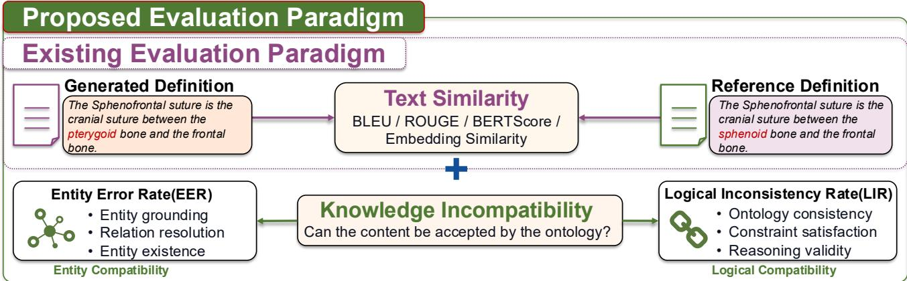
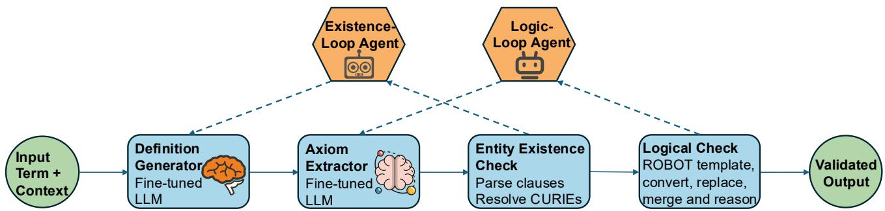
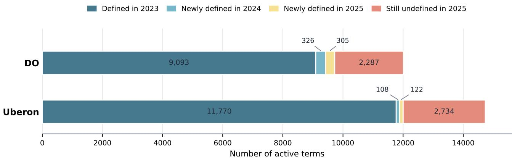
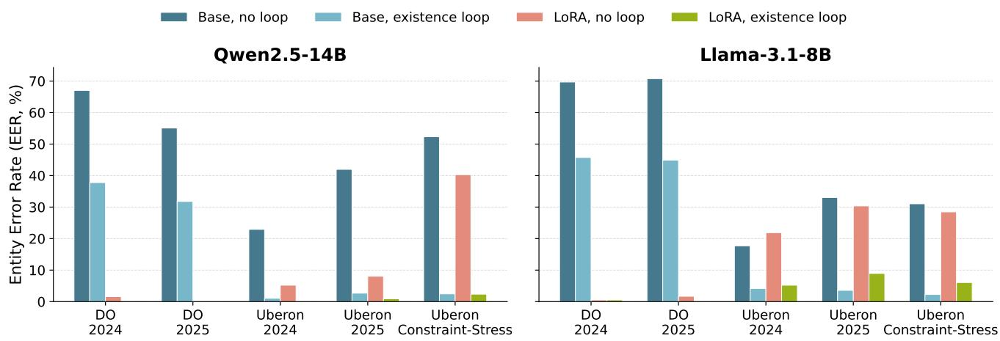

# From Fluent Text to Ontology-Compatible Definitions: A Quality-Control Agentic Workflow

Kun Fenga,b, Chenchen Chuc,d, Yan Liue, Haojie Sunb, Jijun Tangb, Chen Tiana, Shuolin Xiaof,∗, Jianping Heg,∗ and Zhao Lib,∗

aNanjing University, Nanjing, 210023, China

bFaculty of Computer Science and Artificial Intelligence, Shenzhen University of Advanced Technology, Shenzhen, 518107, China

cMaterials Artificial Intelligence Center, Shenzhen Institutes of Advanced Technology, Chinese Academy of Sciences, Shenzhen, 518055, China

dUniversity ofChinese Academy ofSciences, 100049, Beijing, China

eAmbulatory Operations, Baylor College ofMedicine, Houston, Texas, 77030, USA

fRalph O’Connor Sustainable Energy Institute, Johns Hopkins University, Baltimore, Maryland, 21218, USA

gBeijing Foreign Studies University Artificial Intelligence and Human Languages Lab, China

## A R T I C L E I N F O

Keywords:   
Large language models   
Biomedical ontologies   
Structured knowledge systems   
Knowledge compatibility   
Quality control   
Ontology engineering

## A BS T RA C T

Biomedical ontologies are structured knowledge systems that must evolve continuously to represent newly emerging knowledge, but their manual maintenance remains time-consuming and laborintensive. Textual definitions are especially costly because they must be readable to humans and compatible with controlled entities, relations, and logical constraints. Large language models (LLMs) ofer a promising way to assist ontology engineering tasks, including definition generation. However, textual plausibility does not guarantee knowledge-system compatibility. A generated definition may be fluent and close to a reference definition, yet still fail to ground its implied entities or violate ontology-level constraints. Directly inserting such definitions into ontology libraries may therefore introduce entity-level hallucinations and logical inconsistencies. To address this problem, we propose two structured-knowledge incompatibility metrics, Entity Error Rate (EER) and Logical Inconsistency Rate (LIR), to quantify entity grounding and logical consistency for LLM-generated ontology definitions. We further develop an agentic quality-control (QC) workflow that treats definition generation as an iterative process rather than a direct decoding step: it generates definitions, extracts axioms, checks entity existence and logical consistency, and uses the resulting diagnostics to drive repair loops. Comprehensive experiments on Disease Ontology, Uberon Ontology, and Uberon-Constraint-Stress demonstrate that EER and LIR complement conventional reference-based metrics by evaluating whether generated content can be grounded and checked inside the target ontology. The workflow efectively decreases EER while maintaining strong conventional text-generation performance. LIR further exposes sparse ontology-level logical failures that are invisible to text similarity metrics, although their repair remains limited.

## 1. Introduction

Biomedical ontologies are structured knowledge systems that combine terminological resources with formal knowledge bases (Gruber, 1993; Smith et al., 2007; W3C OWL Working Group, 2012; Jackson et al., 2021). A class definition is therefore more than a readable gloss. It supports search, annotation, curation, and reasoning over the ontology graph. In large Open Biological and Biomedical Ontologies (OBO)-style resources such as the Disease Ontology (DO) (Schriml et al., 2012, 2019, 2022) and Uberon (Mungall et al., 2012), curators must keep textual definitions aligned with class hierarchy, cross-ontology relationships, and logical constraints. Each release adds new classes, and many existing classes still need definitions. This creates a recurring authoring burden.

Large language models (LLMs) are a natural candidate for reducing this burden because they can turn sparse ontology context, such as class names and parent terms, into fluent draft definitions at scale (Brown et al., 2020; Babaei Giglou et al., 2023; Val-Calvo et al., 2025). These drafts can reduce the amount of manual writing curators must perform from scratch. Recent biomedical LLM studies further show that domain-adapted language models can support specialized scientific text tasks (Labrak et al., 2024). Given a term name and its parent context, an LLM can often produce fluent biomedical definitions that resemble curated ontology text. This makes LLM-assisted definition generation a plausible way to support ontology maintenance.

However, LLM-generated drafts still require ontologyaware validation, and the main challenge is evaluation. Standard generation metrics quantify whether a generated definition is lexically or semantically close to a reference. These metrics include token overlap, Recall-Oriented Understudy for Gisting Evaluation (ROUGE), Bilingual Evaluation Understudy (BLEU), BERTScore, a metric based on Bidirectional Encoder Representations from Transformers (BERT), and sentence-embedding similarity (Papineni et al., 2002; Lin, 2004; Zhang et al., 2019; Reimers and Gurevych, 2019). These metrics are useful, but they measure text similarity rather than compatibility with the target knowledge system. A definition can be fluent and reference-like while still mentioning a nonexistent entity, using an unresolved relation, or adding a relationship that makes the class unsatisfiable after it is merged into the ontology.

  
Figure 1: Evaluation framework for LLM-generated ontology definitions. Text-generation metrics measure similarity to reference definitions. Knowledge-compatible evaluation, instantiated here for ontologies, also checks entity grounding and logical consistency.

Figure 1 illustrates this gap with a concrete definition example. The generated definition is fluent and closely resembles the reference definition, but it changes the anatomical entity from “sphenoid bone” to “pterygoid bone.” A textsimilarity metric may still assign a high score because most words and sentence structure are shared. For ontology use, however, this is not enough. The mentioned entity must be grounded to an identifier in the target ontology, the implied relation must be resolved, and the resulting axiom must be compatible with existing ontology constraints. If the entity cannot be grounded or an axiom conflicts with disjointness or other strong constraints, it can make the generated class unsatisfiable (Ji et al., 2023).

We therefore study ontology definition generation as a quality-controlled knowledge-compatible generation problem. Instead of treating the generated definition as the final artifact, we place generation inside an agentic quality-control (QC) workflow. The workflow uses ontology tools to inspect intermediate outputs, receive diagnostic feedback, and repair candidates when needed. This design follows a broader line of LLM agent and tool-use work in which models call external tools, use feedback, and refine outputs over multiple steps (Yao et al., 2022; Schick et al., 2023; Madaan et al., 2023; Shinn et al., 2023).

We also introduce two metrics that separate structuredknowledge failures from ordinary text quality. Entity Error Rate (EER) measures unresolved or ungrounded extracted axioms. Logical Inconsistency Rate (LIR) measures reasoner-detected incompatibility among entity-grounded candidates. These metrics are instantiated here for biomedical ontologies, but they reflect a broader principle: generated content for a structured knowledge system should be checked against the entities, relations, and constraints of that system.

Our evaluation covers both realistic release-based ontology maintenance settings and a targeted stress setting. For DO and Uberon, we evaluate on incremental release data that reflect newly added or newly defined classes. To better assess logical consistency, we also construct Uberon-Constraint-Stress, a subset enriched for classes involved in strong constraints such as disjointness. Together, these settings test whether the QC workflow can detect entity-grounding and logical failures that ordinary text metrics cannot.

This paper makes four contributions:

• We frame LLM-assisted ontology definition generation as a knowledge-compatibility problem, instantiated in biomedical ontologies, rather than only as a text-generation problem.

• We propose two structured-knowledge incompatibility metrics: Entity Error Rate (EER), which measures entity-grounding failures, and Logical Inconsistency Rate (LIR), which measures reasoner-detected incompatibility among entity-grounded candidates.

• We introduce an axiom-based agentic QC workflow that combines definition generation, axiom extraction, entity existence checking, ROBOT-based reasoning, and iterative repair.

• We evaluate the workflow on DO, Uberon, and Uberon-Constraint-Stress, report both conventional text-generation metrics and structured-knowledge incompatibility metrics, and release the constructed evaluation datasets for reuse.

Overall, the results show that fluent, reference-like definitions are not necessarily ready for integration into a target knowledge system. The QC modules expose two failure modes that text metrics miss: extracted entities or relations may fail to ground, and grounded candidates may still conflict with ontology-level constraints. The repair loops reduce many entity-grounding failures before curator review, while the remaining logical failures show why symbolic validation is still needed even when generated text appears strong. More broadly, these findings support a layered view of LLMassisted structured-knowledge generation: language models can draft useful content, but external knowledge-system checks should decide whether that content can be grounded, repaired, or safely accepted.

## 2. Related Work

## 2.1. Biomedical Ontologies and Definition Curation

Biomedical ontologies provide shared class identifiers, labels, definitions, relations, and logical axioms for data integration. This follows the broader view of an ontology as an explicit specification of a conceptualization (Gruber, 1993). The OBO Foundry established principles for coordinated ontology development, including openness, common formats, orthogonality, textual definitions, and formal relations (Smith et al., 2007; Jackson et al., 2021). The Web Ontology Language (OWL) provides a formal language for representing classes, relations, and logical axioms in machineinterpretable ontologies (W3C OWL Working Group, 2012). DO provides a structured disease vocabulary for integrating disease knowledge across biomedical resources (Schriml et al., 2012, 2019). Uberon provides a cross-species anatomy ontology that integrates anatomical entities and supports reasoning through rich logical relationships (Mungall et al., 2012).

Definition authoring in these resources is labor-intensive because a useful definition must be readable to domain users while remaining compatible with the ontology’s formal structure. Missing definitions limit interpretability, and weak or inconsistent definitions reduce the utility of ontologymediated search, annotation, and reasoning. Our work focuses on this curation bottleneck, but treats definition generation as one step in a broader validation workflow rather than as standalone text production. This focus is consistent with ontology engineering practices that emphasize reuse, crossresource lookup, and automated release workflows (Courtot et al., 2011; Whetzel et al., 2011; Matentzoglu et al., 2022).

## 2.2. LLMs for Ontology Engineering

Recent work has explored LLMs for ontology learning and ontology engineering, including term typing, taxonomy discovery, non-taxonomic relation extraction, ontology population, and ontology generation (Brown et al., 2020; Babaei Giglou et al., 2023; Zhang et al., 2024; Kommineni et al., 2024; Fathallah et al., 2024; Li et al., 2025; Val-Calvo et al., 2025). These studies show that LLMs can provide useful candidate structures and reduce manual modeling effort, while also observing that complex modeling decisions remain dificult and require validation. Parameter-eficient adaptation methods such as Low-Rank Adaptation (LoRA) make it practical to specialize open LLMs for domainspecific generation tasks (Hu et al., 2022; Team, 2024). Definition generation is closely related: the model must synthesize fluent domain text from ontology context, and the generated text may contain implicit ontological commitments that afect the formal model.

Biomedical representation learning has also used definitions as an important source of semantic grounding. For example, definition-based biomedical concept representations can better capture concept meaning than names alone (Remy et al., 2022). Our goal is complementary. Rather than using definitions only as training signal for representations, we generate candidate definitions and then test whether they can be grounded back into ontology entities and axioms. This is also related to schema-guided extraction work such as SPIRES/OntoGPT, where LLM outputs are normalized against existing ontologies and vocabularies (Caufield et al., 2024).

## 2.3. Text- and Knowledge-Level Evaluation of Generated Content

Automatic text-generation metrics such as BLEU, ROUGE, BERTScore, and embedding cosine similarity are useful for measuring lexical overlap, sequence-level similarity, and contextual semantic similarity (Papineni et al., 2002; Lin, 2004; Zhang et al., 2019; Reimers and Gurevych, 2019). For generated ontology definitions, these metrics are useful baselines because a candidate definition should generally resemble curated text for the same class. However, textlevel similarity does not show whether the content can be grounded in, checked by, and integrated into the target knowledge system.

Recent work on factuality and hallucination evaluation has moved in this direction. Instead ofjudging only whether generated text sounds plausible or matches a reference, these approaches decompose text into checkable claims or compare generated content with external knowledge resources (Ji et al., 2023; Min et al., 2023). Related work on LLMs and knowledge graphs also emphasizes that structured knowledge can be used to ground model outputs and identify unsupported claims (Pan et al., 2024; Lavrinovics et al., 2025). This line of work is closer to the needs of ontology generation than surface text metrics alone, because ontology definitions are connected to controlled entities, relations, and formal constraints. The remaining gap is system-level compatibility: even a plausible statement must use entities and relations that the target knowledge system can resolve and validate.

Ontology definition generation adds a further requirement because ontology libraries are structured knowledge systems. A new term should be explained using existing ontology terms, rather than free text alone. Terms are connected through subclass, partonomy, disjointness, and other relations, and each ontology term is associated with at least one axiom. Thus, generated definitions may imply relationship axioms that must be usable inside the ontology. A valid-looking definition can still mention an entity that does not exist, use a relation that cannot be resolved, or produce an axiom that makes a class unsatisfiable. Therefore, knowledge-compatible evaluation needs signals beyond reference similarity. In our workflow, text metrics remain part of the evaluation, but they are complemented by axiom parse rate, predicate–object matching, entity grounding checks, EER, and LIR. This combination exposes cases where two definitions are textually similar but ontologically diferent, or where a fluent definition cannot be safely merged into the ontology.

  
Figure 2: Axiom-based quality-control workflow. The existence loop retries definition generation and axiom extraction for records with unresolved predicates or objects. The logic loop keeps the generated definition fixed and revises only the extracted axioms for records that become unsatisfiable after ROBOT reasoning; it does not trigger definition regeneration, because allowing both definition-level and axiom-level repair in the logic loop could create many additional iterations even with per-loop retry limits.

## 2.4. Ontology Quality Control and Reasoning

Ontology engineering workflows commonly use automated tools to enforce format, merge, and reasoning checks. ROBOT is a standard command-line tool for automating ontology workflows, including template conversion, merging, module extraction, and reasoning (Jackson et al., 2019). Reasoners such as ELK, an OWL 2 EL reasoner, are widely used for scalable OWL EL classification and satisfiability checking (Kazakov et al., 2014). These tools are typically applied to curated ontology releases or manually edited ontology modules.

Our work brings these QC tools into the LLM generation loop. Generated text is not accepted solely because it is fluent or close to a reference. Instead, it is converted into candidate axioms, checked for resolvable entities, merged into a replacement ontology, and tested with ROBOT reasoning. This turns knowledge-compatible generation into an operational workflow for ontologies: LLMs propose, symbolic checks diagnose, and repair loops revise the outputs before they reach human curation.

## 3. Methodology

We formulate ontology definition generation as a constrained knowledge-compatible generation problem. Biomedical ontologies provide a concrete setting in which generated text can be checked against the entities, relations, and constraints of a structured knowledge system.

Figure 2 gives an overview of the proposed agentic QC workflow. For each ontology class, the input contains the class name and parent context. The workflow first generates a candidate textual definition. It then extracts predicate–object relationship axioms from that definition, so the generated text can be tested as structured ontology content. The extracted predicates and objects are resolved against the target ontology. If they can be grounded, the workflow converts the candidate into a ROBOT template and validates it with an ontology reasoner (Jackson et al., 2019; Kazakov et al., 2014).

The workflow uses these tool outputs as feedback for targeted repair. Candidates with unresolved predicates or objects enter an existence loop, which regenerates the definition and re-extracts axioms. Candidates that are grounded but make the ontology unsatisfiable enter a logic loop, which keeps the generated definition fixed and requests axiom-only correction. A candidate is accepted only after it passes the relevant grounding and reasoning checks. The same workflow structure is used for DO and Uberon, with ontologyspecific configuration for prefixes, relation labels, release files, and local lookup indices.

## 3.1. Task Formulation

Each input record contains a class name and its parent classes. Parent context is represented by parent names and parent textual definitions. For supervised training and evaluation, each record also contains a reference definition and a set of relationship axioms. We use two generation stages. The first stage produces a draft textual definition from the class name and parent context. The second stage reads that draft and extracts explicit predicate–object relationship axioms, which provide the structured content used by the downstream grounding and reasoning checks.

Let $x _ { i }$ denote the �-th input record, consisting of the target class name and its parent context. The definition generator maps $x _ { i }$ to a candidate textual definition $d _ { i }$ . The axiom extractor then reads $d _ { i } ,$ , together with the same class name and parent context, and returns a set of extracted relationship axioms for that record:

$$
A _ { i } = \{ a _ { i j } \} _ { j = 1 } ^ { m _ { i } } , \qquad a _ { i j } = ( p _ { i j } , o _ { i j } ) .
$$

Here $m _ { i }$ is the number of extracted axioms for record $i , j$ indexes one extracted axiom within that record, $p _ { i j }$ is the relation predicate, and $o _ { i j }$ is the object entity. For example, an extracted axiom may state that the target class part of some anatomical structure, wherepart of is the predicate and the anatomical structure is the object. The extractor emits axioms in a controlled textual format:

relationship: predicate: [PREDICATE\_NAME], object: [OBJECT\_NAME];

This intermediate format allows the workflow to parse model output, resolve predicate and object names into ontology identifiers, and test whether the generated definition can be safely integrated into the ontology.

## 3.2. Dataset Construction

The datasets are built from ontology GitHub release files. For each release, we collect active, non-obsolete ontology classes, their names, textual definitions, parent classes, and relationship axioms. Definition-generation records use the class name and parent context as input and the curated definition as the target. Axiom-extraction records use the class name, definition, and parent context as input and the ontology-provided relationship axioms as the target.

We first use DO as an initial testbed for evaluating whether generated relationship axioms remain valid after being merged into a complete ontology. For DO, we construct a 2023 training set and two release-based test sets: 2024 and 2025. A DO test record is included when a class is newly added or newly receives a definition in the later release, and when it has relationship axioms for downstream validation. However, strong logical constraints are sparse in DO: in the 2023 release, only 26 of 11,454 active DO terms are involved in strong constraint axioms such as DisjointFrom. This makes DO useful for entity-grounding evaluation but less suitable for stress-testing logical inconsistency after ontology merging.

We therefore add Uberon as a second evaluation ontology. In addition to release-based Uberon test records from newly added or newly defined terms in the 2024 and 2025 releases, we construct Uberon-Constraint-Stress from the 2023 release. This stress set contains all 973 terms involved in strong constraint axioms, and the remaining 9,557 terms are used as the main Uberon training pool. This separation keeps constraint-focused terms out of the main fine-tuning data, so Uberon-Constraint-Stress provides a targeted test of knowledge-compatibility failures inside an ontology.

## 3.3. Definition Generation

The definition generation stage uses a chat-style LLM prompt. The system prompt instructs the model to act as a biomedical ontology expert and produce concise ontologystyle definitions. The user prompt contains only the target term name and parent context. In the initial pass, the model is asked to return only the generated definition. In existencerepair passes, the prompt also includes feedback from the previous failed attempt, including the previous generated definition and unresolved predicate or object diagnostics.

The implementation uses two model families, Qwen2.5- 14B-Instruct (Team, 2024) and Llama-3.1-8B-Instruct (Dubey et al., 2024), each evaluated in a base setting and a LoRAadapted setting fine-tuned on ontology definition records (Hu et al., 2022). The fine-tuning and random-sampling repair settings are reported in Table A.1. Generated text is stored with the original ontology metadata for downstream axiom extraction.

## 3.4. Relationship Axiom Extraction

The axiom extraction stage converts a generated definition into explicit relationship axioms. Its prompt contains the term name, generated definition, and parent context, and asks the model to return one or more axiom lines in the controlled predicate-object format. The model uses predicate names and object names rather than Compact Uniform Resource Identifiers (CURIEs) or Internationalized Resource Identifiers (IRIs), because the next stage resolves these names against the target ontology. For each model family, the base setting uses a five-shot prompting setup for axiom extraction. The five examples are fixed training-set records selected to cover terms with diferent numbers of relationship axioms, so that the prompt includes both simple and axiom-rich cases. The fine-tuned setting replaces this few-shot prompting setup with the corresponding LoRAadapted axiom extractor trained on ontology axiom records.

For evaluation, reference axioms are attached to definition records by matching ontology identifiers against the axiom dataset. This enables standard axiom-extraction metrics such as parse rate, exact match, predicate-object pair precision/recall/F1, predicate accuracy, object accuracy, and top-1 accuracy. These metrics evaluate whether the generated axiom text matches ontology-provided axioms, but they do not guarantee that the generated output is valid in the target ontology.

## 3.5. Entity Existence Checking and EER

The first QC module checks whether each extracted axiom can be grounded in the target knowledge system. In the ontology setting, this means that the workflow parses the controlled axiom text into predicate-object pairs, resolves each predicate to a relationship property, and resolves each object to an ontology entity. Resolution first uses a local ontology index built from the target OBO file; Ontology Lookup Service 4 (OLS4) lookup can be enabled for external label resolution (Côté et al., 2006). The check records several failure types, including unparsed axiom text, unresolved predicates, and unresolved objects.

A record passes the existence check only if at least one axiom is parsed and all parsed predicate-object pairs can be resolved. Resolved axioms are serialized into CURIE-based form and passed to ROBOT. We define EER as

$$
\mathrm { E E R } = \frac { 1 } { N } \sum _ { i = 1 } ^ { N } \mathbb { I } \{ \mathrm { E x i s t e n c e P a s s } ( A _ { i } ) = 0 \} ,\tag{1}
$$

where � is the number of generated definition records and �{⋅} is an indicator function. EER therefore measures the proportion of generated records whose extracted axioms cannot be grounded into the target knowledge system, instantiated here as the target ontology.

## 3.6. Logical Consistency Checking and LIR

Records that pass entity existence checking are then tested against the constraints of the target knowledge system. In our ontology instantiation, this validation is performed with ROBOT (Jackson et al., 2019). The workflow creates a dynamic ROBOT template comma-separated values (CSV) file whose rows contain the class identifier (ID), label, generated definition, class type, and one existential restriction column for each extracted predicate. A predicateobject axiom is rendered as a subclass restriction of the form SC P some %. Before merging, the workflow writes the generated class IDs to a replacement-term file and removes their existing records from the base ontology. This replacement step prevents candidate axioms from being combined with older axioms for the same classes. The template ontology is then merged with the pruned base ontology and checked with a reasoner through ROBOT. HermiT provides more complete reasoning support than ELK, but its memory requirements were prohibitive in our setting: even with 400 GB of allocated memory and a ROBOT-extract strategy that reasons over local modules, HermiT did not complete successfully. Therefore, the final workflow uses ELK for reasoning (Kazakov et al., 2014; Glimm et al., 2014).

ROBOT reports classes that become unsatisfiable after reasoning. We count only unsatisfiable classes from the generated candidate set and ignore unrelated unsatisfiable classes already present in the ontology. If a candidate causes a ROBOT Manchester syntax parse error, the workflow removes that record, records it as a template parse skip, and reruns reasoning on the remaining candidates.

We define LIR as

$$
\mathrm { L I R } = \frac { 1 } { N _ { \mathrm { e x i s t } } } \sum _ { i = 1 } ^ { N _ { \mathrm { e x i s t } } } \mathbb { I } \{ c _ { i } \in U _ { \mathrm { w o r k f l o w } } \} ,\tag{2}
$$

where $U _ { \mathrm { w o r k f l o w } }$ is the set of workflow candidate classes reported as unsatisfiable by ROBOT reasoning, and $N _ { \mathrm { e x i s t } }$ is the number of candidates that passed entity existence checking and entered the logic check. The term �{⋅} is the same indicator function defined above. LIR measures ontology-level incompatibility among candidates that are already entity-grounded.

## 3.7. Iterative Repair Loops

The repair procedure gives the workflow its agentic character: each repair step conditions generation on toolproduced diagnostics, keeps the failed candidate and retry history as context, and chooses the next action according to the type of failure. This agentic repair is implemented through two loops with diferent scopes. The existence loop handles unresolved predicates, unresolved objects, ambiguous labels, and unparsed axiom text. For each failed record, the retry prompt keeps the original term metadata, the previous generated definition, and the existence-failure diagnostics. The definition generator then produces a new definition, the axiom extractor extracts new axioms, and the existence checker is rerun. Passing records are accepted into the candidate set. Records that remain unresolved are retried until the loop budget is exhausted.

The logic loop handles candidates that pass entity existence checking but become unsatisfiable after ROBOT reasoning. In this loop, the textual definition is kept fixed. Only the relationship axioms are revised. The logic-failed record is enriched with feedback stating that the class was reported unsatisfiable, the current extracted axioms, and a compact history of previous failed axiom sets. The axiom correction prompt instructs the model to correct unsupported axioms, especially those that may contradict taxon, disjointness, partonomy, or domain/range constraints. Corrected axioms must pass the existence check before they replace the previous candidate axioms. The logic loop then reruns ROBOT reasoning until no workflow candidates are unsatisfiable or the loop budget is exhausted.

## 3.8. Evaluation Metrics

We report both conventional text-generation metrics and structured-knowledge QC metrics. For generated definitions, the code computes token F1, ROUGE-L, BLEU-2, BERTScore F1 (reported as BERT-F1 in tables), and sentence-embedding cosine similarity against curated reference definitions (Papineni et al., 2002; Lin, 2004; Zhang et al., 2019; Reimers and Gurevych, 2019). BLEU-2 is computed as the average of 1–2-gram BLEU scores. We use BLEU-2 rather than 3–4-gram BLEU because most DO definitions are relatively short, making longer n-gram overlap sparse and less stable. For axiom extraction, it computes parse rate, exact match, predicate-object pair precision/recall/F1, predicate accuracy, object accuracy, and top-1 accuracy against ontology-provided relationship axioms.

The two primary QC metrics are EER and LIR. EER measures failures of entity grounding, while LIR measures reasoner-detected inconsistency among entity-grounded candidates. Together, these metrics capture ontology compatibility errors that may not be reflected by reference-based text similarity metrics.

## 4. Experimental Results

## 4.1. Experimental Setup

We evaluate the proposed workflow on release-based ontology maintenance tasks and on a constraint-focused stress test. The release-based tasks simulate a curation scenario in which a model is trained on an older ontology release and evaluated on terms that are newly added or newly defined in a later release. We use this setup for both Disease Ontology (DO) and Uberon. DO provides an initial testbed for release-based definition generation, but it contains too few strong constraints for stress-testing logical inconsistency: in the 2023 release, only 26 of 11,454 active DO terms are involved in strong constraint axioms such as DisjointFrom. We therefore include Uberon and Uberon-Constraint-Stress, a targeted subset of Uberon classes involved in strong constraints.

  
Figure 3: Definition coverage and remaining definition gaps in DO and Uberon. The 2024 and 2025 segments combine newly added active terms with definitions and previously active terms that first received definitions in the newer release.

## Table 1

Training and evaluation settings used in the main experiments.
<table><tr><td>Ontology</td><td>Test setting</td><td>Definition train+val</td><td>Axiom train+val</td><td>Test size</td></tr><tr><td>DO</td><td>2024</td><td>9,093</td><td>4,810</td><td>188</td></tr><tr><td>DO</td><td>2025</td><td>9,093</td><td>4,810</td><td>236</td></tr><tr><td>Uberon</td><td>2024</td><td>9,557</td><td>9,557</td><td>96</td></tr><tr><td>Uberon</td><td>2025</td><td>9,557</td><td>9,557</td><td>112</td></tr><tr><td>Uberon</td><td>Constraint-Stress</td><td>9,557</td><td>9,557</td><td>973</td></tr></table>

All release-based splits are constructed from GitHub release snapshots. This choice reflects the practical maintenance setting shown in Figure 3: both DO and Uberon still contain many active terms without definitions in 2025, while each annual release adds definitions for only a relatively small number of terms. The DO training set uses the December 2023 release. DO 2024 contains terms newly added or newly defined between the December 2023 and December 2024 releases, and DO 2025 uses the same criterion between the December 2024 and December 2025 releases. For Uberon, the training set uses the 2023-12-08 release. Uberon 2024 compares the 2023-12-08 and 2024-11-25 releases, and Uberon 2025 compares the 2024-11-25 and 2025-12-05 releases. The stress subset is held out from the main Uberon training pool and is used to make ontology-level failures easier to observe. For both ontologies, the training pool is split into training and validation subsets with an 8:2 ratio. Table 1 summarizes the resulting train/validation sizes and evaluation sets.

We compare Qwen2.5-14B and Llama-3.1-8B under base and LoRA fine-tuned settings. All reasoning-based checks use ELK, and entity-existence validation uses the local ontology together with OLS4 lookup. When a repair loop is enabled, the workflow allows at most five retry iterations; no-loop baselines run direct generation once. Retry generations use random sampling so that each repair iteration can explore an alternative candidate rather than simply repeat the previous output. For each setting, we report conventional reference-based text metrics and two structured-knowledge incompatibility metrics: EER and LIR.

## 4.2. Entity Error Rate Results

Table 2 places EER next to conventional text-generation metrics for the same no-loop and existence-loop pairs. It shows that models can achieve reasonable conventional textgeneration scores while still having high EER, especially in base-model settings. After the existence loop, the conventional metric columns usually retain similar shading within each pair, indicating that the repair loop maintains strong surface-similarity performance. In contrast, the EER column often becomes darker, because lower EER is better. This pattern supports the interpretation that the main benefit of the loop is improved ontology compatibility while preserving reference-based text quality.

Figure 4 highlights the EER reductions across the five test settings. Base models often produce many unresolved ontology entities, especially on DO. For Qwen2.5-14B, the loop reduces EER from 67.0% to 37.8% on DO 2024, from 55.1% to 31.8% on DO 2025, and from 52.3% to 2.5% on Uberon-Constraint-Stress. Llama-3.1-8B shows similar reductions, including 69.7% to 45.7% on DO 2024 and 31.0% to 2.3% on Uberon-Constraint-Stress. These results support the central motivation of the workflow: direct generation often produces entity-grounding failures, and a targeted QC loop can remove many invalid outputs before curator review.

LoRA fine-tuning generally improves conventional text metrics, but it does not always remove entity errors. The clearest improvement appears on DO, where fine-tuned models achieve higher lexical and semantic similarity while keeping EER near zero. On Uberon, fine-tuning improves textual similarity but can still leave substantial knowledgecompatibility failures. For example, Llama-3.1-8B with LoRA still has EER values of 5.2%, 8.9%, and 6.1% after entity-existence repair on Uberon 2024, Uberon 2025, and Uberon-Constraint-Stress, respectively. This result motivates separate QC checks beyond text metrics.

Table 2  
Conventional text-generation scores and Entity Error Rate (EER) for the same model-loop settings shown in Figure 4. Darker cells indicate better values: higher conventional scores and lower EER. Arrows in column headers indicate the preferred metric direction.
<table><tr><td>Test setting</td><td>Model</td><td>Loop setting</td><td>Token F1 ↑</td><td>ROUGE-L ↑</td><td>BLEU-2 ↑</td><td>BERT-F1 ↑</td><td>Cosine ↑</td><td>EER↓</td></tr><tr><td>DO 2024</td><td>Qwen2.5-14B</td><td>Base, no loop</td><td>0.283</td><td>0.222</td><td>0.107</td><td>0.608</td><td>0.664</td><td>0.670</td></tr><tr><td>DO 2024</td><td>Qwen2.5-14B</td><td>Base, existence loop</td><td>0.293</td><td>0.236</td><td>0.118</td><td>0.619</td><td>0.676</td><td>0.378</td></tr><tr><td>DO 2024</td><td>Qwen2.5-14B</td><td>LoRA, no loop</td><td>0.588</td><td>0.579</td><td>0.380</td><td>0.731</td><td>0.766</td><td>0.016</td></tr><tr><td>DO 2024</td><td>Qwen2.5-14B</td><td>LoRA, existence loop</td><td>0.588</td><td>0.579</td><td>0.381</td><td>0.731</td><td>0.766</td><td>0.000</td></tr><tr><td>DO 2024</td><td>Llama-3.1-8B</td><td>Base, no loop</td><td>0.310</td><td>0.240</td><td>0.115</td><td>0.593</td><td>0.642</td><td>0.697</td></tr><tr><td>DO 2024</td><td>Llama-3.1-8B</td><td>Base, existence loop</td><td>0.320</td><td>0.244</td><td>0.123</td><td>0.608</td><td>0.656</td><td>0.457</td></tr><tr><td>DO 2024</td><td>Llama-3.1-8B</td><td>LoRA, no loop</td><td>0.580</td><td>0.562</td><td>0.372</td><td>0.725</td><td>0.764</td><td>0.005</td></tr><tr><td>DO 2024</td><td>Llama-3.1-8B</td><td>LoRA, existence loop</td><td>0.580</td><td>0.562</td><td>0.372</td><td>0.725</td><td>0.764</td><td>0.005</td></tr><tr><td>DO 2025</td><td>Qwen2.5-14B</td><td>Base, no loop</td><td>0.327</td><td>0.253</td><td>0.143</td><td>0.636</td><td>0.688</td><td>0.551</td></tr><tr><td>DO 2025</td><td>Qwen2.5-14B</td><td>Base, existence loop</td><td>0.331</td><td>0.260</td><td>0.148</td><td>0.636</td><td>0.687</td><td>0.318</td></tr><tr><td>DO 2025</td><td>Qwen2.5-14B</td><td>LoRA, no loop</td><td>0.606</td><td>0.602</td><td>0.399</td><td>0.739</td><td>0.771</td><td>0.000</td></tr><tr><td>DO 2025</td><td>Qwen2.5-14B</td><td>LoRA, existence loop</td><td>0.606</td><td>0.602</td><td>0.399</td><td>0.739</td><td>0.771</td><td>0.000</td></tr><tr><td>DO 2025</td><td>Llama-3.1-8B</td><td>Base, no loop</td><td>0.345</td><td>0.257</td><td>0.139</td><td>0.611</td><td>0.658</td><td>0.708</td></tr><tr><td>DO 2025</td><td>Llama-3.1-8B</td><td>Base, existence loop</td><td>0.348</td><td>0.260</td><td>0.144</td><td>0.615</td><td>0.659</td><td>0.449</td></tr><tr><td>DO 2025</td><td>Llama-3.1-8B</td><td>LoRA, no loop</td><td>0.608</td><td>0.605</td><td>0.396</td><td>0.727</td><td>0.759</td><td>0.017</td></tr><tr><td>DO 2025</td><td>Llama-3.1-8B</td><td>LoRA, existence loop</td><td>0.608</td><td>0.605</td><td>0.396</td><td>0.727</td><td>0.759</td><td>0.000</td></tr><tr><td>Uberon 2024</td><td>Qwen2.5-14B</td><td>Base, no loop</td><td>0.428</td><td>0.353</td><td>0.203</td><td>0.663</td><td>0.717</td><td>0.229</td></tr><tr><td>Uberon 2024</td><td>Qwen2.5-14B</td><td>Base, existence loop</td><td>0.425</td><td>0.351</td><td>0.200</td><td>0.664</td><td>0.717</td><td>0.010</td></tr><tr><td>Uberon 2024</td><td>Qwen2.5-14B</td><td>LoRA, no loop</td><td>0.428</td><td>0.374</td><td>0.228</td><td>0.699</td><td>0.742</td><td>0.052</td></tr><tr><td>Uberon 2024</td><td>Qwen2.5-14B</td><td>LoRA, existence loop</td><td>0.431</td><td>0.378</td><td>0.230</td><td>0.699</td><td>0.742</td><td>0.000</td></tr><tr><td>Uberon 2024</td><td>Llama-3.1-8B</td><td>Base, no loop</td><td>0.409</td><td>0.332</td><td>0.175</td><td>0.649</td><td>0.698</td><td>0.177</td></tr><tr><td>Uberon 2024</td><td>Llama-3.1-8B</td><td>Base, existence loop</td><td>0.409</td><td>0.331</td><td>0.176</td><td>0.650</td><td>0.698</td><td>0.042</td></tr><tr><td>Uberon 2024</td><td>Llama-3.1-8B</td><td>LoRA, no loop</td><td>0.478</td><td>0.421</td><td>0.249</td><td>0.695</td><td>0.735</td><td>0.219</td></tr><tr><td>Uberon 2024</td><td>Llama-3.1-8B</td><td>LoRA, existence loop</td><td>0.484</td><td>0.424</td><td>0.257</td><td>0.701</td><td>0.743</td><td>0.052</td></tr><tr><td>Uberon 2025</td><td>Qwen2.5-14B</td><td>Base, no loop</td><td>0.408</td><td>0.346</td><td>0.190</td><td>0.659</td><td>0.702</td><td>0.420</td></tr><tr><td>Uberon 2025</td><td>Qwen2.5-14B</td><td>Base, existence loop</td><td>0.401</td><td>0.335</td><td>0.178</td><td>0.645</td><td>0.685</td><td>0.027</td></tr><tr><td>Uberon 2025</td><td>Qwen2.5-14B</td><td>LoRA, no loop</td><td>0.420</td><td>0.366</td><td>0.201</td><td>0.670</td><td>0.703</td><td>0.080</td></tr><tr><td>Uberon 2025</td><td>Qwen2.5-14B</td><td>LoRA, existence loop</td><td>0.421</td><td>0.367</td><td>0.202</td><td>0.670</td><td>0.703</td><td>0.009</td></tr><tr><td>Uberon 2025</td><td>Llama-3.1-8B</td><td>Base, no loop</td><td>0.393</td><td>0.319</td><td>0.173</td><td>0.653</td><td>0.691</td><td>0.330</td></tr><tr><td>Uberon 2025</td><td>Llama-3.1-8B</td><td>Base, existence loop</td><td>0.404</td><td>0.322</td><td>0.178</td><td>0.654</td><td>0.693</td><td>0.036</td></tr><tr><td>Uberon 2025</td><td>Llama-3.1-8B</td><td>LoRA, no loop</td><td>0.436</td><td>0.344</td><td>0.192</td><td>0.678</td><td>0.712</td><td>0.304</td></tr><tr><td>Uberon 2025</td><td>Llama-3.1-8B</td><td>LoRA, existence loop</td><td>0.435</td><td>0.346</td><td>0.195</td><td>0.675</td><td>0.709</td><td>0.089</td></tr><tr><td>Uberon-Constraint-Stress</td><td>Qwen2.5-14B</td><td>Base, no loop</td><td>0.307</td><td>0.246</td><td>0.115</td><td>0.602</td><td>0.644</td><td>0.523</td></tr><tr><td>Uberon-Constraint-Stress</td><td>Qwen2.5-14B</td><td>Base, existence loop</td><td>0.307</td><td>0.247</td><td>0.116</td><td>0.602</td><td>0.644</td><td>0.025</td></tr><tr><td>Uberon-Constraint-Stress</td><td>Qwen2.5-14B</td><td>LoRA, no loop</td><td>0.416</td><td>0.379</td><td>0.242</td><td>0.674</td><td>0.712</td><td>0.403</td></tr><tr><td>Uberon-Constraint-Stress</td><td>Qwen2.5-14B</td><td>LoRA, existence loop</td><td>0.410</td><td>0.373</td><td>0.237</td><td>0.669</td><td>0.707</td><td>0.024</td></tr><tr><td>Uberon-Constraint-Stress</td><td>Llama-3.1-8B</td><td>Base, no loop</td><td>0.320</td><td>0.257</td><td>0.117</td><td>0.603</td><td>0.644</td><td>0.310</td></tr><tr><td>Uberon-Constraint-Stress</td><td>Llama-3.1-8B</td><td>Base, existence loop</td><td>0.319</td><td>0.255</td><td>0.116</td><td>0.603</td><td>0.644</td><td>0.023</td></tr><tr><td>Uberon-Constraint-Stress</td><td>Llama-3.1-8B</td><td>LoRA, no loop</td><td>0.409</td><td>0.368</td><td>0.226</td><td>0.664</td><td>0.702</td><td>0.285</td></tr><tr><td>Uberon-Constraint-Stress</td><td>Llama-3.1-8B</td><td>LoRA, existence loop</td><td>0.404</td><td>0.363</td><td>0.220</td><td>0.657</td><td>0.695</td><td>0.061</td></tr></table>

  
Figure 4: Entity Error Rate (EER) before and after entity-existence repair. Lower is better. The repair loop substantially reduces unresolved-entity failures for base models and for dificult Uberon settings.

Table 3  
Logical Inconsistency Rate (LIR) after entity-existence repair. The comparison is between existence-loop and all-loop settings; all-loop adds the logical repair loop on top of the existence-loop setting, so both share the same entity-grounded candidate pool. Real count reports the number of inconsistent candidates over the number of entity-grounded candidates. Bold all-loop values indicate a lower LIR than the paired existence-loop setting.
<table><tr><td>Test setting</td><td>Model</td><td>Loop setting</td><td></td><td>LIR ↓</td><td>Real count</td></tr><tr><td>Uberon 2024</td><td>Qwen2.5-14B</td><td>Base, existence loop</td><td></td><td>1.05%</td><td>1/95</td></tr><tr><td>Uberon 2024</td><td>Qwen2.5-14B</td><td>Base, all loops</td><td></td><td>1.05%</td><td>1/95</td></tr><tr><td>Uberon 2024</td><td>Qwen2.5-14B</td><td>LoRA, existence loop</td><td></td><td>2.08%</td><td>2/96</td></tr><tr><td>Uberon 2024</td><td>Qwen2.5-14B</td><td>LoRA, all loops</td><td></td><td>2.08%</td><td>2/96</td></tr><tr><td>Uberon 2024</td><td>Llama-3.1-8B</td><td>Base, existence loop</td><td></td><td>0.00%</td><td>0/92</td></tr><tr><td>Uberon 2024</td><td>Llama-3.1-8B</td><td>Base, all loops</td><td></td><td>0.00%</td><td>0/92</td></tr><tr><td>Uberon 2024</td><td>Llama-3.1-8B</td><td>LoRA, existence loop</td><td></td><td>0.00%</td><td>0/91</td></tr><tr><td>Uberon 2024</td><td>Llama-3.1-8B</td><td>LoRA, all loops</td><td></td><td>0.00%</td><td>0/91</td></tr><tr><td>Uberon 2025</td><td>Qwen2.5-14B</td><td>Base, existence loop</td><td></td><td>0.92%</td><td>1/109</td></tr><tr><td>Uberon 2025</td><td>Qwen2.5-14B</td><td>Base, all loops</td><td></td><td>0.92%</td><td>1/109</td></tr><tr><td>Uberon 2025</td><td>Qwen2.5-14B</td><td>LoRA, existence loop</td><td></td><td>1.80%</td><td>2/111</td></tr><tr><td>Uberon 2025</td><td>Qwen2.5-14B</td><td>LoRA, all loops</td><td></td><td>0.00%</td><td>0/111</td></tr><tr><td>Uberon 2025</td><td>Llama-3.1-8B</td><td>Base, existence loop</td><td></td><td>0.93%</td><td>1/108</td></tr><tr><td>Uberon 2025</td><td>Llama-3.1-8B</td><td>Base, all loops</td><td></td><td>0.00%</td><td>0/108</td></tr><tr><td>Uberon 2025</td><td>Llama-3.1-8B</td><td>LoRA, existence loop</td><td></td><td>0.98%</td><td>1/102</td></tr><tr><td>Uberon 2025</td><td>Llama-3.1-8B</td><td>LoRA, all loops</td><td></td><td>0.98%</td><td>1/102</td></tr><tr><td>Uberon-Constraint-Stress</td><td>Qwen2.5-14B</td><td>Base, existence loop</td><td></td><td>0.42%</td><td>4/949</td></tr><tr><td>Uberon-Constraint-Stress</td><td>Qwen2.5-14B</td><td>Base, all loops</td><td></td><td>0.32%</td><td>3/949</td></tr><tr><td>Uberon-Constraint-Stress</td><td>Qwen2.5-14B</td><td>LoRA, existence loop</td><td></td><td>2.95%</td><td>28/950</td></tr><tr><td>Uberon-Constraint-Stress</td><td>Qwen2.5-14B</td><td>LoRA, all loops</td><td></td><td>0.42%</td><td>4/950</td></tr><tr><td>Uberon-Constraint-Stress</td><td>Llama-3.1-8B</td><td>Base, existence loop</td><td></td><td>1.26%</td><td>12/951</td></tr><tr><td>Uberon-Constraint-Stress</td><td>Llama-3.1-8B</td><td>Base, all loops</td><td></td><td>0.21%</td><td>2/951</td></tr><tr><td>Uberon-Constraint-Stress</td><td>Llama-3.1-8B</td><td>LoRA, existence loop</td><td></td><td>1.20%</td><td>11/914</td></tr><tr><td>Uberon-Constraint-Stress</td><td>Llama-3.1-8B</td><td>LoRA, all loops</td><td></td><td>1.09%</td><td>10/914</td></tr><tr><td></td><td></td><td></td><td></td><td></td><td></td></tr></table>

For completeness, Table A.2 reports the corresponding conventional text-generation scores when direct generation is compared with the full all-loop workflow.

## 4.3. Logical Inconsistency Results

Logical reasoning is applied after entity existence has been checked. This ordering is natural for ontology QC: generated axioms should first be grounded to existing predicates and object entities before testing whether they are logically compatible with the ontology. Therefore, the LIR experiments are performed on candidates that have passed the entity-existence check after the EER repair loop.

Table 3 summarizes LIR after the entity-existence loop has been applied for the Uberon settings. We compare the existence-loop setting with the all-loop setting, where all loops means that the logical repair loop is added after the existence loop. These two settings share the same entitygrounded candidate pool, whereas no-loop runs can have a diferent LIR denominator. DO shows no reasoner-detected logical inconsistencies in these runs, consistent with the earlier observation that the 2023 DO release contains very few terms involved in strong constraint axioms. We therefore omit the all-zero DO rows from the table. Uberon, in contrast, has non-zero LIR values in both incremental and stress settings. Adding the logic loop reduces LIR in some settings, such as Qwen2.5-14B with LoRA on Uberon 2025 and Uberon-Constraint-Stress, but the reductions are smaller and less consistent than the EER reductions. This shows why LIR is needed: text metrics and entity-resolution checks do not tell us whether generated axioms are logically compatible with the ontology. Because diferent test settings and models produce diferent numbers of candidates that pass entity-existence checking, the LIR denominator also difers across rows. We therefore report LIR in a table rather than using a grouped bar chart.

## 4.4. Definition Generator Model Selection

Before running the full QC workflow, we evaluated candidate definition generators on the DO 2024 and DO 2025 test sets using conventional text-generation metrics. This preliminary experiment was used to select the model families for the main experiments. We first screened candidate models under direct inference and then fine-tuned stronger direct-inference candidates for further evaluation. The model-selection and input-field ablation experiments use greedy decoding to make the comparisons deterministic;

Table 4  
Definition-generation model selection on DO release-based test sets. FT-prefixed models are evaluated after fine-tuning; other models are evaluated by direct base-model inference. The knowledge-cutof column is included as a data-leakage reference; bold marks the best score within each test set.
<table><tr><td>Test set</td><td>Model</td><td>Knowledge cutoff</td><td>Token F1</td><td>ROUGE-L</td><td>BLEU-2</td><td>BERT-F1</td><td>Cosine</td></tr><tr><td>DO 2024</td><td>Qwen2.5-7B-Instruct</td><td>not reported; card Jan. 2025</td><td>0.280</td><td>0.184</td><td>0.084</td><td>0.587</td><td>0.705</td></tr><tr><td>DO 2024</td><td>Llama-3.1-8B</td><td>2023.12</td><td>0.325</td><td>0.238</td><td>0.124</td><td>0.603</td><td>0.663</td></tr><tr><td>DO 2024</td><td>Llama-3.1-8B-Instruct</td><td>2023.12</td><td>0.297</td><td>0.180</td><td>0.085</td><td>0.565</td><td>0.696</td></tr><tr><td>DO 2024</td><td>Qwen2.5-14B-Instruct</td><td>not reported; card Jan. 2025</td><td>0.281</td><td>0.192</td><td>0.089</td><td>0.597</td><td>0.704</td></tr><tr><td>DO 2024</td><td>gpt-oss-20b</td><td>not reported; card Aug. 2025</td><td>0.239</td><td>0.144</td><td>0.063</td><td>0.525</td><td>0.536</td></tr><tr><td>DO 2024</td><td>DeepSeek-R1-Distill-Llama-70B</td><td>not reported; card Jan. 2025</td><td>0.267</td><td>0.163</td><td>0.077</td><td>0.569</td><td>0.626</td></tr><tr><td>DO 2024</td><td>FT-Llama-3.1-8B-Instruct</td><td>2023.12</td><td>0.606</td><td>0.585</td><td>0.390</td><td>0.807</td><td>0.782</td></tr><tr><td>DO 2024</td><td>FT-Qwen2.5-14B-Instruct</td><td>not reported; card Jan. 2025</td><td>0.602</td><td>0.586</td><td>0.386</td><td>0.808</td><td>0.786</td></tr><tr><td>DO 2024</td><td>FT-gpt-oss-20b</td><td>not reported; card Aug. 2025</td><td>0.499</td><td>0.470</td><td>0.290</td><td>0.749</td><td>0.761</td></tr><tr><td>DO 2025</td><td>Qwen2.5-7B-Instruct</td><td>not reported; card Jan. 2025</td><td>0.279</td><td>0.181</td><td>0.085</td><td>0.579</td><td>0.676</td></tr><tr><td>DO 2025</td><td>Llama-3.1-8B</td><td>2023.12</td><td>0.332</td><td>0.246</td><td>0.132</td><td>0.600</td><td>0.670</td></tr><tr><td>DO 2025</td><td>Llama-3.1-8B-Instruct</td><td>2023.12</td><td>0.291</td><td>0.180</td><td>0.087</td><td>0.557</td><td>0.673</td></tr><tr><td>DO 2025</td><td>Qwen2.5-14B-Instruct</td><td>not reported; card Jan. 2025</td><td>0.277</td><td>0.189</td><td>0.090</td><td>0.587</td><td>0.670</td></tr><tr><td>DO 2025</td><td>gpt-oss-20b</td><td>not reported; card Aug. 2025</td><td>0.234</td><td>0.141</td><td>0.065</td><td>0.516</td><td>0.533</td></tr><tr><td>DO 2025</td><td>DeepSeek-R1-Distill-Llama-70B</td><td>not reported; card Jan. 2025</td><td>0.266</td><td>0.166</td><td>0.081</td><td>0.562</td><td>0.607</td></tr><tr><td>DO 2025</td><td>FT-Llama-3.1-8B-Instruct</td><td>2023.12</td><td>0.599</td><td>0.588</td><td>0.378</td><td>0.805</td><td>0.755</td></tr><tr><td>DO 2025</td><td>FT-Qwen2.5-14B-Instruct</td><td>not reported; card Jan. 2025</td><td>0.597</td><td>0.589</td><td>0.373</td><td>0.808</td><td>0.758</td></tr><tr><td>DO 2025</td><td>FT-gpt-oss-20b</td><td>not reported; card Aug. 2025</td><td>0.515</td><td>0.501</td><td>0.310</td><td>0.760</td><td>0.730</td></tr></table>

the decoding setting is reported in Table A.1. They are also evaluated on definition-only DO test sets, which contain all terms with reference definitions: 326 records for DO 2024 and 305 records for DO 2025. These sets are larger than the main workflow test sets because the full QC workflow additionally requires relationship axioms. Table 4 reports both direct base-model inference and fine-tuned inference. Model names prefixed with FT denote fine-tuned models; other rows use direct inference from the base model. We include the knowledge-cutof information as a reference for possible data leakage.

The model-selection results show a large gap between direct base-model inference and fine-tuned inference. On both DO test sets, the fine-tuned Qwen2.5-14B and Llama-3.1-8B models obtain the strongest lexical and semantic scores, whereas the other fine-tuned candidate, gpt-oss-20b, remains lower. We therefore use Qwen2.5-14B and Llama-3.1-8B as the two model families for the main workflow experiments.

## 4.5. Definition Input-Field Ablation

We also test which ontology fields should be included in the definition generator input. This ablation uses the finetuned Qwen2.5-14B-Instruct model on the same definitiononly DO 2024 and DO 2025 test sets used for model selection. Table 5 compares full-field input with variants that remove selected fields. Full fields include the term id, name, synonyms, parents, and subsets.

The ablation shows that parent context is the most important auxiliary field. Removing parents produces the largest drop on both DO test sets, reducing Token F1 from 0.602 to 0.576 in 2024 and from 0.597 to 0.575 in 2025. Removing synonyms changes performance only slightly, whereas removing subsets often improves performance; the no-id/subsets setting gives the best Token F1, ROUGE-L, BLEU-2, and BERT-F1 scores in both years. Based on these results, the main workflow uses the class name together with parent names and parent definitions as the core input fields. To check whether this input design is practical, we further inspected the oficial DO and Uberon release files used in this study. Terms without textual definitions or relationship axioms still retain asserted parent classes in these releases, so parent context is available even for the target records that require definition generation.

## 4.6. Axiom Extractor Performance

We next evaluate the axiom extractor itself on the noloop workflow outputs. This isolates extraction quality before entity-existence and logic repair are applied. Table 6 compares five-shot base prompting with the LoRA finetuned axiom extractor on the DO, Uberon, and Uberon-Constraint-Stress test sets. All predicate and object strings are normalized by lowercasing, replacing underscores with spaces, and collapsing whitespace before comparison.

The metrics measure diferent levels of extraction quality. Parse rate is the proportion of outputs that can be parsed into axiom records. Exact match requires the whole predicted axiom set for a term to match the reference set. Pair precision, recall, and F1 compare complete predicate– object pairs. Predicate accuracy and object accuracy evaluate each component separately. Hit rate is a term-level metric: it counts whether at least one predicted axiom matches any reference axiom. The validation-split performance used to check whether the LoRA extractor learned the axiomextraction task is reported in Table A.3.

The test-set results show that LoRA fine-tuning substantially improves axiom extraction over five-shot prompting. The improvement is especially large for DO, where LoRA

Table 5  
Input-field ablation for DO definition generation using the fine-tuned Qwen2.5-14B-Instruct model. Full fields include id, name, synonyms, parents, and subsets; each ablation removes the listed field or fields from the input. Bold marks the best score within each test set.
<table><tr><td>Test set</td><td>Input setting</td><td>Input fields</td><td>Token F1</td><td>ROUGE-L</td><td>BLEU-2</td><td>BERT-F1</td><td>Cosine</td></tr><tr><td>DO 2024</td><td>Full fields</td><td>id, name, synonyms, parents, subsets</td><td>0.602</td><td>0.586</td><td>0.386</td><td>0.808</td><td>0.786</td></tr><tr><td>DO 2024</td><td>No ID</td><td>name, synonyms, parents, subsets</td><td>0.601</td><td>0.585</td><td>0.381</td><td>0.807</td><td>0.791</td></tr><tr><td>DO 2024</td><td>No ID/synonyms</td><td>name, parents, subsets</td><td>0.596</td><td>0.579</td><td>0.379</td><td>0.803</td><td>0.776</td></tr><tr><td>DO 2024</td><td>No ID/parents</td><td>name, synonyms, subsets</td><td>0.576</td><td>0.555</td><td>0.348</td><td>0.795</td><td>0.756</td></tr><tr><td>DO 2024</td><td>No ID/subsets</td><td>name, synonyms, parents</td><td>0.613</td><td>0.597</td><td>0.396</td><td>0.813</td><td>0.790</td></tr><tr><td>DO 2025</td><td>Full fields</td><td>id, name, synonyms, parents, subsets</td><td>0.597</td><td>0.589</td><td>0.373</td><td>0.808</td><td>0.758</td></tr><tr><td>DO 2025</td><td>No ID</td><td>name, synonyms, parents, subsets</td><td>0.601</td><td>0.593</td><td>0.382</td><td>0.808</td><td>0.762</td></tr><tr><td>DO 2025</td><td>No ID/synonyms</td><td>name, parents, subsets</td><td>0.594</td><td>0.588</td><td>0.376</td><td>0.806</td><td>0.755</td></tr><tr><td>DO 2025</td><td>No ID/parents</td><td>name, synonyms, subsets</td><td>0.575</td><td>0.568</td><td>0.346</td><td>0.799</td><td>0.731</td></tr><tr><td>DO 2025</td><td>No ID/subsets</td><td>name, synonyms, parents</td><td>0.607</td><td>0.600</td><td>0.391</td><td>0.812</td><td>0.769</td></tr></table>

## Table 6

Axiom-extractor performance on test-set no-loop workflow outputs. Base rows use five-shot prompting, whereas LoRA rows use the fine-tuned axiom extractor. Predicate and object strings are normalized before comparison; bold marks the higher score within each Base/LoRA pair.
<table><tr><td>Ontology</td><td>Setting</td><td>Model</td><td>Extractor</td><td>n</td><td>Parse</td><td>Exact</td><td>Pair P</td><td>Pair R</td><td>Pair F1</td><td>Pred. Acc.</td><td>Obj. Acc.</td><td>Hit</td></tr><tr><td>DO</td><td>2024</td><td>Qwen2.5-14B</td><td>Base + few-shot</td><td>188</td><td>1.000</td><td>0.074</td><td>0.103</td><td>0.164</td><td>0.127</td><td>0.137</td><td>0.350</td><td>0.170</td></tr><tr><td>DO</td><td>2024</td><td>Qwen2.5-14B</td><td>LoRA</td><td>188</td><td>1.000</td><td>0.777</td><td>0.630</td><td>0.831</td><td>0.717</td><td>0.628</td><td>0.604</td><td>0.894</td></tr><tr><td>DO</td><td>2024</td><td>Llama-3.1-8B</td><td>Base + few-shot</td><td>188</td><td>1.000</td><td>0.005</td><td>0.021</td><td>0.075</td><td>0.033</td><td>0.044</td><td>0.156</td><td>0.080</td></tr><tr><td>DO</td><td>2024</td><td>Llama-3.1-8B</td><td>LoRA</td><td>188</td><td>1.000</td><td>0.777</td><td>0.679</td><td>0.845</td><td>0.753</td><td>0.686</td><td>0.664</td><td>0.894</td></tr><tr><td>DO</td><td>2025</td><td>Qwen2.5-14B</td><td>Base + few-shot</td><td>236</td><td>1.000</td><td>0.199</td><td>0.186</td><td>0.305</td><td>0.231</td><td>0.202</td><td>0.347</td><td>0.369</td></tr><tr><td>DO</td><td>2025</td><td>Qwen2.5-14B</td><td>LoRA</td><td>236</td><td>1.000</td><td>0.669</td><td>0.691</td><td>0.761</td><td>0.725</td><td>0.637</td><td>0.620</td><td>0.877</td></tr><tr><td>DO</td><td>2025</td><td>Llama-3.1-8B</td><td>Base + few-shot</td><td>236</td><td>1.000</td><td>0.030</td><td>0.065</td><td>0.182</td><td>0.095</td><td>0.072</td><td>0.208</td><td>0.220</td></tr><tr><td>DO</td><td>2025</td><td>Llama-3.1-8B</td><td>LoRA</td><td>236</td><td>1.000</td><td>0.682</td><td>0.712</td><td>0.779</td><td>0.744</td><td>0.648</td><td>0.640</td><td>0.903</td></tr><tr><td>Uberon</td><td>2024</td><td>Qwen2.5-14B</td><td>Base + few-shot</td><td>96</td><td></td><td>1.000 0.010</td><td>0.132</td><td>0.090</td><td>0.107</td><td>0.320</td><td>0.118</td><td>0.333</td></tr><tr><td>Uberon</td><td>2024</td><td>Qwen2.5-14B</td><td>LoRA</td><td>96</td><td></td><td>1.000 0.031</td><td>0.455</td><td>0.410</td><td>0.431</td><td>0.567</td><td>0.405</td><td>0.823</td></tr><tr><td>Uberon</td><td>2024</td><td>Llama-3.1-8B</td><td>Base + few-shot</td><td>96</td><td></td><td>1.000 0.000</td><td>0.096</td><td>0.087</td><td>0.091</td><td>0.323</td><td>0.098</td><td>0.312</td></tr><tr><td>Uberon</td><td>2024</td><td>Llama-3.1-8B</td><td>LoRA</td><td>96</td><td></td><td>1.000 0.021</td><td>0.326</td><td>0.351</td><td>0.338</td><td>0.453</td><td>0.286</td><td>0.781</td></tr><tr><td>Uberon</td><td>2025</td><td>Qwen2.5-14B</td><td>Base + few-shot</td><td>112</td><td></td><td>1.000</td><td>0.036 0.175</td><td>0.158</td><td>0.166</td><td>0.334</td><td>0.214</td><td>0.446</td></tr><tr><td>Uberon</td><td>2025</td><td>Qwen2.5-14B</td><td>LoRA</td><td>112</td><td></td><td>1.000 0.071</td><td>0.251</td><td>0.278</td><td>0.264</td><td>0.449</td><td>0.305</td><td>0.527</td></tr><tr><td>Uberon</td><td>2025</td><td>Llama-3.1-8B</td><td>Base + few-shot</td><td>112</td><td></td><td>1.000 0.000</td><td>0.114</td><td>0.142</td><td>0.127</td><td>0.307</td><td>0.175</td><td>0.402</td></tr><tr><td>Uberon</td><td>2025</td><td>Llama-3.1-8B</td><td>LoRA</td><td>112</td><td>1.000</td><td>0.062</td><td>0.155</td><td>0.212</td><td>0.179</td><td>0.370</td><td>0.200</td><td>0.509</td></tr><tr><td>Uberon</td><td>Constraint-Stress</td><td>Qwen2.5-14B</td><td>Base + few-shot</td><td>973</td><td>1.000</td><td>0.011</td><td>0.113</td><td>0.063</td><td>0.081</td><td>0.225</td><td>0.084</td><td>0.222</td></tr><tr><td>Uberon</td><td>Constraint-Stress</td><td>Qwen2.5-14B</td><td>LoRA</td><td>973</td><td>1.000</td><td>0.046</td><td>0.210</td><td>0.178</td><td>0.193</td><td>0.298</td><td>0.164</td><td>0.470</td></tr><tr><td>Uberon</td><td>Constraint-Stress</td><td>Llama-3.1-8B</td><td>Base + few-shot</td><td>973</td><td>0.975</td><td>0.003</td><td>0.075</td><td>0.057</td><td>0.065</td><td>0.216</td><td>0.070</td><td>0.201</td></tr><tr><td>Uberon</td><td>Constraint-Stress</td><td>Llama-3.1-8B</td><td>LoRA</td><td>973</td><td>1.000</td><td>0.046</td><td>0.166</td><td>0.179</td><td>0.172</td><td>0.275</td><td>0.147</td><td>0.485</td></tr></table>

raises hit rate from 0.170 to 0.894 for Qwen2.5-14B on 2024 and from 0.220 to 0.903 for Llama-3.1-8B on 2025. Finetuned LLM extractors achieve high hit rates on most test settings, with the best setting exceeding 0.90, suggesting that LLM-based axiom extraction has substantial potential. Uberon remains harder, especially the constraint-stress subset, but LoRA still improves pair-level F1 and hit rate for both model families. These results justify using a fine-tuned axiom extractor in the workflow while keeping five-shot base extraction as the no-finetuning comparison.

## 5. Discussion

The main finding of this study is that LLM-assisted ontology definition generation should not be evaluated only as a text-generation task. The definition text may be fluent and similar to a reference definition, while the relations implied by that text may still fail entity grounding or violate ontology-level constraints. This distinction is visible throughout the experiments. Conventional metrics remain useful for measuring lexical and semantic similarity, especially when comparing base and fine-tuned definition generators, but they do not expose whether the generated content can be accepted by an ontology engineering workflow. EER and LIR therefore provide a complementary view of generation quality: they measure whether generated definitions can be connected to existing ontology entities and whether the resulting structured claims are logically compatible with the ontology.

The results also show that diferent quality-control modules address diferent kinds of failures. The entity-existence loop produces clear EER reductions in many settings, particularly for base models and for the constraint-focused Uberon subset. This is expected because unresolved predicates or object entities provide direct local feedback to the next generation attempt. The model can be told which relation or object could not be grounded, and a new candidate can often avoid that specific error. In contrast, logical inconsistency is harder to repair. A candidate may become unsatisfiable because of global ontology constraints, disjointness axioms, domain or range restrictions, or interactions among multiple generated relations. These failures are sparse and less locally diagnostic, which helps explain why the logic loop yields only limited reductions in LIR even when EER repair is efective.

The experiments further suggest that fine-tuning and QC loops play diferent roles. Fine-tuning improves definitiongeneration quality under conventional metrics and substantially improves axiom extraction compared with five-shot prompting. However, fine-tuning alone does not guarantee ontology compatibility. In several Uberon settings, LoRA models retain non-zero EER after repair, and LIR remains observable even when text scores are strong. This supports a layered workflow: use fine-tuned models to improve generation and extraction quality, but keep explicit symbolic checks before any generated candidate is considered suitable for curator review.

The stress-test results also clarify why the choice of ontology afects what can be learned from an evaluation. The DO splits reflect a realistic incremental maintenance setting, where new or newly defined terms are added across releases. However, because only a small number of DO terms are involved in strong constraint axioms, this setting provides limited evidence about reasoner-detected logical inconsistency. Uberon complements DO in this respect: its regular incremental splits evaluate the same maintenance scenario in a more axiom-rich ontology, and the Uberon-Constraint-Stress subset intentionally concentrates terms that are more likely to exercise disjointness and other strong constraints. The three datasets therefore serve diferent purposes.

Although this paper instantiates EER and LIR for biomedical ontologies, the underlying idea is broader. Many structured knowledge generation tasks require generated text or claims to align with a controlled vocabulary, schema, knowledge graph, database, or rule system. In such settings, the central question is not only whether the output sounds plausible, but whether it can be grounded and checked against the target knowledge system. The workflow studied here provides one concrete implementation of this principle: LLMs propose content, while external knowledge-system checks decide whether the content can be accepted, repaired, or flagged. Future work should test the same incompatibility metrics in other structured domains. More broadly, similar checks could be applied to general LLM text-generation tasks by measuring whether generated entities can be grounded in existing knowledge resources and whether the generated

claims remain logically consistent with established knowledge.

## 6. Conclusion

This paper studied LLM-assisted ontology definition generation as an knowledge-compatibility problem instantiated in biomedical ontologies, rather than only as a textgeneration problem. The results show that LLMs can produce useful ontology-definition candidates, but they also demonstrate that fluent, reference-like definitions are not necessarily compatible with the target knowledge system. A generated definition may still contain unresolved entities or introduce logical inconsistencies that are invisible to conventional text-similarity metrics.

To address this gap, we introduced EER and LIR as structured-knowledge incompatibility metrics for evaluating entity grounding and logical consistency, and developed an agentic QC framework that combines generation, grounding verification, reasoning, and iterative repair. Experiments on DO, Uberon, and Uberon-Constraint-Stress show that the workflow substantially reduces entity-grounding failures while preserving strong conventional text-generation performance. More broadly, this work suggests that LLM generation in knowledge-intensive domains should be evaluated not only by linguistic quality, but also by whether generated content can be grounded, checked, and integrated into the target knowledge system.

## Acknowledgments

This work was supported by the Department of Education of Guangdong Province (2025ZDZX2065) and the Shenzhen Science and Technology Program (JCYJ202412 02130212016). The funders had no role in study design, data collection and analysis, decision to publish, or preparation of the manuscript.

## Data and Code Availability

The source code and constructed evaluation datasets supporting this study are publicly available at https://gi thub.com/iwcyou/DO-DefinitionGeneration.

## Declaration of Competing Interest

The authors declare that they have no known competing financial interests or personal relationships that could have appeared to influence the work reported in this paper.

## References

Babaei Giglou, H., D’Souza, J., Auer, S., 2023. Llms4ol: Large language models for ontology learning, in: International semantic web conference, Springer. pp. 408–427.

Brown, T., Mann, B., Ryder, N., Subbiah, M., Kaplan, J.D., Dhariwal, P., Neelakantan, A., Shyam, P., Sastry, G., Askell, A., et al., 2020. Language models are few-shot learners. Advances in neural information processing systems 33, 1877–1901.

Caufield, J.H., Hegde, H., Emonet, V., Harris, N.L., Joachimiak, M.P., Matentzoglu, N., Kim, H., Moxon, S., Reese, J.T., Haendel, M.A., et al., 2024. Structured prompt interrogation and recursive extraction of semantics (spires): A method for populating knowledge bases using zero-shot learning. Bioinformatics 40, btae104.

Côté, R.G., Jones, P., Apweiler, R., Hermjakob, H., 2006. The ontology lookup service, a lightweight cross-platform tool for controlled vocabulary queries. BMC bioinformatics 7, 97.

Courtot, M., Gibson, F., Lister, A.L., Malone, J., Schober, D., Brinkman, R.R., Ruttenberg, A., 2011. Mireot: The minimum information to reference an external ontology term. Applied Ontology 6, 23–33.

Dubey, A., Jauhri, A., Pandey, A., Kadian, A., Al-Dahle, A., Letman, A., Mathur, A., Schelten, A., Yang, A., Fan, A., et al., 2024. The llama 3 herd of models. arXiv e-prints , arXiv–2407.

Fathallah, N., Das, A., Giorgis, S.D., Poltronieri, A., Haase, P., Kovriguina, L., 2024. Neon-gpt: a large language model-powered pipeline for ontology learning, in: European Semantic Web Conference, Springer. pp. 36–50.

Glimm, B., Horrocks, I., Motik, B., Stoilos, G., Wang, Z., 2014. Hermit: an owl 2 reasoner. Journal of automated reasoning 53, 245–269.

Gruber, T.R., 1993. A translation approach to portable ontology specifications. Knowledge acquisition 5, 199–220.

Hu, E.J., Shen, Y., Wallis, P., Allen-Zhu, Z., Li, Y., Wang, S., Wang, L., Chen, W., et al., 2022. Lora: Low-rank adaptation of large language models. Iclr 1, 3.

Jackson, R., Matentzoglu, N., Overton, J.A., Vita, R., Balhof, J.P., Buttigieg, P.L., Carbon, S., Courtot, M., Diehl, A.D., Dooley, D.M., et al., 2021. Obo foundry in 2021: operationalizing open data principles to evaluate ontologies. Database 2021, baab069.

Jackson, R.C., Balhof, J.P., Douglass, E., Harris, N.L., Mungall, C.J., Overton, J.A., 2019. Robot: a tool for automating ontology workflows. BMC bioinformatics 20, 407.

Ji, Z., Lee, N., Frieske, R., Yu, T., Su, D., Xu, Y., Ishii, E., Bang, Y.J., Madotto, A., Fung, P., 2023. Survey of hallucination in natural language generation. ACM computing surveys 55, 1–38.

Kazakov, Y., Krötzsch, M., Simančík, F., 2014. The incredible ELK: From polynomial procedures to efficient reasoning with εL ontologies Journal of automated reasoning 53, 1–61.

Kommineni, V.K., König-Ries, B., Samuel, S., 2024. From human experts to machines: An llm supported approach to ontology and knowledge graph construction. arXiv preprint arXiv:2403.08345 .

Labrak, Y., Bazoge, A., Morin, E., Gourraud, P.A., Rouvier, M., Dufour, R., 2024. Biomistral: A collection of open-source pretrained large language models for medical domains, in: Findings of the association for computational linguistics: acl 2024, pp. 5848–5864.

Lavrinovics, E., Biswas, R., Bjerva, J., Hose, K., 2025. Knowledge graphs, large language models, and hallucinations: An nlp perspective. Journal of Web Semantics 85, 100844.

Li, J., Garijo, D., Poveda-Villalón, M., 2025. Large language models for ontology engineering: a systematic literature review. Semantic Web Journal 20, 1–45.

Lin, C.Y., 2004. Rouge: A package for automatic evaluation of summaries, in: Text summarization branches out, pp. 74–81.

Madaan, A., Tandon, N., Gupta, P., Hallinan, S., Gao, L., Wiegrefe, S., Alon, U., Dziri, N., Prabhumoye, S., Yang, Y., et al., 2023. Self-refine: Iterative refinement with self-feedback. Advances in neural information processing systems 36, 46534–46594.

Matentzoglu, N., Goutte-Gattat, D., Tan, S.Z.K., Balhof, J.P., Carbon, S., Caron, A.R., Duncan, W.D., Flack, J.E., Haendel, M., Harris, N.L., et al., 2022. Ontology development kit: a toolkit for building, maintaining and standardizing biomedical ontologies. Database 2022, baac087.

Min, S., Krishna, K., Lyu, X., Lewis, M., Yih, W.t., Koh, P., Iyyer, M., Zettlemoyer, L., Hajishirzi, H., 2023. Factscore: Fine-grained atomic evaluation of factual precision in long form text generation, in: Proceedings of the 2023 Conference on Empirical Methods in Natural Language Processing, pp. 12076–12100.

Mungall, C.J., Torniai, C., Gkoutos, G.V., Lewis, S.E., Haendel, M.A., 2012. Uberon, an integrative multi-species anatomy ontology. Genome

biology 13, R5.

Pan, S., Luo, L., Wang, Y., Chen, C., Wang, J., Wu, X., 2024. Unifying large language models and knowledge graphs: A roadmap. IEEE Transactions on Knowledge and Data Engineering 36, 3580–3599.

Papineni, K., Roukos, S., Ward, T., Zhu, W.J., 2002. Bleu: a method for automatic evaluation of machine translation, in: Proceedings of the 40th annual meeting of the Association for Computational Linguistics, pp. 311–318.

Reimers, N., Gurevych, I., 2019. Sentence-bert: Sentence embeddings using siamese bert-networks, in: Proceedings of the 2019 conference on empirical methods in natural language processing and the 9th international joint conference on natural language processing (EMNLP-IJCNLP), pp. 3982–3992.

Remy, F., Demuynck, K., Demeester, T., 2022. Biolord: Learning ontological representations from definitions for biomedical concepts and their textual descriptions, in: Findings of the Association for Computational Linguistics: EMNLP 2022, pp. 1454–1465.

Schick, T., Dwivedi-Yu, J., Dessì, R., Raileanu, R., Lomeli, M., Hambro, E., Zettlemoyer, L., Cancedda, N., Scialom, T., 2023. Toolformer: Language models can teach themselves to use tools. Advances in neural information processing systems 36, 68539–68551.

Schriml, L.M., Arze, C., Nadendla, S., Chang, Y.W.W., Mazaitis, M., Felix, V., Feng, G., Kibbe, W.A., 2012. Disease ontology: a backbone for disease semantic integration. Nucleic acids research 40, D940–D946.

Schriml, L.M., Mitraka, E., Munro, J., Tauber, B., Schor, M., Nickle, L., Felix, V., Jeng, L., Bearer, C., Lichenstein, R., et al., 2019. Human disease ontology 2018 update: classification, content and workflow expansion. Nucleic acids research 47, D955–D962.

Schriml, L.M., Munro, J.B., Schor, M., Olley, D., McCracken, C., Felix, V., Baron, J.A., Jackson, R., Bello, S.M., Bearer, C., et al., 2022. The human disease ontology 2022 update. Nucleic acids research 50, D1255– D1261.

Shinn, N., Cassano, F., Gopinath, A., Narasimhan, K., Yao, S., 2023. Reflexion: Language agents with verbal reinforcement learning. Advances in neural information processing systems 36, 8634–8652.

Smith, B., Ashburner, M., Rosse, C., Bard, J., Bug, W., Ceusters, W., Goldberg, L.J., Eilbeck, K., Ireland, A., Mungall, C.J., et al., 2007. The obo foundry: coordinated evolution of ontologies to support biomedical data integration. Nature biotechnology 25, 1251–1255.

Team, Q., 2024. Qwen2.5: A party of foundation models. URL: https: //qwenlm.github.io/blog/qwen2.5/. accessed 4 Jun 2026.

Val-Calvo, M., Aranguren, M.E., Mulero-Hernández, J., Almagro-Hernández, G., Deshmukh, P., Bernabé-Díaz, J.A., Espinoza-Arias, P., Sánchez-Fernández, J.L., Mueller, J., Fernández-Breis, J.T., 2025. Ontogenix: Leveraging large language models for enhanced ontology engineering from datasets. Information Processing & Management 62, 104042.

W3C OWL Working Group, 2012. OWL 2 Web Ontology Language Document Overview (Second Edition). W3C Recommendation. World Wide Web Consortium. URL: https://www.w3.org/TR/2012/REC-owl2-o verview-20121211/. accessed 10 Jul 2026.

Whetzel, P.L., Noy, N.F., Shah, N.H., Alexander, P.R., Nyulas, C., Tudorache, T., Musen, M.A., 2011. Bioportal: enhanced functionality via new web services from the national center for biomedical ontology to access and use ontologies in software applications. Nucleic acids research 39, W541–W545.

Yao, S., Zhao, J., Yu, D., Du, N., Shafran, I., Narasimhan, K., Cao, Y., 2022. React: Synergizing reasoning and acting in language models. arXiv preprint arXiv:2210.03629 .

Zhang, B., Carriero, V.A., Schreiberhuber, K., Tsaneva, S., González, L.S., Kim, J., de Berardinis, J., 2024. Ontochat: a framework for conversational ontology engineering using language models, in: European semantic web conference, Springer. pp. 102–121.

Zhang, T., Kishore, V., Wu, F., Weinberger, K.Q., Artzi, Y., 2019. Bertscore: Evaluating text generation with bert. arXiv preprint arXiv:1904.09675 .

Table A.1  
Fine-tuning, greedy definition-generation comparison, and random-sampling repair settings used in the experiments. The Low-Rank Adaptation (LoRA) and supervised fine-tuning (SFT) settings are shared by the definition generator and axiom extractor unless otherwise noted.
<table><tr><td>Setting</td><td>Parameter</td><td>Value</td></tr><tr><td>LoRA/SFT</td><td>Base models</td><td>Qwen2.5-14B-Instruct; Llama-3.1-8B-Instruct</td></tr><tr><td>LoRA/SFT</td><td>LoRA rank r</td><td>64</td></tr><tr><td>LoRA/SFT</td><td>LoRA alpha</td><td>128</td></tr><tr><td>LoRA/SFT</td><td>LoRA dropout</td><td>0.05</td></tr><tr><td>LoRA/SFT</td><td>Target modules</td><td>q, k, v, o, gate, up, down projections</td></tr><tr><td>LoRA/SFT</td><td>Rank-stabilized LoRA (RS-LoRA)</td><td>enabled</td></tr><tr><td>LoRA/SFT</td><td>Training epochs</td><td>5</td></tr><tr><td>LoRA/SFT</td><td>Train / evaluation batch size</td><td>4 / 4 per device</td></tr><tr><td>LoRA/SFT</td><td>Gradient accumulation</td><td>4 steps</td></tr><tr><td>LoRA/SFT</td><td>Learning rate</td><td>1 × 10-4</td></tr><tr><td>LoRA/SFT</td><td>Scheduler / warmup</td><td>cosine / 0.05</td></tr><tr><td>LoRA/SFT</td><td>Optimizer</td><td>adamw_torch_fused</td></tr><tr><td>LoRA/SFT</td><td>Weight decay / max grad norm</td><td>0.01 / 1.0</td></tr><tr><td>LoRA/SFT</td><td>Precision</td><td>bfloat16 (BF16) training and evaluation</td></tr><tr><td>LoRA/SFT</td><td>Max sequence length</td><td>2048 tokens</td></tr><tr><td>LoRA/SFT LoRA/SFT</td><td>Save / evaluation / logging steps</td><td>100 /  100 / 10</td></tr><tr><td></td><td>Random seed</td><td>42</td></tr><tr><td>Greedy definition-generation comparison Greedy definition-generation comparison</td><td>do_sample</td><td>False</td></tr><tr><td>Greedy definition-generation comparison</td><td>Temperature</td><td>not used</td></tr><tr><td>Greedy definition-generation comparison</td><td>top-p / top-k Max new tokens</td><td>not used / not used</td></tr><tr><td></td><td></td><td>128</td></tr><tr><td>Random-sampling repair</td><td>do_sample</td><td>True</td></tr><tr><td>Random-sampling repair Random-sampling repair</td><td>Temperature</td><td>0.6</td></tr><tr><td>Random-sampling repair</td><td>top-p</td><td>0.9</td></tr><tr><td></td><td>top-k</td><td>40</td></tr><tr><td>Random-sampling repair</td><td>Existence-loop budget</td><td>5 retries per failed record</td></tr><tr><td>Random-sampling repair</td><td>Logic-loop budget</td><td>5 axiom-correction attempts</td></tr><tr><td>Random-sampling repair</td><td>Few-shot axiom examples</td><td>5</td></tr></table>

## A. Additional Experimental Results

## A.1. Fine-Tuning and Decoding Hyperparameters

Table A.1 summarizes the LoRA and supervised finetuning (SFT) settings, the greedy decoding setting used for definition-generator model selection and input-field ablation, and the random-sampling parameters used in the repairloop experiments. The same LoRA configuration is used for definition generation and axiom extraction. Greedy decoding is used for the definition-generation comparison experiments to make model and field comparisons deterministic. In the random-sampling repair experiments, the sampling parameters are applied to regenerated definitions and corrected axioms inside the repair loops.

## A.2. Full-Workflow Text-Generation Scores

Table A.2 compares direct generation with the full allloop workflow using both conventional text-generation metrics and EER. The all-loop workflow usually preserves the lexical and semantic scores of direct generation, while reducing EER in many settings. This supports the interpretation that the QC loops mainly filter or repair knowledgecompatibility failures rather than trading away conventional text quality.

## A.3. Axiom Extractor Validation Performance

Table A.3 reports validation-split performance for the LoRA axiom extractor. This experiment checks whether the extractor learned to produce parseable predicate–object records before it is used in the end-to-end workflow. All validation outputs are parseable, and the DO validation split shows stronger exact-match and hit-rate performance than the Uberon validation split. This diference is consistent with the test-set results in Table 6, where Uberon remains the harder extraction setting because its relationship axioms are more diverse and constraint-rich.

Table A.2  
Conventional text-generation scores and Entity Error Rate (EER) comparing direct generation with the full QC workflow. Darker cells indicate better values: higher conventional scores and lower EER. Arrows in column headers indicate the preferred metric direction.
<table><tr><td>Test setting</td><td>Model</td><td>Loop setting</td><td>Token F1 ↑</td><td>ROUGE-L ↑</td><td>BLEU-2 ↑</td><td>BERT-F1 ↑</td><td>Cosine ↑</td><td>EER↓</td></tr><tr><td>DO 2024</td><td>Qwen2.5-14B</td><td>Base, no loop</td><td>0.283</td><td>0.222</td><td>0.107</td><td>0.608</td><td>0.664</td><td>0.670</td></tr><tr><td>DO 2024</td><td>Qwen2.5-14B</td><td>Base, all loops</td><td>0.293</td><td>0.236</td><td>0.118</td><td>0.619</td><td>0.676</td><td>0.378</td></tr><tr><td>DO 2024</td><td>Qwen2.5-14B</td><td>LoRA, no loop</td><td>0.588</td><td>0.579</td><td>0.380</td><td>0.731</td><td>0.766</td><td>0.016</td></tr><tr><td>DO 2024</td><td>Qwen2.5-14B</td><td>LoRA, all loops</td><td>0.588</td><td>0.579</td><td>0.381</td><td>0.731</td><td>0.766</td><td>0.000</td></tr><tr><td>DO 2024</td><td>Llama-3.1-8B</td><td>Base, no loop</td><td>0.310</td><td>0.240</td><td>0.115</td><td>0.593</td><td>0.642</td><td>0.697</td></tr><tr><td>DO 2024</td><td>Llama-3.1-8B</td><td>Base, all loops</td><td>0.320</td><td>0.244</td><td>0.123</td><td>0.608</td><td>0.656</td><td>0.457</td></tr><tr><td>DO 2024</td><td>Llama-3.1-8B</td><td>LoRA, no loop</td><td>0.580</td><td>0.562</td><td>0.372</td><td>0.725</td><td>0.764</td><td>0.005</td></tr><tr><td>DO 2024</td><td>Llama-3.1-8B</td><td>LoRA, all loops</td><td>0.580</td><td>0.562</td><td>0.372</td><td>0.725</td><td>0.764</td><td>0.005</td></tr><tr><td>DO 2025</td><td>Qwen2.5-14B</td><td>Base, no loop</td><td>0.327</td><td>0.253</td><td>0.143</td><td>0.636</td><td>0.688</td><td>0.551</td></tr><tr><td>DO 2025</td><td>Qwen2.5-14B</td><td>Base, all loops</td><td>0.331</td><td>0.260</td><td>0.148</td><td>0.636</td><td>0.687</td><td>0.318</td></tr><tr><td>DO 2025</td><td>Qwen2.5-14B</td><td>LoRA, no loop</td><td>0.606</td><td>0.602</td><td>0.399</td><td>0.739</td><td>0.771</td><td>0.000</td></tr><tr><td>DO 2025</td><td>Qwen2.5-14B</td><td>LoRA, all loops</td><td>0.606</td><td>0.602</td><td>0.399</td><td>0.739</td><td>0.771</td><td>0.000</td></tr><tr><td>DO 2025</td><td>Llama-3.1-8B</td><td>Base, no loop</td><td>0.345</td><td>0.257</td><td>0.139</td><td>0.611</td><td>0.658</td><td>0.708</td></tr><tr><td>DO 2025</td><td>Llama-3.1-8B</td><td>Base, all loops</td><td>0.348</td><td>0.260</td><td>0.144</td><td>0.615</td><td>0.659</td><td>0.449</td></tr><tr><td>DO 2025</td><td>Llama-3.1-8B</td><td>LoRA, no loop</td><td>0.608</td><td>0.605</td><td>0.396</td><td>0.727</td><td>0.759</td><td>0.017</td></tr><tr><td>DO 2025</td><td>Llama-3.1-8B</td><td>LoRA, all loops</td><td>0.608</td><td>0.605</td><td>0.396</td><td>0.727</td><td>0.759</td><td>0.000</td></tr><tr><td>Uberon 2024</td><td>Qwen2.5-14B</td><td>Base, no loop</td><td>0.428</td><td>0.353</td><td>0.203</td><td>0.663</td><td>0.717</td><td>0.229</td></tr><tr><td>Uberon 2024 Uberon 2024</td><td>Qwen2.5-14B</td><td>Base, all loops</td><td>0.425</td><td>0.351</td><td>0.200</td><td>0.664</td><td>0.717</td><td>0.010</td></tr><tr><td></td><td>Qwen2.5-14B</td><td>LoRA, no loop</td><td>0.428</td><td>0.374</td><td>0.228</td><td>0.699</td><td>0.742</td><td>0.052</td></tr><tr><td>Uberon 2024</td><td>Qwen2.5-14B</td><td>LoRA, all loops</td><td>0.431</td><td>0.378</td><td>0.230</td><td>0.699</td><td>0.742</td><td>0.000</td></tr><tr><td>Uberon 2024</td><td>Llama-3.1-8B</td><td>Base, no loop</td><td>0.409</td><td>0.332</td><td>0.175</td><td>0.649</td><td>0.698</td><td>0.177</td></tr><tr><td>Uberon 2024</td><td>Llama-3.1-8B</td><td>Base, all loops</td><td>0.409</td><td>0.331</td><td>0.176</td><td>0.650</td><td>0.698</td><td>0.042</td></tr><tr><td>Uberon 2024 Uberon 2024</td><td>Llama-3.1-8B</td><td>LoRA, no loop</td><td>0.478</td><td>0.421</td><td>0.249</td><td>0.695</td><td>0.735</td><td>0.219</td></tr><tr><td></td><td>Llama-3.1-8B</td><td>LoRA, all loops</td><td>0.484</td><td>0.424</td><td>0.257</td><td>0.701</td><td>0.743</td><td>0.052</td></tr><tr><td>Uberon 2025 Uberon 2025</td><td>Qwen2.5-14B</td><td>Base, no loop</td><td>0.408</td><td>0.346</td><td>0.190</td><td>0.659</td><td>0.702</td><td>0.420</td></tr><tr><td>Uberon 2025</td><td>Qwen2.5-14B</td><td>Base, all loops</td><td>0.401</td><td>0.335</td><td>0.178</td><td>0.645</td><td>0.685</td><td>0.027</td></tr><tr><td></td><td>Qwen2.5-14B</td><td>LoRA, no loop</td><td>0.420</td><td>0.366</td><td>0.201</td><td>0.670</td><td>0.703</td><td>0.080</td></tr><tr><td>Uberon 2025</td><td>Qwen2.5-14B</td><td>LoRA, all loops</td><td>0.421</td><td>0.367</td><td>0.202</td><td>0.670</td><td>0.703</td><td>0.009</td></tr><tr><td>Uberon 2025</td><td>Llama-3.1-8B</td><td>Base, no loop</td><td>0.393</td><td>0.319</td><td>0.173</td><td>0.653</td><td>0.691</td><td>0.330</td></tr><tr><td>Uberon 2025</td><td>Llama-3.1-8B</td><td>Base, all loops</td><td>0.404</td><td>0.322</td><td>0.178</td><td>0.654</td><td>0.693</td><td>0.036</td></tr><tr><td>Uberon 2025 Uberon 2025</td><td>Llama-3.1-8B</td><td>LoRA, no loop</td><td>0.436</td><td>0.344</td><td>0.192</td><td>0.678</td><td>0.712</td><td>0.304</td></tr><tr><td></td><td>Llama-3.1-8B</td><td>LoRA, all loops</td><td>0.435</td><td>0.346</td><td>0.195</td><td>0.675</td><td>0.709</td><td>0.089</td></tr><tr><td>Uberon-Constraint-Stress</td><td>Qwen2.5-14B</td><td>Base, no loop</td><td>0.307</td><td>0.246</td><td>0.115</td><td>0.602</td><td>0.644</td><td>0.523</td></tr><tr><td>Uberon-Constraint-Stress</td><td>Qwen2.5-14B</td><td>Base, all loops</td><td>0.307</td><td>0.247</td><td>0.116</td><td>0.602</td><td>0.644</td><td>0.025</td></tr><tr><td>Uberon-Constraint-Stress</td><td>Qwen2.5-14B</td><td>LoRA, no loop</td><td>0.416</td><td>0.379</td><td>0.242</td><td>0.674</td><td>0.712</td><td>0.403</td></tr><tr><td>Uberon-Constraint-Stress</td><td>Qwen2.5-14B</td><td>LoRA, all loops</td><td>0.410</td><td>0.373</td><td>0.237</td><td>0.669</td><td>0.707</td><td>0.024</td></tr><tr><td>Uberon-Constraint-Stress</td><td>Llama-3.1-8B</td><td>Base, no loop</td><td>0.320</td><td>0.257</td><td>0.117</td><td>0.603</td><td>0.644</td><td>0.310</td></tr><tr><td>Uberon-Constraint-Stress Uberon-Constraint-Stress</td><td>Llama-3.1-8B</td><td>Base, all loops</td><td>0.319</td><td>0.255</td><td>0.116</td><td>0.603</td><td>0.644</td><td>0.023</td></tr><tr><td>Uberon-Constraint-Stress</td><td>Llama-3.1-8B Llama-3.1-8B</td><td>LoRA, no loop LoRA, all loops</td><td>0.409 0.404</td><td>0.368 0.363</td><td>0.226 0.220</td><td>0.664 0.657</td><td>0.702 0.695</td><td>0.285 0.061</td></tr><tr><td></td><td></td><td></td><td></td><td></td><td></td><td></td><td></td><td></td></tr></table>

Table A.3  
Axiom-extractor performance on validation splits used during LoRA training. The table evaluates whether the fine-tuned extractor learned to produce parseable and reference-compatible relationship axioms before being used in the workflow.
<table><tr><td>Ontology</td><td>Setting</td><td>Model</td><td>Extractor</td><td>n</td><td>Parse</td><td>Exact</td><td>Pair P</td><td>Pair R</td><td>Pair F1</td><td>Pred. Acc.</td><td>Obj. Acc.</td><td>Hit</td></tr><tr><td>Uberon</td><td>Uberon eval</td><td>Qwen2.5-14B</td><td>LoRA</td><td>1912</td><td>1.000</td><td>0.348</td><td>0.423</td><td>0.490</td><td>0.454</td><td>0.520</td><td>0.394</td><td>0.745</td></tr><tr><td>Uberon</td><td>Uberon eval</td><td>Llama-3.1-8B</td><td>LoRA</td><td>1912</td><td>1.000</td><td>0.300</td><td>0.306</td><td>0.487</td><td>0.375</td><td>0.413</td><td>0.302</td><td>0.745</td></tr><tr><td>DO</td><td>DO eval</td><td>Qwen2.5-14B</td><td>LoRA</td><td>962</td><td>1.000</td><td>0.686</td><td>0.518</td><td>0.810</td><td>0.632</td><td>0.536</td><td>0.505</td><td>0.923</td></tr><tr><td>DO</td><td>DO eval</td><td>Llama-3.1-8B</td><td>LoRA</td><td>962</td><td>1.000</td><td>0.682</td><td>0.606</td><td>0.797</td><td>0.689</td><td>0.635</td><td>0.588</td><td>0.915</td></tr></table>