# GEOMIND: A Benchmark for Spatial Understanding in Robotic Manipulation

Jinghe Wang1∗ Xinrui Cao1∗ Duo $\mathbf { W _ { u } 1 * }$ Chenghao Gu1 Yong Zhong2

Linjia Kang1 Tianyi Xiong1 Zhi Wang1†

1Tsinghua Shenzhen International Graduate School, Tsinghua University 2Southern University of Science and Technology

## Abstract

Robotic manipulation has advanced rapidly in mapping visual observations and language instructions to actions. However, reliable manipulation in open-world environments requires robust spatial understanding: the ability to identify targets in complex layouts (spatial reasoning) and adapt to scenes that continuously evolve through interaction (spatial memory). Yet existing embodied benchmarks fall short in evaluating spatial understanding: they often introduce strong visual cues that bypass spatial reasoning, and focus on static scenes that offer little insight into an agent’s capacity for spatial memory. To address this gap, we introduce GEOMIND, a systematic benchmark for structured spatial understanding through tabletop manipulation. GEOMIND comprises 54 evaluated task variants organized around spatial reasoning and spatial memory. It also incorporates a scalable pipeline that automates the generation and annotation of task instances with verified targets and executable interactions. Extensive evaluations across diverse embodied agents reveal their consistent weaknesses in spatial understanding. Our findings highlight that these agents struggle to track identities after spatial changes and convert relational or geometric constraints into executable actions. We will release the GEOMIND benchmark at https://github.com/Notfound-JH/GEOMIND-ben chmark.git.

## 1 Introduction

Advances in embodied intelligence have enabled robots to translate visual observations and language instructions into manipulation actions [1–14]. However, reliable manipulation often requires more than recognizing individual objects: robots must reason about spatial relationships to identify targets and maintain task-relevant spatial information as scenes change [15–17]. For example, a robot may be asked to pick up a block based on its position relative to other objects, or to pick up the same block after observing several visually similar blocks being rearranged. While the former requires reasoning about the current spatial configuration, the latter additionally requires tracking object identity across scene changes. Such tasks highlight the importance of spatial understanding for reliable manipulation.

Existing embodied benchmarks [18–24] have made substantial progress in evaluating languageguided manipulation and generalization. However, overall task success provides limited insight into the spatial capabilities underlying an agent’s behavior. Distinctive visual or semantic cues may allow agents to identify targets without reasoning about spatial relationships. Similarly, tasks involving scene changes may be solved from the current observation without tracking previous spatial states. Conversely, manipulation failures may arise from execution errors even when the intended spatial target has been correctly identified. These limitations motivate a diagnostic evaluation that makes spatial requirements explicit and examines agents’ spatial capabilities beyond overall task success.

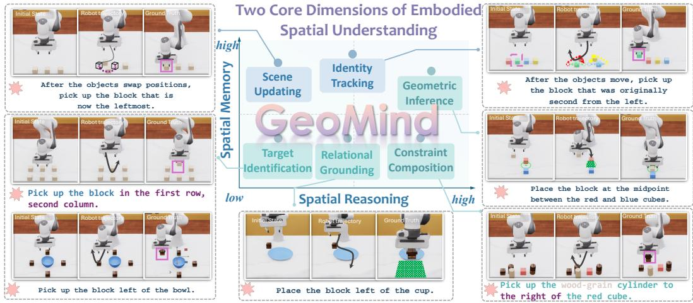  
Figure 1: Overview of GEOMIND. GEOMIND organizes structured spatial understanding along two diagnostic dimensions: spatial memory and spatial reasoning. The six task families cover different combinations of these dimensions. Surrounding examples illustrate how GEOMIND couples spatial instructions with structured object layouts and scene changes. The instructions are illustrative; evaluated actions and success criteria are specified in Appendix D.

To enable a more targeted assessment of spatial understanding, we focus on two key dimensions, spatial reasoning and spatial memory, drawing on the cognitive distinction between reasoning about space and maintaining spatial information over time [25]. Spatial reasoning concerns identifying target objects and inferring goal locations or regions from spatial relationships and structured layouts, while spatial memory concerns tracking object identities and updating spatial states as scenes change. These dimensions specify the spatial capabilities that each task is designed to assess.

We introduce GEOMIND, a benchmark for systematically evaluating spatial understanding through tabletop robotic manipulation. It comprises six task families: (1) target identification, (2) relational grounding, (3) constraint composition, and (4) geometric inference for spatial reasoning, and (5) scene updating and (6) identity tracking for spatial memory. Together, these families span 54 evaluated task variants: 20 Base, 7 Semantic, 7 Visual, and 20 Execution variants. Tasks are designed around structured object layouts and controlled scene changes, with explicit spatial rules for determining target objects or goal locations. Many base tasks feature visually identical or near-identical objects to reduce reliance on appearance cues. To enable reliable evaluation of these diverse spatial objectives, we develop an agent-assisted pipeline that translates spatial constraints into executable grounding code, computes ground-truth spatial targets, and verifies the resulting task instances through simulation.

We evaluate generalist and spatially enhanced visuomotor policies alongside modular planning methods on GEOMIND under a unified evaluation protocol. GEOMIND combines a base task suite (GEOMIND-BASE) with controlled semantic, visual, and execution augmentations (GEOMIND-AUG) to probe robustness. Beyond task success rates, we use diagnostic spatial metrics and comparisons with an oracle policy to examine spatial grounding and execution behavior. Our results show that current methods can solve some basic grounding tasks but struggle to reason about structured spatial relationships and track spatial states across scene changes. Performance is sensitive to semantic augmentations, while visual and execution perturbations have more model-dependent effects.

The main contributions of this work are threefold: (1) A systematic benchmark for structured spatial understanding. We introduce GEOMIND, which organizes spatial understanding into six task families and provides controlled base and augmented evaluations. (2) An agent-assisted spatial grounding and verification pipeline. We develop a pipeline that translates spatial constraints into executable grounding programs, derives ground-truth targets, and verifies task instances through simulation. (3) A comprehensive diagnostic evaluation. We evaluate generalist and spatially enhanced policies alongside modular planning methods using diagnostic spatial metrics and oracle comparisons, revealing limitations in spatial reasoning, memory, and robustness.

Table 1: Comparison of spatial capabilities and benchmark design. ✓: explicitly evaluated; ✗: no explicit evaluation identified in the reviewed protocol.
<table><tr><td>Benchmark</td><td>Design</td><td colspan="2">Spatial Memory</td><td colspan="4">Spatial Reasoning</td><td>Evaluation</td></tr><tr><td></td><td>Structure Generation</td><td>Scene Updating</td><td>Identity Tracking</td><td>Target Identification</td><td>Relational Grounding</td><td>Constraint Composition</td><td>Geometric Inference</td><td>Diagnostic Metrics</td></tr><tr><td>VIMA [23]</td><td></td><td></td><td></td><td></td><td></td><td></td><td></td><td></td></tr><tr><td>GENMANIP [30]</td><td></td><td>X</td><td>X</td><td>×××</td><td></td><td>x</td><td></td><td>×××√</td></tr><tr><td>RoboMME [32]</td><td></td><td></td><td></td><td></td><td>×</td><td>√</td><td></td><td></td></tr><tr><td>MEMOBench [33]</td><td></td><td></td><td>X</td><td></td><td></td><td>x</td><td></td><td></td></tr><tr><td>RoboSPA [34]</td><td></td><td>X</td><td></td><td>√</td><td></td><td></td><td></td><td>×</td></tr><tr><td>BEHAVIOR-Spatial [35]</td><td>X</td><td>X</td><td>X</td><td></td><td></td><td></td><td>×××××××</td><td></td></tr><tr><td>VABench [36]</td><td></td><td></td><td>X</td><td>X</td><td></td><td>x</td><td></td><td></td></tr><tr><td>GEOMIND</td><td></td><td></td><td></td><td></td><td></td><td></td><td></td><td></td></tr></table>

## 2 Related Work

General Embodied Manipulation Benchmarks. Prior embodied manipulation benchmarks have progressively advanced standardized evaluation of language-conditioned manipulation, long-horizon control, and generalization across diverse tasks and environments [18–20, 22, 24, 26–29]. VIMA includes history-dependent rearrangement and visual constraint satisfaction [23], while GENMANIP uses task-oriented scene graphs for constrained scene construction [30]. These benchmarks already cover several spatial requirements considered here; aggregate task success alone, however, does not distinguish spatial goal grounding errors from execution failures. More specialized benchmarks investigate memory-dependent manipulation. RMBench [31] evaluates tasks with varying memory complexity, while RoboMME [32] examines temporal, spatial, object, and procedural memory. MEMOBench [33] further introduces process-level evaluations of memory storage, updating, and compression. Together, these benchmarks examine both memory demands and the processes underly ing memory-dependent manipulation. GEOMIND complements them by systematically assessing spatial reasoning and spatial memory through capability-specific manipulation tasks defined by explicit spatial constraints and controlled scene changes. Table 1 compares selected task requirements and evaluation designs. A checkmark denotes an explicitly targeted task or evaluation subset with reported results; a cross denotes that no explicit evaluation was identified in the reviewed protocol, not that the capability is absent.

Benchmarks for Spatial Understanding. Spatial understanding benchmarks span static image-based evaluations and interactive embodied settings [25, 37–41]. VSR [42] evaluates spatial relations in image–text pairs, while other benchmarks examine orientation, navigation, mental rotation, localization, and video recall [43–48]. ESI-Bench [49] emphasizes active information acquisition for spatial reasoning, while SpaMEM [50] probes spatial state updating and long-horizon belief maintenance through action-conditioned observation sequences. RoboSPA [34] evaluates spatial reference resolu tion, compositional spatial selection, and procedural-memory tasks, and reports object-normalized success and progress measures. BEHAVIOR-Spatial [35] evaluates spatial instruction following through question answering, target grounding, and robot execution, while VABench [36] combines visual demonstrations, active perception, metric control, and trajectory-level diagnostics. GEOMIND complements these benchmarks by organizing explicit geometric goal construction, current-state re-grounding, and historical identity binding within a shared, controllable tabletop protocol. Structurepreserving sampling, deterministic spatial targets, controlled scene changes, and matched task variants support targeted comparisons across these requirements; scene updating need not imply dependence on unobserved history.

Spatial Capabilities of Embodied Policies. Current embodied agents increasingly rely on visionlanguage models for language-guided manipulation [3, 4, 51–53], yet complex spatial instructions remain challenging. Recent approaches therefore incorporate more explicit spatial representations and grounding mechanisms. RoboSpatial [54] provides large-scale spatial annotations for training vision-language models, while InternVLA-M1 [16] combines spatial grounding pretraining with spatially guided action learning to connect where to act with how to act. Other approaches introduce 3D spatial representations to improve the alignment of visual, linguistic, and geometric information for action generation [15, 37, 55, 56]. While these methods aim to improve spatial capabilities, GEOMIND provides a benchmark for systematically examining their strengths and limitations.

## 3 GEOMIND

We present the overall design of GEOMIND by turning structured spatial understanding into a controllable benchmark construction problem. Sec. 3.1 introduces the GEOMIND taxonomy, and Sec. 3.2 describes spatial structure modeling and the benchmark construction pipeline. Sec. 3.3 presents the task suites, showing how executable benchmark episodes are organized into GEOMIND-BASE and GEOMIND-AUG.

## 3.1 Taxonomy of Embodied Spatial Understanding Tasks

Rather than categorizing tasks solely by manipulation actions, we organize them according to the spatial capabilities required to determine task-relevant targets and goals. Following the dimensions introduced above, the taxonomy organizes structured spatial understanding around spatial reasoning and spatial memory. The former concerns how agents infer targets or goals from spatial relations and scene structure, while the latter concerns how agents maintain and update task-relevant spatia information as scenes change.

• Target Identification focuses on static object selection from structured layouts. The agent resolves a spatial description to the correct target object in a fixed scene.

• Relational Grounding requires the agent to realize an explicit spatial relation through action, such as placing one object beside, in front of, or inside another reference object.

• Constraint Composition tests whether the agent can jointly satisfy multiple spatial constraints that define a target object or a valid goal region.

• Geometric Inference requires the agent to infer implicit target locations or regions from scene geometry, such as alignment, symmetry, or pattern continuation across objects.

• Scene Updating evaluates whether the agent can update task-relevant spatial relations and re-ground its target after objects have moved or been manipulated.

• Identity Tracking requires the agent to maintain object identity over time by linking a previously identified object to its current state across scene changes, such as object rearrangement or position exchanges.

Fig. 1 qualitatively illustrates the spatial reasoning and memory demands of the six task familie and presents representative examples with initial scenes, robot trajectories, and ground-truth spatial targets. The high/low positions in Fig. 1 indicate intended capability demands. These tasks remain close to common robotic behaviors, such as selecting, placing, and retrieving objects, while exposing the spatial reasoning and memory demands behind seemingly simple actions.

## 3.2 Spatial Structure Modeling and Benchmark Construction

GEOMIND constructs benchmark episodes through spatial structure modeling and an agent-assisted, rule-verified pipeline. Spatial structures allow object configurations to vary while preserving task-relevant constraints. The pipeline combines task template generation, executable spatial grounding, and simulation-based verification to produce structured manipulation tasks with deterministic ground-truth targets (Fig. 3).

Spatial Structure Modeling. To evaluate spatial understanding across different scene configurations, GEOMIND represents object layouts using spatial structures that are not tied to a fixed set of coordinates. For example, objects arranged in a line can preserve their left-to-right order while varying in position and spacing.

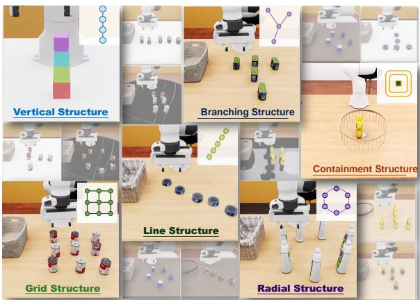  
Figure 2: Visualization of the six fundamental structural layouts and their derived variants.

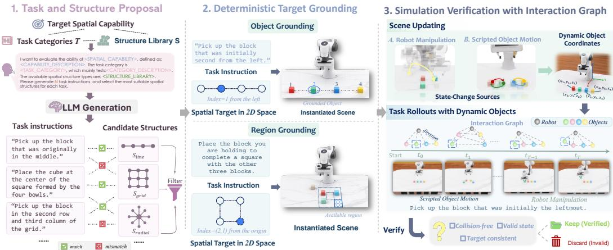  
Figure 3: Overview of the benchmark construction pipeline. The pipeline first proposes task descriptions and structure templates, then resolves spatial queries over instantiated scenes to derive ground-truth annotations, and finally validates candidate episodes through interaction-graph-based simulation verification.

A task such as selecting the second object from the left therefore follows the same spatial rule across different layouts. We formalize a spatial structure S as a set of relational, topological, and geometric constraints over objects. Given S, GEOMIND generates diverse scene configurations by sampling object poses X from a structure-preserving distribution:

$$
\mathbf { X } \sim { \mathcal { P } } ( \mathbf { X } \mid S , \epsilon ) ,
$$

where ϵ controls allowable geometric variations, such as positional jitter and variable spacing, without violating the constraints encoded in S. The structure library $\bar { S } = \bar { \{ S _ { \mathrm { l i n e } } , S _ { \mathrm { g r i d } } , . . . \} }$ includes linear, grid, and other canonical layouts (Fig. 2). Sampled configurations must satisfy structural validity and collision-free workspace constraints. This representation supports controlled evaluation across variations in object positions and spacing. Formal definitions are provided in Appendix C.

LLM-Assisted Task and Structure Proposal. Given a task category and a candidate set of spatial structure types, the LLM proposes matching instructions and structure templates within a predefined schema. Each template specifies the structure type, object roles, layout constraints, sampling ranges, and optional scene-update rules. Candidate templates are screened to remove ambiguous, logically conflicting, or task-incompatible specifications, with human review during template selection. The retained templates form a fixed library for subsequent programmatic scene instantiation. The benchmark uses a fixed set of tasks selected through human review, with task instances generated programmatically from the corresponding templates.

Spatial Target Grounding. An LLM-based coding agent translates spatial rules into programs that deterministically resolve target objects or goal regions from simulator states. Directional predicates use the canonical front-camera frame, with object coordinates transformed from the robot base frame. Reasoning tasks ground targets in the current configuration. In memory tasks, instructions precede scripted object motion, and evaluated actions begin after it ends: Scene Updating re-grounds targets in the updated scene, while Identity Tracking preserves their initial identities. Each agent can store earlier observations or maintain an internal memory to identify the target after the objects move.

Closed-Loop Verification. Each candidate episode is executed in a physics simulator to check physical feasibility and target consistency. For tasks involving scene changes, objects move through scripted motion or simulated robot manipulation. Throughout execution, we record simulator object states and construct a dynamic interaction graph $G _ { t } = ( V , E _ { t } )$ , where nodes represent objects and edges encode discretized pairwise directions and distances. The graph sequence is used to check whether scene transitions and resulting spatial states are consistent with the task specifications and ground-truth targets. Episodes failing state-validity or target-consistency checks are discarded.

## 3.3 Task Suites and Dataset

GEOMIND is organized into two complementary evaluation suites: GEOMIND-BASE and GEOMIND-AUG. Together, they provide 54 evaluated task variants for structured spatial understanding. A task variant is a specific test setting that pairs a spatial objective with a scene structure, governed by specific grounding rules and evaluation conditions. GEOMIND-BASE evaluates the six spatial task families under canonical tabletop settings, while GEOMIND-AUG introduces controlled perturbations to assess robustness under additional semantic, visual, and execution challenges.

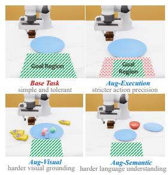  
(a) Task display.

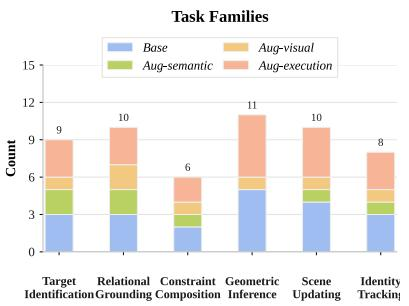  
(b) Overview of GEOMIND task suites.

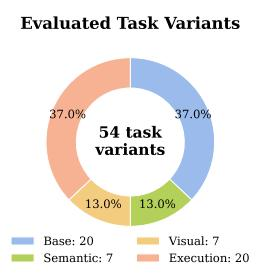  
Figure 4: Detailed information about GEOMIND task suites. (a) shows how GEOMIND-AUG is constructed from GEOMIND-BASE. (b) shows the distribution of evaluated variants across task families and augmentation types (20 Base, 7 Semantic, 7 Visual, and 20 Execution).

GEOMIND-BASE consists of 20 evaluated base variants with diverse language instructions and multiple spatial structure types. To reduce visual shortcuts, many GEOMIND-BASE variants contain multiple visually identical or near-identical objects. In these settings, target selection or placement depends on spatial cues such as relative position, order, geometric relations, or scene updates, rather than object appearance alone. GEOMIND-BASE serves as the core benchmark suite and evaluates the spatial reasoning and memory capabilities defined in our taxonomy. Fig. 4b presents the distribution of evaluated task variants across task families and augmentation types.

GEOMIND-AUG contains 34 augmented variants: 7 Semantic, 7 Visual, and 20 Execution variants. Semantic augmentation modifies language grounding, visual augmentation modifies visual conditions, and execution augmentation tightens action precision requirements. Together with the 20 Base variants, these form 54 evaluated variants. These counts refer to evaluated task variants rather than unique spatial objectives or evaluation episodes. Examples and task details appear in Fig. 4a and Appendix D.

## 4 Experiments

In this section, we systematically evaluate representative embodied agents on the GEOMIND benchmark under a controlled setting. We first describe the experimental setup and the selected embodied agents. Then, we present the evaluation results, analyzing their implications for spatial understanding.

## 4.1 Experimental Setup

Benchmarked Embodied Agents. We evaluate representative embodied agents across GEOMIND-BASE and GEOMIND-AUG, covering three paradigms: general policies, spatially enhanced policies, and modular agents. These methods differ in whether spatial grounding, planning, and execution are handled implicitly by an end-to-end policy or explicitly by separate modules. Specifically, we evaluate OpenVLA [3], π0 [4], and π0.5 [5] as general policies; SpatialVLA [15], InternVLA-M1 [16], and Spatial-Forcing [56] as spatially enhanced policies; and COPA [57] and MOKA [58] as modular agents. We additionally include an oracle baseline that uses simulator states and deterministic spatial grounding to compute ground-truth targets, which guide a scripted controller. The oracle provides a reference for assessing task feasibility under correct target information.

Evaluation Protocol. All experiments are conducted in the IsaacLab [59] simulator using a Franka Research 3 (FR3) robotic arm. All methods are evaluated on the same task instances, random seeds, episode horizons, and success criteria. The evaluated VLA policies use fixed checkpoints without GEOMIND-specific fine-tuning, and their outputs are adapted to a common action interface. Privileged scene information, including simulator-resolved object identities and ground-truth target coordinates, is used for evaluation and the oracle baseline but is not provided to the evaluated VLA policies or modular agents during inference. Each episode is limited to 1000 control steps and terminates early upon task success or workspace violation. We evaluate $N _ { \mathrm { e p } } = 4 8$ episodes per task variant, with evaluation seeds saved for reproducibility. The physics simulation runs at 480 Hz, and the policy control frequency is 24 Hz. Detailed observation and action interfaces, deployment configurations, and evaluation protocols are provided in Appendix B.

Table 2: Success rates (%) of different paradigms of embodied agents on GEOMIND-BASE. Excluding the oracle, best and second-best overall results are highlighted with green shades, while best and second-best family-level results are highlighted with purple shades.
<table><tr><td rowspan="2" colspan="2">Embodied Agents</td><td colspan="4">Spatial Reasoning</td><td colspan="2">Spatial Memory</td><td rowspan="2">AVG</td></tr><tr><td>Target Iden.</td><td>Relational Grounding</td><td>Constraint Comp.</td><td>Geometric Inference</td><td>Scene Updating</td><td>Identity Tracking</td></tr><tr><td colspan="2">Oracle</td><td>100.0</td><td>98.0</td><td>100.0</td><td>100.0</td><td>98.0</td><td>100.0</td><td>99.3</td></tr><tr><td rowspan="4">General Policies Spatially</td><td>OpenVLA</td><td>37.5</td><td>0.0</td><td>6.2</td><td>5.0</td><td>41.7</td><td>37.5</td><td>20.7</td></tr><tr><td> $\pi _ { 0 }$ </td><td>4.2</td><td>0.0</td><td>0.0</td><td>25.0</td><td>6.3</td><td>20.9</td><td>11.3</td></tr><tr><td>π0.5</td><td>4.2</td><td>0.0</td><td>0.0</td><td>27.5</td><td>6.3</td><td>25.0</td><td>12.5</td></tr><tr><td>SpatialVLA</td><td>12.5</td><td>0.0</td><td>0.0</td><td>17.5</td><td>45.8</td><td>8.3</td><td>18.3</td></tr><tr><td rowspan="3">Enhanced Policies</td><td>InternVLA-M1</td><td>42.5</td><td>50.0</td><td>6.2</td><td>12.0</td><td>16.7</td><td>20.8</td><td>26.4</td></tr><tr><td>Spatial-Forcing</td><td>12.5</td><td>0.0</td><td>50.0</td><td>5.0</td><td>33.3</td><td>37.5</td><td>24.0</td></tr><tr><td>GPT-40</td><td>22.9</td><td>11.1</td><td>16.7</td><td>4.2</td><td>9.7</td><td>13.9</td><td>11.1</td></tr><tr><td rowspan="5">Modular Methods</td><td>COPA Gemini-2.5-Flash</td><td>10.4</td><td>2.8</td><td>6.3</td><td>1.7</td><td>6.9</td><td>0.8</td><td>4.6</td></tr><tr><td>Claude-Sonnet-4.6</td><td>20.8</td><td>13.9</td><td>16.7</td><td>13.3</td><td>16.0</td><td>19.4</td><td>15.9</td></tr><tr><td>GPT-40</td><td>18.8</td><td>12.5</td><td>18.8</td><td>1.7</td><td>8.3</td><td>13.9</td><td>10.1</td></tr><tr><td>MOKA Gemini-2.5-Flash</td><td>8.3</td><td>1.4</td><td>4.2</td><td>0.8</td><td>7.6</td><td>1.4</td><td>4.0</td></tr><tr><td>Claude-Sonnet-4.6</td><td>18.8</td><td>13.9</td><td>16.7</td><td>13.3</td><td>18.6</td><td>20.8</td><td>16.9</td></tr></table>

Evaluation Metrics. We evaluate task completion using Task Success Rate (SR), the proportion of episodes satisfying task-specific success conditions, reported overall, by task family, and by augmentation type. Robustness is measured by $\Delta _ { \mathrm { A u g } } = \mathrm { S R } _ { \mathrm { A u g } } - \mathrm { S R } _ { \mathrm { r e f } }$ in percentage points; negative values indicate degradation. The reference is the matched base task for semantic and visual variants, and the corresponding non-execution variant for execution variants. Spatial Goal Error (SGE) measures final spatial deviation, while Target Tracking Error (TTE) measures average end-effector distance to the target:

$$
\mathrm { S G E } _ { i } = d _ { i } \left( \mathbf { s } _ { i } ^ { \mathrm { f i n a l } } , \mathbf { s } _ { i } ^ { \mathrm { g o a l } } \right) , \qquad \mathrm { T T E } _ { i } = \frac { 1 } { T _ { i } } \sum _ { t = 1 } ^ { T _ { i } } \left. \mathbf { p } _ { i , t } ^ { \mathrm { e e f } } - \mathbf { p } _ { i , t } ^ { \mathrm { t a r } } \right. _ { 2 } .
$$

Here, i indexes episodes, $d _ { i }$ is the evaluator’s goal-distance function, $T _ { i }$ is the episode length, and $\mathbf { p } ^ { \mathrm { e e f } }$ and $\mathbf { p } ^ { \mathrm { t a r } }$ denote end-effector and target positions. SGE is aggregated only over valid goal-distance values. TTE uses recorded target trajectories when available, otherwise the initial target position as a marked static-layout proxy. Lower values indicate smaller errors. Applicability and aggregation details are provided in Appendix A.

## 4.2 Main Results

We organize the results around five questions concerning overall performance, robustness, failure modes, spatial memory, and spatial reasoning.

## Q1. How well do embodied agents perform in structured spatial understanding?

We begin with GEOMIND-BASE, which evaluates six spatial capabilities under standard task conditions without the additional perturbations introduced in GEOMIND-AUG. Table 2 reports the success rates of different agents across the six task families. The best-performing learned policy, InternVLA-M1, achieves 26.4% success, followed by Spatial-Forcing at 24.0%, substantially below the oracle’s 99.3%. Spatially enhanced policies achieve the highest overall scores, although their improvements over general policies are uneven across models and task families. Modular agents achieve 4.0–16.9% success, indicating that explicit VLM-based grounding and scripted execution also struggle with structured spatial tasks.

To better understand these performance gaps, we examine the contributions of target grounding and execution. The oracle achieves near-perfect success using ground-truth targets and scripted control, demonstrating the feasibility of the benchmark tasks under correct spatial grounding. More directly, in a paired diagnostic evaluation of $\pi _ { 0 . 5 } .$ , explicitly specifying the target through its name and a visual cue improves success from 11.3% to 39.2%, while keeping the policy, task instances, action interface, and success criterion fixed. This result provides evidence that target identification contributes substantially to the observed failures, although execution and deployment limitations may also play a role.

Finding: Current embodied agents remain far from reliable on structured spatial manipulation tasks. The controlled target-cue intervention suggests that inaccurate spatial target grounding is an important contributor to thesefailures, beyond execution limitations alone.

Q2. How robust is structured spatial understanding under semantic, visual, and execution perturbations?

Table 3 shows that success in GEOMIND-BASE is fragile under augmented variants of the same spatial goals. The clearest drop comes from semantic augmentation: averaged over the six embodied policies, success decreases from about 22.6% on the corresponding Base tasks to about 14.2%, and every policy degrades. This indicates that many Base successes still rely on simple instruction grounding rather than robust spatial-language understanding. The effects of visual and execution augmentation are more uneven. OpenVLA falls to 12.5% under both settings, whereas $\pi _ { 0 }$ remains unchanged under visual perturbation and decreases by 6.5 percentage points under execution. These results suggest that structured spatial understanding degrades under complex instruction semantics and increased visual noise.

Finding: Spatial success in embodied agents is condition-dependent rather than goal-invariant: the same spatial objective often fails once its linguistic, visual, or execution support is perturbed.

Table 3: Success rates (%) on GEOMIND-AUG and the reported base references. Parentheses show changes in percentage points.
<table><tr><td>Policies</td><td>Corresponding Base</td><td>Semantic</td><td>Visual</td><td>Execution</td></tr><tr><td>OpenVLA</td><td>25.0</td><td>16.6(-8.4)</td><td>12.5(−12.5)</td><td>12.5(-12.5)</td></tr><tr><td>π0</td><td>16.7</td><td>12.5(−4.2)</td><td>16.7(+0.0)</td><td>10.2(−6.5)</td></tr><tr><td>π0.5</td><td>18.5</td><td>12.5(−6.0)</td><td>16.7(−1.8)</td><td>10.2(−8.3)</td></tr><tr><td>SpatialVLA</td><td>18.8</td><td>8.3(-10.5)</td><td>12.5(-6.3)</td><td>12.5(−6.3)</td></tr><tr><td>InternVLA-M1</td><td>37.5</td><td>27.1(−10.4)</td><td>37.5(+0.0)</td><td>35.4(-2.1)</td></tr><tr><td>Spatial-Forcing</td><td>18.8</td><td>8.3(-10.5)</td><td>12.5(–6.3)</td><td>16.7(−2.1)</td></tr></table>

## Q3. Why do embodied agents fail on GEOMIND?

We examine representative failure cases in Fig. 5 to connect the quantitative trends with concrete trajectories. For embodied policies in Fig. 5a, the illustrated failures fall into three categories: spatial relation grounding errors, where policies bind the correct anchor but execute the wrong relation; spatial relation reasoning errors, where policies fail to infer structure-defined targets; and sceneupdating errors, where policies fail to ground the requested target in the updated configuration. These examples suggest that some failures involve converting spatial observations into appropriate action targets, although the trajectories alone do not isolate grounding errors from control errors. For modular embodied agents in Fig. 5b, the illustrated failures include object localization errors that can propagate to planning and control. This suggests a different bottleneck: modular agents may expose explicit reasoning steps, but remain vulnerable when intermediate spatial grounding is inaccurate.

Finding: The illustrated failures suggest difficulties in translating spatial observations into correct action targets. These examples identify possible failure mechanisms, but do not establish their prevalence across the benchmark.

## Q4. What makes spatial memory difficult for embodied agents?

Tables 2 and 4 show that agents struggle with tasks involving scene changes. Scene Updating requires selecting a target from the updated configuration, whereas Identity Tracking requires linking an object identified before the change to its new position. An agent may therefore fail an identity-tracking task by selecting an object that matches the current spatial relation but is not the original target. This provides a possible explanation for failures beyond imprecise execution. However, aggregate SGE and TTE cannot distinguish these causes: both are affected by scene geometry, initial target distance, and rollout duration. We use them as auxiliary diagnostics rather than direct measures of identity preservation or evidence that one task family is intrinsically harder.

Table 4: Family-level failure rates and auxiliary spatial errors. Lower values are better.
<table><tr><td>Capability Dimensions</td><td>Task Family</td><td>Failure Rate ↓</td><td>SGE (m) ↓</td><td>TTE (m) ↓</td></tr><tr><td rowspan="2">Spatial Memory</td><td>Scene Updating</td><td>68.89%</td><td>0.189</td><td>0.330</td></tr><tr><td>Identity Tracking</td><td>85.00%</td><td>0.192</td><td>0.486</td></tr><tr><td rowspan="4">Spatial Reasoning</td><td>Target Identification</td><td>72.08%</td><td>0.116</td><td>0.811</td></tr><tr><td>Relational Grounding</td><td>98.33%</td><td>0.180</td><td>0.672</td></tr><tr><td>Constraint Composition</td><td>87.50%</td><td>0.142</td><td>0.627</td></tr><tr><td>Geometric Inference</td><td>86.67%</td><td>0.158</td><td>0.727</td></tr></table>

Finding: Identity Tracking requires preserving object correspondence across scene changes; the current aggregate results do not establish how muchfailure is attributable to incorrect target selection versus execution.

## Q5. What makes spatial reasoning difficult for embodied agents?

Table 4 reports the highest failure rate for relational grounding among the reasoning families in that diagnostic summary, at 98.33%, compared with 72.08% for target identification. Constraint composition and geometric inference are also difficult, with failure rates of 87.50% and 86.67%, respectively. This indicates that current agents do not only struggle with recognizing spatial targets; they also fail to convert explicit spatial relations into correct embodied actions. Table 2 shows that geometric inference has the lowest best-agent success rate, with the strongest method reaching only 27.5%, suggesting that implicit structure-based reasoning remains hard even for the best agents. Together, these results suggest that agents remain weak when they must jointly satisfy multiple spatial constraints or infer targets from implicit geometric structure.

Finding: Spatial reasoning is difficult not only because agents struggle to identify the correct spatial target, but because theyfail to transform spatial constraints into executable manipulation behavior.

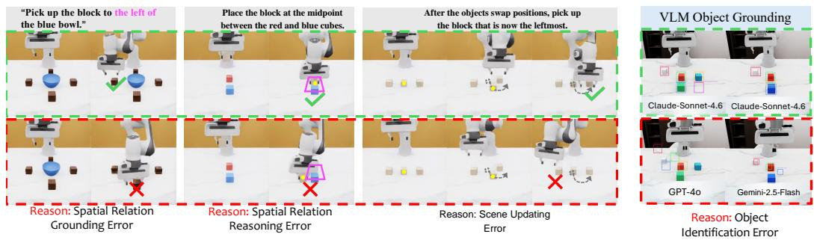  
(a) Embodied policies.  
Figure 5: Visualization of typical failure cases in GEOMIND.  
(b) Modular agents.

## 5 Conclusion

We present GEOMIND, a systematic benchmark for evaluating spatial understanding in embodied agents. By organizing tasks around spatial memory and spatial reasoning, GEOMIND enables a more fine-grained analysis than overall task success alone. We further emphasize how spatial structure underpins spatial understanding, and present an automated generation pipeline that allows scalable benchmark construction. Our experiments show that current embodied agents remain far from achieving consistently high success rates on GEOMIND, with large performance gaps and highly uneven abilities across task families. These findings suggest that spatial understanding remains a core limitation of embodied agents.

Limitations. GEOMIND is limited to simulated, single-arm tabletop manipulation, without realrobot validation. Its controlled layouts do not capture the full diversity of real-world environments. Heavy occlusion, viewpoint changes, sensor noise, and complex contact dynamics are not systematically evaluated, although incidental occlusion may occur during execution. Semantic and visual augmentations cover selected transformations rather than exhaustive robustness conditions. Our experiments evaluate frozen pretrained policies, and their performance may also depend on observation and action-interface compatibility. We do not report benchmark-specific fine-tuning results; learning spatial skills and generalizing to held-out structures or variants remain untested. The results therefore characterize frozen-policy performance in the evaluated setting and do not establish transfer to real robots.

## Code and Data Availability

The benchmark code and data have not yet been publicly released. We plan to release the benchmark assets, evaluation code, configuration files, and reproduction instructions in the project repository: https://github.com/Notfound-JH/GEOMIND-benchmark.git.

## Acknowledgments and Disclosure of Funding

Funding Statement. This research received no specific grant from any funding agency in the public, commercial, or not-for-profit sectors.

Competing Interests. The authors declare no competing interests.

## References

[1] Agrim Gupta, Silvio Savarese, Surya Ganguli, and Li Fei-Fei. Embodied intelligence via learning and evolution. Nature communications, 12(1):5721, 2021.

[2] Generalist AI Team. GEN-0: Embodied foundation models that scale with physical interaction. Generalist AI Blog, 2025. https://generalistai.com/blog/preview-uqlxvb-bb.html.

[3] Moo Jin Kim, Karl Pertsch, Siddharth Karamcheti, Ted Xiao, Ashwin Balakrishna, Suraj Nair, Rafael Rafailov, Ethan Foster, Grace Lam, Pannag Sanketi, Quan Vuong, Thomas Kollar, Benjamin Burchfiel, Russ Tedrake, Dorsa Sadigh, Sergey Levine, Percy Liang, and Chelsea Finn. OpenVLA: An Open-Source Vision-Language-Action model, 2024.

[4] Kevin Black, Noah Brown, Danny Driess, Adnan Esmail, Michael Equi, Chelsea Finn, Niccolo Fusai, Lachy Groom, Karol Hausman, Brian Ichter, Szymon Jakubczak, Tim Jones, Liyiming Ke, Sergey Levine, Adrian Li-Bell, Mohith Mothukuri, Suraj Nair, Karl Pertsch, Lucy Xiaoyang Shi, James Tanner, Quan Vuong, Anna Walling, Haohuan Wang, and Ury Zhilinsky. Pi-0: A Vision-Language-Action flow model for general robot control, 2024.

[5] Kevin Black, Noah Brown, James Darpinian, Karan Dhabalia, Danny Driess, Adnan Esmail, Michael Robert Equi, Chelsea Finn, Niccolo Fusai, Manuel Y. Galliker, Dibya Ghosh, Lachy Groom, Karol Hausman, Brian Ichter, Szymon Jakubczak, Tim Jones, Liyiming Ke, Devin LeBlanc, Sergey Levine, Adrian Li-Bell, Mohith Mothukuri, Suraj Nair, Karl Pertsch, Allen Z. Ren, Lucy Xiaoyang Shi, Laura Smith, Jost Tobias Springenberg, Kyle Stachowicz, James Tanner, Quan Vuong, Homer Walke, Anna Walling, Haohuan Wang, Lili Yu, and Ury Zhilinsky. $\pi _ { 0 . 5 } \colon$ a Vision-Language-Action model with Open-World generalization. In 9th Annual Conference on Robot Learning, 2025.

[6] Qingwen Bu, Yanting Yang, Jisong Cai, Shenyuan Gao, Guanghui Ren, Maoqing Yao, Ping Luo, and Hongyang Li. UniVLA: Learning to act anywhere with task-centric latent actions, 2025.

[7] Songming Liu, Lingxuan Wu, Bangguo Li, Hengkai Tan, Huayu Chen, Zhengyi Wang, Ke Xu, Hang Su, and Jun Zhu. RDT-1B: a diffusion foundation model for bimanual manipulation, 2024.

[8] Brianna Zitkovich, Tianhe Yu, Sichun Xu, et al. RT-2: Vision-language-action models transfer web knowledge to robotic control. In Proceedings ofThe 7th Conference on Robot Learning, volume 229 of Proceedings ofMachine Learning Research, pages 2165–2183. PMLR, 2023.

[9] Seonghyeon Ye, Yunhao Ge, Kaiyuan Zheng, et al. World action models are zero-shot policies. arXiv preprint arXiv:2602.15922, 2026.

[10] Jiaming Zhou, Qihang Zhang, Gangwei Xu, et al. Zero-WAM: In-context world-action modeling from human videos for open-ended task generalization. arXiv preprint arXiv:2608.26103, 2026.

[11] Yuran Wang, Siqiao Huang, Mingleyang Li, et al. OpenWAM: An open, modular exploration towards systematic world-action model pretraining. arXiv preprint arXiv:2609.07398, 2026.

[12] Heng Yu, David D. Yuan, Juze Zhang, et al. OpenWAM: An open framework for composable world-action models. arXiv preprint arXiv:2610.07922, 2026.

[13] Runyu Lu, Yubo Wu, Ethan Kou, et al. ASPIRE: Agentic /skills discovery for robotics. arXiv preprint arXiv:2607.00272, 2026.

[14] Wenli Xiao, Jia Xie, Tonghe Zhang, et al. ENPIRE: Agentic robot policy self-improvement in the real world. arXiv preprint arXiv:2606.19980, 2026.

[15] Delin Qu, Haoming Song, Qizhi Chen, Yuanqi Yao, Xinyi Ye, Yan Ding, Zhigang Wang, JiaYuan Gu, Bin Zhao, Dong Wang, and Xuelong Li. SpatialVLA: Exploring spatial representations for Visual-Language-Action model, 2025.

[16] Xinyi Chen, Yilun Chen, Yanwei Fu, Ning Gao, Jiaya Jia, Weiyang Jin, Hao Li, Yao Mu, Jiangmiao Pang, Yu Qiao, et al. InternVLA-M1: A spatially guided vision-language-action framework for generalist robot policy. arXiv preprint arXiv:2510.13778, 2025.

[17] Zhengshen Zhang, Hao Li, Yalun Dai, Zhengbang Zhu, Lei Zhou, Chenchen Liu, Dong Wang, Francis E. H. Tay, Sijin Chen, Ziwei Liu, Yuxiao Liu, Xinghang Li, and Pan Zhou. From spatial to actions: Grounding Vision-Language-Action model in spatial foundation priors, 2025.

[18] Bo Liu, Yifeng Zhu, Chongkai Gao, Yihao Feng, Qiang Liu, Yuke Zhu, and Peter Stone. LIBERO: Benchmarking knowledge transfer for lifelong robot learning, 2023.

[19] Jiayuan Gu, Fanbo Xiang, Xuanlin Li, Zhan Ling, Xiqiang Liu, Tongzhou Mu, Yihe Tang, Stone Tao, Xinyue Wei, Yunchao Yao, Xiaodi Yuan, Pengwei Xie, Zhiao Huang, Rui Chen, and Hao Su. ManiSkill2: A unified benchmark for generalizable manipulation skills. In International Conference on Learning Representations, 2023.

[20] Stephen James, Zicong Ma, David Rovick Arrojo, and Andrew J Davison. RLBench: The robot learning benchmark & learning environment. IEEE Robotics and Automation Letters, 5(2):3019–3026, 2020.

[21] Shiduo Zhang, Zhe Xu, Peiju Liu, Xiaopeng Yu, Yuan Li, Qinghui Gao, Zhaoye Fei, Zhangyue Yin, Zuxuan Wu, Yu-Gang Jiang, and Xipeng Qiu. VLABench: A Large-Scale benchmark for Language-Conditioned robotics manipulation with Long-Horizon reasoning tasks, 2024.

[22] Tianhe Yu, Deirdre Quillen, Zhanpeng He, Ryan Julian, Karol Hausman, Chelsea Finn, and Sergey Levine. Meta-world: A benchmark and evaluation for multi-task and meta reinforcement learning. In Conference on robot learning, pages 1094–1100. PMLR, 2020.

[23] Yunfan Jiang, Agrim Gupta, Zichen Zhang, Guanzhi Wang, Yongqiang Dou, Yanjun Chen, Li Fei-Fei, Anima Anandkumar, Yuke Zhu, and Linxi Fan. VIMA: General robot manipulation with multimodal prompts. In Fortieth International Conference on Machine Learning, 2023.

[24] Tianxing Chen, Zanxin Chen, Baijun Chen, Zijian Cai, Yibin Liu, Zixuan Li, Qiwei Liang, Xianliang Lin, Yiheng Ge, Zhenyu Gu, et al. RoboTwin 2.0: A scalable data generator and benchmark with strong domain randomization for robust bimanual robotic manipulation. arXiv preprint arXiv:2506.18088, 2025.

[25] Jihan Yang, Shusheng Yang, Anjali Gupta, Rilyn Han, Li Fei-Fei, and Saining Xie. Thinking in Space: How Multimodal Large Language Models See, Remember and Recall Spaces. arXiv preprint arXiv:2412.14171, 2024.

[26] Oier Mees, Lukas Hermann, Erick Rosete-Beas, and Wolfram Burgard. CALVIN: A Benchmark for Language-Conditioned Policy Learning for Long-Horizon Robot Manipulation Tasks, July 2022. arXiv:2112.03227 [cs].

[27] Xuanlin Li, Kyle Hsu, Jiayuan Gu, Karl Pertsch, Oier Mees, Homer Rich Walke, Chuyuan Fu, Ishikaa Lunawat, Isabel Sieh, Sean Kirmani, et al. Evaluating real-world robot manipulation policies in simulation. arXiv preprint arXiv:2405.05941, 2024.

[28] Soroush Nasiriany, Abhiram Maddukuri, Lance Zhang, Adeet Parikh, Aaron Lo, Abhishek Joshi, Ajay Mandlekar, and Yuke Zhu. RoboCasa: Large-Scale simulation of everyday tasks for generalist robots. In Robotics: Science and Systems, 2024.

[29] Stone Tao, Fanbo Xiang, Arth Shukla, Yuzhe Qin, Xander Hinrichsen, Xiaodi Yuan, Chen Bao, Xinsong Lin, Yulin Liu, Tse-kai Chan, et al. ManiSkill3: GPU parallelized robotics simulation and rendering for generalizable embodied AI. arXiv preprint arXiv:2410.00425, 2024.

[30] Ning Gao, Yilun Chen, Shuai Yang, Xinyi Chen, Yang Tian, Hao Li, Haifeng Huang, Hanqing Wang, Tai Wang, and Jiangmiao Pang. GENMANIP: LLM-driven simulation for generalizable Instruction-Following manipulation. In Proceedings of the IEEE/CVF Conference on Computer Vision and Pattern Recognition (CVPR), pages 12187–12198, June 2025.

[31] Tianxing Chen, Yuran Wang, Mingleyang Li, Yan Qin, Hao Shi, Zixuan Li, Yifan Hu, Yingsheng Zhang, Kaixuan Wang, Yue Chen, et al. RMBench: Memory-Dependent robotic manipulation benchmark with insights into policy design. arXiv preprint arXiv:2603.01229, 2026.

[32] Yinpei Dai, Hongze Fu, Jayjun Lee, Yuejiang Liu, Haoran Zhang, Jianing Yang, Chelsea Finn, Nima Fazeli, and Joyce Chai. RoboMME: Benchmarking and understanding memory for robotic generalist policies. arXiv preprint arXiv:2603.04639, 2026.

[33] Haiyang Sun, Haoxiao Wang, Junming Chen, Weicheng Fang, Zihao Su, Jingkun Yi, Wenyou Yi, Hao Chen, and Zhou Zhao. MEMOBench: A process level memory benchmark for robotic manipulation. arXiv preprint arXiv:2609.07047, 2026.

[34] Zhenxuan Fan, Bo Zhang, Yutong Lin, Yuqian Yuan, Juekai Lin, Liang Liang, Zhuoyi Huang, Wenqiao Zhang, Juncheng Li, Siliang Tang, Jun Xiao, and Yueting Zhuang. RoboSPA: Can VLA models go beyond simple scenes and Short-Horizon tasks? In Proceedings of the 2026 Conference on Empirical Methods in Natural Language Processing, pages 23457–23492. Association for Computational Linguistics, 2026.

[35] Sirui Chen, Huang Huang, Qineng Wang, Wenlong Huang, Manling Li, Ruohan Zhang, Li Fei-Fei, and Jiajun Wu. BEHAVIOR-Spatial benchmark: Evaluating spatial understanding for robotics. arXiv preprint https://arxiv.org/abs/2610.34051, 2026.

[36] Zhongbo Zhang, Jiayi Jin, Yifan Wang, Zaibin Zhang, Haiwen Diao, Lijun Wang, and Huchuan Lu. VABench: Measuring embodied spatial intelligence through visual demonstrations, active perception, and metric control. arXiv preprint https://arxiv.org/abs/2609.19554, 2026.

[37] Enshen Zhou, Jingkun An, Cheng Chi, Yi Han, Shanyu Rong, Chi Zhang, Pengwei Wang, Zhongyuan Wang, Tiejun Huang, Lu Sheng, et al. RoboRefer: Towards spatial referring with reasoning in Vision-Language models for robotics. arXiv preprint arXiv:2506.04308, 2025.

[38] Yanpeng Zhao, Wentao Ding, Hongtao Li, Baoxiong Jia, and Zilong Zheng. ESPIRE: A diagnostic benchmark for embodied spatial reasoning of Vision-Language models. arXiv preprint arXiv:2603.13033, 2026.

[39] Julius Mayer, Mohamad Ballout, Serwan Jassim, Farbod Nosrat Nezami, and Elia Bruni. iVISPAR—an interactive Visual-Spatial reasoning benchmark for VLMs. In Proceedings ofthe 2025 Conference on Empirical Methods in Natural Language Processing, pages 26745–26769, 2025.

[40] Zekun Qi, Wenyao Zhang, Yufei Ding, Runpei Dong, Xinqiang Yu, Jingwen Li, Lingyun Xu, Baoyu Li, Xialin He, Guofan Fan, Jiazhao Zhang, Jiawei He, Jiayuan Gu, Xin Jin, Kaisheng Ma, Zhizheng Zhang, He Wang, and Li Yi. SoFar: Language-Grounded orientation bridges spatial reasoning and object manipulation, 2025.

[41] Kairun Wen, Yuzhi Huang, Runyu Chen, Hui Zheng, Yunlong Lin, Panwang Pan, Chenxin Li, Wenyan Cong, Jian Zhang, Junbin Lu, et al. DynamicVerse: A Physically-Aware multimodal framework for 4d world modeling. arXiv preprint arXiv:2512.03000, 2025.

[42] Fangyu Liu, Guy Emerson, and Nigel Collier. Visual spatial reasoning. Transactions of the Associationfor Computational Linguistics, 11:635–651, 06 2023.

[43] Yuzhi Huang, Kairun Wen, Rongxin Gao, Dongxuan Liu, Yibin Lou, Jie Wu, Jing Xu, Jian Zhang, Zheng Yang, Yunlong Lin, et al. Thinking in dynamics: How multimodal large language models perceive, track, and reason dynamics in physical 4d world. arXiv preprint arXiv:2603.12746, 2026.

[44] Ilias Stogiannidis, Steven McDonagh, and Sotirios A. Tsaftaris. Mind the gap: Benchmarking spatial reasoning in Vision-Language models, 2025.

[45] Dingming Li, Hongxing Li, Zixuan Wang, Yuchen Yan, Hang Zhang, Siqi Chen, Guiyang Hou, Shengpei Jiang, Wenqi Zhang, Yongliang Shen, Weiming Lu, and Yueting Zhuang. ViewSpatial-Bench: Evaluating multi-perspective spatial localization in Vision-Language models, 2025.

[46] Songsong Yu, Yuxin Chen, Hao Ju, Lianjie Jia, Fuxi Zhang, Shaofei Huang, Yuhan Wu, Rundi Cui, Binghao Ran, Zaibin Zhang, Zhedong Zheng, Zhipeng Zhang, Yifan Wang, Lin Song, Lijun Wang, Yanwei Li, Ying Shan, and Huchuan Lu. How far are VLMs from visual spatial intelligence? a Benchmark-Driven perspective. arXiv preprint arXiv:2509.18905, 2025.

[47] Yun Li, Yiming Zhang, Tao Lin, XiangRui Liu, Wenxiao Cai, Zheng Liu, and Bo Zhao. STI-Bench: Are mllms ready for precise spatial-temporal world understanding? arXiv preprint arXiv:2503.23765, 2025.

[48] Mengdi Jia, Zekun Qi, Shaochen Zhang, Wenyao Zhang, Xinqiang Yu, Jiawei He, He Wang, and Li Yi. OmniSpatial: Towards comprehensive spatial reasoning benchmark for vision language models. arXiv preprint arXiv:2506.03135, 2025.

[49] Yining Hong, Jiageng Liu, Han Yin, Manling Li, Leonidas Guibas, Li Fei-Fei, Jiajun Wu, and Yejin Choi. ESI-Bench: Towards embodied spatial intelligence that closes the Perception-Action loop. arXiv preprint https://arxiv.org/abs/2605.18746, 2026.

[50] Chih-Ting Liao, Xi Xiao, Chunlei Meng, Zhangquan Chen, Yitong Qiao, Weilin Zhou, Tianyang Wang, Xu Zheng, and Xin Cao. SpaMEM: Benchmarking dynamic spatial reasoning via Perception-Memory integration in embodied environments. arXiv preprint https://arxiv. org/abs/2604.22409, 2026.

[51] Johan Bjorck, Fernando Castañeda, Nikita Cherniadev, Xingye Da, Runyu Ding, Linxi Fan, Yu Fang, Dieter Fox, Fengyuan Hu, Spencer Huang, et al. GR00T n1: An open foundation model for generalist humanoid robots. arXiv preprint arXiv:2503.14734, 2025.

[52] Gemini Robotics Team, Saminda Abeyruwan, Joshua Ainslie, Jean-Baptiste Alayrac, Montserrat Gonzalez Arenas, Travis Armstrong, Ashwin Balakrishna, Robert Baruch, Maria Bauza, Michiel Blokzijl, et al. Gemini robotics: Bringing AI into the physical world. arXiv preprint arXiv:2503.20020, 2025.

[53] Chenghao Gu, Haolan Kang, Junchao Lin, Jinghe Wang, Duo Wu, Shuzhao Xie, Fanding Huang, Junchen Ge, Ziyang Gong, Letian Li, et al. IGen: Scalable data generation for robot learning from Open-World images. arXiv preprint arXiv:2512.01773, 2025.

[54] Chan Hee Song, Valts Blukis, Jonathan Tremblay, Stephen Tyree, Yu Su, and Stan Birchfield. RoboSpatial: Teaching spatial understanding to 2d and 3d vision-language models for robotics. In Proceedings of the Computer Vision and Pattern Recognition Conference, pages 15768– 15780, 2025.

[55] Ji Zhang, Shihan Wu, Xu Luo, Hao Wu, Lianli Gao, Heng Tao Shen, and Jingkuan Song. InSpire: Vision-Language-Action models with intrinsic spatial reasoning, 2025.

[56] Fuhao Li, Wenxuan Song, Han Zhao, Jingbo Wang, Pengxiang Ding, Donglin Wang, Long Zeng, and Haoang Li. Spatial forcing: Implicit spatial representation alignment for visionlanguage-action model. arXiv preprint arXiv:2510.12276, 2025.

[57] Haoxu Huang, Fanqi Lin, Yingdong Hu, Shengjie Wang, and Yang Gao. COPA: General robotic manipulation through spatial constraints of parts with foundation models. In 2024 IEEE/RSJ International Conference on Intelligent Robots and Systems (IROS), pages 9488–9495. IEEE, 2024.

[58] Fangchen Liu, Kuan Fang, Pieter Abbeel, and Sergey Levine. MOKA: Open-world robotic manipulation through mark-based visual prompting. arXiv preprint arXiv:2403.03174, 2024.

[59] Mayank Mittal, Pascal Roth, James Tigue, Antoine Richard, Octi Zhang, Peter Du, Antonio Serrano-Muñoz, Xinjie Yao, René Zurbrügg, Nikita Rudin, et al. Isaac Lab: A GPU-accelerated simulation framework for multi-modal robot learning. arXiv preprint arXiv:2511.04831, 2025.

## Appendix A Metrics Formulation

## A.1 Success Rate

We compute the overall and family success rates as

$$
\mathrm { S R } _ { \mathrm { A l l } } = \frac { 1 } { | \mathcal { T } | N _ { \mathrm { e p } } } \sum _ { \tau \in \mathcal { T } } \sum _ { i = 1 } ^ { N _ { \mathrm { e p } } } \mathbb { I } [ s _ { \tau , i } = 1 ] , \quad \mathrm { S R } _ { f } = \frac { 1 } { | \mathcal { T } _ { f } | N _ { \mathrm { e p } } } \sum _ { \tau \in \mathcal { T } _ { f } } \sum _ { i = 1 } ^ { N _ { \mathrm { e p } } } \mathbb { I } [ s _ { \tau , i } = 1 ] ,
$$

where $s _ { \tau , i }$ indicates whether episode i of task variant τ succeeds, $\tau$ denotes the set of evaluated task variants, and $\mathcal { T } _ { f }$ denotes the subset in family $f .$ Each variant has $N _ { \mathrm { e p } } = 4 8$ episodes. With equal episode counts per variant, this aggregation weights task variants equally rather than weighting task families equally.

## A.2 Spatial Goal Error

Spatial Goal Error (SGE) is an auxiliary diagnostic metric that measures the final distance between the achieved spatial state and the target spatial goal. It is designed to capture final spatial precision, rather than full task completion.

For the i-th episode, we define

$$
\begin{array} { r } { \mathrm { S G E } _ { i } = d _ { i } \left( \mathbf { s } _ { i } ^ { \mathrm { f i n a l } } , \mathbf { s } _ { i } ^ { \mathrm { g o a l } } \right) , } \end{array}\tag{1}
$$

where ${ \bf s } _ { i } ^ { \mathrm { f i n a l } }$ denotes the final achieved state and $\mathbf { s } _ { i } ^ { \mathrm { g o a l } }$ denotes the target spatial state, and $d _ { i }$ is the evaluator’s goal-distance function for episode i. For tasks with an explicit target position, this reduces to the Euclidean distance

$$
\begin{array} { r } { \mathrm { S G E } _ { i } = \left\| \mathbf { p } _ { i } ^ { \mathrm { f i n a l } } - \mathbf { p } _ { i } ^ { \mathrm { g o a l } } \right\| _ { 2 } . } \end{array}\tag{2}
$$

In our implementation, SGE is obtained from the evaluator-provided goal-distance proxy, such as evaluation.goal\_distance or distance\_m. If an episode does not provide a valid goal-distance value, its SGE is treated as missing and excluded from SGE aggregation. Therefore, whenever SGE is reported, we also record the number of valid SGE episodes.

For a model m and task family $f ,$ we aggregate SGE over valid episodes:

$$
\overline { { \mathrm { S G E } } } _ { m , f } = \frac { 1 } { | \mathcal { T } _ { m , f } ^ { \mathrm { S G E } } | } \sum _ { i \in \mathcal { T } _ { m , f } ^ { \mathrm { S G E } } } \mathrm { S G E } _ { i } ,\tag{3}
$$

where $\boldsymbol { \mathcal { T } } _ { m , f } ^ { \mathrm { S G E } }$ denotes the set of episodes with valid SGE values for model m and family $f .$

For a specified set M of evaluated models, we first compute the model-family average and then average over models:

$$
\overline { { \mathrm { S G E } } } _ { f } = \frac { 1 } { \vert \mathcal { M } \vert } \sum _ { m \in \mathcal { M } } \overline { { \mathrm { S G E } } } _ { m , f } .\tag{4}
$$

These averages are defined only for nonempty valid-episode sets. A model-family pair with no valid values has an undefined SGE and must not be treated as zero; the cross-model formula applies when each model in the specified set has a defined value. This weighting avoids giving models with more valid episodes more weight.

Interpretation. Lower SGE indicates better final spatial precision. However, SGE does not measure whether the agent followed the correct trajectory, selected the correct object throughout the rollout, or satisfied all spatial relations. It is therefore used only as an auxiliary diagnostic, not as a replacement for official task success.

## A.3 Target Tracking Error

Target Tracking Error (TTE) is an auxiliary trajectory-level diagnostic metric. While SGE measures final spatial error, TTE measures whether the end-effector remains close to the intended target throughout the rollout. It measures target proximity along the trajectory, but does not directly measure spatial memory or identity preservation.

For the i-th episode with trajectory length Ti, we define

$$
\mathrm { T T E } _ { i } = \frac { 1 } { T _ { i } } \sum _ { t = 1 } ^ { T _ { i } } \left. \mathbf { p } _ { i , t } ^ { \mathrm { e e f } } - \mathbf { p } _ { i , t } ^ { \mathrm { t a r } } \right. _ { 2 } ,\tag{5}
$$

where $\mathbf { p } _ { i , t } ^ { \mathrm { e e f } }$ is the end-effector position at timestep t, and $\mathbf { p } _ { i , t } ^ { \mathrm { t a r } }$ is the ground-truth target position at the same timestep.

When dynamic object poses are available in the trajectory trace, the target position is taken from the target object’s dynamic pose:

$$
\mathbf { p } _ { i , t } ^ { \mathrm { t a r } } = \mathbf { p } _ { i , t } ^ { \mathrm { o b j } } .\tag{6}
$$

When dynamic object poses are unavailable, we use the static target position from the sampled layout as a proxy:

$$
\mathbf { p } _ { i , t } ^ { \mathrm { t a r } } = \mathbf { p } _ { i , 0 } ^ { \mathrm { t a r } } .\tag{7}
$$

In this case, the metric is marked as a static-layout proxy.

For a model m and task family f, TTE is first computed at the episode level and then averaged over valid episodes:

$$
\overline { { \mathrm { T T E } } } _ { m , f } = \frac { 1 } { | \mathcal { T } _ { m , f } ^ { \mathrm { T T E } } | } \sum _ { i \in \mathcal { T } _ { m , f } ^ { \mathrm { T T E } } } \mathrm { T T E } _ { i } ,\tag{8}
$$

where $\mathcal { I } _ { m , f } ^ { \mathrm { T T E } }$ denotes the set of episodes with valid trajectory traces for model m and family f.

When reporting a family-level average across models, we compute

$$
\overline { { \mathrm { T T E } } } _ { f } = \frac { 1 } { \vert \mathcal { M } \vert } \sum _ { m \in \mathcal { M } } \overline { { \mathrm { T T E } } } _ { m , f } .\tag{9}
$$

The same nonempty-set requirement applies to TTE: a model-family pair without a valid trajectory has an undefined value, and the cross-model formula requires a defined value for each model in the specified set. This model-wise aggregation prevents a run with more episodes from dominating the reported value. We avoid pooling all timesteps across episodes directly, because such pooling would give longer trajectories larger weight.

Interpretation. Lower TTE means that the end-effector stays closer to the intended target over the trajectory. Unlike SGE, which only evaluates the final state, TTE captures trajectory-level target following. However, TTE still does not directly verify successful grasping, placement, or spatial-relation satisfaction, so it is used as an auxiliary diagnostic rather than an official success metric.

## Appendix B Detailed Experimental Setup

This section provides the implementation details needed to reproduce the GEOMIND evaluation. We focus on the experimental variables that directly affect validity and reproducibility: simulator and robot setup, control frequency, policy inputs, action conversion, rollout protocol, baseline deployment, and information access. Unless otherwise stated, all methods are evaluated on the same task instances, random seeds, workspace constraints, episode horizon, and success criteria.

## B.1 Simulation, Robot, and Control

All experiments are conducted in GEOMIND LAB, an IsaacLab-based benchmark package built on Isaac Sim. We use a single Franka Research 3 (FR3) arm equipped with the FR3 parallel-jaw gripper. The robot receives relative end-effector commands and is controlled by a differential inversekinematics controller. The gripper is controlled through finger joint-position commands and is exposed to policies as a binary open/close command.

The physics simulation runs at 480 Hz, while policies are queried at 24 Hz. Each policy action is therefore executed through the low-level controller over 20 physics substeps. An episode terminates when the task succeeds, the robot violates the workspace guard, or the maximum horizon is reached. Table 5 summarizes the main simulator and control settings.

Table 5: Simulation and control settings used for all evaluations.
<table><tr><td>Item</td><td>Setting</td></tr><tr><td>Simulator</td><td>Isaac Sim / IsaacLab</td></tr><tr><td>Benchmark package</td><td>GEOMIND LAB</td></tr><tr><td>Robot</td><td>Franka Research 3 (FR3)</td></tr><tr><td>Gripper</td><td>FR3 parallel-jaw gripper</td></tr><tr><td>Low-level controller</td><td>Differential inverse kinematics</td></tr><tr><td>Physics frequency</td><td>480 Hz</td></tr><tr><td>Policy control frequency</td><td>24 Hz</td></tr><tr><td>Episode horizon</td><td>1000 control steps</td></tr><tr><td>Termination</td><td>Success / workspace violation / horizon</td></tr><tr><td>Workspace guard  $( x , y , z )$ </td><td> $[ 0 . 1 5 , 0 . 7 5 ] \times [ - 0 . 4 5 , 0 . 4 5 ] \times [ 0 . 7 0 , 1 . 2 0 ] \mathrm { m }$ </td></tr></table>

Table 6: Observation and action interface. Privileged simulator states are excluded from VLA policy inputs.
<table><tr><td>Type</td><td>Field</td><td>Description</td></tr><tr><td rowspan="5">Policy input</td><td>Instruction</td><td>Natural-language task instruction</td></tr><tr><td>Table-view RGB</td><td>Static external camera observation,  $2 2 4 \times 2 2 4$ </td></tr><tr><td>Wrist RGB</td><td>Wrist-mounted camera observation,  $2 2 4 \times 2 2 4$ </td></tr><tr><td>Joint state</td><td>Robot joint positions and velocities</td></tr><tr><td>End-effector / gripper state</td><td>Current end-effector pose and gripper state</td></tr><tr><td rowspan="3">Policy action</td><td>Translation</td><td>Relative Cartesian displacement</td></tr><tr><td>Rotation</td><td>Relative rotation-vector command</td></tr><tr><td>Gripper</td><td>Binary open/close command</td></tr><tr><td rowspan="5"></td><td>Object poses</td><td>Used for success checking and diagnostics</td></tr><tr><td>Object identities</td><td>Used for ground-truth target resolution</td></tr><tr><td>Evaluation only Segmentation masks</td><td>Not exposed to VLA policies</td></tr><tr><td>Task metadata</td><td>Used only for evaluation and diagnostics</td></tr><tr><td>Target regions / coordinates</td><td>Not exposed to VLA policies</td></tr></table>

## B.2 Observation and Action Interface

All end-to-end VLA policies are evaluated through a common observation and action interface. The policy input contains the language instruction, two RGB camera observations, and robot proprioception. The two cameras consist of a static table-view camera and a wrist-mounted camera, both rendered at 224 × 224 resolution.

Importantly, privileged simulator information is not exposed to VLA policies. Object poses, object identities, segmentation masks, ground-truth task variables, oracle target coordinates, and task metadata are used only for evaluation. Table 6 summarizes the policy interface and the evaluationonly states.

The common action interface is a 7-DoF relative end-effector command,

$$
\mathbf { a } _ { t } = [ \Delta x , \Delta y , \Delta z , \Delta r _ { x } , \Delta r _ { y } , \Delta r _ { z } , g ] ,
$$

where the first three dimensions represent Cartesian displacement, the next three dimensions represent a relative rotation-vector command, and the final dimension controls the gripper. For policies whose native output format differs from this interface, we convert the output to the same 7-DoF command before execution.

We use a unified normalized action protocol. Each policy output is first converted to a 7-DoF action vector and clipped to $[ - 1 , 1 ]$ . The translational and rotational components are then scaled by a model-specific multiplier $s _ { m }$ . In the following equations, a denotes the converted, already clipped action vector. Slices use zero-based indexing with an exclusive upper bound: $a _ { 0 : 3 }$ contains the three translation components and $a _ { 3 : 6 }$ the three rotation components. The clip operator acts componentwise:

Table 7: Evaluation protocol for GEOMIND-BASE and GEOMIND-AUG.
<table><tr><td>Item</td><td>Setting</td></tr><tr><td>GEOMIND-BASE</td><td>20 variants, 48 episodes per variant, 960 episodes per method</td></tr><tr><td>GEOMIND-AUG</td><td>34 augmented variants, 48 episodes per variant, 1632 episodes per method</td></tr><tr><td>Task instances</td><td>Shared across methods</td></tr><tr><td>Random seeds</td><td>Shared across methods</td></tr><tr><td>Episode horizon</td><td>1000 control steps</td></tr><tr><td>Policy control frequency</td><td>24 Hz</td></tr><tr><td>Physics frequency</td><td>480 Hz</td></tr><tr><td>Camera resolution</td><td>224 × 224</td></tr><tr><td>Primary metric</td><td>Success rate</td></tr><tr><td>VLA adaptation</td><td>No GEOMIND-specific fine-tuning</td></tr></table>

$$
\begin{array} { r } { u _ { x y z } = \mathrm { c l i p } ( s _ { m } a _ { 0 : 3 } , - 1 , 1 ) , \qquad } \\ { \qquad \quad \mathrm { ~ i f ~ r o t a t i o n ~ i s ~ d i s a b l e d ~ f o r ~ t h e ~ m o d e l } , } \\ { u _ { r o t } = \left\{ \begin{array} { l l } { 0 , } & { \mathrm { ~ i f ~ r o t a t i o n ~ i s ~ d i s a b l e d ~ f o r ~ t h e ~ m o d e l } , } \\ { \mathrm { c l i p } ( 2 s _ { m } a _ { 3 : 6 } , - 1 , 1 ) , } & { \mathrm { ~ o t h e r w i s e } . } \end{array} \right. } \end{array}
$$

The controller converts these normalized components to physical increments using scales of 0.5 m for translation and 0.5 rad for rotation, yielding

$$
\Delta p = 0 . 5 u _ { x y z } \mathrm { m } , \qquad \Delta r = 0 . 5 u _ { r o t } \mathrm { r a d } .
$$

The gripper command is thresholded at zero: positive values are mapped to open and negative values are mapped to close. For baselines without reliable gripper outputs, we keep the gripper fixed according to their default deployment protocol and report this setting explicitly.

## B.3 Evaluation Protocol

We evaluate each method on the same task instances and random seeds. Each evaluated task variant contains 48 evaluation episodes. GEOMIND-BASE contains 20 variants, resulting in 960 episodes per method. GEOMIND-AUG contains 34 augmented variants (7 Semantic, 7 Visual, and 20 Execution), resulting in 1632 episodes per method, for 2592 episodes across both suites. Success rate is the primary metric and is computed over all episodes in the corresponding task suite or task family.

## B.4 VLA Baseline Deployment

All VLA baselines are evaluated as frozen policies without GEOMIND-specific fine-tuning. Each model is deployed as a remote policy server and queried online during rollout. For each model, we use a fixed checkpoint and server configuration across all evaluated episodes.

The policy server receives only the allowed policy inputs described in Table 6. No VLA baseline receives privileged simulator object poses, segmentation masks, ground-truth task variables, oracle target coordinates, or task metadata through the policy interface.

Some VLA models return action chunks rather than a single action. In our deployment, the client executes only the first valid action from the returned chunk and then queries the policy again at the next control step. This keeps all policies closed-loop at the shared 24 Hz control frequency while preserving each model’s native action-generation interface.

Different VLA models use different native action heads and deployment conventions. We therefore report the model-specific action multiplier, checkpoint setting, rotation setting, and gripper setting in Table 8. These settings are fixed for a given model across the full evaluation. Simulations were conducted on a workstation equipped with an NVIDIA RTX 3090 GPU, while model inference was performed on an NVIDIA RTX 4090 (48 GB).

Table 8: Deployment settings of VLA baselines. $s _ { m }$ denotes the normalized action gain used before controller-level command limiting. All models are evaluated with fixed checkpoints and without GEOMIND-specific fine-tuning.
<table><tr><td>Model</td><td>Fine-tuning</td><td>Checkpoint</td><td> $s _ { m }$ </td><td>Rotation / gripper</td></tr><tr><td>OpenVLA</td><td>No</td><td>Fixed</td><td>2.0</td><td>Rotation enabled; binary gripper</td></tr><tr><td>π0</td><td>No</td><td>Fixed</td><td>0.5</td><td>Rotation disabled; fixed gripper</td></tr><tr><td>π0.5</td><td>No</td><td>Fixed</td><td>0.5</td><td>Rotation disabled; fixed gripper</td></tr><tr><td>SpatialVLA</td><td>No</td><td>Fixed</td><td>5.0</td><td>Rotation enabled; binary gripper</td></tr><tr><td>InternVLA-M1</td><td>No</td><td>Fixed</td><td>0.5</td><td>Rotation enabled; binary gripper</td></tr><tr><td>Spatial-Forcing</td><td>No</td><td>Fixed</td><td>0.2</td><td>Rotation enabled; binary gripper</td></tr></table>

## B.5 Modular Baselines and Diagnostic Use

We additionally evaluate modular agents based on COPA [57] and MOKA [58]. These methods represent a different embodied-agent paradigm from end-to-end VLA policies: instead of directly predicting low-level actions from visual observations and language instructions, they decompose manipulation into explicit visual-language grounding, target selection, and scripted execution. We include them as modular baselines to compare different design paradigms for structured spatial manipulation, and also use their intermediate predictions to diagnose where failures arise.

Each modular agent receives the task instruction and RGB observations, and uses a VLM backbone to identify the task-relevant object or spatial target from the scene. We instantiate the modular agents with three VLM backbones: GPT-4o, Gemini-2.5-Flash, and Claude-Sonnet-4.6. The predicted target is then converted into Cartesian waypoints or a target region and executed with the same Franka differential-IK controller used in the VLA evaluation. For pick-and-place tasks, the scripted routine follows a top-down sequence of approach, grasp, lift, place, release, and retreat. For reaching tasks, the controller moves the end effector toward the predicted target region and evaluates success using the same task evaluator as other methods.

All modular agents are evaluated on the same task instances, random seeds, workspace constraints, episode horizon, and success criteria as the end-to-end policies. They do not receive privileged simulator information during inference: oracle target coordinates, simulator-resolved object identities, ground-truth task variables, segmentation masks, and task metadata are not exposed to the VLM or the planner. These privileged states are used only by the evaluator for success checking and diagnostic logging.

Because modular agents use a different inference and execution structure from VLA policies, their results should be interpreted as a comparison across embodied-agent paradigms rather than as a fully controlled comparison of identical policy interfaces. This distinction is important: end-to-end policies test whether a learned visuomotor model can directly map observations and language to actions, whereas modular agents test whether explicit VLM-based grounding and scripted execution can solve the same spatial objectives. Their low success rates therefore provide complementary evidence that structured spatial understanding is difficult not only for end-to-end action generation, but also for explicit target grounding and target-to-action conversion pipelines.

## B.6 Fairness and Information Access

The main comparison in GEOMIND covers multiple embodied-agent paradigms under the same task instances, random seeds, workspace constraints, episode horizon, and success criteria. For end-to-end VLA policies, all models receive the same observation modalities and are evaluated as frozen policies without GEOMIND-specific fine-tuning. For modular baselines, the VLM grounding stage receives the same task instruction and RGB observations, while execution is performed by a scripted controller after target selection.

No evaluated method receives privileged simulator information during inference. Object poses, simulator-resolved object identities, oracle target coordinates, ground-truth task variables, segmentation masks, and task metadata are excluded from both VLA policies and modular baselines. These states are used only for evaluation, success checking, and diagnostic logging.

Table 9: Information access for end-to-end VLA policies and modular baselines. Both method families are evaluated without privileged simulator information during inference. Modular baselines use explicit VLM-based grounding and scripted execution, so their results are interpreted as crossparadigm comparisons with additional diagnostic value.
<table><tr><td>Information</td><td>VLA policies</td><td>Modular baselines</td></tr><tr><td>Language instruction</td><td>Yes</td><td>Yes</td></tr><tr><td>RGB observations</td><td>Yes</td><td>Yes</td></tr><tr><td>Robot proprioception</td><td>Yes</td><td>Yes</td></tr><tr><td>Object poses</td><td>No</td><td>No</td></tr><tr><td>Object identities</td><td>No</td><td>No</td></tr><tr><td>Segmentation masks</td><td>No</td><td>No</td></tr><tr><td>Task metadata</td><td>No</td><td>No</td></tr><tr><td>Oracle target coordinates</td><td>No</td><td>No</td></tr><tr><td>Ground-truth task variables</td><td>No</td><td>No</td></tr><tr><td>GEOMIND-specific fine-tuning</td><td>No</td><td>No</td></tr><tr><td>Role in evaluation</td><td>End-to-end policy</td><td>Modular baseline</td></tr><tr><td>Inference structure</td><td>Direct action prediction</td><td>VLM grounding + scripted execution</td></tr><tr><td>Diagnostic signal</td><td>Trajectory/action behavior</td><td>Grounding and target-selection errors</td></tr></table>

Since VLA policies and modular baselines differ in inference structure, their results should be read as a cross-paradigm comparison rather than a comparison of identical policy interfaces. This is intentional: GEOMIND aims to evaluate whether different embodied-agent designs can solve the same structured spatial objectives under the same task conditions. The modular results complement the VLA results by revealing whether explicit visual grounding and scripted execution can overcome the spatial failures observed in end-to-end policies.

## Appendix C Spatial Structure Formalization

This appendix gives a compact description of the spatial structures used in GEOMIND. Fig. 6 shows representative structure layouts. Our goal is not to bind each task to one fixed object coordinate template. Instead, each task is associated with a spatial structure, and GEOMIND samples multiple physical realizations that preserve the same task-relevant relation.

## C.1 Structure-Preserving Sampling

Let a scene contain $N _ { \mathrm { o b j } }$ objects $\mathcal { O } = \left\{ o _ { i } \right\} _ { i = 1 } ^ { N _ { \mathrm { o b j } } }$ . The pose of object $o _ { i }$ is

$$
\mathbf { x } _ { i } = ( \mathbf { p } _ { i } , \mathbf { q } _ { i } ) ,\tag{10}
$$

where $\mathbf { p } _ { i }$ is the object position and $\mathbf { q } _ { i }$ is the object orientation. For tabletop relations, we use the planar position $\bar { \mathbf { p } } _ { i } = ( x _ { i } , y _ { i } )$ . The full scene state is

$$
\mathbf { X } = \left\{ \mathbf { x } _ { i } \right\} _ { i = 1 } ^ { N _ { \mathrm { { o b j } } } } .\tag{11}
$$

We denote a spatial structure as S. It specifies what should remain invariant during sampling, such as an object order, a grid layout, an anchor-based relation, or a geometric target rule. Given S, GEOMIND samples object poses as

$$
\mathbf { X } \sim { \mathcal { P } } ( \mathbf { X } \mid S , \epsilon ) ,\tag{12}
$$

where ϵ controls small layout variations such as jitter or spacing changes. A sampled scene is accepted only if

$$
\mathbf { X } \in \Omega _ { \mathrm { s t r u c t } } ( S , \epsilon ) \cap \Omega _ { \mathrm { p h y s } } .\tag{13}
$$

Here, $\Omega _ { \mathrm { s t r u c t } } ( S , \epsilon )$ is the set of configurations satisfying the structural constraints, and $\Omega _ { \mathrm { p h y s } }$ is the set of physically valid configurations.

In short, S describes the stable spatial meaning of the task, while X is one sampled scene that realizes this meaning.

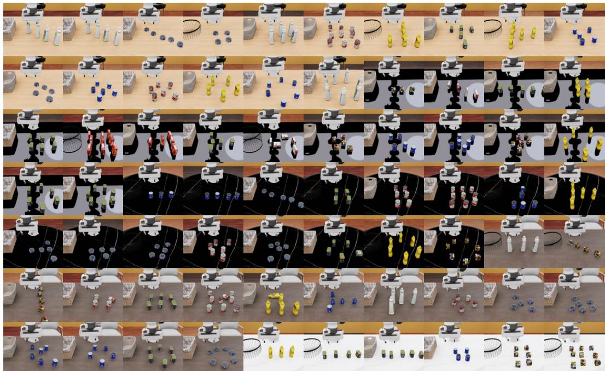  
Figure 6: Example layouts generated by the spatial structure modeling and construction pipeline.

## C.2 Representative Spatial Structures

As illustrated in Fig. 6, GEOMIND uses several common spatial structures. We summarize them below with minimal constraints.

Ordered structure. This structure is used for tasks such as “pick the leftmost object” or “pick the second object from the right.” Let u be a unit vector in the ordering direction and define the projected coordinate

$$
s _ { i } = \mathbf { u } ^ { \top } \bar { \mathbf { p } } _ { i } .\tag{14}
$$

Let $\pi$ be the permutation specifying the intended object order $o _ { \pi ( 1 ) } \prec \dots \prec o _ { \pi ( N _ { \mathrm { o b j } } ) }$ . For a minimum projected separation $\delta _ { \mathrm { m i n } } > 0 .$ , a valid sample must satisfy

$$
s _ { \pi ( k + 1 ) } - s _ { \pi ( k ) } \geq \delta _ { \mathrm { m i n } } , \qquad k = 1 , \ldots , N _ { \mathrm { o b j } } - 1 .\tag{15}
$$

This keeps the object order unchanged while allowing the exact coordinates to vary.

Grid structure. This structure is used for row-column layouts, such as “the object in the top-left cell” or “the object in the same row as the bowl.” Each object has a grid index $\boldsymbol { g _ { i } } = \left( \boldsymbol { r _ { i } } , \boldsymbol { c _ { i } } \right)$ . A sampled position is generated around the corresponding grid cell:

$$
\bar { \bf p } _ { i } = { \bf c } + ( c _ { i } - 1 ) d _ { x } { \bf u } + ( r _ { i } - 1 ) d _ { y } { \bf v } + \pmb { \eta } _ { i } , \qquad \| \pmb { \eta } _ { i } \| _ { \infty } \leq \epsilon .\tag{16}
$$

Here, c is the grid origin, $d _ { x } , d _ { y } > 0$ are the grid spacings, u and v are unit vectors along the column and row directions, and $\eta _ { i }$ is the positional perturbation. The perturbation bound alone does not guarantee that row-column relations are preserved; accepted configurations must also satisfy the structural-validity condition above.

Anchor-based relation. This structure is used for tasks such as “the object left of the cup”, “the object near the plate”, or “the object between two bowls.” For an object $o _ { i }$ and an anchor $o _ { a }$ , define

$$
\Delta _ { i a } = \bar { { \mathbf p } } _ { i } - \bar { { \mathbf p } } _ { a } .\tag{17}
$$

A directional relation is valid when

$$
\mathbf { u } _ { r } ^ { \top } \Delta _ { i a } \ge \tau _ { r } ,\tag{18}
$$

where $\mathbf { u } _ { r }$ is a unit vector in the relation direction and $\tau _ { r } > 0$ is a directional separation threshold that excludes ambiguous cases. Let $R ( o _ { i } , o _ { a } ) \in \{ 0 , 1 \}$ be the corresponding task predicate over candidate objects and the anchor; ineligible objects have predicate value zero. The target is accepted only when the relation selects one unique object:

$$
\{ o _ { i } \in \mathcal { O } : R ( o _ { i } , o _ { a } ) = 1 \} = \{ o ^ { * } \} .\tag{19}
$$

Geometric target. This structure is used when the target is an implicit position rather than a visible object. For example, the target may be the midpoint between two anchors:

$$
{ \bf g } _ { \mathrm { m i d } } = { \frac { 1 } { 2 } } ( \bar { \bf p } _ { a } + \bar { \bf p } _ { b } ) ,\tag{20}
$$

or the centroid of the positions of a nonempty set of anchors indexed by A:

$$
\mathbf { g } _ { \mathrm { c e n t e r } } = { \frac { 1 } { | \mathbf { \nabla } | } } \sum _ { a \in { \mathcal { A } } } { \bar { \mathbf { p } } } _ { a } .\tag{21}
$$

These tasks require the agent to infer a target from scene geometry, instead of directly selecting an existing object.

## C.3 Dynamic Relations

For tasks with scene changes, GEOMIND distinguishes two cases. In scene-updating tasks, the target is determined by the current relation:

$$
\{ o _ { i } \in \mathcal { O } : R _ { t } ( o _ { i } , o _ { a } ) = 1 \} = \{ o _ { t } ^ { * } \} .\tag{22}
$$

For example, the correct object is the one currently left of the cup.

In identity-tracking tasks, the target is determined by the initial relation and then kept fixed:

$$
\{ o _ { i } \in \mathcal { O } : R _ { 0 } ( o _ { i } , o _ { a } ) = 1 \} = \{ o ^ { * } \} , \qquad \mathrm { t a r g e t } ( t ) = o ^ { * } .\tag{23}
$$

For example, the correct object is the one that was originally left of the cup, even if it later moves away.

## C.4 Physical Validation

Finally, each sampled scene is checked in the simulator. We retain instances that satisfy the simulator’s collision and workspace checks and have a reachable target. For distinct objects whose footprints must remain separated in the tabletop plane, a circular-footprint separation condition can be written as

$$
\| \bar { \mathbf { p } } _ { i } - \bar { \mathbf { p } } _ { j } \| _ { 2 } \geq \rho _ { i } + \rho _ { j } + d _ { \mathrm { s a f e } } , \qquad \bar { \mathbf { p } } _ { i } \in \Omega _ { \mathrm { t a b l e } } , \qquad \mathbf { g } \in \Omega _ { \mathrm { r e a c h } } .\tag{24}
$$

Here, $\rho _ { i }$ is the radius of a bounding disk for object i’s planar footprint, $d _ { \mathrm { s a f e } } \geq 0$ is a separation margin, $\Omega _ { \mathrm { t a b l e } }$ is the admissible tabletop region, and $\mathbf { g } \in \Omega _ { \mathrm { r e a c h } }$ specifies a reachable goal position. The pairwise inequality applies only to distinct object pairs requiring planar separation; it is not a universal constraint for containment or stacking. Task-specific contact feasibility is checked in simulation.

## C.5 Summary

The structure gallery in Fig. 6 provides visual examples of the layouts used in GEOMIND. The formulas above specify only the minimal constraints needed to preserve these structures during sampling. This allows GEOMIND to generate diverse scenes with the same task semantics, so evaluation focuses on spatial understanding rather than memorization of fixed coordinates.

## Appendix D Task Details

We present 26 illustrative task cards covering a subset of the benchmark. The full evaluation set contains 54 task variants: 20 Base, 7 Semantic, 7 Visual, and 20 Execution variants. The latter three categories constitute the 34 augmented variants. The number of task cards is not the total number of evaluated variants.

Each card gives a compact specification of one task variant, including the task instruction, the corresponding suite and task family, the spatial structure used for scene generation, the ground-truth target, the numerical ground-truth pose, and the evaluation criterion. The scene image on the left illustrates one sampled realization of the task, while the fields on the right define the task in a reproducible form. All target poses are reported in the simulator world frame, and distances are measured in meters unless otherwise stated.

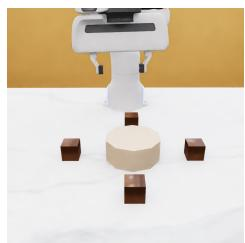

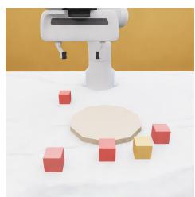

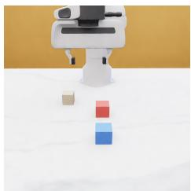

## BindingBase\_AnchorDirection\_v0

Task suite and family. GEOMIND-BASE / Target Identification

Instruction. Move the end effector near the cube to the right of the blue bowl.

Structure. anchor\_direction\_injected structure.

GT Target. Protocol target object block\_right proximity region.

GT Pose. p∗ = (0.40, −0.15, 0.03) m; θ∗ = 0.00 rad.

Eval. Success requires the end-effector distance to the target object’s center to be < 0.06 m and the final state to remain stable for 1.0 s.

## ConstraintBase\_SelectExclusionUnique\_v0

Task suite and family. GEOMIND-BASE / Constraint Composition

Instruction. Move the end effector near the red cube that is closest to the blue plate and is not the leftmost cube.

Structure. exclusion\_distance\_constraint\_injected structure.

GT Target. Protocol target object red\_block\_target proximity region.

GT Pose. p∗ = (0.56, 0.02, 0.03) m; θ∗ = 0.00 rad.

Eval. Success requires the end-effector distance to the target object’s center to be < 0.06 m and the final state to remain stable for 1.0 s.

## ConstraintBase\_SelectVisualSpatial\_v0

Task suite and family. GEOMIND-BASE / Constraint Composition

Instruction. Move the end effector near the wood-grain cylinder to the right of the red block.

Structure. visual\_spatial\_constraint\_injected structure.

GT Target. Protocol target object wood\_cylinder\_target proximity region.

GT Pose. p∗ = (0.40, −0.08, 0.03) m; θ∗ = 0.00 rad.

Eval. Success requires the end-effector distance to the target object’s center to be < 0.06 m and the final state to remain stable for 1.0 s.

## GeometricBase\_IsometricExtension\_v0

Task suite and family. GEOMIND-BASE / Geometric Inference

Instruction. You already hold the cube. Place it on the red–blue line extension at equal spacing.

Structure. 2-anchor line\_blocks\_runtime\_injected structure.

GT Target. Implicit equal-spacing extension point beyond the second anchor.

GT Pose. p∗ = (0.66, 0.02, 0.03) m; θ∗ = 0.00 rad.

Eval. Success requires the distance from the object center to the target position to be < 0.05 m and the final state to remain stable for 1.0 s.

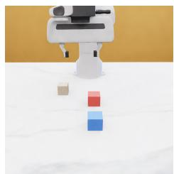

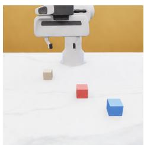

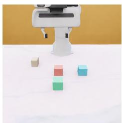

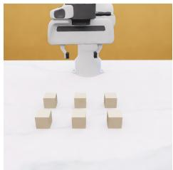

## GeometricBase\_PerfectMidpoint\_v0

Task suite and family. GEOMIND-BASE / Geometric Inference

Instruction. You already hold the cube. Place it midway between the red and blue reference cubes.

Structure. 2-anchor line\_blocks\_runtime\_injected structure.

GT Target. Implicit midpoint region between the two colored anchor blocks.

GT Pose. p∗ = (0.42, 0.02, 0.03) m; $\begin{array} { r } { \theta ^ { * } = 0 . 0 0 \mathrm { r a d } . } \end{array}$

Eval. Success requires the distance from the object center to the target position to be < 0.05 m and the final state to remain stable for 1.0 s.

## GeometricBase\_PointSymmetry\_v0

Task suite and family. GEOMIND-BASE / Geometric Inference

Instruction. You already hold the cube. Place it symmetrically to the blue cube about the red cube.

Structure. 2-anchor diagonal\_blocks\_runtime\_injected structure.

GT Target. Implicit point-symmetric reflection of the reference anchor across the center anchor.

GT Pose. $\mathbf { p } ^ { * } = ( 0 . 3 0 , - 0 . 0 8 , 0 . 0 3 ) \mathrm { m } ; \theta ^ { * } = 0 . 0 0 \mathrm { r a d } .$

Eval. Success requires the distance from the object center to the target position to be < 0.05 m and the final state to remain stable for 1.0 s.

## GeometricBase\_SquareCompletion\_v0

Task suite and family. GEOMIND-BASE / Geometric Inference

Instruction. You already hold the fourth cube. Place it to complete a square with the three anchor cubes.

Structure. 3-anchor square\_corner\_runtime\_injected structure.

GT Target. Implicit missing square corner inferred from three anchors.

GT Pose. p∗ = (0.48, 0.12, 0.03) m; $\theta ^ { * } = 0 . 0 0 \mathrm { r a d } .$

Eval. Success requires the distance from the object center to the target position to be < 0.05 m and the final state to remain stable for 1.0 s.

## GeometricBase\_TrendContinuation\_v0

Task suite and family. GEOMIND-BASE / Geometric Inference

Instruction. You already hold the next cube. Place it to continue the visible row/column pattern.

Structure. 3-anchor diagonal\_trend\_blocks\_runtime\_injected structure.

GT Target. Implicit next point in the anchor trend.

GT Pose. p∗ = (0.61, 0.15, 0.03) m; θ∗ = 0.00 rad.

Eval. Success requires the distance from the object center to the target position to be < 0.05 m and the final state to remain stable for 1.0 s.

## BindingBase\_GridRowcolGrounding\_v0

Task suite and family. GEOMIND-BASE / Target Identification

Instruction. Move the end effector near the cube at row 1, column 2.

Structure. runtime\_grid\_2x3\_static structure.

GT Target. Protocol target object grid\_cell\_1 proximity region.

GT Pose. p∗ = (0.37, −0.03, 0.03) m; θ∗ = 0.00 rad.

Eval. Success requires the end-effector distance to the target object’s center to be < 0.06 m and the final state to remain stable for 1.0 s.

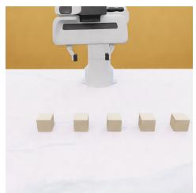

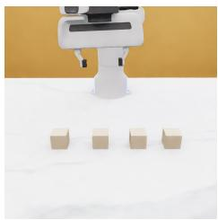

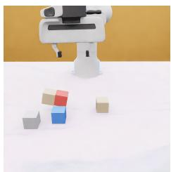

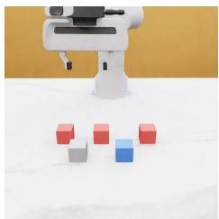

## BindingBase\_OrdinalInsertStatic\_v0

Task suite and family. GEOMIND-BASE / Target Identification   
Instruction. Move the end effector near the second cube from the left.   
Structure. runtime\_block\_line\_static\_ordinal structure.   
GT Target. Protocol target object ordinal\_static\_1 proximity region.   
GT Pose. p∗ = (0.43, −0.06, 0.03) m; θ∗ = 0.00 rad.   
Eval. Success requires the end-effector distance to the target object’s center to be < 0.06 m and the final state to remain stable for 1.0 s.

## ReindexBase\_ReindexExtreme\_v0

Task suite and family. GEOMIND-BASE / Scene Updating   
Instruction. Move the end effector near the leftmost cube after reordering.   
Structure. runtime\_block\_line structure.   
GT Target. Protocol target object reindex\_block\_1 proximity region.   
GT Pose. p∗ = (0.42, −0.05, 0.03) m; θ∗ = 0.00 rad.   
Eval. Success requires the end-effector distance to the target object’s center to be < 0.06 m and the final state to remain stable for 1.0 s.

## ReindexBase\_ReindexInsert\_v0

Task suite and family. GEOMIND-BASE / Scene Updating   
Instruction. Move the end effector near the second-from-left cube.   
Structure. runtime\_block\_line\_insert structure.   
GT Target. Protocol target object insert\_block\_3 proximity region.   
GT Pose. p∗ = (0.43, 0.18, 0.03) m; θ∗ = 0.00 rad.   
Eval. Success requires the end-effector distance to the target object’s center to be < 0.06 m and the final state to remain stable for 1.0 s.

## ReindexBase\_ReindexNeighbor\_v0

Task suite and family. GEOMIND-BASE / Scene Updating   
Instruction. Move the end effector near the cube immediately left of the red cube. Structure. runtime\_red\_anchor\_neighbor structure.   
GT Target. Protocol target object right\_neighbor\_block proximity region.   
GT Pose. p∗ = (0.40, 0.06, 0.03) m; θ∗ = 0.00 rad.   
Eval. Success requires the end-effector distance to the target object’s center to be < 0.06 m and the final state to remain stable for 1.0 s.

## ReindexBase\_ReindexSubset\_v0

Task suite and family. GEOMIND-BASE / Scene Updating Instruction. Move the end effector near the middle cube among the red cubes only. Structure. runtime\_red\_subset\_with\_distractors structure. GT Target. Protocol target object red\_subset\_block\_2 proximity region. GT Pose. p = (0.40, 0.11, 0.03) m; θ = 0.00 rad. Eval. Success requires the end-effector distance to the target object’s center to be < 0.06 m and the final state to remain stable for 1.0 s.

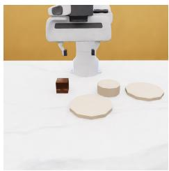

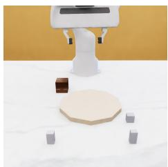

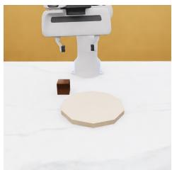

## ReindexAugSem\_ReindexExtreme\_v0

Task suite and family. GEOMIND-AUG / Scene Updating   
Instruction. Move the end effector near the leftmost cube after reordering.   
Structure. runtime\_block\_line structure.   
GT Target. Protocol target object reindex\_block\_1 proximity region.   
GT Pose. p∗ = (0.42, −0.05, 0.03) m; θ∗ = 0.00 rad.   
Eval. Success requires the end-effector distance to the target object’s center to be < 0.06 m and the final state to remain stable for 1.0 s.

## ReindexAugVisual\_ReindexExtreme\_v0

Task suite and family. GEOMIND-AUG / Scene Updating   
Instruction. Move the end effector near the leftmost cube after reordering.   
Structure. runtime\_block\_line structure.   
GT Target. Protocol target object reindex\_block\_1 proximity region.   
GT Pose. p∗ = (0.42, −0.05, 0.03) m; θ∗ = 0.00 rad.   
Eval. Success requires the end-effector distance to the target object’s center to be < 0.06 m and the final state to remain stable for 1.0 s.

## RelationAugSem\_PlaceDirectional\_v0

Task suite and family. GEOMIND-AUG / Relational Grounding

Instruction. You already hold the wooden cube. Place it in the valid target region in front of the blue plate.   
Structure. directional\_region\_semantic\_distractors structure.   
GT Target. Directional target zone relative to blue\_plate.   
GT Pose. p∗ = (0.57, 0.02, 0.03) m; θ∗ = 0.00 rad.

Eval. Success requires the distance from the object center to the target position to be < 0.09 m and the final state to remain stable for 1.0 s.

## RelationAugVisual\_PlaceDirectional\_v0

Task suite and family. GEOMIND-AUG / Relational Grounding

Instruction. You already hold the wooden cube. Place it in the valid target region in fron of the blue plate.   
Structure. directional\_region\_visual\_clutter structure.   
GT Target. Directional target zone relative to blue\_plate.   
GT Pose. p∗ = (0.57, 0.02, 0.03) m; θ∗ = 0.00 rad.

Eval. Success requires the distance from the object center to the target position to be < 0.09 m and the final state to remain stable for 1.0 s.

## RelationBase\_PlaceDirectional\_v0

Task suite and family. GEOMIND-BASE / Relational Grounding Task suite and family. GEOMIND-BASE / Relational Grounding

Instruction. You already hold the wooden cube. Place it in the valid target region in front of the blue plate.   
Structure. directional\_region\_injected structure.   
GT Target. Directional target zone relative to blue\_plate.   
GT Pose. p∗ = (0.65, 0.02, 0.03) m; θ∗ = 0.00 rad.   
Eval. Success requires the distance from the object center to the target position to be < 0.09 m and the final state to remain stable for 1.0 s.

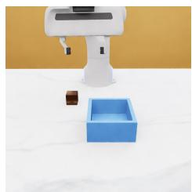

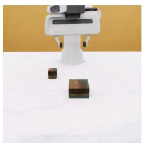

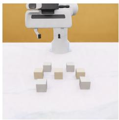

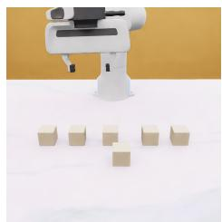

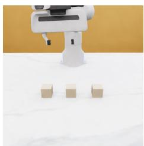

## RelationBase\_PlaceInside\_v0

Task suite and family. GEOMIND-BASE / Relational Grounding   
Instruction. You already hold the cube. Put it fully inside the blue box.   
Structure. containment\_standard\_injected structure.   
GT Target. Stable containment inside blue\_box\_floor.   
GT Pose. p∗ = (0.43, 0.04, 0.03) m; θ∗ = 0.00 rad.   
Eval. Success requires stable containment in the box, a center error < 0.06 m relative to the target position, and stability for 1.0 s.

## RelationBase\_PlaceOnTop\_v0

Task suite and family. GEOMIND-BASE / Relational Grounding

Instruction. You already hold the cube. Release it onto the top surface of the red wooden block so it rests stably.

Structure. support\_top\_injected structure.

GT Target. Stable top placement on red\_support\_block.

GT Pose. p∗ = (0.41, 0.03, 0.07) m; θ∗ = 0.00 rad.

Eval. Success requires stable placement on the support surface, a placement error < 0.01 m, and stability for 1.0 s.

## TrackBase\_TrackClutter\_v0

Task suite and family. GEOMIND-BASE / Identity Tracking

Instruction. After the clutter settles, move the end effector near the cube that was initially in the middle.

Structure. clutter\_robust\_runtime\_identity\_line structure.

GT Target. Protocol target object identity\_block\_1 proximity region.

GT Pose. p∗ = (0.41, −0.01, 0.03) m; θ∗ = 0.00 rad.

Eval. Success requires the end-effector distance to the target object’s center to be < 0.06 m and the final state to remain stable for 1.0 s.

## TrackBase\_TrackMulti\_v0

Task suite and family. GEOMIND-BASE / Identity Tracking

Instruction. Move the end effector near the cube that started at the far left.

Structure. runtime\_identity\_multistep\_line structure.

GT Target. Protocol target object identity\_block\_0 proximity region.

GT Pose. p∗ = (0.40, −0.20, 0.03) m; θ∗ = 0.00 rad.

Eval. Success requires the end-effector distance to the target object’s center to be < 0.06 m and the final state to remain stable for 1.0 s.

## TrackBase\_TrackSingle\_v0

Task suite and family. GEOMIND-BASE / Identity Tracking

Instruction. Move the end effector near the cube that started in the middle.

Structure. runtime\_identity\_line structure.

GT Target. Protocol target object identity\_block\_1 proximity region.

GT Pose. p∗ = (0.41, −0.01, 0.03) m; θ∗ = 0.00 rad.

Eval. Success requires the end-effector distance to the target object’s center to be < 0.06 m and the final state to remain stable for 1.0 s.

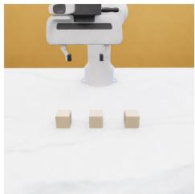

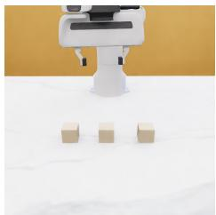

## TrackAugSem\_TrackSingle\_v0

Task suite and family. GEOMIND-AUG / Identity Tracking   
Instruction. Move the end effector near the cube that started in the middle.   
Structure. runtime\_identity\_line structure.   
GT Target. Protocol target object identity\_block\_1 proximity region.   
GT Pose. p∗ = (0.41, −0.01, 0.03) m; θ∗ = 0.00 rad.   
Eval. Success requires the end-effector distance to the target object’s center to be < 0.06 m and the final state to remain stable for 1.0 s.

## TrackAugVisual\_TrackSingle\_v0

Task suite and family. GEOMIND-AUG / Identity Tracking   
Instruction. Move the end effector near the cube that started in the middle.   
Structure. runtime\_identity\_line structure.   
GT Target. Protocol target object identity\_block\_1 proximity region.   
GT Pose. p∗ = (0.41, −0.01, 0.03) m; θ∗ = 0.00 rad.   
Eval. Success requires the end-effector distance to the target object’s center to be < 0.06 m and the final state to remain stable for 1.0 s.