# Good Views Are Not Enough: Global Counterexamples for Gaussian-Regularized JEPAs

Anran Xu School of Automation and Intelligence Beijing Jiaotong University

November 9, 2026

## Abstract

Good views do not sufice to guarantee scene invariance or uniqueness up to rotation at the global optima of Gaussian-regularized JEPAs. We give globally certified counterexamples showing that the uniqueness premise of the Gaussian extension in Good Views fails for specified soft objectives. Gaussian marginal matching can reward retaining independently resampled observation variation, and this benefit can exceed its prediction cost. In a four-state model, comparison against the entire scene-only class proves that every global minimizer splits a scene and admits an equal-value partner outside its rotation orbit. In a 512-dimensional model with a complete scene basis, a spectral gap, and exact population whitening, pooled Epps–Pulley regularization still forces every global minimizer to retain nuisance and yields positive crossmodal alignment error even after the best rotation when modality nuisances are independent. Better scene alignment can also accompany worse prediction. With matched 512-label readout budgets and 1% observation noise, whitened prediction JEPA aligns better to the scene than next-token prediction but incurs 0.2872 nats/token higher linear-readout test NLL. A Bayes-risk decomposition distinguishes information lost through the observation channel from the fitted readout’s dificulty using retained information. These results connect three determinants of learned representations: what views share, what regularization favors, and what a prediction task can use.

## 1 Introduction

What views share, what an objective retains, and what a task needs are distinct questions. For a picture and its description, the shared content may be a scene; lighting, wording, or other observation details can vary. Good views specify the shared relation. The regularized objective determines which variation enters the representation, and the prediction task determines the value of that retained content.

Prediction penalizes variation across positive observations, while Gaussian matching can reward retaining it. With finitely many scenes, a deterministic scene-only encoder produces a finite atomic distribution. Independently resampled observation variation supplies additional atoms and can improve the Gaussian fit. When that improvement exceeds its prediction cost, every global optimum retains variation that the views do not share.

Good Views explains cross-modal agreement through a shared world objective [1]. We examine how Gaussian marginal regularization changes the content selected by that objective. Our constructions compare the combined loss over the entire scene-only class, retaining a scene spectral gap and, in the high-dimensional model, exact whitening.

Retained variation can also be useful predictive context. Scene alignment rewards ignoring wording diferences between descriptions of the same scene; token prediction can require them. A separate four-state task examines this distinction with frozen encoders, matched readout labels, observation noise, and head architectures.

We establish three results.

Global failure of invariance and uniqueness. A four-state construction forces every global optimum to split a scene and yields attained, equal-value minimizers outside a single sign orbit.

Nuisance retention under exact whitening. With a complete scene basis, a spectral gap, and exact whitening in 512 dimensions, pooled Gaussian regularization forces nuisance into every global optimum and yields a positive best-rotation cross-modal alignment error under independent modality nuisances.

Diferent rankings for alignment and prediction. A matched readout study shows how scene alignment and predictive risk respond diferently to retained observation variation, separating observation loss from the fitted head’s gap.

## 2 Related work

## 2.1 Views, invariant content, and identifiability

Good Views connects cross-modal alignment to a common world optimization problem [1]. Its Theorem 1 assumes that the shared objective has a unique optimum up to rotation. Proposition 1’s whitened prediction analysis establishes this property under exact whitening and a spectral gap; Proposition 3 derives independent nuisance elimination under the same objective. For the Gaussian extension, uniqueness remains a premise. The distinction opens a concrete optimization question: how does a Gaussian penalty interact with the invariant spectral solution? Our constructions answer it for specified soft objectives by proving full-class exclusion, attainment, and the resulting structure of global minimizers.

Content–style theory gives a complementary route from views to invariant content. In smooth continuous latent models, alignment combined with diferential entropy can isolate content up to an invertible map [8]. A content-only encoder can simultaneously achieve perfect alignment and the desired output entropy. Structured augmentations further use known patterns of shared factors to recover separate representation blocks [9]. These results highlight compatibility between the view relation, the representation class, and the output objective. Our finite scene models expose the competing case: a scene-only marginal has a quantified Gaussian discrepancy, and independent observation variation reduces that discrepancy enough to change the joint optimum.

Distribution-preserving ambiguities are a classical obstacle in nonlinear identifiability [7]. The pair relation adds structure that can remove some marginal symmetries. We therefore analyze both terms of the objective: a uniform bound first forces a split within a scene, and a loss-preserving swap then supplies a second minimizer outside the rotation orbit. This joins a symmetry argument to an attained global optimum and a certified comparison over the whole invariant class.

## 2.2 Gaussian regularization and representation content

LeJEPA introduces sliced characteristic-function matching to a standard Gaussian [2]. KerJEPA relates the Epps–Pulley statistic to Gaussian-kernel MMD and develops its estimators and finitebatch corrections [3]. Those tools make the regularizer amenable to exact analysis. We use their discrepancy and expectation identities to compare scene-only and split representations at specified frequencies, batch sizes, and weights.

Positive Gaussian world-model results combine marginal constraints with transition structure. When Does LeJEPA Learn a World Model? uses Gaussian states and Ornstein–Uhlenbeck transitions to identify orthogonal linear representations [4]. Controlled-world identifiability adds suficiently expressive action-conditioned predictors and spectral conditions [5]. The anisotropic JEPA analysis proves uniqueness of the encoder Gram matrix within a linear Gaussian class and studies how representation geometry afects planning [6]. Together these works explain when Gaussian matching and the predictive spectral solution are compatible. Our 512-dimensional construction fixes a complete scene basis and exact whitening, then isolates how the additional pooled EP term selects independently resampled variation.

Gaussian output also has an information-bottleneck motivation [10], while LRC-JEPA distinguishes dynamics from residual context and explains why aggregate Gaussian matching alone does not determine minimality [13]. Slow trajectory noise provides another mechanism for retaining unwanted variation in predictive learning [12]. Here the nuisance is independently redrawn at positive endpoints. The certified global gap attributes its retention to marginal matching and gives a positive lower bound for every optimum of the specified whitened soft objective.

## 2.3 Representation geometry and predictive usefulness

Good Views defines nuisance relative to alignment and interprets next-token prediction through an algebraic decomposition followed by a heuristic view model [1]. This makes the evaluation task central to deciding which variation matters. Empirical InfoNCE work already reports tradeofs between identification proxies and classification performance, with the outcome depending on the augmentations and data-generating process [11]. Anisotropic JEPA likewise connects a planning gap to task geometry in an invertible representation [6].

Our readout study gives a controlled comparison with known latent states and token probabilities. Frozen encoders share finite label budgets, heads, and noisy observation channels. Conditional Bayes risk [15] separates information available through that channel from the fitted head’s remaining gap. This exposes how better scene alignment can accompany worse prediction and how head capacity and task dependence shape that ordering.

## 3 Views and Gaussian regularization

Let S denote the scene and U observation variation. A view is an injective rendering of (S, U). Good views resample U independently at positive endpoints; the positive relation lies in the scenes. A scene-only encoder h satisfies $h ( S , U ) = r ( S )$ . Thus changing U within a scene has no efect on its representation. We call U nuisance relative to this view relation; whether it is useful for prediction depends on the task.

The optimization has two preferences. The prediction term P penalizes squared distances to the global-view center. The Gaussian term compares the output characteristic function $\varphi ( t ) =$ $\mathbb { E } e ^ { i t h }$ with $g ( t ) = e ^ { - t ^ { 2 } / 2 }$ , using weighted squared diferences. For m observations, the statistic is $\begin{array} { r } { \widehat { R } = m \sum _ { i } \omega _ { j } \vert \widehat { \varphi } _ { m } ( t _ { j } ) - g _ { j } \vert ^ { 2 } } \end{array}$ . Its expectation depends on whether views are processed separately or pooled. Each theorem specifies that choice and its coeficient; Appendix A gives the normalization formulas.

Figure 1 illustrates the marginal-fit competition and the full-class objective gap. Dots mark the nonnegative half of the 17-node grid; negative nodes follow by even symmetry. The bounds use 1024 iid samples per view and mixing weight 0.02.

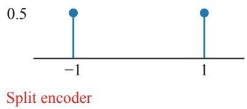

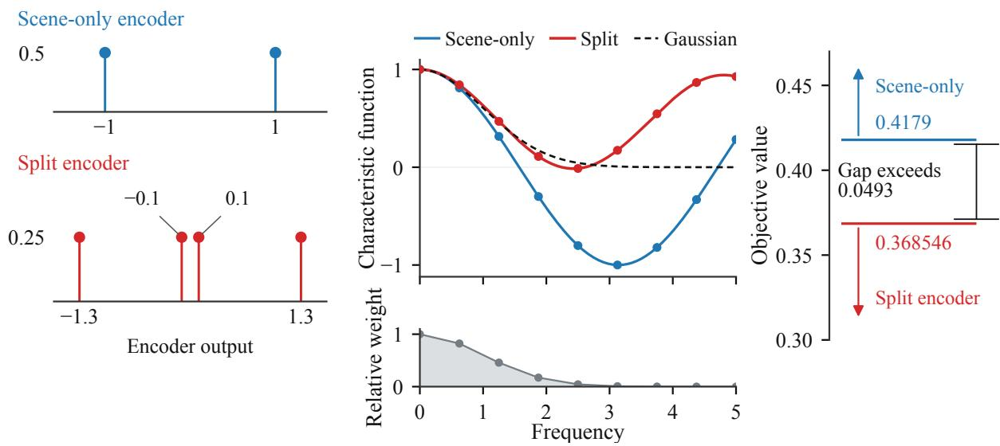  
(b) Gaussian matching  
(c) Certified gap  
Figure 1: Gaussian matching and scene splitting. Panels (a–b) illustrate a scene-only encoder and the four-atom comparator; panel (c) compares the comparator’s objective with a certified lower bound for the entire scene-only class. The comparator maps the positive scene to {0.1, 1.3} and the negative scene to $\{ - 0 . 1 , - 1 . 3 \}$ .

## 4 Gaussian matching breaks scene invariance and uniqueness

Two scenes with two observations each give at most two output values to any scene-only encoder. A uniform positive Gaussian-discrepancy bound covers this entire class; a four-atom marginal improves matching enough to outweigh the cost of within-scene variation (Figure 1).

Index the observations by $( S , U ) = ( 1 , 1 ) , ( 1 , - 1 ) , ( - 1 , 1 ) , ( - 1 , - 1 )$ , with uniform probability $1 / 4$ . Set $s = ( 1 , 1 , - 1 , - 1 )$ and

$$
\pi _ { i j } = \frac { 1 + s _ { i } s _ { j } / 2 } { 1 6 } , \qquad P _ { \pi } ( x ) = \frac { 1 } { 4 } \sum _ { i , j } \pi _ { i j } ( x _ { i } - x _ { j } ) ^ { 2 } .
$$

All positive-pair entries are positive. The transition eigenvalues are $1 , 1 / 2 , 0 , 0 ;$ the scene direction has a positive gap over the independent nuisance directions. Work on the centered domain $X _ { 0 } = \{ x \in \mathbb { R } ^ { 4 } : \textstyle \sum _ { i } x _ { i } = 0 \}$

For the 17 signed nodes $t _ { j } = 5 j / 8 , - 8 \le j \le 8 .$ , use $\omega _ { j } = ( 5 / 8 ) c _ { j } e ^ { - t _ { j } ^ { 2 } / 2 }$ , with endpoint factors $c _ { \pm 8 } = 1 / 2$ and all others one. Let $D _ { \mathrm { g r } }$ be the weighted characteristic-function discrepancy, and $R _ { 1 0 2 4 , \mathrm { g r } }$ the exact expectation of the EP term on a per-view iid batch of 1024. EP is averaged across the two views. The chosen soft objective is

$$
F _ { \pi } ( x ) = P _ { \pi } ( x ) + \frac { 1 } { 4 9 } R _ { 1 0 2 4 , \mathrm { g r } } ( \mu _ { x } ) , \qquad \mu _ { x } = \textstyle { \frac { 1 } { 4 } } \sum _ { i } \delta _ { x _ { i } } .\tag{1}
$$

This is the mixed coeficient $\lambda = 1 / 5 0$ after dividing the loss by $1 - \lambda$

Theorem 1 (Attained nonorthogonal scalar minimizers). The objective (1) attains its minimum on $X _ { 0 }$ . Every global minimizer takes distinct values within at least one scene. For every such minimizer $x ,$ exchanging the two observations of one scene gives an equal-value global minimizer outside $\{ x , - x \}$

Why the conclusion is global. The entire scene-only class is strictly suboptimal. Every sceneonly vector $( b , b , c , c )$ has $D _ { \mathrm { g r } } > 1 / 5 0$ . The iid expectation identity $R _ { N } = N D + A _ { \nu } - J _ { \nu }$ , with $0 \leq J _ { \nu } \leq A _ { \nu }$ , therefore gives $F _ { \pi } > 1 0 2 4 / 2 4 5 0 > 0 . 4 1 7 9$ . The rational comparator

$$
w = ( 1 / 1 0 , 1 3 / 1 0 , - 1 / 1 0 , - 1 3 / 1 0 )
$$

is centered, has $P _ { \pi } ( w ) = 1 2 1 / 4 0 0$ , and satisfies $D _ { \mathrm { g r } } ( \mu _ { w } ) \ : < \ : 0 . 0 0 2 1 6 2 3 9$ . The sharper interval evaluation gives $F _ { \pi } ( w ) < 0 . 3 6 8 5 4 6$ . The gap exceeds 0.0493, excluding the whole scene-only class. The lower bound uses a rational interval cover of the complete two-atom phase domain.

Three further steps turn exclusion into nonuniqueness. First, $P _ { \pi } \ge \mathrm { V a r } ( x ) / 4$ makes the centered objective coercive, so a minimum exists. Second, any nonconstant optimum has nonzero scene correlation: rearranging its values otherwise lowers prediction without changing its marginal law. Third, a split-group swap preserves both terms of the loss; if it were an overall sign reversal, the scene correlation would vanish. Appendix B supplies the full proof, analytic-integral version, and other suficient weights. A three-feature fixed ReLU network realizes every four-state encoder (Appendix F).

The construction links a quantitative marginal-fit gap to the geometry of the global solution set. Appendix C extends the mechanism to separated near-optimal partners when the pair symmetry is perturbed by at most $5 \times 1 0 ^ { - 6 }$ in total entrywise distance. Their sign-orbit distance exceeds 0.025, and excess loss is below $3 \times 1 0 ^ { - 5 }$

## 5 Gaussian matching forces nuisance under exact whitening

The scalar construction establishes the content-selection mechanism and its consequence for uniqueness. We next place the same competition inside an exactly whitened model with a complete scene basis. Prediction alone selects a scene-only representation; an additional pooled EP term makes every scene-only encoder strictly suboptimal.

Let S have 513 values, with $p _ { 1 } = p _ { 2 } = 1 / 4$ and $p _ { s } = 1 / 1 0 2 2$ for the other 511 scenes. Independently draw $U$ uniformly on $\{ - 1 , 1 \} ^ { 5 1 2 }$ . All eight views keep the same scene and independently redraw U. A complete centered orthonormal scene basis $r ( S ) \in \mathbb { R } ^ { 5 1 2 }$ supplies an injective rendering $( r ( S ) , U )$ . The view transition has 512 nonconstant scene eigenvalues one and all nuisance eigenvalues zero.

Optimize all finite-support encoders $h ( S , U ) \in \mathbb { R } ^ { 5 1 2 }$ under $\mathbb { E } h = 0 , \ \mathbb { E } h h ^ { \top } = I _ { 5 1 2 }$ . Define the nuisance fraction

$$
u ( h ) = \frac { 1 } { 5 1 2 } \mathbb { E } \left\| h - \mathbb { E } [ h \mid S ] \right\| ^ { 2 } .
$$

With $G = 2$ global views among $V = 8$ total views, the coordinate-mean center loss is $P = 5 u / 4$ Pool $N = 2 5 6$ examples and their views into $M = 2 0 4 8$ outputs. The EP statistic uses nodes $t _ { j } = 3 j / 1 6 , 0 \le j \le 1 6$ , with $\omega _ { j } = ( 3 / 1 6 ) d _ { j } g _ { j } , d _ { 0 } = d _ { 1 6 } = 1$ , and $d _ { j } = 2$ at interior nodes. Average directions θ exactly over $\mathbb { S } ^ { 5 1 1 }$ and the statistic over the batch:

$$
F ( h ) = \frac { 5 } { 4 } u ( h ) + \frac { 1 } { 5 0 } \bar { R } ( h ) , \qquad \bar { R } = \mathbb { E } _ { \mathcal { B } , \theta } \widehat { R } _ { \mathcal { B } , \theta } .\tag{2}
$$

The direct coeficient follows stable-pretraining 0.1.8 [14]; the domain additionally imposes exact population whitening.

Theorem 2 (All whitened soft-objective optima retain nuisance). The objective (2) attains a minimum on this domain, and every global minimizer satisfies $u ( h ) > 0 . 0 0 0 1 5$ . Two global minimizers with independent modality nuisances on the same scene have best-rotation coordinate-mean MSE greater than 0.0003. Both statements also hold in the linear class $h _ { W } = W ( r , U ) , W W ^ { \top } = I _ { 5 1 2 }$

(a) Scene probabilities  
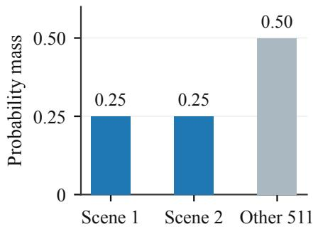

(b) Whitened objective  
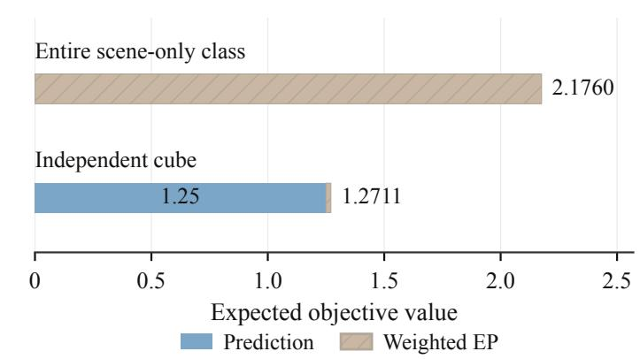  
Figure 2: Whitened global comparison.

Why one comparison excludes every scene-only solution. The comparison excludes every scene-only whitened encoder: all such encoders share the same direction-averaged EP value, and a feasible nuisance encoder has strictly lower total loss. The complete scene basis satisfies $r ( s ) ^ { \top } r ( s ^ { \prime } ) =$ $\mathbf { 1 } _ { s = s ^ { \prime } } / p _ { s } - 1$ . Every scene-only whitened encoder is $Q r , Q \in O ( 5 1 2 )$ . Its two common-scene norms are only ${ \sqrt { 3 } } .$ , whereas the other norms are $\sqrt { 1 0 2 1 }$ . Those constraints on half the marginal mass give the same EP value uniformly over rotation. Figure 2 separates prediction from EP weighted by 0.02. The scene-only class has prediction loss zero, EP 108.798853, and full objective 2.175977. The whitened independent cube $h = U$ has prediction loss 1.25, EP 1.053856, and objective 1.271077. These are rounded certified expectations under exact sphere and batch averaging, with strict bounds $F _ { s } > 2 . 1 7 5 9$ and $F _ { U } < 1 . 2 7 1 1$ . The cube’s EP gain outweighs its prediction cost.

The strict gap exceeds 0.9. For a general encoder, projecting onto its conditional scene mean and taking a polar factor produces a scene-only rotation with $F _ { s } \le F ( h ) + 6 0 0 0 u ( h )$ . Compactness gives attainment, and the cube upper bound then implies $u > 0 . 9 / 6 0 0 0 = 0 . 0 0 0 1 5$ . Conditional independence converts this fraction into the stated cross-modal MSE bound. Appendix D gives the full moment, sphere-integral, and polar-decomposition argument.

This is a content-selection efect under full scene realizability: the marginal-fit gain exceeds the prediction cost throughout the scene-only class. Appendix E extends the comparison to a single random batch with exact direction averaging: with probability at least 0.828, one realized batch excludes all scene-only optima, and linear optima have $u > 1 0 ^ { - 1 2 }$

## 6 Better scene alignment can accompany worse prediction

Having shown that regularization can determine which observation variation is retained, we now ask what that variation means for prediction. Variation that is nuisance for scene alignment can be useful predictive context. We study this question in a separate four-state task. Let (S, U) be uniform on four sign states and let a binary token obey

$$
\operatorname* { P r } ( Y = 1 \mid S , U ) = \operatorname { s i g m o i d } ( S + b U ) .\tag{3}
$$

The main task takes $b = 2 ;$ the negative control takes $b = 0$ . Here $U$ is alignment nuisance and, for $b = 2 .$ , useful predictive context.

Matched test of learned representations. We compare prediction with whitening (whitened prediction JEPA), prediction with pooled EP (soft EP JEPA), and prediction with both whitening and pooled EP (whitening-plus-EP JEPA) with next-token prediction (NTP). Each objective is trained with five seeds using the same four-state ReLU parameterization. Frozen, standardized encoders provide observations $Z = z + \sigma \xi$ , with $\xi \sim \mathcal { N } ( 0 , 1 )$ , to matched linear logistic or 16-hiddenunit tanh MLP heads. Three independent data repeats pair states, labels, and noise across methods. The primary comparison uses 512 training labels, $\sigma = 0 . 0 1$ , and a linear head. Test data select no parameters; training steps, validation budgets, test sizes, controls, and fitting rules appear in Appendices H–I. Clean scene alignment is $\begin{array} { r } { \operatorname* { m i n } _ { q \in \{ - 1 , 1 \} } \mathbb { E } ( z - q S ) ^ { 2 } ; } \end{array}$ token risk is evaluated through the specified noisy channel.
<table><tr><td>Primary setting</td><td>Whitened prediction JEPA</td><td>NTP</td></tr><tr><td>Clean best-sign scene MSE</td><td>0.003530</td><td>1.130827</td></tr><tr><td>Linear test NLL (nats/token)</td><td>0.674001</td><td>0.386775</td></tr><tr><td>MLP16 test NLL (nats/token)</td><td>0.617590</td><td>0.388431</td></tr></table>

Table 1: Whitened prediction JEPA has lower clean scene MSE and higher token NLL than NTP under matched readout conditions. The MLP is a secondary comparison.

The primary JEPA-minus-NTP NLL diference is 0.287226, with 95% two-axis paired bootstrap interval [0.280889, 0.293062]. All five seed means and all 15 seed/repeat cells are positive. The MLP diference is 0.229160, interval [0.115088, 0.291289]. Greater head capacity reduces the average diference; the risk decomposition below identifies observation loss as the main source of the whitened-prediction branch’s population excess risk.

Figure 3 compares the three JEPA branches with NTP. Colors identify representations; circles and open diamonds identify linear and MLP16 heads. The right panel uses numerical Hermite quadrature to decompose whitened-prediction population excess risk.

(a) Paired prediction differences

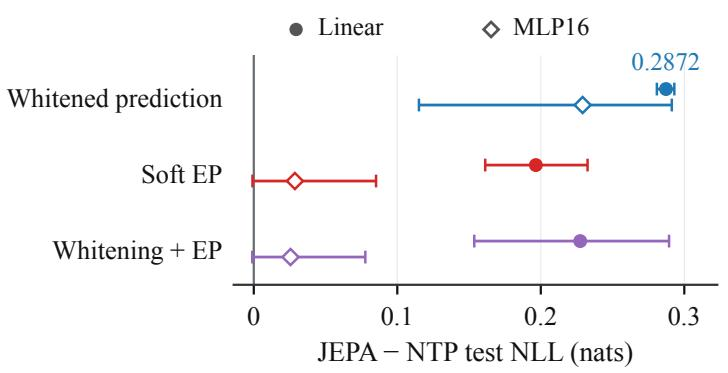

(b) Risk decomposition  
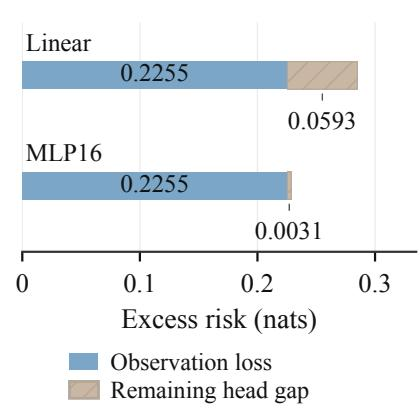  
Figure 3: Matched prediction diferences. (a) Paired test NLL diferences relative to NTP. (b) Population excess risk relative to the complete-context Bayes risk, decomposed into observation loss and remaining head gap.

Figure 4 compares all six representations and both heads at 1% noise with 32, 128, 512, and 2048 training labels. Bands are 95% two-axis bootstrap intervals over five encoder seeds and three shared-data repeats. Dashed fixed controls use matched decoders and data; the dotted line is context Bayes risk, 0.386534 nats/token. Appendix I adds the zero-noise curves.

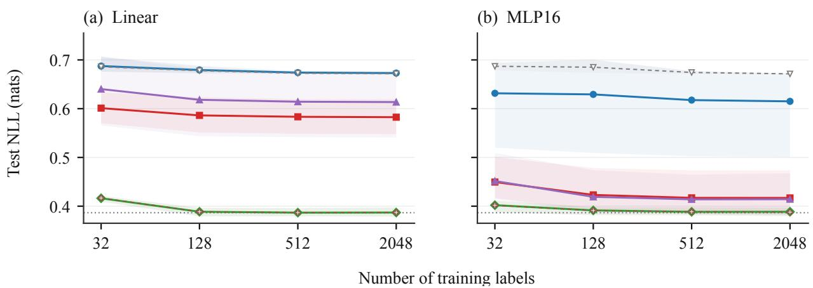  
Figure 4: Readout learning curves.

Observation loss. Most of the whitened-prediction JEPA’s population excess risk comes from information unavailable through the noisy observation channel. Let $R _ { \mathrm { { c o n t e x t } } }$ be Bayes NLL given (S, U), $R _ { \mathrm { o b s } }$ Bayes NLL given the actual observation $Z ,$ and $R _ { \mathrm { h e a d } }$ the fitted head’s population NLL. Then

$$
R _ { \mathrm { h e a d } } - R _ { \mathrm { c o n t e x t } } = ( R _ { \mathrm { o b s } } - R _ { \mathrm { c o n t e x t } } ) + ( R _ { \mathrm { h e a d } } - R _ { \mathrm { o b s } } ) .\tag{4}
$$

The first term is information lost through representation and observation; the second contains head capacity, finite training, regularization, and optimization. This is the standard conditionalentropy decomposition [15]. For whitened prediction JEPA, the observation loss averages 0.225499 nats/token. Its linear head gap is 0.059349; the MLP reduces it to 0.003077 (Figure 3). These head gaps are measured relative to the same encoder’s observation Bayes risk.

Figure 5 decomposes all six representations at 512 labels and 1% noise using 128-node Hermite estimates. Solid and hatched bars separate observation loss and head gap. NTP and the task control have observation loss below numerical resolution. Head capacity afects the remaining readout gap; observation Bayes risk gives the irreducible prediction loss for the specified channel.

At zero noise, all 20 learned encoders have four distinct outputs, with minimum separation approximately $7 . 7 7 \times 1 0 ^ { - 1 6 }$ . An ideal exact-value lookup retains full context information, while positive observation noise makes some diferences unstable. One encoder seed retains more stably readable observation variation than the other four. Thus exact-value information and information available through the readout channel difer, including across seeds.

Nonlinear access to retained information. For the soft Gaussian branches, a nonlinear readout substantially reduces the remaining head gap. At the primary setting, the MLP reduces that gap from 0.165827 to 0.002191 for soft EP and from 0.207490 to 0.007651 for whitening-plus-EP. Their MLP diferences from NTP are 0.028651 and 0.025593; both bootstrap intervals cross zero. The zero-noise MLP results also vary across seeds and label budgets; Appendix I gives the individual reversals. Much of the soft branches’ linear excess risk therefore concerns access to retained predictive information.

Task dependence. When U is irrelevant to the token $( b = 0 )$ , the $n = 5 1 2 , \sigma = 0 . 0 1$ linear JEPA-minus-NTP diference is −0.016546, reversing the ranking. This diagnostic uses one encoder seed and two repeats.

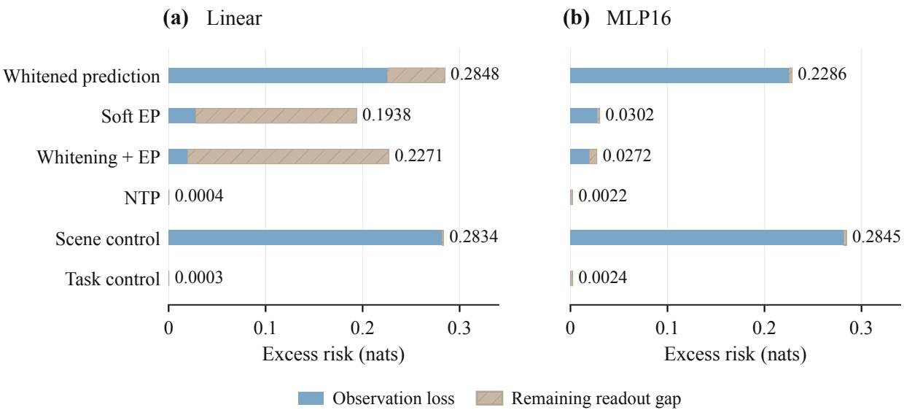  
Figure 5: Observation loss and readout gaps.

These comparisons distinguish information retained by an encoder, information available through the observation channel, and information accessible to a fitted readout.

## 7 Implications for JEPA objectives and evaluation

Global content selection can be certified by comparing a lower bound over the entire invariant feasible class with a feasible encoder retaining observation variation. The scalar model uses an atom-count comparison; under complete scene rank and whitening, the scene Gram matrix reduces the invariant class to one rotation orbit.

Whitening fixes covariance; Gaussian EP rewards marginal shape beyond second moments. In the high-dimensional model, scene probabilities constrain that shape, and independent nuisance improves it under the same whitening constraint. Thus the regularizer on the invariant class and the view transition’s spectrum both enter the analysis.

For evaluation, scene alignment measures agreement with a selected latent variable; observation Bayes risk measures task information available through the specified channel; the fitted head gap measures how well a readout uses it. Their joint reporting separates geometric agreement, stable task information, and learnability from finite labels.

## 8 Conclusion

Gaussian marginal matching participates directly in representation content selection. Our global constructions show that it can force independently resampled variation into optimal representations, including under exact whitening and suficient scene spectral rank. The scalar model also yields equal-value global minimizers outside a single sign orbit. The readout study shows why the value of retained variation depends on the prediction task and the observation channel. The joint objective selects representation content; the prediction task and observation channel determine its usable value.

## References

[1] Randall Balestriero and Yann LeCun. Proving and Improving the Platonic Representation Hypothesis with JEPAs. arXiv:2610.39302, version 1, 2026. https://arxiv.org/abs/2610.39302v1.

[2] Randall Balestriero and Yann LeCun. LeJEPA: Provable and Scalable Self-Supervised Learning Without the Heuristics. arXiv:2511.08544, version 3, 2025. https://arxiv.org/abs/2511.08544v3.

[3] Eric Zimmermann, Harley Wiltzer, Justin Szeto, David Alvarez-Melis, and Lester Mackey. KerJEPA: Kernel Discrepancies for Euclidean Self-Supervised Learning. arXiv:2512.19605, version 1, 2025. https: //arxiv.org/abs/2512.19605v1.

[4] David Klindt, Yann LeCun, and Randall Balestriero. When Does LeJEPA Learn a World Model? arXiv:2605.26379, version 1, 2026. https://arxiv.org/abs/2605.26379v1.

[5] Xiangteng Zhang, Yang Guan, Bo Zhang, Hongyang Li, Ya-Qin Zhang, and Shengbo Eben Li. On the Identifiability of Controlled World Models. arXiv:2607.22430, version 2, 2026. https://arxiv.org/ abs/2607.22430v2.

[6] Mingu Kang, Yoori Oh, Sookyung Kim, and Joonseok Lee. Anisotropic Representations Improve Planning in JEPA World Models. arXiv:2609.37441, version 1, 2026. https://arxiv.org/abs/2609.37441v1.

[7] Shubhangi Ghosh, Luigi Gresele, Julius von K¨ugelgen, Michel Besserve, and Bernhard Sch¨olkopf. On Pitfalls of Identifiability in Unsupervised Learning. A Note on: Desiderata for Representation Learning: A Causal Perspective. arXiv:2202.06844, version 1, 2022. https://arxiv.org/abs/2202.06844v1.

[8] Julius von K¨ugelgen, Yash Sharma, Luigi Gresele, Wieland Brendel, Bernhard Sch¨olkopf, Michel Besserve, and Francesco Locatello. Self-Supervised Learning with Data Augmentations Provably Isolates Content from Style. Advances in Neural Information Processing Systems, 2021. Preprint arXiv:2106.04619, version 3. https://arxiv.org/abs/2106.04619v3.

[9] Cian Eastwood, Julius von K¨ugelgen, Linus Ericsson, Diane Bouchacourt, Pascal Vincent, Bernhard Sch¨olkopf, and Mark Ibrahim. Self-Supervised Disentanglement by Leveraging Structure in Data Augmentations. arXiv:2311.08815, version 2, revised 2024. https://arxiv.org/abs/2311.08815v2.

[10] Yuval Domb. Why Self-Supervised Encoders Want to Be Normal. arXiv:2604.27743, version 1, 2026. https://arxiv.org/abs/2604.27743v1.

[11] Evgenia Rusak, Patrik Reizinger, Attila Juhos, Oliver Bringmann, Roland Zimmermann, and Wieland Brendel. InfoNCE: Identifying the Gap Between Theory and Practice. arXiv:2407.00143, version 2, 2024. https://arxiv.org/abs/2407.00143v2.

[12] Paarth Gulati and Ilya Nemenman. Contrast encodes inductive bias: separating slow noise from dynamics in predictive representation learning. arXiv:2606.07770, version 1, 2026. https://arxiv.org/abs/2606. 07770v1.

[13] Luzhe Huang, Lei Chu, Jingyi Liang, and Yuhuan Zhao. LRC-JEPA: Disentangling Dynamics and Residual Context for Eficient World Models. arXiv:2609.34375, version 1, 2026. https://arxiv.org/ abs/2609.34375v1.

[14] stable-pretraining contributors. stable-pretraining, software release 0.1.8. https://pypi.org/project/ stable-pretraining/0.1.8/.

[15] Thomas M. Cover and Joy A. Thomas. Elements of Information Theory, second edition. Wiley, 2006.

## A Objectives and normalization

For a finite observation law $p ,$ a symmetric positive-pair law $\pi$ with marginals $p ,$ and an encoder $h ,$ define the pair energy

$$
\mathcal { E } _ { \pi } ( h ) = \sum _ { i , j } \pi _ { i j } \left. h _ { i } - h _ { j } \right. ^ { 2 } .
$$

With two global views only, the mean squared distance to their mean is $P = \mathcal { E } _ { \pi } / 4$ for scalar outputs. For V same-scene views and G global views, our coordinate-mean prediction term is

$$
P _ { G , V } = \mathbb { E } \frac { 1 } { V k } \sum _ { v = 1 } ^ { V } \left. h _ { v } - \bar { h } _ { G } \right. ^ { 2 } , \qquad \bar { h } _ { G } = \frac { 1 } { G } \sum _ { g = 1 } ^ { G } h _ { g } .\tag{5}
$$

The general-view coeficient will be derived explicitly below.

For a scalar law $\mu$ write $\varphi _ { \mu } ( t ) = \mathbb { E } _ { \mu } e ^ { i t X }$ and $g ( t ) = e ^ { - t ^ { 2 } / 2 }$ . For a positive frequency measure $\nu ,$ set

$$
D _ { \nu } ( \mu ) = \int | \varphi _ { \mu } ( t ) - g ( t ) | ^ { 2 } d \nu ( t ) , \quad A _ { \nu } = \int d \nu ( t ) , \quad J _ { \nu } ( \mu ) = \int | \varphi _ { \mu } ( t ) | ^ { 2 } d \nu ( t ) .\tag{6}
$$

For an iid batch of size $N _ { ; }$ the EP statistic is N times the empirical discrepancy. Its exact expectation is

$$
R _ { N , \nu } ( \mu ) = N D _ { \nu } ( \mu ) + A _ { \nu } - J _ { \nu } ( \mu ) .\tag{7}
$$

Indeed, $\begin{array} { r } { \mathbb { E } | \widehat { \varphi } _ { N } ( t ) | ^ { 2 } = N ^ { - 1 } + ( 1 - N ^ { - 1 } ) | \varphi _ { \mu } ( t ) | ^ { 2 } ; } \end{array}$ the empirical target cross term is unbiased. Thus the discrepancy bias is $( A _ { \nu } - J _ { \nu } ) / N$ , whereas the scaled EP bias is $A _ { \nu } - J _ { \nu }$

<table><tr><td>Object</td><td>Frequency measure</td><td>Sampling and objective</td></tr><tr><td>Scalar analytic</td><td> $d \nu = e ^ { - t ^ { 2 } / 2 } d t , \ t \in \mathbb { R }$ </td><td> $P + \gamma D _ { \nu } , \mathrm { o r } P + \alpha R _ { N , \nu } ;$  two views, scalar outputs.</td></tr><tr><td>Scalar quadrature</td><td> $t _ { j } = 5 j / 8 , \ - 8 \leq j \leq 8 ;$  trapezoidal weights times  $g _ { j }$ </td><td>Per-view iid size T7  $N ;$  EP averaged over two views. Mixed weight λ gives  $\alpha = \lambda / ( 1 - \lambda )$ </td></tr><tr><td>Pooled quadrature</td><td> $t _ { j } = 3 j / 1 6 , \ 0 \leq j \leq 1 6 ;$  symmetry-doubled trapezoidal weights times  $g _ { j }$ </td><td>Eight same-scene views, two global views,  $N = 2 5 6 , M = N V = 2 0 4 8 ;$   $P + \lambda R _ { \mathrm { p o o l e d } } , \lambda = 1 / 5 0 .$ </td></tr></table>

Table 2: Three diferent objectives. The pooled convention follows the stable-pretraining 0.1.8 release [14]. Its weight 1/50 is a direct coeficient and is not the scalar mixed-loss coeficient after division by 1 − λ.

For vector outputs, the published-grid discrepancy is averaged over $\theta \ : \sim \ : \mathrm { U n i f } ( \mathbb { S } ^ { k - 1 } )$ after projection onto $\theta ^ { \top } h .$ . The high-dimensional theorems use the exact direction expectation. They do not use a finite set of sampled directions. Exact population whitening means $\mathbb { E } h = 0 , \mathbb { E } h h ^ { \top } = I _ { k }$ It is a constraint on a fixed observation encoder, distinct from training-mode BatchNorm.

The alignment metric for two encoders is mi $1 _ { Q \in O ( k ) } \mathbb { E } \left\| h _ { 1 } - Q h _ { 2 } \right\| ^ { 2 } / k$ , with independent modality nuisances conditional on the same scene. Scalar orbit distance without rescaling is $d _ { \pm } ( x , z ) =$ min $\{ \| x - z \| _ { p } , \| x + z \| _ { p } \}$ . The readout experiment separately measures clean alignment to a chosen scene variable and noisy observation risk. These metrics are not interchangeable.

## B Complete scalar proof and variants

## B.1 Pair law and the role of symmetry

Index four observations by $( S , U ) = ( 1 , 1 ) , ( 1 , - 1 ) , ( - 1 , 1 ) , ( - 1 , - 1 )$ , with uniform $p _ { i } = 1 / 4$ . Let $s = ( 1 , 1 , - 1 , - 1 ) , \eta = 1 / 2$ , and

$$
\pi _ { i j } = \frac { 1 + \eta s _ { i } s _ { j } } { 1 6 } , \qquad K _ { i j } = 4 \pi _ { i j } .\tag{8}
$$

All pair probabilities are strictly positive. The observation transition has eigenvalues $1 , \eta , 0 , 0$ Equivalently, draw correlated scenes with $\operatorname* { P r } ( S = s , S ^ { \prime } = s ^ { \prime } ) = ( 1 + \eta s s ^ { \prime } ) / 4$ , and resample the two nuisance signs independently. Any injective modality rendering gives the same world law. Thus the nuisance has no positive-pair correlation.

For $\boldsymbol { x } \in \mathbb { R } ^ { 4 }$ , let $m = \mathbb { E } _ { p } x , v = \mathrm { V a r } _ { p } x .$ , and $a = \mathbb { E } _ { p } S x$ . Expansion gives

$$
\begin{array} { r } { \mathcal { E } _ { \pi } ( x ) = 2 v - 2 \eta a ^ { 2 } , \qquad P _ { \pi } ( x ) = v / 2 - a ^ { 2 } / 4 \geq v / 4 . } \end{array}\tag{9}
$$

The within-group swaps $T _ { + } = ( 1 2 ) , T _ { - } = ( 3 4 )$ preserve p and π. They therefore preserve both $P _ { \pi }$ and every regularizer depending only on $\begin{array} { r } { \mu _ { x } = \frac { 1 } { 4 } \sum _ { i } \delta _ { x _ { i } } } \end{array}$ . This follows by a change of indices in the pair sum and the pushforward measure. Scalar rotations form only the orbit $\{ x , - x \}$ . The next lemma forces the swaps to act outside that orbit at a minimum.

## B.2 Separation between two and four atoms

For the analytic measure $d \nu = e ^ { - t ^ { 2 } / 2 } d t$ , put $A = \sqrt { 2 \pi } , B = \sqrt { \pi } , C = \sqrt { 2 \pi / 3 }$ . Gaussian integration gives

$$
D _ { \mathrm { a n } } ( \mu _ { x } ) = \frac { A } { 1 6 } \sum _ { i , j } e ^ { - ( x _ { i } - x _ { j } ) ^ { 2 } / 2 } - \frac { B } { 2 } \sum _ { i } e ^ { - x _ { i } ^ { 2 } / 4 } + C .\tag{10}
$$

For the listing grid define

$$
t _ { j } = 5 j / 8 , \quad \omega _ { j } = ( 5 / 8 ) c _ { j } e ^ { - t _ { j } ^ { 2 } / 2 } , \quad - 8 \leq j \leq 8 , \qquad c _ { \pm 8 } = 1 / 2 , \quad c _ { j } = 1 \ ( | j | < 8 ) .\tag{11}
$$

Then $\begin{array} { r } { D _ { \mathrm { g r } } = \sum _ { j } \omega _ { j } \vert \varphi ( t _ { j } ) - g _ { j } \vert ^ { 2 } . } \end{array}$

Lemma 3 (Global regularizer separation). For either $D = D _ { \mathrm { a n } }$ or $D = D _ { \mathrm { g r } }$ , every equally weighted two-atom law satisfies $D ( ( \delta _ { b } + \delta _ { c } ) / 2 ) > 1 / 5 0$ . The rational vector

$$
w = ( 1 / 1 0 , 1 3 / 1 0 , - 1 / 1 0 , - 1 3 / 1 0 )
$$

satisfies $P _ { \pi } ( w ) = 1 2 1 / 4 0 0 , D ( \mu _ { w } ) < 3 / 1 0 0 0$ , and $A _ { \nu } < 2 5 1 / 1 0 0$ . For the analytic discrepancy its exact two-atom minimum is

$$
d _ { * } = { \frac { \sqrt { 2 \pi } } { 2 } } + { \sqrt { { \frac { 2 \pi } { 3 } } } } - { \frac { 7 } { 4 } } { \sqrt { \pi } } 2 ^ { - 3 / 1 4 } > { \frac { 3 5 7 } { 1 6 0 0 0 } } > { \frac { 1 } { 5 0 } } .\tag{12}
$$

Proof. For two atoms $b = q + r , c = q - r , r \geq 0$ , the analytic discrepancy is

$$
\frac { A } { 2 } ( 1 + e ^ { - 2 r ^ { 2 } } ) - B U ( q , r ) + C , \qquad U ( q , r ) = 2 e ^ { - ( q ^ { 2 } + r ^ { 2 } ) / 4 } \cosh ( q r / 2 ) .
$$

The bound cosh $z \leq e ^ { z ^ { 2 } / 2 }$ follows by integrating tanh z $\leq z \ \mathrm { o n } \ z \ \geq 0$ . If $r ^ { 2 } \leq 2$ , then $U ( q , r ) \leq$ $2 e ^ { - r ^ { 2 } / 4 }$ . Equality is attained at $q = 0$ . The resulting lower function

$$
f ( r ) = \frac { A } { 2 } ( 1 + e ^ { - 2 r ^ { 2 } } ) - 2 B e ^ { - r ^ { 2 } / 4 } + C
$$

has derivative $f ^ { \prime } ( r ) = r e ^ { - r ^ { 2 } / 4 } ( B - 2 A e ^ { - 7 r ^ { 2 } / 4 } )$ . It decreases to $r _ { * } ^ { 2 } = ( 6 / 7 ) \log 2 < 2$ , then increases.   
Substitution gives (12).

If $r \geq { \sqrt { 2 } }$ , scale both atoms by $c _ { 0 } = \sqrt { 2 } / r \le 1$ . This increases each target exponential and makes the half-separation ${ \sqrt { 2 } } .$ , so $U ( q , r ) \leq 2 e ^ { - 1 / 2 }$ . The discrepancy is therefore at least $A / 2 + C - 2 B e ^ { - 1 / 2 } > d _ { * }$ . To check the strict inequality, $z = 2 ^ { - 3 / 1 4 } > 4 / 5$ because $( 4 / 5 ) ^ { 1 4 } < 1 / 8$ and $e ^ { - 1 / 2 } < 2 / 3$ , so $( 7 / 4 ) z - 2 e ^ { - 1 / 2 } > 7 / 5 - 4 / 3 > 0$ . Also $1 / \sqrt { 2 } > 7 0 7 / 1 0 0 0 , \sqrt { 2 / 3 } > 8 1 6 / 1 0 0 0$ 2 $z < 8 6 3 / 1 0 0 0$ , and $\sqrt { \pi } > 7 / 4$ . Thus

$$
d _ { * } > \frac { 7 } { 4 } \left( \frac { 1 5 2 3 } { 1 0 0 0 } - \frac { 7 } { 4 } \frac { 8 6 3 } { 1 0 0 0 } \right) = \frac { 3 5 7 } { 1 6 0 0 0 } .
$$

All auxiliary comparisons reduce to integer powers or squares; the exponential comparison follows from $e ^ { 1 / 2 } > 1 + 1 / 2$

For the grid, each atom is periodic with period $1 6 \pi / 5$ . Writing $b = 8 \pi u / 5 , c = 8 \pi v / 5$ , it sufices to cover $[ - 1 , 1 ] ^ { 2 }$ . Partition that square into 154 rational rectangles. On each rectangle, outward enclosures of the cosine and sine at all 17 signed nodes give a discrepancy lower bound strictly exceeding $1 / 5 0$ . Exact rational sweeps check complete coverage without interior gaps or overlaps. Appendix B.4 states the interval algorithm. The smallest certified rectangle bound exceeds 0.0200111; the complete rational partition and certified lower bounds are listed in Appendix J, Table 8.

The prediction value of w is exact arithmetic. Outward evaluation of (10) and (11) gives respectively

$$
0 . 0 0 2 1 6 4 3 3 < D _ { \mathrm { a n } } ( \mu _ { w } ) < 0 . 0 0 2 1 6 4 3 4 , \qquad 0 . 0 0 2 1 6 2 3 8 < D _ { \mathrm { g r } } ( \mu _ { w } ) < 0 . 0 0 2 1 6 2 3 9 .
$$

Both are below $3 / 1 0 0 0 ;$ the grid window mass is below 2.506626.

## B.3 Attainment and nonorthogonal global minima

Theorem 4 (Scalar soft-objective nonuniqueness). On $\mathbb { R } ^ { 4 }$ , either objective $P _ { \pi } + \gamma D _ { \mathrm { a n } } o r P _ { \pi } + \gamma D _ { \mathrm { g r } }$ attains a global minimum and has, for every global minimizer x, an equal-value within-group swap outside $\{ x , - x \}$ whenever $\gamma \geq 2 0$ . The analytic conclusion also holds $f o r \gamma \geq 1 6$

For either frequency measure, the same conclusion holds for $P _ { \pi } + \alpha R _ { N , \nu } \ i f$

$$
\alpha \left( \frac { 1 7 N } { 1 0 0 0 } - \frac { 2 5 1 } { 1 0 0 } \right) > \frac { 1 2 1 } { 4 0 0 } .\tag{13}
$$

All these statements remain valid on $X _ { 0 } = \{ x : \mathbb { E } _ { p } x = 0 \}$

Proof. A group-constant vector $( b , b , c , c )$ has a two-atom law. By Lemma 3, its deterministic objective is greater than $\gamma / 5 0$ , while

$$
F _ { \gamma } ( w ) < 1 2 1 / 4 0 0 + 3 \gamma / 1 0 0 0 < \gamma / 5 0 ~ ( \gamma \geq 2 0 ) .
$$

For the analytic case use the larger lower bound $\gamma d _ { * } ; ( 1 2 )$ shows the witness is below it for $\gamma \geq 1 6$ For the iid statistic, $0 \leq J _ { \nu } \leq A _ { \nu }$ and (7) imply a group-constant lower bound $\alpha N / 5 0$ . The witness upper bound is

$$
1 2 1 / 4 0 0 + \alpha ( 3 N / 1 0 0 0 + 2 5 1 / 1 0 0 ) < \alpha N / 5 0 ,
$$

by (13). Thus every minimum, if attained, splits a group.

On $X _ { 0 }$ , nonnegative regularization and (9) make each objective coercive. For the full domain, bounded objective gives bounded variance and hence bounded centered coordinates. With the $\mathrm { g r i d }$ translate all coordinates by integer multiples of $1 6 \pi / 5$ until the mean lies in $[ - 8 \pi / 5 , 8 \pi / 5 ]$ . This preserves prediction and every node CF, making a minimizing sequence bounded.

For the analytic deterministic objective, an unbounded mean with bounded centered coordinates makes the target cross term in (10) vanish. The escape lower bound is $\gamma C$ , above the witness threshold. In the iid case, writing $\dot { X _ { \nu } } = B \mathbb { E } e ^ { - X ^ { 2 } / 4 }$ for the analytic target cross integral gives

$$
R _ { N , \nu } = ( N - 1 ) J _ { \nu } - 2 N X _ { \nu } + N C + A .
$$

Condition (13) implies $N > 1$ . Mean escape has lower bound $N C + A$ , again above the witness threshold $\alpha N / 5 0$ . Every case therefore has a bounded minimizing sequence. Continuity proves attainment.

A nonconstant optimizer has $\boldsymbol { a } = \mathbb { E } \boldsymbol { S } \boldsymbol { x } \neq \boldsymbol { 0 } \mathrm { : }$ : otherwise assign the two largest values to $S = 1$ and the other two to $S = - 1$ . This preserves the law and variance, gives nonzero correlation, and strictly lowers (9). Choose a split group and exchange its unequal values. The swap preserves the objective and difers from x. If it equalled −x, the untouched values would be zero and the exchanged values opposites, forcing $a = 0$ . It therefore lies outside the sign orbit. Every permutation used here preserves $X _ { 0 }$ □

For a mixed two-view loss $( 1 - \lambda ) P + \lambda R _ { N } , \alpha = \lambda / ( 1 - \lambda )$ . Condition (13) includes $( N , \lambda ) =$ $( 2 5 6 , 1 / 5 )$ and $( 1 0 2 4 , 1 / 5 0 )$ . For a deterministic ECF over all four states, $\gamma = 4 \lambda / ( 1 - \lambda )$ ; the suficient mixed weights are $5 / 6$ for the grid and $4 / 5$ for the analytic improvement. These are suficient conditions, not exact phase transitions.

## B.4 Scalar quadrature and global phase coverage

Intervals are represented by integer endpoints at scale $1 0 ^ { 9 0 }$ . Addition, multiplication, and division round outward, and square roots are enclosed using integer square roots. To enclose trigonometric arguments, use Machin’s formula

$$
\pi = 1 6 \arctan ( 1 / 5 ) - 4 \arctan ( 1 / 2 3 9 ) .
$$

Eighty terms of each alternating arctangent series, with its next-term remainder, enclose π. For $\cos ( \pi q )$ , exact rational periodic reduction puts the argument in $[ 0 , \pi / 2 ] ;$ ; a 160-term cosine series encloses endpoint values. Each integer-q extremum inside an interval is included. Sine is evaluated as cos $( \pi ( q - 1 / 2 ) )$ . Gaussian weights use a 160-term exponential series with a next-term error bound; large exponents are reduced by halving and the result squared with outward rounding.

For a rectangle $I _ { u } \times I _ { v } ,$ , at each signed node form interval enclosures of

$$
\frac { \cos ( j \pi u ) + \cos ( j \pi v ) } { 2 } - g _ { j } , \qquad \frac { \sin ( j \pi u ) + \sin ( j \pi v ) } { 2 } .
$$

If $I = [ a , b ]$ , a lower bound on a squared term is

$$
\ell ( I ) = \left\{ { \begin{array} { l l } { 0 , } & { a \leq 0 \leq b , } \\ { \operatorname* { m i n } ( a ^ { 2 } , b ^ { 2 } ) , } & { { \mathrm { o t h e r w i s e } } . } \end{array} } \right.
$$

Summing the weighted lower bounds gives a discrepancy lower bound for every pair of atoms in the rectangle. A partition of $[ - 1 , 1 ] ^ { 2 }$ into 154 rational rectangles has minimum bound greater than

$0 . 0 2 0 0 1 1 1 > 1 / 5 0$ . Complete coverage is verified by sweeping the rational vertical endpoints: in each slab the active vertical intervals concatenate from −1 to 1, with disjoint interiors. Periodicity of each atom then covers all of $\mathbb { R } ^ { 2 }$ . The exact rectangle endpoints and their outward lower bounds are listed in Appendix J, Table 8.

The same arithmetic evaluates the four-atom witness and frequency moments:

$$
0 . 0 0 2 1 6 4 3 3 < D _ { \mathrm { a n } } ( \mu _ { w } ) < 0 . 0 0 2 1 6 4 3 4 ,
$$

$$
0 . 0 0 2 1 6 2 3 8 < D _ { \mathrm { g r } } ( \mu _ { w } ) < 0 . 0 0 2 1 6 2 3 9 ,
$$

$$
A _ { \mathrm { g r } } < 2 . 5 0 6 6 2 6 , \qquad M _ { 2 } < 2 . 5 1 , \qquad M _ { 2 , g } < 0 . 8 9 .
$$

## C Quantitative stability

For $x \in X _ { 0 } .$ , put $u = \mathbb { E } \operatorname { V a r } ( x \mid S ) = v - a ^ { 2 }$ and $y = \mathbb { E } [ x \mid S ] = a S$ . Then $P _ { \pi } ( x ) = a ^ { 2 } / 4 + u / 2$ and $P _ { \pi } ( x ) - P _ { \pi } ( y ) = u / 2$ . Theorem 4 already proves $u > 0$ at all its optima. The following constants also quantify separation for one grid objective.

Lemma 5 (Projection and orbit bounds). Fix $F _ { \pi } = P _ { \pi } + R _ { 1 0 2 4 , \mathrm { g r } } / 4 9$ on $X _ { 0 }$ . Define

$$
H _ { 0 } = \frac { 1 8 4 2 7 3 } { 5 0 0 0 0 0 } , \quad B _ { 0 } = \frac { 1 0 2 4 } { 2 4 5 0 } , \quad L _ { 0 } = \frac { 3 4 5 4 5 9 } { 4 9 0 0 } .
$$

Then $F _ { \pi } ( w ) < H _ { 0 }$ and, for every $x \in X _ { 0 }$ ，

$$
B _ { 0 } < F _ { \pi } ( { \mathbb E } [ x \mid S ] ) \leq F _ { \pi } ( x ) + L _ { 0 } u ( x ) .\tag{14}
$$

$I f m _ { * } = \operatorname* { m i n } _ { X _ { 0 } } F _ { \pi }$ and $F _ { \pi } ( x ) - m _ { * } \leq \delta$ , then

$$
\operatorname* { m a x } _ { T \in \{ T _ { + } , T _ { - } \} } d _ { \pm } ( x , T x ) ^ { 2 } \geq 2 u ( x ) - 2 4 \delta .\tag{15}
$$

Every base minimizer has $u > 7 / 1 0 0 0 0$

Proof. Write $x = ( a + d _ { + } , a - d _ { + } , - a + d _ { - } , - a - d _ { - } ) ; u = ( d _ { + } ^ { 2 } + d _ { - } ^ { 2 } ) / 2$ . The conditional cosine factors and $1 - \cos z \leq z ^ { 2 } / 2$ give $| \varphi _ { x } ( t ) - \varphi _ { y } ( t ) | \leq t ^ { 2 } u / 2$ . The certified moments

$$
M _ { 2 } = \sum _ { j } \omega _ { j } t _ { j } ^ { 2 } < 2 5 1 / 1 0 0 , \qquad M _ { 2 , g } = \sum _ { j } \omega _ { j } g _ { j } t _ { j } ^ { 2 } < 8 9 / 1 0 0
$$

bound the self-term change by $M _ { 2 } u$ and target cross-term change by $M _ { 2 , g } u / 2$ . Expanding (7),

$$
\frac { 1 } { 4 9 } | R _ { 1 0 2 4 , \mathrm { g r } } ( x ) - R _ { 1 0 2 4 , \mathrm { g r } } ( y ) | \leq \frac { 1 0 2 3 ( 2 5 1 / 1 0 0 ) + 1 0 2 4 ( 8 9 / 1 0 0 ) } { 4 9 } u = \frac { 3 4 7 9 0 9 } { 4 9 0 0 } u .
$$

Subtracting the prediction decrease $u / 2$ proves the upper comparison in (14); Lemma 3 proves the lower one. At a minimizer $F _ { \pi } ( x ) < H _ { 0 }$ , this gives the stated rational bound on u.

For the orbit bound, the three balanced vectors $( 1 , 1 , - 1 , - 1 ) , ( 1 , - 1 , 1 , - 1 ) , ( 1 , - 1 , - 1 , 1 )$ are an orthonormal basis of $X _ { 0 }$ . Their correlations obey $\textstyle \sum _ { i } a _ { i } ^ { 2 } = v$ . A permutation can therefore give scene correlation $a _ { * } ^ { 2 } = \operatorname* { m a x } _ { i } a _ { i } ^ { 2 } \geq v / 3$ . It preserves the law and variance, and lowers the objective by $( a _ { * } ^ { 2 } - a ^ { 2 } ) / 4 \leq \delta$ . Consequently $4 a ^ { 2 } \geq 2 u - 2 4 \delta$ . Directly,

$$
d _ { \pm } ( x , T _ { + } x ) ^ { 2 } = \operatorname * { m i n } ( 2 d _ { + } ^ { 2 } , 4 a ^ { 2 } + 2 d _ { - } ^ { 2 } ) ,
$$

$$
d _ { \pm } ( x , T _ { - } x ) ^ { 2 } = \operatorname * { m i n } ( 2 d _ { - } ^ { 2 } , 4 a ^ { 2 } + 2 d _ { + } ^ { 2 } ) .
$$

Choose the larger $| d _ { \pm } | ;$ the maximum is at least min $( 2 u , 4 a ^ { 2 } ) \geq 2 u - 2 4 \delta$

Corollary 6 (Explicit separated partners after perturbation). For the objective in Lemma $^ { 5 , }$ let $\pi ^ { \prime }$ be a symmetric pair law with uniform marginals and $\begin{array} { r } { \varepsilon = \sum _ { i , j } | \pi _ { i j } ^ { \prime } - \pi _ { i j } | \leq 1 / 2 0 0 0 0 0 0 } \end{array}$ . Every global minimizer y of $F _ { \pi ^ { \prime } }$ on $X _ { 0 }$ has a within-group swap $z = T y$ satisfying

$$
d _ { \pm } ( y , z ) > 1 / 4 0 , \qquad 0 \leq F _ { \pi ^ { \prime } } ( z ) - \operatorname * { m i n } F _ { \pi ^ { \prime } } < 3 / 1 0 0 0 0 0 .
$$

More precisely the excess is at most $1 6 \varepsilon \tau H _ { 0 }$ , where $\tau = ( 1 + 8 \varepsilon ) / ( 1 - 8 \varepsilon )$

Proof. Since diam $( x ) ^ { 2 } \leq 8 \| x \| _ { p } ^ { 2 }$ and $P _ { \pi } \geq \| x \| _ { p } ^ { 2 } / 4$

$$
| P _ { \pi ^ { \prime } } - P _ { \pi } | \leq 2 \varepsilon \left\| x \right\| _ { p } ^ { 2 } \leq 8 \varepsilon P _ { \pi } .
$$

The regularizer is unchanged and nonnegative, so $( 1 - 8 \varepsilon ) F _ { \pi } \leq F _ { \pi ^ { \prime } } \leq ( 1 + 8 \varepsilon ) F _ { \pi }$ . This proves coercivity and attainment. For every perturbed minimizer,

$$
F _ { \pi } ( y ) < \tau H _ { 0 } , \quad F _ { \pi } ( y ) - m _ { * } \le \Delta _ { \varepsilon } : = \frac { 1 6 \varepsilon H _ { 0 } } { 1 - 8 \varepsilon } , \quad u ( y ) > \frac { B _ { 0 } - \tau H _ { 0 } } { L _ { 0 } } = : u _ { \varepsilon } .
$$

Lemma $5$ gives a squared distance greater than $2 u _ { \varepsilon } - 2 4 \Delta _ { \varepsilon }$ . This expression decreases with $\varepsilon ,$ and the constants in Lemma 5 give

$$
2 u _ { 1 / 2 0 0 0 0 0 } - 2 4 \Delta _ { 1 / 2 0 0 0 0 0 } > \frac { 1 } { 1 6 0 0 } .
$$

Each original swap preserves $F _ { \pi }$ . Its perturbed excess is at most $4 \varepsilon \left\| y \right\| _ { p } ^ { 2 } \leq 1 6 \varepsilon \tau H _ { 0 } . \mathrm { ~ A t ~ } \varepsilon = 1 / 2 0 0 0 0 0 .$ this upper bound is less than 3/100000. □

At $\varepsilon = 0$ the partner is another exact optimum; at positive ε only near-optimality is asserted. The perturbation preserves a spectral gap: $\| 4 ( \pi ^ { \prime } - \pi ) \| _ { \mathrm { o p } } \leq 4 \varepsilon$ , so the gap on the centered space is at least $1 / 2 - 8 \varepsilon$ . It need not preserve the full independent-nuisance good-view structure. For example $\pi ^ { \prime } = \pi + ( \varepsilon / 6 4 ) b b ^ { \top } , b = ( 3 , 1 , - 1 , - 3 )$ , has uniform marginals, total entrywise diference ε, and breaks both swaps.

The scalar base optima also have a normalized alignment consequence. Since $v < 4 H _ { 0 }$

$$
u / v > c _ { 0 } : = \frac { B _ { 0 } - H _ { 0 } } { 4 H _ { 0 } L _ { 0 } } > \frac { 1 9 } { 4 0 0 0 0 } .
$$

With independent modality nuisances on the same scene, two variance-one rescaled optima have best-sign MSE $2 - 2 | a _ { 1 } a _ { 2 } | / \sqrt { v _ { 1 } v _ { 2 } } > 2 c _ { 0 } > 1 9 / 2 0 0 0 0$ . This is evaluation normalization, not an added whitening constraint on the soft optimization problem.

## D Complete high-dimensional proof

## D.1 A finite scene model with suficient spectral rank

Let $k = 5 1 2$ and let S have 513 possible values with

$$
p _ { 1 } = p _ { 2 } = 1 / 4 , \qquad p _ { s } = 1 / 1 0 2 2 \quad ( 3 \leq s \leq 5 1 3 ) .\tag{16}
$$

The remaining 511 scenes jointly carry half the population. Let $U \sim \mathrm { U n i f } \{ - 1 , 1 \} ^ { k }$ , independent of $S ,$ and let each positive view draw a fresh independent U while keeping the same scene. An injective rendering is $g ( S , U ) = ( r ( S ) , U )$ , where r is any complete orthonormal basis of the centered $L ^ { 2 } ( p )$

scene functions. The positive-view transition on observations is conditional expectation given S. It has 512 nonconstant scene eigenvalues equal to one and all remaining nuisance eigenvalues zero. There is a gap after the 512th nonconstant direction.

Optimize over all finite-support encoders $h ( S , U ) \in \mathbb { R } ^ { k }$ satisfying

$$
\mathbb { E } h = 0 , \qquad \mathbb { E } h h ^ { \top } = I _ { k } , \qquad u ( h ) = \frac { 1 } { k } \mathbb { E } \left\| h - \mathbb { E } [ h \mid S ] \right\| ^ { 2 } .\tag{17}
$$

The quantity $u \in [ 0 , 1 ]$ is the fraction of coordinate-mean variance due to independent nuisance. For conditionally independent views, (5) has expectation

$$
P _ { G , V } = \left( 1 + \frac { 1 } { G } - \frac { 2 } { V } \right) u .\tag{18}
$$

For a global view its residual variance is $( 1 - 1 / G ) k u ;$ for a nonglobal view it is $( 1 + 1 / G ) k u$ Averaging gives (18). We fix $G = 2 , V = 8 , N = 2 5 6 ;$ thus $P = 5 u / 4$

## D.2 The pooled statistic and its expectation

The stable-pretraining 0.1.8 release uses a merged view axis for $\mathrm { E P \ [ 1 4 ] }$ . Set $M = N V = 2 0 4 8$ and

$$
t _ { j } = 3 j / 1 6 , \quad \omega _ { j } = ( 3 / 1 6 ) d _ { j } g _ { j } , \quad g _ { j } = e ^ { - t _ { j } ^ { 2 } / 2 } , \quad d _ { 0 } = d _ { 1 6 } = 1 , \quad d _ { j } = 2 \ ( 1 \leq j \leq 1 5 ) .\tag{19}
$$

For the merged batch, let

$$
\widehat { R } _ { { \cal B } , \theta } ( h ) = M \sum _ { j = 0 } ^ { 1 6 } \omega _ { j } \left| \frac { 1 } { M } \sum _ { i = 1 } ^ { N } \sum _ { v = 1 } ^ { V } e ^ { i t _ { j } \theta ^ { \top } h ( S _ { i } , U _ { i v } ) } - g _ { j } \right| ^ { 2 } .
$$

The weights combine the two signs of a symmetric trapezoidal grid. Directions are uniform on $\mathbb { S } ^ { k - 1 }$ Write the direction-averaged marginal and conditional self terms as

$$
J ( h ) = \sum _ { j } \omega _ { j } \mathbb { E } _ { \theta } | \varphi _ { h , \theta } ( t _ { j } ) | ^ { 2 } , \qquad J _ { c } ( h ) = \sum _ { j } \omega _ { j } \mathbb { E } _ { S , \theta } | \varphi _ { h | S , \theta } ( t _ { j } ) | ^ { 2 } .
$$

Let $\begin{array} { r } { A _ { \nu } = \sum _ { j } \omega _ { j } , X ( h ) = \sum _ { j } \omega _ { j } g _ { j } \mathbb { E } _ { \theta } \operatorname { R e } \varphi _ { h , \theta } ( t _ { j } ) , C _ { \nu } = \sum _ { j } \omega _ { j } g _ { j } ^ { 2 } } \end{array}$ , and $D = J - 2 X + C _ { \nu }$ . Independent examples have product CF J, while two distinct views of the same example have the conditional term $J _ { c }$ . Counting M diagonal terms and $N V ( V - 1 )$ within-example of-diagonal terms gives the exact expectation

$$
\begin{array} { r l } & { \bar { R } ( h ) : = \mathbb { E } _ { \mathcal { B } , \theta } \widehat { R } _ { \mathcal { B } , \theta } ( h ) = M D + ( A _ { \nu } - J ) + ( V - 1 ) ( J _ { c } - J ) } \\ & { \quad \quad \quad = ( M - V ) J + ( V - 1 ) J _ { c } - 2 M X + M C _ { \nu } + A _ { \nu } . } \end{array}\tag{20}
$$

The within-example term cannot be replaced by an iid batch of M unrelated observations. The population objective studied here is

$$
F ( h ) = \frac { 5 } { 4 } u ( h ) + \frac { 1 } { 5 0 } \bar { R } ( h ) .\tag{21}
$$

This follows the release’s direct $P + \lambda E P$ coeficient convention, with an additional exact populationwhitening constraint.

## D.3 A gap covering the whole scene-only class

Lemma 7 (Complete scene Gram matrix). Every scene-only encoder satisfying (17) has the form $Q r ( S )$ for some $Q \in O ( k )$ , and

$$
r ( s ) ^ { \top } r ( s ^ { \prime } ) = \frac { \mathbf { 1 } _ { s = s ^ { \prime } } } { p _ { s } } - 1 .
$$

Its squared norms are 3 on the two common scenes and 1021 on the other scenes. Distinct-scene squared distances are 8, 1026, and $\it { 2 0 4 4 }$ for the common/common, common/other, and other/other cases.

Proof. The $5 1 3 \times 5 1 2$ matrix with rows ${ \sqrt { p _ { s } } } r ( s ) ^ { \top }$ has orthonormal columns spanning $\sqrt { p } ^ { \perp }$ . Its projection is $I - { \sqrt { p } } { \sqrt { p } } ^ { \top }$ , proving the Gram identity. Every centered scene function has coeficients in this complete basis. Its covariance is identity precisely when its coeficient matrix is orthogonal. Norms and distances follow by substitution. □

The sphere characteristic function of a vector with squared norm d is

$$
\psi _ { d } ( t ) : = \mathbb { E } _ { \theta } e ^ { i t \theta ^ { \top } a } = _ { 0 } F _ { 1 } ( ; 2 5 6 ; - t ^ { 2 } d / 4 ) , \qquad \left\| a \right\| ^ { 2 } = d .\tag{22}
$$

Expanding the exponential and using the sphere’s even coordinate moments gives this series; its value depends only on d. Lemma 7 therefore makes the entire scene-only class share the following self and cross factors:

$$
\begin{array} { l } { { \displaystyle j _ { s } ( t ) = \frac { 1 } { 8 } + \frac { 1 } { 2 0 4 4 } + \frac { 1 } { 8 } \psi _ { 8 } ( t ) + \frac { 2 5 5 } { 1 0 2 2 } \psi _ { 2 0 4 4 } ( t ) + \frac { 1 } { 2 } \psi _ { 1 0 2 6 } ( t ) , } } \\ { { \displaystyle x _ { s } ( t ) = \frac { 1 } { 2 } \psi _ { 3 } ( t ) + \frac { 1 } { 2 } \psi _ { 1 0 2 1 } ( t ) . } } \end{array}\tag{23}
$$

The constant terms count identical independent scenes; the other coeficients count the ordered distinct-scene pairs.

Use the feasible nuisance witness $h _ { U } = U$ . For two independent cube points the Hamming distance is Bin(512, 1/2), so

$$
j _ { U } ( t ) = 2 ^ { - 5 1 2 } \sum _ { \ell = 0 } ^ { 5 1 2 } \binom { 5 1 2 } { \ell } \psi _ { 4 \ell } ( t ) , \qquad x _ { U } ( t ) = \psi _ { 5 1 2 } ( t ) .\tag{24}
$$

For scene-only encoders $J _ { c } = A _ { \nu } ;$ for the scene-independent cube $J _ { c } = J _ { U }$ . Consequently their objectives are

$$
F _ { s } = \frac { 1 } { 5 0 } [ M D _ { s } + V ( A _ { \nu } - J _ { s } ) ] , \qquad F _ { U } = \frac { 5 } { 4 } + \frac { 1 } { 5 0 } [ M D _ { U } + A _ { \nu } - J _ { U } ] .\tag{25}
$$

Appendix D.5 specifies an outward series evaluation of (22) covering every node and squared distance. It certifies the strict bounds in Table 3. Thus no scene-only encoder is a global minimizer. The next theorem quantifies how far every optimum must depart from that class.

## D.4 A uniform lower bound for every population optimum

Theorem 8 (Whitening plus pooled EP forces nuisance). The objective (21) attains its minimum over (17). Every global minimizer satisfies $u ( h ) > 3 / 2 0 0 0 0$ . For any two global minimizers evaluated on the same scene with independent modality nuisances,

$$
\operatorname* { m i n } _ { Q \in O ( k ) } \mathbb { E } \left\| h _ { 1 } - Q h _ { 2 } \right\| ^ { 2 } / k > 3 / 1 0 0 0 0 .
$$

The same statements hold in the linear class $h _ { W } = W ( r , U ) , W \in \mathbb { R } ^ { 5 1 2 \times 1 0 2 4 } , W W ^ { \top } = I _ { 5 1 2 }$

<table><tr><td>Quantity</td><td>All scene-only whitened encoders</td><td>Cube witness</td></tr><tr><td>Direction-averaged discrepancy D</td><td>0.0497120941</td><td>0.000000450006</td></tr><tr><td>Expected pooled  $\mathrm { E P }$ </td><td>108.79885252</td><td>1.05385614</td></tr><tr><td>Expected prediction</td><td>0</td><td>1.25</td></tr><tr><td>Objective</td><td>2.17597705</td><td>1.27107712</td></tr></table>

Table 3: Objective values for the scene-only class and cube comparator, rounded from interval enclosures. The strict bounds are $F _ { s } > 2 . 1 7 5 9 , F _ { U } < 1 . 2 7 1 1$ , and $F _ { s } - F _ { U } > 9 / 1 0$

Proof. Write $y = \mathbb { E } [ h \mid S ] = A r ( S ) , z = h - y$ , and $C _ { n } = \mathbb { E } z z ^ { \top }$ . Whitening gives $A A ^ { \top } = I - C _ { n }$ $0 \preceq C _ { n } \preceq I$ , and tr $C _ { n } = k u$ . Extend a polar factor of A to an orthogonal matrix $Q .$ , also when A is singular. If $c _ { i }$ are the eigenvalues of $C _ { n } ,$ then

$$
\frac 1 k \mathbb E \left. y - Q r \right. ^ { 2 } = \frac 1 k \sum _ { i } ( 1 - \sqrt { 1 - c _ { i } } ) ^ { 2 } \leq \frac 1 k \sum _ { i } c _ { i } ^ { 2 } \leq k u ^ { 2 } .\tag{26}
$$

The first-order remainder from z cancels conditional on $S .$ . Using $| e ^ { i v } - 1 - i v | \le v ^ { 2 } / 2$ and $\mathbb { E } _ { \theta } \theta \theta ^ { \top } = I / k$

$$
\begin{array} { r } { \mathbb { E } _ { \theta } | \varphi _ { h } ( t ) - \varphi _ { y } ( t ) | \le t ^ { 2 } u / 2 . } \end{array}
$$

Cauchy–Schwarz and (26) give $\mathbb { E } _ { \theta } | \varphi _ { y } ( t ) - \varphi _ { Q r } ( t ) | \le | t | \sqrt { k } u$ . The combined bound is $b _ { t } u$ , where $b _ { t } = t ^ { 2 } / 2 + | t | \sqrt { k }$ . Because CF magnitudes are at most one,

$$
| J ( h ) - J _ { s } | \leq 2 \sum _ { j } \omega _ { j } b _ { t _ { j } } u , \qquad | X ( h ) - X _ { s } | \leq \sum _ { j } \omega _ { j } g _ { j } b _ { t _ { j } } u .
$$

For the conditional self term take two independent copies of $z \ { \mathrm { g i } }$ ven $S$ and apply $1 - \cos v \leq v ^ { 2 } / 2$ Direction averaging yields $\begin{array} { r } { 0 \leq A _ { \nu } - J _ { c } ( h ) \leq M _ { 2 } u , M _ { 2 } = \sum _ { i } \omega _ { j } t _ { j } ^ { 2 } . } \end{array}$

Define $\begin{array} { r } { M _ { 1 } = \sum _ { j } \omega _ { j } \lvert t _ { j } \rvert , M _ { 1 , g } = \sum _ { j } \omega _ { j } g _ { j } \lvert t _ { j } \rvert } \end{array}$ , and $\begin{array} { r } { M _ { 2 , g } = \sum _ { j } \omega _ { j } g _ { j } t _ { j } ^ { 2 } } \end{array}$ . Equation (20) now gives

$$
| \bar { R } ( h ) - \bar { R } _ { s } | \leq K _ { 0 } u , \quad K _ { 0 } = ( M - V ) ( M _ { 2 } + 2 \sqrt { k } M _ { 1 } ) + M ( M _ { 2 , g } + 2 \sqrt { k } M _ { 1 , g } ) + ( V - 1 ) M _ { 2 } .\tag{27}
$$

Outward evaluation of these finite sums gives $0 < K _ { 0 } / 5 0 - 5 / 4 < 6 0 0 0$

The observation support is finite and each atom has positive mass. The whitening constraint bounds every output coordinate at every atom, and defines a nonempty closed set. Hence the feasible domain is compact. The objective is continuous, so a minimum exists. The cube is feasible, and every minimum has $F ( h ) \leq F _ { U }$ . Equations (21) and (27) imply

$$
F _ { s } \le F ( h ) + ( K _ { 0 } / 5 0 - 5 / 4 ) u .
$$

Together with $F _ { s } - F _ { U } > 9 / 1 0$ , this gives $u > ( 9 / 1 0 ) / 6 0 0 0 = 3 / 2 0 0 0 0 .$

Conditional independence eliminates nuisance from the cross-modal inner product. Since $\mathbb { E } \left\| y _ { i } \right\| ^ { 2 } = k ( 1 - u _ { i } )$ , for every orthogonal Q Cauchy–Schwarz gives

$$
\mathbb { E } \langle h _ { 1 } , Q h _ { 2 } \rangle / k = \mathbb { E } \langle y _ { 1 } , Q y _ { 2 } \rangle / k \le \sqrt { ( 1 - u _ { 1 } ) ( 1 - u _ { 2 } ) } .
$$

Both total variances equal $k ,$ so the coordinate-mean MSE is at least $2 - 2 { \sqrt { ( 1 - u _ { 1 } ) ( 1 - u _ { 2 } ) } } >$ $3 / 1 0 0 0 0$

Finally, $( r , U )$ is centered with covariance $I _ { 1 0 2 4 }$ and is injective. The constrained linear parameter domain is compact and contains all scene-only witnesses $[ Q , 0 ]$ and the cube $[ 0 , I ]$ . The same global comparisons apply in that class. □

## D.5 Sphere characteristic function and tail bounds

For θ uniform on $\mathbb { S } ^ { k - 1 } , \ \mathbb { E } \theta _ { 1 } ^ { 2 m } = ( 1 / 2 ) _ { m } / ( k / 2 ) _ { m }$ , and odd moments vanish. Consequently the characteristic function of a vector of squared norm d is

$$
\psi _ { d } ( t ) = \sum _ { m = 0 } ^ { \infty } \frac { ( - a ) ^ { m } } { m ! ( k / 2 ) _ { m } } , \qquad a = t ^ { 2 } d / 4 .
$$

All high-dimensional evaluations have $k = 5 1 2$ and $0 \leq a \leq 4 6 0 8$ . After 128 nonconstant terms,

$$
| \mathcal { R } _ { 1 2 8 } | \le \frac { a ^ { 1 2 9 } } { 1 2 9 ! ( 2 5 6 ) _ { 1 2 9 } ( 1 - q ) } , \qquad q = \frac { 4 6 0 8 } { 1 3 0 \cdot 3 8 5 } < \frac { 1 } { 1 0 } .
$$

This remainder is uniformly below $1 . 4 4 \times 1 0 ^ { - 6 8 }$ . An evaluation with 160 nonconstant terms uses first omitted term 161 and ratio bound $4 6 0 8 / ( 1 6 2 \cdot 4 1 7 )$ . Each finite sum is enclosed with outward rounding and enlarged by its symmetric tail bound. Cube weights are exact binomial fractions. Direction averaging is therefore evaluated analytically through $\psi _ { d } .$

<table><tr><td>Quantity</td><td>Outward enclosure</td></tr><tr><td>Population gap  $F _ { s } - F _ { U }$ </td><td>(0.90489992, 0.90489994)</td></tr><tr><td>Population coefficient  $K _ { 0 } / 5 0 - 5 / 4$  Batch quadratic  $\alpha _ { 0 }$ </td><td>(5617, 5618) (0.72315443, 0.72315444)</td></tr><tr><td>Batch quadratic  $\beta _ { 0 }$ </td><td>(-0.38850033, -0.38850032)</td></tr><tr><td>Batch quadratic  $\eta _ { 0 }$ </td><td>(0.06317364, 0.06317366)</td></tr><tr><td>Scene lower bound at 117/256</td><td>(1.50190470, 1.50190471)</td></tr><tr><td>Scene-count failure probability</td><td>(0.07521726, 0.07521727)</td></tr><tr><td>Cube Hoeffding failure bound</td><td>(0.00000871169, 0.00000871170)</td></tr><tr><td>Cube Markov failure bound</td><td>(0.09580510, 0.09580511)</td></tr><tr><td>Success-probability lower expression</td><td>(0.82896891, 0.82896893)</td></tr><tr><td>Linear CF coefficient c</td><td>(322.99298, 322.99299)</td></tr></table>

Table 4: Interval bounds used in the population and single-batch proofs. The stated theorem constants are conservative consequences of these enclosures.

## E One realized batch

Draw $N = 2 5 6$ iid scenes and eight independent cube nuisances per scene, and fix this batch B. Define

$$
\widehat F _ { \mathcal B } ( h ) = \frac { 1 } { N V k } \sum _ { i , v } \left. h _ { i v } - \bar { h } _ { i , G } \right. ^ { 2 } + \frac { 1 } { 5 0 } \mathbb E _ { \theta } \widehat R _ { \mathcal B , \theta } ( h ) .\tag{28}
$$

The constraints remain population constraints (17).

Theorem 9 (Uniform single-batch exclusion). With probability at least 0.828 over $B { \mathrm { , } }$ every global minimizer of (28) has strictly positive population u. On the same event every minimizer in the linear Stiefel class satisfies $u ( W ) = \lVert B \rVert _ { F } ^ { 2 } / 5 1 2 > 1 0 ^ { - 1 2 }$ , where $W = [ A , B ]$

Proof. Let $q _ { s }$ be the empirical scene frequencies and $a = q _ { 1 } + q _ { 2 } = K / 2 5 6 , K \sim \mathrm { B i n } ( 2 5 6 , 1 / 2 )$ Every scene-only whitened encoder is $Q r$ , including rotations selected after observing the batch. Its

empirical self term is

$$
\begin{array} { c } { { j _ { q } ( t ) = q _ { 1 } ^ { 2 } + q _ { 2 } ^ { 2 } + 2 q _ { 1 } q _ { 2 } \psi _ { 8 } ( t ) + ( 1 - a ) ^ { 2 } \psi _ { 2 0 4 4 } ( t ) } } \\ { { \mathrm { ~ } } } \\ { { \displaystyle ~ + ( 1 - \psi _ { 2 0 4 4 } ( t ) ) \sum _ { s = 3 } ^ { 5 1 3 } q _ { s } ^ { 2 } + 2 a ( 1 - a ) \psi _ { 1 0 2 6 } ( t ) . } } \end{array}
$$

As the real sphere CF is at most one, $q _ { 1 } ^ { 2 } + q _ { 2 } ^ { 2 } \ge a ^ { 2 } / 2$ and $\textstyle \sum _ { s > 3 } q _ { s } ^ { 2 } \ge ( 1 - a ) ^ { 2 } / 5 1 1$ imply

$$
j _ { q } ( t ) \geq H ( t ) a ^ { 2 } + T ( t ) ( 1 - a ) ^ { 2 } + 2 Z ( t ) a ( 1 - a ) ,
$$

where $H = ( 1 + \psi _ { 8 } ) / 2 , T = \psi _ { 2 0 4 4 } + ( 1 - \psi _ { 2 0 4 4 } ) / 5 1 1$ , and $Z = \psi _ { 1 0 2 6 }$ . Its target factor is exactly $x _ { q } ( t ) = a \psi _ { 3 } ( t ) + ( 1 - a ) \psi _ { 1 0 2 1 } ( t )$ . Consequently its discrepancy is at least

$$
d _ { \mathrm { m i n } } ( a ) = \sum _ { j } \omega _ { j } \left[ H _ { j } a ^ { 2 } + T _ { j } ( 1 - a ) ^ { 2 } + 2 Z _ { j } a ( 1 - a ) - 2 g _ { j } \{ a \psi _ { 3 } ( t _ { j } ) + ( 1 - a ) \psi _ { 1 0 2 1 } ( t _ { j } ) \} + g _ { j } ^ { 2 } \right] .
$$

This is a quadratic $\alpha _ { 0 } a ^ { 2 } + \beta _ { 0 } a + \eta _ { 0 }$ . The interval bounds in Appendix D.5 give

$$
\alpha _ { 0 } > 0 , \quad 2 \alpha _ { 0 } ( 1 1 7 / 2 5 6 ) + \beta _ { 0 } > 0 , \quad \frac { 2 0 4 8 } { 5 0 } d _ { \mathrm { m i n } } ( 1 1 7 / 2 5 6 ) > 1 . 5 0 1 9 > 3 / 2 .
$$

Therefore $K \ge 1 1 7$ implies $\widehat { F } _ { B } ( Q r ) > 3 / 2$ for every $Q$ . Empirical scene collisions are already included in $q _ { s } ^ { 2 } ;$ no population bias formula is substituted into this lower bound.

For the cube, each sample-coordinate prediction contribution is

$$
L = \frac { 1 } { 8 } \sum _ { v = 1 } ^ { 8 } \left( U _ { v } - \frac { U _ { 1 } + U _ { 2 } } { 2 } \right) ^ { 2 } .
$$

Enumeration of its 256 sign patterns gives $0 \leq L \leq 3 , \mathbb { E } L = 5 / 4$ . There are 256 · 512 independent contributions. Hoefding’s inequality and EP nonnegativity with Markov’s inequality give

$$
\operatorname* { P r } ( \widehat { P } _ { U } > 1 2 7 / 1 0 0 ) \le e ^ { - 2 \cdot 2 5 6 \cdot 5 1 2 / ( 5 0 ^ { 2 } \cdot 9 ) } , \qquad \operatorname* { P r } ( \mathbb { E } _ { \theta } \widehat { R } _ { U } > 1 1 ) \le \mathbb { E } _ { \mathcal { B } , \theta } \widehat { R } _ { U } / 1 1 .
$$

The cube has $\widehat { F } _ { U } \leq 1 4 9 / 1 0 0$ on their complementary events. Table 3 gives $\mathbb { E } \widehat { R } _ { U } < 1 . 0 5 3 8 5 7$ . The exact scene-count tail and a union bound yield success probability greater than

$$
1 - 2 ^ { - 2 5 6 } \sum _ { j = 0 } ^ { 1 1 6 } { \binom { 2 5 6 } { j } } - e ^ { - 2 \cdot 2 5 6 \cdot 5 1 2 / ( 5 0 ^ { 2 } \cdot 9 ) } - \frac { \mathbb { E } \widehat { R } _ { U } } { 1 1 } > 0 . 8 2 8 9 6 8 9 1 8 2 .\tag{29}
$$

No independence between these three events is needed.

On this event a feasible cube lies below every scene-only encoder. Compactness and continuity again give existence of minima. Zero population u would make a minimum scene-only at every positive-mass atom, a contradiction.

For the linear statement, polar decomposition gives a $Q$ with $\Vert A - Q \Vert _ { F } \leq 5 1 2 u$ , while $\| B \| _ { F } =$ $\sqrt { 5 1 2 u }$ . For every observation, using the maximum scene norm,

$$
\left\| h _ { W } - Q r \right\| / { \sqrt { 5 1 2 } } \leq e ( u ) : = { \sqrt { 5 1 2 \cdot 1 0 2 1 } } u + { \sqrt { 5 1 2 } } { \sqrt { u } } .
$$

After direction averaging the empirical CF diference is at most $| t | e ( u )$ . The square discrepancies from a target of magnitude at most one difer by at most four times the CF diference, hence

$$
\frac { 1 } { 5 0 } \left| \mathbb { E } _ { \theta } \widehat { R } _ { W } - \mathbb { E } _ { \theta } \widehat { R } _ { Q r } \right| \leq c e ( u ) , \qquad c = \frac { 4 \cdot 2 0 4 8 } { 5 0 } \sum _ { j } \omega _ { j } | t _ { j } | < 3 2 3 .
$$

Nonnegative prediction gives ${ \widehat { F } } ( Q r ) \leq { \widehat { F } } ( W ) + c e ( u )$ . On the good event every optimum has value at most 1.49, whereas $Q r > 1 . 5$ , so $c e ( u ) > 0 . 0 1$ . Substitution gives $c e ( 1 0 ^ { - 1 2 } ) < 0 . 0 0 7 3 0 9$ Monotonicity of e proves $u > 1 0 ^ { - 1 2 }$ □

The single-batch theorem covers rotations chosen after observing the batch because the sphere integral is exactly rotation invariant. The linear bound is conservative; the event argument establishes exclusion of the entire scene-only class.

## F Finite-width encoder realization

Let the injective observation values be $\tau = ( - 3 , - 1 , 1 , 3 )$ . The model

$$
h ( \tau ) = b + c _ { 1 } ( \tau + 3 ) _ { + } + c _ { 2 } ( \tau + 1 ) _ { + } + c _ { 3 } ( \tau - 1 ) _ { + }
$$

has evaluation matrix

$$
\left( \begin{array} { l l l l } { 1 } & { 0 } & { 0 } & { 0 } \\ { 1 } & { 2 } & { 0 } & { 0 } \\ { 1 } & { 4 } & { 2 } & { 0 } \\ { 1 } & { 6 } & { 4 } & { 2 } \end{array} \right)
$$

for parameters $( b , c _ { 1 } , c _ { 2 } , c _ { 3 } )$ . Its determinant is 8. Thus every four-state scalar encoder has a unique realization in this fixed-feature ReLU class. The scalar objective-level results apply directly to this parameterization.

## G A noisy-readout inequality

Let $C = ( S , U )$ be finite, Y finite-valued, and $h ( C )$ deterministic with finite variance. Set $Z _ { \sigma } =$ $h ( C ) + \sigma \xi$ , where $\sigma > 0$ and $\xi \sim \mathcal { N } ( 0 , 1 )$ is independent of $( C , Y )$ . Write $u = \mathbb { E } \operatorname { V a r } ( h \mid S )$ and $\Delta = I ( Y ; U \mid S )$ . For unrestricted measurable probability decoders,

$$
H ( Y \mid Z _ { \sigma } ) - H ( Y \mid S , U ) \ge \operatorname* { m a x } \left\{ 0 , \Delta - \frac 1 2 \log ( 1 + u / \sigma ^ { 2 } ) \right\} .\tag{30}
$$

To prove it, provide S additionally to the decoder:

$$
H ( Y \mid Z _ { \sigma } ) - H ( Y \mid S , U ) \geq \Delta - I ( Y ; Z _ { \sigma } \mid S ) \geq \Delta - I ( U ; Z _ { \sigma } \mid S ) .
$$

The second inequality is conditional data processing. For each $S = s ,$ Gaussian maximal diferential entropy at fixed variance gives

$$
I ( U ; Z _ { \sigma } \mid S = s ) \leq \frac { 1 } { 2 } \log \left( 1 + \frac { \operatorname { V a r } ( h \mid S = s ) } { \sigma ^ { 2 } } \right) .
$$

Averaging and concavity of the logarithm yield (30), and data processing gives its nonnegative floor [15]. The bound also applies when S is available to the decoder.

## H Experimental details

## H.1 Encoder training and paired data

The encoder uses the fixed-feature ReLU parameterization in Appendix F. Prediction training uses the eight-view center loss with $G = 2 , N = 2 5 6$ . The regularized branches use the pooled quadrature in (19) with coeficient 0.02. Population whitening centers and rescales the four outputs before evaluating the whitened branches. NTP jointly trains a whitened encoder and a scalar linear logit head against the conditional token probabilities in (3). All encoders use 2,000 Adam updates with learning rate $1 0 ^ { - 3 }$ and five random seeds. Positive-view batches are shared within an encoder seed. The three JEPA branches respectively use whitening plus prediction, soft pooled EP, and whitening plus pooled EP. NTP uses a binary linear token head. Readout fitting uses sampled Bernoulli labels rather than the conditional token expectations used during NTP encoder training.

## H.2 Standardization and label budgets

Each frozen encoder is centered and divided by its four-state population standard deviation. The readout input is $Z = z + \sigma \xi , \xi \sim \mathcal { N } ( 0 , 1 )$ , with $\sigma \in \{ 0 , 0 . 0 1 \}$ applied consistently to training, validation, and testing. Training budgets n = 32, 128, 512, 2048 use validation budgets 32, 32, 128, 512. State overlap between splits is allowed; observations and sampled labels are independent across pools. All methods, encoder seeds, heads, and noise conditions share the state, token, and Gaussian draws within a repeat. The test set selects no head, hyperparameter, or checkpoint.

For each data repeat, independent training, validation, and test pools have 2,048, 512, and 16,384 samples. Each pool draws uniform state indices, uniform token variables, and standard Gaussian noise. Labels are Bernoulli samples from (3). Data are shared across methods and encoder seeds within a repeat; smaller budgets use prefixes of the same pools. The main $b = 2$ experiment crosses five encoder seeds, three data repeats, four training budgets, two noise levels, six representations and two head architectures, giving 1,440 fits. The $b = 0$ diagnostic uses one encoder seed, two data repeats, two budgets, two noise levels, two representations and linear heads, giving 32 additional fits.

The controls S and $( S + 2 U ) / \sqrt { 5 }$ are deterministic representations. Repeating them across encoder seeds matches head initialization and data pairing without introducing additional learned encoders.

## H.3 Readout fitting

The linear head is $\ell ( Z ) = w Z + b _ { 0 }$ , initialized at zero. L-BFGS-B minimizes mean sampled-label cross entropy plus $1 0 ^ { - 4 } ( w ^ { 2 } + b _ { 0 } ^ { 2 } ) / 2$ , with maximum 2,000 iterations, $\mathtt { g t o l } = 1 0 ^ { - 8 }$ , and $\mathtt { f t o l } { = } 1 0 ^ { - 1 2 }$ The final optimizer parameters define the fitted head.

The MLP is $\ell ( Z ) = w _ { 2 } ^ { \top } \operatorname { t a n h } ( w _ { 1 } Z + b _ { 1 } ) + b _ { 2 }$ , with 49 parameters. For each linear layer, both weights and biases are initialized uniformly on $[ - 1 / \sqrt { \mathrm { f a n . i n } } , 1 / \sqrt { \mathrm { f a n . i n } } ]$ . Initializations are shared across methods at a fixed encoder seed and data repeat. Full-batch Adam uses learning rate 0.01, $( \beta _ { 1 } , \beta _ { 2 } ) = ( 0 . 9 , 0 . 9 9 9 ) , \epsilon _ { \mathrm { A d a m } } = 1 0 ^ { - 8 }$ , and coupled L2 gradient $1 0 ^ { - 4 }$ on all parameters. Validation NLL is evaluated at update zero and every ten updates. Training stops after twenty evaluations without an improvement exceeding $1 0 ^ { - 6 }$ over the last significant improvement, or at 1,000 updates. The selected checkpoint is the earliest strictly lowest validation NLL.

All fits and quadrature calculations use float64 with NumPy 2.0.2 and SciPy 1.13.1. At zero noise, repeated exact observation values are aggregated using sample counts and sampled-labe means, preserving the full-batch loss and gradient. All 752 linear fits met the solver’s convergence

criterion. Of 720 MLP fits, 187 reached the update cap and 533 stopped by validation patience.   
The MLP comparison therefore evaluates finite optimization trajectories.

## H.4 Population risk and uncertainty

For $\sigma > 0 .$ , the posterior state weights at observation z are proportional to $\exp ( - ( z - z _ { i } ) ^ { 2 } / ( 2 \sigma ^ { 2 } ) )$ . Their weighted token probabilities determine $R _ { \mathrm { o b s } } .$ Population expectations are sums of four Gaussian integrals, evaluated with probabilists’ Hermite quadrature and log-sum-exp stabilization. $\mathrm { A t } ~ \sigma = 0$ , exactly equal float64 values are grouped before computing conditional token entropy.

Each of 2,000 bootstrap draws independently resamples the five encoder-seed indices and three shared-data-repeat indices with replacement, then averages the crossed paired diferences. Quantiles at 0.025 and 0.975 form the empirical intervals. This procedure preserves the two sources of replication rather than treating the 15 cells as independent encoder seeds.

## I Additional readout results

<table><tr><td>Training n</td><td>Linear,  $\sigma = 0$ </td><td>Linear, 0.01</td><td>MLP16, σ = 0</td><td>MLP16, 0.01</td></tr><tr><td>32</td><td>0.271382</td><td>0.271181</td><td>0.229097</td><td>0.229478</td></tr><tr><td>128</td><td>0.290776</td><td>0.290745</td><td>0.237620</td><td>0.237916</td></tr><tr><td>512</td><td>0.287282</td><td>0.287226</td><td>0.228746</td><td>0.229160</td></tr><tr><td>2048</td><td>0.286032</td><td>0.285984</td><td>0.226737</td><td>0.226463</td></tr></table>

Table 5: Mean whitened-prediction JEPA minus NTP sampled-token test NLL on b = 2. Positive means lower risk for NTP. Aggregate MLP diferences coexist with variation across seeds and paired cells discussed in Section 6.

<table><tr><td></td><td>Encoder seed Primary linear difference, mean of three repeats</td></tr><tr><td>0</td><td>0.285893</td></tr><tr><td>1</td><td>0.285844</td></tr><tr><td>2</td><td>0.285899</td></tr><tr><td>3</td><td>0.292616</td></tr><tr><td>4</td><td>0.285879</td></tr></table>

Table 6: Seed means for the primary linear comparison at $n = 5 1 2 , \sigma = 0 . 0 1$

## I.1 Main comparison and controls

The prespecified primary comparison uses b = 2, n = 512, 128 validation labels, $\sigma = 0 . 0 1$ , and the linear head. The aggregate diference is JEPA minus NTP sampled-token test NLL. Confidence intervals independently resample the five encoder-seed and three shared-data-repeat axes while preserving the method pairing; 2,000 bootstrap draws are used.

The linear primary diference has a 95% two-axis paired bootstrap interval [0.280889, 0.293062]. All five seed means and all 15 paired seed/repeat cells are positive. The MLP secondary diference has interval [0.115088, 0.291289]; seed 3’s mean diference is only 0.001872, showing variation in efect size across encoder seeds. On the same test states and noise, conditional-expectation NLL gives a primary diference 0.284142, interval [0.281504, 0.287139]. For the fixed fitted heads, the paired test Monte Carlo standard error is 0.002677; it measures a diferent uncertainty from the bootstrap.

$$
\begin{array} { l l } { { \mathrm { - } \bullet \mathrm { - } \mathrm { ~ W h i t e n e d ~ p r e d . } } } & { { \mathrm { - } \bullet \mathrm { - } \mathrm { ~ W h i t e n i n g + E P } } } \\ { { \mathrm { - } \bullet \mathrm { - } \mathrm { ~ S o f t ~ E P } } } & { { \mathrm { - } \bullet \mathrm { - } \mathrm { ~ N T P } } } \end{array}
$$

(d) MLP16, 1% noise  
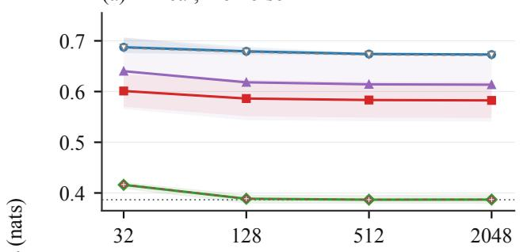

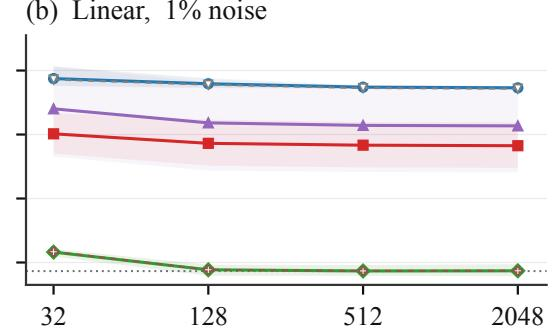

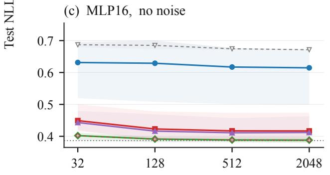

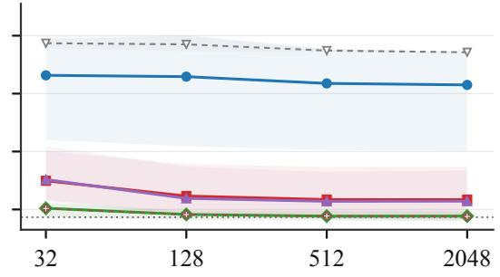  
Figure 6: Readout across budgets and noise.

Figure 6 shows every budget, both noise settings, both heads, and both soft JEPA branches on the constructed b = 2 task. All six representations use common axes and a shared legend. Bands are 95% two-axis bootstrap intervals over five encoder seeds and three shared-data repeats. Dashed controls use fixed representations with the same decoder and paired data; distinct markers distinguish overlapping curves. The dotted line is the complete-context Bayes risk, 0.386534 nats/token. The lower-panel scene control illustrates that equal clean alignment does not determine nonlinear prediction risk. Appendix I lists all eight budget/noise diferences for the primary representation pair. The linear ordering is positive in every cell. For noiseless MLP16 at n = 512, seed 3’s mean diference is −0.000281; at n = 2048 only four seed means are positive. The positive aggregate MLP diferences therefore coexist with variation in the ranking across encoder seeds and label budgets.

At $n = 5 1 2 , \sigma = 0 . 0 1$ , soft EP and whitening-plus-EP MLP test NLLs are 0.417081 and 0.414023. Their diferences from NTP are 0.028651 and 0.025593, with respective intervals [−0.000919, 0.085200] and $[ - 0 . 0 0 1 0 7 1 , 0 . 0 7 7 7 3 1 ]$ . Both intervals cross zero and include seed/cell reversals. The primary whitened-prediction branch has a larger aggregate gap from NTP than either soft Gaussian branch with a matched nonlinear head.

For $b = 0 .$ , the diagnostic uses seed 0 and two repeats with linear heads, for 32 total fits. The whitened JEPA minus NTP diferences at $( n , \sigma ) = ( 3 2 , 0 ) , ( 3 2 , 0 . 0 1 ) , ( 5 1 2 , 0 ) , ( 5 1 2 , 0 . 0 1 )$ are respectively $- 0 . 0 1 7 1 8 8 , - 0 . 0 1 7 4 2 4 , - 0 . 0 1 6 5 4 3 , - 0 . 0 1 6 5 4 6 .$ . This control reverses the main ordering. With b = 0, both ideal representations can attain the scene-based optimum; the finite-step NTP encoder can nevertheless have higher risk. This diagnostic uses one encoder seed.

## I.2 Information loss versus the remaining head gap

We evaluate both terms in the risk decomposition (4). The remaining head gap jointly contains capacity, finite training, regularization, and optimization efects; it is not solely sample error. For any representation channel independent of Y given the context, $R _ { \mathrm { o b s } } - R _ { \mathrm { c o n t e x t } } = I ( Y ; S , U \mid Z )$ in nats. This follows from the conditional-entropy characterization of optimal log loss [15].

For $\sigma > 0 .$ , Z follows a four-component Gaussian mixture and its posterior token probability can be evaluated directly. For $\sigma = 0$ , exact equality classes of the executed float64 values define the observation. No tolerance-based merging is used. The complete-context Bayes risk for $b = 2$ is 0.386534 nats/token. The following quantities use 128-node numerical Hermite quadrature.
<table><tr><td>Representation</td><td>Observation loss</td><td>Linear head gap</td><td>MLP16 head gap</td></tr><tr><td>Whitened prediction</td><td>0.225499</td><td>0.059349</td><td>0.003077</td></tr><tr><td>Soft pooled EP</td><td>0.027999</td><td>0.165827</td><td>0.002191</td></tr><tr><td>Whitening plus pooled EP</td><td>0.019571</td><td>0.207490</td><td>0.007651</td></tr><tr><td>NTP</td><td>≈0</td><td>0.000365</td><td>0.002184</td></tr><tr><td>Scene-only control</td><td>0.281874</td><td>0.001552</td><td>0.002657</td></tr><tr><td>Task-sufficient control</td><td>≈0</td><td>0.000301</td><td>0.002358</td></tr></table>

Table 7: Population risk decomposition at $n = 5 1 2 , \sigma = 0 . 0 1$ , averaged over seeds and repeats and evaluated by numerical quadrature. “Approximately $\mathrm { z e r o } ^ { \mathrm { \ ' } }$ denotes values below numerica resolution.

At $n = 2 0 4 8$ the primary JEPA MLP head gap falls to 0.000996, while the average observation loss remains 0.225499. Section 6 distinguishes exact-value injectivity from information available through a noisy channel.

The 64- and 128-node head-risk estimates difer by at most $4 . 4 4 \times 1 0 ^ { - 1 6 }$ , and observed Bayes risks by at most $2 . 9 5 \times 1 0 ^ { - 1 5 }$ , indicating numerical agreement.

## J Complete rational partition certificate

Table 8 supplies every rectangle used in the global phase coverage argument of Appendix B.4. For a scene-only vector $( b , b , c , c )$ , the phase coordinates satisfy $b = 8 \pi u / 5$ and $c = 8 \pi v / 5$ . The rectangles cover $[ - 1 , 1 ] ^ { 2 }$ and have disjoint interiors. At node $t _ { j } = 5 j / 8$ , the two-atom characteristic function is $( e ^ { i j \pi u } + e ^ { i j \pi v } ) / 2$

All interval endpoints are exact rational numbers. Each listed lower bound applies to $D _ { \mathrm { g r } }$ throughout the corresponding rectangle and is rounded downward to twelve decimal places from the outward interval enclosure. Every listed bound exceeds $1 / 5 0 ;$ the smallest exceeds 0.0200111. The conversion from discrepancy bounds to objective bounds is given in Appendix B.

Table 8: Rational partition certificate.
<table><tr><td>No.</td><td> $u _ { - }$ </td><td> $u _ { + }$ </td><td> $v _ { - }$ </td><td> $v _ { + }$ </td><td>Lower bound on  $D _ { \mathrm { g r } }$ </td></tr><tr><td>1</td><td>1/2</td><td>1</td><td>0</td><td>1</td><td>0.106992955312</td></tr><tr><td>2</td><td>0</td><td>1/2</td><td>1/2</td><td>1</td><td>0.106992955312</td></tr><tr><td>3</td><td> $1 / 4$ </td><td>1/2</td><td>0</td><td>1/2</td><td>0.128527744124</td></tr><tr><td>4</td><td>0</td><td>1/4</td><td>1/4</td><td>1/2</td><td>0.128527744124</td></tr><tr><td>5</td><td>1/8</td><td>1/4</td><td>0</td><td>1/4</td><td>0.136122246193</td></tr><tr><td>6</td><td>0</td><td>1/8</td><td>1/8</td><td>1/4</td><td>0.136122246193</td></tr><tr><td>7</td><td>0</td><td>1/8</td><td>0</td><td>1/8</td><td>0.055640786885</td></tr><tr><td>8</td><td>1/2</td><td>1</td><td>-1</td><td>0</td><td>0.106992955312</td></tr><tr><td>9</td><td>3/8</td><td>1/2</td><td>-1/4</td><td>0</td><td>0.093169239042</td></tr><tr><td>10</td><td>1/4</td><td>3/8</td><td>-1/8</td><td>0</td><td>0.027547335016</td></tr><tr><td>11</td><td>1/4</td><td>3/8</td><td>-1/4</td><td>-1/8</td><td>0.030515503813</td></tr><tr><td>12</td><td>1/4</td><td>1/2</td><td>-1/2</td><td>-1/4</td><td>0.140076106025</td></tr><tr><td>13</td><td>3/16</td><td>1/4</td><td>-1/16</td><td>0</td><td>0.077076164041</td></tr><tr><td>14</td><td>7/32</td><td>1/4</td><td>-1/8</td><td>-1/16</td><td>0.033446519418</td></tr><tr><td>15</td><td>3/16</td><td>7/32</td><td>-3/32</td><td>-1/16</td><td>0.043766160118</td></tr><tr><td>16</td><td>3/16</td><td>7/32</td><td>-1/8</td><td>-3/32</td><td>0.021659582602</td></tr><tr><td>17</td><td>1/8</td><td>3/16</td><td>-1/16</td><td>0</td><td>0.065032436996</td></tr><tr><td>18</td><td>5/32</td><td>3/16</td><td>-3/32</td><td>-1/16</td><td>0.040633798522</td></tr><tr><td>19</td><td>11/64</td><td>3/16</td><td>-1/8</td><td>-3/32</td><td>0.020246456354</td></tr><tr><td>20</td><td>5/32</td><td>11/64</td><td>-1/8</td><td>-3/32</td><td>0.021113680162</td></tr><tr><td>21</td><td>1/8</td><td>5/32</td><td>-1/8</td><td>-1/16</td><td>0.024897899225</td></tr><tr><td>22</td><td>7/32</td><td>1/4</td><td>-3/16</td><td>-1/8</td><td>0.031452014370</td></tr><tr><td>23</td><td>13/64</td><td>7/32</td><td>-5/32</td><td>-1/8</td><td>0.030642300628</td></tr><tr><td>24</td><td>3/16</td><td>13/64</td><td>-9/64</td><td>-1/8</td><td>0.025738318213</td></tr><tr><td>25</td><td>3/16</td><td>13/64</td><td>-5/32</td><td>-9/64</td><td>0.029651717957</td></tr><tr><td>26</td><td>3/16</td><td>7/32</td><td>-3/16</td><td>-5/32</td><td>0.037385192550</td></tr><tr><td>27</td><td>3/16</td><td>1/4</td><td>-1/4</td><td>-3/16</td><td>0.068158184816</td></tr><tr><td>28</td><td>23/128</td><td>3/16</td><td>-9/64</td><td>-1/8</td><td>0.022940307702</td></tr><tr><td>29</td><td>11/64</td><td>23/128</td><td>-9/64</td><td>-1/8</td><td>0.020753402532</td></tr><tr><td>30</td><td>23/128</td><td>3/16</td><td>-5/32</td><td>-9/64</td><td>0.024656824567</td></tr><tr><td>31</td><td>11/64</td><td>23/128</td><td>-5/32</td><td>-9/64</td><td>0.020763826933</td></tr><tr><td>32</td><td>21/128</td><td>11/64</td><td>-9/64</td><td>-1/8</td><td>0.020011105452</td></tr><tr><td>33</td><td>5/32</td><td>21/128</td><td>-9/64</td><td>-1/8</td><td>0.020328489150</td></tr><tr><td>34</td><td>21/128</td><td>11/64</td><td>-19/128</td><td>-9/64</td><td>0.021460556323</td></tr><tr><td>35</td><td>21/128</td><td>11/64</td><td>-5/32</td><td>-19/128</td><td>0.022241800413</td></tr><tr><td>36</td><td>5/32</td><td>21/128</td><td>-19/128</td><td>-9/64</td><td>0.020919833707</td></tr><tr><td>No.</td><td> $u _ { - }$ </td><td> $u _ { + }$ </td><td>U_</td><td> $v _ { + }$ </td><td>Lower bound on  $D _ { \mathrm { g r } }$ </td></tr><tr><td>37</td><td>5/32</td><td>21/128</td><td>-5/32</td><td>-19/128</td><td>0.020854210365</td></tr><tr><td>38</td><td>11/64</td><td>3/16</td><td>-3/16</td><td>-5/32</td><td>0.027006432780</td></tr><tr><td>39</td><td>21/128</td><td>11/64</td><td>-11/64</td><td>-5/32</td><td>0.023670830689</td></tr><tr><td>40</td><td>5/32</td><td>21/128</td><td>-11/64</td><td>-5/32</td><td>0.020541080218</td></tr><tr><td>41</td><td>5/32</td><td>11/64</td><td>-3/16</td><td>-11/64</td><td>0.027496222894</td></tr><tr><td>42</td><td>9/64</td><td>5/32</td><td>-9/64</td><td>-1/8</td><td>0.020071320341</td></tr><tr><td>43</td><td>19/128</td><td>5/32</td><td>-19/128</td><td>-9/64</td><td>0.021805057753</td></tr><tr><td>44</td><td>19/128</td><td>5/32</td><td>-5/32</td><td>-19/128</td><td>0.020887480015</td></tr><tr><td>45</td><td>9/64</td><td>19/128</td><td>-19/128</td><td>-9/64</td><td>0.023542148758</td></tr><tr><td>46</td><td>9/64</td><td>19/128</td><td>-5/32</td><td>-19/128</td><td>0.021805057753</td></tr><tr><td>47</td><td>1/8</td><td>9/64</td><td>-9/64</td><td>-1/8</td><td>0.027906682015</td></tr><tr><td>48</td><td>1/8</td><td>9/64</td><td>-5/32</td><td>-9/64</td><td>0.020071320341</td></tr><tr><td>49</td><td>19/128</td><td>5/32</td><td>-21/128</td><td>-5/32</td><td>0.020854210365</td></tr><tr><td>50</td><td>19/128</td><td>5/32</td><td>-11/64</td><td>-21/128</td><td>0.022241800413</td></tr><tr><td>51</td><td>9/64</td><td>19/128</td><td>-21/128</td><td>-5/32</td><td>0.020919833707</td></tr><tr><td>52</td><td>9/64</td><td>19/128</td><td>-11/64</td><td>-21/128</td><td>0.021460556323</td></tr><tr><td>53</td><td>19/128</td><td>5/32</td><td>-3/16</td><td>-11/64</td><td>0.024135790080</td></tr><tr><td>54</td><td>9/64</td><td>19/128</td><td>-3/16</td><td>-11/64</td><td>0.021895720944</td></tr><tr><td>55</td><td>17/128</td><td>9/64</td><td>-21/128</td><td>-5/32</td><td>0.022463125432</td></tr><tr><td>56</td><td>17/128</td><td>9/64</td><td>-11/64</td><td>-21/128</td><td>0.022424936622</td></tr><tr><td>57</td><td>1/8</td><td>17/128</td><td>-11/64</td><td>-5/32</td><td>0.021324454351</td></tr><tr><td>58</td><td>17/128</td><td>9/64</td><td>-3/16</td><td>-11/64</td><td>0.021428004784</td></tr><tr><td>59</td><td>1/8</td><td>17/128</td><td>-3/16</td><td>-11/64</td><td>0.022754701424</td></tr><tr><td>60</td><td>5/32</td><td>3/16</td><td>-1/4</td><td>-3/16</td><td>0.035094765240</td></tr><tr><td>61</td><td>9/64</td><td>5/32</td><td>-7/32</td><td>-3/16</td><td>0.028885860212</td></tr><tr><td>62</td><td>1/8</td><td>9/64</td><td>-7/32</td><td>-3/16</td><td>0.024663619036</td></tr><tr><td>63</td><td>1/8</td><td>5/32</td><td>-1/4</td><td>-7/32</td><td>0.043693954385</td></tr><tr><td>64</td><td>0</td><td>1/8</td><td>-1/8</td><td>0</td><td>0.055640786885</td></tr><tr><td>65</td><td>3/32</td><td>1/8</td><td>-5/32</td><td>-1/8</td><td>0.025338755960</td></tr><tr><td>66</td><td>7/64</td><td>1/8</td><td>-11/64</td><td>-5/32</td><td>0.023253273071</td></tr><tr><td>67</td><td>7/64</td><td>1/8</td><td>-3/16</td><td>-11/64</td><td>0.023561156316</td></tr><tr><td>68</td><td>3/32</td><td>7/64</td><td>-3/16</td><td>-5/32</td><td>0.025521547372</td></tr><tr><td>69</td><td>1/16</td><td>3/32</td><td>-3/16</td><td>-1/8</td><td>0.025260401259</td></tr><tr><td>70</td><td>3/32</td><td>1/8</td><td>-7/32</td><td>-3/16</td><td>0.021659582602</td></tr><tr><td>71</td><td>3/32</td><td>1/8</td><td>-1/4</td><td>-7/32</td><td>0.043342332898</td></tr><tr><td>72</td><td>1/16</td><td>3/32</td><td>-1/4</td><td>-3/16</td><td>0.039247869050</td></tr><tr><td>73</td><td>0</td><td>1/16</td><td>-1/4</td><td>-1/8</td><td>0.025821035502</td></tr><tr><td>74</td><td>1/8</td><td>1/4</td><td>-3/8</td><td>-1/4</td><td>0.030515503813</td></tr><tr><td>75</td><td>1/8</td><td>1/4</td><td>-1/2</td><td>-3/8</td><td>0.225500317491</td></tr><tr><td>76</td><td>0</td><td>1/8</td><td>-1/2</td><td>-1/4</td><td>0.027055221046</td></tr><tr><td>77</td><td>0</td><td>1/2</td><td>-1</td><td>-1/2</td><td>0.106992955312</td></tr><tr><td>78</td><td>-1/2</td><td>0</td><td>1/2</td><td>1</td><td>0.106992955312</td></tr><tr><td>79</td><td>-1/8</td><td>0</td><td>1/4</td><td>1/2</td><td>0.027055221046</td></tr><tr><td>80</td><td>-1/4</td><td>-1/8</td><td>3/8</td><td>1/2</td><td>0.225500317491</td></tr><tr><td>81</td><td>-1/4</td><td></td><td></td><td>3/8</td><td></td></tr><tr><td></td><td></td><td>-1/8</td><td>1/4</td><td></td><td>0.030515503813</td></tr><tr><td>82 83</td><td>-1/16 -3/32</td><td>0 -1/16</td><td>1/8 3/16</td><td>1/4 1/4</td><td>0.025821035502 0.039247869050</td></tr><tr><td>84</td><td>-1/8</td><td>-3/32</td><td>7/32</td><td>1/4</td><td>0.043342332898</td></tr><tr><td>85</td><td>-1/8</td><td>-3/32</td><td>3/16</td><td>7/32</td><td>0.021659582602</td></tr><tr><td>No.</td><td> $u _ { - }$ </td><td> $u _ { + }$ </td><td> $v _ { - }$ </td><td> $v _ { + }$ </td><td>Lower bound on  $D _ { \mathrm { g r } }$ </td></tr><tr><td>86</td><td>-3/32</td><td>-1/16</td><td>1/8</td><td>3/16</td><td>0.025260401259</td></tr><tr><td>87</td><td>-7/64</td><td>-3/32</td><td>5/32</td><td>3/16</td><td>0.025521547372</td></tr><tr><td>88</td><td>-1/8</td><td>-7/64</td><td>11/64</td><td>3/16</td><td>0.023561156316</td></tr><tr><td>89</td><td>-1/8</td><td>-7/64</td><td>5/32</td><td>11/64</td><td>0.023253273071</td></tr><tr><td>90</td><td>-1/8</td><td>-3/32</td><td>1/8</td><td>5/32</td><td>0.025338755960</td></tr><tr><td>91</td><td>-1/8</td><td>0</td><td>0</td><td>1/8</td><td>0.055640786885</td></tr><tr><td>92</td><td>-5/32</td><td>-1/8</td><td>7/32</td><td>1/4</td><td>0.043693954385</td></tr><tr><td>93</td><td>-9/64</td><td>-1/8</td><td>3/16</td><td>7/32</td><td>0.024663619036</td></tr><tr><td>94</td><td>-5/32</td><td>-9/64</td><td>3/16</td><td>7/32</td><td>0.028885860212</td></tr><tr><td>95</td><td>-3/16</td><td>-5/32</td><td>3/16</td><td>1/4</td><td>0.035094765240</td></tr><tr><td>96</td><td>-17/128</td><td>-1/8</td><td>11/64</td><td>3/16</td><td>0.022754701424</td></tr><tr><td>97</td><td>-9/64</td><td>-17/128</td><td>11/64</td><td>3/16</td><td>0.021428004784</td></tr><tr><td>98</td><td>-17/128</td><td>-1/8</td><td>5/32</td><td>11/64</td><td>0.021324454351</td></tr><tr><td>99</td><td>-9/64</td><td>-17/128</td><td>21/128</td><td>11/64</td><td>0.022424936622</td></tr><tr><td>100</td><td>-9/64</td><td>-17/128</td><td>5/32</td><td>21/128</td><td>0.022463125432</td></tr><tr><td>101</td><td>-19/128</td><td>-9/64</td><td>11/64</td><td>3/16</td><td>0.021895720944</td></tr><tr><td>102</td><td>-5/32</td><td>-19/128</td><td>11/64</td><td>3/16</td><td>0.024135790080</td></tr><tr><td>103</td><td>-19/128</td><td>-9/64</td><td>21/128</td><td>11/64</td><td>0.021460556323</td></tr><tr><td>104</td><td>-19/128</td><td>-9/64</td><td>5/32</td><td>21/128</td><td>0.020919833707</td></tr><tr><td>105</td><td>-5/32</td><td>-19/128</td><td>21/128</td><td>11/64</td><td>0.022241800413</td></tr><tr><td>106</td><td>-5/32</td><td>-19/128</td><td>5/32</td><td>21/128</td><td>0.020854210365</td></tr><tr><td>107</td><td>-9/64</td><td>-1/8</td><td>9/64</td><td>5/32</td><td>0.020071320341</td></tr><tr><td>108</td><td>-9/64</td><td>-1/8</td><td>1/8</td><td>9/64</td><td>0.027906682015</td></tr><tr><td>109</td><td>-19/128</td><td>-9/64</td><td>19/128</td><td>5/32</td><td>0.021805057753</td></tr><tr><td>110</td><td>-19/128</td><td>-9/64</td><td>9/64</td><td>19/128</td><td>0.023542148758</td></tr><tr><td>111</td><td>-5/32</td><td>-19/128</td><td>19/128</td><td>5/32</td><td>0.020887480015</td></tr><tr><td>112</td><td>-5/32</td><td>-19/128</td><td>9/64</td><td>19/128</td><td>0.021805057753</td></tr><tr><td>113</td><td>-5/32</td><td>-9/64</td><td>1/8</td><td>9/64</td><td>0.020071320341</td></tr><tr><td>114</td><td>-11/64</td><td>-5/32</td><td>11/64</td><td>3/16</td><td>0.027496222894</td></tr><tr><td>115</td><td>-21/128</td><td>-5/32</td><td>5/32</td><td>11/64</td><td>0.020541080218</td></tr><tr><td>116</td><td>-11/64</td><td>-21/128</td><td>5/32</td><td>11/64</td><td>0.023670830689</td></tr><tr><td>117</td><td>-3/16</td><td>-11/64</td><td>5/32</td><td>3/16</td><td>0.027006432780</td></tr><tr><td>118</td><td>-21/128</td><td>-5/32</td><td>19/128</td><td>5/32</td><td>0.020854210365</td></tr><tr><td>119</td><td>-21/128</td><td>-5/32</td><td>9/64</td><td>19/128</td><td>0.020919833707</td></tr><tr><td>120</td><td>-11/64</td><td>-21/128</td><td>19/128</td><td>5/32</td><td>0.022241800413</td></tr><tr><td>121</td><td>-11/64</td><td>-21/128</td><td>9/64</td><td>19/128</td><td>0.021460556323</td></tr><tr><td>122</td><td>-21/128</td><td>-5/32</td><td>1/8</td><td>9/64</td><td>0.020328489150</td></tr><tr><td>123</td><td>-11/64</td><td>-21/128</td><td>1/8</td><td>9/64</td><td>0.020011105452</td></tr><tr><td>124</td><td>-23/128</td><td>-11/64</td><td>9/64</td><td>5/32</td><td>0.020763826933</td></tr><tr><td>125</td><td>-3/16</td><td>-23/128</td><td>9/64</td><td>5/32</td><td>0.024656824567</td></tr><tr><td>126</td><td>-23/128</td><td>-11/64</td><td>1/8</td><td>9/64</td><td>0.020753402532</td></tr><tr><td>127</td><td>-3/16</td><td>-23/128</td><td>1/8</td><td>9/64</td><td>0.022940307702</td></tr><tr><td>128</td><td>-1/4</td><td>-3/16</td><td>3/16</td><td>1/4</td><td>0.068158184816</td></tr><tr><td>129</td><td>-7/32</td><td>-3/16</td><td>5/32</td><td>3/16</td><td>0.037385192550</td></tr><tr><td>130</td><td>-13/64</td><td>-3/16</td><td>9/64</td><td>5/32</td><td>0.029651717957</td></tr><tr><td>131</td><td></td><td></td><td></td><td></td><td></td></tr><tr><td>132</td><td>-13/64 -7/32</td><td>-3/16 -13/64</td><td>1/8 1/8</td><td>9/64 5/32</td><td>0.025738318213 0.030642300628</td></tr><tr><td>133</td><td>-1/4</td><td>-7/32</td><td>1/8</td><td>3/16</td><td>0.031452014370</td></tr><tr><td>134</td><td>-5/32</td><td>-1/8</td><td>1/16</td><td>1/8</td><td>0.024897899225</td></tr><tr><td> $\mathrm { N o } .$ </td><td> $u _ { - }$ </td><td> $u _ { + }$ </td><td> $v _ { - }$ </td><td> $v _ { + }$ </td><td>Lower bound on  $D _ { \mathrm { g r } }$ </td></tr><tr><td>135</td><td>-11/64</td><td>-5/32</td><td>3/32</td><td>1/8</td><td>0.021113680162</td></tr><tr><td>136</td><td>-3/16</td><td>-11/64</td><td>3/32</td><td>1/8</td><td>0.020246456354</td></tr><tr><td>137</td><td>-3/16</td><td>-5/32</td><td>1/16</td><td>3/32</td><td>0.040633798522</td></tr><tr><td>138</td><td>-3/16</td><td>-1/8</td><td>0</td><td>1/16</td><td>0.065032436996</td></tr><tr><td>139</td><td>-7/32</td><td>-3/16</td><td>3/32</td><td>1/8</td><td>0.021659582602</td></tr><tr><td>140</td><td>-7/32</td><td>-3/16</td><td>1/16</td><td>3/32</td><td>0.043766160118</td></tr><tr><td>141</td><td>-1/4</td><td>-7/32</td><td>1/16</td><td>1/8</td><td>0.033446519418</td></tr><tr><td>142</td><td>-1/4</td><td>-3/16</td><td>0</td><td>1/16</td><td>0.077076164041</td></tr><tr><td>143</td><td>-1/2</td><td>-1/4</td><td>1/4</td><td>1/2</td><td>0.140076106025</td></tr><tr><td>144</td><td>-3/8</td><td>-1/4</td><td>1/8</td><td>1/4</td><td>0.030515503813</td></tr><tr><td>145</td><td>-3/8</td><td>-1/4</td><td>0</td><td>1/8</td><td>0.027547335016</td></tr><tr><td>146</td><td>-1/2</td><td>-3/8</td><td>0</td><td>1/4</td><td>0.093169239042</td></tr><tr><td>147</td><td>-1</td><td>-1/2</td><td>0</td><td>1</td><td>0.106992955312</td></tr><tr><td>148</td><td>-1/8</td><td>0</td><td>-1/8</td><td>0</td><td>0.055640786885</td></tr><tr><td>149</td><td>-1/8</td><td>0</td><td>-1/4</td><td>-1/8</td><td>0.136122246193</td></tr><tr><td>150</td><td>-1/4</td><td>-1/8</td><td>-1/4</td><td>0</td><td>0.136122246193</td></tr><tr><td>151</td><td>-1/4</td><td>0</td><td>-1/2</td><td>-1/4</td><td>0.128527744124</td></tr><tr><td>152</td><td>-1/2</td><td>-1/4</td><td>-1/2</td><td>0</td><td>0.128527744124</td></tr><tr><td>153</td><td>-1/2</td><td>0</td><td>-1</td><td>-1/2</td><td>0.106992955312</td></tr><tr><td>154</td><td>-1</td><td>-1/2</td><td>-1</td><td>0</td><td>0.106992955312</td></tr></table>

Use of generative AI tools. Generative AI tools accessed through TRAE assisted with mathematical exploration and derivations, manuscript drafting, and analysis and verification code. The author is responsible for all claims, proofs, and results.