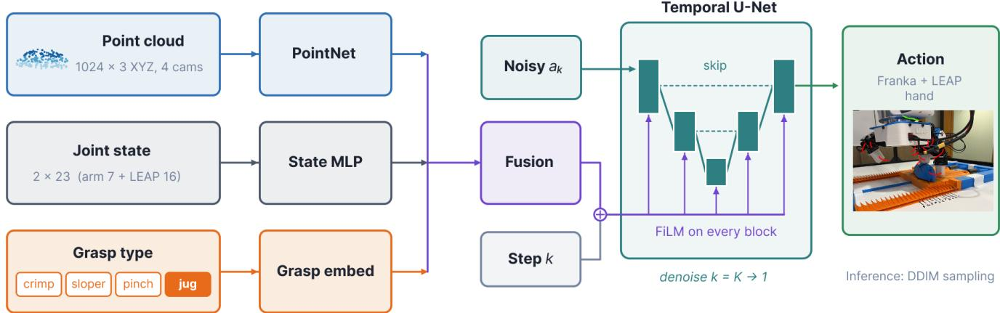
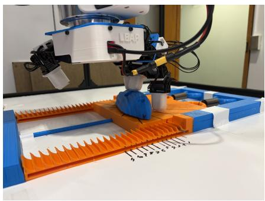
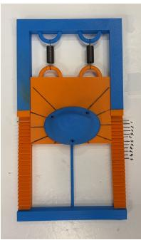
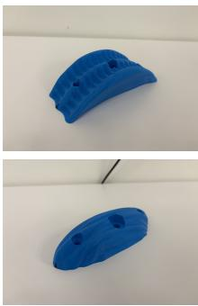
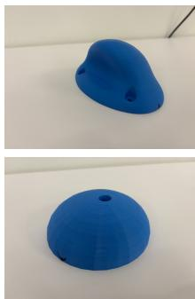
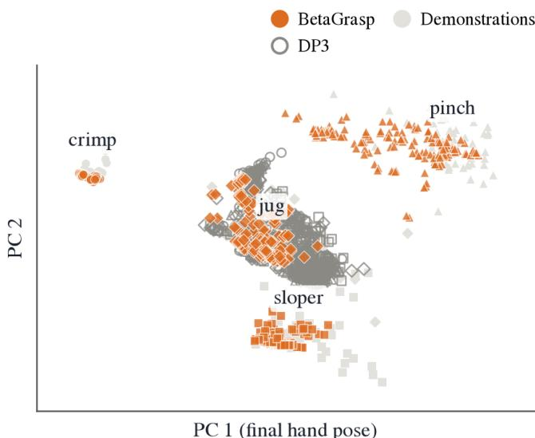
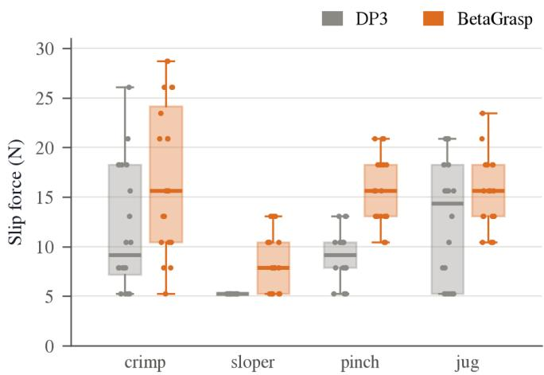

# Grasp-Taxonomy Conditioning as a Mode Switch for Dexterous Grasping of Climbing Holds

Rumi Loghmani, Abraham George, Amir Barati Farimani

Abstract— Dexterous grasping in robotics relies on distinct hand configurations depending on object geometry. We introduce BetaGrasp, a 3D diffusion policy that conditions a DP3- style point-cloud policy on a four-class grasp label (crimp, sloper, pinch, and jug), running on a Franka arm with a 16-DoF LEAP hand. We also introduce a climbing-hold benchmark: a spring testbed whose ratchet gives a slip-force reading in newtons. In our analysis the policy’s point-cloud encoder did not separate the four holds, so the scan alone gave it little to choose a grasp from. Without the label (a DP3-style baseline), simulated rollouts from the robot’s reset pose all end in a jug grasp, whatever the hold (25% correct grasp type, versus 94% for BetaGrasp). The label works as a switch for which grasp the policy performs. On 80 paired hardware trials, BetaGrasp raises average slip force from 9.6 N to 14.3 N, and grasps slipping fully off the hold drop from 44% of trials to 10%.

## I. INTRODUCTION

Imitation learning based manipulation has developed rapidly in the domain of parallel-jaw claw gripper endeffectors, while development on multi-finger end effectors has been slower to follow, because small changes in object geometry call for small changes in how the fingers are placed. When grasping a climbing hold, the grip used directly determines how much force the hand can support before slipping off [1], [2]. In this paper we split one high-level task (“grasp the hold”) into four grasps: crimp (fingertips curled tight on a thin edge), sloper (an open hand pressing on a rounded surface and relying on friction), pinch (the thumb squeezing against the fingers), and jug (fingers hooked into a deep handle). Each grasp uses a different hand shape and set of contacts, and each fails differently under load.

Diffusion-based behavior cloning is now a common choice for visuomotor policy learning [3], [4]. We build on DP3 [5], a 3D diffusion policy that takes point clouds as input (Fig. 1). Most diffusion policies model grasping as one action distribution conditioned on observations, with nothing in the input that says which grasp to use. A multi-grasp policy then has to infer the grasp from the observation alone, which is hard on climbing holds: in our analysis, after cropping and downsampling to 1024 points, the policy’s point-cloud encoder did not separate the four holds (§V-A), even though each needs a different grasp. Recent taxonomy-conditioned grasping methods [6], [7] do use grasp type, but they generate static grasp poses, not a policy that executes the grasp in closed loop.

We expected taxonomy conditioning to help as a mode selector. Without it, a policy trained on several grasp types could collapse to one of them, say a jug grasp every time, and fail on the other three holds. Our simulated rollouts support this. Starting from the robot’s reset pose, the baseline ends in a jug grasp on every hold.

Contributions:

1) A grasp-taxonomy-aware 3D diffusion policy (Beta-Grasp1), built on DP3 [5], that takes a grasp-type label as input along with the point cloud and robot state.

2) A climbing-hold manipulation benchmark: four holds that each need a different grasp, a spring testbed that constrains the hold to one axis, and a linear ratchet that records slip force, tested at five hold orientations.

3) An analysis of what the label changes: in simulated rollouts from the reset pose, the policy without it ends in a jug grasp on every hold, and on hardware that policy does best on the jug hold and worse on the other three.

## II. RELATED WORK

## A. Diffusion Policies for Robot Control

Diffusion Policy [3] treats behavior cloning as conditional denoising: a temporal U-Net conditioned on observations generates action trajectories. Diffusion lets it represent multimodal action distributions [4], and DDIM [8] shortens inference.

DP3 [5] replaces image inputs with point clouds, encoded by a lightweight PointNet-style encoder [9]. iDP3 [10] adapts it to humanoid robots, using egocentric point clouds so that no camera calibration is needed. GenDP [11] adds 3D semantic fields to generalize across object instances within a category. Diffusion models have also been used to generate dexterous grasps [12]–[14].

## B. Dexterous Manipulation Data and Embodiments

DexCap [15] collects dexterous demonstrations with a portable motion-capture system. Among teleoperation systems [16]–[18], we build directly on the open-source OpenVR codebase [19], a VR teleoperation system for the Franka arm originally paired with an Allegro hand. We retarget its hand interface to the LEAP Hand v1 [20], chosen for its wider finger range of motion. UniDexFPM [21] learns functional pre-grasp manipulation with a diffusion policy distilled from reinforcement-learning teachers, and CrossDex [22] transfers grasping across different hands through an eigengrasp action space. We instead keep one hand and vary the grasp.

  
Fig. 1. BetaGrasp architecture. Point cloud, proprioception, and grasp-type label are encoded independently and fused into a 512-d conditioning vector z that feature-wise conditions a 1D temporal U-Net diffusion denoiser. The DP3 baseline drops only the grasp-type branch (orange) (37,248 parameters, 0.1% of 34.6 M).

## C. Grasp Taxonomy and Type-Conditioned Grasping

Human grasp taxonomies sort grasps into categories by opposition type, thumb position, and power versus precision [23]–[25]. The closest work is Dexonomy [6], which synthesizes dexterous grasps for 31 of the 33 types in the GRASP taxonomy [25] and trains a type-conditioned generator that takes single-view point clouds (82.3% realworld success on a Shadow Hand). Its output is a set of static hand poses (pre-grasp, grasp, squeeze), not a learned closed-loop policy. Language-conditioned grasp generation [7] also produces static poses. OmniDexVLG [26] uses a vision-language model to reason about grasp type and affordance, then generates grasp poses from a partial point cloud. DexGraspVLA [27] pairs a vision-language planner with a diffusion execution policy, but the planner chooses which object to grasp, not how, and the policy is not conditioned on grasp type.

We are not aware of prior work that conditions a closedloop imitation-learning policy for an arm–hand system on grasp type. Table I compares the methods.

## III. METHOD: GRASP-TAXONOMY-AWARE 3D DIFFUSION POLICY

## A. Problem Formulation

Each episode is a grasp of one climbing hold seated on the spring testbed (§IV-B). At each control step t, the policy observes (i) a fused point cloud $P \in \mathbb { R } ^ { N \times 3 }$ (captured once per episode after parking the arm out of the cameras field of view), (ii) a proprioceptive state history $s _ { t - T _ { o } + 1 : t }$ over observation horizon $T _ { o } .$ , and (iii) a grasp-type label $g \in \{ 0 , 1 , 2 , 3 \}$ corresponding to {crimp, sloper, pinch, jug}. The policy outputs a joint-space action chunk $a _ { t : t + T _ { p } - 1 }$ over prediction horizon $T _ { p } ;$ the controller executes the first

TABLE I  
POSITIONING AGAINST RELATED DEXTEROUS-HAND METHODS.
<table><tr><td>Method</td><td>Point-cloud input</td><td>Grasp-type conditioning</td><td>Trajectory policy</td></tr><tr><td>DP3 [5]</td><td>√</td><td>×</td><td>√</td></tr><tr><td>Dexonomy [6]</td><td>√</td><td>√</td><td>×</td></tr><tr><td>Grasp as You Say [7]</td><td>√</td><td>√</td><td>×</td></tr><tr><td>OmniDexVLG [26]</td><td>√</td><td>√</td><td>×</td></tr><tr><td>DexGraspVLA [27]</td><td>×</td><td>X</td><td>√</td></tr><tr><td>BetaGrasp</td><td>√</td><td>√</td><td>√</td></tr></table>

$T _ { a } \ \leq \ T _ { p }$ steps before replanning. The operator supplies g during data collection and at deployment.

Following Chi et al. [3], we model the conditional distribution over action sequences as a denoising diffusion process, $p ( a _ { t : t + T _ { p } - 1 } \mid P , s _ { t - T _ { o } + 1 : t } , g )$ , learned from teleoperated demonstrations via supervised diffusion loss.

## B. Architecture

Our policy follows the DP3 design [5]: a point-cloud encoder produces a 3D scene embedding, fused with robot state and a grasp-type embedding to condition a 1D temporal U-Net that parameterizes the diffusion denoiser (Fig. 1).

Point cloud encoder: A PointNet-style encoder [9] (channels $3  6 4  1 2 8  2 5 6$ , no T-Net, max-pool, linear projection) maps $P \in \mathbb { R } ^ { 1 0 2 4 \times 3 } ~ \mathrm { t o }$ a 256-dimensional feature vector $z _ { P } .$ . We use XYZ-only points (no color) to reduce sensitivity to appearance and lighting [5].

State and grasp-type conditioning: Robot proprioception over $T _ { o } ~ = ~ 2$ timesteps is embedded via an MLP to obtain $z _ { s } \in \mathbb { R } ^ { 1 2 8 }$ . The grasp-type label g is one-hot encoded and passed through a small MLP to obtain $z _ { g } \in \mathbb { R } ^ { 6 4 }$ . The conditioning vector is $z = \mathrm { M L P } ( [ z _ { P } ; z _ { s } ; z _ { g } ] ) \stackrel { \sim } { \in } \mathbb { R } ^ { 5 1 2 }$ . The baseline is the same network without the $z _ { g }$ branch, trained on the same data. We call it DP3 for short, but it is our own implementation of the DP3 design [5], not the released DP3 code. The encoder, state MLP, diffusion backbone, and all hyperparameters are identical between the two.

  
(a)

  
(b)

  
(c)  
Fig. 2. Spring-testbed benchmark. (a) The LEAP Hand v1 (16-DoF, on a Franka Emika Panda) executes a taxonomy-conditioned grasp on a 3D-printed jug hold seated on the testbed. (b) Top-down view: two extension springs in parallel (top) pull the orange deck back along a single axis directed toward the robot base, a center guide rod keeps the deck on that axis, and a pin through the deck rides over the toothed ratchet strips on both sides, holding the deck at its farthest point; the marked teeth (1–11) show how far the hold traveled before the grasp slipped. Lines drawn on the deck guide the five hold orientations. (c) The four 3D-printed climbing holds: pinch (narrow elongated protrusion), jug (domed body with deep finger pocket), crimp (thin edg with shallow finger ridges), and sloper (convex hemispherical surface)

Diffusion model: The denoiser is a 1D temporal U-Net [28] with down dims (256, 512, 1024) and feature-wise conditioning on z [29], trained with a cosine β schedule [30] and 100 DDPM steps. At inference we use DDIM sampling with 10 denoising steps for 10 Hz real-time control [8].

## C. Training

Training follows standard DDPM supervision [4]: sample diffusion step $k ,$ add noise to the ground-truth action chunk $a _ { 0 } .$ and minimize the noise-prediction loss conditioned on observations and (if applicable) grasp type. We use AdamW [31] with learning rate $1 0 ^ { - 4 } , \beta = ( 0 . 9 5 , 0 . 9 9 9 )$ , and weight decay $1 0 ^ { - 6 } ;$ batch size 128; 3000 epochs with 500-step linear warmup and cosine decay; power-law EMA with max decay 0.9999; gradient clip 1.0; and PyTorch AMP mixed precision. Point clouds are augmented with Gaussian jitter $( \sigma \ = \ 0 . 0 0 2 \mathrm { m } )$ and 5% random point dropout. State and action are min–max normalized to [−1, 1].

## IV. SPRING-TESTBED BENCHMARK

## A. Robot Platform and Sensing

The benchmark uses a Franka Emika Panda arm (7-DoF) paired with a LEAP Hand v1 [20] (16-DoF, 4 fingers × 4 joints each). Arm control is provided by frankapy [32] under Cartesian impedance control. Scene observations are fused point clouds from four Intel RealSense D415/D455 cameras (848×480, 30 Hz), transformed to a common world frame via offline checkerboard extrinsics calibration, cropped to a workspace bounding box, outlier-filtered, and downsampled to exactly 1024 points via farthest-point sampling. The state and action spaces are both 23-dimensional (7 arm joints + 16 hand joints, absolute radians). The control loop runs at 10 Hz with per-step joint deltas clamped to ±0.05 rad for safety.

## B. Spring Displacement Testbed and Ratcheting Mechanism

Evaluation uses a linearly constrained spring platform that seats each climbing hold (3D-printed from Thingiverse models [33]–[36]) and restricts displacement to a single axis directed toward the robot base (180◦ in the world XYplane). Two identical extension springs in parallel provide the restoring force, empirically calibrated as

$$
F ( x ) = 5 . 2 5 \mathrm { N } + 0 . 2 8 \mathrm { N } / \mathrm { m m } \times x ,
$$

where x is the hold’s displacement in millimeters. A linear pawl ratchet (11 teeth, 9.3 mm per tooth, 102.3 mm maximum travel) captures the hold’s peak displacement even when the hold slips mid-trial (Fig. 2a,b). After each rollout the operator reads the ratchet tooth count $n \in \{ 0 , \ldots , 1 1 \}$ from which the script computes displacement and slip force. Each trial therefore gives a slip force in newtons, in steps of about 2.6 N, instead of a pass/fail outcome. Holds are evaluated at five orientations relative to the pull axis: $0 ^ { \circ } ,$ ±22.5◦, and ±45◦. We did not test beyond ±45◦, where we expected the hold to slip regardless of the grasp.

## C. Dataset

The training set contains 200 teleoperated demonstrations (50 per grasp type × 4 types) totaling 27,821 timesteps at 10 Hz (46.4 minutes of teleop). Episode lengths range from 61 to 279 steps (median 132). All episodes were collected by a single operator via Meta Quest 2 VR hand-tracking, on the same spring testbed used for evaluation. For each hold, the operator recorded 10 episodes at one orientation before rotating the hold to the next, giving 10 episodes at each of the five orientations (50 per hold, 200 in total). Orientation is not given to the policy. Every episode starts with the same reset posture. Each episode stores time-aligned 23-dim state and 23-dim joint-space action, the grasp-type label, and one fused point cloud captured with the arm parked out of view of all four cameras. The hold does not move during a demonstration, so one scan per episode is enough.

## D. Paired Evaluation Protocol

We evaluate the two policies in pairs. Both trials of a pair use the same physical hold position, and the order alternates from pair to pair, so each model runs first in exactly 10 of the 20 pairs for every grasp type. We capture a fresh point cloud before every trial, because the first trial’s contact can nudge the hold (median shift 1.2 mm between the two scans of a pair). After each rollout the arm pulls along the testbed’s axis under Cartesian impedance control, with stiffness $k _ { x } =$ 4000 N/m along the pull, $k _ { y } = 1 0 0 \mathrm { N } / \mathrm { m }$ laterally, and $k _ { z } =$ 2000 N/m vertically to hold up the ∼1 kg LEAP hand. The pull is 13 cm. The operator then enters the ratchet reading.

  
Fig. 3. Final hand poses of simulated closed-loop rollouts started from the deployment reset pose, projected onto the first two principal components of the demonstrators’ final hand poses (light gray; marker shape = hold). BetaGrasp rollouts (orange) mostly land on the demonstrated grasp for their hold; DP3 rollouts (gray outline) end in the jug grasp on every hold.

## V. EXPERIMENTS

Prior to the paired evaluation we stated two hypotheses: H1 (primary): BetaGrasp achieves higher slip force than DP3 on all four grasp types; and H2 (ordering): the gains are largest on the grasps that need precise finger placement (crimp, sloper, pinch) and smallest on the jug, which tolerates imprecise placement.

## A. Mechanistic Analysis

One explanation for why the label would help is mode selection: without it, a policy trained on several grasp types may fall back on a single behavior instead of the grasp each hold needs. We test this with two offline analyses of the trained policies.2

Latent-space separation: We pass the first frame of every pre-rig training episode through DP3’s encoder and measure how well the grasp types separate, using the silhouette score and 5-NN accuracy under stratified 5-fold crossvalidation. With no label, DP3’s fused encoder output reaches 99% 5-NN accuracy and silhouette 0.32. The point-cloud branch alone does not separate the types (silhouette −0.03,

  
Fig. 4. Slip force per hold on the spring testbed, 20 trials per policy per hold. Boxes show the interquartile range and median; dots are individual trials. The 5.2 N floor is the spring preload, reached when the grasp slips off before the hold moves.

TABLE II  
SLIP FORCE PER HOLD, AVERAGED OVER 20 TRIALS PER POLICY, AND THE SHARE OF TRIALS WHERE THE HAND SLIPPED OFF BEFORE MOVING THE HOLD (5.2 N PRELOAD).
<table><tr><td rowspan="2">Hold</td><td colspan="2">Avg. slip force (N)</td><td colspan="2">Slipped off (%)</td></tr><tr><td>DP3</td><td>BetaGrasp</td><td>DP3</td><td>BetaGrasp</td></tr><tr><td>Crimp</td><td>11.8</td><td>17.4</td><td>25</td><td>5</td></tr><tr><td>Sloper</td><td>5.2</td><td>8.2</td><td>100</td><td>35</td></tr><tr><td>Pinch</td><td>9.0</td><td>15.8</td><td>20</td><td>0</td></tr><tr><td>Jug</td><td>12.5</td><td>15.8</td><td>30</td><td>0</td></tr><tr><td>All</td><td>9.6</td><td>14.3</td><td>44</td><td>10</td></tr></table>

5-NN accuracy 39%, chance 25%), so the separation comes from the proprioception channel.

Closed-loop rollouts from the reset pose: On hardware, every trial starts from one fixed reset pose. We simulate each policy in closed loop from that reset pose, for 25 inputs per grasp type and $K \ = \ 8$ rollouts each (commanded joints tracked exactly), and assign each final hand pose to the nearest demonstrator grasp-type mean. BetaGrasp reaches the correct grasp in 94% (crimp, sloper, jug 100%; pinch 76%, with the misses landing on jug), and DP3 in only 25%: all 800 of its rollouts end in a jug grasp, whatever the hold (Fig. 3).

Interpretation: These results fit the mode-selector account. In our analysis the point-cloud encoder does not separate the four holds, so at deployment, where every trial starts from the same reset pose, nothing in DP3’s input identifies the grasp and it falls back on a single one. The label supplies the missing information.

## B. Hardware Evaluation

We ran 80 paired trials, or 160 rollouts (4 pairs per orientation $\times ~ 5$ orientations × 4 holds), in a single ∼7-hour session with a single operator.

H1: slip force: BetaGrasp’s average slip force is higher on all four holds (Fig. 4, Table II). Overall it rises from 9.6 N to 14.3 N (+4.7 N), and across the 80 pairs BetaGrasp beats DP3 in 61, ties 14, and loses 5.

H2: ordering across grasp types: H2 holds only in part. The gains are largest on pinch (+6.8 N, with BetaGrasp winning all 20 pairs) and crimp (+5.6 N). The jug gain is smaller (+3.3 N), and the jug is DP3’s strongest hold (12.5 N). Jug is the grasp DP3 fell back on in our simulated rollouts, so on the jug hold it likely performed the right grasp; we did not log which grasp was executed on hardware. The sloper gain is the smallest (+3.0 N), but DP3’s sloper average sits at the 5.2 N floor: it slipped off in all 20 trials.

Slip-offs: Much of the gain comes from fewer grasps slipping straight off the hold. DP3 slipped off before moving the hold in 44% of trials; BetaGrasp did in 10% (Table II).

Orientation profile: For BetaGrasp, every grasp type is weakest at +45◦ (pinch ties at −45◦). Crimp varies most with orientation (from 26.8 N at −22.5◦ to 7.9 N at +45◦), consistent with the thin crimp edge leaving little angular tolerance. With only four trials per orientation, these are trends rather than firm differences.

## VI. LIMITATIONS AND FUTURE WORK

BetaGrasp was tested on a single embodiment, a Franka arm with a LEAP Hand. The label enters through a small separate branch (0.1% of the parameters), so we expect the same conditioning to carry over to other dexterous hands such as the Allegro or Shadow Hand, but testing it there is the most direct next step. The training data come from one operator and one physical hold per grasp type, so part of each per-type gain may come from that particular hold rather than the grasp type; demonstrations from several operators on several holds per type, evaluated on holds held out from training, would separate the two. The grasp label is currently supplied by the operator, and a vision-language model that predicts it from an image of the hold, as OmniDexVLG [26] does for grasp poses, would make the system fully autonomous.

The spring testbed loads the grasp along one fixed axis; a wall-mounted or multi-axis rig would test the multidirectional and sustained loads of real climbing. The closedloop rollouts in §V-A are simulated (commanded joints tracked exactly) and the latent analysis uses the pre-rig checkpoints, so repeating both on the spring-testbed models, with rollouts on hardware, would confirm them. Finally, BetaGrasp’s 14.3 N average is a moderate grip, which more demonstrations per grasp type or per-grasp tuning may improve.

## VII. CONCLUSION

We presented BetaGrasp, a grasp-taxonomy-conditioned 3D diffusion policy for grasping climbing holds with a dexterous hand, and a climbing-hold benchmark built on a spring testbed whose ratchet records slip force. Started from its reset pose without the grasp label, our policy fell back on a single grasp in simulation; with the label, it held on with more force on every hold on hardware (14.3 N versus 9.6 N on average). The label acts as a switch for which grasp the policy performs.

Reproducibility: Code, data, checkpoints, and the CAD files, 3D-print files, and parts list for the spring testbed will be released.

## REFERENCES

[1] A. Schweizer, “Biomechanical properties of the crimp grip position in rock climbers,” Journal of Biomechanics, vol. 34, no. 2, pp. 217–223, 2001.

[2] A. M. Amca, L. Vigouroux, S. Aritan, and E. Berton, “Effect of hold depth and grip technique on maximal finger forces in rock climbing,” Journal of Sports Sciences, vol. 30, no. 7, pp. 669–677, 2012.

[3] C. Chi, Z. Xu, S. Feng, E. Cousineau, Y. Du, B. Burchfiel, R. Tedrake, and S. Song, “Diffusion policy: Visuomotor policy learning via action diffusion,” The International Journal of Robotics Research, vol. 44, no. 10-11, pp. 1684–1704, 2025.

[4] J. Ho, A. Jain, and P. Abbeel, “Denoising diffusion probabilistic models,” in Advances in Neural Information Processing Systems (NeurIPS), 2020. [Online]. Available: https://arxiv.org/abs/2006.11239

[5] Y. Ze, G. Zhang, K. Zhang, C. Hu, M. Wang, and H. Xu, “3d diffusion policy: Generalizable visuomotor policy learning via simple 3d representations,” arXiv preprint arXiv:2403.03954, 2024.

[6] J. Chen, Y. Ke, L. Peng, and H. Wang, “Dexonomy: Synthesizing all dexterous grasp types in a grasp taxonomy,” in Robotics: Science and Systems (RSS), 2025. [Online]. Available: https: //arxiv.org/abs/2504.18829

[7] Y.-L. Wei, J.-J. Jiang, C. Xing, X.-T. Tan, X.-M. Wu, H. Li, M. Cutkosky, and W.-S. Zheng, “Grasp as you say: Language-guided dexterous grasp generation,” in Advances in Neural Information Processing Systems (NeurIPS), 2024. [Online]. Available: https: //arxiv.org/abs/2405.19291

[8] J. Song, C. Meng, and S. Ermon, “Denoising diffusion implicit models,” in International Conference on Learning Representations (ICLR), 2021. [Online]. Available: https://arxiv.org/abs/2010.02502

[9] C. R. Qi, H. Su, K. Mo, and L. J. Guibas, “PointNet: Deep learning on point sets for 3d classification and segmentation,” in Proceedings of the IEEE Conference on Computer Vision and Pattern Recognition (CVPR), 2017. [Online]. Available: https://arxiv.org/abs/1612.00593

[10] Y. Ze, Z. Chen, W. Wang, T. Chen, X. He, Y. Yuan, X. B. Peng, and J. Wu, “Generalizable humanoid manipulation with improved 3d diffusion policies,” in Conference on Robot Learning (CoRL), 2024. [Online]. Available: https://arxiv.org/abs/2410.10803

[11] Y. Wang, G. Yin, B. Huang, T. Kelestemur, J. Wang, and Y. Li, “GenDP: 3d semantic fields for category-level generalizable diffusion policy,” in Conference on Robot Learning (CoRL), 2024. [Online]. Available: https://arxiv.org/abs/2410.17488

[12] Z. Weng, H. Lu, D. Kragic, and J. Lundell, “DexDiffuser: Generating dexterous grasps with diffusion models,” IEEE Robotics and Automation Letters, 2024. [Online]. Available: https://arxiv.org/ abs/2402.02989

[13] R. Wang, J. Zhang, J. Chen, Y. Xu, P. Li, T. Liu, and H. Wang, “DexGraspNet: A large-scale robotic dexterous grasp dataset for general objects based on simulation,” in IEEE International Conference on Robotics and Automation (ICRA), 2023. [Online]. Available: https://arxiv.org/abs/2210.02697

[14] Y. Xu, W. Wan, J. Zhang, H. Liu, Z. Shan, H. Shen, R. Wang, H. Geng, Y. Weng, J. Chen, T. Liu, L. Yi, and H. Wang, “UniDexGrasp: Universal robotic dexterous grasping via learning diverse proposal generation and goal-conditioned policy,” in Proceedings of the IEEE/CVF Conference on Computer Vision and Pattern Recognition (CVPR), 2023. [Online]. Available: https://arxiv.org/abs/2303.00938

[15] C. Wang, H. Shi, W. Wang, R. Zhang, L. Fei-Fei, and C. K. Liu, “DexCap: Scalable and portable mocap data collection system for dexterous manipulation,” in Robotics: Science and Systems (RSS), 2024. [Online]. Available: https://arxiv.org/abs/2403.07788

[16] Y. Qin, W. Yang, B. Huang, K. Van Wyk, H. Su, X. Wang, Y.-W. Chao, and D. Fox, “AnyTeleop: A general vision-based dexterous robot arm-hand teleoperation system,” in Robotics: Science and Systems (RSS), 2023. [Online]. Available: https://arxiv.org/abs/2307.04577

[17] X. Cheng, J. Li, S. Yang, G. Yang, and X. Wang, “Open-TeleVision: Teleoperation with immersive active visual feedback,” in Conference on Robot Learning (CoRL), 2024. [Online]. Available: https://arxiv.org/abs/2407.01512

[18] T. Z. Zhao, V. Kumar, S. Levine, and C. Finn, “Learning fine-grained bimanual manipulation with low-cost hardware,” in Robotics: Science and Systems (RSS), 2023. [Online]. Available: https://arxiv.org/abs/2304.13705

[19] A. George, A. Bartsch, and A. B. Farimani, “OpenVR: Teleoperation for manipulation,” arXiv preprint arXiv:2305.09765, 2023. [Online]. Available: https://arxiv.org/abs/2305.09765

[20] K. Shaw, A. Agarwal, and D. Pathak, “LEAP Hand: Lowcost, efficient, and anthropomorphic hand for robot learning,” in Robotics: Science and Systems (RSS), 2023. [Online]. Available: https://arxiv.org/abs/2309.06440

[21] T. Wu, Y. Gan, M. Wu, J. Cheng, Y. Yang, Y. Zhu, and H. Dong, “UniDexFPM: Universal dexterous functional pre-grasp manipulation via diffusion policy,” in IEEE International Conference on Robotics and Automation (ICRA), 2024. [Online]. Available: https://arxiv.org/abs/2403.12421

[22] H. Yuan, B. Zhou, Y. Fu, and Z. Lu, “Cross-embodiment dexterous grasping with reinforcement learning,” in International Conference on Learning Representations (ICLR), 2025. [Online]. Available: https://arxiv.org/abs/2410.02479

[23] J. R. Napier, “The prehensile movements of the human hand,” The Journal of Bone and Joint Surgery. British Volume, vol. 38-B, no. 4, pp. 902–913, 1956.

[24] M. R. Cutkosky, “On grasp choice, grasp models, and the design of hands for manufacturing tasks,” IEEE Transactions on Robotics and Automation, vol. 5, no. 3, pp. 269–279, 1989.

[25] T. Feix, J. Romero, H.-B. Schmiedmayer, A. M. Dollar, and D. Kragic, “The GRASP taxonomy of human grasp types,” IEEE Transactions on Human-Machine Systems, vol. 46, no. 1, pp. 66–77, 2016.

[26] L. Zhang, D. Zheng, K. Bai, Z. Bing, Z.-C. Marton, Z. Chen, A. C. Knoll, and J. Zhang, “OmniDexVLG: Learning dexterous grasp generation from vision language modelguided grasp semantics, taxonomy and functional affordance,” arXiv preprint arXiv:2512.03874, 2025. [Online]. Available: https://arxiv.org/abs/2512.03874

[27] Y. Zhong, X. Huang, R. Li, C. Zhang, Z. Chen, T. Guan, F. Zeng, K. N. Lui, Y. Ye, Y. Liang, Y. Yang, and Y. Chen, “DexGraspVLA: A vision-language-action framework towards general dexterous grasping,” in AAAI Conference on Artificial Intelligence, 2026. [Online]. Available: https://arxiv.org/abs/2502.20900

[28] O. Ronneberger, P. Fischer, and T. Brox, “U-Net: Convolutional networks for biomedical image segmentation,” in Medical Image Computing and Computer-Assisted Intervention (MICCAI), 2015. [Online]. Available: https://arxiv.org/abs/1505.04597

[29] E. Perez, F. Strub, H. de Vries, V. Dumoulin, and A. Courville, “FiLM: Visual reasoning with a general conditioning layer,” in AAAI Conference on Artificial Intelligence, 2018. [Online]. Available: https://arxiv.org/abs/1709.07871

[30] A. Q. Nichol and P. Dhariwal, “Improved denoising diffusion probabilistic models,” in International Conference on Machine Learning (ICML), 2021. [Online]. Available: https://arxiv.org/abs/ 2102.09672

[31] I. Loshchilov and F. Hutter, “Decoupled weight decay regularization,” in International Conference on Learning Representations (ICLR), 2019. [Online]. Available: https://openreview.net/forum? id=Bkg6RiCqY7

[32] K. Zhang, M. Sharma, J. Liang, and O. Kroemer, “A modular robotic arm control stack for research: Franka-Interface and FrankaPy,” arXiv preprint arXiv:2011.02398, 2020. [Online]. Available: https: //arxiv.org/abs/2011.02398

[33] BMO FUSE, “Not enough crimps sample pack climbing holds,” Thingiverse, thing:6375816, file Sample Crimp 1.stl. [Online]. Available: https://www.thingiverse.com/thing:6375816

[34] mjdrum92, “Climbing hold sloper 1,” Thingiverse, thing:2633613. [Online]. Available: https://www.thingiverse.com/thing:2633613

[35] BMO FUSE, “Green fossilized incut pinch climbing hold,” Thingiverse, thing:6320163. [Online]. Available: https://www. thingiverse.com/thing:6320163

[36] SarDou3D, “Jugs sample pack,” Thingiverse, thing:6580253, file CH2 S.stl. [Online]. Available: https://www.thingiverse.com/thing: 6580253