# How Path Integral Difusion Decides a Finite Spin Glass: Stochastic Localization, Level-Resolved Information and Spectral Decision Times

Michael (Misha) Chertkov∗

November 10, 2026

## Abstract

When an Artificial Intelligence (AI) difusion-type generator samples a frustrated spin glass, which macroscopic alternatives does it decide first, and when? We study this for bridge-difusion models of the Path Integral Difusion (PID) type started from a point source. We show that every isotropic PID is a time-changed Gaussian stochastic localization, and conversely every signal-to-noise schedule is realized by a PID protocol. What a continuous-time generator decides therefore does not depend on the protocol, which only sets when and at what cost. We describe the generator’s state by its partial commitments: the probabilities it assigns, at each moment, to nested classes of configurations fixed by the target. The partial commitments are martingales that move only along class contrasts. Their ensemble average gives the information about each level at an exact rate set by squared magnetization contrasts. Each split is decided, approximately, like a binary Gaussian channel at signal-to-noise ratio 1.04/λP, with $\lambda _ { P }$ the leading eigenvalue of the parent’s correlation matrix. The theory is applied to Bethe-lattice and Sherrington–Kirkpatrick (SK) glasses with up to 24 spins. It is observed generically that a trajectory first shifts its weight to one of the two mirror halves of the zero-field measure and then to the glassy classes inside it. These classes appear near the glass transition, keep their identity on cooling and are absent in a ferromagnet on the same graphs. Sparse (Bethe) and dense (SK) glasses difer in how often and how strongly such classes exist, not in how trajectories commit to them. Nested glassy levels have similar $\lambda _ { P }$ and are decided together, so a trajectory commits in one or two distinct events—the mirror choice and a compound glassy decision—which separate further with coupling and size, as the spectra predict. For a generator that takes finitely many steps, the protocol matters through the late, local stage rather than the macroscopic decisions. Sampled posteriors at $N = 3 2$ , 64 and small trained denoisers show the same sequence.

## 1 Introduction

A generator that turns noise into a sample of a structured distribution must, at some point, commit to one of the distribution’s macroscopic alternatives: a class of images, a molecular conformation, a symmetry-broken sector. Which alternatives are decided first, and when? For AI difusion models this question has been studied as speciation—trajectories commit to a class at a time set by the spectrum of the data covariance, and later, in a collapse or memorization regime, to individual samples [1–5]. Successive commitments follow class structure [6–8], and transitions along the denoising path can make sampling hard [9].

Why spin glasses. Our interest is in AI generation in general—images, molecules, materials, physical fields [10–13]; Sec. 6 returns to these applications. For such data neither the classes nor the generator’s posterior along its path can be computed, so what a generator decides, and when, can only be inferred. We therefore pose the question where everything can be computed exactly and the answer is least trivial. Spin glasses qualify on both counts: their Gibbs measure is known exactly. Frustration organizes the low-temperature configurations into many competing groups—in the thermodynamic limit into the nested hierarchy of Parisi’s solution [14–17]—so the target is as hierarchical as any distribution we know. And spin glasses are among the hardest distributions to sample [18, 19]. We use the two canonical mean-field glasses, both with a glass transition at finite temperature: the Sherrington–Kirkpatrick (SK) model, with couplings between all pairs of spins [20], and the Bethe-lattice glass, with couplings on a sparse random graph [21, 22]. At $N \leq 2 4$ the phase transitions of these models are smoothed into crossovers, and all quantities of interest— classes, posteriors and information—can be computed without approximation by enumerating all $2 ^ { N }$ configurations. The tools we develop—classes defined from the target, the generator’s partial commitments to them, and a spectral prediction for when each is decided—require only a posterior or a trained denoiser, and so apply to other targets as well.

Three notions. We study one finite Ising spin glass in zero field and one generative AI generator – Path Integral Difusion (PID) from a point source [23–25]. Three notions organize the paper (Fig. 1).

• Classes are groups of configurations fixed by the target: the two mirror halves of the measure, and inside each half nested groups of low-energy configurations in diferent valleys of the energy (panel a).

• Partial commitments are the generator’s state: at every moment a trajectory assigns a probability to every class. These probabilities start at the equilibrium class masses and end at one for the classes of the endpoint. A trajectory has committed to a class when its probability is close to one. Following the partial commitments shows how a trajectory descends the tree, level by level or several levels at once (panel b).

• The clock. PID has a physical time t and a protocol, the stifness ν(t) of a harmonic confinement. What the generator knows depends only on an internal clock γ, the signal-to-noise ratio; the protocol only maps γ onto t (panel c).

## Results – Theory.

• (i) PID from a point source and Gaussian stochastic localization are one process seen on diferent clocks: each isotropic PID protocol is a time change of it, and each signal-to-noise schedule comes from some protocol (Proposition 1). The generator’s knowledge is the same glass in a random field correlated with the endpoint, the tilt of stochastic localization [19, 26, 27].

• (ii) The partial commitments to the target’s classes evolve as martingales driven only by class contrasts, and averaging them over trajectories gives an exact rate for the information about each level (Proposition 3).

• (iii) Conditioned on its parent, each split is approximately a noisy one-bit measurement, a binary Gaussian channel, which predicts the decision time $\gamma _ { 1 / 2 } \simeq 1 . 0 4 4 / \lambda _ { P }$ and a window of a factor 25 that does not narrow with N: a crossover, not a phase transition. Biroli et al. [2] gave the inverse leading eigenvalue for the first speciation. We derive the constant and the window, apply the estimate recursively over a hierarchy, and measure its accuracy.

Results – Experiments. The experiments use exactly enumerated Bethe and Sherrington– Kirkpatrick (SK) glasses with up to 24 spins, sampled posteriors at N = 32, 64, matched controls and trained denoisers.

• (iv) Every trajectory first commits to one of the two mirror halves—a choice every ordered zero-field Ising model makes—and then to glassy classes within it. These classes are found near and below the glass transition, persist as the target is cooled, and do not exist in a ferromagnet on the same graphs (Secs. 5.2–5.4).

• (v) Nested glassy levels are decided together: a trajectory commits 2.6 times on average at N = 16 but in 1.5 distinct events, the mirror choice and a compound glassy decision, which separate further with coupling and size as the spectra predict. Bethe and SK glasses give the same per-trajectory picture; they difer in how often glassy classes exist and how strong they are.

• (vi) With an exact drift and a finite number of steps, the choice of protocol is felt mainly in the final, local stage, where individual spins are fixed, rather than in the macroscopic decisions; this gives a practical rule for allocating steps (Sec. 5.8).

Scope. Everything is at finite N. Hierarchy means a nested family of classes of one Gibbs measure whose splits pass stated tests, including collectivity. Whether its levels are decided in sequence is measured, not assumed. We make no claim about replica-symmetry breaking or N → ∞. The representations used here presuppose the endpoint. The representations analyse what an ideal or learned generator decides and do not make sampling easier.

Organization. Section 2: PID as stochastic localization and what the protocol can change. Section 3: classes, partial commitments and when each split is decided. Section 4: how classes are identified. Section 5: experiments. Section 6: discussion. Appendices: proofs, a positive control with a known tree, contrast identities used as numerical tools, numerical methods, and a map from figures to scripts. Code, data and notebooks are available at https://github.com/mchertkov/ SpinGlassHierarchy.

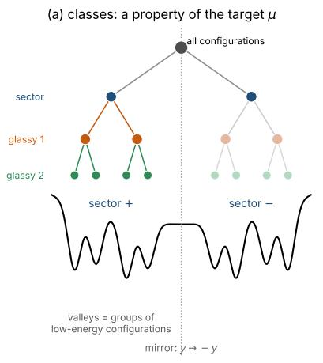

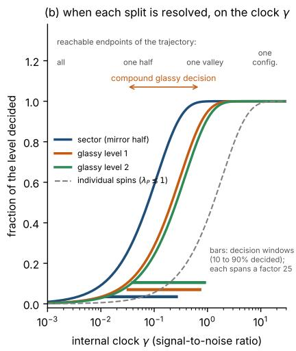

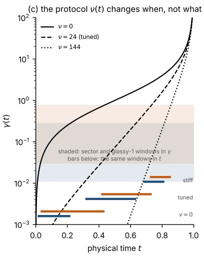  
Figure 1: Classes, partial commitments and clocks. (a) Classes are a property of the target: the two mirror halves of the zero-field measure (sectors), and inside each half nested groups of low-energy configurations (glassy classes) in diferent valleys of the energy; the right tree mirrors the left one. (b) Every split divides a parent class into two children: the whole measure into the two sectors, a sector into its two glassy classes, and so on. On the internal clock $\gamma ,$ the information that the generator holds about which child its endpoint belongs to rises along a universal binary-channel curve, $I _ { \mathrm { b i n } } ( \gamma \lambda _ { P } )$ , where $\lambda _ { P }$ is the leading eigenvalue of the parent’s correlation matrix (Sec. 3.4); a large $\lambda _ { P }$ means an early decision. The curves are drawn with the values of the $N = 2 4$ glass of Fig. 2: $\lambda _ { P } = 1 3 . 5$ for the sector (whose parent is the whole measure), and $\lambda _ { P } = 4 . 9$ and 4.0 for the first two glassy levels. Bars mark the 10–90% windows, each a factor 25 wide. Glassy levels with similar $\lambda _ { P }$ are decided together, as one compound decision. Individual spins follow at $\gamma \sim 1$ . (c) The protocol $\nu ( t )$ (Eq. (3)) only maps the internal clock onto physical time: the same windows in γ (shaded) fall at diferent times t (bars) for three harmonic stifnesses.

## 2 Path Integral Difusion as time-changed stochastic localization

## 2.1 Target and generator

The target is one Ising instance in zero field on a graph $\mathcal { G } = ( \nu , \mathcal { E } )$ , with vertices $\mathcal { V } = \{ 1 , \ldots , N \}$ (the spins) and edges $\mathcal { E } \subseteq \{ ( i , j ) : 1 \leq i < j \leq N \}$ (the interacting pairs, each listed once). With couplings $J = ( J _ { i j } \mid ( i , j ) \in \mathcal { E } )$

$$
\mu ( y ) = \frac { 1 } { Z } \exp \Big ( \sum _ { ( i , j ) \in \mathcal { E } } J _ { i j } y _ { i } y _ { j } \Big ) , \qquad y \in \{ \pm 1 \} ^ { N } , \qquad J = \beta _ { J } J ^ { ( 0 ) } .\tag{1}
$$

Here $\beta _ { J }$ is the inverse temperature of the target and $J ^ { ( 0 ) } = ( J _ { i j } ^ { ( 0 ) } \ | \ ( i , j ) \in \mathcal { E } )$ a fixed disorder realization of Gaussian couplings. The experiments use two graphs $( { \bar { \mathrm { S e c . 5 . 1 } } } )$ : a random three-regular graph, on which every spin has three neighbours and $\vert \mathcal { E } \vert = 3 N / 2$ (Bethe glass), and the complete graph, on which every pair interacts and $| \mathcal { E } | = N ( N - 1 ) / 2$ (SK glass). The generator is the controlled difusion in $\mathbb { R } ^ { N }$

$$
d X _ { t } = u ( t , X _ { t } ) d t + d W _ { t } , \qquad X _ { 0 } = 0 ,\tag{2}
$$

whose drift minimizes

$$
\begin{array} { r } { \mathbb { E } \int _ { 0 } ^ { 1 } \big ( \frac { 1 } { 2 } \| u \| ^ { 2 } + \frac { 1 } { 2 } \nu ( t ) \| X _ { t } \| ^ { 2 } \big ) d t \quad \mathrm { s u b j e c t ~ t o } \quad X _ { 1 } \sim \mu . } \end{array}\tag{3}
$$

The protocol $\nu ( t )$ , the stifness of a harmonic confinement, is a property of the generator, not of the target. Constant ν is harmonic PID [23] and $\nu = 0$ the Schrödinger–Föllmer process [28–30].

Because the start is a point, the optimal path measure is the reference process (Brownian motion weighted by the confinement) reweighted by a function of the endpoint alone [29]. Conditioned on $X _ { 1 } = y \mathrm { ~ a ~ }$ path is therefore a Gaussian bridge,

$$
X _ { t } \mid y \sim { \mathcal { N } } ( a ( t ) y , \sigma ^ { 2 } ( t ) I ) , \qquad \kappa = { \frac { a } { \sigma ^ { 2 } } } , \qquad \gamma = a \kappa = { \frac { a ^ { 2 } } { \sigma ^ { 2 } } } ,\tag{4}
$$

with bridge drift $\kappa ( t ) y - c ( t ) x$ . The coeficients obey $\kappa ^ { \prime } = c \kappa$ and the Riccati equation $c ^ { \prime } = c ^ { 2 } - \nu$ (Appendix A). For constant $\nu ,$ with $S = \sqrt { \nu }$

$$
\begin{array} { c } { \displaystyle { a = \frac { \sinh S t } { \sinh S } , \qquad \sigma ^ { 2 } = \frac { \sinh S t \sinh S ( 1 - t ) } { S \sinh S } , \qquad \kappa = \frac { S } { \sinh S ( 1 - t ) } , \nonumber } } \\ { \displaystyle { c = S \coth S ( 1 - t ) , \qquad \gamma = \frac { S \sinh S t } { \sinh S \sinh S ( 1 - t ) } , } } \end{array}\tag{5}
$$

which reduce to $a = t , \sigma ^ { 2 } = t ( 1 - t ) , \kappa = c = 1 / ( 1 - t )$ and $\gamma = t / ( 1 - t )$ at $\nu = 0$ . The quantity $\gamma ( t )$ is the signal-to-noise ratio of $X _ { t }$ as an observation of the endpoint.

## 2.2 The generator’s knowledge is the same glass in a singleton field

What does the generator know about its endpoint at time t? By Bayes’ rule, the posterior of the endpoint given $X _ { t } = x$ is the prior $\mu ( y )$ times the Gaussian likelihood $( 4 ) , \exp \big ( - \| x - a y \| ^ { 2 } / 2 \sigma ^ { 2 } \big )$ Because every spin configuration has the same length, $\| y \| ^ { 2 } = N$ , the likelihood depends on y only through exp(κ x · y), and

$$
P _ { t } ( y \mid x ) = \frac { 1 } { Z ( h ) } \exp \Big ( \sum _ { ( i , j ) \in \mathcal { E } } J _ { i j } y _ { i } y _ { j } + h \cdot y \Big ) , \qquad h = \kappa ( t ) x .\tag{6}
$$

The posterior is the same Ising model as the target, with the same couplings, in an additional external field $h = \kappa x$ that acts on each spin separately (a “singleton” field); the field carries what the generator has learned about its endpoint. This is the tilt of stochastic localization [26, 31]; for the SK model El Alaoui et al. [19] write the same Ising model in an external field. The density of the generator is a Gaussian envelope times $Z ( \kappa x ) / Z ( 0 )$ , and the score and the optimal drift are linear in the posterior mean,

$$
\boldsymbol { \hat { y } } ( t ; \boldsymbol { x } ) = \mathbb { E } [ \boldsymbol { Y } \mid \boldsymbol { X _ { t } } = \boldsymbol { x } ] = \boldsymbol { \nabla _ { h } } \log Z ( \boldsymbol { h } ) \big | _ { h = \kappa x } , \qquad \boldsymbol { u } ( t , \boldsymbol { x } ) = \kappa ( t ) \boldsymbol { \hat { y } } ( t ; \boldsymbol { x } ) - c ( t ) \boldsymbol { x } .\tag{7}
$$

Generating a glass therefore amounts to computing, at every step, the magnetization $\hat { y }$ of the same glass in a random field h. Exact enumeration, Monte Carlo, belief propagation or a trained network are diferent ways of doing so; in this paper we use exact enumeration for $N \leq 2 4$

## 2.3 Time change, its converse, and what the protocol can change

From physical time to an internal clock. So far everything has been written in the physical time $t \in [ 0 , 1 ]$ , and every protocol $\nu ( t )$ gives a diferent process $X _ { t } .$ with a diferent drift and a diferent speed. We now change the time variable and find that, seen on a suitable clock, all these processes are one and the same. The clue is in the posterior (6): the generator’s knowledge of its endpoint enters only through the field $h _ { t } = \kappa ( t ) X _ { t }$ . Given the endpoint $y ,$ the bridge (4) gives $X _ { t } \sim \mathcal { N } ( a y , \sigma ^ { 2 } I )$ , and therefore

$$
h _ { t } \mid y \sim \mathcal { N } ( \kappa a y , \kappa ^ { 2 } \sigma ^ { 2 } I ) = \mathcal { N } ( \gamma y , \gamma I ) ,\tag{8}
$$

because $\kappa a = \gamma$ and $\kappa ^ { 2 } \sigma ^ { 2 } = a ^ { 2 } / \sigma ^ { 2 } = \gamma$ . At every time, the field is a noisy observation of the endpoint, $\gamma y$ plus Gaussian noise of variance $\gamma ;$ how informative it is depends on t and on the protocol only through the signal-to-noise ratio $\gamma ( t )$ . This suggests using $\gamma$ itself as the clock, $t \to \gamma ( t )$ Proposition 1 below shows that the statement holds not only at each time separately but for whole trajectories: on the clock $\gamma ,$ the field process of every isotropic PID is the same universal process, $H _ { \gamma } = \gamma Y + B _ { \gamma } - \mathrm { a }$ Brownian motion that drifts with velocity equal to the endpoint—which is the process of Gaussian stochastic localization. Diferent protocols merely run through this process at diferent speeds in physical time. Conversely, every way of running through it corresponds to some PID protocol.

Proposition 1 (PID and stochastic localization). Let $H _ { \gamma } = \gamma Y + B _ { \gamma }$ with $Y \sim \mu$ and B a standard Brownian motion independent of Y .

(i) For every unit-noise PID with isotropic confinement $\frac { 1 } { 2 } \nu ( t ) \| x \| ^ { 2 } , \gamma ^ { \prime } = \kappa ^ { 2 }$ and the field process satisfies $h _ { t } = \kappa ( t ) X _ { t } = H _ { \gamma ( t ) }$ in law, jointly in t and $Y$ . In the generator’s own filtration $d H _ { \gamma } = \hat { y } d \gamma + d \bar { B } _ { \gamma }$ with an innovation Brownian motion B¯.

(ii) Conversely, let $\gamma \in C ^ { 2 } [ 0 , 1 )$ be increasing with $\gamma ( 0 ) = 0$ and $( 1 - t ) ^ { 2 } \gamma ^ { \prime } ( t )  1$ as $t \to 1$ . Set $\kappa = \sqrt { \gamma ^ { \prime } } , c = \kappa ^ { \prime } / \kappa$ and $\nu = c ^ { 2 } - c ^ { \prime }$ . Then $X _ { t } = H _ { \gamma ( t ) } / \kappa ( t )$ solves $d X _ { t } = \left[ \kappa \hat { y } - c X _ { t } \right] d t + d W _ { t }$ with $X _ { 0 } = 0$ and $X _ { 1 } = Y$ : it is the optimal PID for the confinement $\scriptstyle { \frac { 1 } { 2 } } \nu ( t ) \| x \| ^ { 2 }$ , which may be negative.

(iii) For an anisotropic confinement with matrix $B ( t )$ , the bridge is $\textstyle { \mathcal { N } } ( A _ { t } y , \Sigma _ { t } )$ and the tilt is exp $\begin{array} { r } { ( y ^ { \top } A _ { t } ^ { \top } \Sigma _ { t } ^ { - 1 } x - \frac { 1 } { 2 } y ^ { \top } \Gamma _ { t } y ) } \end{array}$ with the matrix clock $\Gamma _ { t } = A _ { t } ^ { \top } \Sigma _ { t } ^ { - 1 } A _ { t } ;$ its of-diagonal part adds time-dependent pair couplings to (6). Matrix-valued localization schemes [26, 27] are of this type.

Part (i) for $\nu = 0$ , and the analogous statement for Ornstein–Uhlenbeck difusions, are the change of time and scale of Montanari [27, Sec. 1.3]; that losses and posteriors depend only on the signal-to-noise ratio underlies variational difusion models [32], and Grenioux et al. [33] use general schedules with MCMC posteriors along the path. What the proposition adds is the explicit map between schedules and PID protocols, in both directions.

What the protocol cannot change. By part (i) the generator’s knowledge, as a function of $\gamma _ { ; }$ has the same law for every protocol. Everything defined from it—the partial commitments of Sec. 3.2, hence which classes are decided, in which order and with which probabilities, how often a trajectory recrosses, how much information it holds—is therefore independent of $\nu ( t )$ . We work on the internal clock $\gamma$ throughout, and on the scaled clock $\tau = N \gamma$ for macroscopic decisions.

What the protocol does change. (a) When each decision happens in physical time: a decision at $\gamma _ { * }$ happens at $t _ { * } = \gamma ^ { - 1 } ( \gamma _ { * } )$ . Because $\gamma ( t )$ is increasing, the protocol can stretch or compress the intervals between decisions but never reorder them. For example, for constant ν and large $S = \sqrt \nu$ one has $\gamma ( t ) \simeq 2 S e ^ { - 2 S ( 1 - t ) } ;$ a decision that occurs at $N \gamma = \tau _ { * }$ is therefore moved to a prescribed physical time $t _ { 0 }$ by choosing S such that $2 S ( 1 - t _ { 0 } ) \simeq$ log N + log(2S/τ∗). (b) What it costs:

Proposition 2 (Control cost and information). For every unit-noise isotropic PID and $0 < t < 1$

$$
\frac { 1 } { 2 } \int _ { 0 } ^ { t } \mathbb { E } \| u ( s , X _ { s } ) \| ^ { 2 } d s = \frac { N } { 2 } \int _ { 0 } ^ { t } \big [ a ^ { \prime } ( s ) ^ { 2 } + c ( s ) ^ { 2 } \sigma ^ { 2 } ( s ) \big ] d s - \mathrm { I } ( Y ; X _ { t } ) .\tag{9}
$$

The first term is the cost of steering to a known endpoint; the information the generator has acquired about its endpoint is exactly the “kinetic energy” it saves. For $\nu = 0$ the baseline is $- { \frac { N } { 2 } } \log ( 1 - t )$ ; since $\operatorname { I } ( Y ; X _ { t } ) \leq N \log 2 .$ , the cost of reaching a discrete target diverges as $t \to 1$ , so (3) is to be read as the limit of costs up to $t < 1$ . (c) How well a discretized generator works. A generator that takes finitely many steps in t places them on the $\gamma$ axis according to its protocol; Sec. 5.8 measures what this changes.

## 3 Classes, partial commitments and decision times

This section sets up the language used in all experiments. It answers four questions in turn: what can be decided (classes, which are a property of the target, Sec. 3.1); how one trajectory decides (its partial commitments, Sec. 3.2); what the ensemble of trajectories learns about each level (information per level, Sec. 3.3); and when each split is decided (the binary-channel prediction, Sec. 3.4).

## 3.1 Classes: a property of the target

Classes, levels and hierarchies. A class is a set of spin configurations. A level is a partition of the whole configuration space $\{ \pm 1 \} ^ { N }$ into classes: every configuration belongs to exactly one class of the level. A hierarchy is a nested sequence of levels $C _ { 0 } \prec C _ { 1 } \prec \cdots \prec C _ { L }$ , in which every class of level ℓ lies inside one class of level $\ell - 1$ , called its parent; the classes of level ℓ that lie inside a given class of level $\ell - 1$ are its children. In this paper every split is binary: a class has either two children or none. We write $c \in C _ { \ell }$ for a class of level ℓ and $\pi ( c ) \in C _ { \ell - 1 }$ for its parent. When we speak of $^ { 6 6 } \mathrm { a }$ class $c ^ { \mathfrak { I } }$ without naming a level, c may belong to any level, not only to the finest one: masses, magnetizations and partial commitments are defined for every class of every level. Because each level is a partition of the whole space, a class that is not split further reappears unchanged at the next level, as its own single child; in the tree diagrams of Figs. 2 and 4 such a class is drawn as an open circle.

The branch of a configuration. Every configuration y lies in exactly one class of each level. We write $c _ { \ell } ( y ) \in C _ { \ell }$ for the class of level ℓ that contains $y .$ . The classes containing $y$ form a nested chain,

$$
c _ { 0 } ( y ) \supseteq c _ { 1 } ( y ) \supseteq \cdots \supseteq c _ { L } ( y ) ,\tag{10}
$$

which we call the branch of y: $c _ { 0 } ( y )$ is its sector, $c _ { L } ( y )$ its finest class, and $c \varrho _ { - 1 } ( y )$ is the parent of $c _ { \ell } ( y )$ . For the endpoint $Y$ of a trajectory, $c _ { \ell } ( Y )$ is the endpoint’s class at level $\ell ,$ the class that the trajectory must eventually choose at that level. Equality $c _ { \ell } ( y ) = c _ { \ell - 1 } ( y )$ means that the class containing $y$ is not split at level $\ell ;$ there is then nothing to decide at that level on this branch.

Classes are fixed by the target. Classes are computed from the equilibrium measure $\mu$ alone, before any trajectory is generated (Sec. 4). They are therefore a property of the target, not of the generator. Changing $\beta _ { J }$ changes $\mu$ and can change the classes and the hierarchy (Sec. 5.4).

Sectors and the mirror choice. Level 0 splits the measure into two mirror halves. In zero field—the only case considered here—the measure is symmetric under spin inversion, $\mu ( y ) = \mu ( - y )$ With $g$ one of the two ground states, the sector of a configuration is $s ( y ) = \mathrm { s i g n } ( y \cdot g )$ , and the two sectors are the two classes of level $0 ,$ each of mass $\frac { 1 } { 2 }$ . A level and a sector are therefore not the same thing: a level is a partition, and a sector is one of the two classes of level 0. Choosing a sector breaks the spin-inversion symmetry; we call this choice the mirror choice. Every ordered Ising model, a ferromagnet included, has this level, so it carries no information about glassiness. Statements about glassy structure therefore concern the levels inside a sector, which we call glassy levels (levels 1 to L).

Alignment and overlaps. To compare configurations from the two sectors, we flip every configuration of the sector of $- g$ as a whole and work with the aligned configuration $\tilde { y } = s ( y ) y$ , which always lies in the sector of $g .$ Since spin inversion maps $\mu$ onto itself, nothing is lost by doing so. This is the only gauge choice in the paper: all magnetizations, overlaps and classes inside a sector refer to aligned configurations, and the two sectors carry mirror-image copies of the same tree. The overlap of two configurations is $Q ( y , y ^ { \prime } ) = \tilde { y } \cdot \tilde { y } ^ { \prime } / N ;$ it is 1 for identical configurations (or mirror images) and close to $0$ for unrelated ones. The magnetization of a class $c$ is the mean aligned configuration in that class, $\mu _ { c } = \mathbb { E } _ { \mu } [ \tilde { Y } \mid Y \in c ]$ , a vector with one component per spin, and its mass is $\omega _ { c } = \mu ( c )$ . The mean overlap within a class c is the average of $Q$ over two configurations drawn independently from $\mu$ restricted to $c ;$ it equals $\| \mu _ { c } \| ^ { 2 } / N$ . The mean overlap between two classes c and $c ^ { \prime }$ equals $\mu _ { c } \cdot \mu _ { c ^ { \prime } } / N$ . A partition into classes is informative when configurations in the same class overlap more than configurations in diferent classes.

Parents, children and their magnetizations. Parents and children are classes, not configurations. A split takes one class $P ,$ the parent, and divides the configurations it contains into two disjoint classes, the children, which together contain every configuration of $P .$ . Like every class, the parent and the children have a mass and a magnetization. The magnetization of a class $c$ is the vector

$$
\mu _ { c } = \mathbb { E } _ { \mu } \big [ \tilde { Y } \mid Y \in c \big ] = \frac { 1 } { \omega _ { c } } \sum _ { y \in c } \mu ( y ) \tilde { y } \ \in [ - 1 , 1 ] ^ { N } ,\tag{11}
$$

whose $i \mathrm { - t h }$ component is the average aligned value of spin i over the configurations of $^ { c , }$ weighted by the Gibbs measure. We write $\mu { } _ { P }$ for the magnetization of the parent and $\mu _ { 1 } , \mu _ { 2 }$ for those of its two children. Because the children divide the parent, $\mu _ { P } = \omega _ { 1 } \mu _ { 1 } + \omega _ { 2 } \mu _ { 2 }$ , with the children’s masses $\omega _ { 1 , 2 }$ normalized within $P .$

How a split is made: cutting the hypercube. Geometrically, each spin configuration $y \in$ $\{ \pm 1 \} ^ { N }$ is a corner of the hypercube $[ - 1 , 1 ] ^ { N } \subset \mathbb { R } ^ { N }$ , and the aligned configurations $\tilde { y }$ are the corners that lie in the sector of $g .$ A magnetization (11) is a weighted average of corners, so it is a point inside the cube: the Gibbs-weighted centre of mass of the corners that make up the class. A split of $P$ is a cut of its corners by a plane. Given the two children’s centres of mass $\mu _ { 1 }$ and $\mu _ { 2 } .$ , the plane is the one that bisects the segment between them at a right angle, and each corner of $P$ goes to the child on whose side it lies, that is, to the nearer centre:

$$
\begin{array} { r } { y \in \mathrm { c h i l d ~ 1 } \iff \left\| \tilde { y } - \mu _ { 1 } \right\| < \left\| \tilde { y } - \mu _ { 2 } \right\| \iff ( \mu _ { 1 } - \mu _ { 2 } ) \cdot \tilde { y } > \frac { 1 } { 2 } \big ( \| \mu _ { 1 } \| ^ { 2 } - \| \mu _ { 2 } \| ^ { 2 } \big ) , } \end{array}\tag{12}
$$

and $y \in$ child 2 otherwise. The definition is self-consistent: $\mu _ { 1 }$ and $\mu _ { 2 }$ must be the magnetizations of the very children that the plane defines. The two-means procedure of Sec. 4 finds such a pair by alternating the two steps—assign the corners to the nearer centre, then recompute the centres—until nothing changes. Applying the rule once per split along a branch, a class of level ℓ is the set of corners of its sector that lie on prescribed sides of at most ℓ such planes.

What a class looks like. A useful picture, which is approximately but not exactly right, is that two sibling classes difer by a block of spins with opposite typical values. The components of a class’s magnetization with $\lvert \mu _ { c , i } \rvert$ close to one are spins that are nearly frozen inside the class, and components close to zero are spins that still fluctuate. For example, the magnetizations of the two glassy classes of Fig. 2a have opposite signs on 8 of the 24 spins. Classifying configurations by these 8 spins alone assigns 92% of the probability mass to the correct class, but only 36% of the configurations of the smaller class and 76% of those of the larger one match their class’s pattern on all 8 spins. The block summarizes the split; the plane (12) defines it.

Split variance. A split of a parent $P$ into two children with masses $\omega _ { 1 , 2 }$ (normalized within $P ,$ so that $\omega _ { 1 } + \omega _ { 2 } = 1 )$ and magnetizations $\mu _ { 1 , 2 }$ is characterized by its split variance, the part of the parent’s variance that the split explains,

$$
\Delta = \omega _ { 1 } \omega _ { 2 } \| \mu _ { 1 } - \mu _ { 2 } \| ^ { 2 } \leq \lambda _ { P } ,\tag{13}
$$

where $\lambda _ { P }$ is the leading eigenvalue of the parent’s correlation matrix $\operatorname { C o v } _ { \mu ( \cdot | P ) } ( Y )$ . The bound is the law of total variance: the parent’s correlation matrix is the sum of the average correlation matrix within the children and the between-children matrix $\omega _ { 1 } \omega _ { 2 } ( \mu _ { 1 } - \mu _ { 2 } ) ( \mu _ { 1 } - \mu _ { 2 } ) ^ { \top }$ , whose only nonzero eigenvalue is $\Delta .$ . Two examples show what $\Delta$ measures. (i) Split the configurations according to the sign of a single spin $y _ { i }$ that is uncorrelated with the others. The children then difer only in the i-th component of their magnetization, which is +1 in one child and −1 in the other, so $\| \mu _ { 1 } - \mu _ { 2 } \| ^ { 2 } = 4$ and $\Delta = 4 \omega _ { 1 } \omega _ { 2 } \leq 1$ . (ii) If instead the children difer by a block of $n$ spins that flip together, each such spin contributes up to 4 to $\| \mu _ { 1 } - \mu _ { 2 } \| ^ { 2 }$ , and $\Delta$ grows in proportion to n (Sec. 5.2 works out an example). A split involving a finite fraction of the spins has $\Delta = O ( N )$ . We call a split collective if $\Delta \geq 2$ , that is, if it accounts for at least as much variance as two independent spins. For the sector the parent is the whole measure, and $\lambda _ { P } = \lambda _ { 1 }$ is the leading eigenvalue of the equilibrium correlation matrix $C _ { 0 }$ , which is of order N in an ordered system.

## 3.2 Partial commitments: the state of a trajectory

Definition. At clock γ – introduced in Section 2.3 – the generator’s knowledge of its endpoint is the posterior (6). Summed over the configurations of a class, it gives the partial commitment of the

trajectory to that class, and dividing by the partial commitment to the parent gives the conditional partial commitment:

$$
p _ { c } ( \gamma ) = \mathbb { P } ( Y \in c \mid H _ { \gamma } ) , \qquad q _ { c } ( \gamma ) = \frac { p _ { c } ( \gamma ) } { p _ { \pi ( c ) } ( \gamma ) } = \mathbb { P } \bigl ( Y \in c \mid H _ { \gamma } , Y \in \pi ( c ) \bigr ) .\tag{14}
$$

These are defined for every class c of every level. $p _ { c }$ is the probability that the trajectory currently assigns to ending in class $c . \ q _ { c }$ is the probability of ending in c given that it ends in the parent $\pi ( c )$ and so measures how far the trajectory has chosen among the children of $\pi ( c )$ , whatever its state at the other levels. Along the endpoint’s branch (10) we use the short notation

$$
p _ { \ell } ( \gamma ) = p _ { c _ { \ell } ( Y ) } ( \gamma ) , \qquad q _ { \ell } ( \gamma ) = q _ { c _ { \ell } ( Y ) } ( \gamma ) = { \frac { p _ { \ell } ( \gamma ) } { p _ { \ell - 1 } ( \gamma ) } } , \qquad p _ { \ell } = q _ { 0 } q _ { 1 } \cdot \cdot \cdot q _ { \ell } ,\tag{15}
$$

with $q _ { 0 } = p _ { 0 }$ the partial commitment to the endpoint’s sector. Thus $p _ { \ell }$ is the trajectory’s probability for the endpoint’s class at level $\ell , q _ { \ell }$ is the same probability given the endpoint’s class at level $\ell - 1$ and $p _ { \ell }$ is the product of the level-by-level choices. At $\gamma = 0$ every $p _ { c }$ equals the equilibrium mass $\omega _ { c } ,$ because nothing has been observed yet; as $\gamma \to \infty$ every $p _ { \ell }$ goes to one and the partial commitments to all classes of the endpoint’s branch $_ \mathrm { g o }$ to zero.

Evolution. Between these limits the partial commitments obey the equations of Gaussian filtering [34],

$$
d p _ { c } = p _ { c } ( \hat { y } _ { c } - \hat { y } ) \cdot ( d H _ { \gamma } - \hat { y } d \gamma ) , \qquad \hat { y } _ { c } = \mathbb { E } [ Y \mid H _ { \gamma } , Y \in c ] , \quad \hat { y } = \mathbb { E } [ Y \mid H _ { \gamma } ] = \sum _ { c } p _ { c } \hat { y } _ { c } ,\tag{16}
$$

where the last sum runs over the classes of any one level. Here $\hat { y }$ is the posterior mean of the endpoint, the quantity that drives the generator (7), and $\hat { y } _ { c }$ is the posterior mean given that the endpoint lies in class $c ;$ at $\gamma = 0 , \hat { y } _ { c }$ is the magnetization of class c. The increment $d H _ { \gamma } - \hat { y } d \gamma = d \bar { B } _ { \gamma }$ is the part of the new observation that the generator could not predict (the innovation of Proposition 1). Three properties follow.

(a) Partial commitments are martingales. The innovation has mean zero, so on average $p _ { c }$ does not drift. Consequently they are calibrated: among trajectories that assign probability $p$ to a class at some moment, a fraction $p$ end in that class.

(b) They move only along contrasts. The size of the move is proportional to the contrast $\hat { y } _ { c } - \hat { y }$ , the diference between the generator’s estimate of the configuration within class c and its overall estimate. A class whose configurations look, on average, like all others cannot be told apart by the observations and is not decided.

(c) A single trajectory fluctuates. Because the innovation is random, an individual $p _ { c }$ can rise and then fall back before the trajectory finally commits.

The posterior mean and its covariance. The posterior mean $\hat { y }$ is the order parameter of the generator, and its fluctuations are described by the posterior covariance $C _ { \gamma } = \operatorname { C o v } ( Y \mid H _ { \gamma } ) = \partial \hat { y } / \partial h$ Known results of stochastic localization and of Gaussian channels [19, 26, 35, 36] state that

$$
d \hat { y } = C _ { \gamma } d \bar { B } _ { \gamma } , \qquad \frac { d } { d \gamma } { \mathbb { E } } \frac { \| \hat { y } \| ^ { 2 } } { N } = { \mathbb { E } } \frac { \mathrm { T r } C _ { \gamma } ^ { 2 } } { N } , \qquad \frac { d \mathrm { I } ( Y ; H _ { \gamma } ) } { d \gamma } = \frac { 1 } { 2 } { \mathbb { E } } \| Y - \hat { y } \| ^ { 2 } .\tag{17}
$$

In words: the posterior mean moves along the directions in which the posterior still fluctuates. The rate at which it localizes is the spin-glass susceptibility of the tilted measure, which at $\gamma = 0$ equals

$N \langle Q ^ { 2 } \rangle$ and is set by the overlap distribution, and information about the endpoint is gained at a rate equal to half the remaining mean-square error. We use $C _ { \gamma }$ mainly through its leading eigenvector, which shows which contrast is currently being decided.

Commitments, recrossings and events. A trajectory commits at level ℓ when $p _ { \ell } .$ , its partial commitment to the endpoint’s class at that level, first exceeds 0.9; by property (a), it then ends in a diferent class with probability at most 0.1. It recrosses when $p \ell$ later falls below 0.8; the gap between the two thresholds prevents small fluctuations around 0.9 from being counted. A trajectory commits once at every level at which its branch splits, and never at a level where $c _ { \ell } ( Y ) = c _ { \ell - 1 } ( Y )$ . Since $p _ { \ell } \le p _ { \ell - 1 }$ , it never commits to a class before committing to that class’s parent, so its commitment times are ordered along the branch. Commitments whose values of $\gamma$ lie within a factor $f$ of each other are counted as one distinct event $( f = 2$ by default; $f = 1 . 5$ and 3 as checks). How a trajectory descends its tree is thus visible in its $q _ { \ell } \colon$ levels whose $q _ { \ell }$ rise in separate intervals of $\gamma$ are decided one after another, and levels whose $q _ { \ell }$ rise together are decided as one compound decision (Fig. 3a–c).

## 3.3 The ensemble view: information per level

Averaging over trajectories turns partial commitments into information. Given the endpoint’s class at level $\ell - 1$ , the uncertainty about its class at level ℓ is the entropy $\mathrm { H } ( C _ { \ell } \mid C _ { \ell - 1 } )$ of the equilibrium masses of the children. Along a trajectory this uncertainty becomes the entropy of the conditional partial commitments $q _ { c } ,$ , which shrinks as the trajectory decides. The information about level $\ell ,$ beyond what is known about level $\ell - 1$ , is the average decrease,

$$
\operatorname { I } ( C _ { \ell } ; H _ { \gamma } \mid C _ { \ell - 1 } ) = \operatorname { H } ( C _ { \ell } \mid C _ { \ell - 1 } ) - \operatorname { \mathbb { E } } \operatorname { H } ( C _ { \ell } \mid C _ { \ell - 1 } , H _ { \gamma } ) ,\tag{18}
$$

which rises from 0 at $\gamma = 0$ to $\mathrm { H } ( C _ { \ell } \mid C _ { \ell - 1 } )$ as $\gamma \to \infty$ . The following proposition gives an explicit expression for the mutual information (per level) increase.

Proposition 3 (Level-resolved information rate). For nested classes fixed before the trajectories are generated,

$$
\frac { d } { d \gamma } \mathrm { I } ( C _ { \ell } ; H _ { \gamma } \mid C _ { \ell - 1 } ) = \frac { 1 } { 2 } \mathbb { E } \sum _ { c \in C _ { \ell } } p _ { c } \left\| \hat { y } _ { c } - \hat { y } _ { \pi ( c ) } \right\| ^ { 2 } \geq 0 ,\tag{19}
$$

and along every trajectory the conditional class entropy is a supermartingale whose compensator is the same contrast term. Summed over levels, $\begin{array} { r } { \frac { N } { 2 } ( 1 - \bar { q } ) = \sum _ { \ell } R _ { \ell } ( \gamma ) + R _ { \mathrm { w i t h i n } } ( \gamma ) } \end{array}$ , with $R _ { \ell }$ the right-hand side of (19), $\bar { q } = \mathbb { E } \| \hat { y } \| ^ { 2 } / N$ and $R _ { \mathrm { w i t h i n } } \stackrel { = } { = } \frac { 1 } { 2 } \mathbb { E } \operatorname { T r } \operatorname { C o v } ( Y \mid H _ { \gamma } , C _ { L } )$

Notice that the statement is equivalent to the conditional form of the I–MMSE relation [35, 37]. It is the ensemble counterpart of property (b): information about level ℓ is gained exactly at the rate at which the contrasts between the classes of that level and their parents are exposed. The last statement of the proposition is a budget: the total information rate of the generator, $\frac { N } { 2 } ( 1 - \bar { q } )$ is shared among the levels and the local detail inside the finest classes, and the proposition says exactly how (Appendix C).

Decisions, commitments and decision times. We use one word, decide, for one idea throughout the paper: a split of a parent class into two children is decided when the generator’s state no longer leaves open which of the two children contains its endpoint. The classes against which this is measured are always those fixed by the target (Sec. 3.1); what evolves on the clock $\gamma$ is the state of the generator along its trajectory. The idea is quantified at two levels of description. For a single trajectory, the split is decided at its commitment, defined above. For the ensemble of trajectories, it is decided at its decision time $\gamma _ { 1 / 2 } ,$ the value of $\gamma$ at which the information about the level reaches half of its final value $\mathrm { H } ( C _ { \ell } | C _ { \ell - 1 } )$ ; the window of the split is the range of $\gamma$ over which the information rises from 10% to 90% of that value. Since the information is the average over trajectories of the decrease of the entropy of their conditional partial commitments, individual trajectories commit during the window, mostly in its later part, because a commitment requires a probability of 0.9 rather than one half. Because the final value is computed exactly, decision times do not depend on how long the trajectories are observed. Individual spins are decided in the same sense—the posterior magnetization $\hat { y } _ { i }$ of spin i approaches ±1—typically at $\gamma \gtrsim 1$ , a part of the path that we call the local stage.

## 3.4 When is a split decided? The binary-channel prediction

What is being predicted, and the status of the prediction. This subsection asks when, on the clock $\gamma _ { ; }$ , the generator decides a given split of the target’s classes, and answers with a prediction of the decision time computed from the target alone, before any trajectory is generated. Its status should be clear from the outset. It is not an assumption of the analysis: the classes, the trajectories, the partial commitments and the measured decision times are all computed without it. It is an approximate formula, obtained from an exact reduction (the next paragraph) and one idealization of each split (the paragraph after it). How accurate the idealization is, and why it fails where it fails, are measured results of the paper (Secs. 5.6 and 5.7).

Reduction to one parent. At clock $\gamma$ the generator knows as much about its endpoint as an observer who measures $Y$ through additive Gaussian noise, $H _ { \gamma } = \gamma Y + B _ { \gamma } \colon$ a Gaussian channel. Knowing the endpoint’s class at level ℓ − 1 only changes the prior of this observer, from $\mu$ to the parent’s own Gibbs measure $\mu ( \cdot \mid P )$ . Hence, averaging over the parents $P \in C _ { \ell - 1 }$ with their masses,

$$
\operatorname { I } ( C _ { \ell } ; H _ { \gamma } \mid C _ { \ell - 1 } ) = \sum _ { P \in C _ { \ell - 1 } } \omega _ { P } \operatorname { I } _ { \mu ( \cdot \vert P ) } ( C _ { \ell } ; H _ { \gamma } ) ,\tag{20}
$$

where $\operatorname { I } _ { \mu ( \cdot | P ) }$ is the information of the same channel when the prior is $\mu ( \cdot \mid P )$ . Below each parent, the conditional partial commitments $q _ { c }$ therefore evolve exactly like the partial commitments of a generator whose target is the parent’s own Gibbs measure. Every split, at every depth, can thus be analysed as if it were the first split of a smaller problem.

The binary channel: an idealization. Suppose that inside P the split is binary and lies along the leading eigenvector $v _ { P }$ of the parent’s correlation matrix. Then the projection $v _ { P } \cdot Y$ takes essentially two values, one for each child, about $2 \sqrt { \lambda _ { P } }$ apart, and the projection of the observation, $\sqrt { \gamma } v _ { P } \cdot Y + \xi$ with standard Gaussian $\xi ,$ transmits one bit—which child—through Gaussian noise at signal-to-noise ratio $s = \gamma \lambda _ { P }$ . The information of this binary Gaussian channel is $I _ { \mathrm { b i n } } ( s ) = \log 2 - \mathbb { E } \log \left( 1 + e ^ { - 2 ( s + \sqrt { s } \xi ) } \right)$ ; it reaches 10%, 50% and 90% of log 2 at $s = 0 . 1 4 9$ , 1.044 and 3.76. The predicted decision time of the split is therefore

$$
\gamma _ { 1 / 2 } ^ { ( P ) } \simeq \frac { 1 . 0 4 4 } { \lambda _ { P } } ,\tag{21}
$$

and its window spans a factor $3 . 7 6 / 0 . 1 4 9 \approx 2 5$ in $\gamma$ . The prediction uses only the equilibrium measure, through $\lambda _ { P }$ . Of its two ingredients, the reduction (20) is exact, while the binary channel is an idealization: it assumes that the split is binary and that it lies along $v _ { P }$ . Secs. 5.6 and 5.7 show that the errors of the prediction are explained by how far these two assumptions fail. Biroli et al. [2]

identified the first speciation time of difusion models with the inverse leading covariance eigenvalue.   
(21) adds the constant and the window and, through (20), applies at every level of a hierarchy.   
Achilli et al. [6] derive successive speciation times from free-entropy diferences between classes.   
Replacing $\lambda _ { P }$ by the successive eigenvalues of $C _ { 0 }$ gives a label-free version of the prediction, which needs no classes and works when the contrasts of the levels are aligned with successive eigenvectors.

Four consequences. The prediction has four consequences that organize the experiments.

(1) Collectivity. Individual spins are decided at $\gamma \sim 1$ . A split is decided before them only if its $\lambda _ { P } ,$ and hence its split variance $\Delta \leq \lambda _ { P }$ , is larger than about 2; this is why we require $\Delta \ge 2$

(2) Order. Splits are decided in the order of their parents’ $\lambda _ { P }$ , not in the order of their depth in the tree. Two splits are decided in separate windows only if their $\lambda _ { P }$ difer by a factor comparable with $2 5 ;$ otherwise they are decided together, as one compound decision. In an ordered glass the sector, with $\lambda _ { P } = \lambda _ { 1 }$ , usually comes first; near the transition, where $v _ { 1 } \cdot Y$ is not yet two separate peaks, the prediction overestimates the speed of the sector decision and a glassy split can come first.

(3) Hand-over. Once a parent is decided, the posterior covariance $C _ { \gamma }$ approaches the correlation matrix of that parent, so its leading eigenvector—equivalently, that of the Jacobian $\partial \hat { y } / \partial h$ of a learned denoiser—turns from the parent’s contrast to the contrast between its children.

(4) Timing alone is not evidence of a hierarchy. Decision times depend only on spectra. A correctly predicted or well separated window does not by itself show that there are nested classes: a mixture of two states has a sector decision and, much later, an arbitrary split of its thermal noise, in widely separated windows. Classes and partial commitments are needed in addition.

Crossovers, not phase transitions. As a function of log $\gamma _ { : }$ , the curve $I _ { \mathrm { b i n } } ( \gamma \lambda _ { P } )$ has a fixed shape. A larger N increases $\lambda _ { P }$ and shifts the window to smaller $\gamma ,$ but does not make it narrower. Deciding a split is therefore a crossover, not a phase transition along the generator’s path. If $\lambda _ { P }$ grows in proportion to $N$ , all macroscopic splits are decided at $\gamma  0 ^ { + }$ in the limit $N \to \infty ;$ this is the familiar statement that an infinitesimal field selects a state. A decision at finite N is the same selection, spread out in time on the scale $\tau = N \gamma$ . Genuine phase transitions along the path [9] require exponentially many competing alternatives and would appear as non-analytic behaviour of $\bar { q } ( \gamma )$ at $\gamma = O ( 1 )$ ; we see none, and could not detect one at $N \leq 2 4$

## 4 Identifying the classes

Decisions are measured against classes that are fixed before any trajectory is generated, so that the classes are not read of the dynamics they are meant to explain. For $N \leq 2 4$ the classes are computed from the exact Gibbs measure, without sampling. They are also computed without using the eigenvectors of the correlation matrices, so that the binary-channel prediction, which uses the leading eigenvalues, is tested rather than built in. The construction has five steps.

1. Sectors. Level 0 consists of the two sectors, $s ( y ) = \operatorname { s i g n } ( y \cdot g ) = \pm 1$ , with $g$ the ground state (ties broken by the sign of $y _ { 1 } )$ . All further splits are computed for the aligned configurations $\tilde { y } = s ( y ) y$ (Sec. 3.1), so the two sectors carry the same tree. Because $J = \beta _ { J } J ^ { ( 0 ) }$ , the ground state, and hence the alignment, does not depend on $\beta _ { J }$

2. Candidate splits. Each class is split by an exact, mass-weighted two-means procedure. Starting from two trial magnetizations, every configuration of the class is assigned to the nearer one by the hyperplane rule (12); the two magnetizations are then recomputed exactly as the Gibbs averages over the two resulting children, and the two steps are repeated until the partition stops changing. The procedure is started from several initial pairs—the two most probable zero-temperature valleys in the class, random pairs of configurations drawn from the Gibbs measure, and a pair displaced along the class’s principal direction—and the split with the largest split variance is kept. By (19), this is the split about which the generator initially gains information fastest: at $\gamma = 0$ the rate is $\begin{array} { r } { \frac { 1 } { 2 } \sum _ { c } \omega _ { c } \| \boldsymbol { \mu } _ { c } - \boldsymbol { \mu } _ { \pi ( c ) } \| ^ { 2 } } \end{array}$

3. Acceptance. A candidate split is accepted only if it passes three tests: both children carry at least 3% of the measure; the mean overlap within the children exceeds the mean overlap between them by at least 0.10; and the split is collective, $\Delta \ge 2$ . The last test is essential. Without it, the split according to a single spin passes the overlap test at $N \leq 2 0$ (its overlap gap is $2 / N )$ , and even a paramagnet at $N = 1 6$ would yield a tree three levels deep.

4. Depth. Splitting stops when no class has an accepted split, or after three levels below the sector. A class without an accepted split reappears unchanged at the next level (Sec. 3.1).

5. Annotation. Each accepted split is labelled by the zero-temperature valleys on its two sides. A zero-temperature valley is the set of configurations that reach the same local energy minimum by single spin flips that lower the energy. A split that separates diferent valleys is a split between metastable states; a split within one valley would be a split of thermal fluctuations, which we would not call glassy.

For N = 32 and 64, where the measure cannot be enumerated, the sector and the first glassy split are identified from equilibrium samples by recursive bisection along the leading principal component, and they are accepted only if the same partition is found on an independent set of samples, as measured by the adjusted Rand index (Sec. 5.1).

## 5 Experiments

The experiments answer a sequence of questions, each prompted by the answer to the previous one. We first ask whether, once the generator has chosen a sector, the measure contains further collective classes, and how the generator decides among them (Sec. 5.2). We then ask whether a single trajectory makes one decision, one decision per level, or something in between (Sec. 5.3). Next we ask whether the classes behind these decisions are a robust property of the glass, by varying the temperature (Sec. 5.4) and the system size (Sec. 5.5). We then test whether the decision times can be predicted from equilibrium spectra alone (Sec. 5.6) and compare sparse and dense glasses (Sec. 5.7). Finally we ask what changes when the generator takes finitely many steps (Sec. 5.8), whether the procedure could have produced the same picture for targets without glassy structure (Sec. 5.9), and whether the picture survives beyond exact enumeration and in trained denoisers (Sec. 5.10). Each subsection follows the same pattern: it states the question and the data used, goes through the corresponding figure panel by panel, and ends with the conclusion we draw.

## 5.1 Procedure, systems and controls

How each instance is analysed. Every instance is analysed in the same six steps, summarized in Table 1.

1. Exact measure. For $N \leq 2 4$ the Gibbs measure (1) is computed exactly, by enumerating all $2 ^ { N }$ configurations (about $1 . 7 \times 1 0 ^ { 7 }$ at $N = 2 4 )$

2. Classes. The classes are identified from the exact measure by the procedure of Sec. 4, before any trajectory is generated.

3. Predicted decision times. For every split, the binary-channel prediction (21) gives the decision time from the leading eigenvalue $\lambda _ { P }$ of the parent’s correlation matrix. This prediction uses only the equilibrium measure.

4. Trajectories. Trajectories are generated endpoint first (in the stochastic-localization literature this is called planting). An endpoint $Y$ is drawn from the target $\mu$ and fixed; an independent Brownian motion B is drawn; and the field process is set to $H _ { \gamma } = \gamma Y + B _ { \gamma }$ . By Proposition 1, the pair $( Y , H )$ obtained in this way has exactly the same joint law as the endpoint of the PID generator started at $x = 0$ and its field process, for every protocol. Equivalently, $X _ { t } = H _ { \gamma ( t ) } / \kappa ( t )$ is a path that starts at $X _ { 0 } = 0$ and ends at $X _ { 1 } = Y$ , distributed as the Gaussian bridge (4). Nothing is imposed by hand: the trajectories are fully determined by $\mu$ and are genuine trajectories of the generator, merely generated in the order “endpoint, then path”. One trajectory serves all protocols at once, because the protocol only relabels $\gamma$ by t. Each endpoint receives one trajectory; the number of trajectories per instance is our choice of sample size (see below).

5. Partial commitments along each trajectory. At every value of $\gamma$ on a logarithmic grid, the exact posterior (6) gives all partial commitments $p _ { c } ( \gamma )$ , from which we obtain commitments, distinct events and recrossings (Sec. 3.2) and, by averaging over trajectories, the information about each level and its measured decision time (Sec. 3.3).

6. Comparison. Measured and predicted decision times are compared. Both refer to the same classes, which were fixed in step 2.

How the endpoints are chosen. Endpoints are drawn from the target $\mu ,$ but in a stratified way, so that rare classes are not missed. Before sampling, each finest class $k \ ( \mathrm { m a s s } \ \omega _ { k } )$ is allotted $n _ { k } = { \mathrm { m a x } }$ 2, round(nω ) endpoints, and these are drawn from $\mu$ restricted to that class. Each endpoint in class $k$ carries the weight $\omega _ { k } / n _ { k }$ , so that weighted averages over the trajectories are unbiased averages over $\mu .$ We use $n = 2 5 6$ , 96 and 48 at $N = 1 6$ , 20 and 24 (128 for the $N = 2 4$ instance of Fig. 2); because every class receives at least two endpoints, the actual number of trajectories per instance is slightly larger than $n .$ . For the per-trajectory counts of Secs. 5.3 and 5.7 we use 128 trajectories per instance at $N = 1 6$ and 64 at $N = 2 0$ (Appendix D).

<table><tr><td>Quantity</td><td>How it is computed</td><td>Theory used</td></tr><tr><td>classes</td><td>exact two-means splits of  $\mu ,$  overlap gap,  $\Delta \geq 2$ </td><td>gates on mass, Eq. (13), Prop. 3</td></tr><tr><td>predicted decision time</td><td>half point of  $I _ { \mathrm { b i n } } ( \gamma \lambda _ { P } )$  ents</td><td>, averaged over par- Eqs. (20), (21)</td></tr><tr><td>partial commitments commitments, events, recross-</td><td>exact posterior along  $H _ { \gamma }$  thresholds on</td><td>Prop. 1, Eqs. (6), (14)</td></tr><tr><td>ings</td><td> $p _ { \ell } = p _ { c _ { \ell } ( Y ) }$  along one trajec- Eq. (16) tory</td><td></td></tr><tr><td>information, decision time</td><td> $\mathrm { H } ( C _ { \ell } ) - \mathbb { E } \mathrm { H } ( C _ { \ell } \vert H _ { \gamma } )$  , increments</td><td>Prop. 3</td></tr><tr><td>hand-over of contrasts</td><td>leading eigenvector of  $C _ { \gamma }$ </td><td>Eq. (17)</td></tr><tr><td>effect of the protocol</td><td> $K \cdot$  -step Euler integration, exact drift</td><td>Props. 1, 2</td></tr></table>

Table 1: What is computed, how, and from which result of Secs. 2–3.

Systems. Both glass families have independent Gaussian couplings and are studied from $\beta _ { J } = 0 . 5$ (paramagnet) to $\beta _ { J } = 3$ (deep in the glass phase). Bethe glasses [21, 22] have couplings $J _ { i j } ^ { ( 0 ) } \sim \mathcal { N } ( 0 , 1 )$ on the edges of a random three-regular graph: every spin interacts with three others, and the graph looks locally like a tree. Their glass transition is at $\beta _ { c } \approx 1 . 3 4$ , where 2 E tan $\mathrm { { \Large ~ l } } ^ { 2 } ( \beta _ { c } J ^ { ( 0 ) } ) = 1$ . SK glasses [20] have couplings $J _ { i j } ^ { ( 0 ) } \sim \mathcal { N } ( 0 , 1 / N )$ between all pairs of spins, and their transition is at $\beta _ { c } = 1$ . The Bethe family is thus sparse and the SK family is dense. In the thermodynamic limit both have a glass phase with broken replica symmetry [16, 22]. When the two families are compared, temperature is measured by $\beta _ { J } / \beta _ { c }$ . All instances are unselected: we use consecutive disorder seeds and keep every instance. There are 60, 24 and 12 Bethe instances at $N = 1 6$ , 20 and 24, and 30 and 24 SK instances at $N = 1 6$ and 20.

Larger systems. At $N = 3 2$ and 64 the measure cannot be enumerated, and two ingredients of the procedure must be replaced by Monte Carlo methods. First, the classes are identified from equilibrium samples, that is, configurations drawn from $\mu$ by a Markov-chain Monte Carlo method (parallel tempering); the sector and the first glassy split are found by recursive bisection along the leading principal component of these samples, and are accepted only if they are reproduced on an independent set of samples. Second, the posterior along each trajectory is estimated by sequential Monte Carlo instead of being computed exactly. We analyse three Bethe instances per size; unlike the exact instances, they were selected, for having classes that are reproducible across independent sample sets (Appendix D).

Negative and positive controls. To check that the procedure does not invent glassy structure, we apply it, unchanged, to systems in which we know what structure to expect.

• Ferromagnet on the same graphs. We replace every coupling $J _ { i j }$ of a Bethe instance by its magnitude $| J _ { i j } |$ , keeping the graph and the temperature. The resulting ferromagnet has no frustration. It has a phase transition at $\beta _ { J } \approx 0 . 8 3$ (where 2 E tanh $( \beta _ { J } | J ^ { ( 0 ) } | ) = 1 )$ , at which the spin-inversion symmetry breaks; below it the measure consists of two mirror halves, mostly up and mostly down, and no further structure is expected at lower temperature. This control tests whether the glassy levels could be a consequence of the graph and the coupling magnitudes alone.

• Mattis model. $\begin{array} { r } { \mu ( y ) \propto \exp { \left( \frac { \beta _ { J } } { 2 N } ( \xi \cdot y ) ^ { 2 } \right) } } \end{array}$ , with a pattern $\xi \in \{ \pm 1 \} ^ { N }$ drawn at random for each instance and then fixed. The change of variables $y _ { i }  \xi _ { i } y _ { i }$ maps it onto the fully connected (Curie–Weiss) ferromagnet, so the choice of pattern is immaterial: the model has a transition at $\beta _ { J } = 1$ , and at the value $\beta _ { J } = 1 . 3 7$ used here its measure consists of two mirror states, y close to ξ or to $- \xi$ (magnetization along the pattern about 0.8), with no further structure. This control tests whether a strong sector alone can produce glassy levels.

• Independent spins. The uniform measure on $\{ \pm 1 \} ^ { N }$ , i.e. couplings $J = 0$ or infinite temperature. Its correlation matrix is the identity, so every split has $\Delta \leq \lambda _ { P } = 1$ , below the collectivity gate $\Delta \ge 2$ of Sec. 4, and no split can be accepted. This control is used at $N = 3 2 , 6 4$ , where it tests the structural criteria used there, together with a two-state mixture of two product measures with site magnetizations $\pm 0 . 8 .$ , the analogue of the Mattis model.

• Positive controls. A mixture of 36 product states arranged on a prescribed three-level tree (Appendix B) checks the identities and the pipeline; an unfrustrated mixture of four product states arranged as two mirror parents with two children each checks that a genuine nested structure is detected when it is present.

## 5.2 One instance in detail

Question. The generator first chooses a sector, that is, it breaks the spin-inversion symmetry (the mirror choice, Sec. 3.1). Does the measure inside the chosen sector contain further collective classes? And if so, when and how does the generator decide among them, i.e. at which values of the clock $\gamma$ do its partial commitments to these classes go from their equilibrium values to zero or one? Data. One $N = 2 4$ Bethe glass at $\beta _ { J } = 2 . 5$ (about $1 . 9 \beta _ { c } ,$ well inside the glass phase), with 128 trajectories. Fig. 2 summarizes this instance in six panels, which we discuss in turn. Time is shown on the scaled clock $\tau = N \gamma$

The classes (panel a of $F i g . \ 2 )$ . The panel shows the classes found inside one sector. These classes are a property of the target: they are computed from the equilibrium measure µ—which is also the distribution of the generator’s endpoints, reached as $\tau \to \infty \mathrm { - } \mathrm { b y }$ the procedure of Sec. 4, without using any trajectory. Each circle is a class, labelled by its mass within the sector, and each split is labelled by its split variance $\Delta .$ . The sector splits into two glassy classes of masses $\omega _ { 1 } = 0 . 3 2$ and $\omega _ { 2 } = 0 . 6 8$ . Their magnetizations $\mu _ { 1 }$ and $\mu _ { 2 }$ have $\| \mu _ { 1 } \| ^ { 2 } / N = 0 . 7 1$ and $\| \mu _ { 2 } \| ^ { 2 } / N = 0 . 6 2$ (a typical spin has $| \mu _ { c , i } | \approx 0 . 7 5$ in both classes); they have opposite signs on the block of 8 spins discussed in Sec. 3.1, so that $\| \mu _ { 1 } - \mu _ { 2 } \| ^ { 2 } / N = 0 . 7 7$ and $\Delta = \omega _ { 1 } \omega _ { 2 } \| \mu _ { 1 } - \mu _ { 2 } \| ^ { 2 } = 4 . 0$ . Accordingly, configurations in the same class have mean overlap 0.65 (the mass-weighted average of $\| \mu _ { c } \| ^ { 2 } / N )$ , and configurations in diferent classes $\mu _ { 1 } \cdot \mu _ { 2 } / N = 0 . 2 8$ (Sec. 3.1). Each of the two classes splits again $( \Delta = 3 . 2$ and 4.2), and three of the four resulting classes split once more $( \Delta = 2 . 1$ to 7.2), giving three glassy levels and seven finest classes per sector, 14 in total. The fourth class (mass 0.42) has no split that passes the tests of Sec. 4; it therefore reappears unchanged at the finest level and is drawn as an open circle. Every split separates distinct zero-temperature valleys—sets of configurations that descend, by single spin flips that lower the energy, to diferent local minima—so the classes are not thermal domains of a single valley. The leading eigenvalues of the parents’ correlation matrices, which set the predicted decision times, are $\lambda _ { P } = 1 3 . 5$ for the sector, 4.9 for the first glassy level, and 3.4–4.5 and 2.3–7.9 for the parents of the second and third glassy levels. Inside the chosen sector there is thus a three-level hierarchy of collective classes.

Single trajectories (panel b of Fig. 2). The panel shows, for each level $\ell ,$ the partial commitment $p _ { \ell } = p _ { c _ { \ell } ( Y ) }$ of every trajectory to the endpoint’s class at that level (15), i.e. to the class that contains its endpoint (thin lines), with one trajectory highlighted (thick lines). All partial commitments start at the equilibrium masses—0.5 for the sector—and end at one. Every trajectory commits (reaches $p _ { \ell } \geq 0 . 9 )$ at every level at which its branch splits; afterwards, 9% of the trajectories recross at the sector (fall back below 0.8 before committing again) and $4 { - } 6 \%$ at a glassy level. The highlighted trajectory commits at every level and recrosses once, at a glassy level, before committing for good. Individual trajectories fluctuate, but all of them commit, and the commitments come in the order of the levels.

The ensemble (panel c of Fig. 2). The symbols show, for each level, the information that the generator has acquired about that level, averaged over trajectories and normalized by its final value; the dashed lines are the binary-channel predictions computed from the parents’ $\lambda _ { P }$ , and the horizontal bars are 68% bootstrap intervals of the measured decision times. The sector is decided at $\gamma _ { 1 / 2 } = 0 . 0 9 6$ (68% interval 0.089–0.104), against a prediction of 0.078. The three glassy levels are decided at $\gamma _ { 1 / 2 } = 0 . 2 3 , 0 . 2 4$ and 0.31, against predictions of 0.21, 0.25 and 0.26. The binary-channel prediction is within 25% of every measured decision time of this instance; the three glassy levels are decided almost together, a factor 2.4 after the sector, in windows that overlap with that of the sector.

Which contrast is being decided (panels d and e of Fig. 2). Panel d shows the median, over trajectories, of | cos | between the leading eigenvector of the posterior covariance $C _ { \gamma }$ and the contrast $d _ { \ell }$ of each level along the endpoint’s branch, the diference $\mu _ { 1 } - \mu _ { 2 }$ between the magnetizations of the two children of $c _ { \ell - 1 } ( Y )$ , the endpoint’s class at the level above. Up to $\tau \approx 2$ the leading eigenvector is the sector contrast $\left( | \cos | \approx 1 \right)$ . It then turns away, and the first glassy contrast takes over $( | \cos | \approx 0 . 7 2 \mathrm { a t } \ \tau \approx 5  – 8 )$ , before the posterior concentrates on single configurations. The curves behave diferently because the levels are decided at diferent times. The sector curve can only decrease: the sector contrast is the leading direction from the start and stops being so once the sector is decided. The first-glassy curve (orange) rises and then falls. While the sector is undecided, the sector contrast dominates the fluctuations of the posterior; once it is decided, the first glassy contrast is the largest remaining fluctuation, so the curve rises to its maximum at $\tau \approx 6 \mathrm { - } 1 0 ;$ once the first glassy level is decided as well, its contrast loses its weight too, and the curve falls. The second-glassy curve starts high (0.67) only because its contrast has a sizeable component along the sector direction, which dominates at small $\tau ;$ it falls together with the sector curve and never becomes the leading direction, because the first two glassy levels are decided together and the first glassy contrast carries more variance. (The third glassy level splits on only some branches, and its median is not shown.) Panel e shows the three leading eigenvalues of $C _ { \gamma }$ (medians) together with the parents’ $\lambda _ { P }$ (dotted). At small τ they equal the eigenvalues of the equilibrium correlation matrix; they then collapse one after another, the largest (the sector mode) first, as the corresponding splits are decided. This is the hand-over predicted in Sec. 3.4: once a parent is decided, the dominant fluctuation of the posterior is the contrast of its children. It is also what the Jacobian $\partial \hat { y } / \partial h = C _ { \gamma }$ of a trained denoiser would show (Sec. 5.10).

A global measure does not separate the decisions (panel f of Fig. 2). The panel shows the mean self-overlap $\bar { q } = \mathbb { E } \| \hat { y } \| ^ { 2 } / N$ , which measures how far the posterior mean has localized, and its logarithmic rate dq/d ¯ log τ ; the dashed lines mark the decision times of panel c. The rate has a single broad peak around $\tau \approx 2 { - } 5$ that covers the sector and the glassy decisions alike. The level-resolved quantities of panels b–e are needed to see the individual decisions; the overall localization of the posterior does not reveal them.

## 5.3 How a trajectory descends the tree

Question. The ensemble decides the levels at diferent times. Does a single trajectory then make one decision, one decision per level, or something in between? Data. For the instance of Fig. 2, the full distribution over its 14 finest classes along every trajectory. For counting, all $N = 1 6$ Bethe instances at $\beta _ { J } = 1$ , 1.5, 2 and 2.5 (240 instance–temperature pairs, of which 133 have glassy levels; 128 trajectories each) and the 12 $N = 2 0$ instances at $\beta _ { J } = 1 . 5$ and 2.5 (64 trajectories each), with posteriors on 40 values of $\gamma$ . Fig. 3 shows one trajectory in detail (panels a and b), all trajectories of the instance (panel c), and the counts over many instances (panels d–f).

One trajectory (panels a and b of Fig. 3). Panel a shows the partial commitments of one trajectory to all 14 finest classes, stacked so that the bands add up to one. Grey bands are the classes of the other sector; green and blue bands are the two glassy classes of the chosen sector and their subclasses; the endpoint’s finest class $c _ { L } ( Y )$ is marked. Up to $\tau \approx 1$ the bands keep roughly their equilibrium widths: the trajectory has not yet decided anything. The grey bands then drain away, and the trajectory commits to its sector at $\tau \approx 4$ . Next the green bands drain: the trajectory commits to its first and second glassy classes together, at $\tau \approx 8 . 5$ , and shortly afterwards recrosses at the first glassy level before committing again. Finally, around $\tau \approx 8 0$ , the weight inside the chosen class concentrates on the endpoint’s finest class (third glassy level). Panel b shows the same trajectory through its conditional partial commitments $q _ { \ell } = p _ { \ell } / p _ { \ell - 1 }$ (15), the probability of the endpoint’s class $c _ { \ell } ( Y )$ given its parent $c _ { \ell - 1 } ( Y )$ ; the triangles mark the commitments, the first times at which $p \ell$ reaches 0.9. The descent is explicit here: the sector’s $q$ rises first, the $q \mathrm { ^ s }$ of the first two glassy levels rise together, the first of them dips during the recrossing, and the third glassy level is

(a) nested classes inside one sector (N = 24)  
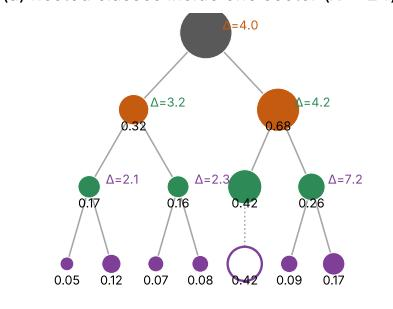

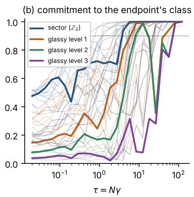

(c) conditional information per level  
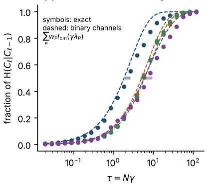

(d) leading posterior direction vs contrasts on the endpoint's branch  
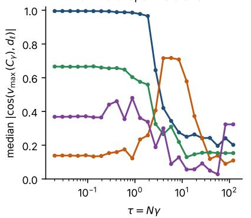

(f) localization: q̄ and dq/̄ dlog τ  
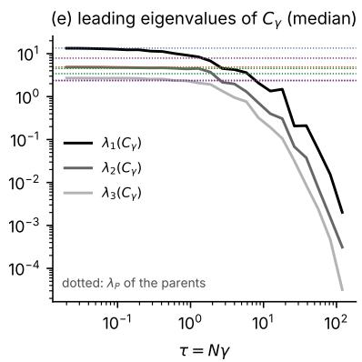

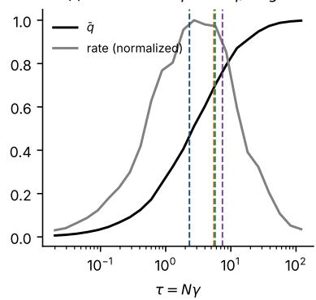  
Figure 2: One N = 24 Bethe glass at $\beta _ { J } = 2 . 5$ , exact enumeration, 128 trajectories with endpoints drawn from $\mu$ (the number is our choice of sample size); time on the scaled clock $\tau = N \gamma$ . (a) The classes inside one sector, computed from the equilibrium measure: circles are classes (numbers: masses within the sector; open circle: a class not split further), and each split is labelled by its split variance $\Delta$ . (b) Partial commitment $p _ { \ell } = p _ { c _ { \ell } ( Y ) }$ of each trajectory to the endpoint’s class at each level $\ell ;$ thin lines: all trajectories; thick lines: one trajectory; dotted: the commitment threshold 0.9. (c) Information about each level, averaged over trajectories and normalized by its final value (symbols), with the binary-channel prediction from the parents’ $\lambda _ { P }$ (dashed); bars: 68% bootstrap intervals of the measured decision times. (d) Median | cos | between the leading eigenvector of the posterior covariance $C _ { \gamma }$ and the contrast of each level. (e) Median of the three leading eigenvalues of $C _ { \gamma } ;$ dotted: the parents’ $\lambda _ { P }$ . (f) Mean self-overlap $\bar { q }$ and its normalized logarithmic rate; dashed: the decision times of panel c.

decided last.

All trajectories of the instance (panel c of Fig. 3). The panel shows the median of each q over $q _ { \ell }$ the trajectories whose branch splits at level ℓ, with the interquartile range shaded. The medians complete half of their rise at $\tau \approx 1 . 3$ for the sector, at $\tau \approx 4$ for the first two glassy levels and at $\tau \approx 6$ for the third. The highlighted trajectory is typical: a sector decision followed by a compound glassy decision.

Counting over many instances (panels d–f of Fig. 3). A trajectory commits at level ℓ when $p _ { \ell }$ first exceeds 0.9, and commitments within a factor two of each other in $\gamma$ are counted as one distinct event (Sec. 3.2). Panel d shows the distribution of the number of commitments (grey bars) and of distinct events (orange outline) per trajectory, for $N = 1 6$ instances with glassy levels at $\beta _ { J } \geq 1$ . A trajectory commits 2.55 times on average—the sector plus one to three glassy levels—but in only 1.50 distinct events: one compound event in 51% of the trajectories, two (the sector, then the glassy levels together) in 46%, and three or more in 2%. Panel e shows the mean numbers of commitments and events against coupling: both are nearly independent of $\beta _ { J ; }$ at $N = 2 0$ the number of events is slightly larger (1.57–1.60), and in the $N = 2 4$ instance (stars) a trajectory commits 3.58 times in 2.05 events. Panel f shows the ratio of successive commitment times along a trajectory, separately for the step from the sector to the first glassy level (orange) and for steps between glassy levels (green); the dashed line marks the factor 25 spanned by one decision window. Successive glassy commitments coincide (median ratio 1.0; 70% within a factor 1.5), while the sector and the first glassy commitment are further apart (median ratio 1.5; 42% at least a factor two). All ratios are far smaller than the width of one window.

Size, robustness, recrossings and the ferromagnet. The two-step descent becomes more frequent as N grows: two or more events occur in 48%, 55% and 80% of the trajectories at $N = 1 6$ , at $N = 2 0$ and in the $N = 2 4$ instance, and the sector and glassy commitments are at least a factor two apart in 44%, 49% and 67% (at $\beta _ { J } = 1 . 5$ and 2.5). The counts do not hinge on the thresholds: for commitment thresholds from 0.8 to 0.95 and merging factors from 1.5 to 3 the mean number of events at $N = 1 6$ stays between 1.3 and 1.8. After committing, 14% of the trajectories recross at the sector and 12% at the first glassy level. In the ferromagnet on the same graphs nearly every trajectory makes a single decision, the mirror choice.

Conclusion. A trajectory makes neither a single decision nor one decision per level. It descends the tree in one or two steps—the mirror choice and a compound glassy decision—because only the sector’s $\lambda _ { P }$ difers substantially from the others, while the glassy parents have similar $\lambda _ { P }$ and hence overlapping windows (Sec. 3.4).

## 5.4 How the classes change with temperature

Question. Are the glassy classes a property of the glass phase? And as the target is cooled, does the generator face the same classes, or new ones? Reference temperatures. In the thermodynamic limit the Bethe glasses studied here have their glass transition at $\beta _ { c } \approx 1 . 3 4$ , i.e. at temperature $T _ { c } = 1 / \beta _ { c } \approx 0 . 7 5$ , where $2 \mathbb { E } \operatorname { t a n h } ^ { 2 } ( \beta _ { c } J ^ { ( 0 ) } ) = 1 \ ( \mathrm { S e c . } \ 5 . 1 )$ ; the ferromagnet on the same graphs orders at $\beta _ { J } \approx 0 . 8 3$ . At $N \leq 2 4$ there is no sharp transition but a broad crossover; the dashed line in Fig. 4g, h marks $\beta _ { c } .$ , and the fraction of instances with glassy classes (panel g) peaks somewhat below it, at $\beta _ { J } \approx 0 . 7 5 – 1$ . Data. The classes and predicted decision times of the same disorder instances at nine values of $\beta _ { J }$ between 0.5 and 3. Because the couplings are $J = \beta _ { J } J ^ { ( 0 ) }$ , the ground state and hence the alignment do not depend on $\beta _ { J }$ , and a split at one temperature can be compared with a split at another through the | cos | between their unit contrast vectors. Fig. 4 follows one instance across temperature (panels a–f) and then summarizes all instances (panels g and h).

One instance (panels a–f of $F i g . 4 )$ . Panels a–d show the classes inside one sector of the $N = 2 4$ instance of Fig. 2 at $\beta _ { J } = 1$ , 1.5, 2 and 2.5 (panel d is the tree of Fig. 2a). At $\beta _ { J } = 0 . 5$ (not shown) the procedure finds two weak glassy levels with $\Delta \approx 2 ;$ from $\beta _ { J } = 0 . 7 5$ on it finds three. From $\beta _ { J } = 1 . 2 5 ~ \mathrm { o n }$ , the first glassy split is the same split as at $\beta _ { J } = 2 . 5 \ : ( \lvert \cos \rvert \ge 0 . 9 6 $ between the contrasts; 0.83 at $\beta _ { J } = 1$ and 0.43 at $\beta _ { J } = 0 . 5 )$ . Cooling changes the masses—the larger glassy class grows from 0.60 to 0.73 of the sector between $\beta _ { J } = 1 . 2 5$ and $3 { \mathrm { - b u t } }$ not the classes themselves. Panel e shows the split variances $\Delta$ of all accepted splits, coloured by level, together with the sector’s $\lambda _ { 1 } ;$ panel f shows the predicted decision times of each level. Cooling moves the sector decision earlier, because $\lambda _ { 1 }$ grows from 3.5 to 15.5 and the predicted $\gamma _ { 1 / 2 }$ falls from 0.31 to 0.067, while the glassy decisions stay at $\gamma _ { 1 / 2 } \approx 0 . 1 7 – 0 . 2 8$ . The sector and glassy decisions are therefore simultaneous at $\beta _ { J } = 0 . 7 5$ and a factor four apart at $\beta _ { J } = 3$ . The predicted decision time of the first glassy level (orange in panel f) is not monotonic in $\beta _ { J } \colon$ it first decreases and then increases again, with a minimum near $\beta _ { J } \approx 1 . 5$ . It is set by $\lambda _ { P }$ , the leading eigenvalue of the correlation matrix inside a sector. On cooling, $\lambda _ { P }$ first grows, from 3.1 at $\beta _ { J } = 0 . 5$ to 6.4 at $\beta _ { J } = 1 . 5$ , because the two glassy classes become more sharply distinct; it then falls, to 4.0 at $\beta _ { J } = 3$ , because the smaller class loses weight (from 0.40 to 0.27 of the sector) and the fluctuations inside each class freeze, so that less variance is left within the sector for the split to explain. The split variance of the first glassy split follows the same rise and fall $( \Delta = 2 . 2 ,$ , 4.7 and 3.5 at $\beta _ { J } = 0 . 5 , 1 . 5$ and $s ;$ panel e). The deeper levels have parents with smaller and less temperature-dependent $\lambda _ { P } ,$ , so their predicted times change little, while the sector’s $\lambda _ { 1 }$ grows monotonically, so its decision moves steadily earlier.

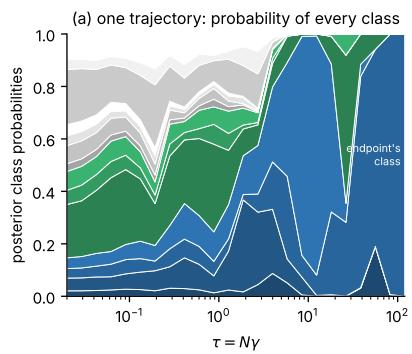

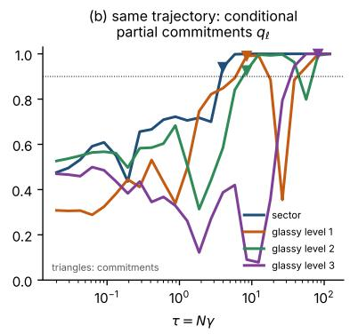

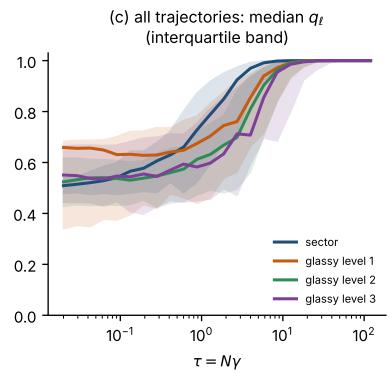

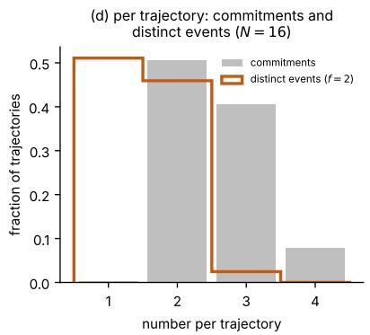

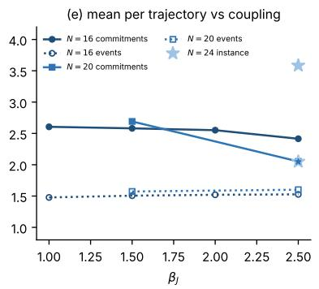

(f) spacing of successive commitments (N = 16, β ≥ 1)  
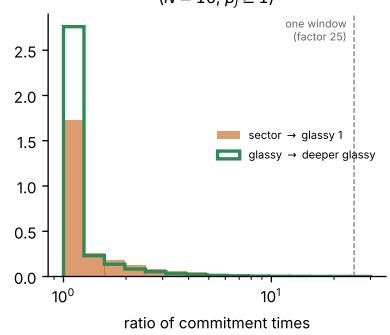  
Figure 3: How a trajectory descends the tree. (a) Partial commitments of one trajectory of the $N = 2 4$ instance of Fig. 2 to all 14 finest classes, stacked; blue and green: the two glassy classes of the chosen sector and their subclasses; grey: the classes of the other sector. (b) The same trajectory’s conditional partial commitments $q _ { \ell } = p _ { c _ { \ell } ( Y ) } / p _ { c _ { \ell - 1 } ( Y ) }$ along the endpoint’s branch; triangles: commitments $( p _ { \ell }$ first reaches 0.9); dotted: 0.9. (c) Median and interquartile band of $q _ { \ell }$ over the trajectories of the instance whose branch splits at level ℓ. (d) Distribution of the number of commitments and of distinct events per trajectory, $N = 1 6$ Bethe glasses with glassy levels at $\beta _ { J } \geq 1$ . (e) Mean numbers of commitments and events per trajectory against coupling, at $N = 1 6$ and 20, and for the $N = 2 4$ instance (stars). (f) Distribution of the ratio of successive commitment times; dashed: the factor 25 spanned by one decision window.

All instances (panels g and h of $F i g . 4 )$ . Panel g shows the fraction of unselected instances with at least one (solid) and at least two (dotted) collective glassy levels, at each size, together with the ferromagnet on the same graphs (grey); the dashed line marks the Bethe transition. Collective glassy levels are rare in the paramagnet (18% of the instances at $N = 1 6$ and 27% at $N = 2 0$ for $\beta _ { J } = 0 . 5 )$ , most common near the transition (73% at $\beta _ { J } = 1$ for $N = 1 6 ; 8 8 \%$ at $\beta _ { J } = 0 . 7 5$ for $N = 2 0 )$ , and less common deep in the glass phase at these sizes (37% and 25% at $\beta _ { J } = 3 )$ . At N = 24 they are present in 12 of 12 instances at $\beta _ { J } = 1$ and 1.5, and in 11 of 12 at $\beta _ { J } = 2$ and 2.5. The decrease at low temperature reflects a shift of weight, not a disappearance of classes: the median mass of the smaller class of the best first split falls from 0.34 to 0.22 $( N = 1 6 )$ and from 0.36 to 0.14 (N = 20) between $\beta _ { J } = 0 . 5$ and 3, so that its $\Delta$ falls below the gate. Panel h shows, for instances that have a first glassy split both at $\beta _ { J }$ and at $\beta _ { J } = 2 . 5$ , the median | cos | between the two contrasts. For $\beta _ { J } \geq 1$ it is $0 . 9 2 \mathrm { { - } 1 . 0 0 , 0 . 9 5 \mathrm { { - } 1 . 0 0 } }$ and 0.86–1.00 at $N = 1 6$ , 20 and 24: wherever the split exists, it is the same split.

Conclusion. At these sizes, glassy classes appear near the glass transition and keep their identity on cooling. What changes with temperature is their weights and, through $\lambda _ { 1 }$ , how far the mirror choice precedes the glassy decision.

## 5.5 Across instances and sizes

Question. Do glassy splits involve a finite fraction of the spins, as the word “collective” suggests? And how does the gap between the mirror choice and the glassy decision change with N? Data. All unselected Bethe instances and the ferromagnetic controls (Fig. 5), with measured decision times at $N = 1 6$ and 20 and for six $N = 2 4$ instances.

Collectivity (panels a and b of Fig. 5). Panel a shows the median split variance per spin, $\Delta _ { 1 } / N$ of the best first glassy split, whether or not it passes the gates. In the glass phase $\Delta _ { 1 } / N \approx 0 . 1 3 – 0 . 1 6$ at $\beta _ { J } = 1 \mathrm { - } 1 . 5$ for $N = 1 6 , 2 0$ and 24, with no systematic decrease with $N ;$ a split of a fixed number of spins would instead give $\Delta _ { 1 } / N \propto 1 / N$ . In the ferromagnet, $\Delta _ { 1 } / N$ falls to 0.01 on cooling. Panel b shows the sector eigenvalue per spin, $\lambda _ { 1 } / N$ , which grows from about 0.2 in the paramagnet to 0.7–0.9 at $\beta _ { J } = 2 . 5$ , and to 0.99 in the ferromagnet.

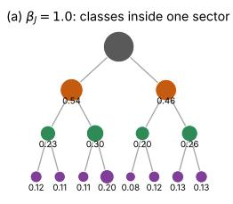

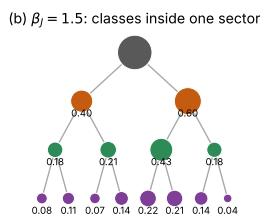

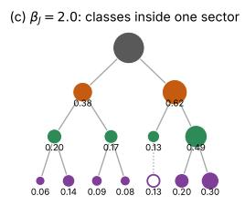

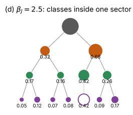

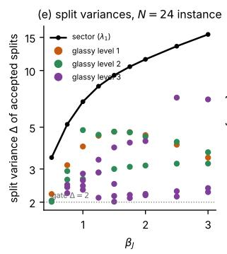

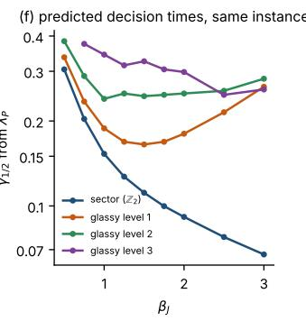

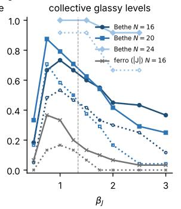

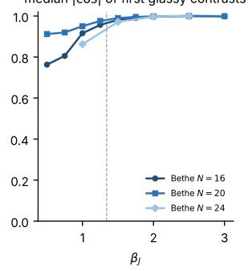  
Figure 4: Classes across temperature. (a–d) Classes inside one sector of the N = 24 instance of Fig. 2 at four values of $\beta _ { J }$ (numbers: masses within the sector; open circles: classes not split further). (e) Split variance $\Delta$ of every accepted split of this instance, coloured by level, and the sector eigenvalue $\lambda _ { 1 } ;$ dotted: the collectivity gate $\Delta = 2 .$ . (f) Predicted decision times of each level of this instance. (g) Fraction of unselected instances with at least one (solid) and at least two (dotted) collective glassy levels; grey: ferromagnet on the same graphs; dashed: Bethe transition. (h) Median | cos | between the first glassy contrast at $\beta _ { J }$ and at $\beta _ { J } = 2 . 5$ , for instances that have both.

Separation of the decisions (panels c and d of Fig. 5). Panel c shows the measured ratio of the first glassy decision time to the sector decision time (solid) and of the second glassy decision time to the first (dotted). The first ratio grows with coupling and with size: it is 1.7, 1.9 and 1.9 at $N = 1 6 .$ 2.3, 3.0 and 3.1 at $N = 2 0$ , and 2.9, 3.3 and 3.9 at $N = 2 4$ , for $\beta _ { J } = 1 . 5 , 2$ and 2.5. The second ratio stays between 1.0 and 1.4. Panel d shows the fraction of instances with glassy levels in which the sector is decided first: 59–88% at N = 16 and all instances at $N = 2 4$ for $\beta J \ge 1 . 5$

Comparison with the prediction. Over the same instances, the predicted ratio of first glassy to sector decision time grows from 2.3 to 3.1 $( \beta _ { J } = 1 . 5 )$ and from 3.1 to 4.8 $( \beta _ { J } = 2 . 5 )$ between $N = 1 6$ and 24. The reason is spectral: λ1 grows in proportion to N, whereas the glassy parents’ λF $\lambda _ { P }$ grows only from about 3.4 to 4.0 $( \lambda _ { P } / N$ falls from 0.21 to 0.16; whether glassy splits stay extensive as $N  \infty$ cannot be settled at $N \leq 2 4 )$ . The measured ratios are 5–40% smaller than predicted because the sector is decided somewhat later than predicted, for a reason identified in Sec. 5.6.

Conclusion. At these sizes glassy splits involve a finite fraction of the spins, and the mirror choice separates from the glassy decision as N grows, as the spectra predict.

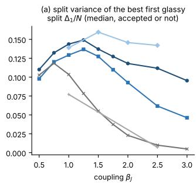

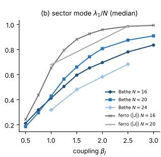

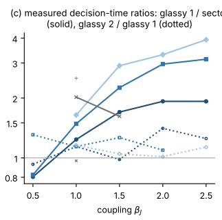

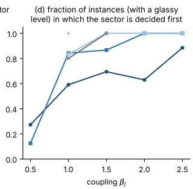  
Figure 5: Across instances and sizes, Bethe glasses and ferromagnets on the same graphs $( | J | )$ (a) Median split variance per spin, $\Delta _ { 1 } / N$ , of the best first glassy split, accepted or not. (b) Median sector eigenvalue per spin, $\lambda _ { 1 } / N$ . (c) Median measured ratios of decision times: first glassy level over sector (solid) and second over first glassy level (dotted). (d) Fraction of instances with glassy levels in which the sector is decided first.

## 5.6 Testing the binary-channel prediction

Question. Can the decision times be predicted from the equilibrium measure alone, before any trajectory is generated? As explained in Sec. 3.4, the binary-channel prediction (21) is an approximation built on one idealization of each split; nothing else in the analysis depends on it. This subsection measures how accurate it is. Data. Measured and predicted decision times for every level of every exact instance (Fig. 6).

All levels (panel a of Fig. 6). The panel plots the measured decision time against the predicted one, for every level of every exact instance; the grey band marks agreement within ±30%. For the glassy levels of Bethe glasses at $\beta _ { J } \geq 1$ , the ratio of measured to predicted time has median 1.03, 1.01 and 1.09 at the first, second and third glassy level (interquartile ranges within 0.87–1.25; 400 measurements), and 68–74% of the measurements lie within ±30%. No parameter is fitted.

Universal curves (panels b and c of $F i g . \ 6 )$ . The panels plot the information about the sector (b) and the first glassy level (c) of every instance with $\beta _ { J } \geq 1$ against the rescaled clock $s = \gamma \lambda _ { P } .$ together with the binary-channel curve $I _ { \mathrm { b i n } } ( s ) /$ log 2. The curves of diferent instances collapse on $I _ { \mathrm { b i n } } ,$ and the collapse does not narrow between $N = 1 6$ and 24, as expected for a crossover of fixed width (Sec. 3.4).

Where the prediction errs (panel d of $F i g . \ 6 )$ . The prediction rests on two assumptions: that the split is binary, i.e. that the projection of the configurations on the parent’s leading eigenvector takes two sharp values, and that the split lies along that eigenvector. For the sector the first assumption can fail. The sector is decided later than predicted (median ratio 1.24 at $\beta _ { J } \geq 1$ and 2.3 in the paramagnet), and panel d shows that the delay is set by how far $v _ { 1 } \cdot Y$ is from two sharp peaks: it is plotted against the binarity index $\lambda _ { 1 } / ( \mathbb { E } | v _ { 1 } \cdot Y | ) ^ { 2 }$ , which equals 1 for two sharp peaks and $\pi / 2$ for a Gaussian. The two are strongly rank-correlated (Spearman 0.90 over 874 instances, controls included), and the 253 instances with an index below 1.05 have median ratio 1.03. For glassy splits it is the second assumption that can fail, which matters most in SK glasses near the transition (Sec. 5.7). The label-free version of the prediction, which uses the successive eigenvalues of the equilibrium correlation matrix $C _ { 0 }$ instead of the parents’ $\lambda _ { P }$ , works equally well on other instances, including planar lattices at $N = 3 2 \mathrm { - } 6 4 \ ( \mathrm { F i g . \ 1 5 } )$ , and on the controls.

Conclusion. Decision times are fixed by equilibrium spectra, and the size and direction of the prediction’s errors are predicted by two equilibrium indices: the binarity of the sector mode and the alignment of glassy splits with their parents’ leading modes.

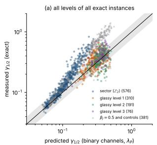

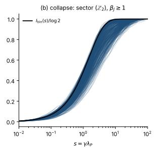

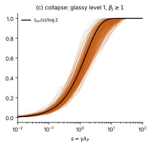

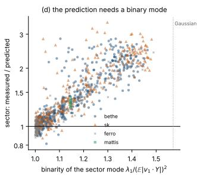  
Figure 6: The binary-channel prediction. (a) Measured against predicted decision time, for every level of every exact instance, coloured by level; grey crosses: $\beta _ { J } = 0 . 5$ and the controls; band: ±30%. (b, c) Information about the sector (b) and the first glassy level (c) against the rescaled clock $s = \gamma \lambda _ { P } .$ , one curve per instance with $\beta _ { J } \geq 1 $ ; black: $I _ { \mathrm { b i n } } ( s ) /$ log 2. (d) Ratio of measured to predicted sector decision time against the binarity index $\lambda _ { 1 } / ( \mathbb { E } | v _ { 1 } \cdot Y | ) ^ { 2 }$ of the sector mode; dotted: the Gaussian value $\pi / 2$

## 5.7 Sparse and dense glasses

Question. Bethe glasses are sparse and locally tree-like; SK glasses are dense. Does this change the way trajectories commit, or only the classes they commit to? Data. SK glasses at $N = 1 6$ (30 instances) and $N = 2 0$ (24 instances), analysed exactly as the Bethe glasses: classes on the nine-point temperature grid, and measured decision times and per-trajectory commitments at four temperatures. Fig. 7 compares the two families at equal distance from their transitions, $\beta _ { J } / \beta _ { c }$

How trajectories commit: the same (panels c and d). Panel c shows the mean numbers of distinct events (solid) and commitments (dotted) per trajectory, for instances with glassy levels. An SK trajectory commits 2.0–2.6 times in 1.4–1.65 distinct events, against 2.1–2.7 times in 1.5–1.6 events for Bethe glasses. Panel d shows the fraction of trajectories whose sector and first glassy commitments are at least a factor two apart: 43–52% for SK and 38–60% for Bethe glasses. In both families successive glassy commitments coincide (median ratio 1.0), and recrossings are equally frequent (12–15% at the sector, 12% at the first glassy level, averaged over temperature).

What they commit to: diferent (panels a and b of Fig. 7). Panel a shows the fraction of instances with collective glassy levels. At $N = 1 6$ , SK glasses have them in at most 43% of the instances (at

$1 . 5 \beta _ { c } )$ , against $6 0 – 7 9 \%$ for Bethe glasses between $0 . 7 5 \beta _ { c }$ and $1 . 1 \beta _ { c }$ . At $N = 2 0$ the SK fraction rises to 67% from $\beta _ { c }$ on and stays at 62% down to $3 \beta _ { c } ,$ whereas in Bethe glasses it falls to 25% at $2 . 2 \beta _ { c }$ . The SK deficit at $N = 1 6$ is therefore largely a finite-size efect of a dense model with only 16 spins. Panel b shows the median split variance per spin of the best first glassy split, with the same contrast: in Bethe glasses $\Delta _ { 1 } / N$ peaks near the transition and falls on cooling (0.05 at $2 . 2 \beta _ { c }$ for $N = 2 0 )$ , as the minority class loses weight (Sec. 5.4); in SK glasses it peaks deeper in the glass phase (0.14 at 1.75βc) and stays at 0.12 down to $3 \beta _ { c }$

How well the prediction describes them: diferent near the transition (panels e and f). Panel e shows the ratio of measured to predicted decision time for the glassy levels. SK glassy levels are decided later than predicted near the transition (median ratio 1.6–1.7 at $\beta _ { c }$ and 1.4 at $1 . 5 \beta _ { c } )$ and approach the prediction only deep in the glass phase (0.93–1.07 at $3 \beta _ { c } )$ ; in Bethe glasses the ratio stays between 0.90 and 1.02 from $\beta _ { c }$ on. Panel f explains the diference. It plots the same ratio for the first glassy level of every instance against the alignment $\Delta / \lambda _ { P } \leq 1$ of the split with the parent’s leading mode, which the prediction assumes to be one. The alignment is 0.73–0.79 for SK glasses at $\beta _ { c }$ and $1 . 5 \beta _ { c } , 0 . 8 7 \mathrm { - } 0 . 8 9$ at $3 \beta _ { c } ,$ and 0.86–0.96 for Bethe glasses. Across all 329 first glassy splits of both families, the ratio falls as the alignment improves (Spearman −0.68): its median is 1.38 for alignments between 0.7 and 0.8, 1.05 between 0.8 and 0.9, and 0.93 above 0.9.

Conclusion. Sparse and dense glasses difer in how often and how strongly glassy classes exist, and in how closely their splits follow the leading mode of their parents. However, they do not difer in how trajectories commit. This is what Sec. 3 implies: a trajectory sees the target only through its classes and their spectra.

## 5.8 Does the protocol matter?

Question. For the ideal, continuous-time generator the protocol $\nu ( t )$ does not change what is decided, only when (Sec. 2). A generator that takes finitely many steps, however, places its steps on the γ axis according to the protocol. Does it then matter which protocol is used, and in which part of the path? Data. Nine $N = 1 6$ Bethe instances with glassy levels (three at $\beta _ { J } = 1 . 5$ , six at $\beta _ { J } = 2 . 5 )$ The generator (2) is integrated with $K = 2$ to 64 Euler steps, uniformly spaced in $t ,$ using the exact drift (7); the endpoint is $y = \operatorname { s i g n } ( X _ { 1 } )$ ; and 4000 trajectories are generated per protocol and K (2000 at $\beta _ { J } = 1 . 5 )$ . We compare three harmonic protocols, which difer in how they distribute physical time over the clock $\gamma \colon \nu = 0$ , which spreads the decisions over roughly the first 40% of t and leaves half of t to the local stage $\gamma \geq 1$ , in which individual spins are fixed; a constant ν tuned by the prediction so that the predicted decisions fall at $t = 1 / 2$ (median $\nu = 1 3 )$ , which leaves a quarter of t to the local stage; and a stif $\nu = 1 4 4$ , which leaves an eighth.

What is measured $( F i g . \ 8 )$ . Panel a shows the class error of the endpoints: the total-variation distance between the frequencies of the finest classes among the generated endpoints and their exact masses, minus the distance expected from sampling noise alone (computed from the same number of exact samples). Panel b shows the energy error: the amount by which the mean of log $\mu ( y )$ over the endpoints falls short of its equilibrium value, in units of its equilibrium standard deviation; a positive value means that the endpoints have too high an energy. Panel c shows the fraction of the K steps that fall in the local stage $\gamma \geq 1$ under each protocol.

Findings. Both errors fall as K grows and vanish within sampling noise for $K \geq 3 2$ . At small K, $\nu = 0$ is the best protocol and ν = 144 the worst, at both couplings. At $K = 4$ the class error above sampling noise is 0.036 for $\nu = 0 , 0 . 0 4 4$ for the tuned protocol and 0.135 for $\nu = 1 4 4 ;$ at $K = 8$ it is 0.018, 0.016 and 0.089, and the endpoints’ log µ falls short by 0.6, 1.1 and 10.5 standard deviations. The ranking follows the share of steps in the local stage (panel c), not the coverage of the decision windows: the tuned protocol puts more steps into the sector window than $\nu = 0$ (40% against 25%)

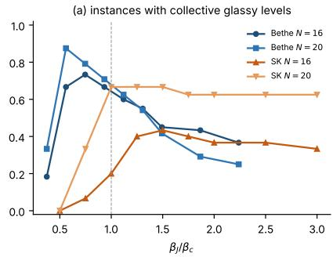

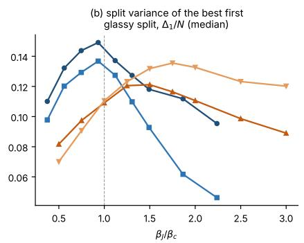

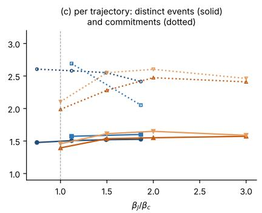

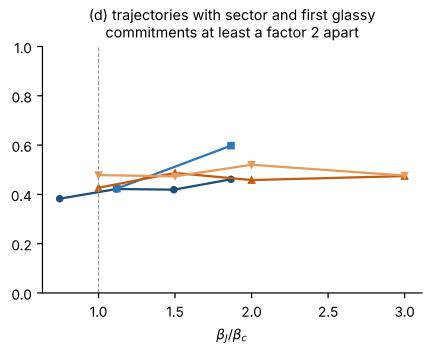

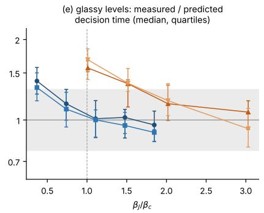

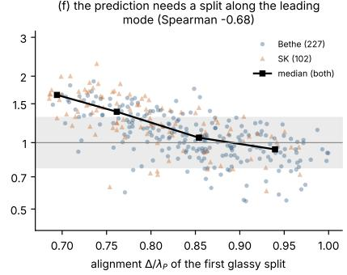  
Figure 7: Sparse (Bethe) and dense (SK) glasses, compared at equal distance from the transition, $\beta _ { J } / \beta _ { c }$ (dashed: $\beta _ { c } )$ . (a) Fraction of unselected instances with collective glassy levels. (b) Median split variance per spin, $\Delta _ { 1 } / N$ , of the best first glassy split, accepted or not. (c) Mean numbers of distinct events (solid) and commitments (dotted) per trajectory, for instances with glassy levels. (d) Fraction of trajectories whose sector and first glassy commitments are at least a factor two apart. (e) Ratio of measured to predicted decision time of the glassy levels (median and quartiles); band: ±30%. (f) The same ratio for the first glassy level of every instance, against the alignment $\Delta / \lambda _ { P }$ of the split with the parent’s leading mode; squares: binned medians.

and still does worse. Even the class errors arise mainly in the local stage, because the endpoint is read of the final spins. With three protocols the two kinds of coverage cannot be fully separated, but none of the data favour moving steps from the local stage to the decision windows.

Conclusion. For a discretized generator with an exact drift, the macroscopic decisions are robust to coarse steps—we attribute this to the drift being the exact posterior mean—and steps are needed where individual spins are fixed. A learned, approximate drift may shift this balance.

A practical recommendation. For a generator with an exact (or very accurate) drift and K steps uniformly spaced in t, our data suggest choosing the protocol so that about half of the steps fall in the local stage, i.e. so that $\gamma ( t )$ reaches one near $t = 1 / 2$ . Among harmonic protocols this is $\nu = 0$ , for which $\gamma ( 1 / 2 ) = 1$ exactly; with it, $K = 1 6$ steps already bring both errors to the level of sampling noise (class error within sampling noise, energy shortfall 0.16 standard deviations), whereas the tuned protocol needs about 32 steps and $\nu = 1 4 4$ about 64. Equivalently, if a stifer protocol is preferred for other reasons, the steps should not be uniform in t but placed so that about half of them fall where $\gamma \geq 1$ . The decision windows themselves need only a few steps: at $K = 4$ the class error of $\nu = 0$ is already below 0.04. This recommendation is a tentative extrapolation from three protocols, nine $N = 1 6$ instances and an exact drift. We have not tested protocols with an even larger share of steps in the local stage (for example $\nu < 0 )$ , and with a learned drift, whose errors are largest where the posterior is most uncertain, steps in the decision windows may become more valuable.

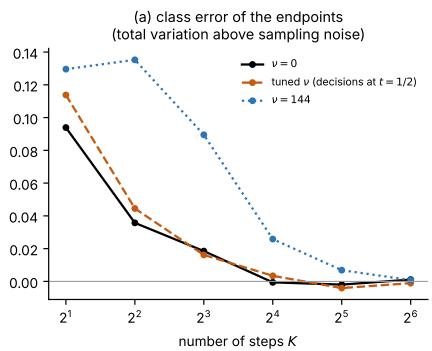

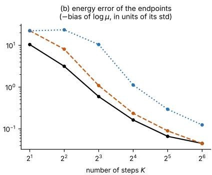

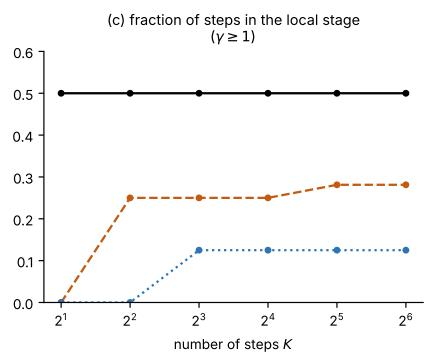  
Figure 8: Protocol and discretization, nine $N = 1 6$ Bethe glasses, exact drift, three harmonic protocols, against the number K of Euler steps (medians over instances). (a) Class error of the endpoints: total-variation distance of the finest-class frequencies from the exact masses, minus the sampling-noise value. (b) Energy error: shortfall of the mean log µ of the endpoints, in units of its equilibrium standard deviation. (c) Fraction of the K steps in the local stage $\gamma \geq 1$

## 5.9 Negative controls

Question. Could the procedure produce the same picture for a target without glassy structure? Data. The ferromagnet on the same graphs and the Mattis model at N = 16 (exact), and independent spins and a two-state mixture at $N = 3 2$ and 64 (sampled, Fig. 9); the controls are described in Sec. 5.1.

Exact controls at $N = 1 6$ . The ferromagnet on the same graphs has the same sector as the glass, with an even larger $\lambda _ { 1 }$ , but its splits inside a sector disappear on cooling. Its $\Delta _ { 1 } / N$ falls from 0.10 at $\beta _ { J } \leq 1$ to 0.01 at $\beta _ { J } = 2 . 5 \ ( \mathrm { F i g . \ 5 a } )$ , and the fraction of instances with a glassy level falls from $1 0 / 3 0$ to $1 / 3 0$ at $N = 1 6$ , and from $3 / 1 2$ to $0 / 1 2$ at $N = 2 0 \ ( \mathrm { F i g . \ 4 g ) }$ ; its trajectories make one decision, the mirror choice. The Mattis model never passes the collectivity gate: its best split inside a sector has $\Delta _ { 1 } = 0 . 8 1$ in all ten instances.

Sampled controls at $N = 3 2$ and 64 $( F i g . \ g )$ . Here the classes are identified from equilibrium samples, and two structural tests decide whether a split below the sector is genuine. Panel a shows its reproducibility, measured by the adjusted Rand index between the partitions found on two independent sets of samples (1: identical; 0: unrelated); panel b shows the mean overlap of configurations within a class minus their mean overlap with the sibling class. The dashed lines are the acceptance thresholds (0.7 and 0.1). The Bethe glasses pass both tests; independent spins and the two-state mixture fail both. Panel c shows why timing alone is not enough: the two-state mixture also has a fast sector decision followed by a much later “first glassy” one, but the latter is a split of thermal noise, which panels a and b reject. An unfrustrated mixture of four product states with a built-in two-level tree, by contrast, passes the tests in four of five replicas (not shown).

Conclusion. The procedure does not invent glassy classes: frustration is what keeps collective splits inside a sector in the ordered phase. Panel c illustrates consequence (4) of Sec. 3.4: separated decision windows alone do not demonstrate a hierarchy.

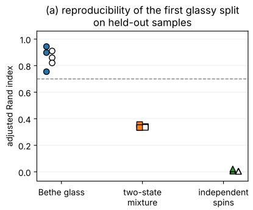

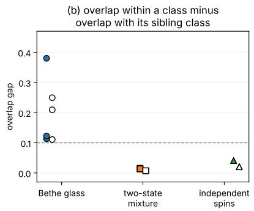

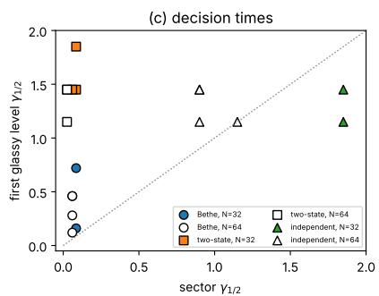  
Figure 9: Structural tests at $N = 3 2$ and 64, Bethe glasses (three instances per size) and two controls (filled: $N = 3 2 ;$ open: $N = 6 4 )$ . (a) Reproducibility of the first split below the sector: adjusted Rand index between partitions found on independent sample sets. (b) Mean overlap within a class minus mean overlap with its sibling class. Dashed: acceptance thresholds. (c) Decision time of the first split below the sector against that of the sector; dotted: equal times.

## 5.10 Larger systems and learned generators

Question. Does the sequence—mirror choice first, then the glassy decision—persist beyond exact enumeration? And does a trained denoiser represent the same decisions?

Larger systems $( F i g . \textit { 1 0 } )$ . For three Bethe instances at each of $N = 3 2$ and 64, the posteriors along 24 trajectories per instance are estimated by sequential Monte Carlo on 21 values of γ up to 3.2 (Sec. 5.1 and Appendix D). A trajectory is called repeat-consistent when two independent Monte Carlo runs give the same class posteriors along it (total-variation diference at most 0.1 at every time); 71 of 72 trajectories per size are. The figure shows the information about the sector and about the first glassy level against γ, averaged over the repeat-consistent trajectories (solid) and over all trajectories (dotted), with the range over the three instances shaded. The sector is decided first, already at the first grid points $( \gamma _ { 1 / 2 } = 0 . 0 6 0  – 0 . 0 8 5$ , an upper bound; the predicted value is 0.02–0.06), and the first glassy level later, at $\gamma _ { 1 / 2 } = 0 . 1 2 – 0 . 7 2$ . All 71 repeat-consistent trajectories per size commit to a sector, and 67 $( N = 3 2 )$ and $7 0 \ : ( N = 6 4 )$ commit to a glassy class;

8 and 6 recross at the sector, and 7 and 9 at the glassy level. The sequence thus persists at these sizes; because the instances were selected, they say nothing about how common glassy classes are.

Learned generators $( F i g . \textit { 1 1 } )$ . A denoiser trained only on pairs $( Y , H _ { \gamma } )$ learns an approximation of the posterior mean ${ \hat { y } } ,$ and its Jacobian with respect to the field approximates the posterior covariance $C _ { \gamma } ~ ( \mathrm { E q . ~ } ( 1 7 ) )$ . We trained small one-hidden-layer denoisers for twelve $N = 1 6$ and six $N = 3 2$ , 64 instances (Appendix D) and asked whether their hidden units encode the class contrasts. Panel a places each hidden unit of the Bethe denoisers according to the alignment of its input weights wˆ with the sector contrast (horizontal) and with the part of the first glassy contrast orthogonal to it (vertical); units on the arc lie in the plane of the two contrasts, and symbol size is proportional to the unit’s importance (the increase of the test error when the unit is replaced by its mean). Many important units lie near the arc: 58% of the importance-weighted weight is in the plane of the two contrasts, against at most 12.5% for random directions. Panel b shows the same for controls: units of the two-state denoisers align with the sector contrast only, units of the independent-spin denoisers with neither. Panel c compares the decision time of the most informative unit for each level—the clock value at which the unit carries half of its final information about the level—with the exact decision time of the level: they agree within factors 1.15 (sector) and 1.24 (glassy level). Panel d follows, along $\gamma ,$ how much of the leading fluctuation of the exact covariance (dashed) and of the learned Jacobian (solid and dash-dotted) lies along each contrast: in both, the sector contrast dominates at small $\gamma$ and the glassy contrast takes over around $\gamma \approx 0 . 2$ , the hand-over of Fig. 2d (median overlap of the leading eigenvectors 0.98). Panel e shows that during training the sector contrast is learned first and the glassy contrast later (final $| \cos | = 0 . 9 2$ and 0.82). Panel f shows the information carried by the best single unit against the width W of the hidden layer: one unit learns the sector only; from two units on the glassy contrast is learned as well; no width yields a glassy unit for the two-state control. Memorization of the training set afects only large $\gamma \colon$ denoisers trained on 64 or 1024 configurations reproduce the leading spectrum and the decision windows, and their Jacobian susceptibility is inflated 15- to 297-fold only at $\gamma = 1 0$ (Fig. 15e, f).

Conclusion. The sequence persists beyond exact enumeration, and trained denoisers learn the same contrasts, in the same order, as the exact posterior. These small networks on small targets are a laboratory in which the right features are known exactly, not a model of large generators.

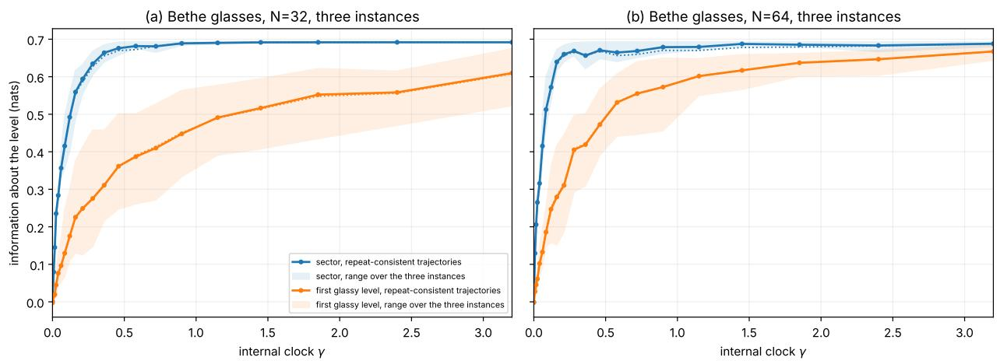  
Figure 10: Larger systems, three Bethe instances each at $N = 3 2 \ ( \mathrm { a } )$ and $N = 6 4$ (b), sampled posteriors. Information about the sector (blue) and the first glassy level (orange) against the internal clock $\gamma ;$ solid: average over repeat-consistent trajectories; dotted: all trajectories; shading: range over the three instances.

(f) Capacity: a coarse unit first, fine units late  
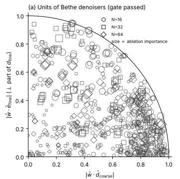

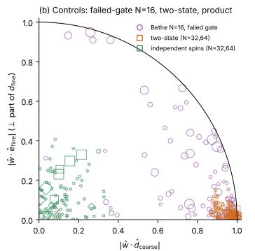

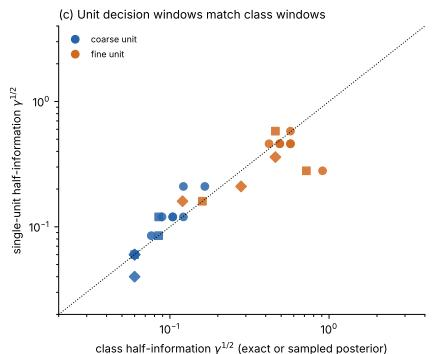

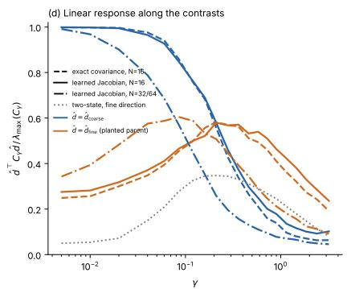

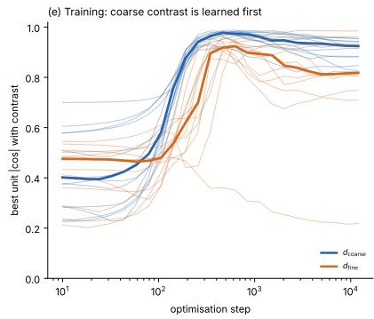

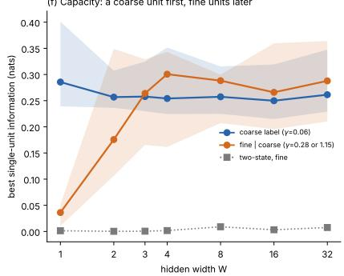  
Figure 11: Hidden units of learned denoisers (“coarse”: sector contrast; “fine”: first glassy contrast). (a) Alignment of each hidden unit’s input weights with the sector contrast (horizontal) and with the orthogonal part of the glassy contrast (vertical), Bethe instances whose splits pass the gates; symbol size: importance. (b) The same for controls. (c) Decision time of the most informative unit against the exact decision time of the class. (d) Fraction of the leading posterior fluctuation along each contrast, $\hat { d } ^ { \top } C _ { \gamma } \hat { d } / \lambda _ { \operatorname* { m a x } } ( C _ { \gamma } )$ , for the exact covariance and the learned Jacobian. (e) Best unit–contrast alignment during training. (f) Information of the best single unit against the width of the hidden layer.

## 6 Discussion

What the paper shows. On the theory side (Secs. 2 and 3), PID from a point source is stochastic localization run on a protocol-dependent clock: for an ideal generator the protocol decides when its decisions happen and what they cost, but not what is decided. The state of the generator is described by its partial commitments to the classes of the target, their average gives the information per level, and the decision time of each split is predicted, approximately, by the leading eigenvalue of its parent. On the experimental side (Sec. 5), finite Ising glasses are descended in two stages: the mirror choice, which every ordered Ising model makes, followed by a compound decision among glassy classes, which exist near and below the glass transition and not in the ferromagnet on the same graphs (Secs. 5.2–5.4 and 5.9). The two stages separate as coupling and size grow (Sec. 5.5), their timing follows the parents’ spectra (Sec. 5.6), the per-trajectory picture is the same in sparse and dense glasses (Sec. 5.7), and a generator with finitely many steps is limited mainly by the local stage (Sec. 5.8).

Other sampling applications. Nothing in Secs. 2–4 is specific to spins except the exact enumeration. The same questions can therefore be asked of difusion-type generators in the other areas where they are now used for sampling [10, 38]: equilibrium ensembles of molecules [11, 39], molecular design [40], crystalline materials [12, 41], lattice field theory [13], and turbulent flows and other physical fields [42]. There the posteriors must be estimated by Monte Carlo [43] or read of a trained denoiser (Sec. 5.10). Six lessons of this study carry over, each established above for spin glasses.

(i) Remove symmetries first. A symmetry of the target, like spin inversion, forces a decision that every trajectory must make and that says nothing about the structure of interest. For molecules, global rotations, permutations of identical atoms and mirror images play this role, and configurations should be aligned before classes are defined, as in Sec. 3.1.

(ii) What is decided belongs to the target. The protocol sets only when the decisions happen (Sec. 2.3) and, for a discretized generator, by how accurately the ideal one is approximated. We oserve that with an accurate drift the step budget is best spent in the local stage, by the rule given in Sec. 5.8. Whether this holds for learned drifts is directly testable in these applications.

(iii) The spectrum, not the depth, orders the commitments (consequence (2) of Sec. 3.4). For molecules, the leading eigenvalues of the correlation matrices of the target and of its metastable basins, for example in dihedral angles or other collective coordinates, would predict which basins a generator commits to first and which it decides together. Small basins with small contrast are decided late and are the first to be lost by an imperfect generator.

(iv) Only collective rearrangements are decided early (consequence (1)). Splits whose variance is comparable with that of a single coordinate are decided in the local stage, together with bond lengths and other local detail.

(v) Timing alone does not reveal structure (consequence (4); Sec. 5.9). Decision windows where the prediction puts them, or well separated from each other, show only that the target has collective modes with those eigenvalues. Nested classes are shown only by the classes themselves and the partial commitments to them.

(vi) The Jacobian is a label-free diagnostic. The leading eigenvector of a trained denoiser’s Jacobian along the path shows which contrast the generator is currently deciding (Sec. 5.10), and the calibration of its partial commitments, property (a) of Sec. 3.2, tests the denoiser.

Limits, and why the exact study stops at N = 24. All statements are at N ≤ 24 (exact) or N ≤ 64 (selected instances, sampled posteriors); the gates are conventional, the classes operational, and nothing is claimed about replica-symmetry breaking, ultrametricity or $N \to \infty$ . Beyond $N \approx 2 4$ neither classes nor posteriors can be computed exactly, and a few larger instances—which we have, and which show the same sequence—cannot decide what larger sizes would address: whether $\lambda _ { P } / N$ of glassy splits stays finite, which would make glassy decisions macroscopic and separated on $\tau = N \gamma$ That needs a systematic size series with approximate posteriors.

Outlook. Hierarchical and compositional targets. Images and molecules are probably less nested and more compositional than spin glasses: largely independent local parts, each decided on its own. In a finite-dimensional glass such as the two-dimensional Edwards–Anderson model [44], or in a lattice field, classes become spatial domains that may be decided in parallel rather than in sequence; which of the lessons above survive in that case is the natural next question, and answering it requires lattices far beyond exact enumeration. Design. Proposition 1(iii) turns hierarchy-aware schedules into anisotropic confinements that raise the signal-to-noise ratio along chosen contrasts first. Larger systems. Posteriors beyond enumeration—Monte Carlo, belief propagation and loop corrections [45–47], or trained denoisers checked by the calibration test of Appendix C—and a test of replica ultrametricity on posterior replicas would connect the finite-size picture to the asymptotic theory [17, 48].

## Code and data availability

All code, archived results, figure scripts and notebooks are available in the public repository https: //github.com/mchertkov/SpinGlassHierarchy. Every figure of the paper is regenerated from the archived results in a few minutes; the full recomputation (exact enumeration, posterior sampling and training, several hours on two cores) is documented there in execution order (Appendix E).

## Acknowledgments

Disclaimer on the use of language models. A large language model was used to proof-read the manuscript and to help design, implement and check the numerical experiments. All results were reviewed by the author, who is solely responsible for the content, the claims and any errors.

## A Proofs

Bridge coeficients. For the reference process (Brownian motion with killing rate $\scriptstyle { \frac { 1 } { 2 } } \nu ( t ) | x | ^ { 2 } )$ the backward kernel to y solves $\begin{array} { r } { \partial _ { t } \phi + \frac { 1 } { 2 } \nabla ^ { 2 } \phi - \frac { 1 } { 2 } \nu | \boldsymbol { x } | ^ { 2 } \phi = 0 } \end{array}$ with $\phi  \delta ( x - y )$ as $t  1$ . The ansatz log $\begin{array} { r } { \phi = - \frac { 1 } { 2 } c | x | ^ { 2 } + \kappa x \cdot y + f ( t , y ) } \end{array}$ gives, from the $| x | ^ { 2 }$ and $x \cdot y$ terms, $c ^ { \prime } = c ^ { 2 } - \nu$ and $\kappa ^ { \prime } = c \kappa ;$ the terminal delta requires $c ( 1 - t ) \to 1$ and $\kappa ( 1 - t )  1$ . The bridge drift is ∇ log $\phi = \kappa y - c x$ Conditioned on $Y = y , h = \kappa X$ obeys $d h = \kappa ^ { \prime } X d t + \kappa ( \kappa y - c X ) d t + \kappa d W = \kappa ^ { 2 } y d t + \kappa d W$ , so $h _ { t } = \gamma ( t ) y + B _ { \gamma ( t ) }$ with $\textstyle \gamma = \int _ { 0 } ^ { t } \kappa ^ { 2 }$ ; hence $\gamma ^ { \prime } = \kappa ^ { 2 } , a = \gamma / \kappa , \sigma ^ { 2 } = \gamma / \kappa ^ { 2 }$ and $a ^ { \prime } = \kappa - c a$ . For constant ν these give (5).

Proposition 1. (i) follows from the last display; under the mixture law the drift of h is $\kappa ^ { 2 } \hat { y }$ , and the innovation B¯ is Brownian in the observation filtration [34]. (ii) With $\kappa = \sqrt { \gamma ^ { \prime } }$ and $X = H _ { \gamma ( t ) } / \kappa .$ Itô’s formula gives $d X = ( \gamma ^ { \prime } / \kappa ) \hat { y } d t - ( \kappa ^ { \prime } / \kappa ) X d t + ( \sqrt { \gamma ^ { \prime } / \kappa } ) d W = ( \kappa \hat { y } - c X ) d t + d W$ . Defining $\nu = c ^ { 2 } - c ^ { \prime } .$ , the pair $( c , \kappa )$ solves the Riccati system above, so $\kappa y - c x$ is the bridge drift of the reference process with confinement $\scriptstyle { \frac { 1 } { 2 } } \nu | x | ^ { 2 }$ , and $\kappa \hat { y } - c x$ its posterior average, i.e. the optimal PID drift. The condition $( 1 - t ) ^ { 2 } \gamma ^ { \prime } \to \dot { 1 }$ gives $\kappa ( 1 - t )  1 , \gamma ( 1 - t )  1$ , hence $a = \gamma / \kappa  1$ and $\sigma ^ { 2 } = \gamma / \kappa ^ { 2 }  0 ; \ X _ { 1 } = Y$ . (iii) For a quadratic confinement the reference kernel is Gaussian, so the bridge is $\textstyle { \mathcal { N } } ( A _ { t } y , \Sigma _ { t } )$ and Bayes’ rule gives the stated tilt; the diagonal of $\Gamma _ { t }$ is constant on $\{ \pm 1 \} ^ { N }$ and drops out.

Proposition 2. The bridge drift is $b _ { Y } = \kappa Y - c X$ and $u = \mathbb { E } [ b _ { Y } \mid X ]$ , so $\mathbb { E } \Vert b _ { Y } \Vert ^ { 2 } - \mathbb { E } \Vert u \Vert ^ { 2 } =$ $\kappa ^ { 2 } \mathbb { E } \Vert Y - \hat { y } \Vert ^ { 2 } = 2 d \mathrm { I } ( Y ; X _ { s } ) /$ ds by I–MMSE and $\gamma ^ { \prime } = \kappa ^ { 2 }$ . With $X \mid Y \sim \mathcal { N } ( a Y , \sigma ^ { 2 } I )$ and $\kappa - c a = a ^ { \prime }$ $\mathbb { E } \| b _ { Y } \| ^ { 2 } = \ddot { N } ( a ^ { \prime 2 } + c ^ { 2 } \sigma ^ { 2 } )$ . Integrate from 0 with $\operatorname { I } ( Y ; X _ { 0 } ) = 0$

Equation (17). Summing the filtering equation $d P ( y ) = P ( y ) ( y - \hat { y } ) \cdot d \bar { B }$ against y gives $d { \hat { y } } = C d { \bar { B } } ;$ Itô’s formula gives the rate of $\mathbb { E } \Vert \hat { y } \Vert ^ { 2 }$ ; I–MMSE and $\mathbb { E } \Vert Y - \hat { y } \Vert ^ { 2 } = N - \mathbb { E } \Vert \hat { y } \Vert ^ { 2 }$ give the third relation.

Proposition 3. Since $C \to Y \to H , \operatorname { I } ( C ; H ) = \operatorname { I } ( Y ; H ) - \operatorname { I } ( Y ; H \mid C )$ . Conditioned on $C$ the channel is still Gaussian with independent noise, so both terms obey I–MMSE and $\begin{array} { r l } { { \frac { d } { d \gamma } } \mathrm { I } ( C ; H ) = } & { { } } \end{array}$ $\begin{array} { r } { \frac { 1 } { 2 } \mathbb { E } \| \mathbb { E } [ Y | H , C ] - \mathbb { E } [ Y | H ] \| ^ { 2 } } \end{array}$ by orthogonality of conditional expectations. Subtracting the identities for $C _ { \ell }$ and $C _ { \ell - 1 }$ and using $\sigma ( C _ { \ell - 1 } ) \subset \sigma ( C _ { \ell } )$ gives (19). Itô’s formula for $- \textstyle \sum _ { c } p _ { c } \log p _ { c }$ with (16) shows that its drift is minus the contrast term, which is the compensator statement. The budget is the law of total covariance applied to $\operatorname { C o v } ( Y \mid H )$ along the nested labels, combined with (17).

Equation (20). $\begin{array} { r } { \operatorname { I } ( C _ { \ell } ; H \ \vert \ C _ { \ell - 1 } ) = \sum _ { P } \omega _ { P } \operatorname { I } ( C _ { \ell } ; H \ \vert \ C _ { \ell - 1 } = { \cal P } ) } \end{array}$ and, given $C _ { \ell - 1 } = P ,$ Y is distributed as $\mu ( \cdot \mid P )$ while the channel is unchanged.

## B Positive control with a known tree

Before looking for decisions in a glass the pipeline was checked on a target whose hierarchy is known by construction: a mixture of $K \ : = \ : 3 6$ product measures on $N = 5 0 0$ spins, $\mu ( y ) =$ $\begin{array} { r } { \sum _ { \alpha } W _ { \alpha } \prod _ { i } ( 1 + m _ { \alpha i } y _ { i } ) / 2 \ ( \mathrm { F i g . ~ 1 2 } ) } \end{array}$ . The patterns are built on a tree: two independent level-one sign patterns, children that copy their parent and flip 15% (level two) and 5% (level three) of the signs, branchings 2, 3, 3, every pattern also present with reversed sign, $| m _ { \alpha i } | = 0 . 9$ , Dirichlet weights. Overlaps between states are about 0, 0.32, 0.66 and 0.81 for diferent level-one branches, level-two siblings, level-three siblings and within a state. The posterior is exact (a softmax over states times product measures). With 300 paths and ν = 0, 4, 16, 36 (Fig. 13): the mean self-overlap collapses exactly on $\gamma$ for all protocols (Proposition 1); endpoints of trajectories forked at $t _ { s }$ have mean overlaps $0 . 2 1 8 , 0 . 4 5 7 , 0 . 6 6 7 , 0 . 8 0 7 , 0 . 8 6 4$ against $\bar { q } ( t _ { s } ) = 0 . 1 9 7 , 0 . 4 4 6 , 0 . 6 6 7 , 0 . 8 0 7 , 0 . 8 6 4 ;$ the control energy agrees with (9) (171.3 against 171.0 at $t = 0 . 6 )$ ; median commitment times for the mirror family and the three levels are $t = 0 . 0 1 1 , 0 . 0 1 4 , 0 . 0 1 9 , 0 . 0 4 5$ at $\nu = 0$ and $0 . 4 2 , 0 . 4 4 , 0 . 4 9 , 0 . 5 4$ at $\nu = 3 6$ , i.e. the same values of $\gamma .$ . The deepest level is decided about four times later than the first, in line with the overlap gaps of the tree. E0 has no interactions; it verifies identities and pipeline, not the emergence of a hierarchy.

  
Figure 12: Positive control E0. (a) Construction of the 36 states on a prescribed tree, with mirror states. (b) Sign patterns on the first 90 spins. (c) Overlaps between states. (d) State weights.

  
Figure 13: Identities on E0 $( N = 5 0 0 )$ . (a) Self-overlaps $q _ { t }$ at $\nu = 0 ;$ (b) their distribution over paths; (c) overlaps of endpoints forked at $t _ { s }$ against $\bar { q } ( t _ { s } )$ ; (d, e) mean self-overlap for four protocols in physical time and against $\gamma ;$ (f) control energy against (9).

## C Contrast identities as numerical tools

These results were obtained on twelve Bethe instances at $N = 1 6 , \beta _ { J } = 2 . 5$ , with the sector and first glassy split identified from equilibrium samples, and on ten instances of the control models, with 1536 paths on 57 logarithmic grid points (Fig. 14). Identity check. Entropy-drop curves and integrated contrast rates agree for all 44 level curves (largest discrepancy 0.038 nats; median per-curve maximum 1.9 path standard errors). Rate profiles. With 24 paths, finite diferences of the entropy curve have a root-mean-square error larger than the compensator (contrast) estimator by a median factor 6.2 (sector) and 21.5 (first glassy split). Window prediction. Replacing each leaf by its centroid gives a finite softmax channel with the same initial rates; it predicts the exact half-information times to a median 1.7% (sector) and 5% (glassy split) at $N = 1 6 .$ , and within one grid step in 11 of 12 cases at N = 32, 64—for glassy and non-glassy targets alike. Budget. The budget of Proposition 3 holds to $5 \times 1 0 ^ { - 1 5 }$ ; the two levels carry a median 80% of the information rate as $\gamma  0$ and 4% (sector) at $\gamma \simeq 1$ , where 67% goes into deciding configurations within a leaf. Reference-free calibration. For a candidate posterior $q ,$ the gap between its entropy drop and its integrated contrast rate vanishes for the Bayes filter; with $| z | > 4$ as threshold it flags 18 of 30 deliberately mis-specified posteriors (all field-scale errors and most ±30% temperature errors); those that escape have class-information errors below 0.047 nats.

(d) Reference-free calibration test  

  
Figure 14: Contrast identities as tools $( N = 1 6$ instances with exact posteriors and $N = 3 2 , 6 4$ instances with sampled posteriors). (a) Centroid-channel prediction of half-information times; “coarse” is the sector, “fine” the first glassy split. (b) Information budget by level. (c) Rate-profile error from 24 paths, finite diferences (dashed) versus compensator (solid). (d) Calibration gap of mis-specified posteriors versus their true error.

  
Figure 15: Label-free spectral prediction with the successive eigenvalues $\lambda _ { 1 } , \lambda _ { 2 }$ of $C _ { 0 } \ { } ^ { \stackrel { \scriptscriptstyle { (  } } { \mathrm { c o a r s e } ^ { \scriptscriptstyle { ? } } } = }$ sector, $\mathrm { ^ { 6 6 } f i n e ^ { 3 7 } = }$ first glassy split identified from equilibrium samples). (a) Measured half-information times of twelve $N = 1 6$ Bethe instances against $s ^ { * } / \lambda _ { k } \ ( k = 1 , 2 )$ , with two-state and independentspin nulls; band ±30%. $\left( \mathrm { b } , \mathrm { c } \right)$ Collapse of sector and glassy information on $s = \gamma \lambda _ { k }$ . (d) Eight further instances at $N = 3 2 – 6 4$ (random regular and planar). (e) Jacobian susceptibility of learned denoisers over the exact value for three training-set sizes. (f) Excess held-out denoising error of the same models.

## D Numerical methods

Exact enumeration to $N = 2 4$ Configurations are written as $\boldsymbol { y } = \left( y _ { a } , y _ { b } \right)$ with halves of $N / 2$ spins, so that log-weights, field terms $h _ { a } \cdot y _ { a } + h _ { b } \cdot y _ { b }$ and class labels are $2 ^ { \dot { N } / 2 } \times 2 ^ { N / 2 }$ arrays. A compiled kernel returns, for each field, the row and column marginals (hence $\hat { y } )$ and the class masses in one pass (0.13 s per field at $N = 2 4$ on two cores); the covariance $C _ { \gamma }$ is assembled from three block products. Trajectories are generated endpoint first, $H _ { \gamma _ { k } } = \gamma _ { k } Y + B _ { \gamma _ { k } }$ , on 25 logarithmic grid points $\gamma \in \left[ 0 . 0 2 / N , 5 \right]$ plus $\gamma = 0$ . Endpoints $Y$ are sampled exactly and stratified over the finest classes: each class k of mass $\omega _ { k }$ receives $n _ { k } = \operatorname* { m a x } ( 2 , \operatorname { r o u n d } ( n \omega _ { k } ) )$ endpoints with weights $\omega _ { k } / n _ { k }$ , which keeps small classes represented; $n = 2 5 6$ , 96 and 48 at $N = 1 6$ , 20 and 24, and 128 for the instance of Fig. 2. Mutual informations are $\mathrm { H } ( C _ { \ell } ) - \mathbb { E } \mathrm { H } ( C _ { \ell } \mid H _ { \gamma } )$ with exact class posteriors and the stratification weights; half-times are interpolated in log γ, and their 68% intervals are obtained by resampling paths (60 bootstrap replicas). Classes and predicted decision times alone, without trajectories (Sec. 5.1), take about 0.1 s per instance at $N = 1 6$ and 1–3 minutes at $N = 2 4 ;$ the full analysis with trajectories takes $2 \mathrm { s } .$ , 15 s and 5 minutes at $N = 1 6 , 2 0$ and 24. Code: code/exacttree.py, experiments/n1\_levels.py, experiments/n1\_figures.py.

Per-trajectory counting. For Figs. 3d–f and ${ \mathrm { 7 c } } ,$ , d the posteriors are recomputed on 40 logarithmic grid points of $\gamma$ (128 trajectories per instance at $N = 1 6 , 6 4$ at $N = 2 0 )$ , and for every trajectory the commitment time—the first grid value of $\gamma$ at which $p _ { \ell } = p _ { c _ { \ell } ( Y ) } \ge 0 . 9 -$ —is recorded at each level ℓ at which the trajectory’s branch splits, $c _ { \ell } ( Y ) \neq c _ { \ell - 1 } ( Y )$ . Commitments within a factor $f$ in $\gamma$ are merged into one event; the grid spacing is a factor 1.23, below the merging factor. The mean number of events at $N = 1 6$ stays between 1.3 and 1.8 (default 1.5) when the commitment threshold is varied between 0.8 and 0.95 and $f$ between 1.5 and 3. We also tried a label-free count, the number of peaks of the per-trajectory localization rate $\gamma \operatorname { T r } C _ { \gamma } ^ { 2 } / N$ ; at these sizes single-trajectory traces fluctuate too much for a reliable count, and we report only the label-based one. Panels a–c use the stored class posteriors of the instance of Fig. 2. Code: experiments/n2\_paths.py, experiments/n3\_partial.py.

Discretized generator. For Fig. 8 the drift $\kappa \hat { y } ( \kappa x ) - c x$ is computed exactly on the configurations whose prior weight exceeds $e ^ { - 2 5 }$ times the largest (discarded mass below 10−6). Euler steps are uniform in $t , t _ { k } = k / K , k = 0 , \dots , K - 1$ ; the endpoint is $y = \operatorname { s i g n } ( X _ { 1 } )$ . The tuned stifness solves $S /$ sinh $S = \gamma _ { * } ,$ so that $\gamma ( 1 / 2 ) = \gamma _ { * }$ , the geometric mean of the predicted sector and first glassy decision times. The sampling-noise floor of the class error is the mean total variation of 4000 exact samples (20 replicas). Code: experiments/n2\_discretization.py.

Larger systems $( N = 3 2 , 6 4 )$ . For the six selected Bethe disorders, equilibrium libraries come from heat-bath parallel tempering (28 temperatures, four independent histories, 238–465 round trips per replica, random global signs added). Posteriors along the paths are computed by sequentia Monte Carlo (likelihood increments, resampling, Gibbs rejuvenation) on a 21-point grid up to $\gamma = 3 . 2 ;$ when independent populations disagree, a fixed-field parallel-tempering anchor is inserted without changing the path. 142 of 144 paths meet the repeatability criterion and four audited field/time points agree with fresh references to total variation 0.004–0.008. In the sector window $( \gamma \leq 0 . 0 8 5 )$ ) the Nishimori check $\mathbb { E } [ \hat { y } \cdot Y - \lvert \hat { y } \rvert ^ { 2 } ] / N$ fluctuates with standard deviation 0.11–0.14 over the 24 paths and three disorders, with no consistent sign (pooled means $+ 0 . 0 7$ at N = 32, −0.04 at $N = 6 4 )$

Learned denoisers. One-hidden-layer networks $\hat { m } _ { \theta } ( h , \gamma ) = \operatorname { t a n h } ( V \operatorname { t a n h } ( W h + c \log \gamma + b ) + D \odot$ $h + b ^ { \prime } )$ are trained on the denoising loss with log $\gamma \sim \mathcal { U } [ \log { 1 0 ^ { - 3 } }$ , log 10] (Adam, one-cycle schedule, $1 . 2 \times 1 0 ^ { 4 }$ steps of batch 512), widths 1–32, three seeds at width 16. Unit information is a plug-in estimate with 16 equal-mass bins and the Miller–Madow correction on 4000 test pairs per $\gamma ;$ ablation importance is the increase of test error when a unit is replaced by its mean. The memorization study uses three hidden layers of 256 units trained on 64, 1024 or unlimited configurations of one instance.

## E Reproducibility

All material is in the repository https://github.com/mchertkov/SpinGlassHierarchy. The folder code contains the libraries: exacttree.py (exact enumeration, classes, endpoint-first trajectories and exact posteriors for $N \leq 2 4 )$ and pidlib.py, pidlib\_lite.py (sampling, sequential Monte Carlo and the positive control). The folder experiments contains the scripts that generate the data and those that draw the figures; results contains the archived data; paper the source and figures of this paper; and notebooks three executed notebooks: numerical checks of the theory, a complete analysis of one $N = 1 6$ instance from scratch (classes, predicted decision times, trajectories, partial commitments and information per level, in under a minute), and the regeneration of all figures. The command python scripts/make\_figures.py redraws every figure from the archived data in a few minutes. The recomputation of the data, in execution order, is documented in scripts/run\_all\_experiments.sh: the exact campaign (n1\_run\_all.sh, n1\_run\_extension.sh, n2\_run.sh, n2\_discretization.py, n3\_partial.py, n4\_run\_sk.sh; about seven hours on two cores), the positive control (e0\_caricature.py, s8\_validation.py; minutes), and the sampled and learned studies (e5b\_\*, e5c\_\*, e5e\_\*, e6\_\*, s7\_\*; hours).

<table><tr><td>Figure</td><td>Figure script (experiments/)</td><td>Data (results/)</td></tr><tr><td>1</td><td>n2_schematic.py</td><td>numbers of Fig. 2</td></tr><tr><td>2</td><td> $\mathtt { n 1 \_ f i g u r e s . p y }$ </td><td>N1/*anatomy*</td></tr><tr><td>3</td><td> ${ \tt n 2 \_ f i g u r e s . p y }$ </td><td>N3, N2/paths_*</td></tr><tr><td>4</td><td> $\mathtt { n 1 \_ f i g u r e s . p y }$ </td><td>N1S</td></tr><tr><td>5</td><td>n1_figures.py</td><td>N1S, N1</td></tr><tr><td>6</td><td>n1_figures.py</td><td>N1</td></tr><tr><td>7</td><td>n4_families.py</td><td>N1, N1S, N2, N4</td></tr><tr><td>8</td><td>n2_figures.py</td><td>N2/disc_*</td></tr><tr><td>9</td><td>e5e_summarize.py</td><td>E5E, E5F, S8</td></tr><tr><td>10</td><td>e5d_analyze.py</td><td>E5B-E5D</td></tr><tr><td>11</td><td>e6_figures_b.py</td><td>E6/E6B, S7</td></tr><tr><td>12, 13</td><td>fig_EO_model.py, fig_EO.py</td><td>EO, S8</td></tr><tr><td>14</td><td> ${ \mathsf { e 6 \_ f i g u r e s \_ a . p y } }$ </td><td>E6/E6A</td></tr><tr><td>15</td><td> $\mathbf { s } 7 \_ { \mathbf { f i g u r e } . \mathbf { p y } }$ </td><td>S7, E5F</td></tr></table>

## References

[1] Giulio Biroli and Marc Mézard. Generative difusion in very large dimensions. Journal of Statistical Mechanics: Theory and Experiment, 2023:093402, 2023.

[2] Giulio Biroli, Tony Bonnaire, Valentin de Bortoli, and Marc Mézard. Dynamical regimes of difusion models. Nature Communications, 15:9957, 2024. doi: 10.1038/s41467-024-54281-3.

[3] Hamidreza Behjoo and Michael Chertkov. U-turn difusion. Entropy, 27(4):343, 2025. doi: 10.3390/e27040343.

[4] Gabriel Raya and Luca Ambrogioni. Spontaneous symmetry breaking in generative difusion models. In Advances in Neural Information Processing Systems, volume 36, 2023.

[5] Luca Ambrogioni. The statistical thermodynamics of generative difusion models: Phase transitions, symmetry breaking, and critical instability. Entropy, 27(3):291, 2025.

[6] Beatrice Achilli, Marco Benedetti, Giulio Biroli, and Marc Mézard. Theory of speciation transitions in difusion models with general class structure. Journal of Statistical Mechanics: Theory and Experiment, 2026(4):043304, 2026. doi: 10.1088/1742-5468/ae5c94.

[7] Antonio Sclocchi, Alessandro Favero, and Matthieu Wyart. A phase transition in difusion models reveals the hierarchical nature of data. Proceedings of the National Academy of Sciences, 122(1):e2408799121, 2025. doi: 10.1073/pnas.2408799121.

[8] Antonio Sclocchi, Alessandro Favero, Noam Itzhak Levi, and Matthieu Wyart. Probing the latent hierarchical structure of data via difusion models. Journal of Statistical Mechanics: Theory and Experiment, 2025(8):084005, 2025. doi: 10.1088/1742-5468/aded6c.

[9] Davide Ghio, Yatin Dandi, Florent Krzakala, and Lenka Zdeborová. Sampling with flows, difusion, and autoregressive neural networks from a spin-glass perspective. Proceedings of the National Academy of Sciences, 121(27):e2311810121, 2024. doi: 10.1073/pnas.2311810121.

[10] Ling Yang, Zhilong Zhang, Yang Song, Shenda Hong, Runsheng Xu, Yue Zhao, Wentao Zhang, Bin Cui, and Ming-Hsuan Yang. Difusion models: A comprehensive survey of methods and applications. ACM Computing Surveys, 56(4):105, 2023. doi: 10.1145/3626235.

[11] Frank Noé, Alexandre Tkatchenko, Klaus-Robert Müller, and Cecilia Clementi. Machine learning for molecular simulation. Annual Review of Physical Chemistry, 71:361–390, 2020. doi: 10.1146/annurev-physchem-042018-052331.

[12] Pierre-Paul De Breuck, Hai-Chen Wang, Gian-Marco Rignanese, Silvana Botti, and Miguel A. L. Marques. Generative AI for crystal structures: A review. arXiv:2509.02723, 2025.

[13] Kyle Cranmer, Gurtej Kanwar, Sébastien Racanière, Danilo J. Rezende, and Phiala E. Shanahan. Advances in machine-learning-based sampling motivated by lattice quantum chromodynamics. Nature Reviews Physics, 5(9):526–535, 2023. doi: 10.1038/s42254-023-00616-w.

[14] Giorgio Parisi. Infinite number of order parameters for spin-glasses. Physical Review Letters, 43:1754–1756, 1979.

[15] Giorgio Parisi. Order parameter for spin-glasses. Physical Review Letters, 50:1946–1948, 1983.

[16] Marc Mézard, Giorgio Parisi, and Miguel A. Virasoro. Spin Glass Theory and Beyond. World Scientific, 1987.

[17] Dmitry Panchenko. The Parisi ultrametricity conjecture. Annals of Mathematics, 177:383–393, 2013.

[18] Francisco Barahona. On the computational complexity of Ising spin glass models. Journal of Physics A: Mathematical and General, 15(10):3241–3253, 1982.

[19] Ahmed El Alaoui, Andrea Montanari, and Mark Sellke. Sampling from the Sherrington– Kirkpatrick Gibbs measure via algorithmic stochastic localization. In IEEE 63rd Annual Symposium on Foundations of Computer Science (FOCS), pages 323–334, 2022.

[20] David Sherrington and Scott Kirkpatrick. Solvable model of a spin-glass. Physical Review Letters, 35(26):1792–1796, 1975.

[21] L. Viana and A. J. Bray. Phase diagrams for dilute spin glasses. Journal of Physics C: Solid State Physics, 18(15):3037–3051, 1985.

[22] Marc Mézard and Giorgio Parisi. The Bethe lattice spin glass revisited. European Physical Journal B, 20:217–233, 2001.

[23] Hamidreza Behjoo and Michael Chertkov. Harmonic path integral difusion. IEEE Access, 13: 42196–42213, 2025. doi: 10.1109/ACCESS.2025.3548396.

[24] Michael Chertkov and Hamidreza Behjoo. Adaptive path integral difusion: AdaPID. Entropy, 28(5):492, 2026. doi: 10.3390/e28050492.

[25] Michael Chertkov. Analytic bridge difusions for controlled path generation, 2026.

[26] Ronen Eldan. Thin shell implies spectral gap up to polylog via a stochastic localization scheme. Geometric and Functional Analysis, 23:532–569, 2013.

[27] Andrea Montanari. Sampling, difusions, and stochastic localization, 2023.

[28] Hans Föllmer. An entropy approach to the time reversal of difusion processes. In Stochastic Diferential Systems, volume 69 of Lecture Notes in Control and Information Sciences, pages 156–163. Springer, 1985.

[29] Christian Léonard. A survey of the Schrödinger problem and some of its connections with optimal transport. Discrete and Continuous Dynamical Systems A, 34(4):1533–1574, 2014. doi: 10.3934/dcds.2014.34.1533.

[30] Yongxin Chen, Tryphon T. Georgiou, and Michele Pavon. Stochastic control liaisons: Richard Sinkhorn meets Gaspard Monge on a Schrödinger bridge. SIAM Review, 63(2):249–313, 2021. doi: 10.1137/20M1339982.

[31] Ronen Eldan. Taming correlations through entropy-eficient measure decompositions with applications to mean-field approximation. Probability Theory and Related Fields, 176:737–755, 2020.

[32] Diederik P. Kingma, Tim Salimans, Ben Poole, and Jonathan Ho. Variational difusion models. In Advances in Neural Information Processing Systems, volume 34, 2021.

[33] Louis Grenioux, Maxence Noble, Marylou Gabrié, and Alain Oliviero Durmus. Stochastic localization via iterative posterior sampling. In Proceedings of the 41st International Conference on Machine Learning, volume 235 of PMLR, 2024.

[34] Robert S. Liptser and Albert N. Shiryaev. Statistics of Random Processes I: General Theory. Springer, Berlin, 2nd edition, 2001.

[35] Dongning Guo, Shlomo Shamai, and Sergio Verdú. Mutual information and minimum meansquare error in Gaussian channels. IEEE Transactions on Information Theory, 51(4):1261–1282, 2005. doi: 10.1109/TIT.2005.844072.

[36] Ahmed El Alaoui and Andrea Montanari. An information-theoretic view of stochastic localization. IEEE Transactions on Information Theory, 68, 2022.

[37] Tyrone E. Duncan. On the calculation of mutual information. SIAM Journal on Applied Mathematics, 19(1):215–220, 1970.

[38] Giuseppe Carleo, Ignacio Cirac, Kyle Cranmer, Laurent Daudet, Maria Schuld, Naftali Tishby, Leslie Vogt-Maranto, and Lenka Zdeborová. Machine learning and the physical sciences. Reviews of Modern Physics, 91(4):045002, 2019. doi: 10.1103/RevModPhys.91.045002.

[39] Frank Noé, Simon Olsson, Jonas Köhler, and Hao Wu. Boltzmann generators: Sampling equilibrium states of many-body systems with deep learning. Science, 365(6457):eaaw1147, 2019. doi: 10.1126/science.aaw1147.

[40] Amira Alakhdar, Barnabas Poczos, and Newell Washburn. Difusion models in de novo drug design. Journal of Chemical Information and Modeling, 64, 2024. doi: 10.1021/acs.jcim.4c01107.

[41] Claudio Zeni et al. A generative model for inorganic materials design. Nature, 639(8055): 624–632, 2025. doi: 10.1038/s41586-025-08628-5.

[42] Tianyi Li, Luca Biferale, Fabio Bonaccorso, Martino A. Scarpolini, and Michele Buzzicotti. Synthetic Lagrangian turbulence by generative difusion models. Nature Machine Intelligence, 6(4):393–403, 2024. doi: 10.1038/s42256-024-00810-0.

[43] Pierre Del Moral, Arnaud Doucet, and Ajay Jasra. Sequential Monte Carlo samplers. Journal of the Royal Statistical Society: Series B (Statistical Methodology), 68(3):411–436, 2006. doi: 10.1111/j.1467-9868.2006.00553.x.

[44] S. F. Edwards and P. W. Anderson. Theory of spin glasses. Journal of Physics F: Metal Physics, 5(5):965–974, 1975.

[45] Marc Mézard and Andrea Montanari. Information, Physics, and Computation. Oxford University Press, 2009.

[46] Michael Chertkov and Vladimir Y. Chernyak. Loop calculus in statistical physics and information science. Physical Review E, 73:065102(R), 2006. doi: 10.1103/PhysRevE.73.065102.

[47] Michael Chertkov. From graphical models to structured generative AI. Book manuscript, https://github.com/mchertkov/FromGMtoStructuredGenAI, 2026.

[48] R. Rammal, G. Toulouse, and M. A. Virasoro. Ultrametricity for physicists. Reviews of Modern Physics, 58:765–788, 1986.