# AURA: Auditory Spatial Intelligence via a Unified Representation from a General-Audio Encoder through Complete Alignment

Boyan Han1∗ Xiaoyan Wang1∗ Zhe Sun1 Ziqi Wang2 Yujun Cai1 Hongli Cao1 Yiwei Wang1 Ming-Hsuan Yang3 Liang An1,†

1Southeast University, 2Rutgers University, 3University of California, Merced

# boyanhan02@gmail.com

## Abstract

Answering spatial questions about multi-source scenes requires a model both to identify each sound and to locate it. Existing spatial audio-language models obtain spatial information from a dedicated encoder, which separates spatial and semantic processing into distinct feature spaces. We study whether a general-audio codec trained without spatial supervision can serve both purposes. A controlled layer-wise analysis shows that the frozen codec retains spatial information, with lateral cues carried by the diference between the two ear channels. This information, however, is not readily accessible: in dual-source scenes, a model trained on these features predicts left/right at chance and, on the remaining axes, assigns the detected direction to the queried and the non-queried source equally often. We attribute this failure to an audio–text information asymmetry, in which the audio contains both sources while the answer describes only the queried one. A controlled 2 × 2 experiment shows that either completing the scene description or exposing the inter-channel diference lifts left/right accuracy above chance, whereas binding directions to the queried source requires both. Building on these findings, AURA keeps the codec and the language model frozen and exceeds the strongest dedicated system on SpatialSoundQA by 10.31 points in dual-source direction accuracy, with about 40% of its trainable parameters.

## 1 Introduction

Spatial hearing allows humans not only to recognize what a sound is but also to infer where it originates, estimate its distance, and perceive the spatial relations among multiple sources. Since most real scenes contain several sources at once, these abilities are needed jointly: a listener has to determine which sound comes from where. This capability underlies embodied intelligence, augmented and virtual reality, and assistive hearing. Large audio-language models (LALMs) have advanced rapidly on speech and general audio tasks (Deshmukh et al., 2023; Gong et al., 2024; Tang et al., 2024a; Chu et al., 2023; 2024; Kong et al., 2024; Ghosh et al., 2024; Xu et al., 2025), but these advances mainly concern what a sound represents rather than where it originates.

Recent auditory spatial intelligence systems address the second question by adding a dedicated encoder trained for sound localization or geometric perception (Zheng et al., 2024; Wilkinghof and Tan, 2026; Biswas et al., 2026). Spatial and semantic information are then processed in separate representation spaces, and the spatial encoder requires its own pre-training on spatially annotated data. In our evaluation, these systems also fall well behind general-purpose audio-language models on general-audio benchmarks (33.20% for BAT versus 55.80% for Qwen2-Audio on MMAU), whereas the general-purpose models, which receive monaural input, perform at or below chance on spatial questions (8.85% single-source direction accuracy for

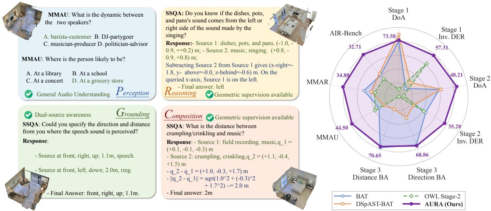  
Figure 1: Spatial and general-audio understanding with AURA. Left: illustrative questions and responses covering general-audio understanding, source descriptions, and geometric relations. Source coordinates in responses are model outputs. Right: performance overview for AURA and the evaluated spatial baselines; AURA attains results comparable to dedicated state-of-the-art systems on spatial audio understanding and generalizes well to general-audio understanding. Matterport3D imagery is subject to the Matterport3D Terms of Use.

Qwen2-Audio, against 12.57% for a random predictor). Spatial and general audio capabilities thus remain largely separate in current systems.

An alternative is to derive spatial information from a general-purpose audio representation. Neural audio codecs are a promising choice for this purpose. Because a codec is trained to reconstruct the waveform, its representation of each channel has to preserve the level and timing detail from which interaural cues arise (Ratnarajah et al., 2024; Grötschla et al., 2026). At the same time, a codec trained with the reconstruction objective alone, although it preserves such acoustic detail, yields tokens whose semantic content is weak, which degrades the content accuracy of language models built on them (Ye et al., 2025). X-Codec addresses this by injecting semantic features from a pretrained audio encoder before quantization; it thus retains the acoustic detail of a reconstruction codec while strengthening the semantic content of its tokens, which makes it the best-suited choice among released codecs for a representation that has to both identify and locate sounds. Prior work has shown that codecs preserve binaural structure at the level of the overall representation (Chen et al., 2026b), but it remains unclear how this information is distributed across layers and whether a language model can exploit it. We therefore analyze X-Codec (Ye et al., 2025), a general-audio codec trained without spatial supervision, by varying binaural room impulse responses with the source content fixed, and vice versa. Shallow residual vector quantization (RVQ) layers are more sensitive to source content, whereas deeper layers respond increasingly to interaural diferences, room acoustics, and reverberation. Lateral information, moreover, is only partially recoverable from either channel alone and becomes reliably decodable through the diference between the two, so it has to be recovered through cross-channel comparison.

The presence of this information, however, does not imply that a model can use it. When the RVQ features of each channel are projected into a large language model (LLM) and trained with question–answer pairs on dual-source SpatialSoundQA (Zheng et al., 2024), left/right prediction remains at chance, while front/back and up/down exceed it. Even the above-chance axes do not reflect source-specific localization. When both sources lie on the same side of the queried axis, the answer does not depend on which source is queried, and the model performs well; when they lie on opposite sides, its accuracy falls to chance. The model thus reads out the spatial attributes of the scene but fails to bind them to the queried source.

We trace this failure to the composition of the training pairs. Each dual-source clip contains two sources, whereas the answer describes only the queried one, leaving the other source without a textual counterpart. We refer to this mismatch as audio–text information asymmetry. Left/right prediction faces an additional obstacle at the interface, which leaves cross-channel comparison to the LLM. Accordingly, we introduce two interventions. On the text side, scene supervision requires the model to describe both sources before answering; on the representation side, an explicit inter-channel diference exposes the lateral cues. In a controlled 2 × 2 experiment, either intervention lifts left/right accuracy well above chance, whereas binding on opposite-side questions improves clearly only when the two are combined.

Building on these findings, we propose AURA (Auditory spatial intelligence via a Unified Representation from a general-audio encoder through complete Alignment), which makes the spatial information in a frozen general-audio codec usable through two components, one for each cause identified above. The representation component acts on the audio side. Guided by the layer-wise analysis, the shallow and deep RVQ layers of each channel are aggregated into a content-oriented and an acoustic-oriented band, and the band-wise diference between the left and right channels is added as two further slots. The resulting six-slot representation keeps the original channel features, which carry the front/back, up/down, and distance cues, while presenting the lateral contrast within individual tokens; because the added slots are deterministic functions of the codec features, no spatial encoder or external acoustic feature is introduced. The alignment component acts on the text side. Scene supervision requires the model to describe every audible source, with its category, direction, and distance, before giving the answer, so that each source in the audio has a textual counterpart. Relational questions further require comparing the positions of two sources, which a list of sources does not state; for these questions, geometric supervision inserts an explicit comparison of the two positions between the scene description and the answer. The codec and the Qwen3-8B backbone remain frozen throughout, and only a projector and LoRA modules, 64.63M parameters in total, are trained.

On SpatialSoundQA, AURA performs competitively with dedicated spatial systems (Figure 1). Its advantage is largest in dual-source scenes, where it exceeds the strongest dedicated system by 10.31 points in direction accuracy while using about 40% of that system’s trainable parameters; it also scores higher than these systems on MMAU, MMAR, and AIR-Bench. Since AURA and the baselines difer in several components, we interpret these results as evidence that a frozen general-audio codec is suficient for competitive spatial question answering on SpatialSoundQA, rather than as evidence that it outperforms a dedicated encoder.

## Key Contributions

1. We provide a controlled layer-wise analysis ofa general-purpose audio codec trained without spatial supervision, revealing that shallow RVQ layers are more sensitive to source content, while deeper layers respond more strongly to spatial acoustic cues. We further identify inter-channel representational diferences associated with left-right spatial information.

2. We identify previously overlooked failures in spatial information accessibility and source– attribute binding, and propose the information asymmetry hypothesis to explain them. Controlled experiments demonstrate that either scene-aware supervision or explicit binaural diferences can restore spatial readout, while substantial binding improvements require their combination.

3. Building on these findings, we propose AURA, which addresses the two identified causes with two components, a unified representation and complete audio–text alignment, while keeping the codec and the language model frozen. System-level results support the design: with approximately 40% of the trainable parameters of dedicated systems, AURA exceeds the strongest of them by 10.31 points in dual-source direction accuracy on SpatialSoundQA and scores higher than them on MMAU, MMAR, and AIR-Bench.

## 2 Related Work

Spatial audio-language understanding. Sound event localization and detection has traditionally relied on dedicated multichannel models and datasets (Adavanne et al., 2019; Shimada et al., 2023). BAT introduced SpatialSoundQA and pairs a binaural Spatial-AST encoder, built on the Audio Spectrogram Transformer (Gong et al., 2021), with LLaMA-2 (Touvron et al., 2023) (Zheng et al., 2024); DSpAST learns disentangled spatial representations (Wilkinghof and Tan, 2026), and OWL trains a geometric encoder with depth and room impulse responses (Biswas et al., 2026). Sci-Phi trains dual spatial and spectral encoders on first-order Ambisonics and makes enumerating all sources and room parameters its objective (Jiang et al., 2026); SAIL separates acoustic and spatial streams in a dedicated transformer and aligns them through source-slot queries in a dual-stream Q-Former (Luo et al., 2026). Tang et al. (2024b) pair a frozen Whisper encoder on the omnidirectional Ambisonics channel with hand-crafted intensity vectors, without which localization fails: spatial processing again resides in a separate feature space, and since the encoder sees one channel, whether a general-purpose encoder retains spatial cues from both channels remains untested. STAR-Bench reports large gaps to human performance on spatial reasoning (Liu et al., 2026). ELSA and SALM learn spatial audio–text alignment (Devnani et al., 2024; Hu et al., 2025); SPUR, Spatial-Omni, and PhaseCoder add spatial pathways to general-purpose models (Sakshi et al., 2025a; Zhu et al., 2026; Dementyev et al., 2026); multi-object binding and query-conditioned separation have also been studied (You et al., 2026; Sridhar et al., 2026). These works rely on task-specific inductive biases and separate feature spaces, leaving open whether spatial understanding must rely on a separately trained feature space. AURA shows that a general-audio codec trained without spatial supervision already retains cues for binaural multi-source understanding: its frozen features yield competitive SpatialSoundQA results without a dedicated spatial encoder, and its general-audio understanding generalizes to standard benchmarks.

Codec representations and accessible physical cues. Neural audio codecs discretize audio with residual vector quantization (Zeghidour et al., 2022; Défossez et al., 2023; Kumar et al., 2023) and underpin codec language models for generation (Borsos et al., 2023; Chen et al., 2025). SpeechTokenizer guides its first RVQ layer with a HuBERT semantic teacher (Hsu et al., 2021) and tests content–speaker separation through voice conversion (Zhang et al., 2024); TacoLM and ELLA-V build autoregressive and non-autoregressive TTS on the first and residual EnCodec codebooks, improving gated text conditioning and reordering phoneme and audio tokens for alignment, respectively (Song et al., 2024; 2025); ALMTokenizer trains a low-bitrate codec with semantic priors across all three VQ layers (Yang et al., 2025b); X-Codec enriches codec tokens with semantic features for generation (Ye et al., 2025). These works study speech content, speaker identity, token predictability, and generation, leaving open whether a general-audio codec trained without spatial supervision retains binaural and room information across its RVQ layers. SonicBench finds physical cues more accessible to frozen-encoder probes than to the complete audio-language model (Sun et al., 2026) but does not test how codec-layer spatial cues can serve multi-source QA; SARL probes spatial audio encoders for source- and room-level factors and finds source factors easier to decode (Chen et al., 2026a), but its encoders are trained with spatial input, whereas we analyze a codec never exposed to spatial supervision and ask how its retained cues can be made usable. A related gap between encoded and expressed information has been reported for paralinguistic cues (Koduru et al., 2026), and psychoacoustic probing suggests binaural models can rely on spectro-temporal interference rather than fine interaural phase (Chen et al., 2026b). We address both questions: controlled source-content, binaural, and room perturbations show that the codec retains spatial information and reveal its layer-wise distribution, and AURA reorganizes the frozen contentand acoustic-oriented bands with explicit interaural contrast to use that information for multi-source spatial QA.

Multi-source audio–text correspondence. ELSA and SALM study spatial audio–text alignment (Devnani et al., 2024; Hu et al., 2025); OWL uses spatially grounded reasoning targets (Biswas et al., 2026); SPUR and The World is Not Mono address multi-speaker attribution and multi-object binding (Sakshi et al., 2025a; You et al., 2026); Sci-Phi makes exhaustive scene description the task itself (Jiang et al., 2026), and SAIL enforces source-level correspondence architecturally through source-slot queries (Luo et al., 2026). Our scene supervision difers in role: it is a component of AURA whose efect we isolate as an intervention, holding the audio representation interface fixed so that it tests the text side of the information-asymmetry hypothesis, the side complementary to the representation-side intervention, while the final answer remains the objective. In direction-conditioned speech extraction, Tang et al. (2024b) observe that the model may transcribe the non-target source or a mixture, degrading as overlap increases; their target likewise contains only the target speaker’s transcript, and the failure is left unexplained. None of these works isolates the supervision mismatch we observe when dual-source audio is paired with a target describing only the queried source, under which our frozen-codec, answer-only baseline falls to chance on left/right localization although the representation retains spatial information. AURA addresses the mismatch from both sides, with scene supervision describing both sources and their geometric relations and explicit interaural contrast helping to distinguish the queried source. Controlled experiments with the same codec, backbone, and training samples distinguish scene-level reading from source-specific binding: either intervention improves left/right reading, and their combination yields substantial binding gains, connecting audio–text correspondence and feature organization to the accessibility of retained spatial information.

Binaural spatial question-answering data. Trainable binaural spatial question-answering corpora remain scarce. SpatialSoundQA renders AudioSet clips with binaural room impulse responses simulated by SoundSpaces 2.0 in Matterport3D buildings (Zheng et al., 2024); BiDepth, introduced with OWL, uses the same sources, simulator, and buildings (Biswas et al., 2026) and thus ofers no independent test of generalization. Most other recent resources use first-order Ambisonics rather than binaural input (Shimada et al., 2023; Zhu et al., 2026; Jiang et al., 2026), and real binaural recordings such as MRSAudio provide trajectories and transcripts without a question-answering protocol (Guo et al., 2025). We therefore train and evaluate on SpatialSoundQA, as do BAT and DSpAST-BAT.

## 3 Preliminaries

## 3.1 Binaural Spatial Cues

Humans rely on two primary categories of acoustic cues to perceive sound source direction (Blauert, 1996). Binaural cues are interaural time diferences (ITDs), arising from diferences in arrival time between the two ears, and interaural level diferences (ILDs), caused mainly by the acoustic shadow of the head. They vary predominantly with the lateral position of a source and are the primary basis for left-right localization; because they are defined by diferences between the two ear signals, they cannot be extracted from either channel alone and require cross-channel comparison. Spectral cues arise from the direction-dependent filtering of the pinnae, head, and torso and are particularly important for resolving directions with similar binaural cues, such as front-back and up-down ambiguities; unlike binaural cues, they are present in each ear’s signal and can be extracted from individual channels. Source distance is primarily inferred from the received sound level and the direct-to-reverberant energy ratio.

## 3.2 Neural Audio Codecs and Residual Vector Quantization

Neural audio codecs compress waveforms into discrete token sequences from which a decoder reconstructs the waveform (Zeghidour et al., 2022; Défossez et al., 2023; Kumar et al., 2023). Because these tokens can be modeled by language models like text tokens, codecs have become a widely adopted representation for audio generation and audio language modeling (Borsos et al., 2023; Chen et al., 2025).

A typical codec consists of an encoder, a residual vector quantizer (RVQ), and a decoder. The encoder maps a waveform x to latent vectors $V = E ( \pmb { x } ) = [ \pmb { v } _ { 1 } , \dotsc , \pmb { v } _ { T } ]$ . At each time step t, RVQ approximates vt progressively with $N$ codebooks: at the i-th layer, the codeword $\mathbf { \Psi } _ { c _ { t , i } }$ closest to the current residual is selected from codebook $\mathcal { C } _ { i }$ and subtracted, and the remainder is passed to the next layer:

$$
\begin{array} { r } { c _ { t , i } = \underset { w \in \mathcal { C } _ { i } } { \mathrm { a r g } \mathrm { m i n } } ~ \Vert r _ { t , i } - w \Vert _ { 2 } ^ { 2 } , \qquad r _ { t , i + 1 } = r _ { t , i } - c _ { t , i } , \qquad r _ { t , 0 } = v _ { t } . } \end{array}\tag{1}
$$

The quantized vector is the sum of the selected codewords, $\begin{array} { r } { \hat { \pmb { v } } _ { t } = \sum _ { i = 0 } ^ { N - 1 } { \pmb { c } } _ { t , i } } \end{array}$ . Since each layer encodes only the residual left by preceding layers, diferent layers may capture distinct aspects of the signal; in speech codecs, earlier layers have been observed to capture mainly semantic content and deeper layers finer acoustic details such as speaker characteristics (Zhang et al., 2024).

## 3.3 Binaural Scene Construction and Evaluation

SpatialSoundQA (SSQA) (Zheng et al., 2024) constructs binaural scenes by taking AudioSet clips (Gemmeke et al., 2017) as sources and simulating binaural room impulse responses (BRIRs) with SoundSpaces 2.0 (Chen et al., 2022) in Matterport3D environments (Chang et al., 2017). For a scene with $M \in \{ 1 , 2 \}$ static sources, where source $a _ { m }$ at position ${ \pmb p } _ { m }$ has BRIR $h _ { m } = ( h _ { m } ^ { L } , h _ { m } ^ { R } )$ , the two channels are rendered by convolution:

$$
x ^ { q } = \sum _ { m = 1 } ^ { M } a _ { m } * h _ { m } ^ { q } , \qquad q \in \{ L , R \} ,\tag{2}
$$

where ∗ denotes convolution. In two-source scenes, the sources belong to distinct sound categories and are superimposed within each channel.

SSQA evaluates direction and distance perception in single- and two-source scenes, as well as binary questions about spatial relations between sources; in two-source scenes, the queried source is specified by its sound category. Directions are defined in a listener-centered coordinate system along three axes: left/right, front/back, and up/down. Following SSQA (Zheng et al., 2024), we report Direction-of-Arrival Accuracy (DoA), which requires correct predictions on all three axes simultaneously; Distance Error Rate (DER), the proportion of predictions whose absolute distance error exceeds 0.5 m; and Binary Accuracy (BA) on binary spatial-relation questions, reported separately for direction and distance relations.

## 4 Spatial Information in a General-Audio Codec

Before asking whether a language model can use spatial information from a general-audio codec, we need to know whether that information is present in the codec’s representations and where it lies. We analyze the general-audio model of X-Codec (Ye et al., 2025). As a reconstruction codec it preserves the acoustic detail of each channel, and the semantic features it distills from a HuBERT teacher adapted to general audio supply the content information that purely acoustic codecs lack (Section 1), so a single representation can serve both halves of the task. Because diferent RVQ layers can have distinct representational preferences (Section 3.2), we measure the sensitivity of its RVQ layers to spatial changes layer by layer, holding one factor fixed and varying another (Figure 2): the two ears of the same rendering (interaural diferences), the same source under diferent impulse responses (room), the same impulse response with diferent sources (content), and full versus truncated impulse responses (reverberation). Section 4.1 defines the measure and reports these controls, Section 4.2 tests whether the spatial attributes they point to can be read out linearly, and together they inform the interface examined in Section 5.

## 4.1 Controlled Analysis of Layer-wise RVQ Representations

The analysis uses the general-audio X-Codec encoder with eight RVQ layers at 50 Hz, each with a codebook of1024 1024-dimensional embeddings; the encoder, RVQ modules, and codebooks remain frozen throughout the analysis and all downstream training. Inputs are single-source binaural audio from SpatialSoundQA, rendered from a source a and a BRIR $h \stackrel { - } { = } ( h ^ { \bar { L } } , h ^ { R } )$ as in Eq. (2) with $M = 1$ . For two rendered inputs with codeword embeddings $\pmb { c } _ { t , i } ^ { ( 1 ) }$ and $\pmb { c } _ { t , i } ^ { ( 2 ) }$ at aligned time step t and RVQ layer i, the layer-wise similarity is

$$
\mathrm { s i m } _ { i } = \frac { 1 } { T } \sum _ { t = 1 } ^ { T } \frac { \boldsymbol { c } _ { t , i } ^ { ( 1 ) } \cdot \boldsymbol { c } _ { t , i } ^ { ( 2 ) } } { \| \boldsymbol { c } _ { t , i } ^ { ( 1 ) } \| _ { 2 } \| \boldsymbol { c } _ { t , i } ^ { ( 2 ) } \| _ { 2 } } , \qquad i \in \{ 0 , \ldots , 7 \} .\tag{3}
$$

We first hold the source and BRIR fixed and compare the left and right channels of the same rendering, which measures sensitivity to interaural diferences since the source is identical. Next, we hold the source

Reverberation ablation Same source and placement

Room variation Same source, right ear

Simulated binaural Same source and room  
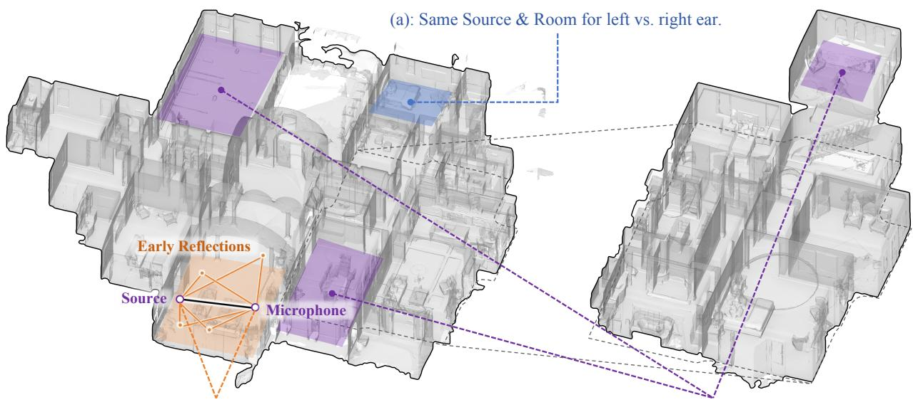  
(e,f): Reverberation ablation, same source and placement

(a)  
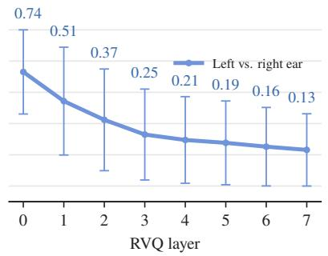  
(b)

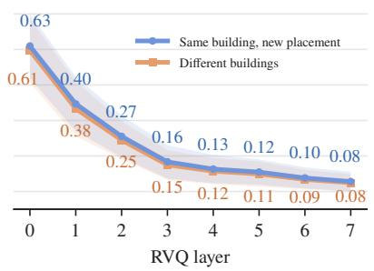

(c)  
Room efect Relative to within-building placement  
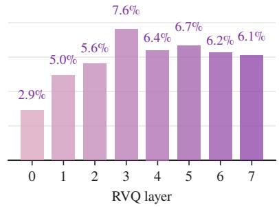

(d)  
(e)  
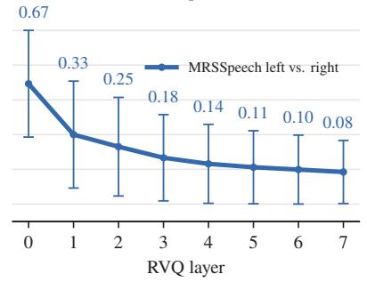

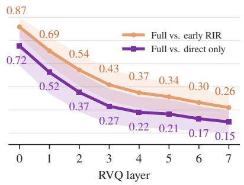

(f)  
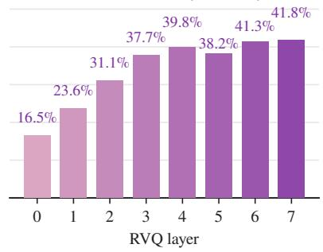  
Figure 2: Layer-wise similarity analysis of RVQ representations. Top: schematic illustration of acoustic variables on Matterport3D scene wc2JMjhGNzB. (a,d) Interaural similarity for simulated (fixed source and BRIR) and real (MRSSpeech) binaural audio; the RVQ vectors diverge markedly as the layer index increases. (b,c) Room variation: right-ear similarity when the same audio is rendered at another placement in the same building or with an impulse response from a diferent building; the similarity of the RVQ vectors still decreases clearly with depth. (e,f) Full versus early-reflection-only and direct-path-only impulse responses for the same placement, and the additional reduction from removing early reflections. These comparisons reveal increasing sensitivity to spatially relevant acoustic changes in deeper RVQ layers. Scene data under the Matterport3D Terms of Use.

fixed and change the BRIR, comparing the same channel across placements within one building and across buildings; conversely, we fix the BRIR and vary the source to measure the efect of content changes under the same acoustic response. For a fixed source and placement, we also compare full, early-reflection-only, and direct-path-only responses to examine reverberation sensitivity. Finally, we repeat the left–right analysis on real binaural recordings from the MRSSpeech subset of MRSAudio (Guo et al., 2025) to check whether the layer-wise trend persists outside convolution-based simulation.

Figure 2 illustrates the acoustic variables and summarizes the comparisons. Interaural similarity in simulated binaural audio decreases from 0.742 at L0 to 0.130 at L7 (panel a), and real recordings show the same trend, from 0.674 to 0.083 (panel d), so the pattern is not an artifact of convolutional rendering.

For fixed source content, changing the impulse response across buildings reduces similarity more than changing placement within a building (panels b,c), with the relative reduction growing from approximately 2.9% at L0 to 6–8% across L3–L7; under a fixed source and placement, removing early reflections yields an additional relative reduction growing from approximately 16% at L0 to 42% at L7 (panels e,f). Deeper layers are thus more sensitive to environmental acoustic variation.

The complementary fixed-BRIR, varying-source control (not shown in the figure) yields similarities of 0.316 at L0, 0.111 at L2, and 0.040 at L3, approaching the random-code reference in deeper layers. Together, the controls indicate that shallow layers are more strongly influenced by source content, whereas deeper residual layers are increasingly sensitive to interaural, room, and reverberation changes; this empirical division motivates the band aggregation used below without implying that either group exclusively represents one factor. The interaural and placement trends also appear on two reconstruction-only codecs (Appendix E).

## 4.2 Linear Decodability of Spatial Attributes

The controlled comparisons of Section 4.1 show that the frozen codec’s layer-wise representations respond systematically to binaural, room, and reverberation changes, with distinct preferences across RVQ layers. Sensitivity, however, does not imply that spatial attributes are explicitly encoded or directly recoverable, so we use linear probing to test whether they can be decoded from the frozen RVQ representations.

The probes operate on layer-wise vectors retrieved from the frozen codebooks. Guided by the preferences observed in Section 4.1, we sum the codeword vectors of layers L0– L2 into a content-oriented band and of L3– L7 into an acoustic-oriented band, and average each band over the entire recording to obtain a fixed-length representation. To examine how attributes are distributed across channels, we compare monaural features, the two bands of a single channel, with binaural features, the corresponding bands of both channels concatenated. Separate ridge classifiers are trained for the three directional axes and a ridge regressor for distance (in meters); regularization is selected on a held-out 10% subset of the training audio, after which the probes are refitted on the full training set. Probes are trained and evaluated separately for single-source scenes (278,665 training recordings, evaluated on the complete set of 29,651 recordings) and dual-source scenes (236,000 training questions, evaluated on 10,640 directional questions with the queried

Table 1: Linear probes of spatial attributes from the frozen RVQ representation. The linear classifiers clearly exceed the chance-level reference, showing that the RVQ representation carries information for understanding the spatial relations in audio. Binaural audio further outperforms monaural audio, most markedly on left/right discrimination, where the second channel removes most of the remaining error (26.0% to 7.0%), showing that the interaural cross-channel diference is what makes left/right reliably decodable. Reference rows are constant predictions without audio.

<table><tr><td></td><td colspan="4">Direction ↑</td><td>Dist.</td></tr><tr><td>Features</td><td>DoA</td><td>L/R</td><td>F/B</td><td>U/D</td><td>MAE↓</td></tr><tr><td colspan="6">Single source</td></tr><tr><td>Reference</td><td>15.6</td><td>50.9</td><td>50.9</td><td>59.0</td><td>1.249</td></tr><tr><td>Monaural</td><td>39.5</td><td>74.0</td><td>71.7</td><td>72.1</td><td>1.051</td></tr><tr><td>Binaural</td><td>51.1</td><td>93.0</td><td>72.9</td><td>73.4</td><td>1.029</td></tr><tr><td colspan="6">Dual source (queried source)</td></tr><tr><td>Reference</td><td>15.4</td><td>50.4</td><td>49.8</td><td>55.5</td><td>1.695</td></tr><tr><td>Monaural</td><td>23.8</td><td>65.4</td><td>61.6</td><td>59.8</td><td>1.574</td></tr><tr><td>Binaural</td><td>28.1</td><td>72.3</td><td>64.0</td><td>60.9</td><td>1.575</td></tr></table>

source as the target), with no overlap between training and evaluation audio. Reference baselines are constant predictions without audio input: the majority class for direction and the training-set mean for distance.

Table 1 presents the results. First, spatial attributes are linearly decodable from the frozen codec representations. In single-source scenes, all attributes substantially outperform their constant baselines: with binaural features, left-right, front-back, and up-down accuracies reach 93.0%, 72.9%, and 73.4%, joint accuracy across the three axes reaches 51.1% against a baseline of 15.6%, and distance mean absolute error (MAE) decreases from 1.249 m to 1.029 m. Directional and distance information can thus be recovered by linear readout from a frozen general-purpose codec trained without spatial supervision. Second, the distribution of decodable attributes is consistent with established binaural cue theory. Front-back and up-down accuracies already reach 71.7% and 72.1% with monaural features and improve only modestly to 72.9% and 73.4% with the second channel, suggesting that spectral cues are largely preserved within individual channels, whereas left-right accuracy rises substantially from 74.0% to 93.0%. The benefit of combining both channels is therefore concentrated on the left-right axis: lateral information is recovered more efectively through inter-channel comparison than from either channel alone. Third, spatial information remains decodable in dual-source scenes, but its extraction becomes considerably more challenging. With the queried source as the target, binaural features reach 72.3%, 64.0%, and 60.9% on the left-right, front-back, and up-down axes and a joint accuracy of 28.1%, above the 15.4% reference, but left-right accuracy drops from 93.0% to 72.3% and joint accuracy from 51.1% to 28.1% relative to single-source scenes. Since both sources are superimposed within each channel, source-specific spatial information remains present but becomes substantially harder to extract from the scene-level representations. Appendix F reports the same probes on real binaural recordings.

Importantly, linear decodability establishes the presence of recoverable information but does not guarantee its accessibility to a language model or its correct binding to the queried source; whether these emerge depends on the representation interface and supervision strategy, which the next section investigates.

## 5 The Information-Asymmetry Hypothesis

## 5.1 Selective Collapse in Multi-Source Scenes

Section 4 establishes that directional, distance, and content information is linearly decodable from the frozen codec, with lateral information carried mainly by the contrast between the two channels. This section shows that a conventional interface nevertheless fails on exactly that axis, and that the failure has a second component: directional attributes are not bound to the queried source. The interface sums the codeword vectors $\boldsymbol { c } _ { t , i } ^ { ( q ) }$ of each channel $q \in \{ L , R \}$ into the two bands of Section 4,

$$
e _ { t } ^ { ( q , S ) } = \sum _ { i = 0 } ^ { 2 } c _ { t , i } ^ { ( q ) } , \qquad e _ { t } ^ { ( q , A ) } = \sum _ { i = 3 } ^ { 7 } c _ { t , i } ^ { ( q ) } ,\tag{4}
$$

where S and A label the content- and acoustic-oriented bands; the four slots $[ L _ { S } , L _ { A } , R _ { S } , R _ { A } ]$ are temporally pooled and mapped independently into the language model by a shared projector g(·), and under answer-only supervision the target contains only the final answer about the queried source.

Trained on dual-source SpatialSoundQA, this interface collapses on exactly one axis (Figure 3): on the 10,640 dual-source direction questions, front/back and up/down accuracies reach 65.0% and 61.3%, above the majority-class baselines of 50.2% and 55.5%, whereas left/right accuracy is 50.2%, matching the 50.4% majority baseline, with 76.9% of predictions being “right.” The only axis at chance is the one carried by interaural diferences.

The above-chance axes do not imply source-specific understanding. Stratifying questions by whether the two sources lie on the same or opposite sides of the queried axis (Figure 4) separates two abilities: on the same side the answer is independent of which source is queried, so same-side accuracy measures reading the scene-level attribute, whereas on the opposite side the predicted attribute must be associated with the queried source, so opposite-side accuracy measures binding. The four-slot baseline reads but does not bind: front/back and up/down reach 80.4% and 77.1% on same-side questions but 50.5% and 49.2% on opposite-side questions, and its full three-axis prediction matches the queried source and the other source equally often (about 20.5% each). Left/right fails even on same-side questions (49.5%), because lateral information requires comparing the two channels (Section 4.2), which this interface leaves to the language model. The failure thus has two components: inaccessible left/right information and unbound directional attributes.

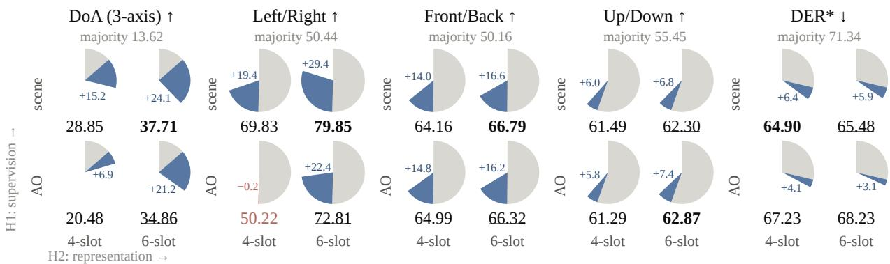  
Figure 3: Overall results of the $2 \times 2$ controlled experiment on the dual-source direction questions. The four-slot answer-only baseline (red) fails to exceed the majority baseline on left/right discrimination, whereas every other intervention clearly surpasses the baseline level. The best value for each metric is in bold and the second best is underlined; the majority baseline is not ranked. H1: scene supervision; H2: six-slot representation with interaural diference slots; AO: answer-only supervision. Each pie spans 100 points: the grey sector is the majority-baseline level, the blue sector the gain over it, and the number below the pie the metric value (%); for DER (∗) lower is better, so the pie shows 100 − DER.

## 5.2 The Information-Asymmetry Hypothesis and Two-Sided Interventions

The two components of this failure have diferent origins. The left/right collapse is a property of the interface: Section 4 showed that lateral information is recovered reliably only through the contrast between the two channels, and the four-slot interface presents the channels as separate tokens and leaves the comparison to the language model. The failure to bind attributes to the queried source points instead to the training signal. For sources $a _ { 1 }$ , a2 at positions $p _ { 1 } , p _ { 2 }$ , the audio-side scene is

$$
{ \mathcal { T } } _ { \mathrm { a u d i o } } = \{ ( a _ { 1 } , p _ { 1 } ) , ( a _ { 2 } , { \pmb p } _ { 2 } ) \} ,\tag{5}
$$

whereas answer-only supervision for a question about source k covers only that source (¯k denotes the other):

$$
{ \mathcal { T } } _ { \mathrm { t e x t } } ^ { \mathrm { a o } } = \{ ( a _ { k } , { \pmb { p } } _ { k } ) \} \subsetneq { \mathcal { T } } _ { \mathrm { a u d i o } } .\tag{6}
$$

Coverage here means source identity and the queried spatial attributes, not the waveform or the complete position. Both sources contribute to the audio features, but only one has a textual counterpart, and we hypothesize that this information asymmetry impedes alignment between the queried source and its description: the unpaired source contributes interfering features, weakening source–attribute binding and, with it, the supervision from which any cross-channel comparison would have to be learned. The hypothesis motivates an intervention on the text side; the interface finding above motivates a separate one on the representation side. We state both before testing them jointly.

Text-side intervention (H1): completing the scene description. We supply the missing correspondence by requiring the model to describe both audible sources before answering. With $\mathcal { D } ( a _ { m } , \bar { p _ { m } } )$ a textual description of a source’s category and location and $\mathbf { Y } _ { \mathrm { a o } }$ the original answer, the target becomes

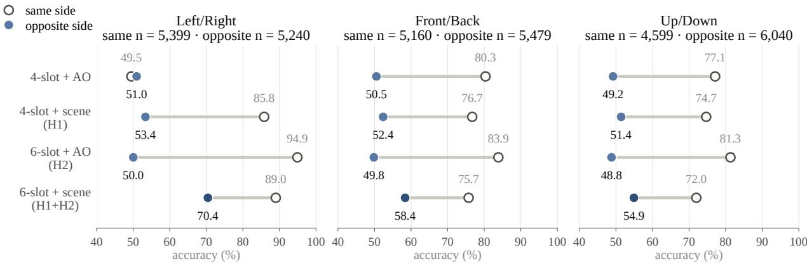  
Figure 4: Dual-source direction accuracy stratified by whether the non-queried source lies on the same side as the queried source along each axis. Except for the full intervention, the direction gains of every intervention are confined to the same-side stratum (open markers); only the full intervention efectively improves the opposite-side questions (filled markers), which require binding the semantic and acoustic attributes to the queried source, lifting them above the majority-baseline level. n is the number of questions per stratum. H1: scene supervision; H2: six-slot representation; AO: answer-only supervision.

$$
Y _ { \mathrm { s c e n e } } = [ { \mathcal { D } } ( a _ { 1 } , p _ { 1 } ) , { \mathcal { D } } ( a _ { 2 } , p _ { 2 } ) , Y _ { \mathrm { a o } } ] , \qquad { \mathcal { T } } _ { \mathrm { t e x t } } ^ { \mathrm { s c e n e } } = { \mathcal { T } } _ { \mathrm { a u d i o } } ,\tag{7}
$$

where the equality denotes coverage of both sources. This scene supervision gives each source a textual counterpart, so the model must state what each source is and where it is before answering, directly supervising identity–location correspondence.

Representation-side intervention (H2): explicit interaural contrast. This intervention follows from Section 4 rather than from the asymmetry: lateral information lies in the contrast between the two channels, which the four-slot interface never forms, and in a dual-source scene each channel token additionally mixes the features of both sources. We expose the contrast directly by retaining the original channels and adding

$$
\begin{array} { r } { e ^ { ( S ) } = \frac { 1 } { 2 } \big ( e ^ { ( L ) } - e ^ { ( R ) } \big ) . } \end{array}\tag{8}
$$

Subtracting the channel features suppresses their shared component and places their diference within a single slot, making interaural contrast directly available to the projector instead of leaving the language model to recover it across separate channel tokens. The diference is a deterministic function of the frozen features: it changes their presentation without adding information or isolating an individual source.

## 5.3 Controlled Test of the Hypothesis

We test the two interventions in a $2 \times 2$ experiment crossing four- and six-slot representations (the latter adding one diference slot per band) with answer-only and scene supervision. All four runs share the frozen codec, the Qwen3-8B backbone, the projector and LoRA configuration, the training samples, and the optimization procedure; we evaluate with greedy decoding on the dual-source test set and compare matched predictions with paired exact McNemar tests. The text-side factor isolates the variable targeted by the hypothesis: the answer-only target of these direction questions already specifies the full direction and distance of the queried source, so scene supervision adds nothing about it beyond its category, which the question names, and the added content is exactly the description of the non-queried source.

Either intervention alone lifts left/right above chance (Figure 3). Scene supervision raises the four-slot left/right accuracy from 50.2% to 69.8%, the six-slot representation reaches 72.8% under answer-only supervision (both $p < 1 0 ^ { - 1 5 0 }$ against the baseline), and their combination reaches 79.9%, significantly above either alone $( p < 1 0 ^ { - 4 8 } ) ;$ three-axis DoA accuracy rises from 20.5% to 28.9% and 34.9% for the individual interventions and to 37.7% for their combination.

Reading is restored by either intervention; binding requires both. The stratified results (Figure 4) separate the two efects: on same-side questions, left/right accuracy rises from 49.5% to 85.8% with scene supervision and to 94.9% with the six-slot representation, whereas on opposite-side questions scene supervision alone and the six-slot representation alone reach only 53.4% and 50.0% and their combination reaches 70.4%, an interaction of +18.0 percentage points (bootstrap 95% confidence interval [15.5, 20.4]). Front/back and up/down improve more moderately, from 50.5% and 49.2% to 58.4% and 54.9% under the combined intervention, with interactions of +6.7 ([4.8, 8.7]) and +3.9 ([2.0, 5.8]) points. Binding thus benefits from both explicit source-wise textual correspondence and explicit interaural contrast, most on the axis carried by interaural diferences.

Two further observations sharpen the interpretation. On same-side questions the six-slot answer-only model scores higher than the combined intervention (left/right 94.9% versus 89.0%), but a scene-level readout is correct there regardless of which source is queried; scene supervision replaces this shortcut with source-specific answers, which is what produces the binding gains on opposite-side questions. The recovery of reading also does not depend on how the channels are distinguished at the interface: with the identical four-slot interface, a shared projector, and no slot-type embeddings, scene supervision alone raises same-side left/right accuracy to 85.8%, so positional information sufices to tell the left and right tokens apart.

The generated descriptions are consistent with the final answers: in both scene-supervised runs, more than 99.9% of outputs contain two parseable sources, which we align to the annotated sources by label overlap; the per-source left/right accuracy of the descriptions rises from 70.3% with four slots to 80.4% with six, and the three-axis accuracy for the queried source (38.6%) is consistent with the final-answer DoA of 37.7%.

These results support the information-asymmetry hypothesis and distinguish recovering a directional attribute from associating it with the queried source: either intervention substantially improves left/right reading, but the pronounced binding gains require their combination, which motivates AURA’s joint use of scene supervision and the six-slot representation.

## 6 AURA

Figure 5 gives an overview of AURA. The following subsections describe its six-slot binaural representation, its scene and geometric supervision, and its two-stage training objective.

## 6.1 Six-Slot Binaural Representation

Given a binaural waveform $\pmb { x } = ( \pmb { x } ^ { L } , \pmb { x } ^ { R } )$ , each channel is encoded independently by the same frozen encoder $E ( \cdot )$ and its N-layer RVQ; following Section 3.2, the selected codeword vectors at frame t are

$$
[ c _ { t , 0 } ^ { ( q ) } , \ldots , c _ { t , N - 1 } ^ { ( q ) } ] = \mathrm { R V Q } ( E ( \pmb { x } ^ { q } ) _ { t } ) , \qquad q \in \{ L , R \} , \quad t = 1 , \ldots , T ,\tag{9}
$$

where $\boldsymbol { c } _ { t , i } ^ { ( q ) } \in \mathbb { R } ^ { d }$ , with $N = 8 , d = 1 0 2 4$ , and a frame rate of 50 Hz. The encoder and codebooks remain frozen, and AURA uses the selected codeword vectors without the codec decoder.

Aggregating the shallow and deep layers into the content- and acoustic-oriented bands of Eq. (4) gives four slots per frame,

$$
\pmb { F } _ { t } ^ { ( 4 ) } = [ e _ { t } ^ { ( L , S ) } , e _ { t } ^ { ( L , A ) } , e _ { t } ^ { ( R , S ) } , e _ { t } ^ { ( R , A ) } ] ,\tag{10}
$$

abbreviated as $[ L _ { S } , L _ { A } , R _ { S } , R _ { A } ] ;$ these are the four-slot features of Section 5.

For each band, we add an explicit interaural diference,

$$
\begin{array} { r } { e _ { t } ^ { ( S , b ) } = \frac { 1 } { 2 } ( e _ { t } ^ { ( L , b ) } - e _ { t } ^ { ( R , b ) } ) , \qquad b \in \{ S , A \} , } \end{array}\tag{11}
$$

so that each frame has six slots,

$$
{ \pmb F } _ { t } ^ { ( 6 ) } = [ { \pmb e } _ { t } ^ { ( L , S ) } , { \pmb e } _ { t } ^ { ( L , A ) } , { \pmb e } _ { t } ^ { ( R , S ) } , { \pmb e } _ { t } ^ { ( R , A ) } , { \pmb e } _ { t } ^ { ( S , S ) } , { \pmb e } _ { t } ^ { ( S , A ) } ] ,\tag{12}
$$

abbreviated as $[ L _ { S } , L _ { A } , R _ { S } , R _ { A } , S _ { S } , S _ { A } ]$ , where the first index identifies the left, right, or diference stream and the second the content- or acoustic-oriented band $( S _ { A }$ is thus the acoustic-oriented diference slot). The added slots are deterministic functions of the original features and introduce no external acoustic features or spatial supervision, and retaining L/R preserves the original features used to predict front/back, up/down, and distance.

To shorten the input sequence, the T frames are partitioned into consecutive, non-overlapping windows $\mathcal { W } _ { 1 } , \ldots , \mathcal { W } _ { J }$ of at most w frames, $J = \lceil T / w \rceil ;$ ; content-oriented slots use element-wise max pooling to retain prominent responses, and acoustic-oriented slots use mean pooling to aggregate the local acoustic representation:

$$
\widetilde { e } _ { j } ^ { ( q , S ) } = \operatorname* { m a x } _ { t \in \mathcal { W } _ { j } } e _ { t } ^ { ( q , S ) } , \qquad \widetilde { e } _ { j } ^ { ( q , A ) } = \frac { 1 } { \vert \mathcal { W } _ { j } \vert } \sum _ { t \in \mathcal { W } _ { j } } e _ { t } ^ { ( q , A ) } , \quad q \in \{ L , R , S \} .\tag{13}
$$

Pooling excludes padded frames, and the diference slots are constructed before pooling and pooled with the same band-specific scheme as L/R.

A shared two-layer MLP projector (Liu et al., 2023) maps each pooled slot independently into the language model’s embedding space,

$$
z _ { j } ^ { ( q , b ) } = g ( \tilde { e } _ { j } ^ { ( q , b ) } ) ,\tag{14}
$$

and the resulting tokens are concatenated in temporal order with a fixed slot order within each window, giving the four- and six-slot sequences

$$
\mathcal { Z } _ { 4 } = \big ( z _ { j } ^ { ( L , S ) } , z _ { j } ^ { ( L , A ) } , z _ { j } ^ { ( R , S ) } , z _ { j } ^ { ( R , A ) } \big ) _ { j = 1 } ^ { J } ,
$$

$$
\mathcal { Z } _ { 6 } = \big ( z _ { j } ^ { ( L , S ) } , z _ { j } ^ { ( L , A ) } , z _ { j } ^ { ( R , S ) } , z _ { j } ^ { ( R , A ) } , z _ { j } ^ { ( S , S ) } , z _ { j } ^ { ( S , A ) } \big ) _ { j = 1 } ^ { J } ,\tag{15}
$$

of lengths 4J and 6J. AURA prepends ${ \mathcal { Z } } _ { 6 }$ to the question text as the language-model input.

## 6.2 Scene Supervision

Consider $M \in \{ 1 , 2 \}$ sources, where source $a _ { m }$ at position ${ \pmb p } _ { m }$ has BRIR $h _ { m } = ( h _ { m } ^ { L } , h _ { m } ^ { R } )$ ; up to a shared mixture gain, the rendered audio is

$$
{ \pmb x } ^ { q } = \sum _ { m = 1 } ^ { M } a _ { m } * h _ { m } ^ { q } , \qquad q \in \{ L , R \} ,\tag{16}
$$

where ∗ denotes convolution, and its scene inventory is ${ \mathcal { T } } _ { \mathrm { a u d i o } } = \{ ( a _ { m } , \pmb { p } _ { m } ) \} _ { m = 1 } ^ { M }$ . Scene supervision requires the model to describe this inventory before answering: each description $\mathcal { D } ( a _ { m } , \pmb { p } _ { m } )$ contains category labels, three directional attributes relative to the listener, and distance, and the target concatenates the source count, source descriptions, and original answer,

$$
\begin{array} { r } { \pmb { Y } _ { \mathrm { s c e n e } } = [ M , \mathcal { D } ( a _ { 1 } , \pmb { p } _ { 1 } ) , \dots , \mathcal { D } ( a _ { M } , \pmb { p } _ { M } ) , \pmb { Y } _ { \mathrm { a o } } ] . } \end{array}\tag{17}
$$

Sources are ordered by their spatial attributes independently of the question (left before right, then front before behind, then above before below, then increasing distance); this canonical order only resolves the permutation ambiguity of describing an unordered set of sources, is a property of the training target, and does not appear in the input. Single- and dual-source samples share this format, and the controlled experiment in Section 5 uses the $M = 2$ variant without the source-count line.

For questions about relations between two sources, a geometric analysis $\mathcal { G } ( p _ { 1 } , p _ { 2 } )$ is inserted between the scene inventory and the answer:

$$
\begin{array} { r } { Y _ { \mathrm { g e o } } = \left[ M , \mathcal { D } ( a _ { 1 } , p _ { 1 } ) , \mathcal { D } ( a _ { 2 } , p _ { 2 } ) , \mathcal { G } ( p _ { 1 } , p _ { 2 } ) , Y _ { \mathrm { a o } } \right] . } \end{array}\tag{18}
$$

Here each source description additionally contains its three-dimensional listener-centered coordinates, by which sources are ordered lexicographically, again independently of the question; depending on the question, the geometric analysis compares positions along an axis, compares radial distances, or computes the relative displacement between sources. Figure 6 illustrates both target formats.

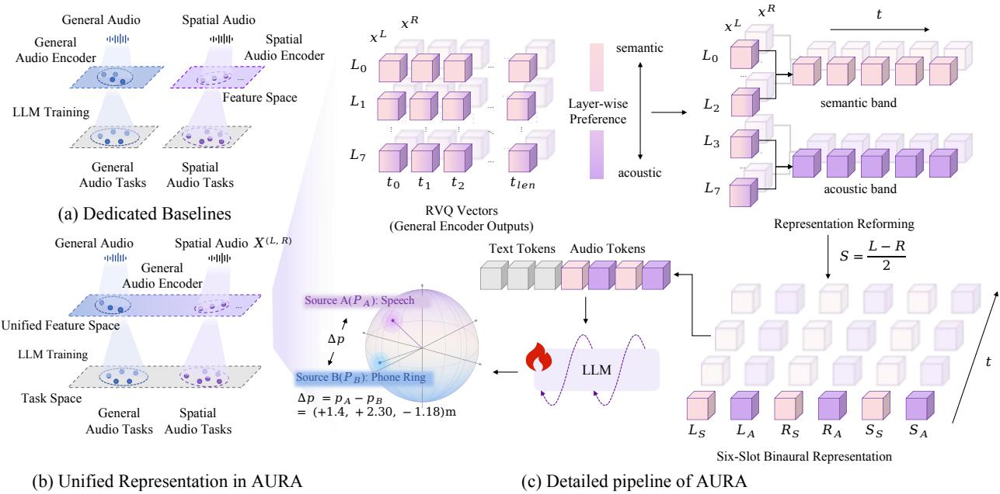  
Figure 5: AURA architecture. (a) Existing dedicated spatial pathways and general-audio pathways are separate and rely on diferent feature spaces, so features cannot be shared for unified perception. (b) AURA provides a shared, frozen general-audio codec representation that unifies perception in a single audio feature space. (c) Details of the AURA pipeline: for each ear, RVQ layers L0–L2 and L3–L7 are summed into content-oriented (S) and acoustic-oriented (A) bands, and adding the band-wise interaural diference yields six slots. A shared projector maps these slots to audio tokens for the language model, which generates a scene description and, for relation questions, a geometric analysis before the final answer.

## 6.3 Two-Stage Training Objective

Given audio tokens ${ \mathcal { Z } } _ { 6 }$ , question tokens P, and target $\pmb { Y } = ( y _ { 1 } , \dots , y _ { | \pmb { Y } | } )$ , either $\mathbf { Y } _ { \mathrm { s c e n e } }$ or $Y _ { \mathrm { g e o } }$ , the model learns $p _ { \theta } ( \boldsymbol { Y } \mid \mathcal { Z } _ { 6 } , P )$ autoregressively, and both training stages minimize the same token-level cross-entropy,

$$
\mathcal { L } ^ { ( s ) } = - \sum _ { n = 1 } ^ { | Y | } \log p _ { \theta _ { s } } ( y _ { n } \mid \mathcal { Z } _ { 6 } , P , y _ { < n } ) , \qquad s \in \{ \mathrm { a l i g n } , \mathrm { j o i n t } \} .\tag{19}
$$

Alignment optimizes only the projector, $\theta _ { \mathrm { a l i g n } } = \theta _ { g } ,$ and joint training optimizes the projector and LoRA (Hu et al., 2022) parameters, $\theta _ { \mathrm { j o i n t } } = \{ \theta _ { g } , \theta _ { \mathrm { L o R A } } \}$ . The loss is computed only on target tokens, with audio and question tokens masked, and the codec encoder, codebooks, and language-model backbone remain frozen in both stages.

## 7 Experiments

## 7.1 Experimental Setup

Setting. SpatialSoundQA (SSQA) (Zheng et al., 2024) provides binaural scenes with one or two static sources, rendered with BRIRs simulated in Matterport3D rooms. It is the standard trainable binaural spatial question-answering corpus: the alternatives either share its sources and simulator or lack a questionanswering protocol (Section 2), and the dedicated systems we compare with are trained on it. The codec operates at 16 kHz, so dry clips and BRIRs are both processed at this rate before rendering.

Scene supervision Yscene   
Question: Where is the sound of the battle cry coming from?   
Scene description:   
Number of sources: 2   
- Source at left, front, and below, approximately 5 meters away: music; sampler.   
- Source at right, behind, and below, approximately 3 meters away: battle cry; cheering; crowd.   
Final answer: right, behind, below; 3m   
Geometric supervision Ygeo   
Question: Are you able to detect the orchestra’s sound coming from the right and the cricket’s sounds   
from the left?   
Scene description:   
Number of sources: 2   
- Source 1: cricket; insect. Listener-centered coordinates (x-right=-1.2, y-above=-1.1,   
z-behind=+2.6) m; direction: left, below, and behind; radial distance: 3.1 m.   
- Source 2: orchestra. Listener-centered coordinates (x-right=+4.5, y-above=-1.2, z-behind=+2.1) m;   
direction: right, below, and behind; radial distance: 5.1 m.   
Geometric analysis:   
Source 2 is right on the x-axis, while Source 1 is left on the x-axis. The stated directions are   
consistent.   
Final answer: Yes  
Figure 6: AURA training-target examples for scene supervision (top) and geometric supervision (bottom). The question is shown in gray; the remaining text is the model’s target.

Table 2: Main results: system-level comparison on SpatialSoundQA. AURA performs comparably to current dedicated spatial audio understanding systems on SpatialSoundQA and achieves the best results on single-source DER, dual-source DoA and DER, and the relative-direction relation questions. All spatial metrics are reported in percentage points. The first group lists references: the random predictor, the majority-class baseline, and the zero-shot general-purpose models. The best result in each column is in bold and the second best is underlined; reference rows are not ranked.
<table><tr><td rowspan="2">Model</td><td rowspan="2">Params.</td><td colspan="2">Single Source</td><td colspan="2">Dual Source</td><td colspan="2">Relation</td></tr><tr><td>DoA↑</td><td>DER↓</td><td>DoA ↑</td><td>DER↓</td><td>Dir. BA ↑</td><td>Dist. BA ↑</td></tr><tr><td>Random</td><td></td><td>12.57</td><td>67.33</td><td>12.41</td><td>67.46</td><td>50.00</td><td>50.00</td></tr><tr><td>Majority baseline</td><td></td><td>15.57</td><td>49.31</td><td>13.62</td><td>71.34</td><td>50.00</td><td>50.67</td></tr><tr><td>Qwen2-Audio</td><td></td><td>8.85</td><td>80.03</td><td>9.74</td><td>80.27</td><td>49.32</td><td>46.14</td></tr><tr><td>Qwen2.5-Omni</td><td></td><td>10.61</td><td>69.50</td><td>12.02</td><td>79.26</td><td>49.55</td><td>54.30</td></tr><tr><td>BAT</td><td>161.04M</td><td>72.28</td><td>64.55</td><td>36.64</td><td>70.98</td><td>68.54</td><td>71.35</td></tr><tr><td>DSpAST-BAT†</td><td>161.16M</td><td>80.84</td><td>60.73</td><td>37.90</td><td>75.06</td><td>58.07</td><td>47.72</td></tr><tr><td>OWL (Stage 1/2)</td><td>161.04M</td><td>9.82</td><td>48.17</td><td>13.36</td><td>71.68</td><td></td><td></td></tr><tr><td>AURA</td><td>64.63M</td><td>73.58</td><td>42.69</td><td>48.21</td><td>64.72</td><td>68.86</td><td>70.65</td></tr></table>

Implementation details. Our frozen front end is xcodec\_hubert\_general\_audio\_v2 (Ye et al., 2025), whose semantic branch builds on HuBERT (Hsu et al., 2021); it operates at 50 Hz with eight RVQ layers of 1024 codewords of dimension 1024. With pooling window w = 4, a 10-second input yields 750 audio tokens. The projector is a two-layer MLP with GELU activation (Hendrycks and Gimpel, 2016). Qwen3-8B (Yang et al., 2025a) is frozen, with rank-16 LoRA modules (Hu et al., 2022) in its attention and feed-forward layers, giving 64.63M trainable parameters (20.98M in the projector and 43.65M in LoRA). Training follows a progressive curriculum (Bengio et al., 2009), each stage initialized from its predecessor and trained for one epoch with AdamW (Loshchilov and Hutter, 2019), a cosine schedule with warmup, a learning rate of 10−4, and a global batch size of 16 (32 for projector alignment).

Baselines. We compare against specialized spatial models, BAT (Zheng et al., 2024), DSpAST-BAT (Wilkinghof and Tan, 2026), and OWL (Biswas et al., 2026), and general-purpose audio-language models. BAT uses its released checkpoint; as no complete DSpAST-BAT checkpoint is available, we train a local reconstruction on SSQA for one epoch with its released encoder, denoted DSpAST-BAT†. OWL is evaluated with its released checkpoints, inference code, and prompt format on the SSQA evaluation samples, using the Stage-1 checkpoint for single-source questions and the Stage-2 checkpoint for dual-source questions; as only its first two training stages are released, its relation-task results are not reported. It answers direction with clock-face hours, which we map to an azimuth of 30 per hour, assigning left/right by the sign of its sine and front/back by the sign of its cosine (non-negative values map to right and front), reading the up/down token as above/below, and taking the trailing number as the distance. Its outputs are then scored with the same direction and distance rules as the other models. Qwen2-Audio (Chu et al., 2024) and Qwen2.5-Omni (Xu et al., 2025) represent general-purpose audio-language and omni-modal models; both are evaluated zero-shot with a fixed left-30◦ monaural beam derived from the binaural input and listed as references, together with the random predictor from BAT and a majority-class baseline that answers the majority class on each direction axis and the best constant distance on the test set.

Benchmarks and evaluation metrics. Spatial understanding is evaluated on SSQA with the metrics of Section 3.3: DoA accuracy (all three axes correct), DER (distance error above 0.5 m), and BA on the binary relation questions, reported separately for direction and distance relations. SSQA also scores the sound classes named in an answer by a classification mAP that matches the generated text to the 355 AudioSet class names in a shared text-embedding space (Zheng et al., 2024); we do not report it, since it measures closed-set label recall through an embedding-based matcher rather than semantic understanding of the audio. Semantic understanding is instead evaluated by multiple-choice accuracy on MMAU test-mini (Sakshi et al., 2025b), MMAR base (Ma et al., 2025), and AIR-Bench Foundation (Yang et al., 2024): each candidate answer is scored by its mean conditional token loglikelihood, the highest-scoring option is selected, and scores are averaged over non-overlapping 10-second windows of the full audio.

Table 3: General-audio accuracy (%). AURA generalizes well to general-audio understanding and outperforms the current spatial understanding systems. The two general-purpose models are zero-shot references trained with large-scale audio instruction data and are not ranked; among the spatial systems, the best result is in bold and the second best underlined.
<table><tr><td colspan="3">Model MMAU↑ MMAR↑</td></tr><tr><td>Qwen2-Audio</td><td>55.80</td><td>AIR-Bench ↑ 40.00</td></tr><tr><td>Qwen2.5-Omni</td><td>65.20 49.20</td><td>48.95 53.89</td></tr><tr><td>BAT</td><td>33.20 31.10</td><td>26.52</td></tr><tr><td>DSpAST-BAT†</td><td>31.30</td><td>29.80 26.99</td></tr><tr><td>OWL (Stage 2)</td><td>34.90 29.20</td><td>25.38</td></tr><tr><td>AURA</td><td>44.50 34.80</td><td>32.71</td></tr></table>

## 7.2 Main Results

Spatial audio understanding. Table 2 compares the models on SSQA. With a fully frozen general-audio codec pretrained without spatial supervision, AURA matches or exceeds the specialized spatial systems on four of the six metrics and ranks second on the other two, while the two general-purpose models remain near the random and majority references on direction tasks under the zero-shot, monaural-input setting. The comparison is system-level; the roles of AURA’s own components are established by the controlled experiment of Section 5.

AURA’s advantage is most pronounced in dual-source localization: its 48.21% DoA accuracy exceeds the strongest baseline, DSpAST-BAT† (37.90%), by 10.31 points, and moving from single- to dual-source inputs costs AURA 25.4 points against 35.6 for BAT and 42.9 for DSpAST-BAT†. On single-source inputs, AURA reaches 73.58%, above BAT (72.28%) but below DSpAST-BAT† (80.84%). AURA also has the lowest singleand dual-source DER (42.69% and 64.72%), its relation direction BA (68.86%) is above BAT’s (68.54%), and its relation distance BA (70.65%) is 0.70 points below BAT’s (71.35%).

Table 4: Results on SpatialSoundQA at the end of each curriculum stage, in percent. Each stage is initialized from the previous one; “Samples” is the cumulative number of training samples. A dash means the task has not been introduced at that stage and was not evaluated. The majority baseline answers the majority class on each axis and the best constant distance.
<table><tr><td rowspan="2">Stage</td><td rowspan="2">Training data</td><td rowspan="2">Samples</td><td colspan="2">Single Source</td><td colspan="2">Dual Source</td><td colspan="2">Relation</td></tr><tr><td>DoA ↑</td><td>DER↓</td><td>DoA ↑</td><td>DER↓</td><td>Dir. BA ↑</td><td>Dist. BA ↑</td></tr><tr><td>Random</td><td></td><td></td><td>12.57</td><td>67.33</td><td>12.41</td><td>67.46</td><td>50.00</td><td>50.00</td></tr><tr><td>Majority baseline</td><td></td><td></td><td>15.57</td><td>49.31</td><td>13.62</td><td>71.34</td><td>50.00</td><td>50.67</td></tr><tr><td>Stage 1</td><td>single-source</td><td>0.33M</td><td>71.59</td><td>41.03</td><td>1</td><td></td><td>1</td><td>一</td></tr><tr><td>Stage 2</td><td>+ dual-source</td><td>0.85M</td><td>72.09</td><td>42.77</td><td>46.15</td><td>64.74</td><td></td><td></td></tr><tr><td>Stage 3 (AURA)</td><td>+ relation questions</td><td>1.94M</td><td>73.58</td><td>42.69</td><td>48.21</td><td>64.72</td><td>68.86</td><td>70.65</td></tr></table>

These results require no dedicated spatial encoder training: AURA updates 64.63M parameters, approximately 40% of the more than 161M in BAT and DSpAST-BAT†, and uses 1.94M training samples across its parameter-update stages. Reorganizing and supervising a frozen general-audio codec representation thus supports competitive spatial understanding without a separately trained spatial feature space.

General-audio understanding. We also evaluate general-audio understanding on three benchmarks excluded from training with the candidate-likelihood protocol above. Table 3 reports AURA accuracies of 44.50%, 34.80%, and 32.71% on MMAU test-mini, MMAR base, and AIR-Bench Foundation, above BAT, DSpAST-BAT†, and OWL on all three, while the two general-purpose models, trained with large-scale audio instruction data, score higher and serve as references. The spatially adapted model thus generalizes better to general-audio understanding than the specialized spatial systems, alongside its performance on spatial tasks.

## 8 Analysis

## 8.1 Curriculum Learning

Table 4 reports performance on the tasks introduced up to each curriculum stage, with random and majority-class predictors as references. The first stage uses single-source data, the second adds dual-source data, and the third adds relation questions, followed by

Table 5: Efect of the temporal pooling scheme on the linear readability of the features. Reference rows are the majorityclass baseline. Frame-level uses every frame as a probe row and averages the frame scores over the clip; global mean and global max pool each slot over the whole clip; AURA is the windowed, band-specific scheme (w=4, max for contentoriented and mean for acoustic-oriented slots) followed by averaging over windows, so that each clip is one vector. Protocol, data, and columns as in Table 1. The best value in each column is in bold and the second best is underlined.

<table><tr><td rowspan="2">Temporal summary</td><td colspan="4">Direction ↑</td><td>Dist.</td></tr><tr><td>DoA</td><td>L/R</td><td>F/B</td><td>U/D</td><td>MAE↓</td></tr><tr><td colspan="6">Single source</td></tr><tr><td>Reference</td><td>15.6</td><td>50.9</td><td>50.9</td><td>59.0</td><td>1.249</td></tr><tr><td>Frame-level</td><td>43.4</td><td>93.0</td><td>70.4</td><td>65.5</td><td>1.152</td></tr><tr><td>Global mean</td><td>51.2</td><td>93.0</td><td>72.9</td><td>73.4</td><td>1.029</td></tr><tr><td>Global max</td><td>50.3</td><td>92.2</td><td>72.2</td><td>73.7</td><td>1.014</td></tr><tr><td>AURA</td><td>53.6</td><td>92.9</td><td>74.4</td><td>75.0</td><td>1.010</td></tr><tr><td colspan="6">Dual source (queried source)</td></tr><tr><td>Reference</td><td>15.4</td><td>50.4</td><td>49.8</td><td>55.5</td><td>1.695</td></tr><tr><td>Frame-level</td><td>25.5</td><td>72.7</td><td>60.8</td><td>58.4</td><td>1.645</td></tr><tr><td>Global mean</td><td>28.3</td><td>72.1</td><td>63.9</td><td>61.1</td><td>1.576</td></tr><tr><td>Global max</td><td>28.1</td><td>72.3</td><td>63.7</td><td>61.4</td><td>1.579</td></tr><tr><td>AURA</td><td>28.4</td><td>72.2</td><td>63.9</td><td>61.8</td><td>1.576</td></tr></table>

continuation on relation questions to obtain the final AURA model; each stage is initialized from the preceding model and retains the data of earlier stages.

Direction perception improves as more complex tasks are introduced: single-source DoA accuracy rises from 71.59% after the first stage to 72.09% after the second and 73.58% for the final model, and dual-source DoA accuracy from 46.15% to 48.21% after relation questions and the subsequent continuation. Accumulated training thus preserves earlier direction perception while extending the model to more complex tasks.

## 8.2 Temporal Pooling

AURA pools each slot over windows of w=4 frames, with max pooling for content-oriented and mean pooling for acoustic-oriented slots (Section 6.1). To examine what this band-specific choice preserves, we reuse the linear-probe protocol of Section 4.2 on the full six-slot representation and vary only the temporal summary: frame-level readout without pooling, global mean, global max, and AURA’s windowed pooling followed by averaging over windows, so that every variant yields one vector per clip. Probes are fitted on the training split and scored on the full evaluation split as in Table 1; Table 5 reports the results.

Any clip-level summary reads out more than frame-level features, and the band-specific scheme gives the best overall readout. Frame-level readout is the weakest on every attribute except the already saturated left/right: in single-source scenes its DoA accuracy is 43.4% against at least 50.3% for the pooled variants, with a correspondingly larger distance error. Global mean and global max are nearly indiferent for direction (front/back 72.9% versus 72.2%, up/down 73.4% versus 73.7%), with slightly lower distance error for max (1.014 m versus 1.029 m), while the windowed, band-specific scheme reaches the best DoA (53.6%) and distance MAE (1.010 m) and is within 0.1 points of the best left/right accuracy. Dual-source scenes show the same ordering with smaller margins, the three clip-level schemes lying within 0.3 points of each other in DoA. The probe isolates what a single clip-level vector preserves; AURA’s language model additionally receives the full sequence of windows.

## 8.3 Slot Ablation

To see which ofthe six slots the trained model relies on, we zero one slot at a time at inference in the final AURA model without retraining: the slot’s tokens remain in the sequence with positions and attention mask unchanged, and only their input embeddings are set to zero in every frame. The model is evaluated with the oficial protocol on the singlesource (29,656 questions) and dual-source (21,280 questions) evaluation sets, and each condition is compared with the unmodified model on matched questions with paired exact McNemar tests (Table 6).

Every slot contributes to the final answer, and the content-oriented diference slot carries the largest share of lateral information. Zeroing any one of the six slots significantly lowers DoA accuracy on both evaluation sets (all $p < 1 0 ^ { - 3 } )$ . The largest efect comes from $S _ { S } { \mathrm { : } }$ left/right accuracy falls from 93.95% to 69.58% on single-source and from 85.13% to 62.09% on dual-source questions, with DoA dropping by 21.6 and 16.7 points, and on dual-source questions both same-side and opposite-side left/right accuracy decrease

Table 6: Slot-wise ablation: zeroing each of the six slots in turn at inference in the final AURA model, on the singlesource and dual-source SSQA evaluation sets (direction accuracies and DER in percent). The zeroed token stays in the sequence at its position. All six slots of AURA contribute noticeably to the final performance. The best value in each column is in bold and the second best is underlined.
<table><tr><td></td><td colspan="4">Direction ↑</td><td>Dist.</td></tr><tr><td>Zeroed slot</td><td>DoA</td><td>L/R</td><td>F/B</td><td>U/D</td><td>DER↓</td></tr><tr><td>Single source</td><td></td><td></td><td></td><td></td><td></td></tr><tr><td>Full model</td><td>73.58 60.27</td><td>93.95 85.43</td><td>86.84 81.04</td><td>85.29 78.44</td><td>42.7</td></tr><tr><td>w/o  $L _ { S }$ </td><td rowspan="4">71.72 64.29 70.87</td><td rowspan="4">93.34 88.56 92.96</td><td rowspan="4">85.85 83.60 85.66</td><td rowspan="4">79.64</td><td>53.7 43.4</td></tr><tr><td>w/o  $L _ { A }$ </td><td>84.03</td></tr><tr><td>w/o  $R _ { S }$ </td><td>51.0</td></tr><tr><td>w/o  $R _ { A }$ </td><td>83.42 44.0</td></tr><tr><td>w/o  $S _ { S }$  w/o  $S _ { A }$ </td><td>51.94 71.49</td><td>69.58 94.05</td><td>78.26 86.07</td><td>77.62 83.85</td><td>45.6 42.9</td></tr><tr><td>Dual source (queried source)</td><td colspan="4">85.13 71.72</td><td></td></tr><tr><td>Full model</td><td colspan="4">48.21 41.80</td><td>64.7</td></tr><tr><td>w/o  $L _ { S }$ </td><td colspan="4">76.96 45.97</td><td>69.8</td></tr><tr><td>w/o  $L _ { A }$ </td><td colspan="4">84.00 41.72 78.08</td><td>64.7</td></tr><tr><td>w/o  $R _ { S }$ </td><td colspan="4">44.75 83.75</td><td>68.4</td></tr><tr><td>w/o  $R _ { A }$ </td><td colspan="4"></td><td>65.5</td></tr><tr><td>w/o  $S _ { S }$  w/o  $S _ { A }$ </td><td colspan="4">31.53 62.09 46.33 84.88</td><td>64.7 65.0</td></tr></table>

(−26.1 and −19.9 points), so the slot serves both reading and binding. The content-oriented slots of the two ears have broader efects, as zeroing $L _ { S }$ or $R _ { S }$ degrades every direction axis and raises the singlesource DER by 11.0 and 8.3 points. The acoustic-oriented slots complement them: zeroing $L _ { A } , R _ { A }$ , or $S _ { A }$ lowers DoA by 1.9 to 3.5 points, with the loss concentrated on front/back and up/down, the axes that depend on spectral cues, and on the opposite-side dual-source questions that require binding, so the two bands carry complementary parts of the spatial answer. Because $S _ { S }$ is a deterministic function of $L _ { S }$ and $R _ { S } { } _ { : }$ , the information it carries remains present in the ear slots; that the trained model nevertheless relies on

(g) Attention distribution on layer 0 (h) Attention distribution on layer 15 (i) Attention distribution on layer 35  
(a) Attention distribution on layer 0 (b) Attention distribution on layer 15 (c) Attention distribution on layer 35  
Sample 13665 in SpatialSoundQA (single-source)  
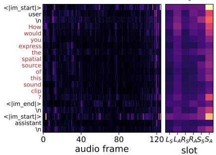

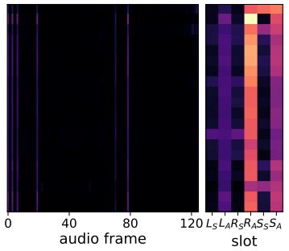

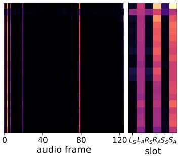

Sample 648 in SpatialSoundQA (dual-source)  
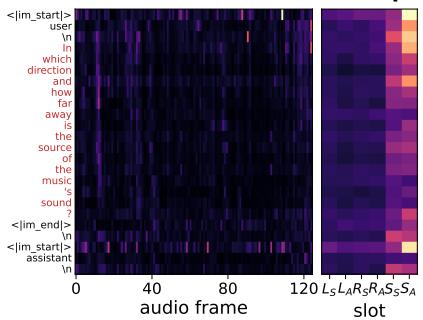

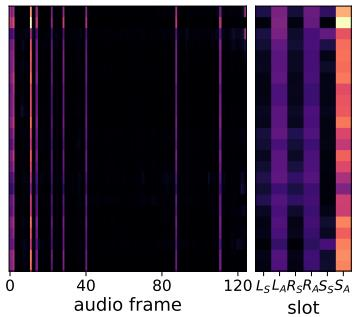

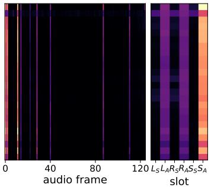  
(d) Attention distribution on layer 0 (e) Attention distribution on layer 15 (f) Attention distribution on layer 35

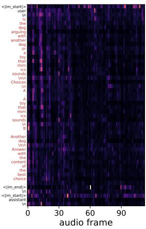

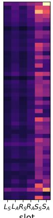

Sample Im7Z1mzRI5A in MMAR  
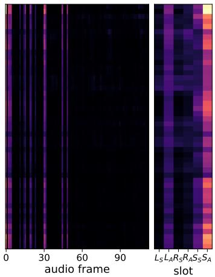

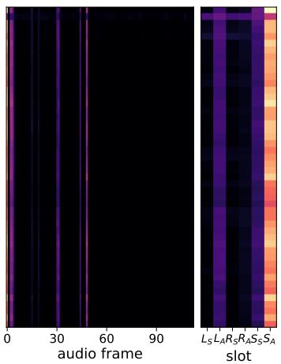  
Figure 7: Text-to-audio attention across layers. Attention concentrates on more specific frames with depth and, depending on the question, is finally directed to diferent slots. Columns show the first (layer 0), an intermediate (layer 15), and the final (layer 35) transformer layer after prefill. Attention is averaged over heads. In each panel, the wide map sums attention over the six slots at each audio frame and the narrow map sums it over frames for each slot; rows are text tokens. Each map is normalized to its own maximum.

$S _ { S }$ shows that the explicit diference slot is what makes lateral information accessible, consistent with the controlled experiment of Section 5, where adding the diference slots during training restored left/right reading.

## 8.4 Attention Visualization

We inspect text-to-audio attention during prefill, after the model has processed the audio and question but before it generates the first output token, averaged over heads and compared across the first (layer 0), an intermediate (layer 15), and the final (layer 35) transformer layer. Figure 7 shows examples answered correctly in the main evaluation, covering single-source, dual-source, and general-audio questions, with layers 0, 15, and 35 from left to right; within a panel, the wide map aggregates attention over the six slots within each audio frame, and the narrow map aggregates over time for each slot. The first audio position, which acts as an attention sink (Xiao et al., 2024), is excluded from the displayed maps, and the statistics in the next paragraph normalize each text row over the remaining audio positions.

Two patterns recur. First, attention concentrates on fewer audio frames at greater depth: across the inspected SSQA examples, the efective number of attended frames, the exponential of the frame-distribution entropy, decreases from approximately 115 in layer 0 to 16 in layer 35 out of 125 frames per input, and general-audio examples show a similar trend. Second, the final-layer allocation over the six slots depends on the question. In the single-source example (c), attention is spread over the acoustic-oriented slots of both ears and of the diference stream $( L _ { A } , R _ { A }$ , and $S _ { A } )$ . In the dual-source example (f), where the queried source must be separated from the other one, the acoustic diference slot $S _ { A }$ takes about half of the audio attention. In the MMAR example (i), which asks what is sounding rather than where, $S _ { A }$ still dominates, but the content-oriented diference slot $S _ { S }$ receives a visible share that is absent in the two spatial examples, while the right-ear acoustic slot $R _ { A }$ is nearly ignored. The model thus routes attention to diferent slots for diferent questions rather than reading the six slots uniformly.

## 9 Conclusion

This paper has examined whether a general-audio codec trained without spatial supervision can support both identifying and locating sounds in multi-source scenes, a setting in which existing systems rely on a separately trained spatial feature space. A controlled layer-wise analysis of a frozen X-Codec showed that the spatial information is there. Shallow RVQ layers are shaped mainly by source content, deeper layers respond increasingly to interaural diferences, room acoustics, and reverberation, and lateral information is recovered reliably only through the diference between the two channels; the same layer-wise trend holds on real binaural recordings. The presence of this information did not make it usable, however. A conventional interface trained with answer-only supervision remained at chance on left/right and read scene-level attributes without binding them to the queried source. We traced this failure to an audio–text information asymmetry, in which each clip contains two sources while the answer describes only one, together with an interface that leaves cross-channel comparison to the language model. In a controlled $2 \times 2$ experiment, scene supervision and an explicit interaural diference each restored left/right reading, and binding to the queried source improved substantially only when the two were combined. AURA builds on these observations. It aggregates the RVQ layers into content- and acoustic-oriented bands, adds the band-wise interaural diference to form a six-slot representation, and trains with scene and geometric supervision while the codec and the language model stay frozen. With about 40% ofthe trainable parameters of dedicated systems, it exceeds the strongest of them by 10.31 points in dual-source direction accuracy on SpatialSoundQA, achieves the lowest dual-source distance error rate, and scores higher than them on MMAU, MMAR, and AIR-Bench. Spatial and general-audio understanding therefore need not live in separate feature spaces. Once the spatial information in a frozen general-audio codec is made accessible and aligned with the text, that codec is suficient for competitive multi-source spatial question answering.

## References

Sharath Adavanne, Archontis Politis, Joonas Nikunen, and Tuomas Virtanen. Sound Event Localization and Detection of Overlapping Sources Using Convolutional Recurrent Neural Networks. IEEE Journal of Selected Topics in Signal Processing, 13(1):34–48, 2019. doi: 10.1109/jstsp.2018.2885636.

Yoshua Bengio, Jérôme Louradour, Ronan Collobert, and Jason Weston. Curriculum learning. In Proceedings of the 26th Annual International Conference on Machine Learning, pages 41–48. ACM, 2009. doi: 10.1145/ 1553374.1553380.

Subrata Biswas, Mohammad Nur Hossain Khan, and Bashima Islam. OWL: Geometry-Aware Spatial Reasoning for Audio Large Language Models. In The Fourteenth International Conference on Learning Representations, 2026. URL https://openreview.net/forum?id=zPv46YKv3w.

Jens Blauert. Spatial Hearing: The Psychophysics of Human Sound Localization. The MIT Press, 1996. doi: 10.7551/mitpress/6391.001.0001.

Zalán Borsos, Raphaël Marinier, Damien Vincent, Eugene Kharitonov, Olivier Pietquin, Matt Sharifi, Dominik Roblek, Olivier Teboul, David Grangier, Marco Tagliasacchi, and Neil Zeghidour. AudioLM: A Language Modeling Approach to Audio Generation. IEEE/ACM Transactions on Audio, Speech, and Language Processing, 31:2523–2533, 2023. doi: 10.1109/taslp.2023.3288409.

Angel Chang, Angela Dai, Thomas Funkhouser, Maciej Halber, Matthias Nießner, Manolis Savva, Shuran Song, Andy Zeng, and Yinda Zhang. Matterport3D: Learning from RGB-D Data in Indoor Environments. In 2017 International Conference on 3D Vision (3DV), pages 667–676. IEEE, 2017. doi: 10.1109/3dv.2017.00081.

Changan Chen, Carl Schissler, Sanchit Garg, Philip Kobernik, Alexander Clegg, Paul Calamia, Dhruv Batra, Philip Robinson, and Kristen Grauman. SoundSpaces 2.0: A Simulation Platform for Visual-Acoustic Learning. In Advances in Neural Information Processing Systems 35, pages 8896–8911. Neural Information Processing Systems Foundation, Inc. (NeurIPS), 2022. doi: 10.52202/068431-0647.

Chuyang Chen, Sivan Ding, Adrian S. Roman, and Juan P. Bello. Probing Spatial Structure in Pretrained Audio Representations, 2026a. URL https://arxiv.org/abs/2606.05544.

Sanyuan Chen, Chengyi Wang, Yu Wu, Ziqiang Zhang, Long Zhou, Shujie Liu, Zhuo Chen, Yanqing Liu, Huaming Wang, Jinyu Li, Lei He, Sheng Zhao, and Furu Wei. Neural Codec Language Models are Zero-Shot Text to Speech Synthesizers. IEEE Transactions on Audio, Speech and Language Processing, 33: 705–718, 2025. doi: 10.1109/taslpro.2025.3530270.

Yuxuan Chen, Haoyuan Yu, and Peize He. Spectro-Temporal Interference Confounds Phase Encoding in Spatial Audio Foundation Models, 2026b. URL https://arxiv.org/abs/2606.14820.

Yunfei Chu, Jin Xu, Xiaohuan Zhou, Qian Yang, Shiliang Zhang, Zhijie Yan, Chang Zhou, and Jingren Zhou. Qwen-Audio: Advancing Universal Audio Understanding via Unified Large-Scale Audio-Language Models, 2023. URL https://arxiv.org/abs/2311.07919.

Yunfei Chu, Jin Xu, Qian Yang, Haojie Wei, Xipin Wei, Zhifang Guo, Yichong Leng, Yuanjun Lv, Jinzheng He, Junyang Lin, Chang Zhou, and Jingren Zhou. Qwen2-Audio Technical Report, 2024. URL https: //arxiv.org/abs/2407.10759.

Alexandre Défossez, Jade Copet, Gabriel Synnaeve, and Yossi Adi. High Fidelity Neural Audio Compression. Transactions on Machine Learning Research, 2023. URL https://openreview.net/forum?id= ivCd8z8zR2.

Artem Dementyev, Wazeer Zulfikar, Sinan Hersek, Pascal Getreuer, Anurag Kumar, and Vivek Kumar. PhaseCoder: Microphone Geometry-Agnostic Spatial Audio Understanding for Multimodal LLMs. In Proceedings of the 43rd International Conference on Machine Learning, volume 306 of Proceedings of Machine Learning Research, pages 23672–23696. PMLR, 2026. URL https://proceedings.mlr.press/ v306/dementyev26a.html.

Soham Deshmukh, Benjamin Elizalde, Rita Singh, and Huaming Wang. Pengi: An Audio Language Model for Audio Tasks. In Advances in Neural Information Processing Systems 36, pages 18090–18108. Neural Information Processing Systems Foundation, Inc. (NeurIPS), 2023. doi: 10.52202/075280-0795.

Bhavika Devnani, Skyler Seto, Zakaria Aldeneh, Alessandro Toso, Elena Menyaylenko, Barry-John Theobald, Jonathan Sheafer, and Miguel Sarabia. Learning Spatially-Aware Language and Audio Embeddings. In Advances in Neural Information Processing Systems 37, pages 33505–33537. Neural Information Processing Systems Foundation, Inc. (NeurIPS), 2024. doi: 10.52202/079017-1056.

Jort F. Gemmeke, Daniel P. W. Ellis, Dylan Freedman, Aren Jansen, Wade Lawrence, R. Channing Moore, Manoj Plakal, and Marvin Ritter. Audio Set: An ontology and human-labeled dataset for audio events. In 2017 IEEE International Conference on Acoustics, Speech and Signal Processing (ICASSP), pages 776–780. IEEE, 2017. doi: 10.1109/icassp.2017.7952261.

Sreyan Ghosh, Sonal Kumar, Ashish Seth, Chandra Kiran Reddy Evuru, Utkarsh Tyagi, S Sakshi, Oriol Nieto, Ramani Duraiswami, and Dinesh Manocha. GAMA: A Large Audio-Language Model with Advanced Audio Understanding and Complex Reasoning Abilities. In Proceedings of the 2024 Conference on Empirical Methods in Natural Language Processing, pages 6288–6313. Association for Computational Linguistics, 2024. doi: 10.18653/v1/2024.emnlp-main.361.

Yuan Gong, Yu-An Chung, and James Glass. AST: Audio Spectrogram Transformer. In Interspeech 2021, pages 571–575. ISCA, 2021. doi: 10.21437/interspeech.2021-698.

Yuan Gong, Hongyin Luo, Alexander H. Liu, Leonid Karlinsky, and James R. Glass. Listen, Think, and Understand. In The Twelfth International Conference on Learning Representations, 2024. URL https: //openreview.net/forum?id=nBZBPXdJlC.

Florian Grötschla, Arunasish Sen, Alessandro Lombardi, Guillermo Cámbara, and Andreas Schwarz. VCNAC: A Variable-Channel Neural Audio Codec for Mono, Stereo, and Surround Sound, 2026. URL https: //arxiv.org/abs/2601.14960.

Wenxiang Guo, Changhao Pan, Zhiyuan Zhu, Xintong Hu, Yu Zhang, Li Tang, Rui Yang, Han Wang, Zongbao Zhang, Yuhan Wang, Yixuan Chen, Hankun Xu, Ke Xu, PengFei Fan, ZheTao Chen, Yanhao Yu, Qiange Huang, Fei Wu, and Zhou Zhao. MRSAudio: A Large-Scale Multimodal Recorded Spatial Audio Dataset with Refined Annotations. In Advances in Neural Information Processing Systems 38, pages 161982–162014. Neural Information Processing Systems Foundation, Inc. (NeurIPS), 2025. doi: 10.52202/085713-4882.

Dan Hendrycks and Kevin Gimpel. Gaussian Error Linear Units (GELUs), 2016. URL https://arxiv.org/ abs/1606.08415.

Wei-Ning Hsu, Benjamin Bolte, Yao-Hung Hubert Tsai, Kushal Lakhotia, Ruslan Salakhutdinov, and Abdelrahman Mohamed. HuBERT: Self-Supervised Speech Representation Learning by Masked Prediction of Hidden Units. IEEE/ACM Transactions on Audio, Speech, and Language Processing, 29:3451–3460, 2021. doi: 10.1109/taslp.2021.3122291.

Edward J Hu, Yelong Shen, Phillip Wallis, Zeyuan Allen-Zhu, Yuanzhi Li, Shean Wang, Lu Wang, and Weizhu Chen. LoRA: Low-Rank Adaptation of Large Language Models. In International Conference on Learning Representations, 2022. URL https://openreview.net/forum?id=nZeVKeeFYf9.

Jinbo Hu, Yin Cao, Ming Wu, Zhenbo Luo, and Jun Yang. SALM: Spatial Audio Language Model with Structured Embeddings for Understanding and Editing, 2025. URL https://arxiv.org/abs/2507. 16724.

Xilin Jiang, Hannes Gamper, and Sebastian Braun. Sci-Phi: A Large Language Model Spatial Audio Descriptor. IEEE Open Journal ofSignal Processing, 7:276–284, 2026. doi: 10.1109/ojsp.2026.3657300.

Bhuvan Chandra Koduru, Dareen Safar Alharthi, Rita Singh, and Bhiksha Raj. Heard but Not Heeded: Paralinguistic Information Encoding and Loss in Audio-Language Models. In Third Conference on Language Modeling, 2026. URL https://openreview.net/forum?id=GKaYbVlAgJ.

Zhifeng Kong, Arushi Goel, Rohan Badlani, Wei Ping, Rafael Valle, and Bryan Catanzaro. Audio Flamingo: A Novel Audio Language Model with Few-Shot Learning and Dialogue Abilities. In Proceedings ofthe 41st International Conference on Machine Learning, volume 235 of Proceedings of Machine Learning Research, pages 25125–25148. PMLR, 2024. URL https://proceedings.mlr.press/v235/kong24a.html.

Rithesh Kumar, Prem Seetharaman, Alejandro Luebs, Ishaan Kumar, and Kundan Kumar. High-Fidelity Audio Compression with Improved RVQGAN. In Advances in Neural Information Processing Systems 36, pages 27980–27993. Neural Information Processing Systems Foundation, Inc. (NeurIPS), 2023. doi: 10.52202/075280-1214.

Haotian Liu, Chunyuan Li, Qingyang Wu, and Yong Jae Lee. Visual Instruction Tuning. In Advances in Neural Information Processing Systems 36, pages 34892–34916. Neural Information Processing Systems Foundation, Inc. (NeurIPS), 2023. doi: 10.52202/075280-1516.

Zihan Liu, Zhikang Niu, Qiuyang Xiao, Zhisheng Zheng, Ruoqi Yuan, Yuhang Zang, Yuhang Cao, Xiaoyi Dong, Jianze Liang, Xie Chen, Leilei Sun, Dahua Lin, and Jiaqi Wang. STAR-Bench: Probing Deep Spatio-Temporal Reasoning as Audio 4D Intelligence. In The Fourteenth International Conference on Learning Representations, 2026. URL https://openreview.net/forum?id=Ts6j3GoZDE.

Ilya Loshchilov and Frank Hutter. Decoupled Weight Decay Regularization. In International Conference on Learning Representations, 2019. URL https://openreview.net/forum?id=Bkg6RiCqY7.

Zhengding Luo, Jinyang Wu, Haozhe Ma, Yanghao Zhou, Woon-Seng Gan, and Wenwu Wang. SAIL: Spatial Audio Intelligence with Large Language Models via Disentangled Acoustic-Spatial Encoding and Dual-Stream Q-Former, 2026. URL https://arxiv.org/abs/2609.34347.

Ziyang Ma, Yinghao Ma, Yanqiao Zhu, Chen Yang, Yi-Wen Chao, Ruiyang Xu, Wenxi Chen, Yuanzhe Chen, Zhuo Chen, Jian Cong, Kai Li, Keliang Li, Siyou Li, Xinfeng Li, Xiquan Li, Zheng Lian, Yuzhe Liang, Minghao Liu, Zhikang Niu, Tianrui Wang, Wang Yuping, Yuxuan Wang, Yihao Wu, Guanrou Yang, Jianwei Yu, Ruibin Yuan, Zhisheng Zheng, Ziya Zhou, Haina Zhu, Wei Xue, Emmanouil Benetos, Kai Yu, Eng-Siong Chng, and Xie Chen. MMAR: A Challenging Benchmark for Deep Reasoning in Speech, Audio, Music, and Their Mix. In Advances in Neural Information Processing Systems 38, pages 74837–74868. Neural Information Processing Systems Foundation, Inc. (NeurIPS), 2025. doi: 10.52202/085713-2252.

Anton Ratnarajah, Shi-Xiong Zhang, and Dong Yu. BANC: Towards Eficient Binaural Audio Neural Codec for Overlapping Speech, 2024. URL https://arxiv.org/abs/2309.07416.

S Sakshi, Vaibhavi Lokegaonkar, Neil Zhang, Ramani Duraiswami, Sreyan Ghosh, Dinesh Manocha, and Lie Lu. SPUR: A Plug-and-Play Framework for Integrating Spatial Audio Understanding and Reasoning into Large Audio-Language Models, 2025a. URL https://arxiv.org/abs/2511.06606.

S Sakshi, Utkarsh Tyagi, Sonal Kumar, Ashish Seth, Ramaneswaran Selvakumar, Oriol Nieto, Ramani Duraiswami, Sreyan Ghosh, and Dinesh Manocha. MMAU: A Massive Multi-Task Audio Understanding and Reasoning Benchmark. In The Thirteenth International Conference on Learning Representations, 2025b. URL https://openreview.net/forum?id=TeVAZXr3yv.

Kazuki Shimada, Archontis Politis, Parthasaarathy Sudarsanam, Daniel A. Krause, Kengo Uchida, Sharath Adavanne, Aapo Hakala, Yuichiro Koyama, Naoya Takahashi, Shusuke Takahashi, Tuomas Virtanen, and Yuki Mitsufuji. STARSS23: An Audio-Visual Dataset of Spatial Recordings of Real Scenes with Spatiotemporal Annotations of Sound Events. In Advances in Neural Information Processing Systems 36, pages 72931–72957. Neural Information Processing Systems Foundation, Inc. (NeurIPS), 2023. doi: 10.52202/075280-3189.

Yakun Song, Zhuo Chen, Xiaofei Wang, Ziyang Ma, Guanrou Yang, and Xie Chen. TacoLM: GaTed Attention Equipped Codec Language Model are Eficient Zero-Shot Text to Speech Synthesizers. In Interspeech 2024, pages 4433–4437. ISCA, 2024. doi: 10.21437/interspeech.2024-1531.

Yakun Song, Zhuo Chen, Xiaofei Wang, Ziyang Ma, and Xie Chen. ELLA-V: Stable Neural Codec Language Modeling with Alignment-Guided Sequence Reordering. Proceedings ofthe AAAI Conference on Artificial Intelligence, 39(24):25174–25182, 2025. doi: 10.1609/aaai.v39i24.34703.

Arvind Krishna Sridhar, Yinyi Guo, and Erik Visser. Spatial Audio Question Answering and Reasoning on Dynamic Source Movements, 2026. URL https://arxiv.org/abs/2602.16334.

Yirong Sun, Yanjun Chen, Xin Qiu, Gang Zhang, Hongyu Chen, Daokuan Wu, Chengming Li, Min Yang, Dawei Zhu, Wei Zhang, and Xiaoyu Shen. SonicBench: Dissecting the Physical Perception Bottleneck in Large Audio Language Models, 2026. URL https://arxiv.org/abs/2601.11039.

Changli Tang, Wenyi Yu, Guangzhi Sun, Xianzhao Chen, Tian Tan, Wei Li, Lu Lu, Zejun Ma, and Chao Zhang. SALMONN: Towards Generic Hearing Abilities for Large Language Models. In The Twelfth International Conference on Learning Representations, 2024a. URL https://openreview.net/forum?id=14rn7HpKVk.

Changli Tang, Wenyi Yu, Guangzhi Sun, Xianzhao Chen, Tian Tan, Wei Li, Jun Zhang, Lu Lu, Zejun Ma, Yuxuan Wang, and Chao Zhang. Can Large Language Models Understand Spatial Audio? In Interspeech 2024, pages 4149–4153. ISCA, 2024b. doi: 10.21437/interspeech.2024-2419.

Hugo Touvron, Louis Martin, Kevin Stone, Peter Albert, Amjad Almahairi, Yasmine Babaei, Nikolay Bashlykov, Soumya Batra, Prajjwal Bhargava, Shruti Bhosale, Dan Bikel, Lukas Blecher, Cristian Canton Ferrer, Moya Chen, Guillem Cucurull, David Esiobu, Jude Fernandes, Jeremy Fu, Wenyin Fu, Brian Fuller, Cynthia Gao, Vedanuj Goswami, Naman Goyal, Anthony Hartshorn, Saghar Hosseini, Rui Hou, Hakan Inan, Marcin Kardas, Viktor Kerkez, Madian Khabsa, Isabel Kloumann, Artem Korenev, Punit Singh Koura, Marie-Anne Lachaux, Thibaut Lavril, Jenya Lee, Diana Liskovich, Yinghai Lu, Yuning Mao, Xavier Martinet, Todor Mihaylov, Pushkar Mishra, Igor Molybog, Yixin Nie, Andrew Poulton, Jeremy Reizenstein, Rashi Rungta, Kalyan Saladi, Alan Schelten, Ruan Silva, Eric Michael Smith, Ranjan Subramanian, Xiaoqing Ellen Tan, Binh Tang, Ross Taylor, Adina Williams, Jian Xiang Kuan, Puxin Xu, Zheng Yan, Iliyan Zarov, Yuchen Zhang, Angela Fan, Melanie Kambadur, Sharan Narang, Aurelien Rodriguez, Robert Stojnic, Sergey Edunov, and Thomas Scialom. Llama 2: Open Foundation and Fine-Tuned Chat Models, 2023. URL https://arxiv.org/abs/2307.09288.

Kevin Wilkinghof and Zheng-Hua Tan. DSpAST: Disentangled Representations for Spatial Audio Reasoning with Large Language Models. In ICASSP 2026 - 2026 IEEE International Conference on Acoustics, Speech and Signal Processing (ICASSP), pages 14747–14751. IEEE, 2026. doi: 10.1109/icassp55912.2026.11460926.

Guangxuan Xiao, Yuandong Tian, Beidi Chen, Song Han, and Mike Lewis. Eficient Streaming Language Models with Attention Sinks. In The Twelfth International Conference on Learning Representations, 2024. URL https://openreview.net/forum?id=NG7sS51zVF.

Jin Xu, Zhifang Guo, Jinzheng He, Hangrui Hu, Ting He, Shuai Bai, Keqin Chen, Jialin Wang, Yang Fan, Kai Dang, Bin Zhang, Xiong Wang, Yunfei Chu, and Junyang Lin. Qwen2.5-Omni Technical Report, 2025. URL https://arxiv.org/abs/2503.20215.

An Yang, Anfeng Li, Baosong Yang, Beichen Zhang, Binyuan Hui, Bo Zheng, Bowen Yu, Chang Gao, Chengen Huang, Chenxu Lv, Chujie Zheng, Dayiheng Liu, Fan Zhou, Fei Huang, Feng Hu, Hao Ge, Haoran Wei, Huan Lin, Jialong Tang, Jian Yang, Jianhong Tu, Jianwei Zhang, Jianxin Yang, Jiaxi Yang, Jing Zhou, Jingren Zhou, Junyang Lin, Kai Dang, Keqin Bao, Kexin Yang, Le Yu, Lianghao Deng, Mei Li, Mingfeng Xue, Mingze Li, Pei Zhang, Peng Wang, Qin Zhu, Rui Men, Ruize Gao, Shixuan Liu, Shuang Luo, Tianhao Li, Tianyi Tang, Wenbiao Yin, Xingzhang Ren, Xinyu Wang, Xinyu Zhang, Xuancheng Ren, Yang Fan, Yang Su, Yichang Zhang, Yinger Zhang, Yu Wan, Yuqiong Liu, Zekun Wang, Zeyu Cui, Zhenru Zhang, Zhipeng Zhou, and Zihan Qiu. Qwen3 Technical Report, 2025a. URL https://arxiv.org/abs/2505.09388.

Dongchao Yang, Songxiang Liu, Haohan Guo, Jiankun Zhao, Yuanyuan Wang, Helin Wang, Zeqian Ju, Xubo Liu, Xueyuan Chen, Xu Tan, Xixin Wu, and Helen M. Meng. ALMTokenizer: A Low-bitrate and Semantic-rich Audio Codec Tokenizer for Audio Language Modeling. In Proceedings of the 42nd International Conference on Machine Learning, volume 267 of Proceedings of Machine Learning Research, pages 70850–70872. PMLR, 2025b. URL https://proceedings.mlr.press/v267/yang25q.html.

Qian Yang, Jin Xu, Wenrui Liu, Yunfei Chu, Ziyue Jiang, Xiaohuan Zhou, Yichong Leng, Yuanjun Lv, Zhou Zhao, Chang Zhou, and Jingren Zhou. AIR-Bench: Benchmarking Large Audio-Language Models via Generative Comprehension. In Proceedings of the 62nd Annual Meeting of the Association for Computational Linguistics (Volume 1: Long Papers), pages 1979–1998. Association for Computational Linguistics, 2024. doi: 10.18653/v1/2024.acl-long.109.

Zhen Ye, Peiwen Sun, Jiahe Lei, Hongzhan Lin, Xu Tan, Zheqi Dai, Qiuqiang Kong, Jianyi Chen, Jiahao Pan, Qifeng Liu, Yike Guo, and Wei Xue. Codec Does Matter: Exploring the Semantic Shortcoming of Codec for Audio Language Model. Proceedings of the AAAI Conference on Artificial Intelligence, 39(24): 25697–25705, 2025. doi: 10.1609/aaai.v39i24.34761.

Yuhuan You, Lai Wei, Xihong Wu, and Tianshu Qu. The World is Not Mono: Enabling Spatial Understanding in Large Audio-Language Models, 2026. URL https://arxiv.org/abs/2601.02954.

Neil Zeghidour, Alejandro Luebs, Ahmed Omran, Jan Skoglund, and Marco Tagliasacchi. SoundStream: An End-to-End Neural Audio Codec. IEEE/ACM Transactions on Audio, Speech, and Language Processing, 30: 495–507, 2022. doi: 10.1109/taslp.2021.3129994.

Xin Zhang, Dong Zhang, Shimin Li, Yaqian Zhou, and Xipeng Qiu. SpeechTokenizer: Unified Speech Tokenizer for Speech Language Models. In The Twelfth International Conference on Learning Representations, 2024. URL https://openreview.net/forum?id=AF9Q8Vip84.

Zhisheng Zheng, Puyuan Peng, Ziyang Ma, Xie Chen, Eunsol Choi, and David Harwath. BAT: Learning to Reason about Spatial Sounds with Large Language Models. In Proceedings ofthe 41st International Conference on Machine Learning, volume 235 of Proceedings ofMachine Learning Research, pages 61454– 61469. PMLR, 2024. URL https://proceedings.mlr.press/v235/zheng24i.html.

Zhiyuan Zhu, Yixuan Chen, Yiwen Shao, Wenxiang Guo, Changhao Pan, Yu Zhang, Yuxiang Wang, Wei Liu, Houhua Zhang, Chengkuan Zeng, Wenbo Cheng, Yunxi Liu, Rui Yang, Steve Yves, Liefeng Bo, and Zhou Zhao. Spatial-Omni: Spatial Audio Understanding Integration in Multimodal LLMs via FOA Encoding, 2026. URL https://arxiv.org/abs/2606.10738.

## A Training Configuration

Table 7 lists the hyperparameters of the curriculum. Stage 1 first trains the projector alone with the language model and LoRA frozen, and every later row starts from the previous one and runs one epoch; training used four GPUs. The objective is the autoregressive language-model cross-entropy, with no auxiliary loss. All stages use AdamW $\bar { ( } \beta _ { 1 } = 0 . 9 , \beta _ { 2 } = 0 . 9 9 9 , { \epsilon } = 1 0 ^ { - \mathfrak { S } } )$ without weight decay, a single learning rate for all trainable parameters, gradient-norm clipping at 1.0, bfloat16 precision, and seed 42. LoRA has rank 16, α = 32, and dropout 0.05, applied to the query, key, value, and output projections of attention and to the gate, up, and down projections of the feed-forward layers.

## B Dataset Composition

Table 8 gives the number of questions per type. Stage 1 uses the single-source rows, Stage 2 adds the dual-source rows, and Stage 3 adds the relation rows. Training and evaluation audio do not overlap. The non-binary relation questions are part of training but are not scored in the main results, whose binary accuracy uses the two binary relation types.

## C Question and Prompt Formats

AURA receives the SSQA question unchanged in the Qwen3 chat template, with the audio tokens before the text; its target formats are shown in Fig. 6, and Table 9 gives one original SSQA question per type with its answer. BAT, DSpAST-BAT†, and OWL use the prompt construction of their released code.

Table 7: Training stages of AURA. Each stage covers one epoch.
<table><tr><td>Stage</td><td>Parameters</td></tr><tr><td rowspan="5">Stage 1, alignment</td><td>Trained: projector</td></tr><tr><td>Samples: 55,008 single-source</td></tr><tr><td>Steps: 1,719</td></tr><tr><td>Global batch size: 32</td></tr><tr><td>Schedule: cosine with 100 warmup steps Learning rate:  $1 0 ^ { - 4 }$ </td></tr><tr><td rowspan="5">Stage 1, joint</td><td>Trained: projector and LoRA Samples: 278,784 single-source</td></tr><tr><td></td></tr><tr><td>Steps: 17,424</td></tr><tr><td>Global batch size: 16</td></tr><tr><td>Schedule: cosine with 100 warmup steps Learning rate:  $1 0 ^ { - 4 }$ </td></tr><tr><td rowspan="5"></td><td>Samples: 514,784 single- and dual-source</td></tr><tr><td>Steps: 32,174</td></tr><tr><td>Global batch size: 16</td></tr><tr><td>Schedule: cosine with 100 warmup steps</td></tr><tr><td>Learning rate:  $1 0 ^ { - 4 }$ </td></tr><tr><td rowspan="5">Stage 3</td><td>Trained: projector and LoRA Samples: 872,312 single-source, dual-source, and relation</td></tr><tr><td></td></tr><tr><td>Steps: 54,520 Global batch size: 16</td></tr><tr><td>Schedule: cosine with 100 warmup steps</td></tr><tr><td>Learning rate:  $1 0 ^ { - 4 }$ </td></tr></table>

Table 8: Number of training and evaluation questions per type.
<table><tr><td>Scene</td><td>Question type</td><td>Train</td><td>Eval</td></tr><tr><td rowspan="2">Single source</td><td>Direction and distance</td><td>139,392</td><td>14,828</td></tr><tr><td>Classification</td><td>139,392</td><td>14,828</td></tr><tr><td rowspan="2">Dual source</td><td>Direction and distance</td><td>118,000</td><td>10,640</td></tr><tr><td>Classification</td><td>118,000</td><td>10,640</td></tr><tr><td rowspan="6">Relation</td><td>Binary direction</td><td>120,002</td><td>12,002</td></tr><tr><td>Binary distance</td><td>125,800</td><td>10,600</td></tr><tr><td>Non-binary direction</td><td>37,242</td><td>3,232</td></tr><tr><td>Non-binary distance</td><td>37,242</td><td>3,232</td></tr><tr><td>Non-binary source</td><td>37,242</td><td>3,232</td></tr><tr><td></td><td>872,312</td><td>83,234</td></tr></table>

Qwen2-Audio and Qwen2.5-Omni receive the question followed by a format instruction, because they are not trained on SSQA. For direction and distance: “Return exactly four fields and nothing else: left or right, front or behind, above or below; numeric distance in meters. Example: left, front, above; 2.5m.” For classification and non-binary source questions: “Answer only with the AudioSet sound-event label or labels. Separate multiple labels with semicolons. Do not explain.” For binary relations: “Answer exactly Yes or No and nothing else.” For non-binary direction: “Answer with exactly one direction word: left, right, front, behind, above, or below.” For non-binary distance: “Answer only with one numeric distance in meters, for example 2.5m.”

Table 9: Example questions and answers from the original SSQA dataset.
<table><tr><td>Type</td><td>Question</td><td>Answer</td></tr><tr><td>Direction and distance</td><td>How would you describe the location of the speech&#x27;s sound in terms of direction and distance?</td><td>right, front, below; 0.5m</td></tr><tr><td>Classification</td><td>Enumerate the sound occurrences in the audio clip.</td><td>accelerating, revving, vroom; car; vehicle</td></tr><tr><td>Binary direction</td><td>Are you able to detect the orchestra&#x27;s sound coming from the right and the cricket&#x27;s sounds from the left?</td><td>Yes</td></tr><tr><td>Binary distance</td><td>Is the sound of mechanisms further from you than male singing when considering the direct paths?</td><td>Yes</td></tr><tr><td>Non-binary direction</td><td>Do you know if the tuning fork&#x27;s sound comes from the right left or right side of the sound made by the hum?</td><td></td></tr><tr><td>Non-binary distance</td><td>What is the distance between the sound of the crumpling, crinkling and the sound of the music?</td><td>2m</td></tr><tr><td>Non-binary source</td><td>What can be heard on the behind side of the siren&#x27;s audible sound?</td><td>music</td></tr></table>

## D Baseline Evaluation Details

All models answer with single-path decoding: AURA with greedy search and at most 192 new tokens (384 on relation questions), BAT, DSpAST-BAT†, and OWL with a beam size of 1, and the two Qwen models with greedy search and at most 48 new tokens.

BAT. We use the released Spatial-AST encoder, eight-layer Q-Former, and LLaMA-2-7B LoRA checkpoint with its released inference code.

DSpAST-BAT†. The released DSpAST Stage-3 encoder and LLaMA-2-7B stay frozen. We train an eightlayer Q-Former and LoRA (rank 8, α = 32, dropout 0.05) on the 872,312 SSQA training questions for one epoch, which is 27,260 steps at a global batch size of 32, with a learning rate of 10−4 and 5,452 warmup steps.

OWL. We use the released Stage-1 checkpoint for single-source questions and the released Stage-2 checkpoint for dual-source questions, with the output mapping given in the Baselines paragraph of the main experiments.

Qwen2-Audio and Qwen2.5-Omni. Both are evaluated zero-shot. The binaural input is reduced to one channel by a fractional delay-and-sum beam steered to the left at 30◦.

## E Layer-wise Similarity Across Codecs

We repeat the interaural and placement comparisons of Section 4.1 on two codecs trained for reconstruction without semantic supervision: DAC (Kumar et al., 2023) at 16 kHz with twelve layers, and EnCodec (Défossez et al., 2023) at 24 kHz with thirty-two layers, whose input is upsampled from 16 kHz. Inputs and pairs follow the same protocol. DAC quantizes in an 8-dimensional factorized space and projects each codeword back to 1024 dimensions before the residual subtraction; we use the projected vector as $^ { c _ { t , i , } }$ and the 8-dimensional entries give nearly the same curves (largest diference 0.044, at L0). EnCodec codewords have 128 dimensions and no output projection.

Figure 8 shows that both trends appear on both codecs. On DAC, left/right similarity falls from 0.746 at L0 to 0.243 at L11 on simulated audio and from 0.835 to 0.144 on MRSSpeech; a new placement falls from

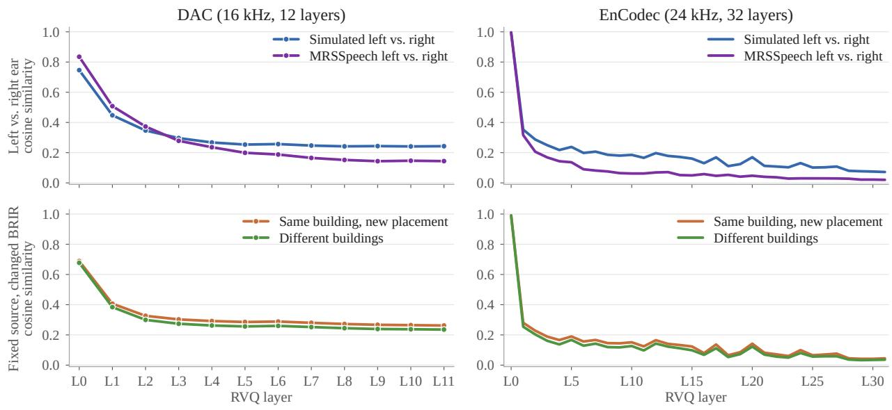  
Figure 8: Layer-wise similarity on reconstruction-only codecs. Left: DAC; right: EnCodec. Top: interaural similarity for simulated (fixed source and BRIR) and real (MRSSpeech) binaural audio; the RVQ vectors diverge markedly as the layer index increases. Bottom: room variation: right-ear similarity when the same audio is rendered at another placement in the same building or with an impulse response from a diferent building; the similarity of the RVQ vectors still decreases clearly with depth. These comparisons reveal that the increasing sensitivity to interaural and room changes in deeper RVQ layers is not specific to X-Codec.

Table 10: Linear probes of spatial attributes on real binaural recordings (MRSSpeech), with the features of Table 1. Test speakers and every drama they appear in are excluded from training, and monaural features use the left ear. L/R+F/B requires both axes to be correct. Up/down has no entries because every annotated source lies on one side of the listener, so the axis has a single class. Reference rows are constant predictions without audio.
<table><tr><td></td><td colspan="4">Direction ↑</td><td>Dist.</td></tr><tr><td>Features</td><td>L/R+F/B</td><td>L/R</td><td>F/B</td><td>U/D</td><td>MAE↓</td></tr><tr><td>Reference</td><td>50.6</td><td>61.6</td><td>56.1</td><td>一</td><td>0.515</td></tr><tr><td>Monaural</td><td>62.9</td><td>77.8</td><td>72.3</td><td>一</td><td>0.496</td></tr><tr><td>Binaural</td><td>67.2</td><td>84.5</td><td>74.6</td><td>一</td><td>0.487</td></tr></table>

0.689 to 0.262 and a diferent building, which stays lower at every layer, from 0.677 to 0.235. DAC flattens after about L5. On EnCodec, from L0 to L31, the same comparisons fall from 0.995 to 0.072, 0.997 to 0.020, 0.991 to 0.045, and 0.991 to 0.036, with small local rises between layers. These two trends therefore do not require a semantic branch.

## F Direction Probes on Real Binaural Recordings

We apply the recording-level probes of Section 4.2 to MRSSpeech (Guo et al., 2025), using the same frozen X-Codec bands and classifier, with labels taken from the annotated source trajectories. The 5,501 segments come from 30 dramas recorded in one scene with one listener position; segments shorter than 1 s are skipped and longer ones truncated to 20 s. For each direction axis we remove segments whose source stays within 0.2 m of the axis plane or crosses it, leaving 5,073 left/right, 4,807 front/back, and 4,494 segments valid for both; distance is the mean radial distance of the trajectory, on all segments. Because a speaker tends to keep one position within a drama, each test speaker and every drama they appear in are excluded from training. We omit up/down and three-axis DoA because this dataset has no up/down contrast: the annotated source height ranges from 0.01 to 0.67 m and stays below the annotated ear height of 0.95 m in every segment, so all sources fall on one side of the listener and the axis has a single class.

Table 10 reports the results. Binaural features reach 84.5% on left/right and 74.6% on front/back against references of 61.6% and 56.1%, and 67.2% on both axes jointly against 50.6%. Distance error is 0.487 m against a reference of 0.515 m. As on SSQA, the gain from monaural to binaural features is largest on left/right.