# Achieving Robust Channel Estimation Neural Networks on Doppler efects by Designed Training Data

Dianxin Luan, John Thompson   
Institute for Imaging, Data and Communications   
University of Edinburgh   
Edinburgh, EH9 3JL, United Kingdom   
d.luan3017@gmail.com, J.S.Thompson@ed.ac.uk

## Abstract

Channel estimation is crucial in wireless communication systems. Many existing works train and test their models using the same or similar channel. However, practical channels are infinitely diverse and time-variant while data-driven algorithms often degrade on new and previously unseen channels. This prohibits the practical implementation of neural networks for channel estimation, particularly in high speed scenarios characterized by rapidly channel profile changes and very high Doppler shifts. Online training can fine-tune models to adapt to new channels, but requires high computation resource and incurs significant latency for physical-layer devices. Moreover, online training cannot exhaustively cover all possible channels because there are infinitely many possible channels. Therefore, we investigate the ability of neural networks to generalize to wireless channels. This paper proposes design criteria to generate synthetic training data, which guaranty that the resulting networks perform robustly across wireless channels, especially for very high Doppler shifts and diferent Doppler spectra. It ensures that ofline-trained neural networks require no prior information or online training to precisely estimate the new channels. To demonstrate general applicability, we use neural networks with diferent levels of complexity to show that the generalization achieved appears to be independent of architecture. From simulation results, neural networks achieve a certain performance across wireless channels with diferent unseen power delay profiles (PDP) and Doppler shifts.

## 1 Introduction

For sixth-generation (6G) wireless communications and beyond, orthogonal frequency division multiplexing (OFDM) is expected to continue as the baseband modulator Wang et al. (2023). Therefore, acquiring precise channel state information (CSI) is essential for reliable links that provide high data rates. Channel estimation refers to the process of estimating channel state information of the propagation environments between the transmitter and the receiver end. The CSI estimate is subsequently used to mitigate channel distortions and recover the transmitted data. Least-squares (LS) and minimum mean squared error (MMSE) methods are widely investigated for channel estimation (CE) Van De Beek et al. (1995); Edfors et al. (1998); Li et al. (1998); Srivastava et al. (2004). However, conventional approaches struggle to meet the increasingly stringent data-rate and reliability system requirements, motivating the exploration of machine learning approaches for overall system optimization Ye et al. (2017); Kim et al. (2018b;a); Neumann et al. (2018); Kim et al. (2020); Baur et al. (2024); Allaparapu et al. (2026); Luan & Thompson (2026). Unlike conventional methods that aim for closed-form mathematical expressions, neural network approaches learn nonlinear mappings directly from the data and often achieve locally optimal but improved performance, such as ChannelNet Soltani et al. (2019). With the development of the attention mechanism, Luan & Thompson (2022; 2023b) proposed an encoder-decoder architecture, called Channelformer, to utilize the transformer encoder Vaswani et al. (2017)

to focus on the critical subset of input LS elements. However, data-driven algorithms often degrade on new channels. This instability prohibits the real-world implementation of neural networks for time-variant channels. To adapt to channel variations while mitigating catastrophic forgetting, Kong et al. (2025) proposed a continuous learning-based channel estimation solution that preserves previously learned knowledge through several subnetworks. A VAE-assisted unsupervised out-of-distribution (OOD) detector identifies unseen channels, after which a new subnetwork is rapidly adapted by using only a few online samples. To fine-tune neural channel estimator under varying channel conditions, Wang et al. (2026) proposed a two-branch masked autoencoder that enables label-free online training through self-supervised reconstruction of randomly masked resource elements. Wang et al. (2025) proposed a federated collaborative learning solution with pruning for neural receivers while mitigating catastrophic forgetting.

## 1.1 Problem statement

Although online training methods can fine-tune ofline-trained neural networks to adapt to new channels, they have several critical drawbacks as follows:

1) Latency and computational consumption: Collecting training samples and parameters updating will result in significant and unavoidable latency. For example, the slot length is between 0.0625 milliseconds and 1 millisecond as defined in the 3GPP TS 38.211 document and the receiver needs at least 62.5-1,000 milliseconds to collect each 1,000 examples. Moreover, the computational cost and latency of the training process are typically high, so it is dificult for battery-powered terminals to update neural networks promptly, especially in highly dynamic environments. Moreover, online training cannot exhaustively cover all wireless channels as the set of possible channels is infinite.

2) Interpolation capability and performance loss: The superior performance achieved by channel estimation neural networks is primarily down to their interpolation capability for OFDM. However, this good performance cannot be retained through online training because training requires the ground-truth channel matrix for the entire data packet, including the ground-truth channel matrix at both the vacant pilot positions (frequency-domain interpolation) and the data symbols (time-domain interpolation). The complete and ground-truth channel matrix of the environment channel is unavailable in practical systems, which indicates the loss of this superior performance. As shown in Fig.7a and Fig.7b of Luan & Thompson (2025) (provided in Appendix A), it efectively addresses the generalization of neural networks to diferent channel power delay profiles (PDP), i.e. retaining frequencydomain interpolation capability on unseen channels. For time-domain interpolation, it is challenging because statistical models are inaccurate, cumbersome and dificult to handle Nissel et al. (2018), and the basis expansion model Borah & Hart (1999) is used for timevariant channels. Therefore, ofline-trained neural networks are also expected to generalize well to diferent Doppler shifts and Doppler spectra, to retain time-domain interpolation capability on unseen channels.

## 1.2 Main contribution and notion

The key contributions are summarized as follows:

• This paper proposes design criteria to generate synthetic training data which guarantees that trained neural networks generalize well to diferent Doppler spectra and Doppler shifts. Regardless of the channels which neural networks operate on, ofline-trained neural networks achieve stable performance without any knowledge of this channel at the design time. This provides robust generalization to previously unseen channels.

• Ground-truth and complete channel matrices can be still used as labels because the training channel is synthetically generated. By being trained with the complete channel matrix, neural networks retain precise interpolation capabilities in both frequency and time domain for superior estimate performance when operating on new, previously unseen channels.

Notations: In this paper, we use uppercase bold letters for matrices X and lowercase bold letters for vectors $\mathbf { x } .$ The complex Gaussian distribution with mean $\mu$ and variance $\sigma ^ { 2 }$ is written as $\mathcal { C N } ( \mu , \ \sigma ^ { 2 } )$ . The conjugate transpose and inverse of matrix X are represented by $\left( \mathbf { X } \right) ^ { H }$ and $\left( \mathbf { X } \right) ^ { - 1 }$ . The function $\operatorname { T r } \left\{ \cdot \right\}$ denotes the trace of a matrix and $\| \cdot \| _ { F } ^ { 2 }$ denotes the Frobenius norm of the matrix. ${ \mathbf { I } } _ { N }$ represents an identity matrix of size $\overset \cdots { N } \times N , \mathbb { E } \{ \cdot \}$ is the expectation operator, and diag {·} is the diagonal operator that converts a vector to a diagonal matrix. For scalars, the conjugate operation is denoted by $( \cdot ) ^ { * }$ . ⊗ denotes the convolution operation. $\left\| \cdot \right\| _ { 1 }$ denotes the $\ell _ { 1 }$ norm.

## 2 System configuration and Propagation channels

This paper considers an OFDM cellular system with a subcarrier spacing of $f _ { s p a c e }$ kHz. The source signal is processed by a Quadrature Phase Shift Keying (QPSK) modulator. The QPSK symbols are assigned to the data subcarriers. The pilot signals are known to the receiver, and the vacant pilot subcarriers are set to 0. Each slot consists of $N _ { f }$ subcarriers and $N _ { s } \mathrm { O F D M }$ symbols. By following the 5G NR specifications in 3GPP TS 38.211, a singlesymbol demodulation reference signal (DM-RS) pattern with three additional positions is deployed. The 2nd, $5 ^ { \mathrm { t h } }$ $8 ^ { \mathrm { t h } }$ and $\mathrm { 1 1 ^ { t h } }$ OFDM symbols are reserved for pilots $( \bar { N } _ { p i l o t } = 4 )$ For each pilot OFDM symbol, the second subcarriers of each indices of $L _ { s } = 2$ subcarriers is reserved for pilot subcarriers. The inverse fast Fourier transform (IFFT) converts the slot signal from the frequency domain to the time domain. Then the Cyclic-Prefix (CP, of length $L _ { \mathrm { C P } }$ samples) is added to the front of each symbol to eliminate intersymbol interference (ISI) but it cannot mitigate intercarrier interference (ICI) caused by Doppler shifts. The channel model is a multipath channel with M paths with impulse response of

$$
h ( \tau , t ) = \sum _ { m = 0 } ^ { M - 1 } a _ { m } e ^ { j 2 \pi f _ { d , m } t } \delta ( \tau - \tau _ { m } T _ { s } ) ,\tag{1}
$$

where $a _ { m } \sim \mathcal { C } \mathcal { N } ( 0 , A _ { m } )$ is the path gain of the $m ^ { t h }$ path, $A _ { m }$ is the average path power, $\tau _ { m }$ is the corresponding delay normalized by the sampling period $T _ { s } , f _ { d , m }$ is the Doppler shift and $f _ { d }$ is the maximum Doppler shift. The time-varying channel coeficient of the mth path is denoted by

$$
\gamma _ { m } ( t ) = a _ { m } e ^ { j 2 \pi f _ { d , m } t } .\tag{2}
$$

Conditioned on the Doppler shift, $\gamma _ { m } ( t )$ is a complex Gaussian process. Doppler shifts $\{ f _ { d , m } \} _ { m = 0 } ^ { M - 1 }$ are independently sampled from the normalized Doppler spectrum $S ( f )$ for channel realizations $\bar { ( } \forall m , | f _ { d , m } | \leq \bar { f } _ { d } )$ and are independent of path gains. Conventionally, the Doppler spectrum $S ( f )$ of wireless channels is characterized by the Jakes model, which has the theoretical formula of

$$
S ( f ) = \frac { 1 } { \pi f _ { d } \sqrt { 1 - \left( f / f _ { d } \right) ^ { 2 } } } , \qquad | f | < f _ { d } ,\tag{3}
$$

and $S ( f ) = 0$ otherwise. Therefore, the nth sampled time-domain $\mathbf { h } ( n ; t )$ is

$$
\mathbf { h } ( n ; t ) = \sum _ { m = 0 } ^ { M - 1 } a _ { m } e ^ { j 2 \pi f _ { d , m } t } e ^ { - j \pi \frac { n + ( N _ { f } - 1 ) \tau _ { m } } { N _ { f } } } \frac { \sin ( \pi \tau _ { m } ) } { \sin \left( \frac { \pi } { N _ { f } } \left( \tau _ { m } - n \right) \right) } .\tag{4}
$$

The sampled PDP $\mathbf { p } ( n ) = \mathbb { E } \left( \mid \mathbf { h } ( n ) \mid ^ { 2 } \right)$ , if the channel is invariant within single OFDM symbol duration $T _ { o } ,$ then the sampled signal $\mathbf { y } = \mathbf { h } \otimes \mathbf { x } + \mathbf { n }$ , where n is additive white Gaussian noise (AWGN) and x is the transmitted signal. Each slot is assigned a new channel realization. After removing the CP, the receiver converts the time-domain data to the frequency-domain by the FFT operation. Assuming that $\forall \tau _ { m } \leq L _ { C P }$ , the channel gain at the kth subcarrier and lth symbol is

$$
\mathbf { H } \left( k , l \right) = \frac { 1 } { \sqrt { N _ { f } } } \sum _ { m = 0 } ^ { M - 1 } a _ { m } e ^ { j 2 \pi f _ { d , m } T _ { o } l } e ^ { - j 2 \pi \frac { k \tau _ { m } } { N _ { f } } } .\tag{5}
$$

for $k = 0 , 1 , . . . , N _ { f } - 1$ and $T _ { o }$ is one complete OFDM symbol period including the CP. Then $E \{ \mathbf { H } _ { k , l } \mathbf { H } _ { k ^ { \prime } , l ^ { \prime } } ^ { * } \} = \check { r } _ { t } ( l - l ^ { \prime } ) r _ { f } ( k - k ^ { \prime } )$ where $r _ { f } , r _ { t }$ is the frequency and time correlation that are separable as shown in (26). For Jakes model, $r _ { t } ( \Delta l ) = J _ { 0 } ( 2 \pi f _ { d } T _ { o } \Delta l )$ is the zeroth-order Bessel function. The received frequency domain signal at kth subcarrier and lth OFDM symbol, Y(k, l), is of the form:

$$
\mathbf { Y } ( k , l ) = \mathbf { H } ( k , l ) \mathbf { X } ( k , l ) + \mathbf { N } ( k , l ) ,\tag{6}
$$

where $\mathbf { N } \sim \mathcal { C N } ( \mathbf { 0 } , \sigma _ { N } ^ { 2 } \mathbf { I } _ { N _ { f } } ) , \mathbf { H } \in \mathbb { C } ^ { N _ { f } \times N _ { s } }$ is the channel matrix and $\sigma _ { X } ^ { 2 } = { }$ $E \{ ( N _ { f } N _ { s } ) ^ { - 1 } \left\| \mathbf { X } \right\| _ { F } ^ { 2 } \}$ . The received pilot signal is then extracted to provide a reference for channel estimate. The recovered signal will be filtered to remove the channel efects.

## 2.1 Propagation channels

Wireless channels are modeled as multipath Rayleigh fading channels operating at a carrier frequency $f _ { s }$ of 3.5GHz in the n78 band, which is specified in 3GPP TS 38.104. The extended pedestrian A (EPA), extended vehicular A (EVA) and extended typical urban (ETU) channels are defined in 3GPP 36.101. The other example channel PDPs for simulations are given in Table. 2.

## 2.2 Channel estimation and methods

Channel estimation is to estimate the channel matrix H. To minimize the distance between the received signal and the channel-distorted signal, LS estimate at the kth subcarrier is

$$
\begin{array} { r } { \hat { \bf H } _ { \mathbf { l s } } ( k ) = Y _ { k } X _ { k } ^ { - 1 } , } \end{array}\tag{7}
$$

where $Y _ { k } , X _ { k }$ denotes the received and transmitted signals for the kth subcarrier. This paper applies bilinear interpolation on $\hat { \mathbf { H } } _ { \mathbf { l s } } ^ { \mathbf { p i l o t } } \in \mathbb { C } ^ { \frac { N _ { f } } { L _ { s } } \times N _ { p i l o t } }$ (at the pilot positions) to predict the complete channel matrix. To argminH $\| \mathbf { H } - \mathbf { H } _ { \mathbf { l s } } \| _ { F } ^ { 2 }$ , MMSE estimate for OFDM symbols is computed by

$$
\hat { \mathbf { H } } _ { \mathrm { M M S E } } = \mathbf { W } ^ { H } \hat { \mathbf { H } } _ { \mathrm { l s } } , W = \left( \mathbf { R } _ { \mathbf { H H } } + \left( \frac { \sigma _ { N } ^ { 2 } } { \sigma _ { X } ^ { 2 } } \right) \mathbf { I } _ { N _ { f } } \right) ^ { - 1 } \mathbf { R } _ { \mathbf { H H } } ,\tag{8}
$$

where RHH $\begin{array} { r l } { \in } & { { } \mathbb { C } ^ { N _ { f } \times N _ { f } } } \end{array}$ is the channel autocorrelation matrix with ${ \bf R _ { H H } } ( k _ { 1 } , k _ { 2 } ) { \bf \phi } = { \bf \phi }$ $E \{ \mathbf { H } _ { k _ { 1 } } \mathbf { H } _ { k _ { 2 } } ^ { * } \}$ for $\forall k _ { 1 } , k _ { 2 } \in [ 0 , N _ { f } - 1 ]$ , and $E \{ \mathbf { H } _ { k , l } \mathbf { H } _ { k , l ^ { \prime } } ^ { * } \} = r _ { t } ( l - l ^ { \prime } ) r _ { f } ( k - k ^ { \prime } )$ as shown in (5) where $r _ { f } , r _ { t }$ is the frequency and time correlation. $\frac { \sigma _ { N } ^ { 2 } } { \sigma _ { X } ^ { 2 } }$ is the inverse signal-to-noise ratio (SNR) and $\sigma ^ { 2 }$ denotes the normalized power variance. We use the actual channel vectors for each pilot symbol $\mathbf { H _ { c } } \in \mathbb { C } ^ { N _ { f } }$ and the actual channel vectors for the pilot sub carriers $\mathbf { H _ { p } } \in \mathbb { C } ^ { \frac { N _ { f } } { L _ { s } } }$ to compute the correlation matrix by $\mathbf { R } _ { \mathbf { H } _ { \mathbf { c } } \mathbf { H } _ { \mathbf { p } } } = \mathbb { E } \left\{ \mathbf { H } _ { \mathbf { c } } \mathbf { H } _ { \mathbf { p } } ^ { \mathbf { H } } \right\} , \mathbf { R } _ { \mathbf { H } _ { \mathbf { p } } \mathbf { H } _ { \mathbf { p } } } =$ E $\left\{ \mathbf { H _ { p } H _ { p } ^ { H } } \right\}$ These matrices are then substituted into (8) to calculate $\hat { \mathbf { H } } _ { \mathbf { M M S E } } ^ { \mathrm { p i l o t } } \in \mathbb { C } ^ { N _ { f } }$ for each pilot symbol. Bilinear interpolation is applied to this MMSE estimate to predict the complete channel matrix estimate. $\mathrm { B y }$ incorporating ground-truth channel matrix of the environment channel and LS estimate as input, the MMSE method outperforms the LS estimate, but the implementation of the MMSE method is noncausal in practice.

Channel estimation neural networks take $\hat { \mathbf { H } } _ { \mathrm { l s } } ^ { \mathrm { p i l o t } }$ as input to infer Hˆ $\in \mathbb { C } ^ { N _ { f } \times N _ { s } }$ as estimate for complete channel matrix. The real and imaginary parts of complex matrix are stored in the third dimension of both the real input and the real output. To demonstrate that the proposed method is efective across neural architectures, along with the Channelformer network, InterpolateNet in Luan & Thompson (2021) is also deployed as an example of low complexity estimator, with only 9,942 parameters.

## 3 Proposed design criteria for Doppler

The detailed operation of neural networks is dificult to understand as mathematical in terpretability is still lacking. By using MSE loss for training, the neural network behavior is similar to MMSE filters as shown in Luan & Thompson (2025). As the $r _ { f }$ design has been discussed in Luan & Thompson (2025), this work only considers the $r _ { t }$ mismatch on a matched PDP. An alternative expression for channel autocorrelation is $\mathbf { R } _ { \mathbf { H } \mathbf { H } } = \mathbf { D } \boldsymbol { \Lambda } \mathbf { D } ^ { - 1 } , \mathbf { D } \mathbf { D } ^ { H } = \mathbf { I } _ { N _ { f } }$ where $\mathbf { D } \in \mathbb { C } ^ { N _ { f } \times N _ { f } }$ is the discrete Fourier transform (DFT) matrix and $\mathbf { \Delta } \Lambda = \mathrm { d i a g } \{ \mathbf { p } \} , \mathbf { \Lambda } \tilde { \in } \mathbb { R } ^ { N _ { f } \times N _ { f } }$ . To investigate the time correlation among the slot, Doppler shifts are expressed using the normalized DTFT frequency $( [ - f _ { d } , f _ { d } ] \subseteq [ - 0 . 5 , 0 . 5 ] )$ For the ith diagonal element of its eigenvalue the corresponding spectrum normalized by $\scriptstyle { \vec { \sigma } } ^ { 2 }$ is given by

$$
S _ { i } ( f ) = \frac { { \bf p } ( i ) } { \sigma ^ { 2 } } S _ { t } ( f ) + 1 .\tag{9}
$$

Under the anti-causal assumption, spectral factorization is performed to (9) for one-sided function $M _ { i } ( f )$ that satisfies $\begin{array} { r } { | M _ { i } ( f ) | ^ { 2 } = \frac { { \bf p } ( i ) } { \sigma ^ { 2 } } S _ { t } ( f ) + 1 } \end{array}$ . Then converting $M _ { i } ( f )$ back by the inverse Fourier transform to obtain $\Gamma _ { i } ,$ we have its filter taps $\Gamma _ { i }$ expressed as

$$
M _ { i } ( f ) = \sum _ { n = 0 } ^ { \infty } \Gamma _ { i } ( n ) e ^ { - j n 2 \pi f } ,\tag{10}
$$

$$
\sum _ { n = 0 } ^ { \infty } \Gamma _ { i } ^ { * } ( n ) e ^ { j n 2 \pi f } \sum _ { n = 0 } ^ { \infty } \Gamma _ { i } ( n ) e ^ { - j n 2 \pi f } = { \bf p } ( i ) \frac { \sigma _ { X } ^ { 2 } } { \sigma _ { N } ^ { 2 } } S _ { t } ( f ) + 1 ,\tag{11}
$$

as shown in (29) of Appendix A. In this case, the corresponding anti-causal Wiener filter is given by

$$
{ \bf w } _ { i } ( f ) = 1 - \frac { 1 } { M _ { i } ( - f ) \Gamma _ { i } ( 0 ) } ,\tag{12}
$$

and then the weight matrix at the design time $\mathbf { W } ^ { D }$ is given by

$$
\mathbf { W } ^ { D } ( f ) = \mathbf { D w } ^ { D } ( f ) \mathbf { A } ^ { \dagger } \mathbf { D } ^ { H } \mathbf { R } _ { H H } = \mathbf { D w } ^ { D } ( f ) \mathbf { A } ^ { \dagger } \mathbf { D } ^ { H } \mathbf { D } \mathbf { A } \mathbf { D } ^ { H } = \mathbf { D w } ^ { D } ( f ) \mathbf { D } ^ { H } .\tag{13}
$$

The corresponding $\mathbf { w } ^ { D } ( f ) \in \mathbb { C } ^ { N _ { f } \times N _ { f } }$ is a diagonal matrix with ith elements $\mathbf { w } _ { i } ^ { D } ( f )$ of

$$
{ \bf w } _ { i } ^ { D } ( f ) = 1 - \frac { 1 } { M _ { i } ^ { D } ( - f ) \Gamma _ { i } ^ { D } ( 0 ) } ,\tag{14}
$$

and $S _ { t } ^ { D } ( f )$ is the Doppler spectrum of the designed channel. It has

$$
| M _ { i } ^ { D } ( f ) | ^ { 2 } = 1 + \frac { { \bf p } ( i ) } { \sigma ^ { 2 } } S _ { t } ^ { D } ( f ) .\tag{15}
$$

Assuming the $S _ { t } ^ { A } ( f )$ is the Doppler spectrum of the environment channel, the mismatch error caused by the Doppler spectrum mismatch between the designed channel and the environment channel $\begin{array} { r } { \Delta \epsilon _ { t } ( S _ { t } ^ { D } ; S _ { t } ^ { A } ) = \frac { 1 } { N _ { t } } \sum _ { i = 1 } ^ { N _ { f } } \left( \epsilon _ { t , i } \big ( S _ { t } ^ { A } ; S _ { t } ^ { D } \big ) - \epsilon _ { t , i } \big ( S _ { t } ^ { D } ; S _ { t } ^ { D } \big ) \right) } \end{array}$ is

$$
\Delta \epsilon _ { t } ( S _ { t } ^ { D } ; S _ { t } ^ { A } ) = \frac { 1 } { N _ { f } } \sum _ { i = 1 } ^ { N _ { f } } \mathbf { p } ( i ) \int _ { - 0 . 5 } ^ { 0 . 5 } \left( S _ { t } ^ { A } ( f ) - S _ { t } ^ { D } ( f ) \right) \left| 1 - \mathbf { w } _ { i } ^ { D } ( f ) \right| ^ { 2 } d f .\tag{16}
$$

From (31) shown in Appendix $\begin{array} { r } { \mathrm { A } , \Gamma _ { i } ^ { D } { \left( 0 \right) } ^ { 2 } = \exp \left\{ \int _ { - 0 . 5 } ^ { 0 . 5 } { \ln \left( 1 + \frac { { \bf p } \left( i \right) S _ { t } ^ { D } \left( f \right) } { \sigma ^ { 2 } } \right) d f } \right\} } \end{array}$ . By (14) and (15), using $S _ { t } ^ { D } ( f ) = S _ { t } ^ { D } ( - f )$ and $\Gamma _ { i } ^ { D } ( 0 ) > 0$ , we obtain

$$
\left| 1 - \mathbf { w } _ { i } ^ { D } ( f ) \right| ^ { 2 } = \frac { \sigma ^ { 2 } } { \left( \Gamma _ { i } ^ { D } ( 0 ) \right) ^ { 2 } \left( \mathbf { p } ( i ) S _ { t } ^ { D } ( f ) + \sigma ^ { 2 } \right) } .\tag{17}
$$

Substituting this into (16), the mismatch error $\Delta \epsilon _ { t }$ is simplified to

$$
\begin{array} { r } { \Delta \epsilon _ { t } = \cfrac { 1 } { N _ { f } } \displaystyle \sum _ { i = 1 } ^ { N _ { f } } \cfrac { \sigma ^ { 2 } } { \Gamma _ { i } ^ { D } \left( 0 \right) ^ { 2 } } \int _ { - 0 . 5 } ^ { 0 . 5 } \frac { \mathbf { p } ( i ) \left( S _ { t } ^ { A } ( f ) - S _ { t } ^ { D } ( f ) \right) } { \mathbf { p } ( i ) S _ { t } ^ { D } ( f ) + \sigma ^ { 2 } } d f } \\ { = \cfrac { \sigma ^ { 2 } } { N _ { f } } \displaystyle \sum _ { i = 1 } ^ { N _ { f } } \cfrac { 1 } { \Gamma _ { i } ^ { D } \left( 0 \right) ^ { 2 } } \left( \int _ { - 0 . 5 } ^ { 0 . 5 } \frac { \mathbf { p } ( i ) S _ { t } ^ { A } ( f ) + \sigma ^ { 2 } } { \mathbf { p } ( i ) S _ { t } ^ { D } ( f ) + \sigma ^ { 2 } } d f - 1 \right) . } \end{array}\tag{18}
$$

Except that $\Delta \epsilon _ { t } = 0$ under the matched Doppler spectrum of $S _ { t } ^ { D } ( f ) = S _ { t } ^ { A } ( f )$ , the Doppler spectrum of the designed channel is set to be the flat spectrum which has the theoretical formula of

$$
S ( f ) = \left\{ { \frac { 1 } { 2 f _ { d } } } , \quad | f | \leq f _ { d } , \right. \quad\tag{19}
$$

It satisfies $S _ { t } ( f ) = S _ { t } ( - f )$ and when the boundary $f _ { d } ^ { D }$ of the flat spectrum design exceeds $f _ { d } ^ { A }$ of $S _ { t } ^ { A } ( f )$ , it has

$$
\int _ { - 0 . 5 } ^ { 0 . 5 } \frac { \mathbf { p } ( i ) S _ { t } ^ { A } ( f ) + \sigma ^ { 2 } } { \mathbf { p } ( i ) S _ { t } ^ { D } ( f ) + \sigma ^ { 2 } } d f = 1 ,\tag{20}
$$

which gives $\Delta \epsilon _ { t } = 0$ . Therefore, by using the flat spectrum with a suficiently large $f _ { d } ^ { D }$ for design, the resulting filter should generalize well to any Doppler spectrum shape with a smaller $f _ { d }$ value. It should be noted that $S _ { t } ^ { D } ( f )$ should be symmetric while the environment channel does not necessarily to be symmetric.

For the noncausal assumption, we do not need spectrum factorization for two-sided $M _ { i } ( f )$ and the noncausal corresponding coeficient is given by

$$
\mathbf { w } _ { i } ( f ) = \frac { \mathbf { p } ( i ) S _ { t } ( f ) } { \mathbf { p } ( i ) S _ { t } ( f ) + \sigma ^ { 2 } } .\tag{21}
$$

Assume flat spectrum is deployed as the designed Doppler spectrum and the environment has a Doppler spectrum of $\operatorname { \bar { \it S } } _ { t } ^ { A } ( f )$ , the $\mathbf { w } _ { i } ^ { D } ( f )$ is given by

$$
\mathbf { w } _ { i } ^ { D } ( f ) = \frac { \mathbf { p } ( i ) S _ { t } ^ { D } ( f ) } { \mathbf { p } ( i ) S _ { t } ^ { D } ( f ) + \sigma ^ { 2 } } = \left\{ \frac { \mathbf { p } ( i ) } { \mathbf { p } ( i ) + 2 \sigma ^ { 2 } f _ { d } ^ { D } } , \quad | f | \leq f _ { d } ^ { D } , \right. .\tag{22}
$$

This result is independent of Doppler shifts, and $\begin{array} { r } { \left| 1 - \mathbf { w } _ { i } ^ { D } ( f ) \right| ^ { 2 } = \left( \frac { 2 \sigma ^ { 2 } } { \mathbf { p } ( i ) f _ { d } ^ { - 1 } + 2 \sigma ^ { 2 } } \right) ^ { 2 } } \end{array}$ is a constant across Doppler shifts. Therefore, each mismatch error under this flat spectrum design is provided by

$$
\begin{array} { r l } & { \Delta \epsilon _ { t , i } = \mathbf { p } ( i ) \left( \frac { 2 \sigma ^ { 2 } } { \mathbf { p } ( i ) f _ { d } ^ { - 1 } + 2 \sigma ^ { 2 } } \right) ^ { 2 } \displaystyle \int _ { - 0 . 5 } ^ { 0 . 5 } \left( S _ { t } ^ { A } ( f ) - S _ { t } ^ { D } ( f ) \right) d f } \\ & { \quad = \mathbf { p } ( i ) \left( \frac { 2 \sigma ^ { 2 } } { \mathbf { p } ( i ) f _ { d } ^ { - 1 } + 2 \sigma ^ { 2 } } \right) ^ { 2 } \left( \displaystyle \int _ { - 0 . 5 } ^ { 0 . 5 } S _ { t } ^ { A } ( f ) d f - \displaystyle \int _ { - 0 . 5 } ^ { 0 . 5 } S _ { t } ^ { D } ( f ) d f \right) } \\ & { \quad = 0 . } \end{array}\tag{23}
$$

For arbitrary normalized Doppler spectrum, it holds that $\begin{array} { r l } { \int _ { - 0 . 5 } ^ { 0 . 5 } S _ { t } ^ { A } ( f ) \mathrm { d } f } & { { } = } \end{array}$ $\begin{array} { r } { \int _ { - 0 . 5 } ^ { 0 . 5 } S _ { t } ^ { D } ( f ) \mathrm { d } f = 1 } \end{array}$ . Therefore, $\Delta \epsilon _ { t } = 0$ when the flat spectrum is deployed as $S _ { t } ^ { D }$ on any Doppler spectrum shape with a smaller value of $f _ { d }$ . Both causal and noncausal processing are commonly adopted in neural channel estimators (typically to predict for the whole slot), where pilot symbols embedded in intermediate OFDM symbols are used for time interpolation to predict the complete channel matrix of the whole slot. For example, the channel estimation at earlier symbols may depend on pilot symbols from later symbols, such as the first data OFDM symbol.

The benefit is, channel estimation neural networks will only require ofline-training to perform well to unseen Doppler scenarios. We only need to consider the inference complexity because training is completely conducted ofline. As regularization prevents overfitting as well as improving generalization slightly, the L2 regularization is set to 0 to remove the potential contribution. This is to show generalization is primarily due to the design criteria for training. Moreover, the proposed method is applicable to most neural networks because it imposes no specific constraints on their architectures.

Table 1: Simulation hyper-parameters for the deployed baseband configuration and the hyper-parameters for ofline-training procedure of both Channelformer and InterpolateNet.
<table><tr><td>Offline-training hyper-parameters</td><td>System configuration</td><td></td></tr><tr><td>Optimizer</td><td>Adam  $\overline { { N _ { f } } }$ </td><td>72</td></tr><tr><td>Maximum epoch</td><td>100</td><td> $\overline { { N _ { s } } }$  14</td></tr><tr><td>Initial learning rate (lr)</td><td>0.01  $\overline { { L _ { \mathrm { C P } } } }$ </td><td>12</td></tr><tr><td>Drop period for lr</td><td>20  $\overline { { f _ { c } } }$ </td><td>3.5GHz</td></tr><tr><td>Drop factor for lr</td><td>0.2  $f _ { d }$ </td><td>1135Hz</td></tr><tr><td>Minibatch size 64</td><td> $f _ { s p a c e }$ </td><td>30kHz</td></tr><tr><td>L2 regularization 0</td><td> $\overline { { T _ { s } } }$ </td><td>4.629e-07s</td></tr></table>

## 4 Simulations

Normalized MSE (NMSE) is a performance metric that evaluates the normalized distance between the ground-truth channel matrix and its estimate for all resource elements in the slot, defined as

$$
\mathrm { M S E } \left( \hat { \mathbf { H } } , \mathbf { H } \right) = \frac { \mathbb { E } \left\{ \left\| \hat { \mathbf { H } } - \mathbf { H } \right\| _ { F } ^ { 2 } \right\} } { \mathbb { E } \left\{ \left\| \mathbf { H } \right\| _ { F } ^ { 2 } \right\} } .\tag{24}
$$

The ofline-training dataset consists of 300,000 independent samples (95% for training and 5% for validation), which use the CE channel in Luan & Thompson (2025) as the default PDP. It ensures robust generalization to diferent PDPs, i.e. frequency-domain Interpolation. The mobile speed is set to $3 5 0 \mathrm { { k m } / \mathrm { { h } } }$ (maximum Doppler shift $f _ { d }$ of 1135Hz) with a fixed SNR of 20dB. This setting represents an intermediate high-mobility condition between the 300km/h and 500km/h HST test profiles specified in 3GPP TS 38.101-4 (3rd Generation Partnership Project (3GPP), 2024). The deployed loss function is the MSE loss and the system configuration and training hyper-parameters are shown in Table. 1. It should be noted that this work only uses a very small subcarrier spacing $f _ { s p a c e }$ of 30kHz for high Doppler shifts scenarios. To average out Monte Carlo efects, each sample of the simulation curves is tested with 5,000 independent channel realizations.

## 4.1 Generalization to diferent Doppler spectrum and Doppler shifts

To show the generalization to diferent Doppler conditions, the ofline-trained neural networks are tested with previously unseen Doppler spectra and Doppler shifts. We only use the flat Doppler spectrum and 1135Hz Doppler shifts for training neural networks, as provided by the proposed design criteria. This ensures that the trained neural networks generalize to the channels including but not just those channels, which are just examples to show the generalization results. Detailed expressions of the deployed Doppler spectra are shown in Appendix A.

Fig. 1a provides the MSE results for trained InterpolateNet tested on Doppler shifts from 0Hz to 350Hz when $f _ { d }$ has a Doppler spectrum of flat, Jakes, Bell, Guassian, Round, Asymmetric Jakes, Restricted Jakes or BiGuassian spectrum. For Doppler shifts from 0Hz to 1135Hz, both InterpolateNet and Channelformer achieve a flat NMSE performance for flat, Jakes, Bell, Round, Asymmetric Jakes, Restricted Jakes spectrum across the whole Doppler shift range. Compared to NMSE values at the Doppler shift of 0Hz, InterpolateNet increase NMSE values by 0.0226 on Guassian spectrum and 0.0088 on BiGuassian spectrum at the Doppler shift of 1135Hz, while Channelformer increase NMSE values by 0.0226 on Guassian spectrum and 0.0088 on BiGuassian spectrum. The LS estimate and the MMSE method have NMSE values from 0.39 to 0.40 and from 0.0002 to 0.0262, respectively. Because the MMSE method cooperates with bilinear interpolation for time-domain interpolation, it results in worse time-domain interpolation performance. Therefore, neural network methods can outperform the MMSE methods in a high Doppler shift range.

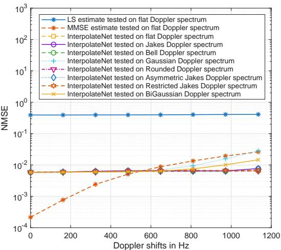  
(a) NMSE results of InterpolateNet

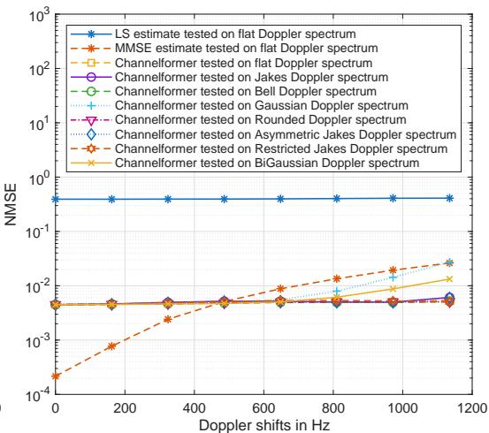  
(b) NMSE results of Channelformer  
Figure 1: NMSE results for the ofline-trained InterpolateNet and Channelformer tested with diferent Doppler spectra, Doppler shifts and a fixed SNR of 20dB. The CE channel is set as default PDP.

Except for BiGuassian and Guassian spectrum, both InterpolateNet and Channelformer achieve almost identical MSE performance across these unseen Doppler spectra and Doppler shifts from 0Hz to 1135Hz, only with a slight variation of 0.00072 for InterpolateNet and 0.00065 for Channelformer at Doppler shift of 1135Hz. For Guassian and BiGuassian spectrum, InterpolateNet achieves a NMSE value of 0.0284 and 0.0146 at Doppler shift of 1135Hz, respectively. Channelformer has a NMSE value of 0.0271 and 0.0122 for each, which also show a slight variation shown in Fig. 1.

## 4.2 Validation of preservation of generalization to PDPs

After demonstrating the generalization to Doppler shifts and Doppler spectrum, we evaluate if this proposed design criteria will damage the design criteria for generalization to PDPs proposed in Luan & Thompson (2025), while time correlation and frequency correlation are separable.

Fig. 2a provides the generalization property of ofline-trained neural networks to diferent PDPs. For each path, the corresponding Doppler shifts have a randomly assigned Doppler spectrum. From the simulation results on these example channels, both InterpolateNet and Channelformer achieve almost identical NMSE values across these unseen PDPs. Fig. 2b and Fig. 2c show the NMSE values when trained InterpolateNet and Channelformer are tested on randomly generated channels and each NMSE point is averaged by 50 slots. Each channel realization has a path number M randomly selected from 1 to 15, and the path delays are confined within a maximum delay spread of the duration of CP to emulate practical propagation characteristics. Up to three early paths are uniformly distributed within the first 700ns, subject to a minimum inter-path spacing constraint to prevent unrealistic clustering. The remaining paths are uniformly distributed over the interval from 700ns to the duration of CP, resulting in a sparser late-arrival structure. Each $a _ { m }$ follows an exponential distribution to capture the typical power decay behavior of multipath channels. After power normalization, the strongest path is enforced within the early components. For ofline-trained InterpolateNet and Channelformer, the mean value is 0.0046 and 0.0042 re spectively; the upper boundary of the best-performing 10% and the lower boundary of the worst-performing 10% are 0.0037 and 0.0052 for InterpolateNet, 0.0030 and 0.0052 for Channelformer. These results demonstrate that the proposed design criteria do not compromise generalization to channels with unseen PDPs.

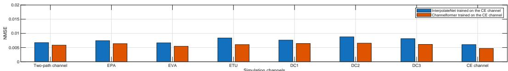  
(a) NMSE results for the ofline-trained InterpolateNet and Channelformer tested on example channels given in Table. 2 with a fixed SNR of 20dB and mobile speed of 70km/h.

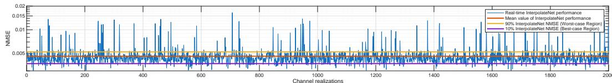  
(b) Ofline-trained InterpolateNet tested on randomly generated channels with a fixed SNR of 20dB, mobile speed of 100km/h and each $f _ { d , m }$ has a randomly assigned Doppler spectrum.

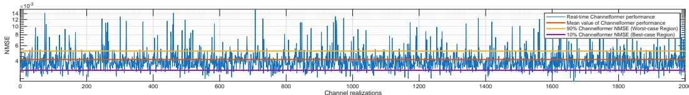  
(c) Ofline-trained Channelformer tested on randomly generated channels with a fixed SNR of 20dB, mobile speed of 100km/h and each $f _ { d , m }$ has a randomly assigned Doppler spectrum.  
Figure 2: Validation of generalization to diferent PDPs and tests on a randomly generated channel

## 4.3 Ablation experiments: Validation of the proposed design criteria

As shown in Section. 4.1, trained neural networks exhibit strong generalization to Doppler by following the proposed design criteria. Simultaneously, we intentionally violate this design criteria for training to observe NMSE degradation, and this ablation experiment is used to understand the contribution of our proposal.

Fig. 3a and Fig. 3b provide the NMSE values for InterpolateNets and Channelformers trained with diferent single $f _ { d } ^ { D }$ and tested on Doppler shifts from 0Hz to 1135Hz with $S _ { t } ^ { D } ( f ) = S _ { t } ^ { A } ( f )$ (flat spectrum). These curves increase as the Doppler shift increases. Neural networks trained with Doppler shift of 1135Hz achieve almost identical NMSE across these Doppler shifts. For example, InterpolateNet and Channelformer only have a slight variation from 0.0058 to 0.0068 and from 0.0045 to 0.0054 respectively. However, when the unseen $f _ { d } ^ { A }$ are larger than the $f _ { d } ^ { D }$ used for training, trained neural networks exhibit increased NMSE on these unseen $f _ { d } ^ { A }$ . For example, for Channelformer trained with $f _ { d } =$ 681Hz, it has NMSE values of 0.0038, 0.0057 and 0.0108 at the maximum Doppler shifts of 681Hz, 908Hz and 1135Hz. Especially, for neural networks trained with lower Doppler shifts, they perform better on low Doppler shifts and degrade significantly on high Doppler range. For example, InterpolateNet trained with $f _ { d }$ of 0Hz achieves the best NMSE among these trained InterpolateNets but exhibits the most severe increase on other unseen Doppler shifts. It has a NMSE of 0.0016 at 0Hz while the corresponding NMSE value of 0.3203 at 1135Hz, which indicates random prediction at high Doppler shifts. The increase in NMSE is mainly down to $f _ { d } ^ { D } < f _ { d } ^ { A }$ , while the NMSE values are stable when $f _ { d } ^ { A } \leq f _ { d } ^ { D }$

Fig. 3c and Fig. 3d provide the NMSE values for InterpolateNets and Channelformers trained with diferent Doppler spectrum with $f _ { d } ^ { D } = 6 4 0 \mathrm { { H z } }$ , and then tested on these spectra with $f _ { d } ^ { A } = 6 4 0 \mathrm { { H z } }$ . InterpolateNet and Channelformer trained with flat spectrum has only slight NMSE variation of 0.00067 and 0.000628 among these spectra, which is the smallest variation compared to neural networks trained with other candidate spectrum. It should be noted that only the variation caused by channel mismatch is evaluated to show the generalization property. The aim is to ensure robustness against Doppler mismatch rather than to achieve the minimum estimate error among these spectra. From these simulation results, neural networks trained with flat spectrum and $f _ { d } ^ { A } \leq f _ { d } ^ { D }$ achieve good generalization to unseen Doppler spectra and Doppler shifts, while violating the proposed design criteria leads to an increase in NMSE.

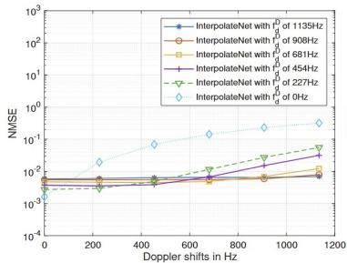  
(a) InterpolateNet trained with different f

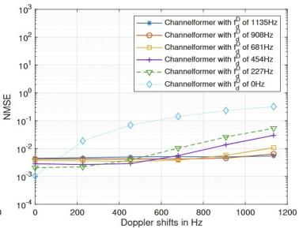  
(b) Channelformer trained with different f

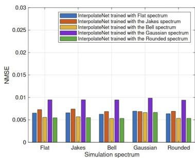  
(c) InterpolateNet trained with different $S _ { t } ^ { D } ( f )$

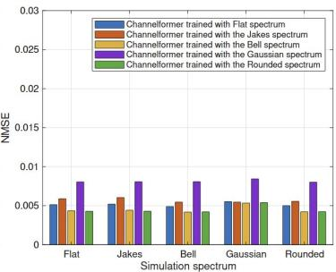  
(d) Channelformer trained with different SP (f)  
Figure 3: NMSE results for InterpolateNet and Channelformer trained with diferent $f _ { d } ^ { D }$ and $S _ { t } ^ { D } ( f )$ and tested with diferent Doppler spectra, Doppler shifts and a fixed SNR of 20dB. The CE channel is set as default PDP.

## 5 Conclusion

We propose design criteria to generate the training data for channel estimation neural networks that achieve strong generalization to unseen Doppler shifts and Doppler spectra. It ensures trained neural networks perform time-domain interpolation well across new and previously unseen channels, which retain the superior performance for practical implementation of channel estimation neural networks. Moreover, the proposed design criteria is applicable for most neural networks because no specific neural architecture is required. From the simulation results, trained neural networks achieve robust performance across diferent Doppler shifts and Doppler spectra. Moreover, the proposed design criteria do not damage the generalization to channels with unseen power delay profiles as shown in the simulation results.

## AI use statement

This work used generative AI tools for assist with translation. We have not used generative AI tools to generate synthetic data sets, help develop theoretical models or conceptual frameworks, formulate mathematical claims, provide critical ingredients for proving mathematical claims, assist in the writing of proofs, propose or refine hypotheses, design or provide feedback on research methodology or experiments, implement methods, support qualitative and thematic data analysis, interpret results tasks, and clean and reformat dataset is not applicable to this work. In addition, we used generative AI tools to edit a research paper to improve readability. We use google scholar to generate the BibTeX for citations. We reviewed all AI-assisted work. We take responsibility for the final content of this work, including text, claims, or artifacts produced with the aid of generative AI.

## References

3rd Generation Partnership Project (3GPP). NR; User Equipment (UE) Radio Transmission and Reception; Part 4: Performance Requirements. Technical Specification TS 38.101-4, 3GPP, May 2024. Release 17.

Srikar Allaparapu, Michael Baur, Benedikt Böck, Michael Joham, and Wolfgang Utschick. Precoder design in multi-user fdd systems with vq-vae and gnn. In ICASSP 2026-2026 IEEE International Conference on Acoustics, Speech and Signal Processing (ICASSP), pp. 21431–21435. IEEE, 2026.

Michael Baur, Benedikt Fesl, and Wolfgang Utschick. Leveraging variational autoencoders for parameterized mmse estimation. IEEE Transactions on Signal Processing, 72:3731– 3744, 2024.

Deva K Borah and BT Hart. Frequency-selective fading channel estimation with a polynomial time-varying channel model. IEEE Trans. Commun., 47(6):862–873, 1999.

Ove Edfors, Magnus Sandell, J-J Van de Beek, Sarah Kate Wilson, and P Ola Borjesson. OFDM channel estimation by singular value decomposition. IEEE Trans. Commun., 46 (7):931–939, 1998.

Hyeji Kim, Yihan Jiang, Sreeram Kannan, Sewoong Oh, and Pramod Viswanath. Deepcode: Feedback codes via deep learning. Advances in neural information processing systems, 31, 2018a.

Hyeji Kim, Yihan Jiang, Ranvir Rana, Sreeram Kannan, Sewoong Oh, and Pramod Viswanath. Communication algorithms via deep learning. arXiv preprint arXiv:1805.09317, 2018b.

Hyeji Kim, Yihan Jiang, Sreeram Kannan, Sewoong Oh, and Pramod Viswanath. Deepcode: Feedback codes via deep learning. IEEE Journal on Selected Areas in Information Theory, 1(1), 2020.

Lingjin Kong, Xiaoran Liu, Xiaoying Zhang, Jun Xiong, Haitao Zhao, and Jibo Wei. Representation-based continual learning for channel estimation in dynamic wireless environments. IEEE Transactions on Wireless Communications, 2025.

YLJC Li, Leonard J Cimini, and Nelson R Sollenberger. Robust channel estimation for ofdm systems with rapid dispersive fading channels. IEEE Transactions on communications, 46(7):902–915, 1998.

Dianxin Luan and John Thompson. Low complexity channel estimation with neural network solutions. In WSA 2021; 25th International ITG Workshop on Smart Antennas, pp. 1–6. VDE, 2021.

Dianxin Luan and John Thompson. Attention based neural networks for wireless channel estimation. In 2022 IEEE 95th Vehicular Technology Conference:(VTC2022-Spring), pp. 1–5. IEEE, 2022.

Dianxin Luan and John Thompson. Achieving robust generalization for wireless channel estimation neural networks by designed training data. In ICC 2023-IEEE International Conference on Communications, pp. 3462–3467. IEEE, 2023a.

Dianxin Luan and John Thompson. Robust channel estimation for optical wireless communications using neural network. IEEE Wireless Communications Letters, 2026.

Dianxin Luan and John S Thompson. Channelformer: Attention based neural solution for wireless channel estimation and efective online training. IEEE Transactions on Wireless Communications, 22(10):6562–6577, 2023b.

Dianxin Luan and John S Thompson. Achieving robust channel estimation neural networks by designed training data. IEEE Transactions on Cognitive Communications and Networking, 12:2311–2324, 2025.

David Neumann, Thomas Wiese, and Wolfgang Utschick. Learning the mmse channel estimator. IEEE Transactions on Signal Processing, 66(11):2905–2917, 2018.

Ronald Nissel, Fjolla Ademaj, and Markus Rupp. Doubly-selective channel estimation in FBMC-OQAM and OFDM systems. In 2018 IEEE 88th Vehicular Technology Conference (VTC-Fall), pp. 1–5. IEEE, 2018.

Mehran Soltani, Vahid Pourahmadi, Ali Mirzaei, and Hamid Sheikhzadeh. Deep learningbased channel estimation. IEEE Communications Letters, 23(4):652–655, 2019.

Vineet Srivastava, Chin Keong Ho, Patrick Ho Wang Fung, and Sumei Sun. Robust mmse channel estimation in ofdm systems with practical timing synchronization. In 2004 IEEE Wireless Communications and Networking Conference (IEEE Cat. No. 04TH8733), volume 2, pp. 711–716. IEEE, 2004.

J-J Van De Beek, Ove Edfors, Magnus Sandell, Sarah Kate Wilson, and P Ola Borjesson. On channel estimation in OFDM systems. In 1995 IEEE 45th VTC., volume 2, pp. 815–819. IEEE, 1995.

Ashish Vaswani, Noam Shazeer, Niki Parmar, Jakob Uszkoreit, Llion Jones, Aidan N Gomez, Łukasz Kaiser, and Illia Polosukhin. Attention is all you need. Advances in neural information processing systems, 30, 2017.

Cheng-Xiang Wang et al. On the road to 6G: Visions, requirements, key technologies and testbeds. IEEE Commun. Surveys Tuts., 2023.

Shuo Wang, Tianxin Wang, and Xudong Wang. Fedpda: Collaborative learning for reducing online-adaptation frequency of neural receivers. In IEEE INFOCOM 2025-IEEE Conference on Computer Communications, pp. 1–10. IEEE, 2025.

Tianxin Wang, Yuanzhe Huang, and Xudong Wang. Channelmae: Self-supervised learning assisted online adaptation of neural channel estimators. In IEEE INFOCOM 2026-IEEE Conference on Computer Communications, pp. 1–10. IEEE, 2026.

Hao Ye, Geofrey Ye Li, and Biing-Hwang Juang. Power of deep learning for channel estimation and signal detection in ofdm systems. IEEE Wireless Communications Letters, 7(1):114–117, 2017.

## A Appendix

Fig.7a and Fig.7b of Luan $\&$ Thompson (2025) are provided in Fig. 4. Ofline-trained neural networks achieve a certain MSE performance across diferent unseen channel profiles by using the CE channel proposed in Luan & Thompson (2025) for ofline training.

Assuming that the time correlation are same across path gains and the path gains are mutually uncorrelated wide-sense stationary complex Gaussian processes, we have

$$
r _ { t , m } ( l - l ^ { \prime } ) = \mathbb { E } _ { f _ { d , m } } \bigg \{ e ^ { j 2 \pi f _ { d , m } T _ { o } ( l - l ^ { \prime } ) } \bigg \} = r _ { t } ( l - l ^ { \prime } ) .\tag{25}
$$

Then the channel correlation through both time domain and frequency domain is given by

$$
\mathbb { E } \{ H ( k , l ) H ^ { * } ( k ^ { \prime } , l ^ { \prime } ) \} = \sum _ { m = 0 } ^ { M - 1 } A _ { m } r _ { t , m } ( l - l ^ { \prime } ) e ^ { - j 2 \pi \frac { ( k - k ^ { \prime } ) \tau _ { m } } { N _ { f } } } = \| \mathbf { p } \| _ { 1 } r _ { t } ( l - l ^ { \prime } ) r _ { f } ( k - k ^ { \prime } ) ,\tag{26}
$$

where $A _ { m } = \mathbb { E } \{ a _ { m } a _ { m } ^ { * } \}$ . Path gains $\{ a _ { m } \} _ { m = 0 } ^ { M - 1 }$ are mutually independent. Thus, both $r _ { t } , r _ { f }$ are separable in channel correlation designs. As channel correlation ${ \bf R _ { H H } } = { \bf D } \Lambda { \bf D } ^ { H }$ , for the ith diagonal element of its eigenvalue the corresponding spectrum is given by

$$
S _ { i } ( f ) = \mathbf { p } ( i ) S _ { t } ( f ) + \sigma ^ { 2 } ,\tag{27}
$$

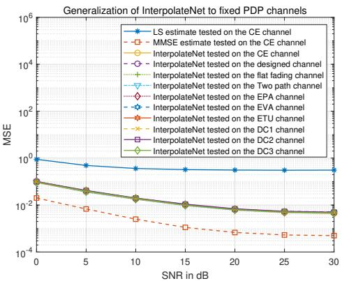  
(a) InterpolateNet

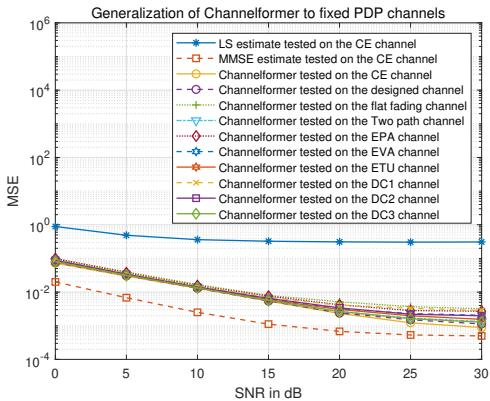  
(b) Channelformer  
Figure 4: Fig.7a and Fig.7b of Luan & Thompson (2025): MSE results for InterpolateNet and Channelformer tested on examples of unseen PDPs. Both models are ofline-trained by design criteria proposed in Luan $\&$ Thompson (2023a; 2025).

the noise item is introduced by the input of LS estimate and then then this spectrum is normalized by $\sigma ^ { 2 }$ to obtain

$$
S _ { i } ( f ) = \frac { { \bf p } ( i ) } { \sigma ^ { 2 } } S _ { t } ( f ) + 1 .\tag{28}
$$

Under the anti-causal assumption, we apply spectral factorization to this normalized power spectrum for one-side $M _ { i } ( f )$ that satisfy $\begin{array} { r } { | M _ { i } ( f ) | ^ { 2 } = \frac { { \bf p } ( i ) } { \sigma ^ { 2 } } S _ { t } ( f ) + 1 } \end{array}$ . Then convert $M _ { i } ( f )$ back by inverse Fourier transform to obtain $\Gamma _ { i }$ , we have the filter taps of $M _ { i } ( f )$ as

$$
M _ { i } ( f ) = \sum _ { n = 0 } ^ { \infty } \Gamma _ { i } ( n ) e ^ { - j n 2 \pi f } ,\tag{29}
$$

To compute all taps $\Gamma _ { i } ,$ it can be obtained by

$$
M _ { i } ( f ) = \exp \left\{ { \frac { 1 } { 2 } } \int _ { - 0 . 5 } ^ { 0 . 5 } \ln S _ { i } ( v ) d v + \sum _ { n = 1 } ^ { \infty } \int _ { - 0 . 5 } ^ { 0 . 5 } \ln S _ { i } ( v ) e ^ { j n 2 \pi ( v - f ) } d v , \right\}\tag{30}
$$

Then apply inverse Fourier transform to obtain exact values. In this paper, $\Gamma _ { i } ( 0 )$ is calculated as

$$
\Gamma _ { i } ( 0 ) = \exp \left\{ \frac { 1 } { 2 } \int _ { - 0 . 5 } ^ { 0 . 5 } \ln \left( 1 + \frac { { \bf p } ( i ) S _ { t } ( f ) } { \sigma ^ { 2 } } \right) d f \right\} .\tag{31}
$$

Assume that both the designed Doppler spectrum and the environment Doppler spectrum with maximum Doppler shift of $f _ { d } \ \left( [ - f _ { d } , \hat { f } _ { d } ] \subseteq [ - 0 . 5 , 0 . 5 ] \right.$ for DTFT normalized range) and satisfy

$$
\int _ { - 0 . 5 } ^ { 0 . 5 } S _ { t } ^ { A } ( f ) \mathrm { d } f = \int _ { - 0 . 5 } ^ { 0 . 5 } S _ { t } ^ { D } ( f ) \mathrm { d } f = 1 .\tag{32}
$$

The mismatch error $\epsilon _ { t , i } \left( S _ { t } ^ { A } ; S _ { t } ^ { D } \right)$ and the matched MSE are given by

$$
\epsilon _ { t , i } \left( S _ { t } ^ { A } ; S _ { t } ^ { D } \right) = \int _ { - 0 . 5 } ^ { 0 . 5 } \left( \mathbf { p } ( i ) S _ { t } ^ { A } ( f ) \left| 1 - \mathbf { w } _ { i } ^ { D } ( f ) \right| ^ { 2 } + \sigma ^ { 2 } \left| \mathbf { w } _ { i } ^ { D } ( f ) \right| ^ { 2 } \right) d f ,\tag{33}
$$

$$
\epsilon _ { t , i } \left( S _ { t } ^ { D } ; S _ { t } ^ { D } \right) = \int _ { - 0 . 5 } ^ { 0 . 5 } \left( \mathbf { p } ( i ) S _ { t } ^ { D } ( f ) \left| 1 - \mathbf { w } _ { i } ^ { D } ( f ) \right| ^ { 2 } + \sigma ^ { 2 } \left| \mathbf { w } _ { i } ^ { D } ( f ) \right| ^ { 2 } \right) d f .\tag{34}
$$

Therefore, the total mismatch error is given by

$$
\Delta \epsilon _ { t } = \frac { 1 } { N _ { f } } \sum _ { i = 1 } ^ { N _ { f } } \mathbf { p } ( i ) \int _ { - 0 . 5 } ^ { 0 . 5 } \left( S _ { t } ^ { A } ( f ) - S _ { t } ^ { D } ( f ) \right) \left| 1 - \mathbf { w } _ { i } ^ { D } ( f ) \right| ^ { 2 } \mathrm { d } f .\tag{35}
$$

The deployed Doppler spectra are described as follows. The Rounded Doppler spectrum has the theoretical formula of

$$
S ( f ) = \frac { 1 } { 1 . 1 6 8 f _ { d } } \left[ 1 - 1 . 7 2 \left( \frac { f } { f _ { d } } \right) ^ { 2 } + 0 . 7 8 5 \left( \frac { f } { f _ { d } } \right) ^ { 4 } \right] , \quad | f | \leq f _ { d } .\tag{36}
$$

The Bell Doppler spectrum has the theoretical formula of

$$
S ( f ) = \frac { \frac { 3 } { \pi f _ { d } } } { 1 + 9 \left( \frac { f } { f _ { d } } \right) ^ { 2 } } , \quad | f | \leq f _ { d } ,\tag{37}
$$

The Asymmetric Jakes Doppler spectrum has the theoretical formula of

$$
S ( f ) = \frac { A _ { a } } { \pi f _ { d } \sqrt { 1 - \left( f / f _ { d } \right) ^ { 2 } } } , \quad - f _ { d } \leq f _ { \operatorname* { m i n } } \leq f \leq f _ { \operatorname* { m a x } } \leq f _ { d } ,\tag{38}
$$

$$
\mathrm { w h e r e } \quad A _ { a } = \frac { 1 } { \frac { 1 } { \pi } \left[ \sin ^ { - 1 } \left( \frac { f _ { \mathrm { m a x } } } { f _ { d } } \right) - \sin ^ { - 1 } \left( \frac { f _ { \mathrm { m i n } } } { f _ { d } } \right) \right] } \mathrm { a n d } f _ { \mathrm { m i n } } = 0 , f _ { \mathrm { m a x } } = f _ { d } .
$$

The Restricted Jakes Doppler spectrum has the theoretical formula of

$$
S ( f ) = \frac { A _ { r } } { \pi f _ { d } \sqrt { 1 - \left( f / f _ { d } \right) ^ { 2 } } } , \quad 0 \le f _ { \mathrm { m i n } } \le | f | \le f _ { \mathrm { m a x } } \le f _ { d } ,\tag{39}
$$

$$
\begin{array} { r l } { \mathrm { w h e r e } } & { { } A _ { r } = \frac { 1 } { \frac { 2 } { \pi } \left[ \sin ^ { - 1 } \left( \frac { f _ { \operatorname* { m a x } } } { f _ { d } } \right) - \sin ^ { - 1 } \left( \frac { f _ { \operatorname* { m i n } } } { f _ { d } } \right) \right] } \mathrm { a n d } f _ { \operatorname* { m i n } } = 0 . 2 f _ { d } , f _ { \operatorname* { m a x } } = 0 . 8 f _ { d } . } \end{array}
$$

The Gaussian Doppler spectrum has the theoretical formula of

$$
S _ { G } ( f ) = \frac { 1 } { \sqrt { 2 \pi \sigma ^ { 2 } } } e ^ { - \frac { f ^ { 2 } } { 2 \sigma ^ { 2 } } } ,\tag{40}
$$

where $\begin{array} { r } { \sigma = \frac { 1 } { \sqrt { 2 } } f _ { d } . } \end{array}$

The table of example channels used in this paper is provided in Table. 2.

Table 2: Propagation channel profiles
<table><tr><td rowspan=1 colspan=5>Two-path fading channel</td></tr><tr><td rowspan=1 colspan=1>Path delay</td><td rowspan=1 colspan=4>[0 320] ns</td></tr><tr><td rowspan=1 colspan=1>Average path gain</td><td rowspan=1 colspan=4>[0.0 -3.0] dB</td></tr><tr><td rowspan=1 colspan=1>Ext</td><td rowspan=1 colspan=4>ended pedestrian A (EPA)</td></tr><tr><td rowspan=1 colspan=1>Path delay</td><td rowspan=1 colspan=2></td><td rowspan=1 colspan=2>[0 30 70 90 110 190 410] ns</td></tr><tr><td rowspan=1 colspan=1>Average path gain</td><td rowspan=1 colspan=4>[0 -1 -2 -3 -8 -17.2 -20.8] dB</td></tr><tr><td rowspan=1 colspan=1>Ex</td><td rowspan=1 colspan=4>tended vehicular A (EVA)</td></tr><tr><td rowspan=1 colspan=1>Path delay</td><td rowspan=1 colspan=4>[0 30 150 310 370 710 1090 1730 2510] ns</td></tr><tr><td rowspan=1 colspan=1>Average path gain</td><td rowspan=1 colspan=4>[0 -1.5 -1.4 -3.6 -0.6 -9.1 -7 -12 -16.9] dB</td></tr><tr><td rowspan=1 colspan=1>Ext</td><td rowspan=1 colspan=4>ended typical urban (ETU)</td></tr><tr><td rowspan=1 colspan=1>Path delay</td><td rowspan=1 colspan=3>[0 50 120 200 230 500 1600 2300 5000]</td><td rowspan=1 colspan=1>ns</td></tr><tr><td rowspan=1 colspan=1>Average path gain</td><td rowspan=1 colspan=3>[-1.0 -1.0 -1.0 0.0 0.0 0.0 -3.0 -5.0 -7.0</td><td rowspan=1 colspan=1>dB</td></tr><tr><td rowspan=1 colspan=1></td><td rowspan=1 colspan=4>Defined channel 1 (DC1)</td></tr><tr><td rowspan=1 colspan=1>Path delay</td><td rowspan=1 colspan=4>[0 50 100 200 400 ns</td></tr><tr><td rowspan=1 colspan=1>Average path gain</td><td rowspan=1 colspan=4>[0.0 -2.0 -4.0 -8.0 -16.0] dB</td></tr><tr><td rowspan=1 colspan=1></td><td rowspan=1 colspan=4>Defined channel 2 (DC2)</td></tr><tr><td rowspan=1 colspan=1>Path delay</td><td rowspan=1 colspan=4>[0 50 120 200 230 500 1600] ns</td></tr><tr><td rowspan=1 colspan=1>Average path gain</td><td rowspan=1 colspan=4>[-7.0 -3.0 -1.0 0.0 -2.0 -5.0 -7.0] dB</td></tr><tr><td rowspan=1 colspan=1></td><td rowspan=1 colspan=4>Defined channel 3 (DC3)</td></tr><tr><td rowspan=1 colspan=1>Path delay</td><td rowspan=1 colspan=4>[0 50 120 200 230 500 1600 2300 5000] ns</td></tr><tr><td rowspan=1 colspan=1>Average path gain</td><td rowspan=1 colspan=1></td><td rowspan=1 colspan=2>0.0 -14.0 -15.0 -1.0 -5.0 -1 -15 -10 -15.0</td><td rowspan=1 colspan=1>dB</td></tr></table>