# An Augmented Lagrangian Approach to Lifted Bellman Linear Programming

Jongchan Park 1 Hyukjun Yang \* 2 Narim Jeong \* 2 Donghwan Lee 2

## Abstract

Temporal-difference critics regress onto a bootstrapped target and usually need a target network. Lifted Bellman Linear Programming (LBLP) instead expresses the in-sample optimal values of offline RL as the solution to a linear program over the dataset. Its neural solver ALBUM relaxes the constraints into hinge penalties with fixed coefficients, and its guarantees are conditions on coefficients chosen in advance. We solve the same program with the method of multipliers: the coefficients become multipliers learned by dual ascent, with one penalty parameter ρ. In the convex case the fixed points are the KKT pairs of LBLP, and at every stationary point the applied constraint weights balance the objective exactly. The critic can serve a Gaussian actor, a flow actor, and bestof-N sampling, and for the Gaussian actor we propose an advantage-normalized DDPG+BC objective. With a single Q and V and no target network, our AL-LBLP with best-of-N reaches 60.1% average success on the 50 state-based OGBench tasks. On long-horizon tasks, it reaches 81.5% on humanoidmaze-giant and 79.8% on antmazegiant. It does not collapse up to batch size 8192.

## 1. Introduction

Offline RL learns a policy from a fixed dataset without further interaction (Levine et al., 2020). The critic is usually trained by temporal-difference (TD) regression onto a bootstrapped target. That target evaluates Q at next actions from the learning policy, and the Bellman maximization accumulates errors at the actions the data do not cover (Fujimoto et al., 2019; Kumar et al., 2020). Therefore prior work constrains the policy or penalizes such actions, and stabilizes the regression with target networks and critic ensembles.

Linear-programming (LP) formulations of Bellman optimality have been developed to address these limitations. TD learning with function approximation can diverge off-policy (Baird, 1995; Tsitsiklis & Van Roy, 1997). Furthermore, Q-learning with general function approximation lacks convergence guarantees, whereas LP-based convex relaxations provide such guarantees (Mehta & Meyn, 2020; Lee & He, 2020). However, on deep offline RL benchmarks, LP approaches had not competed with TD-based methods. Dual density-ratio methods were evaluated on D4RL with mixed results across tasks (Lee et al., 2021; Sikchi et al., 2024). To our knowledge, ALBUM (Yang et al., 2026) and our AL-LBLP are the first primal LP methods whose performance on such a benchmark matches that of recent TD algorithms.

Both methods build on Lifted Bellman Linear Programming (LBLP), introduced by Yang et al. (2026). It characterizes the in-sample Bellman-optimal pair (Q∗ , V∗) as the solution of a linear program whose constraints are defined over dataset transitions. Therefore nothing is regressed onto a moving target, and no target network is needed. Furthermore, this formulation helps to avoid the compounding error associated with repeated bootstrapped regression (Lee et al., 2021; Yang et al., 2026). Its neural solver ALBUM minimizes a hinge relaxation of this program with fixed coefficients and matches the OGBench average of FQL with a single critic. The guarantees of ALBUM, however, are conditions on coefficients chosen in advance. In particular, exactness is guaranteed only above dual thresholds that depend on the problem and are not known beforehand. AL-LBLP, the method of this paper, learns the multipliers and removes this choice.

A critic that does not require an actor during training also matters beyond the benchmark. Recent methods that steer or fine-tune generalist robot policies train their critics by TD learning, stabilized with target networks or ensembles (Nakamoto et al., 2024; Dong et al., 2026; Singh et al., 2026). SeeQ learns its vision-language Q function with a target network, and EXPO (Dong et al., 2026) uses an ensemble of ten Q networks. A TD target $Q ( s ^ { \prime } , \pi ( s ^ { \prime } ) )$ calls the policy at every critic update. With a vision-languageaction (VLA) model as the policy, every critic step then pays the policy’s forward pass and depends on actions outside the data. The LBLP critic bootstraps through $V ( s ^ { \prime } )$ at dataset transitions, so it is trained without the policy and can be attached to any policy afterwards. For the same reason, several actors, of different types or with different values of α, can share one critic and be trained together in one run. For example, six values of α can be trained together, 4.3× faster than in separate runs (Section B.7). Our experiments on OGBench demonstrate that one critic serves three policy extractions well (Table 1), and training does not collapse when the batch size grows to 8192 (Table 2).

We solve LBLP with the method of multipliers, the augmented Lagrangian method for constrained programs (Hestenes, 1969; Powell, 1969; Bertsekas, 1982). Each constraint family carries a multiplier that is learned by dual ascent. One penalty parameter ρ sets both the dual step size and the curvature of the penalty on violated rows. The weight that a row receives, $[ \mu + \rho y ] _ { + } ,$ , grows with its violation y, whereas a hinge gives every violated row the same weight. For the actor we propose a DDPG+BC objective whose Q term is normalized by the mean absolute advantage |Q − V | rather than by |Q|. Our contributions are:

• Same program, different solver. We propose AL-LBLP, which replaces the three fixed hinge coefficients of ALBUM by learned multipliers with one penalty parameter ρ (Section 4.1). Like α, ρ is selected per environment (Section 5). In the convex case its fixed points are the KKT pairs of LBLP. At every stationary point the applied row weights satisfy a mass identity that turns the bounded-update condition of ALBUM into an equality (Section 4.3).

• Advantage-normalized actor. We divide the Q term of DDPG+BC by sg $\mathbb { E } | Q ( s , \pi ( s ) ) - V ( s ) |$ , which the LP critics provide directly (Section 4.2). The update is invariant to positive affine maps of the reward and to common shifts of Q and V , unlike the |Q| normalization of TD3+BC. On the same critic it raises the best single-α mean from 29.5 to 49.3 and narrows the range of useful α (Section 5.4.2).

• Results. With a single Q, V and no target network or ensemble, the same critic reaches 55.8 with a Gaussian actor, 55.7 with a flow actor, and 60.1 with the best-of-N policy on the 50 state-based OGBench tasks. These are the highest averages of the Gaussian and best-of-N groups and the second of the flow group (Section 5.1). With K = 50 and γ = 0.999 it reaches 81.5% on humanoidmaze-giant and 79.8% on antmazegiant (8 seeds, Section 5.2.1). It does not collapse at batch sizes up to 8192, whereas TD-based FQL and FAC fall to 0.0 at batch 2048–4096 (Table 9).

• Analysis. ρ trades early training speed against longrun stability (Section 5.4.1). Against ALBUM, the difference concentrates in the K-step rows. ALBUM leaves large violations there (mean 5.17 vs. 0.71), which is consistent with its hinge giving every violated row the same gradient (Section 5.4.3).

## 2. Related Work

Offline RL. Offline RL learns a policy from a fixed dataset without further interaction (Levine et al., 2020). Its main difficulty is that the Bellman maximization amplifies value errors at actions the data do not contain (Fujimoto et al., 2019; Kumar et al., 2020). To address this, conservative critics penalize the values of out-of-distribution actions (Kumar et al., 2020), and actor regularization keeps the policy close to the behavior policy (Fujimoto et al., 2019; Fujimoto & Gu, 2021; Tarasov et al., 2023). In-sample methods such as IQL instead learn the critic only from dataset actions (Kostrikov et al., 2022). More recently, diffusion and flow policies model the behavior distribution expressively (Hansen-Estruch et al., 2023; Park et al., 2025d; Chae et al., 2026; Mu et al., 2026). They keep the policy near the data implicitly, by sampling from a behavior-cloning flow or by distilling the policy from it. These methods learn the critic by TD regression onto a bootstrapped target, usually with target networks and critic ensembles. In contrast, our AL-LBLP takes an LP approach: its critic is learned in-sample, without a target network or an ensemble. Nevertheless, it performs on par with or better than recent TD-based methods that rely on both (Section 5.1).

Linear programs for Bellman optimality. Writing Bellman optimality as a linear program removes the regression onto a bootstrapped target (de Farias & Van Roy, 2003; Puterman, 2014). This made LP approaches a way around the weaknesses of TD learning. With function approximation, TD learning can diverge off-policy (Baird, 1995; Tsitsiklis & Van Roy, 1997), and its convergence is known only under restrictive conditions (Mehta & Meyn, 2020; Jeong et al., 2018; Lee & He, 2020). Approximate LP and its primal–dual solvers develop this view with theoretical guarantees (Neu & Okolo, 2023; Ozdaglar et al., 2023). In offline RL, most LP methods pass to the dual, estimate stationary density ratios, and recover the policy from them (Nachum & Dai, 2020; Lee et al., 2021; Sikchi et al., 2024). For example, OptiDICE has no compounding error from bootstrapped estimates and stays stable as γ grows, where CQL does not (Lee et al., 2021). On D4RL, however, these methods matched TD-based methods only on some tasks. Logistic Q-learning also starts from a regularized dual and recovers a primal loss by conjugacy (Bas-Serrano et al., 2021). Our augmented Lagrangian has the same form, with a quadratic proximal term on the multipliers, but it learns the multipliers explicitly and keeps Q and V as the primal variables.

Lifted Bellman Linear Programming. Yang et al. (2026) proposed LBLP, which lifts the LP to the pair (Q, V) so that every constraint involves only dataset pairs. Because Q and V are its variables, the policy is extracted directly from the learned Q and V, as in actor–critic methods. They solved

LBLP with neural networks by relaxing its constraints into hinge penalties with fixed coefficients $\left( \lambda _ { \mathrm { B } } , \lambda _ { \mathrm { K } } , \lambda _ { \mathrm { E } } \right)$ The resulting method, ALBUM, matches the OGBench average of FQL with a single critic and no target network. Its guarantees are conditions on these coefficients: exactness holds above problem-dependent dual threshol ${ \mathrm { 1 s } } ,$ and a bounded detached update needs a separate inequality. We build $\mathrm { A L } _ { - }$ LBLP on LBLP and change how the program is solved. The fixed coefficients become multipliers learned by dual ascent, with a single penalty parameter $\rho .$ This is the method of multipliers, the classical solver for constrained programs (Hestenes, 1969; Powell, 1969; Rockafellar, 1973; Bertsekas, 1982), which, to our knowledge, is new for a Bellman LP with neural $Q$ and V. Like ALBUM, AL-LBLP is insample and uses a single Q and V without a target network. To our knowledge, ALBUM and AL-LBLP are the first primal LP methods to reach the level of recent TD-based methods on deep offline benchmarks. With a Gaussian actor, AL-LBLP improves on ALBUM by about 29%, and the gap is largest on long-horizon tasks (Section 5.2.1).

## 3. Preliminaries

Markov decision processes and offline RL. We consider a discounted MDP $\mathcal { M } = ( S , \mathcal { A } , P , R , \gamma )$ with transition kernel $\textstyle P ( \cdot \mid s , a )$ , expected reward $R ( s , a )$ , and discount $0 ~ \leq ~ \gamma ~ < ~ 1$ . The optimal value functions satisfy $V ^ { * } ( s ) = \operatorname* { m a x } _ { a } Q ^ { * } ( s , a )$ . In the offline setting the agent is given a fixed dataset $\mathcal { D } = \{ ( s _ { i } , a _ { i } , r _ { i } , s _ { i } ^ { \prime } ) \} _ { i = 1 } ^ { n }$ collected by a behavior policy $\beta .$ . The data are contiguous trajectories. We write $\mathcal { M } _ { \mathcal { D } }$ for the empirical MDP they induce, whose actions at s are those the data contain at s. As in Yang et al. (2026, App. C), a successor state that the data never leave is treated as absorbing with value zero. For a window of $K$ consecutive transitions starting at $( s , a ) = ( s _ { 0 } , a _ { 0 } )$ , we write $\begin{array} { r } { \hat { y } _ { K } ( s , a ) = \sum _ { t < K } \gamma ^ { t } r _ { t } + \gamma ^ { K } V ( s _ { K } ) } \end{array}$ for the K-step return bootstrapped at its end. Terminal masks are absorbed into γ and $\gamma ^ { K }$ . sg[·] denotes stop gradient, $[ x ] _ { + } = \operatorname* { m a x } \{ x , 0 \}$ and $\mathbb { E } _ { \mathcal { D } }$ or $\mathbb { E } _ { i }$ i the empirical expectation over the dataset.

Linear programming characterization of Bellman optimality. For any weight c with strictly positive entries, $V ^ { * }$ is the unique solution of minV⟨c, V ⟩ subject to $V ( s ) \geq$ $R ( s , a ) + \gamma ( P V ) ( s , a )$ for all $( s , a )$ (de Farias & Van Roy, 2003; Puterman, 2014). Neither this program nor its actionvalue counterpart carries over to offline RL directly. The state-value form determines only $V ^ { * }$ , so a policy must be recovered from the dual. The action-value form imposes a constraint for every action at the next state, including actions the data do not contain.

Lifted Bellman Linear Program. LBLP (Yang et al., 2026) resolves both difficulties by lifting the program to the pair $( Q , V )$ through the epigraph inequality $Q ( s , a ) \leq V ( s )$ On $\mathcal { M } _ { \mathcal { D } }$ , with weights $\omega _ { Q } , \omega _ { V } > 0$ and rollout length $K .$ , the

program is

$$
\begin{array} { r l } & { \underset { Q , V } { \operatorname* { m i n } } \ : \mathbb { E } _ { \mathcal { D } } \big [ \omega _ { Q } Q ( s , a ) + \omega _ { V } V ( s ) \big ] } \\ & { ~ \mathrm { s . t . } ~ g _ { \mathrm { B } } \leq 0 , \quad g _ { \mathrm { E } } \leq 0 , \quad g _ { \mathrm { K Q } } \leq 0 , \quad g _ { \mathrm { K V } } \leq 0 , } \end{array}\tag{1}
$$

with constraint functions, each indexed by a dataset pair,

$$
\begin{array} { c } { { g _ { \mathrm { B } } ( s , a ) = r + \gamma V ( s ^ { \prime } ) - Q ( s , a ) , } } \\ { { { } } } \\ { { g _ { \mathrm { E } } ( s , a ) = Q ( s , a ) - V ( s ) , } } \\ { { { } } } \\ { { g _ { \mathrm { K Q } } ( s , a ) = \hat { y } _ { K } ( s , a ) - Q ( s , a ) , } } \\ { { { } } } \\ { { g _ { \mathrm { K V } } ( s , a ) = \hat { y } _ { K } ( s , a ) - V ( s ) . } } \end{array}
$$

Its unique minimizer is the in-sample Bellman-optimal pair $\left( Q _ { D } ^ { * } , V _ { D } ^ { * } \right)$ of $\mathcal { M } _ { \mathcal { D } }$ . The rollout constraints gKQ, gKV are implied by the one-step constraints for the sampled $\hat { y } _ { K }$ under deterministic dynamics, so they leave the solution unchanged for any K. In an idealized coordinate-wise iteration they accelerate value propagation (Yang et al., 2026, Lemma 4.2, Prop. 4.3, Thm. 4.5, Remark D.1).

ALBUM. Approximate Lifted Bellman Unconstrained Minimization implements LBLP with neural $Q _ { \theta } , V _ { \phi }$ by minimizing the hinge relaxation

$$
\begin{array} { r } { \mathcal { L } _ { \mathrm { A L B U M } } = \mathbb { E } _ { \mathcal { D } } [ \omega _ { Q } Q + \omega _ { V } V ] + \lambda _ { \mathrm { B } } \mathbb { E } _ { \mathcal { D } } [ g _ { \mathrm { B } } ] _ { + } + \lambda _ { \mathrm { E } } \mathbb { E } _ { \mathcal { D } } [ g _ { \mathrm { E } } ] _ { + } } \\ { + \lambda _ { \mathrm { K } } \big ( \mathbb { E } _ { \mathcal { D } } [ \mathrm { s g } [ \hat { y } _ { K } ] - Q ] _ { + } + \mathbb { E } _ { \mathcal { D } } [ \mathrm { s g } [ \hat { y } _ { K } ] - V ] _ { + } \big ) , } \end{array}\tag{2}
$$

with fixed coefficients $( \lambda _ { \mathrm { B } } , \lambda _ { \mathrm { K } } , \lambda _ { \mathrm { E } } ) = ( 2 . 5 , 1 , 2 . 5 )$ shared by every row and every environment, and with the K-step target detached by stop-gradient. Two results of Yang et al. (2026) matter here, and both are conditions on coefficients fixed in advance. Their Proposition 4.7 (exactness): in the tabular case the relaxation has the minimizer $\left( Q _ { D } ^ { * } , V _ { D } ^ { * } \right)$ when $\lambda _ { \mathrm { B } }$ and $\lambda _ { \mathrm { E } }$ exceed the largest optimal dual variables of the one-step program. This holds for every $\lambda _ { \mathrm { K } } \geq 0$ and $K .$ , but the thresholds depend on the dataset and are not known beforehand. Their Proposition 5.1 (bounded update): the detached update does not lower Q and V without bound along a uniform shift only if $\lambda _ { \mathrm { B } } ( 1 - \gamma ) + 2 \lambda _ { \mathrm { K } } \geq \omega _ { Q } + \omega _ { V }$ ALBUM’s default coefficients satisfy this inequality with room to spare. Our AL-LBLP learns the multipliers instead of fixing them, and the second condition then holds with equality at every stationary point (Section 4.3).

## 4. AL-LBLP: Augmented Lagrangian for Lifted Bellman Linear Programming

## 4.1. Method of multipliers

We rewrite the constraint rows of Equation (1) as $y _ { i } ^ { F } \leq 0$ for family $F \in \{ \mathrm { B , K Q , K V , E } \}$ and window i, with $y > 0$ a violation. The Lagrangian of LBLP with per-row multipliers $\begin{array} { r } { \mu _ { i } ^ { F } \geq 0 \mathrm { i s } \Lambda ( Q , V , \mu ) = \mathbb { E } _ { \mathcal { D } } [ \omega _ { Q } Q + \omega _ { V } V ] + \sum _ { F } \mathbb { E } _ { i } [ \mu _ { i } ^ { F } y _ { i } ^ { F } ] } \end{array}$ Since ${ \mathrm { s u p } } _ { \mu \in [ 0 , \lambda ] } \mu y = \lambda [ y ] _ { + }$ , the ALBUM loss (2) is sup Λ over multipliers confined to the box [0, λF]. AL-LBLP keeps this Lagrangian and learns the multipliers.

The augmented Lagrangian of an inequality constraint $y \le 0$ with multiplier $\mu \geq 0$ and penalty $\rho > 0$ is (Rockafellar, 1973; Bertsekas, 1982)

$$
\begin{array} { l } { \displaystyle \psi _ { \rho } ( y ; \mu ) = \frac { 1 } { 2 \rho } \Big ( [ \mu + \rho y ] _ { + } ^ { 2 } - \mu ^ { 2 } \Big ) } \\ { \displaystyle = \left\{ \begin{array} { l l } { \displaystyle y ( \mu + \frac { \rho } { 2 } y ) \quad \mathrm { i f } \ \mu + \rho y > 0 , } \\ { \displaystyle - \mu ^ { 2 } / ( 2 \rho ) \quad \mathrm { ~ o t h e r w i s e } , } \end{array} \right. } \end{array}\tag{3}
$$

whose derivative in y is $[ \mu + \rho y ] _ { + }$ . The AL-LBLP critic loss is

$$
\mathcal { L } _ { \rho } ( \theta , \phi ; \mu ) = \mathbb { E } _ { \mathcal { D } } [ \omega _ { Q } Q _ { \theta } + \omega _ { V } V _ { \phi } ] + \sum _ { F } \mathbb { E } _ { i } \left[ \psi _ { \rho } \big ( y _ { i } ^ { F } ; \mathbf { s g } [ \mu _ { i } ^ { F } ] \big ) \right] ,\tag{4}
$$

where, as in ALBUM, the K-step target $\mathrm { s g } [ \hat { y } _ { K } ]$ is detached and $V ( s ^ { \prime } )$ in the one-step row carries gradient. Compared with ALBUM, the gradient of Equation (4) replaces the fixed weight $\lambda _ { F }$ of each violated row by the effective multiplier $[ \mu _ { i } ^ { F } + \rho y _ { i } ^ { F } ] _ { + } ;$ : a row with $\mu + \rho y \le 0$ gets no penalty gradient, and a violated row’s weight grows with its violation. After each primal step the multipliers move by projected dual ascent on the pre-update violations,

$$
\mu _ { i } ^ { F }  [ \mu _ { i } ^ { F } + \rho \mathrm { s g } [ y _ { i } ^ { F } ] ] _ { + } ,\tag{5}
$$

which accumulates persistent violations into µ. As $\rho \to 0$ the loss tends to the Lagrangian with frozen multipliers and the dual step vanishes. $\mathbf { A s } \rho \to \infty$ it tends to a quadratic penalty. ρ is therefore both the step size of Equation (5) and the curvature of the penalty on violated rows. It is the only coefficient of the relaxation.

Multiplier parameterization. The multipliers can be a table with one entry per row, a scalar per family, or a network $\mu _ { \varphi } ( s , a )$ . We use one scalar per family, µB, µK, µE, with µK shared by the two rollout rows as ALBUM shares $\lambda _ { \mathrm { K } }$ . The scalar form approximates the per-row method. Its dual fixed point is an averaged form of complementary slackness (Theorem A.2). The dual step (5) regresses $\mu ^ { \dot { F } }$ onto the batch mean of its per-row targets $[ \mu ^ { F } + \rho \bar { y } _ { i } ^ { F } ] _ { + }$ + with its own Adam optimizer. Here $\bar { y } _ { i } ^ { F } = y _ { i } ^ { F }$ for the one-step and epigraph rows and $\begin{array} { r } { \bar { y } _ { i } ^ { \mathrm { K } } = \frac { 1 } { 2 } ( y _ { i } ^ { \mathrm { K Q } } + y _ { i } ^ { \mathrm { K V } } ) } \end{array}$ for the shared rollout multiplier. $\mu ^ { F } = \mathrm { s o f t p l u s } ( \zeta ^ { F } )$ keeps the multipliers non-negative, the optimizer acts on $\zeta ^ { F }$ , and the multipliers start at $1 0 ^ { - 3 }$ Algorithm 1 summarizes one training step.

## 4.2. Policy extraction

The critic is trained only at dataset actions and never evaluates the policy, so any extraction method can be attached to it. We report three. The default is the DDPG+BC objective used by ALBUM, and the policy-improvement term is normalized by the batch scale of the advantage $A ( s , a ) = Q ( s , a ) - V ( s )$

$$
\mathcal { L } _ { \mathrm { a c t o r } } ( \pi ) = - \frac { \mathbb { E } _ { s } \left[ A ( s , \pi ( s ) ) \right] } { \operatorname { s g } \left[ \mathbb { E } _ { s } \left[ \left| A ( s , \pi ( s ) ) \right| \right] \right] } - \alpha \mathbb { E } _ { ( s , a ) \sim \mathcal { D } } \log \pi ( a \mid \pi )\tag{s).}
$$

(6)

Algorithm 1 AL-LBLP (scalar multipliers)   
Input: dataset D of K-step windows, weights ωQ, ωV,   
penalty $\rho ,$ BC coefficient α   
Initialize $Q _ { \theta } , V _ { \phi }$ , actor $\pi _ { \eta } ,$ multipliers $\mu _ { \mathrm { B } } , \mu _ { \mathrm { K } } , \mu _ { \mathrm { E } }$ ≈ 0   
repeat   
Sample a batch of windows $\{ ( s _ { i } , a _ { i } , r _ { i } , s _ { i } ^ { \prime } , \hat { y } _ { K , i } ) \}$   
Violations: $y _ { i } ^ { \mathrm { B } } ~ = ~ r _ { i } + \gamma V _ { \phi } ( s _ { i } ^ { \prime } ) - Q _ { \theta } ( s _ { i } , a _ { i } ) , ~ y _ { i } ^ { \mathrm { E } } ~ =$   
$Q _ { \theta } ( s _ { i } , a _ { i } ) - V _ { \phi } ( s _ { i } ) ,$   
$y _ { i } ^ { \mathrm { K Q } } = \mathrm { s g } [ \hat { y } _ { K , i } ] - Q _ { \theta } ( s _ { i } , a _ { i } ) , y _ { i } ^ { \mathrm { K V } } = \mathrm { s g } [ \hat { y } _ { K , i } ] - V _ { \phi } ( s _ { i } )$   
Primal: one Adam step on $\mathcal { L } _ { \rho } ( \theta , \phi ; \mathbf { s g } [ \mu ] )$ of Equa  
tion (4)   
Dual: for each family $F _ { ; }$ , one Adam step of $\boldsymbol { \mu } ^ { F } =$   
$\mathrm { s o f t p l u s } ( \zeta ^ { F } )$ toward $\begin{array} { r } { \bar { \mathbb { E } _ { i } } \big [ [ \mu ^ { F } + \rho \bar { y } _ { i } ^ { F } ] _ { + } \big ] , \bar { y } _ { i } ^ { \mathrm { K } } = \frac { 1 } { 2 } \dot { ( y _ { i } ^ { \mathrm { K Q } } + } } \end{array}$   
$y _ { i } ^ { \mathrm { K V } } )$   
Actor: one Adam step on $\mathcal { L } _ { \mathrm { a c t o r } } ( \pi _ { \eta } )$ of Equation (6)   
until the step budget is spent

The second term is the behavior-cloning (BC) term, and $\pi ( s )$ denotes the mean of the Gaussian policy $\pi ( \cdot \mid s )$ . We propose this normalization in place of the |Q| normalization of TD3+BC (Fujimoto & Gu, 2021), which ALBUM also uses. The LP critic provides V, so |A| is available directly. The $| A |$ -normalized update is invariant to common shifts $\delta ( s )$ of Q and V and, in continuing tasks, to affine maps $r \mapsto c r + b \left( c > 0 \right)$ of the reward. The |Q| normalization is invariant only when $b = 0$ (Theorem A.6). Section 5.4.2 measures the effect on the same critic. The second actor is the one-step flow actor of FQL (Park et al., 2025d), whose policy-improvement term we normalize by $\mathbb { E } _ { s } | A ( s , \pi ( s ) ) |$ in the same way. The third, best-of-N, draws N samples from a behavior-cloning flow and executes the one with the largest Q. None of these three actors changes the critic.

## 4.3. Properties

We consider convex instances of LBLP, in which Q and V are free variables on $\mathcal { M } _ { \mathcal { D } }$ or linear in fixed features, with one multiplier per row and no stop-gradient. There the fixed points of primal minimization and the dual update (5) are the KKT pairs of LBLP, for every $\rho > 0$ . In the tabular case every fixed point satisfies $\left( Q , V \right) = \left( Q _ { D } ^ { * } , V _ { D } ^ { * } \right)$ . When the fixed coefficients of ALBUM exceed the dual thresholds of its Proposition 4.7, the two methods have the same solution (Theorem A.3). AL-LBLP does not use the thresholds, and below them its fixed points are still the LBLP solution.

Beyond the convex case, let $Q _ { \theta }$ and $V _ { \phi }$ carry additive output biases. At every stationary point of Equation (4) the effective multipliers $\mu _ { i } ^ { F , \mathrm { e f f } } = [ \bar { \mu _ { i } ^ { F } } + \rho y _ { i } ^ { F } ] .$ + satisfy the mass identity:

$$
\mathbb { E } _ { i } \big [ ( 1 - \gamma m _ { i } ) \mu _ { i } ^ { \mathrm { B , e f f } } + \mu _ { i } ^ { \mathrm { K Q , e f f } } + \mu _ { i } ^ { \mathrm { K V , e f f } } \big ] = \omega _ { Q } + \omega _ { V } ,\tag{7}
$$

with $m _ { i }$ the terminal mask. For constant weights and $m \equiv 1$ the left-hand side is $\lambda _ { \mathrm { B } } ( 1 - \gamma ) + 2 \lambda _ { \mathrm { K } }$ . The bounded-update condition of ALBUM therefore holds with equality for the weights that AL-LBLP applies, by the optimization itself. At 1M steps the left-hand side is between 0.148 and 0.154 against $\omega _ { Q } + \omega _ { V } = 0 . 1 5$ on all ten environments (Section H). Formal statements and proofs are in Section A.

Table 1. Success rate (%) on the 50 state-based tasks: five-task mean, mean ± std over 8 seeds (IFQL, FAC, DROL: mean only); AL-LBLP and ALBUM: the final evaluation at 1M, baselines: their own rule (Section B). Bold: within 95% of the row best.
<table><tr><td></td><td colspan="4">Gaussian policy</td><td colspan="4">Flow policy</td><td colspan="2">Best-of-N</td></tr><tr><td>Environment</td><td>IQL</td><td>ReBRAC</td><td>ALBUM</td><td>AL-LBLP</td><td>FQL</td><td>DROL</td><td>FAC</td><td> $\mathbf { A L - L B L P }$ </td><td>IFQL</td><td>AL-LBLP</td></tr><tr><td>antmaze-large</td><td> $5 3 \pm 3$ </td><td> $8 1 \pm 5$ </td><td> ${ \bf 8 9 . 8 \pm 1 . 0 }$ </td><td> ${ \bf 9 } 2 . 2 \pm 1 . 5$ </td><td> $7 9 \pm 3$ </td><td>89</td><td>92.6</td><td> ${ \bf 8 9 . 0 \pm } 2 . 9$ </td><td>28.0</td><td> $7 6 . 8 \pm 4 . 3$ </td></tr><tr><td>antmaze-giant</td><td> $4 \pm 1$ </td><td> $2 6 \pm 8$ </td><td> $2 8 . 1 \pm 5 . 1$ </td><td> ${ \pm 7 . 5 \pm 7 . 4 }$ </td><td> $9 \pm 6$ </td><td>45</td><td>23.0</td><td> $2 9 . 4 \pm 4 . 0$ </td><td>2.6</td><td> $3 4 . 9 \pm 3 . 4$ </td></tr><tr><td>humanoidmaze-medium 33 ±2</td><td></td><td> $2 2 \pm 8$ </td><td> $3 5 . 5 \pm 1 . 8$ </td><td> $8 5 . 6 \pm 2 . 7$ </td><td> $5 8 \pm 5$ </td><td>68</td><td>75.6</td><td> $7 8 . 5 \pm 3 . 8$ </td><td>60.4</td><td> ${ \bf 9 6 . 1 \pm 1 . 2 }$ </td></tr><tr><td>humanoidmaze-large</td><td> $2 \pm 1$ </td><td> $2 \pm 1$ </td><td> $1 . 6 \pm 0 . 5$ </td><td> $1 7 . 4 \pm 1 . 0$ </td><td> $4 \pm 2$ </td><td>11</td><td>8.3</td><td> $1 2 . 4 \pm 3 . 5$ </td><td>11.0</td><td> ${ \bf 4 7 . 7 \pm 4 . 3 }$ </td></tr><tr><td>antsoccer-arena</td><td> $8 \pm 2$ </td><td> $0 \pm 0$ </td><td> $3 6 . 1 \pm 3 . 8$ </td><td> $4 8 . 5 \pm 4 . 5$ </td><td> $6 0 \pm 2$ </td><td>65</td><td>67.7</td><td> $5 6 . 5 \pm 5 . 9$ </td><td>33.2</td><td> $5 6 . 1 \pm 4 . 4$ </td></tr><tr><td>cube-single</td><td> $8 3 \pm 3$ </td><td> $9 1 \pm 2$ </td><td> $8 3 . 2 \pm 1 . 7$ </td><td> $8 9 . 2 \pm 2 . 7$ </td><td> ${ \bf 9 6 \pm 1 }$ </td><td>98</td><td>98.8</td><td> $9 1 . 3 \pm 1 . 1$ </td><td>79.2</td><td> $8 9 . 5 \pm 2 . 2$ </td></tr><tr><td>cube-double</td><td> $7 \pm 1$ </td><td> $1 2 \pm 1$ </td><td> $1 3 . 3 \pm 2 . 8$ </td><td> $1 6 . 4 \pm 2 . 4$ </td><td> $2 9 \pm 2$ </td><td>26</td><td>33.1</td><td> $1 7 . 5 \pm 3 . 6$ </td><td>14.0</td><td> $2 0 . 2 \pm 3 . 6$ </td></tr><tr><td>scene</td><td> $2 8 \pm 1$ </td><td> $4 1 \pm 3$ </td><td> $6 4 . 4 \pm 5 . 5$ </td><td> $5 8 . 5 \pm 2 . 5$ </td><td> $5 6 \pm 2$ </td><td>58</td><td>71.3</td><td> $6 2 . 3 \pm 3 . 4$ </td><td>30.4</td><td> $6 3 . 0 \pm 1 . 1$ </td></tr><tr><td>puzzle-3x3</td><td> $9 \pm 1$ </td><td> $2 1 \pm 1$ </td><td> $6 1 . 2 \pm 6 . 4$ </td><td> $8 5 . 8 \pm 6 . 6$ </td><td> $3 0 \pm 1$ </td><td>41</td><td>100.0</td><td> ${ \bf 9 7 . 6 \pm 1 . 3 }$ </td><td>19.0</td><td> ${ \bf 9 6 . 1 \pm } 3 . 1$ </td></tr><tr><td>puzzle-4x4</td><td> $7 \pm 1$ </td><td> $1 4 \pm 1$ </td><td> $2 0 . 6 \pm 2 . 5$ </td><td> $1 7 . 3 \pm 6 . 5$ </td><td>17 ±2</td><td>25</td><td>32.3</td><td> $2 2 . 4 \pm 4 . 9$ </td><td>25.2</td><td> $2 1 . 0 \pm 2 . 3$ </td></tr><tr><td>Average</td><td>23.4</td><td>31.0</td><td>43.4</td><td>55.8</td><td>43.8</td><td>52.6</td><td>60.3</td><td>55.7</td><td>30.3</td><td>60.1</td></tr></table>

## 5. Experiments

Protocol. We follow the evaluation protocol of ALBUM (Yang et al., 2026): the 50 state-based single-task OGBench tasks (Park et al., 2025b) (10 environments × 5 tasks), 8 seeds, and the success rate (%) of the final evaluation after 1M gradient steps with 50 episodes. Every environment uses $\gamma = 0 . 9 9 5$ $K = 1 0 ,$ , a single Q and V, and no target network. We select $( \rho , \alpha )$ on the default task of each environment with 3 seeds and reuse it on the other four tasks (Table 7). Baselines are not re-run: IQL, ALBUM, ReBRAC, FQL, IFQL, FAC, and DROL are the scores reported in their papers. All other settings, including the grids, the baseline rules, and the fixed hyperparameters, are in Section B.

## 5.1. Main results

AL-LBLP reaches its results with a single critic and no target network, and the same critic serves all three policies. Table 1 groups the methods by the policy they execute. The Gaussian group holds IQL, ReBRAC, ALBUM, and AL-LBLP. The flow group holds FQL, FAC, DROL, and AL-LBLP with a variant of the one-step flow actor of FQL. The best-of-N group holds IFQL and AL-LBLP, both sampling from a behavior-cloning flow.

With the Gaussian actor AL-LBLP averages 55.8, against 43.4 for ALBUM, which solves the same program with fixed hinge coefficients, and 43.8 for FQL. It outperforms every baseline on antmaze-giant (47.5), humanoidmaze-medium (85.6), and humanoidmaze-large (17.4), and matches FAC on antmaze-large. Relative to ALBUM the gains concentrate on the navigation environments (humanoidmazemedium 35.5 to 85.6, humanoidmaze-large 1.6 to 17.4, antmaze-giant 28.1 to 47.5) and on puzzle-3x3 (61.2 to 85.8). ALBUM remains ahead on scene and puzzle-4x4.

The critic does not depend on the actor’s type or hyperparameters. Therefore, the flow-policy and best-of-N columns attach other actors to critics of the same program as for the Gaussian policy. Each has its own $( \rho , \alpha _ { \mathrm { H o w } } )$ or $( \rho , N )$ selected from six combinations, against nine for the Gaussian policy. AL-LBLP has the highest average among the Gaussian policies (55.8) and among the best-of-N methods (60.1 against 30.3 for IFQL). Among the flow policies it is second (55.7), after 60.3 for FAC and ahead of 52.6 for DROL and 43.8 for FQL.

Best-of-N is the strongest of the three, close to FAC on average and ahead of it on antmaze-giant and both humanoidmaze environments. Against the Gaussian policy it gains most on humanoidmaze-large (47.7 against 17.4), humanoidmaze-medium (96.1 against 85.6), and puzzle-3x3 (96.1 against 85.8), and is lower on antmaze-large (76.8 against 92.2) and antmaze-giant (34.9 against 47.5). Pertask results are in Section D. On the five pixel-based manipulation environments AL-LBLP (Gaussian policy) averages 64.7 against 65.4 for FQL and 76.0 for FAC (Section F).

## 5.2. Long-horizon tasks and large batch size

On antmaze-giant and humanoidmaze-giant we raise the rollout length to $K = 5 0$ and the discount to $\gamma = 0 . 9 9 9$ . The error of the idealized ALBUM scheme contracts at rate $\gamma ^ { K }$ where the K-step path is optimal (Theorem 4.5 of Yang et al. (2026)). Raising γ with K keeps this rate at the value of the shared protocol $( 0 . 9 9 5 ^ { 1 0 } = 0 . 9 5 1 1 , 0 . 9 9 9 ^ { 5 0 } = 0 . 9 5 1 2 )$ Table 2 reports 8 seeds per task at batch sizes 256 to 8192, with the $( \rho , \alpha )$ selected at batch 256; rows marked † instead re-select $( \rho , \alpha )$ for each batch size (i.e., 2048, 4096 and 8192). The selected $( \rho , \alpha )$ are in Section B, and the K = 10 settings are those of Section 5.1.

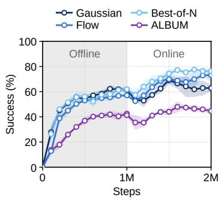  
(a) Offline-to-online

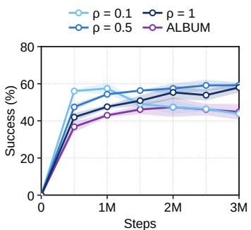  
(b) Training to 3M steps

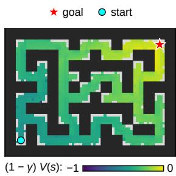  
(c) antmaze-giant

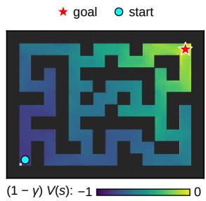  
(d) humanoidmaze-giant  
Figure 1. (a) Offline-to-online fine-tuning of the three AL-LBLP policies and ALBUM: mean success (%) over the 10 default tasks during offline training (grey) and online fine-tuning; mean ± std over 3 seeds. (b) Training to 3M steps with $\rho \in \{ 0 . 1 , 0 . 5 , 1 \}$ (α of Figure 2(a)) and ALBUM: mean success (%) over the 10 default tasks, evaluated every 0.5M steps; mean ± std over 3 seeds. (c), (d) Learned value $( 1 - \gamma ) V ( s )$ of AL-LBLP $( K = 5 0 , \gamma = 0 . 9 9 9$ , batch 4096, (ρ, α) of the † rows of Table 2) on task 1 (details in Section C).

## 5.2.1. LONG-HORIZON NAVIGATION TASKS

AL-LBLP performs especially well on long-horizon navigation tasks. With 1M offline steps it reaches $8 1 . 5 \pm 5 . 9$ on humanoidmaze-giant (batch 4096) and $7 9 . 8 \ \pm 2 . 5$ on antmaze-giant (batch 4096), five-task means over 8 seeds. Both are higher than the best scores reported by LQL (Abraham et al., 2026), 65.4 on antmaze-giant and 75.7 on humanoidmaze-giant (4 seeds). LQL reaches them after 2M training steps, at least 1M of them online, whereas AL-LBLP uses 1M offline steps only (details in Section C).

On humanoidmaze-giant, AL-LBLP also matches Transitive RL (TRL) (Park et al., 2026), which reports 79 ±2 (4 seeds) in the goal-conditioned version of the task. TRL trains larger networks (4 × 1024) on a dataset of 1B transitions (Park et al., 2025c) and relabels goals with future states of the same trajectory, so many of its training goals are close to the current state. In contrast, AL-LBLP uses the default dataset of 4M transitions, 4 × 512 networks, and the single-task reward, which is −1 at every step until the one evaluation goal is reached. Its critic thus propagates the signal of a single goal over episodes of up to 4000 steps, whereas TRL learns from many nearby goals and sub-goals.

Raising K to 50 together with γ to 0.999 accounts for a large part of the gain. On antmaze-giant (batch 256) the five-task mean rises from 47.5 ±7.4 to 64.6 ±3.8. ALBUM does not benefit from the same change. With K = 50, γ = 0.999, batch 256, and α selected by the same protocol, it reaches $2 9 . 5 \pm 2 . 8$ on antmaze-giant, only slightly above 28.1 ±5.1 a $\gamma = 0 . 9 9 5 , K = 1 0$ , and 1.2 ±0.5 on humanoidmaze-giant (five tasks, 8 seeds). On both environments it falls far behind AL-LBLP at the same batch size (64.6 and 71.0).

## 5.2.2. LARGE BATCH SIZE

Park (2026) reports that TD learning with a large fixed batch size degrades performance across network sizes. Under our shared protocol, the TD-based FQL and FAC collapse when only their batch size grows: both score 0.0 on both environments (i.e., antmaze-giant and humanoidmaze-large)

Table 2. Batch size on the long-horizon navigation tasks: five-task success (%) at 1M, mean ± std over 8 seeds. $K = 1 0 \colon \gamma = 0 . 9 9 5 ;$ $K = 5 0 \colon \gamma = 0 . 9 9 9 . \mathrm { ~ \textdegree ~ } ^ { \dagger } \colon ( \rho , \alpha )$ re-selected per batch size. Bold: within 95% of the row best.
<table><tr><td rowspan="2">Environment</td><td colspan="4">Batch size</td></tr><tr><td>256</td><td>2048</td><td>4096</td><td>8192</td></tr><tr><td>antmaze-giant (K = 10)</td><td> $4 7 . 5 \pm 7 . 4$ </td><td> ${ \pm 6 . 1 \pm 4 . 0 }$ </td><td>53.7 ±3.9</td><td> $5 2 . 2 \pm 4 . 5$ </td></tr><tr><td>antmaze-giant (K = 50)</td><td> $6 4 . 6 \pm 3 . 8$ </td><td> ${ \bf 7 0 . 8 \pm 3 . 7 }$ </td><td>66.0 ±2.2</td><td> $5 9 . 5 \pm 3 . 6 $ </td></tr><tr><td>antmaze-giant (K = 50)†</td><td> $6 4 . 6 \pm 3 . 8$ </td><td> $7 8 . 4 \pm 3 . 0$ </td><td> ${ \bf 7 9 . 8 \pm } 2 . 5$ </td><td> $7 7 . 4 \pm 2 . 5$ </td></tr><tr><td>humanoidmaze-large  $( K = 1 0 )$ </td><td> $1 7 . 4 \pm 1 . 0$ </td><td> $3 2 . 9 \pm 7 . 0$ </td><td> ${ \bf 3 9 . 9 \pm 6 . 5 }$ </td><td> $3 3 . 1 \pm 7 . 5$ </td></tr><tr><td>humanoidmaze-giant  $( K = 5 0 )$ </td><td> $7 1 . 0 \pm 3 . 5$ </td><td> $7 7 . 8 \pm 7 . 7$ </td><td> ${ \bf 7 9 . 7 \pm 4 . 3 }$ </td><td> ${ \bf 7 9 . 3 \pm 5 . 7 }$ </td></tr><tr><td>humanoidmaze-giant  $( K = 5 0 ) ^ { \dag }$ </td><td> $7 1 . 0 \pm 3 . 5$ </td><td> ${ \bf 8 0 . 8 \pm } 3 . 6 $ </td><td> ${ \bf 8 1 . 5 \pm 5 . 9 }$ </td><td> ${ \bf 8 0 . 8 \pm } 3 . 2 $ </td></tr></table>

at batch 4096 and at most 4.9 at batch 2048 (Table 9). In contrast, AL-LBLP does not collapse when only its batch size grows, and its performance even improves: with the $( \rho , \alpha )$ of batch 256, every value at batch 2048, 4096, and 8192 is above its row’s batch-256 value, except antmazegiant (K = 50) at 8192, which keeps 92% of its batch-256 success (Table 2).

Re-selecting (ρ, α) at each batch size within the same budget removes the drop of antmaze-giant (K = 50): the † row reaches 78.4, 79.8, and 77.4 at batch 2048, 4096, and 8192, against 64.6 at batch 256, and humanoidmaze-giant† reaches 81.5, the best in Table 2. A plausible reason is that a larger batch gives a better estimate of the objective and of each constraint family’s violation.

## 5.3. Offline-to-online fine-tuning

On average, all policies improve online with the same critic loss (Figure 1(a)). We follow the offline-to-online protocol of FQL (Park et al., 2025d) with the offline hyperparameters of each policy and 3 seeds. Each run restores the 1M offline checkpoint of its default task and trains for 1M online steps (Section B). Over the ten default tasks the flow policy rises from 57.1 to 73.1 and best-of-N from 61.9 to 76.3. The Gaussian policy moves from 61.5 to 62.9. The largest gains are on antmaze-giant, where the Gaussian policy goes from 34.7 to 94.7 and best-of-N from 0.0 to 93.3. Best-of-N also goes from 59.3 to 86.7 on humanoidmaze-large, and the flow policy from 24.0 to 97.3 on puzzle-4x4. The Gaussian policy declines on puzzle-3x3 (97.3 to 33.3) and scene (96.0 to 74.7). Per-environment results are in Section E.

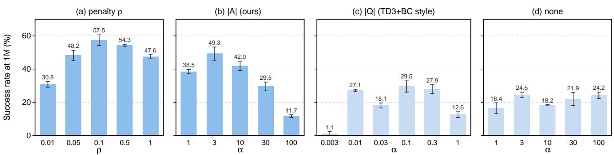  
Figure 2. Mean success (%) over the 10 default tasks at 1M, mean ± std over 3 seeds. (a) Penalty $\rho , \alpha$ selected per environment. (b)–(d) Actors normalizing the Q term by |A| (ours), by |Q|, or not at all, on the same AL-LBLP critic with $\rho$ fixed at 0.1.

## 5.4. Ablations

## 5.4.1. THE PENALTY PARAMETER ρ

$\rho$ is the step size of Equation (5) and the stiffness of the penalty on violated rows. With a small $\rho$ the penalty grows slowly with the violation, so the constraints bind loosely. A large $\rho$ enforces every violated row stiffly from the start. Figure 2(a) varies $\rho$ from 0.01 to 1 and re-selects α per environment for each $\rho .$ At 1M the 10-environment mean peaks at $\rho = 0 . 1$ (57.5) and falls on both sides, to 30.8 at $\rho = 0 . 0 1$ and 47.6 at $\rho = 1$

Figure 1(b) trains $\rho \in \{ 0 . 1 , 0 . 5 , 1 \}$ to 3M steps with the α selected at 1M (per environment in Table 15). A small $\rho$ learns fast early: at 0.5M the mean is 56.1 for $\rho = 0 . 1$ , 47.5 for $\rho = 0 . 5 ,$ , and 42.0 for $\rho = 1$ . With longer training $\rho = 0 . 1$ degrades, to 43.9 at 3M, and collapses on scene, from 91.3 at 1M to 8.7. In contrast, a large $\rho$ is slow early but learns stably. $\rho = 0 . 5$ goes from 54.3 at 1M to 59.2 at 3M, and $\rho = 1$ from 47.6 to 58.0 (on humanoidmaze-medium from 48.7 to 94.0). The curves cross between 1M and 1.5M. This is a trade-off between early speed and long-run stability: a small $\rho$ learns fast under loose constraints, and a large $\rho$ stays stable under tight ones.

Table 3 reports the relative size of the effective multipliers $w = [ \mu + \rho y _ { i } ] +$ + of the K-step rows, $w _ { \mathrm { m a x } } ^ { K } / \bar { w } ^ { K }$ (batch maximum over batch mean in the first 100k steps), and the srank of the critic (Kumar et al., 2021). Since w grows with the violation $y _ { i }$ at rate $\rho ,$ a larger ρ concentrates the update on a few badly violated rows: $\bar { w } _ { \operatorname* { m a x } } ^ { K } / \bar { w } ^ { K }$ is larger for $\rho = 1$ than for $\rho = 0 . 1$ in all 10 environments. A small $\rho$ instead keeps a higher-rank representation: the srank is higher for $\rho = 0 . 1$ than for $\rho = 1$ in all 10 environments. Park et al. (2025a) relate a higher rank of the Q-network’s features to a smaller error bound and faster convergence in offline RL. Consistent with this, across the $3 0 \left( \rho , \right.$ environment) cells the srank is rank-correlated with the success at 0.5M (Spearman 0.53 after centering each environment).

Table 3. Concentration of the K-step effective multipliers (first 100k steps) and critic srank (0.5M) on the 10 default tasks, mean ± std over 3 seeds. $w ^ { K } = \lfloor \mu + \rho y _ { i } \rfloor +$ : effective multiplier of a K-step row; $w _ { \mathrm { m a x } } ^ { K } / \bar { w } ^ { K } ;$ : its batch maximum over its batch mean.
<table><tr><td>ρ</td><td> $w _ { \mathrm { m a x } } ^ { K } / \bar { w } ^ { K } \left[ \downarrow \right]$ </td><td>srank [↑]</td></tr><tr><td>0.1</td><td> ${ \bf 2 6 . 7 \pm 1 . 6 }$ </td><td> ${ \bf 4 0 8 \pm 1 }$ </td></tr><tr><td>0.5</td><td> $6 5 . 7 \pm 2 . 3$ </td><td> $3 1 7 \pm 7$ </td></tr><tr><td>1</td><td> $9 3 . 7 \pm 7 . 5$ </td><td> $2 9 7 \pm 8$ </td></tr></table>

This trade-off between early speed and long-run stability matches Tables 3 and 4: a small $\rho$ keeps a high srank but leaves larger violations, while a large $\rho$ shrinks the srank but keeps the constraints tight.

## 5.4.2. ACTOR NORMALIZATION

Figure 2(b) shows that the $| A |$ normalization of Equation (6) raises performance and narrows the useful range of α. We attach three Gaussian actors to the same AL-LBLP critic with $\rho$ fixed at 0.1, the value with the highest 1M mean in Figure 2(a). The critic does not read the actor, and its logged Q, V, and multipliers are identical across the three actors for every environment and seed. The actors differ only in how the $Q$ term is normalized: by $\mathbb { E } _ { s } | A ( s , \pi ( s ) ) |$ as in Equation (6), by $\mathbb { E } _ { s } | Q ( s , \pi ( s ) ) |$ as in TD3+BC (Fujimoto & Gu, 2021) and ALBUM (Yang et al., 2026), or not at all. With one α for every environment, the best 10-environment mean is 49.3 with |A| (α = 3), 29.5 with $| Q | ( \alpha = 0 . 1 ) .$ , and 24.5 without normalization $\left( \alpha = 3 \right)$ (Figure 2(b)–(d)).

With |A| the best $\alpha$ varies little across environments: in Figure 2(b) the mean success peaks within [1, 10] on a grid up to 100, and the per-environment best α all lie in [1, 10], so three values {1, 3, 10} are enough. In contrast, with |Q| or without normalization it varies up to 100-fold, and AL-BUM’s selected values range from 0.003 to 0.3. The reason is that the two terms of Equation (6) have different scales across environments.

The behavior-cloning term depends only on the actions, which lie in [−1, 1] across all environments. Since the $Q -$ term compares actions, its effective scale is determined by $\mathbb { E } _ { s } | A | = \mathbb { E } _ { s } | Q - V |$ , which varies from 0.60 to 14.8 across environments (25-fold). Thus, without normalization, α must compensate for these scale differences. Normalizing by $\mathbb { E } _ { s } | Q |$ (102 to 1065) does not resolve this issue, as |Q| is dominated by the action-independent baseline $V ( s )$ . Indeed, the action differences in the |Q|-normalized term have scale $\mathbb { E } _ { s } \vert A \vert / \mathbb { E } _ { s } \vert Q \vert$ , which still varies from 1/330 to 1/22 (15-fold) across environments.

Table 4. Violations at 1M on the 10 default tasks, mean ± std over 3 seeds: fraction $P ( y > 0 )$ and size $\mathbb { E } [ y \mid y > 0 ]$ of violated rows in training batches. Bold: lowest (within 5%).
<table><tr><td rowspan="2" colspan="2">Family</td><td colspan="3"> $_ \mathrm { A L - L B L P }$ </td><td>ALBUM</td></tr><tr><td> $\rho = 0 . 1$ </td><td> $\rho = 0 . 5$ </td><td> $\rho = 1$ </td><td></td></tr><tr><td rowspan="2">Bellman</td><td> $P ( y > 0 ) ( \% )$ </td><td> $4 7 . 3 \pm 0 . 9$ </td><td> $3 9 . 9 \pm 1 . 0$ </td><td> $3 7 . 3 \pm 0 . 4$ </td><td> ${ \bf 3 3 . 0 \pm 0 . 9 }$ </td></tr><tr><td> $\mathbb { E } [ y \mid y > 0 ]$ </td><td> $1 . 3 8 \pm 0 . 0 6$ </td><td> $0 . 8 2 \pm 0 . 0 4$ </td><td> ${ \bf 0 . 6 3 \pm 0 . 0 3 }$ </td><td> $0 . 8 4 \pm 0 . 1 5$ </td></tr><tr><td rowspan="2">Epigraph</td><td> $P ( y > 0 ) ( \% )$ </td><td> $4 6 . 8 \pm 0 . 9$ </td><td> $4 2 . 3 \pm 0 . 7$ </td><td> $3 7 . 1 \pm 0 . 5$ </td><td> ${ \bf 3 1 . 7 \pm } 2 . 8 $ </td></tr><tr><td>E[y | y &gt; 0]</td><td> $1 . 4 1 \pm 0 . 0 7$ </td><td> $0 . 8 0 \pm 0 . 0 2$ </td><td> $\mathbf { 0 . 6 0 \pm } 0 . 0 2$ </td><td> ${ \bf 0 . 5 9 \pm 0 . 0 7 }$ </td></tr><tr><td rowspan="2">K-step</td><td> $P ( y > 0 ) ( \% )$ </td><td> $3 4 . 7 \pm 0 . 6$ </td><td> $1 5 . 2 \pm 0 . 7$ </td><td> $9 . 6 \pm 0 . 1$ </td><td> ${ \bf 7 . 0 \pm 1 . 8 }$ </td></tr><tr><td> $\mathbb { E } [ y \mid y > 0 ]$ </td><td> $1 . 1 8 \pm 0 . 0 3$ </td><td> $0 . 8 0 \pm 0 . 0 4$ </td><td> $\mathbf { 0 . 7 1 } \pm 0 . 0 2$ </td><td> $5 . 1 7 \pm 2 . 5 3$ </td></tr></table>

In contrast, normalizing by $\mathbb { E } _ { s } | A |$ gives them the scale $\mathbb { E } _ { s } | A | / \mathbb { E } _ { s } | A | \ = \ 1$ in every environment, removing these scale differences and allowing a single α across environments. Theorem A.6 formalizes this distinction: the |A|- normalized update is invariant to affine reward transformations and common shifts of Q and V , whereas the |Q|- normalized update changes under reward shifts and common shifts.

## 5.4.3. COMPARISON WITH ALBUM

ALBUM and AL-LBLP solve the same program but enforce its constraints differently: fixed hinge coefficients against learned multipliers with a quadratic term. We compare ALBUM with $\rho = 1$ at the Gaussian policy (Table 4). ALBUM’s coefficients are large enough that it violates its constraints least often in every family (i.e., $P ( y > 0 ) )$ ). Its hinge, however, applies the same gradient λ to every violated row and cannot press harder on large violations, so it leaves similar or larger violations $( i . e . , \mathbb { E } [ y \mid y > 0 ] )$ ), notably 5.17 against 0.71 on the K-step rows.

A K-step row links states K steps apart through the rewards in between, so its residual varies much more across windows than that of a Bellman or epigraph row. The effective multiplier $[ \mu + \rho y ] -$ + of AL-LBLP instead grows with the violation. These rows carry the long-range propagation of value (Theorem 4.5 of Yang et al. (2026)), so large K-step violations can weaken this propagation (Section C.3).

Table 5 moves from AL-LBLP to ALBUM one component at a time. With |Q| in place of |A|, the mean decreases from 47.6 to 46.3 at 1M steps. With fixed coefficients but the quadratic term, the K-step violations stay small (0.98), but the success drops to that of ALBUM (42.1). With learned multipliers and the hinge, the K-step violations are as large as in ALBUM (5.50), and the success falls to 30.0 at 1M. At the critic learning rate of ALBUM $( 1 0 ^ { - 4 } )$ , this row reaches

Table 5. From AL-LBLP to ALBUM, one component at a time: mean success (%) over the 10 default tasks, mean ± std over 3 seeds; K-step violation size at 1M (Table 4). Coeff.: learned µ or ALBUM’s fixed λ. lr: critic learning rate.
<table><tr><td></td><td>Penalty</td><td>lr</td><td>Coeff.</td><td>Actor</td><td>1M</td><td>3M</td><td> $\frac { \mathbb { E } [ y ^ { \mathrm { ~ K ~ } } \vert ~ y ^ { \mathrm { ~ K ~ } } > 0 ] } { \mathbb { E } [ y ^ { \mathrm { ~ K ~ } } \vert ~ y ^ { \mathrm { ~ K ~ } } > 0 ] }$ </td></tr><tr><td> $_ \mathrm { A L - L B L P }$ </td><td>quadratic</td><td> $3 \times 1 0 ^ { - 4 }$ </td><td>µ</td><td>|A|</td><td> $4 7 . 6 \pm 1 . 1$ </td><td> $5 8 . 0 \pm 2 . 7$ </td><td> $0 . 7 1 \pm 0 . 0 2$ </td></tr><tr><td> $- \left| A \right|$ </td><td>quadratic</td><td> $3 \times 1 0 ^ { - 4 }$ </td><td>µ</td><td></td><td> $4 6 . 3 \pm 1 . 7$ </td><td> $5 1 . 7 \pm 3 . 7$ </td><td> $0 . 7 1 \pm 0 . 0 2$ </td></tr><tr><td>– multipliers</td><td>quadratic</td><td> $3 \times { 1 0 } ^ { - 4 }$ </td><td>λ</td><td></td><td> $4 2 . 1 \pm 0 . 8$ </td><td> $4 5 . 3 \pm 2 . 5$ </td><td> $0 . 9 8 \pm 0 . 0 5$ </td></tr><tr><td>– quadratic term</td><td>hinge</td><td> $3 \times 1 0 ^ { - 4 }$ </td><td>µ</td><td></td><td> $3 0 . 0 \pm 1 . 7$ </td><td> $2 6 . 7 \pm 2 . 7$ </td><td> $5 . 5 0 \pm 0 . 8 8$ </td></tr><tr><td>- quadratic term</td><td>hinge</td><td> $1 0 ^ { - 4 }$ </td><td>μ</td><td></td><td> $4 5 . 7 \pm 5 . 5$ </td><td> $3 3 . 8 \pm 2 . 9$ </td><td> $3 . 3 2 \pm 0 . 3 2$ </td></tr><tr><td>ALBUM</td><td>hinge</td><td> $1 0 ^ { - 4 }$ </td><td>λ</td><td>|Q|</td><td>43.0 ±1.0</td><td> $4 4 . 9 \pm 4 . 2$ </td><td> $\overline { { 5 . 1 7 \pm 2 . 5 3 } }$ </td></tr></table>

45.7 at 1M but falls to 33.8 at 3M, and its K-step violations stay large (3.32).

The results demonstrate that the quadratic term keeps the violations small, and the learned multipliers and advantage normalization are needed on top of it to reach the success of AL-LBLP.

## 6. Conclusion

We solved the lifted Bellman linear program with the method of multipliers. The fixed hinge coefficients of AL-BUM become multipliers learned by dual ascent. One penalty parameter $\rho$ sets both the dual step and the curvature on violated rows. In the convex case the fixed points are the KKT pairs of the program. At every stationary point the applied row weights balance the objective, which turns the bounded-update condition of ALBUM into an equality. The critic uses a single Q and V without a target network or ensemble and never queries the policy. We attached it to a Gaussian actor, for which we proposed an advantagenormalized DDPG+BC objective, to a flow actor, and to best-of-N sampling. On the 50 state-based OGBench tasks the three policies average 55.8, 55.7, and 60.1. With longer rollouts the critic reaches 81.5 on humanoidmaze-giant and 79.8 on antmaze-giant with 8 seeds. The penalty parameter trades early speed against long-run stability. The difference from ALBUM concentrates in the K-step rows, where the hinge leaves large violations in place.

Limitations. A small $\rho$ learns fast early but is less stable in long training: at $\rho = 0 . 1$ the ten-environment mean falls from 56.1 at 0.5M to 43.9 at 3M (Section 5.4.1). AL-LBLP is weaker on manipulation than on navigation, in both the state-based and the pixel-based tasks (Section 5.1, Section F). The scalar multipliers approximate the per-row method, and $\rho$ and α are still selected per environment.

Future work. Best-of-N over a behavior-cloning flow is the strongest of our three policies, both offline (60.1, Table 1) and after online fine-tuning (76.3, Figure 1(a)). Many VLA models generate actions with a behavior-cloning flow, and the AL-LBLP critic is trained without querying the policy. Attaching an AL-LBLP critic to a VLA model by best-of-N sampling is therefore our next step.

## Impact Statement

This paper presents work whose goal is to advance the field of Machine Learning. There are many potential societal consequences of our work, none which we feel must be specifically highlighted here.

## References

Abraham, A. A., Shi, L. X., and Finn, C. Long-horizon Qlearning: Accurate value learning via n-step inequalities. In Advances in Neural Information Processing Systems, 2026. arXiv:2605.05812.

Agrawalla, B., Nauman, M., Agrawal, K., and Kumar, A. floq: Training critics via flow-matching for scaling compute in value-based RL. In International Conference on Learning Representations, 2026. arXiv:2509.06863.

Baird, L. Residual algorithms: Reinforcement learning with function approximation. In International Conference on Machine Learning, 1995.

Bas-Serrano, J., Curi, S., Krause, A., and Neu, G. Logistic Q-learning. In International Conference on Artificial Intelligence and Statistics, 2021. arXiv:2010.11151.

Bertsekas, D. P. Constrained Optimization and Lagrange Multiplier Methods. Academic Press, 1982.

Chae, J., Park, J., Shin, Y., Kim, G., Han, S., and Sung, Y. Flow actor-critic for offline reinforcement learning. In International Conference on Learning Representations, 2026. arXiv:2602.18015.

de Farias, D. P. and Van Roy, B. The linear programming approach to approximate dynamic programming. Operations Research, 51(6):850–865, 2003.

Dong, P., Li, Q., Sadigh, D., and Finn, C. EXPO: Stable reinforcement learning with expressive policies. In International Conference on Learning Representations, 2026. arXiv:2507.07986.

Fujimoto, S. and Gu, S. S. A minimalist approach to offline reinforcement learning. In Advances in Neural Information Processing Systems, 2021. arXiv:2106.06860.

Fujimoto, S., Meger, D., and Precup, D. Off-policy deep reinforcement learning without exploration. In International Conference on Machine Learning, 2019. arXiv:1812.02900.

Hansen-Estruch, P., Kostrikov, I., Janner, M., Kuba, J. G., and Levine, S. IDQL: Implicit Q-learning as an actorcritic method with diffusion policies. arXiv preprint arXiv:2304.10573, 2023.

Hestenes, M. R. Multiplier and gradient methods. Journal of Optimization Theory and Applications, 4(5):303–320, 1969.

Jeong, N., Lee, D., and He, N. Stochastic primal-dual Qlearning. arXiv preprint arXiv:1810.08298, 2018.

Kostrikov, I., Nair, A., and Levine, S. Offline reinforcement learning with implicit Q-learning. In International Conference on Learning Representations, 2022. arXiv:2110.06169.

Kumar, A., Zhou, A., Tucker, G., and Levine, S. Conservative Q-learning for offline reinforcement learning. In Advances in Neural Information Processing Systems, 2020. arXiv:2006.04779.

Kumar, A., Agarwal, R., Ghosh, D., and Levine, S. Implicit under-parameterization inhibits data-efficient deep reinforcement learning. In International Conference on Learning Representations, 2021. arXiv:2010.14498.

Lee, D. and He, N. A unified switching system perspective and convergence analysis of Q-learning algorithms. In Advances in Neural Information Processing Systems, 2020. arXiv:1912.02270.

Lee, J., Jeon, W., Lee, B.-J., Pineau, J., and Kim, K.-E. OptiDICE: Offline policy optimization via stationary distribution correction estimation. In International Conference on Machine Learning, 2021. arXiv:2106.10783.

Levine, S., Kumar, A., Tucker, G., and Fu, J. Offline reinforcement learning: Tutorial, review, and perspectives on open problems. arXiv preprint arXiv:2005.01643, 2020.

Mehta, P. G. and Meyn, S. P. Convex Q-learning, Part 1: Deterministic optimal control. arXiv preprint arXiv:2008.03559, 2020.

Mu, Z., Zhao, G., Zhong, Y., and Zhang, C. Preserve support, not correspondence: Dynamic routing for offline reinforcement learning. arXiv preprint arXiv:2604.22229, 2026.

Nachum, O. and Dai, B. Reinforcement learning via Fenchel-Rockafellar duality. arXiv preprint arXiv:2001.01866, 2020.

Nakamoto, M., Mees, O., Kumar, A., and Levine, S. Steering your generalists: Improving robotic foundation models via value guidance. In Conference on Robot Learning, 2024. arXiv:2410.13816.

Neu, G. and Okolo, N. Efficient global planning in large MDPs via stochastic primal-dual optimization. In International Conference on Algorithmic Learning Theory, 2023. arXiv:2210.12057.

Ozdaglar, A., Pattathil, S., Zhang, J., and Zhang, K. Revisiting the linear-programming framework for offline RL with general function approximation. In International Conference on Machine Learning, 2023. arXiv:2212.13861.

Park, J. Scalable reinforcement learning via adaptive batch scaling. In International Conference on Machine Learning, 2026. arXiv:2605.21557.

Park, J., Park, M., and Lee, D. Pretraining a shared Qnetwork for data-efficient offline reinforcement learning. In Advances in Neural Information Processing Systems, 2025a. arXiv:2505.05701.

Park, S., Frans, K., Eysenbach, B., and Levine, S. OG-Bench: Benchmarking offline goal-conditioned RL. In International Conference on Learning Representations, 2025b. arXiv:2410.20092.

Park, S., Frans, K., Mann, D., Eysenbach, B., Kumar, A., and Levine, S. Horizon reduction makes RL scalable. In Advances in Neural Information Processing Systems, 2025c. arXiv:2506.04168.

Park, S., Li, Q., and Levine, S. Flow Q-learning. In International Conference on Machine Learning, 2025d. arXiv:2502.02538.

Park, S., Oberai, A., Atreya, P., and Levine, S. Transitive RL: Value learning via divide and conquer. In International Conference on Learning Representations, 2026. arXiv:2510.22512.

Powell, M. J. D. A method for nonlinear constraints in minimization problems. In Fletcher, R. (ed.), Optimization, pp. 283–298. Academic Press, 1969.

Puterman, M. L. Markov Decision Processes: Discrete Stochastic Dynamic Programming. John Wiley & Sons, 2014.

Rockafellar, R. T. Convex Analysis. Princeton University Press, 1970.

Rockafellar, R. T. The multiplier method of Hestenes and Powell applied to convex programming. Journal of Optimization Theory and Applications, 12(6):555–562, 1973.

Sikchi, H., Zheng, Q., Zhang, A., and Niekum, S. Dual RL: Unification and new methods for reinforcement and imitation learning. In International Conference on Learning Representations, 2024. arXiv:2302.08560.

Singh, S., Hu, Z., Mark, M. S., Yu, J., Erickson, Z., and Kumar, A. SeeQ: Training generalist value functions for long-horizon robotic manipulation. arXiv preprint arXiv:2609.22085, 2026.

Tarasov, D., Kurenkov, V., Nikulin, A., and Kolesnikov, S. Revisiting the minimalist approach to offline reinforcement learning. In Advances in Neural Information Processing Systems, 2023. arXiv:2305.09836.

Tsitsiklis, J. N. and Van Roy, B. An analysis of temporaldifference learning with function approximation. IEEE Transactions on Automatic Control, 42(5):674–690, 1997.

Yang, H., Park, J., Jeong, N., and Lee, D. Lifted Bellman linear programming for offline reinforcement learning. arXiv preprint arXiv:2609.24489, 2026.

## A. Proofs

This appendix states and proves the properties summarized in Section 4.3 and the invariance of the advantage-normalized actor of Section 4.2.

Setting and notation. In this appendix the primal variable is a finite vector x. In the tabular case its entries are the values of Q on the dataset pairs and of V on the dataset states. With linear features they are the weight vectors of Q and V. The objective of Equation (1) is linear, $f ( x ) = c ^ { \top }$ x: the empirical weights $\omega _ { Q } / n$ and $\omega _ { V } / n$ on their coordinates, or their images under the feature maps. Every constraint row is affine, $y _ { j } ( x ) = b _ { j } - a _ { j } ^ { \top } x$ , with $y _ { j } ( x ) > 0$ a violation. We write J for the set of rows, $y ( x ) = ( y _ { j } ( x ) ) _ { j \in J }$ , and $\mu = ( \mu _ { j } ) _ { j \in J } \geq 0$ for one multiplier per row. Without the stop-gradient, the augmented Lagrangian of Equation (4) is

$$
\mathcal { L } _ { \rho } ( x ; \mu ) = c ^ { \top } x + \sum _ { j \in J } \psi _ { \rho } \big ( y _ { j } ( x ) ; \mu _ { j } \big ) , \qquad \psi _ { \rho } ( y ; \mu ) = \frac { 1 } { 2 \rho } \big ( [ \mu + \rho y ] _ { + } ^ { 2 } - \mu ^ { 2 } \big ) ,
$$

and the dual update (5) is $\mu _ { j }  [ \mu _ { j } + \rho y _ { j } ( x ) ] .$ +. We use two elementary facts about $\psi _ { \rho }$

(F1) For fixed $\mu \geq 0 , y \mapsto \psi _ { \rho } ( y ; \mu )$ is convex and continuously differentiable with $\partial _ { y } \psi _ { \rho } ( y ; \mu ) = [ \mu + \rho y ] _ { + }$ . On $\{ \mu + \rho y > 0 \}$ it equals $\mu y + { \textstyle { \frac { \rho } { 2 } } } y ^ { 2 }$ , on the complement it is the constant $- \mu ^ { 2 } / ( 2 \rho )$ , and the two pieces and their derivatives agree at $\mu + \rho y = 0 .$

(F2) $\begin{array} { r } { \psi _ { \rho } ( y ; \mu ) = \operatorname* { m a x } _ { \nu \geq 0 } \left[ \nu y - \frac { 1 } { 2 \rho } ( \nu - \mu ) ^ { 2 } \right] } \end{array}$ , attained at $\nu = [ \mu + \rho y ] _ { + }$ . Hence $\psi _ { \rho } ( \cdot ; \mu )$ is the conjugate of a quadratic proximal term centered at $\mu ,$ which is the sense in which Section 2 calls the augmented Lagrangian a regularized dual (Rockafellar, 1973).

Since each $y _ { j }$ is affine, $\mathcal { L } _ { \rho } ( \cdot ; \mu )$ is convex and $C ^ { 1 }$ in x by (F1), with

$$
\nabla _ { x } \mathcal { L } _ { \rho } ( x ; \mu ) = c - \sum _ { j \in J } [ \mu _ { j } + \rho y _ { j } ( x ) ] _ { + } a _ { j } .\tag{8}
$$

A KKT pair of the LP min $\{ c ^ { \top } x : y ( x ) \leq 0 \}$ is a pair $( \boldsymbol { x } ^ { * } , \boldsymbol { \mu } ^ { * } )$ with

$$
y _ { j } ( x ^ { * } ) \leq 0 , \qquad \mu _ { j } ^ { * } \geq 0 , \qquad \mu _ { j } ^ { * } y _ { j } ( x ^ { * } ) = 0 \quad ( j \in J ) , \qquad c - \sum _ { j \in J } \mu _ { j } ^ { * } a _ { j } = 0 .\tag{9}
$$

For a linear program with a finite optimum, $x ^ { * }$ is optimal if and only if there exists $\mu ^ { * }$ with which $( \boldsymbol { x } ^ { * } , \boldsymbol { \mu } ^ { * } )$ is a KKT pair. No constraint qualification is needed because the constraints are affine (Rockafellar, 1970, Thm. 28.2 and Cor. 28.3.1).

ALBUM in the dual. With the notation above, the ALBUM loss (2) in the tabular case is max $\{ \Lambda ( x , \mu ) : 0 \le \mu _ { j } \le \lambda _ { F ( j ) } / n \}$ with $\begin{array} { r } { \Lambda ( x , \mu ) = c ^ { \top } x + \sum _ { i } \mu _ { j } y _ { j } ( x ) } \end{array}$ the ordinary Lagrangian, because $\mathrm { m a x } _ { \mu \in [ 0 , \lambda ] } \mu y = \lambda [ y ] _ { + }$ . Minimizing it over x is therefore the LP with the additional dual constraint $\mu _ { j } \leq \lambda _ { F ( j ) } / n$ on every row. This is where the condition of Proposition 4.7 of Yang et al. (2026) comes from: when every optimal dual variable of the one-step program lies strictly inside its box, the added constraints are inactive and the relaxation is exact. AL-LBLP imposes no box on $\mu ,$ and the multipliers are determined by the dual update instead

## A.1. Fixed points

Proposition A.1 (Fixed points). $L e t L B L P \left( 1 \right)$ be a convex instance with afinite optimum, and let $\rho > 0 .$ A pair $\left( ( Q , V ) , \mu \right)$ with $\mu \geq 0$ satisfies $( Q , V ) \in$ arg min $\mathcal { L } _ { \rho } ( \cdot ; \mu )$ and $\mu = [ \mu + \rho y ( Q , V ) ]$ + (afixed point ofthe primal minimization and ofthe dual update (5)) ifand only ifit is a KKTpair ofLBLP. In the deterministic tabular case $( Q , V ) = ( Q _ { D } ^ { * } , V _ { D } ^ { * } )$ at everyfixed point. With linearfeatures $( Q , V )$ is an optimal solution ofthefeature-restricted program.

Proof. Fix $\rho > 0$ . We show that the two fixed-point conditions together are equivalent to Equation (9).

Dual fixed point ⇔ feasibility, dual feasibility, and complementary slackness. Suppose $\mu _ { j } = [ \mu _ { j } + \rho y _ { j } ( x ) ]$ + for every $j .$ Then $\mu _ { j } \geq 0 . { \mathrm { ~ H ~ } } \mu _ { j } > 0 \quad$ , the maximum is attained by the left argument, so $\mu _ { j } = \mu _ { j } + \rho y _ { j } ( x )$ and $y _ { j } ( x ) = 0$ . If $\mu _ { j } = 0$ then $[ \rho y _ { j } ( x ) ] _ { + } = 0 , \mathrm { s o } y _ { j } ( x ) \leq 0$ . In both cases $y _ { j } ( x ) \leq 0$ and $\mu _ { j } y _ { j } ( x ) = 0$ . Conversely, suppose $y _ { j } ( x ) \leq 0 , \mu _ { j } \geq 0 ,$ and $\mu _ { j } y _ { j } ( x ) = 0$ . Then either $\mu _ { j } = 0$ and $[ \rho y _ { j } ( x ) ] _ { + } = 0 = \mu _ { j } , \mathrm { o r } \mu _ { j } > 0 , y _ { j } ( x ) = 0 ,$ , and $[ \mu _ { j } ] _ { + } = \mu _ { j }$ . Hence the dual fixed-point condition holds for every row if and only if the three conditions of Equation (9) other than stationarity hold. In that case

$$
[ \mu _ { j } + \rho y _ { j } ( x ) ] _ { + } = \mu _ { j } \qquad \mathrm { f o r } \mathrm { e v e r y } j \in J .\tag{10}
$$

Primal minimizer under Equation (10) ⇔ stationarity. Because $\mathcal { L } _ { \rho } ( \cdot ; \mu )$ is convex and differentiable, $x \in$ arg min $\mathcal { L } _ { \rho } ( \cdot ; \mu )$ if and only if $\nabla _ { \boldsymbol { x } } \mathcal { L } _ { \rho } ( \boldsymbol { x } ; \mu ) = 0$ . Substituting Equation (10) into Equation (8) gives $\begin{array} { r } { \nabla _ { x } \mathcal { L } _ { \rho } ( x ; \mu ) = c - \sum _ { j } \mu _ { j } a _ { j } } \end{array}$ . Under Equation (10) the primal condition is therefore the last condition of Equation (9).

Combining the two steps, $( x , \mu )$ satisfies both fixed-point conditions if and only if it satisfies all of Equation (9), that ${ \mathrm { i s } } ,$ if and only if it is a KKT pair. The argument used only $\rho > 0$

Identification ofthe primal point. The primal part of a KKT pair is an optimal solution of the LP. In the tabular case the LP is LBLP on $\mathcal { M } _ { \mathcal { D } }$ , whose minimizer is unique and equal to $\left( Q _ { D } ^ { * } , V _ { D } ^ { * } \right)$ (Yang et al., 2026, Prop. 4.3). With linear features the LP is LBLP restricted to the span of the features, an approximate linear program in the sense of de Farias & Van Roy (2003). Its optimal set need not be a singleton, and the conclusion is that x belongs to it. □

Remark A.2 (Scalar multipliers). With one scalar per family the dual fixed point is $\boldsymbol { \mu } ^ { F } = \mathbb { E } _ { i } \left[ [ \boldsymbol { \mu } ^ { F } + \boldsymbol { \rho } \boldsymbol { \bar { y } } _ { i } ^ { F } ] + \right]$ , an averaged form of complementary slackness that no longer forces every row to be feasible. We use the scalar parameterization as an approximation of the per-row method. The identity of Theorem $\mathrm { A . 4 }$ in terms of the effective multipliers holds for either parameterization; its version in terms of $\mu$ requires per-row multipliers. In the scalar parameterization the two rollout rows share $\mu _ { \mathrm { K } }$ , and the dual target uses $\begin{array} { r } { \dot { \bar { y } } _ { i } ^ { \mathrm { K } } = \frac { 1 } { 2 } ( y _ { i } ^ { \mathrm { K } \hat { \mathrm { Q } } } + y _ { i } ^ { \mathrm { K V } } ) } \end{array}$ . Even at the scalar dual fixed point, therefore, $\mathbb { E } _ { i } [ \mu _ { i } ^ { \mathrm { K Q , e f f } } + \mu _ { i } ^ { \mathrm { K V , e f f } } ] = 2 \mu _ { \mathrm { K } } + J _ { \mathrm { K } }$ with

$$
J _ { \mathrm { K } } = \mathbb { E } _ { i } \left[ [ \mu _ { \mathrm { K } } + \rho y _ { i } ^ { \mathrm { K Q } } ] _ { + } + [ \mu _ { \mathrm { K } } + \rho y _ { i } ^ { \mathrm { K V } } ] _ { + } - 2 [ \mu _ { \mathrm { K } } + \rho \bar { y } _ { i } ^ { \mathrm { K } } ] _ { + } \right] \geq 0
$$

by convexity of $[ \cdot ] _ { + }$ , with equality exactly when the two arguments have the same sign on every row. The scalar form of Equation $( 7 ) , \mu _ { \mathrm { B } } \mathbb { E } _ { i } [ 1 - \gamma m _ { i } ] + 2 \mu _ { \mathrm { K } } = \omega _ { Q } + \omega _ { V }$ , holds in our implementation only up to $J _ { \mathrm { K } }$ and a covariance term between mi and $\mu _ { i } ^ { \mathrm { B , e f f } }$ . The form with $\mu ^ { \mathrm { { e f f } } }$ is exact. Section H measures both: at 1M the $\mu ^ { \mathrm { e f f } }$ form is between 0.148 and 0.154 and the scalar form between 0.115 and 0.145 against the target 0.15.

## A.2. Agreement with ALBUM

Corollary A.3 (Agreement with ALBUM). Let LBLP be a deterministic tabular instance as in Theorem A.1. $I f \lambda _ { \mathrm { B } } >$ $\mathrm { m a x } _ { ( s , a ) } \lambda _ { \mathrm { B } } ^ { * } ( s , a )$ and λE $> \mathrm { m a x } _ { ( s , a ) } \lambda _ { \mathrm { E } } ^ { * } ( s , a )$ for the optimal one-step multipliers $\lambda ^ { * }$ of Λ (Section $4 . I ) _ { ; }$ , then the ALBUM minimizer ofEquation (2) and every AL-LBLPfixed point coincide,for every $\lambda _ { \mathrm { K } } \geq 0 , K$ , and $\rho > 0$

Proof. Under the stated condition on $\lambda _ { \mathrm { B } }$ and $\lambda _ { \mathrm { E } }$ , Proposition 4.7 of Yang et al. (2026) shows that the hinge relaxation on $\mathcal { M } _ { \mathcal { D } }$ has the unique minimizer $( Q _ { D } ^ { * } , V _ { D } ^ { * } )$ , for every $\lambda _ { \mathrm { K } } \geq 0$ and every rollout length K. Their equation 4 is proportional to (2) in the tabular case, where the stop-gradient leaves the function values unchanged. By Theorem A.1, in the tabular case the primal part of every AL-LBLP fixed point is $( Q _ { D } ^ { * } , V _ { D } ^ { * } )$ as well, for every $\rho > 0$ . The two points coincide. □

The corollary gives a condition under which the two methods agree. Whenever the fixed coefficients of ALBUM are large enough to be exact, every AL-LBLP fixed point is the same point, and no threshold has to be known. Below the thresholds, Proposition 4.7 of Yang et al. (2026) no longer guarantees exactness, so the two methods may differ, while every AL-LBLP fixed point is still the LBLP solution.

## A.3. Mass identity

Proposition A.4 (Mass identity). Let $Q _ { \theta }$ and $V _ { \phi }$ each have an additive output bias, let $m _ { i } \in \{ 0 , 1 \}$ be the terminal mask of the one-step row, and let the K-step target be detached. At every stationary point of $\mathcal { L } _ { \rho }$ in (θ, ϕ),for any multipliers $\mu \geq 0 ,$ the effective multipliers $\mu _ { i } ^ { F , \mathrm { e f f } } = [ \mu _ { i } ^ { \overline { { F } } } + \bar { \rho } y _ { i } ^ { F } ] +$ + satisfy Equation (7),

$$
\mathbb { E } _ { i } \big [ ( 1 - \gamma m _ { i } ) \mu _ { i } ^ { \mathrm { B , e f f } } + \mu _ { i } ^ { \mathrm { K Q , e f f } } + \mu _ { i } ^ { \mathrm { K V , e f f } } \big ] = \omega _ { Q } + \omega _ { V } .
$$

At a dualfixed point ofEquation (5) with one multiplier per row (in particular separate multipliersfor the KQ and $K V$ rows) the same holds with µ in place $o f \mu ^ { \mathrm { e f f } }$ . For constant row weights and $m \equiv 1$ the left-hand side is $\lambda _ { \mathrm { B } } ( 1 - \gamma ) + 2 \lambda _ { \mathrm { K } } ,$ , so the bounded-update condition $\lambda _ { \mathrm { B } } ( 1 - \gamma ) + 2 \lambda _ { \mathrm { K } } \geq \omega _ { Q } + \omega _ { V }$ ofYang et al. (2026, Prop. 5.1) holds with equalityfor the weights that AL-LBLP applies.

Proof. Write $Q _ { \theta } ( s , a ) = \tilde { Q } _ { \theta } ( s , a ) + b _ { Q }$ and $V _ { \phi } ( s ) = \tilde { V } _ { \phi } ( s ) + b _ { V }$ , where $b _ { Q }$ and $b _ { V }$ are the output biases, so that $\partial Q _ { \theta } ( s , a ) / \partial b _ { Q } =$ 1 and $\partial V _ { \phi } ( s ) / \partial b _ { V } = 1$ at every input. In the detached program the rows are

$$
\begin{array} { r } { y _ { i } ^ { \mathrm { B } } = r _ { i } + \gamma m _ { i } V _ { \phi } ( s _ { i } ^ { \prime } ) - Q _ { \theta } ( s _ { i } , a _ { i } ) , \quad y _ { i } ^ { \mathrm { K G } } = \mathrm { s g } [ \hat { y } _ { K , i } ] - Q _ { \theta } ( s _ { i } , a _ { i } ) , \quad y _ { i } ^ { \mathrm { K V } } = \mathrm { s g } [ \hat { y } _ { K , i } ] - V _ { \phi } ( s _ { i } ) , \quad y _ { i } ^ { \mathrm { E } } = Q _ { \theta } ( s _ { i } , a _ { i } ) - V _ { \phi } ( s _ { i } ) , } \end{array}
$$

where the stop-gradient makes $\hat { y } _ { K , i }$ a constant with respect to $( \theta , \phi )$ . Their partial derivatives with respect to the two biases are

$$
\frac { \partial y _ { i } ^ { \mathrm { B } } } { \partial b _ { Q } } = - 1 , \ \frac { \partial y _ { i } ^ { \mathrm { K Q } } } { \partial b _ { Q } } = - 1 , \ \frac { \partial y _ { i } ^ { \mathrm { K V } } } { \partial b _ { Q } } = 0 , \ \frac { \partial y _ { i } ^ { \mathrm { E } } } { \partial b _ { Q } } = 1 ; \qquad \frac { \partial y _ { i } ^ { \mathrm { B } } } { \partial b _ { V } } = \gamma m _ { i } , \ \frac { \partial y _ { i } ^ { \mathrm { K Q } } } { \partial b _ { V } } = 0 , \ \frac { \partial y _ { i } ^ { \mathrm { K V } } } { \partial b _ { V } } = - 1 , \ \frac { \partial y _ { i } ^ { \mathrm { E } } } { \partial b _ { V } } = - 1 .
$$

By the chain rule and (F1), with $\mu _ { i } ^ { F , \mathrm { e f f } } = [ \mu _ { i } ^ { F } + \rho y _ { i } ^ { F } ] _ { + }$ ，

$$
\frac { \partial \mathcal { L } _ { \rho } } { \partial b _ { Q } } = \omega _ { Q } + \mathbb { E } _ { i } \big [ - \mu _ { i } ^ { \mathrm { B , e f f } } - \mu _ { i } ^ { \mathrm { K Q , e f f } } + \mu _ { i } ^ { \mathrm { E , e f f } } \big ] ,
$$

$$
\frac { \partial \mathcal { L } _ { \rho } } { \partial b _ { V } } = \omega _ { V } + \mathbb { E } _ { i } \big [ \gamma m _ { i } \mu _ { i } ^ { \mathrm { B , e f f } } - \mu _ { i } ^ { \mathrm { K V , e f f } } - \mu _ { i } ^ { \mathrm { E , e f f } } \big ] ,
$$

where the $\omega$ terms come from the objective $\mathbb { E } _ { \mathcal { D } } [ \omega _ { Q } Q _ { \theta } + \omega _ { V } V _ { \phi } ]$ . Adding the two,

$$
\frac { \partial \mathcal { L } _ { \rho } } { \partial b _ { Q } } + \frac { \partial \mathcal { L } _ { \rho } } { \partial b _ { V } } = \omega _ { Q } + \omega _ { V } - \mathbb { E } _ { i } \left[ \left( 1 - \gamma m _ { i } \right) \mu _ { i } ^ { \mathrm { B , e f f } } + \mu _ { i } ^ { \mathrm { K Q , e f f } } + \mu _ { i } ^ { \mathrm { K V , e f f } } \right] .
$$

The epigraph terms cancel because $y _ { i } ^ { \mathrm { E } }$ is invariant to a common shift of Q and V. At a stationary point of $\mathcal { L } _ { \rho }$ in $( \theta , \phi )$ both partial derivatives vanish, so the right-hand side is zero, which is Equation (7). This holds for any $\mu \geq 0 _ { : }$ , since the multipliers enter the loss only through $\mu ^ { \mathrm { e f f } }$

At a dual fixed point of Equation (5), Equation (10) gives $\boldsymbol { \mu } ^ { \mathrm { e f f } } = \boldsymbol { \mu }$ row by row, so Equation (7) holds with $\mu .$ This step uses one multiplier per row. Suppose instead that the KQ and KV rows of window i share a multiplier $\mu _ { i } ^ { \mathrm { K } }$ updated with $\begin{array} { r } { \bar { y } _ { i } ^ { \mathrm { K } } = \frac { 1 } { 2 } ( y _ { i } ^ { \mathrm { K Q } } + \bar { y } _ { i } ^ { \mathrm { K V } } ) } \end{array}$ , as the scalar implementation of Section 4.1 does. Then the fixed point gives $[ \mu _ { i } ^ { \mathrm { K } } + \rho \bar { y } _ { i } ^ { \mathrm { K } } ] _ { + } = \mu _ { i } ^ { \mathrm { K } }$ , and convexity of $[ \cdot ] _ { + }$ yields

$$
\mu _ { i } ^ { \mathrm { K Q , e f f } } + \mu _ { i } ^ { \mathrm { K V , e f f } } = [ \mu _ { i } ^ { \mathrm { K } } + \rho y _ { i } ^ { \mathrm { K Q } } ] _ { + } + [ \mu _ { i } ^ { \mathrm { K } } + \rho y _ { i } ^ { \mathrm { K V } } ] _ { + } \geq 2 \mu _ { i } ^ { \mathrm { K } } ,
$$

with equality exactly when the two arguments have the same sign. The form of Equation (7) with $\mu$ then holds only up to this nonnegative gap, which is $J _ { \mathrm { K } }$ of Theorem A.2.

Finally, suppose every row of a family carries the same constant weight $( \mu _ { i } ^ { \mathrm { B , e f f } } \equiv \lambda _ { \mathrm { B } } , \mu _ { i } ^ { \mathrm { K Q , e f f } } \equiv \mu _ { i } ^ { \mathrm { K V , e f f } } \equiv \lambda _ { \mathrm { K } } )$ and $m _ { i } \equiv 1$ Then the left-hand side of Equation $( 7 )$ is $\lambda _ { \mathrm { B } } ( 1 - \gamma ) + 2 \lambda _ { \mathrm { K } }$ , the quantity in Proposition $5 . 1$ of Yang et al. (2026). There the update is bounded along the common-shift direction only if this quantity is at least $\omega _ { Q } + \omega _ { V }$ , and Equation (7) states that the effective weights of AL-LBLP meet it with equality at every stationary point. The identity is the same computation carried out for ALBUM’s fixed coefficients by Yang et al. (2026, Remark I.6). Without the stop-gradient on $\hat { y } _ { K , i }$ the rollout rows depend on $b _ { V }$ through $\gamma ^ { K } M _ { i } V _ { \phi } ( s _ { K , i } )$ , with $M _ { i }$ the window’s bootstrap mask, and the coefficient of $\mu _ { i } ^ { \mathrm { K Q , e f f } } + \mu _ { i } ^ { \mathrm { K V , e f f } }$ in Equation (7) becomes $1 - \gamma ^ { K } M _ { i }$ □

Reading of the identity. Equation (7) is the balance of the output-bias gradients of $Q _ { \theta }$ and $V _ { \phi }$ . The objective pushes all values down with total mass $\omega _ { Q } + \omega _ { V }$ , and the penalty rows push back with the mass carried by the effective multipliers. In ALBUM the weight of a row is at most its fixed $\lambda ,$ so the penalty rows can push back with mass at most $\lambda _ { \mathrm { B } } ( 1 - \gamma ) + 2 \lambda _ { \mathrm { K } }$ for $m \equiv 1 . \mathrm { \ : A }$ balance exists only if this bound reaches $\omega _ { Q } + \omega _ { V }$ , which is the condition of Proposition 5.1 of Yang et al. (2026); with ALBUM’s coefficients and $\gamma = 0 . 9 9 5$ the bound is about 2.0 against 0.15. In AL-LBLP the weights $[ \mu + \rho y ] .$ + adjust through $_ y$ at every step and through $\mu$ at the dual step, so the balance is reached by the optimization itself, with no condition on any coefficient. We log two residuals of Equation (7) on every training batch. The one with $\mu ^ { \mathrm { { e f f } } }$ checks the identity directly at the current parameters. The one with the scalar $\mu$ in its place, $\mu _ { \mathrm { { B } } } \mathbb { E } _ { i } [ 1 - \gamma m _ { i } ] + 2 \mu _ { \mathrm { { K } } } - \left( \omega _ { Q } + \omega _ { V } \right)$ , measures how far the dual is from its fixed point, but in the scalar parameterization it is biased downward by the gap $J _ { \mathrm { K } }$ of Theorem ${ \mathrm { A } } . 2 { \mathrm { } }$ Section H reports both at 1M steps for every environment of Table 1.

## A.4. Invariance of the advantage-normalized actor

We write the actor loss (6) with the denominator $D _ { A } = \mathrm { s g } \mathbb { E } _ { s } | Q ( s , \pi ( s ) ) - V ( s ) |$ | and compare it with the TD3+BC loss, whose denominator is $D _ { Q } = \operatorname { s g } \mathbb { E } _ { s } | Q ( s , \pi ( s ) )$ |.

Assumption A.5. The task is continuing: timeouts are not terminals, and every transition has mask $m = 1$ (and every window has bootstrap mask $M = 1 )$ . The pair $( Q , V )$ ranges over a class of functions that contains $( c Q + k , c V + k )$ for every $c > 0$ and $k \in$ R whenever it contains $( Q , V )$ , for example networks with output biases. Every bootstrap value $V ( s ^ { \prime } )$ and $V ( s _ { K } )$ in the rows of Equation (1) is the value of V itself, and no state has a fixed value.

Proposition A.6 (Invariance to affine reward transformations). Under Theorem A.5, let $r ^ { \prime } = c r + b$ with $c > 0$ and set $k = b / ( 1 - \gamma )$

(i) $I f ( Q , V )$ is an optimal solution of $L B L P \left( 1 \right)$ over this classfor the reward $^ { r , }$ then $( c Q + k , c V + k )$ is an optimal solution $f o r \ : r ^ { \prime } .$

(ii) The |A|-normalized actor update of Equation (6) is the same at $( Q , V )$ and at $( c Q + k , c V + k )$ , hence, by $( i ) ,$ the same at the solutionsfor r and r′.

(iii) The |Q|-normalized update gives the same gradient for every distribution of Q only $i f b = 0 ,$ , and it is unchanged when $b = 0 ,$ , since then $D _ { Q ^ { \prime } } = c D _ { Q }$

Moreover, adding the same action-independent shift δ(s) to Q and V leaves the |A|-normalized update unchanged, while it rescales the Q term of the |Q|-normalized update by $\mathbb { E } _ { s } | Q ( s , \pi ( s ) ) | / \mathbb { E } _ { s } | Q ( s , \pi ( s ) ) + \delta ( s ) |$

Proof. (i) Put $( Q ^ { \prime } , V ^ { \prime } ) = ( c Q + k , c V + k )$ and $r ^ { \prime } = c r + b$ into the rows of Equation (1). By Theorem A.5 all masks equal one and every bootstrap value is the value of V itself, so it becomes $c V + k$ . With $\Gamma = \gamma ^ { K }$ and $\begin{array} { r } { R = \sum _ { t < K } \gamma ^ { t } r _ { t } } \end{array}$ , the shifted K-step target is $\begin{array} { r } { \hat { y } _ { K } ^ { \prime } = c R + b \sum _ { t < K } \gamma ^ { t } + \Gamma ( c V ( s _ { K } ) + k ) = c \hat { y } _ { K } + ( 1 - \Gamma ) k + \Gamma k = c \hat { y } _ { K } + k } \end{array}$ , because $\begin{array} { r } { b \sum _ { t < K } \gamma ^ { t } = } \end{array}$ $b ( 1 - \Gamma ) / ( 1 - \gamma ) = ( 1 - \Gamma ) k$ . Hence

$$
\begin{array} { r l } & { y ^ { \prime \mathrm { B } } = ( c r + b ) + \gamma ( c V ( s ^ { \prime } ) + k ) - ( c Q + k ) = c y ^ { \mathrm { B } } + \left[ b - ( 1 - \gamma ) k \right] = c y ^ { \mathrm { B } } , } \\ & { y ^ { \prime \mathrm { K Q } } = ( c \hat { y } _ { K } + k ) - ( c Q + k ) = c y ^ { \mathrm { K Q } } , \qquad y ^ { \prime \mathrm { K V } } = ( c \hat { y } _ { K } + k ) - ( c V + k ) = c y ^ { \mathrm { K V } } , } \\ & { y ^ { \prime \mathrm { E } } = ( c Q + k ) - ( c V + k ) = c y ^ { \mathrm { E } } . } \end{array}
$$

Since $c > 0 ,$ , every row is violated under $r ^ { \prime }$ at $( Q ^ { \prime } , V ^ { \prime } )$ if and only if it is violated under r at $( Q , V )$ . By Theorem $_ { \mathrm { A . 5 } }$ the class contains $( Q ^ { \prime } , V ^ { \prime } )$ and is closed under the inverse map $( Q ^ { \prime } , V ^ { \prime } ) \mapsto ( ( Q ^ { \prime } - k ) / c , ( V ^ { \prime } - k ) / c )$ , which has the same form. The map $( Q , V ) \mapsto ( c Q + k , c V + k )$ is therefore a bijection between the two feasible sets. The objective is linear with positive weights, and $\mathbb { E } _ { \mathcal { D } } [ \omega _ { Q } Q ^ { \prime } + \omega _ { V } V ^ { \prime } ] = c \mathbb { E } _ { \mathcal { D } } [ \omega _ { Q } Q + \omega _ { V } V ] + ( \omega _ { Q } + \omega _ { V } ) k$ , so $c > 0$ preserves the order of objective values. Minimizers correspond under the map, which is (i).

(ii) The advantage transforms as $A ^ { \prime } = Q ^ { \prime } - V ^ { \prime } = c A$ , so $D _ { A ^ { \prime } } = c D _ { A }$ and $A ^ { \prime } ( s , \pi ( s ) ) / D _ { A ^ { \prime } } = A ( s , \pi ( s ) ) / D _ { A } \colon$ the $Q$ term of Equation (6) is unchanged. If the numerator is written with Q, as in our implementation, then $Q ^ { \prime } ( s , \pi ( s ) ) / D _ { A ^ { \prime } } =$ $Q ( s , \pi ( s ) ) / D _ { A } + k / ( c D _ { A } )$ , and the second term is a constant with respect to the policy parameters because $D _ { A }$ is under stop-gradient. The behavior-cloning term does not involve the reward. The gradients coincide.

(iii) The denominator $D _ { Q ^ { \prime } } = \mathbb { E } _ { s } | c Q ( s , \pi ( s ) ) + k |$ depends on k. If Q has one sign on the batch and k has the same sign, then $D _ { Q ^ { \prime } } = c D _ { Q } + | k |$ , and the Q term of the update is scaled by $c D _ { Q } / ( c D _ { Q } + | k | ) \neq$ 1 whenever k $\neq 0$ . The update is therefore unchanged for every $Q$ only if $b = 0$ . Conversely, if $b = 0$ then $k = 0 , Q ^ { \prime } = c Q$ , and $D _ { Q ^ { \prime } } = c D _ { Q }$ , so $Q ^ { \prime } ( s , \pi ( s ) ) / D _ { Q ^ { \prime } } = Q ( s , \pi ( s ) ) / D _ { Q }$ and the update is unchanged.

For the shift, $Q ^ { \prime } ( s , a ) = Q ( s , a ) + \delta ( s )$ and $V ^ { \prime } ( s ) = V ( s ) + \delta ( s )$ give $A ^ { \prime } = A$ , so $D _ { A ^ { \prime } } = D _ { A }$ , and $Q ^ { \prime } ( s , \pi ( s ) ) = Q ( s , \pi ( s ) ) + \delta ( s )$ differs from $Q ( s , \pi ( s ) )$ by a term that is constant in the policy parameters. The |Q| denominator changes from $\mathbb { E } _ { s } | Q ( s , \pi ( s ) ) |$ to $\mathbb { E } _ { s } | Q ( s , \pi ( s ) ) + \delta ( s )$ |, which rescales the Q term by the stated ratio. □

Theorem A.6 is a statement about invariance, not about performance. With true terminals a reward shift changes the optimal policy, so shift invariance is neither expected nor desired there, which is why Theorem A.5 is needed. For the same reason part (i) does not cover the tabular program on $\mathcal { M } _ { \mathcal { D } }$ of Section 3: a successor state that the data never leave has the fixed value zero there and acts as a terminal. The effect of the normalization on the same critic is measured in Section 5.4.2.

## B. Experimental details

Each subsection lists only what differs from the protocol of Section 5. The fixed hyperparameters are in Table 6 and the per-environment selections in Tables 7 and 8.

Table 6. Hyperparameters of AL-LBLP (last block: the pixel-based tasks of Table 14); ρ and α per environment in Tables 7 and 8.

<table><tr><td>Hyperparameter</td><td>Value</td></tr><tr><td>Rollout length K</td><td>10</td></tr><tr><td>Discount γ</td><td>0.995</td></tr><tr><td>Penalty parameter ρ</td><td>per environment; (Table 7, Table 8)</td></tr><tr><td>Objective weights  $( \omega _ { Q } , \omega _ { V } )$ </td><td>(0.1, 0.05)</td></tr><tr><td>Multiplier parameterization  $\left( \mu _ { B } , \mu _ { E } , \mu _ { K } \right)$ </td><td>initialized at  $1 0 ^ { - 3 }$ </td></tr><tr><td>Optimizer Learning rate</td><td>Adam  $3 \times 1 0 ^ { - 4 }$ </td></tr><tr><td>Networks</td><td> $\mathbf { M L P ; 4 \times 5 1 2 }$ </td></tr><tr><td>LayerNorm</td><td>only Q and V</td></tr><tr><td>Critic ensemble / target network</td><td>none / none</td></tr><tr><td>Batch size</td><td>256</td></tr><tr><td>Gradient steps / Evaluation</td><td>1M / 50 episodes</td></tr><tr><td>Actor objective</td><td>Equation (6), advantage normalization in every environment</td></tr><tr><td>Pixel-based tasks</td><td></td></tr><tr><td>Encoder</td><td>small IMPALA</td></tr><tr><td>Discount  $\gamma$ </td><td>0.99</td></tr><tr><td>Critic optimizer</td><td>Adam with  $\beta _ { 2 } = 0 . 9 9 ;$  gradient-norm clip 10</td></tr><tr><td>Gradient steps / Evaluation</td><td>500k / 50 episodes</td></tr></table>

## B.1. State-based tasks

We use the singletask datasets of the ten OGBench environments and report baselines and our method on the five tasks of each environment (Section 5.1). The offline-to-online (Section 5.3) and ablation (Section 5.4) experiments use the defaul task of each environment. We train a single Q and a single V without a target network for 1M gradient steps with batch $2 5 6 , \gamma = 0 . 9 9 5 , K = 1 0$ . We report the evaluation at 1M with 50 episodes, over 8 seeds. The selection rule is the highest mean success at 1M on the default task over 3 seeds, with ties going to the smaller $\rho$ and then to the smaller value of α. The Gaussian policy selects $( \rho , \alpha )$ from $\rho \in \{ 0 . 0 5 , 0 . 1 , 0 . 5 \} \times \alpha \in \{ 1 , 3 , 1 0 \}$ (nine combinations). The flow policy selects $( \rho , \alpha _ { \mathrm { H o w } } )$ from $\rho \in \{ 0 . 1 , 0 . 5 \} \times \alpha _ { \mathrm { { f o w } } } \in \{ 3 , 1 0 , 3 0 \} \mathrm { ( s i x ) }$ . Best-of-N selects $( \rho , N )$ from $\rho \in \{ 0 . 1 , 0 . 5 \} \times N \in \{ 8 , 1 6 , 3 2 \}$ (six) and acts on the checkpoints of flow-policy runs with its $\rho .$ The nine combinations were fixed by a budget analysis on the same default-task runs, so the grid itself is chosen in-sample. The selected values are in Table 7, and the detailed hyperparameters of AL-LBLP are listed in Table 6.

Table 7. Per-environment configuration of the three AL-LBLP columns of Table 1 (grids in Section B), selected on the default task by the highest 3-seed mean at 1M; ties to the smaller $\rho ,$ then the smaller value.
<table><tr><td></td><td></td><td>antmaze-1</td><td>antmaze-g</td><td>humanoid-m</td><td>humanoid-1</td><td>antsoccer</td><td>cube-s</td><td>cube-d</td><td>scene</td><td>puzzle-3</td><td>puzzle-4</td></tr><tr><td rowspan="2">Gaussian policy</td><td>ρ</td><td>0.05</td><td>0.1</td><td>0.1</td><td>0.5</td><td>0.5</td><td>0.05</td><td>0.5</td><td>0.5</td><td>0.05</td><td>0.05</td></tr><tr><td>α</td><td>3</td><td>1</td><td>1</td><td>3</td><td>3</td><td>10</td><td>10</td><td>3</td><td>3</td><td>10</td></tr><tr><td rowspan="2">Flow policy</td><td>ρ</td><td>0.1</td><td>0.1</td><td>0.1</td><td>0.5</td><td>0.5</td><td>0.1</td><td>0.5</td><td>0.5</td><td>0.1</td><td>0.1</td></tr><tr><td> $\alpha _ { \mathrm { H o w } }$ </td><td>3</td><td>3</td><td>10</td><td>30</td><td>10</td><td>30</td><td>30</td><td>10</td><td>30</td><td>30</td></tr><tr><td rowspan="2">Best-of-N</td><td>ρ</td><td>0.5</td><td>0.1</td><td>0.1</td><td>0.1</td><td>0.5</td><td>0.5</td><td>0.5</td><td>0.5</td><td>0.1</td><td>0.5</td></tr><tr><td>N</td><td>8</td><td>8</td><td>32</td><td>16</td><td>16</td><td>8</td><td>8</td><td>8</td><td>16</td><td>16</td></tr></table>

## B.2. Baselines

IQL, ReBRAC, FQL, and IFQL are taken from Park et al. (2025d), who use $\gamma = 0 . 9 9$ on six of the ten environments and report the mean of the last three evaluations. FAC (Chae et al., 2026) reports one evaluation after 1M steps with 25 episodes. DROL (Mu et al., 2026) states neither its number of seeds nor its evaluation rule. Our evaluation protocol follows ALBUM (Yang et al., 2026), which reports one evaluation after 1M steps with 50 episodes over 8 seeds, and we take the ALBUM results from its paper. We do not include floq (Agrawalla et al., 2026), which reports 2M gradient steps with 3 seeds.

## B.3. Pixel-based tasks

We run task 1 of the five pixel-based manipulation environments following the pixel configuration of FQL: a small IMPALA encoder, three stacked 64 × 64 frames, and random-crop augmentation (last block of Table 6). Training runs for 500k gradient steps with $\gamma = 0 . 9 9$ , a critic Adam $\beta _ { 2 }$ of 0.99, and gradient-norm clipping at 10, over 4 seeds (seeds 0–3). We use the Gaussian policy for pixel-based tasks and $( \rho , \alpha )$ is selected per environment from $\rho \in \{ 0 . 5 , 1 , 2 \} \times \alpha \in \{ 1 0 , 3 0 , 1 0 0 \}$ by the mean final evaluation over the same four seeds that are reported (Table 8). The baselines IQL, $_ \mathrm { R e B R A C }$ , and FQL are from Park et al. (2025d) and FAC from Chae et al. (2026). The results are in Table 14 and the sensitivity to $\rho$ and α is in Section F.

Table 8. $( \rho , \alpha )$ of Table 14, selected per environment from $\{ 0 . 5 , 1 , 2 \} \times \{ 1 0 , 3 0 , 1 0 0 \}$ by the mean final evaluation over the reported seeds; ties to the smaller $\rho ,$ then α.
<table><tr><td></td><td>cube-single</td><td>cube-double</td><td>scene</td><td>puzzle-3x3</td><td>puzzle-4x4</td></tr><tr><td>ρ</td><td>1</td><td>2</td><td>1</td><td>0.5</td><td>0.5</td></tr><tr><td>α</td><td>100</td><td>30</td><td>10</td><td>10</td><td>10</td></tr></table>

## B.4. Offline-to-online fine-tuning

We follow the offline-to-online protocol of FQL (Park et al., 2025d). Each run restores the 1M offline checkpoint of the default task from Table 1 and trains for 1M online steps with one gradient step per environment step. Online transitions are appended to the dataset and sampled uniformly. Each policy keeps its offline hyperparameters (Table 7) and tuned hyperparameters $( i . e . , \rho , \alpha , \alpha _ { \mathrm { f l o w } }$ and N), over 3 seeds. The Gaussian policy explores with cl $\mathrm { p } ( 0 . 2 \epsilon , - 0 . 5 , 0 . 5 ) , \epsilon \sim \mathcal { N } ( 0 , I )$ as in ReBRAC. The flow policy acts without added noise, and best-of-N also executes the largest-Q of its N samples online. Evaluation uses 50 episodes at every 100k online steps (Figure 1(a)).

## B.5. Long-horizon navigation tasks and large batch size

For long-horizon tasks, antmaze-giant and humanoidmaze-giant, we increase $\gamma = 0 . 9 9 5$ and $K = 1 0 \mathrm { t o } \gamma = 0 . 9 9 9$ and $K = 5 0$ , the only deviation from the shared protocol. $( \rho , \alpha )$ is selected on task 1 with 3 seeds from the same nine combinations as in the shared protocol, $\rho \in \{ 0 . 0 5 , 0 . 1 , 0 . 5 \} \times \alpha \in \{ 1 , 3 , 1 0 \}$ , so the tuning budget is unchanged. This gives (0.05, 1) on humanoidmaze-giant (63.3 at 1M) and $( 0 . 1 , 1 )$ on antmaze-giant (40.0 at 1M, against 35.3 for (0.05, 1)). On humanoidmaze-giant, changing only one of K and γ at $\rho = 0 . 5$ leaves the task unsolved at 1M (task 1, 3 seeds): 0.7 with $K = 5 0$ at $\gamma = 0 . 9 9 5$ and 0.0 with $\gamma = 0 . 9 9 9$ at $K = 1 0$ . The ALBUM control uses its original configuration (fixed coefficients, critic learning rate $1 0 ^ { - 4 }$ , single Q, batch 256) with only K = 50 and $\gamma = 0 . 9 9 9$ changed, and sweeps $\alpha \in \{ 0 . 0 0 3 , 0 . 0 1 , 0 . 0 3 , 0 . 1 , 0 . 3 , 1 \}$ on task 1 with 3 seeds; all 36 runs end at 0.0 success with a mean critic value between −999.3 and −999.0, close $\mathrm { t o } - 1 / ( 1 - \gamma ) = - 1 0 0 0$ . Since all values tie, we use the smallest, $\alpha = 0 . 0 0 3$ , and train all five tasks of both environments with 8 seeds at batch 256.

In Table 2, Table 9 and Table 11, we train AL-LBLP for all five tasks with 8 seeds over 1M steps at batch sizes 256, 2048, 4096, and 8192, with $( \rho , \alpha )$ of batch 256 (not re-tuned), and evaluate once at 1M. The † rows of Table 2 instead re-select $( \rho , \alpha )$ at each batch size within the same budget: (0.1, 1) at batch 256 and (0.5, 1) at 2048, 4096, and 8192 on antmaze-giant, and (0.05, 1) at batch 256 and (0.1, 1) at 2048, 4096, and 8192 on humanoidmaze-giant. The $K = 1 0$ reference rows of Table 2 use the shared protocol $( \gamma = 0 . 9 9 5 , K = 1 0 )$ with 8 seeds. antmaze-giant uses $( \rho , \alpha ) = ( 0 . 1 , 1 )$ and humanoidmaze-large uses (0.5, 3).

The AL-LBLP rows of Table 9 are these K = 10 runs. The FQL rows of Table 9 run the authors’ code with its README settings and only the batch size changed, over 3 seeds; the batch-256 values are the published ones. The FAC rows run the authors’ code in the same way, with the BC proxy trained as at batch 256, over 3 seeds; their batch-256 values are also the published ones.

## B.6. Ablations

All ablations use the default task of each of the ten environments with 3 seeds. For the penalty parameter we evaluate $\rho \in \{ 0 . 0 1 , 0 . 0 5 , 0 . 1 , 0 . 5 , 1 \}$ at 1M (Figure 2(a)) and train $\rho \in \{ 0 . 1 , 0 . 5 , 1 \}$ to 3M, evaluating every 0.5M (Figure 1(b), Table 3). For each $( \rho ,$ environment) we use the α selected at 1M over $\{ 1 , 3 , 1 0 , 3 0 , 1 0 0 \}$ . For the actor normalization (Figure 2(b)–(d)) we fix $\rho = 0 . 1$ and attach three actors to the same critic: |A| with $\alpha \in \{ 1 , 3 , 1 0 , 3 0 , 1 0 0 \}$ , |Q| with $\alpha \in \{ 0 . 0 0 3 , 0 . 0 1 , 0 . 0 3 , 0 . 1 , 0 . 3 , 1 \}$ , and no normalization with $\alpha \in \{ 1 , 3 , 1 0 , 3 0 , 1 0 0 \}$ . Because the critic does not read the actor, the logged Q, V, and multiplier values of the three actors are identical for every environment and seed.

Table 9. Changing only the batch size under the shared protocol $( \gamma = 0 . 9 9 5 , K = 1 0 )$ : five-task success (%) at 1M, mean ± std. AL-LBLP: 8 seeds. FQL and FAC: 3 seeds; batch 256: published (8 seeds). –: not run. Bold: within 95% of each environment’s best.
<table><tr><td rowspan="2"></td><td rowspan="2">Method</td><td colspan="4">Batch size</td></tr><tr><td>256</td><td>2048</td><td>4096</td><td>8192</td></tr><tr><td rowspan="3">humanoidmaze-large</td><td>FQL</td><td>4±2</td><td> $4 . 9 \pm 6 . 3$ </td><td> $0 . 0 \pm 0 . 0$ </td><td>一</td></tr><tr><td>FAC</td><td> $8 . 3 \pm 5 . 5$ </td><td> $0 . 0 \pm 0 . 0$ </td><td> $0 . 0 \pm 0 . 0$ </td><td>一</td></tr><tr><td>AL-LBLP</td><td> $1 7 . 4 \pm 1 . 0$ </td><td> $3 2 . 9 \pm 7 . 0$ </td><td> ${ \bf 3 9 . 9 \pm 6 . 5 }$ </td><td>33.1 ±7.5</td></tr><tr><td rowspan="3">antmaze-giant</td><td>FQL</td><td>9 ±6</td><td> $0 . 0 \pm 0 . 0$ </td><td> $0 . 0 \pm 0 . 0$ </td><td>一</td></tr><tr><td>FAC</td><td> $2 3 . 0 \pm 5 . 1$ </td><td> $0 . 1 \pm 0 . 2$ </td><td> $0 . 0 \pm 0 . 0$ </td><td>一</td></tr><tr><td>AL-LBLP</td><td> $4 7 . 5 \pm 7 . 4$ </td><td> ${ \bf 5 6 . 1 \pm 4 . 0 }$ </td><td> ${ \pm } 3 . 7 \pm 3 . 9$ </td><td> $5 2 . 2 \pm 4 . 5$ </td></tr></table>

The violation statistics of Table 4 are measured on the training batches of the 100k steps preceding 1M; $\mathbb { E } [ y \mid y > 0 ]$ is the ratio of the two statistics computed per seed and then averaged, and the K-step family is the mean of the KQ and KV rows. The ALBUM column (reference) uses ALBUM’s fixed coefficients $\left\{ \lambda _ { B } : 2 . 5 , \lambda _ { E } : 2 . 5 , \lambda _ { K } : 1 \right\}$ , its own critic learning rate (0.0001), and the |Q| actor normalization. The row weight of Table 3 is the batch maximum over the batch mean of the effective weight $[ \mu + \rho y ] _ { + }$ , averaged over the log rows in (0, 100k]. The srank is the number of singular values of the critic’s 512 penultimate features (20,000 samples) that make up 99% of their sum (Kumar et al., 2021), measured at 0.5M.

The path ablation of Table 5 uses $\rho = 1$ and a critic learning rate of $3 \times 1 0 ^ { - 4 }$ for the AL-LBLP rows, evaluated at 1M and 3M, with α re-selected per row and environment at 1M; the |Q| rows use the six-value grid $( \alpha \in \{ 0 . 0 0 3 , 0 . 0 1 , 0 . 0 3 , 0 . 1 , 0 . 3 , 1 \} )$ . Its third row keeps the quadratic term but fixes the multipliers at ALBUM’s coefficients $\left\{ \lambda _ { B } : 2 . 5 , \lambda _ { E } : 2 . 5 , \lambda _ { K } : 1 \right\}$ . Its fourth keeps the learned multipliers but replaces the quadratic term by the hinge. Its fifth repeats the fourth with the critic learning rate of $\mathsf { A L B U M } ( 1 0 ^ { - 4 } )$ ; the actor and dual learning rates stay at $3 \times 1 0 ^ { - 4 }$ . The ALBUM row is the original implementation of ALBUM with its own α. The last column is the $K { \mathrm { - s t e p ~ } } \mathbb { E } [ y \mid y > 0 ]$ of Table 4 at 1M: $y ^ { \mathrm { K } }$ are the residuals of the KQ and KV rows, with the statistics averaged over the two (not $\bar { y } ^ { \mathrm { K } }$ of Section 4.1).

## B.7. Implementation

The supplementary code implements AL-LBLP in JAX with the settings of Table 6. It contains the critic with its multipliers (Algorithm 1), the |A|-normalized Gaussian actor, and the evaluation on OGBench. In the numerator of Equation (6) the code uses Q in place of A; since $V ( s )$ does not depend on π, the gradient is the same. On one H100, a run of 1M steps on antmaze-large takes about 0.24 GPU-hours without evaluation (batch 256).

Training several values of α at once. Because the critic is trained only at dataset actions and never evaluates the policy, the code can also train the actors for several values of α with one shared critic in a single run. The same property lets the critic be trained separately from the policy that uses it, for example a VLA model that selects among its own samples by best-of-N (Section 1). Table 10 compares the time to train $n _ { \alpha }$ values of α at once. For ${ n } _ { \alpha } = 6 $ , one run with the shared critic takes 0.33 GPU-hours, against 1.41 for separate runs (4.3×).

Table 10. GPU-hours to train $n _ { \alpha }$ values of α for 1M steps (one H100, antmaze-large, batch 256, evaluation excluded). The critic does not read the actor, so one run can train a shared critic with $n _ { \alpha }$ actors.
<table><tr><td rowspan="3"></td><td rowspan="3">Critics per run</td><td colspan="2">GPU-h</td><td colspan="2">Speed-up</td></tr><tr><td> $n _ { \alpha } = 3$ </td><td> ${ n } _ { \alpha } = 6$ </td><td> $n _ { \alpha } = 3$ </td><td> ${ n } _ { \alpha } = 6$ </td></tr><tr><td colspan="7">Separate runs</td></tr><tr><td>one at a time</td><td>1</td><td>0.71</td><td>1.41</td><td>1.0×</td><td>1.0×</td></tr><tr><td>concurrent</td><td>1</td><td>0.77</td><td>1.55</td><td>0.9×</td><td>0.9×</td></tr><tr><td colspan="6">One run</td></tr><tr><td>a critic per α</td><td> $n _ { \alpha }$ </td><td>0.38</td><td>0.56</td><td>1.8×</td><td>2.5×</td></tr><tr><td>shared critic (ours)</td><td>1</td><td>0.28</td><td>0.33</td><td>2.5×</td><td>4.3×</td></tr></table>

## C. Long-horizon navigation tasks

Table 11 lists the tasks behind the γ = 0.999 and K = 50 rows of Table 2 and compares AL-LBLP with LQL (Abraham et al., 2026) and TRL (Park et al., 2026). The selection of (ρ, α) is described in Section B.

Table 11. The γ = 0.999 and K = 50 rows of Table 2 per task: success (%) at 1M steps, mean ± std over 8 seeds. ${ \bf \Pi } ^ { \dag } \colon ( \rho , \alpha )$ re-selected at each batch size within the same budget, as in Table 2. Bold: within 95% of the best of our four batch sizes. ALBUM: α selected at batch 256 and kept at batch 4096, shown in the rows without †. LQL (Abraham et al., 2026): offline-to-online single-task RL, 2M steps in total, mean over 4 seeds (task-level results are reported only for humanoidmaze-giant). TRL (Park et al., 2026): offline goal-conditioned RL on a 1B-transition dataset, mean ± std over 4 seeds. –: not reported.
<table><tr><td></td><td colspan="4">AL-LBLP (ours), offline RL</td><td colspan="2">ALBUM, offline RL</td><td colspan="2">Off2On RL Offline GCRL</td></tr><tr><td>Task</td><td>batch 256</td><td>batch 2048</td><td>batch 4096</td><td>batch 8192</td><td>batch 256</td><td>batch 4096</td><td>LQL</td><td>TRL</td></tr><tr><td>antmaze-giant task1</td><td>45.5 ±9.5</td><td>56.8 ±6.1</td><td>47.2 ±11.9</td><td>37.0 ±14.1</td><td>0.2 ±0.7</td><td>0.0 ±0.0</td><td></td><td></td></tr><tr><td>antmaze-giant task2</td><td>82.5 ±4.6</td><td>80.2 ±5.5</td><td>78.0 ±3.7</td><td>75.5 ±6.2</td><td>82.5 ±9.7</td><td>87.8 ±5.4</td><td></td><td></td></tr><tr><td>antmaze-giant task3</td><td>39.8 ±12.3</td><td>47.2 ±9.7</td><td>35.5 ±8.5</td><td>25.2 ±10.2</td><td>0.0 ±0.0</td><td>50.0 ±15.3</td><td></td><td></td></tr><tr><td>antmaze-giant task4</td><td>75.8 ±9.5</td><td>83.5 ±6.5</td><td>82.5 ±5.0</td><td>70.5 ±6.6</td><td>63.8 ±9.5</td><td>78.8 ±9.6</td><td></td><td></td></tr><tr><td>antmaze-giant task5</td><td>79.5 ±12.3</td><td>86.2 ±4.5</td><td>86.8 ±5.2</td><td>89.5 ±5.8</td><td>1.0 ±1.5</td><td>0.5 ±0.9</td><td></td><td></td></tr><tr><td>five-task mean</td><td>64.6 ±3.8</td><td>70.8 ±3.7</td><td>66.0 ±2.2</td><td>59.5 ±3.6</td><td>29.5 ±2.8</td><td>43.4 ±2.9</td><td></td><td></td></tr><tr><td>antmaze-giant† task1</td><td>45.5 ±9.5</td><td>69.8 ±8.0</td><td>71.8 ±7.0</td><td>65.2 ±8.8</td><td>0.2 ±0.7</td><td></td><td></td><td></td></tr><tr><td>antmaze-giant† task2</td><td>82.5 ±4.6</td><td>86.2 ±6.6</td><td>86.2 ±3.8</td><td>86.2 ±5.8</td><td>82.5 ±9.7</td><td></td><td></td><td></td></tr><tr><td>antmaze-giant† task3</td><td>39.8 ±12.3</td><td>62.8 ±7.5</td><td>68.8 ±10.3</td><td>61.8 ±6.1</td><td>0.0 ±0.0</td><td></td><td></td><td></td></tr><tr><td>antmaze-giant† task4</td><td>75.8 ±9.5</td><td>84.5 ±7.1</td><td>80.8 ±5.2</td><td>82.8 ±5.5</td><td>63.8 ±9.5</td><td></td><td></td><td></td></tr><tr><td>antmaze-giant† task5</td><td>79.5 ±12.3</td><td>88.5 ±5.0</td><td>91.5 ±3.3</td><td>91.0 ±4.4</td><td>1.0 ±1.5</td><td></td><td></td><td></td></tr><tr><td>† five-task mean</td><td>64.6 ±3.8</td><td>78.4 ±3.0</td><td>79.8 ±2.5</td><td>77.4 ±2.5</td><td>29.5 ±2.8</td><td></td><td>65.4</td><td></td></tr><tr><td>humanoidmaze-giant task1</td><td>64.8 ±5.8</td><td>79.8 ±3.1</td><td>80.5 ±8.7</td><td>80.8 ±6.5</td><td>0.0 ±0.0</td><td>0.0 ±0.0</td><td></td><td></td></tr><tr><td>humanoidmaze-giant task2</td><td>83.8 ±3.5</td><td>83.2 ±29.1</td><td>85.2 ±17.7</td><td>85.5 ±22.2</td><td>5.0 ±2.1</td><td>13.0 ±8.2</td><td></td><td></td></tr><tr><td>humanoidmaze-giant task3</td><td>43.2 ±7.1</td><td>50.5 ±10.4</td><td>47.2 ±15.1</td><td>44.8 ±10.9</td><td>0.2 ±0.7</td><td>13.0 ±8.2</td><td></td><td></td></tr><tr><td>humanoidmaze-giant task4</td><td>80.0 ±7.4</td><td>84.0 ±5.8</td><td>90.8 ±4.4</td><td>91.2 ±2.8</td><td>0.0 ±0.0</td><td>5.2 ±4.3</td><td></td><td></td></tr><tr><td>humanoidmaze-giant task5</td><td>83.0 ±7.4</td><td>91.8 ±2.7</td><td>94.5 ±4.6</td><td>94.2 ±2.9</td><td>0.8 ±1.0</td><td>4.8 ±13.4</td><td></td><td></td></tr><tr><td>five-task mean</td><td>71.0 ±3.5</td><td>77.8 ±7.7</td><td>79.7 ±4.3</td><td>79.3 ±5.7</td><td>1.2 ±0.5</td><td>7.2 ±1.9</td><td></td><td></td></tr><tr><td>humanoidmaze-giant† task1</td><td>64.8 ±5.8</td><td>80.5 ±4.9</td><td>82.5 ±6.2</td><td>87.0 ±5.8</td><td>0.0 ±0.0</td><td></td><td>31.3</td><td>71 ±15</td></tr><tr><td>humanoidmaze-giant† task2</td><td>83.8 ±3.5</td><td>93.8 ±4.2</td><td>93.2 ±4.3</td><td>90.0 ±6.0</td><td>5.0 ±2.1</td><td></td><td>97.3</td><td>87 ±6</td></tr><tr><td>humanoidmaze-giant† task3</td><td>43.2 ±7.1</td><td>48.8 ±10.7</td><td>47.0 ±21.9</td><td>42.0 ±15.6</td><td>0.2 ±0.7</td><td></td><td>70.7</td><td>44 ±8</td></tr><tr><td>humanoidmaze-giant† task4</td><td>80.0 ±7.4</td><td>90.8 ±5.4</td><td>91.5 ±6.2</td><td>92.0 ±3.2</td><td>0.0 ±0.0</td><td></td><td>80.7</td><td>94 ±4</td></tr><tr><td>humanoidmaze-giant† task5</td><td>83.0 ±7.4</td><td>90.0 ±4.5</td><td>93.0 ±4.4</td><td>92.8 ±4.1</td><td>0.8 ±1.0</td><td></td><td>98.7</td><td>99 ±1</td></tr><tr><td>† five-task mean</td><td>71.0 ±3.5</td><td>80.8 ±3.6</td><td>81.5 ±5.9</td><td>80.8 ±3.2</td><td>1.2 ±0.5</td><td></td><td>75.7</td><td>79 ±2</td></tr></table>

## C.1. Comparison with LQL

LQL (Abraham et al., 2026) reports 65.4 on antmaze-giant, where its best actor, a Gaussian policy, trains online for 2M steps with the offline data as prior data, and 75.7 on humanoidmaze-giant, where it trains 1M steps offline and 1M online on a 100M-transition dataset; both are the success at the end of online training over 4 seeds. AL-LBLP trains only for 1M offline gradient steps, without environment interaction, on the standard datasets (1M transitions for antmaze-giant and 4M for humanoidmaze-giant), and at its best batch size reaches 79.8 (batch 4096) and 81.5 (batch 4096) over 8 seeds. It thus reaches a higher success rate with half the gradient steps, no environment interaction, and, on humanoidmaze-giant, 25 times less data, which makes it the more sample-efficient of the two.

## C.2. Comparison with TRL

Transitive RL (TRL) (Park et al., 2026) reports 79 on humanoidmaze-giant in offline goal-conditioned RL, the mean of the evaluations at 800K, 900K, and 1M steps over 4 seeds. It trains for 1M gradient steps with batch 1024, 4×1024 networks, a target network, and γ = 0.999 on the 1B-transition dataset of Park et al. (2025c). Its value function is trained with goals relabeled from future states of the same trajectory, so many of its training goals are reached within a few steps. AL-LBLP is trained on the 4M-transition single-task dataset, whose reward is −1 at every step until the single evaluation goal is reached, with 4 × 512 networks and no target network. With 1M offline gradient steps it reaches 81.5 (batch 4096, 8 seeds, final evaluation at 1M), which matches TRL with 250 times less data. TRL does not report antmaze-giant.

## C.3. Value propagation

Figure 3 shows how far the learned value propagates from the goal. We evaluate the learned $V ( s )$ at the states of the dataset (1M on antmaze-giant, 4M on humanoidmaze-giant), average it over the states whose xy position falls in each $1 \times 1$ bin of the maze, and plot $( 1 - \gamma ) V ( s )$ , which is −1 at the floor $- 1 / ( 1 - \gamma )$ of the reward −1 per step and 0 at the goal. Both datasets contain many states in which the agent has fallen. On antmaze-giant the ant lies flipped on its back in 21.5% of the states (its torso’s up axis points downward); these states never reach the goal, so their value is correctly at the floor, but they would hide the value of the upright states in the same bin. On humanoidmaze-giant the humanoid is down in 39.1% of the states (root height below 1.0, the healthy-height threshold of the Gymnasium Humanoid task). We therefore sample only the upright states in both environments.

ALBUM does not propagate the value: on both environments V stays at the floor in the whole maze, about −999 with a spread below $1 0 ^ { - 3 }$ , and it almost never succeeds on this task (at most 0.2%, Table 11). AL-LBLP propagates the value from the goal through the maze, so that states closer to the goal along the maze have higher values. Raising K to 50 (with γ to 0.999) propagates the value farther. With $K = 1 0$ the value saturates far from the goal: on humanoidmaze-giant, $( 1 - \gamma ) V$ is already −0.91 at the maze cells 20 steps from the goal, while the start is 30 cells away. With $K = 5 0$ the value keeps decreasing toward the start over the whole maze. The K-step rows carry this long-range propagation (Theorem 4.5 of Yang et al. (2026)), and on the default tasks ALBUM leaves much larger violations on them than AL-LBLP (Table 4). We therefore attribute the long-horizon results of Table 2 to the K-step rows, which AL-LBLP enforces better than ALBUM and which propagate the value farther as K grows.

ALBUM (K=50)  
AL-LBLP (K=10)  
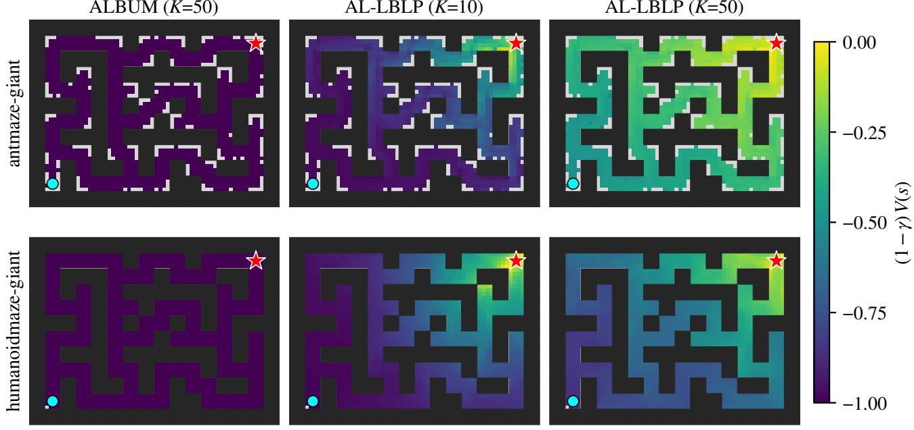  
goal start  
Figure 3. Learned value on task 1 of antmaze-giant (top) and humanoidmaze-giant (bottom), batch 256: $( 1 - \gamma ) V ( s )$ averaged over the dataset states in each $1 \times 1$ bin (a maze cell is $4 \times 4 ;$ grey: fewer than 10 states), on a common scale where −1 is the floor $\bar { - } 1 / ( 1 - \gamma )$ ALBUM and AL-LBLP (K = 50): $\gamma = 0 . 9 9 9 ;$ AL-LBLP $( K = 1 0 ) \colon \gamma = 0 . 9 9 5$ . Only the upright states are used.

## D. Per-task results

Table 12 lists the five tasks of every environment behind the environment means of Table 1.

Table 12. Per-task success rate (%), mean ± std over 8 seeds (FAC, DROL: mean only); columns and evaluation rules as in Table 1. (default): the task used for selection. Bold: within 95% of the row best.
<table><tr><td rowspan="2">Task</td><td colspan="4">Gaussian policy</td><td colspan="4">Flow policy</td><td colspan="2">Best-of-N</td></tr><tr><td>IQL</td><td>ReBRAC</td><td>ALBUM</td><td>AL-LBLP</td><td>FQL</td><td>DROL</td><td>FAC</td><td>AL-LBLP</td><td>IFQL</td><td>AL-LBLP</td></tr><tr><td>antmaze-large task1 (default)</td><td>48 ±9</td><td>91 ±10</td><td>92.5 ±3.1</td><td>92.5 ±4.9</td><td>80 ±8</td><td>98</td><td>94.0</td><td>89.8 ±5.3</td><td>24 ±17</td><td>76.0 ±15.6</td></tr><tr><td>antmaze-large task2</td><td>42 ±6</td><td>88 ±4</td><td>80.2 ±6.0</td><td>85.8 ±3.8</td><td>57 ±10</td><td>84</td><td>86.0</td><td>79.0 ±9.0</td><td>8 ±3</td><td>72.2 ±6.5</td></tr><tr><td>antmaze-large task3</td><td>72 ±7</td><td>51 ±18</td><td>91.8 ±2.7</td><td>95.8 ±2.7</td><td>93 ±3</td><td>90</td><td>97.5</td><td>90.2 ±7.1</td><td>52 ±17</td><td>76.8 ±6.9</td></tr><tr><td>antmaze-large task4</td><td>51 ±9</td><td>84 ±7</td><td>92.5 ±4.0 92.0 ±4.7</td><td>93.2 ±4.8</td><td>80 ±4</td><td>79</td><td>89.5</td><td>92.0 ±4.3</td><td>18 ±8</td><td>77.2 ±8.6</td></tr><tr><td>antmaze-large task5</td><td>54 ±22</td><td>90 ±2</td><td></td><td>93.8 ±2.7</td><td>83 ±4</td><td>93</td><td>96.0</td><td>93.8 ±4.3</td><td>38 ±18</td><td>81.8 ±3.6</td></tr><tr><td>antmaze-giant task1 (default)</td><td>0 ±0</td><td>27 ±22</td><td>3.5 ±3.6</td><td>29.0 ±19.3</td><td>4±5</td><td>28</td><td>6.5</td><td>8.0 ±5.3</td><td>0 ±0</td><td>2.2 ±3.5</td></tr><tr><td>antmaze-giant task2</td><td>1 ±1</td><td>16 ±17</td><td>76.2 ±7.2</td><td>62.5 ±10.6</td><td>9 ±7</td><td>54</td><td>37.5</td><td>46.5 ±8.9</td><td>0 ±0</td><td>64.0 ±7.8</td></tr><tr><td>antmaze-giant task3</td><td>0 ±0</td><td>34 ±22</td><td>0.0 ±0.0</td><td>8.0 ±7.2</td><td>0 ±1</td><td>77</td><td>0.5</td><td>1.5 ±1.4</td><td>0 ±0</td><td>17.8 ±9.8</td></tr><tr><td>antmaze-giant task4</td><td>0 ±0</td><td>5±12</td><td>41.2 ±21.2</td><td>64.2 ±9.2</td><td>14 ±23</td><td>8</td><td>20.0</td><td>38.0 ±8.1</td><td>0 ±0</td><td>41.5 ±14.5</td></tr><tr><td>antmaze-giant task5</td><td>19 ±7</td><td>49 ±22</td><td>19.5 ±25.6</td><td>74.0 ±18.3</td><td>16 ±28</td><td>58</td><td>50.5</td><td>53.0 ±12.2</td><td>13 ±9</td><td>49.2 ±8.9</td></tr><tr><td>humanoidmaze-medium task1 (default)</td><td>32 ±7</td><td>16 ±9</td><td>2.0 ±2.8</td><td>90.0 ±5.5</td><td>19 ±12</td><td>55</td><td>71.5</td><td>84.0 ±9.4</td><td>69 ±19</td><td>95.0 ±3.4</td></tr><tr><td>humanoidmaze-medium task2</td><td>41 ±9</td><td>18 ±16</td><td>79.0 ±6.9</td><td>84.8 ±5.5</td><td>94 ±3</td><td>95</td><td>88.0</td><td>78.8 ±13.1</td><td>85 ±11</td><td>95.8 ±3.5</td></tr><tr><td>humanoidmaze-medium task3</td><td>25 ±5</td><td>36 ±13</td><td>4.8 ±3.7</td><td>95.8 ±2.9</td><td>74 ±18</td><td>79</td><td>95.5</td><td>97.8 ±1.7</td><td>49 ±49</td><td>96.2 ±4.2</td></tr><tr><td>humanoidmaze-medium task4</td><td>0 ±1</td><td>15 ±16</td><td>2.2 ±2.5</td><td>72.5 ±4.6</td><td>3 ±4</td><td>17</td><td>25.0</td><td>58.0 ±8.8</td><td>1 ±1</td><td>94.5 ±1.8</td></tr><tr><td>humanoidmaze-medium task5</td><td>66 ±4</td><td>24 ±20</td><td>89.5 ±3.1</td><td>85.0 ±7.9</td><td>97 ±2</td><td>96</td><td>98.0</td><td>74.2 ±14.0</td><td>98 ±2</td><td>99.0 ±1.1</td></tr><tr><td>humanoidmaze-large task1 (default) humanoidmaze-large task2</td><td>3 ±1</td><td>2 ±1</td><td>0.0 ±0.0</td><td>37.0 ±8.5</td><td>7 ±6</td><td>20</td><td>15.0</td><td>15.2 ±4.8</td><td>6 ±2</td><td>50.0 ±10.6</td></tr><tr><td>humanoidmaze-large task3</td><td>0 ±0</td><td>0 ±0</td><td>0.0 ±0.0</td><td>1.5 ±2.1</td><td>0 ±0</td><td>0</td><td>0.0</td><td>0.0 ±0.0</td><td>0 ±0</td><td>3.0 ±4.1</td></tr><tr><td>humanoidmaze-large task4</td><td>7 ±3</td><td>8 ±4</td><td>6.2 ±4.8</td><td>18.8 ±5.2</td><td>11 ±7</td><td>34</td><td>20.5</td><td>21.8 ±3.3</td><td>48 ±10</td><td>79.0 ±4.8</td></tr><tr><td>humanoidmaze-large task5</td><td>1 ±0</td><td>1 ±1</td><td>0.5 ±1.3</td><td>4.8 ±3.0</td><td>2±3</td><td>1</td><td>4.5</td><td>4.8 ±4.5</td><td>1 ±1</td><td>55.0 ±8.2</td></tr><tr><td></td><td>1 ±1</td><td>2 ±2</td><td>1.0 ±1.0</td><td>25.0 ±6.4</td><td>1 ±3</td><td>0</td><td>1.5</td><td>20.5 ±10.8</td><td>0 ±0</td><td>51.5 ±3.5</td></tr><tr><td>antsoccer-arena task1 antsoccer-arena task2</td><td>14 ±5</td><td>0 ±0</td><td>66.0 ±7.0</td><td>64.2 ±11.4</td><td>77 ±4</td><td>76</td><td>82.0</td><td>83.2 ±6.8</td><td>61 ±25</td><td>85.8 ±4.7</td></tr><tr><td>antsoccer-arena task3</td><td>17 ±7</td><td>0 ±1 0 ±0</td><td>58.0 ±7.8 4.8 ±6.9</td><td>57.5 ±5.6</td><td>88 ±3</td><td>87</td><td>93.5</td><td>71.5 ±7.5</td><td>75 ±3</td><td>75.2 ±9.4</td></tr><tr><td>antsoccer-arena task4 (default)</td><td>6 ±4</td><td></td><td>30.2 ±9.1</td><td>50.8 ±12.1</td><td>61 ±6</td><td>60</td><td>62.5</td><td>49.5 ±13.3</td><td>14 ±22</td><td>48.8 ±7.7</td></tr><tr><td>antsoccer-arena task5</td><td>3 ±2</td><td>0 ±0</td><td>21.5 ±5.6</td><td>28.0 ±5.8</td><td>39 ±6</td><td>41</td><td>53.0</td><td>45.2 ±10.0</td><td>16 ±9</td><td>43.5 ±10.1</td></tr><tr><td></td><td>2 ±2</td><td>0 ±0</td><td></td><td>41.8 ±10.9</td><td>36 ±9</td><td>60</td><td>47.5</td><td>32.8 ±12.3</td><td>0 ±1</td><td>27.2 ±7.4</td></tr><tr><td>cube-single task1</td><td>88 ±3</td><td>89 ±5</td><td>84.5 ±10.6</td><td>88.2 ±5.1</td><td>97 ±2</td><td>98</td><td>99.0</td><td>94.2 ±3.6</td><td>79 ±4</td><td>92.0 ±2.1</td></tr><tr><td>cube-single task2 (default)</td><td>85 ±8</td><td>92 ±4</td><td>89.8 ±6.1</td><td>93.2 ±4.1</td><td>97 ±2</td><td>99</td><td>100.0</td><td>95.2 ±3.5</td><td>73 ±3</td><td>94.0 ±3.9</td></tr><tr><td>cube-single task3</td><td>91 ±5</td><td>93 ±3</td><td>90.8 ±4.1</td><td>94.0 ±3.9</td><td>98 ±2</td><td>100</td><td>100.0</td><td>94.2 ±3.5</td><td>88 ±4</td><td>95.8 ±2.7</td></tr><tr><td>cube-single task4</td><td>73 ±6</td><td>92 ±3</td><td>84.2 ±6.5</td><td>90.2 ±4.3</td><td>94 ±3</td><td>96</td><td>98.5</td><td>86.5 ±3.3</td><td>79 ±6</td><td>87.5 ±5.4</td></tr><tr><td>cube-single task5</td><td>78 ±9</td><td>87 ±8</td><td>67.0 ±6.0</td><td>80.0 ±10.0</td><td>93 ±3</td><td>96</td><td>96.5</td><td>86.5 ±5.5</td><td>77 ±7</td><td></td></tr><tr><td></td><td></td><td></td><td>47.2 ±8.8</td><td></td><td></td><td></td><td></td><td></td><td></td><td>78.2 ±8.1</td></tr><tr><td>cube-double task1</td><td>27 ±5</td><td>45 ±6</td><td>5.2 ±4.7</td><td>38.2 ±5.9</td><td>61 ±9</td><td>65</td><td>60.0</td><td>40.0 ±12.6</td><td>35 ±9</td><td>46.0 ±12.2</td></tr><tr><td>cube-double task2 (default)</td><td>1 ±1</td><td>7±3</td><td></td><td>16.8 ±8.9</td><td>36 ±6</td><td>28</td><td>37.5</td><td>19.0 ±5.5</td><td>9 ±5</td><td>18.5 ±8.3</td></tr><tr><td>cube-double task3</td><td>0 ±0</td><td>4±1</td><td>4.5 ±3.1</td><td>12.2 ±5.3</td><td>22 ±5</td><td>22</td><td>31.5</td><td>11.0 ±4.7</td><td>8 ±5</td><td>14.8 ±9.4</td></tr><tr><td>cube-double task4</td><td>0 ±0</td><td>1±1</td><td>2.0 ±1.4</td><td>1.5 ±1.4</td><td>5 ±2</td><td>9</td><td>4.0</td><td>1.5 ±1.4</td><td>1 ±1</td><td>3.0 ±2.8</td></tr><tr><td>cube-double task5</td><td>4 ±3</td><td>4 ±2</td><td>7.8 ±7.0 91.8 ±4.9</td><td>13.0 ±6.3 96.5 ±3.7</td><td>19 ±10</td><td>8</td><td>32.5</td><td>16.0 ±6.1</td><td>17 ±6</td><td>19.0 ±8.8</td></tr><tr><td>scene task1</td><td>94 ±3 95 ±2</td></table>

## E. Offline-to-online fine-tuning

Table 13 lists the ten default tasks for the three AL-LBLP policies of Figure 1(a); the online settings are in Section B.

Table 13. Offline-to-online per environment (default task): success (%) at the offline 1M checkpoint → after 1M online steps (final evaluation), mean ± std over 3 seeds. Bold: the best online value.
<table><tr><td>Environment</td><td>Gaussian policy</td><td>Flow policy</td><td>Best-of-N</td></tr><tr><td>antmaze-large</td><td> $9 4 . 7 \pm 1 . 2  9 8 . 7 \pm 2 . 3$ </td><td> $8 5 . 3 \pm 3 . 1  9 6 . 0 \pm 2 . 0$ </td><td> $7 8 . 0 \pm 1 5 . 6  9 7 . 3 \pm 3 . 1$ </td></tr><tr><td>antmaze-giant</td><td> $3 4 . 7 \pm 1 1 . 4  9 4 . 7 \pm 1 . 2$ </td><td> $1 0 . 0 \pm 0 . 0  6 3 . 3 \pm 5 4 . 9$ </td><td> $0 . 0 \pm 0 . 0  9 3 . 3 \pm 2 . 3$ </td></tr><tr><td>humanoidmaze-medium</td><td> $8 4 . 7 \pm 7 . 0  9 9 . 3 \pm 1 . 2$ </td><td> $9 0 . 0 \pm 6 . 0  1 0 0 . 0 \pm 0 . 0$ </td><td> $9 6 . 7 \pm 1 . 2  9 8 . 0 \pm 2 . 0$ </td></tr><tr><td>humanoidmaze-large</td><td> $4 7 . 3 \pm 2 . 3  3 8 . 0 \pm 1 1 . 1$ </td><td> $1 4 . 7 \pm 8 . 1  2 3 . 3 \pm 9 . 5$ </td><td> $5 9 . 3 \pm 7 . 0  8 6 . 7 \pm 4 . 6$ </td></tr><tr><td>antsoccer-arena</td><td> $2 6 . 7 \pm 8 . 1  5 7 . 3 \pm 4 . 2$ </td><td> $4 4 . 0 \pm 3 . 5  5 4 . 0 \pm 1 3 . 1$ </td><td> $4 5 . 3 \pm 1 2 . 1  3 8 . 7 \pm 6 . 1$ </td></tr><tr><td>cube-single</td><td> $9 4 . 7 \pm 4 . 2  9 0 . 7 \pm 6 . 1$ </td><td> $9 4 . 0 \pm 6 . 0  9 4 . 0 \pm 8 . 7$ </td><td> $9 8 . 0 \pm 0 . 0  9 7 . 3 \pm 2 . 3$ </td></tr><tr><td>cube-double</td><td> $1 9 . 3 \pm 1 7 . 9  2 9 . 3 \pm 5 . 0$ </td><td> $1 5 . 3 \pm 4 . 2  1 1 . 3 \pm 6 . 4$ </td><td> $2 6 . 7 \pm 9 . 2  4 2 . 7 \pm 2 7 . 2$ </td></tr><tr><td>scene</td><td> $9 6 . 0 \pm 3 . 5  7 4 . 7 \pm 1 7 . 9$ </td><td> $9 7 . 3 \pm 2 . 3  9 3 . 3 \pm 2 . 3$ </td><td> $9 8 . 7 \pm 1 . 2  7 4 . 0 \pm 2 1 . 6$ </td></tr><tr><td> $\mathrm { p u z z l e } { - 3 \mathrm { x } 3 }$ </td><td> $9 7 . 3 \pm 3 . 1  3 3 . 3 \pm 5 7 . 7$ </td><td> $9 6 . 0 \pm 2 . 0  9 8 . 7 \pm 2 . 3$ </td><td> $9 7 . 3 \pm 2 . 3  9 8 . 0 \pm 3 . 5$ </td></tr><tr><td>puzzle-4x4</td><td> $2 0 . 0 \pm 9 . 2  1 2 . 7 \pm 1 0 . 1$ </td><td> $2 4 . 0 \pm 7 . 2  9 7 . 3 \pm 2 . 3$ </td><td> $1 8 . 7 \pm 8 . 3  3 7 . 3 \pm 3 7 . 0$ </td></tr><tr><td>Average</td><td> $6 1 . 5  6 2 . 9$ </td><td> $5 7 . 1  7 3 . 1 $ </td><td> $6 1 . 9  7 6 . 3$ </td></tr></table>

## F. Pixel-based tasks

Table 14. Pixel-based tasks (visual-, task 1): success (%) at 500k steps, 4 seeds. AL-LBLP (Gaussian policy): final evaluation, mean ± std, $( \rho , \alpha )$ from $\{ 0 . 5 , 1 , 2 \} \times \{ 1 0 , 3 0 , 1 0 0 \}$ selected on the reported seeds; baselines: reported mean. Bold: within 95% of the row best.
<table><tr><td colspan="4">Environment IQL ReBRAC FQL FAC AL-LBLP</td></tr><tr><td>cube-single</td><td>70</td><td>83 81</td><td>82.0  $\mathbf { 7 9 . 5 \pm 8 . 2 }$ </td></tr><tr><td>cube-double</td><td>34</td><td>4 21</td><td>48.0  ${ \pm 2 . 5 \pm 4 . 1 }$ </td></tr><tr><td>scene</td><td>97</td><td>98 98</td><td>99.0  ${ \bf 9 5 . 0 \pm } 2 . 6 $ </td></tr><tr><td>puzzle-3x3</td><td>7</td><td>88 94</td><td>95.0  ${ \bf 9 3 . 0 \pm 6 . 2 }$ </td></tr><tr><td>puzzle-4x4</td><td>0</td><td>26 33</td><td>56.0  $3 . 5 \pm 4 . 7$ </td></tr><tr><td>Average</td><td>41.6</td><td>59.8 65.4</td><td>76.0  $6 4 . 7 \pm 2 . 6$ </td></tr></table>

Table 14 compares AL-LBLP with the Gaussian policy on task 1 of the five pixel-based environments against the values reported for IQL, ReBRAC, FQL, and FAC (settings in Section B). AL-LBLP is within 5% of the best reported value on visual-scene (95.0 against 99.0 for FAC), visual-puzzle-3x3 (93.0 against 95.0 for FAC), and visual-cube-single (79.5 against 83 for ReBRAC), is ahead on visual-cube-double (52.5 against 48.0 for FAC), and trails on visual-puzzle-4x4 (3.5 against 56.0 for FAC). Its average, 64.7, is above those of IQL (41.6) and ReBRAC (59.8) and below those of FQL (65.4) and FAC (76.0). Because $( \rho , \alpha )$ is selected on the same four seeds that are reported, the AL-LBLP column is an optimistic estimate. Figure 4 shows the five-environment mean as a function of $\rho$ and of α.

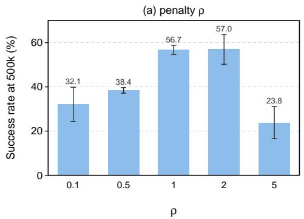

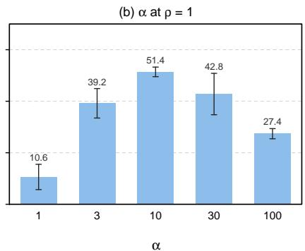  
Figure 4. Sensitivity on the five pixel-based manipulation tasks (task 1): five-environment mean success (%) of the final evaluation at 500k steps, mean ± std over 4 seeds. (a) Penalty $\rho , \alpha \in \{ 1 0 , 3 0 , 1 0 0 \}$ selected per environment. (b) α at $\rho = 1 ,$ , the same for every environment.

## G. The penalty parameter $\rho$ per environment

Table 15 lists the environments behind Figure 1(b).

Table 15. Effect of $\dot { } \rho$ per environment (Figure 1(b)): success (%) on the default task at 1M, 2M, and 3M steps, mean over 3 seeds. Bold: the best average.
<table><tr><td rowspan="2">Task</td><td colspan="3"> $\rho = 0 . 1$ </td><td colspan="3"> $\rho = 0 . 5$ </td><td colspan="3"> $\rho = 1$ </td></tr><tr><td>1M</td><td>2M</td><td>3M</td><td>1M</td><td>2M</td><td>3M</td><td>1M</td><td>2M</td><td>3M</td></tr><tr><td>antmaze-large (default)</td><td>95.3</td><td>92.7</td><td>91.3</td><td>95.3</td><td>95.3</td><td>97.3</td><td>87.3</td><td>92.7</td><td>94.7</td></tr><tr><td>antmaze-giant (default)</td><td>31.3</td><td>35.3</td><td>29.3</td><td>0.0</td><td>38.7</td><td>54.7</td><td>0.0</td><td>0.0</td><td>32.0</td></tr><tr><td>humanoidmaze-med. (default)</td><td>91.3</td><td>90.7</td><td>90.0</td><td>82.0</td><td>92.0</td><td>97.3</td><td>48.7</td><td>76.7</td><td>94.0</td></tr><tr><td>humanoidmaze-large (default)</td><td>34.7</td><td>21.3</td><td>24.7</td><td>40.0</td><td>52.0</td><td>54.0</td><td>16.7</td><td>39.3</td><td>57.3</td></tr><tr><td>antsoccer (default)</td><td>24.0</td><td>17.3</td><td>7.3</td><td>27.3</td><td>24.0</td><td>28.0</td><td>27.3</td><td>38.0</td><td>22.0</td></tr><tr><td>cube-single (default)</td><td>93.3</td><td>88.7</td><td>90.0</td><td>94.7</td><td>92.7</td><td>92.0</td><td>93.3</td><td>96.7</td><td>94.7</td></tr><tr><td>cube-double (default)</td><td>4.7</td><td>2.0</td><td>2.0</td><td>17.3</td><td>5.3</td><td>8.0</td><td>14.0</td><td>17.3</td><td>8.7</td></tr><tr><td>scene (default)</td><td>91.3</td><td>38.7</td><td>8.7</td><td>96.0</td><td>92.7</td><td>74.7</td><td>94.7</td><td>97.3</td><td>90.7</td></tr><tr><td>puzzle-3x3 (default)</td><td>94.0</td><td>82.7</td><td>92.0</td><td>72.7</td><td>75.3</td><td>80.0</td><td>80.0</td><td>86.7</td><td>77.3</td></tr><tr><td>puzzle-4x4 (default)</td><td>14.7</td><td>4.7</td><td>3.3</td><td>18.0</td><td>6.7</td><td>6.0</td><td>14.0</td><td>8.7</td><td>8.7</td></tr><tr><td>Average</td><td>57.5</td><td>47.4</td><td>43.9</td><td>54.3</td><td>57.5</td><td>59.2</td><td>47.6</td><td>55.3</td><td>58.0</td></tr></table>

## H. Mass identity at 1M steps

Table 16 evaluates Equation (7) at 1M steps on the ρ = 0.5 runs (5 tasks × 8 seeds; the critic does not depend on α), per environment. Its columns are the left-hand side with the effective multipliers $\mu ^ { \mathrm { e f f } }$ (the identity of Theorem A.4 as stated), the scalar form $\mu _ { \mathrm { { B } } } \mathbb { E } _ { i } [ 1 - \gamma m _ { i } ] + 2 \mu _ { \mathrm { { K } } }$ (the identity with $\mu$ in place of $\mu ^ { \mathrm { e f f } }$ , as in Theorem A.2), the gap $J _ { \mathrm { K } }$ between the two (evaluated over the training split at the 1M checkpoints of the default task, 3 seeds), and the three scalar multipliers at 1M. The target is $\omega _ { Q } + \omega _ { V } = 0 . 1 5 .$ On antmaze-large, humanoidmaze-large, and puzzle-4x4, tasks 4 and 5 have the same goal, so their critics are identical and the 40 runs of these environments contain 8 identical pairs. Both residuals are logged on the training batch every 10k steps. The batch value of the left-hand side has a sampling standard deviation of 0.023 to 0.043 at 256 windows, so single-batch readings are averaged over the last ten logged steps.

Table 16. Mass identity (7) at 1M steps (target ωQ $+ \omega _ { V } = 0 . 1 5 )$ , mean ± std over the 40 runs per environment $( J _ { \mathrm { K } } \colon 3$ seeds); columns defined in Section H.
<table><tr><td>Environment</td><td>LHS  $( \mu ^ { \mathrm { { e f f } } } )$ </td><td>LHS (µ)</td><td> $J _ { \mathrm { K } }$ </td><td>µB</td><td>µK</td><td>µE</td></tr><tr><td>antmaze-large</td><td> $0 . 1 5 0 \pm 0 . 0 1 0$ </td><td> $0 . 1 4 5 \pm 0 . 0 0 1$ </td><td>0.004 ±0.001</td><td>0.222 ±0.007</td><td> $0 . 0 7 2 \pm 0 . 0 0 1$ </td><td>0.198 ±0.007</td></tr><tr><td>antmaze-giant</td><td> $0 . 1 5 0 \pm 0 . 0 0 9$ </td><td> $0 . 1 4 4 \pm 0 . 0 0 1$ </td><td> $0 . 0 1 0 { \scriptstyle \pm 0 . 0 0 6 }$ </td><td>0.252 ±0.016</td><td> $0 . 0 7 1 \pm 0 . 0 0 1$ </td><td>0.229 ±0.016</td></tr><tr><td>humanoidmaze-medium</td><td> $0 . 1 5 0 \pm 0 . 0 0 9$ </td><td> $0 . 1 4 4 \pm 0 . 0 0 1$ </td><td> $0 . 0 0 5 \pm 0 . 0 0 1$ </td><td>0.238 ±0.006</td><td>0.071 ±0.000</td><td>0.214 ±0.007</td></tr><tr><td>humanoidmaze-large</td><td>0.148 ±0.008</td><td>0.145 ±0.001</td><td>0.004 ±0.000</td><td>0.232 ±0.015</td><td>0.072 ±0.001</td><td>0.208 ±0.015</td></tr><tr><td>antsoccer-arena</td><td>0.151 ±0.011</td><td> $0 . 1 3 9 \pm 0 . 0 0 1$ </td><td>0.009 ±0.000</td><td>0.350 ±0.036</td><td>0.068 ±0.001</td><td>0.328 ±0.037</td></tr><tr><td>cube-single</td><td>0.154 ±0.011</td><td>0.143 ±0.002</td><td>0.012 ±0.001</td><td>0.336 ±0.019</td><td>0.067 ±0.001</td><td>0.312 ±0.020</td></tr><tr><td>cube-double</td><td>0.150 ±0.012</td><td>0.124 ±0.003</td><td>0.025 ±0.002</td><td>0.656 ±0.044</td><td>0.060 ±0.001</td><td>0.646 ±0.045</td></tr><tr><td>scene</td><td>0.148 ±0.013</td><td>0.132 ±0.002</td><td>0.020 ±0.001</td><td>0.499 ±0.039</td><td>0.064 ±0.001</td><td>0.479 ±0.040</td></tr><tr><td>puzzle-3x3</td><td> $0 . 1 4 9 \pm 0 . 0 1 7$ </td><td> $0 . 1 3 2 \pm 0 . 0 0 1$ </td><td>0.020 ±0.003</td><td>0.430 ±0.012</td><td>0.065 ±0.001</td><td>0.406 ±0.012</td></tr><tr><td>puzzle-4x4</td><td> $0 . 1 4 9 \pm 0 . 0 1 4$ </td><td> $0 . 1 1 5 \pm 0 . 0 0 5$ </td><td> $0 . 0 3 7 \pm 0 . 0 0 4$ </td><td> $0 . 7 2 1 \pm 0 . 0 5 8$ </td><td> $0 . 0 5 6 \pm 0 . 0 0 3$ </td><td>0.708 ±0.060</td></tr></table>

The identity holds with $\mu ^ { \mathrm { { e f f } } }$ . At 1M the left-hand side with $\mu ^ { \mathrm { e f f } }$ is between 0.148 and 0.154 on every environment, a relative residual between −1.6% and +2.5% with a seed spread of 5 to 11 points, that is, zero within batch noise. Evaluated on every window of the training split at the 1M checkpoints (3 seeds, default task), it is between 0.133 and 0.158 on every environment; one run (antmaze-giant, seed 0) is at 0.083 with large dual pulls, that is, not yet settled. The identity is reached early. At 10k steps the scalar form is still between 0.002 and 0.063, by 100k it is between 0.139 and 0.146 on every environment, and the $\mu ^ { \mathrm { e f f } }$ form stays between 0.133 and 0.163 at every logged checkpoint from 100k on.

The scalar form falls short by $J _ { \mathrm { K } } .$ The scalar form is below the target on every environment, 0.115 to 0.145 (−3% to −23%), most on cube-double (−17%) and puzzle-4x4 (−23%). On the checkpoints the difference between the two forms is accounted for mainly by J : on puzzle-4x4 the difference is 0.041 and $J _ { \mathrm { K } }$ is 0.037. The covariance term between m and $\boldsymbol { \mu } _ { i } ^ { \mathrm { B , e f f } }$ is at most 0.004 in magnitude, and the remaining dual-pull terms are zero within their seed spread. On the manipulation environments the scalar form drifts down between 100k and 1M (cube-double 0.141 to 0.124, puzzle-4x4 0.142 to 0.115) while the $\mu ^ { \mathrm { e f f } }$ form stays at the target. This indicates that $J _ { \mathrm { K } }$ grows during training there: in more windows only one of the KQ and KV rows is penalized. We have not examined why.

Where the multipliers settle. $\mathbb { E } _ { i } [ 1 - \gamma m _ { i } ]$ is between 0.005 and 0.027, because the success mask is rarely set at a window start, so the one-step row contributes at most 0.006 to the mass at 1M. Equation $( 7 )$ therefore in effect pins the rollout multiplier: $2 \mu _ { \mathrm { K } }$ ≈ $\omega _ { Q } + \omega _ { V } - J _ { \mathrm { K } }$ up to that contribution. Accordingly $\mu \kappa$ is between 0.056 and 0.072 on every environment, lowest where $J _ { \mathrm { K } }$ is largest (puzzle-4x4 0.056, cube-double 0.060). The epigraph multiplier cancels in Equation (7). The $b _ { Q }$ equation alone, $\mathbb { E } _ { i } [ \mu _ { i } ^ { \mathrm { B , e f f } } ] + \mathbb { E } _ { i } [ \mu _ { i } ^ { \mathrm { K Q , e f f } } ] - \mathbb { E } _ { i } [ \mu _ { i } ^ { \mathrm { E , e f f } } ] = \omega _ { Q }$ (proof of Theorem $\mathrm { A . 4 } ) .$ , fixes the difference $\mu _ { \mathrm { B } } - \mu _ { \mathrm { E } } \approx \omega _ { Q } - \mathbb { E } _ { i } \dot { [ \mu _ { i } ^ { \mathrm { K } \bar { \mathrm { Q } } , \mathrm { e f f } } ] }$ at the dual fixed point. At 1M the two sides agree to within 0.007 on every environment (for instance 0.025 and 0.025 on antmaze-large, 0.010 and 0.007 on cube-double), and both bias gradients are zero within batch noise (their means are at most 0.044 in magnitude against $\omega _ { Q } = 0 . 1 )$ . The common level of $\mu _ { \mathrm { B } }$ and $\mu _ { \mathrm { E } }$ is not determined by the two bias equations. It ranges from 0.22 on antmaze-large to 0.72 on $p u z z l e { - } 4 x 4 ,$ is roughly flat after 100k on the four maze environments, and keeps growing through 1M on antsoccer-arena and the manipulation environments (cube-double 0.31 at 100k to 0.66 at 1M, puzzle-4x4 0.35 to 0.72). We read it as the weight the one-step row needs to hold $Q$ against the epigraph row on each dataset, but we have not tested this reading (Figure 5).

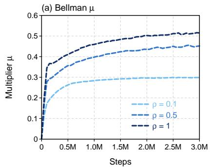

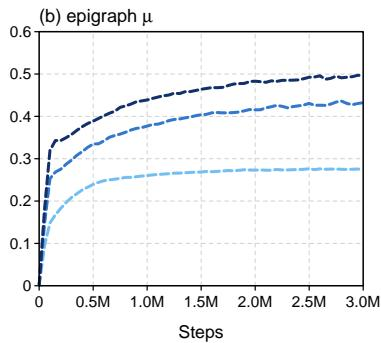

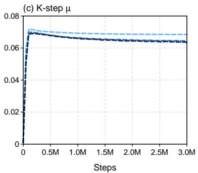  
Figure 5. Scalar multipliers $\mu _ { \mathrm { B } } , \mu _ { \mathrm { E } } , \mu _ { \mathrm { K } }$ over training for $\rho \in \{ 0 . 1 , 0 . 5 , 1 \}$ (runs of Figure 1(b)): mean over the 10 default tasks and 3 seeds of the logged value averaged over each 50k steps, starting from the initial value 0.001.