# An Energy-Based Perspective on Machine Learning

Bo Dai Georgia Institute of Technology bodai@cc.gatech.edu

Yilun Du Harvard University ydu@seas.harvard.edu

November 11, 2026

## Abstract

Energy-based models (EBMs) define a distribution through a scalar energy, $p _ { \theta } ( { \pmb x } ) \propto \exp \left( - E _ { \theta } ( { \pmb x } ) \right)$ and are usually presented as one model family among many. This tutorial has a broader goal: beyond introducing EBMs, it uses them as a single lens that connects the diferent aspects of machine learning. Any EBM is specified by three choices, the energy, which determines what the model represents; the inference procedure, which samples from or optimizes the energy; and the learning method, which fits the energy to data. We first develop these components, including sampling, variational inference, and learning by maximum likelihood, noise contrastive estimation, pseudolikelihood, score matching, and adversarial training, and show that the learning methods share one contrastive structure. We then show that discriminative models, generative models such as GANs, normalizing flows, difusion and autoregressive models, representation learning methods such as contrastive learning, word2vec, BERT, denoising auto-encoders, and difusion representations, reinforcement learning with EBM policies and world models, inverse reinforcement learning, and planning, as well as inference-time computation with verifiers, are all EBMs that difer in these three choices, mostly in how they handle the partition function and sampling. This view explains existing methods, organizes them into a common framework, and suggests new algorithms by replacing one component while keeping the others, with composition of energies as a principled way to combine learned models at inference time.

## Contents

1 Introduction 3   
2 A Brief Introduction to Energy-Based Models 4   
2.1 Energy-Based Models 4   
2.2 Beyond EBMs: Generalized Maximum Entropy 6   
2.3 Adaptability and Composability of EBMs 7   
2.4 Inference with EBMs . 11   
2.5 Learning for EBMs . 13   
2.6 Unified View through Contrastive Learning 18   
3 Discriminative Models 20   
3.1 Logistic Regression and CRFs . 21   
3.2 Structured Prediction Energy Networks 22   
4 Generative Models 23   
4.1 Generative Adversarial Nets 24   
4.2 Normalizing Flows . 25   
4.3 Difusion and Flow Models 26   
4.4 Energy-Inspired Models 29   
4.5 Deep Equilibrium Models 30   
4.6 Autoregressive Models as Approximate Ancestral Samplers 31   
5 Representation Learning 34   
5.1 Contrastive Representation Learning 34   
5.2 Word2vec 36   
5.3 BERT 37   
5.4 Difusion Representations 38   
5.5 Representation-Induced Decisive Models 40   
6 Reinforcement Learning and Planning through EBMs 42   
6.1 Naturally Induced EBM Policies 42   
6.2 RL for EBM Policies . 43   
6.3 Inverse RL with EBMs . 45   
6.4 RL with EBM World Models 47   
6.5 Planning with Trajectory EBMs 49   
7 Inference-Time Computation 53   
7.1 Verifiers Define the Target . 53   
7.2 Samplers for the Target 54   
7.3 Compositional Reasoning 57   
7.4 Amortizing Inference-Time Computation 58   
7.5 Best-of-N Sampling-Aware Fine-Tuning 60   
8 Discussion 61   
A Overview of Methods 77

## 1 Introduction

Machine learning is often divided into supervised learning, generative modeling, representation learning, and decision making, each with its own models and training objectives. However, these areas share a common problem: learning relationships among variables and using those relationships to infer unknown quantities. Energy-based models (EBMs) provide a unified perspective on this problem by representing the compatibility of a configuration through a scalar energy function. Low-energy configurations correspond to plausible observations, compatible representations, or desirable outcomes. Learning shapes this energy landscape, while inference uses it to produce predictions, samples, or actions.

This perspective connects three ideas: representation, inference, and composition. An energy function represents knowledge through relationships and constraints among variables. Inference uses this knowledge by searching for compatible configurations, either through optimization or sampling. Composition combines energy functions to express requirements that must be considered together. Separating these roles allows learned knowledge to be reused in diferent computations and combined with new information at inference time. For example, a joint energy over observations and latent variables can support both generating observations from a latent description and inferring a description from an observation. An energy over trajectories can be combined with a new goal to formulate a planning problem.

In this tutorial, which grew from the course CSE 6243 taught by Bo Dai at Georgia Tech, we develop this perspective across diferent generative models, representation learning methods, and planning and reinforcement learning methods. We primarily consider the probabilistic formulation, in which an energy defines an unnormalized distribution through $p _ { \theta } ( { \pmb x } ) \propto \exp ( - E _ { \theta } ( { \pmb x } ) )$ ). For generative modeling, this provides a common language for comparing models that parameterize densities, learn scores, or construct sampling procedures. Autoregressive models specify conditional factors whose negative logarithms sum to an energy, while invertible normalizing flows specify densities through a change of variables. Difusion models learn gradients of log densities at diferent noise levels. These connections clarify both the relationships among generative models and the diferent assumptions they make about representation and inference. They also provide a unified way to develop new generative models.

For representation learning, energies express compatibility between observations and latent descriptions, or between diferent views of the same data. Contrastive methods learn features through scores for matched and mismatched observations, while reconstruction and denoising objectives train representations to support prediction of missing or corrupted information. Viewing these objectives through their associated energies connects representation learning to conditional prediction and generative modeling. It also suggests how learned generative models can provide objectives for inferring representations of new observations.

For planning and decision-making, energies score candidate actions or trajectories according to their predicted consequences. Costs and constraints contribute energy terms, while rewards enter with the opposite sign. Planning searches for configurations that satisfy these requirements, and entropy-regularized formulations connect this search to probabilistic inference. Learned dynamics, behavior models, and task objectives can therefore contribute diferent components of a common inference problem.

For inference-time computation, energies score diferent possible solutions for a question. Diferent methods of inference-time computation such as selecting among sampled responses, searching for partial solutions, or iteratively refining a candidate, correspond to diferent procedures to minimize this energy. Fine-tuning corresponds to directly fitting this combined energy, paying the cost of inference during training rather than for every input.

Composition enables us to use these connections to solve new tasks. Energy functions over compatible variables can be added to combine their requirements, corresponding to a product of their unnormalized densities when the resulting distribution is normalizable. For example, an energy describing plausible robot trajectories can be combined with energies expressing a destination and obstacle constraints. The resulting inference problem uses learned knowledge together with task-specific information, without requiring a separate predictor to be trained for each combination. This ability to represent reusable components and reason with their combinations motivates the energy-based perspective. Its practical success depends on the accuracy and relative scales of the components, as well as the ability to optimize or sample from the composed landscape.

We begin with the formulation of EBMs and methods for inference and learning (Section 2). We then examine discriminative models (Section 3), generative models (Section 4), representation learning (Section 5), reinforcement learning and planning (Section 6), and inference-time compute (Section 7) through this common framework, and close with a discussion (Section 8). Throughout, we ask what each method represents, how inference uses that representation, and how its components can be combined or adapted to new tasks. Our aim is to explain connections among existing methods and show how those connections can guide the design of models that learn reusable knowledge and reason with it at inference time.

## 2 A Brief Introduction to Energy-Based Models

## 2.1 Energy-Based Models

We start with energy-based models of a single variable, which are also known as Gibbs distributions [75]. Formally, the EBM defines the density as

$$
p _ { \theta } ( { \pmb x } ) = \frac { \exp \left( - E _ { \theta } ( { \pmb x } ) \right) } { Z _ { \theta } } , \quad \mathrm { w i t h } \quad Z _ { \theta } = \int \exp \left( - E _ { \theta } ( { \pmb x } ) \right) d { \pmb x } ,\tag{1}
$$

where $E _ { \theta } ( { \pmb x } )$ , known as the energy function, is some function parametrized with θ, and $Z _ { \theta }$ is known as the partition function, which is often unknown and intractable to compute. The EBM Equation 1 defines a valid distribution, satisfying the positivity $p _ { \theta } \left( \pmb { x } \right) \geqslant 0$ and normalization $\begin{array} { r } { \int p _ { \theta } \left( \pmb { x } \right) d \pmb { x } = 1 } \end{array}$ . The value of the density $p _ { \theta } ( { \pmb x } )$ in Equation 1 up to a multiplicative constant is fully determined by the energy function $E _ { \theta } ( { \pmb x } )$ enabling us to sample from the density even without knowledge of the normalization constants.

EBMs can be easily generalized to joint or conditional models with multiple variables, respectively, i.e.,

$$
p _ { \theta } \left( \pmb { x } , \pmb { y } \right) = \frac { \exp \left( - E _ { \theta } \left( \pmb { x } , \pmb { y } \right) \right) } { Z _ { \theta } } \quad \mathrm { w i t h } \quad Z _ { \theta } = \int \exp \left( - E _ { \theta } ( \pmb { x } , \pmb { y } ) \right) d \pmb { x } d \pmb { y } ,\tag{2}
$$

$$
p _ { \theta } \left( \pmb { y } \mid \pmb { x } \right) = \frac { \exp \left( - E _ { \theta } \left( \pmb { x } , \pmb { y } \right) \right) } { Z _ { \theta } ( \pmb { x } ) } \quad \mathrm { w i t h } \quad Z _ { \theta } ( \pmb { x } ) = \int \exp \left( - E _ { \theta } ( \pmb { x } , \pmb { y } ) \right) d \pmb { y } .\tag{3}
$$

By comparing the joint and conditional EBMs in Equation 2 and Equation 3, we emphasize the importance of partition function, leading to one key property of EBMs: with the same energy function but diferent partition functions, we can represent and sample from the corresponding conditional or joint distributions. Although this property seems trivial, it will play a vital role in enabling compositionality, adaptivity, and improving training data sample complexity.

In comparison to many classes of generative models, EBMs Equation 1 directly model the probability density, without any forms of factorization of the distribution to enable eficient sampling. As a result, for many distributions, it can be simpler to represent the distributions as EBMs than other factorized parameterizations, at the cost of much more expensive inference. Before we dive into the detailed discussion about compositional and adaptive properties of EBMs, we first provide examples of general EBMs. In fact, a variety of classic machine learning models can be represented as special forms of EBMs.

Residual EBM. For any EBM in Equation 1, it can also be equivalently written as

$$
p _ { \theta } ( \pmb { x } ) = p _ { 0 } \left( \pmb { x } \right) \frac { \exp \left( - \tilde { E } _ { \theta } \left( \pmb { x } \right) \right) } { Z _ { \theta } } , \quad \mathrm { w i t h } \quad \tilde { E } _ { \theta } \left( \pmb { x } \right) = E _ { \theta } ( \pmb { x } ) + \log p _ { 0 } \left( \pmb { x } \right) ,\tag{4}
$$

where $p _ { 0 } \left( \pmb { x } \right)$ is some base probability measure. The equivalent model Equation 4 is known as a residual EBM [43, 5]. We emphasize that although the vanilla EBM Equation 1 and residual EBM Equation 4 share the same modeling flexibility, the residual EBM is more convenient when a good base distribution is available, as in the energy-inspired models of Section 4.4 and the KL-regularized policies of Section 6.1.

Exponential Family. The exponential family is one of the most important classes of distributions in statistics and machine learning [185], which possesses a number of useful properties [23] and is a special form of an EBM. A probability distribution belongs to the exponential family if it can be written in the following canonical form:

$$
p _ { \boldsymbol { \theta } } ( \mathbf { x } ) = h ( \mathbf { x } ) \exp \left( { \boldsymbol { \theta } } ^ { \top } \mathbf { T } ( \mathbf { x } ) - A ( \boldsymbol { \theta } ) \right) ,
$$

where θ is the natural parameter, $\mathbf { T } \left( \pmb { x } \right)$ are the suficient statistics, $h \left( \pmb { x } \right)$ denotes some base measure of ${ \mathbf { } } ^ { \mathbf { } } \mathbf { { \mathbf { x } } } ,$ and $\begin{array} { r } { A \left( \theta \right) = \log \int \exp \left( \theta ^ { \top } \mathbf { T } ( \pmb { x } ) \right) } \end{array}$ h (x) dx is the log-partition function. The exponential family includes many commonly used distributions, such as the Gaussian, Poisson and multinomial distributions, to name a few.

Obviously, the exponential family is a special case of EBMs whose energy is linear in $\theta , \ i . e . , E _ { \theta } \left( \pmb { x } \right) =$ $- \theta ^ { \top } \mathbf { T } \left( \pmb { x } \right) - \log h \left( \pmb { x } \right)$

Maximum Entropy Models. The Maximum Entropy Model (MaxEnt) [4, 60] is a statistical modeling technique that selects the probability distribution that has the highest entropy among all distributions that satisfy a set of observed constraints derived from the training data. Formally, MaxEnt is defined as

$$
\operatorname* { m a x } _ { q \in \Delta ( \mathcal { X } ) } H \left( q \right) : = - \int q ( \pmb { x } ) \log q ( \pmb { x } ) d \pmb { x }\tag{5}
$$

$$
\mathrm { s . t . } \ \mathbb { E } _ { q ( \pmb { x } ) } \left[ f _ { i } ( \pmb { x } ) \right] = a _ { i } , \quad \forall i = 1 , \ldots , k ,\tag{6}
$$

which induces the Lagrangian as

$$
L \left( q , \lambda \right) = - H ( q ) - \sum _ { i = 1 } ^ { k } \lambda _ { i } \left( \mathbb { E } _ { q ( \pmb { x } ) } \left[ f _ { i } ( \pmb { x } ) \right] - a _ { i } \right) - \lambda _ { 0 } \left( \int q \left( \pmb { x } \right) d \pmb { x } - 1 \right) .\tag{7}
$$

Taking the partial derivative of $L \left( q , \lambda \right)$ w.r.t. $q \left( { \pmb x } \right)$ and setting it to zero gives

$$
\frac { { \partial { L } \left( { { q , \lambda } } \right) } } { { \partial q \left( x \right) } } =  \log { q ( { \pmb x } ) } + 1 - \sum _ { i = 1 } ^ { k } { { \lambda _ { i } } { f _ { i } } \left( { { \pmb x } } \right) - { \lambda _ { 0 } } } = 0 \Rightarrow { q ^ { * } } \left( { \pmb x } \right) = \frac { { \exp \left( { \sum _ { i = 1 } ^ { k } { { \lambda _ { i } } { f _ { i } } \left( { { \pmb x } } \right) } } \right) } } { { Z } } ,\tag{8}
$$

which obviously is an EBM with energy function $E \left( \pmb { x } \right) = - \pmb { \lambda } ^ { \top } \mathbf { f } \left( \pmb { x } \right)$ with parameters λ and features $\mathbf { f } \left( \pmb { x } \right)$

Markov Random Fields and Conditional Random Fields. Markov random fields (MRFs) are distributions with explicit dependency among variables. Formally, an MRF defines a probability distribution on $\pmb { x } = \{ x _ { 1 } , x _ { 2 } , \dots , x _ { d } \}$ by an undirected graph $G ,$ in which nodes correspond to variables $x _ { i }$ and edges define the dependency between two variables, leading to

$$
p ( \pmb { x } ) = \frac { 1 } { Z } \prod _ { c \in C } \psi _ { c } \left( x _ { c } \right) = \frac { 1 } { Z } \exp \left( \sum _ { c \in C } \log \psi _ { c } \left( x _ { c } \right) \right) ,\tag{9}
$$

with $Z$ as partition function, $C$ denoting the set of cliques of $G ,$ and each factor $\psi _ { c } \left( \cdot \right)$ is a non-negative function over the variables in the corresponding subgraph.

Similarly, conditional random fields (CRFs) generalize MRFs and define the conditional distribution as

$$
p ( { \pmb y } \mid { \pmb x } ) = \frac { 1 } { Z ( { \pmb x } ) } \prod _ { c \in C } \psi _ { c } \left( { \pmb x } , { \pmb y } \right) = \frac { 1 } { Z ( { \pmb x } ) } \exp \left( \sum _ { c \in C } \log \psi _ { c } \left( { \pmb x } , { \pmb y } \right) \right)\tag{10}
$$

Clearly, both MRF Equation 9 and CRF Equation 10 can be reduced to corresponding EBMs equivalently with explicit dependency structure captured by the energy function $\begin{array} { r } { E \left( \pmb { x } \right) = - \sum _ { c \in C } \log \psi _ { c } \left( x _ { c } \right) } \end{array}$ and $\begin{array} { r } { E \left( \pmb { x } , \pmb { y } \right) = - \sum _ { c \in C } \log \psi _ { c } \left( \pmb { x } , \pmb { y } \right) } \end{array}$

Hopfield Network and (Restricted) Boltzmann Machine. Hopfield Network was proposed as binary threshold units with recurrent connections between them. It has been revealed that if the connections are symmetric, there is a corresponding global energy function for binary ${ \bf \delta } _ { { \bf { x } } } .$

$$
E \left( { \pmb x } \right) = - \frac { 1 } { 2 } { \pmb x } ^ { \top } W { \pmb x } - { \pmb x } ^ { \top } b , \quad \mathrm { w i t h } \quad { \pmb x } \in \{ - 1 , + 1 \} ^ { d } ,
$$

which induces a distribution $p ( { \pmb x } ) \propto \exp \left( - E \left( { \pmb x } \right) \right)$ ) that aligns with the stationary distribution of the stochastic Hopfield network updates, $\begin{array} { r } { i . e . , p ( x _ { i } = 1 \mid \pmb { x } _ { - i } ) = \frac { 1 } { 1 + \exp \left( - 2 \left( \sum _ { i \neq i } w _ { i j } x _ { j } + b _ { i } \right) \right) } } \end{array}$ . The induced stochastic rule and stationary distribution are also known as Boltzmann machine and Boltzmann distribution, respectively.

Furthermore, if we split the variables as two disjoint groups $\{ x , y \}$ and construct bipartite connection, we obtain the energy function,

$$
E \left( \pmb { x } , \pmb { y } \right) = - \pmb { x } ^ { \top } b - \pmb { y } ^ { \top } a - \pmb { x } ^ { \top } A \pmb { y } ,\tag{11}
$$

where x and $\textbf {  { y } }$ can be binary, categorical, or Gaussian. Since the structure of the energy function is restricted such that there is no intra-layer connections in x or $^ { \mathbf { \psi } } { \mathbf { \psi } } _ { \mathbf { { y } } } ,$ the model is named as restricted Boltzmann machine. Meanwhile, due to such special structure, the components of y are conditionally independent given x, and vice versa.

Although EBMs define flexible distributions, it is notorious that the partition function in Equation 2 and Equation 3 is intractable, therefore, both sampling from EBMs and calculating the probability are not straightforward. Consequently, learning with EBMs is complicated. We discuss sampling in Section 2.4 and learning in Section 2.5.

## 2.2 Beyond EBMs: Generalized Maximum Entropy

The maximum entropy model Equation 5 of Section 2 makes two choices: it maximizes the Shannon entropy, and it imposes the moment constraints exactly; its solution Equation 8 is then an EBM in the exponential family. EBMs extend beyond both choices. Maximizing the Shannon entropy is equivalent to minimizing the KL divergence from a uniform base measure, which can be replaced by other divergences, and the exact constraints can be relaxed to approximate ones; diferent choices induce diferent model families [79, 4, 60, 67]. Consider the generalized problem

$$
\operatorname* { m i n } _ { \boldsymbol { q } \in \Delta \left( \mathcal { X } \right) } D \left( \boldsymbol { q } \parallel p _ { 0 } \right) \mathrm { s . t . } \left\| \mathbb { E } _ { \boldsymbol { q } ( \boldsymbol { x } ) } \left[ \mathbf { f } \left( \boldsymbol { x } \right) \right] - \boldsymbol { a } \right\| _ { \mathcal { B } } \leqslant \epsilon ,\tag{12}
$$

where $D$ is a convex divergence from a base measure $p _ { 0 } , \ \| \cdot \| _ { B }$ is a norm, and $\epsilon \geqslant 0$ allows approximate moment matching. The maximum entropy model Equation 5 is the case of the KL divergence, a uniform $p _ { 0 }$ and $\epsilon = 0$ . The two choices in Equation 12 change the model in diferent ways.

• The divergence determines the model family. For an f-divergence with convex generator $\varphi _ { i }$ , the optimum is

$$
D _ { \varphi } \left( q \parallel p _ { 0 } \right) = \int p _ { 0 } ( { \pmb x } ) \varphi \left( { \frac { q ( { \pmb x } ) } { p _ { 0 } ( { \pmb x } ) } } \right) d { \pmb x } \quad \Longrightarrow \quad q ^ { * } ( { \pmb x } ) = p _ { 0 } ( { \pmb x } ) ( \varphi ^ { \prime } ) ^ { - 1 } \left( \lambda ^ { \top } { \bf f } ( { \pmb x } ) - \lambda _ { 0 } \right) ,\tag{13}
$$

with $\lambda _ { 0 }$ chosen for normalization, which is an exponential family only for $\varphi ( u ) = u \log u$ . More generally, regular exponential families are in one-to-one correspondence with regular Bregman divergences [13], and other divergences and generalized entropies induce generalized, or deformed, exponential families [79, 129, 67]. For the α-divergence, $\varphi _ { \alpha } ( u ) = \left( u ^ { \alpha } - \alpha u + \alpha - 1 \right) / \left( \alpha ( \alpha - 1 ) \right)$ ), it is the power-law family

$$
q ^ { * } ( { \pmb x } ) = p _ { 0 } ( { \pmb x } ) \left[ 1 + ( \alpha - 1 ) \left( { \pmb \lambda } ^ { \top } { \bf f } ( { \pmb x } ) - \lambda _ { 0 } \right) \right] _ { + } ^ { 1 / ( \alpha - 1 ) } ,\tag{14}
$$

which recovers the exponential family as $\alpha  1$ , and otherwise has heavier tails or bounded support. It corresponds to the q-exponential family of Tsallis statistics [129]. Replacing the exponential family by such a heavy-tailed family changes the behavior of the learned model, $e . g .$ , t-logistic regression [46] replaces the softmax of logistic regression by a t-exponential family, which makes the classifier robust to label noise.

• The norm determines the regularization and the feature space. With $\epsilon > 0 ,$ , the dual of Equation 12 becomes maximum likelihood regularized by the dual norm [4], e.g., with an $\ell _ { 1 }$ penalty that yields sparse models [60]. Taking $\mathbf { f } ( { \pmb x } ) = k ( { \pmb x } , \cdot )$ as the feature map of a reproducing kernel Hilbert space (RKHS) H and B as its norm gives the infinite-dimensional kernel exponential family $p ( { \pmb x } ) \propto p _ { 0 } ( { \pmb x } ) \exp \left( \langle \lambda , k ( { \pmb x } , \cdot ) \rangle _ { \mathcal { H } } \right)$ with an RKHS-norm penalty [4, 25, 164, 35], an EBM whose energy is a nonparametric function in H.

## 2.3 Adaptability and Composability of EBMs

A major benefit of learning EBMs is their flexibility in representing diferent probability distributions using the same energy function. As noted after Equation 3, a joint energy also defines the conditional distribution obtained by fixing any subset of its variables, and only the partition function changes. Energies can further be added, subtracted, and combined, which forms new distributions from learned ones without retraining [49, 50]. Below, we describe these operations on sets and on distributions, discuss when a composition is correct and how it difers from a product of experts, and show how the same operations adapt a pretrained model and how composed energies are sampled.

Composing EBM Set Functions. We first illustrate how composition over energy functions can be used to implement logical set operations [53]. Consider sets A and B and learned energy functions $E _ { A } ( { \pmb x } )$ and $E _ { B } ( { \pmb x } )$ for these sets, for instance

$$
E _ { A } ( { \pmb x } ) = \left\{ \begin{array} { l l } { 0 , } & { \mathrm { f o r } ~ { \pmb x } \in A } \\ { C , } & { \mathrm { f o r } ~ { \pmb x } \notin A , } \end{array} \right.\tag{15}
$$

where C is a large numerical value. Sampling under these learned energy functions $E _ { A } ( { \pmb x } )$ or $E _ { B } ( { \pmb x } )$ would correspond to drawing samples from either set A or B. Logical operations on the sets then become arithmetic on the energies, as illustrated in Figure 1(a).

1. Logical AND. The intersection A ∩ B is represented by the sum of the energies,

$$
E _ { A \wedge B } ( \pmb { x } ) = E _ { A } ( \pmb { x } ) + E _ { B } ( \pmb { x } ) ,\tag{16}
$$

which is 0 on $A \cap B$ and at least C elsewhere, so that low-energy samples satisfy both requirements.

2. Logical OR. The union A ∪ B is represented by the soft minimum of the energies,

$$
E _ { A \vee B } ( \pmb { x } ) = - \log \left( \exp \left( - E _ { A } ( \pmb { x } ) \right) + \exp \left( - E _ { B } ( \pmb { x } ) \right) \right) ,\tag{17}
$$

which is at most 0 on A ∪ B and equals C − log 2 elsewhere. It difers from min $\{ E _ { A } ( { \pmb x } ) , E _ { B } ( { \pmb x } ) \}$ by at most log 2, so low-energy samples satisfy either requirement.

3. Logical NOT. Negation subtracts an energy. The complement of a bounded set is unbounded, so negation is applied relative to another set: B without A is represented by

$$
E _ { B \wedge \neg A } ( \pmb { x } ) = E _ { B } ( \pmb { x } ) - E _ { A } ( \pmb { x } ) + C ,\tag{18}
$$

which is 0 on $B \setminus A$ and at least C elsewhere. The subtracted energy acts as a negation operation: it raises the energy wherever A holds and leaves it unchanged elsewhere.

Each operation returns an energy, so the operations can be nested, and they apply to learned energies as well as to the idealized ones of Equation 15. Figure 1(b) shows faces sampled from nested compositions of conditional energies that were trained independently, each on a single attribute [53].

(a)  
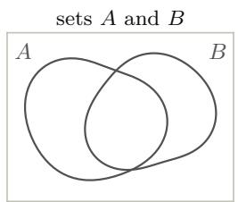

(b)  
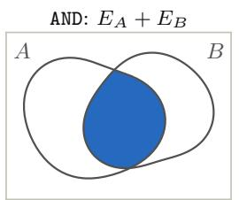

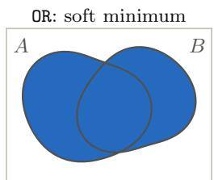

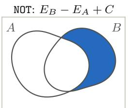

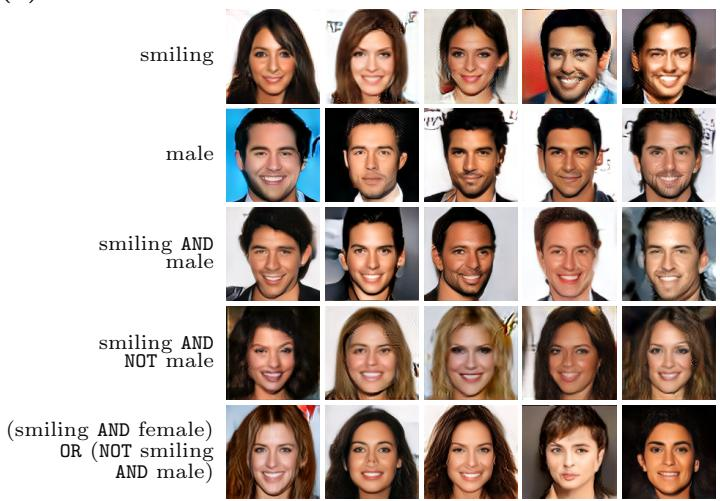  
Figure 1: Logical composition of energy functions. (a) AND, OR, and NOT applied to two sets A and $B ;$ the composed energy is low in the shaded region. (b) Faces sampled from compositions of conditiona energies, each trained independently on one attribute of CelebA. Figures from Du et al. [53].

Composing EBM Probability Distributions. We can likewise combine distributions rather than sets. Product, mixture, and inversion are the distributional counterparts of AND, OR, and NOT, but the energies are now log-densities, so their values, and not only their minimizers, matter, as illustrated in Figure 2. Let $p _ { i } ( { \pmb x } ) = \exp \left( - E _ { i } ( { \pmb x } ) \right) / Z _ { i }$ for $i = 1 , 2$

1. Product of Distributions. The product of the two distributions can be written as

$$
p _ { \mathrm { p r o d u c t } } ( { \pmb x } ) \propto p _ { 1 } ( { \pmb x } ) p _ { 2 } ( { \pmb x } ) \propto e ^ { - ( E _ { 1 } ( { \pmb x } ) + E _ { 2 } ( { \pmb x } ) ) } .\tag{19}
$$

Therefore, we can construct an energy function $E ^ { \prime } ( { \pmb x } )$ which represents the product of the densities using the expression

$$
E ^ { \prime } ( { \pmb x } ) = E _ { 1 } ( { \pmb x } ) + E _ { 2 } ( { \pmb x } ) ,\tag{20}
$$

providing a way to compose energy functions to implement the product of densities. The product of densities allows us to construct a new density that combines the information in both distributions – sampling x which is highly likely under both distributions [50, 197]. The partition functions $Z _ { 1 }$ and $Z _ { 2 }$ play no role, since adding a constant to either energy only changes the normalizer of the product, and the product is normalizable whenever one of the densities is bounded, since then $p _ { 1 } p _ { 2 } \leqslant ( \operatorname* { s u p } _ { \pmb { x } } p _ { 1 } ( \pmb { x } ) )$ p<sub>2</sub>. Weighting the energies, $w _ { 1 } E _ { 1 } + w _ { 2 } E _ { 2 }$ with $w _ { 1 } , w _ { 2 } > 0$ , gives $p _ { 1 } ^ { w _ { 1 } } p _ { 2 } ^ { w _ { 2 } }$ , in which each weight acts as an inverse temperature that sharpens or flattens its component.

2. Mixture of Distributions. We can represent the mixture $p _ { \mathrm { m i x } } ( { \pmb x } ) = w _ { 1 } p _ { 1 } ( { \pmb x } ) + w _ { 2 } p _ { 2 } ( { \pmb x } )$ , with $w _ { 1 } + w _ { 2 } = 1$ , by the energy

$$
E _ { \mathrm { m i x } } ( \pmb { x } ) = - \log \left( w _ { 1 } \frac { \exp \left( - E _ { 1 } ( \pmb { x } ) \right) } { Z _ { 1 } } + w _ { 2 } \frac { \exp \left( - E _ { 2 } ( \pmb { x } ) \right) } { Z _ { 2 } } \right) ,\tag{21}
$$

which is the soft minimum Equation 17 with each energy $E _ { i }$ shifted by log $Z _ { i } - \log { w _ { i } }$ . Unlike the product, the mixture depends on the partition functions. An energy is determined only up to an additive constant, which does not change its own distribution but shifts the weight of its component. For instance, in the energy composition operator in Equation 17. the soft minimum of $E _ { 1 }$ and $E _ { 2 }$ alone is the mixture with weights proportional to $Z _ { 1 }$ and $Z _ { 2 }$ . For general distributions, a mixture with given weights requires log $Z _ { 1 } - \log Z _ { 2 }$ , which can be learned together with the energy, as the constant c of binary NCE Equation 42, or estimated with the variational bound Equation 30. If the mixture is only sampled, the partition functions can be avoided by ancestral sampling: draw i with probability $w _ { i } .$ , then draw $x \sim p _ { i }$ . They are needed once the mixture is composed further, $e . g .$ ., multiplied by a third distribution, since MCMC on the composed energy evaluates $E _ { \mathrm { m i x } }$ itself.

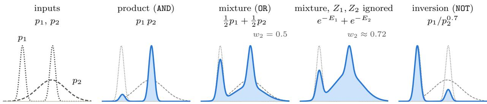  
Figure 2: Composing two one-dimensional densities. Left: $p _ { 1 }$ (dotted) and $p _ { 2 }$ (dashed), repeated in gray in the other panels, where each composition (blue) is scaled to its own maximum. The product keeps the mass on which both agree, and the mixture keeps the mass of both. Adding the unnormalized densities, $e ^ { - E _ { 1 } } + e ^ { - E _ { 2 } }$ , instead weights each component by its partition function Equation 21, so the broad $p _ { 2 }$ gets weight $w _ { 2 } \approx 0 . 7 2$ rather than $\frac { 1 } { 2 }$ (here each $E _ { i }$ has minimum zero). The inversion $p _ { 1 } / p _ { 2 } ^ { 0 . 7 }$ keeps the mass of $p _ { 1 }$ where $p _ { 2 }$ is low.

3. Inversion of Distributions. We can represent a distribution that favors points that are likely under $p _ { 1 }$ but unlikely under $p _ { 2 }$ by raising $p _ { 2 }$ to a negative power,

$$
p _ { \mathrm { i n v } } ( { \pmb x } ) \propto \frac { p _ { 1 } ( { \pmb x } ) } { p _ { 2 } ( { \pmb x } ) ^ { \alpha } } , \qquad E _ { \mathrm { i n v } } ( { \pmb x } ) = E _ { 1 } ( { \pmb x } ) - \alpha E _ { 2 } ( { \pmb x } ) ,\tag{22}
$$

with $\alpha > 0$ , which is the distributional counterpart of Equation 18. Like the product, the inversion does not depend on the partition functions, but may not be normalizable. For Gaussians $p _ { i } = \mathcal { N } \left( 0 , \sigma _ { i } ^ { 2 } I \right)$ $p _ { \mathrm { i n v } }$ is normalizable only if $\alpha \sigma _ { 1 } ^ { 2 } < \sigma _ { 2 } ^ { 2 }$ , i.e., the negated expert must be broad relative to the positive one. Classifier-free guidance Equation 88 is an inversion of this kind raised to the power $1 + w$ , since $p _ { t } ( { \pmb x } \mid y ) ^ { 1 + w } / p _ { t } ( { \pmb x } ) ^ { \top } = \big ( p _ { t } ( { \pmb x } \mid y ) / p _ { t } ( { \pmb x } ) ^ { \alpha } \big ) ^ { 1 + w }$ with $\alpha = w / ( 1 + w ) < 1$ , and its negated distribution is the unconditional model.

When Is a Composition Correct? We can understand what a product does through Bayes’ rule. Let $c _ { 1 } , \ldots , c _ { n }$ be conditions on x, such as attributes of an image or requirements on a trajectory, and suppose we have an unconditional EBM $p ( { \pmb x } ) \propto \exp \left( - E ( { \pmb x } ) \right)$ and a conditional EBM $p ( \pmb { x } \mid c _ { i } ) \propto \exp \left( - E ( \pmb { x } \mid c _ { i } ) \right)$ for each condition alone. If the conditions are conditionally independent given x, then

$$
\begin{array} { l } { { \displaystyle p ( { \pmb x } \mid c _ { 1 } , \ldots , c _ { n } ) \propto p ( { \pmb x } ) \prod _ { i = 1 } ^ { n } p ( c _ { i } \mid { \pmb x } ) \propto p ( { \pmb x } ) \prod _ { i = 1 } ^ { n } \frac { p ( { \pmb x } \mid c _ { i } ) } { p ( { \pmb x } ) } } , } \\ { { \displaystyle E ( { \pmb x } \mid c _ { 1 } , \ldots , c _ { n } ) = E ( { \pmb x } ) + \sum _ { i = 1 } ^ { n } \left( E ( { \pmb x } \mid c _ { i } ) - E ( { \pmb x } ) \right) , } } \end{array}\tag{23}
$$

up to constants that do not depend on x [117]. Each diference $E ( { \boldsymbol { \mathbf { x } } } \mid c _ { i } ) - E ( { \boldsymbol { \mathbf { x } } } ) { \mathrm { ~ e q u a l s ~ } } - \log p ( c _ { i } \mid { \boldsymbol { \mathbf { x } } } )$ up to a constant, $i . e . ,$ , it is the energy of an implicit classifier, so the conjunction adds one classifier energy per condition to a single prior, which is counted once rather than n times. Weighting the diferences gives the guided distributions of Section 4.3, with $n = 1$ for classifier-free guidance, and adding the diference for $c _ { 1 }$ while subtracting the one for $c _ { 2 }$ gives the negation $p ( \pmb { x } ) p ( c _ { 1 } \mid \pmb { x } ) / p ( c _ { 2 } \mid \pmb { x } )$ , an inversion Equation 22 whose negated expert is the implicit classifier of $c _ { 2 }$ . The derivation makes two requirements explicit. First, the conditions must be conditionally independent given x, which holds, for example, when each condition is a function of x. Second, each $p ( \pmb { x } \mid c _ { i } )$ must be accurate where the composition places its mass, a region that may contain few training examples for any single condition. The first is a modeling assumption, and the second determines how far a composition generalizes beyond its training data.

What Does Composition Do? Composition reuses learned components in new combinations. Each component describes one aspect of the data or the task, such as a concept, a constraint, a dynamics model, or a goal, and may be a separately trained model or a conditional model evaluated under one condition. Components may also be defined over diferent subsets of the variables, in which case the composed energy is an MRF Equation 9 whose factors are learned separately and whose graph is chosen for each task, as when the constraints among objects in a scene are composed into a factor graph over their poses [197]. Since the components are learned separately, training needs to cover each component but not each combination. Suppose x is described by K conditions, each taking one of M values. A single model of $p ( \pmb { x } \mid c _ { 1 } , \ldots , c _ { K } )$ must be trained on enough of the $M ^ { K }$ combinations, whereas the composition Equation 23 only requires the KM conditionals $p ( \pmb { x } \mid c _ { k } )$ , and it generates combinations that never appear together in the training data [53, 117]. The same operations recur throughout this tutorial: guided sampling multiplies a difusion model by a classifier (Section 4.3), planners compose dynamics, goals, and obstacles (Section 6.5), and reasoning composes the energies of individual constraints into larger problems (Section 7.3). The product Equation 20 has the form of a product of experts [87], which uses it to model a single distribution with jointly trained experts; composition uses it to combine models trained separately. See Du and Kaelbling [50] for a broader discussion.

Adaptation. The same operations adapt a pretrained model to new data or requirements without retraining it. Conditioning is the simplest case: by Equation 2 and Equation 3, clamping any subset of the variables of a joint energy, such as the visible pixels of an image or the start and goal of a trajectory, turns the same energy into a conditional model, and MCMC never needs the new partition function. A residual energy adapts a model to new data: by Equation 4, $p ( { \pmb x } ) \propto p _ { 0 } ( { \pmb x } ) \exp \left( - \tilde { E } _ { \theta } ( { \pmb x } ) \right)$ keeps a pretrained $p _ { 0 }$ fixed and learns only $\tilde { E } _ { \theta }$ , which can be small when the new distribution is close to the old one. This is the structure of the KL-regularized fine-tuning of language models in Section 6.1, where $\tilde { E } = - r / \lambda$ , and of the probabilistic adaptation of video models, in which a large pretrained text-to-video model, used only through its score and without fine-tuning, is composed as a product with a small model trained on domain-specific videos [194]. Finally, a new requirement is a new energy term: the planning problems of Section 6.5 adapt a model of trajectories to a goal and constraints by adding their energies

Sampling from Compositions. A composed energy is sampled or minimized with the methods of Section 2.4, which need the composed energy or its gradient but not the partition function. Three practical issues remain. First, reading a sum of energies as a product of distributions requires each energy to be a log-density up to a constant. Energies trained by regression (Section 2.5) or with a margin (Section 3) are not maximum likelihood fits, and for them the sum is better read as an objective, as in the set operations above: its minimizers satisfy all requirements when the requirements are compatible, and prediction by energy minimization Equation 35 applies directly. Second, separately trained energies have no common scale, so the weights in $\sum _ { i } w _ { i } E _ { i }$ act as inverse temperatures that must be chosen at inference time. Third, the modes of a product lie where all components agree, which can be a small region far from the modes of each component, so the composed landscape is harder to sample than its parts. Annealing through smoothed energies helps, and difusion models provide such a sequence for each component; however, adding their scores at a noise level does not give the score of the smoothed product, so Langevin or MCMC corrections on the summed energies are needed to sample the composition correctly (Section 4.3) [55].

## 2.4 Inference with EBMs

In this section, we first introduce the approximate algorithms for calculating the corresponding probability distributions induced by EBMs, which can be largely categorized in two classes: Metropolis–Hastings algorithm via generating samples and variational inference via distribution approximation. Then, we introduce prediction by optimization, which returns a single output rather than samples. We mainly discuss the inference methods for unconditional EBMs Equation 2, however, the algorithms can be easily generalized for conditional EBMs Equation 3.

Metropolis-Hastings Sampling. Since $Z _ { \theta }$ is intractable, we cannot sample from or calculate the probability of $p _ { \theta } ( { \pmb x } ) \propto \exp \left( - E _ { \theta } ( { \pmb x } ) \right)$ directly. Markov chain Monte Carlo (MCMC) instead constructs a Markov chain whose stationary distribution is $p _ { \theta }$ , and treats the states of the chain after a burn-in period as approximate samples. The Metropolis-Hastings (MH) algorithm [125, 85] is the general recipe: given the current state ${ \mathbf { } } ^ { \mathbf { } } \mathbf { { \mathbf { x } } } ,$ it draws a candidate $\pmb { x } ^ { \prime } \sim q ( \pmb { x } ^ { \prime } \mid \pmb { x } )$ from a proposal distribution and accepts it with probability

$$
\alpha \left( \pmb { x } , \pmb { x } ^ { \prime } \right) = \operatorname* { m i n } \left\{ 1 , \frac { \exp \left( - E _ { \theta } ( \pmb { x } ^ { \prime } ) \right) q ( \pmb { x } \mid \pmb { x } ^ { \prime } ) } { \exp \left( - E _ { \theta } ( \pmb { x } ) \right) q ( \pmb { x } ^ { \prime } \mid \pmb { x } ) } \right\} ,\tag{24}
$$

otherwise staying at x. The partition function cancels in the ratio, so only energy diferences $E _ { \theta } ( { \pmb x } ^ { \prime } ) - E _ { \theta } ( { \pmb x } )$ are required, and the acceptance step guarantees detailed balance with respect to $p _ { \theta }$ for any valid proposal. Diferent MH samplers difer only in the choice of $q ,$ which determines how the energy function is used.

The Gibbs sampler [72] updates one variable (or block of variables) at a time, using the full conditional $p _ { \theta } ( x _ { i } \mid \pmb { x } _ { - i } )$ as the proposal. With this choice of $q ,$ the acceptance probability in Equation 24 is always one, which means the candidate is always accepted. The conditionals only involve the energy terms that contain $x _ { i }$ , which makes Gibbs sampling natural for MRFs and Boltzmann machines. Particularly, in RBMs, the conditional independence of y given x and vice versa allows each layer to be sampled in one block.

For continuous x and diferentiable energies, the gradient $\nabla _ { \pmb { x } } E _ { \theta } ( \pmb { x } )$ provides a much better proposal than random perturbations. Langevin dynamics follows the gradient with injected noise,

$$
\pmb { x } ^ { ( t + 1 ) } = \pmb { x } ^ { ( t ) } - \eta \nabla _ { \pmb { x } } E _ { \theta } \left( \pmb { x } ^ { ( t ) } \right) + \sqrt { 2 \eta } \pmb { \xi } ^ { ( t ) } , \quad \pmb { \xi } ^ { ( t ) } \sim \mathcal { N } \left( 0 , I \right) ,\tag{25}
$$

which converges to $p _ { \theta }$ as $\eta  0$ . With a finite step size, the update is biased; using Equation 25 as the proposal of an MH step removes the bias, yielding the Metropolis-adjusted Langevin algorithm $\left( \mathrm { M A L A } \right) \left[ 1 4 7 \right]$ In practice, many EBM learning methods run the unadjusted version for a fixed number of steps.

Langevin dynamics moves by a small random step at each iteration, so it explores the space slowly, like a random walk. Hamiltonian Monte Carlo (HMC) [59, 131] avoids this by borrowing the dynamics of a physical particle. It introduces an auxiliary momentum $\pmb { v } \in \mathring { \mathbb { R } ^ { d } }$ and defines the Hamiltonian

$$
H ( \pmb { x } , \pmb { v } ) = E _ { \theta } ( \pmb { x } ) + \frac { 1 } { 2 } \| \pmb { v } \| _ { 2 } ^ { 2 } ,\tag{26}
$$

$i . e . , \mathrm { ~ a ~ }$ potential energy $E _ { \theta } ( { \pmb x } )$ plus a kinetic energy. The joint distribution $p ( \pmb { x } , \pmb { v } ) \propto \mathrm { e x p } \left( - H ( \pmb { x } , \pmb { v } ) \right) =$ $p _ { \theta } ( { \pmb x } ) \mathcal { N } \left( { \pmb v } ; 0 , I \right)$ has p as its marginal on x, so it sufices to sample from the joint and discard v. Each HMC iteration first resamples the momentum $\pmb { v } \sim \mathcal { N } ( 0 , I )$ , and then moves $( { \pmb x } , { \pmb v } )$ along Hamilton’s equations,

$$
\frac { d \pmb { x } } { d t } = \pmb { v } , \qquad \frac { d \pmb { v } } { d t } = - \nabla _ { \pmb { x } } E _ { \theta } ( \pmb { x } ) .\tag{27}
$$

The particle speeds up when rolling down the energy landscape and slows down when climbing, while the total energy H stays constant. Hence it can travel far from its starting point to a state of similar probability. Since Equation $2 7$ cannot be solved exactly, it is simulated for L steps of the leapfrog integrator with step size ϵ,

$$
v  v - \frac { \epsilon } { 2 } \nabla _ { x } E _ { \theta } ( x ) , \qquad x  x + \epsilon v , \qquad v  v - \frac { \epsilon } { 2 } \nabla _ { x } E _ { \theta } ( x ) .\tag{28}
$$

The leapfrog integrator is reversible and preserves volume, so the end point $( { \boldsymbol { x } } ^ { \prime } , { \boldsymbol { v } } ^ { \prime } )$ can be used as an MH proposal with a simple acceptance probability min {1, exp $( H ( { \pmb x } , { \pmb v } ) - H ( { \pmb x } ^ { \prime } , { \pmb v } ^ { \prime } ) ) \}$ , which corrects the discretization error. Because the leapfrog integrator nearly conserves $H$ , this probability stays close to one even for distant proposals. HMC thus trades more gradient evaluations per sample $( L$ per iteration) for much less correlated samples. Its performance depends on ϵ and $L \colon$ a large ϵ lowers the acceptance rate, while a poorly chosen L wastes computation or makes the trajectory turn back on itself. The No-U-Turn sampler [91] balances this trade-of by setting L adaptively. With a single leapfrog step $( L = 1 )$ , HMC reduces to MALA with step size $\eta = \epsilon ^ { 2 } / 2$

The exact samplers above, general MH, Gibbs sampling, MALA, and HMC, are all special cases of the MH algorithm; unadjusted Langevin dynamics is not, and does not sample exactly from $p _ { \theta }$ at a finite step size. These samplers place diferent requirements on the energy function: general MH and Gibbs sampling only need to evaluate energies (or conditionals), and therefore apply to discrete and structured spaces, whereas Langevin dynamics and HMC need the gradient $\nabla _ { x } E _ { \theta }$ , and therefore require continuous inputs and diferentiable energies.

Amortized Sampling via Variational Inference. MCMC samplers pay their cost for every sample: each new sample requires running a chain for many steps, and consecutive samples are correlated. Variational inference takes a diferent route: it fits a tractable distribution $q _ { \phi } ( { \pmb x } )$ to approximate EBM $p _ { \theta } .$ , so that afterwards drawing a sample costs only one pass through $q _ { \phi } ;$ the cost of inference is thus amortized over all samples. The standard objective is minimizing the reverse Kullback-Leibler divergence,

$$
\operatorname* { m i n } _ { \boldsymbol { q } _ { \phi } } \mathrm { ~ K L } \left( \boldsymbol { q } _ { \phi } | | \boldsymbol { p } _ { \theta } \right) = \mathbb { E } _ { \boldsymbol { x } \sim \boldsymbol { q } _ { \phi } } \left[ E _ { \theta } ( \boldsymbol { x } ) \right] - H \left( \boldsymbol { q } _ { \phi } \right) + \log Z _ { \theta } ,\tag{29}
$$

where $H \left( q _ { \phi } \right) = - \mathbb { E } _ { q _ { \phi } } \left[ \log q _ { \phi } ( \pmb { x } ) \right]$ is the entropy of $q _ { \phi }$ . Since log $Z _ { \theta }$ does not depend on $\phi ,$ we can fit $q _ { \phi }$ by minimizing $\mathbb { E } _ { q _ { \phi } } \left[ E _ { \theta } ( \pmb { x } ) \right] - H \left( q _ { \phi } \right)$ , which never evaluates the intractable partition function. The first term pulls the samples toward low-energy regions, and the entropy term keeps them spread out instead of collapsing onto a single minimum. Because the KL divergence is non-negative, Equation 29 also yields the variational lower bound

$$
\log Z _ { \theta } \geqslant \mathbb { E } _ { \pmb { x } \sim \ b { q } _ { \phi } } \left[ - E _ { \theta } ( \pmb { x } ) \right] + H \left( q _ { \phi } \right) ,\tag{30}
$$

which is tight if and only if $q _ { \phi } = p _ { \theta }$ . Therefore, the same optimization provides both a sampler and an estimate of the log-partition function, which can also be used for learning EBMs.

The only remaining part is that the parametrization choice of $q _ { \phi }$ needs to make both sampling and the entropy tractable. The classical choice for MRFs is the mean-field approximation $\begin{array} { r } { q _ { \phi } ( \pmb { x } ) = \prod _ { i } q _ { \phi _ { i } } ( x _ { i } ) } \end{array}$ , which ignores the dependencies among variables [185]. Modern choices are neural samplers: normalizing flows [146] and autoregressive models give exact log densities, and hence exact entropies, variational auto-encoders [103] give a lower bound on the log density, and implicit generators ${ \pmb x } = g _ { \phi } ( { \pmb z } )$ with $z \sim \mathcal { N } ( 0 , I )$ are more flexible but require estimating the entropy [101, 35, 36].

To optimize the variational objective Equation 29, we can exploit the stochastic gradient descent method, which requires estimating the gradient w.r.t. $\phi .$ The dificulty is that $\phi$ appears in the distribution the expectation is taken over. There are two standard estimators. For continuous x and an implicit or reparameterizable $q _ { \phi } , i . e . , { \pmb x } = g _ { \phi } ( { \pmb z } )$ with $z \sim \mathcal { N } ( 0 , I )$ , the reparameterization trick [103] moves $\phi$ inside the expectation,

$$
\nabla _ { \phi } \mathbb { E } _ { z } \left[ E _ { \theta } \left( g _ { \phi } ( z ) \right) \right] = \mathbb { E } _ { z } \left[ \left( \frac { \partial g _ { \phi } ( z ) } { \partial \phi } \right) ^ { \top } \nabla _ { x } E _ { \theta } \left( g _ { \phi } ( z ) \right) \right] ,\tag{31}
$$

which again uses $\nabla _ { \boldsymbol { x } } E _ { \theta }$ . For discrete ${ \mathbf { } } ^ { \mathbf { } } \mathbf { { \mathbf { x } } } ,$ or whenever $\nabla _ { x } E _ { \theta }$ is unavailable, we use the REINFORCE, or score-function, estimator [190]. It relies on the identity $\nabla _ { \phi } q _ { \phi } ( { \pmb x } ) = q _ { \phi } ( { \pmb x } ) \nabla _ { \phi } \log q _ { \phi } ( { \pmb x } )$ , which gives

$$
\nabla _ { \phi } \mathbb { E } _ { \mathbf { x } \sim q _ { \phi } } \left[ E _ { \theta } ( \boldsymbol { x } ) + \log q _ { \phi } ( \boldsymbol { x } ) \right] = \mathbb { E } _ { \boldsymbol { \alpha } \sim q _ { \phi } } \left[ \left( E _ { \theta } ( \boldsymbol { x } ) + \log q _ { \phi } ( \boldsymbol { x } ) - b \right) \nabla _ { \phi } \log q _ { \phi } ( \boldsymbol { x } ) \right] ,\tag{32}
$$

where the left-hand side is exactly the variational objective, i.e., $\mathbb { E } _ { q _ { \phi } } \left[ E _ { \theta } ( \pmb { x } ) \right] - H \left( q _ { \phi } \right)$ . The derivative of log $q _ { \phi }$ inside the expectation drops out because ${ \mathbb E } _ { q _ { \phi } } \left[ \nabla _ { \phi } \log q _ { \phi } ( { \pmb x } ) \right] = \dot { 0 }$ ; for the same reason, any constant baseline b can be subtracted without introducing bias. REINFORCE only needs to evaluate the energy and the log-density of $q _ { \phi }$ at the samples, so it applies to any x, including discrete and structured outputs. Its price is high variance, as it only uses the value of the energy rather than its gradient. Therefore, in practice, a baseline $b , e . g .$ ., the average of ${ \cal E } _ { \theta } ( { \pmb x } ) + \log q _ { \phi } ( { \pmb x } )$ over the other samples in a batch, or other control variates are necessary to make it work. In short, the two estimators trade generality for variance: the reparameterization estimator Equation 31 uses the gradient of the energy and usually has much lower variance, but requires continuous ${ \mathbf { } } ^ { \mathbf { } } \mathbf { { \mathbf { x } } } ,$ a diferentiable $E _ { \theta }$ , and a reparameterizable $q _ { \phi } ;$ REINFORCE Equation 32 only needs energy values and log $q _ { \phi } .$ , and so applies to discrete or non-diferentiable settings, at the cost of higher variance. When both are applicable, the reparameterization estimator is generally preferred.

Compared with MCMC, variational inference is fast at sampling time but biased: the error is limited by the family of $q _ { \phi }$ , and the reverse KL Equation 29 is mode-seeking, so $q _ { \phi }$ tends to miss some modes of $p _ { \theta } .$ The two can be combined [36]: a learned $q _ { \phi }$ can provide initializations for short MCMC chains, or serve as the proposal in an MH step, whose acceptance probability Equation 24 then corrects the bias of $q _ { \phi }$

Prediction. In addition to drawing samples, we can use an EBM to make a prediction given an input x. For a conditional model

$$
p _ { \theta } ( \pmb { y } \mid \pmb { x } ) = \frac { \exp ( - E _ { \theta } ( \pmb { x } , \pmb { y } ) ) } { Z _ { \theta } ( \pmb { x } ) } ,\tag{33}
$$

a maximum a posteriori (MAP) prediction is

$$
{ \pmb { \hat { y } } } _ { \mathrm { M A P } } \in \arg \operatorname* { m a x } _ { \pmb { y } } p _ { \theta } ( \pmb { y } \mid \pmb { x } ) = \arg \operatorname* { m i n } _ { \pmb { y } } E _ { \theta } ( \pmb { x } , \pmb { y } ) .\tag{34}
$$

The partition function depends on x but not on the candidate output y, so it is not needed to compare predictions. More generally, energy minimization defines a prediction rule even when the energy does not induce a normalizable probability distribution, provided a minimum exists. The probabilistic interpretation additionally requires $0 < Z _ { \theta } ( { \pmb x } ) < \infty$

The computation required to find a prediction depends on the energy and the output space. For a small set of discrete labels, we can evaluate every candidate and select the one with the lowest energy. For continuous outputs and diferentiable energies, we can iteratively update a candidate through gradient descent,

$$
\begin{array} { r } { \pmb { y } ^ { ( t + 1 ) } = \pmb { y } ^ { ( t ) } - \eta _ { t } \nabla _ { \pmb { y } } E _ { \theta } ( \pmb { x } , \pmb { y } ^ { ( t ) } ) , } \end{array}\tag{35}
$$

where $\eta _ { t }$ is a step size. For structured discrete outputs, we instead need to use combinatorial search or another approximate minimization method. Overall, for general nonconvex energies, these minimization procedures may not find a global minimum, making initialization significantly afect the final prediction.

Standard feedforward prediction is a special case in which the minimum is available directly. Consider the quadratic energy

$$
E _ { \theta } ( { \pmb x } , { \pmb y } ) = \frac { 1 } { 2 \sigma ^ { 2 } } \| { \pmb y } - { \pmb f _ { \theta } } ( { \pmb x } ) \| _ { 2 } ^ { 2 } , \qquad { \pmb \sigma } > 0 .\tag{36}
$$

Its unique minimizer is $\hat { \pmb y } = f _ { \boldsymbol \theta } ( \pmb x )$ , which can be computed with one network evaluation. In contrast, a general energy $E _ { \theta } ( \pmb { x } , \pmb { y } )$ does not need to have this quadratic form and can express multiple complex dependencies among output variables.

## 2.5 Learning for EBMs

Learning an EBM means fitting the energy $E _ { \theta }$ so that $p _ { \theta } ( { \pmb x } ) \propto \exp \left( - E _ { \theta } ( { \pmb x } ) \right)$ matches the data distribution. The obstacle is again the partition function: $Z _ { \theta }$ depends on θ, so the likelihood and its gradient cannot be computed directly. Learning methods for EBMs difer mainly in how they avoid or approximate $Z _ { \theta }$ , as we will discuss in the following.

Maximum Likelihood Estimation. Given a dataset ${ \mathcal { D } } = \{ X \}$ , the most direct approach to learning an energy function $E _ { \theta } ( { \pmb x } )$ is through maximum likelihood estimation (MLE). We can directly fit a probability density $p _ { \theta } ( { \pmb x } ) \propto \exp ( - E _ { \theta } ( { \pmb x } ) )$ to maximize the log-likelihood of samples drawn from a dataset D, i.e., minimizing the negative log-likelihood.

The full form of the likelihood of $E _ { \theta } ( { \pmb x } )$ as defined in Equation 1 is $\exp ( - E _ { \boldsymbol { \theta } } ( \pmb { x } ) ) / Z$ , where Z is the partition function. The negative log-likelihood loss objective is given by

$$
\mathcal { L } _ { N L L } ( \mathcal { D } ) = \mathbb { E } _ { \pmb { x } \sim \mathcal { D } } [ - \log ( p _ { \theta } ( \pmb { x } ) ) ] ,\tag{37}
$$

which can be equivalently written as

$$
\mathcal { L } _ { N L L } ( \mathcal { D } ) = \mathbb { E } _ { { \pmb x } \sim \mathcal { D } } [ E _ { \theta } ( { \pmb x } ) ] + \log \left( \int \exp ( - E _ { \theta } ( { \pmb x } ) ) d { \pmb x } \right) .\tag{38}
$$

Taking the gradient of the above objective, we obtain the expression

$$
\nabla _ { \theta } \mathcal { L } _ { N L L } ( \mathcal { D } ) = \mathbb { E } _ { { \boldsymbol { x } } \sim \mathcal { D } } [ \nabla _ { \theta } E _ { \theta } ( { \boldsymbol { x } } ) ] - \frac { \int \exp ( - E _ { \theta } ( { \boldsymbol { x } } ) ) \nabla _ { \theta } E _ { \theta } ( { \boldsymbol { x } } ) d \boldsymbol { x } } { \int \exp ( - E _ { \theta } ( { \boldsymbol { x } } ) ) d \boldsymbol { x } } ,\tag{39}
$$

where we can reduce the right-hand side to the expectation

$$
\nabla _ { \theta } \mathcal { L } _ { N L L } ( \mathcal { D } ) = \mathbb { E } _ { { \pmb { x } } \sim \mathcal { D } } [ \nabla _ { \theta } E _ { \theta } ( { \pmb { x } } ) ] - \mathbb { E } _ { { \pmb { x } } \sim p _ { \theta } ( { \pmb { x } } ) } [ \nabla _ { \theta } E _ { \theta } ( { \pmb { x } } ) ] .\tag{40}
$$

Using the above expression, the gradient of $\mathcal { L } _ { N L L }$ can be computed equivalently from the surrogate loss

$$
\begin{array} { r } { \widetilde { \mathcal { L } } _ { N L L } ( \mathcal { D } ) = \mathbb { E } _ { \pmb { x } \sim \mathcal { D } } [ E _ { \theta } ( \pmb { x } ) ] - \mathbb { E } _ { \pmb { x } \sim \mathtt { s t o p g r a d } ( p _ { \theta } ( \pmb { x } ) ) } [ E _ { \theta } ( \pmb { x } ) ] , } \end{array}\tag{41}
$$

which gives us a simple objective for training $E _ { \theta } ( { \pmb x } )$ through maximum likelihood estimation, where we contrastively decrease the energy of ground truth data samples while increasing the energy of samples drawn from the model distribution $\pmb { x } \sim p _ { \theta } ( \pmb { x } )$ . However, in practice, drawing samples from the distribution $p _ { \theta } ( { \pmb x } )$ can be challenging – several approaches to drawing these samples were discussed in Section 2.4.

Particularly, in the original contrastive divergence, these negative samples are initialized from ground truth data [87], while one can also initialize samples from random noise or an approximate distribution and use Langevin dynamics to draw negative samples to train the EBM [51, 36].

Noise Contrastive Estimation. Maximum likelihood needs samples from the model $p _ { \theta }$ in every gradient step, which is what makes it expensive. Noise contrastive estimation (NCE) [81] avoids this by recasting the learning problem as classification between data and noise, from which the energy function can be recovered. Concretely, by formulating binary classification and multi-class classification problems, we obtain two variants of NCE.

Binary NCE. The original formulation [81] poses a binary classification between data and noise. It treats the log-partition function as an extra scalar parameter c, so that the model’s normalized log-density is

$$
\log p _ { \theta , c } ( { \pmb x } ) = - E _ { \theta } ( { \pmb x } ) - c .\tag{42}
$$

Suppose each data point comes with ν noise samples, so that a sample is a priori ν times more likely to be noise. By Bayes’ rule, the probability that a sample x is data rather than noise is

$$
P ( y = 1 \mid x ) = { \frac { p _ { \theta , c } ( x ) } { p _ { \theta , c } ( x ) + \nu p _ { n } ( x ) } } = \operatorname { s i g m } \left( h _ { \theta , c } ( x ) \right) , \qquad h _ { \theta , c } ( x ) = \underbrace { - E _ { \theta } ( x ) - \log p _ { n } ( x ) } _ { \mathrm { u n o r m a l i z e d ~ l o g \cdot r a t i o ~ t o ~ n o i s e } } + \underbrace { ( - c - \log p ) } _ { \mathrm { b i a s ~ b } } ,\tag{43}
$$

where sigm is the logistic function. The posterior is thus a sigmoid of the model’s log-density ratio to the noise, plus a bias term $b = - c - \log \nu _ { ; }$ , which implies we can recover the EBM parameters from the classifier

$P ( y = 1 \mid x )$ . We obtain the Binary NCE, which fits $( \theta , c )$ by logistic regression, i.e., minimizing the cross-entropy,

$$
\mathcal { L } _ { \mathrm { N C E } } ^ { \mathrm { b i n } } ( \theta , c ) = - \mathbb { E } _ { \mathbf { x } \sim p _ { d } } \left[ \log \mathrm { s i g m } \left( h _ { \theta , c } ( \mathbf { x } ) \right) \right] - \nu \mathbb { E } _ { \mathbf { x } \sim p _ { n } } \left[ \log \left( 1 - \mathrm { s i g m } \left( h _ { \theta , c } ( \mathbf { x } ) \right) \right) \right] ,\tag{44}
$$

with the gradient with respect to $\theta$ as

$$
\nabla _ { \theta } \mathcal { L } _ { \mathrm { N C E } } ^ { \mathrm { b i n } } = \mathbb { E } _ { \boldsymbol { x } \sim p _ { d } } \left[ \left( 1 - \mathrm { s i g m } \left( h _ { \theta , c } ( \boldsymbol { x } ) \right) \right) \nabla _ { \theta } E _ { \theta } ( \boldsymbol { x } ) \right] - \nu \mathbb { E } _ { \boldsymbol { x } \sim p _ { n } } \left[ \mathrm { s i g m } \left( h _ { \theta , c } ( \boldsymbol { x } ) \right) \nabla _ { \theta } E _ { \theta } ( \boldsymbol { x } ) \right] .\tag{45}
$$

We emphasize that the negative samples in Equation 45 now come from $p _ { n }$ instead of $p _ { \theta } .$ , so no MCMC is needed. If the model family contains $p _ { d } .$ the minimizer satisfies $p _ { \theta , c } = p _ { d }$ , so the estimator is consistent [81], and the learned constant recovers the log-partition function, $\begin{array} { r } { c ^ { \star } = \log Z _ { \theta } = \log \int \exp \left( - E _ { \theta } ( \pmb { x } ) \right) } \end{array}$ dx. Binary NCE therefore learns both the energy and its normalizer, which allows the likelihood of new samples to be evaluated afterwards.

Ranking NCE. The second form poses a multi-class problem instead [124]: given one data point $\mathbf { \boldsymbol { x } } _ { 0 } \sim p _ { d }$ hidden among K noise samples $\pmb { x } _ { 1 } , \ldots , \pmb { x } _ { K } \sim p _ { n }$ , the model must identify which of the $K + 1$ samples is the real one. To see what this probability is, let $i \in \{ 0 , \ldots , K \}$ be the unknown position of the data point, with a uniform prior. If the data were drawn from the model $p _ { \theta }$ , the $K + 1$ samples would have joint density $\begin{array} { r } { p _ { \theta } ( \pmb { x } _ { i } ) \prod _ { j \not = i } p _ { n } ( \pmb { x } _ { j } ) } \end{array}$ given i. By Bayes’ rule, the posterior over the position is

$$
P \left( i \mid \alpha _ { 0 : K } \right) = \frac { p _ { \theta } ( x _ { i } ) \prod _ { j \neq i } p _ { n } ( x _ { j } ) } { \sum _ { l = 0 } ^ { K } p _ { \theta } ( x _ { l } ) \prod _ { j \neq l } p _ { n } ( x _ { j } ) } = \frac { p _ { \theta } ( x _ { i } ) / p _ { n } ( x _ { i } ) } { \sum _ { l = 0 } ^ { K } p _ { \theta } ( x _ { l } ) / p _ { n } ( x _ { l } ) } = \frac { \exp \left( - E _ { \theta } ( x _ { i } ) \right) / p _ { n } ( x _ { i } ) } { \sum _ { l = 0 } ^ { K } \exp \left( - E _ { \theta } ( x _ { l } ) \right) / p _ { n } ( x _ { l } ) } ,\tag{46}
$$

where the second equality divides the numerator and the denominator by $\textstyle \prod _ { j = 0 } ^ { K } p _ { n } ( { \pmb x } _ { j } )$ , and the third substitutes $p _ { \theta } ~ = ~ \exp \left( - E _ { \theta } \right) / Z _ { \theta } .$ , so that $Z _ { \theta }$ cancels. This is a softmax over the samples with logits $- E _ { \theta } ( \pmb { x } _ { k } ) - \log p _ { n } ( \pmb { x } _ { k } )$ . Ranking NCE maximizes the probability of identifying the data point, $i = 0 , i . e . ,$ it minimizes the negative log-probability,

$$
\mathcal { L } _ { \mathrm { N C E } } ^ { \mathrm { r a n k } } ( \theta ) = - \mathbb { E } \left[ \log \frac { \exp \left( - E _ { \theta } ( { \pmb x } _ { 0 } ) \right) / p _ { n } ( { \pmb x } _ { 0 } ) } { \sum _ { k = 0 } ^ { K } \exp \left( - E _ { \theta } ( { \pmb x } _ { k } ) \right) / p _ { n } ( { \pmb x } _ { k } ) } \right] .\tag{47}
$$

Since any constant in the energy appears in both the numerator and the denominator, the partition function cancels: ranking NCE learns $E _ { \theta }$ alone, with no parameter c. Its gradient,

$$
\nabla _ { \theta } \mathcal { L } _ { \mathrm { N C E } } ^ { \mathrm { r a n k } } = \mathbb { E } \left[ \nabla _ { \theta } E _ { \theta } ( \boldsymbol { x } _ { 0 } ) - \sum _ { k = 0 } ^ { K } w _ { k } \nabla _ { \theta } E _ { \theta } ( \boldsymbol { x } _ { k } ) \right] , \qquad w _ { k } = \frac { \exp { ( - E _ { \theta } ( \boldsymbol { x } _ { k } ) ) } / p _ { n } ( \boldsymbol { x } _ { k } ) } { \sum _ { j = 0 } ^ { K } \exp { ( - E _ { \theta } ( \boldsymbol { x } _ { j } ) ) } / p _ { n } ( \boldsymbol { x } _ { j } ) } ,\tag{48}
$$

is again the maximum likelihood gradient, with the expectation under $p _ { \theta }$ replaced by a self-normalized importance sampling estimate that uses $p _ { n }$ as the proposal. Ranking NCE is consistent as well, and it is especially convenient for conditional models $p _ { \boldsymbol { \theta } } ( \boldsymbol { y } \mid \boldsymbol { x } )$ , where the partition function $Z _ { \theta } ( { \pmb x } )$ difers for every input and binary NCE would need a separate constant for each x [124]. The price is that it does not recover $Z _ { \theta }$ , which has to be estimated separately, $e . g .$ , by importance sampling, if normalized likelihoods are needed.

Choosing the noise. Both forms depend heavily on the noise distribution. $p _ { n }$ must be positive wherever $p _ { d }$ is, and it should be close to $p _ { d } \colon$ if the noise is easy to tell apart from the data, the classifier succeeds without learning much about the data, and the gradients carry little information. Larger ν or K makes both estimators closer to maximum likelihood, at the cost of more noise samples per data point.

Pseudolikelihood Estimation. Given an unnormalized EBM $E _ { \theta } ( { \pmb x } )$ over variables $\pmb { x } = \{ x _ { 1 } , x _ { 2 } , \dots , x _ { d } \}$ ， in pseudolikelihood estimation [21], we define the pseudolikelihood as

$$
P L ( \boldsymbol { \theta } ; \mathbf { x } ) = \prod _ { j = 1 } ^ { d } p _ { \boldsymbol { \theta } } ( x _ { j } \mid \mathbf { x } _ { - j } ) .\tag{49}
$$

The objective we train our estimator with is then the negative log-pseudolikelihood

$$
\mathcal { L } _ { P L } ( \boldsymbol { \theta } ) = - \sum _ { i = 1 } ^ { N } \sum _ { j = 1 } ^ { d } \log p _ { \boldsymbol { \theta } } ( x _ { j } ^ { ( i ) } \mid \mathbf { x } _ { - j } ^ { ( i ) } ) .\tag{50}
$$

The objective in Equation 50 is substantially easier to optimize than Equation 37 since we can compute $p _ { \theta } ( x _ { j } ^ { ( i ) } \mid \mathbf { x } _ { - j } ^ { ( i ) } )$ in closed form as

$$
p ( x _ { j } = k \mid \mathbf { x } _ { - j } ) = { \frac { p ( x _ { j } = k , \mathbf { x } _ { - j } ) } { \sum _ { v \in { \mathcal { V } } } p ( x _ { j } = v , \mathbf { x } _ { - j } ) } } = { \frac { \exp ( - E ( x _ { j } = k , \mathbf { x } _ { - j } ) ) } { \sum _ { v \in { \mathcal { V } } } \exp ( - E ( x _ { j } = v , \mathbf { x } _ { - j } ) ) } } ,
$$

which can be computed by enumerating through the vocabulary size V of $x _ { j }$

In general, pseudolikelihood is a consistent estimator of the overall distribution $p ( { \pmb x } )$ , as long as the distribution is positive at every data point x [21, 95]. However, in comparison to other approaches for training EBMs, pseudolikelihood focuses on local interactions between variables. This can make the method data ineficient when fitting distributions where there are global interactions between multiple variables.

Connection to masked discrete difusion. Pseudolikelihood is closely related to masked, or absorbingstate, discrete difusion models [9, 150, 157]. Both are trained to predict hidden variables from visible ones. Pseudolikelihood hides exactly one variable $x _ { j }$ and fits $p _ { \theta } ( x _ { j } \mid \pmb { x } _ { - j } )$ . Masked difusion hides a random subset M of the variables, whose size ranges from one variable to all of them, and fits $p _ { \theta } ( x _ { j } \mid \pmb { x } _ { - M } )$ for every $j \in M$ With the linear noise schedule, its training objective is a weighted average of such masked-prediction losses over masking ratios,

$$
\mathcal { L } _ { \mathrm { M D } } ( \theta ) = \mathbb { E } _ { t \sim \mathcal { U } [ 0 , 1 ] } \left[ \frac { 1 } { t } \mathbb { E } _ { M \sim q _ { t } } \left[ - \sum _ { j \in M } \log p _ { \theta } \left( x _ { j } \mid \pmb { x } _ { - M } \right) \right] \right] ,\tag{51}
$$

where $q _ { t }$ hides each variable independently with probability t. Pseudolikelihood Equation 50 is the special case in which exactly one variable is hidden at a time. The link is even closer in continuous time: the score of a discrete difusion model can be written through the single-variable conditionals $p _ { t } ( \boldsymbol { x } _ { j } \mid \boldsymbol { x } _ { - j } )$ , exactly the quantities pseudolikelihood fits, and it can be learned by a categorical ratio matching objective built on them [165].

The diference matters for what each objective learns. By the chain rule, for any ordering π of the variables, log $\begin{array} { r } { p ( \pmb { x } ) = \sum _ { k = 1 } ^ { d } \log p \left( x _ { \pi ( k ) } \mid \pmb { x } _ { \pi ( < k ) } \right) } \end{array}$ . The masked difusion objective Equation 51 is equivalent to averaging this decomposition over random orderings [177, 92, 136], so it is an upper bound on the negative log-likelihood. Pseudolikelihood keeps only the last term of each ordering, $k = d ,$ where every other variable is visible. It is therefore not a bound on the likelihood, and it never trains the model to predict a variable whose neighbors are also unknown, which is why it struggles with the global interactions mentioned above. In this sense, masked difusion extends pseudolikelihood from one masking level to all of them.

The two also difer in another respect. In an EBM, every conditional is derived from a single energy function, so the conditionals are always consistent with one joint distribution. Masked difusion models usually parameterize the conditionals directly with a neural network, and the learned conditionals need not agree with any joint distribution. The two also sample diferently: Gibbs sampling resamples one variable at a time from the pseudolikelihood conditionals and keeps cycling, whereas masked difusion starts with every variable hidden and reveals them progressively until none are left.

Score Matching. Score matching [94] avoids the partition function by fitting the gradient of the logdensity instead of the density itself. For continuous x, this gradient is the score,

$$
\nabla _ { \boldsymbol { x } } \log { p _ { \boldsymbol { \theta } } ( \boldsymbol { x } ) } = - \nabla _ { \boldsymbol { x } } E _ { \boldsymbol { \theta } } ( \boldsymbol { x } ) - \nabla _ { \boldsymbol { x } } \log Z _ { \boldsymbol { \theta } } = - \nabla _ { \boldsymbol { x } } E _ { \boldsymbol { \theta } } ( \boldsymbol { x } ) ,\tag{52}
$$

and $Z _ { \theta }$ drops out because it does not depend on x. Score matching fits the model score to the data score by minimizing their expected squared distance, the Fisher divergence,

$$
\mathcal { L } _ { \mathrm { E S M } } ( \theta ) = \frac { 1 } { 2 } \mathbb { E } _ { \mathbf { x } \sim p _ { d } } \left[ \left| \left| \nabla _ { \mathbf { x } } \log p _ { \theta } ( \mathbf { x } ) - \nabla _ { \mathbf { x } } \log p _ { d } ( \mathbf { x } ) \right| \right| _ { 2 } ^ { 2 } \right] .\tag{53}
$$

The data score $\nabla _ { x }$ log $p _ { d }$ is unknown, but Hyv¨arinen [94] showed by integration by parts that, under mild smoothness and boundary conditions, Equation 53 equals, up to a constant that does not depend on $\theta ,$

$$
\mathcal { L } _ { \mathrm { S M } } ( \theta ) = \mathbb { E } _ { { \pmb x } \sim p _ { d } } \left[ \frac { 1 } { 2 } \big \| \nabla _ { \pmb x } E _ { \theta } ( { \pmb x } ) \big \| _ { 2 } ^ { 2 } - \mathrm { t r } \left( \nabla _ { \pmb x } ^ { 2 } E _ { \theta } ( { \pmb x } ) \right) \right] ,\tag{54}
$$

which only involves the energy and the data. Like NCE, score matching needs no samples from the model;   
unlike NCE, it needs no noise distribution either. It is consistent when the model family contains $p _ { d }$ [94].

Scalable variants. The trace of the Hessian in Equation 54 needs d backward passes, which is expensive in high dimensions. Sliced score matching [162] projects the scores onto random directions v and replaces the trace with $\pmb { v } ^ { \top } \nabla _ { \pmb { x } } ^ { 2 } E _ { \theta } ( \pmb { x } ) \pmb { v } ,$ , which needs a single Hessian-vector product. Denoising score matching [182] removes the second derivative altogether. It adds Gaussian noise to the data, $\tilde { \pmb { x } } = \pmb { x } + \sigma \pmb { \epsilon }$ with $\epsilon \sim \mathcal { N } ( 0 , I )$ ， and matches the model score at x˜ to the score of the noising kernel, which is known in closed form,

$$
\mathcal { L } _ { \mathrm { D S M } } ( \theta ) = \frac { 1 } { 2 } \mathbb { E } _ { { \pmb x } \sim p _ { d } , \epsilon } \left[ \left\| - \nabla _ { \tilde { \pmb x } } E _ { \theta } ( \tilde { \pmb x } ) + \frac { \tilde { \pmb x } - { \pmb x } } { \sigma ^ { 2 } } \right\| _ { 2 } ^ { 2 } \right] .\tag{55}
$$

Its minimizer is the score of the noisy data distribution rather than of $p _ { d }$ itself, which approaches the data score as $\sigma  0$ . Training on a range of noise levels, from large to small, gives the noise-conditional score models behind score-based difusion models [161, 163], which can be read as EBMs whose energy is learned at every noise level and sampled with annealed Langevin dynamics Equation 25.

Limitations. Because the score is a local quantity, score matching sees each region of the space only through how the density changes there. Where the data are scarce, as in the low-density regions between separated modes, the learned score is inaccurate, and Langevin sampling from it mixes poorly between modes [161]; the noise in denoising score matching helps by filling in these regions. Score matching also requires continuous x and a diferentiable energy. For discrete data, ratio matching [96] plays the same role by matching ratios $p _ { \theta } ( \pmb { x } ^ { \prime } ) / p _ { \theta } ( \pmb { x } )$ between states that difer in a single variable, in which $Z _ { \theta }$ again cancels. These ratios are determined by the single-variable conditionals $p _ { \theta } ( x _ { j } \mid \pmb { x } _ { - j } )$ , which ties score matching for discrete data back to pseudolikelihood and to the categorical ratio matching used in discrete difusion [165].

Adversarial Training. Adversarial training starts from maximum likelihood and removes the partition function with the variational bound from Section 2.4. The negative log-likelihood Equation 38 contains log $Z _ { \theta }$ , and by Equation 30, log $Z _ { \theta }$ is itself the solution of an optimization problem over distributions,

$$
\log Z _ { \theta } = \operatorname* { m a x } _ { q } \ \mathbb { E } _ { \pmb { x } \sim q } \left[ - E _ { \theta } ( \pmb { x } ) \right] + H \left( q \right) ,\tag{56}
$$

where the maximum is attained at $q = p _ { \theta }$ . Substituting Equation 56 into Equation 38 turns maximum likelihood into a min-max problem,

$$
\operatorname* { m i n } _ { \theta } \ \mathcal { L } _ { N L L } ( \theta ) = \operatorname* { m i n } _ { \theta } \operatorname* { m a x } _ { q } \ \mathbb { E } _ { \pmb { x } \sim p _ { d } } \left[ E _ { \theta } ( \pmb { x } ) \right] - \mathbb { E } _ { \pmb { x } \sim q } \left[ E _ { \theta } ( \pmb { x } ) \right] + H \left( q \right) .\tag{57}
$$

The two players have clear roles. For a fixed energy, the inner maximization over $q$ is exactly the variational inference problem Equation 29: it fits q to $p _ { \theta }$ by minimizing KL $\left( q \lVert p _ { \theta } \right)$ , so $q$ becomes an amortized sampler for the current EBM. For a fixed q, the gradient of the outer objective with respect to $\theta$ is

$$
\mathbb { E } _ { { \pmb x } \sim p _ { d } } \left[ \nabla _ { \theta } E _ { \theta } ( { \pmb x } ) \right] - \mathbb { E } _ { { \pmb x } \sim q } \left[ \nabla _ { \theta } E _ { \theta } ( { \pmb x } ) \right] ,\tag{58}
$$

which is the maximum likelihood gradient Equation 40 with the samples from $p _ { \theta }$ replaced by samples from $q .$ The energy thus lowers itself on data and raises itself on the sampler’s outputs, while the sampler moves its samples toward low energy and keeps them spread out through the entropy term. No MCMC is run during training; the sampler is learned instead.

This is the structure of a generative adversarial network [77]: the energy plays the discriminator and $q$ plays the generator. The diference is the entropy term $H \left( q \right)$ . Without it, the inner maximization would put all of $q \mathrm { ^ s }$ mass at the minimum of the energy, which is the mode collapse familiar from GANs, and the game would no longer correspond to maximum likelihood. With it, the solution of Equation 57 is the maximum likelihood estimate, and the learned generator is a sampler for the learned EBM [101, 39].

The entropy is also what makes the method hard in practice. It is easy to compute only for restricted families of $q ,$ , such as normalizing flows [146]. For flexible implicit generators ${ \pmb x } = g _ { \phi } ( { \pmb z } )$ , it has to be estimated or bounded, and diferent estimates lead to diferent algorithms [101, 39]. One alternative defines q by a few steps of learnable sampling dynamics, such as Langevin or Hamiltonian updates started from a simple distribution, whose entropy can be tracked through the dynamics [36]; the dual view of Equation $5 7$ also extends to kernel exponential families [35]. A second dificulty is that for a fixed q the objective in Equation 57 is only a lower bound on the negative log-likelihood, since q only lower-bounds log $Z _ { \theta }$ . If $q$ falls behind the current energy, minimizing over θ lowers the bound rather than the likelihood. In practice, θ and q are updated in alternation, and the quality of the learned EBM depends on how closely q tracks $p _ { \theta }$

Regression Training. Energy functions can also be learned through regression objectives that supervise the outputs or updates of energy minimization. The supervision need not specify scalar energy values: it can instead describe where optimization should arrive or how a candidate should move [38]. IREM and Equilibrium Matching illustrate these two approaches.

Regressing optimized predictions. Iterative Reasoning through Energy Minimization (IREM) [54] learns a conditional energy $E _ { \theta } ( \pmb { x } , \pmb { y } )$ by supervising the prediction obtained after minimizing it. Given a paired input and solution $( { \pmb x } , { \pmb y } )$ , initialize $\hat { \pmb y } ^ { ( 0 ) }$ and perform K updates,

$$
\begin{array} { r } { \hat { \pmb y } ^ { ( k + 1 ) } = \hat { \pmb y } ^ { ( k ) } - \eta \nabla _ { \pmb y } E _ { \theta } ( \pmb x , \hat { \pmb y } ^ { ( k ) } ) . } \end{array}\tag{59}
$$

The regression objective is

$$
\begin{array} { r } { \mathcal { L } _ { \mathrm { I R E M } } ( \theta ) = \mathbb { E } _ { ( \pmb { x } , \pmb { y } ) \sim \mathcal { D } , \hat { \pmb { y } } ^ { ( 0 ) } } \left[ \| \hat { \pmb { y } } ^ { ( K ) } - \pmb { y } \| _ { 2 } ^ { 2 } \right] . } \end{array}\tag{60}
$$

Training diferentiates through optimization to shape the energy landscape. In practice, IREM truncates backpropagation to the final update and uses a replay bufer of optimized candidates alongside random initializations. The regression target is the solution reached by optimization, rather than the energy assigned to that solution. At inference time, the learned energy can be optimized for a diferent number of steps, although finite-step training alone does not guarantee that longer optimization improves predictions.

Regressing an update field. Equilibrium Matching (EqM) [186] instead supervises a time-independent field at corrupted data points. Given data x, Gaussian noise ϵ, and $\gamma \sim \mathcal { U } [ 0 , 1 ]$ , let

$$
\begin{array} { r } { \pmb { x } _ { \gamma } = ( 1 - \gamma ) \pmb { x } + \gamma \pmb { \epsilon } . } \end{array}\tag{61}
$$

EqM regresses $f _ { \theta }$ toward $( \epsilon - \pmb { x } ) c ( \gamma )$ , with $c ( 0 ) = 0$ . Its explicit-energy variant, $\mathrm { E q M - E } ,$ sets $f _ { \theta } = \nabla E _ { \theta }$ and minimizes

$$
\begin{array} { r } { \mathcal { L } _ { \mathrm { E q M - E } } ( \theta ) = \mathbb { E } _ { \pmb { x } , \epsilon , \gamma } \left[ \left\| \nabla _ { \pmb { x } _ { \gamma } } E _ { \theta } ( \pmb { x } _ { \gamma } ) - ( \epsilon - \pmb { x } ) c ( \gamma ) \right\| _ { 2 } ^ { 2 } \right] . } \end{array}\tag{62}
$$

The model does not receive $\gamma .$ The target magnitude vanishes at the data endpoint, encouraging equilibrium behavior. Generation starts from noise and follows the learned descent field. Training requires no unrolled generation trajectory. EqM-E enforces a scalar potential by construction; an unconstrained vector predictor need not be exactly conservative.

Thus, IREM supervises the result of energy minimization, whereas EqM supervises its local update field. Both avoid partition-function estimation, but neither objective is itself maximum likelihood for $\exp ( - E _ { \theta } ) / Z _ { \theta }$ In particular, optimization from random initializations in these models is not the same as equilibrium sampling from that Boltzmann density of the learned energy function.

## 2.6 Unified View through Contrastive Learning

The learning methods above look diferent, but their gradients share one structure [36]. The regression methods at the end of Section 2.5 are the exception: they fit the update of a sampler rather than the

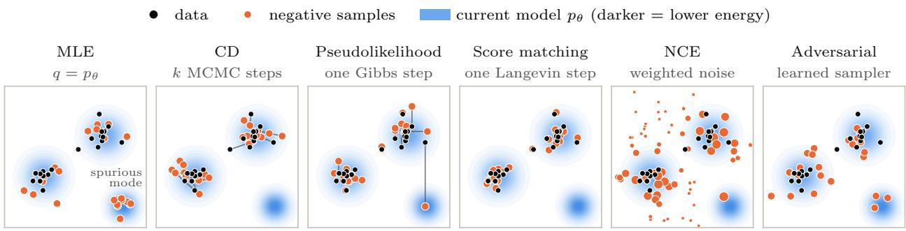  
Figure 3: Illustration of Negative Samples. The negative samples of the learning methods in Table 1, for the same data and current model. Maximum likelihood draws from the model itself, including a spurious low-energy region far from the data. Contrastive divergence and score matching start at the data and move a short distance (lines connect each data point to its negative sample), so they never visit that region, and pseudolikelihood resamples one coordinate at a time, so it moves only along the axes. Noise-contrastive estimation weights noise samples by the classifier (marker size), and adversarial training draws from a learned sampler, which can lag behind the model.

Table 1: Learning methods for EBMs as choices of the negative sampler $q$ in Equation 63, following Dai et al. [36]. $p _ { d }$ is the data distribution, $T _ { \theta } ^ { k }$ denotes k steps of an MCMC kernel that leaves $p _ { \theta }$ invariant, $\pmb { x } _ { - j }$ is x without its j-th variable, and $\mathrm { s i g m } ( h _ { \theta , c } )$ is the NCE classifier in Equation 43.
<table><tr><td>Method</td><td>Negative sampler q</td><td>Gap from  $p _ { \theta }$ </td></tr><tr><td>Maximum likelihood</td><td> $p \theta$ </td><td>none (exact)</td></tr><tr><td>Contrastive divergence Persistent CD</td><td> $T _ { \theta } ^ { k } p _ { d } \colon$  k MCMC steps from data  $T _ { \theta } ^ { k }$  from the previous iteration&#x27;s samples</td><td>short chains</td></tr><tr><td>Pseudolikelihood Composite likelihood</td><td> $\begin{array} { r } { \frac { 1 } { d } \sum _ { j } p _ { \theta } ( x _ { j } \mid \pmb { x } _ { - j } ) p _ { d } ( \pmb { x } _ { - j } ) \colon } \end{array}$  one Gibbs step from data block Gibbs step from data</td><td>chains lag behind θ one variable at a time one block at a time</td></tr></table>

likelihood of the energy, and fall outside this view. Each lowers the energy of the data and raises the energy of a set of negative samples,

$$
\nabla _ { \theta } \mathcal { L } ( \theta ) = \mathbb { E } _ { { \pmb x } \sim p _ { d } } \left[ \nabla _ { \theta } E _ { \theta } ( { \pmb x } ) \right] - \mathbb { E } _ { { \pmb x } \sim q } \left[ \nabla _ { \theta } E _ { \theta } ( { \pmb x } ) \right] ,\tag{63}
$$

$^ { \mathrm { o r , } }$ in the form of Equation 41, $\mathcal { L } ( \theta ) = \mathbb { E } _ { p _ { d } } \left[ E _ { \theta } \right] - \mathbb { E } _ { \mathsf { s t o p g r a d } ( q ) } \left[ E _ { \theta } \right]$ . Maximum likelihood is the case $q =$ $p _ { \theta }$ Equation 40. The other methods replace $p _ { \theta }$ with a negative sampler $q$ that is cheaper to draw from, and they difer mainly in this choice. Table 1 lists the samplers, which we explain below, and Figure 3 shows them on a two-dimensional example. The view also tells where each method loses accuracy: wherever q difers from $p _ { \theta } .$ , the gradient difers from the maximum likelihood gradient.

Short MCMC Chains. Contrastive divergence (CD) [87] starts the chains at the data and runs only k steps, often a single one, so $q = T _ { \theta } ^ { k } p _ { d }$ . Persistent CD [170] continues the chains from the previous iteration instead of restarting them, and short-run Langevin from noise or from a replay bufer [51] is a further variant. These samplers are cheap because they never run to convergence. The price is that q stays near where the chains started, so energy minima far from the data are rarely visited and rarely corrected. When short chains are restarted from noise, the learned energy need not be an accurate density, but the energy together with its short-run sampler is still a valid generator [133].

Pseudolikelihood as One Gibbs Step. The gradient of one term of Equation 50 is

$$
- \nabla _ { \boldsymbol { \theta } } \log p _ { \boldsymbol { \theta } } \left( x _ { j } \mid x _ { - j } \right) = \nabla _ { \boldsymbol { \theta } } E _ { \boldsymbol { \theta } } ( \boldsymbol { x } ) - \mathbb { E } _ { x _ { j } ^ { \prime } \sim p _ { \boldsymbol { \theta } } \left( \cdot \mid x _ { - j } \right) } \left[ \nabla _ { \boldsymbol { \theta } } E _ { \boldsymbol { \theta } } \left( x _ { j } ^ { \prime } , \boldsymbol { x } _ { - j } \right) \right] .\tag{64}
$$

Averaging over $j$ gives Equation 63 with the following sampler: take a data point, pick a variable $j$ uniformly at random, and resample it from its conditional. This is a single step of random-scan Gibbs sampling started at the data [96]. Composite likelihood [114] resamples a block of variables instead of one, and nonlocal contrastive objectives [181] resample within a region chosen around the data point. Each enlarges the neighborhood the sampler can reach, which is why they capture more global structure than pseudolikelihood.

Score Matching as One Langevin Step. Let $q$ take one Langevin step Equation 25 with step size $\eta / 2$ from each data point, $\begin{array} { r } { \pmb { x } ^ { \prime } = \pmb { x } - \frac { \eta } { 2 } \nabla _ { \pmb { x } } E _ { \theta } ( \pmb { x } ) + \sqrt { \eta } \pmb { \xi } } \end{array}$ with ${ \pmb \xi } \sim \mathcal { N } ( 0 , I )$ , and treat $\mathbf { x } ^ { \prime }$ as fixed, as in Equation 41. A second-order Taylor expansion of $\nabla _ { \boldsymbol { \theta } } E _ { \boldsymbol { \theta } } ( \mathbf { \boldsymbol { x } } ^ { \prime } )$ around x gives [96, 36]

$$
\mathbb { E } _ { { \pmb { x } } \sim p _ { d } } \left[ \nabla _ { \theta } E _ { \theta } ( { \pmb { x } } ) \right] - \mathbb { E } _ { { \pmb { x } } ^ { \prime } } \left[ \nabla _ { \theta } E _ { \theta } ( { \pmb { x } } ^ { \prime } ) \right] = \frac { \eta } { 2 } \nabla _ { \theta } \mathcal { L } _ { \mathrm { S M } } ( \theta ) + o ( \eta ) ,\tag{65}
$$

so score matching Equation 54 is the small-step limit of one-step Langevin CD. Its locality, noted in its limitations above, is the locality of this sampler. Minimum probability flow [159] and minimum Stein discrepancy estimators [14] also correspond to fixed one-step samplers from the data, a symmetric transition kernel and one step of Stein variational gradient descent, respectively [36].

NCE as Importance Sampling. Splitting the data weight 1 − sigm in Equation 45 into 1 and −sigm and collecting the sigm terms gives

$$
\nabla _ { \theta } \mathcal { L } _ { \mathrm { N C E } } ^ { \mathrm { b i n } } = \mathbb { E } _ { { \boldsymbol { x } } \sim p _ { d } } \left[ \nabla _ { \theta } E _ { \theta } ( { \boldsymbol { x } } ) \right] - \int \left( p _ { d } ( { \boldsymbol { x } } ) + \nu p _ { n } ( { \boldsymbol { x } } ) \right) \mathrm { s i g m } \left( h _ { \theta , c } ( { \boldsymbol { x } } ) \right) \nabla _ { \theta } E _ { \theta } ( { \boldsymbol { x } } ) d { \boldsymbol { x } } .\tag{66}
$$

The negatives are thus data and noise samples weighted by the classifier. Since sigm $\imath ( h _ { \theta , c } ) = p _ { \theta , c } / ( p _ { \theta , c } + \nu p _ { n } )$ the weighted measure $( p _ { d } + \nu p _ { n } ) \mathrm { s i g m } ( h _ { \theta , c } )$ equals $p _ { \theta , \epsilon }$ exactly when $p _ { \theta , c } = p _ { d }$ , so the negatives become model samples as the model approaches the data. Ranking NCE Equation 48 is explicitly self-normalized importance sampling with proposal $p _ { n }$ . In both cases, the quality of the sampler depends on how well $p _ { n }$ covers $p _ { \theta }$ , which is the noise-choice problem discussed above.

Learned Samplers. Adversarial training Equation 58 is the only case where $q$ is trained to approach $p _ { \theta }$ by the inner maximization of Equation 57. From this view, the methods above fix $q$ by hand, which makes them cheap but leaves a gap that does not shrink with more training, while a learned sampler can close the gap at the cost of a min-max problem [36].

The same template also explains contrastive representation learning. InfoNCE [179] is ranking NCE Equation 47 for a conditional energy $E _ { \theta } ( \pmb { x } , \pmb { y } )$ , where the negatives for x are the ${ \boldsymbol { y } } ^ { } \mathrm { s }$ of other samples in the batch, $i . e . , p _ { n }$ is the marginal of the data. We return to this in Section 5.

## 3 Discriminative Models

We first instantiate the EBM framework for discriminative tasks, where the goal is to predict an output y from an input x. The energy is now defined over input–output pairs, $E _ { \theta } ( \pmb { x } , \pmb { y } )$ , and it induces a conditional distribution

$$
p _ { \theta } ( \pmb { y } \mid \pmb { x } ) = \frac { \exp \left( - E _ { \theta } ( \pmb { x } , \pmb { y } ) \right) } { Z _ { \theta } ( \pmb { x } ) } , \qquad Z _ { \theta } ( \pmb { x } ) = \sum _ { \pmb { y } } \exp \left( - E _ { \theta } ( \pmb { x } , \pmb { y } ) \right) .\tag{67}
$$

which is the conditional EBM Equation 3 with the integral replaced by a sum over outputs. Diferent choices of the output space and of the energy recover familiar models, including logistic regression, conditional random fields (CRFs), and structured prediction energy networks.

```latex
Algorithm 1 Maximum likelihood for logistic regression by stochastic gradient descent
Require: data D, features f, step size η, batch size B
1: Initialize $\pmb { w } _ { k } \gets \mathbf { 0 } , b _ { k } \gets 0$ for $k = 1 , \ldots , K$
2: repeat
3: Sample a minibatch $\{ ( x _ { i } , y _ { i } ) \} _ { i = 1 } ^ { B }$ from D
4: Compute $p _ { i k }  p _ { \underline { { \theta } } } ( k \mid \pmb { x } _ { i } )$ by Equation 68 for all i, k ▷ exact negative phase
5: $\begin{array} { r } { \pmb { w } _ { k }  \pmb { w } _ { k } - \frac { \eta } { B } \sum _ { i = 1 } ^ { B } ( p _ { i k } - \mathbf { 1 } [ y _ { i } = k ] ) \mathbf { f } ( \pmb { x } _ { i } ) } \end{array}$ for all k
6: $\begin{array} { r } { b _ { k }  b _ { k } - \frac { \eta } { B } \sum _ { i = 1 } ^ { B } ( p _ { i k } - \mathbf { 1 } [ y _ { i } = k ] ) } \end{array}$ for all k
7: until converged
```

## 3.1 Logistic Regression and CRFs

When y is one of a few classes, Equation 67 is logistic regression; when y is a structured output, such as a label sequence, and the energy decomposes over neighboring labels, it is a CRF [106]. The two difer in how the partition function $Z _ { \theta } ( { \pmb x } )$ is computed. For logistic regression, it is a sum over K classes and is obtained by direct enumeration. For a linear-chain CRF, it has $K ^ { T }$ terms and cannot be enumerated, but the chain structure lets dynamic programming compute it exactly. In both cases, maximum likelihood can be carried out exactly, without the sampling-based approximations of Section 2.5.

Logistic Regression. Let $y \in \{ 1 , \ldots , K \}$ and let the energy be linear in a feature map $\mathbf { f } \left( { \pmb x } \right)$

$$
E _ { \theta } ( \boldsymbol { x } , \boldsymbol { y } ) = - w _ { \boldsymbol { y } } ^ { \top } \mathbf { f } ( \boldsymbol { x } ) - b _ { \boldsymbol { y } } , \qquad p _ { \theta } ( \boldsymbol { y } \mid \boldsymbol { x } ) = \frac { \exp \big ( w _ { \boldsymbol { y } } ^ { \top } \mathbf { f } ( \boldsymbol { x } ) + b _ { \boldsymbol { y } } \big ) } { \sum _ { k = 1 } ^ { K } \exp \big ( w _ { k } ^ { \top } \mathbf { f } ( \boldsymbol { x } ) + b _ { k } \big ) } ,\tag{68}
$$

with $\boldsymbol { \theta } = \left\{ \boldsymbol { w } _ { k } , b _ { k } \right\} _ { k = 1 } ^ { K }$ . The conditional distribution is the softmax of the negative energies, and $K = 2$ gives the sigmoid. The partition function is a sum of K terms, so the negative log-likelihood can be computed exactly,

$$
\mathcal { L } ( \theta ) = \mathbb { E } _ { ( \pmb { x } , \pmb { y } ) \sim \mathcal { D } } \left[ E _ { \theta } ( \pmb { x } , \pmb { y } ) + \log \sum _ { k = 1 } ^ { K } \exp \left( - E _ { \theta } ( \pmb { x } , k ) \right) \right] .\tag{69}
$$

Its gradient has the form of Equation 40, with the expectation under the model computed exactly by summing over the K classes,

$$
\begin{array} { r l } & { \nabla _ { \theta } \mathcal { L } = \mathbb { E } _ { ( \pmb { x } , \pmb { y } ) \sim \mathcal { D } } \left[ \nabla _ { \theta } E _ { \theta } ( \pmb { x } , \pmb { y } ) - \displaystyle \sum _ { k = 1 } ^ { K } p _ { \theta } ( k \mid \pmb { x } ) \nabla _ { \theta } E _ { \theta } ( \pmb { x } , k ) \right] , } \\ & { \nabla _ { \pmb { w } _ { k } } \mathcal { L } = \mathbb { E } _ { ( \pmb { x } , \pmb { y } ) \sim \mathcal { D } } \left[ \left( p _ { \theta } ( k \mid \pmb { x } ) - \mathbf { 1 } [ \pmb { y } = k ] \right) \mathbf { f } ( \pmb { x } ) \right] . } \end{array}\tag{70}
$$

The gradient for class k is the gap between the predicted probability and the label, times the features. For fixed features, L is convex, and Algorithm 1 gives the stochastic gradient version of MLE; for small problems, Newton’s method, known as iteratively reweighted least squares, converges faster. When f is a neural network trained jointly, the same algorithm is the standard softmax cross-entropy training of classifiers.

Linear-Chain CRF. For a label sequence $\pmb { y } = ( y _ { 1 } , \dots , y _ { T } )$ with $y _ { t } \in \{ 1 , \ldots , K \}$ , a linear-chain CRF [106], i.e., the CRF Equation 10 with cliques over neighboring labels, lets the energy decompose into a unary term for each position and a pairwise term for each pair of neighboring labels,

$$
E _ { \theta } ( \pmb { x } , \pmb { y } ) = - \sum _ { t = 1 } ^ { T } s _ { \theta } ( \pmb { x } , t , y _ { t } ) - \sum _ { t = 2 } ^ { T } A _ { y _ { t - 1 } , y _ { t } } ,\tag{71}
$$

where $s _ { \theta } ( { \pmb x } , t , k )$ scores label k at position t, through a linear model or a neural network, and $A \in \mathbb { R } ^ { K \times K }$ scores label transitions. The sum in $Z _ { \theta } ( { \pmb x } )$ now has $K ^ { T }$ terms, but the chain structure lets the forward

algorithm compute it by dynamic programming in $O ( T K ^ { 2 } )$ time,

$$
\alpha _ { 1 } ( k ) = e ^ { s _ { \theta } ( \alpha , 1 , k ) } , \qquad \alpha _ { t } ( k ) = e ^ { s _ { \theta } ( \alpha , t , k ) } \sum _ { j = 1 } ^ { K } \alpha _ { t - 1 } ( j ) e ^ { A _ { j k } } , \qquad Z _ { \theta } ( { \pmb x } ) = \sum _ { k = 1 } ^ { K } \alpha _ { T } ( k ) ,\tag{72}
$$

carried out in log space for numerical stability. MLE then applies directly. The gradient again has the form of Equation 40, and because the energy is a sum of local terms, the expectation under the model only needs the marginals $p _ { \theta } ( y _ { t } \mid x )$ and $p _ { \theta } ( y _ { t - 1 } , y _ { t } \mid x )$ , which the forward-backward algorithm computes exactly in $O ( T K ^ { 2 } )$ . In practice, one computes log $Z _ { \theta } ( { \pmb x } )$ with Equation 72 and lets automatic diferentiation produce this gradient, then optimizes with L-BFGS or stochastic gradient descent. Prediction is energy minimization, $\begin{array} { r } { { \pmb y } ^ { \star } = \mathrm { a r g m i n } _ { \pmb y } E _ { \theta } ( { \pmb x } , { \pmb y } ) } \end{array}$ , solved exactly by the Viterbi algorithm, which replaces the sum in Equation 72 with a max.

General CRFs. Exact MLE relies on the chain structure, and it extends to trees and graphs of low treewidth through the junction tree algorithm. For CRFs on loopy graphs, such as grid CRFs for image segmentation, $Z _ { \theta } ( { \pmb x } )$ and the marginals are intractable, and the learning methods of Section 2.5 apply with the label y in place of x: approximate marginals from loopy belief propagation or mean-field [185], pseudolikelihood over each label given its neighbors [21], or contrastive divergence with Gibbs sampling.

Max-Margin Training. Alternatively, one can drop the probabilistic model and train with only the minimum-energy output. The structured perceptron [33], max-margin Markov networks [168], and structured support vector machines (structured SVMs) [174] replace the expectation under the model in Equation 40 with the energy minimizer, or its loss-augmented version for the margin-based methods, which only requires MAP inference. These methods are still EBMs: they learn an energy over input–output pairs and predict by minimizing it, but they shape the energy with a margin loss instead of the likelihood, so the energy never needs to be normalized [108]. This makes them applicable whenever the energy can be minimized, even when $Z _ { \theta } ( { \pmb x } )$ cannot be computed. The same idea underlies the SPENs of Section 3.2, which keep the structured SVM loss and replace its linear energy with a deep network.

## 3.2 Structured Prediction Energy Networks

A CRF fixes the interactions among labels in advance through a graph over the labels. In a linear-chain CRF Equation 71, only neighboring labels interact, which is what makes $Z _ { \theta } ( { \pmb x } )$ tractable; richer graphs capture more interactions but need the approximations discussed above. Structured prediction energy networks (SPENs) [18] drop this restriction. The energy is a deep network over the whole output, so it can capture interactions among all labels, and inference becomes optimization over y instead of dynamic programming.

Energy. For multi-label classification with L labels, SPENs relax the binary output to $\pmb { y } \in [ 0 , 1 ] ^ { L }$ and use an energy with two terms,

$$
E _ { \theta } ( \pmb { x } , \pmb { y } ) = - \sum _ { i = 1 } ^ { L } y _ { i } \pmb { b } _ { i } ^ { \top } F ( \pmb { x } ) - \pmb { c } _ { 2 } ^ { \top } g \left( C _ { 1 } \pmb { y } \right) ,\tag{73}
$$

where $F ( { \pmb x } )$ is a feature network, $b _ { i } , c _ { 2 }$ , and $C _ { 1 }$ are learned parameters, and $g$ is an elementwise nonlinearity. The first term is local: it scores each label from the input, as in logistic regression. The second term is global: $\pmb { c } _ { 2 } ^ { \top } g \left( C _ { 1 } \pmb { y } \right)$ is a one-hidden-layer network over the whole label vector, which can learn which labels tend to appear together, without specifying a graph.

Inference. Prediction is energy minimization, as in Section 2.4,

$$
\hat { \pmb { y } } = \underset { \pmb { y } \in [ 0 , 1 ] ^ { L } } { \arg \operatorname* { m i n } } E _ { \pmb { \theta } } ( \pmb { x } , \pmb { y } ) ,\tag{74}
$$

solved by projected gradient descent on y, with y rounded to binary labels at the end. Since $E _ { \theta }$ is not convex in y, this finds a local minimum, and the result depends on the initialization and the number of steps.

Learning. $Z _ { \theta } ( { \pmb x } )$ is an integral over y with a non-decomposable energy, so maximum likelihood is out of reach, and SPENs are trained without a probabilistic model. The original SPEN is trained as a structured SVM [174], one of the max-margin methods mentioned at the end of the previous subsection, with the structured hinge loss

$$
\mathcal { L } ( \theta ) = \sum _ { ( \pmb { x } , \pmb { y } ) \in \mathcal { D } } \operatorname* { m a x } _ { \pmb { y } ^ { \prime } } [ \Delta ( \pmb { y } , \pmb { y } ^ { \prime } ) + E _ { \theta } ( \pmb { x } , \pmb { y } ) - E _ { \theta } ( \pmb { x } , \pmb { y } ^ { \prime } ) ] _ { + } ,\tag{75}
$$

where $\Delta ( { \boldsymbol { y } } , { \boldsymbol { y } } ^ { \prime } )$ is a task loss, such as the Hamming distance. Its gradient is $\nabla _ { \theta } E _ { \theta } ( \pmb { x } , \pmb { y } ) - \nabla _ { \theta } E _ { \theta } ( \pmb { x } , \hat { \pmb { y } } ^ { \prime } )$ , where $\hat { \mathbf { y } } ^ { \prime }$ is the maximizer, found by gradient descent on $\mathbf { \nabla } _ { \mathbf { \boldsymbol { y } } ^ { \prime } }$ . This is the contrastive form Equation 63 with a single negative sample: the output with low energy but high task loss.

A SPEN is thus a structured SVM with a deep energy. A structured SVM uses an energy that is linear in the parameters, $E _ { w } ( \pmb { x } , \pmb { y } ) = - \pmb { w } ^ { \top } \Psi ( \pmb { x } , \pmb { y } )$ , with a joint feature map Ψ designed so that the maximization over $\boldsymbol { y } ^ { \prime }$ in Equation 75, known as loss-augmented inference, can be solved exactly, $e . g .$ , by dynamic programming or graph cuts. The training problem is then convex. SPENs keep the same loss and replace the linear energy with the deep energy Equation 73. This removes the need to design Ψ and lets the energy learn interactions among all labels, but loss-augmented inference becomes gradient descent over a relaxed $\mathbf { \Delta } _ { \mathbf { \boldsymbol { y } } ^ { \prime } }$ , which is only approximate, and the training problem is no longer convex.

End-to-end SPENs [19] replace the hinge loss altogether: they unroll a fixed number of gradient steps of Equation 74 and backpropagate a task loss on the final prediction through them, which is the regression training of Section 2.5 applied to a discriminative energy.

Two later lines of work change how the energy is trained or used. Deep value networks [82] train the energy to regress the task score of an output directly. Inference networks [175] train a separate network $A _ { \omega } ( \pmb { x } )$ to approximate the minimizer in Equation 74, so prediction is a single forward pass. The latter mirrors adversarial training in Section 2.5: the energy is trained against a learned network that searches for its low-energy outputs, except that here the network finds a minimizer rather than a sampler.

## 4 Generative Models

Many existing generative models can be viewed as special cases of EBMs. Each defines, explicitly or implicitly, a distribution $p _ { \theta } ( { \pmb x } ) \propto \exp \left( - E _ { \theta } ( { \pmb x } ) \right)$ , and they difer mainly in how they handle two parts that Section 2 treated separately: the potential function $E _ { \theta }$ and the sampler that draws from it. A general EBM parameterizes the potential freely, so it can express any shape, but it must pay at sampling time, with MCMC or a learned sampler, and at training time, with the methods of Section 2.5. Other generative models restrict or learn one of the two parts so that the other becomes easy.

The following subsections take the main families in turn. In GANs, the generator plays the role of the learned sampler in adversarial training and the discriminator plays the role of the potential; adding an entropy term on the generator turns the pair into an EBM trained by maximum likelihood. Normalizing flows build the sampler as an invertible map, which makes the potential, including its normalization, exact by change of variables. Difusion and flow-matching models learn the gradient of the potential at many noise levels and sample by following it, as in annealed Langevin dynamics. Energy-inspired models take a sampler that uses a learned potential as the model itself, so that sampling is exact and the likelihood has a tractable bound; modern Hopfield networks, discussed alongside them, retrieve stored patterns by energy minimization; and deep equilibrium models define a layer by the fixed point of an iterative update, such as energy minimization. Finally, autoregressive models write the potential as a sum of normalized conditionals, which makes sampling one variable at a time exact.

## 4.1 Generative Adversarial Nets

The adversarial training of Section 2.5 already has the structure of a GAN. We make the correspondence explicit, and then use it to read the original GAN and its variants from the EBM view.

Entropy-Regularized GAN. Take the sampler $q$ in Equation 57 to be an implicit generator, ${ \pmb x } = g _ { \phi } ( { \pmb z } )$ with $z \sim \mathcal { N } ( 0 , I )$ , and write $q _ { \phi }$ for its distribution. Maximum likelihood for the EBM becomes

$$
\operatorname* { m i n } _ { \theta } \operatorname* { m a x } _ { \phi } \mathbb { E } _ { \pmb { x } \sim p _ { d } } \left[ E _ { \theta } ( \pmb { x } ) \right] - \mathbb { E } _ { z } \left[ E _ { \theta } \left( g _ { \phi } ( z ) \right) \right] + H \left( q _ { \phi } \right) .\tag{76}
$$

The energy acts as the discriminator: it is lowered on data and raised on generated samples. The generator moves its samples toward low energy, while the entropy term keeps them spread out. The two players have the same roles as in Section 2.5, and so does the result. If both families are rich enough, the solution satisfies $q _ { \phi } = p _ { \theta } = p _ { d } \colon$ the energy recovers $- \log p _ { d }$ up to a constant, and the generator is a sampler for it. Training yields both parts of the EBM, the potential and the sampler [101, 39, 36]. The practical dificulty is the one noted in Section 2.5: the entropy of an implicit generator has no closed form and must be estimated or bounded.

The Original GAN. The original GAN [77] trains a discriminator $D ( \pmb { x } ) = \mathrm { s i g m } \left( \ell ( \pmb { x } ) \right)$ to tell data from generated samples,

$$
\operatorname* { m i n } _ { \phi } \operatorname* { m a x } _ { \ell } \mathbb { E } _ { \mathbf { x } \sim p _ { d } } \left[ \log \operatorname { s i g m } \left( \ell ( \pmb { x } ) \right) \right] + \mathbb { E } _ { z } \left[ \log \left( 1 - \operatorname { s i g m } \left( \ell ( g _ { \phi } ( z ) ) \right) \right) \right] .\tag{77}
$$

For a fixed generator, the optimal discriminator is $D ^ { \star } = p _ { d } / ( p _ { d } + q _ { \phi } )$ , so its logit is the log-density ratio, $\ell ^ { \star } = \log p _ { d } - \log q _ { \phi }$ , and the generator then minimizes the Jensen–Shannon divergence between $p _ { d }$ and $q _ { \phi } \ [ 7 7 ]$

The discriminator objective in Equation 77 is binary NCE Equation 44 with $\nu = 1$ and the generator as the noise distribution. Comparing ℓ with the NCE logit Equation 43 shows what is missing: NCE parameterizes $\ell ( { \pmb x } ) = - E _ { \theta } ( { \pmb x } ) - \log p _ { n } ( { \pmb x } ) - c$ , which requires the noise density, whereas an implicit generator has no tractable $q _ { \phi } ( { \pmb x } )$ . The GAN therefore learns the ratio ℓ directly instead of an energy. This has two consequences. First, as $q _ { \phi }$ approaches $p _ { d }$ , the log-ratio goes to zero and the discriminator becomes constant, $D ^ { \star } = 1 / 2$ , so at the solution the potential is discarded and only the sampler remains. The energy could in principle be read of as $- E _ { \theta } = \ell + \log q _ { \phi }$ up to a constant, but this requires log $q _ { \phi }$ . Without the generator’s density, the EBM cannot be obtained from a trained GAN. Second, the generator update has no entropy term, so the generator’s best response is not tied to an EBM. For a fixed energy, the entropy-regularized generator maximizes $- \mathbb { E } _ { q } \left[ E _ { \theta } \right] + H \left( q \right) = - \mathrm { K L } \left( q \| p _ { \theta } \right) + \log Z _ { \theta }$ , whose unique maximizer is the EBM itself, $q = p _ { \theta } \propto \exp \left( - E _ { \theta } \right)$ . Without the entropy, the generator only maximizes $- \mathbb { E } _ { q } \left[ E _ { \theta } \right]$ , or, in Equation $^ { 7 7 }$ minimizes $\mathbb { E } _ { q } \left[ \log \left( 1 - \mathrm { s i g m } ( \ell ) \right) \right]$ ; in both cases, the best response is a point mass at the minimum of the energy, or at the maximum of ℓ. The EBM is then just one of the distributions the generator may settle on, with no force pulling it there, and the game can reach solutions outside the space of EBMs, such as a generator that covers only some modes of the data; this is one source of mode collapse.

The entropy term in Equation 76 addresses both points: it makes the generator’s objective KL $\left( q _ { \phi } \| p _ { \theta } \right)$ so every solution of the game is an EBM, and it keeps the discriminator a valid energy at the solution. Both require the generator’s density: the entropy $H \left( q _ { \phi } \right) = - \mathbb { E } _ { q _ { \phi } } \left[ \log q _ { \phi } \right]$ requires log $q _ { \phi } .$ , which is exactly what an implicit generator lacks. This is why entropy-regularized GANs either use generators with tractable densities or estimate the entropy, as discussed in Section 2.5

Other GAN Variants. Several GAN variants change the discriminator loss, and the EBM view classifies them by how the loss shapes the potential. Each loss relaxes the constraints that an EBM places on the model: the potential need not be normalized, and the generator need not sample from it. The f-GAN [134] replaces the Jensen–Shannon divergence with any f-divergence through its variational representation. Its optimal discriminator is again a function of the density ratio $p _ { d } / q _ { \phi }$ , and its generator again has no entropy term, so both points above apply unchanged: the energy cannot be recovered without log $q _ { \phi } .$ , and the solutions of the game need not be EBMs. The Wasserstein GAN [6] uses a critic $f$ and the objective $\mathbb { E } _ { p _ { d } } \left[ f \right] - \mathbb { E } _ { q _ { \phi } } \left[ f \right]$ over 1-Lipschitz $f .$ With $f ~ = ~ - E _ { \theta }$ , the critic objective looks like the contrastive maximum likelihood loss Equation 41, but the resemblance is only in form. Maximum likelihood requires the negative samples to come from the EBM itself, $p _ { \theta } \propto \exp \left( - E _ { \theta } \right)$ . In the Wasserstein GAN, the generator is trained to reduce the Wasserstein distance to $p _ { d } ,$ and like the original GAN it has no entropy term, so its best response to a fixed critic is again a point mass rather than $p _ { \theta }$ . The generator is therefore not a sampler for the EBM defined by the critic, and the critic’s gradient is not the maximum likelihood gradient. The Lipschitz constraint, rather than normalization, keeps the critic bounded, and at the solution the critic is the potential that defines the Wasserstein distance, not a log-density.

Table 2: GANs from the EBM view: the discriminator loss, whether the generator has an entropy term (Entropy), and what the discriminator represents at the solution.
<table><tr><td>Model</td><td>Discriminator loss</td><td>Entropy</td><td>Discriminator at the solution</td></tr><tr><td>Original GAN</td><td>binary classification</td><td>no</td><td>constant,  $\overline { { D ^ { \star } = 1 / 2 } }$ </td></tr><tr><td>Wasserstein GAN</td><td> $\mathbb { E } _ { p _ { d } } \left[ f \right] - \mathbb { E } _ { q _ { \phi } } \left[ f \right] .$  Lipschitz  $f$ </td><td>no</td><td>critic for a distance</td></tr><tr><td>Entropy-regularized GAN</td><td>maximum likelihood</td><td>yes</td><td>energy,  $E _ { \theta } = - \log p _ { d } + \mathrm { c o n s t }$ </td></tr></table>

Table 2 summarizes the comparison. In every case the generator is a learned sampler. What separates the entropy-regularized GAN is that the discriminator is trained by maximum likelihood and the generator by KL $\left( q _ { \phi } \| p _ { \theta } \right)$ , so both parts of the EBM survive training. The learned energy can then be used beyond sampling, for example to evaluate unnormalized likelihoods, to refine generated samples with a few MCMC steps, or to be composed with other energies as in Section 2.3.

## 4.2 Normalizing Flows

For a general EBM, the partition function $Z _ { \theta }$ is intractable, and this is the source of the dificulties in sampling and learning discussed in Section 2. Normalizing flows avoid it with a special parametrization: the model is an invertible transformation of a simple distribution, so the change-of-variables formula gives its density, normalization included.

Change of Variables. Let $z \sim p _ { 0 }$ be a simple base distribution, such as $\mathcal { N } ( 0 , I )$ , and let $\begin{array} { r } { \pmb { x } = g _ { \theta } ( \pmb { z } ) } \end{array}$ where $g _ { \theta } : \mathbb { R } ^ { d }  \mathbb { R } ^ { d }$ is invertible and diferentiable. Since $g _ { \theta }$ only moves probability mass around without creating or removing any, the density of x is

$$
p _ { \theta } ( { \pmb x } ) = p _ { 0 } \left( g _ { \theta } ^ { - 1 } ( { \pmb x } ) \right) \left| \operatorname* { d e t } \frac { \partial g _ { \theta } ^ { - 1 } ( { \pmb x } ) } { \partial { \pmb x } } \right| .\tag{78}
$$

This density is tractable when $g _ { \theta } ^ { - 1 }$ and the determinant of its Jacobian are cheap to compute, and normalizing flows are built from layers that meet both requirements. Coupling layers [47, 48] transform half of the variables with a function of the other half, so the Jacobian is triangular and its determinant is the product of the diagonal. Autoregressive flows [138, 104] transform each variable conditioned on the previous ones, which also gives a triangular Jacobian. Glow [102] adds invertible 1×1 convolutions. Continuous normalizing flows [29, 78] define $g _ { \theta }$ by an ordinary diferential equation, in which case the log-determinant becomes the integral of a trace along the trajectory. A deep flow composes many such layers, and the log-determinants add up.

Normalizing Flows as EBMs. Taking the negative log of Equation 78 writes the flow in the form of Equation 1,

$$
p _ { \theta } ( \mathbf { x } ) = { \frac { \exp { \big ( } { - } E _ { \theta } ( \mathbf { x } ) { \big ) } } { Z _ { \theta } } } , \qquad E _ { \theta } ( \mathbf { x } ) = - \log p _ { 0 } { \big ( } g _ { \theta } ^ { - 1 } ( \mathbf { x } ) { \big ) } - \log \left| \operatorname* { d e t } { \frac { \partial g _ { \theta } ^ { - 1 } ( \mathbf { x } ) } { \partial \mathbf { x } } } \right| , \qquad Z _ { \theta } = 1 .\tag{79}
$$

The energy has two terms: how unlikely the corresponding latent point is under the base distribution, and how much the flow compresses or expands volume at x. This special parametrization makes the partition function of the EBM tractable: it equals one for every $\theta ,$ because the change of variables preserves total mass. More generally, if the base distribution is itself an EBM, $p _ { 0 } \propto \exp \left( - E _ { 0 } \right)$ ) with partition function $Z _ { 0 }$ then the same argument shows that the flow has partition function $Z _ { 0 }$ as well. A flow never changes the partition function; it moves the normalization into the base distribution, where it is known.

Learning and Sampling. Because $Z _ { \theta }$ does not depend on $\theta ,$ maximum likelihood is exact. In the gradi ent Equation 40, the expectation under the model equals $- \nabla _ { \theta }$ log $Z _ { \theta } = 0$ , so the negative phase vanishes and the gradient reduces to $\mathbb { E } _ { { \pmb { x } } \sim p _ { d } } \left[ \nabla _ { \theta } E _ { \theta } ( { \pmb { x } } ) \right]$ , with no samples from the model needed during training. Sampling is also exact and takes one pass: draw $z \sim p _ { 0 }$ and return $g _ { \boldsymbol { \theta } } ( z )$ . A flow therefore makes both parts of the EBM easy at once, the potential with its normalization and the sampler.

Normalizing Flows and General EBMs. Since a flow has an exact density, and hence an exact entropy, it is a natural choice for the learned sampler in adversarial training Equation 57 and in variational inference [146], which is the first dificulty noted for implicit generators in Section 4.1. A flow can also serve as the noise distribution of NCE Equation 44, where its exact density is what NCE needs; flow contrastive estimation trains the flow and the EBM jointly, so that the noise stays close to the data [70].

Limitations. The tractability comes from architectural constraints. The map must be invertible, so x and z have the same dimension and there is no bottleneck, and each layer must have a cheap Jacobian determinant, which limits how much each layer can do. Invertibility also preserves topology: mapping a unimodal Gaussian onto data with separated modes requires very steep transformations between the modes. A general EBM has none of these constraints, but pays with an intractable partition function. This is the trade-of described at the start of this section: flows restrict the potential so that its normalization and its sampler come for free.

## 4.3 Difusion and Flow Models

Difusion and flow models generate data by gradually transforming noise into samples. We first introduce both families in their usual form, and then use Tweedie’s formula to show that they learn a sequence of EBMs, one for each noise level, and difer from EBMs mainly in how they parameterize it.

Difusion Models. A difusion model [160, 90, 163] fixes a forward process that corrupts a data point $\pmb { x } _ { 0 } \sim p _ { d }$ with Gaussian noise of increasing scale. All we need is its marginal at each time,

$$
\pmb { x } _ { t } = \alpha _ { t } \pmb { x } _ { 0 } + \sigma _ { t } \pmb { \epsilon } , \qquad \ \epsilon \sim \mathcal { N } \left( 0 , I \right) , \qquad t \in [ 0 , 1 ] ,\tag{80}
$$

that is, $\mathbf { \boldsymbol { x } } _ { t } \mid \mathbf { \boldsymbol { x } } _ { 0 } \sim \mathcal { N } \left( \alpha _ { t } \mathbf { \boldsymbol { x } } _ { 0 } , \sigma _ { t } ^ { 2 } I \right)$ . The schedule satisfies $\alpha _ { 0 } = 1$ and $\sigma _ { 0 } = 0$ , and the signal-to-noise ratio $\alpha _ { t } ^ { 2 } / \sigma _ { t } ^ { 2 }$ decreases to nearly zero at $t = 1$ . Variance-preserving difusion takes $\alpha _ { t } ^ { 2 } + \sigma _ { t } ^ { 2 } = 1$ , variance-exploding difusion takes $\alpha _ { t } = 1$ with $\sigma _ { t }$ growing large, and the linear interpolation $\alpha _ { t } = 1 - t , \sigma _ { t } = t$ is used by rectified flow. Let $p _ { t }$ denote the distribution of $\mathbf { \Delta } _ { \mathbf { \mathcal { X } } _ { t } }$ . To generate data, the process is run backward in time, from noise at $t = 1$ to data at $t = 0$ , by the reverse-time stochastic diferential equation or the deterministic probability-flow ordinary diferential equation [163]. Both only require the score $\nabla _ { \pmb { x } } \log p _ { t } ( \pmb { x } )$ at every t. Difusion models learn it with a network $\epsilon _ { \theta } ( x _ { t } , t )$ trained to predict the noise that was added,

$$
\begin{array} { r } { \mathcal { L } ( \boldsymbol { \theta } ) = \mathbb { E } _ { t , \boldsymbol { x } _ { 0 } \sim p _ { d } , \epsilon } \left[ w ( t ) \left| \left| \epsilon _ { \boldsymbol { \theta } } \left( \alpha _ { t } \boldsymbol { x } _ { 0 } + \sigma _ { t } \epsilon , t \right) - \epsilon \right| \right| _ { 2 } ^ { 2 } \right] , } \end{array}\tag{81}
$$

with a weighting $w ( t )$ over noise levels. At each $t ,$ this is denoising score matching Equation 55 [182], which corresponds to $\alpha _ { t } = 1$ , generalized to $\alpha _ { t } \neq 1$ , as made precise below.

Flow Models. Flow matching and rectified flow [115, 119, 3] use the same interpolation Equation 80 between data and noise, but learn the velocity of the path instead of the noise. The network ${ \pmb v } _ { \theta } ( { \pmb x } _ { t } , t )$ is regressed onto the time derivative of the interpolation,

$$
\begin{array} { r } { \mathcal { L } ( \boldsymbol { \theta } ) = \mathbb { E } _ { t , \boldsymbol { x } _ { 0 } \sim p _ { d } , \epsilon } \left[ \left\| \boldsymbol { v } _ { \boldsymbol { \theta } } \left( \boldsymbol { x } _ { t } , t \right) - \left( \dot { \alpha } _ { t } \boldsymbol { x } _ { 0 } + \dot { \sigma } _ { t } \epsilon \right) \right\| _ { 2 } ^ { 2 } \right] , } \end{array}\tag{82}
$$

and samples are generated by integrating the ordinary diferential equation ${ d \pmb x _ { t } } / { d t } = \pmb v _ { \theta } ( \pmb x _ { t } , t )$ from noise to data. Some works use the reverse time convention, with noise at $t = 0 ;$ we follow the difusion convention throughout. The minimizer of Equation 82 is the conditional expectation ${ \pmb v } ^ { \star } ( { \pmb x } , t ) = \dot { \alpha } _ { t } \mathbb { E } \left[ { \pmb x } _ { 0 } \mid { \pmb x } _ { t } = { \pmb x } \right] +$ $\dot { \sigma } _ { t } \mathbb { E } \left[ \boldsymbol { \epsilon } \mid \boldsymbol { x } _ { t } = \boldsymbol { x } \right]$

Tweedie’s Formula. The two families, and their diferent targets, are connected by Tweedie’s formula [61]. Since $\begin{array} { r } { p _ { t } ( { \pmb x } ) = \int p _ { d } ( { \pmb x } _ { 0 } ) \mathcal { N } \left( { \pmb x } ; \alpha _ { t } { \pmb x } _ { 0 } , \sigma _ { t } ^ { 2 } I \right) } \end{array}$ dx<sub>0</sub>, diferentiating under the integral gives $\nabla _ { \pmb { x } } p _ { t } ( \pmb { x } ) =$ $\begin{array} { r } { \int p _ { d } ( \pmb { x } _ { 0 } ) \mathcal { N } \left( \pmb { x } ; \alpha _ { t } \pmb { x } _ { 0 } , \sigma _ { t } ^ { 2 } I \right) \frac { \alpha _ { t } \pmb { x } _ { 0 } - \pmb { x } } { \sigma _ { t } ^ { 2 } } } \end{array}$ dx<sub>0</sub>, and dividing by $p _ { t } ( \pmb { x } )$ yields

$$
\nabla _ { x } \log p _ { t } ( x ) = { \frac { \alpha _ { t } \mathbb { E } \left[ { \boldsymbol { x _ { 0 } } } \mid { \boldsymbol { x _ { t } } } = { \boldsymbol { x } } \right] - { \boldsymbol { x } } } { \sigma _ { t } ^ { 2 } } } , \qquad { \mathrm { e q u i v a l e n t l y } } \qquad \mathbb { E } \left[ { \boldsymbol { x _ { 0 } } } \mid { \boldsymbol { x _ { t } } } = { \boldsymbol { x } } \right] = { \frac { { \boldsymbol { x } } + { \sigma _ { t } ^ { 2 } } \nabla _ { x } \log p _ { t } ( { \boldsymbol { x } } ) } { \alpha _ { t } } } .\tag{83}
$$

The score of the noisy distribution is the direction from x toward its denoised estimate. Taking the conditional expectation of ${ \pmb x } _ { t } = \alpha _ { t } { \pmb x } _ { 0 } + \sigma _ { t } { \pmb \epsilon }$ given $\mathbf { \boldsymbol { x } } _ { t } = \mathbf { \boldsymbol { x } }$ gives $\begin{array} { r } { \pmb { x } = \alpha _ { t } \mathbb { E } \left[ \pmb { x } _ { 0 } \mid \pmb { x } \right] + \sigma _ { t } \mathbb { E } \left[ \pmb { \epsilon } \mid \pmb { x } \right] , } \end{array}$ , so the expected noise is $\begin{array} { r } { \mathbb { E } \left[ \star \middle \vert \mathbf { x } \right] = \left( \mathbf { x } - \alpha _ { t } \mathbb { E } \left[ \mathbf { x } _ { 0 } \mid \mathbf { x } \right] \right) / \sigma _ { t } = - \sigma _ { t } \nabla _ { \mathbf { x } } \log p _ { t } ( \mathbf { x } ) } \end{array}$ by Equation 83. Since this conditional expectation is the minimizer of Equation 81, the optimal noise predictor is the score scaled $\mathrm { b y } - \sigma _ { t }$ . The noise prediction, the data prediction, and the velocity are therefore all afine functions of the score, with coeficients that depend only on t.

Difusion Models as EBMs. Now write each noisy distribution as an EBM with a time-dependent energy,

$$
p _ { t } ( { \pmb x } ) = \frac { \exp \left( - E _ { \theta } ( { \pmb x } , t ) \right) } { Z _ { \theta } ( t ) } , \qquad \nabla _ { \pmb x } \log p _ { t } ( { \pmb x } ) = - \nabla _ { \pmb x } E _ { \theta } ( { \pmb x } , t ) ,\tag{84}
$$

where, as in score matching, $Z _ { \theta } ( t )$ drops out of the score. We emphasize that this connection, like score matching itself, relies on the gradient $\nabla _ { x }$ and the Gaussian corruption Equation 80, so it holds only for continuous x. For discrete data, there is no gradient; the score is replaced by ratios of probabilities between neighboring states, as in the ratio matching discussed with score matching in Section 2.5, and discrete difusion models learn such ratios or the corresponding conditionals instead [9, 165, 120]. By Tweedie’s formula, every target used by difusion and flow models is determined by the gradient of this energy,

$$
\begin{array} { r l } & { \epsilon ^ { \star } ( { \pmb x } , t ) = \sigma _ { t } \nabla _ { { \pmb x } } E _ { \theta } ( { \pmb x } , t ) , \qquad { \pmb x } _ { 0 } ^ { \star } ( { \pmb x } , t ) = \frac { { \pmb x } - \sigma _ { t } ^ { 2 } \nabla _ { { \pmb x } } E _ { \theta } ( { \pmb x } , t ) } { \alpha _ { t } } , } \\ & { v ^ { \star } ( { \pmb x } , t ) = \frac { \dot { \alpha } _ { t } } { \alpha _ { t } } { \pmb x } - \sigma _ { t } \left( \frac { \dot { \alpha } _ { t } \sigma _ { t } } { \alpha _ { t } } - \dot { \sigma } _ { t } \right) \nabla _ { { \pmb x } } E _ { \theta } ( { \pmb x } , t ) . } \end{array}\tag{85}
$$

Substituting the first expression into Equation 81 recovers denoising score matching [182], i.e., Equation 55, for the energy $E _ { \theta } ( \cdot , t )$ , weighted over noise levels. A difusion model is therefore a family of EBMs, $\{ p _ { t } \} _ { t \in [ 0 , 1 ] }$ learned by denoising score matching [182, 161]. The energy at $t = 0$ describes the data, and the energies at larger t are smoothed versions of it whose landscapes are easier to traverse. Sampling moves through this family from smooth to sharp, which is the annealed Langevin dynamics of Song and Ermon [161] in its original form, and the reverse-time dynamics [163] in general.

The Diference Is the Parameterization. In terms of the two parts of Section 4, difusion and flow models keep the EBM’s potential but parameterize it through its gradient: the network outputs the vector $\epsilon _ { \theta } , \boldsymbol { x } _ { 0 , \theta } .$ , or ${ \pmb v } _ { \pmb { \theta } }$ directly, and Equation 85 is read in reverse to define an implied score. An EBM instead parameterizes the scalar $E _ { \theta } ( { \boldsymbol { \mathbf { \mathit { x } } } } , t )$ and obtains the score by diferentiation. The two are trained with the same loss, and difer in three ways.

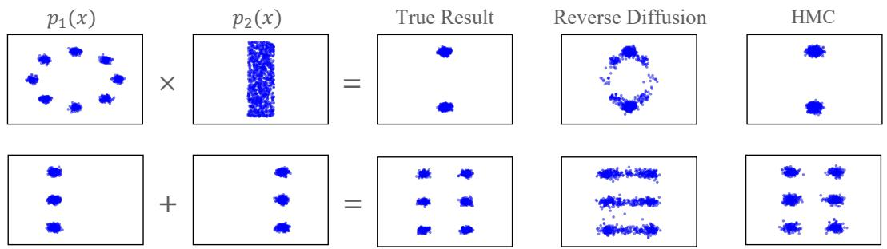

Figure 4: Sampling compositions of two difusion models. Left to right: the two component distributions, samples from the true composition, and samples from reverse difusion and from annealed MCMC (HMC) on the composed models. Top: product; bottom: mixture. Reverse difusion fails to sample either composition, whereas MCMC on the composed energies recovers both. For the product, summing the scores of the two models at each noise level does not give the score of the noised product, since adding noise does not commute with taking products. Reproduced from Du et al. [55].

• Conservativeness. A score obtained as $- \nabla _ { x } E _ { \theta }$ is a gradient field. A vector-valued network is not constrained to be one, so the implied score need not be the gradient of any energy, for the same reason as for the deep equilibrium layers of Section 4.5.

• Access to the energy. With a scalar energy, log ${ \bf \nabla } _ { p _ { t } }$ can be evaluated up to a constant. This enables Metropolis–Hastings corrections Equation 24 and Hamiltonian Monte Carlo during sampling, and comparisons between samples, none of which is possible with the vector parameterization.

• Cost. The scalar parameterization needs an extra backward pass to obtain the score, and in practice it has reached comparable but not better sample quality [151, 55].

The diference matters most for composition (Section 2.3). The product of two EBMs has energy $E _ { 1 } + E _ { 2 }$ but adding the scores of two difusion models at time t does not give the score of the noised product, because adding noise does not commute with taking products. Sampling from the composition by following the summed scores is therefore biased. With an energy parameterization, the summed energies define a valid unnormalized density at each t, and MCMC corrections can sample from it correctly [55] as Figure 4 shows.

Guided Sampling as a Product of Distributions. The EBM view also explains why guided sampling works. Classifier guidance [45] draws class-conditional samples from an unconditional difusion model by adding the gradient of a classifier $p _ { t } ( y \mid x )$ trained on noisy inputs, scaled by a guidance weight w,

$$
\begin{array} { r } { \nabla _ { x } \log p _ { t } ( x ) + w \nabla _ { x } \log p _ { t } ( y \mid x ) = - \nabla _ { x } \left[ F _ { \theta } ( x , t ) + w E _ { \omega } ( x , y , t ) \right] , \qquad E _ { \omega } ( x , y , t ) = - \log p _ { t } ( y \mid x ) . } \end{array}\tag{86}
$$

The classifier is the conditional EBM of Section 3, and the right-hand side is the gradient of a sum of two energies. $\mathrm { B y }$ Section 2.3, a sum of energies is a product of distributions, so Equation 86 is

$$
\tilde { p } _ { t } ( \boldsymbol { x } \mid \boldsymbol { y } ) \propto p _ { t } ( \boldsymbol { x } ) p _ { t } ( \boldsymbol { y } \mid \boldsymbol { x } ) ^ { \boldsymbol { w } } .\tag{87}
$$

For $w = 1$ , this is the posterior $p _ { t } ( { \pmb x } \mid { \boldsymbol y } )$ by Bayes’ rule; for $w > 1$ , the classifier expert is sharpened, which trades diversity for fidelity. Classifier-free guidance [89] trains a conditional and an unconditional model together and combines their outputs as $( 1 + w ) \epsilon _ { \theta } ( { \pmb x } , y , t ) - w \epsilon _ { \theta } ( { \pmb x } , t )$ . By Equation 85, this corresponds to the energy $( 1 + w ) E _ { \theta } ( { \pmb x } \mid y , t ) - w E _ { \theta } ( { \pmb x } , t )$ , that is, to the distribution

$$
\tilde { p } _ { t } ( { \pmb x } \mid y ) \propto \frac { p _ { t } ( { \pmb x } \mid y ) ^ { 1 + w } } { p _ { t } ( { \pmb x } ) ^ { w } } \propto p _ { t } ( { \pmb x } ) p _ { t } ( y \mid { \pmb x } ) ^ { 1 + w } ,\tag{88}
$$

where the second step uses Bayes’ rule. Classifier-free guidance is therefore classifier guidance with an implicit classifier, defined by the ratio of the two models, and the negative weight on the unconditional model is a negated expert, as in the logical NOT of Section 2.3.

In both cases, the EBM view gives guidance a precise meaning: at each noise level $t ,$ the guided score is the score of a product of distributions, and Langevin dynamics Equation 25 on the summed energy samples, asymptotically or with an MH correction, from Equation $^ { 8 7 }$ or Equation 88. The same product combines a large pretrained difusion model with a small domain-specific one through their scores alone, which adapts black-box text-to-video models without fine-tuning [194]. It also shows the limit of the usual implementation. Guided difusion samplers plug the summed score into the reverse process, which assumes that the guided distributions at diferent t are noised versions of one another. They are not, for the same reason as for composition above: adding noise does not commute with taking products. Guided reverse difusion therefore only approximately samples the product distribution, and running Langevin or MCMC steps on the summed energy at each t, corrected by Metropolis–Hastings when the energy is available, removes this bias [55].

## 4.4 Energy-Inspired Models

Difusion models in Section 4.3 can be read as EBMs with a sampler-friendly parameterization: the potential is learned through its gradients at every noise level, which is exactly what the reverse-time sampler uses. Energy-inspired models (EIMs) [107], proposed before this view of difusion models became common, share the same spirit from a diferent direction: they focus on the sampling procedure of the EBM during learning. A general EBM is sampled with an approximate procedure, such as MCMC or importance sampling, so the samples we actually use come from the sampler, not from the model $p _ { \theta }$ , and training the energy as if the samples were exact creates a mismatch between the model and the inference procedure. EIMs remove the mismatch by taking the distribution induced by the sampler, which uses a learned energy, as the model itself, and maximizing its likelihood directly. In terms of the two parts of Section 4, an EIM keeps the energy but defines the distribution through the sampler, so that sampling is exact by construction.

Self-Normalized Importance Sampling. Let $\pi ( { \pmb x } )$ be a tractable proposal, for example a Gaussian or a VAE, so that the target EBM is $p _ { \theta } ( { \pmb x } ) \propto \pi ( { \pmb x } ) \exp \left( - E _ { \theta } ( { \pmb x } ) \right)$ . The simplest EIM draws K candidates $\pmb { x } _ { 1 } , \dotsc , \pmb { x } _ { K } \sim \pi$ and returns $\mathbf { \Delta } _ { \mathbf { \mathcal { X } } _ { i } }$ with probability proportional to exp $\left( - E _ { \theta } ( \pmb { x } _ { i } ) \right)$ . The likelihood of this sampler is intractable, because it marginalizes over the candidates, but treating the candidates as latent variables gives the evidence lower bound

$$
\log q _ { \theta } ^ { \mathrm { S N I S } } ( \pmb { x } ) \geqslant \mathbb { E } _ { \pmb { x _ { 2 : K } } \sim \pi } \left[ \log \frac { \pi ( \pmb { x } ) \exp { ( - E _ { \theta } ( \pmb { x } ) ) } } { \frac { 1 } { K } \left( \exp { ( - E _ { \theta } ( \pmb { x } ) ) } + \sum _ { j = 2 } ^ { K } \exp { ( - E _ { \theta } ( \pmb { x } _ { j } ) ) } \right) } \right] .\tag{89}
$$

As $K  \infty ,$ , the denominator converges to $Z _ { \theta }$ and $q _ { \theta } ^ { \mathrm { S N I S } }$ to the EBM $p _ { \theta } ;$ for finite $K ,$ , the model interpolates between the proposal π and the EBM. Up to terms that do not depend on the energy, Equation 89 is the ranking NCE objective Equation 47 with the proposal as the noise distribution, $p _ { n } = \pi$ . The EIM view therefore gives ranking NCE a new reading: it is a lower bound on the likelihood of a well-defined model, the SNIS sampler, whether or not the data distribution lies in the model family, and it provides a principled objective for learning the noise distribution together with the energy, which NCE alone does not. A truncated rejection sampler, which accepts proposals one at a time with probability sigm $\left( - E _ { \theta } ( \pmb { x } ) \right)$ , gives another EIM and recovers the generative process of learned accept/reject sampling [16].

Hamiltonian Importance Sampling. Importance sampling scales poorly with dimension, because all candidates come from the proposal. Hamiltonian importance sampling [130] instead moves a single sample: it draws $\pmb { x } ^ { ( 0 ) } \sim \pi$ and a momentum ${ \pmb v } ^ { ( 0 ) } \sim \mathcal { N } \left( 0 , I \right)$ , and runs leapfrog steps Equation 28 on the energy $E _ { \theta }$ with a learned schedule that rescales the momentum at each step. When the rescaling factors multiply to one, the map from $( \mathbf { \boldsymbol { x } } ^ { ( 0 ) } , \mathbf { \boldsymbol { v } } ^ { ( 0 ) } )$ to $( \pmb { x } ^ { ( T ) } , \pmb { v } ^ { ( T ) } )$ preserves volume, so the joint density of the endpoint equals that of the starting point. Writing $\Phi _ { \theta }$ for this map, which depends on the energy through its gradient, the likelihood of a data point ${ \pmb x } = { \pmb x } ^ { ( T ) }$ is bounded by treating the final momentum as a latent variable,

$$
\begin{array} { r } { \log q _ { \theta } ^ { \mathrm { H I S } } ( \boldsymbol { x } ) \geqslant \mathbb { E } _ { v ^ { ( T ) } \sim r ( \cdot | \boldsymbol { x } ) } \left[ \log \pi ( \boldsymbol { x } ^ { ( 0 ) } ) + \log \mathcal { N } \left( v ^ { ( 0 ) } ; 0 , I \right) - \log r ( v ^ { ( T ) } \mid \boldsymbol { x } ) \right] , \qquad ( \boldsymbol { x } ^ { ( 0 ) } , v ^ { ( 0 ) } ) = \Phi _ { \theta } ^ { - 1 } ( \boldsymbol { x } , v ^ { ( T ) } ) , } \end{array}\tag{90}
$$

where $r ( \pmb { v } ^ { ( T ) } \mid \pmb { x } )$ is a variational distribution over the final momentum and $( { \pmb x } ^ { ( 0 ) } , { \pmb v } ^ { ( 0 ) } )$ is obtained by running the dynamics backward from $( { \pmb x } , { \pmb v } ^ { ( T ) } )$ . The bound is maximized jointly over the energy, the proposal, the step size and schedule, and r, by backpropagating through the trajectory. The proposal provides a coarse sample, and the gradient of the energy refines it, which helps when the proposal is poorly matched to the data. This construction is closely related to normalizing flows (Section 4.2), as a volume-preserving flow driven by the energy, and to the dynamics-based samplers of adversarial training [36].

Hamiltonian importance sampling also resembles a difusion model (Section 4.3): both start from a simple distribution and move the sample over several steps guided by the gradient of an energy. The diference is in learning. Hamiltonian importance sampling is trained by maximizing the variational lower bound Equation 90 on the likelihood of the sampler’s output, which requires simulating the whole trajectory and backpropagating through it. A difusion model never simulates its sampler during training: it fixes a forward noising process and fits the reverse process to it one noise level at a time, by the denoising regression Equation 81.

Modern Hopfield Networks. A related line of work uses an energy to design the update of a network rather than its distribution. The modern Hopfield network [142], which builds on classical Hopfield networks [93] and dense associative memories [105, 42], stores patterns $\pmb { x } _ { 1 } , \ldots , \pmb { x } _ { N }$ as the columns of X and assigns a state $\boldsymbol { \xi }$ the energy

$$
E ( \pmb \xi ) = - \frac { 1 } { \beta } \log \sum _ { i = 1 } ^ { N } \exp \left( \beta \pmb { x } _ { i } ^ { \top } \pmb \xi \right) + \frac { 1 } { 2 } \pmb \xi ^ { \top } \pmb \xi + \mathrm { c o n s t . }\tag{91}
$$

The concave-convex procedure minimizes this energy with the update $\xi ^ { \mathrm { n e w } } = X$ softmax $( \beta X ^ { \top } \pmb \xi )$ , which converges, stores exponentially many patterns, and typically retrieves a well-separated pattern in one step. The softmax is a Gibbs distribution over the stored patterns, and the update replaces the state by the expected pattern under it. With queries $Q ,$ , keys K, values V and $\beta = 1 / \sqrt { d _ { k } }$ , one update is exactly the attention softmax $\left( Q K ^ { \top } / \sqrt { d _ { k } } \right) V$ of transformers [142], so an attention layer performs one step of energy minimization. Iterating such an update to its fixed point leads to the deep equilibrium models of Section 4.5.

## 4.5 Deep Equilibrium Models

Inference in an EBM is often energy minimization, carried out by iterating a fixed update until it stops changing. Deep equilibrium models (DEQs) [10] take this iteration as the definition of a network layer: the output is the point where the update no longer changes it. Used as a generator, a DEQ can be viewed as an energy-inspired model (Section 4.4) whose sampler is a deterministic fixed-point solver: draw noise $z \sim p _ { 0 } .$ iterate the update to its fixed point, and return it. When the update is a gradient step on an energy, this sampler is energy minimization started from the noise.

Fixed-Point Layers. Given an input x and a layer $f _ { \theta } ,$ a DEQ defines its output as the fixed point

$$
z ^ { \star } = f _ { \boldsymbol { \theta } } \left( z ^ { \star } , \pmb { x } \right) .\tag{92}
$$

This corresponds to applying the same layer infinitely many times, a weight-tied network of infinite depth, but the fixed point is found directly by a root-finding method, such as Broyden’s method or Anderson acceleration, applied to $g _ { \boldsymbol { \theta } } ( z ) = f _ { \boldsymbol { \theta } } ( z , \pmb { x } ) - z$ . Training does not backpropagate through the solver’s iterations. By the implicit function theorem, the gradient of a loss $\ell ( z ^ { \star } )$ is

$$
\frac { \partial \ell } { \partial \theta } = \frac { \partial \ell } { \partial z ^ { \star } } \left( I - \frac { \partial f _ { \theta } ( z ^ { \star } , x ) } { \partial z ^ { \star } } \right) ^ { - 1 } \frac { \partial f _ { \theta } ( z ^ { \star } , x ) } { \partial \theta } ,\tag{93}
$$

which depends only on the fixed point, so memory does not grow with the number of solver steps. The vector–inverse-Jacobian product is itself computed by solving a linear fixed-point equation.

Learning DEQs. How a DEQ is trained depends on whether a target is available for its fixed point. In the conditional setting, each input x comes with a target output y, and learning is easy: a task loss is placed on the fixed point and diferentiated through it,

$$
\begin{array} { r } { \mathcal { L } ( \theta ) = \mathbb { E } _ { ( \boldsymbol { x } , \boldsymbol { y } ) \sim \mathcal { D } } \left[ \ell \left( h _ { \theta } \left( z _ { \theta } ^ { \star } ( \boldsymbol { x } ) \right) , \boldsymbol { y } \right) \right] , \qquad z _ { \theta } ^ { \star } ( \boldsymbol { x } ) = f _ { \theta } \left( z _ { \theta } ^ { \star } ( \boldsymbol { x } ) , \boldsymbol { x } \right) , } \end{array}\tag{94}
$$

where $h _ { \theta }$ is an output head and ℓ is, for example, the cross-entropy for classification or the squared error for regression. The exact gradient is the implicit gradient Equation 93 [10]; cheaper approximations drop or truncate the inverse-Jacobian term, such as Jacobian-free backpropagation [192] and phantom gradients [73], and penalizing the Jacobian of the update keeps the fixed point stable during training [11]. Energy minimization trained by regression onto the solution, as in IREM [54], falls in this setting as well.

The unconditional setting, where the goal is to learn a distribution and no output is paired with the noise, is harder, and existing methods first turn it into a problem that has a target or a likelihood: distillation from a pretrained difusion model, which supplies noise–sample pairs and reduces generation to regression [74]; an invertible fixed-point map, which gives an exact likelihood as in normalizing flows [121]; a fixed-point layer inside the denoiser of a difusion model, trained from scratch with the denoising loss of Section 4.3 [12]; and Equilibrium Matching, which learns a time-independent gradient field whose descent from noise reaches the data [186].

Equilibrium Matching is the closest to a DEQ trained without a teacher, since its sampler is exactly the fixed-point iteration of Equation 92 with the energy-descent layer $f _ { \theta } ( z ) = z - \eta \nabla _ { z } E _ { \theta } ( z )$ . As introduced in Section 2.5, it corrupts data as $\pmb { x } _ { \gamma } = ( 1 - \gamma ) \pmb { x } + \gamma \pmb { \epsilon }$ with $\gamma \sim \mathcal { U } [ 0 , 1 ]$ and $\epsilon \sim \mathcal { N } ( 0 , I )$ , and regresses the gradient of the energy at $\mathbf { \Delta } _ { \mathbf { x } _ { \gamma } }$ onto $\left( \epsilon - \pmb { x } \right) c ( \gamma )$ , Equation 62. Two choices turn this regression into a fixed-point model. First, the network does not receive γ, so the minimizer is the single field $\nabla E ^ { \star } ( z ) =$ $\mathbb { E } \left[ \left( \epsilon - x \right) c ( \gamma ) \mid x _ { \gamma } = z \right]$ , averaged over all noise levels that could have produced $z ,$ rather than a family indexed by time as in difusion. Second, the magnitude satisfies $c ( 0 ) = 0$ , for example $c ( \gamma ) = \gamma$ , so the target vanishes at the data, and data points are equilibria of the field. This holds only approximately: since the field averages over noise levels, a data point is an exact equilibrium only if the corrupted samples that land on it come almost entirely from $\gamma \approx 0$ . In high dimension, the noise level can be inferred from $\mathbf { \Delta } _ { \mathbf { x } _ { \gamma } }$ itself, because the norm of the added noise concentrates, so the approximation is accurate, but it can be loose in low dimension. Samples are generated by iterating

$$
z _ { k + 1 } = z _ { k } - \eta \nabla _ { z } E _ { \theta } ( z _ { k } ) , \qquad z _ { 0 } \sim \mathcal { N } \left( 0 , I \right) ,\tag{95}
$$

until the gradient is small, that is, until a fixed point is reached; the step size and the number of steps can be adapted at sampling time, and accelerated methods such as Nesterov’s can be used. Training needs only data and noise, with no pretrained model and no unrolled trajectory.

Connection to EBMs. Choose the layer to be one step of gradient descent on an energy, $f _ { \theta } ( z , x ) =$ $z - \eta \nabla _ { z } E _ { \theta } ( \pmb { x } , z )$ . Its fixed points are exactly the stationary points of the energy, $\nabla _ { z } E _ { \theta } ( { \pmb x } , { \pmb z } ^ { \star } ) = 0$ , so the forward pass of the DEQ is energy minimization, as in Section 2.4, and Equation 93 diferentiates through the minimizer without unrolling it. This is the exact counterpart of the unrolled training of end-to-end SPENs in Section 3.2 and of IREM in Section 2.5, which backpropagate through a fixed number of minimization steps. The converse does not hold: a general layer $f _ { \theta }$ is not the gradient of any scalar function, because the Jacobian of a gradient field is symmetric while that of a general layer is not. A general DEQ therefore computes an equilibrium that is not the minimum of any energy, and its fixed point may not exist or be unique. Monotone operator equilibrium networks [191] restrict the layer so that a unique fixed point is guaranteed, and the modern Hopfield networks of Section 4.4 are an instance in which the update does descend an explicit energy.

## 4.6 Autoregressive Models as Approximate Ancestral Samplers

Autoregressive models can be viewed as another reparameterization of an EBM from the sampler’s point of view, in the spirit of the energy-inspired models of Section 4.4. Instead of parameterizing a global energy

and then designing a sampler for ${ \mathrm { i t } } ,$ the parameterization follows ancestral sampling: each step models the conditional distribution of one variable given the ones already generated, and the joint distribution is the one induced by a single sweep in a fixed order.

Fixed-Order Factorization of an EBM. For $\pmb { x } = ( x _ { 1 } , \dots , x _ { d } )$ with each $x _ { i }$ in a finite vocabulary $\nu ,$ any EBM Equation 1 factorizes exactly in a fixed order by the chain rule,

$$
p _ { \theta } ( \pmb { x } ) = \prod _ { i = 1 } ^ { d } p _ { \theta } ( x _ { i } \mid \pmb { x } _ { < i } ) , \qquad p _ { \theta } ( x _ { i } \mid \pmb { x } _ { < i } ) = \frac { \sum _ { \pmb { x } _ { > i } } \exp \left( - E _ { \theta } ( \pmb { x } ) \right) } { \sum _ { \pmb { x } _ { i } , \pmb { x } _ { > i } } \exp \left( - E _ { \theta } ( \pmb { x } ) \right) } .\tag{96}
$$

Drawing $x _ { 1 }$ , then $x _ { 2 }$ given $x _ { 1 }$ , and so on, is ancestral sampling: each variable is drawn given the ones already visited, with the unvisited ones marginalized out, and this single pass returns an exact sample. Unlike a Gibbs sweep (Section 2.4), which conditions on the current values of all other variables and revisits them, it draws each variable once. For a general EBM, however, the sum over $\mathbf { \delta } \mathbf { x } _ { > i }$ is as intractable as $Z _ { \theta }$ itself. Autoregressive models reparameterize exactly this sum: they model it directly with a network $e _ { \theta }$

$$
\sum _ { \pmb { x } _ { > i } } \exp \left( - E _ { \theta } ( \pmb { x } ) \right) \approx \exp \left( - e _ { \theta } ( x _ { i } ; \pmb { x } _ { < i } ) \right) ,\tag{97}
$$

which turns the exact conditional in Equation 96 into

$$
p _ { \theta } ( x _ { i } = v \mid \pmb { x } _ { < i } ) = \frac { \exp \left( - e _ { \theta } ( v ; \pmb { x } _ { < i } ) \right) } { \sum _ { v ^ { \prime } \in \mathcal { V } } \exp \left( - e _ { \theta } ( v ^ { \prime } ; \pmb { x } _ { < i } ) \right) } .\tag{98}
$$

The marginalization over the unvisited variables is never computed; it is absorbed into $e _ { \theta } .$ , which plays the role of the free energy of $\mathbf { \mathcal { x } } _ { \leqslant i }$ after $\mathbf { \delta } \mathbf { x } _ { > i }$ is summed out. What remains is a normalization over the |V| values of a single variable, with $- e _ { \theta } ( \cdot ; \pmb { x } _ { < i } )$ as the logits, i.e., the multi-class logistic regression of Section 3. An autoregressive model is therefore ancestral sampling of Equation 96 with its intractable conditionals replaced by learned ones. NADE [178] gives a concrete instance: its forward pass is a single pass of mean-field inference that approximates the conditionals $p ( x _ { i } \mid { \pmb x } _ { < i } )$ of an RBM, with the unvisited variables initialized to zero rather than summed out, and its weight sharing is inherited from the RBM.

Exact Learning. The same factorization makes learning exact: maximum likelihood decomposes into a sum of per-step cross-entropies,

$$
\mathcal { L } ( \theta ) = - \mathbb { E } _ { { \pmb x } \sim p _ { d } } \left[ \sum _ { i = 1 } ^ { d } \log p _ { \theta } ( x _ { i } \mid { \pmb x } _ { < i } ) \right] ,\tag{99}
$$

each of which is the exact maximum likelihood of a conditional EBM Equation 98, and all of which can be computed in parallel from a data sequence.

Relation to Pseudolikelihood. Pseudolikelihood Equation 50 is the closest learning method for EBMs, and comparing the two shows what the reparameterization changes. Both fit single-variable conditionals that are softmaxes over V, and both are tractable for the same reason: only the normalization of one variable over |V| values is needed. They difer in the conditioning set (Figure 5). Pseudolikelihood fits the full conditionals $p _ { \theta } ( x _ { j } \mid \pmb { x } _ { - j } )$ , the steps of the Gibbs sampler of Section 2.4, which can be computed from $E _ { \theta }$ in closed form because nothing is summed out. An autoregressive model fits the chain-rule conditionals $p _ { \theta } ( x _ { i } \mid \pmb { x } _ { < i } )$ , the steps of ancestral sampling in Equation 96, which require summing out $\mathbf { \delta } \mathbf { x } _ { > i }$ and are therefore reparameterized by $e _ { \theta }$ . This single diference leads to opposite trade-ofs:

• Objective. By the chain rule, Equation 99 is exactly the negative log-likelihood, so autoregressive training is exact MLE. The sum of full conditionals in Equation 50 is not a likelihood. In the ordering view of Section 2.5, pseudolikelihood keeps only the last term of every ordering, whereas an autoregressive model keeps all the terms of one fixed ordering.

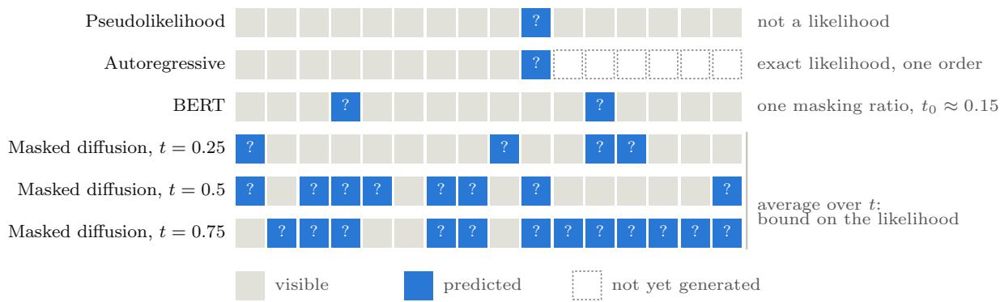  
Figure 5: Illustration of diferent conditioning sets. Pseudolikelihood predicts one token from all the others; an autoregressive model predicts the next token from the prefix, and the remaining tokens are not yet generated; BERT predicts a fixed fraction of masked tokens; masked difusion predicts the masked tokens at every masking level t, and averaging over t gives a bound on the likelihood.

• Energy. Pseudolikelihood keeps the global energy: all its conditionals are derived from a single $E _ { \theta } { \mathrm { : } }$ which it estimates consistently [21]. An autoregressive model gives the global energy up, as discussed below.

• Sampling. The full conditionals learned by pseudolikelihood do not produce a sample in one pass, and still require many Gibbs sweeps. The chain-rule conditionals do: one ordered pass from the empty state returns an exact sample.

In the language of Section 2.6, pseudolikelihood corresponds to a single Gibbs step started at the data, while an autoregressive model corresponds to ancestral sampling from the empty state. Masked discrete difusion, discussed next, lies between the two: it hides a random subset of the variables, ranging from a single one, as in pseudolikelihood, to all of them, as in the first step of an autoregressive pass.

Connection to Discrete Difusion. The order of the sweep is a choice. Averaging Equation 99 over random orders gives an any-order autoregressive model [177, 92], and, as discussed with pseudolikelihood in Section 2.5, the masked discrete difusion objective Equation 51 is equivalent to it [136]. Masked difusion models are therefore autoregressive samplers whose order is random and which may reveal several variables per step. Revealing several variables at once, from conditionals predicted independently given the same context, trades the exactness of a sequential sweep for parallel generation, and, as noted there, learned conditionals that are parameterized directly need not be consistent with a single joint distribution, which the autoregressive factorization Equation 96 guarantees.

The Price of the Reparameterization. The reparameterization Equation 97 trades the energy for the sampler. On the gain side, sampling takes a single exact pass of Equation 98 with no burn-in or mixing, and learning is exact maximum likelihood Equation 99, since each step only requires a normalization over |V| values. On the cost side, $e _ { \theta }$ is no longer tied to a global energy. In Equation 96, all conditionals are derived from a single $E _ { \theta }$ , whereas an autoregressive model approximates each marginalized sum separately, so in general the parameters of an underlying EBM cannot be recovered from it. Moreover, summing out $\mathbf { \delta } \mathbf { x } _ { > i }$ couples variables that $E _ { \theta }$ does not couple directly: even when $E _ { \theta }$ is simple, such as a pairwise MRF with few parameters, the sums $\begin{array} { r } { \sum _ { { \pmb x } _ { > i } } \exp \left( - E _ { \theta } ( { \pmb x } ) \right) } \end{array}$ are generally complex functions of the whole prefix $\scriptstyle { \mathbf { { \vec { x } } } } _ { < i }$ , and they change with the chosen order. Approximating them by exp $\left( - e _ { \theta } \right)$ therefore requires a far more flexible $e _ { \theta }$ than the energy it replaces, and the compact structure of $E _ { \theta }$ is lost.

Large Language Models (LLMs). LLMs are the setting in which this reparameterization fits best, since both of its costs are naturally mitigated. First, the order is given. Text is a sequence, and the left-to-right order in which it is written and read is a natural choice for the fixed order in Equation 96, so no ordering has to be chosen or learned [20]. Second, the marginalized sums in Equation $9 7$ are modeled by a highly flexible network. A Transformer decoder [180] computes $- e _ { \theta } ( \cdot ; \pmb { x } _ { < i } )$ as the logits over the token vocabulary from the entire prefix, which provides exactly the flexibility over the whole context that the approximation requires. With causal masking, all d conditionals in Equation 99 are computed in one forward pass over a training sequence, so learning remains exact maximum likelihood at scale [139, 24], and generation is ancestral sampling, one token at a time.

## 5 Representation Learning

So far, the energy itself has been the object of interest: in Section 3 it scores outputs for prediction, and in Section 4 it defines the distribution to sample from. In representation learning, the energy becomes a means rather than an end. The goal is a feature map $\phi _ { \theta } ( { \pmb x } )$ that is useful for downstream tasks, and the energy is the pretext through which it is learned: $\phi _ { \theta }$ is placed inside an energy defined on a self-supervised task, such as matching two views of the same input, predicting the masked parts of an input, or denoising a corrupted input, and the energy is trained with one of the methods of Section 2.5. After training, the energy is discarded and $\phi _ { \theta }$ is kept. From this view, self-supervised methods difer mainly in two choices, the structure of the energy and the learning method, and the learning methods they use are precisely those that avoid sampling from the model.

## 5.1 Contrastive Representation Learning

Following Dai et al. [37], contrastive methods can be read as learning a single conditional EBM between two related variables. Let $( { \pmb x } , { \pmb y } ) \sim p ( { \pmb x } , { \pmb y } )$ be a positive pair, such as two augmented views of the same image, or an image and its caption, and let $\phi _ { \theta }$ and $\psi _ { \theta }$ be the encoders of the two sides, which share parameters when x and y come from the same modality. The model is

$$
\begin{array} { r l } & { \displaystyle \frac { p _ { \theta } ( \pmb { x } , \pmb { y } ) } { p ( \pmb { x } ) p ( \pmb { y } ) } \propto \exp \left( \phi _ { \theta } ( \pmb { x } ) ^ { \top } \psi _ { \theta } ( \pmb { y } ) \right) , } \\ & { \displaystyle p _ { \theta } ( \pmb { y } \mid \pmb { x } ) = \frac { p ( \pmb { y } ) \exp \left( \phi _ { \theta } ( \pmb { x } ) ^ { \top } \psi _ { \theta } ( \pmb { y } ) \right) } { Z _ { \theta } ( \pmb { x } ) } , \qquad Z _ { \theta } ( \pmb { x } ) = \mathbb { E } _ { p ( \pmb { y } ) } \left[ \exp \left( \phi _ { \theta } ( \pmb { x } ) ^ { \top } \psi _ { \theta } ( \pmb { y } ) \right) \right] , } \\ & { \displaystyle p _ { \theta } ( \pmb { x } \mid \pmb { y } ) = \frac { p ( \pmb { x } ) \exp \left( \phi _ { \theta } ( \pmb { x } ) ^ { \top } \psi _ { \theta } ( \pmb { y } ) \right) } { Z _ { \theta } ( \pmb { y } ) } , \qquad Z _ { \theta } ( \pmb { y } ) = \mathbb { E } _ { p ( \pmb { x } ) } \left[ \exp \left( \phi _ { \theta } ( \pmb { x } ) ^ { \top } \psi _ { \theta } ( \pmb { y } ) \right) \right] , } \end{array}\tag{100}
$$

where the two conditionals have their own partition functions. This is an EBM with the bilinear energy $E _ { \theta } ( \pmb { x } , \pmb { y } ) = - \phi _ { \theta } ( \pmb { x } ) ^ { \top } \psi _ { \theta } ( \pmb { y } )$ relative to the base measure $p ( \pmb { y } )$ , and it models the pointwise mutual information between the two sides. The representation lives inside the energy, and Dai et al. [37] show that it is suficient for downstream prediction. The structure of Equation 100 makes it convenient to learn: the base measure is the marginal $p ( \pmb { y } )$ , which is exactly the distribution of the other samples in a batch, so the natural noise distribution for NCE is $p _ { n } = p ( \pmb { y } )$ , and the $\log p _ { n }$ terms in Equation 43 and Equation 46 cancel against the base measure, leaving the inner product as the logit. The remaining dificulty is the partition functions $Z _ { \theta } ( { \pmb x } )$ and $Z _ { \theta } ( \pmb { y } )$ , which are intractable and difer for every input, and existing methods difer mainly in how they handle them.

SimCLR: Ranking NCE within One Modality. SimCLR [30] takes x and y to be two augmentations of the same input, with a shared encoder $\phi _ { \theta } = \psi _ { \theta }$ . Applying ranking NCE Equation 47 to $p _ { \boldsymbol { \theta } } ( \boldsymbol { y } \mid \boldsymbol { x } )$ , with the other K samples in the batch as the noise, gives

$$
\mathcal { L } _ { \mathrm { S i m C L R } } ( \theta ) = - \mathbb { E } \left[ \phi _ { \theta } ( \pmb { x } ) ^ { \top } \phi _ { \theta } ( \pmb { y } _ { 0 } ) - \log \sum _ { k = 0 } ^ { K } \exp \left( \phi _ { \theta } ( \pmb { x } ) ^ { \top } \phi _ { \theta } ( \pmb { y } _ { k } ) \right) \right] ,\tag{101}
$$

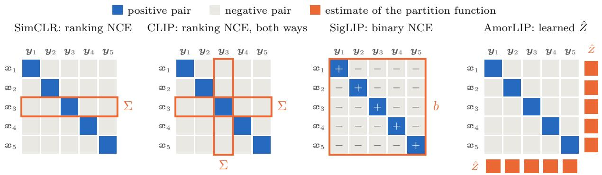  
Figure 6: Contrastive methods as estimators of the same EBM. Each panel shows the scores $\phi _ { \theta } ( \pmb { x } _ { i } ) ^ { \top } \psi _ { \theta } ( \pmb { y } _ { j } )$ of a batch for the bilinear EBM Equation 100, with the positive pairs on the diagonal. The methods difer in what estimates the partition functions: SimCLR sums each row (Σ), and CLIP also each column; SigLIP classifies every pair separately, as positive or negative, with one learned bias b shared by all pairs; AmorLIP predicts the partition functions $( \hat { Z } )$ from the representations instead of summing over the batch.

which is the InfoNCE objective [179]. Normalizing the features, $\phi _ { \theta } ( \pmb { x } ) / \| \phi _ { \theta } ( \pmb { x } ) \| _ { 2 }$ , and dividing the inner product by a temperature recovers SimCLR exactly [37]. Ranking NCE needs no partition function, since $Z _ { \theta } ( { \pmb x } )$ cancels within the softmax, but its gradient Equation 48 is a self-normalized importance sampling estimate whose bias decreases only as K grows, which is why these methods depend on large batches.

CLIP: Ranking NCE across Modalities. CLIP [140] applies the same estimator to an image x and its caption y with separate encoders, and fits both conditionals of Equation 100,

$$
\begin{array} { r l } { \mathcal { L } _ { \mathrm { C L I P } } ( \boldsymbol { \theta } ) = - \mathbb { E } \left[ \phi _ { \boldsymbol { \theta } } ( \boldsymbol { x } _ { 0 } ) ^ { \top } \psi _ { \boldsymbol { \theta } } ( \boldsymbol { y } _ { 0 } ) - \log \sum _ { k = 0 } ^ { K } \exp \left( \phi _ { \boldsymbol { \theta } } ( \boldsymbol { x } _ { 0 } ) ^ { \top } \psi _ { \boldsymbol { \theta } } ( \boldsymbol { y } _ { k } ) \right) \right] } & { } \\ { \qquad - \mathbb { E } \left[ \phi _ { \boldsymbol { \theta } } ( \boldsymbol { x } _ { 0 } ) ^ { \top } \psi _ { \boldsymbol { \theta } } ( \boldsymbol { y } _ { 0 } ) - \log \sum _ { k = 0 } ^ { K } \exp \left( \phi _ { \boldsymbol { \theta } } ( \boldsymbol { x } _ { k } ) ^ { \top } \psi _ { \boldsymbol { \theta } } ( \boldsymbol { y } _ { 0 } ) \right) \right] , } \end{array}\tag{102}
$$

where the first term is ranking NCE for $p _ { \theta } ( \pmb { y } \mid \pmb { x } _ { 0 } )$ , which identifies the caption $\mathbf { \delta } _ { \mathbf { \boldsymbol { y } } _ { 0 } }$ of the image $\scriptstyle { \pmb x } _ { 0 }$ among the $K + 1$ captions in the batch with the other captions drawn from the noise $p ( \pmb { y } )$ , and the second term is ranking NCE for $p _ { \theta } ( { \pmb x } \mid { \pmb y } _ { 0 } )$ , which identifies the image $\scriptstyle { \mathbf { { \mathit { x } } } } _ { 0 }$ of the caption $\mathbf { { \boldsymbol { \mathsf { y } } } _ { 0 } }$ among the $K + 1$ images with the other images drawn from the noise $p ( { \pmb x } )$ . It inherits the large-batch requirement of ranking NCE.

SigLIP: Binary NCE across Modalities. SigLIP [200] replaces the softmax by a sigmoid on each pair. This is binary NCE Equation 44 with positive pairs drawn from $p ( { \pmb x } , { \pmb y } )$ as data and mismatched pairs drawn from $p ( { \pmb x } ) p ( { \pmb y } )$ as noise,

$$
\begin{array} { r } { \mathcal { L } _ { \mathrm { S i g L I P } } ( \theta , b ) = - \mathbb { E } _ { p ( x , y ) } \left[ \log \operatorname { s i g m } \left( \phi _ { \theta } ( x ) ^ { \top } \psi _ { \theta } ( y ) + b \right) \right] - \mathbb { E } _ { p ( x ) p ( y ) } \left[ \log \left( 1 - \operatorname { s i g m } \left( \phi _ { \theta } ( x ) ^ { \top } \psi _ { \theta } ( y ) + b \right) \right) \right] , } \end{array}\tag{103}
$$

SigLIP thus learns the EBM Equation 100 through its joint distribution, which has a single partition function,

$$
p _ { \theta } ( \boldsymbol { x } , \boldsymbol { y } ) = \frac { p ( \boldsymbol { x } ) p ( \boldsymbol { y } ) \exp { \left( \phi _ { \theta } ( \boldsymbol { x } ) ^ { \top } \psi _ { \theta } ( \boldsymbol { y } ) \right) } } { Z _ { \theta } } , \qquad Z _ { \theta } = \mathbb { E } _ { p ( \boldsymbol { x } ) p ( \boldsymbol { y } ) } \left[ \exp { \left( \phi _ { \theta } ( \boldsymbol { x } ) ^ { \top } \psi _ { \theta } ( \boldsymbol { y } ) \right) } \right] .\tag{104}
$$

The bias $b = - \log Z _ { \theta }$ is the log-partition constant −c of binary NCE in Equation 42, so the objective is consistent for the joint model, and the conditionals with their partition functions $Z _ { \theta } ( { \pmb x } )$ and $Z _ { \theta } ( \pmb { y } )$ follow from it without being estimated. Each pair contributes a separate term, so the gradient is unbiased for any batch size, which is the practical advantage of ${ \mathrm { S i g L I P } }$ over the ranking NCE of CLIP.

AmorLIP: Maximum Likelihood with Amortized Partition Functions. Instead of an NCE surro gate, one can fit both conditionals of Equation 100 by maximum likelihood,

$$
\begin{array} { r l } & { \underset { \theta } { \mathrm { m a x } } ~ 2 \mathbb { E } _ { p ( \pmb { x } , \pmb { y } ) } \left[ \phi _ { \theta } ( \pmb { x } ) ^ { \top } \psi _ { \theta } ( \pmb { y } ) \right] - \mathbb { E } _ { p ( \pmb { x } ) } \left[ \log Z _ { \theta } ( \pmb { x } ) \right] - \mathbb { E } _ { p ( \pmb { y } ) } \left[ \log Z _ { \theta } ( \pmb { y } ) \right] , } \end{array}\tag{105}
$$

which has the same gradient as the surrogate objective

$$
\operatorname* { m a x } _ { \theta } \ 2 \mathbb { E } _ { p ( \alpha , y ) } \left[ \phi _ { \theta } ( x ) ^ { \top } \psi _ { \theta } ( y ) \right] - \mathbb { E } _ { p ( x ) p ( y ) } \left[ \frac { \exp \left( \phi _ { \theta } ( x ) ^ { \top } \psi _ { \theta } ( y ) \right) } { \operatorname { s g } \left( Z _ { \theta } ( x ) \right) } \right] - \mathbb { E } _ { p ( x ) p ( y ) } \left[ \frac { \exp \left( \phi _ { \theta } ( x ) ^ { \top } \psi _ { \theta } ( y ) \right) } { \operatorname { s g } \left( Z _ { \theta } ( y ) \right) } \right] ,\tag{106}
$$

with sg the stop-gradient operator. Given the values of $Z _ { \theta } ( { \pmb x } )$ and $Z _ { \theta } ( \pmb { y } )$ , every term is an expectation that can be estimated without bias from small batches. The dificulty is that these partition functions are intractable and change with every input. Ranking NCE estimates them by the batch sum, which is biased for small batches, and binary NCE avoids them by fitting the joint model with a single constant. AmorLIP [167] instead amortizes them: since $Z _ { \theta } ( \pmb { x } ) = \mathbb { E } _ { p ( \pmb { y } ) } \left[ \exp \left( \phi _ { \theta } ( \pmb { x } ) ^ { \top } \psi _ { \theta } ( \pmb { y } ) \right) \right]$ depends on x only through $\phi _ { \theta } ( \pmb { x } )$ , it can be fitted by a lightweight network on top of the learned representation, trained with a variational objective alongside the encoders, and plugged into Equation 106. This keeps the consistency of maximum likelihood while removing the dependence on large batches.

In summary, SimCLR, CLIP, SigLIP and AmorLIP learn the same EBM Equation 100 and difer only in the learning method of Section 2.5: ranking NCE, which cancels the partition function within the batch; binary NCE, which fits the joint model with a single constant; and maximum likelihood, which estimates it with an amortized model (Figure 6). The trade-ofs among them are those of the estimators, between the batch size, the consistency of the estimator, and the cost of modeling the partition function.

Fixed-Point Learning of EBM Representation. The methods above fit both sides of the energy Equation 100 jointly. Dai et al. [37] show that the representation can also be learned by a fixed-point iteration, in the spirit of power iteration for spectral decomposition, in which one side of the energy is frozen at the previous iterate and only the other side is updated. With a shared encoder as in SimCLR, the ℓ-th iteration fits the conditional EBM $p _ { \boldsymbol { \theta } } ( \pmb { y } | \pmb { x } ) \propto p ( \pmb { y } ) \exp \left( \phi _ { \boldsymbol { \theta } } ( \pmb { x } ) ^ { \top } \phi ^ { ( \boldsymbol { \ell } ) } ( \pmb { y } ) \right)$ , in which the representation $\phi ^ { ( \ell ) }$ of the target is fixed, by ranking NCE,

$$
\phi ^ { ( \ell + 1 ) } = \underset { \phi } { \mathrm { a r g m i n } } - \mathbb { E } \left[ \phi ( \boldsymbol { x } ) ^ { \top } \phi ^ { ( \ell ) } ( \boldsymbol { y } _ { 0 } ) - \log \sum _ { k = 0 } ^ { K } \exp \left( \phi ( \boldsymbol { x } ) ^ { \top } \phi ^ { ( \ell ) } ( \boldsymbol { y } _ { k } ) \right) \right] ,\tag{107}
$$

and a fixed point $\phi ^ { ( \ell + 1 ) } ~ = ~ \phi ^ { ( \ell ) }$ is a representation consistent with the EBM. MoCo [86] is a practical implementation of this iteration. It approximates the argmin by a few stochastic gradient steps on the query encoder $\phi ,$ maintains the frozen key encoder $\phi ^ { ( \ell ) }$ as an exponential moving average of the query encoder, and draws the negatives ${ \mathbf { } } _ { \mathbf { } ^ { 3 k } }$ from a queue of keys computed in recent iterations. Since the keys are produced by a slowly changing $\phi ^ { ( \ell ) }$ that receives no gradient, the stale keys in the queue remain consistent with the current iterate, which provides many negatives without large batches.

## 5.2 Word2vec

Word2vec [126, 127] is an early and simple instance of the same construction, in which the encoders are lookup tables. It comes in two variants, which correspond to Section 5.1 and Section 5.3, respectively.

Skip-Gram: Binary NCE for a Pairwise EBM. Let $( w , c )$ be a word and a word in its context window. Skip-gram models their co-occurrence with the bilinear EBM Equation 100 [37],

$$
\frac { p _ { \theta } ( w , c ) } { p ( w ) p _ { n } ( c ) } \propto \exp \left( { \pmb u } _ { w } ^ { \top } { \pmb v } _ { c } \right) ,\tag{108}
$$

where $\mathbf { \Delta } \mathbf { u } _ { w }$ and ${ \pmb v } _ { c }$ are the embeddings of w as a word and of c as a context, and $p _ { n } ( c )$ is the noise distribution over contexts used below; with $p _ { n } ( c ) = p ( c )$ , the ratio is the pointwise mutual information. Skip-gram with negative sampling fits Equation 108 by binary NCE Equation 44, with observed pairs as data and k pairs drawn from $p ( w ) p _ { n } ( c )$ as noise,

$$
\begin{array} { r } { \mathcal { L } _ { \mathrm { S G N S } } ( \boldsymbol { \theta } ) = - \mathbb { E } _ { p ( w , c ) } \left[ \log \operatorname { s i g m } \left( \pmb { u } _ { w } ^ { \top } \pmb { v } _ { c } \right) \right] - k \mathbb { E } _ { p ( w ) } \ l _ { p _ { n } ( c ) } \left[ \log \operatorname { s i g m } \left( - \pmb { u } _ { w } ^ { \top } \pmb { v } _ { c } \right) \right] , } \end{array}\tag{109}
$$

where the noise distribution over contexts $p _ { n } ( c )$ is the unigram distribution raised to the power $3 / 4$ and renormalized. Compared with Equation 43, the logit is the inner product alone, so the bias $b = - c - \log \nu$ is fixed at zero rather than learned as in SigLIP. With $\nu = k$ , the optimal classifier then gives

$$
{ \pmb u } _ { w } ^ { \star } { \top } { \pmb v } _ { c } ^ { \star } = \log \frac { p ( w , c ) } { p ( w ) p _ { n } ( c ) } - \log k ,\tag{110}
$$

which is the shifted pointwise mutual information that skip-gram is known to factorize implicitly [110]. In the EBM view, the shift − log k is the log-partition constant that binary NCE would otherwise have learned.

CBOW: Masked Prediction of a Single Word. The continuous bag-of-words model predicts a word from the average of its context embeddings,

$$
p _ { \theta } ( w \mid x _ { \mathrm { c t x } } ) = \frac { \exp \left( h ( x _ { \mathrm { c t x } } ) ^ { \top } u _ { w } \right) } { \sum _ { w ^ { \prime } \in \mathcal { V } } \exp \left( h ( x _ { \mathrm { c t x } } ) ^ { \top } u _ { w ^ { \prime } } \right) } , \qquad h ( x _ { \mathrm { c t x } } ) = \frac { 1 } { | x _ { \mathrm { c t x } } | } \sum _ { c \in x _ { \mathrm { c t x } } } v _ { c } .\tag{111}
$$

This is a special case of the masked prediction EBM of BERT, discussed next in Section 5.3, with a single hidden position and a context window as the visible tokens, and with the contextual encoder replaced by an average of embeddings. With one hidden position, it is the pseudolikelihood Equation 50 of the window. Since the partition function sums over the whole vocabulary, which was costly at the time, CBOW is trained in practice with the same negative sampling or with a hierarchical softmax [127].

## 5.3 BERT

Masked language modeling, as in BERT [44], learns an EBM of the same bilinear form as Equation 100, now between a corrupted sequence and the clean one. Given a sequence $\pmb { x } = ( x _ { 1 } , \dots , x _ { d } )$ over the vocabulary $\nu ,$ let x˜ be the corrupted sequence in which a random subset M of the positions is replaced by [MASK]. BERT models the denoising distribution of the hidden tokens $\pmb { x } _ { M }$ given x˜ as an EBM with the potential

$$
p _ { \theta } ( \boldsymbol { x } _ { M } \mid \boldsymbol { \tilde { x } } ) = \frac { \exp \big ( - E _ { \theta } \big ( \boldsymbol { x } _ { M } ; \boldsymbol { \tilde { x } } \big ) \big ) } { Z _ { \theta } ( \boldsymbol { \tilde { x } } ) } , \qquad E _ { \theta } ( \boldsymbol { x } _ { M } ; \boldsymbol { \tilde { x } } ) = - \sum _ { j \in M } h _ { \theta , j } ( \boldsymbol { \tilde { x } } ) ^ { \top } \boldsymbol { e } _ { x _ { j } } = - \phi _ { \theta } ( \boldsymbol { \tilde { x } } ) ^ { \top } \psi ( \boldsymbol { x } _ { M } ) ,\tag{112}
$$

where $h _ { \theta , j } ( \tilde { \pmb x } )$ is the contextual representation that a bidirectional Transformer computes at position j, $e _ { v }$ is the embedding of token $v ,$ and $\phi _ { \theta } ( \tilde { \pmb { x } } ) = ( \pmb { h } _ { \theta , j } ( \tilde { \pmb { x } } ) ) _ { j \in M }$ and $\psi ( \pmb { x } _ { M } ) = ( \pmb { e } _ { x _ { j } } ) _ { j \in M }$ stack them over the masked positions. As in Section 5.1, the representation ϕ of the corrupted input enters the energy through an inner product with a representation of the target. The same structure appears in the multi-modal spectral representation of Dai et al. [37, Sec. 7.2], where, for discrete variables such as text, the difusion loss is replaced by the masked difusion loss, which scores the clean tokens through an inner product with the representation of the corrupted text. Since the potential is a sum over the masked positions, the partition function factorizes,

$$
Z _ { \theta } ( \tilde { x } ) = \prod _ { j \in M } \sum _ { v \in \mathcal { V } } \exp \left( h _ { \theta , j } ( \tilde { x } ) ^ { \top } e _ { v } \right) , \qquad p _ { \theta } ( x _ { M } \mid \tilde { x } ) = \prod _ { j \in M } \frac { \exp \left( h _ { \theta , j } ( \tilde { x } ) ^ { \top } e _ { x _ { j } } \right) } { \sum _ { v \in \mathcal { V } } \exp \left( h _ { \theta , j } ( \tilde { x } ) ^ { \top } e _ { v } \right) } ,\tag{113}
$$

so it is a product of $| M |$ sums over |V| values and can be computed exactly. Maximum likelihood of Equation 112 is therefore exact, and it is precisely the BERT objective,

$$
\mathcal { L } _ { \mathrm { B E R T } } ( \theta ) = \mathbb { E } _ { \boldsymbol { x } \sim p _ { d } } \mathbb { E } _ { M \sim q _ { t _ { 0 } } } \left[ - \log p _ { \theta } \left( \boldsymbol { x } _ { M } ~ | ~ \boldsymbol { \tilde { x } } \right) \right] = \mathbb { E } _ { \boldsymbol { x } \sim p _ { d } } \mathbb { E } _ { M \sim q _ { t _ { 0 } } } \left[ - \sum _ { j \in M } \log p _ { \theta } \left( \boldsymbol { x } _ { j } ~ | ~ \boldsymbol { \tilde { x } } \right) \right] ,\tag{114}
$$

with a fixed masking ratio $t _ { 0 } .$ , about 15% in BERT. BERT is thus a neural network generalization of word2vec, specifically of CBOW Equation 111: it replaces the averaged context embeddings by a deep bidirectional Transformer, and it predicts several masked tokens at once under an independence assumption on the potential, which is a sum of per-position terms, so that the masked tokens are conditionally independent given ${ \tilde { \mathbf { x } } } .$ This assumption is also what makes the partition function Equation 113 tractable. After training, the energy, $i . e . ,$ the output layer over $e _ { v } ,$ is discarded and the representation $h _ { \theta }$ is kept.

Connection to Masked Discrete Difusion and Pseudolikelihood. Starting from BERT, its masking ratio $t _ { 0 }$ connects it to the two objectives related in Section 2.5. Shrinking the mask to a single position, $| M | = 1$ , turns Equation 114 into pseudolikelihood Equation 50, in which every other token is visible. Averaging Equation 114 over all ratios with weight $1 / t$ turns it into the masked difusion objective Equation 51, which bounds the negative log-likelihood. Austin et al. [9] make the second connection precise: BERT is a one-step discrete difusion model, whose transition matrix mixes the absorbing state [MASK] with a uniform transition, matching BERT’s practice of replacing some selected tokens by [MASK] and others by random tokens. BERT thus lies between the two: it hides more than one position, so it trains the model to predict tokens whose neighbors are also unknown, which pseudolikelihood never does, but it keeps a single ratio, so it learns the denoiser, and its representation, at one noise level only.

## 5.4 Difusion Representations

The methods in Section 5.1 learn the bilinear EBM Equation 100 by NCE, which needs negative samples and, in its ranking form, large batches. Denoising avoids both. We first derive the classical denoising autoencoder [183, 182] from a joint EBM over the input and a latent variable; the derived model justifies the bilinear structure of Equation 100, with the DAE as a conditional EBM of this form. We then present the difusion spectral representation [158, 37] as its conditional extension, learned by score matching.

Denoising Auto-Encoders. A denoising auto-encoder (DAE) corrupts the input as $\tilde { \pmb { x } } = \pmb { x } + \sigma \pmb { \epsilon }$ . We derive it by parameterizing the distribution $p _ { \sigma }$ of the corrupted input with a latent-variable EBM $p _ { \theta }$ , in which the latent variable h plays the role of the representation,

$$
\begin{array} { l l l } { \displaystyle p _ { \sigma } ( \tilde { \pmb x } ) = \int \mathcal { N } \left( \tilde { \pmb x } ; \pmb x , \sigma ^ { 2 } I \right) p _ { d } ( \pmb x ) d \pmb x , } \\ { \displaystyle p _ { \theta } ( \tilde { \pmb x } ) = \frac { 1 } { Z _ { \theta } } \sum _ { h } \exp \left( - E _ { \theta } ( \tilde { \pmb x } , h ) \right) = \frac { \exp \left( - F _ { \theta } ( \tilde { \pmb x } ) \right) } { Z _ { \theta } } , \quad } & { \displaystyle h _ { \theta } ( \tilde { \pmb x } ) = \mathbb { E } _ { p _ { \theta } ( h \vert \tilde { \pmb x } ) } \left[ h \right] , } \end{array}\tag{115}
$$

where $\begin{array} { r } { F _ { \theta } ( \tilde { \mathbf { x } } ) = - \log { \sum _ { h } } \exp \left( - E _ { \theta } ( \tilde { \mathbf { x } } , h ) \right) } \end{array}$ is the free energy, the sum becomes an integral for continuous $h ,$ , and the representation of x˜ is the posterior mean of the latent. Here $p _ { \sigma }$ is the data distribution $p _ { d }$ convolved with the Gaussian corruption, and $p _ { \theta }$ is its parameterization: the latent-variable form is the modeling assumption, and learning fits $p _ { \theta }$ to $p _ { \sigma }$ . We fit $p _ { \theta }$ to $p _ { \sigma }$ by denoising score matching Equation $5 5 ,$ which avoids the partition function and needs only the score of the model, an expectation under the posterior of the latent,

$$
- \nabla _ { \tilde { x } } F _ { \theta } ( \tilde { { \pmb x } } ) = - \mathbb { E } _ { p _ { \theta } ( { \pmb h } | { \tilde { \pmb x } } ) } \left[ \nabla _ { \tilde { { \pmb x } } } E _ { \theta } ( { \tilde { { \pmb x } } } , { \pmb h } ) \right] .\tag{116}
$$

For a general joint energy, which couples the components of $^ { h , }$ , this posterior, and hence both the score and the representation, require approximate inference over $h ;$ a closed form needs the structure Equation 117 below.

Closed Form from Linearity in the Latent. The posterior in Equation 116 becomes tractable when the energy is linear in h, up to terms that act on each component separately,

$$
E _ { \theta } ( \tilde { \mathbf { x } } , \boldsymbol { h } ) = U _ { \theta } ( \tilde { \mathbf { x } } ) - \boldsymbol { h } ^ { \top } g _ { \theta } ( \tilde { \mathbf { x } } ) + \sum _ { j = 1 } ^ { m } V _ { j } ( h _ { j } ) ,\tag{117}
$$

where $V _ { j }$ is a fixed base measure for the j-th component, which may be discrete or continuous. The components of h are then conditionally independent given x˜, and each posterior is an exponential family whose natural parameter is the feature $g _ { \theta , j } ( \tilde { \pmb x } )$ , with log-partition function $\begin{array} { r } { A _ { j } ( \eta ) = \log \int \exp \left( \eta h _ { j } - V _ { j } ( h _ { j } ) \right) d h _ { j } } \end{array}$ The posterior, the representation, and the free energy are therefore available in closed form,

$$
\begin{array} { l } { { \displaystyle p _ { \theta } ( { \pmb h } \mid { \tilde { \pmb x } } ) = \prod _ { j = 1 } ^ { m } \exp \left( h _ { j } g _ { \theta , j } ( { \tilde { \pmb x } } ) - V _ { j } ( h _ { j } ) - A _ { j } \left( g _ { \theta , j } ( { \tilde { \pmb x } } ) \right) \right) , } } \\ { { \displaystyle h _ { \theta , j } ( { \tilde { \pmb x } } ) = A _ { j } ^ { \prime } \left( g _ { \theta , j } ( { \tilde { \pmb x } } ) \right) , \qquad F _ { \theta } ( { \tilde { \pmb x } } ) = U _ { \theta } ( { \tilde { \pmb x } } ) - \sum _ { j = 1 } ^ { m } A _ { j } \left( g _ { \theta , j } ( { \tilde { \pmb x } } ) \right) , } } \end{array}\tag{118}
$$

and the score Equation 116 is linear in the representation,

$$
- \nabla _ { \tilde { x } } F _ { \theta } ( \tilde { { \boldsymbol { x } } } ) = - \nabla _ { \tilde { { \boldsymbol { x } } } } U _ { \theta } ( \tilde { { \boldsymbol { x } } } ) + \nabla _ { \tilde { { \boldsymbol { x } } } } g _ { \theta } ( \tilde { { \boldsymbol { x } } } ) ^ { \top } { \boldsymbol { h } } _ { \theta } ( \tilde { { \boldsymbol { x } } } ) .\tag{119}
$$

For binary components, $V _ { j } = 0 \mathrm { o n } \{ 0 , 1 \}$ , the posterior is Bernoulli, $A _ { j }$ is the softplus, and the encoder is the sigmoid sigm $( g _ { \boldsymbol { \theta } } ( \tilde { \mathbf { x } } ) )$ ; for Gaussian components, $\begin{array} { r } { V _ { j } ( h _ { j } ) = \frac { 1 } { 2 } h _ { j } ^ { 2 } } \end{array}$ , the posterior is $\mathcal { N } \left( g _ { \theta } ( \tilde { \pmb { x } } ) , I \right)$ , and the encoder is $g _ { \boldsymbol { \theta } } ( \tilde { \mathbf { x } } )$ itself. This is the structure of exponential-family harmoniums [188]. Closed form requires linearity in $^ { h , }$ not in the input: the features $g _ { \theta }$ may be a deep network.

From the Score to the DAE. Substituting the closed-form score Equation 119 into denoising score matching Equation 55 and multiplying by $2 \sigma ^ { 4 }$ gives

$$
\begin{array} { r l } & { \sigma ^ { 4 } \mathbb { E } _ { { \mathbf x } \sim p _ { d } , \epsilon } \left[ \left. - \nabla _ { \tilde { x } } F _ { \theta } ( \tilde { { \pmb x } } ) + \frac { \tilde { { \pmb x } } - { \pmb x } } { \sigma ^ { 2 } } \right. _ { 2 } ^ { 2 } \right] = \mathbb { E } _ { { \pmb x } \sim p _ { d } , \epsilon } \left[ \left. r _ { \theta } ( \tilde { { \pmb x } } ) - { \pmb x } \right. _ { 2 } ^ { 2 } \right] , } \\ & { r _ { \theta } ( \tilde { { \pmb x } } ) = \tilde { { \pmb x } } - \sigma ^ { 2 } \nabla _ { \tilde { x } } U _ { \theta } ( \tilde { { \pmb x } } ) + \sigma ^ { 2 } \nabla _ { \tilde { x } } g _ { \theta } ( \tilde { { \pmb x } } ) ^ { \top } h _ { \theta } ( \tilde { { \pmb x } } ) , } \end{array}\tag{120}
$$

a reconstruction loss in which $r _ { \theta }$ is a decoder that reads out the representation $h _ { \theta }$ through $\nabla _ { \tilde { \pmb { x } } } g _ { \theta } ( \tilde { \pmb { x } } ) ^ { \top } \ [ 1 8 2 ]$ By Tweedie’s formula Equation 83, the optimal reconstruction is the posterior mean $\mathbb { E } \left[ \pmb { x } \mid \tilde { \pmb { x } } \right]$ , attained when $p _ { \theta } ~ = ~ p _ { \sigma }$ . A nonlinear $g _ { \theta }$ gives a deep DAE, whose decoder matrix depends on the input. The classical DAE is the simplest case: with binary latents, a linear projection $g _ { \theta } ( \tilde { \pmb { x } } ) = W \tilde { \pmb { x } } + \pmb { b }$ , and a quadratic $\begin{array} { r } { U _ { \theta } ( \tilde { \pmb x } ) = \frac { 1 } { \sigma ^ { 2 } } \left( \frac { 1 } { 2 } \left\| \tilde { \pmb x } \right\| _ { 2 } ^ { 2 } - \pmb c ^ { \top } \tilde { \pmb x } \right) } \end{array}$ , the joint energy is the Gaussian–binary RBM of Section 2, and the encoder and the reconstruction become

$$
\begin{array} { r l r } { h _ { \theta } ( \tilde { \boldsymbol { x } } ) = \mathrm { s i g m } \left( W \tilde { \boldsymbol { x } } + b \right) , } & { { } \quad } & { r _ { \theta } ( \tilde { \boldsymbol { x } } ) = c + \sigma ^ { 2 } W ^ { \top } h _ { \theta } ( \tilde { \boldsymbol { x } } ) , } \end{array}\tag{121}
$$

a sigmoid encoder and a linear decoder whose weights are tied to the encoder up to the factor $\sigma ^ { 2 } \ [ 1 8 3 , 1 8 2 ]$ With Gaussian latents instead, the same construction gives a linear encoder $\pmb { h } _ { \theta } ( \tilde { \pmb { x } } ) = W \tilde { \pmb { x } } + \pmb { b } .$ , i.e., a linear DAE.

DAE as a Conditional EBM. The DAE can be derived as maximum likelihood for a Gaussian model of the denoising posterior whose mean is the reconstruction $r _ { \theta } ( \tilde { \pmb x } )$ , the model of $\mathbb { E } \left[ \pmb { x } \mid \tilde { \pmb { x } } \right]$ in Equation 120,

$$
\begin{array} { r l } & { p _ { \theta } ( \boldsymbol { x } \mid \boldsymbol { \tilde { x } } ) = \mathcal { N } \left( \boldsymbol { x } ; r _ { \theta } ( \boldsymbol { \tilde { x } } ) , I \right) \propto e ^ { - \frac { 1 } { 2 } \| \boldsymbol { x } \| _ { 2 } ^ { 2 } } \exp \left( r _ { \theta } ( \boldsymbol { \tilde { x } } ) ^ { \top } \boldsymbol { x } \right) } \\ & { \qquad \propto e ^ { - \frac { 1 } { 2 } \| \boldsymbol { x } \| _ { 2 } ^ { 2 } + c ^ { \top } \boldsymbol { x } } \exp \left( h _ { \theta } ( \boldsymbol { \tilde { x } } ) ^ { \top } \psi _ { \theta } ( \boldsymbol { x } ) \right) , \qquad \psi _ { \theta } ( \boldsymbol { x } ) = \sigma ^ { 2 } W \boldsymbol { x } , } \end{array}\tag{122}
$$

whose negative log-likelihood recovers the original DAE reconstruction loss [183],

$$
\mathcal { L } _ { \mathrm { D A E } } ( \theta ) = - \mathbb { E } _ { { \mathbf { x } } \sim p _ { d } , \epsilon } \left[ \log p _ { \theta } ( { \boldsymbol { \mathbf { x } } } \mid \tilde { \boldsymbol { \mathbf { x } } } ) \right] = \frac { 1 } { 2 } \mathbb { E } _ { { \mathbf { x } } \sim p _ { d } , \epsilon } \left[ \left\| r _ { \theta } ( \tilde { \boldsymbol { \mathbf { x } } } ) - { \boldsymbol { \mathbf { x } } } \right\| _ { 2 } ^ { 2 } \right] + \mathrm { c o n s t . }\tag{123}
$$

The second line of Equation 122 substitutes the classical reconstruction $r _ { \theta } ( \tilde { { \pmb x } } ) = { \pmb c } + \sigma ^ { 2 } W ^ { \top } h _ { \theta } ( \tilde { { \pmb x } } )$ of Equation 121: since the reconstruction is afine in the representation, the encoder enters the energy bilinearly. The derivation thus justifies the bilinear structure, and brings the DAE into the framework of Equation 100, as a conditional EBM with the corrupted input as the condition, the encoder $\pmb { h } _ { \theta } ( \tilde { \pmb { x } } )$ as its representation, and the clean input as the target. The original DAE used masking noise, the discrete counterpart that BERT later adopted.

Difusion Spectral Representation. The difusion spectral representation keeps the conditional bilinear form Equation 100 and extends the DAE in three ways. The condition is a separate clean variable x, such as an image, a prompt, or a state–action pair, rather than a corrupted copy of the target; the target is a corrupted variable ${ \tilde { y } } ,$ at every noise level t of the forward process Equation 80, $\tilde { \pmb { y } } = \alpha _ { t } \pmb { y } + \sigma _ { t } \pmb { \epsilon }$ , with one representation $\phi _ { \theta } ( { \pmb x } )$ shared across noise levels; and the target features $\mu _ { \boldsymbol { \theta } } ( \tilde { \boldsymbol { y } } , t )$ are nonlinear, so the partition function over $\tilde { y }$ is no longer available, and the model is learned by score matching instead of maximum likelihood. The DAE and the difusion spectral representation are thus the same kind of conditional EBM, with the DAE as the single-level special case whose condition is the corrupted input itself, in the same way that BERT is the single-level special case of masked difusion in Section 5.3. Following Dai et al. [37], the noisy conditional $\begin{array} { r } { p _ { t } ( \tilde { \pmb { y } } \mid \pmb { x } ) = \int q _ { t } ( \tilde { \pmb { y } } \mid \pmb { y } ) p ( \pmb { y } \mid \pmb { x } ) } \end{array}$ dy is parameterized with the bilinear form of Equation 100,

$$
p _ { \theta , t } ( \tilde { \pmb { y } } \mid \pmb { x } ) \propto p _ { t } ( \tilde { \pmb { y } } ) \exp \left( \phi _ { \theta } ( \pmb { x } ) ^ { \top } \mu _ { \theta } ( \tilde { \pmb { y } } , t ) \right) ,\tag{124}
$$

where the base measure $p _ { t } ( \tilde { \pmb { y } } )$ is the distribution of the corrupted target, inherited from the base measure $p ( \pmb { y } )$ of Equation 100. In practice, it is absorbed into the inner product by appending a constant coordinate 1 to $\phi _ { \theta } ( { \pmb x } )$ , whose corresponding coordinate of $\mu _ { \boldsymbol { \theta } } ( \tilde { \boldsymbol { y } } , t )$ then represents log $p _ { t } ( \tilde { \boldsymbol { y } } )$ . Since $\phi _ { \theta } ( { \pmb x } )$ does not depend on $\tilde { \mathbf { \pmb { y } } } .$ , the score with respect to $\tilde { y }$ is linear in $\phi _ { \theta } ( { \pmb x } )$ , read out through the Jacobian of $\mu _ { \theta }$ , and the partition function drops out,

$$
\nabla _ { \tilde { y } } \log { p _ { \theta , t } ( \tilde { y } \mid x ) } = \nabla _ { \tilde { y } } \mu _ { \theta } ( \tilde { y } , t ) ^ { \top } \phi _ { \theta } ( x ) ,\tag{125}
$$

with the base measure included through the constant coordinate. By Tweedie’s formula applied to the conditional, $\alpha _ { t } \mathbb { E } \left[ \pmb { y } \mid \tilde { \pmb { y } } , \pmb { x } \right] = \tilde { \pmb { y } } + \sigma _ { t } ^ { 2 } \nabla _ { \tilde { \pmb { y } } } \log p _ { t } ( \tilde { \pmb { y } } \mid \pmb { x } )$ , so denoising score matching fits $\phi _ { \theta }$ and $\mu _ { \theta }$ by regression onto the clean target,

$$
\begin{array} { r l } & { \mathcal { L } _ { \mathrm { d i f f } } ( \theta ) = \mathbb { E } _ { t } \mathbb { E } _ { ( \pmb { x } , \pmb { y } ) \sim p _ { d } , \epsilon } \left[ \left\| \tilde { \pmb { y } } + \sigma _ { t } ^ { 2 } \nabla _ { \tilde { \pmb { y } } } \mu _ { \theta } ( \tilde { \pmb { y } } , t ) ^ { \top } \phi _ { \theta } ( \pmb { x } ) - \alpha _ { t } \pmb { y } \right\| _ { 2 } ^ { 2 } \right] } \\ & { \quad \quad \quad = \mathbb { E } _ { t } \mathbb { E } _ { ( \pmb { x } , \pmb { y } ) \sim p _ { d } , \epsilon } \left[ \sigma _ { t } ^ { 2 } \left\| \epsilon + \sigma _ { t } \nabla _ { \tilde { \pmb { y } } } \mu _ { \theta } ( \tilde { \pmb { y } } , t ) ^ { \top } \phi _ { \theta } ( \pmb { x } ) \right\| _ { 2 } ^ { 2 } \right] . } \end{array}\tag{126}
$$

The second form shows that this is a conditional difusion model whose noise predictor $\dot { \mathbf { \rho } } , - \sigma _ { t } \nabla _ { \tilde { \mathbf { y } } } \mu _ { \theta } ( \tilde { \mathbf { y } } , t ) ^ { \top } \phi _ { \theta } ( \mathbf { x } )$ is linear in the representation of the condition. In practice, the Jacobian $\nabla _ { \tilde { \boldsymbol { y } } } \mu _ { \boldsymbol { \theta } }$ is parameterized directly by a network, which avoids second-order gradients [158]; after training, it is discarded and $\phi _ { \theta }$ is kept. For discrete targets such as text, the Gaussian corruption is replaced by masking and the regression by the masked difusion loss [37, Sec. 7.2], which returns to the bilinear denoising EBM of BERT Equation 112.

## 5.5 Representation-Induced Decisive Models

Many uses of large language models are decisions rather than open-ended generation: classifying an input, judging whether a response satisfies a requirement, or retrieving the documents that answer a request. A generative LLM makes such a decision by decoding text, which takes a full autoregressive pass and returns a string rather than a distribution over the possible answers. Such inference is expensive: each decision costs one forward pass per generated token, often including a long reasoning trace, and estimating the distribution over the answers requires sampling many responses. Decisive foundation models [176] instead turn each query into a discriminative question: they take a context, a query, and a set of candidate answers, and return a distribution over the candidates. Unlike the discriminative models of Section 3, whose classes are fixed in advance, the classes of a decisive model are specified by the instruction and vary from one query to another. Instruction-following retrievers [205] implement decisive foundation models by generalizing embedding models.

Instruction-Following Retrieval. Instruction-following retrieval asks for the contexts $X$ , such as passages of a corpus, that satisfy an instructional query $Q = ( I , q )$ , which consists of a query q and an instruction I that specifies requirements such as a perspective, format, or level of detail, and possibly the candidate answers. Each pair $( X , Q )$ thus poses a discriminative question with a yes-or-no answer: does X satisfy $Q ?$

InF-Embed [205] generalizes an embedding model to answer it. The score is the cosine similarity between the embeddings of the two sides,

$$
s _ { \theta } ( X , Q ) = { \frac { \mathbf { x } ^ { \top } q } { \| \mathbf { x } \| _ { 2 } \left\| q \right\| _ { 2 } } } , \qquad \mathbf { x } = g _ { \theta } ^ { X } ( X ) , \qquad q = g _ { \theta } ^ { Q } ( I , q ) ,\tag{127}
$$

where $g _ { \theta } ^ { X }$ is the context encoder, and the instructional-query encoder $g _ { \theta } ^ { Q }$ either encodes the concatenation of the instruction and the query, or encodes them separately and combines their embeddings by crossattention. The score serves as the logit of the answer: with the two candidates yes and no, $p _ { \theta } ( \mathrm { y e s } \mid X , Q ) =$ $\sigma \left( s _ { \theta } ( X , Q ) + b \right)$ with an ofset $b ,$ and when the instruction lists K candidate answers, each candidate receives a score and the answer distribution is the softmax of the scores over the K candidates, of which the logistic form is the case $K = 2$ . Retrieval asks this question for every context in the corpus and ranks the contexts by their scores; since the context encoder does not depend on the query, the context embeddings can be precomputed and indexed ofline, so answering a new query costs only one encoding of the query and one inner product per context, which makes inference fast and scalable to large corpora with approximate nearest-neighbor search.

Generalizing Embedding Models. Standard embedding models such as BERT $[ 4 4 ]$ learn an embedding x of the data only, and each new downstream question requires training a new classifier $\pmb { w } ^ { \top }$ x on top of it. In InF-Embed, the context embedding plays the same role, but the more important part is the embedding head $g _ { \theta } ^ { Q }$ for the query and the instruction, which maps each instructional query to the weights $\pmb { q } = g _ { \theta } ^ { Q } ( I , q )$ of this classifier. A new question is therefore answered at inference time by one encoding, without training a new classifier, and the same context can be relevant to one instruction and irrelevant to another. InF-Embed thus generalizes embedding models from embedding the data to also embedding the questions asked about it, while the context embeddings remain query-independent and can still be precomputed.

Learning InF-Embed. InF-Embed learns the score by ranking NCE Equation 47: treating the score as a potential on both sides, it fits the conditionals of the contexts given the query and of the queries given the context. For a batch $\{ ( X _ { i } , Q _ { i } ) \}$ , the negatives replace one side at a time,

$$
\ell ( \theta ) = - \mathbb { E } _ { i } \left[ \log \frac { \exp { ( s _ { \theta } ( X _ { i } , Q _ { i } ) ) } } { \sum _ { m } \exp { ( s _ { \theta } ( X _ { m } , Q _ { i } ) ) } + \sum _ { Q ^ { \prime } \in { \mathcal { N } } _ { i } } \exp { ( s _ { \theta } ( X _ { i } , Q ^ { \prime } ) ) } } \right] ,\tag{128}
$$

where the first sum provides the negative contexts, and the set ${ \mathcal { N } } _ { i }$ of negative instructional queries contains those of the other examples as well as those that pair the query $q _ { i }$ with the instruction of another example, so that the energy is contrasted against changes of the instruction alone. As in CLIP (Section 5.1), fitting both conditionals trains both sides of the energy, and replacing one side at a time keeps the denominator linear in the batch size. The training data supply the noise distribution: each positive pair $( X , Q )$ with $Q \ = \ ( I , q )$ comes with two negative pairs $( X _ { 1 } ^ { - } , ( I ^ { - } , q ) )$ and $( X _ { 2 } ^ { - } , ( I , q ^ { - } ) )$ , in which an LLM alters the instruction or the query slightly so that a diferent context becomes relevant. These hard negatives bring the noise distribution close to the data, which makes NCE statistically eficient, and they force the energy to depend on the instruction rather than on the query alone.

From Embeddings to Decisions. InF-Embed is a bilinear representation following Equation 100, with the context and the instructional query on the two sides. The major diference is in how it is used: in representation learning, the energy is discarded after training and the embedding is used alone for downstream tasks, whereas a decisive foundation model uses the learned model itself, which generalizes across queries and instructions, to make the decision. In general, the instructional query $Q$ itself may contain the candidate answers, which form a set $\mathcal { O } ( Q )$ , and the decision is

$$
p _ { \theta } ( o \mid X , Q ) = { \frac { \exp \left( \phi _ { \theta } ( X ) ^ { \top } \psi _ { \theta } ^ { o } ( Q ) \right) } { \sum _ { o ^ { \prime } \in { \mathcal { O } } ( Q ) } \exp \left( \phi _ { \theta } ( X ) ^ { \top } \psi _ { \theta } ^ { o ^ { \prime } } ( Q ) \right) } } , \qquad o \in { \mathcal { O } } ( Q ) ,\tag{129}
$$

where ϕ<sub>θ</sub> encodes the context, and ψ<sub>θ</sub> encodes the instructional query once and returns an embedding $\psi _ { \theta } ^ { o } ( Q )$ for each of its candidates. InF-Embed is the case of the two candidates yes and no, whose logit $\phi _ { \theta } ^ { \mathrm { { \tiny ~ \wedge ~ } } } ( X ) ^ { \top } \left( \psi _ { \theta } ^ { \mathrm { { y e s } } } ( Q ) - \psi _ { \theta } ^ { \mathrm { { n o } } } ( Q ) \right)$ is parameterized by the score Equation 127.

The main diference from an LLM, which is also a softmax over bilinear energies, is that the potential in Equation 129 encodes the entire instructional query Q at once and gives the answer in a single step, whereas an LLM factorizes the answer autoregressively and generates it token by token, each step a softmax over the vocabulary. Hence a decision costs one forward pass rather than one per generated token, which makes inference much faster than with an LLM.

## 6 Reinforcement Learning and Planning through EBMs

EBMs enter reinforcement learning (RL) at several levels, depending on which part of the decision-making problem the energy models. In model-free RL, the energy is placed on the actions only: adding an entropy or KL regularizer to the reward or to the policy update makes the optimal policy an EBM over actions at each state, whose energy is the negative Q-function (Section 6.1). Acting with such a policy requires sampling from this EBM (Section 6.2), and inverse RL and imitation learning fit EBMs over actions or trajectories to expert demonstrations (Section 6.3). Beyond the policy, the energy can be placed on the dynamics themselves, where an EBM world model yields a representation in which value functions are linear and can be learned by temporal-diference learning (Section 6.4), and on whole trajectories, where planning becomes inference in a trajectory EBM that composes dynamics, behavior priors, goals, and constraints (Section 6.5).

## 6.1 Naturally Induced EBM Policies

Entropy-Regularized MDP. Consider a Markov decision process with states s, actions a, reward $r ( s , a )$ ， transition $P ( s ^ { \prime } \mid s , a )$ , and discount $\gamma \in ( 0 , 1 )$ . Maximum-entropy RL seeks the policy

$$
\pi ^ { \star } = \underset { \pi } { \mathrm { a r g m a x } } ~ \mathbb { E } _ { \pi } \left[ \sum _ { t = 0 } ^ { \infty } \gamma ^ { t } \left( r ( s _ { t } , a _ { t } ) + \lambda H \left( \pi ( \cdot \mid s _ { t } ) \right) \right) \right] ,\tag{130}
$$

where H is the entropy and $\lambda > 0$ is a temperature. Its solution is an EBM over actions, whose energy is the negative soft Q-function and whose log-partition function is the soft value function,

$$
\pi ^ { \star } ( a \mid s ) = \exp \left( \frac { Q ^ { \star } ( s , a ) - V ^ { \star } ( s ) } { \lambda } \right) , \qquad V ^ { \star } ( s ) = \lambda \log \sum _ { a } \exp \left( \frac { Q ^ { \star } ( s , a ) } { \lambda } \right) ,\tag{131}
$$

$$
\begin{array} { r } { Q ^ { \star } ( s , a ) = r ( s , a ) + \gamma \mathbb { E } _ { s ^ { \prime } \sim P ( \cdot \mid s , a ) } \left[ V ^ { \star } ( s ^ { \prime } ) \right] . } \end{array}
$$

The last two equations form the soft Bellman equation, which replaces the max over actions in the standard Bellman optimality equation by a log-sum-exp, and recovers it as $\lambda  0$

The entropy-regularized objective Equation 130 has been proposed from several diferent motivations, all of which lead to the same EBM Equation 131:

• Probabilistic inference. Maximum-entropy inverse RL [206] applies the maximum entropy principle (Section 2) to trajectories, and control as inference [109] casts optimal control as posterior inference in a graphical model whose potentials are exponentiated rewards.

• Tractability. Linearly-solvable MDPs [171] penalize the KL divergence of the controlled dynamics from passive dynamics, which makes the Bellman equation linear in the exponentiated value, so that optimal control reduces to an eigenvalue problem.

• Optimization smoothing. SBEED [34] interprets the entropy as Nesterov smoothing of the nonsmooth max in the Bellman optimality equation, using that the negative entropy is the convex conjugate of log-sum-exp. The smoothed Bellman operator remains a contraction, and the smoothed Bellman equation admits a primal–dual reformulation that yields a convergent algorithm with nonlinear function approximation. The same operator appears as an alternative softmax operator for value updates [7].

• Robustness to noise. Viewing the policy as a channel with limited information, Rubin et al. [148] trade value against information, and soft Q-learning [66] uses the resulting soft updates to reduce the overestimation bias caused by noisy value estimates. Maximum-entropy RL also provably solves certain robust RL problems with perturbed rewards and dynamics [62]. Conversely, robustness to uncertain dynamics induces the same exponential form on the transition side: in soft robust MDPs, an adversary perturbs the transition kernel subject to a KL penalty, the worst case is the tilted kernel $\tilde { P } ( s ^ { \prime } \mid s , a ) \propto \overbar { P } ( s ^ { \prime } \mid s , a ) \exp \left( - V ( s ^ { \prime } ) / \lambda \right)$ , an EBM over next states, and the problem is equivalent to a risk-sensitive MDP with the entropic risk measure [201].

• Exploration. The entropy keeps the policy stochastic, and path consistency learning [128], soft $Q -$ learning [83], and soft actor–critic [84] use it to explore multiple modes of the action space.

• Unifying value- and policy-based methods. With the entropy, soft Q-learning and policy gradient methods become equivalent [153], and both are instances of a single convex-optimization view of entropy-regularized MDPs [132].

Whatever the motivation, the outcome is an EBM: acting is sampling from Equation 131, and learning amounts to fitting its energy, so the tools of Section 2 apply directly.

KL-Regularized Policy Updates. The entropy in Equation 130 modifies the MDP itself. A diferent use of the KL divergence keeps the vanilla MDP, $i . e . , \lambda = 0$ , and regularizes each policy update instead. Given the current policy $\pi _ { k } ,$ trust-region and mirror-descent policy optimization [152, 154, 71] improve the policy while penalizing, or constraining, its KL divergence from $\pi _ { k }$ . In the penalized form,

$$
\pi _ { k + 1 } ( \cdot \mid s ) = \operatorname * { a r g m a x } _ { \pi } \mathbb { E } _ { a \sim \pi } \left[ Q ^ { \pi _ { k } } ( s , a ) \right] - { \frac { 1 } { \eta } } \operatorname { K L } \left( \pi \mid \pi _ { k } ( \cdot \mid s ) \right) \quad \Longrightarrow \quad \pi _ { k + 1 } ( a \mid s ) \propto \pi _ { k } ( a \mid s ) \exp \left( \eta Q ^ { \pi _ { k } } ( s , a ) \right) .\tag{132}
$$

Each iterate is therefore a residual EBM Equation 4 whose base measure is the previous policy. Unrolling the recursion from $\pi _ { 0 }$ gives $\begin{array} { r } { \pi _ { k } ( { a } \mid { s } ) \propto \pi _ { 0 } ( { a } \mid { s } ) \exp \Big ( \eta \sum _ { j < k } Q ^ { \pi _ { j } } ( { s } , { a } ) \Big ) } \end{array}$ , an EBM whose energy accumulates the Q-functions of all previous iterates. Unlike Equation 131, the temperature is not fixed: the energy grows with $k ,$ so the iterates concentrate on the greedy actions and converge to the optimal policy of the vanilla MDP. The KL thus regularizes the optimization path rather than the solution, and the EBM structure appears in every update rather than at the optimum. KL regularization can also be taken toward a fixed reference policy $\pi _ { 0 }$ rather than the previous iterate, which changes the objective rather than the update; the optimal policy is then the residual EBM with base measure $\pi _ { 0 }$ . This is the setting of RLHF for language models [137], where $\pi _ { 0 }$ is the pretrained model and, in the single-step case, $\pi ^ { \star } ( a \mid s ) \propto \pi _ { 0 } ( a \mid s ) \exp \left( r ( s , a ) / \lambda \right)$ [141].

These EBM policies have also been used to balance exploration and exploitation through optimism and pessimism, both theoretically and practically:

• Value-incentivized actor–critic (VAC). Yang et al. [195] adopt the log-linear, i.e., energy-based, policy class derived from the maximum-entropy policy in a primal–dual actor–critic method that incentivizes exploration and achieves near-optimal regret, and extend it to KL-regularized MDPs.

• Value-incentivized preference optimization. For RLHF, VPO [26] regularizes the maximum likelihood estimate of the reward by the corresponding optimal KL-regularized value, which is the expected log-partition function λ E [log Z(s)] of the EBM policy; its sign selects optimism for online exploration or pessimism for ofline learning.

## 6.2 RL for EBM Policies

The regularized policy updates of Section 6.1 are solved in closed form by EBMs over actions, Equation 131 and Equation 132. The optimization is thus easy, but acting requires sampling actions from these EBMs, which brings back the sampling dificulty of Section 2.4. For discrete actions, the partition function is a sum over $| { \cal A } |$ actions, the policy is a softmax over $Q \mathrm { . }$ -values, and sampling is exact. For continuous actions, the partition function is an integral, and the commonly used methods fall into the following three classes.

Variational Policy Optimization. The first restricts the policy to a family $\pi _ { \phi }$ that is easy to sample from, such as a Gaussian with the reparameterization trick, and optimizes Equation 130 or Equation 132 within this family. By the variational bound Equation 30, this projects the EBM onto the family,

$$
\begin{array} { r l } & { \underset { \phi } { \mathrm { m a x } } \ \mathbb { E } _ { a \sim \pi _ { \phi } ( \cdot | s ) } [ Q ( s , a ) ] + \lambda H ( \pi _ { \phi } ( \cdot \mid s ) ) = - \lambda \mathrm { K L } ( \pi _ { \phi } ( \cdot \mid s ) \| \displaystyle \frac { \exp { ( Q ( s , \cdot ) / \lambda ) } } { Z ( s ) } ) + \lambda \log Z ( s ) , } \\ & { \underset { \phi } { \mathrm { m a x } } \ \mathbb { E } _ { a \sim \pi _ { \phi } ( \cdot | s ) } [ Q ^ { \pi _ { k } } ( s , a ) ] - \frac { 1 } { \eta } \mathrm { K L } ( \pi _ { \phi } ( \cdot \mid s ) \| \pi _ { k } ( \cdot \mid s ) ) . } \end{array}\tag{133}
$$

The first is the actor update of soft actor–critic (SAC) [84], and the second is mirror-descent policy optimization with a parametric policy [172], of which TRPO and PPO are constrained and clipped variants. Sampling is cheap, but the family limits the policy: a Gaussian cannot represent the multimodal EBMs that arise when several actions are nearly optimal.

MCMC Sampling. The second samples from the EBM directly. The score of the policy is the action gradient of the Q-function, $\nabla _ { a } \log \pi ( a \mid s ) = \nabla _ { a } Q ( s , a ) / \lambda$ , so Langevin dynamics Equation 25 draws actions by $\begin{array} { r } { a \gets a + \frac { \epsilon } { \lambda } \nabla _ { a } Q ( s , a ) + \sqrt { 2 \epsilon } \xi } \end{array}$ . This represents any EBM, but each action requires many gradient evaluations of $Q .$ Soft Q-learning [83] amortizes the sampler: a network $a = f _ { \phi } ( s , \pmb { \xi } )$ is trained by amortized Stein variational gradient descent (SVGD) [118] so that its samples follow the EBM, which combines the expressiveness of the EBM with the cost of a single forward pass, as with the implicit samplers of Section 2.4.

Difusion Policies. The third represents the policy by a difusion model, $i . e .$ , a sequence of noise-perturbed EBMs (Section 4.3), which keeps the expressiveness of the EBM while sampling by a fixed number of denoising steps. The obstacle is training: denoising score matching Equation 55 requires samples from the target policy, which are unavailable in online $\mathrm { R L }$ , since the target is known only through its energy. We write $a ^ { \tau }$ for the noisy action at difusion time $\tau ,$ with $a ^ { 0 }$ the clean action, to distinguish it from the environment step $t ,$ and $\pmb { s } _ { \theta } ( a ^ { \tau } ; s , \tau )$ for the score network. Ma et al. [123] observe that the score matching loss can be reweighted by any positive function $g$ without changing its minimizer, $\begin{array} { r } { \pmb { \mathscr { s } } _ { \theta } ( a ^ { \tau } ; s , \tau ) = \nabla _ { a ^ { \tau } } \log p _ { \tau } ( a ^ { \tau } \mid s ) } \end{array}$

$$
\mathcal { L } ^ { g } ( \theta ; s , \tau ) = \int g ( a ^ { \tau } ; s ) \left\| s _ { \theta } ( a ^ { \tau } ; s , \tau ) - \nabla _ { a ^ { \tau } } \log p _ { \tau } ( a ^ { \tau } \mid s ) \right\| _ { 2 } ^ { 2 } d a ^ { \tau } ,\tag{134}
$$

where $p _ { \tau }$ is the noise-perturbed target policy, and choose $g$ so that the loss becomes tractable. For the KLregularized update Equation 132, choosing g proportional to $p _ { \tau }$ times the partition function gives difusion policy mirror descent (DPMD), a denoising score matching loss on samples from the current policy, weighted by the exponentiated Q-function,

$$
\begin{array} { r } { \mathcal { L } _ { \mathrm { D P M D } } ( \theta ; s , \tau ) = \mathbb { E } _ { a ^ { 0 } \sim \pi _ { k } ( \cdot \vert s ) , a ^ { \tau } \sim q _ { \tau \vert 0 } ( \cdot \vert a ^ { 0 } ) } \left[ \exp \left( \eta Q ^ { \pi _ { k } } ( s , a ^ { 0 } ) \right) \ \big \Vert s _ { \theta } ( a ^ { \tau } ; s , \tau ) - \nabla _ { a ^ { \tau } } \log q _ { \tau \vert 0 } ( a ^ { \tau } \mid a ^ { 0 } ) \big \Vert _ { 2 } ^ { 2 } \right] . } \end{array}\tag{135}
$$

For the entropy-regularized EBM Equation 131, there is no previous policy to sample from. Soft difusion actor–critic (SDAC) instead draws $a ^ { \tau }$ from a sampling distribution $h _ { \tau }$ of our choice, draws $\tilde { a } ^ { 0 }$ from the Gaussian $\tilde { q } _ { 0 | \tau } ( \cdot \mid a ^ { \tau } )$ obtained by reversing the perturbation kernel, and weights the loss by exp $\big ( Q ( s , \tilde { a } ^ { 0 } ) / \lambda \big )$ so that only evaluations of the energy are needed,

$$
\begin{array} { r } { \mathcal { L } _ { \mathrm { S D A C } } ( \theta ; s , \tau ) = \mathbb { E } _ { a ^ { \tau } \sim h _ { r } , \tilde { a } ^ { 0 } \sim \tilde { q } _ { 0 } | \tau | } ( \cdot | a ^ { \tau } \rangle | | \tau \mathrm { s p } ( Q ( s , \tilde { a } ^ { 0 } ) / \lambda )  | | s _ { \theta } ( a ^ { \tau } ; s , \tau ) - \nabla _ { a ^ { \tau } } \log \tilde { q } _ { 0 | \tau } ( \tilde { a } ^ { 0 } \mid a ^ { \tau } ) | | _ { 2 } ^ { 2 } ) . } \end{array}\tag{136}
$$

Both losses cost the same as standard difusion training and avoid backpropagating through the denoising chain, and actions are drawn by the reverse difusion, which plays the role of annealed Langevin dynamics on the EBM policy.

Contrastive Policy Learning. The closed-form EBM policy can also be used to learn the policy directly from comparisons, without sampling from it. In RL from human feedback, a prompt s is answered by a response a, and the policy is fine-tuned by the KL-regularized objective of Section 6.1 toward a reference policy $\pi _ { 0 }$ , whose optimal policy is the residual EBM

$$
\pi ^ { \star } ( a \mid s ) = { \frac { \pi _ { 0 } ( a \mid s ) \exp { ( r ( s , a ) / \lambda ) } } { Z ( s ) } } \quad \Longleftrightarrow \quad r ( s , a ) = \lambda \log { \frac { \pi ^ { \star } ( a \mid s ) } { \pi _ { 0 } ( a \mid s ) } } + \lambda \log Z ( s ) .\tag{137}
$$

The second form expresses the reward through the policy, up to the log-partition function λ log $Z ( s )$ , which depends only on the prompt. Direct preference optimization (DPO) [141] exploits this. Preferences between a chosen response $a _ { w }$ and a rejected response $a _ { l }$ are modeled by the Bradley–Terry model [22], $p ( a _ { w } \succ a _ { l }$ $s ) = \mathrm { s i g m } \left( r ( s , a _ { w } ) - r ( s , a _ { l } ) \right)$ , which depends only on reward diferences, so $Z ( s )$ cancels. Parameterizing the policy π<sub>θ</sub> in place of $\pi ^ { \star }$ in Equation 137 gives the DPO loss

$$
\mathcal { L } _ { \mathrm { D P O } } ( \theta ) = - \mathbb { E } _ { ( s , a _ { w } , a _ { l } ) } \left[ \log \operatorname { s i g m } \left( \lambda \log \frac { \pi _ { \theta } ( a _ { w } \mid s ) } { \pi _ { 0 } ( a _ { w } \mid s ) } - \lambda \log \frac { \pi _ { \theta } ( a _ { l } \mid s ) } { \pi _ { 0 } ( a _ { l } \mid s ) } \right) \right] .\tag{138}
$$

In the EBM view, π<sub>θ</sub> is a residual EBM with base measure $\pi _ { 0 } .$ , whose negative energy is the implicit reward of Equation 137 with $\pi _ { \theta }$ in place of $\pi ^ { \star }$ , and Equation 138 is a contrastive objective of the kind in Section 2.5: as in ranking NCE with two candidates, the partition function cancels between the chosen and the rejected response, and the gradient lowers the energy of $a _ { w }$ and raises that of $a _ { l } ,$ weighted by how badly the current policy ranks them. The policy is thus learned without sampling from it and without fitting a separate reward model. Replacing the pair by a ranking of K responses gives the corresponding Plackett–Luce, i.e., ranking NCE, objective, and the value-incentivized regularizer of VPO (Section 6.1) adds the log-partition function λ E [log $Z ( s ) ]$ back for exploration.

## 6.3 Inverse RL with EBMs

In inverse RL and imitation learning, the reward is unknown and only expert demonstrations are available. Assuming that the expert acts optimally in the entropy-regularized MDP Equation 130, the demonstrations are samples from an EBM, and learning from them is EBM learning. Maximum-entropy IRL, implicit behavioral cloning, and GAIL fit such EBMs, and they difer mainly in which EBM they fit and in which learning method of Section 2.5 they use.

Maximum-Entropy IRL: Maximum Likelihood. Maximum-entropy IRL [206] models the distribution of expert trajectories $\tau = ( s _ { 0 } , a _ { 0 } , s _ { 1 } , a _ { 1 } , \dots )$ as an EBM whose energy is the negative return under a parameterized reward $r _ { \theta }$ ,

$$
p _ { \theta } ( \tau ) = \frac { 1 } { Z _ { \theta } } \underbrace { \rho ( s _ { 0 } ) \prod _ { t } P ( s _ { t + 1 } \mid s _ { t } , a _ { t } ) } _ { \mathrm { b a s e ~ m e a s u r e } } \exp \left( \sum _ { t } r _ { \theta } ( s _ { t } , a _ { t } ) \right) ,\tag{139}
$$

i.e., a residual EBM Equation 4 whose base measure is given by the dynamics. For a linear reward $r _ { \theta } = \theta ^ { \top } { \pmb f } ( s , a )$ , it is the maximum entropy distribution over trajectories that matches the expected features of the expert, as in Section 2. Maximum likelihood on the demonstrations D has the contrastive gradient Equation 39,

$$
\nabla _ { \theta } \log \mathcal { L } ( \theta ) = \mathbb { E } _ { \tau \sim \mathcal { D } } \left[ \sum _ { t } \nabla _ { \theta } r _ { \theta } ( s _ { t } , a _ { t } ) \right] - \mathbb { E } _ { \tau \sim p _ { \theta } } \left[ \sum _ { t } \nabla _ { \theta } r _ { \theta } ( s _ { t } , a _ { t } ) \right] ,\tag{140}
$$

which raises the reward of expert trajectories and lowers that of the model’s own. The negative samples come from the EBM Equation 139. With deterministic dynamics, summing over trajectories backward in time yields the soft Bellman equation Equation 131 with $\lambda = 1$ , the EBM factorizes as $p _ { \theta } ( \tau ) =$ $( \rho ( s _ { 0 } )$ exp $\begin{array} { r } { V _ { \theta } ( s _ { 0 } ) / Z _ { \theta } ) \prod _ { t } \pi _ { \theta } ( a _ { t } \mid s _ { t } ) } \end{array}$ along the trajectory with $\pi _ { \boldsymbol { \theta } } ( a \mid s ) = \exp \left( Q _ { \boldsymbol { \theta } } ( s , a ) - V _ { \boldsymbol { \theta } } ( s ) \right)$ , and the partition function is $Z _ { \theta } = \mathbb { E } _ { \rho } \left[ \exp V _ { \theta } ( s _ { 0 } ) \right]$ ; the sampler is thus the optimal policy of the entropy-regularized MDP with reward $r _ { \theta }$ . Each gradient step therefore requires solving a forward maximum-entropy RL problem, the RL counterpart of running MCMC to convergence in maximum likelihood. With stochastic dynamics, the same summation gives the policy $\pi _ { \boldsymbol { \theta } } ( a \mid s ) = \exp \left( Q _ { \boldsymbol { \theta } } ( s , a ) - V _ { \boldsymbol { \theta } } ( s ) \right)$ with

$$
V _ { \theta } ( s ) = \log \sum _ { a } \exp Q _ { \theta } ( s , a ) , \qquad Q _ { \theta } ( s , a ) = r _ { \theta } ( s , a ) + \log \mathbb { E } _ { s ^ { \prime } \sim P ( \cdot \mid s , a ) } \left[ \exp V _ { \theta } ( s ^ { \prime } ) \right] ,\tag{141}
$$

whose backup takes the log-expectation of exp $V _ { \theta }$ rather than the expectation of $V _ { \theta }$ . Maximum causal entropy IRL [207] instead uses the optimal policy of the entropy-regularized MDP Equation 130 [128, 34] with reward $r _ { \theta }$ , which is given by the standard soft Bellman equation Equation 131, so that rolling out $\pi _ { \theta }$ in the environment provides exact negative samples. Guided cost learning [64] avoids the inner loop by estimating the second expectation with importance sampling, using the current policy as the proposal, and improving the policy alongside the reward.

Implicit Behavioral Cloning: Ranking NCE. Implicit behavioral cloning (IBC) [65] skips the reward and fits the expert policy itself as a conditional EBM, $\pi _ { \boldsymbol { \theta } } ( a \mid s ) \propto \exp \left( - E _ { \boldsymbol { \theta } } ( s , a ) \right)$ , by ranking NCE Equa tion 47,

$$
\mathcal { L } _ { \mathrm { I B C } } ( \theta ) = - \mathbb { E } _ { ( s , a ) \sim \mathcal { D } } \left[ \log \frac { \exp { ( - E _ { \theta } ( s , a ) ) } } { \exp { ( - E _ { \theta } ( s , a ) ) } + \sum _ { k = 1 } ^ { K } \exp { ( - E _ { \theta } ( s , \tilde { a } _ { k } ) ) } } \right] ,\tag{142}
$$

where the negative actions $\tilde { a } _ { k }$ are drawn uniformly from the action space. No dynamics or RL are involved, and actions are predicted by minimizing the energy, i.e., MAP prediction (Section 2.4), with derivative-free optimization or Langevin dynamics. Compared with explicit regression $a = f _ { \theta } ( s )$ , the EBM represents multimodal and discontinuous expert behavior instead of averaging its modes, and IBC is the discriminative conditional EBM of Section 3 applied to actions.

GAIL: Adversarial Training. Generative adversarial imitation learning (GAIL) [88] has the same learning target as IBC, the expert policy rather than the reward, but fits it by the adversarial training of Section 2.5 instead of NCE. Matching the occupancy measure of the expert with an entropy-regularized policy leads to

$$
\operatorname* { m i n } _ { \pi } \operatorname* { m a x } _ { D } \mathbb { E } _ { ( s , a ) \sim \pi _ { E } } \left[ \log D ( s , a ) \right] + \mathbb { E } _ { ( s , a ) \sim \pi } \left[ \log \left( 1 - D ( s , a ) \right) \right] - \lambda H ( \pi ) ,\tag{143}
$$

where the policy is the learned sampler and the discriminator D provides the contrastive signal between expert and policy samples. The policy is trained by RL with the surrogate reward − log (1 − D), and at the optimum its occupancy measure matches that of the expert, while the discriminator does not recover the expert’s reward. This is the structure of the entropy-regularized GAN in Section 4.1, with the generator replaced by a policy acting in the environment. The two methods difer in their negative samples and in how the policy is represented. IBC uses uniform negatives and needs no interaction with the environment, but the policy is an explicit energy that must be minimized at every step. GAIL draws its negatives from the rollouts of the current policy, which also corrects the states that the policy itself visits, and the policy is an amortized sampler that acts in a single forward pass. Conversely, the adversarial form also recovers IRL: Finn et al. [63] show that guided cost learning is a GAN whose discriminator has the form $\begin{array} { r } { D = \frac { 1 } { Z _ { \theta } } \exp \left( - E _ { \theta } \right) / \left( \frac { 1 } { Z _ { \theta } } \exp \left( - E _ { \theta } \right) + q \right) } \end{array}$ , where q is the density of the sampler, and adversarial IRL [68] uses this form at the level of state–action pairs to recover a reward that transfers across dynamics.

Which EBM Is Learned. The three methods fit EBMs at diferent levels, which are related by the soft Bellman equation Equation 131. Maximum-entropy IRL learns a per-step energy, the negative reward $- r _ { \theta }$ , whose EBM is over trajectories and whose policy is obtained only by solving the MDP with the dynamics. IBC and GAIL learn the policy directly, IBC as an explicit energy and GAIL as a sampler; if the expert is optimal for Equation 130, the energy of the policy is the negative soft advantage, $E ( s , a ) =$ $- \left( Q ^ { \star } ( s , a ) - V ^ { \star } ( s ) \right) / \lambda$ , which already integrates the future through the dynamics. The reward is recovered from it only through the soft Bellman equation, $r ( s , a ) = Q ^ { \star } ( s , a ) - \gamma \mathbb { E } _ { s ^ { \prime } } \left[ V ^ { \star } ( s ^ { \prime } ) \right]$ . Learning the reward costs an RL problem in every step but yields an energy that transfers to new dynamics, whereas learning the policy avoids solving for the reward but is tied to the dynamics of the demonstrations.

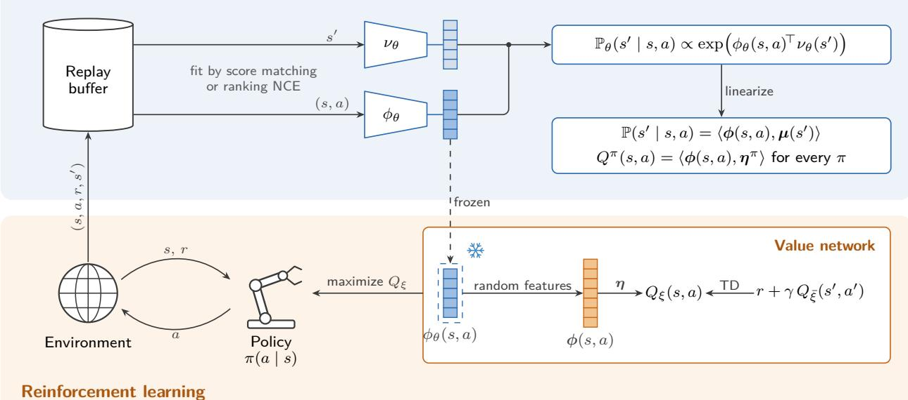  
Figure 7: RL with an EBM world model. Top: the world model Equation 144 scores a transition by the inner product of $\phi _ { \theta } ( s , a )$ and $\nu _ { \theta } ( s ^ { \prime } )$ , and is fit to transitions from the replay bufer by score matching Equation 126 or ranking NCE Equation $4 7 .$ . Random features linearize it Equation 148, so that the Q-function of every policy is linear in $\phi ( s , a )$ Equation 146. Bottom: $\phi _ { \theta }$ is frozen and used as the input of the value network Equation 150, which computes these features with sinusoidal activations and is trained by TD learning, while the policy maximizes $Q _ { \xi }$ and its transitions fill the bufer. Figure adapted from Gao et al. [69].

## 6.4 RL with EBM World Models

The previous subsections place the energy on actions and use no model of the dynamics. A world model, $i . e .$ a model of the transition $\mathbb { P } ( s ^ { \prime } \mid s , a )$ , is the other ingredient of $\mathrm { R L , }$ and it can itself be an EBM. Planners, discussed in Section 6.5, roll out such a model, but an EBM world model can also be used without sampling from ${ \mathrm { i t } } ,$ by extracting from it a representation in which value functions are linear and learning the value by temporal-diference (TD) learning [143, 158, 145, 69], as summarized in Figure 7. The world model is the bilinear EBM of Section 5.1, with the state–action pair as the condition and the next state as the target,

$$
\mathbb { P } _ { \theta } \big ( \boldsymbol { s } ^ { \prime } \mid \boldsymbol { s } , \boldsymbol { a } \big ) = \frac { \exp \big ( \phi _ { \theta } \big ( \boldsymbol { s } , \boldsymbol { a } \big ) ^ { \top } \nu _ { \theta } \big ( \boldsymbol { s } ^ { \prime } \big ) \big ) } { Z _ { \theta } \big ( \boldsymbol { s } , \boldsymbol { a } \big ) } , \qquad Z _ { \theta } \big ( \boldsymbol { s } , \boldsymbol { a } \big ) = \int \exp \big ( \phi _ { \theta } \big ( \boldsymbol { s } , \boldsymbol { a } \big ) ^ { \top } \nu _ { \theta } \big ( \boldsymbol { s } ^ { \prime } \big ) \big ) ~ d \boldsymbol { s } ^ { \prime } ,\tag{144}
$$

$i . e . ,$ , an EBM with energy $E _ { \theta } ( s , a , s ^ { \prime } ) = - \phi _ { \theta } ( s , a ) ^ { \top } \nu _ { \theta } ( s ^ { \prime } )$ . The same construction extends to partially observed MDPs, where the state is replaced by a short window of past observations and actions, and a bilinear EBM over the next observation gives a representation of the belief in which value functions are again linear [202], [69, Section $6 ]$

Linear Value Functions. Suppose that the transition and the reward factorize through a feature map $\phi ( s , a )$ in a Hilbert space $\mathcal { H }$

$$
\begin{array} { r } { \mathbb { P } ( s ^ { \prime } \mid s , a ) = \langle \phi ( s , a ) , \mu ( s ^ { \prime } ) \rangle _ { \mathcal { H } } , \qquad r ( s , a ) = \langle \phi ( s , a ) , \pmb { \theta } _ { r } \rangle _ { \mathcal { H } } , } \end{array}\tag{145}
$$

which always holds for some, possibly infinite-dimensional, $\mathcal { H } , e . g .$ , by the singular value decomposition of the transition operator. Then the Q-function of every policy $\pi$ is linear in $\phi$ [69, Lemma 1], since by the Bellman equation

$$
\begin{array} { c } { { Q ^ { \pi } ( s , a ) = r ( s , a ) + \gamma \displaystyle \int \mathbb { P } ( s ^ { \prime } \mid s , a ) V ^ { \pi } ( s ^ { \prime } ) d s ^ { \prime } = \langle \phi ( s , a ) , \eta ^ { \pi } \rangle _ { \mathcal { H } } , } } \\ { { { } } } \\ { { \displaystyle \eta ^ { \pi } = \pmb { \theta } _ { r } + \gamma \displaystyle \int \mu ( s ^ { \prime } ) V ^ { \pi } ( s ^ { \prime } ) d s ^ { \prime } . } } \end{array}\tag{146}
$$

The representation $\phi$ is therefore suficient for the Q-function of every policy, and only the weights $\eta ^ { \pi }$ depend on the policy.

Linearizing the EBM World Model. The EBM Equation 144 is not of the form Equation 145, because the inner product sits inside the exponential, but it can be brought into that form with random features. Completing the square, $\begin{array} { r } { \phi ^ { \top } \boldsymbol { \nu } = \frac { 1 } { 2 } \left\| \phi \right\| ^ { 2 } + \frac { 1 } { 2 } \left\| \boldsymbol { \nu } \right\| ^ { 2 } - \frac { 1 } { 2 } \left\| \phi - \boldsymbol { \nu } \right\| ^ { 2 } } \end{array}$ , turns exp $\left( \phi ^ { \top } \nu \right)$ into a Gaussian kerne $k ( \phi { - } \nu ) =$ exp $\left( - \textstyle { \frac { 1 } { 2 } } \left\| \phi - \nu \right\| ^ { 2 } \right)$ between the two representations, rescaled by functions of each side alone. A shiftinvariant kernel is an expectation of products of random Fourier features [69, Lemma 2], $2 ]$

$$
k ( \pmb { x } - \pmb { y } ) = \mathbb { E } _ { \omega \sim p ( \omega ) } \left[ \zeta _ { \omega } ( \pmb { x } ) \zeta _ { \omega } ( \pmb { y } ) ^ { * } \right] , \qquad \zeta _ { \omega } ( \pmb { x } ) = e ^ { \mathrm { i } \omega ^ { \top } \pmb { x } } ,\tag{147}
$$

where $p ( \omega )$ is the Fourier transform of $k ,$ which is $\mathcal { N } ( 0 , I )$ for the Gaussian kernel. Replacing the expectation by $N$ samples gives finite features $\zeta _ { N } ( { \pmb x } )$ of cosines and sines, and substituting into Equation 144 gives the factorization Equation 145 with

$$
\begin{array} { r l } & { \phi _ { \mathrm { E B M } } ( s , a ) = \frac { \exp \Big ( \frac { 1 } { 2 } \left\| \phi _ { \theta } ( s , a ) \right\| ^ { 2 } \Big ) \ \zeta _ { N } ( \phi _ { \theta } ( s , a ) ) } { Z _ { \theta } ( s , a ) } = \frac { \zeta _ { N } \left( \phi _ { \theta } ( s , a ) \right) } { \langle \zeta _ { N } \left( \phi _ { \theta } ( s , a ) \right) , u \rangle } , } \\ & { \quad \mu _ { \mathrm { E B M } } ( s ^ { \prime } ) = \exp \Big ( \frac { 1 } { 2 } \left\| \nu _ { \theta } ( s ^ { \prime } ) \right\| ^ { 2 } \Big ) \ \zeta _ { N } \left( \nu _ { \theta } ( s ^ { \prime } ) \right) , } \end{array}\tag{148}
$$

where the second form uses that the partition function is itself linear in the same features, $Z _ { \theta } ( s , a ) =$ $\begin{array} { r } { \left. \exp \left( \frac { 1 } { 2 } \left\| \phi _ { \theta } \right\| ^ { 2 } \right) \zeta _ { N } ( \phi _ { \theta } ) , \mathbf { \mathscr { u } } \right. } \end{array}$ with $\begin{array} { r } { \pmb { u } = \int \pmb { \mu } _ { \mathrm { E B M } } ( s ^ { \prime } ) d s ^ { \prime } } \end{array}$ . The Q-functions are thus linear in features computed from $\phi _ { \theta } ( s , a )$ alone. Stochastic nonlinear dynamics with Gaussian noise, $s ^ { \prime } = f ( s , a ) + \epsilon ,$ , are a special case, since $\begin{array} { r } { \mathbb { P } ( s ^ { \prime } \mid s , a ) \propto \exp \Big ( - \left\| s ^ { \prime } - f ( s , a ) \right\| ^ { 2 } / ( 2 \sigma ^ { 2 } ) \Big ) } \end{array}$ is a Gaussian kernel between $f ( s , a )$ and $s ^ { \prime } ,$ and the same random features give a finite-dimensional representation of the known or learned dynamics directly [143, 145].

Learning the World Model. Since the world model is the bilinear EBM of Section $5 ,$ its representation ϕ<sub>θ</sub> is learned by the same estimators, with the state–action pair as x and the next state as $\mathbf { \pmb { y } } .$ Dif-SR [158] uses score matching, the difusion spectral representation of Section 5.4: the next state is perturbed by a Gaussian kernel, $\mathbb { P } ( { \tilde { s } } ^ { \prime } \mid s ^ { \prime } ; \beta ) = { \mathcal { N } } \left( { \sqrt { 1 - \beta } } { \bar { s } } ^ { \prime } , \beta I \right)$ , the perturbed transition is parameterized as $\mathbb { P } _ { \theta } ( \tilde { s } ^ { \prime } \ |$ $s , a ; \beta ) \propto \exp \left( \phi _ { \theta } ( s , a ) ^ { \top } \nu _ { \theta } ( \tilde { s } ^ { \prime } ; \beta ) \right)$ with $\phi _ { \theta }$ shared across noise levels, and its score $\nabla _ { \tilde { s } ^ { \prime } } \nu _ { \theta } ( \tilde { s } ^ { \prime } ; \beta ) ^ { \top } \phi _ { \theta } ( s , a )$ is regressed onto the score of the perturbation kernel, as in Equation 126. CTRL-SR [69] uses ranking NCE Equation $4 7$ instead, with the model $\mathbb { P } _ { \theta } \big ( s ^ { \prime } \mid s , a \big ) \propto \tilde { \mathbb { P } } ( s ^ { \prime } ) \exp \big ( \phi _ { \theta } \big ( s , a \big ) ^ { \top } \nu _ { \theta } ( s ^ { \prime } ) \big )$ relative to a noise distribution $\tilde { \mathbb { P } }$ over next states; the noise term depends only on $s ^ { \prime }$ and is absorbed into µ<sub>EBM</sub>, so it does not change ϕ . To avoid negatives that are too easy to tell apart from the true next state, the positives and negatives are perturbed by the same Gaussian kernel at several noise levels, and the ranking NCE losses are averaged over the levels, so that the classification becomes harder, and more informative, as the noise grows.

Relation to Successor Features. Successor features [40, 15] also make the Q-function linear. With $r = \langle \phi , \pmb \theta _ { r } \rangle _ { \mathcal { H } } , Q ^ { \pi } ( s , a ) = \langle \pmb \psi ^ { \pi } ( s , a ) , \pmb \theta _ { r } \rangle _ { \mathcal { H } } ,$ where the successor features satisfy their own Bellman equation,

$$
\psi ^ { \pi } ( s , a ) = \mathbb { E } _ { \pi } \left[ \sum _ { t \geqslant 0 } \gamma ^ { t } \phi ( s _ { t } , a _ { t } ) \middle | s _ { 0 } = s , a _ { 0 } = a \right] = \phi ( s , a ) + \gamma \mathbb { E } _ { s ^ { \prime } \sim \mathbb { P } ( \cdot \mid s , a ) , a ^ { \prime } \sim \pi ( \cdot \mid s ^ { \prime } ) } \left[ \psi ^ { \pi } ( s ^ { \prime } , a ^ { \prime } ) \right] ,\tag{149}
$$

and are learned by TD on the right-hand side, as $Q ^ { \pi }$ is, with the vector $\phi$ in place of the reward. Its fixed point is $\psi ^ { \pi } = ( I - \gamma \mathbb { P } ^ { \pi } ) ^ { - 1 } \phi .$ with $\mathbb { P } ^ { \pi } ( s ^ { \prime } , a ^ { \prime } \mid s , a ) = \mathbb { P } ( s ^ { \prime } \mid s , a ) \pi ( a ^ { \prime } \mid s ^ { \prime } )$ , and learning low-rank successor features in this way is equivalent to taking the left singular vectors of the multi-step operator $( I - \gamma \mathbb { P } ^ { \pi } ) ^ { - 1 } \ [ 1 4 4 ]$ . In the terms of Section $5 ,$ the two representations difer in the pair of variables that the energy couples: the EBM world model couples the state–action pair with the next state, whereas successor features couple it with the discounted future occupancy under $\pi .$ . Successor features therefore depend on the policy: they transfer across rewards for a fixed $\pi ,$ but must be relearned by TD when the policy changes. The representation $\phi$ factorizes the single-step transition, does not depend on the policy, and is suficient for the Q-function of every policy, which enters only through $\eta ^ { \pi }$ ; it is learned once from transitions by NCE or score matching, which is more convenient than TD.

Representation-Based TD. Once $\phi _ { \theta }$ is learned, it is frozen, and the Q-function is fitted on top of it by TD learning, without sampling from the world model. Following Equation 148, the Q-network computes the random features of $\phi _ { \theta } ( s , a )$ with sinusoidal activations and adds one layer for the normalization,

$$
\begin{array} { r l } & { \boldsymbol { Q } _ { \xi } ( s , a ) = \mathrm { a c t } \left( W _ { 2 } \left[ \cos \left( W _ { 1 } \phi _ { \theta } ( s , a ) \right) ; \sin \left( W _ { 1 } \phi _ { \theta } ( s , a ) \right) \right] \right) ^ { \top } \boldsymbol { \eta } , } \\ & { \quad \boldsymbol { \ell } _ { \mathrm { T D } } ( \xi ) = \mathbb { E } _ { ( s , a , r , s ^ { \prime } ) \sim \mathcal { D } } \left[ \left( r + \gamma \mathbb { E } _ { a ^ { \prime } \sim \pi } \left[ \boldsymbol { Q } _ { \bar { \xi } } ( s ^ { \prime } , a ^ { \prime } ) \right] - \boldsymbol { Q } _ { \xi } ( s , a ) \right) ^ { 2 } \right] , } \end{array}\tag{150}
$$

where $\xi = ( W _ { 1 } , W _ { 2 } , \pmb { \eta } )$ , act is a nonlinear activation, and $\bar { \xi }$ is a slowly updated target copy, and the policy maximizes $Q _ { \xi }$ . The TD objective does not train $\phi _ { \theta } \colon$ by Equation 146, the representation learned from the dynamics already spans the Q-function of every policy, so TD only fits the policy-dependent weights. The EBM view thus separates the two parts of model-based RL: the world model is learned as an EBM by the estimators of Section 2.5, and its partition function and sampler are never needed for control, since the random features linearize both the transition and its normalization.

## 6.5 Planning with Trajectory EBMs

The policies of Sections 6.1–6.3 are EBMs over the action at a single state. Planning instead reasons about whole trajectories: given a model of the dynamics, such as the world models of Section 6.4, and a task, it searches for sequences of states and actions that accomplish the task. The entropy regularization of Section 6.1 again turns this search into inference in an EBM, now over trajectories [8, 173, 109]. This EBM is where composition (Section 2.3) is most useful: learned dynamics, behavior priors, goals, costs, and constraints each contribute an energy term, and a new task is a new sum of terms.

Planning as Inference over Trajectories. Consider trajectories $\tau = ( s _ { 0 } , a _ { 0 } , \ldots , a _ { T - 1 } , s _ { T } )$ of horizon $T$ from a given initial state $s _ { 0 }$ , with the base measure

$$
p _ { 0 } ( \tau ) = \prod _ { t = 0 } ^ { T - 1 } \pi _ { 0 } ( a _ { t } \mid s _ { t } ) P ( s _ { t + 1 } \mid s _ { t } , a _ { t } ) ,\tag{151}
$$

where $\pi _ { 0 }$ is a prior over actions: uniform for maximum entropy, or a behavior model learned from data for KL regularization. With the return $\begin{array} { r } { R ( \tau ) = \sum _ { t = 0 } ^ { T - 1 } r \big ( s _ { t } , a _ { t } \big ) + r _ { T } \big ( s _ { T } \big ) } \end{array}$ , where $r _ { T }$ scores the final state, maximum-entropy planning solves

$$
\operatorname* { m a x } _ { q } \mathbb { E } _ { \tau \sim q } \left[ R ( \tau ) \right] - \lambda { \mathrm { K L } } \left( q \| p _ { 0 } \right) .\tag{152}
$$

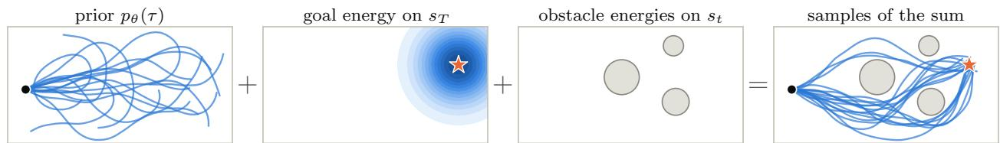  
Figure 8: Planning by composing trajectory energies. The planning energy (Equation 154) is a sum of terms that are independently specified: a prior over trajectories that start at the black dot (shown by its samples), an energy on the final state that is low near the goal (star; darker is lower), and an energy on every state that is high inside each obstacle (gray). Sampling the sum gives trajectories that reach the goal and avoid the obstacles (right), where trajectories are generated through MPPI with the prior.

By the same argument as Equation 56, with $p _ { 0 }$ in place of the uniform base measure, the solution is the residual EBM Equation 4

$$
\begin{array} { r } { q ^ { \star } ( \tau ) = \frac { p _ { 0 } ( \tau ) \exp { ( R ( \tau ) / \lambda ) } } { Z } , \qquad Z = \mathbb { E } _ { \tau \sim p _ { 0 } } \left[ \exp { ( R ( \tau ) / \lambda ) } \right] , } \end{array}\tag{153}
$$

and the optimal value is λ log $Z .$ This is the trajectory EBM of maximum-entropy IRL Equation 139 with the roles reversed: IRL learns the reward from samples of this EBM, while planning draws samples from it for a given reward. As $\lambda  0 , q ^ { \star }$ concentrates on the trajectories of highest return in the support of $p _ { 0 } .$ and planning reduces to trajectory optimization, $i . e .$ , MAP prediction Equation 34 with this EBM. One caveat concerns stochastic dynamics. Since $q$ in Equation 152 ranges over all distributions over trajectories, $q ^ { \star }$ also reweights the transitions toward favorable outcomes, which is the optimistic backup Equation 141 of Section 6.3; requiring $q$ to keep the true dynamics instead gives the soft Bellman backup Equation 131 and a closed-loop policy. For deterministic dynamics, the two coincide, and $q ^ { \star }$ is a distribution over action sequences, with the states given by rolling out the model. Most planners work in this setting: they sample or optimize an open-loop action sequence under a known or learned model, execute its first action, and plan again at the next step, as in model predictive control.

Sampling-Based Planners. Planners that roll out a model are samplers or optimizers of Equation 153. Model predictive path integral control (MPPI) [189], derived from path integral control [99, 169], draws K action sequences from a Gaussian around the current plan, rolls them out, and moves the plan to their weighted average with weights $w _ { k } \propto \exp { ( R ( \tau _ { k } ) / \lambda ) }$ . With the Gaussian as $p _ { 0 }$ , these are the weights of the self-normalized importance sampler of Section 4.4, so each iteration estimates the mean of $q ^ { \star }$ . The crossentropy method [149, 41] replaces these weights by a hard selection, refitting the Gaussian to the sampled sequences with the highest returns. Iterating either method, with the refitted Gaussian as the next $p _ { 0 } .$ , is mirror descent over action sequences [184], the trajectory analogue of the policy update Equation 132. For a diferentiable model and reward, Langevin dynamics Equation 25 and gradient descent Equation 35 on the action sequence, with gradients backpropagated through the rollout, respectively sample $q ^ { \star }$ and find a MAP plan.

Composing Trajectory Energies. Taking the negative logarithm of Equation 153 writes the planning distribution as a sum of energies,

$$
E ( \tau ) = \underbrace { - \sum _ { t = 0 } ^ { T - 1 } \log P ( s _ { t + 1 } \mid s _ { t } , a _ { t } ) } _ { \mathrm { d y n a m i c s } } \underbrace { - \sum _ { t = 0 } ^ { T - 1 } \log \pi _ { 0 } ( a _ { t } \mid s _ { t } ) } _ { \mathrm { b e h a v i o r ~ p r i o r } } \underbrace { - \frac { 1 } { \lambda } \sum _ { t = 0 } ^ { T - 1 } r ( s _ { t } , a _ { t } ) } _ { \mathrm { r e w a r d s ~ a n d ~ c o s t s } } \underbrace { - \frac { 1 } { \lambda } r _ { T } ( s _ { T } ) } _ { \mathrm { g o a l } } ,\tag{154}
$$

which is an MRF Equation 9 over the trajectory whose factors can come from diferent sources: the dynamics from interaction data or a simulator, the behavior prior from demonstrations, and the rewards and goal from the task. For deterministic dynamics, the first term is a set energy Equation 15 with $C  \infty$ that restricts τ to dynamically feasible trajectories. Following Section 2.3, each term can be learned or specified separately and combined at inference time, and the task terms decompose further, $e . g . _ { \because }$ , into a goal energy on $s _ { T }$ and one energy per obstacle on each $s _ { t } .$ This example, which is also discussed in the introduction, is illustrated in Figure 8. An energy describing plausible robot trajectories, combined with energies expressing a destination and obstacle constraints enables us to form plans towards the goal that avoids obstacles. Du et al. [52] learn an energy over state transitions in place of the dynamics and behavior terms, and plan by sampling state sequences from it together with start and goal constraints; planning in state space gives maximum-entropy inference of diverse plans and generalizes better to obstacles unseen during training.

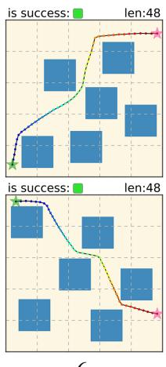  
6

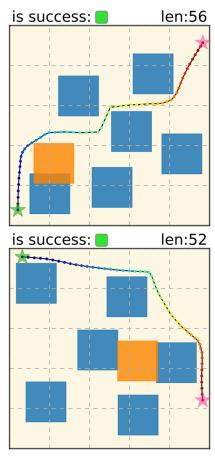  
6 + 1

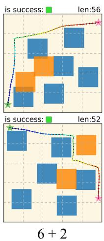

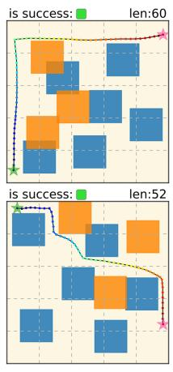  
6 + 3

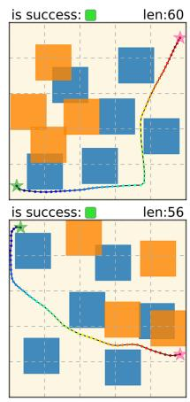  
6 + 4

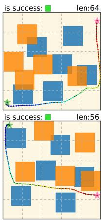  
6 + 5  
Figure 9: Composing trajectory potentials for more obstacles. A difusion model learns a potential over plans in two-dimensional mazes with six obstacles. In a maze with 6 + k obstacles (orange: the k extra ones), the potentials conditioned on diferent groups of obstacles are added, and sampling the sum gives a collision-free plan from the start (green star) to the goal (pink star) without retraining. The two rows are diferent problems. Reproduced from Luo et al. [122].

Difusion Planners. Difusion models can learn the dynamics and behavior terms of Equation 154 jointly, as one prior over trajectories. Difuser [98] trains a difusion model over state–action trajectories from ofline data, i.e., a family of trajectory EBMs (Section 4.3), and plans by sampling the perturbed distribution $\tilde { p } ( \tau )$ ∝ $p _ { \theta } ( \tau ) h ( \tau )$ , where h encodes rewards, goals, or constraints. Reward guidance adds the gradient of a learned return model $J _ { \phi } ( \tau )$ to the reverse process at every noise level, which is classifier guidance Equation 86 with the energy $- J _ { \phi }$ . It therefore targets the planning EBM Equation 153 with $1 / \lambda$ given by the guidance scale and the learned trajectory distribution $p _ { \theta }$ as the base measure, which keeps plans close to the trajectories that the data support. Goals are imposed by inpainting, i.e., by clamping the start and goal states, which conditions the joint energy as in Section 2.3. Decision Difuser [1] models state sequences, extracts actions with an inverse dynamics model, and conditions on returns, constraints, or skills by classifier-free guidance Equation 88; conditioning on a single constraint or skill during training yields behavior at test time that satisfies severa constraints together or composes skills, as in the conjunction Equation 23. Potential-based difusion motion planning [122] learns potentials over motion-planning trajectories with a difusion model and composes the potentials of diferent motion constraints by addition, as in classical potential-based planning. Since these planners compose by summing scores or energies at each noise level, the caveat of Section 4.3 applies: reverse difusion on summed scores only approximately samples the composed distribution, and MCMC on summed energies corrects it [55].

Sequence-Model Planners. Sequence models such as Transformers can also serve as the prior over trajectories, treating states, actions, and returns as tokens. Autoregressive models factorize this prior in a fixed order (Section 4.6), and the planners built on them difer in how they bring in the reward. Decision Transformer [28] conditions each action on the desired return-to-go and acts by conditioning on a high return, as Decision Difuser does; with stochastic dynamics, this favors actions that were followed by lucky outcomes, the optimism discussed after Equation 153. Trajectory Transformer [97] plans by beam search over the model’s likely continuations, keeping those with the highest predicted return, which is the greedy version of the sequential samplers of Section 7.2. Both generate a plan one step at a time, so they cannot revise earlier actions in light of later ones. Chen et al. [27] instead train a masked language model over action sequences, which defines an implicit energy over the whole plan, as in BERT (Section 5.3), and plan by iteratively resampling actions to lower it, in the manner of the Gibbs sampler of Section 2.4, so that any step can be revised and constraints can be added as energy terms.

g: pick up sponge and wipe plate  
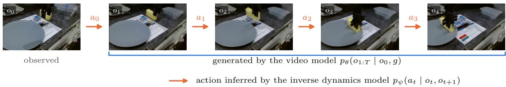  
Figure 10: Planning with a video model. The trajectory distribution Equation 155 factors into a video model, which turns the current frame $o _ { 0 }$ and the instruction $g$ into a video plan $O 1 { : } T$ (blue), and an inverse dynamics model, which infers each action $a _ { t }$ from a pair of consecutive frames (orange). The video model, trained across tasks, supplies the dynamics and behavior terms of Equation 154, and only the inverse dynamics model depends on the robot. Frames from Du et al. [56], where $o _ { 1 } , \ldots , o _ { 4 }$ are generated.

Planning with Generative World Models. When states are images, the trajectory energy can be split between a model of observation sequences and a model of actions. UniPi [56] generates a video plan with a text-conditioned video difusion model, conditioned on the current frame and a language description g of the goal, and extracts actions with an inverse dynamics model,

$$
p ( o _ { 1 : T } , a _ { 0 : T - 1 } \mid o _ { 0 } , g ) = p _ { \theta } ( o _ { 1 : T } \mid o _ { 0 } , g ) \prod _ { t = 0 } ^ { T - 1 } p _ { \psi } ( a _ { t } \mid o _ { t } , o _ { t + 1 } ) ,\tag{155}
$$

where $o _ { t }$ is the observation at step t. The video model, trained on broad data across tasks, plays the role of the dynamics and behavior terms of Equation 154, the text plays the role of the goal, and only the small inverse dynamics model depends on the action space of the robot. Compositional foundation models for hierarchical planning [2] compose a language model that proposes subgoals, a video model that grounds them in visual plans, and an inverse dynamics model that turns the videos into actions, and enforce consistency among the three by iterative refinement. Video language planning [58] searches over long-horizon video plans with a tree search, using vision–language models as the policy and value function and a text-to-video model as the dynamics. In each case, separately trained models supply diferent factors of one distribution over trajectories, which is the sense in which learned dynamics, behavior models, and task objectives contribute components of a common inference problem.

Planning versus Policies. Policies and planners represent the same EBM at diferent levels. For deterministic dynamics, the trajectory EBM Equation 153 factorizes along the trajectory into the soft-optimal policy given by Equation 131, as shown for maximum-entropy IRL in Section 6.3. A policy amortizes planning into one network for one reward and acts in a single forward pass. A planner keeps the terms of Equation 154 separate and pays with sampling or optimization at every decision, but a new goal, cost, or constraint only requires a new energy term rather than a new policy. This is the trade-of between amortized sampling and MCMC in Section 2.4, and between learning the policy and learning the reward in Section 6.3, now applied to acting.

## 7 Inference-Time Computation

A recent source of improvement in large models is to spend more computation per input at inference time rather than at training time. In the EBM view, these procedures are samplers or optimizers for one distribution, the composition of a pretrained generator with a verifier, which is the KL-regularized EBM of Section 6.1. We first describe this target, then view common inference-time methods as the samplers of Section 2.4, Section $4 . 4 ,$ and Section $6 . 5 ,$ then show how composing learned energies supports reasoning on problems larger than those seen in training, and finally relate inference-time computation to fine-tuning, which amortizes the same sampler.

## 7.1 Verifiers Define the Target

Let $\pi _ { 0 } ( \pmb { y } \mid \pmb { x } )$ be a pretrained generator, such as a language model that answers a prompt x with a response $\pmb { y } = ( y _ { 1 } , \dots y _ { T } )$ , and let $r ( { \pmb x } , { \pmb y } )$ be a verifier that scores complete responses, such as a learned reward model, a learned verifier [32], or a checker such as unit tests. The target of inference-time computation is the residual EBM

$$
\pi ^ { \star } ( \pmb { y } \mid \pmb { x } ) = \frac { \pi _ { 0 } ( \pmb { y } \mid \pmb { x } ) \exp \left( r ( \pmb { x } , \pmb { y } ) / \lambda \right) } { Z ( \pmb { x } ) } , \qquad Z ( \pmb { x } ) = \mathbb { E } _ { \pmb { y } \sim \pi _ { 0 } ( \cdot \mid \pmb { x } ) } \left[ \exp \left( r ( \pmb { x } , \pmb { y } ) / \lambda \right) \right] ,\tag{156}
$$

which is the optimal policy of the KL-regularized objective Equation 137, with the prompt as the state and the response as the action. The temperature λ trades the verifier against the generator. For a binary verifier, $r \in \{ 0 , 1 \}$ , the limit $\lambda  0$ gives $\pi ^ { \star } ( { \pmb y } \mid { \pmb x } ) = \pi _ { 0 } ( { \pmb y } \mid { \pmb x } , r = 1 )$ , the generator conditioned on being correct, which is the product of $\pi _ { 0 }$ with the set energy Equation 15 of correct responses, the logical AND of Section 2.3. Several verifiers compose in the same way, as π $\begin{array} { r } { \prod _ { k } \exp { ( r _ { k } / \lambda _ { k } ) } , ~ e . g . } \end{array}$ , for a correctness check and a style or safety reward. The verifier can even be the generator’s own likelihood, which sharpens the generator without any external signal, as discussed in Section 7.2. Since verifiers are learned or incomplete, the temperature also limits how far the target moves from the generator, as measured by $\mathrm { K L } \left( \pi ^ { \star } \| \pi _ { 0 } \right)$ , and thus how much an inaccurate verifier can be exploited. This is the requirement of Section 2.3 that each component be accurate where the composition places its mass. The target is a distribution, and the prediction can be a sample from it or its mode.

Black-Box Adaptation. The target Equation 156 requires only samples from the generator and evaluations of the verifier, not the parameters or the token probabilities of $\pi _ { 0 }$ . This enables us to directly adapt models, even when the strongest generators are often served only through an API, as black boxes. As illustrated in Figure 11, white-box adaptation fine-tunes the parameters of $\pi _ { 0 } .$ , and grey-box adaptation reweights its output token probabilities, but neither is available when the API returns only sampled text. The residual EBM still applies: BBox-Adapter [166] keeps $\pi _ { 0 }$ fixed as the base measure and learns the energy as a small language model $g _ { \theta } ( { \pmb x } , { \pmb y } ) , \ i . e . , \ r / \lambda = g _ { \theta }$ in Equation 156, so that $\pi _ { \boldsymbol { \theta } } ( \pmb { y } \mid \pmb { x } ) \propto \pi _ { 0 } ( \pmb { y } \mid \pmb { x } ) \exp \left( g _ { \boldsymbol { \theta } } ( \pmb { x } , \pmb { y } ) \right)$ . The energy is trained by ranking NCE Equation 47 with the generator itself as the noise distribution: targetdomain responses are the positives, the responses of $\pi _ { 0 }$ are the negatives, and since the model is a residual EBM with base measure $p _ { n } = \pi _ { 0 }$ , the unknown log $\pi _ { 0 }$ cancels from the logits, so its probabilities are never needed. The positives can come from ground truth or from human or AI feedback, and the negatives from previous adapted generations, which turns adaptation into an online loop that updates the verifier and the sampler together. Sampling from $\pi _ { \theta }$ also uses $\pi _ { 0 }$ only as a proposal: $\pi _ { 0 }$ proposes candidate continuations and $g _ { \boldsymbol { \theta } }$ scores them in a sentence-level beam search, a sequential variant of the samplers in Section 7.2. The same construction adapts black-box text-to-video models: a small video model trained on domain-specific data plays the role of the energy on top of a large pretrained model that is accessed only through its score, without its weights [194].

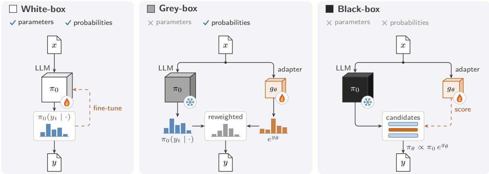  
Figure 11: White-box, grey-box, and black-box adaptation of a language model $\pi _ { 0 }$ . White-box adaptation accesses both the parameters and the output probabilities of $\pi _ { 0 }$ and can fine-tune it. Grey-box adaptation accesses only the token probabilities, which a small adapter $g _ { \theta }$ reweights. Black-box adaptation accesses neither and only receives sampled text: $\pi _ { 0 }$ proposes candidate sentences and $g _ { \theta }$ scores them to decide which to extend, a sentence-level beam search for $\pi _ { \theta } ~ \propto ~ \pi _ { 0 } e ^ { g _ { \theta } }$ Equation 156. The flame marks trainable models and the snowflake marks fixed, inaccessible ones. Adapted from Sun et al. [166].

## 7.2 Samplers for the Target

Sampling Complete Responses. The simplest methods draw N complete responses $y _ { 1 } , \dotsc , y _ { N } \dotsc$ $\pi _ { 0 } ( \cdot \mathrm { ~ \bf ~ | ~ } x )$ and use the verifier only to select among them. Returning y with probability proportional to exp $( r ( \pmb { x } , \pmb { y } _ { i } ) / \lambda )$ is the self-normalized importance sampler of Section 4.4 with the generator as the proposal: it samples a distribution that interpolates between $\pi _ { 0 }$ and $\pi ^ { \star }$ , and converges to $\pi ^ { \star }$ as $N \to \infty$ . Best-of- $N .$ which returns the response with the highest reward, is also a residual EBM. If the reward of $\mathbf { \psi } _ { \pmb { y } } \sim \pi _ { 0 } ( \cdot \mid \mathbf { \psi } _ { \pmb { x } } )$ has a continuous distribution with cumulative distribution function $F _ { x }$ , the returned response is distributed as [80]

$$
\pi _ { \mathrm { B o N } } ( \pmb { y } \mid \pmb { x } ) = N \pi _ { 0 } ( \pmb { y } \mid \pmb { x } ) F _ { \pmb { x } } \left( r ( \pmb { x } , \pmb { y } ) \right) ^ { N - 1 } ,\tag{157}
$$

since y is returned when it is one of the N draws and the other $N - 1$ draws have lower rewards. This is the KL-regularized optimum Equation 156 for the transformed reward log $F _ { \mathbf { x } } ( r )$ , the log-quantile of the reward under the generator, at temperature $\lambda = 1 / ( N - 1 )$ . Increasing N lowers the temperature, and the divergence from the generator is at most log $N - ( N - 1 ) / N _ { ☉ }$ , with equality for continuous rewards [17]. Rejection sampling gives exact samples instead: when $r \leqslant r _ { \mathrm { m a x } } .$ , accepting $\mathbf { \psi } _ { \mathbf { \psi } } \sim \pi _ { 0 } ( \cdot \mid \mathbf { \psi } _ { \mathbf { \psi } } \mathbf { \cdot } \mathbf { \sigma } )$ with probability exp $( ( r ( \pmb { x } , \pmb { y } ) - r _ { \operatorname* { m a x } } ) / \lambda )$ returns samples of Equation 156. For a binary verifier with $\lambda  0$ , it resamples until the verifier accepts, at an expected cost of $1 / \mathbb { E } _ { \pmb { y } \sim \pi _ { 0 } ( \cdot | \pmb { x } ) } \left[ r ( \pmb { x } , \pmb { y } ) \right]$ responses. Finally, majority voting over final answers, or self-consistency [187], is a Bayes prediction. Let $a ( \pmb { y } )$ be the final answer extracted from a response. The most frequent answer among the samples estimates the mode of the marginal distribution $\begin{array} { r } { p ( a \mid \pmb { x } ) = \sum _ { \pmb { y } } \pi _ { 0 } ( \pmb { y } \mid \pmb { x } ) \mathbf { 1 } [ a ( \pmb { y } ) = a ] } \end{array}$ , which is the Bayes prediction under the 0–1 loss on answers. It sums over the diferent responses that reach each answer, rather than taking the answer of the single most probable response, and weighting the votes by $\exp \left( r / \lambda \right)$ gives the same prediction under $\pi ^ { \star }$

Sequential Sampling and Search. Sampling complete responses wastes computation on responses that go wrong early. Since $\pi _ { 0 }$ is autoregressive, the target Equation 156 also factorizes over tokens, with the

conditionals

$$
\pi ^ { \star } ( y _ { t } \mid x , y _ { < t } ) = \pi _ { 0 } ( y _ { t } \mid x , y _ { < t } ) \frac { \psi _ { t } ( x , y _ { \leqslant t } ) } { \psi _ { t - 1 } ( x , y _ { < t } ) } , \qquad \psi _ { t } ( x , y _ { \leqslant t } ) = \mathbb { E } _ { y _ { > t } \sim \pi _ { 0 } ( \cdot \mid x , y _ { \leqslant t } ) } \left[ \exp \left( r ( x , y ) / { \lambda } \right) \right] ,\tag{158}
$$

where $\psi _ { t }$ is the expected exponentiated reward of completing the prefix with the generator, and $\psi _ { 0 } = Z ( { \pmb x } )$ This is the fixed-order factorization of an EBM Equation 96: $\pi _ { 0 } ( { \pmb y } _ { \leqslant t } \mid { \pmb x } ) \psi _ { t } ( { \pmb x } , { \pmb y } _ { \leqslant t } )$ is the sum over the unvisited tokens that autoregressive models reparameterize in Equation 97. It is also the soft-optimal policy of the KL-regularized $\mathrm { M D P }$ of Section 6.1 whose state is the prefix, whose action appends a token, and whose reward r arrives at the end, with λ log $\psi _ { t }$ as its soft value. Exact token-by-token sampling therefore needs $\psi _ { t }$ , which is as intractable as $Z ( { \pmb x } )$ , and practical methods approximate it. A future discriminator, which predicts an attribute of the completion from a prefix [193], learns $\psi _ { t }$ for a classifier energy, which is the autoregressive counterpart of classifier guidance Equation 86. Value models and process reward models, which score partial solutions [113], play the same role; for a binary verifier with $\lambda  0 , \psi _ { t }$ becomes, up to a constant, the probability that the generator completes the prefix correctly. With an approximate $\psi _ { t } ,$ sequential Monte Carlo (SMC) recovers $\pi ^ { \star }$ as the number of particles grows: it extends K partial responses in parallel, weights each extension by the ratio of successive approximate values, as in Equation 158, resamples the partial responses according to their weights, and corrects with the true reward at the end [111, 204]. Beam search keeps the K partial responses with the highest values, a greedy and deterministic version of this resampling, and tree search adds backtracking, as in the planners of Section 6.5.

Composing Models Token by Token. The same factorization explains a pitfall of composing autoregressive models. Sampling each token from the normalized product of the conditionals of two models gives

$$
q ( { \pmb y } \mid { \pmb x } ) = \prod _ { t = 1 } ^ { T } \frac { p _ { 1 } \left( y _ { t } \mid { \pmb x } , { \pmb y } _ { < t } \right) p _ { 2 } \left( y _ { t } \mid { \pmb x } , { \pmb y } _ { < t } \right) } { Z _ { t } \left( { \pmb x } , { \pmb y } _ { < t } \right) } = \frac { p _ { 1 } \left( { \pmb y } \mid { \pmb x } \right) p _ { 2 } \left( { \pmb y } \mid { \pmb x } \right) } { \prod _ { t = 1 } ^ { T } Z _ { t } \left( { \pmb x } , { \pmb y } _ { < t } \right) } ,\tag{159}
$$

where $\begin{array} { r } { Z _ { t } ( \pmb { x } , \pmb { y } _ { < t } ) = \sum _ { v } p _ { 1 } \big ( v \ \mid \ \pmb { x } , \pmb { y } _ { < t } \big ) p _ { 2 } \big ( v \ \mid \ \pmb { x } , \pmb { y } _ { < t } \big ) } \end{array}$ . The per-token normalizers depend on the prefix, so $q$ is not the product $p _ { 1 } p _ { 2 }$ of Section 2.3, for the same reason that summed scores do not give the score of a noised product in Section 4.3: normalizing at every step does not commute with taking products. The weights $\textstyle \prod _ { t } Z _ { t } ( { \pmb x } , { \pmb y } _ { < t } )$ are available as the tokens are drawn, so importance sampling or SMC with these weights is needed to remove the bias. Existing decoding-time methods use such token-level compositions directly, without this correction: DExperts [116] multiplies the base model by an expert and divides it by an anti-expert, an inversion Equation 22, and contrastive decoding [112] scores tokens by the ratio of a large model to a small one, restricted to the tokens the large model finds plausible, which is an inversion combined with a set energy Equation 15.

Sharpening without a Verifier. The verifier can also be the generator itself. Taking $r ( \pmb { x } , \pmb { y } ) = \log \pi _ { 0 } ( \pmb { y } \mid$ x) and $\lambda = 1 / ( \alpha - 1 )$ in Equation 156 gives the power distribution

$$
\pi _ { \alpha } ( { \pmb y } \mid { \pmb x } ) \propto \pi _ { 0 } ( { \pmb y } \mid { \pmb x } ) ^ { \alpha } , \qquad \alpha > 1 ,\tag{160}
$$

which is the EBM of the generator at the lower temperature $1 / \alpha , \mathrm { o r } ,$ for integer $\alpha ,$ the product of α copies of the generator (Section 2.3). Karan and Du [100] show that sampling from Equation 160 elicits reasoning from base language models without additional training or a verifier. Its single-sample accuracy is comparable to that of reinforcement learning with GRPO on the domain used for post-training and its accuracy over multiple samples is higher, since it avoids the loss of diversity that RL post-training causes. Low-temperature decoding, which samples each token from $\pi _ { 0 } ( y _ { t } \mid x , y _ { < t } ) ^ { \alpha }$ after normalization, does not sample Equation 160, for the same reason as the token-level product Equation 159. Writing the conditionals through the sum over completions in Equation 158, the two choose the next token according to

$$
\pi _ { \alpha } ( y _ { t } \mid \boldsymbol { x } , \boldsymbol { y } _ { < t } ) \propto \sum _ { \boldsymbol { y } > t } \pi _ { 0 } ( \boldsymbol { y } \mid \boldsymbol { x } ) ^ { \alpha } \qquad \mathrm { a n d } \qquad \pi _ { 0 } ( y _ { t } \mid \boldsymbol { x } , \boldsymbol { y } _ { < t } ) ^ { \alpha } \propto \left( \sum _ { \boldsymbol { y } > t } \pi _ { 0 } ( \boldsymbol { y } \mid \boldsymbol { x } ) \right) ^ { \alpha } ,\tag{161}
$$

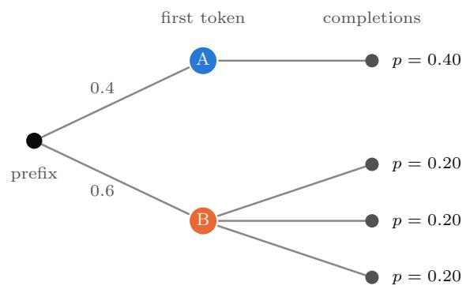

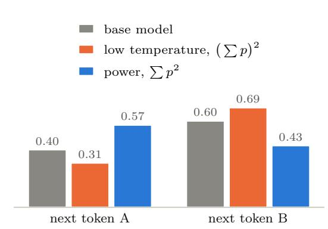  
Figure 12: Power distribution vs low-temperature sampling. The power distribution and lowtemperature decoding choose the next token diferently, here with $\alpha = 2$ . Token A has one completion with probability 0.4, and token B has three completions with probability 0.2 each. Low temperature sharpens the total probability of each token, $\left( \sum p \right) ^ { 2 }$ , and prefers ${ \mathrm { B } } ;$ the power distribution sums the sharpened probabilities of the completions, $\textstyle \sum p ^ { 2 }$ , and prefers A.

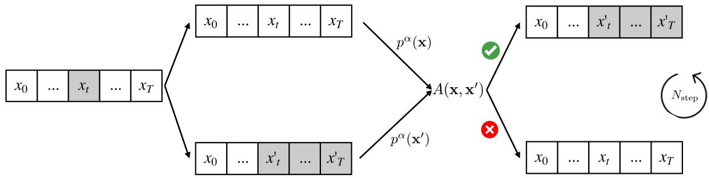  
Figure 13: Metropolis–Hastings for the power distribution (Equation 160). Here the response is $\pmb { x } = ( x _ { 0 } , \dots , x _ { T } )$ and the generator is $p \mathbf { \Omega } ( \pmb { y }$ and $\pi _ { 0 }$ in the text). A position t is chosen uniformly, the tokens from t onward are resampled with a proposal model (shaded), and the candidate $\mathbf { x } ^ { \prime }$ replaces x with the acceptance probability $A ( \pmb { x } , \pmb { x } ^ { \prime } )$ of Equation 24, which needs $p ^ { \alpha }$ only up to normalization; the step is repeated $N _ { \mathrm { s t e p } }$ times. Figure from Karan and Du [100].

respectively. That is, the power distribution sums the sharpened likelihoods of the completions, whereas lowtemperature decoding sharpens the sum of their likelihoods. The power distribution therefore prefers tokens with a few high-likelihood completions, and low-temperature decoding prefers tokens whose probability is spread over many low-likelihood completions [100], as illustrated in the example of Figure 12. The sum on the left equals $\pi _ { 0 } ( { \pmb y } _ { \leqslant t } \mid { \pmb x } ) \psi _ { t } ( { \pmb x } , { \pmb y } _ { \leqslant t } )$ in Equation 158 for this reward and is intractable. Instead of approximating it, Karan and Du [100] sample Equation 160 with Metropolis–Hastings Equation 24, illustrated in Figure 13. The proposal resamples the response from a uniformly chosen position onward with a proposal language model, with the acceptance probability dependent only on likelihoods of the current and proposed responses under the generator and the proposal, since the partition function cancels, and the MCMC steps are applied progressively as the response is generated. In the terms of Section $7 . 4 ,$ RL fine-tuning fits a mode-seeking approximation to a sharpened distribution, whereas MCMC samples the sharpened distribution itself, which is consistent with the diversity that power sampling retains.

Reasoning by Energy Minimization. When the verifier is itself a learned energy over complete outputs, $E _ { \theta } ( \pmb { x } , \pmb { y } )$ , inference can refine a candidate rather than only select among candidates, by minimizing the energy Equation 35. IREM [54] trains an energy so that a few steps of gradient descent on it reach the answer (Section 2.5), and on algorithmic tasks it solves harder problems than those seen in training by running more steps at test time. IRED [57] learns a sequence of annealed energy landscapes, supervised through both their scores and their energies, optimizes from the smoothest landscape to the sharpest, and adapts the number of steps to the dificulty of each problem, which lets it solve harder Sudoku puzzles and plan paths in larger graphs than in training. Energy-Based Transformers [76] learn such energies over inputs and candidate predictions at the scale of language and vision models, and use extra minimization steps and comparisons between candidates as a form of deliberate thinking. Inference-time computation then has two axes: more minimization steps refine each candidate, and more restarts, compared by their energies, select among candidates, which is best-of-N with $r = - E _ { \theta }$ . The same inference-time computation applies to difusion models, where a verifier enters as classifier guidance Equation 86. The two axes become local and global search [203]: more MCMC steps on the summed energy of the model and the verifier at each noise level refine each sample [55], and more branches of the denoising process, compared by the verifier, select among samples through breadth-first or depth-first tree search.

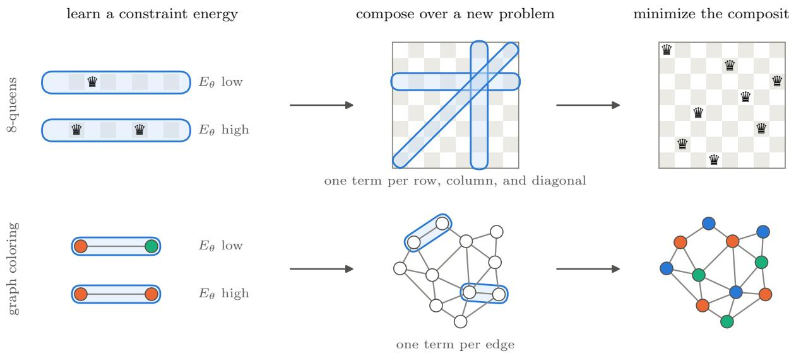  
Figure 14: Compositional reasoning by energy minimization. An energy $E _ { \theta }$ is trained on a single constraint, a row of a chessboard that must hold one queen or an edge whose endpoints must difer in color, to be low on valid assignments and high on invalid ones (left). For a new problem, the energies of all its constraints are summed as in Equation 162: one term for each row, column, and diagonal of an $8 \times 8$ board, or for each edge of a larger graph, with outlines marking the variables of a few of the terms (middle). Minimizing the sum solves the problem (right). Adapted from Oarga and Du [135].

## 7.3 Compositional Reasoning

So far, verifiers and learned energies have scored complete solutions, and harder problems have been met by spending more computation on the same energy, as IREM and IRED do by running more minimization steps. Many reasoning problems, however, are defined by constraints on parts of their solutions. Each clause of a 3-SAT problem involves three variables, a valid coloring of a graph gives diferent colors to the two endpoints of every edge, and a solution of the N-queens problem places one queen in every row and column and at most one on every diagonal. A network trained end to end to map problems to solutions must learn this whole map from examples, and it often fails on problems larger than those it was trained on. The energy view suggests a diferent decomposition, illustrated in Figure 14: learn an energy for each kind of constraint, compose the energies of the constraints that appear in a new problem, and solve the problem by minimizing the composition [135].

Composed Energies. We write a problem x as a set of constraints $c _ { 1 } , \ldots , c _ { K }$ , where $c _ { k }$ involves the variables $\mathbf { \nabla } _ { \mathbf { \boldsymbol { y } } _ { S _ { k } } }$ of the solution, such as the two endpoints of an edge or the three variables of a clause. An energy $E _ { \theta } ( c , y _ { S } )$ that is low on the assignments satisfying a single constraint is composed into the energy of the whole problem,

$$
E ( \pmb { x } , \pmb { y } ) = \sum _ { k = 1 } ^ { K } E _ { \theta } \left( c _ { k } , \pmb { y } _ { S _ { k } } \right) ,\tag{162}
$$

which is an MRF Equation 9 whose factors share one learned energy and whose graph is given by the problem. When a solution exists, the minimizers of Equation 162 satisfy every constraint, which is the logical AND Equation 16 of Section 2.3. A problem with more variables and constraints than any training problem is a longer sum of the same terms, so training needs to cover the kinds of constraints rather than their combinations, which is the sample-complexity argument of Section 2.3 applied to reasoning. Oarga and Du [135] train such energies on single clauses of 3-SAT, single edges of graph coloring, and the rows of one N-queens solution, using the energy-parameterized denoising objective of Section 4.3 together with a contrastive loss that raises the energy of invalid assignments (Section 2.5). They compose the energies over whole problems, including SAT instances and graphs larger than any used in training, and, since a sum of separately trained energies can have spurious minima, they can fine-tune the composition on complete solutions.

Minimizing the Composition. The composed energy is harder to minimize than any of its terms: its minima are where all terms agree, it is non-convex, and gradient descent or Langevin dynamics Equation 25 from a single initialization is easily trapped. Oarga and Du [135] minimize it with parallel energy minimization (PEM), an SMC procedure over the noise levels of the energy: a population of candidates starts from noise, and at each level, the candidates are resampled in proportion to exp (−E), perturbed with noise, and moved by a gradient step on the energy at that level. Resampling discards candidates in poor local minima, and the noise keeps the population spread over diferent solutions. More candidates solve more problems, so the computation spent at inference can grow with the dificulty of a problem, which a network that predicts the solution in a single pass cannot do. With this sampler, the composed energies outperform learned solvers trained end to end on most of the N-queens, 3-SAT, and graph-coloring benchmarks considered, including their larger instances [135].

Relation to Planning and Verification. The composed energy Equation 162 has the structure of the trajectory energies of Section 6.5, which are composed from dynamics, goals, and obstacles, and of the constraint solvers composed from difusion models [197]: in each, the factors are learned separately and the graph is chosen for each problem. In the terms of Section 7.1, each factor is a local verifier, and their sum is a verifier for the whole problem that was never trained on a whole problem. Since this verifier is a diferentiable energy, it can refine candidates as well as select them, and the samplers of Section 7.2 apply to it directly.

## 7.4 Amortizing Inference-Time Computation

Inference-time methods spend computation on each new input to draw approximate samples from the target distribution in Equation 156,

$$
\pi ^ { \star } ( \pmb { y } \mid \pmb { x } ) = \frac { \pi _ { 0 } ( \pmb { y } \mid \pmb { x } ) \exp \left( r ( \pmb { x } , \pmb { y } ) / \lambda \right) } { Z ( \pmb { x } ) } , \qquad Z ( \pmb { x } ) = \mathbb { E } _ { \pmb { y } \sim \pi _ { 0 } ( \cdot \mid \pmb { x } ) } \left[ \exp \left( r ( \pmb { x } , \pmb { y } ) / \lambda \right) \right] .
$$

This distribution reweights the pretrained model $\pi _ { 0 }$ toward responses with higher verifier scores. Fine-tuning amortizes this computation into the generator’s weights: it learns a model $\pi _ { \theta }$ that approximates the target across inputs, allowing high-reward responses to be generated with less search at inference time. Below, we discuss three approaches to learning such a model.

RL Fine-Tuning. KL-regularized RL rewards high verifier scores while keeping the model close to $\pi _ { 0 }$ Substituting the definition of $\pi ^ { \star }$ into its objective gives

$$
\begin{array} { r } { { \mathbb E } _ { { \pmb y } \sim { \pi } _ { \ b { \theta } } ( \cdot | { \pmb x } ) } [ r ( { \pmb x } , { \pmb y } ) ] - \lambda \mathrm { K L } ( \pi _ { \pmb { \theta } } \| \pi _ { 0 } ) = - \lambda \mathrm { K L } ( \pi _ { \pmb { \theta } } \| \pi ^ { \star } ) + \lambda \log Z ( { \pmb x } ) . } \end{array}\tag{163}
$$

Since $Z ( { \pmb x } )$ does not depend on $\theta ,$ maximizing this objective is equivalent to minimizing the reverse KL to the target, as in variational inference (Equation 29) and policy learning (Equation 133). This objective is often mode-seeking: when $\pi _ { \theta }$ cannot match $\pi ^ { \star }$ exactly, it may concentrate on a few high-probability regions of the target.

Practical algorithms build on this objective. GRPO [156], for example, uses REINFORCE-style policy gradients (Equation 32) with rewards normalized within a group of responses to the same prompt. It subtracts the group’s mean reward and divides by its standard deviation, then combines these normalized rewards with PPO-style clipping and a KL penalty to the reference model.

Rejection-Sampling Fine-Tuning. A second approach uses the verifier to construct a training dataset. For each input, we sample several responses from $\pi _ { 0 }$ , discard those that fail the verifier, and train the model on those that pass. This is the basic idea behind methods such as STaR [199] and RFT [198], and it amortizes the rejection sampler of Section 7.2 into the weights of $\pi _ { \theta }$ . For a binary verifier, $r \in \{ 0 , 1 \}$ , the accepted responses are exact samples of $\pi ^ { \star } ( { \pmb y } \mid { \pmb x } ) = \pi _ { 0 } ( { \pmb y } \mid { \pmb x } , r = 1 )$ , the $\lambda  0$ limit of the target (Section 7.1), which keeps the relative probabilities that $\pi _ { 0 }$ assigns to correct responses and removes the incorrect ones. The expected log-likelihood of these responses is

$$
\begin{array} { r } { \mathbb { E } _ { { \pmb { y } } \sim { \pi } ^ { \star } ( \cdot | { \pmb { x } } ) } \left[ \log \pi _ { \theta } ( { \pmb { y } } \mid { \pmb x } ) \right] = - \mathrm { K L } \left( { \pi } ^ { \star } \parallel \pi _ { \theta } \right) - H \left( { \pi } ^ { \star } \right) . } \end{array}\tag{164}
$$

Since $H \left( \pi ^ { \star } \right)$ does not depend on $\theta ,$ maximum-likelihood training minimizes the forward KL to $\pi ^ { \star }$ . For a binary verifier, the target of RL fine-tuning in Equation 163 tends to the same $\pi ^ { \star }$ as $\lambda  0$ , but optimizes the KL in the opposite direction. If a fixed number of responses is sampled per prompt and the accepted ones are pooled, each prompt is weighted by its pass rate under $\pi _ { 0 } ,$ , so prompts that $\pi _ { 0 }$ does not solve are not trained on. The forward KL is mass-covering and when $\pi _ { \theta }$ cannot match $\pi ^ { \star }$ exactly, it spreads its probability over all the successful solutions found during sampling, and may also place probability on responses that fail. In contrast, the reverse KL of RL fine-tuning avoids failing responses but may drop some solutions.

Best-of-N Distillation. A third approach takes the best-of-N policy Equation 157, itself a residual EBM, as the target. BOND [155] fits π to $\pi _ { \mathrm { B o N } }$ by minimizing the Jefreys divergence, a weighted sum of the forward and reverse KL,

$$
\operatorname* { m i n } _ { \theta } \left( 1 - \alpha \right) \mathrm { K L } \left( \pi _ { \mathrm { B o N } } \| \pi _ { \theta } \right) + \alpha \mathrm { K L } \left( \pi _ { \theta } \| \pi _ { \mathrm { B o N } } \right) , \qquad \alpha \in [ 0 , 1 ] ,\tag{165}
$$

which balances the mass-covering and mode-seeking tendencies of the two approaches above, so that a single sample of $\pi _ { \theta }$ emulates best-of-N. The forward term is supervised fine-tuning on best-of-N samples of π , $\pi _ { 0 } .$ with gradient $- \mathbb { E } _ { { \pmb { y } } \sim \pi _ { \mathrm { B o N } } } \left[ \nabla _ { \theta } \log \pi _ { \theta } ( { \pmb { y } } \mid { \pmb x } ) \right]$ . By Equation 157, log $\pi _ { \mathrm { B o N } } = \log \pi _ { 0 } + ( N - 1 )$ log $F _ { \mathbf { x } } ( r )$ +log N, so up to a constant the reverse term $\mathrm { i s } - ( N - 1 )$ times the RL objective Equation 163 with the reward log $F _ { \mathbf { x } } ( r )$ and $\lambda = 1 / ( N - 1 )$ . It is therefore minimized by KL-regularized RL with the log-quantile as the reward, where the quantile $F _ { \pmb { x } } ( r ( \pmb { x } , \pmb { y } ) )$ , the fraction of samples of $\pi _ { 0 }$ with reward at most $r ( { \pmb x } , { \pmb y } )$ , is estimated by Monte Carlo. Iterative BOND repeats this distillation, each round distilling the best-of-N of a moving anchor policy, the model of the previous round, so that each round applies the transformation Equation 157 to the previous model. Yang et al. [196] show that this iteration converges to the equilibrium of a game between policies, and replace it with the win rate dominance (WIND) fixed point

$$
\pi ^ { \dagger } ( y \mid x ) \propto \pi _ { 0 } ( y \mid x ) \exp \left( w ^ { \dagger } ( x , y ) / \lambda \right) , \qquad w ^ { \dagger } ( x , y ) = \mathbb { E } _ { y ^ { \prime } \sim \pi ^ { \dagger } ( \cdot \mid x ) } \left[ 1 \left\{ r ( x , y ) \geqslant r ( x , y ^ { \prime } ) \right\} \right] ,\tag{166}
$$

a residual EBM whose energy is the win rate of $\textbf {  { y } }$ against the policy itself, which they solve with more sample-eficient algorithms.

(a) Amortization (Section 7.4)  
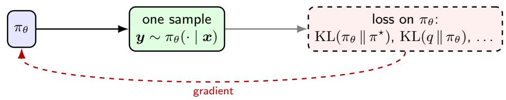  
(b) Best-of-N sampling fine-tuning (Section 7.5)

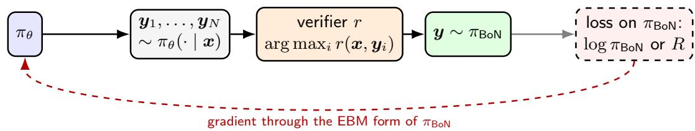  
Figure 15: Two ways to fine-tune for inference-time computation. (a) Amortization trains $\pi _ { \theta }$ so that its own samples approximate the target, and inference draws a single sample. (b) Best-of-N sampling fine-tuning keeps best-of-N at inference time and trains $\pi _ { \theta }$ through the distribution $\pi _ { \mathrm { B o N } }$ of the selected response, whose EBM form Equation 167 replaces the non-diferentiable selection.

Fine-Tuned Models as Proposals. A fine-tuned model can also serve as a proposal for the samplers of Section 7.2. To use $\pi _ { \theta }$ as an importance-sampling proposal for the original target, each candidate receives weight

$$
\omega ( { \pmb y } , { \pmb x } ) = \frac { \pi _ { 0 } ( { \pmb y } \mid { \pmb x } ) \exp \left( r ( { \pmb x } , { \pmb y } ) / \lambda \right) } { \pi _ { \theta } ( { \pmb y } \mid { \pmb x } ) } .
$$

These weights correct for the change in proposal, provided $\pi _ { \theta }$ assigns nonzero probability wherever $\pi ^ { \star }$ does. When $\pi _ { \boldsymbol { \theta } } = \pi ^ { \star }$ , every weight equals $Z ( { \pmb x } )$ : the generator already samples from the target. More generally, proposals that cover the target and produce less variable weights can reduce the number of candidates needed. A proposal concentrated on only a few solutions may rarely generate other responses favored by the target.

Tradeof Between Finetuning and Inference. More broadly, fine-tuning pays a training cost to reduce search across many later inputs, sometimes making a single sample suficient. Inference-time methods spend computation on each input but can adapt to a new verifier without retraining the generator. The same trade-of appears between learned samplers and MCMC in Section 2.4, and between policies and planners in Section 6.5: computation can be spent during training to make later inference cheaper, or during inference to adapt to the problem at hand.

## 7.5 Best-of-N Sampling-Aware Fine-Tuning

One round of best-of-N distillation (Section 7.4) makes $\pi _ { \theta }$ only as good as best-of-N of $\pi _ { 0 }$ . To improve further, iterative BOND distills best-of-N of the distilled model again, round after round, and by Yang et al. [196] these rounds reach the WIND equilibrium Equation 166 only after distilling repeatedly until convergence. This motivates a diferent approach: keep best-of-N with a fixed N at inference time, and update the base policy for it directly. Inference-aware fine-tuning [31] places the loss not on $\pi _ { \theta }$ but on the distribution $\pi _ { \mathrm { B o N } }$ of the response that best-of-N returns from $\pi _ { \boldsymbol { \theta } } .$ as compared in Figure 15. Since only the best of $N$ samples is used, $\pi _ { \theta }$ does not need to put most of its mass on good responses; it only needs one of its N samples to be good, which leaves room for diverse responses.

Best-of-N Policy as an EBM. Best-of-N selects by an arg max over N samples, which cannot be diferentiated with respect to θ. Its output distribution, however, has an explicit density: by Equation 157 with $\pi _ { \theta }$ in place of $\pi _ { 0 } ,$ π is a residual EBM on π whose energy is the log win rate of y against samples of $\pi _ { \theta }$ . Chow et al. [31] use the variational approximation

$$
\pi _ { \mathrm { B o N } } ( y \mid x ) = { \frac { \pi _ { \theta } ( y \mid x ) \exp \left( \beta _ { N } w _ { \theta } ( x , y ) \right) } { Z _ { \theta } ( x ) } } , \qquad w _ { \theta } ( x , y ) = \mathbb { E } _ { y ^ { \prime } \sim \pi _ { \theta } ( \cdot \mid x ) } \left[ { \mathbf { 1 } \left\{ { r ( x , y ) \geqslant r ( x , y ^ { \prime } ) } \right\} } \right] ,\tag{167}
$$

with $\beta _ { N }$ increasing in $N$ . Since both $\pi _ { \theta }$ and the win rate $w _ { \theta }$ depend on $\theta ,$ the unnormalized log-density $f _ { \theta } = \log \pi _ { \theta } + \beta _ { N } w _ { \theta }$ has the gradient

$$
\nabla _ { \theta } f _ { \theta } ( x , y ) = \nabla _ { \theta } \log \pi _ { \theta } ( y \mid x ) - \beta _ { N } \mathbb { E } _ { y ^ { \prime } \sim \pi _ { \theta } ( \cdot \mid x ) } \left[ \nabla _ { \theta } \log \pi _ { \theta } ( y ^ { \prime } \mid x ) \mathbf { 1 } \left\{ r ( x , y ) < r ( x , y ^ { \prime } ) \right\} \right] ,\tag{168}
$$

where the second term diferentiates the win rate through the samples of $\pi \theta$ . The two losses below are written in terms of this gradient.

Supervised Fine-Tuning. Given expert responses $( \pmb { x } , \pmb { y } ) \sim \mathcal { D } _ { \pmb { \mathrm { ~ \tiny ~  ~ } } }$ , inference-aware supervised fine-tuning maximizes their likelihood under $\pi _ { \mathrm { B o N } }$ rather than under $\pi _ { \theta }$

$$
\operatorname* { m a x } _ { \theta } \mathbb { E } _ { ( \pmb { x } , \pmb { y } ) \sim \mathcal { D } } \left[ \log \pi _ { \mathrm { B o N } } ( \pmb { y } \mid \pmb { x } ) \right] = \mathbb { E } _ { ( \pmb { x } , \pmb { y } ) \sim \mathcal { D } } \left[ \log \pi _ { \theta } ( \pmb { y } \mid \pmb { x } ) + \beta _ { N } w _ { \theta } ( \pmb { x } , \pmb { y } ) - \log Z _ { \theta } ( \pmb { x } ) \right] ,\tag{169}
$$

where $Z _ { \theta } ( \pmb { x } ) = \mathbb { E } _ { \pmb { y } \sim \pi _ { \theta } ( \cdot | \pmb { x } ) } \left[ \exp \left( \beta _ { N } w _ { \theta } ( \pmb { x } , \pmb { y } ) \right) \right]$ . Its gradient is that of maximum likelihood for an EBM Equa tion 40,

$$
\begin{array} { r } { \mathbb { E } _ { ( \pmb { x } , \pmb { y } ) \sim \mathcal { D } } \left[ \nabla _ { \theta } f _ { \theta } ( \pmb { x } , \pmb { y } ) \right] - \mathbb { E } _ { \pmb { x } \sim \mathcal { D } , \pmb { y } \sim \pi _ { \mathrm { B o N } } ( \cdot | \pmb { x } ) } \left[ \nabla _ { \theta } f _ { \theta } ( \pmb { x } , \pmb { y } ) \right] , } \end{array}\tag{170}
$$

in which the expert responses are the positives and the responses selected by best-of-N are the negatives. The first term increases the likelihood of the expert responses and their win rate against $\pi _ { \theta }$ , and the second lowers the likelihood of the responses that best-of-N already selects, which avoids over-fitting.

Reinforcement Learning. With an environment reward $R ( { \pmb x } , { \pmb y } )$ , which may difer from the verifier score $r ,$ inference-aware RL maximizes the reward of the selected response,

$$
\operatorname* { m a x } _ { \theta } \ J ( \theta ) = \mathbb { E } _ { \alpha \sim \mathcal { D } , y \sim \pi _ { \mathrm { B o r K } } ( \cdot \vert \mathbf { x } ) } \left[ R ( \pmb { x } , y ) \right] , \qquad \nabla _ { \theta } J ( \theta ) = \mathbb { E } _ { \alpha \sim \mathcal { D } , y \sim \pi _ { \mathrm { B o r K } } } \left[ \nabla _ { \theta } f _ { \theta } ( \pmb { x } , y ) \left( R ( \pmb { x } , y ) - b ( \pmb { x } ) \right) \right] ,\tag{171}
$$

with a baseline $b ( \pmb { x } ) = \mathbb { E } _ { \pmb { y } \sim \pi _ { \mathrm { B o N } } ( \cdot | \pmb { x } ) } \left[ R ( \pmb { x } , \pmb { y } ) \right]$ . This is REINFORCE Equation 32 with the samples drawn from best-of-N instead of from $\pi _ { \theta }$ , and since the reward is R rather than r, it also tolerates errors of the verifier.

Amortization (Section 7.4) trains $\pi _ { \theta }$ to approximate the target on its own, whereas best-of-N sampling aware fine-tuning keeps best-of-N at inference time and trains $\pi \theta$ for it. Writing π<sub>BoN</sub> as a residual EBM on $\pi _ { \theta }$ Equation 167 gives the selection a diferentiable density, so supervised fine-tuning becomes maximum likelihood for this EBM, with best-of-N samples as negatives, and RL becomes REINFORCE on best-of-N samples. In both cases the generator is trained as a proposal for best-of-N rather than as a sampler on its own, and it learns to interleave its best responses with more diverse ones, trading exploitation for exploration as $N$ grows.

## 8 Discussion

Throughout this tutorial, we have used EBMs as a single lens on machine learning. This organization grew out of the course CSE 6243 at Georgia Tech, where students appreciated learning machine learning along a single thread, in which each new method is introduced as a diferent choice within the same EBM framework, rather than as a catalog of separate model families, tasks, and algorithms, as in the traditional organization of machine learning courses. Any EBM is specified by three choices: the energy, which determines what the model can represent; the inference procedure, which samples from or optimizes the energy; and the learning method, which fits the energy to data. We close by summarizing how this view serves three purposes: understanding existing methods, organizing them into one framework, and developing new algorithms.

Understanding Existing Literature. Many methods that were developed separately, often under different names and motivations, turn out to be EBMs with particular choices of the three components. In discriminative learning, logistic regression, CRFs, and structured prediction energy networks are conditional EBMs that difer in the structure of the energy over outputs (Section 3). In generative modeling, GANs pair a potential with a learned sampler, normalizing flows and autoregressive models restrict the energy so that the partition function becomes tractable and sampling takes a single pass, difusion and flow models learn the score of noise-perturbed EBMs, and energy-inspired and deep equilibrium models turn an inference procedure into the model itself (Section 4). In representation learning, contrastive methods including MoCo, word2vec, BERT, difusion representations, and denoising auto-encoders all learn a bilinear EBM whose factors are the representation, and they difer mainly in the learning method; for the denoising auto-encoder, the bilinear form follows from score matching of a latent-variable EBM (Section 5). Instruction-following retrievers use the same bilinear EBM as a decisive model, by embedding the question as well as the data (Section 5.5). In decision making, maximum-entropy RL, mirror-descent policy updates, and KL-regularized fine-tuning of language models from human feedback yield EBM policies in closed form, and inverse RL and imitation learning fit EBMs from demonstrations (Section 6). Beyond the policy, an EBM world model of the dynamics gives a representation in which value functions are linear (Section 6.4), and planning is inference in an EBM over trajectories (Section 6.5). Inference-time computation in large models, such as best-of-N selection, search over partial solutions, and iterative refinement, consists of samplers for one residual EBM that composes a pretrained generator with a verifier (Section 7). Seen this way, the diferences among these methods are diferences in how they handle the partition function and sampling, rather than diferences in what they model.

Organizing the Framework. The three components also organize the methods into a common structure. On the learning side, maximum likelihood, contrastive divergence, NCE, pseudolikelihood, score matching, and adversarial training share the same gradient and difer only in the sampler that produces the negative samples (Section 2.6). The same axis reappears in every application: SimCLR and CLIP use ranking NCE, SigLIP and word2vec use binary NCE, AmorLIP uses maximum likelihood with an amortized partition function, MoCo uses a fixed-point iteration, and difusion representations and denoising auto-encoders use score matching (Section 5); maximum-entropy IRL, implicit behavioral cloning, and GAIL fit EBMs from demonstrations by maximum likelihood, NCE, and adversarial training (Section 6.3). On the inference side, MCMC, variational inference, and amortized samplers appear in the same roles, whether the samples are images, tokens, or actions (Section 2.4, Section 6.2, Section 7), and fine-tuning and inference-time computation target the same KL-regularized EBM, difering only in whether its cost is paid during training or at inference (Section 7.4), and best-of-N sampling fine-tuning lies between the two, training the generator for the sampler that uses it (Section 7.5). Placing a method on these axes makes its trade-ofs explicit, such as the dependence of NCE on the batch size, the bias of short MCMC chains, or the loss of the global energy in autoregressive reparameterizations, and shows which alternatives are available for each component. Table 3 in Appendix A places every method of this tutorial on these components.

Developing New Algorithms. Finally, the framework suggests new algorithms by replacing one component while keeping the others. Replacing the learning method of a known EBM gives new estimators: fitting the bilinear representation EBM by score matching instead of NCE gives difusion spectral representations, and by maximum likelihood with an amortized partition function gives AmorLIP (Section 5). Replacing the policy class in RL by an EBM, and its learning by reweighted score matching, gives difusion policy optimization (Section 6.2). Using the structure of the EBM itself gives new objectives: the smoothed Bellman equation of SBEED, and the value-incentivized regularizers of VAC and VPO, which use the log-partition function of the EBM policy for optimism and pessimism (Section 6.1). Placing the energy on the dynamics gives EBM world models, whose representation makes value functions linear and learnable by temporaldiference learning (Section 6.4). Treating the best-of-N policy itself as a residual EBM gives objectives for distilling it and for fine-tuning the generator for it (Section 7.4, Section 7.5). Using the learned energy itself rather than the representation, with an embedding head for the query and the instruction, gives decisive models that answer new questions in a single forward pass (Section 5.5). Composition is perhaps the most distinctive capability: since the energies of independently trained models can be added to form products of distributions (Section 2.3), as already exploited by classifier and classifier-free guidance (Section 4.3), EBMs provide a principled way to combine pretrained models, constraints, and verifiers at inference time without retraining. In planning, learned dynamics, behavior priors, goals, and constraints each contribute an energy term, and a new task is a new sum of terms (Section 6.5); in reasoning, energies learned for individual constraints are composed to solve problems larger than those seen in training (Section 7.3). We expect this view to remain useful as new models are developed: whenever a model defines an unnormalized score over its outputs, the tools for inference and learning surveyed here apply to it directly.

Limitations. The EBM view explains how methods relate, but it does not by itself tell which one works better. Two methods that fit the same energy can behave very diferently in practice, since their performance also depends on how the energy is parameterized, on inductive biases such as the architecture and, in contrastive learning, the data augmentations that define the positive pairs, and on the statistical and computational properties of the estimator. The intended use also matters. Methods with the same optimum may serve diferent purposes, as the denoising auto-encoder and a difusion model fit the same score at a given noise level but are used for representation and for sampling, respectively; and diferent uses favor diferent learning methods: maximum likelihood when calibrated likelihoods are needed, as for density evaluation, score matching when the model is used for sampling, since it learns the score that the sampler follows, and NCE when only relative scores between candidates matter, as in retrieval and ranking. Composition has limitations of its own: the composed distribution is meaningful only when the component energies have compatible scales and the product is normalizable, and sampling from or optimizing the composed landscape can be much harder than for each component. We therefore suggest that readers weigh these factors together for their own setting, and choose the parameterization of the energy and the methods for learning and inference to the characteristics of the problem.

## Acknowledgements

This paper is supported by NSF ECCS-2401391, ONR N000142512173, NSF IIS-2403240, NSF IIS-2552007, DARPA Young Faculty Award, and the Toyota Research Institute.

## References

[1] Anurag Ajay, Yilun Du, Abhi Gupta, Joshua B. Tenenbaum, Tommi S. Jaakkola, and Pulkit Agrawal. Is conditional generative modeling all you need for decision making? In International Conference on Learning Representations (ICLR), 2023. 51

[2] Anurag Ajay, Seungwook Han, Yilun Du, Shuang Li, Abhi Gupta, Tommi S. Jaakkola, Joshua B. Tenenbaum, Leslie Pack Kaelbling, Akash Srivastava, and Pulkit Agrawal. Compositional foundation models for hierarchical planning. In Advances in Neural Information Processing Systems (NeurIPS), 2023. 52

[3] Michael S Albergo and Eric Vanden-Eijnden. Building normalizing flows with stochastic interpolants. In International Conference on Learning Representations (ICLR), 2023. 27

[4] Yasemin Altun and Alex Smola. Unifying divergence minimization and statistical inference via convex duality. In Conference on Learning Theory (COLT), pages 139–153. Springer, 2006. 5, 6, 7

[5] Michael Arbel, Liang Zhou, and Arthur Gretton. Generalized energy based models. In International Conference on Learning Representations (ICLR), 2021. 4

[6] Martin Arjovsky, Soumith Chintala, and L´eon Bottou. Wasserstein generative adversarial networks. In International Conference on Machine Learning (ICML), pages 214–223, 2017. 25

[7] Kavosh Asadi and Michael L Littman. An alternative softmax operator for reinforcement learning. In International Conference on Machine Learning (ICML), pages 243–252, 2017. 42

[8] Hagai Attias. Planning by probabilistic inference. In International Conference on Artificial Intelligence and Statistics (AISTATS), 2003. 49

[9] Jacob Austin, Daniel D. Johnson, Jonathan Ho, Daniel Tarlow, and Rianne van den Berg. Structured denoising difusion models in discrete state-spaces. In Advances in Neural Information Processing Systems (NeurIPS), 2021. 16, 27, 38

[10] Shaojie Bai, J. Zico Kolter, and Vladlen Koltun. Deep equilibrium models. In Advances in Neural Information Processing Systems (NeurIPS), 2019. 30, 31

[11] Shaojie Bai, Vladlen Koltun, and J. Zico Kolter. Stabilizing equilibrium models by Jacobian regularization. In International Conference on Machine Learning (ICML), pages 554–565, 2021. 31

[12] Xingjian Bai and Luke Melas-Kyriazi. Fixed point difusion models. In IEEE/CVF Conference on Computer Vision and Pattern Recognition (CVPR), pages 9430–9440, 2024. 31

[13] Arindam Banerjee, Srujana Merugu, Inderjit S Dhillon, and Joydeep Ghosh. Clustering with Bregman divergences. Journal of Machine Learning Research, 6:1705–1749, 2005. 6

[14] Alessandro Barp, Fran¸cois-Xavier Briol, Andrew B Duncan, Mark Girolami, and Lester Mackey. Minimum Stein discrepancy estimators. In Advances in Neural Information Processing Systems (NeurIPS), 2019. 20

[15] Andr´e Barreto, Will Dabney, R´emi Munos, Jonathan J Hunt, Tom Schaul, Hado P van Hasselt, and David Silver. Successor features for transfer in reinforcement learning. Advances in Neural Information Processing Systems (NeurIPS), 30, 2017. 49

[16] Matthias Bauer and Andriy Mnih. Resampled priors for variational autoencoders. In International Conference on Artificial Intelligence and Statistics (AISTATS), pages 66–75, 2019. 29

[17] Ahmad Beirami, Alekh Agarwal, Jonathan Berant, Alexander D’Amour, Jacob Eisenstein, Chirag Nagpal, and Ananda Theertha Suresh. Theoretical guarantees on the best-of-n alignment policy. In International Conference on Machine Learning (ICML), 2025. 54

[18] David Belanger and Andrew McCallum. Structured prediction energy networks. In International Conference on Machine Learning (ICML), pages 983–992, 2016. 22

[19] David Belanger, Bishan Yang, and Andrew McCallum. End-to-end learning for structured prediction energy networks. In International Conference on Machine Learning (ICML), pages 429–439, 2017. 23

[20] Yoshua Bengio, R´ejean Ducharme, Pascal Vincent, and Christian Jauvin. A neural probabilistic language model. Journal of Machine Learning Research, 3:1137–1155, 2003. 34

[21] Julian Besag. Statistical analysis of non-lattice data. Journal of the Royal Statistical Society: Series D (The Statistician), 24(3):179–195, 1975. 15, 16, 22, 33

[22] Ralph Allan Bradley and Milton E Terry. Rank analysis of incomplete block designs: I. The method of paired comparisons. Biometrika, 39(3/4):324–345, 1952. 45

[23] Lawrence D Brown. Fundamentals of statistical exponential families: with applications in statistical decision theory, volume 9 of Lecture Notes–Monograph Series. Institute of Mathematical Statistics, 1986. 5

[24] Tom Brown, Benjamin Mann, Nick Ryder, Melanie Subbiah, Jared D Kaplan, Prafulla Dhariwal, Arvind Neelakantan, Pranav Shyam, Girish Sastry, Amanda Askell, et al. Language models are fewshot learners. In Advances in Neural Information Processing Systems (NeurIPS), pages 1877–1901, 2020. 34

[25] St´ephane Canu and Alex Smola. Kernel methods and the exponential family. Neurocomputing, 69 (7–9):714–720, 2006. 7

[26] Shicong Cen, Jincheng Mei, Katayoon Goshvadi, Hanjun Dai, Tong Yang, Sherry Yang, Dale Schuurmans, Yuejie Chi, and Bo Dai. Value-incentivized preference optimization: A unified approach to online and ofline RLHF. In International Conference on Learning Representations (ICLR), 2025. 43

[27] Hongyi Chen, Yilun Du, Yiye Chen, Joshua B. Tenenbaum, and Patricio A. Vela. Planning with sequence models through iterative energy minimization. In International Conference on Learning Representations (ICLR), 2023. 52

[28] Lili Chen, Kevin Lu, Aravind Rajeswaran, Kimin Lee, Aditya Grover, Misha Laskin, Pieter Abbeel, Aravind Srinivas, and Igor Mordatch. Decision transformer: Reinforcement learning via sequence modeling. In Advances in Neural Information Processing Systems, volume 34, pages 15084–15097, 2021. 52

[29] Ricky T. Q. Chen, Yulia Rubanova, Jesse Bettencourt, and David Duvenaud. Neural ordinary diferential equations. In Advances in Neural Information Processing Systems (NeurIPS), pages 6571–6583, 2018. 25

[30] Ting Chen, Simon Kornblith, Mohammad Norouzi, and Geofrey Hinton. A simple framework for contrastive learning of visual representations. In International Conference on Machine Learning (ICML), pages 1597–1607, 2020. 34

[31] Yinlam Chow, Guy Tennenholtz, Izzeddin Gur, Vincent Zhuang, Bo Dai, Sridhar Thiagarajan, Craig Boutilier, Rishabh Agarwal, Aviral Kumar, and Aleksandra Faust. Inference-aware fine-tuning for best-of-N sampling in large language models. In International Conference on Learning Representations (ICLR), 2025. 60, 61

[32] Karl Cobbe, Vineet Kosaraju, Mohammad Bavarian, et al. Training verifiers to solve math word problems. arXiv preprint arXiv:2110.14168, 2021. 53

[33] Michael Collins. Discriminative training methods for hidden Markov models: Theory and experiments with perceptron algorithms. In Conference on Empirical Methods in Natural Language Processing (EMNLP), pages 1–8, 2002. 22

[34] Bo Dai, Albert Shaw, Lihong Li, Lin Xiao, Niao He, Zhen Liu, Jianshu Chen, and Le Song. SBEED: Convergent reinforcement learning with nonlinear function approximation. In International Conference on Machine Learning (ICML), pages 1125–1134, 2018. 42, 46

[35] Bo Dai, Hanjun Dai, Arthur Gretton, Le Song, Dale Schuurmans, and Niao He. Kernel exponential family estimation via doubly dual embedding. In International Conference on Artificial Intelligence and Statistics (AISTATS), pages 2321–2330, 2019. 7, 12, 18

[36] Bo Dai, Zhen Liu, Hanjun Dai, Niao He, Arthur Gretton, Le Song, and Dale Schuurmans. Exponential family estimation via adversarial dynamics embedding. In Advances in Neural Information Processing Systems (NeurIPS), 2019. 12, 13, 14, 18, 19, 20, 24, 30

[37] Bo Dai, Na Li, and Dale Schuurmans. Spectral ghost in representation learning: from component analysis to self-supervised learning. arXiv preprint arXiv:2601.20154, 2026. 34, 35, 36, 37, 38, 40

[38] Hanjun Dai, Bo Dai, and Le Song. Discriminative embeddings of latent variable models for structured data. In International Conference on Machine Learning (ICML), pages 2702–2711, 2016. 18

[39] Zihang Dai, Amjad Almahairi, Philip Bachman, Eduard Hovy, and Aaron Courville. Calibrating energy-based generative adversarial networks. In International Conference on Learning Representations (ICLR), 2017. 18, 24

[40] Peter Dayan. Improving generalization for temporal diference learning: The successor representation. Neural computation, 5(4):613–624, 1993. 49

[41] Pieter-Tjerk de Boer, Dirk P. Kroese, Shie Mannor, and Reuven Y. Rubinstein. A tutorial on the cross-entropy method. Annals of Operations Research, 134(1):19–67, 2005. 50

[42] Mete Demircigil, Judith Heusel, Matthias L¨owe, Sven Upgang, and Franck Vermet. On a model of associative memory with huge storage capacity. Journal of Statistical Physics, 168(2):288–299, 2017. 30

[43] Yuntian Deng, Anton Bakhtin, Myle Ott, Arthur Szlam, and Marc’Aurelio Ranzato. Residual energybased models for text generation. In International Conference on Learning Representations (ICLR), 2020. 4

[44] Jacob Devlin, Ming-Wei Chang, Kenton Lee, and Kristina Toutanova. BERT: Pre-training of deep bidirectional transformers for language understanding. In Conference of the North American Chapter of the Association for Computational Linguistics (NAACL), pages 4171–4186, 2019. 37, 41

[45] Prafulla Dhariwal and Alexander Nichol. Difusion models beat GANs on image synthesis. In Advances in Neural Information Processing Systems (NeurIPS), 2021. 28

[46] Nan Ding and S V N Vishwanathan. t-logistic regression. In Advances in Neural Information Processing Systems (NeurIPS), pages 514–522, 2010. 6

[47] Laurent Dinh, David Krueger, and Yoshua Bengio. NICE: Non-linear independent components estimation. In International Conference on Learning Representations (ICLR) Workshop, 2015. 25

[48] Laurent Dinh, Jascha Sohl-Dickstein, and Samy Bengio. Density estimation using Real NVP. In International Conference on Learning Representations (ICLR), 2017. 25

[49] Yilun Du. Learning Generalizable Systems by Learning Composable Energy Landscapes. PhD thesis, Massachusetts Institute of Technology, 2025. 7

[50] Yilun Du and Leslie Pack Kaelbling. Position: Compositional generative modeling: A single model is not all you need. In International Conference on Machine Learning (ICML), pages 11721–11732, 2024. 7, 8, 10

[51] Yilun Du and Igor Mordatch. Implicit generation and modeling with energy based models. In Advances in Neural Information Processing Systems (NeurIPS), 2019. 14, 19

[52] Yilun Du, Toru Lin, and Igor Mordatch. Model based planning with energy based models. In Conference on Robot Learning, 2019. 51

[53] Yilun Du, Shuang Li, and Igor Mordatch. Compositional visual generation with energy based models. In Advances in Neural Information Processing Systems (NeurIPS), pages 6637–6647, 2020. 7, 8, 10

[54] Yilun Du, Shuang Li, Joshua Tenenbaum, and Igor Mordatch. Learning iterative reasoning through energy minimization. In International Conference on Machine Learning (ICML), pages 5570–5582. PMLR, 2022. 18, 31, 56

[55] Yilun Du, Conor Durkan, Robin Strudel, Joshua B Tenenbaum, Sander Dieleman, Rob Fergus, Jascha Sohl-Dickstein, Arnaud Doucet, and Will Grathwohl. Reduce, reuse, recycle: Compositional generation with energy-based difusion models and MCMC. In International Conference on Machine Learning (ICML), pages 8489–8510, 2023. 10, 28, 29, 51, 57

[56] Yilun Du, Sherry Yang, Bo Dai, Hanjun Dai, Ofir Nachum, Joshua B. Tenenbaum, Dale Schuurmans, and Pieter Abbeel. Learning universal policies via text-guided video generation. In Advances in Neural Information Processing Systems (NeurIPS), 2023. 52

[57] Yilun Du, Jiayuan Mao, and Joshua B. Tenenbaum. Learning iterative reasoning through energy difusion. In International Conference on Machine Learning (ICML), 2024. 57

[58] Yilun Du, Sherry Yang, Pete Florence, Fei Xia, Ayzaan Wahid, Brian Ichter, Pierre Sermanet, Tianhe Yu, Pieter Abbeel, Joshua B. Tenenbaum, Leslie Pack Kaelbling, Andy Zeng, and Jonathan Tompson. Video language planning. In International Conference on Learning Representations (ICLR), 2024. 52

[59] Simon Duane, Anthony D. Kennedy, Brian J. Pendleton, and Duncan Roweth. Hybrid Monte Carlo. Physics Letters B, 195(2):216–222, 1987. 11

[60] Miroslav Dud´ık, Steven J Phillips, and Robert E Schapire. Maximum entropy density estimation with generalized regularization and an application to species distribution modeling. Journal of Machine Learning Research, 8:1217–1260, 2007. 5, 6, 7

[61] Bradley Efron. Tweedie’s formula and selection bias. Journal of the American Statistical Association, 106(496):1602–1614, 2011. 27

[62] Benjamin Eysenbach and Sergey Levine. Maximum entropy RL (provably) solves some robust RL problems. In International Conference on Learning Representations (ICLR), 2022. 43

[63] Chelsea Finn, Paul Christiano, Pieter Abbeel, and Sergey Levine. A connection between generative adversarial networks, inverse reinforcement learning, and energy-based models. arXiv preprint arXiv:1611.03852, 2016. 46

[64] Chelsea Finn, Sergey Levine, and Pieter Abbeel. Guided cost learning: Deep inverse optimal control via policy optimization. In International Conference on Machine Learning (ICML), pages 49–58, 2016. 46

[65] Pete Florence, Corey Lynch, Andy Zeng, Oscar A Ramirez, Ayzaan Wahid, Laura Downs, Adrian Wong, Johnny Lee, Igor Mordatch, and Jonathan Tompson. Implicit behavioral cloning. In Conference on Robot Learning (CoRL), pages 158–168, 2022. 46

[66] Roy Fox, Ari Pakman, and Naftali Tishby. Taming the noise in reinforcement learning via soft updates. In Conference on Uncertainty in Artificial Intelligence (UAI), pages 582–591, 2016. 43

[67] Rafael Frongillo and Mark D Reid. Convex foundations for generalized MaxEnt models. In AIP Conference Proceedings, volume 1636, pages 11–16, 2014. 6

[68] Justin Fu, Katie Luo, and Sergey Levine. Learning robust rewards with adversarial inverse reinforcement learning. In International Conference on Learning Representations (ICLR), 2018. 46

[69] Chenxiao Gao, Haotian Sun, Na Li, Dale Schuurmans, and Bo Dai. Spectral representation-based reinforcement learning. arXiv preprint arXiv:2512.15036, 2025. 47, 48

[70] Ruiqi Gao, Erik Nijkamp, Diederik P Kingma, Zhen Xu, Andrew M Dai, and Ying Nian Wu. Flow contrastive estimation of energy-based models. In IEEE/CVF Conference on Computer Vision and Pattern Recognition (CVPR), pages 7518–7528, 2020. 26

[71] Matthieu Geist, Bruno Scherrer, and Olivier Pietquin. A theory of regularized Markov decision processes. In International Conference on Machine Learning (ICML), pages 2160–2169, 2019. 43

[72] Stuart Geman and Donald Geman. Stochastic relaxation, Gibbs distributions, and the Bayesian restoration of images. IEEE Transactions on Pattern Analysis and Machine Intelligence, 6(6):721– 741, 1984. 11

[73] Zhengyang Geng, Xin-Yu Zhang, Shaojie Bai, Yisen Wang, and Zhouchen Lin. On training implicit models. In Advances in Neural Information Processing Systems (NeurIPS), 2021. 31

[74] Zhengyang Geng, Ashwini Pokle, and J. Zico Kolter. One-step difusion distillation via deep equilibrium models. In Advances in Neural Information Processing Systems (NeurIPS), 2023. 31

[75] Hans-Otto Georgii. Gibbs measures and phase transitions, volume 9. Walter de Gruyter, 2011. 4

[76] Alexi Gladstone, Ganesh Nanduru, Md Mofijul Islam, et al. Energy-based transformers are scalable learners and thinkers. In International Conference on Learning Representations (ICLR), 2026. 57

[77] Ian Goodfellow, Jean Pouget-Abadie, Mehdi Mirza, Bing Xu, David Warde-Farley, Sherjil Ozair, Aaron Courville, and Yoshua Bengio. Generative adversarial nets. In Advances in Neural Information Processing Systems (NeurIPS), pages 2672–2680, 2014. 17, 24

[78] Will Grathwohl, Ricky T. Q. Chen, Jesse Bettencourt, Ilya Sutskever, and David Duvenaud. FFJORD: Free-form continuous dynamics for scalable reversible generative models. In International Conference on Learning Representations (ICLR), 2019. 25

[79] Peter D Gr¨unwald and A Philip Dawid. Game theory, maximum entropy, minimum discrepancy and robust Bayesian decision theory. The Annals of Statistics, 32(4):1367–1433, 2004. 6

[80] Lin Gui, Cristina Gˆarbacea, and Victor Veitch. BoNBoN alignment for large language models and the sweetness of best-of-n sampling. In Advances in Neural Information Processing Systems (NeurIPS), 2024. 54

[81] Michael Gutmann and Aapo Hyv¨arinen. Noise-contrastive estimation: A new estimation principle for unnormalized statistical models. In International Conference on Artificial Intelligence and Statistics (AISTATS), pages 297–304, 2010. 14, 15

[82] Michael Gygli, Mohammad Norouzi, and Anelia Angelova. Deep value networks learn to evaluate and iteratively refine structured outputs. In International Conference on Machine Learning (ICML), pages 1341–1351, 2017. 23

[83] Tuomas Haarnoja, Haoran Tang, Pieter Abbeel, and Sergey Levine. Reinforcement learning with deep energy-based policies. In International Conference on Machine Learning (ICML), pages 1352–1361, 2017. 43, 44

[84] Tuomas Haarnoja, Aurick Zhou, Pieter Abbeel, and Sergey Levine. Soft actor-critic: Of-policy maximum entropy deep reinforcement learning with a stochastic actor. In International Conference on Machine Learning (ICML), pages 1861–1870, 2018. 43, 44

[85] W. Keith Hastings. Monte Carlo sampling methods using Markov chains and their applications. Biometrika, 57(1):97–109, 1970. 11

[86] Kaiming He, Haoqi Fan, Yuxin Wu, Saining Xie, and Ross Girshick. Momentum contrast for unsupervised visual representation learning. In IEEE/CVF Conference on Computer Vision and Pattern Recognition (CVPR), pages 9729–9738, 2020. 36

[87] Geofrey E Hinton. Training products of experts by minimizing contrastive divergence. Neural Computation, 14(8):1771–1800, 2002. 10, 14, 19

[88] Jonathan Ho and Stefano Ermon. Generative adversarial imitation learning. In Advances in Neural Information Processing Systems (NeurIPS), pages 4565–4573, 2016. 46

[89] Jonathan Ho and Tim Salimans. Classifier-free difusion guidance. In NeurIPS Workshop on Deep Generative Models and Downstream Applications, 2021. 28

[90] Jonathan Ho, Ajay Jain, and Pieter Abbeel. Denoising difusion probabilistic models. In Advances in Neural Information Processing Systems (NeurIPS), pages 6840–6851, 2020. 26

[91] Matthew D. Hofman and Andrew Gelman. The No-U-Turn sampler: Adaptively setting path lengths in Hamiltonian Monte Carlo. Journal of Machine Learning Research, 15(1):1593–1623, 2014. 12

[92] Emiel Hoogeboom, Alexey A. Gritsenko, Jasmijn Bastings, Ben Poole, Rianne van den Berg, and Tim Salimans. Autoregressive difusion models. In International Conference on Learning Representations (ICLR), 2022. 16, 33

[93] John J Hopfield. Neural networks and physical systems with emergent collective computational abilities. Proceedings of the National Academy of Sciences, 79(8):2554–2558, 1982. 30

[94] Aapo Hyv¨arinen. Estimation of non-normalized statistical models by score matching. Journal of Machine Learning Research, 6:695–709, 2005. 16, 17

[95] Aapo Hyv¨arinen. Consistency of pseudolikelihood estimation of fully visible Boltzmann machines. Neural Computation, 18(10):2283–2292, 2006. 16

[96] Aapo Hyv¨arinen. Some extensions of score matching. Computational Statistics & Data Analysis, 51 (5):2499–2512, 2007. 17, 20

[97] Michael Janner, Qiyang Li, and Sergey Levine. Ofline reinforcement learning as one big sequence modeling problem. In Advances in Neural Information Processing Systems, volume 34, pages 1273– 1286, 2021. 52

[98] Michael Janner, Yilun Du, Joshua B. Tenenbaum, and Sergey Levine. Planning with difusion for flexible behavior synthesis. In International Conference on Machine Learning (ICML), pages 9902– 9915, 2022. 51

[99] Hilbert J. Kappen. Linear theory for control of nonlinear stochastic systems. Physical Review Letters, 95(20):200201, 2005. 50

[100] Aayush Karan and Yilun Du. Reasoning with sampling: Your base model is smarter than you think. arXiv preprint arXiv:2510.14901, 2025. 55, 56

[101] Taesup Kim and Yoshua Bengio. Deep directed generative models with energy-based probability estimation. arXiv preprint arXiv:1606.03439, 2016. 12, 18, 24

[102] Diederik P Kingma and Prafulla Dhariwal. Glow: Generative flow with invertible 1x1 convolutions. In Advances in Neural Information Processing Systems (NeurIPS), pages 10215–10224, 2018. 25

[103] Diederik P. Kingma and Max Welling. Auto-encoding variational Bayes. In International Conference on Learning Representations (ICLR), 2014. 12

[104] Diederik P Kingma, Tim Salimans, Rafal Jozefowicz, Xi Chen, Ilya Sutskever, and Max Welling. Improved variational inference with inverse autoregressive flow. In Advances in Neural Information Processing Systems (NeurIPS), pages 4743–4751, 2016. 25

[105] Dmitry Krotov and John J Hopfield. Dense associative memory for pattern recognition. In Advances in Neural Information Processing Systems (NeurIPS), pages 1172–1180, 2016. 30

[106] John Laferty, Andrew McCallum, and Fernando Pereira. Conditional random fields: Probabilistic models for segmenting and labeling sequence data. In International Conference on Machine Learning (ICML), pages 282–289, 2001. 21

[107] Dieterich Lawson, George Tucker, Bo Dai, and Rajesh Ranganath. Energy-inspired models: Learning with sampler-induced distributions. In Advances in Neural Information Processing Systems (NeurIPS), pages 8501–8513, 2019. 29

[108] Yann LeCun, Sumit Chopra, Raia Hadsell, Marc’Aurelio Ranzato, and Fu Jie Huang. A tutorial on energy-based learning. In Predicting Structured Data. MIT Press, 2006. 22

[109] Sergey Levine. Reinforcement learning and control as probabilistic inference: Tutorial and review. arXiv preprint arXiv:1805.00909, 2018. 42, 49

[110] Omer Levy and Yoav Goldberg. Neural word embedding as implicit matrix factorization. In Advances in Neural Information Processing Systems (NeurIPS), pages 2177–2185, 2014. 37

[111] Alexander K. Lew, Tan Zhi-Xuan, Gabriel Grand, and Vikash K. Mansinghka. Sequential Monte Carlo steering of large language models using probabilistic programs. arXiv preprint arXiv:2306.03081, 2023. 55

[112] Xiang Lisa Li, Ari Holtzman, Daniel Fried, Percy Liang, Jason Eisner, Tatsunori Hashimoto, Luke Zettlemoyer, and Mike Lewis. Contrastive decoding: Open-ended text generation as optimization. In Annual Meeting of the Association for Computational Linguistics (ACL), 2023. 55

[113] Hunter Lightman, Vineet Kosaraju, Yura Burda, Harri Edwards, Bowen Baker, Teddy Lee, Jan Leike, John Schulman, Ilya Sutskever, and Karl Cobbe. Let’s verify step by step. In International Conference on Learning Representations (ICLR), 2024. 55

[114] Bruce G Lindsay. Composite likelihood methods. Contemporary Mathematics, 80:221–239, 1988. 20

[115] Yaron Lipman, Ricky T. Q. Chen, Heli Ben-Hamu, Maximilian Nickel, and Matt Le. Flow matching for generative modeling. In International Conference on Learning Representations (ICLR), 2023. 27

[116] Alisa Liu, Maarten Sap, Ximing Lu, Swabha Swayamdipta, Chandra Bhagavatula, Noah A. Smith, and Yejin Choi. DExperts: Decoding-time controlled text generation with experts and anti-experts. In Annual Meeting of the Association for Computational Linguistics (ACL), 2021. 55

[117] Nan Liu, Shuang Li, Yilun Du, Antonio Torralba, and Joshua B. Tenenbaum. Compositional visual generation with composable difusion models. In European Conference on Computer Vision (ECCV), 2022. 9, 10

[118] Qiang Liu and Dilin Wang. Stein variational gradient descent: A general purpose Bayesian inference algorithm. In Advances in Neural Information Processing Systems (NeurIPS), pages 2378–2386, 2016. 44

[119] Xingchao Liu, Chengyue Gong, and Qiang Liu. Flow straight and fast: Learning to generate and transfer data with rectified flow. In International Conference on Learning Representations (ICLR), 2023. 27

[120] Aaron Lou, Chenlin Meng, and Stefano Ermon. Discrete difusion modeling by estimating the ratios of the data distribution. In International Conference on Machine Learning (ICML), pages 32819–32848, 2024. 27

[121] Cheng Lu, Jianfei Chen, Chongxuan Li, Qiuhao Wang, and Jun Zhu. Implicit normalizing flows. In International Conference on Learning Representations (ICLR), 2021. 31

[122] Yunhao Luo, Chen Sun, Joshua B. Tenenbaum, and Yilun Du. Potential based difusion motion planning. In International Conference on Machine Learning (ICML), 2024. 51

[123] Haitong Ma, Tianyi Chen, Kai Wang, Na Li, and Bo Dai. Eficient online reinforcement learning for difusion policy. In International Conference on Machine Learning (ICML), pages 41837–41853, 2025. 44

[124] Zhuang Ma and Michael Collins. Noise contrastive estimation and negative sampling for conditional models: Consistency and statistical eficiency. In Conference on Empirical Methods in Natural Language Processing (EMNLP), pages 3698–3707, 2018. 15

[125] Nicholas Metropolis, Arianna W. Rosenbluth, Marshall N. Rosenbluth, Augusta H. Teller, and Edward Teller. Equation of state calculations by fast computing machines. The Journal of Chemical Physics, 21(6):1087–1092, 1953. 11

[126] Tomas Mikolov, Kai Chen, Greg Corrado, and Jefrey Dean. Eficient estimation of word representations in vector space. arXiv preprint arXiv:1301.3781, 2013. 36

[127] Tomas Mikolov, Ilya Sutskever, Kai Chen, Greg S Corrado, and Jef Dean. Distributed representations of words and phrases and their compositionality. In Advances in Neural Information Processing Systems (NeurIPS), pages 3111–3119, 2013. 36, 37

[128] Ofir Nachum, Mohammad Norouzi, Kelvin Xu, and Dale Schuurmans. Bridging the gap between value and policy based reinforcement learning. In Advances in Neural Information Processing Systems (NeurIPS), pages 2775–2785, 2017. 43, 46

[129] Jan Naudts. Generalised exponential families and associated entropy functions. Entropy, 10(3):131– 149, 2008. 6

[130] Radford M Neal. Hamiltonian importance sampling. Talk at the Banf International Research Station workshop on Mathematical Issues in Molecular Dynamics, June 2005. Slides: https://www.cs.utoronto.ca/ radford/ftp/his-talk.pdf, 2005. 29

[131] Radford M. Neal. MCMC using Hamiltonian dynamics. In Handbook of Markov Chain Monte Carlo, pages 113–162. Chapman and Hall/CRC, 2011. 11

[132] Gergely Neu, Anders Jonsson, and Vicen¸c G´omez. A unified view of entropy-regularized Markov decision processes. arXiv preprint arXiv:1705.07798, 2017. 43

[133] Erik Nijkamp, Mitch Hill, Song-Chun Zhu, and Ying Nian Wu. Learning non-convergent non-persistent short-run MCMC toward energy-based model. In Advances in Neural Information Processing Systems (NeurIPS), 2019. 19

[134] Sebastian Nowozin, Botond Cseke, and Ryota Tomioka. f-GAN: Training generative neural samplers using variational divergence minimization. In Advances in Neural Information Processing Systems (NeurIPS), pages 271–279, 2016. 24

[135] Alexandru Oarga and Yilun Du. Generalizable reasoning through compositional energy minimization. In Advances in Neural Information Processing Systems (NeurIPS), 2025. 57, 58

[136] Jingyang Ou, Shen Nie, Kaiwen Xue, Fengqi Zhu, Jiacheng Sun, Zhenguo Li, and Chongxuan Li. Your absorbing discrete difusion secretly models the conditional distributions of clean data. In International Conference on Learning Representations (ICLR), 2025. 16, 33

[137] Long Ouyang, Jefrey Wu, Xu Jiang, Diogo Almeida, Carroll Wainwright, Pamela Mishkin, Chong Zhang, Sandhini Agarwal, Katarina Slama, Alex Ray, et al. Training language models to follow instructions with human feedback. In Advances in Neural Information Processing Systems (NeurIPS), pages 27730–27744, 2022. 43

[138] George Papamakarios, Theo Pavlakou, and Iain Murray. Masked autoregressive flow for density estimation. In Advances in Neural Information Processing Systems (NeurIPS), pages 2338–2347, 2017. 25

[139] Alec Radford, Jefrey Wu, Rewon Child, David Luan, Dario Amodei, and Ilya Sutskever. Language models are unsupervised multitask learners. Technical report, OpenAI, 2019. 34

[140] Alec Radford, Jong Wook Kim, Chris Hallacy, Aditya Ramesh, Gabriel Goh, Sandhini Agarwal, Girish Sastry, Amanda Askell, Pamela Mishkin, Jack Clark, Gretchen Krueger, and Ilya Sutskever. Learning transferable visual models from natural language supervision. In International Conference on Machine Learning (ICML), pages 8748–8763, 2021. 35

[141] Rafael Rafailov, Archit Sharma, Eric Mitchell, Christopher D Manning, Stefano Ermon, and Chelsea Finn. Direct preference optimization: Your language model is secretly a reward model. In Advances in Neural Information Processing Systems (NeurIPS), pages 53728–53741, 2023. 43, 45

[142] Hubert Ramsauer, Bernhard Sch¨afl, Johannes Lehner, Philipp Seidl, Michael Widrich, Lukas Gruber, Markus Holzleitner, Thomas Adler, David Kreil, Michael K Kopp, G¨unter Klambauer, Johannes Brandstetter, and Sepp Hochreiter. Hopfield networks is all you need. In International Conference on Learning Representations (ICLR), 2021. 30

[143] Tongzheng Ren, Tianjun Zhang, Csaba Szepesv´ari, and Bo Dai. A free lunch from the noise: Provable and practical exploration for representation learning. In Conference on Uncertainty in Artificial Intelligence (UAI), pages 1686–1696, 2022. 47, 48

[144] Tongzheng Ren, Tianjun Zhang, Lisa Lee, Joseph E. Gonzalez, Dale Schuurmans, and Bo Dai. Spectral decomposition representation for reinforcement learning. In The Eleventh International Conference on Learning Representations (ICLR). OpenReview.net, 2023. 49

[145] Zhaolin Ren, Tongzheng Ren, Haitong Ma, Na Li, and Bo Dai. Stochastic nonlinear control via finite-dimensional spectral dynamics embedding. IEEE Transactions on Automatic Control, 2025. 47, 48

[146] Danilo Jimenez Rezende and Shakir Mohamed. Variational inference with normalizing flows. In International Conference on Machine Learning (ICML), pages 1530–1538, 2015. 12, 18, 26

[147] Gareth O. Roberts and Richard L. Tweedie. Exponential convergence of Langevin distributions and their discrete approximations. Bernoulli, 2(4):341–363, 1996. 11

[148] Jonathan Rubin, Ohad Shamir, and Naftali Tishby. Trading value and information in MDPs. In Decision Making with Imperfect Decision Makers, pages 57–74. Springer, 2012. 43

[149] Reuven Rubinstein. The cross-entropy method for combinatorial and continuous optimization. Methodology and Computing in Applied Probability, 1(2):127–190, 1999. 50

[150] Subham Sekhar Sahoo, Marianne Arriola, Yair Schif, Aaron Gokaslan, Edgar Marroquin, Justin T. Chiu, Alexander Rush, and Volodymyr Kuleshov. Simple and efective masked difusion language models. In Advances in Neural Information Processing Systems (NeurIPS), 2024. 16

[151] Tim Salimans and Jonathan Ho. Should EBMs model the energy or the score? In ICLR Workshop on Energy Based Models, 2021. 28

[152] John Schulman, Sergey Levine, Pieter Abbeel, Michael Jordan, and Philipp Moritz. Trust region policy optimization. In International Conference on Machine Learning (ICML), pages 1889–1897, 2015. 43

[153] John Schulman, Xi Chen, and Pieter Abbeel. Equivalence between policy gradients and soft Q-learning. arXiv preprint arXiv:1704.06440, 2017. 43

[154] John Schulman, Filip Wolski, Prafulla Dhariwal, Alec Radford, and Oleg Klimov. Proximal policy optimization algorithms. arXiv preprint arXiv:1707.06347, 2017. 43

[155] Pier Giuseppe Sessa, Robert Dadashi, L´eonard Hussenot, Johan Ferret, Nino Vieillard, Alexandre Ram´e, Bobak Shariari, Sarah Perrin, Abe Friesen, Geofrey Cideron, et al. BOND: Aligning LLMs with best-of-N distillation. arXiv preprint arXiv:2407.14622, 2024. 59

[156] Zhihong Shao, Peiyi Wang, Qihao Zhu, et al. DeepSeekMath: Pushing the limits of mathematical reasoning in open language models. arXiv preprint arXiv:2402.03300, 2024. 59

[157] Jiaxin Shi, Kehang Han, Zhe Wang, Arnaud Doucet, and Michalis K. Titsias. Simplified and generalized masked difusion for discrete data. In Advances in Neural Information Processing Systems (NeurIPS), 2024. 16

[158] Dmitry Shribak, Chen-Xiao Gao, Yitong Li, Chenjun Xiao, and Bo Dai. Difusion spectral representation for reinforcement learning. In Advances in Neural Information Processing Systems (NeurIPS), pages 110028–110056, 2024. 38, 40, 47, 48

[159] Jascha Sohl-Dickstein, Peter B Battaglino, and Michael R DeWeese. New method for parameter estimation in probabilistic models: minimum probability flow. Physical Review Letters, 107(22):220601, 2011. 20

[160] Jascha Sohl-Dickstein, Eric Weiss, Niru Maheswaranathan, and Surya Ganguli. Deep unsupervised learning using nonequilibrium thermodynamics. In International Conference on Machine Learning (ICML), pages 2256–2265, 2015. 26

[161] Yang Song and Stefano Ermon. Generative modeling by estimating gradients of the data distribution. In Advances in Neural Information Processing Systems (NeurIPS), pages 11918–11930, 2019. 17, 27

[162] Yang Song, Sahaj Garg, Jiaxin Shi, and Stefano Ermon. Sliced score matching: A scalable approach to density and score estimation. In Conference on Uncertainty in Artificial Intelligence (UAI), pages 574–584, 2019. 17

[163] Yang Song, Jascha Sohl-Dickstein, Diederik P. Kingma, Abhishek Kumar, Stefano Ermon, and Ben Poole. Score-based generative modeling through stochastic diferential equations. In International Conference on Learning Representations (ICLR), 2021. 17, 26, 27

[164] Bharath Sriperumbudur, Kenji Fukumizu, Arthur Gretton, Aapo Hyv¨arinen, and Revant Kumar. Density estimation in infinite dimensional exponential families. Journal of Machine Learning Research, 18(57):1–59, 2017. 7

[165] Haoran Sun, Lijun Yu, Bo Dai, Dale Schuurmans, and Hanjun Dai. Score-based continuous-time discrete difusion models. In International Conference on Learning Representations (ICLR), 2023. 16, 17, 27

[166] Haotian Sun, Yuchen Zhuang, Wei Wei, Chao Zhang, and Bo Dai. BBox-Adapter: Lightweight adapting for black-box large language models. In International Conference on Machine Learning (ICML), pages 47280–47304, 2024. 53, 54

[167] Haotian Sun, Yitong Li, Yuchen Zhuang, Niao He, Hanjun Dai, and Bo Dai. AmorLIP: Eficient language-image pretraining via amortization. In Advances in Neural Information Processing Systems (NeurIPS), pages 47754–47778, 2025. 36

[168] Ben Taskar, Carlos Guestrin, and Daphne Koller. Max-margin Markov networks. In Advances in Neural Information Processing Systems (NeurIPS), pages 25–32, 2003. 22

[169] Evangelos Theodorou, Jonas Buchli, and Stefan Schaal. A generalized path integral control approach to reinforcement learning. Journal of Machine Learning Research, 11:3137–3181, 2010. 50

[170] Tijmen Tieleman. Training restricted Boltzmann machines using approximations to the likelihood gradient. In International Conference on Machine Learning (ICML), pages 1064–1071, 2008. 19

[171] Emanuel Todorov. Linearly-solvable Markov decision problems. In Advances in Neural Information Processing Systems (NeurIPS), pages 1369–1376, 2006. 42

[172] Manan Tomar, Lior Shani, Yonathan Efroni, and Mohammad Ghavamzadeh. Mirror descent policy optimization. In International Conference on Learning Representations (ICLR), 2022. 44

[173] Marc Toussaint. Robot trajectory optimization using approximate inference. In International Conference on Machine Learning (ICML), pages 1049–1056, 2009. 49

[174] Ioannis Tsochantaridis, Thorsten Joachims, Thomas Hofmann, and Yasemin Altun. Large margin methods for structured and interdependent output variables. Journal of Machine Learning Research, 6:1453–1484, 2005. 22, 23

[175] Lifu Tu and Kevin Gimpel. Learning approximate inference networks for structured prediction. In International Conference on Learning Representations (ICLR), 2018. 23

[176] TypeSafe AI. Introducing system one models & Jev. https://typesafe.ai/blog/introducing-system-onemodels-and-jev, 2026. 40

[177] Benigno Uria, Iain Murray, and Hugo Larochelle. A deep and tractable density estimator. In International Conference on Machine Learning (ICML), pages 467–475, 2014. 16, 33

[178] Benigno Uria, Marc-Alexandre Cˆot´e, Karol Gregor, Iain Murray, and Hugo Larochelle. Neural autoregressive distribution estimation. Journal of Machine Learning Research, 17(205):1–37, 2016. 32

[179] Aaron van den Oord, Yazhe Li, and Oriol Vinyals. Representation learning with contrastive predictive coding. arXiv preprint arXiv:1807.03748, 2018. 20, 35

[180] Ashish Vaswani, Noam Shazeer, Niki Parmar, Jakob Uszkoreit, Llion Jones, Aidan N Gomez, Lukasz Kaiser, and Illia Polosukhin. Attention is all you need. In Advances in Neural Information Processing Systems (NeurIPS), 2017. 34

[181] David Vickrey, Clif Chiung-Yu Lin, and Daphne Koller. Non-local contrastive objectives. In International Conference on Machine Learning (ICML), pages 1103–1110, 2010. 20

[182] Pascal Vincent. A connection between score matching and denoising autoencoders. Neural Computation, 23(7):1661–1674, 2011. 17, 26, 27, 38, 39

[183] Pascal Vincent, Hugo Larochelle, Yoshua Bengio, and Pierre-Antoine Manzagol. Extracting and composing robust features with denoising autoencoders. In International Conference on Machine Learning (ICML), pages 1096–1103, 2008. 38, 39

[184] Nolan Wagener, Ching-An Cheng, Jacob Sacks, and Byron Boots. An online learning approach to model predictive control. In Robotics: Science and Systems (RSS), 2019. 50

[185] Martin J Wainwright and Michael I Jordan. Graphical models, exponential families, and variational inference. Foundations and Trends® in Machine Learning, 1(1–2):1–305, 2008. 5, 12, 22

[186] Runqian Wang and Yilun Du. Equilibrium matching: Generative modeling with implicit energy-based models. arXiv preprint arXiv:2510.02300, 2025. 18, 31

[187] Xuezhi Wang, Jason Wei, Dale Schuurmans, Quoc Le, Ed Chi, Sharan Narang, Aakanksha Chowdhery, and Denny Zhou. Self-consistency improves chain of thought reasoning in language models. In International Conference on Learning Representations (ICLR), 2023. 54

[188] Max Welling, Michal Rosen-Zvi, and Geofrey E Hinton. Exponential family harmoniums with an application to information retrieval. In Advances in Neural Information Processing Systems (NeurIPS), pages 1481–1488, 2004. 39

[189] Grady Williams, Andrew Aldrich, and Evangelos A. Theodorou. Model predictive path integral control: From theory to parallel computation. Journal of Guidance, Control, and Dynamics, 40(2):344–357, 2017. 50

[190] Ronald J. Williams. Simple statistical gradient-following algorithms for connectionist reinforcement learning. Machine Learning, 8(3–4):229–256, 1992. 12

[191] Ezra Winston and J. Zico Kolter. Monotone operator equilibrium networks. In Advances in Neural Information Processing Systems (NeurIPS), 2020. 31

[192] Samy Wu Fung, Howard Heaton, Qiuwei Li, Daniel McKenzie, Stanley Osher, and Wotao Yin. JFB: Jacobian-free backpropagation for implicit networks. In AAAI Conference on Artificial Intelligence (AAAI), pages 6648–6656, 2022. 31

[193] Kevin Yang and Dan Klein. FUDGE: Controlled text generation with future discriminators. In Conference of the North American Chapter of the Association for Computational Linguistics (NAACL), 2021. 55

[194] Sherry Yang, Yilun Du, Bo Dai, Dale Schuurmans, Joshua B. Tenenbaum, and Pieter Abbeel. Probabilistic adaptation of black-box text-to-video models. In International Conference on Learning Representations (ICLR), 2024. 10, 29, 54

[195] Tong Yang, Bo Dai, Lin Xiao, and Yuejie Chi. Exploration from a primal-dual lens: Value-incentivized actor-critic methods for sample-eficient online RL. In Advances in Neural Information Processing Systems (NeurIPS), pages 40470–40521, 2025. 43

[196] Tong Yang, Jincheng Mei, Hanjun Dai, Zixin Wen, Shicong Cen, Dale Schuurmans, Yuejie Chi, and Bo Dai. Faster WIND: Accelerating iterative best-of-N distillation for LLM alignment. arXiv preprint arXiv:2410.20727, 2025. 59, 60

[197] Zhutian Yang, Jiayuan Mao, Yilun Du, Jiajun Wu, Joshua B Tenenbaum, Tom´as Lozano-P´erez, and Leslie Pack Kaelbling. Compositional difusion-based continuous constraint solvers. In Conference on Robot Learning (CoRL), pages 3242–3265, 2023. 8, 10, 58

[198] Zheng Yuan, Hongyi Yuan, Chengpeng Li, Guanting Dong, Keming Lu, Chuanqi Tan, Chang Zhou, and Jingren Zhou. Scaling relationship on learning mathematical reasoning with large language models. arXiv preprint arXiv:2308.01825, 2023. 59

[199] Eric Zelikman, Yuhuai Wu, Jesse Mu, and Noah D. Goodman. STaR: Bootstrapping reasoning with reasoning. In Advances in Neural Information Processing Systems (NeurIPS), 2022. 59

[200] Xiaohua Zhai, Basil Mustafa, Alexander Kolesnikov, and Lucas Beyer. Sigmoid loss for language image pre-training. In IEEE/CVF International Conference on Computer Vision (ICCV), pages 11975– 11986, 2023. 35

[201] Runyu Zhang, Yang Hu, and Na Li. Soft robust MDPs and risk-sensitive MDPs: Equivalence, policy gradient, and sample complexity. In International Conference on Learning Representations (ICLR), 2024. 43

[202] Tianjun Zhang, Tongzheng Ren, Chenjun Xiao, Wenli Xiao, Joseph E. Gonzalez, Dale Schuurmans, and Bo Dai. Energy-based predictive representations for partially observed reinforcement learning. In Proceedings of the Conference on Uncertainty in Artificial Intelligence (UAI), pages 2477–2487, 2023. 47

[203] Xiangcheng Zhang, Haowei Lin, Haotian Ye, James Y Zou, Jianzhu Ma, Yitao Liang, and Yilun Du. Inference-time scaling of difusion models through classical search. In International Conference on Learning Representations, volume 2026, pages 39133–39166, 2026. 57

[204] Stephen Zhao, Rob Brekelmans, Alireza Makhzani, and Roger Grosse. Probabilistic inference in language models via twisted sequential Monte Carlo. In International Conference on Machine Learning (ICML), 2024. 55

[205] Yuchen Zhuang, Aaron Trinh, Rushi Qiang, Haotian Sun, Chao Zhang, Hanjun Dai, and Bo Dai. Towards better instruction following retrieval models. arXiv preprint arXiv:2505.21439, 2025. 40, 41

[206] Brian D Ziebart, Andrew L Maas, J Andrew Bagnell, and Anind K Dey. Maximum entropy inverse reinforcement learning. In AAAI Conference on Artificial Intelligence (AAAI), pages 1433–1438, 2008. 42, 45

[207] Brian D Ziebart, J Andrew Bagnell, and Anind K Dey. Modeling interaction via the principle of maximum causal entropy. In International Conference on Machine Learning (ICML), pages 1255– 1262, 2010. 46

## A Overview of Methods

Table 3 summarizes the methods discussed in this tutorial by the three components of an EBM, the energy, the inference procedure, and the learning method, together with how each handles the partition function. Each entry follows the corresponding section, listed in the last column.

Table 3: Methods in this tutorial as EBMs.
<table><tr><td>Method</td><td>Energy</td><td>Inference</td><td>Learning</td><td>Partition function</td><td>Sec.</td></tr><tr><td>Logistic regression</td><td>linear in  $f _ { b } ( { \pmb x } )$ </td><td>energy minimization</td><td>MLE</td><td>exact by enumeration</td><td>3.1</td></tr><tr><td>Chain CRF</td><td>unary and pairwise terms</td><td>Viterbi</td><td>MLE; max-margin</td><td>exact by the forward algorithm</td><td>3.1</td></tr><tr><td>SPEN</td><td>deep, non-decomposable over y</td><td>projected gradient descent on relaxed y</td><td>structured SVM; end-to-end</td><td>intractable; no probabilistic model</td><td>3.2</td></tr><tr><td>GAN</td><td>discriminator as potential</td><td>learned generator</td><td>adversarial</td><td>potential need not be normalized; generator samples the EBM only with entropy</td><td>4.1</td></tr><tr><td></td><td>Normalizing flow – log p by change of variables</td><td>exact, one pass  $\begin{array} { r } { \pmb { x } = g _ { \theta } ( \pmb { z } ) } \end{array}$ </td><td>exact MLE, no negative phase</td><td>regularization  $Z _ { \theta } = 1$  for every θ</td><td>4.2</td></tr><tr><td>Diffusion / flow matching</td><td>family of EBMs {pt}, one per noise level</td><td>reverse SDE/ODE; annealed Langevin</td><td>denoising score matching; velocity regression</td><td>drops out of the score</td><td>4.3</td></tr><tr><td>Energy-inspired model</td><td>learned  $E _ { \theta }$  times proposal π</td><td>SNIS / Hamiltonian importance sampling</td><td>lower bound on sampler likelihood (ranking NCE)</td><td>batch denominator → Zθ as K → ∞</td><td>4.4</td></tr><tr><td></td><td>Modern Hopfield log-sum-exp energy of stored patterns</td><td>CCCP update, i.e., attention</td><td></td><td></td><td>4.4</td></tr><tr><td>DEQ</td><td>fixed point; energy minimizer only if f is a gradient step</td><td>root finding</td><td>implicit differentiation</td><td></td><td>4.5</td></tr><tr><td>Autoregressive</td><td>sum of normalized conditionals</td><td>ancestral sampling</td><td>exact MLE, per-step cross-entropies</td><td>softmax over |V| per step</td><td>4.6</td></tr><tr><td>SimCLR / CLIP −φθ(x)Tψθ(y)</td><td></td><td>(energy discarded) ranking NCE</td><td></td><td>cancels in softmax; batch sum, biased for small K</td><td>5.1</td></tr><tr><td>SigLIP</td><td> ${ \cdot \phi _ { \theta } ( \pmb x ) ^ { \top } \psi _ { \theta } ( \pmb y ) }$ </td><td></td><td>binary NCE</td><td>learned b = − log  $Z _ { \theta }$ </td><td>5.1</td></tr><tr><td>Word2vec MoCo</td><td> $u _ { w } ^ { \top } v _ { c }$   $\phi _ { \theta } ( \pmb { x } ) ^ { \top } \phi ^ { ( \ell ) } ( \pmb { y } )$ </td><td></td><td>binary NCE fixed-point</td><td>bias fixed, shift − log k 5.2 cancels in softmax;</td><td></td></tr><tr><td></td><td>, target frozen</td><td></td><td>iteration via ranking NCE</td><td>negatives from queue</td><td>5.1</td></tr><tr><td>AmorLIP</td><td> $- \phi _ { \theta } ( \pmb { x } ) ^ { \top } \psi _ { \theta } ( \pmb { y } )$ </td><td></td><td>MLE</td><td>amortized by a light network</td><td>5.1</td></tr><tr><td>BERT</td><td> $- \phi _ { \theta } \big ( \tilde { \pmb { x } } \big ) ^ { \top } \psi ( \pmb { x } _ { M } ) ,$  summed over masked</td><td></td><td>MLE at a fixed mask ratio t0</td><td>factorizes over masked 5.3 positions</td><td></td></tr><tr><td>DAE</td><td>positions  $h _ { \theta } ( \tilde { \pmb { x } } ) ^ { \top } \psi _ { \theta } ( \pmb { x } )$ </td><td></td><td>score matching</td><td>avoided</td><td>5.4</td></tr><tr><td>Diffusion</td><td> $\phi _ { \theta } ( \pmb { x } ) ^ { \top } \mu _ { \theta } ( \tilde { \pmb { y } } , t )$ </td><td></td><td>score matching</td><td>drops out of the score</td><td>5.4</td></tr><tr><td>InF-Embed/ decisive model</td><td> $s _ { \theta } ( X , Q ) ;$   $\phi _ { \theta } \dot { ( } X ) ^ { \top } \psi _ { \theta } ^ { o } ( Q )$ </td><td>sigmoid or softmax over candidates, one forward pass</td><td>ranking NCE</td><td>over candidates  $\mathcal { O } ( Q )$ </td><td>5.5</td></tr><tr><td>MaxEnt RL / soft Q</td><td>-Q/λ</td><td>exact softmax; Langevin; amortized SVGD; Gaussian</td><td>soft Bellman</td><td>V = λ log Z</td><td>6.1, 6.2</td></tr><tr><td>KL-regularized RL / RLHF</td><td> $\pi _ { 0 } \exp ( r / \lambda )$ </td><td>closed-form residual EBM</td><td>mirror descent (TRPO/PPO); DPO</td><td>cancels in DPO</td><td>6.1</td></tr><tr><td>Diffusion policy</td><td> $- Q / \lambda$ </td><td>reverse diffusion</td><td>reweighted score matching</td><td>absorbed by the reweighting</td><td>6.2</td></tr><tr><td>MaxEnt IRL</td><td>—return over trajectories</td><td>soft-optimal policy</td><td>MLE</td><td> $Z _ { \theta } = \mathbb { E } _ { \rho } [ \exp V _ { \theta } ]$ </td><td>6.3</td></tr><tr><td>IBC / GAIL</td><td>policy energy  $E _ { \theta } ( s , a )$ </td><td>energy minimization / policy sampler</td><td>ranking NCE/ adversarial</td><td>cancels (NCE); avoided (adversarial)</td><td>6.3</td></tr><tr><td>EBM world model</td><td> $- \phi _ { \theta } ( s , a ) ^ { \top } \nu _ { \theta } ( s ^ { \prime } )$ </td><td>no sampling: representation and TD</td><td>ranking NCE; score matching</td><td>linearized by random features</td><td>6.4</td></tr><tr><td>Trajectory planning</td><td>dynamics, behavior prior, cost, and goal</td><td> $\mathrm { M P P I / C E M ; }$  Langevin; diffusion; search</td><td>terms learned or specified separately</td><td> $Z = \mathbb { E } _ { p _ { 0 } } [ \exp ( R / \lambda ) ]$ </td><td>6.5</td></tr><tr><td>Best-of-N/ SMC / power sampling</td><td> $\pi _ { 0 } \exp ( r / \lambda ) ; \pi _ { 0 } ^ { \alpha }$ </td><td>rejection sampling; IS; SMC; MH</td><td></td><td>IS weights; cancels in MH</td><td>7.2</td></tr><tr><td>BBox-Adapter</td><td> $\pi _ { 0 } ( \pmb { y } \mid \pmb { x } ) \exp ( g _ { \theta } ( \pmb { x } , \pmb { y } ) )$ </td><td>π0 proposes, gθ scores in beam search π0 as noise</td><td>ranking NCE with</td><td>log π0 cancels from the 7.1 logits</td><td></td></tr><tr><td>IREM / IRED / learned energy EBT</td><td> $E _ { \theta } ( \pmb { x } , \pmb { y } )$  over complete outputs</td><td>gradient descent with few-step descent; restarts</td><td>annealed landscapes</td><td></td><td>7.2</td></tr><tr><td>Compositional reasoning</td><td>MRF sharing one learned energy</td><td>parallel energy minimization</td><td>denoising and contrastive, per constraint</td><td></td><td>7.3</td></tr><tr><td>RL / rejection- sampling fine-tuning</td><td>π0 exp(r/λ)</td><td>less search, sometimes a single sample</td><td>reverse KL (RL); forward KL (rejection sampling)</td><td>Z(x) drops out</td><td>7.4</td></tr><tr><td>BOND</td><td>πBoN, energy log  $F _ { \pmb { x } } ( r )$  on π0</td><td>a single sample</td><td>Jeffreys divergence to πBoN: SFT on best-of-N samples and RL with</td><td> $\pi _ { \mathrm { B o N } }$  normalized in closed form</td><td>7.4</td></tr><tr><td>Iterative BOND</td><td>best-of-N of the previous model</td><td>a single sample</td><td>log  $F _ { \pmb { x } } ( r )$  BOND repeated with a moving anchor</td><td>normalized in closed form</td><td>7.4</td></tr><tr><td>WIND</td><td>win rate against the policy itself, on π0</td><td>a single sample</td><td>fixed point of iterative BOND, with sample-efficient</td><td></td><td>7.4</td></tr><tr><td>Inference-aware fine-tuning</td><td>πθ exp(βN wθ), wθ the best-of-N over πθ win rate</td><td></td><td>solvers likelihood or reward under  $\pi _ { \mathrm { B o N } }$ </td><td>samples of  $\pi _ { \mathrm { B o N } }$  gradient</td><td>in the 7.5</td></tr></table>