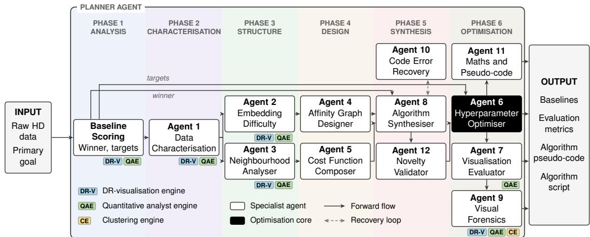
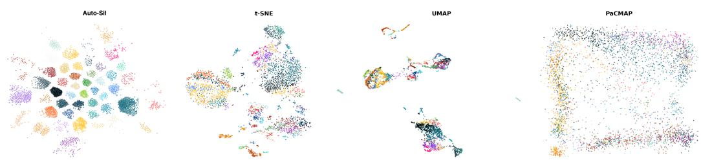
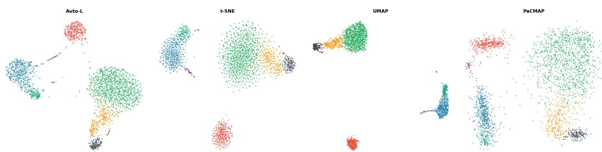
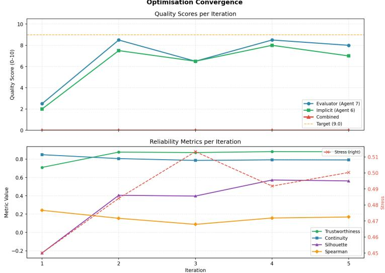
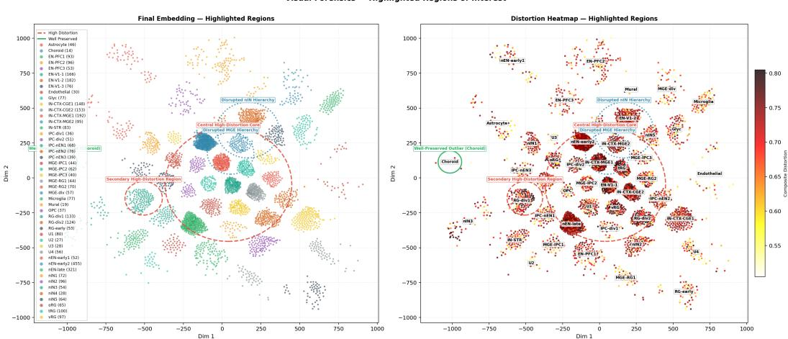

# AutoManifold: Agentic Design of Data Visualisation Algorithms via Manifold Embedding

Burak Susam Department of Computer Science University of Manchester Manchester, M13 9PT, UK burak.susam@postgrad.manchester.ac.uk

Ruiyuan Kang   
X32 Studio   
Abu Dhabi, UAE   
kang@x32studio.com

Tingting Mu Department of Computer Science University of Manchester Manchester, M13 9PT, UK tingting.mu@manchester.ac.uk

## Abstract

Manifold embedding for data visualisation is dominated by a small set of handdesigned state-of-the-art (SOTA) algorithms. Their design targets are fixed at development time, resulting in inflexible algorithmic behaviour that cannot be readily steered towards user-specified structural priorities. Hand-designing new embedding algorithms to address user priority requires highly specialised expertise and is time consuming. To address autonomous algorithm design tailored to user preference, we introduce an agentic algorithm generation pipeline AutoManifold. It composes new manifold embedding algorithms from a constrained vocabulary of affinity, cost, and optimisation primitives, supported by multi-agent large-language-model (LLM) orchestration. AutoManifold conditions every stage of its design on user-specified structural preservation preferences, and iteratively refines the algorithm configuration through an LLM-guided, metric-grounded iterative loop. We compare the generated algorithms against the three strongest and most frequently used SOTA methods (t-SNE, UMAP, and PaCMAP) on realworld datasets spanning different difficulty regimes under identical evaluation infrastructure. The results demonstrate that LLM-driven, priority-conditioned algorithm synthesis can move beyond hyperparameter tuning, producing genuinely new algorithms that outperform traditional hand-designed methods in their ability to steer towards user-specified properties without compromising the intrinsic structure in the original data. The code of AutoManifold is available at https://github.com/buraksusam/AutoManifold\_NeurIPS2026.

## 1 Introduction

Manifold embedding is widely used in modern data analysis, underpinning exploratory visualisation, e.g., in single-cell genomics, neuroscience, and the inspection of learned representations in deep neural networks. However, the research has shifted from a proliferation of new algorithms towards convergence on a small set of hand-designed methods. Nowadays, the field is dominated principally by t-SNE [1], UMAP [2], and PaCMAP [3], whose algorithmic targets and mechanisms are fixed at design time [4–6]. Each of these methods encodes a specific, immutable trade-off between local neighbourhood fidelity and global structural properties such as pairwise distance preservation and cluster separation [3, 7]. Such trade-off directly impacts the usefulness of the computed embeddings in downstream data visualisation. The practitioner’s only lever for steering this trade-off is through hyperparameter tuning over a narrow, algorithm-specific parameter space. An expert-driven process of hand-designing a new embedding algorithm to better handle such trade-off is time consuming, due to the large design space and the difficulty of anticipating effects of new designs without extensive trial-and-error experimentation.

Recent work has begun to explore whether large language models (LLMs) can act as autonomous designers of numerical algorithms. However, naive use of LLMs as code generators is insufficient. Effective algorithm design requires a more structured agentic pipeline. Despite promising results in program synthesis, scientific code generation, and automated machine learning [8, 9], LLM-emitted algorithms are prone to numerical pathologies, miscalibrated objectives, and silent correctness failures. Moreover, there is no systematic mechanism to ensure that the generated methods can faithfully reflect the user-specified design priorities rather than LLM training bias.

We explore the use of LLMs to design new manifold embedding algorithms for data visualisation, which can improve upon user-specified quality metrics. Our contributions include the following: (1) We introduce a unified embedding framework that identifies core computational components governing embedding quality and provides structured formulation templates for data- and metricaware adaptation. (2) We propose AutoManifold, an LLM-driven multi-agent system that uses the embedding framework as algorithm skeleton, and enables effective, reliable, and controllable algorithm generation with compositional novelty. AutoManifold is capable of handling nested tasks of novel function design, model configuration search, and hyperparameter optimisation, through creative and analytical reasoning capacity of LLMs. (3) We conduct comprehensive experiments to compare AutoManifold-generated algorithms with strong hand-designed baselines, evaluated from multiple complementary perspectives through global, local, and outlier lenses. Results show that AutoManifold without priority constraint can design algorithms with more balanced and stronger performance than existing baselines, while priority-driven AutoManifold can steer synthesised algorithms towards target metrics with the other properties remaining within an acceptable range.

## 2 Related Work

Manifold Embedding for Data Visualisation: The modern landscape of manifold embedding for data visualisation is shaped by a small number of influential algorithms, e.g., t-SNE [1] by minimising the mismatch between similarity distributions, UMAP [2] by aligning fuzzy topological structures, and PaCMAP [3] by explicitly separating mid-near pairs and far pairs to improve trade-off between local and global fidelity. Earlier methods such as Laplacian Eigenmaps [10], Isomap [11], and LargeVis [12] introduced key designs, such as k-nearest-neighbour (kNN) graphs, geodesic distances, and negative-sampling gradients, which recur in later algorithms. Despite their differences, these methods hardcode specific ways for neighbourhood modelling, objective formulation, and optimisation, meaning that their inductive biases are fixed at design time.

LLM for Data Visualisation: Recent research has begun to explore the use of LLMs in data visualisation, focusing on generating, interpreting, and interacting with visual representations. Systems like LIDA [13], MatPlotAgent [14], and PlotGen [15] generate visualisations, while Charts-of-Thought [16] and LLM4Vis [17] interpret and recommend visualisations. Survey studies [18, 19] further investigate interactions between LLMs and visualisation. However, in all such work, the embedding step that computes the visualisation coordinates is treated as a black box, where an off-the-shelf algorithm is called with default or lightly tuned parameters. The role of LLMs begins only after embedding computation. Our earlier work [20] uses an LLM agent to iteratively refine the hyperparameters of an existing embedding algorithm with explanations, but leaves the algorithm itself unchanged.

LLM-Driven Algorithm Design: A rapidly growing body of work explores LLMs as autonomous designers of numerical algorithms [21]. Existing frameworks span a spectrum of decreasing LLM autonomy, from unconstrained code generation to tightly scoped component optimisation. At the high autonomy end, the LLMs generate entire algorithms from scratch, as in OPRO [22] for optimisation, LLaMEA [23] for metaheuristic design, and EvoTune [24] for enhancing evolutionary search. At the low-autonomy end, humans design fixed algorithmic structure, while LLMs optimise specific components within the structure. For instance, FunSearch [8] evolves a critical function by using LLMs within a provided algorithm skeleton for improving cap-set construction and bin-packing heuristics, ReEvo [25] introduces “verbal gradients” for improving combinatorial optimisation, and Eureka [26] applies the same paradigm to improve reward design in reinforcement learning. LLMs have also made progress in symbolic discovery [27] and automated feature engineering [28]. However, most existing LLM-driven design frameworks optimise a single fixed objective, with limited mechanism to steer the design process towards user-specified metrics.

## 3 A Unified Manifold Embedding Design Framework

We focus on computing low-dimensional embeddings $\{ \mathbf { z } _ { i } ~ \in ~ \mathcal { R } ^ { d } \} _ { i = 1 } ^ { n }$ for a given set of highdimensional data points $\{ \mathbf { x } _ { i } \in \mathcal { R } ^ { D } \} _ { i = 1 } ^ { n }$ , where $d = 2 , 3$ is used for data visualisation. We seek lowdimensional embeddings that preserve local neighbourhood relationships among the high-dimensional data points, assuming an underlying manifold structure. Embedding quality is examined by reliability scores denoted by score $( \{ ( \mathbf { x } _ { i } , \dot { \mathbf { z } } _ { i } ) \} _ { i = 1 } ^ { n } )$ . Encouraged by the rapid growth of LLMs with their increasingly powerful search and knowledge-driven reasoning capacity, we revisit manifold embedding algorithm design, and propose a unified, high-capacity embedding framework, integrating a broad range of key factors and computational steps that influence the embedding quality to formulate a challenging optimisation problem. This problem provides a testbed to agentic AI on novel function design, model configuration search, and hyperparameter optimisation. This framework serves as an algorithmic skeleton for algorithm synthesis, guiding the autonomous LLM designer. Below we explain the proposed embedding framework component by component.

Embedding Difficulty Analysis: Significant dimensionality reduction inevitably introduces information distortion when representing complex high-dimensional data patterns. Local positioning of high-dimensional data points strongly influences the embedding difficulty, which can vary across different regions of the data manifold. Motivated by this, we introduce a regional strategy that distinguishes data patches with varying levels of embedding difficulty, and adapts the model design accordingly. Specifically, we assign data points into groups that are “hard-to-embed" (H), “moderately difficult to embed"(M), and “easy-to-embed" (E), and use the resulting difficulty labels as inputs to guide the formulation of relevant framework components.

Starting from clustering $\left\{ { \bf x } _ { i } \right\} _ { i = 1 } ^ { n }$ into local patches $( \mathrm { e . g . }$ ., by k-means clustering), we embed each patch through a standard embedding algorithm (e.g., t-SNE or UMAP) with its default hyperparameter setting. Subsequently, we compute a set of reliability scores $\{ \mathrm { s c o r e } _ { l } \} _ { l = 1 } ^ { L }$ for each patch, and then assign each patch a difficulty level based on the aggregated score. This process can be exemplified by the function dif $( \mathbf { x } _ { i } ) : \mathcal { R } ^ { D } \overset { \cdot } {  } \{ \mathrm { H } , \mathrm { M } , \mathrm { E } \}$ , given as

$$
\mathrm { d i f f } ( \mathbf { x } _ { i } ) = \mathrm { a s s i g n } \left( \sum _ { l = 1 } ^ { L } \mathrm { s c o r e } _ { l } \left( \left\{ \left( \mathbf { x } _ { j } , \mathbf { z } _ { j } ^ { \mathsf { t } . \mathsf { S N E } , \mathrm { U M A P } } \right) \right\} _ { \mathrm { c l u s t I D } ( \mathbf { x } _ { j } ) = \mathrm { c l u s t I D } ( \mathbf { x } _ { i } ) } \right) \right) .\tag{1}
$$

Here, the difficulty assignment function is to be designed, of which an example design is a simple thresholding function, assigning $\mathbf { \ddot { \Pi } } ^ { 6 6 } \mathbf { H } ^ { 5 }$ to low values of the aggregated score, while $\bf \ddot { e } \phi _ { \mathrm { E } } ^ { \prime \prime }$ to high values and $\mathbf { \ddot { \theta } M } ^ { \prime \prime }$ to middle values. The cluster partition clustID(x), the standard embedding computation, and the used reliability scores $\{ \mathrm { s c o r e } _ { l } \} _ { l = 1 } ^ { L }$ are implemented as fixed framework components. Difficulty is assigned per patch rather than per point, since embedding difficulty arises from the relative distance relationships within a neighbourhood rather than from individual points.

Affinity Matrix Construction: A common representation of a neighbourhood graph is the affinity matrix $\mathbf { \bar { A } } = [ a _ { i j } ] \in \mathcal { R } ^ { n \times n }$ , where $a _ { i j }$ measures the similarity between points i and $j ,$ , and $a _ { i j } = 0$ indicates the absence of a neighbouring relationship. Construction of such affinity matrix usually depends on choices of similarity measures (e.g., Euclidean distance, cosine similarity or geodesic distance), and definition of neighbourhood relationships based on these similarities $( \mathrm { e . g . }$ ., mutual or directed kNNs, or probabilistic neighbourhoods). Letting Q denote the total number of affinity matrix configurations resulting from these choices, each configuration is defined by model choices stored in $\mathrm { O p t A } _ { l }$ associated with fixed hyperparameters stored in $\theta _ { l } ^ { ( A ) }$ . We construct an ensemble of affinity matrices computed under different configurations. The aggregated affinity value between a target point i and its potential neighbouring point j is computed by

$$
a _ { i j } = \sum _ { l = 1 } ^ { Q } w _ { l } \left( \mathbf { x } _ { i } , \mathbf { f } ^ { ( A ) } ( \mathbf { x } _ { i } ) , \mathrm { d i f f } ( \mathbf { x } _ { i } ) , \mathbf { g } \left( \left\{ \mathbf { x } _ { i } \right\} _ { i = 1 } ^ { n } \right) \right) a _ { l } \left( \mathbf { x } _ { i } , \mathbf { x } _ { j } , { \mathrm { O p t } } \mathbf { A } _ { l } , { \boldsymbol { \theta } } _ { l } ^ { ( A ) } \right) .\tag{2}
$$

When each weight $0 \leq w _ { l } \leq 1$ is a constant that does not change over data points, the affinity ensemble is simply a weighted sum of some base affinity matrices, referred to as hybrid affinity.

More generally, we introduce adaptive weighting, allowing each weight to change over data points. Given a high-dimensional point $\mathbf { x } _ { i }$ , the weight functions adapt to its embedding difficulty level diff(x ) and its geometric and distributional features extracted by the feature mapping function $\mathbf { f } ^ { ( A ) } ( \mathbf { x } ) : \mathcal { R } ^ { D }  \mathcal { R } ^ { h _ { A } }$ . They also take into account the overall data characteristics, represented by features describing the geometry, density and cluster imbalance issues of the input data. These features are extracted by a characteristic function $\mathbf { g } : \mathcal { R } ^ { n \times D }  \mathcal { R } ^ { h }$ , for which a pre-defined feature list is suggested. The adaptive weight, feature mapping, and characteristic functions are to be designed. Each affinity function $a _ { l }$ under a given configuration is implemented as fixed framework components, while the configuration options $\{ \mathrm { O p t A } _ { l } \} _ { l = } ^ { Q }$ are pre-defined, with their corresponding hyperparameters $\{ \theta _ { l } ^ { ( A ) } \} _ { l = 1 } ^ { Q }$ to be determined.

Embedding Optimisation Formulation: In general, distortion of neighbourhood relationships can be quantified by comparing two affinity matrices, of which one is constructed in the original space (e.g., by Eq. 2) while the other in the embedding space (typically derived from Euclidean distances). This motivates constructing local objective functions for embedding optimisation (e.g., similarity distribution based in t-SNE and fuzzy topological structure based in UMAP). To balance local fidelity with global structure preservation, additional global objective functions are introduced to capture large-scale geometry or distributional properties $( \mathrm { e . g . }$ , variance-based in PCA, and mutual information or statistical dependence based).

Given the multi-faceted nature of these objectives, we formulate embedding optimisation as a multiobjective problem, combining a set of H objective functions, each of which is denoted at point level by $O _ { l } ( \mathbf { x } _ { i } , \mathbf { z } _ { i } , \mathrm { O p t C } _ { l } )$ for $l \in \mathsf { \Gamma } \{ 1 , 2 \dots \cdot \cdot , H \}$ , with pre-defined objective configurations $\{ \mathrm { \dot { O } p t C } _ { l } \} _ { l = 1 } ^ { H }$ This results in a standard multi-objective problem, as

$$
\operatorname* { m i n } _ { \{ \mathbf { z } _ { i } \} _ { i = 1 } ^ { n } } \left( \delta _ { 1 } \sum _ { i = 1 } ^ { n } O _ { 1 } ( \mathbf { x } _ { i } , \mathbf { z } _ { i } , \mathrm { O p t C _ { 1 } } ) , \dots , \delta _ { H } \sum _ { i = 1 } ^ { n } O _ { H } ( \mathbf { x } _ { i } , \mathbf { z } _ { i } , \mathrm { O p t C } _ { H } ) \right) ,\tag{3}
$$

where $\delta _ { l } \in \{ 0 , 1 \}$ is a binary selector, deciding the inclusion/exclusion of an objective function. A solver usually seeks the Pareto front of the problem. An alternative formulation is to optimise the weighted sum of these objective functions, resulting in the following unconstrained problem:

$$
\operatorname* { m i n } _ { \{ \mathbf { z } _ { i } \} _ { i = 1 } ^ { n } } \sum _ { l = 1 } ^ { H } \sum _ { i = 1 } ^ { n } \lambda _ { l } \left( \mathbf { x } _ { i } , \mathbf { f } ^ { ( O ) } ( \mathbf { x } _ { i } ) , \mathrm { d i f f } ( \mathbf { x } _ { i } ) , \mathbf { g } \left( \{ \mathbf { x } _ { i } \} _ { i = 1 } ^ { n } \right) , \{ \mathrm { s c o r e } _ { l } \} _ { l = 1 } ^ { L } \right) O _ { l } ( \mathbf { x } _ { i } , \mathbf { z } _ { i } , \mathrm { O p t C } _ { l } ) ,\tag{4}
$$

where we adopt the similar adaptive weighting scheme as in affinity construction, for combining objective functions. Each weight $0 \leq \lambda _ { l } \leq 1$ can either be a constant unchanging over data points, or a function depending on the embedding difficulty level and feature characteristics of a given point, as well as data characteristics of the whole input data and the embedding quality metrics of interest. We adopt the same characteristic function as used for affinity matrix construction, but use a different instance-level feature mapping function $\mathbf { f } ^ { ( O ) } ( \mathbf { x } _ { i } ) : \mathcal { R } ^ { D } \xrightarrow { } \mathcal { R } ^ { h _ { O } }$ . For example, a density feature $f _ { \mathrm { d e n s i t y } } ( \mathbf { x } _ { i } )$ normalised between 0 and 1 can be extracted for each data point. An adaptive weight function in the form of $\lambda _ { l } = 1 - f _ { \mathrm { d e n s i t y } } ( \mathbf { x } _ { i } )$ can then enforce stronger local neighbourhood preservation for points from sparse regions.

Typically, the primary objective of manifold embedding is to learn a low-dimensional representation that preserves the local geometry around each data point. Therefore, objective functions that emphasise local structure often play a dominant role in embedding calculation. Global structure preservation is often incorporated to maintain large-scale geometry, acting as a complementary constraint or regularisation term. This encourages us to introduce a constrained formulation, emphasising primary objective optimisation while treating the complementary objectives as optimisation constraints. We distinguish the index sets of the primary and complementary objective functions by $I _ { p }$ and $I _ { c } ,$ and optimise the embeddings by

$$
\begin{array} { r l } { \displaystyle \operatorname* { m i n } _ { \{ \mathbf { z } _ { i } \} _ { i = 1 } ^ { n } } } & { \displaystyle \sum _ { l \in I _ { p } } \displaystyle \sum _ { i = 1 } ^ { n } \lambda _ { l } \left( \mathbf { x } _ { i } , \mathbf { f } ^ { ( O ) } ( \mathbf { x } _ { i } ) , \mathrm { d i f f } ( \mathbf { x } _ { i } ) , \mathbf { g } \left( \{ \mathbf { x } _ { i } \} _ { i = 1 } ^ { n } \right) , \{ \mathrm { s c o r e } _ { l } \} _ { l = 1 } ^ { L } \right) O _ { l } ( \mathbf { x } _ { i } , \mathbf { z } _ { i } , \mathrm { O p t C } _ { l } ) , } \\ { \displaystyle \mathrm { s . t . } \sum _ { i = 1 } ^ { n } O _ { l } ( \mathbf { x } _ { i } , \mathbf { z } _ { i } , \mathrm { O p t C } _ { l } ) \leq \theta _ { l } , \mathrm { f o r } l \in I _ { c } . } \end{array}\tag{5}
$$

We can also formulate a multi-objective problem with the same constraints as an alternative to the above weighted sum. By introducing constraints, we do not enforce the minimisation of complementary objective functions, but restrict their values to be sufficiently small controlled by hyperparameters $\{ \boldsymbol { \theta } _ { l } \} _ { l = 1 } ^ { H }$ . The choice of which optimisation formulations in Eqs. (3) to (5) to use and which objective functions to consider indicated by $\delta _ { l }$ for $\operatorname { E q }$ . (3) are to be searched. Both the weights $\{ \lambda _ { l } \} _ { l = 1 } ^ { H }$ and feature mapping function $\mathbf { f } ^ { ( O ) }$ are to be designed. Although the formulation logic of each individual embedding objective function $O _ { l }$ is specified by its configuration, its exact function form still needs to be calibrated accordingly.

Model Configuration Determination: To construct the affinity matrix and optimisation formulation, configuration choices are searched from the candidate pools $\{ \mathrm { O p t A } _ { l } \} _ { l = 1 } ^ { Q }$ and $\{ \mathrm { O p t C } _ { l } \} _ { l = 1 } ^ { H }$ . We introduce a two-stage decision making, where the final configuration choice depends on an initial configuration guess informed by input data characteristics. This results in

$$
\mathrm { O p t A } = F _ { \mathrm { O p t A } } \left( \mathrm { O p t A } ^ { ( 0 ) } , \{ \mathrm { O p t A } _ { l } \} _ { l = 1 } ^ { Q } , \{ \mathbf { x } _ { i } \} _ { i = 1 } ^ { n } \right) ,\tag{6}
$$

$$
\begin{array} { r } { \mathrm { O p t C } = F _ { \mathrm { O p t C } } \left( \mathrm { O p t C } ^ { ( 0 ) } , \{ \mathrm { O p t C } _ { l } \} _ { l = 1 } ^ { H } , \{ \mathbf { x } _ { i } \} _ { i = 1 } ^ { n } , \{ \mathrm { s c o r e } _ { l } \} _ { l = 1 } ^ { L } \right) . } \end{array}\tag{7}
$$

We let Eq. (7) take extra input $\{ \mathrm { s c o r e } _ { l } \} _ { l = 1 } ^ { L }$ , allowing prior knowledge on embedding quality metrics to influence the objective configuration for embedding optimisation. The initial choices of affinity and objective configurations are informed by data characteristics of the high-dimensional data represented by g, such as

$$
\left( \mathrm { O p t A } ^ { ( 0 ) } , \mathrm { O p t C } ^ { ( 0 ) } \right) = F _ { \mathrm { O - i n i } } \big ( \mathbf { g } \left( \left\{ \mathbf { x } _ { i } \right\} _ { i = 1 } ^ { n } \right) \big ) .\tag{8}
$$

The configuration functions $F _ { \mathrm { O p t A } }$ and $F _ { \mathrm { O p t C } }$ and the initialisation function $F _ { \mathrm { O - i n i } }$ are to be designed.

Embedding and Hyperparameter Optimisation: Regarding to solving the three numerical optimisation problems in Eqs. (3) to (5), well-established solvers $( \mathrm { e . g . }$ , gradient-based methods and their accelerated versions, pareto-based methods) are available. We provide a pre-defined list of solvers for the framework to choose. Regarding hyperparameter optimisation, we introduce an iterative refinement process, building on the LLM-agent refinement architecture of our earlier work [20]. Starting from an initial hyperparameter guess $\theta ^ { ( 0 ) }$ , it iteratively updates by

$$
\boldsymbol { \theta } ^ { ( t + 1 ) } = F _ { \mathrm { u p d a t e } } \left( \boldsymbol { \theta } ^ { ( t ) } , \{ \mathrm { s c o r e } _ { l } ( \{ ( \mathbf { x } _ { i } , \mathbf { z } _ { i } ) \} _ { i = 1 } ^ { n } ) \} _ { l = 1 } ^ { L } \right) .\tag{9}
$$

Here, the updating function $F _ { \mathrm { u p d a t e } }$ refines the current hyperparameters by considering reliability scores of the current embedding results. The updating function is to be designed.

## 4 Multi-Agent Algorithm Synthesis

The proposed manifold embedding framework in Section 3 has high modelling capacity and adapts to the data, but it introduces a large search space of model configurations and hyperparameters. Moreover, it introduces novel design tasks of specifying functions, which may be given as explicit analytical formulas, described by explicit heuristic rules, or implemented as implicit black-box models. These include design cases of difficulty assignment function (explicit), weight functions w<sub>l</sub> and λ<sub>l</sub> (explicit), feature mapping functions $\bar { \mathbf { f } } ^ { ( A ) } , \bar { \mathbf { f } } ^ { ( O ) }$ and g (explicit), also configuration, initialisation, and hyperparameter updating functions $F _ { \mathrm { O p t A } } , F _ { \mathrm { O p t C } } , F _ { \mathrm { O - i n i } }$ and $F _ { \mathrm { u p d a t e } }$ (implicit), as well as the calibration of $O _ { l }$ (explicit). Such a complex combination of nested search and design tasks poses a significant challenge for human algorithm developers to complete within a short time frame. To address this challenge, we present AutoManifold, a principled algorithm synthesis pipeline, driven by an LLM based multi-agent system. We delegate creative and analytical reasoning to LLM agents while measuring quantitative performance objectively by pre-implemented, deterministic, non-LLM engines. We strictly follow the central design principle of “agents propose, engines measure”. AutoManifold allows explicit user control on which embedding metrics for the algorithm to improve over. Specifically, the user is asked to select one of the eight pre-defined priority options as listed in Table 5 of Appendix B. AutoManifold generates executable code of the designed algorithm, underpinned by mathematical formulation of embedding optimisation based on templates provided in Eqs. (3) to (5) and by structured pseudo-code at the granularity of algorithmic steps. Orchestrated Architecture: AutoManifold is organised into three independent layers: The orchestration layer contains a planner agent, which codes the phase-by-phase workflow logic, manages pipeline state, and enforces convergence criteria for the iterative refinement. The agent layer contains specialised LLMbacked worker agents, each constrained to a narrow task scope through a structured system prompt and a required JSON output schema. The compute engine layer contains pre-implemented deterministic engines, computing embeddings and reliability scores for a given embedding algorithm and a dataset. These engines serve as objective validators for every LLM-generated output. Each worker is a single-shot, schema-constrained LLM call that performs no embedding, metric computation or tool call of its own. The planner invokes the engines and injects their outputs verbatim into the context of the next agent, so that agents cannot fabricate metrics. The phase graph is fixed by design, as a reliability choice over a dynamically orchestrated controller. More details on our adopted agentic workflow are provided in Appendix E.4. The system operates through a pre-analysis phase, followed by six processing phases including (1) baseline analysis, (2) data characterisation, (3) data structure analysis, (4) algorithm design, (5) algorithm synthesis, and (6) iterative hyperparameter refinement, post analysis and output, which are implemented by the planner agent with the assistance of multiple worker agents.

  
Figure 1: Overview of the multi-agent LLM pipeline for manifold embedding algorithm design.

Agent Role Distribution: Each agent independently decides its goals or actions, with its decision making informed by other agents when needed. The planner agent takes as input the user-specified embedding quality metrics, the JSON output returned by the worker agents, implements actions by generating code and calling compute engines, and runs the code to calculate embeddings and evaluate their performance. In phase 1, the DR-visualisation and quantitative analyst engines run baseline embedding methods $( \mathrm { e . g . }$ , PCA, t-SNE, UMAP, etc.) on the data, to determine the best baseline and the targets of the optimisation loop. The scores of the best baseline are passed to the algorithm synthesiser. In phase 2, Agent 1 designs the data characteristic function g, the implicit configuration initialisation function $F _ { \mathrm { O - i n i } }$ based on g, and recommends a data pre-processing option (e.g., by PCA to reduce dimensionality to $d < m < D )$ . In phase 3, Agent 2 designs the difficulty assignment function diff(x), and Agent 3 performs neighbourhood analysis on the pre-processed data. Phases 2 and 3 together constitute a pre-processing and pre-analysis stage. Phase 4 conducts the main design task, supported by Agent 4 for designing the affinity matrix based on Eq. (2), Agent 5 for designing the optimisation formulation based on Eqs. (3) to (5), and Agent Planner for autoselecting a solver for the composed optimisation problem. We separate the options of determining constant weights from designing adaptive weight functions, to encourage the agents to pursue both routes. As a by-product result, Agents 4 and 5 implicitly design $F _ { \mathrm { O p t A } }$ and $\bar { F _ { \mathrm { O p t C } } }$ . In phase 5 for algorithm synthesis, Agent 8 is the synthesiser, assisted by an independent Agent 10 for recovering execution failures. Agent 12 validates the novelty of the designed algorithm, determining the most similar method by comparing with the mathematical specifications of existing embedding methods (e.g., t-SNE, UMAP, PaCMAP, LargeVis [12], Spectral Embedding [10], and ForceAtlas2 [29]) and analysing the fundamental differences. The next phase constitutes the algorithm refinement, post-analysis and output stage. In phase 6, Agent 6 takes the synthesised embedding algorithm and iteratively refines its hyperparameters following Eq. (9), based on performance evaluation conducted by Agent 7, who is provided with a list of embedding reliability scores of interest. Next, Agent 11 prepares the mathematical formulation, executable code, and pseudo-code for the designed algorithm, and Agent 9 performs a post-hoc visual forensics. This workflow is illustrated in Figure 1.

Algorithm Novelty: AutoManifold generates genuinely novel manifold embedding algorithms through a composition of algorithmic components guided by an algorithm skeleton, i.e., the unified embedding framework. LLMs are provided with a fixed set of configuration options, referred to as a primitive vocabulary, while being free to combine primitives in novel ways under a set of suggested composition patterns. Therefore, we consider the novelty aimed by AutoManifold as compositional novelty, meaning new algorithms mostly built from novel combinations of known components. It is worth to mention that, although the prompt files provide primitives covering design choices for affinity formulations, optimisation objectives, constraints and solvers, these only serve as guidance rather than hard constraints. In practice, LLM agents can depart from the provided choices and generate novel formulations when they better optimise the target metrics, reflecting the non-deterministic nature of LLM-based design.

## 5 Experiments and Result Analysis

We compare the new algorithms designed by AutoManifold against three strong SOTA manifold embedding algorithms, including t-SNE, UMAP and PaCMAP with their hyperparameters tuned by random-search [30] to maximise a balanced objective (a weighted sum of multiple scores) as detailed in Appendix E.10. They are evaluated on six real-world datasets spanning different difficulty regimes, including one easy dataset (iris), three moderately difficult datasets (aging, kidney, pbmc3k), and two hard datasets (fashion-mnist, cortex). All agents use Gemini-3.1-Pro as the LLM backbone; alternative backbones are compared in Appendix D.4.

Embedding Evaluation: We assess algorithm performance using six reliability scores common for benchmarking embedding quality, which also act as $\{ \mathrm { s c o r e } _ { l } \} _ { l = } ^ { L ^ { - } }$ in the embedding framework. They are implemented as deterministic code for evaluation, while provided as text input to agents for driving algorithm design. These include Spearman rank correlation $( \rho )$ and stress $( \bar { S } )$ for assessing global preservation of pairwise distances, silhouette score for measuring cluster separation $( C _ { \mathrm { s i l } } )$ trustworthiness $( T _ { \mathrm { a r e a } } )$ and continuity $\left( C _ { \mathrm { a r e a } } \right)$ for examining local fidelity over varying neighbourhood sizes, and median local outlier factor (LOF) (L) for examining outlier amount in embedding space. Four additional scores, which are never provided to the agents, are used in held-out, stability and ablation experiments, including Shepard correlation (Shep) for distance preservation, normalised mutual information (NMI) for cluster agreement with ground-truth labels, RNX for local neighbour preservation, and kNN classification accuracy for local neighbour consistency. All scores are defined in Appendix A.

Primitive Vocabulary: We define primitive vocabulary to communicate model configuration options to agents in natural language. These include six primitives $\{ \mathrm { O p t A } _ { i } \} _ { i = 1 } ^ { 6 }$ for constructing affinity matrix, five primitives $\{ \bar { \mathrm { O p t } } \bar { \mathrm { C } } _ { i } \} _ { i = } ^ { 5 }$ for specifying objective function, and four primitives $\{ \bar { \mathrm { O p t S } _ { i } } \} _ { i = 1 } ^ { 4 }$ for optimisation solvers. Further details on datasets, difficulty definition, reliability scores, primitive vocabulary, and implementation are provided in the appendix, along with the complete prompt files for each agent.

## 5.1 Comparative Analysis

In this experiment, we study two questions: Q1. Can generated algorithms outperform hand-designed SOTA algorithms? and Q2. Can generated algorithms address effectively user-specified structural priorities? To investigate this, we first ask AutoManifold to design separate algorithms to improve specifically on each of the trustworthiness $( T _ { \mathrm { a r e a } } )$ , continuity $\bar { ( C _ { \mathrm { a r e a } } ) }$ , Spearman $( \rho )$ , stress (S), silhouette $( C _ { \mathrm { { s i l } } } )$ and LOF (L) scores, with the corresponding designed algorithms referred to as Auto-T, Auto-C, Auto-ρ, Auto-S, Auto-Sil, and Auto-L, respectively. We then instruct AutoManifold to design algorithms that address a general preference for preserving local structure, followed by global structure, without specifying any particular metrics. This yields Auto-local and Auto-global algorithm variants. Additionally, we let AutoManifold generate algorithms without specifying any preference, expecting a balanced performance across all criteria, referred to as Auto (w/o).

Table 1 compares performance of AutoManifold-generated and hand-designed algorithms. In general, AutoManifold without priority constraint can design algorithms with more balanced and stronger performance than existing baselines. For priority-driven AutoManifold, the prioritised structural property can steer the synthesised algorithm towards the target metric, while the other properties remain within an acceptable range. These observations are supported by scores that are either better than or lower, yet still acceptable, relative to baseline performance on respective metrics.

Table 1: Priority-controlled algorithm synthesis. Bold indicates the best across all methods on that dataset/score. Underline flags all AutoManifold-generated algorithms (Auto-∗) that outperform the best SOTA baseline (t-SNE, UMAP or PaCMAP).↑/↓: higher/lower is better.
<table><tr><td>Dataset</td><td>Score</td><td>t-SNE</td><td>UMAP PaCMAP</td><td></td><td>Auto (w/o)</td><td>Auto-T</td><td>Auto-C</td><td>Auto-ρ</td><td>Auto-Sil</td><td>Auto-S</td><td>Auto-L Auto-local Auto-global</td><td></td></tr><tr><td rowspan="6">iris[31]</td><td> $T _ { \mathrm { a r e a } } \uparrow$   $C _ { \mathrm { a r e a } } \uparrow$ </td><td>0.9848 0.9842</td><td>0.9810 0.9837</td><td>0.9483 0.9689</td><td>0.9865 0.9888</td><td>0.9838 0.9816</td><td>0.9858 0.9843</td><td>0.9918 0.9200 0.9946 0.9247</td><td>0.9899 0.9922</td><td>0.9866 0.9883</td><td>0.9804 0.9858</td><td>0.9907 0.9930</td></tr><tr><td> $\mathrm { S p e a r m a n } \left( \rho \right) \uparrow$ </td><td>0.8077</td><td>0.9602 0.7332</td><td>0.9629</td><td>0.8792</td><td>0.8845</td><td>0.9967</td><td>0.8535</td><td>0.9945</td><td>0.9297</td><td>0.9438</td><td>0.9927</td></tr><tr><td> $\mathrm { S i l h o u e t t e } \left( \dot { C } _ { \mathrm { s i l } } \right) \uparrow$ </td><td>0.6383</td><td>0.6056</td><td>0.3978</td><td></td><td>0.6031</td><td>0.5238</td><td>0.7810</td><td>0.5274</td><td>0.6320</td><td>0.6454</td><td>0.5402</td></tr><tr><td></td><td>0.5164</td><td>0.2205</td><td>0.5408</td><td>0.6000 0.1689</td><td>0.6165</td><td></td><td></td><td></td><td></td><td></td><td></td></tr><tr><td> $\mathrm { S t r e s s } \left( S \right) \downarrow$ </td><td>1.0088</td><td>1.0093</td><td></td><td></td><td>0.3985 0.4769</td><td>0.0334</td><td>0.4730</td><td>0.0458</td><td>0.4527</td><td>0.2870</td><td>0.0734</td></tr><tr><td> $\mathrm { L O F } \left( L \right) \downarrow$ </td><td></td><td>1.0155</td><td>1.0131</td><td></td><td>1.0106 1.0129</td><td>1.0162</td><td>1.0146</td><td>1.0163</td><td>1.0080</td><td>1.0100</td><td>1.0166</td></tr><tr><td rowspan="6"> $\mathtt { a g i n g } \ [ 3 2 ]$ </td><td> $T _ { \mathrm { a r e a } } \uparrow$   $C _ { \mathrm { a r e a } } \uparrow$ </td><td>0.9783 0.9744</td><td>0.9739 0.9767</td><td>0.9710 0.9727</td><td>0.9170 0.9477</td><td>0.9793 0.9727</td><td>0.9709 0.9759</td><td>0.9073 0.9482</td><td>0.8013 0.8127</td><td>0.9708</td><td>0.9797</td><td>0.8521</td></tr><tr><td></td><td>0.4830</td><td>0.4686</td><td></td><td></td><td></td><td></td><td>0.9070</td><td>0.8791</td><td>0.9684</td><td>0.9731</td><td>0.8359</td></tr><tr><td> $\mathrm { S p e a r m a n } \left( \rho \right) \uparrow$ </td><td>0.2345</td><td></td><td>0.5203</td><td>0.5464</td><td>0.4312</td><td>0.4447 0.9075</td><td>0.0757</td><td>0.6440</td><td>0.4038</td><td>0.4617</td><td>0.3164</td></tr><tr><td> $\mathrm { S i l h o u e t t e } \left( \dot { C } _ { \mathrm { s i l } } \right) \uparrow$ </td><td></td><td>0.2084</td><td>0.0893</td><td>-0.1309</td><td>0.2120</td><td>0.1987 -0.0965</td><td>0.8691</td><td>-0.1293</td><td>0.1326</td><td>0.1683</td><td>-0.3474</td></tr><tr><td> $\mathrm { S t r e s s } \left( S \right) \downarrow$ </td><td>0.4882</td><td>0.5079</td><td>0.4746</td><td>0.5929</td><td>0.5503</td><td>0.5477 0.1956</td><td>0.7022</td><td>0.3825</td><td>0.5327</td><td>0.4904</td><td>0.4839</td></tr><tr><td> $\mathrm { L O F } \left( L \right) \downarrow$ </td><td>1.0162</td><td>1.0118</td><td>1.0192</td><td>1.0595</td><td>1.0157</td><td>1.0186</td><td>1.0092 1.0062</td><td>1.0078</td><td>1.0156</td><td>1.0403</td><td>1.0178</td></tr><tr><td rowspan="6">pbmc3k[33]</td><td> $T _ { \mathrm { a r e a } } \uparrow$ </td><td>0.8727</td><td>0.8613</td><td>0.8627</td><td>0.8757</td><td>0.8794</td><td>0.8599</td><td>0.8645 0.8659</td><td>0.8570</td><td>0.8820</td><td>0.8680</td><td>0.8589</td></tr><tr><td> $C _ { \mathrm { a r e a } } \uparrow$ </td><td>0.8978</td><td>0.8995</td><td>0.8953</td><td>0.9185</td><td>0.8924</td><td>0.8983</td><td>0.9056 0.8970</td><td>0.9004</td><td>0.9034</td><td>0.8889</td><td>0.9011</td></tr><tr><td>Spearman  $( \rho ) \uparrow$ </td><td>0.6812</td><td>0.6907 0.6978</td><td>0.7092</td><td></td><td>0.6233 0.6659</td><td>0.8552</td><td>0.5838</td><td>0.8365</td><td>0.6632</td><td>0.6680</td><td>0.8370</td></tr><tr><td> $\underbrace { \mathrm { S i l h o u e t t e } \left( C _ { \mathrm { s i l } } \right) \uparrow } _ { - }$ </td><td>0.4245</td><td>0.3707</td><td>0.5320</td><td>0.5269</td><td>0.3311</td><td>0.7090</td><td>0.3876 0.5520</td><td>0.2409</td><td>0.4911</td><td>0.3585</td><td>0.2418</td></tr><tr><td> $\mathrm { S t r e s s } \left( S \right) \downarrow$ </td><td>0.4265</td><td>0.4089</td><td>0.4074</td><td>1.2913</td><td>1.0298</td><td>1.3026 0.3191</td><td>0.9763</td><td>0.2901</td><td>1.1310</td><td>0.8945</td><td>0.3501</td></tr><tr><td> $\mathrm { L O F } \left( L \right) \downarrow$ </td><td>1.0087</td><td>1.0060</td><td>1.0133</td><td>1.0165</td><td>1.0090</td><td>1.0477</td><td>1.0135</td><td>1.0110</td><td>1.0067 1.0112</td><td>1.0129</td><td>1.0063</td></tr><tr><td rowspan="6">kidney [34]</td><td> $\begin{array} { c } { T _ { \mathrm { a r e a } } \uparrow } \\ { C _ { \mathrm { a r e a } } \uparrow } \end{array}$ </td><td>0.9774</td><td>0.9824</td><td>0.9730</td><td>0.9843</td><td>0.9831</td><td>0.9817 0.9194</td><td>0.9199</td><td>0.9269</td><td>0.9841</td><td>0.9810</td><td>0.9273</td></tr><tr><td></td><td>0.9761</td><td>0.9857</td><td>0.9723</td><td>0.9812</td><td>0.9794</td><td>0.9775</td><td>0.9637</td><td>0.9639</td><td>0.9860</td><td>0.9807</td><td>0.9663</td></tr><tr><td> $\mathrm { S p e a r m a n } \left( \rho \right) \uparrow$ </td><td>0.5387</td><td>0.6399 0.5377</td><td>0.5183</td><td>0.5230</td><td>0.5345</td><td>0.9611 0.8962</td><td>0.1990</td><td>0.9467</td><td>0.7210</td><td>0.4457</td><td>0.9467</td></tr><tr><td> $\mathrm { S i l h o u e t t e } \left( C _ { \mathrm { s i l } } \right) \uparrow$ </td><td>0.0678</td><td>0.1461</td><td>0.0404</td><td>0.2306</td><td>0.2058</td><td>0.1064 -0.2730</td><td>0.9392</td><td>-0.2111</td><td>0.1330</td><td>-0.0376</td><td>-0.2500</td></tr><tr><td> $\mathrm { S t r e s s } \left( S \right) \downarrow$ </td><td>0.4068</td><td>0.3836</td><td>0.4037</td><td>0.4544</td><td>0.4339</td><td>0.4465 0.2658</td><td>0.8035</td><td>0.1930</td><td>0.3645</td><td>0.4443</td><td>0.1747</td></tr><tr><td> $\mathrm { L O F } \left( L \right) \downarrow$ </td><td>1.0127</td><td>1.0112</td><td>1.0213</td><td>1.0162</td><td>1.0155</td><td>1.0187 1.0138</td><td>1.0272</td><td>1.0130</td><td>1.0132</td><td>1.0219</td><td>1.0127</td></tr><tr><td rowspan="6">cortex [35]</td><td> $T _ { \mathrm { a r e a } } \uparrow$ </td><td>0.9729</td><td>0.9627</td><td>0.9656</td><td>0.9562</td><td>0.9342 0.9590</td><td>0.9192</td><td>0.8050</td><td>0.9196</td><td>0.9442</td><td>0.9700</td><td>0.9285</td></tr><tr><td>Carea ↑</td><td>0.9647</td><td>0.9629</td><td>0.9661</td><td>0.9710</td><td>0.9392</td><td>0.9520</td><td>0.7087</td><td>0.9528</td><td>0.9543</td><td>0.9668</td><td>0.9620</td></tr><tr><td> $\mathrm { S p e a r m a n } \left( \rho \right) \uparrow$ </td><td>0.6536</td><td>0.6805 0.6894</td><td>0.7353</td><td></td><td>0.6154</td><td>0.9524 0.9077</td><td>0.1578</td><td>0.9077</td><td>0.6220</td><td>0.6561</td><td>0.9107</td></tr><tr><td>Silhouette  $( C _ { \mathrm { s i l } } ) \uparrow$ </td><td>-0.0154 -0.0234</td><td></td><td>-0.0203</td><td>-0.0413</td><td>0.6384 -0.0673</td><td></td><td></td><td></td><td>-0.0747</td><td></td><td>-0.1501</td></tr><tr><td> $\mathrm { S t r e s s } \left( S \right) \downarrow$ </td><td>0.3556</td><td>0.3667 0.3372</td><td></td><td>0.3445</td><td>-0.0097 0.3993 0.4196</td><td>-0.1745 0.2676</td><td>0.5723 0.4918</td><td>-0.1730 0.2678</td><td>0.3950</td><td>-0.0008 0.3633</td><td>0.2587</td></tr><tr><td> $\mathrm { L O F } \left( L \right) \downarrow$ </td><td>1.0118</td><td>1.0110</td><td>1.0199</td><td>1.0036</td><td>1.0037</td><td>1.0130 1.0068</td><td>1.0150</td><td>1.0067</td><td>1.0015</td><td>1.0133</td><td>1.0122</td></tr><tr><td rowspan="7">fashion [36]</td><td></td><td>0.9771</td><td>0.9584</td><td></td><td></td><td>0.9699</td><td>0.9250</td><td>0.9170</td><td>0.9295</td><td>0.9758</td><td>0.9666</td><td>0.9370</td></tr><tr><td> $T _ { \mathrm { a r e a } } \uparrow$ </td><td>0.9740</td><td>0.9810</td><td>0.9345</td><td>0.9675</td><td>0.9078</td><td></td><td></td><td></td><td></td><td>0.9687</td><td>0.9767</td></tr><tr><td> $C _ { \mathrm { a r e a } } \uparrow$   $\mathrm { S p e a r m a n } \left( \rho \right) \uparrow$ </td><td>0.7179</td><td>0.7552</td><td>0.9693 0.8690</td><td>0.9742 0.6949</td><td>0.9446 0.9670 0.5093 0.5833</td><td>0.9529 0.9329</td><td>0.8211 0.2825</td><td>0.9684 0.9239</td><td>0.9654 0.6305</td></table>

Existing methods t-SNE, UMAP and PaCMAP are designed to address local fidelity. Their performance on preserving global data structure is controlled via their hyperparameters. As a result, they can achieve high local scores like $T _ { \mathrm { a r e a } }$ and $C _ { \mathrm { a r e a } } .$ , but less satisfactory global scores, e.g., low or negative $C _ { \mathrm { s i l } }$ indicating poor cluster separation. In contrast, taking Auto-Sil as an example, by steering towards better cluster separation, it generates algorithms that help viewers to observe a clearer underlying cluster distribution, while still maintaining satisfactory local fidelity (mostly over 80%). In Appendix D.1, we demonstrate visualisation results for Auto-Sil and Auto-L.

For further comparison, we tune hyperparameters of t-SNE, UMAP and PaCMAP for individual metrics and compare AutoManifold against the tuned baselines optimised for the same objectives and their default configuration. Results on the PBMC3k dataset are reported in Appendix D.2. We observe the following from both Table 1 and the additional experiments. Optimising local metrics (T, C, or both) yields only modest gains for both AutoManifold and tuned baselines, indicating limited headroom for improving local neighbourhood preservation. Optimising local metrics affects global metrics differently across datasets and methods. AutoManifold exhibits the largest global changes, followed by PaCMAP, while t-SNE and UMAP change the least, likely reflecting their progressively less flexible design spaces. A consistent trade-off exists between distance preservation $( \rho , S )$ and cluster separation (Sil). Overly enforcing cluster separation distorts the original distance relationships. When optimising a single global metric $( \rho , S { \mathrm { ~ o r ~ } } { \mathrm { S i l } } )$ , AutoManifold consistently delivers larger improvements than hyperparameter tuning, often outperforming the strongest baseline. The observed trade-offs reflect conflicting objectives between preserving distance $( \rho$ and $S )$ and enhancing cluster separation (Sil) rather than algorithm limitation. When optimising outlier reduction (L), tuned t-SNE and UMAP tend to overfit ${ \bar { L } } ,$ substantially degrading other metrics. In contrast, AutoManifold and tuned PaCMAP preserve strong local scores with less degradation in $\rho , S$ and Sil. Under balanced objectives, hyperparameter tuning offers only limited gains over the defaults. In contrast, AutoManifold consistently maintains competitive local performance, while improving one or more global properties (typically $\rho / S$ or Sil, and occasionally $\dot { L } ,$ depending on the datasets).

Table 2: Monte Carlo experiments over 5 runs.
<table><tr><td></td><td>T↑</td><td>C↑</td><td>ρ↑</td><td>Sil↑</td><td>S↓</td><td>L↓</td><td>RNX↑</td><td>Shep↑</td><td>kNN↑</td><td>NMI↑</td></tr><tr><td>Auto-T ±std</td><td>0.874 .005</td><td>0.896 .010</td><td>0.639 .022</td><td>0.428 .067</td><td>0.446 .016</td><td>1.011 .001</td><td>0.281 .019</td><td>0.460 .019</td><td>0.967 .008</td><td>0.709 .020</td></tr><tr><td>Auto-ρ ±std</td><td>0.858 .013</td><td>0.898 .010</td><td>0.806 .104</td><td>0.303 .097</td><td>0.509 .241</td><td>1.013 .008</td><td>0.229 .015</td><td>0.734 .152</td><td>0.900 .028</td><td>0.531 .251</td></tr></table>

## 5.2 Held-out Experiments

Table 1 evaluates various versions of AutoManifold, each optimised on a single metric or a subset of metrics, where metrics not used during the design serve as held-out metrics. In addition, we let AutoManifold design algorithms using PBMC3k and evaluate the designed algorithms on the held-out datasets of Kidney and Cortex. The design is optimised on an individual metric (ρ or Sil) and then evaluated using a richer set of held-out metrics. Results are reported in Table 9 along with its analysis in Appendix D.3. Consistent behaviour across held-out datasets and metrics has been observed for AutoManifold.

## 5.3 Stability Analysis

We examine the stability of AutoManifold by repeating independently each design (driven by a given priority choice) 5 times on PBMC3k for individual metrics. Overall, designs targeting local metrics are highly stable, while those targeting global metrics vary more. Table 2 reports performance variance of Auto-T and Auto-ρ across different metrics. Auto-T consistently achieves low std across all metrics. In contrast, Auto-ρ shows noticeably larger std on global metrics (e.g., ρ, S, Shepard, NMI), while remaining stable on local metrics (T, C, RNX) and on kNN accuracy. This difference may reflect the larger and more flexible design space available for optimising global structures than local neighbourhood preservation. Overall, the results show that AutoManifold offers greater modelling flexibility than hyperparameter tuning of existing embedding algorithms. The observed trade-offs arise primarily from incompatible objectives rather than limitations of the generated algorithms. AutoManifold achieves local preservation comparable to t-SNE and UMAP, while providing flexibility comparable to, often exceeding, PaCMAP, with stronger local performance.

## 5.4 Ablation Studies

We conduct an ablation study of Auto-T on Iris dataset by removing individual design components, including embedding difficulty analysis (Agent 2), neighbourhood analysis (Agent 3), affinity design (Agent 4), objective design (Agent 5), hyperparameter refinement (Agent 6), primitive library, and optimisation formulation guidance in Eqs. (3)-(5). Table 3 reports performance changes across metrics. It indicates that difficulty and neighbourhood analyses, and optimisation guidance contribute the most to AutoManifold performance. In contrast, hyperparameter refinement and primitive library have mixed effects, suggesting they are less critical. Notably, the limited effect of primitives seems to be consistent with the non-deterministic behaviour of LLMs, which can generate designs beyond the provided choices.

Additionally, we conduct system-level ablation on LLM backbone and skeleton contribution and report results in Appendix D.4, and observe the following: Removing the whole skeleton degrades the prioritised metric in 12 of 15 dataset-priority pairs. Single-LLM and skeleton-free multi-agent designs are inconsistent across priorities. Replacing Gemini-3.1-Pro by GPT-5.4 or Claude-Opus-4.8 lowers performance on most datasets.

We also experiment with two alternative ways to synthesise algorithms using LLMs in Appendix D.5. One is to directly prompt a single LLM, while the other is a skeleton-free multi-agent system that does not rely on any embedding design framework. They both have more design freedom, but less agentic structure. Results show that these two alternatives are much less effective and less robust for non-target metrics in priority-conditioned embedding algorithm design.

Table 3: Component-wise ablation with degradation flagged by − for ↑ and + for ↓. N denotes insignificant changes and non-degrading results are underlined.
<table><tr><td>removed</td><td>∆T↑</td><td>∆C↑</td><td> $\Delta \rho$  ↑</td><td>∆Sil↑</td><td>∆S↓</td><td>∆L↓</td><td>∆RNX↑</td><td>∆Shep↑</td><td>∆kNN↑</td><td>∆NMI↑</td></tr><tr><td>full</td><td>0.988</td><td>0.987</td><td>0.968</td><td>0.652</td><td>0.308</td><td>1.008</td><td>0.700</td><td>0.906</td><td>0.973</td><td>0.806</td></tr><tr><td>Difficulty</td><td>-0.007</td><td>-0.008</td><td>-0.140</td><td>-0.064</td><td>+0.007</td><td>+0.004</td><td>-0.013</td><td>-0.093</td><td>-0.007</td><td>+0.079</td></tr><tr><td>Neighbourhood</td><td>-0.012</td><td>-0.010</td><td>-0.023</td><td>-0.088</td><td>+0.032</td><td>+0.006</td><td>-0.109</td><td>-0.022</td><td>N</td><td>-0.101</td></tr><tr><td>Affinity</td><td>-0.003</td><td>-0.002</td><td>-0.003</td><td>-0.074</td><td>-0.160</td><td>+0.002</td><td>+0.033</td><td>+0.056</td><td>N</td><td>N</td></tr><tr><td>Objective</td><td>-0.004</td><td>-0.002</td><td>-0.003</td><td>-0.097</td><td>-0.166</td><td>+0.007</td><td>+0.042</td><td>+0.059</td><td>N</td><td>N</td></tr><tr><td>Hyperparam-opt</td><td>N</td><td>+0.002</td><td>+0.008</td><td>-0.048</td><td>-0.183</td><td>-0.001</td><td>-0.015</td><td>+0.070</td><td>N</td><td>-0.012</td></tr><tr><td>Primitive-lib</td><td>N</td><td>+0.001</td><td>+0.004</td><td>-0.016</td><td>+0.012</td><td>-0.001</td><td>+0.011</td><td>-0.007</td><td>N</td><td>-0.020</td></tr><tr><td>Opt-Guide</td><td>-0.018</td><td>-0.019</td><td>-0.249</td><td>-0.158</td><td>+0.091</td><td>+0.002</td><td>-0.050</td><td>-0.228</td><td>-0.013</td><td>N</td></tr></table>

## 6 Conclusion and Discussion

We have introduced AutoManifold, an LLM-orchestrated multi-agent system for designing manifold embedding algorithms tailored to user-specified structural priorities. By (1) defining structured design template and mathematical formulation for core algorithmic components and steps and (2) constructing a primitive vocabulary of affinity matrix, objective function, and optimisation solver, we have transformed LLM agents from unconstrained code generators into reliable, priority-conditioned designers of new algorithms with compositional novelty. Comprehensive evaluations across dataset of varying difficulty demonstrate that AutoManifold advances beyond hand-designed algorithms and their traditional hyperparameter tuning. Results in Table 1 show that the synthesised algorithm outperform strong hand-designed SOTA baselines on the prioritised properties, while keeping the remaining properties within acceptable ranges.

Our LLM-driven design pipeline is skeleton-based. It follows guidance of the embedding design framework in Section 3 to ease creation and search challenges, and constrains the design within a fixed primitive library to ensure numerical stability and mathematical correctness during the synthesis phase. We intentionally adopt a structured and interpretable design space to guide the agents, as this work represents an initial exploration of LLM-driven embedding algorithm design. By restricting the primitives, we aim to reduce unproductive exploration, while retaining sufficient flexibility for discovering novel algorithmic variants. Nevertheless, we acknowledge that these constraints may limit the overall design freedom and restrict the exploration of potentially promising solutions.

Although the search space contains formulations and configurations that could recover methods such as t-SNE, UMAP, or PaCMAP, it is highly unlikely that the LLM agents would reproduce such algorithms exactly, but generating similar algorithms with similar skeleton configurations. As seen in results, AutoManifold is more effective at prioritising global properties than local ones. One key reason is that existing baselines are difficult to outperform under certain evaluation metrics, particularly the local metrics. We also observe that local performance is much more prone to changes in algorithm design. Therefore, when working on datasets for which maintaining local properties does not compromise much global properties, the generated algorithms often possess lower local scores than strong baselines like t-SNE, UMAP and PaCMAP, while yielding only modest improvement in global scores. In future work, we will explore more flexible and adventurous formulations of algorithmic skeleton to broaden design space, discover new design perspective, and encourage fromscratch algorithmic novelty, and develop more effective agentic workflow to tackle more creative design tasks of higher challenge. Building on the insights gained from this controlled design of AutoManifold, another important future research direction is to study the trade-offs between design freedom, algorithm quality, interpretability, and reliability, driven by more open-ended design space investigation.

So far, all the generated algorithms by AutoManifold are one-shot with optimised hyperparameters. During the iterative refinement phase, a worker agent takes the implemented algorithm and tunes its parameters, but it does not make any functional changes within the algorithm. This prevents AutoManifold from evolving its algorithmic design in an ad-hoc manner. To overcome this limitation, future work will extend the iterative refinement phase, shifting from hyperparameter refinement to systematic algorithmic revision. Another promising future direction is to explore iterative user interaction, allowing the user to dynamically adjust their priorities during the design process.

## Acknowledgments and Disclosure of Funding

We thank the anonymous reviewers for their constructive feedback and valuable suggestions, which helped improve the quality and clarity of the paper. This work is supported by the Bicentenary PhD Studentship from Faculty of Science and Engineering, University of Manchester.

## References

[1] Laurens van der Maaten and Geoffrey Hinton. Visualizing data using t-SNE. Journal ofMachine Learning Research, 9(86):2579–2605, 2008.

[2] Leland McInnes, John Healy, and James Melville. UMAP: Uniform manifold approximation and projection for dimension reduction. arXiv preprint arXiv:1802.03426, 2018.

[3] Yingfan Wang, Haiyang Huang, Cynthia Rudin, and Yaron Shaposhnik. Understanding how dimension reduction tools work: An empirical approach to deciphering t-SNE, UMAP, TriMAP, and PaCMAP for data visualization. Journal ofMachine Learning Research, 22(201):1–73, 2021.

[4] Dmitry Kobak and Philipp Berens. The art of using t-SNE for single-cell transcriptomics. Nature Communications, 10:5416, 2019.

[5] Etienne Becht, Leland McInnes, John Healy, Charles-Antoine Dutertre, Immanuel W. H. Kwok, Lai Guan Ng, Florent Ginhoux, and Evan W. Newell. Dimensionality reduction for visualizing single-cell data using UMAP. Nature Biotechnology, 37(1):38–44, 2019.

[6] Haiyang Huang, Yingfan Wang, Cynthia Rudin, and Edward P. Browne. Towards a comprehensive evaluation of dimension reduction methods for transcriptomic data visualization. Communications Biology, 5:719, 2022.

[7] Tingting Mu, John Yannis Goulermas, and Sophia Ananiadou. Data visualization with structural control of global cohort and local data neighborhoods. IEEE transactions on pattern analysis and machine intelligence, 40(6):1323–1337, 2017.

[8] Bernardino Romera-Paredes, Mohammadamin Barekatain, Alexander Novikov, Matej Balog, M. Pawan Kumar, Emilien Dupont, Francisco J. R. Ruiz, Jordan Ellenberg, Pengming Wang, Omar Fawzi, Pushmeet Kohli, and Alhussein Fawzi. Mathematical discoveries from program search with large language models. Nature, 625:468–475, 2024. doi: 10.1038/s41586-023-06924-6.

[9] Angelica Chen, David Dohan, and David So. EvoPrompting: Language models for code-level neural architecture search. In Advances in Neural Information Processing Systems, 2023.

[10] Mikhail Belkin and Partha Niyogi. Laplacian eigenmaps for dimensionality reduction and data representation. Neural Computation, 15(6):1373–1396, 2003.

[11] Joshua B. Tenenbaum, Vin de Silva, and John C. Langford. A global geometric framework for nonlinear dimensionality reduction. Science, 290(5500):2319–2323, 2000.

[12] Jian Tang, Jingzhou Liu, Ming Zhang, and Qiaozhu Mei. Visualizing large-scale and highdimensional data. In Proceedings of the 25th International Conference on World Wide Web, pages 287–297, 2016.

[13] Victor Dibia. LIDA: A tool for automatic generation of grammar-agnostic visualizations and infographics using large language models. In Proceedings of the 61st Annual Meeting of the Associationfor Computational Linguistics: System Demonstrations, 2023.

[14] Zhiyu Yang, Zihan Zhou, Shuo Wang, Xin Cong, Xu Han, Yukun Yan, Zhenghao Liu, Zhixing Tan, Pengyuan Liu, Dong Yu, Zhiyuan Liu, Xiaodong Shi, and Maosong Sun. MatPlotAgent: Method and evaluation for LLM-based agentic scientific data visualization. In Findings of the Associationfor Computational Linguistics: ACL 2024, pages 11789–11804, 2024.

[15] Kanika Goswami, Puneet Mathur, Ryan Rossi, and Franck Dernoncourt. PlotGen: Multi-agent LLM-based scientific data visualization via multimodal retrieval feedback. In Companion Proceedings ofthe ACM Web Conference 2025, 2025. doi: 10.1145/3701716.3716888.

[16] Amit Kumar Das, Mohammad Tarun, and Klaus Mueller. Charts-of-thought: Enhancing llm visualization literacy through structured data extraction. IEEE Transactions on Visualization and Computer Graphics, 2025.

[17] Lei Wang, Songheng Zhang, Yun Wang, Ee-Peng Lim, and Yong Wang. LLM4Vis: Explainable visualization recommendation using ChatGPT. In Proceedings of the 2023 Conference on Empirical Methods in Natural Language Processing: Industry Track, 2023.

[18] Enamul Hoque et al. LLM4Vis: Large language models for information visualization (tutorial at IEEE VIS 2024). https://nlp4vis.github.io/, 2024.

[19] Mathis Brossier, Tobias Isenberg, Konrad Schönborn, Jonas Unger, Mario Romero, Johanna Björklund, Anders Ynnerman, and Lonni Besançon. State of the art of LLM-enabled interaction with visualization. arXiv preprint arXiv:2601.14943, 2026.

[20] Burak Susam and Tingting Mu. Explainable iterative data visualisation refinement via an LLM agent. arXiv preprint arXiv:2604.15319, 2026.

[21] Fei Liu, Xialiang Tong, Mingxuan Yuan, and Qingfu Zhang. A systematic survey on large language models for algorithm design. arXiv preprint arXiv:2410.14716, 2024.

[22] Chengrun Yang, Xuezhi Wang, Yifeng Lu, Hanxiao Liu, Quoc V. Le, Denny Zhou, and Xinyun Chen. Large language models as optimizers. In International Conference on Learning Representations, 2024.

[23] Niki van Stein and Thomas Bäck. LLaMEA: A large language model evolutionary algorithm for automatically generating metaheuristics. IEEE Transactions on Evolutionary Computation, 2024. doi: 10.1109/TEVC.2024.3497793.

[24] Anja Surina, Amin Mansouri, Lars C.P.M. Meijdam, et al. Algorithm discovery with LLMs: Evolutionary search meets reinforcement learning. arXiv preprint arXiv:2504.05108, 2025.

[25] Haoran Ye, Jiarui Wang, Zhiguang Cao, Federico Berto, Chuanbo Hua, Haeyeon Kim, Jinkyoo Park, and Guojie Song. ReEvo: Large language models as hyper-heuristics with reflective evolution. In Advances in Neural Information Processing Systems, 2024.

[26] Yecheng Jason Ma, William Liang, Guanzhi Wang, De-An Huang, Osbert Bastani, Dinesh Jayaraman, Yuke Zhu, Linxi Fan, and Anima Anandkumar. Eureka: Human-level reward design via coding large language models. In International Conference on Learning Representations, 2024.

[27] Parshin Shojaee, Kazem Meidani, Shashank Gupta, Amir Barati Farimani, and Chandan K. Reddy. LLM-SR: Scientific equation discovery via programming with large language models. In International Conference on Learning Representations, 2025. Oral.

[28] Noah Hollmann, Samuel Müller, and Frank Hutter. Large language models for automated data science: Introducing CAAFE for context-aware automated feature engineering. In Advances in Neural Information Processing Systems, 2023.

[29] Mathieu Jacomy, Tommaso Venturini, Sebastien Heymann, and Mathieu Bastian. ForceAtlas2, a continuous graph layout algorithm for handy network visualization designed for the Gephi software. PLoS ONE, 9(6):e98679, 2014.

[30] James Bergstra and Yoshua Bengio. Random search for hyper-parameter optimization. Journal of machine learning research, 13(2), 2012.

[31] Antony Unwin and Kim Kleinman. The iris data set: In search of the source of virginica. Significance, 18, 2021. URL https://api.semanticscholar.org/CorpusID:244763032.

[32] Llorenç Solé-Boldo, Günter Raddatz, Sabrina Schütz, Jan-Philipp Mallm, Karsten Rippe, Anke S Lonsdorf, Manuel Rodríguez-Paredes, and Frank Lyko. Single-cell transcriptomes of the human skin reveal age-related loss of fibroblast priming. Communications biology, 3(1): 188, 2020.

[33] Jinguo Chen, Foo Cheung, Rongye Shi, Huizhi Zhou, Wenrui Lu, and CHI Consortium Candia Julián julian. candia@ nih. gov Kotliarov Yuri yuri. kotliarov@ nih. gov Stagliano Katie R. staglianoke@ mail. nih. gov Tsang John S. john. tsang@ nih. gov. Pbmc fixation and processing for chromium single-cell rna sequencing. Journal of translational medicine, 16(1):198, 2018.

[34] Matthew L Speir, Aparna Bhaduri, Nikolay S Markov, Pablo Moreno, Tomasz J Nowakowski, Irene Papatheodorou, Alex A Pollen, Brian J Raney, Lucas Seninge, W James Kent, and Maximilian Haeussler. Ucsc cell browser: visualize your single-cell data. Bioinformatics, 37(23):4578–4580, 12 2021. ISSN 1367-4803. doi: 10.1093/bioinformatics/btab503. URL https://doi.org/10.1093/bioinformatics/btab503.

[35] Tomasz J Nowakowski, Aparna Bhaduri, Alex A Pollen, Beatriz Alvarado, Mohammed A Mostajo-Radji, Elizabeth Di Lullo, Maximilian Haeussler, Carmen Sandoval-Espinosa, Siyuan John Liu, Dmitry Velmeshev, et al. Spatiotemporal gene expression trajectories reveal developmental hierarchies of the human cortex. Science, 358(6368):1318–1323, 2017.

[36] Han Xiao, Kashif Rasul, and Roland Vollgraf. Fashion-mnist: a novel image dataset for benchmarking machine learning algorithms. arXiv preprint arXiv:1708.07747, 2017.

[37] Charles Spearman. The proof and measurement of association between two things. 1961.

[38] Jarkko Venna and Samuel Kaski. Local multidimensional scaling. Neural Networks, 19(6-7): 889–899, 2006.

[39] Roger N Shepard. The analysis of proximities: Multidimensional scaling with an unknown distance function. i. Psychometrika, 27(2):125–140, 1962.

[40] Peter J Rousseeuw. Silhouettes: a graphical aid to the interpretation and validation of cluster analysis. Journal ofcomputational and applied mathematics, 20:53–65, 1987.

[41] Alexander Strehl and Joydeep Ghosh. Cluster ensembles—a knowledge reuse framework for combining multiple partitions. Journal of machine learning research, 3(Dec):583–617, 2002.

[42] John A Lee and Michel Verleysen. Quality assessment of dimensionality reduction: Rank-based criteria. Neurocomputing, 72(7-9):1431–1443, 2009.

[43] John A Lee, Diego H Peluffo-Ordóñez, and Michel Verleysen. Multi-scale similarities in stochastic neighbour embedding: Reducing dimensionality while preserving both local and global structure. Neurocomputing, 169:246–261, 2015.

[44] Markus M. Breunig, Hans-Peter Kriegel, Raymond T. Ng, and Jörg Sander. LOF: Identifying density-based local outliers. In Proceedings of the ACM SIGMOD International Conference on Management of Data, pages 93–104, 2000.

[45] Jesse Vincent. Superpowers. https://github.com/obra/superpowers, 2025.

[46] Tanwe AI. Pua. https://github.com/tanweai/pua, 2026.

## A Embedding Evaluation

We evaluate embeddings through global, local and outlier lenses. Global scores assess the preservation of pairwise relationships across the whole dataset and the cluster-level organisation of the embedding. Local scores assess the fidelity of the neighbourhood around each embedded point. The outlier score tracks isolated points in the embedding space. Table 4 summarises all scores, where the six design scores are provided to the agents as text and drive algorithm design, while the four held-out scores are never provided to the agents and are used only for the held-out, stability and ablation analyses. All scores are computed by the deterministic Quantitative Analyst engine (Appendix E.2). In the following, we use $d _ { i j } ^ { \bf { \dot { H } } D } = \lVert { \bf x } _ { i } - { \bf x } _ { j } \rVert _ { 2 }$ and $d _ { i j } ^ { L D } \doteq \lVert \mathbf { z } _ { i } - \mathbf { z } _ { j } \rVert _ { 2 }$ to denote pairwise distances in the high and low-dimensional spaces, and $\mathcal { N } _ { k } ^ { H D } ( i )$ and $\mathcal { N } _ { k } ^ { L D } ( i )$ to denote the sets of k nearest neighbours of point i in the two spaces.

Table 4: Summary of evaluation scores. ↑/↓: higher/lower is better. “Design”: provided to the agents during design; “Held- $\cdot \mathbf { o u t } ^ { * } \colon$ used only for evaluation.
<table><tr><td>Score</td><td>Symbol</td><td>Lens</td><td>Direction</td><td>Role</td></tr><tr><td>Spearman rank correlation</td><td>ρ</td><td>global (distance)</td><td>↑</td><td>design</td></tr><tr><td>Stress-1</td><td>S</td><td>global (distance)</td><td>↓</td><td>design</td></tr><tr><td>Silhouette</td><td> $C _ { \mathrm { s i l } } \left( \mathrm { S i l } \right)$ </td><td>global (cluster)</td><td>↑</td><td>design</td></tr><tr><td>Trustworthiness area</td><td> $T _ { \mathrm { a r e a } }$ </td><td>local</td><td>↑</td><td>design</td></tr><tr><td>Continuity area</td><td> $C _ { \mathrm { a r e a } }$ </td><td>local</td><td>↑</td><td>design</td></tr><tr><td>Median local outlier factor</td><td> $L$ </td><td>outlier</td><td>↓</td><td>design</td></tr><tr><td>Shepard correlation</td><td>Shep</td><td>global (distance)</td><td>↑</td><td>held-out</td></tr><tr><td>Normalised mutual information</td><td>NMI</td><td>global (cluster)</td><td>↑</td><td>held-out</td></tr><tr><td>Area under the  $R _ { N X }$  curve</td><td>RNX</td><td>local</td><td>↑</td><td>held-out</td></tr><tr><td>kNN classification accuracy</td><td>kNN</td><td>label (local)</td><td>↑</td><td>held-out</td></tr></table>

Global Distance Preservation: The Spearman distance score [37] is the Spearman rank correlation between the high- and low-dimensional pairwise distances,

$$
\rho = 1 - \frac { 6 \sum _ { i < j } \left( r _ { i j } ^ { H D } - r _ { i j } ^ { L D } \right) ^ { 2 } } { N _ { p } ( N _ { p } ^ { 2 } - 1 ) } ,\tag{10}
$$

where $r _ { i i } ^ { H D }$ and $r _ { i j } ^ { L D }$ are the ranks of $d _ { i j } ^ { H D }$ and $d _ { i j } ^ { L D }$ among all $N _ { p } = n ( n - 1 ) / 2$ pairs. The stress score [38] quantifies the distortion of pairwise distances,

$$
S = \sqrt { \frac { \sum _ { i < j } \left( \tilde { d } _ { i j } ^ { L D } - \tilde { d } _ { i j } ^ { H D } \right) ^ { 2 } } { \sum _ { i < j } \left( \tilde { d } _ { i j } ^ { H D } \right) ^ { 2 } } } ,\tag{11}
$$

where $\tilde { d } _ { i j } ^ { H D }$ and $\tilde { d } _ { i j } ^ { L D }$ are the normalised pairwise distances. The held-out Shepard score summarises the Shepard diagram [39], i.e., the scatter of $d _ { i j } ^ { L D }$ against $d _ { i j } ^ { H D }$ over all pairs, by the Pearson correlation coefficient

$$
\mathrm { S h e p } = \frac { \sum _ { i < j } \left( d _ { i j } ^ { H D } - \bar { d } ^ { H D } \right) \left( d _ { i j } ^ { L D } - \bar { d } ^ { L D } \right) } { \sqrt { \sum _ { i < j } \left( d _ { i j } ^ { H D } - \bar { d } ^ { H D } \right) ^ { 2 } } \sqrt { \sum _ { i < j } \left( d _ { i j } ^ { L D } - \bar { d } ^ { L D } \right) ^ { 2 } } } ,\tag{12}
$$

where $\bar { d } ^ { H D }$ and $\bar { d } ^ { L D }$ are the mean pairwise distances. Unlike $\rho ,$ which only rewards a monotone relationship between the two sets of distances, Shep also rewards a linear one. Higher $\rho$ and Shep and lower S indicate better preservation of global pairwise distances.

Cluster Separation: The silhouette score [40] measures cluster separation in the embedding space with respect to the ground-truth class labels. For point i in class clust<sub>i</sub>, let $\begin{array} { r l r } { d _ { i } } & { { } = } & { \frac { 1 } { \left| \mathrm { c l u s t } _ { i } \right| - 1 } \sum _ { j \in \mathrm { c l u s t } _ { i } , j \neq i } \| { \bf z } _ { i } \stackrel { - } { - } { \bf z } _ { j } \| _ { 2 } } \end{array}$ be its mean distance to its own class and $\begin{array} { r l } { d _ { i } ^ { n } } & { { } = } \end{array}$ $\begin{array} { r } { \frac { 1 } { \left. \mathrm { c l u s t } _ { i } ^ { n } \right. } \sum _ { j \in \mathrm { c l u s t } _ { i } ^ { n } } { \| { \bf z } _ { i } - { \bf z } _ { j } \| _ { 2 } } } \end{array}$ its mean distance to the nearest other class clus $\mathbf { t } _ { i } ^ { n }$ . The score is given as

$$
C _ { \mathrm { s i l } } = \frac { 1 } { n } \sum _ { i = 1 } ^ { n } \frac { d _ { i } ^ { n } - d _ { i } } { \operatorname* { m a x } ( d _ { i } ^ { n } , d _ { i } ) } \in [ - 1 , 1 ] .\tag{13}
$$

It is computed on a random subsample of at most 5,000 points. Higher values indicate better separation, while negative values indicate strongly overlapping classes. The held-out NMI score measures the agreement between a clustering of the embedding and the ground-truth labels [41]. We partition $\{ { \bf z } _ { i } \} _ { i = 1 } ^ { n }$ into K clusters by k-means, with K equal to the number of classes, and compute

$$
\mathrm { N M I } = \frac { 2 I ( \mathcal { V } ; \mathcal { C } ) } { H ( \mathcal { V } ) + H ( \mathcal { C } ) } \in [ 0 , 1 ] ,\tag{14}
$$

where $\mathcal { V }$ and C are the label and cluster assignments, $I ( \cdot ; \cdot )$ is their mutual information and $H ( \cdot )$ is entropy. Unlike $C _ { \mathrm { s i l } } .$ , NMI does not depend on the geometry of the clusters, only on whether the embedding groups points consistently with their labels.

Local Neighbourhood Preservation: We employ two typical local fidelity scores, i.e., trustworthiness and continuity. Trustworthiness [38] measures how many of the nearest neighbours in the low-dimensional space are not neighbours in the original high-dimensional space, computed by

$$
T ( k ) = 1 - \frac { 2 } { n k ( 2 n - 3 k - 1 ) } \sum _ { i = 1 } ^ { n } \sum _ { j \in U _ { i } ^ { k } } \left( r _ { i , j } ^ { H D } - k \right) ,\tag{15}
$$

where $U _ { i } ^ { k }$ is the set of points that are among the k-NNs of i in the low-dimensional space but not in the high-dimensional space, and $r _ { i , j } ^ { H D }$ denotes the rank of the point j in the high-dimensional ordering around i. Continuity [38] complements the trustworthiness, measuring how many of the true neighbours in the high-dimensional space remain neighbours in the low-dimensional space. It computes the recall of neighbourhood preservation, given as

$$
C ( k ) = 1 - \frac { 2 } { n k ( 2 n - 3 k - 1 ) } \sum _ { i = 1 } ^ { n } \sum _ { j \in V _ { i } ^ { k } } \left( r _ { i , j } ^ { L D } - k \right) ,\tag{16}
$$

where $V _ { i } ^ { k }$ is the set of points that are among the k-nearest neighbours of i in the high-dimensional space but not in the low-dimensional space, and $r _ { i , j } ^ { L D }$ is the rank of $j$ in the low-dimensional neighbourhood of i. To account for varying neighbourhood sizes, we evaluate both scores on the grid $\mathcal { K } = \{ 5 , 1 0 , 2 0 , 5 0 , 1 0 0 , 2 0 0 \}$ , retaining the values $k _ { 1 } < \cdots < k _ { m }$ that satisfy $2 k < n - 1 ( \mathrm { e . g . }$ $k \leq 5 0$ for Iris), and summarise each curve by its trapezoidal area over $k ,$ normalised by the range of retained values:

$$
T _ { \mathrm { a r e a } } = \frac { 1 } { k _ { m } - k _ { 1 } } \sum _ { i = 1 } ^ { m - 1 } \frac { T ( k _ { i } ) + T ( k _ { i + 1 } ) } { 2 } ( k _ { i + 1 } - k _ { i } ) ,\tag{17}
$$

and analogously $C _ { \mathrm { a r e a } }$ ; both lie in [0, 1]. As the integration is over k rather than log k, larger neighbourhoods carry more weight: on the full grid, $k \geq 1 0 0$ accounts for about 64% of the area. The held-out RNX score is based on the co-ranking framework [42]. With $Q _ { N X } ( K ) =$ $\begin{array} { r l } { \frac { 1 } { n K } \sum _ { i = 1 } ^ { n } | \mathcal N _ { K } ^ { H D } ( i ) \cap \mathcal N _ { K } ^ { L D } ( i ) | } & { { } } \end{array}$ the average fraction of preserved K nearest neighbours,

$$
R _ { N X } ( K ) = \frac { ( n - 1 ) Q _ { N X } ( K ) - K } { n - 1 - K }\tag{18}
$$

rescales $Q _ { N X }$ so that a random embedding scores 0 and perfect neighbourhood preservation scores 1. We report the area under the $R _ { N X } ( K )$ curve on a log- $\bar { \mathbf { \nabla } } \bar { K }$ scale [43],

$$
\mathrm { R N X } = \frac { \sum _ { K = 1 } ^ { n - 2 } R _ { N X } ( K ) / K } { \sum _ { K = 1 } ^ { n - 2 } 1 / K } ,\tag{19}
$$

which summarises all neighbourhood sizes and gives most weight to small neighbourhoods; for $n > 1 5 0 0$ , it is computed on a fixed random subsample of 1,500 points. Higher $T _ { \mathrm { a r e a } } \mathrm { , } C _ { \mathrm { a r e a } }$ and RNX indicate better preservation of the original neighbourhoods. The held-out kNN score is the accuracy of a k-nearest-neighbour classifier $( \bar { k } = 1 0 )$ that predicts the class label of each point by majority vote over its neighbours in the embedding, evaluated by leave-one-out; it measures whether local neighbourhoods in the embedding are label-consistent, and higher values are better.

Outlier Examination: We employ the local outlier factor (LOF) [44] to measure how isolated each embedded point is compared to its neighbours, denoted by $\operatorname { L O F } ( \mathbf { z } _ { i } )$ . Values like $\operatorname { L O F } ( \mathbf { z } _ { i } )$ ≈ 1 indicate normal points, $\mathrm { L } \mathrm { \bar { O F } } ( \mathbf { z } _ { i } ) ~ > ~ 1$ suggest potential outlier, whereas $\mathrm { L O F } ( \mathbf { z } _ { i } ) \ \gg \ \mathrm { ~ \hat { 1 } ~ }$ flag strong outliers. We compute the median of the factors of all the embedded points, i.e., $L =$ median $( \{ \mathrm { L O F } ( \mathbf { z } _ { i } ) \} _ { i = 1 } ^ { n } )$ . A higher value of L indicates the existence of a higher amount of outliers in the embedding space.

## B User Interaction

AutoManifold allows explicit user control on which embedding metrics for the algorithm to improve over. It asks the user to select one of the eight pre-defined priority options as listed in Table 5. The corresponding prompt is passed verbatim to the LLM agents as the design directive, and is separately parsed into a discrete intent that determines the matching design metrics. This priority is selected once at the start of the design process, with no iterative user interaction. Exploring iterative interactive refinement of the priority during the design process is an interesting direction for future work.

Table 5: The eight user-selectable priorities and their corresponding prompts.
<table><tr><td>Option (label)</td><td>Prompt passed to the agents</td></tr><tr><td>Balance local &amp; global</td><td>optimize a balance of Trustworthiness @k, Continuity @ k, Spearman, Sil- houette, LOF outlier %, Stress; no single metric prioritized</td></tr><tr><td>Prioritise local</td><td>optimize Trustworthiness@k and Continuity@k above all else; others</td></tr><tr><td>Prioritise global</td><td>secondary optimize Spearman and Stress above all else; others secondary</td></tr><tr><td>Maximum Trustworthi- ness</td><td>optimize Trustworthiness@k above all else; others secondary</td></tr><tr><td>Maximum Continuity</td><td>optimize Continuity@k above all else; others secondary</td></tr><tr><td>Maximum Spearman Maximum Silhouette</td><td>optimize Spearman above all else; others secondary</td></tr><tr><td>Maximum LOF preserva- tion</td><td>optimize cluster separation (Silhouette) above all else; others secondary minimize embedding outlier rate (LOF) above all else; others secondary</td></tr></table>

## C Used Datasets and Difficulty Bracketing

We evaluate on six datasets from the data catalogue exposed by pipeline/datasets.py, spanning genomics, botany, and vision sectors. Each dataset is assigned to a difficulty bracket, i.e., Easy, Moderate, or Hard, based on the metrics achieved by the three reference methods PCA, UMAP, and t-SNE on that dataset. A summary of dataset information is reported in Table 7. The bracket assignment is intended to let us report where on the difficulty spectrum LLM-designed gains concentrate. For each dataset we report the reference-metric profile achieved by UMAP, and t-SNE under their default settings; the bracket assignment in Table 7 is justified by these reference profiles. Easy datasets are those where all three baselines achieve trustworthiness greater than 0.95 and silhouette score greater than 0.4. Hard datasets are those where t-SNE achieves silhouette score less than 0.2 or trustworthiness less than 0.85. Although PBMC3K differentiates from its bracket in terms of Trustworthiness score, its marginally high Silhoutte score keeps it in moderate bracket.

Table 6: Difficulty calibration via reference baselines (UMAP, t-SNE). T(k) is trustworthiness at k=50 on the 2-D embedding; “Sil.” is the silhouette score on ground-truth labels in the 2-D embedding.
<table><tr><td>Dataset</td><td>Bracket</td><td>UMAP T(k=50)</td><td>t-SNE T(k=50)</td><td>UMAP Sil.</td><td>t-SNE Sil.</td></tr><tr><td>Iris</td><td>Easy</td><td>0.981</td><td>0.985</td><td>0.654</td><td>0.640</td></tr><tr><td rowspan="3">Aging Human Skin Human Kidney PBMC 3k</td><td>Moderate</td><td>0.982</td><td>0.985</td><td>0.291</td><td>0.223</td></tr><tr><td>Moderate</td><td>0.991</td><td>0.993</td><td>0.333</td><td>0.176</td></tr><tr><td>Moderate</td><td>0.859</td><td>0.872</td><td>0.567</td><td>0.440</td></tr><tr><td rowspan="2">Cortex Development Fashion-MNIST</td><td>Hard</td><td>0.972</td><td>0.976</td><td>-0.023</td><td>-0.001</td></tr><tr><td>Hard</td><td>0.975</td><td>0.979</td><td>0.188</td><td>0.182</td></tr></table>

## D Further Experiments and Results

## D.1 Visualisation Results Demonstration

Figure 2 demonstrates the visualisation results of Auto-Sil for cortex dataset. Although the baselines achieve high local scores with $T _ { \mathrm { a r e a } }$ and $C _ { \mathrm { a r e a } }$ above 96%, they compress the data into overlapping ribbons with poor cluster separation, e.g., $C _ { \mathrm { s i l } }$ between −0.023 and −0.015. It is hard to read the underlying cell-type structure from the plot. We let Auto-Sil explicitly steer the algorithm design towards cluster separation. The agents design a new affinity graph and objective function so that the synthesised algorithm pulls the same cells into compact, visibly disjoint groups, while keeping reasonable local fidelity, e.g., $T _ { \mathrm { a r e a } }$ above 80%.

Table 7: Dataset suite, grouped by difficulty bracket. n = samples, d = features, K = classes.
<table><tr><td>Bracket</td><td>Dataset</td><td>n</td><td>d</td><td>K</td><td>Domain</td></tr><tr><td>Easy</td><td>Iris</td><td>150</td><td>4</td><td>3</td><td>botany</td></tr><tr><td>Moderate</td><td>Aging Human Skin (scRNA-seq)</td><td>8,000</td><td>50</td><td>13</td><td>genomics</td></tr><tr><td>Moderate</td><td>Human Kidney (scRNA-seq)</td><td>8,000</td><td>50</td><td>13</td><td>genomics</td></tr><tr><td>Moderate</td><td>PBMC 3k scRNA-seq</td><td>2,700</td><td>50</td><td>8</td><td>genomics</td></tr><tr><td>Hard</td><td>Cortex Development (scRNA-seq)</td><td>4,129</td><td>50</td><td>47</td><td>genomics</td></tr><tr><td>Hard</td><td>Fashion-MNIST (sub.)</td><td>5,000</td><td>784</td><td>10</td><td>vision</td></tr></table>

  
Figure 2: Visualising cortex dataset by the algorithm designed by Auto-Sil, which achieves the highest C<sub>sil</sub> (best cluster separation) in Table 1 among all evaluated methods on this dataset, as well as the three baselines t-SNE, UMAP and PaCMAP at default hyperparameters.

We demonstrate another visualisation example in Figure 3 using pbmc3k dataset, comparing baselines with an algorithm generated by Auto-L that aims to reduce outliers. It is very interesting to observe that a priority on reducing outliers has led to improvement on local fidelity, indicated by its high underlined $\dot { T _ { \mathrm { a r e a } } }$ and $C _ { \mathrm { a r e a } }$ in Table 1. Such phenomenon is also observed for PBMC3K, fashion, and kidney datasets as in Auto-L column of Table 1. It seems that Auto-L might not improve LOF score in all cases despite being conditioned to, but it has the potential to boost local scores. Moreover, the visualisation produced by Auto-L in Figure 3 reveals clearer and more highlighted sub-cluster structure, which may facilitate pattern discovery.

  
Figure 3: Visualising pbmc3k dataset by the algorithm designed by Auto-L, and the three baselines.

## D.2 Comparison with Priority-driven Baseline Tuning

AutoManifold designs algorithms that prioritise one or multiple structural properties each characterised by a score. We evaluate two categories of structures: local neighbourhood preservation (T and C), and global structures measured by distance preservation (ρ and S), cluster separation (Sil), and outlier reduction (L). These objectives are not fully compatible, e.g., improving Sil often degrades ρ and S by distorting relative distances. For a more fine-grained comparison, we tune hyperparameters of t-SNE, UMAP and PaCMAP for individual metrics. Table 8 exemplifies results on the PBMC3k dataset, where AutoManifold improves the global metric S without sacrificing local performance, while illustrating the inherent trade-off between distance preservation and cluster separation.

Table 8: Optimising single metric S for PBMC3k.
<table><tr><td>method</td><td>T↑</td><td>C↑</td><td> $\rho \uparrow$ </td><td>Sil↑</td><td>S↓</td><td> $L \downarrow$ </td></tr><tr><td>t-SNE (default)</td><td>0.875</td><td>0.901</td><td>0.661</td><td>0.440</td><td>0.444</td><td>1.011</td></tr><tr><td>t-SNE-S</td><td>0.857</td><td>0.879</td><td>0.654</td><td>0.318</td><td>0.385</td><td>1.007</td></tr><tr><td>UMAP-S</td><td>0.848</td><td>0.883</td><td>0.669</td><td>0.481</td><td>0.389</td><td>1.014</td></tr><tr><td>PaCMAP-S</td><td>0.846</td><td>0.863</td><td>0.587</td><td>0.132</td><td>0.393</td><td>1.005</td></tr><tr><td>Auto-S</td><td>0.857</td><td>0.900</td><td>0.837</td><td>0.241</td><td>0.290</td><td>1.007</td></tr></table>

## D.3 Held-out Experiments

We let AutoManifold design algorithms on PBMC3k and evaluate them on the held-out datasets Kidney (K) and Cortex (C). The designs target a single score, either $\rho$ for distance preservation (Auto-ρ) or Sil for cluster separation (Auto-Sil), and are evaluated on all design scores together with the four held-out scores of Appendix A. We compare against t-SNE with default hyperparameters and t-SNE tuned on PBMC3k for the same target (t-SNE-ρ, t-SNE-Sil).

Table 9 shows consistent behaviour across held-out datasets and metrics. Auto-ρ achieves strong distance preservation as reflected by ρ, S and Shepard, while Auto-Sil achieves competitive cluster separation as reflected by Sil and NMI. Auto-Sil improves cluster separation more on the Kidney dataset (moderate difficulty) than on Cortex (hard), likely because the design data PBMC3k has a similar level of difficulty to Kidney (see Table 6 on data information). The results illustrate the expected trade-off between preserving global distances $( \rho ,$ S, Shepard) and producing well-separated clusters (Sil, NMI).

Table 9: Held-out experiments on datasets and scores. Algorithms are designed on PBMC3k and evaluated on Kidney (K) and Cortex (C).
<table><tr><td></td><td> $T \uparrow$ </td><td>RNX↑</td><td> $C \uparrow$ </td><td>kNN↑</td><td> $\rho \uparrow$ </td><td>Shep↑</td><td>Sil↑</td><td>NMI↑</td><td> $S \downarrow$ </td><td> $L \downarrow$ </td></tr><tr><td>K, t-SNE</td><td>0.984</td><td>0.491</td><td>0.979</td><td>0.961</td><td>0.508</td><td>0.504</td><td>0.175</td><td>0.706</td><td>0.423</td><td>1.015</td></tr><tr><td> ${ \mathrm { K } } , { \mathrm { t } } { \mathrm { - } } { \mathrm { S N E } } { \mathrm { - } } \rho$ </td><td>0.985</td><td>0.495</td><td>0.981</td><td>0.962</td><td>0.525</td><td>0.522</td><td>0.180</td><td>0.690</td><td>0.415</td><td>1.017</td></tr><tr><td> ${ \mathrm { K } } , { \mathrm { A u t o } } - \rho$ </td><td>0.952</td><td>0.376</td><td>0.963</td><td>0.784</td><td>0.931</td><td>0.910</td><td>-0.360</td><td>0.366</td><td>0.284</td><td>1.018</td></tr><tr><td>C, t-SNE</td><td>0.969</td><td>0.467</td><td>0.961</td><td>0.711</td><td>0.621</td><td>0.602</td><td>-0.001</td><td>0.672</td><td>0.358</td><td>1.011</td></tr><tr><td>C  $ , \mathsf { t } \mathrm { - } \mathsf { S N E } \mathrm { - } \rho$ </td><td>0.972</td><td>0.466</td><td>0.964</td><td>0.625</td><td>0.649</td><td>0.726</td><td>-0.005</td><td>0.666</td><td>0.359</td><td>1.012</td></tr><tr><td> $\mathrm { C } , \mathrm { A u t o } { - \rho }$ </td><td>0.947</td><td>0.354</td><td>0.958</td><td>0.390</td><td>0.883</td><td>0.873</td><td>-0.209</td><td>0.488</td><td>0.296</td><td>1.028</td></tr><tr><td>K, t-SNE</td><td>0.984</td><td>0.491</td><td>0.979</td><td>0.961</td><td>0.508</td><td>0.504</td><td>0.175</td><td>0.706</td><td>0.423</td><td>1.015</td></tr><tr><td>K, t-SNE-Sil</td><td>0.984</td><td>0.495</td><td>0.981</td><td>0.961</td><td>0.521</td><td>0.515</td><td>0.270</td><td>0.733</td><td>0.418</td><td>1.015</td></tr><tr><td>K, Auto-Sil</td><td>0.971</td><td>0.408</td><td>0.973</td><td>0.958</td><td>0.357</td><td>0.342</td><td>0.381</td><td>0.718</td><td>0.517</td><td>1.015</td></tr><tr><td>C, t-SNE</td><td>0.969</td><td>0.467</td><td>0.961</td><td>0.711</td><td>0.621</td><td>0.602</td><td>-0.001</td><td>0.672</td><td>0.358</td><td>1.011</td></tr><tr><td>C, t-SNE-Sil</td><td>0.964</td><td>0.459</td><td>0.951</td><td>0.705</td><td>0.605</td><td>0.565</td><td>0.002</td><td>0.664</td><td>0.367</td><td>1.011</td></tr><tr><td>C, Auto-Sil</td><td>0.962</td><td>0.388</td><td>0.958</td><td>0.657</td><td>0.663</td><td>0.589</td><td>-0.007</td><td>0.653</td><td>0.479</td><td>1.009</td></tr></table>

## D.4 LLM Backbone and Skeleton Ablation

AutoManifold builds on Google Gemini-3.1-Pro. We report an ablation study on LLM backbone in Table 10 by replacing it with OpenAI GPT-5.4 and Claude Opus-4-8, using the version of AutoManifold that optimises all metrics without hyperparameter refinement. Gemini-3.1-Pro achieves the strongest and most stable performance across datasets.

To evaluate the contribution of the proposed skeleton, we remove all specialist agents and their associated instructions, leaving a blank-canvas multi-agent design system that spawns its self-defined base-agent workers. Table 11 compares the performance difference (no-skeleton vs. AutoManifold) for algorithms optimised under different metrics on Iris, PBMC3k, and Kidney datasets. The substantial performance degradation demonstrates the important role of the proposed skeleton in guiding effective design of embedding algorithms.

## D.5 Alternative LLM Usage Ablation

We experiment with two alternative ways to synthesise algorithms using LLMs: One is to directly prompt a single LLM (SingleLLM), while the other is a skeleton-free multi-agent system (NoSkelAgents) that does not rely on any embedding design framework. As compared to AutoManifold, they both have more design freedom, but less agentic structure. Single LLM: The most intuitive while naive way for synthesise embedding algorithm is to prompt a single LLM by a task description written in natural language. For instance, the LLM is prompted by “design a 2D manifold embedding algorithm for this dataset and emit the mathematical formulation, pseudo-code, and a self-contained custom\_embedding() Python function”, together with high-level metadata about the dataset (number of samples, number of features, optional class count). Under this setting, there is no upstream data characterisation, no multi-agent decomposition, no primitive vocabulary, no sub-agent spawning, and no iterative refinement. The LLM emits an algorithm in one shot, populating all three representation layers (Section 4). The code is then validated, executed in the sandbox, and evaluated by the deterministic engines. This setting has maximum LLM freedom (no constraints) but minimum agentic structure.

Table 10: LLM backbone ablation (balanced priority, without hyperparameter refinement). Bold: best backbone per dataset and score.
<table><tr><td>Dataset</td><td>Backbone</td><td> $T _ { \mathrm { a r e a } }$  ←</td><td> $C _ { \mathrm { a r e a } }$  ←</td><td> $\rho \uparrow$ </td><td>Sil↑</td><td> $S \downarrow$ </td><td> $L \downarrow$ </td></tr><tr><td rowspan="3">Iris</td><td>GPT-5.4</td><td>0.9583</td><td>0.9690</td><td>0.9311</td><td>0.4619</td><td>0.2166</td><td>1.0131</td></tr><tr><td>Gemini-3.1-Pro</td><td>0.9620</td><td>0.9709</td><td>0.8239</td><td>0.4229</td><td>0.3427</td><td>1.0139</td></tr><tr><td>Claude-Opus-4.8</td><td>0.9261</td><td>0.8962</td><td>0.7110</td><td>0.3483</td><td>0.4214</td><td>1.0440</td></tr><tr><td rowspan="3">Aging</td><td>GPT-5.4</td><td>0.5673</td><td>0.4992</td><td>-0.1919</td><td>-0.3797</td><td>0.9149</td><td>1.0148</td></tr><tr><td>Gemini-3.1-Pro</td><td>0.9661</td><td>0.9733</td><td>0.4250</td><td>0.1455</td><td>0.5128</td><td>1.0179</td></tr><tr><td>Claude-Opus-4.8</td><td>0.5293</td><td>0.5322</td><td>-0.0272</td><td>-0.6660</td><td>0.9774</td><td>1.0127</td></tr><tr><td rowspan="3">PBMC3k</td><td>GPT-5.4</td><td>0.5483</td><td>0.6153</td><td>0.1961</td><td>-0.0422</td><td>0.6591</td><td>1.0154</td></tr><tr><td>Gemini-3.1-Pro</td><td>0.8634</td><td>0.8809</td><td>0.5449</td><td>0.4922</td><td>0.4372</td><td>1.0235</td></tr><tr><td>Claude-Opus-4.8</td><td>0.7287</td><td>0.7029</td><td>0.4206</td><td>-0.0836</td><td>0.7514</td><td>1.0391</td></tr><tr><td rowspan="3">Kidney</td><td>GPT-5.4</td><td>0.5040</td><td>0.5078</td><td>0.0317</td><td>-0.3740</td><td>0.9418</td><td>1.0186</td></tr><tr><td>Gemini-3.1-Pro</td><td>0.9507</td><td>0.9792</td><td>0.3992</td><td>0.0589</td><td>0.4658</td><td>1.0262</td></tr><tr><td>Claude-Opus-4.8</td><td>0.5470</td><td>0.5684</td><td>0.0292</td><td>-0.7829</td><td>0.9504</td><td>1.0121</td></tr><tr><td rowspan="3">Cortex</td><td>GPT-5.4</td><td>0.5421</td><td>0.5292</td><td>0.1536</td><td>-0.2337</td><td>0.8076</td><td>1.0168</td></tr><tr><td>Gemini-3.1-Pro</td><td>0.9596</td><td>0.9691</td><td>0.6721</td><td>-0.0095</td><td>0.3495</td><td>1.0211</td></tr><tr><td>Claude-Opus-4.8</td><td>0.5335</td><td>0.5398</td><td>0.1516</td><td>-0.5710</td><td>0.9462</td><td>1.0140</td></tr><tr><td rowspan="3">Fashion</td><td>GPT-5.4</td><td>0.9658</td><td>0.9746</td><td>0.6687</td><td>0.1624</td><td>0.3257</td><td>1.0272</td></tr><tr><td>Gemini-3.1-Pro</td><td>0.9549</td><td>0.9753</td><td>0.7429</td><td>0.0975</td><td>0.3124</td><td>1.0145</td></tr><tr><td>Claude-Opus-4.8</td><td>0.9123</td><td>0.9289</td><td>0.5679</td><td>0.1331</td><td>0.3526</td><td>1.0230</td></tr></table>

Table 11: Skeleton ablation, reported as no-skeleton minus AutoManifold. Bold: performance drop after skeleton removal (negative for ↑, positive for ↓). Underline: the prioritised score of each column.
<table><tr><td>Dataset</td><td>Score</td><td>Auto (w/o)</td><td>Auto-T</td><td>Auto-C</td><td> $\mathbf { A u t o } – \rho$ </td><td>Auto-Sil</td><td> ${ \mathrm { A u t o } } – S$ </td></tr><tr><td rowspan="6">Iris</td><td> $T _ { \mathrm { a r e a } } ~ \cdot$ </td><td>个 -0.0568</td><td>-0.1201</td><td>-0.0072</td><td>-0.0248</td><td>-0.3610</td><td>+0.0016</td></tr><tr><td> $C _ { \mathrm { a r e a } } \uparrow$ </td><td>-0.0560</td><td>-0.1168</td><td>-0.0021</td><td>-0.0245</td><td>-0.3680</td><td>+0.0023</td></tr><tr><td> $\rho \uparrow$ </td><td>-0.0636</td><td>-0.0366</td><td>-0.0950</td><td>-0.2143</td><td>-0.8029</td><td>+0.0020</td></tr><tr><td> $\mathrm { S i l \uparrow }$ </td><td>-0.1036</td><td>-0.2787</td><td>+0.0497</td><td>-0.0036</td><td>-0.8109</td><td>-0.0013</td></tr><tr><td> $S \downarrow$ </td><td>+0.1063</td><td>-0.0987</td><td>-0.1143</td><td>+0.3324</td><td>+0.1876</td><td>-0.0124</td></tr><tr><td> $L \downarrow$ </td><td>-0.0141</td><td>+0.0700</td><td>-0.0003</td><td>-0.0019</td><td>+0.0248</td><td>-0.0008</td></tr><tr><td rowspan="6">PBMC3k</td><td> $ { T _ { \mathrm { a r e a } } } \ \mathrm { \uparrow }$ </td><td>-0.0580</td><td>-0.3119</td><td>-0.0293</td><td>-0.0079</td><td>-0.0255</td><td>-0.0394</td></tr><tr><td> $C _ { \mathrm { a r e a } } \uparrow$ </td><td>-0.0784</td><td>-0.3255</td><td>-0.0323</td><td>-0.0056</td><td>-0.0032</td><td>-0.1521</td></tr><tr><td> $\rho \uparrow$ </td><td>-0.0434</td><td>-0.4470</td><td>+0.0951</td><td>+0.0849</td><td>+0.2393</td><td>-0.4040</td></tr><tr><td> $\mathrm { S i l \uparrow }$ </td><td>-1.3619</td><td>-0.4538</td><td>+0.0154</td><td>-0.0254</td><td>-0.1235</td><td>+0.0392</td></tr><tr><td> $S \downarrow$ </td><td>-0.3253</td><td>-0.5351</td><td>-0.8072</td><td>+0.0909</td><td>-0.5500</td><td>+0.1382</td></tr><tr><td> $L \downarrow$ </td><td>+0.0041</td><td>+0.0079</td><td>+0.0358</td><td>+0.0301</td><td>+0.0090</td><td>+0.0067</td></tr><tr><td rowspan="6">Kidney</td><td> $ { T _ { \mathrm { a r e a } } } \ \mathrm { \uparrow }$ </td><td>-0.0007</td><td>-0.0121</td><td>-0.0364</td><td>-0.0342</td><td>+0.0636</td><td>-0.0068</td></tr><tr><td> $C _ { \mathrm { a r e a } }$ </td><td>↑ -0.0023</td><td>+0.0047</td><td>-0.0093</td><td>-0.0358</td><td>+0.0153</td><td>-0.0260</td></tr><tr><td></td><td>-0.0107</td><td>+0.1084</td><td>+0.2962</td><td>-0.0011</td><td>+0.3135</td><td>-0.0037</td></tr><tr><td> $\rho \uparrow$  Sil↑</td><td>-0.0552</td><td>-0.3019</td><td>-0.4189</td><td>-0.0239</td><td>-0.7665</td><td>+0.0092</td></tr><tr><td> $S \downarrow$ </td><td>-0.0318</td><td>-0.0728</td><td>-0.1677</td><td>-0.0175</td><td>-0.3832</td><td>-0.0104</td></tr><tr><td>L↓</td><td>-0.0012</td><td>+0.0029</td><td>-0.0038</td><td>-0.0002</td><td>-0.0121</td><td>-0.0027</td></tr></table>

Table 12: Alternative LLM usage on PBMC3k. Each priority (ρ or S) is targeted by SingleLLM, NoSkelAgents and AutoManifold. Bold: best within each priority block.
<table><tr><td></td><td colspan="3">ρ-focused</td><td colspan="3">S-focused</td></tr><tr><td>Score</td><td>SingleLLM-ρ</td><td>NoSkelAgents-ρ</td><td>Auto-ρ</td><td>SingleLLM-S</td><td>NoSkelAgents-S</td><td>Auto-S</td></tr><tr><td>Tarea ↑</td><td>0.8614</td><td>0.8433</td><td>0.8645</td><td>0.8075</td><td>0.8584</td><td>0.8570</td></tr><tr><td>Carea ↑</td><td>0.9140</td><td>0.8786</td><td>0.9056</td><td>0.8174</td><td>0.9012</td><td>0.9004</td></tr><tr><td>ρ↑</td><td>0.8766</td><td>0.7944</td><td>0.8552</td><td>0.6750</td><td>0.8362</td><td>0.8365</td></tr><tr><td>S↓</td><td>0.8175</td><td>0.4450</td><td>0.3191</td><td>0.5162</td><td>0.2904</td><td>0.2901</td></tr><tr><td>Sil↑</td><td>0.3443</td><td>0.4240</td><td>0.3876</td><td>0.1762</td><td>0.2414</td><td>0.2409</td></tr><tr><td>L↓</td><td>1.0176</td><td>1.0350</td><td>1.0135</td><td>1.0249</td><td>1.0067</td><td>1.0067</td></tr></table>

Skeleton-free Multi-Agent System: The system is allowed to invent freely any embedding algorithm using any mathematics, without following any embedding design framework. It dynamically spawns new specialised sub-agents to gather analyses before finalising its design. The designer must emit mathematics, pseudo-code, and executable code coherently. In this case, the LLM freedom is maximum, while the novelty target is unconstrained. This is equivalent to giving the LLM a blank canvas with no primitive vocabulary constraints. Its planner agent subclasses the planner agent of AutoManifold, inheriting all code-execution helpers, iterative optimisation, visual forensics, and baseline-comparison machinery. Only the design and synthesis phases are overridden, ensuring fair comparison across methodologies under identical evaluation infrastructure. It implements a unique multi-turn protocol:

1. Up to three rounds of LLM interaction.

2. Per round, the LLM may take one of two actions: (a) spawn\_agents: specifying role, system\_message, and task\_prompt for one or more sub-agents, which the planner instantiates as DynamicAgent instances, executes, and whose results are appended to the design context; or (b) finalize\_design: emitting the final algorithm specification in all three layers.

3. Safety mechanisms: a hard 3-round limit; if no finalisation occurs after three rounds, finalisation is forced via a direct LLM call; each sub-agent invocation is wrapped in try/except, returning {"error": ...} as feedback rather than crashing the loop; and a fallback minimal “Adaptive DR” specification is provided if all else fails.

Compared to AutoManifold, it allows three focused code-generation retries (vs. one), allocates five Agents and 10 recovery attempts (vs. two), and falls back to t-SNE if all attempts fail.

We ask all three LLM-based methods to prioritise the global scores ρ and Stress-1 separately, and tune hyperparameters of baselines to optimise ρ and Stress-1 one at a time as well. The obtained results are compared in Table 12. Both single LLM and multi-agent LLMs without the algorithmic skeleton do not perform as consistently as AutoManifold. For instance, SingleLLM-S performs poorly when optimising S, while NoSkelAgents-ρ is similarly less effective at improving ρ. In contrast, SingleLLM-ρ, NoSkelAgents-S and AutoManifold all achieve strong performance across most evaluation metrics.

## D.6 Difficulty Labelling Sensitivity

Difficulty is assigned per patch rather than per point, since embedding difficulty arises from the relative distance relationships within a local neighbourhood rather than from individual points. A patch containing outliers receives a higher difficulty level only when the baseline scores indicate that the outliers substantially increase the embedding challenge. The number of patches is $k = n / m$ for a fixed patch size $m \approx 1 0 0$ , so k scales with n; each patch is labelled Easy, Moderate or Hard by the rank of its aggregated reliability score at the 33rd and 67th percentiles. The labels act as a coarse prior that biases primitive and weight selection, and are subsequently refined by the evaluation and iterative-optimisation stages. Several generated algorithms also develop their own point-wise difficulty estimate, e.g., by thresholding the distance to the k-th nearest neighbour as in DAS-SNE (Appendix F).

Table 13 compares the labelling at $m \in \{ 5 0 , 2 0 0 , 3 0 0 \}$ with the default $m = 1 0 0$ on four datasets. Only 35–70% of points keep their exact three-level label, but this movement is almost entirely reshuffling through the Moderate bucket at the fixed percentile cutoffs. For the decision-relevant distinction between Easy and Hard, 82–99% of points (typically above 90%) keep their classification across all patch sizes. Patch granularity therefore affects which points lie in the middle band, but not which regions are clearly easy or clearly hard to embed.

Table 13: Agreement of difficulty labels with the default patch size $m = 1 0 0$
<table><tr><td rowspan="2">Dataset</td><td colspan="3">Easy-Hard agreement</td><td colspan="3">Exact {E, M, H} agreement</td></tr><tr><td> $m { = } 5 0$ </td><td> $m { = } 2 0 0$ </td><td> $\scriptstyle m = 3 0 0$ </td><td> $m { = } 5 0$ </td><td> $m { = } 2 0 0$ </td><td> $\scriptstyle m = 3 0 0$ </td></tr><tr><td>PBMC3k</td><td>0.952</td><td>0.987</td><td>0.978</td><td>0.45</td><td>0.70</td><td>0.53</td></tr><tr><td>Kidney</td><td>0.862</td><td>0.896</td><td>0.817</td><td>0.38</td><td>0.38</td><td>0.35</td></tr><tr><td>Cortex</td><td>0.914</td><td>0.958</td><td>0.952</td><td>0.46</td><td>0.52</td><td>0.61</td></tr><tr><td>Fashion</td><td>0.900</td><td>0.983</td><td>0.940</td><td>0.44</td><td>0.58</td><td>0.50</td></tr></table>

## E Further Implementation Details

## E.1 Primitive Vocabulary

We define primitive vocabulary to communicate model configuration options to agents, including six primitives $\{ \mathrm { O p t A } _ { i } \} _ { i = 1 } ^ { 6 }$ for constructing affinity matrix, five primitives $\{ \mathrm { O p t C } _ { i } \} _ { i = 1 } ^ { 5 }$ for specifying objective function, and four primitives $\{ \mathbf { \bar { O } p t S } _ { i } \} _ { i = 1 } ^ { \bar { 4 } }$ for optimisation solvers. These are all defined through natural language. Specifically, the affinity primitives include euclidean\_knn (standard k-NN graph; easy regions), mutual\_knn (symmetric k-NN; noise-robust), snn (shared nearest neighbour; hard or noisy regions), geodesic (graph shortest-path distances; curved manifolds), lof\_weighted (LOF-downweighted edges; outlier-heavy regions), and learnable (a neural network metric for complex non-Euclidean structure). The objective primitives include kl\_divergence $( \mathrm { K L } ( P \| Q )$ as in t-SNE; local), cross\_entropy (binary cross-entropy as in UMAP; local with implicit negative sampling), spectral (Laplacian trace; global), force\_directed (spring-electrical model; visual interpretability), and mutual\_information (statistical dependence). The optimisation solver primitives include sgd, adam, spectral\_eigen (eigendecomposition for spectral costs), and fft\_accelerated (FFT-approximated gradients for large-scale data). We use hybrid affinity and multi-scale cost to distinguish constant weights from weight functions (indicated by adaptive weighting), in affinity matrix and objective function construction, respectively. This together with the other two options of constrained multi-objective optimisation for Eq. (5) and iterative refinement for Eq. (9) constitute the composition primitives, controlling both affinity and optimisation formulation.

## E.2 Compute Engines

A core contribution is the separation of creative / analytical tasks (delegated to LLM agents) from objective measurement (performed by deterministic engines). LLM agents are (a) constrained to a narrow role via targeted system prompts (e.g. Agent 7 is purely diagnostic and is explicitly forbidden to propose parameter changes); (b) schema-bound, with required JSON output structures validated per agent; (c) grounded, in that they receive deterministic metric outputs verbatim and cannot fabricate or manipulate computed metrics; and (d) auditable through mandatory chain-of-thought fields (e.g. Agent 6 must populate the dendrogram\_comparison and visual\_inspection fields before the recommendations field).

Embedding & Visualisation engine: DRVisualizationEngine supports t-SNE (sklearn), UMAP, PaCMAP, and PCA, with an optional n\_pcs pre-reduction parameter, and renders publication-quality scatter plots with a 12-colour palette, per-class legends, and the quality-score badge. It produces deterministic embeddings, serves as the fallback when LLM-generated code fails, and renders all visualisation outputs.

Quantitative Analyst engine: QuantitativeAnalystEngine computes global preservation (Spearman ρ and stress S), local preservation $( T _ { \mathrm { a r e a } } , C _ { \mathrm { a r e a } } )$ , cluster separation (silhouette, sub-sampled to 5,000 points), outlier statistics (LOF median), and pointwise metrics (per-point trustworthiness, continuity, stress, and a composite distortion weighted as $0 . 3 5 T + 0 . 3 5 C + 0 . 3 0 S )$ . All values are passed verbatim to agents, so agents cannot fabricate metrics.

Clustering engine: ClusteringEngine constructs UPGMA dendrograms on per-class centroids (or a sub-sampled raw-data fallback when no labels are present), represents them as Newick string with branch lengths and scipy linkage matrices, and computes Robinson–Foulds distance, cophenetic correlation, and topology-change detectors (closest-pair changes, nearest-neighbour inversions, merge-order disruptions with $\Delta \geq 2$ steps), together with DR-method-aware calibration notes.

## E.3 Shared Infrastructure

All worker agents inherit from a common BaseAgent that enforces: (i) structured JSON-only LLM communication, (ii) multi-strategy JSON parsing with retry, (iii) coercion of malformed responses, (iv) optional schema validation hooks, and (v) skill / plugin usage tracking. A unified LLMClient interface supports OpenAI, Anthropic (Claude), and Google Gemini providers, with provider-level enforcement of JSON output (response\_format for OpenAI, assistant-prefill for Anthropic, response\_mime\_type for Gemini), exponential-backoff retry up to three attempts, and base64-image vision support. A central PipelineConfig centralises all hyperparameter defaults, convergence thresholds (target implicit score $\geq 8 . 0 / 1 0$ , patience = 2 non-improving iterations, hard cap of 10 iterations), metric parameters $( k = 1 0$ neighbours, LOF threshold 1.5), and per-mode settings.

## E.4 Workflow

Each worker is a single-shot, schema-constrained language-model call, a stateless mapping from context to a validated specification, which performs no embedding, no metric computation, and no tool calls of its own. Control flow and state are handled by a finite-state Planner (with a languagemodel backbone for context management): a deterministic phase graph fixes what runs and in what order, and the Planner owns and invokes the deterministic engines, injecting their outputs verbatim into the next agent’s context. This enforces grounding: an agent can reason about a metric only because it was measured deterministically and placed in its context, and cannot recompute or fabricate it. The only feedback loops are at the orchestration level: a propose/execute/measure/feed-back refinement cycle, and a bounded error-recovery loop with baseline fallback. This fixed workflow is a deliberate reliability choice.

## E.5 Code Validation and Correction Pipeline

We introduce a code validation and correction pipeline operating on executable code, ensuring fair comparison and addressing the fundamental challenge of LLM-generated code reliability. These include the following: Generation Requirements: Agent 8 must produce a complete def custom\_embedding(data, labels, params) function that returns an np.ndarray of shape $( n , 2 )$ , contains all imports inside the function body, handles labels=None gracefully, and uses max\_iter (not the deprecated n\_iter) for sklearn t-SNE. Automated Pre-execution Correction: Before execution, the pipeline applies regex-based fixes for persistent LLM hallucination patterns, notably the $\mathtt { n \_ i t e r } \to \mathtt { m a x } .$ \_iter substitution. Sandboxed execution. Code is executed in an isolated namespace, with a ThreadPoolExecutor-based timeout (60 s for small-sample validation,

300 s for production), and the output is validated for type, shape, NaN/Inf, and row-count consistency. Small-sample validation. Before running on the full dataset, the function is executed on a 500-row stratified subsample with a 60-second timeout. A binary pass/fail decision with a diagnostic message is produced. Error-recovery loop. On failure, Agent 10 receives the failing code, the traceback, the data shape, and the list of previous attempts; it emits diagnosis, fix\_summary, fixed\_code, fixed\_params, and confidence. The fix is validated on the small sample; if it fails, the new error is fed back to Agent 10 (cascading diagnosis). The loop runs up to two attempts in SingleLLM, Optimize, and Novel modes and up to five in NoSkelAgents mode. If all attempts fail, the planner falls back to a deterministic engine: the standard DR engine in Optimize mode, and t-SNE in SingleLLM, Novel, and NoSkelAgents modes. Runtime code updates during optimisation. Agent 6 may propose a code\_update field during the optimisation loop: the proposed function replaces the current one only after passing small-sample validation; otherwise the previous code is kept. These updates are limited to hyperparameter related changes, for the cases Agent 6 needs to modify an existing hyperparameter that is not declared in the code. Stale iterations (no parameter or code change) are flagged in history to prompt bolder changes.

## E.6 Iterative Optimisation Loop

Loop structure: For each iteration up to a maximum of ten:

1. Compute the embedding (custom code or the standard embedding engine).

2. Compute deterministic metrics (QuantitativeAnalystEngine).

3. Compute hierarchical-clustering dendrograms (ClusteringEngine).

4. Render the scatter plot with a quality-score badge.

5. Agent 7 produces an independent diagnostic score (no recommendations).

6. Agent 6 produces implicit\_score, explicit\_score (inherited from Agent 7), recommendations, and an optional code\_update.

7. Check convergence; if not met, apply recommendations and continue.

Dual scoring: Agent 6 evaluates two independent assessments: the implicit score ∈ [0, 10] is a holistic quality judgement; the explicit score is a weighted composite $\begin{array} { r } { O = \sum _ { i } w _ { i } O _ { i } } \end{array}$ over individual metric components, with the weights w<sub>i</sub> themselves modulated by the user-supplied priority π (e.g. a silhouette-priority run upweights $w _ { \mathrm { s i l } } )$ . The explicit\_score is calculated by Agent 7 and the implicit\_score is emitted by Agent 6, and convergence is driven by the average of two, ensuring both qualitative and quantitative satisfaction of the success criteria.

Termination criteria: The loop terminates when the implicit score reaches $\geq 9 . 0$ , when patience = 2 consecutive non-improving iterations is observed, or when maximum iterations (set to 5) have elapsed.

Anti-stagnation: If Agent 6’s recommendations produce no parameter change and no code update, the iteration is marked as stale in history. Agent 6 is provided with the full optimisation history including ∆-scores, tried parameter combinations, skipped recommendations, and stale flags, and its prompt explicitly instructs: “must try BOLD changes if plateauing, must NOT repeat tried combinations.”

## E.7 Plugins and Skills System

The framework includes a Superpowers[45]/PUA[46] plugin system (MIT License) for tracking agent capabilities. A thread-safe singleton SkillTracker with run-level lifecycle management auto-maps each agent to a skill category: data-characterisation and design agents to brainstorming, optimisation, novelty-validation, and error-recovery agents to systematic\_debugging, and the visualisation evaluator to verification\_before\_completion. A context-triggered PUA mode escalates agent effort through pressure-based prompting. Each skill invocation logs the agent name and ID, timestamp, duration, parameters, success/failure status, and error messages; logs are autosaved to outputs/skill\_logs/{run\_id}\_skills.json on run completion. Skills are tracked via a Python context manager that automatically measures duration and catches exceptions. In

NoSkelAgents mode, the designer can additionally spawn arbitrary DynamicAgent instances at runtime, each inheriting BaseAgent infrastructure and the same skill-tracking machinery.

## E.8 Graceful-Completion Guarantees

All methodologies are designed to degrade gracefully and return an output embedding rather than crashing the pipeline. Agent-level: a JSON parse failure triggers retry parsing followed by an LLM JSON-repair call, ultimately returning an empty dictionary. Code-level: compilation failures invoke Agent 10 recovery (2–5 attempts) before falling back to the deterministic engine. Runtime-level: thread-based timeouts (60 s / 300 s) trigger the same recovery. Phase-level (NoSkelAgents): every phase is wrapped in try/except and continues with degraded state. Design-level (NoSkelAgents): the designer loop’s hard 3-round limit forces finalisation, falling back to a minimal specification if necessary. Final fallback: mode-specific deterministic logic is always available. The standard DR engine for Optimize, and t-SNE for SingleLLM, Novel, and NoSkelAgents. The result dictionary records used\_fallback and fallback\_reason so that downstream reporting can distinguish LLMdesigned from fallback embeddings.

## E.9 Output Artefacts

Each pipeline run produces structured per-agent JSON traces (agent{N}\_{name}.json), including the three-layer algorithm description (LaTeX formulation, pseudo-code, executable function); per-iteration scatter plots (PNG); the optimisation history and convergence curve (optimization\_history.json, convergence\_curve.png); five visual-forensics diagnostic plots and visual\_forensics.json; in SingleLLM, Novel, and NoSkelAgents modes, a baseline comparison (baseline\_comparison.json plus side-by-side plots versus t-SNE, UMAP, and PaCMAP); the final executable algorithm (custom\_algorithm\_final.py); the skillinvocation audit log (skill\_logs/{run\_id}\_skills.json); and a complete run summary (final\_{mode}\_report.json).

## E.10 Others

Computational Resources: All experiments ran on iMac (2017 4.2 GHz Quad-Core Intel Core i7).   
The total storage required for all datasets is approximately 250MB.

Schema Validation: Agent 4 outputs are validated for the presence of affinity\_design.primary\_primitive, is\_hybrid, and neighborhood\_specification; Agent 5 outputs are validated for cost\_design.primary\_objective, is\_multiobjective, components, and cost\_design.formulation.

Baseline Comparison: Novel mode automatically runs t-SNE, UMAP, and PaCMAP as baselines on the same data and emits a side-by-side embedding comparison with a metrics table where each column highlights the best-performing method. This is the harness against which novelty is empirically validated.

Baseline Hyperparameters: Default runs use scikit-learn / library defaults (t-SNE: perplexity = 30, learning\_rate = 200, max\_iter = 1000; UMAP: n\_neighbors = 15, min\_dist = 0.1; PaCMAP: n\_neighbors = 10, MN\_ratio = 0.5, FP\_ratio = 2.0) with random\_state = 42. Tuned runs perform a 10-trial seeded random search per method with the balanced objective $0 . 2 T _ { \mathrm { a r e a } } + 0 . 2 C _ { \mathrm { a r e a } } \dot { { + } } 0 . 3 \rho$ + 0.3 (1−S) over the standard knobs (t-SNE: perplexity, learning\_rate, early\_exaggeration, max\_iter; UMAP: n\_neighbors, min\_dist, spread, repulsion\_strength, learning\_rate; PaCMAP: n\_neighbors, MN\_ratio, FP\_ratio, lr).

Cross-layer Consistency: The synthesiser agent (Agent 8) is required, in a single response, to emit all three layers and an explicit cross-layer mapping linking each mathematical symbol in Layer 1 to a pseudo-code symbol in Layer 2 and a variable name in Layer 3. The novelty validator (Agent 12) operates on Layers 1 and 2 (not on the source code), so that classification of novelty cannot be gamed by superficial code differences.

Algorithm 1 Difficulty-Adaptive Silhouette t-SNE (DAS-SNE)   
Require: Data $X \in \mathbb { R } ^ { n \times d } ;$ ; optional labels; perplexity, k, silhouette weight λ, margin m, max   
iterations T   
Ensure: 2-D embedding $Y \in \mathbb { R } ^ { n \times 2 }$   
1: Standardize X; if $d > 2 0$ apply PCA to 20 components; $L _ { 2 }$ -normalize.   
2: Compute the k-nearest neighbours and their distances for every point of $X$   
3: Compute Gaussian affinities $P _ { \mathrm { g a u s s } }$ by binary search to match the target perplexity over the kNN   
graph.   
4: Build the unweighted kNN adjacency A and the SNN affinities $\mathrm { S N N } = { \textstyle { \frac { 1 } { k } } } A A ^ { \top }$ , setting the   
diagonal to 0. ▷ eq. 20   
5: For each i compute the distance to its k-th neighbour $d _ { i } ^ { ( k ) }$ , and let $p _ { 5 0 } , p _ { 8 5 }$ be its 50th and 85th   
percentiles.   
6: Set per-point blend weight $w _ { i }  \{ { \begin{array} { l l } { 0 . 1 5 } & { d _ { i } ^ { ( k ) } > p _ { 8 5 } } \\ { 0 . 0 5 } & { p _ { 5 0 } < d _ { i } ^ { ( k ) } \leq p _ { 8 5 } } \\ { 0 } & { { \mathrm { o t h e r w i s e } } } \end{array} } $   
7: Blend affinities $P _ { \mathrm { h y b } }  ( I - W ) \dot { P _ { \mathrm { g a u s s } } } + W \mathrm { S N N } .$ ▷ eq. 21   
8: Symmetrize and normalize: $\begin{array} { r } { P \gets \bar { \operatorname* { m a x } } ( P _ { \mathrm { h y b } } , P _ { \mathrm { h y b } } ^ { \top } ) , P \gets P / \sum _ { k l } P _ { k l } } \end{array}$ ▷ eq. 22   
9: Initialize Y from PCA, rescaled by $1 0 ^ { - 4 } / \mathrm { s t d } ( \dot { Y } _ { : , 0 } )$   
10: if labels are not provided then   
11: Generate pseudo-labels with KMeans (K = 15).   
12: end if   
13: Multiply $P$ by 12 (early exaggeration); initialize Adam moments $m  0 , v  0 .$   
14: for $t \overset { \cdot } { = } \overset { \cdot } { 1 } , \ldots , T$ do   
15: if $t = 2 5 0$ then   
16: Divide P by 12 (end early exaggeration).   
17: end if   
18: Compute Student-t affinities $Q _ { i i }  \frac { ( 1 + \| y _ { i } - y _ { j } \| ^ { 2 } ) ^ { - 1 } } { \mathfrak { m } }$   
$\begin{array} { r } { \sum _ { k \neq l } ( 1 + \| y _ { k } - y _ { l } \| ^ { 2 } ) ^ { - 1 } } \end{array}$   
19: Compute KL gradient $\nabla _ { K L } Y$ from eq. 23.   
20: $\nabla _ { \mathrm { s i l } } \bar { Y }  0 .$   
21: if $t > 2 5 0$ and $\lambda > 0$ then   
22: Recompute cluster centroids $c _ { \ell }$ from $Y$ and (pseudo-)labels.   
23: For every i: $a _ { i }  \| y _ { i } - c _ { \ell _ { i } } \| , b _ { i }  \operatorname* { m i n } _ { \ell \neq \ell _ { i } } \bar { \| } y _ { i } - c _ { \ell } \| , k _ { i } ^ { * }  \arg$ min.   
24: for each active point i with $a _ { i } - b _ { i } + m > 0$ do   
25: $\nabla _ { \mathrm { s i l } } y _ { i } \gets \frac { y _ { i } - c _ { \ell _ { i } } } { \alpha \cdot \ \rvert \ \hat { \textbf { \textit { e } } } } - \frac { y _ { i } - c _ { k _ { i } ^ { * } } } { k \cdot \textbf { \textit { i } } \hat { \textbf { \textit { e } } } }$ ▷ eq. 24   
a<sub>i</sub> + ε b<sub>i</sub> + ε   
26: end for   
27: i $\mathrm { \Delta [ \parallel \nabla _ { s i l } } Y \parallel > 1 0 ^ { - 8 }$ then   
28: Rescale $\nabla _ { \mathrm { s i l } } Y \gets \nabla _ { \mathrm { s i l } } Y \cdot \lVert \nabla _ { K L } Y \rVert / \lVert \nabla _ { \mathrm { s i l } } Y \rVert .$   
29: end if   
30: end if   
31: Total gradient $g  \nabla _ { K L } Y + \lambda \nabla _ { \mathrm { s i l } } Y .$ ▷ eq. 25   
32: Update Y with Adam(g); recenter $Y  Y - { \overline { { Y } } } .$   
33: end for   
34: return Y

## F AutoManifold Output Demonstration

In general, the outputs of AutoManifold include (1) the mathematical formulation underpinning the generated algorithm, (2) pseudo-code of the generated algorithm, and (3) visual forensics of the output plot. In this section, we demonstrate the AutoManifold outputs returned by running Auto-Sil on the Cortex Development dataset. The designed algorithm is named as Difficulty-Adaptive Silhouette t-SNE (DAS-SNE), which improves cluster separation while maintaining reasonable local neighbourhood preservation.

  
Figure 4: Score changes of Auto-Sil on Cortex Development dataset over 5 iterations of hyperparameter tuning by Agent 6.

Mathematical Formulations and Pseudo-code: We list the original machine-generated mathematical formulations of DAS-SNE as below.

$$
\begin{array} { r } { \mathrm { S N N } _ { i j } = \frac { 1 } { k } ( \boldsymbol { A } \boldsymbol { A } ^ { \top } ) _ { i j } , } \end{array}\tag{20}
$$

$$
P _ { \mathrm { h y b } } = \left( I - W \right) P _ { \mathrm { g a u s s } } + W \mathrm { S N N } ,\tag{21}
$$

$$
P _ { i j } = \frac { \mathrm { m a x } ( P _ { \mathrm { h y b } , i j } , P _ { \mathrm { h y b } , j i } ) } { \sum _ { k , l } \mathrm { m a x } ( P _ { \mathrm { h y b } , k l } , P _ { \mathrm { h y b } , l k } ) } ,\tag{22}
$$

$$
\nabla _ { K L } y _ { i } = 4 \sum _ { j } { \left( P _ { i j } - Q _ { i j } \right) ( 1 + \| y _ { i } - y _ { j } \| ^ { 2 } ) ^ { - 1 } ( y _ { i } - y _ { j } ) } ,\tag{23}
$$

$$
\nabla _ { \mathrm { s i l } } y _ { i } = \frac { y _ { i } - c \ell _ { i } } { a _ { i } + \varepsilon } ~ - ~ \frac { y _ { i } - c _ { k _ { i } ^ { * } } } { b _ { i } + \varepsilon } , ~ \mathrm { i f } ~ a _ { i } - b _ { i } + m > 0 ,\tag{24}
$$

$$
g = \nabla _ { K L } Y \mathrm { ~ + ~ } \lambda \nabla _ { \mathrm { s i l } } Y \cdot \frac { \| \nabla _ { K L } Y \| } { \| \nabla _ { \mathrm { s i l } } Y \| } .\tag{25}
$$

The original machine-generated pseudo-code of DAS-SNE is provided as Algorithm 1.

Intuitive Explanation: We further translate the above mathematical formulations and pseudocode into intuitive explanation of DAS-SNE. Starting from the standard t-SNE objective min<sub>Y</sub> $K L ( P ( X ) , Q ( Y ) { \bar { ) } }$ ), DAS-SNE augments $P ( X )$ by a second-order neighbouring adjacency matrix $A ( \dot { X } ) \dot { A } ^ { T } ( X )$ . It constructs the new $P ( X )$ by symmetrising and normalising, given as

$$
\tilde { P } ( X ) = W ( X ) \circ P ( X ) + ( 1 - W ( X ) ) \circ A ( X ) A ^ { T } ( X ) ,\tag{26}
$$

where $W ( X )$ is a data-dependent weighting function. Each row of $W ( X )$ is assigned a single weight of 0.15 (far), 0.05 (medium) or 0 (close) determined by embedding difficulty. Points with distant neighbours are treated as hard to embed, and their neighbourhood connectivity is strengthened through $\Breve { A ( } X ) A ^ { T } ( X )$ ). To encourage cluster separation, DAS-SNE introduces a Silhouette-inspired objective that simultaneously increases within-cluster compactness and between-cluster separation computed based on cluster centers:

$$
S ( Y ) = \sum _ { i = 1 } ^ { n } \left( \frac { \| y _ { i } - c _ { i } \| _ { 2 } ^ { 2 } } { \sum _ { k \in I _ { i } } \| y _ { k } - c _ { i } \| _ { 2 } ^ { 2 } } - \frac { \operatorname* { m i n } _ { l \neq c l u s t _ { i } } \| y _ { i } - c _ { l } \| _ { 2 } ^ { 2 } } { \sum _ { l = 1 } ^ { K } \| y _ { i } - c _ { l } \| _ { 2 } ^ { 2 } } \right) .\tag{27}
$$

The final optimisation problem becomes

$$
\operatorname* { m i n } _ { Y } K L ( \tilde { P } ( X ) , Q ( Y ) ) + \lambda S ( Y ) ,\tag{28}
$$

  
Figure 5: Visual forensics result by Agent 9.

which is solved using Adam. To balance the two objectives, the Silhouette gradient is normalised by the gradient norm ratio. As a result, the Adam updates become

$$
g = \nabla _ { K L } Y + \lambda \frac { \| \nabla _ { K L } Y \| _ { 2 } } { \| \nabla _ { S } Y \| _ { 2 } } \nabla _ { S } Y .\tag{29}
$$

Interestingly, we observe that, in most generated algorithms, the LLM does not explicitly formulate optimisation objectives or constraints, but directly designs the gradient update rules together with optimisation solvers. The corresponding optimisation objective can often be inferred from the update rules afterwards.

Hyperparameter Search: The hyperparameter setting recommended by Agent 6 is provided in Listing 1. Figure 4 demonstrates the score changes over 5 iterations of hyperparameter search by Agent 6. The best result, which is the one retained, is achieved at the fourth iteration in line with the silhouette priority. The implicit score, i.e., the holistic judgement of Agent 6, and the explicit score, i.e., the priority-weighted metric composite computed by Agent 7 (Appendix E.6), agree on this choice, indicating that the qualitative assessment of the agents is consistent with the quantitative metrics.

Listing 1: Agent 6 best-iteration hyperparameters for the synthesised algorithm Difficulty-Adaptive Silhouette t-SNE (DAS-SNE) on cortex\_development under the max\_silhouette priority. Selected at iteration 4/5 of the iterative-optimisation loop. Verbatim contents of final\_novel\_algorithm\_report.json → implementation\_result.optimization\_history[best\_iteration].hyperparameters.

1 {   
2 " affinity\_k ": 50 ,   
3 " perplexity ": 50 ,   
4 " learning\_rate ": 10.0 ,   
5 " max\_iterations ": 2000 ,   
6 " silhouette\_weight ": 50.0 ,   
7 " silhouette\_margin ": 50.0   
8 }

Visual Forensics: The visual forensics output produced by Agent 9 is presented in Figure 5. It illustrates a distortion heatmap and Agent-9 marked areas, visualising highly distorted, well-preserved and hierarchy-breaking areas on the plot.

Novelty Analysis: Agent 12 identifies DAS-SNE as a novel variant of t-SNE. A detailed novelty analysis produced by Agent 12 is illustrated in Listing 2.

Listing 2: Agent 12 novelty validation output for the synthesised algorithm Difficulty-Adaptive Silhouette t-SNE (DAS-SNE) on cortex\_development under the max\_silhouette priority. Verbatim contents of agent7\_novelty\_validation.json.

```jsonl
1 {
<sup>2</sup> <sub>3</sub> " most_similar_method ": "t- SNE ",
" theoretical_differences ": " While standard t- SNE relies purely on Gaussian perplexity
for high - dimensional affinities and optimizes a strict KL divergence , this
algorithm introduces a topology - aware hybrid approach . In the high - dimensional
space , it blends the Gaussian probabilities with Shared Nearest Neighbor (SNN )
similarities , dynamically increasing the SNN weight in ’hard ’ or ’medium ’
difficulty regions to bridge sparse components . In the low - dimensional
optimization , it alters the gradient landscape by adding a silhouette surrogate
term to the KL divergence , explicitly forcing tighter intra - cluster cohesion and
wider inter - cluster separation where the local manifold is difficult to resolve .",
4 " suggested_name ": " Difficulty - Adaptive Silhouette t- SNE (DAS - SNE )",
5 " tagline ": "A t- SNE variant that dynamically blends Shared Nearest Neighbors and a
silhouette surrogate cost to enhance cluster separation in topologically
difficult regions .",
6 " is_genuinely_no $\mathbb { v } \in \bot \mathit { \Omega } ^ { \scriptscriptstyle ( 1 ) } :$ true ,
7 " recommendations $" : ~ \downarrow$
8 " next_steps ": [
9 " Formally define the ’difficulty ’ heuristic (e.g., local intrinsic dimensionality
or density variance ) used to classify H, M, and E regions .",
10 " Develop a differentiable , computationally efficient approximation for the
silhouette surrogate , as exact silhouette scores scale quadratically O(N ^2)
and are non - smooth .",
11 " Analyze the gradient interactions between the KL divergence term and the
silhouette surrogate to ensure they do not cause oscillatory behavior during
Adam optimization ."
12 ] ,
13 " potential_limitations ": [
14 " Calculating Shared Nearest Neighbors ( SNN ) and the silhouette surrogate
significantly increases the computational complexity compared to standard
t- SNE .",
15 " The adaptive weighting scheme introduces multiple new hyperparameters ( thresholds
for H/M/E regions ) that may be highly dataset - dependent .",
16 " Forcing cluster separation via a silhouette surrogate might artificially fracture
continuous manifolds or trajectories ."
17 ] ,
18 " comparison_baselines ": [
19 "t-SNE ",
20 " UMAP ",
21 " PaCMAP ",
22 "SNN -t-SNE (if available , or a baseline t- SNE with SNN affinities )"
23 ]
24 }
25 }
```

## G Insight Illustration

Beyond the reported quantitative scores, AutoManifold includes Agent 9 which performs post-hoc visual forensics by inspecting and analysing the embeddings produced by the generated algorithm (see Figure 5 as an example). In general, these diagnostics identify which structures are faithfully preserved, where distortion occurs, and which regions of an embedding can be trusted for downstream usage, etc. We illustrate this analysis for three generated algorithms: Constrained Adaptive Geodesic Mapping (CAGM) generated by Auto-ρ on the PBMC3k dataset, Region-Adaptive Spectral t-SNE (RAS-t-SNE) generated by Auto (w/o) under balanced objectives on the Iris dataset, and Outlier-Stabilised t-SNE (OS-tSNE) generated by Auto-L on the Kidney dataset.

The insight summary along with the machine-generated mathematical formulations and pseudo-code summary for these three algorithms are illustrated below.

RAS-t-SNE: “Formulations: $\begin{array} { r } { P \ = \ \frac 1 { 2 N } ( \tilde { P } + \tilde { P } ^ { \top } ) , \tilde { P } \ = \ w _ { g } P ^ { \mathrm { g a u s s } } + w _ { g e o } P ^ { \mathrm { g e o } } , \mathcal { L } \ = } \end{array}$ w<sub>kl</sub> $\mathrm { K L } ( P \| Q ) + w _ { s p e c } \mathrm { t r } ( Y ^ { \top } L Y ) , L \ = \ \mathrm { d i a g } ( P { \bf 1 } ) - P .$ Gradient $\begin{array} { r } { \nabla _ { Y } \mathcal { L } ~ = ~ w _ { k l } 4 \sum _ { j } ( P _ { i j } ^ { \mathrm { o p t } } - } \end{array}$ $Q _ { i j } ) ( 1 + \| y _ { i } - y _ { j } \| ^ { 2 } ) ^ { - 1 } ( y _ { i } - y _ { j } ) + w _ { s p e c } 2 L Y$ ; complexity $O ( N ^ { 2 } ) / \mathrm { i t e r } .$ Pseudocode: (1) perplexitycalibrate P<sup>gauss</sup>; (2) kNN(k=15)→ shortest-paths $D _ { \mathrm { g e o } }  P ^ { \mathrm { g e o } }$ ; (3) hybrid ${ \tilde { P } } ,$ symmetrize, L; (4) PCA-init $Y ; ( 5 ) t { = } 1 . . T { : }$ : early-exaggerate $( 4 P , t { \le } 2 5 0 ) , Q$ , KL grad, spectral grad 2LY, combine, Adam, re-center”. On Iris, RAS-t-SNE achieves exact hierarchy preservation, with versicolor and virginica forming a clade before merging with setosa exactly as in the original space, so inter-cluster distances in 2D can be interpreted directly. The diagnostic nevertheless flags residual local distortion concentrated within setosa, indicating that point-level distances inside that cluster should be read with more caution than the between-cluster geometry.

CAGM: “Formulations: $D _ { \mathrm { t a r g e t } } \ = \ ( 1 - W ) D _ { \mathrm { g e o } } + W D _ { \mathrm { s n n } } , \ W _ { i j } \ = \ \frac { 0 . 1 5 } { 2 } ( c _ { i } + c _ { j } ) , \ G _ { i } \ =$ $\begin{array} { r l r l r l } { { 2 } \sum _ { j \neq i } \Big [ \alpha \mathrm { c l i p } \Big ( 1 - } & { \frac { D _ { \mathrm { i m e t } , i j } } { \| y _ { i } - y _ { j } \| + 1 0 ^ { - 4 } } , - 1 0 , 1 \Big ) \ + \ \beta ^ { ( t ) } \frac { P _ { i j } } { 1 + \| y _ { i } - y _ { j } \| ^ { 2 } } \Big ] ( y _ { i } - y _ { j } ) , } & { \beta ^ { ( t + 1 ) } } & { = } & { \beta ^ { ( t ) } } & { + } & { { } \gamma ^ { ( t ) } . } \end{array}$ $\lambda _ { l r } \operatorname* { m a x } ( 0 , L - D _ { \mathrm { t a r g e t \_ k n n } } )$ Complexity $O ( N ^ { 2 } \log N + T N ^ { 2 } )$ Pseudocode: $\mathrm { P C A }  \textit { c } _ { i } $ geodesic+SNN blend $D _ { \mathrm { t a r g e t } } $ affinity $\bar { P } $ Adam descent of $G _ { i } ;$ every 10 steps raise $\beta$ if local kNN spread exceeds target”. On PBMC3k, CAGM recovers a structural diagnostic the baselines do not report: it identifies which parts of the embedding preserve the underlying cell hierarchy and which do not. The monocyte lineage is faithfully rendered, with the two monocyte subtypes remaining correctly paired, whereas the T- and B-cell compartments are distorted, since nearby populations are pulled together and the merge order among them is inverted. The practical consequence is concrete. An analyst can trust sub-clustering within the monocyte lineage in that embedding, but should not read fine structure in the T and B compartments as biologically meaningful. The baseline embeddings expose no such distinction.

OS-tSNE: “Formulations: $\begin{array} { r } { D _ { i } = \frac { s _ { i } - \operatorname* { m i n } s } { \operatorname* { m a x } s - \operatorname* { m i n } s } } \end{array}$ (normalized LOF score), $\tilde { P } = ( 1 - W ) \odot P +$ $W \odot L ^ { \mathrm { l o f } } , W _ { i j } = 0 . 1 5$ max $\begin{array} { r } { ( D _ { i } , D _ { j } ) , \ L _ { i j } ^ { \mathrm { l o f } } \propto P _ { i j } e ^ { - | D _ { i } - D _ { j } | } , \qquad \mathcal { L } = \mathrm { K L } ( \tilde { P } \| Q ) + \lambda \sum _ { i } D _ { i } \| y _ { i } \| ^ { 2 } } \end{array}$ Gradient $\begin{array} { r } { \nabla _ { y _ { i } } \mathcal { L } = 4 \sum _ { i } ( \tilde { P } _ { i j } - Q _ { i j } ) ( 1 + \| y _ { i } - y _ { j } \| ^ { 2 } ) ^ { - 1 } ( y _ { i } - y _ { j } ) + 2 \lambda D _ { i } y _ { i } ; } \end{array}$ ; complexity $O ( N ^ { 2 } D + T N ^ { 2 } )$ Pseudocode: (1) LOF $( k { = } 2 0 ) {  } D _ { i } { ; } ( 2 )$ per-point $k _ { i } \in \{ 1 5 , 3 0 , 5 0 \}$ by $D _ { i } \to$ perplexity-calibrated $P ,$ symmetrize; (3) LOF affinity, blend $ \tilde { P } ; ( 4 )$ PCA-init $Y ; ( 5 ) t { = } 1 . . T { : }$ early-exaggerate $( 1 2 { \tilde { P } } ;$ $t { \le } 2 5 0 ) , Q , \mathrm { K L }$ grad, tether grad $2 \lambda D _ { i } y _ { i } .$ , Adam, re-center”. On Kidney, OS-tSNE preserves the hierarchy only moderately but achieves strong local fidelity with very few outlying points. This makes its outlier-stabilising behaviour explicit and quantified rather than implicit: the analyst learns that local neighbourhoods are dependable while the global arrangement of clusters is not.

Across all three cases, the per-point forensic map answers a question the fixed baselines leave unanswered, namely which regions of this particular embedding can be trusted, and for what kind of claim. These insights are not incidental to the algorithms designed; they follow from what the design pipeline is allowed to see. Baseline methods are optimised against embedding coordinates alone, so the objectives they can express are limited to what coordinates encode. Our pipeline instead receives hierarchy information, the rendered visualisation, and quantitative fidelity metrics alongside the embedding points. Because the design loop has access to the same evidence a domain analyst would consult, the algorithms it produces optimise for, and report on, properties an analyst actually acts upon: which cluster relationships survive projection, where local structure is trustworthy, and where it is not. Richer context at design time is what converts a dimensionality-reduction method into a diagnostic one.

## NeurIPS Paper Checklist

The checklist is designed to encourage best practices for responsible machine learning research, addressing issues of reproducibility, transparency, research ethics, and societal impact. Do not remove the checklist: The papers not including the checklist will be desk rejected. The checklist should follow the references and follow the (optional) supplemental material. The checklist does NOT count towards the page limit.

Please read the checklist guidelines carefully for information on how to answer these questions. For each question in the checklist:

• You should answer [Yes], [No], or [N/A].

• [N/A] means either that the question is Not Applicable for that particular paper or the relevant information is Not Available.

• Please provide a short (1–2 sentence) justification right after your answer (even for [N/A]).

The checklist answers are an integral part of your paper submission. They are visible to the reviewers, area chairs, senior area chairs, and ethics reviewers. You will also be asked to include it (after eventual revisions) with the final version of your paper, and its final version will be published with the paper.

The reviewers of your paper will be asked to use the checklist as one of the factors in their evaluation. While [Yes] is generally preferable to [No], it is perfectly acceptable to answer [No] provided a proper justification is given (e.g., error bars are not reported because it would be too computationally expensive” or “we were unable to find the license for the dataset we used”). In general, answering [No] or [N/A] is not grounds for rejection. While the questions are phrased in a binary way, we acknowledge that the true answer is often more nuanced, so please just use your best judgment and write a justification to elaborate. All supporting evidence can appear either in the main paper or the supplemental material, provided in appendix. If you answer [Yes] to a question, in the justification please point to the section(s) where related material for the question can be found.

IMPORTANT, please:

• Delete this instruction block, but keep the section heading “NeurIPS Paper Checklist",

• Keep the checklist subsection headings, questions/answers and guidelines below.

• Do not modify the questions and only use the provided macros for your answers.

## 1. Claims

Question: Do the main claims made in the abstract and introduction accurately reflect the paper’s contributions and scope?

Answer: [Yes]

Justification: We support our claims and contributions with extensive experiments on various datasets and present results clearly.

Guidelines:

• The answer [N/A] means that the abstract and introduction do not include the claims made in the paper.

• The abstract and/or introduction should clearly state the claims made, including the contributions made in the paper and important assumptions and limitations. A [No] or [N/A] answer to this question will not be perceived well by the reviewers.

• The claims made should match theoretical and experimental results, and reflect how much the results can be expected to generalize to other settings.

• It is fine to include aspirational goals as motivation as long as it is clear that these goals are not attained by the paper.

## 2. Limitations

Question: Does the paper discuss the limitations of the work performed by the authors?

Answer: [Yes]

Justification: We discuss limitations under Conclusion and Discussion section and address related experiments with these limitations.

## Guidelines:

• The answer [N/A] means that the paper has no limitation while the answer [No] means that the paper has limitations, but those are not discussed in the paper.

• The authors are encouraged to create a separate “Limitations” section in their paper.

• The paper should point out any strong assumptions and how robust the results are to violations of these assumptions (e.g., independence assumptions, noiseless settings, model well-specification, asymptotic approximations only holding locally). The authors should reflect on how these assumptions might be violated in practice and what the implications would be.

• The authors should reflect on the scope of the claims made, e.g., if the approach was only tested on a few datasets or with a few runs. In general, empirical results often depend on implicit assumptions, which should be articulated.

• The authors should reflect on the factors that influence the performance of the approach. For example, a facial recognition algorithm may perform poorly when image resolution is low or images are taken in low lighting. Or a speech-to-text system might not be used reliably to provide closed captions for online lectures because it fails to handle technical jargon.

• The authors should discuss the computational efficiency of the proposed algorithms and how they scale with dataset size.

• If applicable, the authors should discuss possible limitations of their approach to address problems of privacy and fairness.

• While the authors might fear that complete honesty about limitations might be used by reviewers as grounds for rejection, a worse outcome might be that reviewers discover limitations that aren’t acknowledged in the paper. The authors should use their best judgment and recognize that individual actions in favor of transparency play an important role in developing norms that preserve the integrity of the community. Reviewers will be specifically instructed to not penalize honesty concerning limitations.

## 3. Theory assumptions and proofs

Question: For each theoretical result, does the paper provide the full set of assumptions and a complete (and correct) proof?

Answer: [N/A]

Justification: Paper does not include any theoretical results.

Guidelines:

• The answer [N/A] means that the paper does not include theoretical results.

• All the theorems, formulas, and proofs in the paper should be numbered and crossreferenced.

• All assumptions should be clearly stated or referenced in the statement of any theorems.

• The proofs can either appear in the main paper or the supplemental material, but if they appear in the supplemental material, the authors are encouraged to provide a short proof sketch to provide intuition.

• Inversely, any informal proof provided in the core of the paper should be complemented by formal proofs provided in appendix or supplemental material.

• Theorems and Lemmas that the proof relies upon should be properly referenced.

## 4. Experimental result reproducibility

Question: Does the paper fully disclose all the information needed to reproduce the main experimental results of the paper to the extent that it affects the main claims and/or conclusions of the paper (regardless of whether the code and data are provided or not)?

## Answer: [Yes]

Justification: All agent configurations, main architecture and prompt structures provided in the appendix. All datasets used in the experiments are open-source and referenced properly. Guidelines:

• The answer [N/A] means that the paper does not include experiments.

• If the paper includes experiments, a [No] answer to this question will not be perceived well by the reviewers: Making the paper reproducible is important, regardless of whether the code and data are provided or not.

• If the contribution is a dataset and/or model, the authors should describe the steps taken to make their results reproducible or verifiable.

• Depending on the contribution, reproducibility can be accomplished in various ways. For example, if the contribution is a novel architecture, describing the architecture fully might suffice, or if the contribution is a specific model and empirical evaluation, it may be necessary to either make it possible for others to replicate the model with the same dataset, or provide access to the model. In general. releasing code and data is often one good way to accomplish this, but reproducibility can also be provided via detailed instructions for how to replicate the results, access to a hosted model (e.g., in the case of a large language model), releasing of a model checkpoint, or other means that are appropriate to the research performed.

• While NeurIPS does not require releasing code, the conference does require all submissions to provide some reasonable avenue for reproducibility, which may depend on the nature of the contribution. For example

(a) If the contribution is primarily a new algorithm, the paper should make it clear how to reproduce that algorithm.

(b) If the contribution is primarily a new model architecture, the paper should describe the architecture clearly and fully.

(c) If the contribution is a new model (e.g., a large language model), then there should either be a way to access this model for reproducing the results or a way to reproduce the model (e.g., with an open-source dataset or instructions for how to construct the dataset).

(d) We recognize that reproducibility may be tricky in some cases, in which case authors are welcome to describe the particular way they provide for reproducibility. In the case of closed-source models, it may be that access to the model is limited in some way (e.g., to registered users), but it should be possible for other researchers to have some path to reproducing or verifying the results.

## 5. Open access to data and code

Question: Does the paper provide open access to the data and code, with sufficient instructions to faithfully reproduce the main experimental results, as described in supplemental material?

Answer: [Yes]

Justification: Codebase for the paper will be made open-source upon acceptance, but all the necessary files to reproduce is included with submission. All datasets used in the experiments are open-source and referenced properly.

Guidelines:

• The answer [N/A] means that paper does not include experiments requiring code.

• Please see the NeurIPS code and data submission guidelines (https://neurips.cc/ public/guides/CodeSubmissionPolicy) for more details.

• While we encourage the release of code and data, we understand that this might not be possible, so [No] is an acceptable answer. Papers cannot be rejected simply for not including code, unless this is central to the contribution (e.g., for a new open-source benchmark).

• The instructions should contain the exact command and environment needed to run to reproduce the results. See the NeurIPS code and data submission guidelines (https: //neurips.cc/public/guides/CodeSubmissionPolicy) for more details.

• The authors should provide instructions on data access and preparation, including how to access the raw data, preprocessed data, intermediate data, and generated data, etc.

• The authors should provide scripts to reproduce all experimental results for the new proposed method and baselines. If only a subset of experiments are reproducible, they should state which ones are omitted from the script and why.

• At submission time, to preserve anonymity, the authors should release anonymized versions (if applicable).

• Providing as much information as possible in supplemental material (appended to the paper) is recommended, but including URLs to data and code is permitted.

## 6. Experimental setting/details

Question: Does the paper specify all the training and test details (e.g., data splits, hyperparameters, how they were chosen, type of optimizer) necessary to understand the results?

Answer: [Yes]

Justification: Hyper-parameter settings for dimension-reduction models are included in appendix. AutoManifold model hyperparameters are not user defined or chosen, and they are middle results of the algorithm generation framework, so they are not added.

Guidelines:

• The answer [N/A] means that the paper does not include experiments.

• The experimental setting should be presented in the core of the paper to a level of detail that is necessary to appreciate the results and make sense of them.

• The full details can be provided either with the code, in appendix, or as supplemental material.

## 7. Experiment statistical significance

Question: Does the paper report error bars suitably and correctly defined or other appropriate information about the statistical significance of the experiments?

Answer: [No]

Justification: Provoding error bars and running statistical significance tests require multiple full runs of AutoManifold pipeline to capture variance, which is currently too computationally expensive. Taking the number of experiments and configurations we have, our evaluation focuses on a direct demonstration of the framework’s capability to generate algorithms that outperform baselines on standard, fixed benchmark datasets. We used a fixed random seed for reproducibility.

Guidelines:

• The answer [N/A] means that the paper does not include experiments.

• The authors should answer [Yes] if the results are accompanied by error bars, confidence intervals, or statistical significance tests, at least for the experiments that support the main claims of the paper.

• The factors of variability that the error bars are capturing should be clearly stated (for example, train/test split, initialization, random drawing of some parameter, or overall run with given experimental conditions).

• The method for calculating the error bars should be explained (closed form formula, call to a library function, bootstrap, etc.)

• The assumptions made should be given (e.g., Normally distributed errors).

• It should be clear whether the error bar is the standard deviation or the standard error of the mean.

• It is OK to report 1-sigma error bars, but one should state it. The authors should preferably report a 2-sigma error bar than state that they have a 96% CI, if the hypothesis of Normality of errors is not verified.

• For asymmetric distributions, the authors should be careful not to show in tables or figures symmetric error bars that would yield results that are out of range (e.g., negative error rates).

• If error bars are reported in tables or plots, the authors should explain in the text how they were calculated and reference the corresponding figures or tables in the text.

## 8. Experiments compute resources

Question: For each experiment, does the paper provide sufficient information on the computer resources (type of compute workers, memory, time of execution) needed to reproduce the experiments?

Answer: [Yes]

Justification: Resources used to run experiments is declared in Appendix.

Guidelines:

• The answer [N/A] means that the paper does not include experiments.

• The paper should indicate the type of compute workers CPU or GPU, internal cluster, or cloud provider, including relevant memory and storage.

• The paper should provide the amount of compute required for each of the individual experimental runs as well as estimate the total compute.

• The paper should disclose whether the full research project required more compute than the experiments reported in the paper (e.g., preliminary or failed experiments that didn’t make it into the paper).

## 9. Code of ethics

Question: Does the research conducted in the paper conform, in every respect, with the NeurIPS Code of Ethics https://neurips.cc/public/EthicsGuidelines?

Answer: [Yes]

Justification: We reviwed the NeurIPS Code of Ethics and we hereby confirm there is nothing violating it within this paper.

Guidelines:

• The answer [N/A] means that the authors have not reviewed the NeurIPS Code of Ethics.

• If the authors answer [No], they should explain the special circumstances that require a deviation from the Code of Ethics.

• The authors should make sure to preserve anonymity (e.g., if there is a special consideration due to laws or regulations in their jurisdiction).

## 10. Broader impacts

Question: Does the paper discuss both potential positive societal impacts and negative societal impacts of the work performed?

Answer: [N/A]

Justification: The paper is on algorithm design and does not propose any method, framework or platform that might have a societal impact. The experiments have been done to generate data visualisation algorithms on open-source datasets which do not relate to societal subjects.

Guidelines:

• The answer [N/A] means that there is no societal impact of the work performed.

• If the authors answer [N/A] or [No], they should explain why their work has no societal impact or why the paper does not address societal impact.

• Examples of negative societal impacts include potential malicious or unintended uses (e.g., disinformation, generating fake profiles, surveillance), fairness considerations (e.g., deployment of technologies that could make decisions that unfairly impact specific groups), privacy considerations, and security considerations.

• The conference expects that many papers will be foundational research and not tied to particular applications, let alone deployments. However, if there is a direct path to any negative applications, the authors should point it out. For example, it is legitimate to point out that an improvement in the quality of generative models could be used to generate Deepfakes for disinformation. On the other hand, it is not needed to point out that a generic algorithm for optimizing neural networks could enable people to train models that generate Deepfakes faster.

• The authors should consider possible harms that could arise when the technology is being used as intended and functioning correctly, harms that could arise when the technology is being used as intended but gives incorrect results, and harms following from (intentional or unintentional) misuse of the technology.

• If there are negative societal impacts, the authors could also discuss possible mitigation strategies (e.g., gated release of models, providing defenses in addition to attacks, mechanisms for monitoring misuse, mechanisms to monitor how a system learns from feedback over time, improving the efficiency and accessibility of ML).

## 11. Safeguards

Question: Does the paper describe safeguards that have been put in place for responsible release of data or models that have a high risk for misuse (e.g., pre-trained language models, image generators, or scraped datasets)?

Answer: [N/A]

Justification: We use open-source datasets along with public LLMs in our framework, not posing such risks.

Guidelines:

• The answer [N/A] means that the paper poses no such risks.

• Released models that have a high risk for misuse or dual-use should be released with necessary safeguards to allow for controlled use of the model, for example by requiring that users adhere to usage guidelines or restrictions to access the model or implementing safety filters.

• Datasets that have been scraped from the Internet could pose safety risks. The authors should describe how they avoided releasing unsafe images.

• We recognize that providing effective safeguards is challenging, and many papers do not require this, but we encourage authors to take this into account and make a best faith effort.

## 12. Licenses for existing assets

Question: Are the creators or original owners of assets (e.g., code, data, models), used in the paper, properly credited and are the license and terms of use explicitly mentioned and properly respected?

Answer: [Yes]

Justification: Licenses for large language models and datasets are explicitly mentioned in the submission.

Guidelines:

• The answer [N/A] means that the paper does not use existing assets.

• The authors should cite the original paper that produced the code package or dataset.

• The authors should state which version of the asset is used and, if possible, include a URL.

• The name of the license (e.g., CC-BY 4.0) should be included for each asset.

• For scraped data from a particular source (e.g., website), the copyright and terms of service of that source should be provided.

• If assets are released, the license, copyright information, and terms of use in the package should be provided. For popular datasets, paperswithcode.com/datasets has curated licenses for some datasets. Their licensing guide can help determine the license of a dataset.

• For existing datasets that are re-packaged, both the original license and the license of the derived asset (if it has changed) should be provided.

• If this information is not available online, the authors are encouraged to reach out to the asset’s creators.

## 13. New assets

Question: Are new assets introduced in the paper well documented and is the documentation provided alongside the assets?

Answer: [Yes]

Justification: Paper explicitly defines introduced architecture and codebase will be released upon acceptance. All agent files are included in supplementary materials.

Guidelines:

• The answer [N/A] means that the paper does not release new assets.

• Researchers should communicate the details of the dataset/code/model as part of their submissions via structured templates. This includes details about training, license, limitations, etc.

• The paper should discuss whether and how consent was obtained from people whose asset is used.

• At submission time, remember to anonymize your assets (if applicable). You can either create an anonymized URL or include an anonymized zip file.

## 14. Crowdsourcing and research with human subjects

Question: For crowdsourcing experiments and research with human subjects, does the paper include the full text of instructions given to participants and screenshots, if applicable, as well as details about compensation (if any)?

Answer: [N/A]

Justification: The paper does not involve crowdsourcing nor research with human subjects. Guidelines:

• The answer [N/A] means that the paper does not involve crowdsourcing nor research with human subjects.

• Including this information in the supplemental material is fine, but if the main contribution of the paper involves human subjects, then as much detail as possible should be included in the main paper.

• According to the NeurIPS Code of Ethics, workers involved in data collection, curation, or other labor should be paid at least the minimum wage in the country of the data collector.

## 15. Institutional review board (IRB) approvals or equivalent for research with human subjects

Question: Does the paper describe potential risks incurred by study participants, whether such risks were disclosed to the subjects, and whether Institutional Review Board (IRB) approvals (or an equivalent approval/review based on the requirements of your country or institution) were obtained?

Answer: [N/A]

Justification: The paper does not involve crowdsourcing nor research with human subjects. Guidelines:

• The answer [N/A] means that the paper does not involve crowdsourcing nor research with human subjects.

• Depending on the country in which research is conducted, IRB approval (or equivalent) may be required for any human subjects research. If you obtained IRB approval, you should clearly state this in the paper.

• We recognize that the procedures for this may vary significantly between institutions and locations, and we expect authors to adhere to the NeurIPS Code of Ethics and the guidelines for their institution.

• For initial submissions, do not include any information that would break anonymity (if applicable), such as the institution conducting the review.

## 16. Declaration of LLM usage

Question: Does the paper describe the usage of LLMs if it is an important, original, or non-standard component of the core methods in this research? Note that if the LLM is used only for writing, editing, or formatting purposes and does not impact the core methodology, scientific rigor, or originality of the research, declaration is not required.

Answer: [Yes]

Justification: The paper itself introduces a framework to generate algorithms using LLM agents so usage of those LLMs described in detail.

Guidelines:

• The answer [N/A] means that the core method development in this research does not involve LLMs as any important, original, or non-standard components.

• Please refer to our LLM policy in the NeurIPS handbook for what should or should not be described.