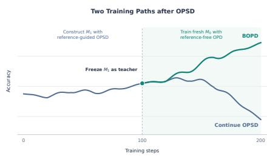
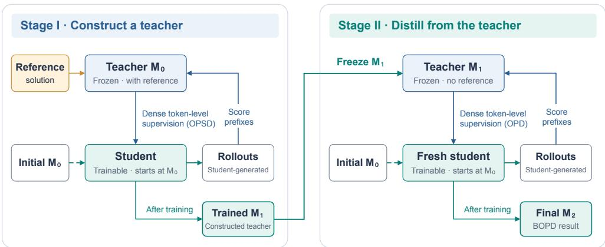
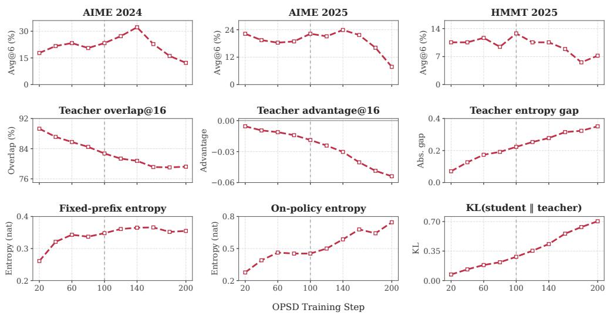
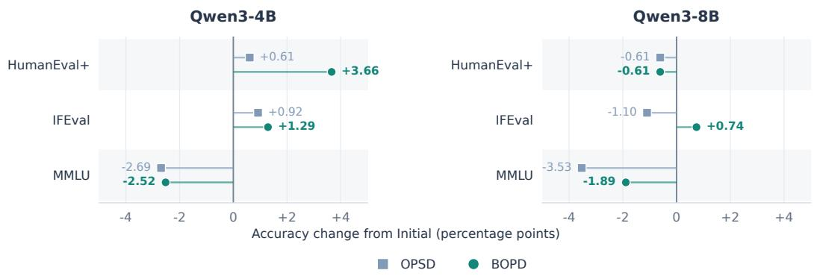
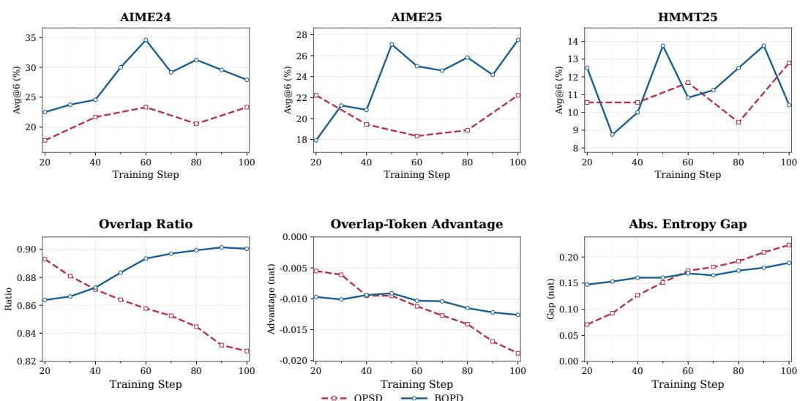
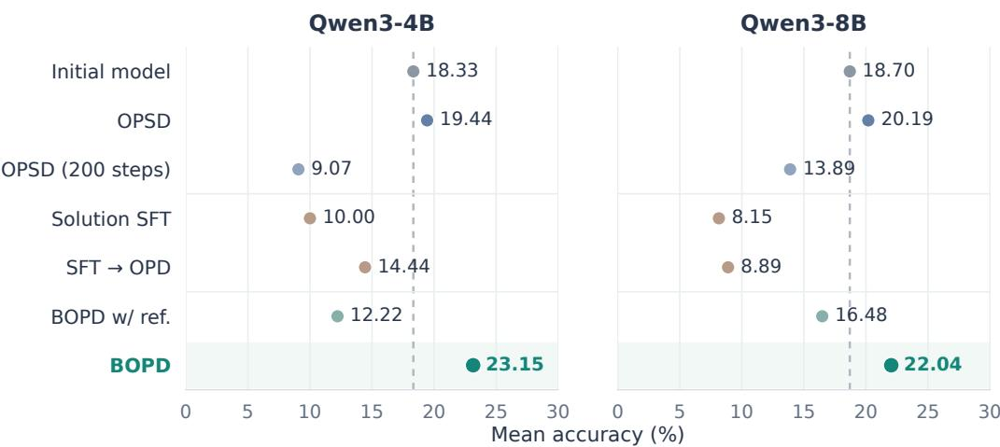

# BOOTSTRAPPED ON-POLICY DISTILLATION

Yue Wu1∗, Xueyu Zhou1∗, Yangrong Hu1, Jian Huang1,2†

1Department of Data Science and Artificial Intelligence

2Department of Applied Mathematics

The Hong Kong Polytechnic University

{yue0301.wu,xueyu.zhou,yangrong.hu}@connect.polyu.hk j.huang@polyu.edu.hk

## ABSTRACT

On-policy distillation (OPD) improves language models by distilling teacher predictions on student-generated trajectories, while on-policy self-distillation (OPSD) removes the need for an external teacher by using a reference-conditioned copy of the model as the teacher. Despite its great early improvements, we find that OPSD does not remain consistently effective under continued training and can eventually suffer substantial performance degradation. We study this training behavior and link the degradation to a growing mismatch between the evolving reference-free student and the frozen privileged teacher. In the early stage of OPSD, the privileged teacher remains closely aligned with the student and provides useful guidance for improving the student’s generation trajectories. However, as training progresses, the growing distributional mismatch between the privileged teacher and reference-free student can cause the teacher to provide misleading supervision, ultimately degrading student performance. This phenomenon motivates us to first leverage privileged reference supervision to acquire useful knowledge and then transfer it to a fresh student. We introduce Bootstrapped On-Policy Distillation (BOPD), a two-stage framework that first uses OPSD to internalize task-relevant information from reference-conditioned supervision into an intermediate model, and then distills this reference-free intermediate model into a fresh copy of the initial model. Experiments across models show that BOPD improves mathematical reasoning and code generation beyond both the initial models and the constructed OPSD teachers. These results suggest that privileged reference supervision can be more effectively exploited by first transferring its task-relevant signal into a task-adapted model and then distilling from that model without reference conditioning.

## 1 INTRODUCTION

On-policy distillation (OPD) has emerged as an effective approach to language model post-training (Agarwal et al., 2024; Gu et al., 2024). Rather than learning from fixed demonstrations, the student model generates its own trajectories and receives dense token-level supervision from a teacher model, enabling it to learn directly from the teacher on its on-policy state distribution (Agarwal et al., 2024; Zhang et al., 2026b; Yang et al., 2025; Lu, 2025). This on-policy supervision reduces the mismatch between training-time and inference-time state distributions while providing denser token-level feedback than sparse outcome-level rewards, thereby enabling substantial capability improvements during post-training.

  
Figure 1: Performance of OPSD and BOPD during the training process

  
Figure 2: BOPD overview. In Stage I, a frozen copy of $M _ { 0 }$ receives a reference solution and supervises a student on its own rollouts, producing $M _ { 1 }$ . In Stage II, frozen $M _ { 1 }$ supervises a fresh student initialized from $M _ { 0 }$ and neither model receives a reference. Dashed arrows denote student initialization; solid arrows show rollout flow, supervision, and model transfer.

Recent work has sought to broaden the applicability of OPD by removing the need for an external teacher model. On-policy self-distillation (OPSD) (Zhao et al., 2026a) achieves this by using the model itself as the teacher: the student generates trajectories conditioned only on the problem, while a frozen copy of the same model additionally conditions on the reference solution works as a teacher model. Building on this formulation, β-OPSD (Xu et al., 2026) derives OPSD from a KL-regularized reinforcement learning objective and introduces a tunable interpolation between the reference policy and the privileged teacher as the target distribution, while DualOPSD (Chen et al., 2026) jointly optimizes the teacher and student to adapt the supervision throughout training.

Despite these advances, we observe a striking phenomenon under prolonged OPSD training: OPSD improves model performance during the early stage of training, but these gains progressively diminish and can eventually reverse as optimization continues (Figure 1). During the early stage of training, the privileged reference provides useful corrective supervision, but as the student policy evolves, the growing distributional mismatch between the student and the frozen privileged teacher leads to misleading supervision (Zhao et al., 2026b; Zhang et al., 2026a). This suggests a fundamental limitation of OPSD: although privileged reference information makes the teacher more informative, it can also make the resulting supervision increasingly incompatible with the reference-free student as training proceeds.In Section 3, we provide empirical analyses supporting this interpretation and following the principles in Li et al. (2026), we show that the privilege-conditioned model does not constitute a well-matched teacher for the evolving student. These observations raise a broader question: can a student construct a capable and well-matched teacher for itself without relying on an external teacher model?

In this paper, we introduce Bootstrapped On-Policy Distillation (BOPD), a two-stage framework that first constructs a teacher by updating the initial model with OPSD, and then distills the resulting teacher into a fresh copy of the initial model without privileged reference conditioning. BOPD therefore separates teacher construction from teacher use: the first stage exploits privileged reference information to internalize task-relevant reasoning signals into the model, while the second stage reuses the resulting model as a reference-free teacher for standard on-policy distillation. Through Stage I, $\pi _ { \mathrm { B } }$ absorbs part of the reasoning signal provided by the privileged reference into its own policy. When used in Stage II, $\pi _ { \mathrm { B } }$ no longer requires access to the reference solution, so the teacher and student are conditioned on the same observable information. This design preserves the taskspecific knowledge acquired through OPSD while reducing the privileged-context mismatch that arises when the teacher relies on information unavailable to the student.

Formally, the BOPD procedure can be summarized as

$$
\begin{array} { r l } { \pi _ { 0 } \xrightarrow [ \mathrm { r e f e r e n c e ~ a v a i l a b l e } ] { \mathrm { O P S D } } \pi _ { \mathrm { B } } \quad \mathrm { a n d ~ t h e n } \quad } & { \pi _ { 0 } \xrightarrow [ \mathrm { r e f e r e n c e ~ u n a v a i l a b l e } ] { \mathrm { O P D ~ w i t h ~ t e a c h e r ~ } \pi _ { \mathrm { B } } } \pi _ { \mathrm { f i n a l } } , } \end{array}\tag{1}
$$

where π denotes the bootstrapped teacher. Our work makes three contributions:

• We analyze the training dynamics of OPSD and provide evidence that its early improvement followed by prolonged degradation is associated with a growing incompatibility between the privileged reference-conditioned teacher and the reference-free student.

• We introduce Bootstrapped On-Policy Distillation (BOPD), a two-stage framework that first uses OPSD to construct a task-adapted teacher from the initial model, and then distills this teacher into a fresh copy of the initial model without privileged reference conditioning.

• We validate BOPD across different models through extensive experiments and ablations. BOPD improves over both the initial model and the constructed OPSD teacher, while analyses of prolonged OPSD training, teacher construction, and reference access provide empirical support for the proposed framework.

## 2 RELATED WORK

Learning from Reference Solutions. Supervised fine-tuning (SFT) learns from reference solutions by fitting their target tokens. Recent studies have explored token weighting and selection to improve this learning signal. DFT (Wu et al., 2025) revisits SFT from a reinforcement-learning perspective, while PriFT (Wang et al., 2026) and ProFit (Liu et al., 2026) use model probabilities to determine which tokens to emphasize. Other studies focus on modifying the training data. Zhao et al. (2025) retain correct model-generated solutions and use guided re-solving to replace incorrect ones before fine-tuning. Zhang et al. (2026b) introduce Hinted Decoding to construct responses that better match the model’s distribution. Reference data can also be used to construct teachers. PromptSD (Ma et al., 2026) trains task-specific soft prompts on labeled examples with a frozen backbone, then uses the resulting teachers to supervise student-generated trajectories.

On-Policy (Self-)Distillation. Knowledge distillation transfers a teacher’s predictive distribution to a student (Hinton et al., 2015). GKD (Agarwal et al., 2024) and MiniLLM (Gu et al., 2024) extend distributional supervision to student-generated trajectories, using different distillation objectives. SKD (Xu et al., 2025) introduces teacher–student cooperation during trajectory generation. Li et al. (2026) further study OPD and highlight the importance of teacher capability and compatibility with student-visited states. OPSD (Zhao et al., 2026a) removes the need for a separate teacher by conditioning a self-teacher on reference solutions. SDFT (Shenfeld et al., 2026) uses demonstrationconditioned supervision for continual learning. More recent studies examine the role of privileged context in distillation. DOPD (Yu et al., 2026) routes token-level signals between privileged teacher and student policies, while Kaur et al. (2026) identify failure modes of reference conditioning in thinking models. LOPD (Zhang et al., 2026a) makes privileged context learnable by composing retrieved experiences into latent tokens and jointly optimizing the context composer and student.

## 3 WHAT HAPPENS WHEN OPSD CONTINUES?

In this section, we study the training dynamics of OPSD beyond its initial improvement phase. OPSD uses a frozen, privilege-conditioned initial model as the teacher to provide guidance on student-generated trajectories. As training proceeds, the teacher remains fixed while the student policy and the distribution of student-generated prefixes continue to evolve, causing the teacher to be queried on increasingly different states. This raises three questions: whether the effectiveness of OPSD is sustained as training continues, whether the privileged teacher remains well matched to the evolving student, and how the student’s on-policy state distribution changes over prolonged training.

To study the behavior of continued OPSD training, we train Qwen3-4B (Yang et al., 2025) with OPSD for 200 optimization steps and evaluate intermediate checkpoints throughout training. We measure task performance on AIME 2024, AIME 2025, and HMMT 2025, and analyze teacher– student distributions on 64 training prompts. For each checkpoint, we leverage the principles in Li et al. (2026) and track teacher–student agreement using Overlap@16, overlap-token advantage@16, the absolute entropy gap, and the full-vocabulary KL divergence. We additionally compare student entropy on on-policy prefixes with entropy measured on prefixes generated by the initial model, allowing us to distinguish changes in the student distribution from changes in the states visited by the student during training. Details of these measurements are provided in Appendix E.

  
Figure 3: Continued OPSD training on Qwen3-4B. Top: Avg@6 on three mathematics benchmarks. Middle: overlap@16, overlap-token advantage@16, and absolute entropy gap between the OPSD student and its privileged teacher. Bottom: Fixed-prefix entropy, on-policy entropy and KL divergence between the student and teacher.

Continued OPSD does not remain consistently effective. As shown in Figure 3, task accuracy improves during the early and middle stages of training, but the gains eventually diminish and reverse. The mean Avg@6 accuracy across the three mathematical benchmarks reaches 22.22% at step 140, but falls to 9.07% by step 200.

The privileged teacher is not well matched to the evolving student. As shown in Figure 3, teacher–student Overlap@16 decreases from 89.30% at step 20 to 79.21% at step 200, while the full-vocabulary KL divergence increases from 0.0719 to 0.7038. The overlap-token advantage also moves farther from zero, and the absolute entropy gap increases over training. Together, these trends show that the loss of effectiveness under continued OPSD is accompanied by growing distributional mismatch between the reference-free student and the frozen reference-conditioned teacher.

Student uncertainty increases on evolving on-policy states. To investigate whether this increase stems from changes in the student policy itself or from shifts in the states it visits, we compare student entropy on on-policy prefixes with entropy on a fixed set of prefixes generated by the initial model. Entropy on the fixed prefixes quickly saturates, whereas entropy on the on-policy prefixes continues to increase. This contrast suggests that the growing uncertainty is closely associated with the evolving on-policy state distribution rather than solely with changes in the student policy.

Taken together, these results suggest that continued OPSD progressively shifts the student-generated prefix distribution while the privileged teacher remains fixed, leading the teacher to provide supervision on states where its predictions are increasingly mismatched with those of the evolving student. The observed degradation can be characterized as a growing mismatch between the privileged teacher and the reference-free student, which reduces the suitability of the teacher’s supervision as training progresses. This motivates separating teacher construction from teacher use: rather than continuing OPSD indefinitely, we may stop at an intermediate checkpoint that has already internalized part of the task-relevant signal provided by the reference-conditioned teacher and can therefore serve as a task-adapted, reference-free teacher for a fresh student.

## 4 BOOTSTRAPPED ON-POLICY DISTILLATION

## 4.1 PROBLEM SETUP AND OVERVIEW

We consider a dataset $\mathcal { D } = \{ ( x _ { i } , y _ { i } ^ { \star } ) \} _ { i = 1 } ^ { N }$ , where $x _ { i }$ is a problem and $y _ { i } ^ { \star }$ is a reference solution. Let $\mathcal { D } _ { x }$ denote the empirical prompt distribution, V the token vocabulary, and $M _ { 0 }$ the initial model with parameters $\theta _ { 0 }$ and policy $\pi _ { 0 } = \pi _ { \theta _ { 0 } }$

BOPD consists of two stages (Equation 1). In Stage I, we use OPSD to construct a task-adapted teacher $M _ { 1 }$ with policy $\pi _ { B } = \pi _ { \theta _ { B } }$ . In Stage II, we freeze this teacher and distill it into a fresh student initialized from $M _ { 0 }$ , without reference conditioning. Both stages operate on student-generated trajectories. Algorithm 1 summarizes the full procedure.

## 4.2 STAGE I: BOOTSTRAPPING A TEACHER WITH OPSD

We initialize a trainable student $\pi _ { \theta }$ and a frozen teacher $\pi _ { \theta _ { 0 } }$ from the same initial model $\pi _ { 0 }$ . For each $( x , y ^ { \star } ) \sim \mathcal { D }$ , the student generates ${ \hat { y } } \sim \pi _ { \theta } ( \cdot \mid x )$ . At each student-generated prefix $\hat { y } _ { < t }$ , the student and privileged teacher define

$$
p _ { t } ( v ) = \pi _ { \boldsymbol { \theta } } ( v \mid x , \hat { y } _ { < t } ) ,\tag{2}
$$

$$
\begin{array} { r } { q _ { t } ^ { \mathrm { r e f } } ( v ) = \pi _ { \theta _ { 0 } } ( v \mid x , y ^ { \star } , \hat { y } _ { < t } ) , \qquad v \in \mathcal { V } . } \end{array}\tag{3}
$$

We update only the student parameters by minimizing the trajectory-averaged forward KL divergence:

$$
\mathcal { L } _ { \mathrm { O P S D } } ( \theta ) = \mathbb { E } _ { ( x , y ^ { \star } ) \sim \mathcal { D } , \hat { y } \sim \pi _ { \theta } ( \cdot \vert x ) } \left[ \frac { 1 } { \vert \hat { y } \vert } \sum _ { t = 1 } ^ { \vert \hat { y } \vert } D _ { \mathrm { K L } } \big ( q _ { t } ^ { \mathrm { r e f } } \big \Vert p _ { t } \big ) \right] .\tag{4}
$$

After Stage I, we save the resulting model as the bootstrapped teacher $\pi _ { \mathrm { B } } ~ = ~ \pi _ { \theta _ { \mathrm { B } } }$ This stage converts reference-conditioned supervision into a task-adapted model which can subsequently be used without access to the reference solution.

## 4.3 STAGE II: ON-POLICY DISTILLATION WITH THE BOOTSTRAPPED TEACHER

We freeze the bootstrapped teacher $\pi _ { B }$ and initialize a fresh student $\pi _ { \phi }$ with $\phi = \theta _ { 0 }$ . The new student generates $\hat { y } \sim \pi _ { \phi } ( \cdot \mid x )$ . At each prefix $\hat { y } _ { < t }$ , the student and teacher condition on the same observable context:

$$
p _ { t } ( v ) = \pi _ { \phi } ( v \mid x , \hat { y } _ { < t } ) ,\tag{5}
$$

$$
q _ { t } ^ { \mathrm { B } } ( v ) = \pi _ { \mathrm { B } } ( v \mid x , \hat { y } _ { < t } ) .\tag{6}
$$

Unlike Stage I, the teacher no longer receives the reference solution and we minimize

$$
\mathcal { L } _ { \mathrm { B O P D } } ( \phi ) = \mathbb { E } _ { \boldsymbol { x } \sim \mathcal { D } _ { \boldsymbol { x } } , \boldsymbol { \hat { y } } \sim \pi _ { \phi } ( \cdot | \boldsymbol { x } ) } \left[ \frac { 1 } { | \hat { \boldsymbol y } | } \sum _ { t = 1 } ^ { | \boldsymbol { \hat { y } } | } D _ { \mathrm { K L } } \big ( q _ { t } ^ { \mathrm { B } } \big | \big | p _ { t } \big ) \right] .\tag{7}
$$

Resetting the student separates teacher construction from knowledge transfer: Stage I produces a task-adapted teacher using privileged supervision, while Stage II transfers the resulting behavior to a fresh reference-free student on its own on-policy trajectories.

## 5 EXPERIMENTS

## 5.1 EXPERIMENTAL SETUP

Training data and models. We evaluate BOPD across different model scales and families, including Qwen3-4B, Qwen3-8B, and SmolLM3-3B (Yang et al., 2025; Bakouch et al., 2025). For mathematical reasoning experiments, we use the OpenThoughts dataset (Guha et al., 2026) and we use the TACO subset of the DeepCoder Preview Dataset for code-generation experiments (Li et al., 2023; Luo et al., 2025). Within each domain, OPSD and BOPD use the same training data. We train OPSD and each stage of BOPD for 100 optimizer steps with an effective batch size of 32. We use LoRA (Hu et al., 2021) with rank 64 and scaling parameter 128 on the query, key, value, and output attention projections and the gate, up, and down MLP projections. For code-generation experiments, we set the dropout rate to 0.05. The learning rate is $\bar { 5 } \times \bar { 1 } 0 ^ { - 6 }$ , with gradient clipping at 0.1 and pointwise loss clipping at $\tau = 0 . 0 5$ . Student rollouts contain at most 1,024 tokens, sampled with temperature 1.1, top-p 0.95, and top-k 20. We use bfloat16 and DeepSpeed ZeRO-2. Appendix A provides additional settings.

Algorithm 1 Bootstrapped On-Policy Distillation (BOPD)   
Require: Initial parameters $\theta _ { 0 } ,$ reference data D, stage budgets $\overline { { K _ { 1 } , K _ { 2 } } }$   
Stage I: Construct a teacher with reference-conditioned OPSD   
1: Initialize student $\theta  \theta _ { 0 }$ and freeze teacher $\pi _ { \theta _ { 0 } }$   
2: for $k = 1 , \ldots , K _ { 1 }$ do   
3: Sample a minibatch of $( x , y ^ { \star } )$ from D   
4: Generate ${ \hat { y } } \sim \pi _ { \theta } ( \cdot \mid x )$   
5: Compute $p _ { t } ( v ) = \pi _ { \theta } ( v \mid x , \hat { y } _ { < t } )$ and $q _ { t } ^ { \mathrm { r e f } } = \pi _ { \theta _ { 0 } } ( \cdot \mid x , y ^ { \star } , \hat { y } _ { < t } )$   
6: Update θ by minimizing Eq. 4   
7: end for   
8: Set $\theta _ { \mathrm { B } }  \theta$ and freeze $\pi _ { \mathrm { B } } = \pi _ { \theta _ { \mathrm { B } } }$   
Stage II: Distill from the reference-free bootstrapped teacher   
9: Reset student $\phi  \theta _ { 0 }$ and initialize a fresh optimizer   
10: for $k = 1 , \ldots , K _ { 2 }$ do   
11: Sample a minibatch of prompts x from $\mathcal { D } _ { x }$   
12: Generate $\hat { y } \sim \pi _ { \phi } ( \cdot \mid x ) ^ { - }$   
13: Compute $p _ { t } ( v ) = \pi _ { \phi } ( v \mid x , { \hat { y } } _ { < t } )$ and $q _ { t } ^ { \mathrm { B } } = \pi _ { \mathrm { B } } ( \cdot \mid x , \hat { y } _ { < t } )$   
14: Update ϕ by minimizing Eq. 7   
15: end for   
16: return $\pi _ { \phi }$

Table 1: Mathematical reasoning results (%). Bold and underlining mark the best and second-best distinct scores, respectively, within each model size and metric.
<table><tr><td colspan="5">Avg@12↑</td><td colspan="4">Pass@12↑</td></tr><tr><td>Size</td><td>Method</td><td>AIME24</td><td>AIME25</td><td>HMMT25</td><td>Mean</td><td>AIME24</td><td>AIME25</td><td>HMMT25</td><td>Mean</td></tr><tr><td>4B</td><td>Initial model</td><td>22.50</td><td>19.72</td><td>11.94</td><td>18.06</td><td>56.67</td><td>40.00</td><td>30.00</td><td>42.22</td></tr><tr><td></td><td>OPSD (Stage I)</td><td>25.83</td><td>20.00</td><td>13.06</td><td>19.63</td><td>60.00</td><td>46.67</td><td>33.33</td><td>46.67</td></tr><tr><td></td><td>BOPD (ours)</td><td>34.17</td><td>26.39</td><td>11.39</td><td>23.98</td><td>66.67</td><td>63.33</td><td>33.33</td><td>54.44</td></tr><tr><td rowspan="3">8B</td><td>Initial model</td><td>25.56</td><td>19.44</td><td>11.11</td><td>18.70</td><td>43.33</td><td>33.33</td><td>23.33</td><td>33.33</td></tr><tr><td>OPSD (Stage I)</td><td>26.67</td><td>21.67</td><td>12.22</td><td>20.19</td><td>46.67</td><td>36.67</td><td>26.67</td><td>36.67</td></tr><tr><td>BOPD (ours)</td><td>31.11</td><td>23.89</td><td>11.11</td><td>22.04</td><td>56.67</td><td>40.00</td><td>23.33</td><td>40.00</td></tr></table>

Evaluation. For mathematical reasoning experiments, we evaluate all methods on three competition mathematics benchmarks, including AIME 2024 and AIME 2025 (Mathematical Association of America, n.d.), and HMMT February 2025 (Harvard-MIT Mathematics Tournament, 2025). We use temperature 1.0, top-p 0.8, and a 38,912-token completion limit; top-k and min-p filtering are disabled. We report average response accuracy (Avg@K) and the fraction of problems solved at least once (Pass@K), using $K = 1 2$ for the main results and $K = 6$ for the ablation studies. Mean accuracy is the unweighted average across the three benchmarks. To assess capability retention after mathematical training, we also evaluate them on HumanEval, IFEval (Zhou et al., 2023), and MMLU (Hendrycks et al., 2021). For code-generation experiments, we evaluate all methods on HumanEval+ and MBPP+ (Liu et al., 2023) and the new problems in LiveCodeBench v5 and v6 (Jain et al., 2025). We set the maximum generation length to 4,096 tokens and report Pass@1. Appendices A.1 and B provide further evaluation details.

## 5.2 MAIN RESULTS

Mathematical reasoning. BOPD outperforms both the initial model and its constructed teacher at 4B and 8B (Table 1). At 4B, average accuracy increases from 18.06% to 23.98%, surpassing the OPSD teacher’s 19.63%. At 8B, it rises from 18.70% to 22.04%, compared with 20.19% for the teacher. Pass@12 also improves at both sizes. These results show that a model can construct a teacher from reference data and use it to train a student that surpasses the teacher itself. Additional results under thinking-mode and on SmolLM3-3B further support the effectiveness of BOPD across inference settings and model families (Appendices A.2 and F).

Table 2: Code-generation results. Mean equally averages the four benchmarks before rounding. Bold and underlining mark the best and second-best distinct scores within each model size and metric.
<table><tr><td>Size</td><td>Method</td><td>HumanEval+</td><td>MBPP+</td><td>LCB v5-new</td><td>LCB v6-new</td><td>Mean</td></tr><tr><td rowspan="3">4B</td><td>Initial model</td><td>74.39</td><td>57.14</td><td>21.56</td><td>24.57</td><td>44.42</td></tr><tr><td>OPSD (Stage I)</td><td>75.61</td><td>60.32</td><td>22.75</td><td>23.43</td><td>45.53</td></tr><tr><td>BOPD (ours)</td><td>75.61</td><td>63.23</td><td>22.75</td><td>24.57</td><td>46.54</td></tr><tr><td rowspan="3">8B</td><td>Initial model</td><td>81.71</td><td>65.87</td><td>22.75</td><td>24.57</td><td>48.73</td></tr><tr><td>OPSD (Stage I)</td><td>79.27</td><td>62.96</td><td>22.16</td><td>25.14</td><td>47.38</td></tr><tr><td>BOPD (ours)</td><td>79.27</td><td>65.87</td><td>22.16</td><td>28.00</td><td>48.82</td></tr></table>

  
Figure 4: Capability retention after mathematical training. Points show accuracy changes relative to the initial model (zero line), in percentage points.

Code generation. Table 2 reports results on coding benchmarks for models trained on code. At 4B, BOPD achieves 46.54% mean Pass@1, compared with 44.42% for the initial model and 45.53% for OPSD. At 8B, BOPD reaches 48.82%, compared with 48.73% for the initial model and 47.38% for OPSD. BOPD outperforms its OPSD teacher in mean Pass@1 at both sizes.

Capability retention. Figure 4 evaluates capabilities outside mathematics after mathematical training. On HumanEval+, BOPD scores 78.05% versus 74.39% for the initial model at 4B, and 81.10% versus 81.71% at 8B. It raises IFEval prompt-level strict accuracy by 1.29 and 0.74 percentage points at 4B and 8B, respectively. On MMLU, BOPD improves over OPSD at both sizes; at 8B, it narrows the gap according to initial model from 3.53 to 1.89 percentage points. These result show BOPD could retain more out domain ability. Appendix B provides further evaluation details.

## 5.3 MECHANISM ANALYSIS

Prior analyses of on-policy distillation suggest that an effective teacher should provide useful supervision while remaining sufficiently compatible with the student on the states visited during training. We therefore examine whether the bootstrapped teacher in BOPD exhibits a more favorable teacher–student relationship than the privileged teacher in OPSD. Following Li et al. (2026), we track checkpoint accuracy together with Overlap@16, overlap-token advantage@16, and the absolute entropy gap during 4B training (Figure 5). The distributional metrics are computed on the same 64 fixed training prompts used in Section 3, with each checkpoint generating its own on-policy trajectories.

Figure 5 shows a clear difference in candidate-set agreement. Under continued OPSD, Overlap@16 decreases from 0.8930 at step 20 to 0.8272 at step 100, whereas under BOPD it increases from 0.8638 to 0.9005. Thus, the BOPD student increasingly shares its teacher’s likely top-16 token candidates, while the OPSD student progressively moves away from those of its privileged teacher. This trend accompanies stronger BOPD checkpoint accuracy on AIME24 and AIME25 after step 40.

  
Figure 5: Accuracy and teacher–student alignment during 4B mathematical training. The top row shows checkpoint accuracy on each benchmark; the OPSD scores are also shown in Figure 3. The bottom row reports alignment metrics on regenerated trajectories for the same 64 fixed training prompts. Curves begin at step 20; steps are relative to each method’s training stage.

The other metrics show a similar contrast. Under BOPD, the overlap-token advantage remains relatively close to zero with modest fluctuations, reaching −0.0126 at step 100. Under OPSD, by contrast, it moves steadily away from zero, from −0.0055 to −0.0188. A similar pattern appears in the entropy gap: BOPD shows only a moderate increase from 0.1472 to 0.1887 nats, whereas OPSD starts with a much smaller gap of 0.0707 nats but increases substantially to 0.2230 nats. Together with the opposing Overlap@16 trends, these results indicate that the BOPD teacher remains better matched to the evolving student, whereas the privileged OPSD teacher becomes increasingly mismatched as training proceeds. This growing mismatch may limit the quality of supervision provided by the OPSD teacher at later stages of training.

Taken together, these dynamics are consistent with the bootstrapped model serving as a bettermatched teacher. They support the role of teacher bootstrapping in converting reference-conditioned supervision into a more compatible reference-free teacher.

## 5.4 ABLATION STUDIES

We ask how to construct a suitable teacher for OPD and whether BOPD makes better use of its training steps than continued OPSD (Figure 6). With the same 200-step budget, BOPD’s 100 OPSD steps followed by 100 OPD steps outperform 200 steps of OPSD at both model sizes. We also construct a teacher with solution SFT instead of OPSD. Its accuracy is below the initial model at both sizes. Subsequent OPD improves on this SFT teacher, but remains below the initial model and BOPD. Finally, we give the OPSD-trained teacher the reference solution again during Stage II. Compared with reference-free BOPD, this reduces average accuracy from 23.15% to 12.22% at 4B and from 22.04% to 16.48% at 8B. The trained teacher does not need reference access to guide Stage II in this setting. One possible explanation is that the added reference changes its targets in ways the reference-free student cannot readily follow. Appendix D reports detailed scores and control settings.

Further distillation. We ask whether the BOPD student $M _ { 2 }$ can support further self-improvement (Table 3). First, we freeze $M _ { 2 }$ as a teacher and distill it into a fresh $M _ { 0 }$ student. The resulting $M _ { 3 }$ reaches 19.44% average accuracy, below M ’s 23.15%: a stronger student does not automatically transfer its gains when used as a teacher. Next, we test whether $M _ { 2 }$ itself can improve through another OPSD stage. We initialize the student and frozen, reference-conditioned teacher from $\bar { M _ { 2 } }$ obtaining $M _ { 4 } ;$ its accuracy instead falls to 3.33%. We then complete a second BOPD cycle from

  
Figure 6: Mean mathematical accuracy across AIME24, AIME25, and HMMT25. Each gray dashed line marks the corresponding initial-model accuracy.

Table 3: Further distillation at 4B. Each trained model in the first column is obtained by initializing from the model in the Student column and learning from the model in the Teacher column. $\mathrm { \Omega ^ { 6 6 } + r e f . } ^ { \mathrm { , 5 } }$ means the teacher also sees the reference solution.
<table><tr><td>Model</td><td>Student</td><td>Teacher</td><td>AIME24</td><td>AIME25</td><td>HMMT25</td><td> $\operatorname { A v g } ( \varnothing 6$ </td><td>Pass@6</td></tr><tr><td>Initial  $M _ { 0 }$ </td><td></td><td></td><td>24.44</td><td>21.11</td><td>9.44</td><td>18.33</td><td>33.33</td></tr><tr><td>OPSD  $M _ { 1 }$ </td><td> $M _ { 0 }$ </td><td> $M _ { 0 } + { \mathrm { r e f . } }$ </td><td>25.00</td><td>19.44</td><td>13.89</td><td>19.44</td><td>38.89</td></tr><tr><td>BOPD  $M _ { 2 }$ </td><td> $M _ { 0 }$ </td><td> $M _ { 1 }$ </td><td>32.78</td><td>25.56</td><td>11.11</td><td>23.15</td><td>44.44</td></tr><tr><td> $M _ { 3 }$ </td><td> $M _ { 0 }$ </td><td> $M _ { 2 }$ </td><td>29.44</td><td>20.00</td><td>8.89</td><td>19.44</td><td>37.78</td></tr><tr><td> $M _ { 4 }$ </td><td> $M _ { 2 }$ </td><td> $M _ { 2 } + { \mathrm { r e f } } .$ </td><td>3.89</td><td>4.44</td><td>1.67</td><td>3.33</td><td>15.56</td></tr><tr><td> $M _ { 5 }$ </td><td> $M _ { 2 }$ </td><td> $M _ { 4 }$ </td><td>8.89</td><td>6.11</td><td>3.33</td><td>6.11</td><td>21.11</td></tr><tr><td> $M _ { 6 }$ </td><td> $M _ { 0 }$ </td><td> $M _ { 4 }$ </td><td>8.89</td><td>5.00</td><td>1.67</td><td>5.19</td><td>17.78</td></tr></table>

$M _ { 2 }$ by using $M _ { 4 }$ as a reference-free teacher for a new $M _ { 2 }$ student. This yields $M _ { 5 }$ with 6.11% accuracy. Finally, we test whether $M _ { 4 }$ can teach a fresh $M _ { 0 }$ student instead, obtaining $M _ { 6 }$ with 5.19%. Neither student taught by $M _ { 4 }$ recovers $M _ { 2 } { \mathrm { ' } }$ ’s performance. Appendix G reports the protocol and detailed scores.

## 6 CONCLUSION

We study the training dynamics of on-policy self-distillation and find that its early gains are not sustained under continued training. As the student evolves, the privileged reference-conditioned teacher becomes increasingly mismatched with the reference-free student on its on-policy states. Motivated by this observation, we introduce Bootstrapped On-Policy Distillation (BOPD), which uses OPSD to construct a task-adapted intermediate model and then reuses this model as a referencefree teacher for a fresh student.

Across different models, BOPD improves mathematical reasoning beyond both the initial model and the constructed OPSD teacher, and also outperforms the constructed teacher on code generation. Ablations show that simply extending OPSD training, constructing the teacher with solution SFT, or restoring reference access during the second stage does not reproduce these gains under our setting. Training-dynamics analyses further show that BOPD maintains a more favorable teacher–student relationship than continued OPSD. At the same time, our further-distillation experiments show that these gains do not compound indefinitely. Overall, our results suggest that OPSD can be used effectively as a teacher-construction mechanism, while separating privileged teacher construction from subsequent reference-free distillation provides a practical route to self-improvement without an external teacher model.

## AI USE STATEMENT

Generative AI tools assisted with refining the paper narrative and and drafting code for analysis and figures. The authors reviewed the AI-assisted outputs, independently checked all reported experimental results, and take responsibility for the paper’s content, claims, and artifacts.

## ACKNOWLEDGEMENTS

The authors acknowledge support from The Hong Kong Polytechnic University (Research Grant P0046811).

## REFERENCES

Rishabh Agarwal, Nino Vieillard, Yongchao Zhou, Piotr Stanczyk, Sabela Ramos, Matthieu Geist, and Olivier Bachem. On-policy distillation of language models: Learning from self-generated mistakes. In International Conference on Learning Representations, 2024.

Elie Bakouch, Loubna Ben Allal, Anton Lozhkov, Nouamane Tazi, Lewis Tunstall, Carlos Miguel Patino, Edward Beeching, Aymeric Roucher, Aksel Joonas Reedi, Quentin Gallou˜ edec, Kashif´ Rasul, Nathan Habib, Clementine Fourrier, Hynek Kydlicek, Guilherme Penedo, Hugo Larcher,´ Mathieu Morlon, Vaibhav Srivastav, Joshua Lochner, Xuan-Son Nguyen, Colin Raffel, Leandro von Werra, and Thomas Wolf. SmolLM3: smol, multilingual, long-context reasoner. https: //huggingface.co/blog/smollm3, 2025.

Yutong Chen, Guangfu Guo, Zhichao Xu, and Kunpeng Liu. DualOPSD: Adaptive privileged teachers for on-policy self-distillation. arXiv preprint arXiv:2608.26019, 2026. URL https: //arxiv.org/abs/2608.26019.

Yuxian Gu, Li Dong, Furu Wei, and Minlie Huang. MiniLLM: Knowledge distillation of large language models. In International Conference on Learning Representations, 2024.

Etash Guha, Ryan Marten, Sedrick Keh, Negin Raoof, Georgios Smyrnis, Hritik Bansal, Marianna Nezhurina, Jean Mercat, Trung Vu, Zayne Sprague, Ashima Suvarna, Benjamin Feuer, Leon Liangyu Chen, Zaid Khan, Eric Frankel, et al. OpenThoughts: Data recipes for reasoning models. In International Conference on Learning Representations, 2026. URL https: //arxiv.org/abs/2506.04178.

Harvard-MIT Mathematics Tournament. February 2025 tournament problem archive, 2025. URL https://www.hmmt.org/www/archive/282.

Dan Hendrycks, Collin Burns, Steven Basart, Andy Zou, Mantas Mazeika, Dawn Song, and Jacob Steinhardt. Measuring massive multitask language understanding. In International Conference on Learning Representations, 2021. URL https://arxiv.org/abs/2009.03300.

Geoffrey Hinton, Oriol Vinyals, and Jeff Dean. Distilling the knowledge in a neural network. In NIPS Deep Learning and Representation Learning Workshop, 2015.

Edward J. Hu, Yelong Shen, Phillip Wallis, Zeyuan Allen-Zhu, Yuanzhi Li, Shean Wang, Lu Wang, and Weizhu Chen. LoRA: Low-rank adaptation of large language models. arXiv preprint arXiv:2106.09685, 2021. URL https://arxiv.org/abs/2106.09685.

Naman Jain, King Han, Alex Gu, Wen-Ding Li, Fanjia Yan, Tianjun Zhang, Sida Wang, Armando Solar-Lezama, Koushik Sen, and Ion Stoica. LiveCodeBench: Holistic and contamination free evaluation of large language models for code. In International Conference on Learning Representations, 2025. URL https://arxiv.org/abs/2403.07974.

Simran Kaur, Narutatsu Ri, Yinghui He, Liam Fowl, and Sanjeev Arora. Rethinking on-policy self-distillation for thinking models. arXiv preprint arXiv:2607.05184, 2026. URL https: //arxiv.org/abs/2607.05184.

Rongao Li, Jie Fu, Bo-Wen Zhang, Tao Huang, Zhihong Sun, Chen Lyu, Guang Liu, Zhi Jin, and Ge Li. TACO: Topics in algorithmic COde generation dataset. arXiv preprint arXiv:2312.14852, 2023. URL https://arxiv.org/abs/2312.14852.

Yaxuan Li, Yuxin Zuo, Bingxiang He, Jinqian Zhang, Chaojun Xiao, Cheng Qian, Tianyu Yu, Huanang Gao, Wenkai Yang, Zhiyuan Liu, and Ning Ding. Rethinking on-policy distillation of large language models: Phenomenology, mechanism, and recipe. arXiv preprint arXiv:2604.13016, 2026. URL https://arxiv.org/abs/2604.13016.

Jiawei Liu, Chunqiu Steven Xia, Yuyao Wang, and Lingming Zhang. Is your code generated by ChatGPT really correct? rigorous evaluation of large language models for code generation. In Advances in Neural Information Processing Systems, 2023. URL https://arxiv.org/abs/ 2305.01210.

Tao Liu, Taiqiang Wu, Runming Yang, Shaoning Sun, Junjie Wang, and Yujiu Yang. ProFit: Leveraging high-value signals in SFT via probability-guided token selection. arXiv preprint arXiv:2601.09195, 2026. URL https://arxiv.org/abs/2601.09195.

Kevin Lu. On-policy distillation. Thinking Machines Lab blog, October 2025. URL https: //thinkingmachines.ai/blog/on-policy-distillation/.

Michael Luo, Sijun Tan, Roy Huang, Ameen Patel, Alpay Ariyak, Qingyang Wu, Xiaoxiang Shi, Rachel Xin, Colin Cai, Maurice Weber, Ce Zhang, Li Erran Li, Raluca Ada Popa, and Ion Stoica. DeepCoder: A fully open-source 14b coder at o3-mini level. Agentica Project and Together AI blog, 2025. URL https://www.together.ai/blog/deepcoder.

Yingzi Ma, Zichen Zhu, Ming Jiang, and Chaowei Xiao. One student, many teachers: Multi-task on-policy distillation via soft-prompt privileged context. arXiv preprint arXiv:2607.18293, 2026. URL https://arxiv.org/abs/2607.18293.

Mathematical Association of America. American invitational mathematics examination. MAA Invitational Competitions, n.d. URL https://maa.org/ maa-invitational-competitions/.

Idan Shenfeld, Mehul Damani, Jonas Hubotter, and Pulkit Agrawal. Self-distillation enables con- ¨ tinual learning. arXiv preprint arXiv:2601.19897, 2026. URL https://arxiv.org/abs/ 2601.19897.

Ke Wang, Shuangqi Li, Mathieu Salzmann, and Pascal Frossard. PriFT: Prior-support guided supervised fine-tuning. arXiv preprint arXiv:2606.09396, 2026. URL https://arxiv.org/ abs/2606.09396.

Yongliang Wu, Yizhou Zhou, Zhou Ziheng, Yingzhe Peng, Xinyu Ye, Xinting Hu, Wenbo Zhu, Lu Qi, Ming-Hsuan Yang, and Xu Yang. On the generalization of SFT: A reinforcement learning perspective with reward rectification. arXiv preprint arXiv:2508.05629, 2025. URL https: //arxiv.org/abs/2508.05629.

Jiawei Xu, Minghui Liu, Juzheng Zhang, Tom Goldstein, and Furong Huang. β-OPSD: Deriving with policy optimization, training with self-distillation. arXiv preprint arXiv:2607.28582, 2026. URL https://arxiv.org/abs/2607.28582.

Wenda Xu, Rujun Han, Zifeng Wang, Long T. Le, Dhruv Madeka, Lei Li, William Yang Wang, Rishabh Agarwal, Chen-Yu Lee, and Tomas Pfister. Speculative knowledge distillation: Bridging the teacher-student gap through interleaved sampling. In International Conference on Learning Representations, 2025. URL https://arxiv.org/abs/2410.11325.

An Yang, Anfeng Li, Baosong Yang, Beichen Zhang, Binyuan Hui, Bo Zheng, Bowen Yu, Chang Gao, Chengen Huang, Chenxu Lv, Chujie Zheng, Dayiheng Liu, Fan Zhou, Fei Huang, Feng Hu, Hao Ge, Haoran Wei, Huan Lin, Jialong Tang, Jian Yang, Jianhong Tu, Jianwei Zhang, Jianxin Yang, Jiaxi Yang, Jing Zhou, Jingren Zhou, Junyang Lin, Kai Dang, Keqin Bao, Kexin Yang, Le Yu, Lianghao Deng, Mei Li, Mingfeng Xue, Mingze Li, Pei Zhang, Peng Wang, Qin Zhu, Rui Men, Ruize Gao, Shixuan Liu, Shuang Luo, Tianhao Li, Tianyi Tang, Wenbiao Yin, Xingzhang Ren, Xinyu Wang, Xinyu Zhang, Xuancheng Ren, Yang Fan, Yang Su, Yichang Zhang, Yinger

Zhang, Yu Wan, Yuqiong Liu, Zekun Wang, Zeyu Cui, Zhenru Zhang, Zhipeng Zhou, and Zihan Qiu. Qwen3 technical report. arXiv preprint arXiv:2505.09388, 2025. URL https://arxiv. org/abs/2505.09388.

Xinlei Yu, Gen Li, Qingyi Si, Guibin Zhang, Yuqi Xu, Congcong Wang, Shuai Dong, Kaiwen Tuo, Xiangyu Zeng, Kaituo Feng, Qunzhong Wang, Yang Shi, Xiaobin Hu, Xiangyu Yue, Jiaqi Wang, and Shuicheng Yan. DOPD: Dual on-policy distillation. arXiv preprint arXiv:2606.30626, 2026. URL https://arxiv.org/abs/2606.30626.

Guibin Zhang, Jiayang Lyu, Ran Sun, Xinlei Yu, Haoyu Zhao, Qibing Ren, and Shuicheng Yan. Latent on-policy self-distillation. arXiv preprint arXiv:2608.13040, 2026a. URL https:// arxiv.org/abs/2608.13040.

Miaosen Zhang, Yishan Liu, Shuxia Lin, Xu Yang, Qi Dai, Chong Luo, Weihao Jiang, Peng Hou, Anxiang Zeng, Xin Geng, and Baining Guo. Towards on-policy SFT: Distribution discriminant theory and its applications in LLM training. arXiv preprint arXiv:2602.12222, 2026b. URL https://arxiv.org/abs/2602.12222.

Shiwan Zhao, Xuyang Zhao, Jiaming Zhou, Aobo Kong, Qicheng Li, and Yong Qin. Mind the gap: Data rewriting for stable off-policy supervised fine-tuning. arXiv preprint arXiv:2509.15157, 2025. URL https://arxiv.org/abs/2509.15157.

Siyan Zhao, Zhihui Xie, Mengchen Liu, Jing Huang, Guan Pang, Feiyu Chen, and Aditya Grover. Self-distilled reasoner: On-policy self-distillation for large language models. arXiv preprint arXiv:2601.18734, 2026a. URL https://arxiv.org/abs/2601.18734.

Xuyang Zhao, Liting Zhang, Zichen Xu, Zhihu Wang, Caiyue Xu, Shiwan Zhao, and Qicheng Li. Is more privileged information better? from solution traces to problem-solving structure in selfdistilled reasoning. arXiv preprint arXiv:2608.01589, 2026b. URL https://arxiv.org/ abs/2608.01589.

Jeffrey Zhou, Tianjian Lu, Swaroop Mishra, Siddhartha Brahma, Sujoy Basu, Yi Luan, Denny Zhou, and Le Hou. Instruction-following evaluation for large language models. arXiv preprint arXiv:2311.07911, 2023. URL https://arxiv.org/abs/2311.07911.

## A IMPLEMENTATION AND EVALUATION DETAILS

The source dataset contains 29,434 mathematical problem–solution pairs. The 4B and 8B controls reuse the same 3,200 examples across stages. Each stage generates 3,200 student rollouts, for 6,400 across BOPD’s two stages.

Table 4 records the settings shared by the main training runs. We use LoRA on the attention projections q proj, k proj, v proj, and o proj, and the feed-forward projections gate proj, up proj, and down proj. We report the step-100 checkpoint.

Table 4: Recorded training settings for the main mathematical experiments.
<table><tr><td>Setting</td><td>Value</td></tr><tr><td>Training examples available</td><td>29,434</td></tr><tr><td>Optimizer steps per stage</td><td>100</td></tr><tr><td>GPUs / batch / accumulation (4B)</td><td>4/4/2</td></tr><tr><td>GPUs / batch / accumulation (8B)</td><td>2/2/8</td></tr><tr><td>Effective batch size</td><td>32</td></tr><tr><td>Student rollouts per stage</td><td>3,200</td></tr><tr><td>LoRA rank / scaling parameter</td><td>64 / 128</td></tr><tr><td>Learning rate / gradient clipping</td><td> $5 \times 1 0 ^ { - 6 } / 0 . 1$ </td></tr><tr><td>Distillation objective</td><td>Clipped forward KL</td></tr><tr><td>Pointwise clipping threshold</td><td>0.05</td></tr><tr><td>Loss parameters</td><td> $\beta = 0 , \lambda = 1$ </td></tr><tr><td>Rollout temperature / top-p / top-k</td><td> $1 . 1 / 0 . 9 5 / 2 0$ </td></tr><tr><td>Maximum rollout output / sequence length</td><td>1,024 / 20,000 tokens</td></tr><tr><td>Precision / distributed training</td><td>BF16 / DeepSpeed ZeRO-2</td></tr><tr><td>Attention implementation</td><td>FlashAttention 2</td></tr><tr><td>Rollout engine</td><td>Colocated vLLM, tensor parallelism 1</td></tr><tr><td>vLLM memory fraction (4B / 8B)</td><td>0.4 / 0.35</td></tr><tr><td>Thinking mode (student / teacher)</td><td>Off / off</td></tr><tr><td>Teacher updates</td><td>None; teacher frozen within each stage</td></tr><tr><td>Stage II student initialization</td><td>Exact initial checkpoint</td></tr></table>

## A.1 EVALUATION METRICS AND PROTOCOLS

For benchmark b, let $c _ { i , j } \in \{ 0 , 1 \}$ indicate whether response j to question i is correct. With $N _ { b } = 3 0$ and K responses per problem, we compute

$$
\mathrm { A v g @ } K _ { b } = \frac { 1 0 0 } { N _ { b } K } \sum _ { i = 1 } ^ { N _ { b } } \sum _ { j = 1 } ^ { K } c _ { i , j } ,\tag{8}
$$

$$
\mathrm { P a s s @ } K _ { b } = \frac { 1 0 0 } { N _ { b } } \sum _ { i = 1 } ^ { N _ { b } } \mathbb { I } \left[ \sum _ { j = 1 } ^ { K } c _ { i , j } > 0 \right] .\tag{9}
$$

Table 1 uses $K = 1 2$ at 4B and $\mathrm { 8 B ; }$ the ablation tables use $K = 6$ . We average each metric over the three benchmarks for the table mean. Displayed values are rounded to two decimal places; the mean uses the underlying scores. The main mathematical evaluation sets top k = −1, min $\mathtt { - p } = 0$ , and presence penal $\mathrm { { t y } = 0 , }$ , in addition to temperature 1.0, top $\mathrm {  ~ p ~ } = 0 . 8 ,$ , and the 38,912-token output limit. Thinking mode is disabled for every evaluated model in the main tables.

Code-trained models use the same fixed 3,200 TACO problems for OPSD and BOPD. HumanEval+ and MBPP+ use the official EvalPlus tests; LiveCodeBench v5-new and v6-new contain the problems newly added relative to the preceding release. All four code benchmarks use greedy decoding, one response per problem, a 4,096-token generation limit, an 8,192-token context limit, and seed 0.

## A.2 THINKING-MODE EVALUATION

We evaluate OPSD and BOPD with Qwen3-4B and Qwen3-8B on AIME24, AIME25, and HMMT25, using six generations per problem. In OPSD, the student generates non-thinking rollouts, while the teacher uses thinking and is conditioned on the reference distribution. We use a clipping threshold of 0.05 for 4B and 0.06 for 8B. In BOPD, a fresh student initialized from the base model generates non-thinking rollouts and distills from the corresponding OPSD-trained thinking teacher without reference conditioning or clipping. All evaluations enable thinking and use temperature 1.0, top-p 0.95, and a maximum of 38,912 generated tokens. We report Avg@6, the fraction of sampled responses that are correct, and Pass@6, the fraction of problems for which at least one of the six responses is correct.

Table 5: Thinking-enabled mathematical reasoning results (%). Each problem is sampled 12 times. Each benchmark cell reports Avg@12 / Pass@12. Bold and underlining mark the best and secondbest distinct scores, respectively, within each model size and metric.
<table><tr><td rowspan="2">Size Method</td><td rowspan="2"></td><td colspan="4">Avg@12↑</td><td colspan="4">Pass@12↑</td></tr><tr><td>AIME24</td><td>AIME25</td><td>HMMT25</td><td>Mean</td><td>AIME24</td><td>AIME25</td><td>HMMT25</td><td>Mean</td></tr><tr><td>4B</td><td>Initial model</td><td>73.61</td><td>67.50</td><td>44.72</td><td>61.94</td><td>83.33</td><td>86.67</td><td>66.67</td><td>78.89</td></tr><tr><td rowspan="2"></td><td>OPSD (Stage I)</td><td>77.22</td><td>64.17</td><td>38.61</td><td>60.00</td><td>90.00</td><td>80.00</td><td>60.00</td><td>76.67</td></tr><tr><td>BOPD (ours)</td><td>75.28</td><td>69.44</td><td>45.28</td><td>63.33</td><td>83.33</td><td>83.33</td><td>66.67</td><td>77.78</td></tr><tr><td rowspan="3">8B</td><td>Initial model</td><td>75.83</td><td>68.89</td><td>46.67</td><td>63.80</td><td>83.33</td><td>83.33</td><td>66.67</td><td>77.78</td></tr><tr><td>OPSD (Stage I)</td><td>78.33</td><td>66.11</td><td>46.67</td><td>63.70</td><td>86.67</td><td>83.33</td><td>66.67</td><td>78.89</td></tr><tr><td>BOPD (ours)</td><td>80.00</td><td>71.39</td><td>45.83</td><td>65.74</td><td>93.33</td><td>86.67</td><td>66.67</td><td>82.22</td></tr></table>

Table 6: IFEval accuracy (%) after mathematical training. P and I denote prompt and instruction accuracy. Trunc. counts responses reaching the output limit; they remain included in scores.
<table><tr><td>Size</td><td>Configuration</td><td>P strict</td><td>I strict</td><td>P loose</td><td>I loose</td><td>Trunc.</td></tr><tr><td>4B</td><td>Initial model</td><td>80.41</td><td>86.21</td><td>83.73</td><td>88.61</td><td>8</td></tr><tr><td></td><td>OPSD (Stage I)</td><td>81.33</td><td>87.05</td><td>84.29</td><td>89.21</td><td>12</td></tr><tr><td></td><td>Stage II OPSD</td><td>81.70</td><td>87.05</td><td>84.84</td><td>89.21</td><td>17</td></tr><tr><td></td><td>BOPD</td><td>81.70</td><td>86.81</td><td>85.21</td><td>89.33</td><td>11</td></tr><tr><td></td><td>OPSD (2× steps)</td><td>79.30</td><td>85.73</td><td>82.81</td><td>88.25</td><td>9</td></tr><tr><td>8B</td><td>Initial model</td><td>82.62</td><td>88.37</td><td>86.14</td><td>90.77</td><td>11</td></tr><tr><td></td><td>OPSD (Stage I)</td><td>81.52</td><td>87.65</td><td>85.77</td><td>90.53</td><td>25</td></tr><tr><td></td><td>Stage II OPSD</td><td>82.26</td><td>87.65</td><td>85.40</td><td>89.81</td><td>20</td></tr><tr><td></td><td>BOPD</td><td>83.36</td><td>88.49</td><td>85.58</td><td>90.05</td><td>13</td></tr><tr><td></td><td>OPSD (2× steps)</td><td>81.70</td><td>87.65</td><td>85.03</td><td>89.81</td><td>20</td></tr></table>

## B RETENTION EVALUATION DETAILS

We evaluate all 541 IFEval prompts and all 164 HumanEval problems. Both evaluations use a 4,096- token output limit; IFEval additionally uses a 16,384-token context limit. Between 8 and 25 IFEval responses per configuration reach the output limit.

IFEval uses BF16, LoRA, greedy decoding, one response per prompt, and seed 0. The official Google scorer is pinned to commit 4700efb9afa54286b0e04473ba80a13e8461e25f. All responses, including truncated ones, enter the reported scores. For code, we use EvalPlus 0.3.1 with HumanEvalPlus v0.1.10 and the full set of enhanced tests, greedy decoding, one response per problem, and seed 0.

## C MECHANISM ANALYSIS DETAILS

For the alignment curves in Figures 3 and 5, we use 64 fixed problems from the mathematica training subset. We evaluate OPSD checkpoints at steps 10, 20, . . ., 200 and BOPD checkpoints at steps 10, 20, . . ., 100; Figure 5 shows both methods through step 100. Each checkpoint generates fresh on-policy trajectories. We score the full-vocabulary distributions and aggregate over generated token positions. The entropy gap averages $| H ( q _ { t } ) - \mathbf { \dot { \cal H } } ( p _ { t } ) |$ per position; it is not the absolute difference between mean entropies. All entropies use natural logarithms. Figure 5 plots checkpoint means without smoothing. Each curve covers 100 steps within its own stage.

Table 7: Code pass@1 (%) after mathematical training, with all 164 problems included. Trunc. counts output-limit truncations.
<table><tr><td>Size</td><td>Configuration</td><td>HumanEval</td><td>HumanEval+</td><td>Trunc.</td></tr><tr><td>4B</td><td>Initial model</td><td>83.54</td><td>74.39</td><td>2</td></tr><tr><td></td><td>OPSD (Stage I)</td><td>82.32</td><td>75.00</td><td>1</td></tr><tr><td></td><td>Stage II OPSD</td><td>84.15</td><td>78.66</td><td>1</td></tr><tr><td></td><td>BOPD</td><td>85.98</td><td>78.05</td><td>0</td></tr><tr><td></td><td>OPSD (2× steps)</td><td>82.93</td><td>76.22</td><td>2</td></tr><tr><td>8B</td><td>Initial model</td><td>84.76</td><td>81.71</td><td>0</td></tr><tr><td></td><td>OPSD (Stage I)</td><td>84.76</td><td>81.10</td><td>1</td></tr><tr><td></td><td>Stage II OPSD</td><td>84.76</td><td>81.10</td><td>1</td></tr><tr><td></td><td>BOPD</td><td>83.54</td><td>81.10</td><td>1</td></tr><tr><td></td><td>OPSD (2× steps)</td><td>85.98</td><td>81.10</td><td>0</td></tr></table>

## D ABLATION DETAILS

OPSD (200 steps) continues the Stage I run and evaluates that model directly. These comparisons match nominal optimizer steps, not total FLOPs or wall time. Solution SFT uses reference-only cross-entropy for 100 steps. The model run uses a learning rate of $5 \times 1 0 ^ { - 6 }$ . SFT→OPD freezes this teacher and trains a fresh initial-model student for another 100 steps. The SFT optimizer differs from OPSD, so this comparison evaluates the tested recipes rather than an optimally tuned SFT teacher. The Stage II reference ablation fixes the OPSD teacher, student initialization, loss, and step budget; only the teacher’s reference access changes.

Table 8: Ablation scores (%). Each benchmark cell lists Avg@6 / Pass@6. Mean lists the corresponding unweighted benchmark means. Dashes mark benchmark-level Pass@6 scores unavailable for the separate 4B 200-step run.
<table><tr><td>Size</td><td>Configuration</td><td>AIME24</td><td>AIME25</td><td>HMMT25</td><td>Mean</td></tr><tr><td rowspan="5">4B</td><td>OPSD (2× steps)</td><td>12.22 / –</td><td>7.78 /-</td><td>7.22 / -</td><td>9.07 / 22.22</td></tr><tr><td>Solution SFT</td><td>10.56 / 20.00</td><td>12.78 / 23.33</td><td>6.67 / 16.67</td><td>10.00 / 20.00</td></tr><tr><td>SFT→OPD</td><td>20.56 / 43.33</td><td>15.00 / 36.67</td><td>7.78 / 23.33</td><td>14.44 / 34.44</td></tr><tr><td>Stage II OPSD</td><td>16.67 / 40.00</td><td>14.44 / 36.67</td><td>5.56 / 16.67</td><td>12.22 / 31.11</td></tr><tr><td>OPSD (2× steps)</td><td>20.00 / 36.67</td><td>16.67 / 43.33</td><td>5.00 / 16.67</td><td>13.89 / 32.22</td></tr><tr><td rowspan="4">8B</td><td>Solution SFT</td><td>14.44 / 36.67</td><td>7.22 / 23.33</td><td>2.78 / 10.00</td><td>8.15 / 23.33</td></tr><tr><td>SFT→OPD</td><td>12.78 / 36.67</td><td>11.67 / 33.33</td><td>2.22 / 10.00</td><td>8.89 / 26.67</td></tr><tr><td>Stage II OPSD</td><td>22.78 / 46.67</td><td>17.78 / 40.00</td><td>8.89 / 16.67</td><td>16.48 / 34.44</td></tr><tr><td></td><td></td><td></td><td></td><td></td></tr></table>

## E MECHANISM ANALYSIS DETAILS

Checkpoints and prompts. We select the same 64 problems from the mathematical training subset (seed 20260922) for every diagnostic run. We evaluate OPSD checkpoints at steps 10, 20, . . ., 200 and BOPD checkpoints at steps 10, 20, . . ., 100. Figure 3 displays OPSD every 20 steps; Figure 5 displays both methods through step 100. All rollouts use non-thinking mode. The corresponding frozen teacher is $M _ { 0 }$ with access to each problem’s reference solution for OPSD, and the reference-free OPSD step-100 model for BOPD.

On-policy teacher–student diagnostics. For each checkpoint, we generate fresh responses to the 64 prompts with that checkpoint and replay each generated prefix through both the student and its frozen teacher. Let $p _ { t }$ and $q _ { t }$ denote their full-vocabulary next-token distributions at position t.

Following Li et al. (2026), we define the student and teacher top-k token sets as $S _ { t } ^ { ( p ) } = \mathrm { T o p K } ( p _ { t } , k )$ and $S _ { t } ^ { ( q ) } = \mathrm { T o p K } ( q _ { t } , k )$ , with $k = 1 6 .$ Let $I _ { t } = S _ { t } ^ { ( p ) } \cap S _ { t } ^ { ( q ) }$ . The overlap ratio is

$$
\mathcal { M } _ { \mathrm { o v e r l a p } } = \mathbb { E } _ { t } \left[ \frac { | I _ { t } | } { k } \right] .\tag{10}
$$

For overlap-token advantage, we normalize the student and teacher probabilities over the shared token set $I _ { t } \colon$

$$
\bar { p } _ { t } ( v ) = \frac { p _ { t } ( v ) } { \sum _ { u \in I _ { t } } p _ { t } ( u ) } , \qquad \bar { q } _ { t } ( v ) = \frac { q _ { t } ( v ) } { \sum _ { u \in I _ { t } } q _ { t } ( u ) } , \quad v \in I _ { t } .\tag{11}
$$

The overlap-token advantage is then computed as

$$
\mathcal { M } _ { \mathrm { a d v } } = \mathbb { E } _ { t } \left[ \frac { 1 } { \vert I _ { t } \vert } \sum _ { v \in I _ { t } } \bar { p } _ { t } ( v ) \left( \log \bar { q } _ { t } ( v ) - \log \bar { p } _ { t } ( v ) \right) \right] .\tag{12}
$$

We also compute the full-vocabulary $D _ { \mathrm { K L } } ( p _ { t } \Vert q _ { t } )$ and the absolute entropy gap $| H ( p _ { t } ) - H ( q _ { t } ) |$ at each position. The diagnostic KL uses the student-to-teacher direction, whereas the distillation objective uses the teacher-to-student direction. Each plotted value is the mean over all evaluated token positions, so longer responses contribute more positions. The entropy gap is averaged after taking the absolute value at each position; it is not the absolute difference between two mean entropies. We use natural logarithms for entropy and KL. Although a teacher’s weights are frozen, its predictions can change across checkpoints because the student-generated prefixes change.

Fixed-prefix and on-policy student entropy. To produce the bottom row of Figure 3, we also generate a set of reference-free $M _ { 0 }$ trajectories for the same 64 prompts and hold their prefixes fixed. At OPSD step s, we evaluate the student distribution $p _ { s } ( \cdot \mid u )$ at every position u in this fixed set and average its full-vocabulary entropy. For the on-policy curve, we instead average $H ( p _ { s } ( \cdot \mid u ) )$ over positions in that checkpoint’s own generated trajectories. Thus, the fixed-prefix curve holds the evaluated contexts constant across checkpoints, whereas the on-policy curve also reflects changes in the contexts visited by the student. The two curves need not contain the same number of token positions and are not paired position by position. The bottom-right KL curve uses the on-policy prefixes and the reference-conditioned OPSD teacher, as above.

Accuracy evaluation. The top row of Figure 3 evaluates AIME 2024, AIME 2025, and HMMT February 2025, which are separate from the 64 training prompts. It uses six responses per problem and reports Avg@6 under the mathematics decoding protocol of Section 5. We plot checkpoint values without smoothing. Steps on the OPSD and BOPD curves in Figure 5 are relative to their respective stages, not a shared cumulative training axis.

## F EVALUATION ON SMOLLM3-3B

We further evaluate BOPD on SmolLM3-3B using the same training data and hyperparameters as the main Qwen3 experiments. Token-level loss clipping is disabled in Stage II. Both stages use non-thinking mode and run for 100 optimization steps each. We evaluate on AIME24, AIME25, and HMMT25 with 12 generations per problem, following the same evaluation protocol as the main experiments.

As shown in Table 9, BOPD achieves a mean Avg@12 of 13.15%, compared with 7.31% for the initial model and 12.31% for OPSD. Mean Pass@12 also increases from 20.00% and 33.33% to 37.78%, respectively. These results suggest that the effectiveness of BOPD is not limited to the Qwen3 model family.

## G FURTHER-DISTILLATION DETAILS

In Table $3 , M _ { 3 }$ is trained from $M _ { 0 }$ using $M _ { 2 }$ as the teacher, while $M _ { 4 }$ continues OPSD from $M _ { 2 }$ with reference-conditioned supervision. The subsequent models $M _ { 5 }$ and $M _ { 6 }$ are trained independently using the frozen $M _ { 4 }$ as their teacher, with students initialized from $M _ { 2 }$ and $M _ { 0 } .$ , respectively.

Table 9: Mathematical reasoning results on SmolLM3-3B (%). Each problem is sampled 12 times. Bold and underlining mark the best and second-best distinct scores, respectively, within each metric.
<table><tr><td></td><td colspan="4">Avg@12↑</td><td colspan="4">Pass@12↑</td></tr><tr><td>Method</td><td>AIME24</td><td>AIME25</td><td>HMMT25</td><td>Mean</td><td>AIME24</td><td>AIME25</td><td>HMMT25</td><td>Mean</td></tr><tr><td>Initial model</td><td>10.00</td><td>9.44</td><td>2.50</td><td>7.31</td><td>30.00</td><td>20.00</td><td>10.00</td><td>20.00</td></tr><tr><td>OPSD (Stage I)</td><td>16.39</td><td>13.89</td><td>6.67</td><td>12.31</td><td>50.00</td><td>30.00</td><td>20.00</td><td>33.33</td></tr><tr><td>BOPD (ours)</td><td>17.50</td><td>12.78</td><td>9.17</td><td>13.15</td><td>50.00</td><td>36.67</td><td>26.67</td><td>37.78</td></tr></table>

Each distillation stage runs for 100 steps with a fresh optimizer. All stages use the same 3,200 training examples and the same main distillation hyperparameters.