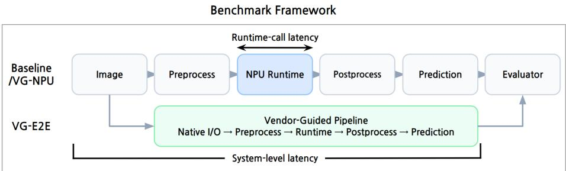

# Benchmarking Vendor-Guided Optimizations on Edge NPUs: From NPU Only to End-to-End Performance. Extended technical report

Youngjin Jo1,2[0009-0000-8772-5837], Jihwan Kim1[0009-0000-3446-4805],

Minseok Choi1[0009-0003-6346-4144], Kwanghoon

Choi1[0000-0003-3519-3650], Jusung Kang2[0000-0002-7908-9452], and Jaein

Kim2[0009-0006-0739-9052]

1 Chonnam National University, Gwangju, 61186, Korea {jo.youngjin,213652,213837,kwanghoon.choi}@jnu.ac.kr 2 Electronics and Telecommunications Research Institute, Gwangju, 61012, Korea {k92492,jaein}@etri.re.kr

Abstract. Edge NPU performance depends not only on hardware capabilities, but also on model transformation and the overall deployment pipeline. We propose a benchmarking methodology that separates these efects by comparing three configurations: Baseline, Vendor Guided NPU Only (VG-NPU), and Vendor Guided End-to-End (VG-E2E), where VG-NPU preserves common model I/O and host-side processing while VG-E2E follows the vendor-native deployment pipeline. We apply this method ology to four edge NPUs and three vision workloads. VG-NPU improves both accuracy and Runtime-call latency in 10 of 12 NPU–workload combinations, whereas VG-E2E reduces System-level latency in all combinations but improves accuracy in only four. Moreover, NPU-level performance rankings do not always match End-to-End rankings, and VG-E2E provides an additional 10.4–70.7% reduction in System-level latency over VG-NPU. These results demonstrate the importance of evaluating vendor-guided optimization separately at the controlled modeltransformation and full deployment levels when comparing heterogeneous commercial Edge NPU platforms in practice.

Keywords: Edge NPU · Benchmarking · Vendor-Guided Optimization · Inference Performance · Latency-Accuracy Trade-of · End-to-End Evaluation

## 1 Introduction

As AI deployment expands, eficient inference has become increasingly important, particularly in mobile and edge environments with tight power and resource constraints. Neural Processing Units (NPUs) address this demand by accelerating tensor operations commonly used in neural networks, often providing higher eficiency than general-purpose CPUs and GPUs for supported workloads [1]. In practice, however, NPU inference performance depends not only on hardware compute capability, but also on the surrounding software stack, including operator support, compiler optimizations, quantization, runtime execution, and input/output processing.

Evaluating NPU-based inference systems requires considering both accuracy and latency. Accuracy reflects how well the predictive quality of the original model is preserved during deployment to an NPU, while latency measures the execution time required to produce the final prediction from an input. In particular, latency can difer substantially depending on whether it measures only NPU inference or end-to-end execution including preprocessing and postprocessing. This study focuses on how accuracy and latency change across the deployment pipelines of diferent NPUs.

Comparing diferent NPUs fairly is challenging. NPUs difer not only in hardware architecture and supported operators, but also in their compilers, quantization policies, precision settings, runtime interfaces, and preprocessing/postprocessing pipelines. Consequently, even when starting from the same source model, applying vendor-recommended model transformations and deployment recipes can change not only the final executable model, but also which operations are executed on the NPU and how the overall deployment pipeline is constructed. As a result, comparing only the final end-to-end (E2E) performance reported for each vendor makes it dificult to determine whether an observed performance diference arises from model transformations performed for NPU execution or from the broader deployment pipeline, including preprocessing, postprocessing, and runtime overheads.

Prior work has proposed benchmarking methodologies and evaluation metrics for fair comparison of ML inference systems [1, 2], and has analyzed how preprocessing, postprocessing, framework, and runtime overheads beyond model inference afect end-to-end performance [3, 4]. Other studies have shown that the execution performance of the same model can vary depending on quantization, compilers, deployment tools, and hardware-specific optimizations [5, 6]. However, these studies have primarily focused on cross-platform comparison, system-level overheads, or the efects of individual optimization techniques. They have not explicitly separated the efect of vendor-guided optimization into two levels: model transformation under fixed model inputs, outputs, and host-side processing, and actual vendor-native end-to-end deployment. By distinguishing these two levels, this study separately examines how model transformation and full deployment afect accuracy and latency.

To investigate this research gap, we define three experimental conditions: Baseline, Vendor Guided NPU Only (VG-NPU), and Vendor Guided End-to-End (VG-E2E). Baseline serves as a reference configuration that permits only the transformations required for NPU execution while limiting optional vendorspecific optimizations. VG-NPU applies the vendor-guided model transformation recipe while preserving the same model inputs and outputs and the same host-side processing as Baseline. VG-E2E applies the full vendor-recommended deployment configuration, including native input/output formats, preprocessing, runtime execution, and postprocessing. With this design, VG-NPU captures the controlled efect of model transformation, whereas VG-E2E measures the performance of the final vendor-guided deployment.

Following the proposed evaluation methodology, we analyze three research questions using four NPUs and three vision workloads: ResNet50, YOLOv5m, and YOLOv8s-pose. First, under VG-NPU, both latency and accuracy improve in 10 of the 12 NPU–workload combinations. In contrast, under VG-E2E, Systemlevel latency decreases in all combinations, while accuracy decreases in eight. This result shows that vendor-guided optimization can improve both metrics at the controlled model-transformation level, but that lower latency in the final deployment does not necessarily imply preserved accuracy.

Second, when comparing three NPUs on the same host, the relative performance ranking among NPUs remains unchanged for YOLOv5m and YOLOv8spose, but changes for ResNet50. This indicates that NPU-only performance does not, in general, reliably predict actual end-to-end performance, and that the relationship is workload-dependent.

Third, VG-E2E achieves lower System-level latency than VG-NPU in all combinations. This suggests that deployment-level processing can provide additional performance gains, while also indicating that such gains should not be attributed to any single optimization component. Overall, these results show that Edge NPU performance should be evaluated separately at the NPU-level optimization and final deployment levels, rather than being treated as a single performance metric.

The remainder of this paper is organized as follows. Section 2 reviews related work. Section 3 describes the three experimental configurations, workloads, NPU platforms, and measurement methodology. Section 4 presents the main experimental results and discusses the limitations of the study. Finally, Section 5 concludes the paper and outlines directions for future work.

## 2 Related Work

Benchmarking methodology and evaluation metrics: MLPerf Inference [2] standardizes workloads, accuracy targets, execution scenarios, and measurement rules to enable fair and reproducible comparisons of ML inference systems across diverse hardware and software platforms. MLPerf Tiny [7] extends this benchmarking approach to ultra-low-power TinyML environments by jointly measuring latency, energy, and accuracy. Its modular benchmark design also enables the contributions of diferent layers of the deployment stack, including models, frameworks, and hardware, to be analyzed separately. These eforts demonstrate that, even across substantially diferent application domains, fair evaluation of accuracy–latency–energy trade-ofs requires considering multiple performance metrics and separating the contributions of individual system layers.

Sze et al. [1] similarly emphasize that DNN inference systems should be evaluated using multiple metrics, including accuracy, latency/throughput, energy/power, and hardware cost, and that performance should be measured under representative workloads and runtime conditions. Coleman et al. [8] proposed DAWNBench, highlighting the need for end-to-end system evaluation that captures the combined efects of model architecture, optimization procedures, software frameworks, and hardware.

Following these evaluation principles, this study distinguishes controlled NPUonly execution from native end-to-end deployment to isolate and analyze the efects of vendor-guided optimization.

NPU/system-level and E2E performance analysis: Millar et al. [3] compared microcontroller-scale µNPUs under common workloads and measurement conditions, decomposing execution time into initialization, memory I/O, inference, and post-processing to identify end-to-end performance bottlenecks.

Buch et al. [4] characterized the overheads beyond model inference in mobile AI—including data capture, pre/post-processing, framework, and ofloading overheads—as the “AI tax,” and analyzed their impact on application-level endto-end performance.

Szegedi et al. [9] separately measured preprocessing, inference, and postprocessing for classification and detection models on edge GPUs, and compared performance across frameworks, implementation languages, and precision settings, demonstrating the need to consider both model inference time and total processing time.

Kang et al. [10] showed that, in accelerator-based visual analytics systems, preprocessing operations such as image decoding and resizing can become throughput bottlenecks that are more significant than model inference itself.

Ham et al. [11], through their work on NNStreamer, demonstrated that execution configuration can substantially afect the performance of on-device AI pipelines composed of multiple processing stages. By connecting neural network inference and data processing through GStreamer and comparing sequential execution with stream-pipelined execution, they showed that the organization of data flow and parallel execution afects overall latency, throughput, and resource utilization.

While these studies demonstrate the importance of system-level overheads beyond NPU inference, our work distinguishes vendor optimization on commercial Edge NPUs into NPU-only model transformation and full deployment, and compares the performance impact at each level.

Optimization/toolchain efects: EdgeMark [5] proposed a benchmarking system that automates model generation, optimization, conversion, and deployment for embedded AI tools, enabling multiple toolchains to be compared under consistent conditions.

Ahn et al. [6] compared INT8/FP16 and static/dynamic quantization across diferent frameworks and edge hardware, showing that the efectiveness of the same model optimization can vary depending on software frameworks and hardware support. Baciu et al. [12] similarly compared porting frameworks and quantization configurations on real MCUs, showing that model quantization can reduce model size and classification time at the cost of reduced accuracy.

Ulker et al. [13] showed that inference performance depends on both the computational structure of a model and framework-specific operator implementations, while MLonMCU [14] demonstrated that inference performance and the gains from auto-tuning can vary with TVM schedules and data layouts.

In contrast to these studies, our work does not focus on comparing individual quantization techniques or deployment tools. Instead, we analyze how complete vendor-recommended optimization recipes afect controlled NPU-only performance and actual end-to-end deployment performance, considering both accuracy and latency.

## 3 Benchmark Design

To distinguish the efects of vendor-provided NPU optimizations on accuracy and latency between model transformation and final deployment, we define three benchmark configurations: Baseline, Vendor Guided NPU Only (VG-NPU), and Vendor Guided End-to-End (VG-E2E). By comparing Baseline and VG-NPU, we examine the changes introduced by vendor-guided model transformation, while VG-E2E is used to evaluate the final performance of the full vendorrecommended deployment configuration. In Fig. 1, we illustrate the three configurations, the execution paths, and the corresponding latency measurement methodology.

## 3.1 Benchmark Framework

  
Fig. 1. Execution paths and latency measurement intervals of the benchmark framework. Baseline and VG-NPU use the same execution path, whereas VG-E2E follows the vendor-guided deployment pipeline. Runtime-call latency measures the elapsed time of the runtime API invocation, which includes NPU execution and any overhead incurred within the runtime call, while System-level latency measures the total execution time from image loading to final prediction.

Fig. 1 illustrates the execution paths of the three benchmark configurations. Baseline and VG-NPU use the same benchmark framework and generate the final prediction through identical preprocessing, NPU runtime invocation, and postprocessing steps. The two configurations are also designed to use the same model inputs and outputs. The primary diference between Baseline and VG-NPU is the model transformation configuration used to generate the NPU-executable model. In contrast, VG-E2E uses the vendor-recommended deployment pipeline, including native input/output formats, preprocessing, runtime, and postprocessing. Accuracy is evaluated using the same evaluator for all configurations.

Runtime-call latency measures the runtime API invocation, while Systemlevel latency measures the time from image loading to final prediction. Since Baseline and VG-NPU use the same runtime interface, their model-transformation efects are compared using Runtime-call latency. Overall deployment performance, including VG-E2E, is compared using System-level latency.

All experiments use synchronous single-stream execution with batch size 1 and the same 5,000-image evaluation set. After 10 warm-up runs, the full set is executed four times. We take the median latency per image across the four runs and report the mean over all 5,000 images.

## 3.2 Benchmark Configurations

Table 1 summarizes the three benchmark configurations.

Table 1. Benchmark Configurations
<table><tr><td rowspan=1 colspan=1>Category</td><td rowspan=1 colspan=1>Baseline</td><td rowspan=1 colspan=1>VG-E2E</td><td rowspan=1 colspan=1>VG-NPU</td></tr><tr><td rowspan=1 colspan=1>Source modelweights</td><td rowspan=1 colspan=1>Same</td><td rowspan=1 colspan=1>Same</td><td rowspan=1 colspan=1>Same</td></tr><tr><td rowspan=1 colspan=1>Calibration/evaluation</td><td rowspan=1 colspan=1>1,024 / 5,000 images</td><td rowspan=1 colspan=1>Same</td><td rowspan=1 colspan=1>Same</td></tr><tr><td rowspan=1 colspan=1>Batch / execution</td><td rowspan=1 colspan=1>1 / Sync. /Single-stream</td><td rowspan=1 colspan=1>Same</td><td rowspan=1 colspan=1>Same</td></tr><tr><td rowspan=1 colspan=1>Compiler input</td><td rowspan=1 colspan=1>Source modelsubgraph</td><td rowspan=1 colspan=1>Source model</td><td rowspan=1 colspan=1>Source modelsubgraph</td></tr><tr><td rowspan=1 colspan=1>Quantization</td><td rowspan=1 colspan=1>INT 8-bit PTQ</td><td rowspan=1 colspan=1>Vendor options</td><td rowspan=1 colspan=1>Vendor options</td></tr><tr><td rowspan=1 colspan=1>Compileroptimization</td><td rowspan=1 colspan=1>Minimal settings</td><td rowspan=1 colspan=1>Vendor options</td><td rowspan=1 colspan=1>Vendor options</td></tr><tr><td rowspan=1 colspan=1>Execution path</td><td rowspan=1 colspan=1>Benchmark pipeline</td><td rowspan=1 colspan=1>Vendor pipeline</td><td rowspan=1 colspan=1>Benchmark pipeline</td></tr><tr><td rowspan=1 colspan=1>Latency</td><td rowspan=1 colspan=1>Runtime-call/System-level</td><td rowspan=1 colspan=1>System-level</td><td rowspan=1 colspan=1>Runtime-callSystem-level</td></tr><tr><td rowspan=1 colspan=1>Evaluation focus</td><td rowspan=1 colspan=1>Transformationbaseline</td><td rowspan=1 colspan=1>Final deploymentperformance</td><td rowspan=1 colspan=1>Model-transformationeffect</td></tr></table>

The Baseline configuration serves as the reference point for evaluating the efects of the two vendor-guided optimization configurations.

– Model conversion and INT8 post-training quantization are required to make the model executable on each NPU, and these are also applied in the Baseline configuration, since the original FP32 model cannot be executed directly on the NPU without these transformations.

– In contrast, vendor-specific optimizations that are not required for model execution are disabled in the Baseline configuration. These include finetuning, mixed precision, weight compression, enhanced quantization, graphlevel performance optimization, and resource-allocation tuning. These optimizations are enabled only in the vendor-guided configurations, allowing their efects on performance and accuracy to be measured relative to the Baseline.

VG-E2E evaluates the deployment performance of the vendor-native execution path, including preprocessing, NPU inference, and postprocessing, using the deployment modules and recommended model-transformation settings provided by each vendor.

Model transformation uses the vendor-recommended model graph, quantization, and compiler optimization settings, while execution uses native input/output formats and vendor-specific preprocessing, runtime, and postprocessing.

Therefore, changes observed under VG-E2E are interpreted as the efect of the overall vendor-guided deployment rather than that of any single optimization technique.

To isolate the efects of NPU inference and model transformation from the overall E2E performance changes, we additionally define the VG-NPU configuration.

– VG-NPU follows the same execution setup as Baseline, but applies the vendor-recommended model-transformation recipe, including quantization and compiler optimizations.

– Therefore, the performance diference between Baseline and VG-NPU captures the efect of vendor-recommended model transformation on NPU inference.

## 3.3 Workloads and Datasets

Table 2 summarizes the evaluated workloads and datasets.

To account for the possibility that NPU optimization efects vary with workload computation and output-processing characteristics, we select ResNet50 [15], YOLOv5m [16], and YOLOv8s-pose [17] to represent image classification, object detection, and pose estimation, respectively.

Accuracy is evaluated based on the final semantic predictions. For Baseline and VG-NPU, identical model outputs and a common postprocessing pipeline are used so that diferences in NPU-specific output tensor layouts do not afect the comparison. For the YOLO workloads, decoding, confidence filtering, and NMS are performed using the same common postprocessor across all NPUs. Detailed output tensor configurations and the threshold settings used for accuracy and latency measurements are provided in Appendix A.

Table 2. Evaluation workloads, datasets, and accuracy metrics.
<table><tr><td rowspan=1 colspan=1>Model /Task</td><td rowspan=1 colspan=1>Input</td><td rowspan=1 colspan=1>Dataset/Format</td><td rowspan=1 colspan=1>Cal. / Eval.</td><td rowspan=1 colspan=1>Metric</td><td rowspan=1 colspan=1>FP32Score</td></tr><tr><td rowspan=1 colspan=1>ResNet50Classifica-tion</td><td rowspan=1 colspan=1>RGB224×224</td><td rowspan=1 colspan=1>ImageNet-1KJPEG + classlabel</td><td rowspan=1 colspan=1>train 1,024 /val 5,000</td><td rowspan=1 colspan=1>Top-1 accuracy</td><td rowspan=1 colspan=1>79.06</td></tr><tr><td rowspan=1 colspan=1>YOLOv5m/Detection</td><td rowspan=1 colspan=1>RGB640×640</td><td rowspan=1 colspan=1>COCO 2017 /JPEG + bboxannotation</td><td rowspan=1 colspan=1>train20171,024 /val2017 5,000</td><td rowspan=1 colspan=1>bboxAP@[.50:.95]</td><td rowspan=1 colspan=1>45.16</td></tr><tr><td rowspan=1 colspan=1>YOLOv8s-pose  / Poseestimation</td><td rowspan=1 colspan=1>RGB640×640</td><td rowspan=1 colspan=1>COCO 2017 /JPEG +keypointannotation</td><td rowspan=1 colspan=1>train20171,024 /val2017 5,000</td><td rowspan=1 colspan=1>keypointAP@[.50:.95]</td><td rowspan=1 colspan=1>59.39</td></tr></table>

All accuracy metrics are reported on a 0–100 scale. ResNet50 uses Top-1 accuracy (%), while YOLOv5m and YOLOv8s-pose use COCO bbox AP and keypoint AP, respectively, multiplied by 100. Bbox AP is averaged over IoU thresholds from 0.50 to 0.95 in increments of 0.05, and keypoint AP is averaged over the corresponding OKS thresholds.

For accuracy evaluation, we use ImageNet-1K [18] for ResNet50 and COCO val2017 [19] for YOLOv5m and YOLOv8s-pose. Each workload is evaluated on 5,000 images, while calibration uses a fixed set of 1,024 images from the corresponding training dataset. For each workload, the same calibration and evaluation images, in the same order, are used across all NPUs and benchmark configurations to control for dataset-related variation.

## 3.4 Vendor-Specific Deployment Configuration

For each NPU, we apply the optimization and deployment configurations recommended by the corresponding vendor, including quantization, precision, graph transformation, preprocessing/postprocessing, and runtime pipeline.

– Specifically, Hailo uses optimization/compression-level tuning, mixed precision, and quantization fine-tuning, together with a GStreamer-based execution path and model-integrated normalization or NMS.

– DeepX applies compiler optimization levels and enhanced quantization, and uses a DXSTREAM-based pipeline.

– Mobilint applies compiler optimization, percentile-based quantization, and Hadamard transformation, using a Model Zoo- and qbruntime-based execution setup.

In VG-NPU, we primarily apply quantization and compiler-level model transformations from these vendor settings, whereas VG-E2E additionally includes vendor-native preprocessing, model-integrated processing, postprocessing, and runtime pipelines. Detailed model-specific options and deployment configurations are summarized in Appendices B and C.

## 3.5 NPU Hardware and Software Environments

We selected four commercially available Edge NPUs from multiple vendors that provide dedicated compiler, runtime, and deployment stacks required to evaluate both the VG-NPU and VG-E2E configurations. Table 3 summarizes the hardware and software environments used for each platform.

Table 3. Evaluation NPU Platforms and Software Stacks
<table><tr><td rowspan=1 colspan=1>Target</td><td rowspan=1 colspan=1>INT8TOPS</td><td rowspan=1 colspan=1>Host / OS</td><td rowspan=1 colspan=1>CPUFreq.</td><td rowspan=1 colspan=1>Compiler</td><td rowspan=1 colspan=1>Runtime</td></tr><tr><td rowspan=1 colspan=1>Hailo-8</td><td rowspan=1 colspan=1>26</td><td rowspan=1 colspan=1>Jetson Orin NanoUbuntu 22.04,JetPack 6</td><td rowspan=1 colspan=1>1.728GHz</td><td rowspan=1 colspan=1>DFC 3.34</td><td rowspan=1 colspan=1>HailoRT 4.24</td></tr><tr><td rowspan=1 colspan=1>Hailo-10H</td><td rowspan=1 colspan=1>20</td><td rowspan=1 colspan=1>Jetson Orin NanoUbuntu 22.04,JetPack 6</td><td rowspan=1 colspan=1>1.728GHz</td><td rowspan=1 colspan=1>DFC 5.3</td><td rowspan=1 colspan=1>HailoRT 5.3</td></tr><tr><td rowspan=1 colspan=1>DX-M1</td><td rowspan=1 colspan=1>25</td><td rowspan=1 colspan=1>Jetson Orin NanoUbuntu 22.04,JetPack 6</td><td rowspan=1 colspan=1>1.728GHz</td><td rowspan=1 colspan=1>DX-COM2.3-rc.5</td><td rowspan=1 colspan=1>DX-RT 3.4</td></tr><tr><td rowspan=1 colspan=1>Regulus</td><td rowspan=1 colspan=1>10</td><td rowspan=1 colspan=1>Regulus SOM/Vendor YoctoLinux</td><td rowspan=1 colspan=1>1.2 GHz</td><td rowspan=1 colspan=1>QBCompiler1.1.2</td><td rowspan=1 colspan=1>qbruntime1.2</td></tr></table>

All NPUs are evaluated using the hardware and software stacks provided by their respective vendors. We evaluate Hailo-8 and Hailo-10H from Hailo, DX-M1 from DeepX, and Regulus from Mobilint. Hailo-8, Hailo-10H, and DX-M1 are measured on the same Jetson Orin Nano host, while Regulus is evaluated on the vendor-provided Regulus SOM. To reduce run-to-run variation caused by hostside frequency scaling, the CPU frequency is fixed at 1.728 GHz on the Jetson Orin Nano and 1.2 GHz on the Regulus System on Module (SOM), respectively.

## 4 Evaluation Results and Findings

In this evaluation, we examine how vendor-guided optimization afects latency and accuracy, and how NPU-only performance translates into end-to-end performance. Table 4 summarizes the accuracy measured under Baseline, VG-NPU, and VG-E2E, while Table 5 reports the System-level latency for the three configurations. Table 6 compares the Runtime-call latency of Baseline and VG-NPU.

Table 4. Accuracy Results on a 0–100 Scale
<table><tr><td>NPU</td><td>Model</td><td>Baseline</td><td>VG-NPU</td><td>VG-E2E</td></tr><tr><td rowspan="3">Hailo-8</td><td>ResNet50</td><td>78.38</td><td>78.88</td><td>78.08</td></tr><tr><td>YOLOv5m</td><td>41.68</td><td>43.33</td><td>39.21</td></tr><tr><td>YOLOv8s-pose</td><td>49.67</td><td>51.68</td><td>48.29</td></tr><tr><td rowspan="3">Hailo-10H</td><td>ResNet50</td><td>78.32</td><td>78.92</td><td>77.82</td></tr><tr><td>YOLOv5m</td><td>42.39</td><td>43.46</td><td>42.80</td></tr><tr><td>YOLOv8s-pose</td><td>50.58</td><td>52.49</td><td>47.84</td></tr><tr><td rowspan="3">DX-M1</td><td>ResNet50</td><td>78.86</td><td>78.66</td><td>78.94</td></tr><tr><td>YOLOv5m</td><td>44.75</td><td>44.82</td><td>43.69</td></tr><tr><td>YOLOv8s-pose</td><td>58.47</td><td>58.90</td><td>58.54</td></tr><tr><td rowspan="3">Regulus</td><td>ResNet50</td><td>78.74</td><td>78.96</td><td>77.42</td></tr><tr><td>YOLOv5m</td><td>43.90</td><td>42.89</td><td>43.38</td></tr><tr><td>YOLOv8s-pose</td><td>56.25</td><td>56.57</td><td>56.66</td></tr></table>

Table 5. System-level Latency (ms).
<table><tr><td>NPU</td><td>Model</td><td>Baseline</td><td>VG-NPU</td><td>VG-E2E</td></tr><tr><td rowspan="3">Hailo-8</td><td>ResNet50</td><td>11.100</td><td>9.786</td><td>8.766</td></tr><tr><td>YOLOv5m</td><td>59.308</td><td>43.106</td><td>28.101</td></tr><tr><td>YOLOv8s-pose</td><td>43.938</td><td>38.228</td><td>22.167</td></tr><tr><td rowspan="3">Hailo-10H</td><td>ResNet50</td><td>16.145</td><td>15.082</td><td>9.712</td></tr><tr><td>YOLOv5m</td><td>124.871</td><td>114.839</td><td>33.697</td></tr><tr><td>YOLOv8s-pose</td><td>92.837</td><td>89.904</td><td>32.683</td></tr><tr><td rowspan="3">DX-M1</td><td>ResNet50</td><td>17.739</td><td>17.237</td><td>7.243</td></tr><tr><td>YOLOv5m</td><td>122.177</td><td>121.915</td><td>53.768</td></tr><tr><td>YOLOv8s-pose</td><td>106.322</td><td>105.563</td><td>55.149</td></tr><tr><td rowspan="3">Regulus</td><td>ResNet50</td><td>34.217</td><td>34.233</td><td>28.187</td></tr><tr><td>YOLOv5m</td><td>122.216</td><td>122.332</td><td>96.966</td></tr><tr><td>YOLOv8s-pose</td><td>193.581</td><td>192.910</td><td>86.611</td></tr></table>

## 4.1 RQ1: Do vendor-guided optimizations improve both latency and accuracy?

Comparing Baseline and VG-NPU, accuracy improves in 10 of the 12 NPU– workload combinations, while Runtime-call latency decreases in 11. Both metrics improve simultaneously in 10 combinations, indicating that vendor-guided model transformation can generally reduce Runtime-call latency while preserving or slightly improving accuracy under fixed model inputs, outputs, and host-side processing. However, accuracy decreases for YOLOv5m on Regulus, and several NPU–workload combinations show only marginal changes in Runtime-call latency, indicating that the benefits are not uniform across all cases.

In contrast, under VG-E2E, System-level latency decreases relative to Baseline in all 12 NPU–workload combinations, whereas accuracy improves in only four and decreases in eight. Thus, vendor-guided deployment consistently improves latency, but does not necessarily improve accuracy. In other words, fulldeployment optimization can achieve lower latency at the cost of accuracy degradation for some workloads.

Table 6. Runtime-call Latency under the Baseline and VG-NPU (ms).
<table><tr><td rowspan=1 colspan=1>NPU</td><td rowspan=1 colspan=1>Model</td><td rowspan=1 colspan=1>Baseline</td><td rowspan=1 colspan=1>VG-NPU</td></tr><tr><td rowspan=2 colspan=1>Hailo-8</td><td rowspan=2 colspan=1>ResNet50YOLOv5mYOLOv8s-pose</td><td rowspan=2 colspan=1>5.50639.64018.656</td><td rowspan=1 colspan=1>4.187</td></tr><tr><td rowspan=1 colspan=1>23.27112.891</td></tr><tr><td rowspan=1 colspan=1>Hailo-10H</td><td rowspan=1 colspan=1>ResNet50YOLOv5mYOLOv8s-pose</td><td rowspan=1 colspan=1>10.512105.09067.445</td><td rowspan=1 colspan=1>9.46295.02465.157</td></tr><tr><td rowspan=1 colspan=1>DX-M1</td><td rowspan=1 colspan=1>ResNet50YOLOv5mYOLOv8s-pose</td><td rowspan=1 colspan=1>11.86297.08283.571</td><td rowspan=1 colspan=1>11.44996.85182.892</td></tr><tr><td rowspan=1 colspan=1>Regulus</td><td rowspan=1 colspan=1>ResNet50YOLOv5mYOLOv8s-pose</td><td rowspan=1 colspan=1>5.27028.55819.409</td><td rowspan=1 colspan=1>5.26928.56818.822</td></tr></table>

## 4.2 RQ2: Does NPU-only performance predict end-to-end performance?

To examine whether NPU-only performance can predict actual end-to-end performance, we compare the relative performance rankings among NPUs using VG-NPU Runtime-call latency and VG-E2E System-level latency. To minimize the efect of host diferences, we focus on Hailo-8, Hailo-10H, and DX-M1, all measured on the same Jetson Orin Nano host. Regulus is excluded from this comparison because it was measured on a separate vendor-provided Regulus SOM.

For ResNet50, the performance ranking difers between NPU-only and endto-end measurements. Under VG-NPU, Runtime-call latency follows Hailo-8 < Hailo-10H < DX-M1, whereas under VG-E2E, System-level latency follows DX-M1 < Hailo-8 < Hailo-10H. Notably, DX-M1, which is the slowest in the NPUonly measurement, achieves the lowest System-level latency under VG-E2E. This shows that NPU inference performance alone does not always predict overall deployment performance.

In contrast, for YOLOv5m and YOLOv8s-pose, the relative ranking among NPUs remains unchanged across the two measurements. For both workloads, the ranking is Hailo-8 < Hailo-10H < DX-M1 for both VG-NPU Runtime-call latency and VG-E2E System-level latency. These results show that the relationship between NPU-only and end-to-end performance is workload-dependent, and that overall system performance can be influenced not only by NPU inference but also by preprocessing, postprocessing, and vendor-specific execution pipelines.

## 4.3 RQ3: How much additional benefit comes from vendor-guided deployment?

To examine whether vendor-guided deployment provides additional performance gains beyond NPU-level optimization, we compare the System-level latency of VG-NPU and VG-E2E. VG-E2E achieves lower latency than VG-NPU in all 12 NPU–workload combinations, with reductions ranging from 10.4% to 70.7%. Particularly large additional improvements are observed for YOLOv5m and YOLOv8s-pose on Hailo-10H, all three workloads on DX-M1, and YOLOv8spose on Regulus.

VG-NPU and VG-E2E both apply vendor-guided model transformations, but VG-E2E uses a broader vendor-native deployment configuration, including native input/output formats, preprocessing, postprocessing, and runtime pipelines. Since VG-E2E achieves lower System-level latency than VG-NPU in all combinations, the additional latency gains reflect the combined efects of these broader deployment-level changes beyond the controlled VG-NPU configuration. This suggests that deployment-level optimization can play an important role in further reducing overall latency. However, because multiple components are changed simultaneously, the observed gains cannot be isolated as the efect of any single model transformation, preprocessing, postprocessing, or runtime optimization.

## 4.4 Limitations

This study is limited to the four Edge NPUs, three vision workloads, specific software stacks, and synchronous batch-1 execution, and does not explore all compiler and quantization configurations. In Baseline and VG-NPU, some fullgraph optimizations are restricted to preserve identical model inputs, outputs, and host-side processing. In VG-E2E, multiple deployment components change simultaneously, preventing us from isolating the efect of individual optimizations. Because some platforms use diferent hosts, System-level latency cannot be attributed solely to NPU performance. Power and energy-eficiency evaluation was excluded because the available power telemetry interfaces and measurement coverage difered across platforms, making it dificult to establish a consistent power measurement scope. Consequently, we cannot determine whether the observed latency improvements translate into better power eficiency or lower energy per inference. Thus, our results should be interpreted as the observed efects in vendor-guided optimization within the scope of our experiments, rather than as maximum achievable performance or universal superiority.

## 5 Conclusion and Future Work

Using four commercial Edge NPUs and three widely used vision workloads spanning image classification, object detection, and pose estimation, our findings show that Edge NPU performance should be interpreted by distinguishing NPUlevel model transformation from final deployment, rather than treating inference performance as a single metric. First, vendor-guided model transformation generally reduces Runtime-call latency while preserving accuracy under fixed model inputs, outputs, and host-side processing. Second, such NPU-level improvements do not always translate directly into final End-to-End performance; for some workloads, the relative performance ranking among NPUs changes after full deployment. Third, vendor-native deployment provides additional Systemlevel latency reductions across all evaluated combinations, but these performance gains do not always preserve accuracy. These findings suggest that comparing Edge NPUs requires considering the latency–accuracy trade-of jointly shaped by model transformation, preprocessing, postprocessing, and runtime pipelines, rather than NPU execution alone.

Future work will extend the evaluation to a broader range of NPUs and workloads, isolate the efects of individual optimizations, and incorporate workloadspecific accuracy constraints to better understand the sources of these trade-ofs.

## References

1. Sze, V., Chen, Y.H., Yang, T.J., Emer, J.S.: Eficient processing of deep neural networks: A tutorial and survey. Proceedings of the IEEE 105(12), 2295–2329 (2017). https://doi.org/10.1109/JPROC.2017.2761740

2. Reddi, V.J., Cheng, C., Kanter, D., Mattson, P., Schmuelling, G., Wu, C.J., Anderson, B., Breughe, M., Charlebois, M., Chou, W., Chukka, R., Coleman, C., Davis, S., Deng, P., Diamos, G., Duke, J., Fick, D., Gardner, J.S., Hubara, I., Idgunji, S., Jablin, T.B., Jiao, J., John, T.S., Kanwar, P., Lee, D., Liao, J., Lokhmotov, A., Massa, F., Meng, P., Micikevicius, P., Osborne, C., Pekhimenko, G., Rajan, A.T.R., Sequeira, D., Sirasao, A., Sun, F., Tang, H., Thomson, M., Wei, F., Wu, E., Xu, L., Yamada, K., Yu, B., Yuan, G., Zhong, A., Zhang, P., Zhou, Y.: MLPerf inference benchmark. In: Proceedings of the ACM/IEEE 47th Annual International Symposium on Computer Architecture. p. 446–459. ISCA ’20, IEEE Press (2020). https://doi.org/10.1109/ISCA45697.2020.00045

3. Millar, J., Huang, Y., Sethi, S., Haddadi, H., Madhavapeddy, A.: Benchmarking ultra-low-power μNPUs. In: Proceedings of the 31st Annual International Conference on Mobile Computing and Networking. p. 1060–1074. ACM MOBI-COM ’25, Association for Computing Machinery, New York, NY, USA (2025). https://doi.org/10.1145/3680207.3765264

4. Buch, M., Azad, Z., Joshi, A., Reddi, V.J.: AI tax in mobile socs: End-to-end performance analysis of machine learning in smartphones. In: 2021 IEEE International Symposium on Performance Analysis of Systems and Software (ISPASS). pp. 96–106 (2021). https://doi.org/10.1109/ISPASS51385.2021.00027

5. Hasanpour, M.A., Kirkegaard, M., Fafoutis, X.: EdgeMark: An automation and benchmarking system for embedded artificial intelligence tools. Journal of Systems Architecture 167, 103488 (2025). https://doi.org/10.1016/j.sysarc.2025.103488

6. Ahn, H., Chen, T., Alnaasan, N., Shafi, A., Abduljabbar, M., Subramoni, H., Panda, D.K.: Performance Characterization of Using Quantization for DNN Inference on Edge Devices. In: 2023 IEEE 7th International Conference on Fog and Edge Computing (ICFEC). pp. 1–6. IEEE Computer Society, Los Alamitos, CA, USA (May 2023). https://doi.org/10.1109/ICFEC57925.2023.00009

7. Banbury, C., Reddi, V.J., Torelli, P., Holleman, J., Jefries, N., Montino, C.K.P., Kanter, D., Ahmed, S., Pau, D., Thakker, U., Torrini, A., Warden, P., Cordaro, J., Guglielmo, G.D., Duarte, J., Gibellini, S., Parekh, V., Tran, H., Tran,

N., Wenxu, N., Xuesong, X.: Mlperf tiny benchmark. In: Proceedings of the 35th Conference on Neural Information Processing Systems (NeurIPS 2021), Track on Datasets and Benchmarks. Curran Associates, Inc. (December 2021). https://doi.org/10.48550/arXiv.2106.07597, 35th Conference on Neural Information Processing Systems (NeurIPS 2021), Track on Datasets and Benchmarks

8. Coleman, C.A., Narayanan, D., Kang, D., Zhao, T., Zhang, J., Nardi, L., Bailis, P., Olukotun, K., Ré, C., Zaharia, M.: Dawnbench: An end-to-end deep learning benchmark and competition. In: 31st Conference on Neural Information Processing Systems (NIPS 2017) (2017), https://dawn.cs.stanford.edu/sites/g/files/sbiybj26306/files/media/file/nips17- dawnbench.pdf

9. Szegedi, R., Bukschat, Y., Vetter, M.: A comparative study of neural network performance on the nvidia jetson orin nano. IEEE Access 14, 107765–107785 (2026). https://doi.org/10.1109/ACCESS.2026.3712902

10. Kang, D., Mathur, A., Veeramacheneni, T., Bailis, P., Zaharia, M.: Jointly optimizing preprocessing and inference for dnn-based visual analytics. Proc. VLDB Endow. 14(2), 87–100 (Oct 2020). https://doi.org/10.14778/3425879.3425881

11. Ham, M., Moon, J., Lim, G., Jung, J., Ahn, H., Song, W., Woo, S., Kapoor, P., Chae, D., Jang, G., Ahn, Y., Lee, J.: Nnstreamer: eficient and agile development of on-device ai systems. In: Proceedings of the 43rd International Conference on Software Engineering: Software Engineering in Practice. p. 198–207. ICSE-SEIP ’21, IEEE Press (2021). https://doi.org/10.1109/ICSE-SEIP52600.2021.00029

12. Baciu, V.E., Stiens, J., {da Silva}, B.: Mlino bench: A comprehensive benchmarking tool for evaluating ml models on edge devices. Journal of Systems Architecture 155(103262) (Oct 2024). https://doi.org/10.1016/j.sysarc.2024.103262, presented at AEIC2024 Barcelona

13. Ulker, B., Stuijk, S., Corporaal, H., Wijnhoven, R.: Reviewing inference performance of state-of-the-art deep learning frameworks. In: Stuijk, S. (ed.) SCOPES ’20: Proceedings of the 23th International Workshop on Software and Compilers for Embedded Systems. pp. 48–53. Association for Computing Machinery, Inc., United States (May 2020). https://doi.org/10.1145/3378678.3391882, 23rd International Workshop on Software and Compilers for Embedded Systems (SCOPES 2020) ; Conference date: 25-05-2020 Through 26-05-2020

14. van Kempen, P., Stahl, R., Mueller-Gritschneder, D., Schlichtmann, U.: Mlonmcu: Tinyml benchmarking with fast retargeting. In: Proceedings of the 2023 Workshop on Compilers, Deployment, and Tooling for Edge AI. p. 32–36. CO-DAI ’23, Association for Computing Machinery, New York, NY, USA (2024). https://doi.org/10.1145/3615338.3618128

15. He, K., Zhang, X., Ren, S., Sun, J.: Deep residual learning for image recognition. In: 2016 IEEE Conference on Computer Vision and Pattern Recognition (CVPR). pp. 770–778 (2016). https://doi.org/10.1109/CVPR.2016.90

16. Jocher, G.: Ultralytics yolov5 (2020). https://doi.org/10.5281/zenodo.3908559, https://github.com/ultralytics/yolov5

17. Jocher, G., Chaurasia, A., Qiu, J.: Ultralytics yolov8 (2023), https://github.com/ultralytics/ultralytics

18. Deng, J., Dong, W., Socher, R., Li, L.J., Li, K., Fei-Fei, L.: Imagenet: A large-scale hierarchical image database. In: 2009 IEEE Conference on Computer Vision and Pattern Recognition. pp. 248–255 (2009). https://doi.org/10.1109/CVPR.2009.5206848

19. Lin, T.Y., Maire, M., Belongie, S., Hays, J., Perona, P., Ramanan, D., Dollár, P., Zitnick, C.L.: Microsoft coco: Common objects in context. In: Fleet, D., Pajdla, T., Schiele, B., Tuytelaars, T. (eds.) Computer Vision – ECCV 2014. pp. 740–755. Springer International Publishing, Cham (2014)

## A Detailed Model I/O and Evaluation Settings

Table 7 summarizes the common model output and postprocessing settings used in the Baseline and VG-NPU configurations, together with the threshold settings used for accuracy and latency evaluation. VG-E2E-specific input/output and postprocessing changes are described separately in the vendor-specific deployment configurations.

Table 7. Model output and evaluation settings.
<table><tr><td rowspan=1 colspan=1>Model</td><td rowspan=1 colspan=1>Output</td><td rowspan=1 colspan=1>Postprocessing</td><td rowspan=1 colspan=1>Accuracy</td><td rowspan=1 colspan=1>Latency</td></tr><tr><td rowspan=1 colspan=1>ResNet50</td><td rowspan=1 colspan=1>1,000 class scores</td><td rowspan=1 colspan=1>Highest-scoreclass</td><td rowspan=1 colspan=1>Top-1accuracy</td><td rowspan=1 colspan=1>Samepredictionprocedure</td></tr><tr><td rowspan=1 colspan=1>YOLOv5m</td><td rowspan=1 colspan=1>3 detectionheads</td><td rowspan=1 colspan=1>BBox decoding,confidencefiltering, andNMS</td><td rowspan=1 colspan=1>conf. 0.001;IoU 0.60; maxdet. 300</td><td rowspan=1 colspan=1>conf. 0.25; IoU0.45; max det.1000</td></tr><tr><td rowspan=1 colspan=1>YOLOv8s-pose</td><td rowspan=1 colspan=1>9 tensors forbbox, class, andkeypoints</td><td rowspan=1 colspan=1>BBox/keypointdecoding,confidencefiltering, andNMS</td><td rowspan=1 colspan=1>conf. 0.001;IoU 0.70; maxdet. 300</td><td rowspan=1 colspan=1>conf. 0.25; IoU0.70; max det.300</td></tr></table>

For ResNet50, the model produces scores for the 1,000 ImageNet classes, and the class with the highest score is used as the final prediction.

For YOLOv5m, the Baseline and VG-NPU configurations use the outputs of the 3 detection heads as the common model output. Bounding boxes are decoded into the original image coordinate system, followed by confidence filtering and non-maximum suppression (NMS). The accuracy evaluation follows the validation settings of the oficial YOLOv5 v7.0 implementation, whereas latency evaluation follows its default prediction settings.

For YOLOv8s-pose, the common model output consists of 9 tensors corresponding to bounding-box, class-probability, and keypoint outputs over 3 scales. Bounding boxes and keypoints are decoded into the original image coordinate system, followed by confidence filtering and NMS. The accuracy and latency settings follow the validation and prediction defaults, respectively, of Ultralytics v8.4.24.

The lower confidence thresholds used for accuracy evaluation retain lowconfidence predictions required for COCO AP computation, whereas latency evaluation uses the default prediction settings of the corresponding reference implementation. The same common postprocessing implementation is used across NPUs for Baseline and VG-NPU.

## B Vendor-Specific Optimization Options

Table 8 summarizes the main vendor-specific optimization options applied under the three benchmark configurations. The option names are preserved as exposed by the corresponding vendor toolchains. Model-specific precision and quantization settings are listed separately where the applied configuration difers across workloads.

Table 8. Vendor-specific optimization changes across configurations.
<table><tr><td rowspan=1 colspan=1>NPU</td><td rowspan=1 colspan=1>Option / Setting</td><td rowspan=1 colspan=1>Baseline vs. VG-NPU</td><td rowspan=1 colspan=1>VG-NPU vs. VG-E2E</td></tr><tr><td rowspan=5 colspan=1>Hailo-8</td><td rowspan=1 colspan=1>optimization_level</td><td rowspan=1 colspan=1>-100 → 2</td><td rowspan=1 colspan=1>Same as VG-NPU</td></tr><tr><td rowspan=1 colspan=1>compression_level</td><td rowspan=1 colspan=1>0 → 1</td><td rowspan=1 colspan=1>Same as VG-NPU</td></tr><tr><td rowspan=1 colspan=1>ResNet50</td><td rowspan=1 colspan=1>W8A8 → W4 × 3 +bias correction</td><td rowspan=1 colspan=1>Same as VG-NPU</td></tr><tr><td rowspan=1 colspan=1>YOLOv5m</td><td rowspan=1 colspan=1>W8A8 → W4 × 3 +finetuning</td><td rowspan=1 colspan=1>Same as VG-NPU</td></tr><tr><td rowspan=1 colspan=1>YOLOv8s-pose</td><td rowspan=1 colspan=1>W8A8 → keypointA16/W16;finetuning off</td><td rowspan=1 colspan=1>finetuning on</td></tr><tr><td rowspan=5 colspan=1>Hailo-10H</td><td rowspan=1 colspan=1>optimization_level</td><td rowspan=1 colspan=1>-100 → 2</td><td rowspan=1 colspan=1>Same as VG-NPU</td></tr><tr><td rowspan=1 colspan=1>compression_level</td><td rowspan=1 colspan=1>0 → 1</td><td rowspan=1 colspan=1>Same as VG-NPU</td></tr><tr><td rowspan=1 colspan=1>ResNet50</td><td rowspan=1 colspan=1>W8A8 → W4 × 3 +bias correction</td><td rowspan=1 colspan=1>Same as VG-NPU</td></tr><tr><td rowspan=1 colspan=1>YOLOv5m setting</td><td rowspan=1 colspan=1>W8A8 → W4 × 4 +finetuning; conv38forced to W8</td><td rowspan=1 colspan=1>W4 × 3 + finetuning;Model Zoo allocatorrecipe</td></tr><tr><td rowspan=1 colspan=1>YOLOv8s-pose</td><td rowspan=1 colspan=1>W8A8 → keypointA16/W16 + W4 × 3</td><td rowspan=1 colspan=1>W4 off; finetuning on</td></tr><tr><td rowspan=2 colspan=1>DX-M1</td><td rowspan=1 colspan=1>opt_level</td><td rowspan=1 colspan=1>0 → 1</td><td rowspan=1 colspan=1>Same as VG-NPU</td></tr><tr><td rowspan=1 colspan=1>Enhancedquantization</td><td rowspan=1 colspan=1>None → DXQ-P3</td><td rowspan=1 colspan=1>Same as VG-NPU</td></tr><tr><td rowspan=3 colspan=1>Regulus</td><td rowspan=1 colspan=1>optimize_option</td><td rowspan=1 colspan=1>0 → 1</td><td rowspan=1 colspan=1>Same as VG-NPU</td></tr><tr><td rowspan=1 colspan=1>Calibrationpercentile</td><td rowspan=1 colspan=1>0.999 → 0.9999</td><td rowspan=1 colspan=1>Same as VG-NPU</td></tr><tr><td rowspan=1 colspan=1>Hadamard rotation</td><td rowspan=1 colspan=1>No change</td><td rowspan=1 colspan=1>Off → On</td></tr></table>

W4 ×3 and W4 ×4 indicate that three and four layers, respectively, use 4-bit weights. W8A8 denotes 8-bit weights and 8-bit activations.

For Hailo-8 and Hailo-10H, VG-NPU increases the optimization and compression levels and applies workload-specific mixed-precision configurations. On Hailo-8, three W4 layers are introduced for both ResNet50 and YOLOv5m, while YOLOv8s-pose uses A16/W16 precision for the keypoint-related outputs without W4 layers. On Hailo-10H, VG-NPU uses three W4 layers for ResNet50, four for YOLOv5m, and three for YOLOv8s-pose. Additional model-specific settings include quantization finetuning, bias correction, and an allocator adjustment for YOLOv5m. Under VG-E2E, some of these precision settings are further changed according to the vendor Model Zoo recipe.

For DX-M1, VG-NPU increases opt\_level from 0 to 1 and enables the enhanced DXQ-P3 quantization configuration. These settings are retained in VG-E2E.

For Regulus, VG-NPU increases optimize\_option from 0 to 1 and changes the calibration percentile from 0.999 to 0.9999. Hadamard rotation remains disabled in VG-NPU and is enabled in VG-E2E as part of the vendor-native configuration.

## C Vendor-Specific Deployment Changes

Table 9 summarizes the deployment-level changes from the common Baseline/VG-NPU execution path to VG-E2E. Baseline and VG-NPU use the same model Input/Output, host-side preprocessing and postprocessing, and benchmark runtime pipeline, whereas VG-E2E follows the vendor-native deployment path.

In VG-E2E, preprocessing follows the vendor-native deployment path rather than the common host-side preprocessing used in Baseline and VG-NPU. For Hailo, image decoding and resizing are handled through the TAPPAS pipeline, which is based on GStreamer, while normalization is integrated into the compiled model. DeepX similarly performs image-level processing through DXSTREAM, which is based on GStreamer, and applies input scaling and normalization within the model. For Regulus, preprocessing is provided through the Mobilint Model Zoo, with scaling and normalization integrated into the compiled model.

The model output representation also difers across vendor-native deployments. For Hailo YOLOv5m, NMS is integrated into the compiled model execution path, resulting in an output of [80, 5, 80]. The Hailo pose model exposes 9 outputs over three scales, consisting of bbox, class, and keypoint components. For DX-M1 YOLOv5m, the PPU generates 25,200 structured bounding-box records, while YOLOv8s-pose produces a [1, 56, 8400] output assembled through the model’s CPU subgraph. Regulus produces packed outputs of [1, 25200, 85] and [1, 56, 8400] for YOLOv5m and YOLOv8s-pose, respectively.

Although some VG-E2E configurations expose identical or similar output shapes, the operations performed before producing each output difer across vendors. Therefore, these output representations should not be interpreted as indicating identical execution scopes or operator placement.

Table 9. Deployment configuration changes from the common Baseline/VG-NPU path to VG-E2E.
<table><tr><td rowspan=1 colspan=1>NPU</td><td rowspan=1 colspan=1>Item</td><td rowspan=1 colspan=1>Baseline / VG-NPU</td><td rowspan=1 colspan=1>VG-E2E</td></tr><tr><td rowspan=6 colspan=1>Hailo-8Hailo-10H</td><td rowspan=1 colspan=1>Input</td><td rowspan=1 colspan=1>Normalized FP32</td><td rowspan=1 colspan=1>Raw RGB UINT8</td></tr><tr><td rowspan=1 colspan=1>Preprocessing</td><td rowspan=1 colspan=1>Host</td><td rowspan=1 colspan=1>Vendor-native preprocessing</td></tr><tr><td rowspan=1 colspan=1>YOLOv5moutput</td><td rowspan=1 colspan=1>3 detection heads</td><td rowspan=1 colspan=1>NMS output [80, 5, 80]</td></tr><tr><td rowspan=1 colspan=1>YOLOv8s-poseoutput</td><td rowspan=1 colspan=1>9 tensors for bbox, class,and keypoints</td><td rowspan=1 colspan=1>9 heads: 3 scales × {64, 1,51}</td></tr><tr><td rowspan=1 colspan=1>Postprocessing</td><td rowspan=1 colspan=1>Common postprocessor</td><td rowspan=1 colspan=1>Hailo vendor postprocessor</td></tr><tr><td rowspan=1 colspan=1>Runtimepipeline</td><td rowspan=1 colspan=1>Benchmark pipeline</td><td rowspan=1 colspan=1>TAPPAS (GStreamer)</td></tr><tr><td rowspan=6 colspan=1>DX-M1</td><td rowspan=1 colspan=1>Input</td><td rowspan=1 colspan=1>Normalized FP32</td><td rowspan=1 colspan=1>Raw RGB UINT8</td></tr><tr><td rowspan=1 colspan=1>Preprocessing</td><td rowspan=1 colspan=1>Host</td><td rowspan=1 colspan=1>Vendor-native preprocessing</td></tr><tr><td rowspan=1 colspan=1>YOLOv5moutput</td><td rowspan=1 colspan=1>3 detection heads</td><td rowspan=1 colspan=1>Structured BBOX [25200]</td></tr><tr><td rowspan=1 colspan=1>YOLOv8s-poseoutput</td><td rowspan=1 colspan=1>9 tensors for bbox, class,and keypoints</td><td rowspan=1 colspan=1>output0 [1, 56, 8400]</td></tr><tr><td rowspan=1 colspan=1>Postprocessing</td><td rowspan=1 colspan=1>Common postprocessor</td><td rowspan=1 colspan=1>DeepX vendorpostprocessor</td></tr><tr><td rowspan=1 colspan=1>Runtimepipeline</td><td rowspan=1 colspan=1>Benchmark pipeline</td><td rowspan=1 colspan=1>DXSTREAM (GStreamer)</td></tr><tr><td rowspan=6 colspan=1>Regulus</td><td rowspan=1 colspan=1>Input</td><td rowspan=1 colspan=1>Normalized FP32</td><td rowspan=1 colspan=1>Raw RGB UINT8</td></tr><tr><td rowspan=1 colspan=1>Preprocessing</td><td rowspan=1 colspan=1>Host</td><td rowspan=1 colspan=1>Vendor-native preprocessing</td></tr><tr><td rowspan=1 colspan=1>YOLOv5moutput</td><td rowspan=1 colspan=1>3 detection heads</td><td rowspan=1 colspan=1>output0 [1, 25200, 85]</td></tr><tr><td rowspan=1 colspan=1>YOLOv8s-poseoutput</td><td rowspan=1 colspan=1>9 tensors for bbox, class,and keypoints</td><td rowspan=1 colspan=1>output0 [1, 56, 8400]</td></tr><tr><td rowspan=1 colspan=1>Postprocessing</td><td rowspan=1 colspan=1>Common postprocessor</td><td rowspan=1 colspan=1>Mobilint Model Zoopostprocessor</td></tr><tr><td rowspan=1 colspan=1>Runtime /pipeline</td><td rowspan=1 colspan=1>Benchmark pipeline</td><td rowspan=1 colspan=1>qbruntime</td></tr></table>