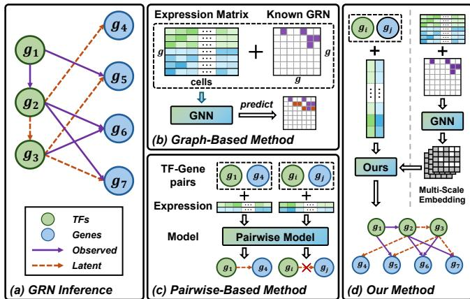
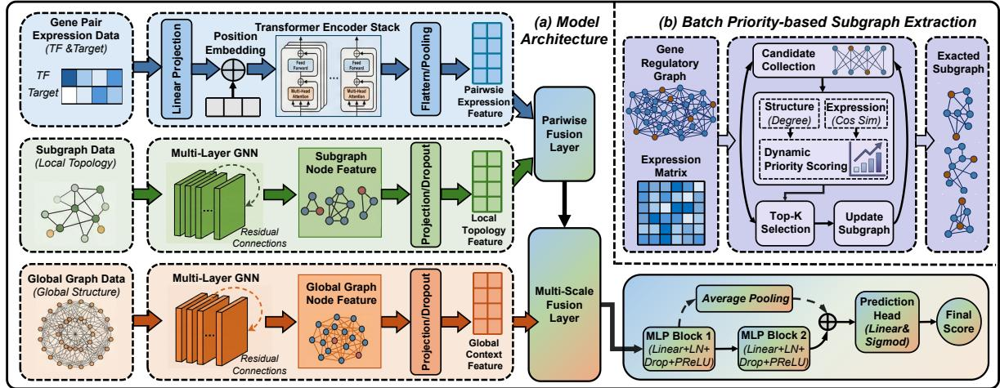
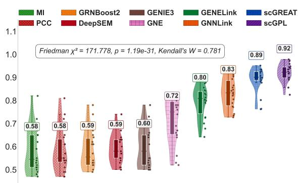
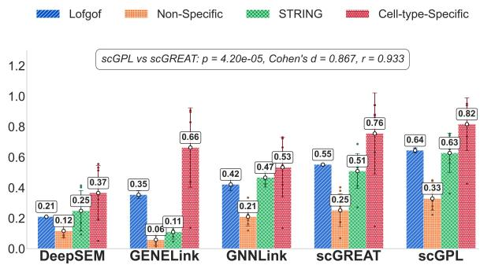
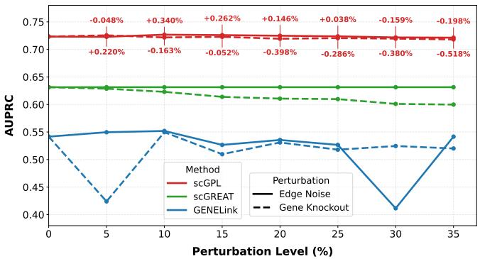
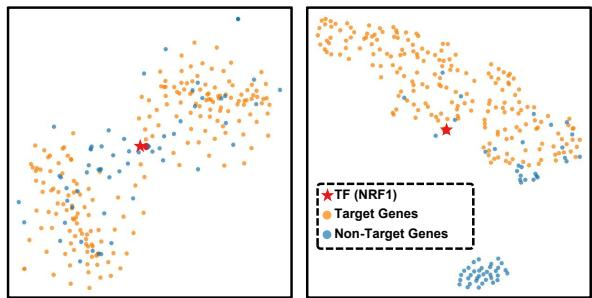
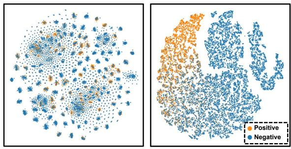
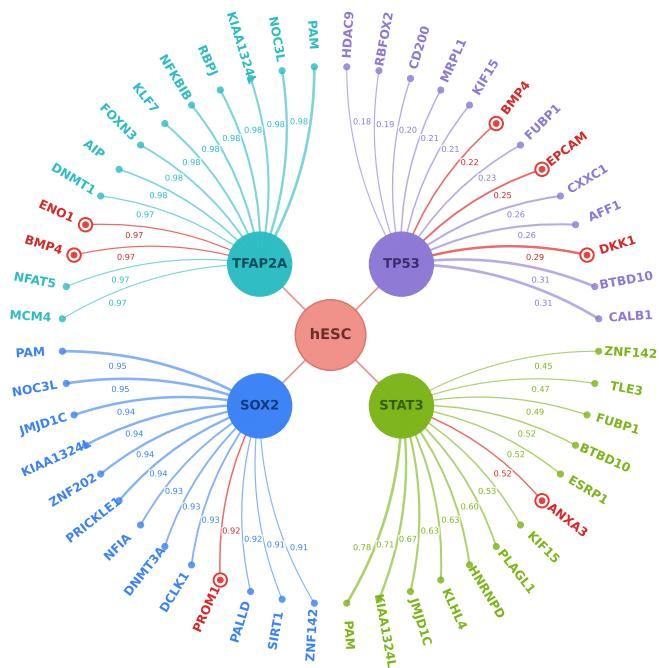

# Bridging Graph and Pairwise Learning for Gene Regulatory Network Inference from scRNA-seq Data

Hang Li,1,† Jiaxin Qi,2,† Yan Cui,1 Yuhua Zheng1 and Jianqiang Huang 1,2,∗

1Hangzhou Institute for Advanced Study, University of Chinese Academy of Sciences, Hangzhou, 310024, Zhejiang, China

2Computer Network Information Center, Chinese Academy of Sciences, Haidian, 100083, Beijing, China

†These authors contributed equally to this work.∗Corresponding author. jqhuang@cnic.cn

## Abstract

Motivation: Gene regulatory networks (GRNs) capture the underlying interactions through which transcription factors (TFs) regulate genes. Based on gene expression data, existing GRN inference approaches generally fall into two categories: graphbased methods, which model the GRN as a whole graph, and pairwise-based methods, which decompose the GRN into individual TF–target gene pairs for modeling. However, each approach exhibits limitations that are precisely the strengths of its counterpart. Graph-based methods tend to overfit due to their reliance on a single training graph, whereas pairwise-based methods benefit from abundant TF–target training pairs. In contrast, pairwise-based methods overlook the global topological structure, which is essential for comprehensively capturing regulatory mechanisms.

Results: To address these limitations, we propose scGPL, an end-to-end unified framework that jointly models global regulatory topology and local interactions. scGPL extracts macro-level features from the global regulatory graph and introduces a dynamic, importance-guided subgraph sampling mechanism to capture fine-grained local dependencies. By fusing global representations with subgraph-enhanced local features, our framework bridges the gap between the two paradigms, incorporating essential whole-graph topological dependencies while retaining the data abundance advantage of pairwise methods. Extensive experiments on seven benchmark datasets demonstrate that scGPL consistently achieves state-of-the-art performance, with up to 13.7% improvement over the strongest baseline, validating the efectiveness of our integrative design. Availability and implementation: The source code is maintained on GitHub (https://github.com/talent-hang/scGPL), and the datasets and versioned releases are archived at https://doi.org/10.5281/zenodo.21608485 for reproducibility.

## 1. Introduction

Gene regulatory networks (GRNs) describe the intricate relationships by which transcription factors (TFs) control the expression of their target genes Marbach et al. (2010). A GRN is represented as a directed graph, where nodes denote TFs or genes and edges indicate regulatory relationships. As shown in Figure 1(a), for the transcription factor $g _ { 1 }$ and gene $g _ { 5 }$ , the directed edge $g _ { 1 } ~  ~ g _ { 5 }$ suggests that higher expression of $g _ { 1 }$ leads to increased or decreased expression of $g _ { 5 }$ , reflecting the regulatory mechanism between them Hou et al. (2020). Thanks to the development of single-cell RNA sequencing (scRNA-seq), which provides high-throughput expression profiles of genes and TFs across individual cells, researchers can now investigate GRNs at single-cell resolution using single-cell expression data Xu et al. (2023). However, current scRNA-seq datasets pose two major challenges for supervised GRN inference. First, since obtaining reliable regulatory annotations relies on resourceintensive experimental validation, existing datasets often sufer from severely incomplete edge annotations Badia-i Mompe et al. (2023). Second, scRNA-seq profiles tens of thousands of genes, creating a high-dimensional search space where the millions of potential regulatory interactions vastly outnumber the available annotated training samples Sun et al. (2025). As a result, recent studies have increasingly adopted deep learning methods for GRN inference. These methods can be broadly categorized into two representative groups: graph-based methods and pairwise-based methods.

Graph-based methods, as shown in Figure 1(b), treat the GRN as a whole graph, leveraging graph neural networks (GNNs) to capture global topological relationships among TFs and genes. Specifically, GENELink Chen and Liu (2022) and GNNLink Guo et al. (2023) utilize graph attention and convolutional networks to learn gene embeddings from expression data and prior topology. Their principal strength lies in leveraging neighborhood information via message passing, which can help alleviate the impact of incomplete annotations. For example, let $g _ { 1 }$ and $g _ { 2 }$ denote two diferent TFs, and let $g _ { 3 }$ denote a target gene. If $g _ { 1 } ~  ~ g _ { 3 }$ is a known regulation, and g2 shares similar global topological features with g1, graphbased methods can potentially learn the regulation g2 → g3 even without explicit annotation. However, GNNs may obscure fine-grained local interactions due to over-smoothing during multi-hop information propagation Grønbech et al. (2020). To alleviate this issue, GRLGRN Wang et al. (2025) utilizes Graph Transformers to learn implicit regulatory connections from meta-path representations of prior edges, subsequently capturing higher-order gene embeddings. Despite such structural enhancements, these graph-based methods, typically trained on a single GRN graph, remain prone to overfitting Kipf and Welling (2017). GRNFormer Hegde and Cheng (2026) constructs a global co-expression network and extracts local subgraphs centered around individual TFs to perform link prediction within these subgraphs. While this approach helps mitigate overfitting to a single graph by decomposing it into multiple TF-centric subgraphs, its extraction strategy may overlook the pair-specific influence of intermediate regulators and fail to completely capture global graph dependencies.

  
Figure 1 Illustrations of GRN inference and related approaches. (a) GRN inference aims to leverage observed regulatory relationships (purple arrow) to predict unknown ones (orange dashed arrow). (b) Graph-based methods model the entire GRN as a graph, using observed edges (purple blocks) to predict unknown edges (orange blocks) in the adjacency matrix. (c) Pairwise-based methods decompose the GRN into individual TF–gene pairs and predict their relationships independently. (d) Our method integrates both paradigms to enable comprehensive GRN inference.

Pairwise-based methods, as shown in Figure 1(c), decompose the entire GRN into individual TF–target gene pairs and learn each regulatory interaction independently. For instance, GNE KC et al. (2019) employs multi-layer perceptrons (MLPs) to embed gene pairs, and scGREAT Wang et al. (2024) introduces a context-aware Transformer framework. By explicitly constructing a significantly larger training set of independent pairs, these methods successfully mitigate the overfitting problems inherent to graph-based methods and efectively capture fine-grained regulatory interactions Greener et al. (2022). However, by isolating gene pairs, pairwise-based methods ignore the global network structure. Consequently, they remain highly vulnerable to false negatives caused by incomplete annotations and inherently fail to capture higherorder dependencies Wang et al. (2021). To illustrate, if $g _ { 1 } $ g2 and $g _ { 2 }  g _ { 3 }$ the indirect cascade influence of $g _ { 1 }$ on g3 is not explicitly modeled by pairwise models. Ultimately, this isolated modeling paradigm hinders comprehensive network reconstruction and limits broader model applicability.

To leverage the strengths and mitigate the weaknesses of both paradigms, as shown in Figure 1(d), we propose scGPL (Bridging Graph and Pairwise Learning), an end-toend unified framework that enhances pairwise modeling with subgraph-derived topological context. scGPL employs a dualbranch architecture that synergizes global and local views. In the global branch, a graph neural network processes the entire gene expression matrix and prior network to extract macro-level gene embeddings, capturing hierarchical topological features. In the local branch, we introduce a dynamic subgraph sampling mechanism to explicitly model the neighborhood context of specific interactions. Specifically, for each candidate TF–target pair, we first initialize a local subgraph and identify a candidate frontier comprising their first-order neighbors. Through an iterative process, we calculate importance scores for frontier nodes and select the top-k most informative nodes to progressively expand the subgraph structure. This strategy ensures that critical regulatory dependencies—such as co-factors or intermediate signaling genes—are included in the local representation. Finally, scGPL fuses these subgraphenhanced local features with the global embeddings, producing unified representations that reflect both the broad regulatory topology and the fine-grained interaction context. This approach efectively bridges the gap between the two paradigms: it incorporates essential topological dependencies while retaining the data-abundance advantage of pairwise methods.

Our main contributions are summarized as follows:

• We systematically analyze the key challenges in GRN inference from scRNA-seq data and categorize existing methods into graph-based and pairwise-based paradigms, revealing their complementary strengths and limitations.

• Based on these insights, we propose scGPL, a novel unified framework that integrates global topology modeling with subgraph-enhanced local interaction learning. This design allows the model to efectively capture both local topological structures and global network information while retaining the advantage of large-scale training samples.

• Extensive experiments on seven widely used GRN benchmark datasets demonstrate that scGPL consistently outperforms state-of-the-art methods, validating the efectiveness, robustness, and scalability of our integrative design.

## 2. Method

## 2.1. Problem Formulation

GRN inference. We represent the gene regulatory network as a directed graph (G, E), where $G = \{ g _ { i } \} _ { i = 1 } ^ { n }$ denotes the set of transcription factors and target genes (i.e., the nodes), and $E = \{ ( g _ { i } , g _ { j } ) \} \subseteq G \times G$ denotes the set of regulatory interactions (i.e., the edges), where $g _ { i } \to g _ { j }$ indicates that $g _ { i }$ regulates $g _ { j }$ In practice, regulatory interactions are typically directed from TFs to their target genes; however, for notational convenience, we use g to denote both TFs and genes when no ambiguity arises Guo et al. (2023). The goal of GRN inference is to recover unknown edges from observational data.

Given single-cell RNA sequencing data from c cells, each cell contains expression values corresponding to genes in G. For cell i, its gene expression profile is represented as $v _ { i } \ = \ ( v _ { i , 1 } , v _ { i , 2 } , . . . , v _ { i , n } )$ , where $n \ = \ | G |$ . The scRNA-seq data can thus be represented as the expression matrix $X =$ $[ \boldsymbol { v } _ { i , j } ] _ { i = 1 , \dots , c } ^ { j = 1 , \dots , n } \in \mathbb { R } ^ { c \times n }$ . For modeling purposes, define $y _ { i j } \in$ $\{ 0 , 1 \}$ as the ground-truth label for the edge $( g _ { i } , g _ { j } )$ to indicate whether $g _ { i }$ regulates $g _ { j }$ , and split E into training set $E _ { \mathrm { t r } }$ and test set $E _ { \mathrm { t e } }$ . The objective for GRN inference is to minimize:

$$
\mathcal { L } _ { \mathrm { G R N } } = \sum _ { ( g _ { i } , g _ { j } ) \in E _ { \mathrm { t r } } } \mathcal { L } \left( m \left( X ; E _ { \mathrm { t r } } \right) , y _ { i j } \right) ,\tag{1}
$$

  
Figure 2 The overall framework of scGPL. (a) The model architecture. scGPL employs a dual-stream learning framework comprising a Pairwise Branch and a Global Branch for multi-view feature extraction. The Pairwise Branch integrates two parallel components: the Transformer Module (top), capturing co-expression dependencies from pairwise expression profiles, and the Subgraph Module (middle), extracting local topological features from dynamically sampled subgraphs. The Global Branch (bottom) uses a Global GNN to capture macro-level network structure context. Embeddings from both branches are hierarchically aggregated in the Multi-Scale Fusion Layer and processed by an MLPbased prediction head to infer gene regulatory links. (b) The Dynamic Subgraph Extraction module. This module constructs informative local subgraphs via a priority-based iterative expansion strategy. Starting from the initial gene pair, the module iteratively expands the subgraph by selecting top-k neighbors based on a hybrid importance score, providing inputs to the Subgraph Module.

where m is the trainable model designed to extract features and predict $y _ { i j }$ , and L denotes the corresponding loss function.

Graph-based methods regard the entire GRN as a single graph to train a GNN. Specifically, after initializing node embeddings directly from the expression matrix $( \boldsymbol { \mathrm { e } } . \boldsymbol { \mathrm { g } } . , \ e _ { k } = X _ { : , k } \in \mathbb { R } ^ { c }$ for gene $g _ { k } )$ , the GNN propagates these features along the training edges $E _ { \mathrm { t r } }$ via message passing to capture topological dependencies. However, this simultaneous computation restricts the model to a single macroscopic training graph, leading to severe overfitting. Pairwise-based methods decompose the GRN into independent TF-target pairs $( g _ { i } , g _ { j } )$ , predicting the label $y _ { i j }$ by learning a joint representation of their expression embeddings $e _ { i } = X _ { : , i }$ and $e _ { j } = X _ { : , j }$ . While generating abundant training samples efectively mitigates overfitting, this formulation entirely ignores the prior network structure $E _ { \mathrm { t r } }$ , failing to model the global information essential for complex regulatory pathways.

## 2.2. The scGPL Framework

## 2.2.1. Overview

To overcome the limitations of graph-based and pairwisebased methods, we propose scGPL, an end-to-end unified framework that seamlessly blends global regulatory topology with fine-grained local interactions. As illustrated in Figure 2, scGPL consists of three integrated components: (1) Global Branch, which extracts multi-scale topological embeddings from the entire regulatory graph to capture broad regulatory pathways; (2) Pairwise Branch, which serves as the core of our localized modeling and comprises two sub-modules: a Transformer Module for capturing non-linear co-expression dependencies, and a dynamic Subgraph Module for encoding local regulatory contexts; (3) Multi-scale Fusion Module, which hierarchically integrates these global and local biological perspectives to yield comprehensive and robust link predictions.

## 2.2.2. Global Branch

Given the training gene regulatory graph $( G , E _ { t r } )$ with $\left| G \right| = n ,$ the corresponding adjacency matrix $A _ { t r } \in \{ 0 , 1 \} ^ { n \times n }$ , and the expression matrix $\boldsymbol { X } \in \mathbb { R } ^ { c \times n }$ , we employ a multi-layer GNN to extract hierarchical graph embeddings. The message-passing process at the l-th layer $( l \geq 1 )$ is formulated as:

$$
{ \cal H } ^ { ( l ) } = m _ { g } ^ { ( l ) } \left( { \cal H } ^ { ( l - 1 ) } , { \cal A } _ { t r } \right) ,\tag{2}
$$

where $H ^ { ( 0 ) }$ represents the initial node features derived from the expression matrix X, and $H ^ { ( l ) } \in \mathbb { R } ^ { n \times d }$ denotes the node embedding matrix at the l-th layer. Specifically, d is the hidden dimension, and we use $h _ { i } ^ { ( \bar { l } ) } \in \mathbb { R } ^ { \dot { d } } \ \left( \mathfrak { i . e . } \right.$ , the i-th row of $H ^ { ( l ) } )$ to denote the hidden feature vector for the i-th gene. In practice, $m _ { g } ^ { ( l ) }$ can be implemented using standard message-passing architectures, such as GCN Kipf and Welling (2017), GraphSAGE Hamilton et al. (2017), or GAT Veliˇckovi´c et al. (2018). With increasing layer depth, the representations $H ^ { ( l ) }$ progressively aggregate broader neighborhood information, thereby capturing higher-order global regulatory interactions.

## 2.2.3. Pairwise Branch

To capture the highly specific, localized regulatory mechanisms governing individual TF–target pairs $( g _ { i } , g _ { j } )$ , we design a dualpathway branch consisting of an expression-based Transformer module and a structure-aware Subgraph module.

Transformer Module. Building upon the pairwise learning paradigm, we first extract the cell-wise expression profiles for the candidate pair, denoted as $e _ { i } ~ = ~ X _ { : , i }$ and $e _ { j } ~ = ~ X _ { : , j }$ To capture complex, non-linear co-expression patterns across the cell population, these raw features are projected via an MLP. They are then summed with learnable binary positional embeddings to explicitly distinguish their regulatory roles (i.e.,

TF versus target gene) and processed by a Transformer encoder:

$$
z _ { t r } = m _ { t r } ( e _ { i } , e _ { j } ) ,\tag{3}
$$

where $m _ { t r }$ denotes the Transformer-based encoding model, and $z _ { t r }$ represents the fine-grained co-expression features.

Subgraph Module. Gene regulation is rarely an isolated pairwise event; it frequently relies on the structural context provided by intermediate regulators or co-factors. We explicitly model these local micro-environments through a dynamic subgraph learning mechanism. Rather than relying on standard k-hop expansion, which often introduces noisy or irrelevant nodes, we adopt a priority-based subgraph expansion strategy to construct a local subgraph centered on the target pair $( g _ { i } , g _ { j } )$ . This design is motivated by the biological observation that regulatory interactions are often mediated by a subset of genes that are both topologically influential and functionally correlated.

At each expansion step, for every candidate neighbor v, we compute a hybrid importance score $S ( v )$

$$
S ( v ) = w _ { d } \cdot \underbrace { \frac { d ( v ) } { d _ { m a x } } } _ { \mathrm { \normalfont \sf { T o p o l o g y } } } + w _ { e } \cdot \underbrace { \mathrm { m a x } \left( \rho ( X _ { : , v } , X _ { : , i } ) , \rho ( X _ { : , v } , X _ { : , j } ) \right) } _ { \mathrm { \normalfont \sf E x p r e s s i o n } } ,\tag{4}
$$

where $d ( v )$ is the node degree (reflecting its potential as a regulatory hub), $d _ { m a x }$ is the maximum degree in the global graph, and $\rho ( \cdot , \cdot )$ denotes the cosine similarity between gene expression profiles. The two terms jointly capture topological importance and functional co-expression relevance, with their trade-of controlled by hyperparameters $w _ { d }$ and $w _ { e }$

Guided by this scoring mechanism, we select the top-k neighbors to construct a compact yet informative subgraph, represented by its adjacency matrix $A _ { s u b }$ and node feature matrix $X _ { s u b } .$ . A lightweight GNN, denoted as $m _ { s } ,$ , is then applied to encode this local graph, and the embeddings of the central pair are extracted to form the structural context vector:

$$
z _ { s u b } = [ m _ { s } ( X _ { s u b } , A _ { s u b } ) _ { i } \ \parallel \ m _ { s } ( X _ { s u b } , A _ { s u b } ) _ { j } ] ,\tag{5}
$$

where ∥ denotes the concatenation operation, and $m _ { s } ( \cdot ) _ { i }$ denotes extracting the vector of gene $g _ { i }$ from the GNN output.

Finally, we integrate the expression features and the structural context via a linear projection to obtain the pairwise representation for the downstream fusion stage:

$$
z _ { i j } ^ { ( 0 ) } = W _ { p } [ z _ { t r } \parallel z _ { s u b } ] + b _ { p } ,\tag{6}
$$

where $W _ { p }$ and $b _ { p }$ are learnable projection parameters.

## 2.2.4. Multi-Scale Fusion

To fully exploit both expression-level dynamics and the global topological context, we design a hierarchical fusion module that injectsthe global embeddings $h _ { i } ^ { ( l ) }$ and $h _ { j } ^ { ( l ) }$ into the local pairwise representation. Unlike static, single-step feature concatenation, this formulation enables the iterative refinement of pairwise representations conditioned on increasingly higherorder structural contexts. Starting from the initial pairwise representation, we perform the following fusion recursively:

$$
z _ { i j } ^ { ( l ) } = m _ { f } ^ { ( l ) } \left( z _ { i j } ^ { ( l - 1 ) } , [ h _ { i } ^ { ( l ) } \parallel h _ { j } ^ { ( l ) } ] \right) ,\tag{7}
$$

where $m _ { f } ^ { ( l ) }$ denotes the layer-specific fusion model, implemented as an identity mapping for direct concatenation at $l = 1$ , and as a learnable gated mechanism for adaptive integration at $l > 1$ This design reflects the hierarchical nature of gene regulation, with local interactions modulated by broader network context.

The final fused representation $\bar { z _ { i j } ^ { ( L ) } }$ is fed into a prediction head composed of MLP layers with residual connections and layer normalization for stable optimization. In this work, we instantiate the general objective $\mathcal { L } _ { \mathrm { G R N } }$ as a binary cross-entropy loss over all candidate pairs in the training set:

$$
\mathcal { L } _ { \mathrm { o u r s } } = - \sum _ { ( g _ { i } , g _ { j } ) \in E _ { \mathrm { t r } } } \left[ y _ { i j } \log \hat { y } _ { i j } + ( 1 - y _ { i j } ) \log ( 1 - \hat { y } _ { i j } ) \right] ,\tag{8}
$$

where $y _ { i j } \in \{ 0 , 1 \}$ denotes the binary ground-truth label, and $\hat { y } _ { i j } = \sigma ( \mathsf { M L P } ( z _ { i j } ^ { ( L ) } ) )$ represents the predicted probability for the regulatory interaction $( g _ { i } , g _ { j } )$ generated by the prediction head.

## 3. Experimental Setup

## 3.1. Datasets and data preprocessing

Datasets. We evaluate the performance of scGPL on seven scRNA-seq datasets curated by the BEELINE framework Pratapa et al. (2020), covering diverse human and mouse cell types: (i) human embryonic stem cells (hESC), (ii) human hepatocytes (hHEP), (iii) mouse embryonic stem cells (mESC), (iv) mouse dendritic cells (mDC), (v) mouse hematopoietic stem cells with erythroid lineage (mHSC-E), (vi) granulocyte-monocyte lineage (mHSC-GM), and (vii) lymphoid lineage (mHSC-L).

Ground-truth GRNs are provided for each dataset, integrated from multiple sources of biological evidence, including STRING functional interaction networks Szklarczyk et al. (2019), nonspecific Liu et al. (2015); Garcia-Alonso et al. (2019) and cell-type-specific ChIP-seq networks $\mathsf { X } \mathsf { u }$ et al. (2013); Moore et al. (2020), and LOF/GOF perturbation-based networks Xu et al. (2013). All datasets are publicly available from GEO: GSE75748 (hESC), GSE81252 (hHEP), GSE98664 (mESC), GSE48968 (mDC), and GSE81682 (mHSC variants). Each scRNA-seq dataset comprises a varying number of transcription factors combined with either the top 500 or 1000 highly variable genes (denoted as TFs+500 and TFs+1000).

Data Preprocessing. We follow the preprocessing and splitting protocol in Chen and Liu (2022), retaining only TF–target interactions and filtering genes by expression variance $( p < 0 . 0 1$ Bonferroni-corrected) as in Pratapa et al. (2020). Positive samples are defined as edges in the ground-truth networks, while all other TF–target pairs are treated as negative samples. Given the sparsity of true regulatory networks, negative samples vastly outnumber positives, and some may correspond to undiscovered regulations Thabtah et al. (2020). We employ a TF-wise stratified splitting strategy. For TFs with more than two positive samples, their associated pairs are partitioned into 67% training, 10% validation, and 23% testing sets, where the proportion of positives approximately matches the density of the underlying ground-truth regulatory network. Conversely, for TFs with two or fewer positive samples, their associated pairs are distributed to preserve representation: TFs with exactly two samples are evenly split between the training and testing sets, while those with a single sample are randomly assigned to either set. Crucially, edges in the test set are strictly removed from the training graph and are not accessible during subgraph construction or message passing, preventing information leakage. Detailed dataset statistics are provided in Supplementary Tables 1–2

Table 1. Performance comparison of GRN inference methods across seven datasets using cell-type-specific ChIP-seq networks. Results are reported for both $T \mathsf { F s } + 5 0 0$ and TFs+1000 settings in terms of AUROC, AUPRC, and EPR. All baseline methods were faithfully reproduced under identical experimental settings. The reported results represent the average of 20 independent runs using diferent random seeds. The best and second-best results in each row are highlighted in bold and underlined, respectively.
<table><tr><td rowspan="2">Dataset</td><td rowspan="2">Cell Type</td><td colspan="3">GNNLINK</td><td colspan="3">GENELINK</td><td colspan="3">scRegNet</td><td colspan="3">scGREAT</td><td colspan="3">scGPL</td></tr><tr><td>AUROC</td><td>AUPRC</td><td>EPR</td><td>AUROC</td><td>AUPRC</td><td>EPR</td><td>AUROC</td><td>AUPRC</td><td>EPR</td><td>AUROC</td><td>AUPRC</td><td>EPR</td><td>AUROC</td><td>AUPRC</td><td>EPR</td></tr><tr><td rowspan="8">TF+0</td><td>hESC</td><td>0.821</td><td>0.419</td><td>3.288</td><td>0.789</td><td>0.455</td><td>5.464</td><td>0.874</td><td>0.607</td><td>6.328</td><td>0.888</td><td>0.632</td><td>6.218</td><td>0.917</td><td>0.728</td><td>6.360</td></tr><tr><td>hHEP</td><td>0.741</td><td>0.546</td><td>1.832</td><td>0.845</td><td>0.707</td><td>2.434</td><td>0.896</td><td>0.833</td><td>2.839</td><td>0.909</td><td>0.856</td><td>2.828</td><td>0.925</td><td>0.875</td><td>2.842</td></tr><tr><td>mDC</td><td>0.771</td><td>0.126</td><td>3.112</td><td>0.726</td><td>0.123</td><td>3.607</td><td>0.813</td><td>0.173</td><td>5.654</td><td>0.802</td><td>0.148</td><td>3.957</td><td>0.890</td><td>0.427</td><td>11.665</td></tr><tr><td>mESC</td><td>0.774</td><td>0.542</td><td>2.956</td><td>0.878</td><td>0.747</td><td>2.820</td><td>0.924</td><td>0.855</td><td>3.318</td><td>0.935</td><td>0.877</td><td>3.318</td><td>0.945</td><td>0.891</td><td>3.318</td></tr><tr><td>mHSC-E</td><td>0.735</td><td>0.716</td><td>1.370</td><td>0.874</td><td>0.889</td><td>1.702</td><td>0.918</td><td>0.937</td><td>1.762</td><td>0.928</td><td>0.947</td><td>1.766</td><td>0.936</td><td>0.951</td><td>1.766</td></tr><tr><td>mHSC-GM</td><td>0.789</td><td>0.732</td><td>1.252</td><td>0.891</td><td>0.895</td><td>1.868</td><td>0.935</td><td>0.942</td><td>1.880</td><td>0.934</td><td>0.944</td><td>1.874</td><td>0.940</td><td>0.947</td><td>1.885</td></tr><tr><td>mHSC-L</td><td>0.727</td><td>0.654</td><td>1.214</td><td>0.829</td><td>0.826</td><td>1.950</td><td>0.884</td><td>0.883</td><td>2.018</td><td>0.881</td><td>0.885</td><td>2.033</td><td>0.899</td><td>0.898</td><td>2.033</td></tr><tr><td>Avg.</td><td>0.765</td><td>0.534</td><td>2.146</td><td>0.833</td><td>0.663</td><td>2.835</td><td>0.892</td><td>0.747</td><td>3.400</td><td>0.897</td><td>0.755</td><td>3.142</td><td>0.922</td><td>0.817</td><td>4.267</td></tr><tr><td rowspan="9">TF+00</td><td>hESC</td><td>0.818</td><td>0.393</td><td>2.180</td><td>0.823</td><td>0.483</td><td>5.108</td><td>0.881</td><td>0.620</td><td>6.345</td><td>0.890</td><td>0.641</td><td>6.493</td><td>0.931</td><td>0.786</td><td>6.542</td></tr><tr><td>hHEP</td><td>0.762</td><td>0.559</td><td>1.600</td><td>0.844</td><td>0.707</td><td>2.413</td><td>0.901</td><td>0.843</td><td>2.880</td><td>0.911</td><td>0.857</td><td>2.880</td><td>0.937</td><td>0.890</td><td>2.890</td></tr><tr><td>mDC</td><td>0.782</td><td>0.148</td><td>5.443</td><td>0.755</td><td>0.123</td><td>3.470</td><td>0.838</td><td>0.168</td><td>6.987</td><td>0.814</td><td>0.149</td><td>5.511</td><td>0.943</td><td>0.671</td><td>19.654</td></tr><tr><td>mESC</td><td>0.775</td><td>0.539</td><td>2.981</td><td>0.890</td><td>0.769</td><td>2.927</td><td>0.933</td><td>0.868</td><td>3.420</td><td>0.942</td><td>0.888</td><td>3.360</td><td>0.950</td><td>0.897</td><td>3.372</td></tr><tr><td>mHSC-E</td><td>0.770</td><td>0.737</td><td>1.505</td><td>0.895</td><td>0.906</td><td>1.785</td><td>0.940</td><td>0.951</td><td>1.788</td><td>0.942</td><td>0.956</td><td>1.807</td><td>0.950</td><td>0.959</td><td>1.807</td></tr><tr><td>mHSC-GM</td><td>0.797</td><td>0.749</td><td>1.265</td><td>0.902</td><td>0.913</td><td>1.817</td><td>0.842</td><td>0.949</td><td>1.876</td><td>0.942</td><td>0.953</td><td>1.841</td><td>0.951</td><td>0.958</td><td>1.895</td></tr><tr><td>mHSC-L</td><td>0.751</td><td>0.659</td><td>1.319</td><td>0.838</td><td>0.815</td><td>2.043</td><td>0.884</td><td>0.875</td><td>2.116</td><td>0.883</td><td>0.873</td><td>2.118</td><td>0.900</td><td>0.885</td><td>2.123</td></tr><tr><td> $\mathsf { A v g . }$ </td><td>0.779</td><td>0.541</td><td>2.328</td><td>0.850</td><td>0.674</td><td>2.795</td><td>0.888</td><td>0.753</td><td>3.630</td><td>0.903</td><td>0.760</td><td>3.430</td><td>0.937</td><td>0.864</td><td>5.469</td></tr><tr><td></td><td></td><td></td><td></td><td></td><td></td><td></td><td></td><td></td><td></td><td></td><td></td><td></td><td></td><td></td><td></td></tr></table>

## 3.2. Baselines and Evaluation Metrics

Baseline Methods. We compare scGPL against thirteen representative GRN inference methods: GENIE3 Huynh-Thu et al. (2010), mutual information-based method (MI) Song et al. (2012), GRNBoost2 Moerman et al. (2019), Pearson correlation coeficient (PCC), GNE, DeepSEM Shu et al. (2021), GENELink, GNNLink, scGREAT, as well as recent methods including scRegNet Kommu et al. (2025), GT-GRN Teji et al. (2025), GRLGRN, and GRNFormer. Among these, GENELink and GNNLink are representative graph-based methods, while GNE and scGREAT follow the pairwise learning paradigm. All models are evaluated on the same datasets and splits, with hyperparameters configured according to their original implementations when available, to ensure a fair comparison.

Evaluation Metrics. We evaluate our model using three metrics: Area Under the Precision–Recall Curve (AUPRC), Area Under the Receiver Operating Characteristic Curve (AUROC), and Early Precision Ratio (EPR). Given the severe class imbalance in GRN datasets, AUPRC serves as our primary metric owing to its sensitivity to false positives, which precisely reflects performance on sparse true edges. AUROC is utilized as a complementary measure to reflect overall ranking capability and structural robustness. Additionally, EPR measures the density ratio of true positive interactions in the top-k predictions relative to a random expectation, with $k = 1 0 0$ following Cui et al. (2025). Metric definitions are provided in Supplementary D.1.

## 3.3. Implementation Details

All models are trained on eight NVIDIA RTX 4090 GPUs. The Global Branch employs a two-layer GAT with 4 heads, projecting inputs to 512-dimensional embeddings and subsequently compressing them to 256 dimensions. Within the Pairwise Branch, the Subgraph Module similarly utilizes a two-layer GAT with 4 heads, mapping subgraph inputs to 256 dimensions followed by 128 dimensions, with the expansion weights set to $w _ { d } = 0 . 4$ and $w _ { e } = 0 . 6$ , a subgraph hop number of 2, and a maximum node capacity of 100. Meanwhile, the Transformer Module models feature interactions via a four-layer Transformer encoder with 8 attention heads and an embedding size of 1024.

Optimization is performed using the Adam optimizer with a batch size of 256, a learning rate and weight decay of $1 \times 1 0 ^ { - 5 }$ coupled with a step scheduler $( \gamma = 0 . 9 9 9$ , step size=10). The model is trained for up to 200 epochs, employing early stopping based on validation AUROC with a patience of 8 epochs. scGPL is trained in an end-to-end manner, allowing gradients to propagate simultaneously to both global and local branches. Further details on the prediction head and hyperparameters are provided in Supplementary Material Table S3.

## 4. Results

## 4.1. Performance on benchmark datasets

Overall Performance. As highlighted in Table 1, scGPL secures state-of-the-art results on all seven datasets under the cell-typespecific (hereafter referred to as Specific) networks. In terms of AUROC, scGPL achieves the highest overall average, surpassing scGREAT by 3.4% on TFs+500 and further increasing this margin to a 3.8% advantage on the larger TFs+1000 setting. This advantage is even more pronounced in AUPRC, where scGPL improves upon scGREAT by 13.7% on TFs+1000. Notably, the EPR score of scGPL achieves a nearly threefold improvement over scGREAT on the mDC dataset, which features the fewest positive samples and the sparsest network density among the Specific networks. This demonstrates a superior capability in prioritizing true regulatory links among top-ranked predictions, consistent with its robust AUPRC performance. Furthermore, while the recent subgraph-based method GRNFormer achieves highly competitive performance on these networks, particularly excelling on the mESC and mHSC-L datasets (Supplementary Table S4), scGPL still achieves higher AUROC and AUPRC by 1.2% and 1.7%, respectively.

  
Figure 3 Raincloud plots illustrating the distribution of AUROC scores on TFs+500. Each plot combines a violin density estimate to show distribution shape, a central box plot (in darker shade) indicating the median and quartiles, and jittered scatter points plotted to the right of the box plot to represent individual dataset performance.

  
Figure 4 AUPRC performance of five GRN inference methods under four networks. Each method is evaluated under four distinct ground truth networks on TFs+500: STRING (green), Non-Specific (orange), LOF/GOF (blue), and cell-type-Specific (red). Error bars denote standard deviation across diferent cell types.

Beyond the Specific networks, scGPL consistently delivers outstanding performance across all 42 evaluated benchmarks, as detailed in the heatmaps (Figures S1–S3). Figure 3 presents the AUROC distributions on TFs+500, highlighting the clear advantage of scGPL over other methods. The performance gains are especially pronounced on highly imbalanced and sparse networks, such as the STRING and Non-Specific networks (Figure 4), where scGPL achieves AUPRC improvements of approximately 23.5% and 32.0% over scGREAT, respectively. We note that the Graph Transformer-based method GRLGRN emerges as the strongest baseline on the STRING networks under the TFs+500 setting (Table S4), but scGPL maintains its superiority under both high-signal conditions and sparse networks (Figures S4–S8). Moreover, the overall AUROC and AUPRC (Figures S9–S12) confirm scGPL’s superiority, while EPR evaluations (Figures S13–S14) report average scores of 32.04 and 44.99 on TFs+500 and TFs+1000, respectively, outperforming scGREAT (28.19, 36.87) and GNNLink (25.50, 31.66). This further confirms its exceptional capacity to prioritize true positive regulatory edges across diverse networks. Statistical Significance. To rigorously assess the significance of scGPL’s performance gains, we evaluated 10 GRN inference methods on the TFs+500 datasets across 22 cell types under four types of ground-truth networks. Friedman tests reveal highly significant diferences among methods for both AUROC (annotated on Figure 3) and AUPRC $( \chi ^ { 2 } ~ = ~ 1 2 9 . 3 4 0 , ~ p ~ =$ $\phantom { + } { 6 . 3 7 } \times 1 0 ^ { - 2 3 }$ , Kendall’s $W = 0 . 5 8 8 )$ . Furthermore, Nemenyi post-hoc tests confirm that scGPL consistently ranks first and difers significantly from most baselines. To further validate these findings, we performed paired tests against the strongest baseline, scGREAT, showing that scGPL achieves significantly higher AUROC (Wilcoxon $p \approx 1 . 4 3 \times 1 0 ^ { - 6 }$ , Cohen’s d ≈ 1.08, Pearson r ≈ 0.87) and AUPRC (Figure 4), with particularly strong gains on STRING and Non-Specific networks. Additional significance test results, visualizations, and analyses are provided in the Supplementary Figures S4–S14 and Section D.2.

Table 2. Ablation study of the Pairwise branch and Global Branch in our integral design: AUPRC comparison under Specific and STRING networks on TFs+500.
<table><tr><td rowspan="2">Dataset</td><td colspan="2">Pairwise Only</td><td colspan="2">Global Only</td><td colspan="2">Both Branches</td></tr><tr><td>STRING</td><td>Specific</td><td>STRING</td><td>Specific</td><td>STRING</td><td>Specific</td></tr><tr><td>hESC</td><td>0.617</td><td>0.619</td><td>0.281</td><td>0.456</td><td>0.561</td><td>0.654</td></tr><tr><td>hHEP</td><td>0.681</td><td>0.853</td><td>0.322</td><td>0.707</td><td>0.713</td><td>0.866</td></tr><tr><td>mDC</td><td>0.747</td><td>0.136</td><td>0.431</td><td>0.123</td><td>0.712</td><td>0.453</td></tr><tr><td>mESC</td><td>0.625</td><td>0.888</td><td>0.188</td><td>0.747</td><td>0.766</td><td>0.853</td></tr><tr><td>mHSC-E</td><td>0.182</td><td>0.943</td><td>0.303</td><td>0.889</td><td>0.547</td><td>0.944</td></tr><tr><td>mHSC-GM</td><td>0.357</td><td>0.941</td><td>0.365</td><td>0.895</td><td>0.585</td><td>0.935</td></tr><tr><td>mHSC-L</td><td>0.090</td><td>0.883</td><td>0.130</td><td>0.827</td><td>0.326</td><td>0.880</td></tr><tr><td>Average</td><td>0.471</td><td>0.752</td><td>0.289</td><td>0.663</td><td>0.602</td><td>0.798</td></tr></table>

Table 3. Ablation study of the Subgraph Module in our integral design: AUPRC comparison under two networks on TFs+500.
<table><tr><td rowspan="2">Dataset</td><td colspan="2">w/o Subgraph Module</td><td colspan="2">w/ Subgraph Module (w/BFS)</td><td colspan="2">w/ Subgraph Module (w/Priority)</td></tr><tr><td>STRING</td><td>Specific</td><td>STRING</td><td>Specific</td><td>STRING</td><td>Specific</td></tr><tr><td>hESC</td><td>0.561</td><td>0.654</td><td>0.628</td><td>0.705</td><td>0.661</td><td>0.728</td></tr><tr><td>hHEP</td><td>0.713</td><td>0.866</td><td>0.717</td><td>0.872</td><td>0.730</td><td>0.875</td></tr><tr><td>mDC</td><td>0.712</td><td>0.453</td><td>0.713</td><td>0.423</td><td>0.724</td><td>0.427</td></tr><tr><td>mESC</td><td>0.766</td><td>0.853</td><td>0.749</td><td>0.880</td><td>0.766</td><td>0.891</td></tr><tr><td>mHSC-E</td><td>0.547</td><td>0.944</td><td>0.539</td><td>0.950</td><td>0.558</td><td>0.951</td></tr><tr><td>mHSC-GM</td><td>0.585</td><td>0.935</td><td>0.571</td><td>0.927</td><td>0.605</td><td>0.947</td></tr><tr><td>mHSC-L</td><td>0.326</td><td>0.880</td><td>0.342</td><td>0.898</td><td>0.354</td><td>0.898</td></tr><tr><td>Average</td><td>0.602</td><td>0.798</td><td>0.608</td><td>0.808</td><td>0.628</td><td>0.817</td></tr></table>

## 4.2. Ablation study

To elucidate the contributions of key components in $s c G P L$ , we conducted ablation using two networks with distinct densities. Dual-branch. First, we evaluate the efectiveness of the dualstream architecture by comparing three variants: (i) the Pairwise Only branch (utilizing only the Transformer), (ii) the Global Only branch (utilizing the GAT), and (iii) the integrated Dual-Branch model (combining the pairwise Transformer with the global branch). As shown in Table 2, on the relatively balanced Specific networks, the Pairwise Only branch alone performs competitively with an average AUPRC of 0.7519, surpassing the Global Only branch (0.6633). However, the integrated mode achieves a significant improvement, reaching an average AUPRC of 0.7978. On the highly imbalanced STRING networks, the advantages of the integrated model are even more pronounced, outperforming the Pairwise Only and Global Only variants by 27.7% and 108.49%, respectively. This demonstrates that global topological information provides indispensable auxiliary features, efectively correcting the limitations of a single local perspective.

Table 4. Comparison of computational eficiency across all methods on the hESC dataset under Specific on TFs+500.
<table><tr><td>Method</td><td></td><td>Time/Epoch (s) Avg Mem (MB)</td><td>Total Time</td><td>Params (M)</td></tr><tr><td>DeepSEM</td><td> $0 . 1 3 \pm 0 . 0 1$ </td><td> $7 . 0 8 \pm 0 . 0 0$ </td><td> $1 2 . 6 9 \ s$ </td><td>0.83</td></tr><tr><td>CNNC</td><td> $3 0 . 5 5 \pm 0 . 1 4$ </td><td> $1 3 0 0 . 3 1 \pm 3 . 4 8$ </td><td> $4 8 \mathrm { \ m i n \ } 7 s$ </td><td>398.22</td></tr><tr><td>GNE</td><td> $1 8 . 5 8 \pm 0 . 1 1$ </td><td> $3 2 4 . 1 6 \pm 0 . 9 8$ </td><td>23 min 39s</td><td>92.14</td></tr><tr><td>GENELink</td><td> $2 . 5 3 \pm 0 . 2 8$ </td><td> $7 8 . 0 4 \pm 0 . 1 9$ </td><td> $2 \ : \mathsf { m i n } \ : 6 \mathsf { s }$ </td><td>1.74</td></tr><tr><td>scGREAT</td><td> $4 . 8 1 \pm 0 . 8 9$ </td><td> $2 5 8 . 8 1 \pm 0 . 0 8$ </td><td>14 min 32s</td><td>20.26</td></tr><tr><td> ${ \tt s c G P L }$ </td><td> $1 4 . 9 9 \pm 6 . 2 2$ </td><td> $6 9 9 . 8 6 \pm 0 . 5 7$ </td><td>11 min 06s</td><td>50.59</td></tr></table>

Subgraph module. Next, building upon the dual-branch architecture, we evaluate the specific impact of the Subgraph Module. We treat the integrated model without subgraph input as the baseline (denoted as ”w/o Subgraph Module”) and compare it against two extraction strategies: standard BFS $( " \boldsymbol { \mathsf { w } } /$ Subgraph Module (w/BFS)”) and our proposed method (”w/ Subgraph Module $( \mathsf { w } / \mathsf { P r i o r i t y } ) ^ { \prime \prime } )$ . As presented in Table 3, the priority-based iterative expansion strategy yields the best performance. While the standard BFS ofers only marginal gains, the priority-based module achieves substantial improvements, boosting performance by 4.42% on STRING. Furthermore, to validate the design of scGPL localized context extraction, we compared our pair-specific against a TF-centric sampling strategy. As shown in Supplementary Table S6, the pair-specific strategy consistently outperforms the TF-centric method across networks with varying densities, achieving a higher average AUPRC on the STRING networks (0.628 versus 0.626) and further widening the performance gap on the Specific networks (0.817 versus 0.808). This indicates that our algorithm can efectively capture the most informative local topologies tailored to specific regulatory interactions. Additionally, evaluations across diferent GNN backbones (Supplementary Figure S15 and Section D.3) confirm that scGPL maintains competitive predictive performance regardless of the specific graph encoder variant used. Collectively, these results further confirm that both the dual-stream architecture and dynamic subgraph extraction are crucial for the superior performance of scGPL.

## 4.3. Computational Eficiency

To comprehensively evaluate the computational eficiency of scGPL, Table 4 compares its training costs against evaluated baselines. Although the per-epoch training time of scGPL is higher than that of GENELink and scGREAT, evaluating perepoch cost alone is insuficient for an end-to-end eficiency comparison, as the total epochs required for convergence significantly impact the overall cost. Ultimately, the total training time for scGPL is merely 666 seconds, which is faster than scGREAT and substantially lower than GNE and CNNC (Figure S16a, d). Figure S16b further illustrates this dynamic: scGPL converges in just 44 epochs, whereas scGREAT requires nearly 160 epochs, and GENELink stops at under 20 epochs. This rapid convergence demonstrates that scGPL successfully inherits the eficient convergence advantages of graph-based methods; despite the lower time costs of pure GNN baselines, scGPL surpasses the performance of pairwisebased methods and achieves the highest AUPRC among all models (Figure S16c). Beyond training time, we also evaluated inference latency and resource overhead. scGPL contains 50.59 million parameters, with average and peak training GPU memory consumption of 699.86 MB and 1062.57 MB, respectively, remaining lower than those of GNE and CNNC (Figure S17a, b). During the inference phase, scGPL requires a virtually negligible average time of 3.99 seconds and a memory footprint of 702.49 MB (Figure S17c, d). Although its latency and memory eficiency may be slightly inferior to the most lightweight baselines, its state-of-the-art predictive performance across all datasets fully justifies these acceptable computational trade-ofs.

## 4.4. Sensitivity and Scalability Analysis

We further conducted a hyperparameter sensitivity and scalability analysis to evaluate the impact of batch size, subgraph configuration, and the scale of genes and cells on both computational overhead and predictive performance.

Impact of Batch Size. Increasing the batch size leads to a slight degradation in validation performance and a continuous rise in peak GPU memory usage, as illustrated in Figure S18. Interestingly, training time does not scale linearly with batch size. Specifically, training times at batch sizes of 32 and 64 exceed those at 128, 256, 512, and 1024, while training throughput reaches its maximum at 128, rising below this point and decreasing above it. This phenomenon is likely attributable to the computational overhead of irregular batching with heterogeneous subgraphs (varying node counts per sample), which diminishes GPU memory access eficiency beyond the critical threshold, thereby degrading overall performance.

Impact of Subgraph Parameters. As shown in Figure S19, the maximum number of nodes per subgraph is the primary determinant of both predictive performance and computational cost, whereas the number of hops exerts a marginal efect. Increasing the subgraph size steadily improves validation performance, but at the cost of significantly higher perepoch training time and peak GPU memory. In contrast, increasing the number of hops under a fixed subgraph size yields negligible performance diferences, indicating that retaining more informative nodes is more efective than expanding the receptive field depth. A highly practical trade-of is achieved at a subgraph size of 100 with two hops, which captures over 99% of the optimal predictive performance while maintaining low time and memory overheads. For new datasets, a subgraph size of 20–30 serves as a cost-efective initial range, achieving better hardware eficiency while maintaining robust signal capture.

Impact of Gene and Cell Numbers. To evaluate the scalability of scGPL across diferent data scales, we performed controlled truncation on TFs+1000, dividing cells into four gradients (25%, 50%, 75%, and 100%) and genes into five gradients by incorporating the TFs+500 setting as an additional dimension. We observed that for the hESC dataset, as the number of genes increases, the predictive performance slightly improves on the STRING network (Figure S21a), but exhibits a modest decline on the Specific network (Figure S22a). Regarding the number of cells, performance consistently improves with increasing cell numbers across both networks, demonstrating the ability of scGPL to efectively exploit expression-derived signals (Figures S21d and S22d). In terms of computationa eficiency, both per-epoch training time and peak GPU memory usage generally rise with cell numbers, though total training time and memory costs fluctuate non-monotonically due to varying convergence epochs and subgraph extraction diferences across gene densities (Figures S21b–c, S21e–f, S22b–c, and S22e–f). Overall, these results indicate that increasing the number of cells yields consistent performance gains, whereas the impact of increasing the number of genes is closely related to network sparsity. Further analysis of computational complexity with respect to graph size is detailed in Section D.5.

  
Figure 5 AUPRC plotted against perturbation intensity for Edge Noise (solid line) and Gene Knockout (dashed line). Annotations on the scGPL curves indicate the absolute deviation from the baseline AUPRC (∆AUPRC, in percentage points), positioned above the Edge Noise trace and below the Gene Knockout trace.

## 4.5. Robustness Analysis

Given the severe noise and sparsity inherent to real-world single-cell data, we assessed how stably scGPL performs under such suboptimal conditions. To this end, we simulated perturbation scenarios of varying intensities (ranging from 0% to 35% with a 5% step size): (i) Edge Noise, which injects random false-positive regulatory links; (ii) Edge Dropout, which randomly removes existing true links to simulate incomplete prior topological knowledge; and (iii) Gene Knockout, which masks the expression profiles of specific genes to zero vectors. As depicted by the performance decay curves in Figure 5 (full results are provided in Figures S23–S25), scGPL exhibits remarkable robustness. For instance, under 30% Edge Noise, the AUPRC of scGPL decreases by merely 0.159%, significantly outperforming the baseline GENELink, which sufers a 13% decline. This demonstrates that our model efectively overcomes the performance instability typically associated with GNN models under edge dropout conditions. Similarly, in the Gene Knockout scenario, scGPL experiences only a 0.518% performance loss, which is vastly superior to the 3.16% degradation observed in scGREAT. This indicates that the dual-branch architecture compensates for missing expression signals by leveraging a broader global topological context. These findings confirm that scGPL is highly robust against both topological perturbations and expression anomalies.

## 4.6. Biological interpretability

Representation Visualization. To evaluate the representation learning capability of scGPL, we utilized t-SNE visualization to examine whether the model generates biologically meaningful and discriminative embeddings capable of distinguishing true TF-target gene pairs from non-interacting pairs. First, we analyzed the TF NRF1 in the mESC dataset under the Specific network. Embeddings derived directly from raw expression profiles exhibited substantial overlap between target and nontarget gene pairs, indicating poor separability in the original expression space. In contrast, the latent representations extracted from the penultimate layer of scGPL—which seamlessly integrate gene expression, global topologica properties, and local subgraph contexts—demonstrated distinct clustering. Specifically, NRF1 and its true target genes formed highly cohesive groups (Figure 6(a)). This significant enhancement in intra-class cohesion and inter-class separation suggests that scGPL successfully captures the synergistic regulatory mechanisms necessary for maintaining cell states. Second, when scaling this analysis globally to all TF-target gene pairs, the scGPL embeddings consistently maintained superior class separation relative to the raw input space (Figure 6(b)). Collectively, these results demonstrate that scGPL efectively transforms high-dimensional, sparse singlecell expression data into a robust feature space enriched with regulatory semantics. Additional TF-specific case studies and global embedding visualizations across other datasets are provided in Supplementary Figure S26–S31.

  
(a) TF-NRF1 t-SNE Visualization of Input and Output Embeddings

  
(b) Comprehensive t-SNE Comparison of All TF-TG Interactions  
Figure 6 t-SNE visualization of transcription factor-target gene interactions. (a) Local view of TF NRF1 with target and nontarget genes using raw input features (left) versus penultimate layer embeddings (right). (b) Global view of all TF-target pairs using raw input features (left) versus penultimate layer embeddings (right).

Case Study. While benchmark metrics efectively evaluate a model’s ability to recover documented regulatory interactions, they are inherently limited by the incompleteness of current GRN annotations. A practical GRN inference framework should therefore not only reproduce known regulatory relationships but also provide biologically meaningful hypotheses beyond existing databases. To investigate this capability, we analyzed the topranked, high-confidence predictions generated by scGPL that were absent from the benchmark ground-truth networks. Rather than dismissing these unannotated predictions as incorrect, we systematically examined them as potential missing regulatory relationships to determine whether our model could recover biologically plausible associations beyond current annotations.

  
Figure 7 Visualization of the predicted regulatory network on the hESC dataset under the Specific network on TFs+500. Central, intermediate, and outer nodes represent the dataset, TFs, and predicted target genes, respectively. Literature-supported targets are highlighted in red, with prediction scores annotated on the edges.

As illustrated in Figure 7, we selected four representative genes from the hESC dataset under the Specific network and constructed localized GRN subnetworks using their top-13 predicted TF–target pairs ranked by model confidence scores. For example, scGPL identified the TP53 → EPCAM regulatory interaction, which has been experimentally validated by chromatin immunoprecipitation and functional perturbation studies demonstrating direct TP53-mediated regulation of EPCAM during cancer progression Sankpal et al. (2009). In addition, the predicted TP53 → DKK1 and TP53 → BMP4 associations are consistent with reported TP53- associated transcriptional programs involved in Wnt signaling modulation, epithelial diferentiation, and developmental regulation Huang et al. (2023). scGPL also predicted the STAT3 → ANXA3 regulatory link, consistent with experimental evidence showing that STAT3 signaling directly induces ANXA3 expression and contributes to inflammation and keratinocyte hyperproliferation in psoriasis Li et al. (2025). Similarly, scGPL predicted the TFAP2A regulates ENO1 and BMP4. Recent studies have demonstrated that TFAP2A cooperates with HIF-1α to transcriptionally activate ENO1 under hypoxic conditions Kanoura et al. (2025), while independent evidence has linked TFAP2A to chromatin-mediated regulation of BMP4, contributing to angiogenesis and therapeutic resistance Zhang et al. (2020). In addition, scGPL predicted the SOX2 → PROM1 regulatory link, which is supported by genome-wide CRISPR-Cas9 screening demonstrating that SOX2 directly regulates PROM1 by binding its promoter and first intron, thereby maintaining CD133 expression and stem cell selfrenewal capacity Savage et al. (2025). Collectively, these findings indicate that scGPL can generalize beyond existing GRN annotations to prioritize biologically meaningful regulatory relationships for downstream experimental validation. Further case studies and network visualizations are provided in Supplementary Section D.7 and Figures S32–S34.

## 5. Discussion

In recent years, GRN inference has evolved beyond conventional GNNs toward more expressive graph representation learning frameworks. While GRLGRN captures local signals from metapath representations, and GT-GRN integrate multimodal gene embeddings, these approaches still primarily train and operate on a single global graph. GRNFormer cleverly addresses this limitation by deconstructing the network into multiple TFcentric subgraphs, though it does not explicitly model the localized context for individual TF-target pairs. In contrast, scGPL adaptively extracts multi-hop neighborhood contexts via dynamic subgraph sampling, uniquely preserving hierarchical structures, pairwise regulatory signals, and holistic topology simultaneously. Furthermore, scGPL flexibly adapts to varying levels of network availability by treating existing interactions as incomplete structural priors, naturally shifting toward expression-based pairwise representations when topologica information is severely limited. This synergistic design prevents the model from merely memorizing specific training topologies, empowering scGPL to generalize learned regulatory rules to completely unseen cell types (Supplementary Table S5). Finally, scGPL ensures robust scalability across diverse graph sizes and topological characteristics, as its global message-passing and pair-specific Transformer modules dynamically adapt to varying node counts without relying on fixed global dimensions.

Limitations. While scGPL demonstrates highly competitive predictive capabilities, it still entails several practical limitations. The dynamic subgraph sampling strategy introduces additional computational overhead compared with pairwise or graph-based methods, particularly when applied to extremely large candidate interaction spaces. In addition, its global branch and subgraph modules still rely on the availability of some prior regulatory interactions to provide baseline structural context. Similar to most existing GRN inference methods, current evaluations are primarily conducted under dataset-specific training and testing settings rather than strict zero-shot cross-dataset generalization. Therefore, predicting regulatory interactions involving unseen genes or transferring knowledge across distinct biological systems remains an important open challenge.

## 6. Conclusion

We propose scGPL, an end-to-end unified framework that synergizes macro-level global topology with fine-grained local interactions via a dynamic subgraph sampling mechanism. By bridging graph-based and pairwise-based paradigms, scGPL leverages data abundance to efectively alleviate sample scarcity and overfitting, thereby consistently outperforming state-ofthe-art methods across diverse datasets. Future work aims to extend this framework by integrating multi-omics modalities (e.g., paired scRNA-seq and scATAC-seq) and leveraging the representational power of large-scale single-cell foundation models. By integrating these multi-modal features through innovative architecture, we anticipate further enhancing the scalability and generalization of our model, ultimately achieving robust zero-shot cross-dataset and cross-species transferability.

## Funding

This work was supported by the Strategic Priority Research Program of the Chinese Academy of Sciences under Grant No. XDA0460205.

## Data Availability

scGPL is available on GitHub (https://github.com/talen t-hang/scGPL); the version used in this work is archived on Zenodo (https://doi.org/10.5281/zenodo.21608485), with evaluation resources for reproducibility.

## Conflict of Interest

None declared.

## References

P. Badia-i Mompel, L. Wessels, S. M¨uller-Dott, R. Trimbour, R. O. Ramirez Flores, R. Argelaguet, and J. Saez-Rodriguez. Gene regulatory network inference in the era of single-cell multi-omics. Nature Reviews Genetics, 24(11):739–754, 2023. doi: 10.1038/s41576-023-00618-5.

G. Chen and Z.-P. Liu. Graph attention network for link prediction of gene regulations from single-cell RNAsequencing data. Bioinformatics, 38(19):4522–4529, 2022. doi: 10.1093/bioinformatics/btac569.

T. Cui, S.-J. Xu, A. Moskalev, S. Li, T. Mansi, M. Prakash, and R. Liao. InfoSEM: A deep generative model with informative priors for gene regulatory network inference. In Proceedings of the 42nd International Conference on Machine Learning (ICML). PMLR, 2025.

L. Garcia-Alonso, C. H. Holland, M. M. Ibrahim, D. Turei, and J. Saez-Rodriguez. Benchmark and integration of resources for the estimation of human transcription factor activities. Genome Research, 29(8):1363–1375, 2019. doi: 10.1101/gr .240663.118.

J. G. Greener, S. M. Kandathil, L. Mofat, and D. T. Jones. A guide to machine learning for biologists. Nature Reviews Molecular Cell Biology, 23:40–55, 2022. doi: 10.1038/s415 80-021-00407-0.

C. H. Grønbech, M. F. Vording, P. N. Timshe, C. K. Sønderby, T. H. Pers, and O. Winther. scVAE: Variational auto-encoders for single-cell gene expression data. Bioinformatics, 36:4415– 4422, 2020. doi: 10.1093/bioinformatics/btaa293.

M. Guo, Z. Pang, K. Zuo, Q. Wang, X. Pei, X. Chen, and J. Liu. Predicting gene regulatory links from single-cell RNA-seq data using graph neural networks. Briefings in Bioinformatics, 24 (6):bbad414, nov 2023. doi: 10.1093/bib/bbad414.

W. L. Hamilton, R. Ying, and J. Leskovec. Inductive representation learning on large graphs. In Proceedings of the 31st International Conference on Neural Information

Processing Systems (NIPS), pages 1025–1035, Red Hook, NY, USA, 2017. Curran Associates Inc.

A. Hegde and J. Cheng. GRNFormer: accurate gene regulatory network inference using graph transformer. Bioinformatics, 42(4):btag144, Apr. 2026. ISSN 1367-4803. doi: 10.1093/bi oinformatics/btag144.

W. Hou, Z. Ji, H. Ji, and S. C. Hicks. A systematic evaluation of single-cell RNA-sequencing imputation methods. Genome Biology, 21(1):1–14, 2020. doi: 10.1186/s13059-020-02137 -w.

J. Huang, W. Zheng, P. Zhang, Q. Lin, Z. Chen, J. Xuan, C. Liu, D. Wu, Q. Huang, L. Zheng, J.-H. Yang, and L.- H. Qu. ChIPBase v3.0: the encyclopedia of transcriptional regulations of non-coding RNAs and protein-coding genes. Nucleic Acids Research, 51(D1):D46–D56, 2023. doi: 10.109 3/nar/gkac1067.

V. A. Huynh-Thu, A. Irrthum, L. Wehenkel, and P. Geurts. Inferring regulatory networks from expression data using treebased methods. PLOS ONE, 5(9):e12776, 2010. doi: 10.137 1/journal.pone.0012776.

A. Kanoura, A. Giakountis, C. Filippopoulou, A. Karagiota, G. Stamatakis, M. Samiotaki, G. Panayotou, G. Simos, and G. Chachami. Interaction of TFAP2A with the Ku70/80 complex is crucial for HIF-dependent activation of hypoxiainducible genes. The FEBS Journal, 292(16):4333–4352, 2025. doi: 10.1111/febs.70025.

K. KC, R. Li, F. Cui, Q. Zou, and R. Sengupta. GNE: A deep learning framework for gene network inference by aggregating biological information. BMC Systems Biology, 13(Suppl 2): 38, 2019. doi: 10.1186/s12918-019-0694-y.

T. N. Kipf and M. Welling. Semi-supervised classification with graph convolutional networks. In International Conference on Learning Representations (ICLR), 2017.

S. Kommu, Y. Wang, Y. Wang, and X. Wang. Prediction of gene regulatory connections with joint single-cell foundation models and graph-based learning. Bioinformatics, 41 (Supplement1):i619–i627, jul 2025. doi: 10.1093/bioinfor matics/btaf217.

J. Li, F. Ren, H. Yuan, and W. Yan. Knockdown of ANXA3 regulates NF-κB/STAT3 pathway to alleviate inflammation and hyperproliferation in psoriasis models. Allergologia et Immunopathologia, 53(2):32–41, 2025. ISSN 0301-0546. doi: 10.15586/aei.v53i2.1260.

Z.-P. Liu, C. Wu, H. Miao, and H. Wu. RegNetwork: an integrated database of transcriptional and post-transcriptional regulatory networks in human and mouse. Database, 2015: bav095, 2015. doi: 10.1093/database/bav095.

D. Marbach, R. J. Prill, T. Schafter, C. Mattiussi, D. Floreano, and G. Stolovitzky. Revealing strengths and weaknesses of methods for gene network inference. Proceedings of the National Academy of Sciences, 107(14):6286–6291, 2010. doi: 10.1073/pnas.0913357107.

T. Moerman, S. Aibar Santos, C. Bravo Gonz´alez-Blas, J. Simm, Y. Moreau, J. Aerts, and S. Aerts. GRNBoost2 and Arboreto: eficient and scalable inference of gene regulatory networks. Bioinformatics, 35(12):2159–2161, 2019. doi: 10.1093/bioi nformatics/btz016.

J. E. Moore, M. J. Purcaro, H. E. Pratt, C. B. Epstein, N. Shoresh, J. Adrian, T. Kawli, C. A. Davis, A. Dobin, R. Kaul, J. Halow, E. L. Van Nostrand, P. Freese, D. Y.

Ganjushkina, K. R. Boldt, and Z. Weng. Expanded encyclopaedias of DNA elements in the human and mouse genomes. Nature, 583(7818):699–710, 2020. doi: 10.1038/ s41586-020-2493-4.

A. Pratapa, A. P. Jalihal, J. N. Law, A. Bharadwaj, and T. M. Murali. Benchmarking algorithms for gene regulatory network inference from single-cell transcriptomic data. Nature Methods, 17(2):147–154, 2020. doi: 10.1038/s41592-019-0 690-6.

N. V. Sankpal, M. W. Willman, T. P. Fleming, J. D. Mayfield, and W. E. Gillanders. Transcriptional repression of epithelial cell adhesion molecule contributes to p53 control of breast cancer invasion. Cancer Research, 69(3):753–757, 2009. doi: 10.1158/0008-5472.CAN-08-2708.

N. Savage, E. Danis, C. R. Chokshi, S. Custers, M. V. Shaikh, P. Miletic, C. Venugopal, K. R. Brown, R. Vibhakar, J. Mofat, and S. K. Singh. CRISPR screen reveals SOX2 as a critical regulator of CD133 and cellular stress response in glioblastoma. Scientific Reports, 15(1):36228, 2025. doi: 10.1038/s41598-025-20183-7.

H. Shu, J. Zhou, Q. Lian, H. Li, D. Zhao, J. Zeng, and J. Li. Modeling gene regulatory networks using neural network architectures. Nature Computational Science, 1:491–501, 2021. doi: 10.1038/s43588-021-00099-8.

L. Song, P. Langfelder, and S. Horvath. Comparison of coexpression measures: mutual information, correlation, and model based indices. BMC Bioinformatics, 13:1–21, 2012. doi: 10.1186/1471-2105-13-328.

F. Sun, H. Li, D. Sun, S. Fu, L. Gu, X. Shao, Q. Wang, X. Dong, B. Duan, F. Xing, J. Wu, M. Xiao, F. Zhao, J. J. Han, Q. Liu, X. Fan, C. Li, C. Wang, and T. Shi. Single-cell omics: experimental workflow, data analyses and applications. Science China Life Sciences, 68(1):5–102, jan 2025. doi: 10.1007/s11427-023-2561-0.

D. Szklarczyk, A. L. Gable, D. Lyon, A. Junge, S. Wyder, J. Huerta-Cepas, M. Simonovic, N. T. Doncheva, J. H. Morris, P. Bork, L. J. Jensen, and C. von Mering. STRING v11: protein–protein association networks with increased coverage, supporting functional discovery in genome-wide experimental datasets. Nucleic Acids Research, 47(D1): D607–D613, 2019. doi: 10.1093/nar/gky1131.

B. Teji, S. Roy, D. Bhandari, and J. Kalita. GT-GRN: a graph transformer framework for enhanced gene regulatory network inference via multimodal embedding of expression data and existing network knowledge. Briefings in Bioinformatics, 26 (6):bbaf584, nov 2025. doi: 10.1093/bib/bbaf584.

F. Thabtah, S. Hammoud, F. Kamalov, and A. Gonsalves. Data imbalance in classification: Experimental evaluation. Information Sciences, 513:429–441, 2020. doi: 10.1016/j. ins.2019.10.049.

P. Veliˇckovi´c, G. Cucurull, A. Casanova, A. Romero, P. Li\`o, and Y. Bengio. Graph attention networks. In International Conference on Learning Representations (ICLR), 2018.

J. Wang, A. Ma, Y. Chang, J. Xu, Y. Fu, C. Wang, R. Qi, Z. Zhang, and Q. Ma. scGNN is a novel graph neural network framework for single-cell RNA-Seq analyses. Nature Communications, 12:1882, 2021. doi: 10.1038/s41467-021-2 2197-x.

K. Wang, Y. Li, F. Liu, X. Luan, X. Wang, and J. Zhou. GRLGRN: Graph representation-based learning to infer gene

regulatory networks from single-cell RNA-Seq data. BMC Bioinformatics, 26(1):108, 2025. doi: 10.1186/s12859-025-0 6116-1.

Y. Wang, X. Chen, Z. Zheng, L. Huang, W. Ye, F. Wang, Z. Zhang, and K.-C. Wong. scGREAT: Transformer-based deep-language model for gene regulatory network inference from single-cell transcriptomics. iScience, 27(4):109532, 2024. doi: 10.1016/j.isci.2024.109532.

H. Xu, C. Baroukh, R. Dannenfelser, E. Y. Chen, C. M. Tan, Y. Kou, Y. E. Kim, I. R. Lemischka, and A. Ma’ayan. ESCAPE: database for integrating high-content published data collected from human and mouse embryonic stem cells. Database, 2013:bat045, 2013. doi: 10.1093/database/bat04 5.

J. Xu, A. Zhang, F. Liu, and X. Zhang. STGRNS: an interpretable transformer-based method for inferring gene regulatory networks from single-cell transcriptomic data. Bioinformatics, 39(4):btad165, 2023. doi: 10.1093/bioinf ormatics/btad165.

L.-l. Zhang, J. Lu, R.-Q. Liu, M.-J. Hu, Y.-M. Zhao, S. Tan, S.- Y. Wang, B. Zhang, W. Nie, Y. Dong, H. Zhong, W. Zhang, X.-D. Zhao, and B.-H. Han. Chromatin accessibility analysis reveals that TFAP2A promotes angiogenesis in acquired resistance to anlotinib in lung cancer cells. Acta Pharmacologica Sinica, 41(10):1357–1365, 2020. doi: 10.103 8/s41401-020-0421-7.