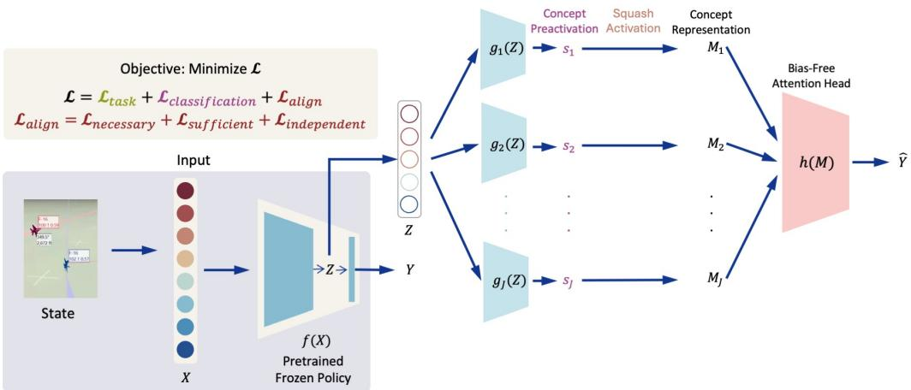
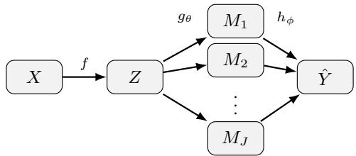

# Causal Concept Explanations for Deep Neural Models

Josh Rountree1, Pulkit Verma2, Oswin So3, Chuchu Fan3, Julie A. Shah1

1Computer Science and Artificial Intelligence Laboratory, MIT 2Indian Institute of Technology Madras 3Laboratory for Information and Decision Systems, MIT

{rountree, oswinso, chuchu}@mit.edu, pulkitv@cse.iitm.ac.in, julie\_a\_shah@csail.mit.edu

## Abstract

Concept-based explanations in neural models are important for the development, certification, and adoption of autonomous systems. Yet, interpretability remains correlational. Without methods to guide and quantify causal relationships between explanations, a concept explanation can be provided without being necessary or sufficient for the observed output thereby appearing correct while misleading. We introduce Causal Concept Wrapper Network (CCW-Net), the first use of interventional mediation analysis from fields such as economics, medicine, and epidemiology as a training objective to align causal effects of concept-based explanations with a model’s output. We further apply mediation analysis as an evaluation tool to quantify, per concept label combination, how much of any model’s output is causally attributable to each concept explanation. As a training objective, CCW-Net shapes a model’s concept representations such that they are both necessary and sufficient for the outputs they are credited with and independent of other concepts’ contributions. Counterfactual concept representations anchor a set of causal alignment criteria: necessity, sufficiency, and independence. Necessity drives irrelevant concept effects toward zero, sufficiency ensures relevant concept representations fully reconstruct a model’s output, and independence enforces the total effect decomposes linearly across concepts. We evaluate CCW-Net across aircraft control, driving, and image classification. CCW-Net provides a step toward concept-based explanations that are not merely interpretable, but quantifiably causal, supporting safer evaluation, certification, and deployment of transparent and trustworthy neural models.

## 1 Introduction

Learned policies in autonomous systems are moving from research labs into high-stakes, real-world settings such as aviation [Pope et al., 2023, Ward, 2023], driving [Phan-Minh et al., 2023], and robotics [Tang et al., 2025]. This is also the case for perception models in safety-relevant settings such as medical imaging. In task and safety-critical domains such as these, interpretability is becoming a necessary component [Rudin, 2019, Atakishiyev et al., 2025]. Developers need it to troubleshoot [Kenny et al., 2026], testers need it to verify [Rountree et al., 2021, Mahmud et al., 2024], and users need it to understand [Sanneman and Shah, 2022]. Yet many neural models remain black boxes: they are not interpretable in a way that is useful for people in the task at hand.

Concept-based interpretability offers promise by structuring decisions through human-interpretable concepts [Koh et al., 2020, Echterhoff et al., 2024]. However, the link between concepts and outputs is typically correlational, not causal. A concept can activate alongside an output without being in the causal chain [Zhou et al., 2022]. An autonomous vehicle policy might activate a “passenger pickup” concept that has no causal bearing on the observed action. A bird classifier may activate “has red plumage” on every image of a cardinal while its prediction is actually driven by “has crest”. The explanation appears correct but may mislead. To be useful for troubleshooting, certifying, and auditing, explanations must capture causal effects, i.e., the contribution of each concept to the output, isolated from concepts it co-occurs with [Pearl, 2012]. Correlation, no matter how sophisticated, does not address such causal questions [Pearl, 2009]. For safety and task-critical deployment we must transition from correlation to causation.

Beyond quantifying causal effects, some concept representations themselves limit what explanations can convey. Prior work typically represents concepts as scalars [Madumal et al., 2020, Koh et al., 2020, Kenny et al., 2026], e.g., a “left turn” in driving or a “has yellow belly” attribute in bird classification. Scalars indicate the presence or strength of a concept but cannot capture their higher-dimensional, context-dependent expressions. We extend concept representations from scalars to vectors, enabling each concept to encode both whether it exists and how it is expressed.

We address these challenges with Causal Concept Wrapper Network (CCW-Net), the first use of mediation analysis as a training objective in deep networks. CCW-Net introduces a network architecture and adapts interventional multi-mediator mediation analysis from economics and epidemiology [Vansteelandt and Daniel, 2017, Loh et al., 2022, Celli, 2022, Lee et al., 2021] to shape a model’s concept representations so that each concept’s contribution to the output is locally necessary, sufficient, and independent of contributions from other concepts. Counterfactuals required by these criteria are drawn from a mediator model (in our experiments, a per-concept invertible flow) trained alongside the overall model to track the conditional distribution of its concept embeddings. We further apply mediation analysis as an evaluation tool, quantifying, for each concept label combination, the share of a model’s output causally attributable to each concept. This is finer-grained than the population-level alignment scores reported in prior concept-based work. We evaluate CCW-Net across aircraft control, driving, and fine-grained image classification, demonstrating that mediation-trained concepts produce explanations that are not merely interpretable, but quantifiably causal.

Main contributions. Our contributions are threefold:

1. Training objective for causal concepts in deep networks: An interventional mediation analysis based objective that shapes each concept’s causal effect on a model’s output so that activated concepts are those causing the output thereby improving explanation trustworthiness.

2. Network architecture for concept-level mediation analysis: A network architecture that drives absent concept representations toward zero supporting well-defined interventional mediation analyses and related training objectives (App. C.1).

3. Evaluation method for concept-based causality claims: For any concept-bottleneck model, a method to quantify, for each concept label combination, how much a change in the model’s output is causally attributable to each concept (App. F).

## 2 Related work

Concept-based explanations. Concept-based interpretability is widely explored [Kim et al., 2018, Alvarez-Melis and Jaakkola, 2018, Koh et al., 2020, Bai et al., 2023, Achtibat et al., 2023, Tan et al., 2024]. Concept Bottleneck Models [Koh et al., 2020] and adaptations to sequential decisionmaking [Kenny et al., 2023, 2026, Delfosse et al., 2024, Das et al., 2023] structure decisions through human-interpretable concepts but typically lack formal causal analysis.

Causal mediation analysis. Causal mediation analysis models systems as directed acyclic graphs and decomposes an input’s effect on an outcome into pathways through intermediate variables called mediators. Foundational tools have been developed in economics, medicine, and epidemiology [MacKinnon, 2008, Imai et al., 2010, VanderWeele, 2015, Pearl, 2012, Celli, 2022, Lee et al., 2021]. Multi-mediator extensions [Vansteelandt and Daniel, 2017, Loh et al., 2022] decompose total effects across multiple mediators without requiring causal ordering or independence assumptions among them, with indirect effects quantifying how much of an effect operates through a specific mediator. These tools are designed to estimate causal effects from observational data under strict assumptions (App. D), but to date have been applied to analyze causal relationships in data collected outside randomized controlled trials or trained models post-hoc, not as training objectives that shape deep networks’ representations during learning.

Causal and disentanglement-based explanations for deep networks. A growing body of work applies causal frameworks to trained deep networks. Vig et al. [2020] applied mediation analysis post hoc to study bias in transformer language models, treating individual neurons and attention heads as mediators. Geiger et al. [2021, 2025] formalize causal abstraction as a way to validate that a trained network implements a higher-level causal model. In concept-based interpretability specifically, recent work imposes or discovers causal structure over learned concepts [De Felice et al., 2025, Dominici et al., 2025a, Qian et al., 2024]. Disentanglement methods like β-TCVAE [Chen et al., 2018] and iVAE [Khemakhem et al., 2020] learn factorized representations evaluated by DCI [Eastwood and Williams, 2018] and FactorVAE score [Kim and Mnih, 2018]. Across these methods, causal or representational analysis is applied post hoc to a model trained with conventional objectives, and disentanglement is a representational property that need not imply causal alignment [Schölkopf et al., 2021]. CCW-Net differs in that causal relationships between concept representations and model outputs are shaped during training rather than audited post-hoc.

Feature attribution. Saliency-based [Simonyan et al., 2014, Selvaraju et al., 2017, Smilkov et al., 2017, Sundararajan et al., 2017] and perturbation-based [Ribeiro et al., 2016, Lundberg and Lee, 2017] attribution methods explain decisions by associating inputs or features to outputs. While useful for highlighting what features a model’s outputs correspond to, these methods generally remain correlational. Ablating a feature changes a prediction without establishing causal responsibility [Adebayo et al., 2018, Zhou et al., 2022]. CCW-Net grounds causal attribution in interventional indirect effect estimates, yielding per-concept attributions with quantifiable causal estimates.

## 3 Problem formulation and preliminaries

We seek to train an interpretable policy that achieves expert-level task performance, provides conceptbased explanations for its predicted outputs $\hat { Y }$ , and ensures concept–output relationships reflect causal effects rather than spurious correlations. We assume access to a frozen pretrained backbone $f$ that achieves good task performance but lacks interpretability, and a dataset $\mathbf { \bar { \mathcal { D } } } = \{ ( X _ { i } , Y _ { i } , c _ { i } ) \} _ { i = 1 } ^ { N ^ { \circ } }$ where $X _ { i } \in { \mathcal { X } }$ is an input, $Y _ { i } \in \mathcal { V }$ is the expert output, and $c _ { i } \in \{ 0 , 1 \} ^ { J }$ is a vector of J humaninterpretable concept labels. We assume the concept ontology captures the key factors driving the model’s outputs, the dataset provides sufficient ground truth, and standard ignorability conditions hold for the induced concept-to-output structural causal model (App. D). We jointly optimize task fidelity, concept correctness, and causal alignment (Sec. 4), with concept–output causal relationships quantified in evaluation.

Structural causal models. A structural causal model (SCM) [Pearl, 2009, Peters et al., 2017] consists of equations $X _ { i } = k _ { i } ( \mathrm { p a } _ { i } , u _ { i } )$ where each equation represents a mechanism determining exactly one variable, with $u _ { i }$ the exogenous error term and $\mathrm { p a } _ { i }$ the endogenous parent variables that directly cause $X _ { i }$

Interventional mediation analysis. Mediation analysis [Pearl, 2012] decomposes the causal effect of a treatment on an outcome $\dot { Y }$ into pathways that operate through variables called mediators M. For mediators $M = ( M _ { 1 } , \dots , M _ { J } )$ , the total effect TE decomposes as $\mathrm { T E } = \mathrm { D E } + \mathrm { I E }$ into direct effect (DE) and indirect effect (IE) components. With multiple mediators, the indirect effect further decomposes per mediator $j$ as $\mathrm { I E } = \textstyle \sum _ { j } ^ { \cdot } \mathrm { I E } _ { j }$ . Following Loh et al. [2022], we relax the assumption of causal ordering or independence among mediators by introducing a residual interaction term $\operatorname { I E } _ { \mu }$ yielding $\mathrm { T E } = \textstyle \mathbf { \bar { D E } } + \sum _ { i } ^ { } \mathrm { \bar { I E } } _ { j } + \mathrm { I E } _ { \mu }$ . This relaxation is important for deep networks where operations like softmax and cross-attention induce dependencies among concept activations, which $\operatorname { I E } _ { \mu }$ absorbs without violating identifiability. The interventional indirect effect $\operatorname { I E } _ { j }$ [Vansteelandt and Daniel, 2017] quantifies how much of the total effect operates through mediator $j$ when its representation $M _ { j }$ is set to a counterfactual value while other mediator representations are held fixed. These quantities are identifiable from observational data under standard ignorability conditions [VanderWeele, 2015, Vansteelandt and Daniel, 2017, Loh et al., 2022], which hold by construction in the wrapper SCM (App. D).

  
Figure 1: CCW-Net architecture. A concept encoder $g _ { \theta }$ maps the frozen backbone’s latent $Z$ to one squashed vector $M _ { j }$ per concept, whose length encodes the concept’s presence and whose direction encodes its context-dependent expression, and a bias-free attention head $h _ { \phi }$ maps M to the wrapper output $\hat { Y }$ . Causal alignment losses (weights and the auxiliary presence term omitted) are added to the task and concept losses, so that training shapes, and evaluation measures, how much each concept causally drives $\hat { Y }$

## 4 Causal Concept Wrapper Network (CCW-Net)

CCW-Net wraps a frozen backbone policy with a concept encoder and new policy head which are trained to imitate the backbone’s task performance as well as classify human-interpretable concepts similar to Kenny et al. [2026] but using a different architecture. In addition, training involves three causal alignment criteria to induce causal relationships between concepts and outputs: necessity, sufficiency, and independence. These criteria are then evaluated via interventional mediation analysis on the wrapper’s outputs. Each causal alignment loss compares the head’s output before and after one change of a training input’s resulting concept $j ^ { \prime } { \bf s }$ representation. In mediation analysis terms, the concept representations are mediators and the policy head is the outcome model. Every effect discussed is the model’s own concept-to-output effect within the wrapper architecture’s SCM, not a claim about inputs or observations to output effects. For our experiments, counterfactual concept representations required by the necessity alignment term are drawn from a per-concept invertible flow trained on the wrapper’s encoder concepts. Any suitable modeling approach may be used. Reported evaluation metrics are produced from a separate estimator that does not use the mediator model.

## 4.1 Architecture

Given a frozen pretrained backbone $f : \mathcal { X } \to \mathcal { Z }$ where $\mathcal { Z }$ is the frozen backbone’s last latent layer, a concept encoder $g _ { \theta } : \mathcal { Z }  \mathbb { R } ^ { J \times D }$ maps $Z = f ( X )$ ) to a concept representation $M = ( M _ { 1 } , \dots , { \overset { } { M } } _ { J } )$ Each $\mathbf { \dot { \boldsymbol { M } } } _ { j } \in \mathbb { R } ^ { D }$ represents the j-th human-interpretable concept. An attention head $h _ { \phi } : \mathbb { R } ^ { J \times D }  \mathcal { V }$ maps the concept representation to a wrapper output $\hat { Y } ~ = ~ h _ { \phi } ( M )$ The wrapper induces the SCM $X  Z  M  { \hat { Y } }$ with no direct $Z  { \hat { Y } }$ edge so the input reaches the output only through the concept representations $M _ { j } ~ ( \mathrm { D E } { = } 0 )$ , which gives mediator-outcome ignorability by construction (App. D, Prop. 2). The concept encoder $g _ { \theta }$ is a multi-layer perceptron producing J concept representation vectors of dimension D, each passed through a squash nonlinearity [Sabour et al., 2017] mapping each slot length onto $[ 0 , 1 )$ . The concept classification loss trains this length as presence leaving the direction free to encode the concept’s context-based expression.

The concept classification loss drives inactive and active representations toward length zero and one, respectively. A zero concept vector representation carries a zero value vector in the attention head, so zeroing a concept removes its value contribution to $\hat { Y }$ regardless of its attention weight (Prop. 1).

## 4.2 Mediator model: Counterfactual concepts via a per-concept flow

Necessity asks whether the lack of a given concept’s representation results in a lack of that concept manifesting in the model’s outcome. In interventional mediation analysis, this is tested by replacing an inactive concept representation with an active one for the same input case. By definition, this is an unobservable counterfactual case. To overcome this, we reflect the approach of Vansteelandt and Daniel [2017] and draw counterfactual mediator expressions from a mediator model learned from observational data. In our experiments, we invoke a per-concept invertible flow $\mathcal { F } _ { \psi }$ to model mediator distributions $p ( M _ { j } | c _ { j } , \dot { X ) }$ and draw counterfactual examples where the concept label is flipped between present and not-present,

$$
\tilde { M } _ { j } \sim \mathcal { F } _ { \psi } ( \cdot \mid 1 - c _ { j } , X ) .\tag{1}
$$

We fit the flow by maximum likelihood to the encoder’s mediator representations after a warmup (Sec. 4.4, App. G, Algorithm 1). Our method is not specific to flow modeling. Any modeling approach may be chosen that best serves the domain.

## 4.3 Causal alignment criteria

Each causal alignment criterion (necessity, sufficiency, independence) is stated in terms of a change in the head output caused by an edit of a concept vector. Let 0 be the all-zero concept vector, $\mathbf { 0 } _ { j  M _ { j } }$ the all-zero vector with slot $j$ set to its realized value $M _ { j }$ , and $M _ { j  \tilde { M } _ { j } }$ the realized concepts M with slot $j$ replaced by its counterfactual draw $\tilde { M } _ { j } \left( \mathrm { E q . ~ } 1 \right)$ . We define three changes:

$$
\Delta ^ { 0 } = \hat { Y } - h _ { \phi } ( \mathbf { 0 } ) , \qquad \Delta _ { j } ^ { 0 } = h _ { \phi } ( \mathbf { 0 } _ { j  M _ { j } } ) - h _ { \phi } ( \mathbf { 0 } ) , \qquad \Delta _ { j } ^ { \mathrm { c f } } = h _ { \phi } ( M _ { j  \tilde { M } _ { j } } ) - \hat { Y } .\tag{2}
$$

$\Delta ^ { 0 }$ switches every concept slot on from 0 to its realized value, $\Delta _ { j } ^ { 0 }$ switches slot $j$ alone on from $\mathbf { 0 , }$ and $\Delta _ { j } ^ { \mathrm { c f } }$ swaps slot $j$ for its counterfactual draw, keeping all other slots at their realized values. The subscript indicates the edited slot, and the superscript indicates the edit: switching slots on from 0 (0) or swapping in a counterfactual draw from the mediator model (cf). In mediation analysis terms, the concept label flip in place of a treatment change gives $\Delta _ { j } ^ { \mathrm { c f } }$ as the per-sample analog of the interventional indirect effect $\operatorname { I E } _ { j }$ of Sec. 3 and $\Delta _ { i } ^ { 0 }$ the analogous contrast of concept slot $j$ against zero with the other slots at zero (App. C). Sec. $5 . { \dot { 4 } }$ provides the estimator for the reported effects.

Each causal alignment loss is based on these quantities grounded on dataset labels $c _ { j }$ rather than on predicted concept presence. Below, we outline each causal alignment term with their formulations in Eq. 3.

Necessity. Inactive concepts should have no effect on the model’s output: Replacing an inactive concept slot $j$ with a counterfactual should not change the output such that $\Delta _ { j } ^ { \mathrm { c f } } \stackrel { \cdot } { = } 0$

Sufficiency. Active concepts alone should produce the expert output: Starting from the all-zero output and adding each active concept’s separate contribution should produce the expert output, $\begin{array} { r } { h _ { \phi } ( \mathbf { \bar { 0 } } ) + \sum _ { j : c _ { j } = 1 } \Delta _ { j } ^ { 0 } = Y } \end{array}$

Independence. Concept representations should contribute additively: Each concept should contribute on its own, and the per-concept contributions should sum to the total, $\Delta ^ { 0 } = \textstyle \sum _ { j } ^ { \cdot } \Delta _ { j } ^ { 0 }$

Presence (auxiliary). Since sufficiency constrains only the sum of concept representations, a subset of active concepts could carry all of the effect. To guard against that, we add an optional term that requires each active concept to carry at least an equal share $\beta = 1 / \textstyle \sum _ { j } c _ { j }$ of the total, $\| \Delta _ { j } ^ { 0 } \| \ge \beta \| \Delta ^ { 0 } \|$ whenever $c _ { j } = 1$

$$
\begin{array} { r l } & { \mathcal { L } _ { \mathrm { n e c } } = \mathbb { E } \Big [ \sum _ { j : c _ { j } = 0 } \| \boldsymbol { \Delta } _ { j } ^ { \mathrm { c f } } \| ^ { 2 } \Big ] , \quad \mathcal { L } _ { \mathrm { s u f } } = \mathbb { E } \Big [ \big \| \boldsymbol { h } _ { \phi } ( \mathbf { 0 } ) + \sum _ { j : c _ { j } = 1 } \boldsymbol { \Delta } _ { j } ^ { 0 } - Y \big \| ^ { 2 } \Big ] , } \\ & { \mathcal { L } _ { \mathrm { i n d } } = \mathbb { E } \Big [ \big \| \boldsymbol { \Delta } ^ { 0 } - \sum _ { j } \boldsymbol { \Delta } _ { j } ^ { 0 } \big \| ^ { 2 } \Big ] , \quad \mathcal { L } _ { \mathrm { p r e s } } = \mathbb { E } \Big [ \sum _ { j : c _ { j } = 1 } \operatorname* { m a x } \big ( 0 , \beta \| \boldsymbol { \Delta } ^ { 0 } \| - \| \boldsymbol { \Delta } _ { j } ^ { 0 } \| \big ) ^ { 2 } \Big ] . } \end{array}\tag{3}
$$

## 4.4 Training objective

We combine the four alignment losses into a single alignment term

$$
\begin{array} { r } { \mathcal { L } _ { \mathrm { a l i g n } } = \lambda _ { \mathrm { n e c } } \mathcal { L } _ { \mathrm { n e c } } + \lambda _ { \mathrm { s u f } } \mathcal { L } _ { \mathrm { s u f } } + \lambda _ { \mathrm { i n d } } \mathcal { L } _ { \mathrm { i n d } } + \lambda _ { \mathrm { p r e s } } \mathcal { L } _ { \mathrm { p r e s } } , } \end{array}\tag{4}
$$

and train the wrapper by minimizing

$$
\mathcal { L } _ { \mathrm { w r a p } } ( \theta , \phi ) = \mathcal { L } _ { \mathrm { t a s k } } + \lambda _ { \mathrm { c l s } } \mathcal { L } _ { \mathrm { c l s } } + \mathcal { L } _ { \mathrm { a l i g n } } .\tag{5}
$$

$\mathcal { L } _ { \mathrm { t a s k } }$ is the supervised mean-squared error on $\hat { Y }$ (to the expert action for control, to the one-hot species label for CUB-200) and $\mathcal { L } _ { \mathrm { c l s } }$ trains each concept slot’s vector length to predict its concept label. Training proceeds in three phases (Algorithm 1): warmup on $\mathcal { L } _ { \mathrm { t a s k } }$ and ${ \mathcal { L } } _ { \mathrm { c l s } } .$ an intermission that fits the mediator model on the frozen encoder’s concepts, and alignment on the full objective, with optional mediator model refits at fixed intervals. Loss weights, schedules, and architecture details are in Apps. E–G.

## 5 Empirical evaluation

We evaluate CCW-Net on three domains spanning control and perception: aircraft control, the CarRacing-v1 driving environment [Brockman et al., 2016], and image classification on CUB-200 [Wah et al., 2011].

## 5.1 Tasks

Aircraft control. We evaluate on extended trail formation [United States Air Force, 2024, 2025], in which a chase aircraft maintains position behind a lead aircraft executing dynamic maneuvers. The simulator is a high-fidelity aircraft model with six degrees of freedom [Heidlauf et al., 2018] where the lead aircraft follows a scripted trajectory and the chase aircraft is governed by a reinforcement learning policy trained by proximal policy optimization [Schulman et al., 2017] using the aircraft environment and codebase of So and Fan [2023]. The action space is two-dimensional (pitch and roll commands). Concept labels are J = 4 binary attributes (Lead pursuit, Lag pursuit, Climb, Dive) drawn from operational pilot vocabulary [United States Air Force, 2024, 2025]. Pursuit (Lead pursuit, Lag pursuit) and vertical (Climb, Dive) maneuver concept pairs are mutually exclusive, so exactly two concepts are active per sample. Full task details are in Appendix H.1.

CarRacing. We evaluate on the CarRacing-v1 environment [Brockman et al., 2016], in which a pixel-input agent drives a car around a track. The frozen backbone is a CNN policy trained end-to-end on the task. Its latents, actions, and concept labels come from a CW-Net test domain [Kenny et al., 2026]. The action space is continuous steering, throttle, and brake. Concept labels are $J = 3$ binary attributes (Left, Right, Straight). The concepts are mutually exclusive and exhaustive, so exactly one concept is active per sample and the presence threshold is $\beta = 1$ . Full task details are in Appendix H.2.

CUB-200 classification. We evaluate on the CUB-200-2011 dataset of 200 bird species [Wah et al., 2011]. The frozen backbone is an Inception-v3 image classifier fine-tuned on CUB. Concept labels are $J = 1 1 2$ binary visual attributes (e.g., “has yellow belly”, “has pointed beak”) and the wrapper output is a 200-way classification. Full task details are in Appendix H.3.

## 5.2 Baselines

Same-architecture, no alignment. We compare CCW-Net against the same encoder and head trained without the alignment losses (only $\mathcal { L } _ { \mathrm { t a s k } }$ and $\mathcal { L } _ { \mathrm { c l s } }$ active). This isolates the contribution of the causal alignment objective from the contribution of the encoder architecture.

Concept Wrapper Network variants. On the aircraft and CarRacing tasks we compare against the Concept Wrapper Network (CW-Net) of Kenny et al. [2026], using the authors’ architecture. CW-Net wraps a frozen backbone with a concept layer in the same spirit as CCW-Net, but implements a different architecture, represents each concept as a scalar, and trains without causal alignment. Appendix I adds CW-Net variants trained with alignment and, on CarRacing, with vector concepts.

Concept bottleneck model. For CUB-200 we compare against the concept bottleneck model of Koh et al. [2020], which trains a model to predict concepts and to derive the task output through them.

Disentanglement-based concept learning. To support the secondary claim that disentanglement does not imply causal alignment, we compare against β-TCVAE [Chen et al., 2018] and iVAE [Khemakhem et al., 2020] on the aircraft and CarRacing tasks, reporting DCI [Eastwood and Williams, 2018] alongside the concept effect fractions (Appendix I).

## 5.3 Ablations

We run five ablation types on the control domains: (i) loss combinations where subsets of the four alignment losses are disabled to test each one’s contribution, (ii) concept representation dimension with $D = 1 6$ default, $D = 1$ scalar, and $D = 8 ,$ (iii) data quantity for aircraft ranging from 5K to 5M samples, (iv) label quality as fraction of data labeled with concepts and injected label noise, and (v) concept ontology where we remove concepts, merge concepts, and add a placebo concept. The full ablation matrix is in Appendix I. The CUB-200 models train without the alignment losses and compare architectures (Sec. 5.5.3).

## 5.4 Evaluation methodology

We report task performance (mean-squared error for action regression), concept accuracy against data labels, DCI [Eastwood and Williams, 2018], and the causal effect each concept has on the model’s output. All values are means over ten seeds with two-sided 95% Student-t intervals. The primary metrics in this study are causal effects.

Causal attribution. To test whether a model’s concept representations carry only their own effects, we estimate interventional indirect effects [Vansteelandt and Daniel, 2017, Loh et al., 2022] from held-out observational data, using no mediator model, no zero reference 0, and none of the training losses. The approach applies to any model whose output is a function of its concept representations. We use it on CCW-Net, CW-Net, and the disentanglement baselines.

Each comparison takes two sets of test inputs, A and B, whose concept labels differ where an active concept in A is replaced in B by a mutually exclusive alternative with all other labels unchanged. For a test input $i ,$ we draw matches from A and B by Gaussian-kernel matching on z-scored features z (raw inputs or for image inputs, backbone features $f ( X ) ) ,$ ). A test input $i ^ { \prime } \neq \tau$ i is sampled with probability proportional to $\mathrm { e x p } ( - \dot { d } _ { i i ^ { \prime } } ^ { 2 } / 2 \tau ^ { 2 } )$ among those within a radius of $i ,$ where $d _ { i i ^ { \prime } }$ is the rootmean-square distance between $z _ { i }$ and $z _ { i ^ { \prime } }$ and τ is the kernel bandwidth. If none are within the radius, we take the nearest neighbor. The matches’ concepts $g _ { \theta } ( f ( X _ { i ^ { \prime } } ) )$ fill the concept slots. The two slots whose labels differ form one group, so every hybrid has a label combination that occurs in the data, and every other slot is a group of its own. We then build hybrid concept vectors taking each group of concept mediator representation slots from the A or the $\dot { B }$ match, and pass them through the trained head $h _ { \phi }$ . Group $G ^ { \dagger } \mathrm { s }$ effect is the change in output when it switches from its A match to its B match,

$$
\mathrm { I E } _ { G } = \mathbb { E } _ { i , \pi } \Big [ h _ { \phi } \big ( M _ { \pi < G } ^ { B } , M _ { G } ^ { B } , M _ { \pi > G } ^ { A } \big ) - h _ { \phi } \big ( M _ { \pi < G } ^ { B } , M _ { G } ^ { A } , M _ { \pi > G } ^ { A } \big ) \Big ] ,\tag{6}
$$

where $M _ { G } ^ { A } ( M _ { G } ^ { B } )$ are group $G \ ' _ { \mathrm { s } }$ slots from an $\boldsymbol { \mathcal { A } } \left( \boldsymbol { B } \right)$ match, drawn independently for each group, and likewise for the groups π $< G ( \pi > G )$ before (after) G in an ordering π. Averaging over all orderings makes $\operatorname { I E } _ { G }$ group $G " s$ Shapley value for the switch from A to $B ,$ and i runs over the inputs of both sets. Estimator details are in App. F.

For each label combination (rows in Tables 1 and 2), slot $j ^ { \prime } { \bf s }$ effect $\| \mathrm { I E } _ { j } \|$ is the norm of its own group’s effect in the comparisons that keep j’s label fixed, i.e., how far slot j moves the output when another concept changes. The fractions of the effect that slot $j ,$ , the active concepts, and the inactive concepts carry are

$$
\rho _ { j } = \frac { \| \mathrm { I E } _ { j } \| } { \sum _ { k } \| \mathrm { I E } _ { k } \| } , \qquad \rho _ { \mathrm { a c t i v e } } = \sum _ { j : c _ { j } = 1 } \rho _ { j } , \qquad \rho _ { \mathrm { i n a c t i v e } } = \sum _ { j : c _ { j } = 0 } \rho _ { j } = 1 - \rho _ { \mathrm { a c t i v e } } .\tag{7}
$$

Inactive concepts should carry no effect, so a faithful model has $\rho _ { \mathrm { i n a c t i v e } }$ near zero.

Table 1: Aircraft control: fraction of the effect each concept carries (Eq. 7), per concept label combination, estimated as in Sec. 5.4. Active concepts are in bold. All Active and All Inactive are $\rho _ { \mathrm { a c t i v e } }$ and $\rho _ { \mathrm { i n a c t i v e } } .$ . Each block’s header gives the model’s test action MSE (tMSE), concept accuracy on the Lead/Lag and Climb/Dive concept sets (%), and DCI disentanglement / completeness / informativeness. Means over ten seeds with two-sided 95% Student-t intervals. CCW-Net shows superior causal effect routing through active concepts compared to prior art.
<table><tr><td rowspan="2">Label combination</td><td colspan="6">Concept Effect (%)</td></tr><tr><td>Lead</td><td>Lag</td><td>Climb</td><td></td><td></td><td>Dive All Active ↑ All Inactive ↓</td></tr><tr><td colspan="7">CCW-Net (Ours)  $\mathtt { t M S E 0 . 1 2 5 \pm 0 . 0 0 1 ; \mathtt { c o n c e p t a c e . } 9 5 . 7 \pm 0 . 1 / 9 9 . 3 \pm 0 . 0 ; \mathtt { D C I 0 . 9 9 9 \pm 0 . 0 0 1 / 0 . 7 1 9 \pm 0 . 0 4 1 / 0 . 9 7 5 \pm 0 . 0 0 1 } }$ </td></tr><tr><td colspan="7"></td></tr><tr><td>Lead+Climb</td><td> ${ \bf 6 2 . 8 \pm 1 6 . 1 }$ </td><td> $4 . 6 \pm 1 . 9$ </td><td> $3 2 . 0 \pm 1 6 . 1$ </td><td> $0 . 6 \pm 0 . 4$ </td><td> $9 4 . 8 \pm 2 . 1$ </td><td> $5 . 2 \pm 2 . 1$ </td></tr><tr><td>Lead+Dive</td><td> ${ \bf 6 9 . 2 \pm 1 5 . 7 }$ </td><td> $5 . 4 \pm 2 . 9$ </td><td> $1 . 0 \pm 0 . 5$ </td><td> $2 4 . 4 \pm 1 6 . 0$ </td><td> $9 3 . 6 \pm 3 . 3$ </td><td> $6 . 4 \pm 3 . 3$ </td></tr><tr><td> $_ { \mathrm { L a g + C l i m b } }$ </td><td> $4 . 3 \pm 2 . 3$ </td><td> ${ \bf 6 0 . 5 \pm } 1 3 . 2 $ </td><td> $3 4 . 5 \pm 1 3 . 5$ </td><td> $0 . 7 \pm 0 . 4$ </td><td> $9 5 . 0 \pm 2 . 5$ </td><td> $5 . 0 \pm 2 . 5$ </td></tr><tr><td> $_ { \mathrm { L a g + D i v e } }$ </td><td> $4 . 9 \pm 2 . 4$ </td><td> ${ \bf 6 7 . 8 \pm 1 3 . 0 }$ </td><td> $1 . 1 \pm 0 . 6$ </td><td> $2 6 . 2 \pm 1 3 . 3$ </td><td> $9 4 . 0 \pm 2 . 6 $ </td><td> $6 . 0 \pm 2 . 6$ </td></tr><tr><td colspan="7">CCW-Net, no causal alignment losses</td></tr><tr><td colspan="7"> $\mathtt { t M S E 0 . 1 2 4 \pm 0 . 0 0 1 ; \mathtt { c o n c e p t a c c . } 9 5 . 7 \pm 0 . 1 / 9 9 . 3 \pm 0 . 0 ; \mathtt { D C I 0 . 9 9 9 \pm 0 . 0 0 0 } / 0 . 7 4 6 \pm 0 . 0 3 7 / 0 . 9 7 5 \pm 0 . 0 0 1 }$ </td></tr><tr><td>Lead+Climb</td><td> ${ \bf 6 3 . 7 \pm } 2 1 . 0 $ </td><td> $9 . 5 \pm 6 . 0$ </td><td> $2 5 . 0 \pm 1 6 . 3$ </td><td> $1 . 8 \pm 2 . 0$ </td><td> $8 8 . 7 \pm 7 . 2$ </td><td> $1 1 . 3 \pm 7 . 2$ </td></tr><tr><td> $_ \mathrm { L e a d + D i v e }$ </td><td> ${ \bf 6 4 . 8 \pm } 2 0 . 0 $ </td><td> $9 . 6 \pm 5 . 6$ </td><td> $4 . 1 \pm 3 . 9$ </td><td> $2 1 . 5 \pm 1 4 . 0$ </td><td> $8 6 . 3 \pm 6 . 8$ </td><td> $1 3 . 7 \pm 6 . 8$ </td></tr><tr><td> $_ { \mathrm { L a g + C l i m b } }$ </td><td> $8 . 0 \pm 2 . 8$ </td><td> ${ \bf 6 2 . 6 \pm 1 6 . 9 }$ </td><td> $2 7 . 3 \pm 1 5 . 6$ </td><td> $2 . 0 \pm 2 . 0$ </td><td> $8 9 . 9 \pm 3 . 7$ </td><td> $1 0 . 1 \pm 3 . 7$ </td></tr><tr><td> $_ { \mathrm { L a g + D i v e } }$ </td><td> $8 . 5 \pm 4 . 3$ </td><td> ${ \bf 6 3 . 4 \pm 1 7 . 9 }$ </td><td> $5 . 2 \pm 6 . 3$ </td><td> $2 2 . 9 \pm 1 4 . 6$ </td><td> $8 6 . 3 \pm 6 . 3$ </td><td> $1 3 . 7 \pm 6 . 3$ </td></tr><tr><td colspan="7">CW-Net [Kenny et al., 2026]</td></tr><tr><td colspan="7"> $\mathrm { t M S E 0 . 1 \bar { 2 } 2 \pm 0 . \bar { 0 } 0 2 ; c o n c e p t a c e . 9 1 . 2 \pm 0 . 2 / 9 8 . 2 \pm 0 . 1 ; D C I 0 . 9 9 8 \pm 0 . 0 0 1 / 0 . 7 1 9 \pm 0 . 0 6 4 / 0 . 9 4 7 \pm 0 . 0 0 1 }$ </td></tr><tr><td> ${ \mathrm { L e a d } } { + } { \mathrm { C l i m b } }$ </td><td> ${ \bf 3 0 . 5 \pm 1 1 . 8 }$ </td><td> $4 1 . 0 { \pm } 1 1 . 0 $ </td><td> ${ \bf 1 0 . 6 \pm } 4 . 5$ </td><td> $1 7 . 8 \pm 1 0 . 6$ </td><td> $4 1 . 2 \pm 1 2 . 7$ </td><td> $5 8 . 8 \pm 1 2 . 7$ </td></tr><tr><td> $_ \mathrm { L e a d + D i v e }$ </td><td> $2 5 . 2 \pm 1 1 . 2$ </td><td> $3 1 . 4 \pm 8 . 6$ </td><td> $1 7 . 3 \pm 6 . 6$ </td><td> ${ 2 6 . 0 \pm 9 . 8 }$ </td><td> $5 1 . 3 \pm 6 . 3$ </td><td> $4 8 . 7 \pm 6 . 3$ </td></tr><tr><td> $_ { \mathrm { L a g + C l i m b } }$ </td><td> $3 1 . 5 \pm 1 3 . 2$ </td><td> ${ \bf 3 8 . 8 \pm } 1 3 . 2 $ </td><td> $1 1 . 5 \pm 4 . 7$ </td><td> $1 8 . 2 \pm 8 . 4$ </td><td> $5 0 . 3 \pm 1 3 . 0$ </td><td> $4 9 . 7 \pm 1 3 . 0$ </td></tr><tr><td> $_ { \mathrm { L a g + D i v e } }$ </td><td> $2 6 . 1 \pm 1 3 . 1$ </td><td> $2 8 . 2 \pm 9 . 2 $ </td><td> $1 8 . 3 \pm 6 . 5$ </td><td> $2 7 . 4 \pm 8 . 5$ </td><td> $5 5 . 6 \pm 1 4 . 1$ </td><td> $4 4 . 4 \pm 1 4 . 1$ </td></tr></table>

On CUB-200, we report a separate per-input evaluation. Its 112 attribute labels are assigned per species and have no mutually exclusive alternatives within the dataset, so the comparisons above, which hold all other labels fixed, cannot be formed with enough test inputs. Instead, each concept in turn is set to absent (the zero slot for CCW-Net, concept probability 0 for CBM), $\rho _ { j }$ is its share of the summed output changes at each test input, and we average over the test split. This uses the zero reference, but no CUB-200 model is trained with the alignment losses, so it reuses no optimized terms.

## 5.5 Results

## 5.5.1 Aircraft control

Table 1 reports, for each concept label combination, the fraction of the effect each concept representation mediator carries. CCW-Net (concept representation dimension D = 16) routes $9 4 . 5 \pm 2 . 2 \%$ of the effect through the active concepts, versus $8 8 . 1 \pm 4 . 3 \%$ trained without the causal alignment losses maintaining comparable task error and concept accuracy. CW-Net predicts its concepts nearly as accurately (91.2% and 98.2% on the two mutually exclusive concept sets), yet its active concepts carry only $5 0 . 0 \pm 6 . 2 \%$ of the effect. This is the fraction expected if the effect were spread indiscriminately across the four concepts. This suggests accurate concept prediction alone does not make the model’s outcomes depend on them. We find DCI disentanglement is near its ceiling of 1 for every model in Table 1 suggesting that disentanglement metrics may be insufficient to imply causal relationships between representation and model outcomes. The disentanglement baseline iVAE reaches DCI disentanglement, completeness and informativeness of 1.000, 0.891 and 1.000, yet its active concepts carry only $4 7 . 6 \pm 2 . 4 \%$ of the effect (App. I.1).

## 5.5.2 CarRacing

Table 2 reports the same for CarRacing, where one of the three concepts is active in each label combination. CCW-Net (concept representation dimension D = 1) routes 89.8 ± 2.5% of the effect through the active concept, versus $8 7 . 5 \pm 4 . 9 \%$ trained without the causal alignment losses at the same task error and comparable concept accuracy, so on CarRacing the architecture accounts for most of the causal routing. While CW-Net reaches lower task error than CCW-Net, both policies were able to complete the task upon visual inspection. While both approaches predict their concepts nearly as accurately $( 9 2 . 6 \pm 0 . 4 \%$ and $9 2 . 4 \pm 0 . 4 \%$ vs $9 0 . 0 \pm 1 . 3 \% )$ CW-Net’s active concept carries only $3 3 . 1 \pm 1 . 6 \%$ of the effect, the fraction expected if the effect were spread indiscriminately across the three concepts.

Table 2: CarRacing: fraction of the effect each concept carries (Eq. 7), per concept label combination, estimated as in Sec. 5.4. Active concepts are in bold. All Active and All Inactive are $\rho _ { \mathrm { a c t i v e } }$ and $\rho _ { \mathrm { i n a c t i v e } } .$ Each block’s header gives the model’s test action MSE (tMSE), concept accuracy on the Straight/Left/Right concept set (%), and DCI disentanglement / completeness / informativeness. Means over ten seeds with two-sided 95% Student-t intervals. CCW-Net shows superior causal effect routing through active concepts compared to prior art.
<table><tr><td rowspan="2">Label combination</td><td colspan="5">Concept Effect (%)</td></tr><tr><td>Straight</td><td>Left</td><td></td><td></td><td>Right All Active ↑ All Inactive ↓</td></tr><tr><td colspan="6">CCW-Net (Ours) tMSE 0.0419 ±0.0005; concept acc. 92.6 ±0.4; DCI 0.863 ±0.023 / 0.863 ±0.023 / 0.943 ±0.005</td></tr><tr><td></td><td></td><td></td><td></td><td></td><td></td></tr><tr><td>Straight</td><td> ${ \bf 9 8 . 1 \pm 1 . 1 }$ </td><td> $1 . 3 \pm 0 . 9$ </td><td> $0 . 5 \pm 0 . 4$ </td><td> $9 8 . 1 \pm 1 . 1 $ </td><td> $1 . 9 \pm 1 . 1$ </td></tr><tr><td>Left</td><td> $2 5 . 2 \pm 7 . 0$ </td><td> $7 4 . 5 \pm 7 . 0$ </td><td> $0 . 3 \pm 0 . 2$ </td><td> $7 4 . 5 \pm 7 . 0$ </td><td> $2 5 . 5 \pm 7 . 0$ </td></tr><tr><td>Right</td><td> $2 3 . 5 \pm 5 . 8$ </td><td> $0 . 7 \pm 0 . 4$ </td><td> $7 5 . 8 \pm 5 . 8$ </td><td> $7 5 . 8 \pm 5 . 8$ </td><td> $2 4 . 2 \pm 5 . 8$ </td></tr><tr><td colspan="6">CCW-Net, no causal alignment losses</td></tr><tr><td colspan="6">tMSE 0.0419 ±0.0006; concept acc. 92.4 ±0.4; DCI 0.850 ±0.021 / 0.851 ±0.021 / 0.944 ±0.005</td></tr><tr><td>Straight</td><td> ${ \bf 9 5 . 4 } \pm 3 . 3$ </td><td> $3 . 5 \pm 2 . 5$ </td><td> $1 . 2 \pm 0 . 9$ </td><td> $9 5 . 4 \pm 3 . 3$ </td><td> $4 . 6 \pm 3 . 3$ </td></tr><tr><td>Left</td><td> $2 6 . 2 \pm 9 . 2$ </td><td> $7 3 . 2 \pm 9 . 4$ </td><td> $0 . 6 \pm 0 . 3$ </td><td> $7 3 . 2 \pm 9 . 4$ </td><td> $2 6 . 8 \pm 9 . 4$ </td></tr><tr><td>Right</td><td> $2 4 . 5 \pm 7 . 5$ </td><td> $1 . 7 \pm 1 . 0$ </td><td> $7 3 . 9 \pm 7 . 9$ </td><td> $7 3 . 9 \pm 7 . 9$ </td><td> $2 6 . 1 \pm 7 . 9$ </td></tr><tr><td></td><td></td><td></td><td></td><td></td><td></td></tr><tr><td colspan="6">CW-Net [Kenny et al., 2026]</td></tr><tr><td colspan="6">tMSE 0.0015 ±0.0007; concept acc. 90.0 ±1.3; DCI 0.078 ±0.063 / 0.626 ±0.082 / 0.928 ±0.008</td></tr><tr><td>Straight</td><td></td><td></td><td></td><td></td><td></td></tr><tr><td>Left</td><td> $3 3 . 2 \pm 1 . 7$   $3 3 . 7 \pm 1 1 . 0$ </td><td> $3 7 . 4 \pm 7 . 4$   $3 2 . 9 \pm 1 . 4$ </td><td> $2 9 . 4 \pm 6 . 8$   $3 3 . 4 \pm 1 0 . 4$ </td><td> $3 3 . 2 \pm 1 . 7$   $3 2 . 9 \pm 1 . 4$ </td><td> $6 6 . 8 \pm 1 . 7$ </td></tr><tr><td>Right</td><td> $2 9 . 7 \pm 7 . 0$ </td><td> $3 7 . 3 \pm 6 . 5$ </td><td> $3 3 . 1 \pm 2 . 1$ </td><td> $3 3 . 1 \pm 2 . 1$ </td><td> $6 7 . 1 \pm 1 . 4$   $6 6 . 9 \pm 2 . 1$ </td></tr></table>

Table 3: CUB-200: fraction of the effect the active concepts carry, per input (Sec. 5.4), averaged over the test split. CBM is the concept bottleneck model of Koh et al. [2020]. No CUB-200 model is trained with the causal alignment losses. Concept accuracy is over the 112 attributes. Means over ten seeds with two-sided 95% Student-t intervals.
<table><tr><td></td><td>Concept</td><td colspan="2">Concept Effect (%)</td><td colspan="3">DCI</td></tr><tr><td>Model</td><td></td><td></td><td></td><td>acc. (%) All Active ↑ All Inactive ↓ Disentanglement Completeness Informativeness</td><td></td><td></td></tr><tr><td>CCW-Net (Ours)</td><td> $9 9 . 6 \pm 0 . 0 $ </td><td> $9 1 . 3 \pm 0 . 3$ </td><td> $8 . 7 \pm 0 . 3$ </td><td> $0 . 8 9 5 { \scriptstyle \pm 0 . 0 0 7 }$ </td><td> $0 . 9 3 6 \pm 0 . 0 0 7$ </td><td> $0 . 9 9 3 \pm 0 . 0 0 1$ </td></tr><tr><td>CBM</td><td> $9 7 . 7 \pm 0 . 1 $ </td><td> $4 1 . 6 \pm 0 . 6$ </td><td> $5 8 . 4 \pm 0 . 6 $ </td><td> $0 . 7 3 2 { \scriptstyle \pm 0 . 0 1 1 }$ </td><td> $0 . 7 8 9 \pm 0 . 0 1 1$ </td><td> $0 . 9 8 5 \pm 0 . 0 0 1$ </td></tr></table>

## 5.5.3 CUB-200

Table 3 reports CUB-200. Neither CCW-Net nor CBM is trained with the causal alignment losses, so this is a comparison that isolates the architecture. CCW-Net (concept representation dimension $D = 1 )$ routes $\bar { 9 1 . 3 } \pm 0 . 3 \%$ of the effect through active concepts, versus $4 1 . { \bar { 6 } } \pm 0 . 6 \%$ for CBM with both predicting their concepts accurately $( 9 9 . 6 \pm 0 . 0 \%$ and $9 \hat { 7 } . 7 \pm 0 . 1 \%$ . More than half of CBM’s effect $( 5 8 . 4 \pm 0 . 6 \% )$ is attributed to concepts labeled absent. Similar to the above studies, accurate concept prediction alone does not make the model’s outcomes depend on the active concepts. In CCW-Net, a zeroed concept vector carries a zero key and zero value in the attention head, so setting a concept to absent removes its contribution to the outcome $\hat { Y }$ (Prop. 1).

## 5.5.4 Robustness and ablation

We performed ablation studies on the control domains: aircraft control and CarRacing. Full results are in Tables 8 and 9 (App. I).

Label efficiency. Across both control domains, CCW-Net retains most of its causal faithfulness when concept supervision is increasingly sparse. For example, when only 10% of data is labeled with concepts, $\rho _ { \mathrm { a c t i v e } }$ decreases by only 4.0 points on aircraft control (97.3% to 93.3%) and interestingly increases by 2.6 on CarRacing (75.3% to 77.9%). Both are within noise across seeds. We believe this is consistent with CCW-Net’s alignment losses and architecture providing strong enough inductive bias that dense labeling becomes less critical. These results are encouraging as they suggest that less labeling burden is required to retain comparable causal alignment results.

Label noise. We find that label noise has the opposite effect. 10% noise drops $\rho _ { \mathrm { a c t i v e } }$ from $9 7 . 3 \%$ to 71.6% on aircraft control and from 75.3% to 61.8% on CarRacing while concept accuracy remains nearly unchanged (96.2% vs. 96.4% and 92.3% vs. 93.4%). This is an example where concept accuracy and architecture alone do not reflect causal faithfulness motivating the need for evaluation approaches such as ours to verify such claims.

Ontology misspecification. CCW-Net degrades gracefully when the ontology isn’t fully specified. Removing one concept from the aircraft ontology lowers $\rho _ { \mathrm { a c t i v e } }$ to 79.9–94.6%, and merging two concepts leaves it at 95.6–97.4%. On CarRacing, removing one concept gives 65.8–82.1% and merging two gives 56.9–95.7%, against 75.3% for the full ontology.

Loss ablation. On aircraft control, removing the sufficiency or independence loss terms lowers $\rho _ { \mathrm { a c t i v e } }$ from 97.3% to 94.4% and 94.8%, while removing the presence term does not (98.0%). On CarRacing, where one concept is active per input, necessity alone reaches $7 7 . 2 \%$ , comparable to 75.3% with all four losses, and presence alone reaches 71.9% against 63.5% without alignment. This suggests different domains benefit from the loss terms differently.

Vector versus scalar concepts. We find concept representation dimension $D > 1$ allows the alignment losses flexibility to improve causal alignment. At $D = 1 6 ,$ alignment increases $\rho _ { \mathrm { a c t i v e } }$ by 8.1 points on aircraft control and 11.8 points on CarRacing, while at $D = 1$ the change is $- 0 . 9$ and 2.4 points.

## 6 Conclusion

Concept-based explanations are useful to the extent that they causally drive the model’s outputs. We presented CCW-Net, the first formulation of multi-mediator interventional mediation analysis as a training objective for deep networks. We also introduced an evaluation method that quantifies the fraction of a model’s output effect concept explanations carry. CCW-Net wraps a frozen backbone model with a concept encoder and attention head, trained to satisfy three causal alignment criteria (necessity, sufficiency, and independence) with counterfactual concept representations drawn from a mediator model. CCW-Net’s causal claims concern the effect of concept activations and representations on model outcomes where effects in the data-generation process are left to future work.

Across aircraft control, CarRacing-v1, and CUB-200 image classification, CCW-Net routes more of its output’s effect through active concepts than concept bottleneck based approaches. The contribution combines two approaches: concept representations feeding an attention head in which absent concepts contribute zero value, isolating each concept’s contribution to the output, and causal alignment losses that strengthen this effect and improve consistency across seeds. On our aircraft control domain, CCW-Net routes $9 4 . 5 \pm 2 . 2 \%$ of the effect through active concepts against $5 0 . 0 \pm 6 . 2 \%$ for prior art. On CUB-200, the architecture alone routes 91.3% against 41.6% for CBM at comparable concept accuracy, suggesting that concept accuracy is not an indicator of causal faithfulness. iVAE achieves excellent DCI disentanglement metrics on aircraft control, yet its active concepts carry only 47.6% of the effect, suggesting disentanglement and causal alignment are different properties.

CCW-Net moves causal faithfulness from a property that is claimed by inspection to one that can be designed for, trained against, and measured by. Concept-based explanations become not merely interpretable but quantifiably causal thereby building a road toward verifiably trustworthy models in safety- and task-critical environments.

## Acknowledgments and Disclosure of Funding

Research was sponsored by the Department of the Air Force Artificial Intelligence Accelerator and was accomplished under Cooperative Agreement Number FA8750-19-2-1000. The views and conclusions contained in this document are those of the authors and should not be interpreted as representing the official policies, either expressed or implied, of the Department of the Air Force or the U.S. Government. The U.S. Government is authorized to reproduce and distribute reprints for Government purposes notwithstanding any copyright notation herein. The authors acknowledge the MIT SuperCloud and Lincoln Laboratory Supercomputing Center for providing HPC resources that have contributed to the research results reported within this paper. The authors declare no competing interests.

## References

Reduan Achtibat, Maximilian Dreyer, Ilona Eisenbraun, Sebastian Bosse, Thomas Wiegand, Wojciech Samek, and Sebastian Lapuschkin. From attribution maps to human-understandable explanations through Concept Relevance Propagation. Nature Machine Intelligence, 5(9):1006–1019, 2023.

Julius Adebayo, Justin Gilmer, Michael Muelly, Ian Goodfellow, Moritz Hardt, and Been Kim. Sanity checks for saliency maps. In Proceedings of the 32nd Conference on Advances in Neural Information Processing Systems (NeurIPS), 2018.

David Alvarez-Melis and Tommi S. Jaakkola. Towards robust interpretability with self-explaining neural networks. In Proceedings ofthe 32nd Conference on Advances in Neural Information Processing Systems (NeurIPS), 2018.

Shahin Atakishiyev, Mohammad Salameh, and Randy Goebel. Safety implications of explainable artificial intelligence in end-to-end autonomous driving. IEEE Transactions on Intelligent Transportation Systems, 26 (10):14516–14535, 2025.

Andrew Bai, Chih-Kuan Yeh, Neil Y.C. Lin, Pradeep Kumar Ravikumar, and Cho-Jui Hsieh. Concept gradient: Concept-based interpretation without linear assumption. In Proceedings of the 11th International Conference on Learning Representations (ICLR), 2023.

Ioana Bica, Daniel Jarrett, Alihan Hüyük, and Mihaela van der Schaar. Learning “what-if” explanations for sequential decision-making. In Proceedings of the 9th International Conference on Learning Representations (ICLR), 2021.

Greg Brockman, Vicki Cheung, Ludwig Pettersson, Jonas Schneider, John Schulman, Jie Tang, and Wojciech Zaremba. OpenAI Gym. arXiv preprint arXiv:1606.01540, 2016.

Viviana Celli. Causal mediation analysis in economics: Objectives, assumptions, models. Journal of Economic Surveys, 36(1):214–234, 2022.

Ricky T. Q. Chen, Xuechen Li, Roger Grosse, and David Duvenaud. Isolating sources of disentanglement in variational autoencoders. In Proceedings of the 32nd Conference on Advances in Neural Information Processing Systems (NeurIPS), 2018.

Devleena Das, Sonia Chernova, and Been Kim. State2Explanation: Concept-based explanations to benefit agent learning and user understanding. In Proceedings ofthe 37th Conference on Advances in Neural Information Processing Systems (NeurIPS), 2023.

Giovanni De Felice, Arianna Casanova Flores, Francesco De Santis, Silvia Santini, Johannes Schneider, Pietro Barbiero, and Alberto Termine. Causally reliable concept bottleneck models. Advances in Neural Information Processing Systems, 38:149099–149139, 2025.

Quentin Delfosse, Sebastian Sztwiertnia, Mark Rothermel, Wolfgang Stammer, and Kristian Kersting. Interpretable concept bottlenecks to align reinforcement learning agents. In Proceedings ofthe 38th Conference on Advances in Neural Information Processing Systems (NeurIPS), 2024.

Gabriele Dominici, Pietro Barbiero, Mateo Espinosa Zarlenga, Alberto Termine, Martin Gjoreski, Giuseppe Marra, and Marc Langheinrich. Causal concept graph models: Beyond causal opacity in deep learning. In International Conference on Learning Representations, volume 2025, pages 55102–55131, 2025a.

Gabriele Dominici, Pietro Barbiero, Francesco Giannini, Martin Gjoreski, Giuseppe Marra, and Marc Langhein rich. Counterfactual concept bottleneck models. In Proceedings of the 13th International Conference on Learning Representations (ICLR), 2025b.

Cian Eastwood and Christopher K. I. Williams. A framework for the quantitative evaluation of disentangled representations. In Proceedings ofthe 6th International Conference on Learning Representations (ICLR), 2018.

Jessica Echterhoff, An Yan, Kyungtae Han, Amr Abdelraouf, Rohit Gupta, and Julian McAuley. Driving through the concept gridlock: Unraveling explainability bottlenecks in automated driving. In Proceedings of the IEEE/CVF Winter Conference on Applications ofComputer Vision, pages 7346–7355, 2024.

Atticus Geiger, Hanson Lu, Thomas Icard, and Christopher Potts. Causal abstractions of neural networks. Advances in Neural Information Processing Systems, 34:9574–9586, 2021.

Atticus Geiger, Zhengxuan Wu, Hanson Lu, Josh Rozner, Elisa Kreiss, Thomas Icard, Noah Goodman, and Christopher Potts. Inducing causal structure for interpretable neural networks. In International Conference on Machine Learning, pages 7324–7338. PMLR, 2022.

Atticus Geiger, Duligur Ibeling, Amir Zur, Maheep Chaudhary, Sonakshi Chauhan, Jing Huang, Aryaman Arora, Zhengxuan Wu, Noah Goodman, Christopher Potts, and Thomas Icard. Causal abstraction: A theoretical foundation for mechanistic interpretability. Journal of Machine Learning Research, 26(83):1–64, 2025.

Yash Goyal, Amir Feder, Uri Shalit, and Been Kim. Explaining classifiers with causal concept effect (CaCE). arXiv preprint arXiv:1907.07165, 2019.

Balint Gyevnar, Cheng Wang, Christopher G. Lucas, Shay B. Cohen, and Stefano V. Albrecht. Causal explanations for sequential decision-making in multi-agent systems. In Proceedings of the 23rd International Conference on Autonomous Agents and Multiagent Systems (AAMAS), 2024.

Peter Heidlauf, Alexander Collins, Michael Bolender, and Stanley Bak. Verification challenges in F-16 ground collision avoidance and other automated maneuvers. In Proceedings ofthe 5th International Workshop on Applied Verification ofContinuous and Hybrid Systems (ARCH), 2018.

Tue Herlau and Rasmus Larsen. Reinforcement learning of causal variables using mediation analysis. In Proceedings ofthe AAAI Conference on Artificial Intelligence, volume 36, pages 6910–6917, 2022.

Patrick Highland, Thomas Schnell, Katharine Woodruff, and Gianna Avdic-McIntire. Towards human objective real-time trust of autonomy measures for combat aviation. The International Journal of Aerospace Psychology, 33(1):1–34, 2023.

Kosuke Imai, Luke Keele, and Dustin Tingley. A general approach to causal mediation analysis. Psychological Methods, 15(4):309–334, 2010.

Aya Abdelsalam Ismail, Julius Adebayo, Héctor Corrada Bravo, Stephen Ra, and Kyunghyun Cho. Concept bottleneck generative models. In International Conference on Learning Representations, volume 2024, pages 34114–34132, 2024.

Armin Kekic, Jan Schneider, Dieter Büchler, Bernhard Schölkopf, and Michel Besserve. Learning nonlinear´ causal reductions to explain reinforcement learning policies. In Proceedings of the 14th International Conference on Learning Representations (ICLR), 2026.

Eoin M Kenny, Mycal Tucker, and Julie Shah. Towards interpretable deep reinforcement learning with humanfriendly prototypes. In Proceedings of the 11th International Conference on Learning Representations (ICLR), 2023.

Eoin M Kenny, Akshay Dharmavaram, Sang Uk Lee, Tung Phan-Minh, Shreyas Rajesh, Yunqing Hu, Laura Major, Momchil S Tomov, and Julie A Shah. Explainable deep learning improves human mental models of self-driving cars. Nature, 657(8130):114–120, 2026.

Ilyes Khemakhem, Diederik P. Kingma, Ricardo P. Monti, and Aapo Hyvärinen. Variational autoencoders and nonlinear ICA: A unifying framework. In Proceedings ofthe 23rd International Conference on Artificial Intelligence and Statistics (AISTATS), 2020.

Been Kim, Martin Wattenberg, Justin Gilmer, Carrie Cai, James Wexler, Fernanda Viegas, and Rory Sayres. Interpretability beyond feature attribution: Quantitative testing with concept activation vectors (TCAV). In Proceedings ofthe 35th International Conference on Machine Learning (ICML), 2018.

Hyunjik Kim and Andriy Mnih. Disentangling by factorising. In Proceedings of the 35th International Conference on Machine Learning (ICML), 2018.

Pang Wei Koh, Thao Nguyen, Yew Siang Tang, Stephen Mussmann, Emma Pierson, Been Kim, and Percy Liang. Concept bottleneck models. In Proceedings of the 37th International Conference on Machine Learning (ICML), 2020.

Sonia Laguna, Ricards Marcinkeviˇ cs, Moritz Vandenhirtz, and Julia E. Vogt. Beyond concept bottleneckˇ models: How to make black boxes intervenable? Advances in Neural Information Processing Systems, 37: 85006–85044, 2024.

Hopin Lee, Aidan G Cashin, Sarah E Lamb, Sally Hopewell, Stijn Vansteelandt, Tyler J VanderWeele, David P MacKinnon, Gemma Mansell, Gary S Collins, Robert M Golub, et al. A guideline for reporting mediation analyses of randomized trials and observational studies: the AGReMA statement. Journal ofthe American Medical Association, 326(11):1045–1056, 2021.

Mingxuan Li, Junzhe Zhang, and Elias Bareinboim. Confounding robust deep reinforcement learning: A causal approach. In Proceedings of the 39th Conference on Advances in Neural Information Processing Systems (NeurIPS), 2025.

Wen Wei Loh, Beatrijs Moerkerke, Tom Loeys, and Stijn Vansteelandt. Disentangling indirect effects through multiple mediators without assuming any causal structure among the mediators. Psychological Methods, 27 (6):982–999, 2022.

Scott M Lundberg and Su-In Lee. A unified approach to interpreting model predictions. In Proceedings of the 31st Conference on Advances in Neural Information Processing Systems (NeurIPS), 2017.

Joseph Lyons, Patrick Highland, Nathan Bos, David Lyons, Anna Skinner, Thomas Schnell, and Ryan Hefron. Measuring perceived agent appropriateness in a live-flight human-autonomy teaming scenario. Ergonomics in Design, 32(4):12–17, 2024.

David P MacKinnon. Introduction to Statistical Mediation Analysis. Lawrence Erlbaum Associates, 2008. ISBN 9780805839746.

Prashan Madumal, Tim Miller, Liz Sonenberg, and Frank Vetere. Explainable reinforcement learning through a causal lens. In Proceedings ofthe 34th AAAI Conference on Artificial Intelligence (AAAI), 2020.

Saaduddin Mahmud, Sandhya Saisubramanian, and Shlomo Zilberstein. Verification and validation of AI systems using explanations. In Proceedings of the AAAI Symposium on AI Trustworthiness and Risk Assessment for Challenging Contexts (ATRACC), 2024.

Samer B Nashed, Saaduddin Mahmud, Claudia V Goldman, and Shlomo Zilberstein. Causal explanations for sequential decision making. Journal ofArtificial Intelligence Research, 83(17), 2025.

Daniel Omeiza, Helena Webb, Marina Jirotka, and Lars Kunze. Explanations in autonomous driving: A survey. IEEE Transactions on Intelligent Transportation Systems, 23(8):10142–10162, 2022.

Judea Pearl. Causality: Models, Reasoning and Inference. Cambridge University Press, USA, 2nd edition, 2009. ISBN 052189560X.

Judea Pearl. The causal mediation formula – A guide to the assessment of pathways and mechanisms. Prevention Science, 13(4):426–436, 2012.

Jonas Peters, Dominik Janzing, and Bernhard Schölkopf. Elements of Causal Inference: Foundations and Learning Algorithms. The MIT Press, 2017. ISBN 0262037319.

Tung Phan-Minh, Forbes Howington, Ting-Sheng Chu, Momchil S Tomov, Robert E Beaudoin, Sang Uk Lee, Nanxiang Li, Caglayan Dicle, Samuel Findler, Francisco Suarez-Ruiz, Bo Yang, Sammy Omari, and Eric M Wolff. DriveIRL: Drive in real life with inverse reinforcement learning. In Proceedings ofthe 2023 IEEE International Conference on Robotics and Automation (ICRA), 2023.

Adrian P Pope, Jaime S Ide, Daria Micovi´ c, Henry Diaz, Jason C Twedt, Kevin Alcedo, Thayne T Walker,´ David Rosenbluth, Lee Ritholtz, and Daniel Javorsek. Hierarchical reinforcement learning for air combat at DARPA’s AlphaDogfight trials. IEEE Transactions on Artificial Intelligence, 4(6):1371–1385, 2023.

Yilue Qian, Peiyu Yu, Ying Nian Wu, Yao Su, Wei Wang, and Lifeng Fan. Learning concept-based causal transition and symbolic reasoning for visual planning. In Proceedings of the 2024 IEEE/RSJ International Conference on Intelligent Robots and Systems (IROS), 2024.

Marco Tulio Ribeiro, Sameer Singh, and Carlos Guestrin. “Why should I trust you?”: Explaining the predictions of any classifier. In Proceedings of the 22nd ACM SIGKDD International Conference on Knowledge Discovery and Data Mining (KDD), 2016.

Joshua Rountree, Patrick Hipelius, Brian Dienst, Jonathan Aronoff, Ryan Neely, Robert Steigerwald, Skylar Griffis, David de Schweinitz, Chiawei Lee, and Ryan Hefron. Testing artificial intelligence in highperformance, tactical aircraft. In Proceedings ofthe 2021 IEEE Aerospace Conference (50100), 2021.

Kangrui Ruan, Junzhe Zhang, Xuan Di, and Elias Bareinboim. Causal imitation learning via inverse reinforcement learning. In Proceedings of the 11th International Conference on Learning Representations (ICLR), 2023.

Cynthia Rudin. Stop explaining black box machine learning models for high stakes decisions and use interpretable models instead. Nature Machine Intelligence, 1(5):206–215, May 2019.

Sara Sabour, Nicholas Frosst, and Geoffrey E Hinton. Dynamic routing between capsules. In Proceedings ofthe 31st Conference on Advances in Neural Information Processing Systems (NeurIPS), 2017.

Lindsay Sanneman and Julie A Shah. The situation awareness framework for explainable AI (SAFE-AI) and human factors considerations for XAI systems. International Journal ofHuman–Computer Interaction, 38 (18-20):1772–1788, 2022.

Lindsay Sanneman, Mycal Tucker, and Julie A Shah. An information bottleneck characterization of the understanding-workload tradeoff in human-centered explainable AI. In Proceedings of the 2024 ACM Conference on Fairness, Accountability, and Transparency (FAccT), 2024.

Bernhard Schölkopf, Francesco Locatello, Stefan Bauer, Nan Rosemary Ke, Nal Kalchbrenner, Anirudh Goyal, and Yoshua Bengio. Toward causal representation learning. Proceedings ofthe IEEE, 109(5):612–634, 2021.

John Schulman, Filip Wolski, Prafulla Dhariwal, Alec Radford, and Oleg Klimov. Proximal policy optimization algorithms. arXiv preprint arXiv:1707.06347, 2017.

Oliver Schulte and Pascal Poupart. When should reinforcement learning use causal reasoning? Transactions on Machine Learning Research, 2025. ISSN 2835-8856.

Ramprasaath R Selvaraju, Michael Cogswell, Abhishek Das, Ramakrishna Vedantam, Devi Parikh, and Dhruv Batra. Grad-CAM: Visual explanations from deep networks via gradient-based localization. In Proceedings ofthe 2017 IEEE International Conference on Computer Vision (ICCV), 2017.

Karen Simonyan, Andrea Vedaldi, and Andrew Zisserman. Deep inside convolutional networks: Visualising image classification models and saliency maps. In ICLR Workshop, 2014.

Daniel Smilkov, Nikhil Thorat, Been Kim, Fernanda Viégas, and Martin Wattenberg. SmoothGrad: Removing noise by adding noise. In ICML 2017 Workshop on Visualizationfor Deep Learning, 2017.

Oswin So and Chuchu Fan. Solving stabilize-avoid optimal control via epigraph form and deep reinforcement learning. In Proceedings ofRobotics: Science and Systems (R:SS), 2023.

David Sobrín-Hidalgo, Ángel Manuel Guerrero-Higueras, and Vicente Matellán-Olivera. Generating explanations for autonomous robots: a systematic review. IEEE Access, 13:20413–20426, 2025.

Sarath Sreedharan, Anagha Kulkarni, and Subbarao Kambhampati. Explainable Human-AI Interaction: A Planning Perspective. Synthesis Lectures on Artificial Intelligence and Machine Learning. Morgan & Claypool Publishers, 2022. ISBN 9781636392905.

Mukund Sundararajan, Ankur Taly, and Qiqi Yan. Axiomatic attribution for deep networks. In Proceedings of the 34th International Conference on Machine Learning (ICML), 2017.

Andong Tan, Fengtao Zhou, and Hao Chen. Explain via any concept: Concept bottleneck model with open vocabulary concepts. In Proceedings of the 18th European Conference on Computer Vision (ECCV), 2024.

Chen Tang, Ben Abbatematteo, Jiaheng Hu, Rohan Chandra, Roberto Martín-Martín, and Peter Stone. Deep reinforcement learning for robotics: A survey of real-world successes. In Proceedings of the 39th AAAI Conference on Artificial Intelligence (AAAI), 2025.

United States Air Force. Flying operations: T-38C flying fundamentals. Manual AETCMAN 11-251, Department of Defense, San Antonio, TX, September 2024. URL https://static.e-publishing.af.mil/ production/1/aetc/publication/aetcman11-251/aetcman11-251.pdf. 10 September 2024.

United States Air Force. Flying operations: T-6 primary flying. Manual AETCMAN 11-248, Department of Defense, San Antonio, TX, August 2025. URL https://static.e-publishing.af.mil/production/ 1/aetc/publication/aetcman11-248/aetcman11-248.pdf. 13 August 2025.

Tyler J VanderWeele. Explanation in Causal Inference: Methods for Mediation and Interaction. Oxford University Press, 2015. ISBN 9780199325870.

Stijn Vansteelandt and Rhian M Daniel. Interventional effects for mediation analysis with multiple mediators. Epidemiology, 28(2):258–265, 2017.

Pulkit Verma and Julie A Shah. Interpretability analysis of symbolic representations for sequential decisionmaking systems. In HRI 2025 Workshop on Explainability for Human-Robot Collaboration: Real-World Concerns (X-HRI), 2025.

Pulkit Verma and Siddharth Srivastava. Learning causally accurate models for autonomous assessment of deterministic black-box agents. Technical Report TR-ASUSCAI-2024-001, Arizona State University, 2024.

Jesse Vig, Sebastian Gehrmann, Yonatan Belinkov, Sharon Qian, Daniel Nevo, Yaron Singer, and Stuart Shieber. Investigating gender bias in language models using causal mediation analysis. In Proceedings ofthe 34th Conference on Advances in Neural Information Processing Systems (NeurIPS), 2020.

Catherine Wah, Steve Branson, Peter Welinder, Pietro Perona, and Serge Belongie. The Caltech-UCSD Birds-200-2011 dataset. Technical Report CNS-TR-2011-001, California Institute of Technology, 2011.

Tom Ward. The US Air Force is moving fast on AI-piloted fighter jets. WIRED, March 2023.

Zhengxuan Wu, Karel D’Oosterlinck, Atticus Geiger, Amir Zur, and Christopher Potts. Causal proxy models for concept-based model explanations. In International Conference on Machine Learning, pages 37313–37334. PMLR, 2023.

Yilun Zhou, Serena Booth, Marco Tulio Ribeiro, and Julie Shah. Do feature attribution methods correctly attribute features? In Proceedings ofthe 36th AAAI Conference on Artificial Intelligence (AAAI), 2022.

## A Variable dictionary

Table 4: Variable dictionary for CCW-Net.
<table><tr><td>Symbol</td><td>Definition</td></tr><tr><td colspan="2">Inputs and outputs</td></tr><tr><td> $X$ </td><td>Input</td></tr><tr><td> $Y$ </td><td>Expert output</td></tr><tr><td> $\hat { Y }$ </td><td>Wrapper output,  $h _ { \phi } ( M )$ </td></tr><tr><td> $c _ { j } \in \{ 0 , 1 \}$ </td><td>Concept label  $( 1 = \mathrm { a c t i v e } )$ </td></tr><tr><td colspan="2">Architecture  $f$ </td></tr><tr><td></td><td>Frozen backbone</td></tr><tr><td> $\overset { \cdot } { Z } = f ( \overset { \cdot } { X } )$ </td><td>Backbone latent</td></tr><tr><td> $g _ { \theta }$ </td><td>Concept encoder</td></tr><tr><td> $h _ { \phi }$ </td><td>Attention head</td></tr><tr><td> $M = ( M _ { 1 } , \dots , M _ { J } )$ </td><td>Concept representation</td></tr><tr><td> $M _ { j } \in \mathbb { R } ^ { D }$ </td><td>Concept  $j ^ { \flat } \mathbf { s }$  representation (slot)</td></tr><tr><td> $J$ </td><td>Number of concepts</td></tr><tr><td> $D$ </td><td>Representation dimension</td></tr><tr><td colspan="2">Mediator model (Sec. 4.2)</td></tr><tr><td> $\mathcal { F } _ { \psi }$ </td><td>Per-concept invertible flow</td></tr><tr><td> $\tilde { M _ { j } }$ </td><td> $\tilde { M } _ { j } \sim \mathcal { F } _ { \psi } ( \cdot \mid 1 - c _ { j } , X )$ </td></tr><tr><td> ${ \mathcal { L } } _ { \mathrm { f l o w } }$ </td><td>Counterfactual draw, Flow negative log-likelihood</td></tr><tr><td colspan="2"></td></tr><tr><td>Mediation analysis (Sec. 3)</td><td></td></tr><tr><td> $\mathrm { T E , D E , I E }$   $\operatorname { I E } _ { j }$ </td><td>Total, direct, indirect effect  $j$ </td></tr><tr><td> $\operatorname { I E } _ { \mu }$ </td><td>Interventional indirect effect of mediator</td></tr><tr><td colspan="2">Residual mediator interaction</td></tr><tr><td>Concept edits and changes (Sec. 4.3)</td><td></td></tr><tr><td> $\mathbf { 0 }$ </td><td>All-zero concept representation</td></tr><tr><td> $\mathbf { 0 } _ { j  M _ { j } }$ </td><td>0 with slot j set to  $M _ { j }$ </td></tr><tr><td> $M _ { j  \tilde { M } _ { j } }$ </td><td> $M$  with slot j set to  $\tilde { M _ { j } }$ </td></tr><tr><td> $\Delta ^ { 0 }$ </td><td>Change from zero,  $\hat { Y } - h _ { \phi } ( \mathbf { 0 } )$ </td></tr><tr><td> $\Delta _ { i } ^ { 0 }$ </td><td>Slot  $j ^ { \flat } \mathbf { s }$  change from zero,  $h _ { \phi } ( \mathbf { 0 } _ { j  M _ { j } } ) - h _ { \phi } ( \mathbf { 0 } )$ </td></tr><tr><td> $\Delta _ { j } ^ { \mathrm { c f } }$ </td><td>Slot  $j ^ { \flat } \mathbf { s }$  counterfactual change,  $h _ { \phi } ( \tilde { M _ { j  \tilde { M _ { j } } } } ) - \hat { Y }$ </td></tr><tr><td colspan="2">Losses and weights</td></tr><tr><td></td><td>Task loss</td></tr><tr><td> $\mathcal { L } _ { \mathrm { t a s k } }$ </td><td>Concept classification loss</td></tr><tr><td> ${ \mathcal { L } } _ { \mathrm { c l s } }$ </td><td>Necessity, sufficiency, independence losses</td></tr><tr><td> $\mathcal { L } _ { \mathrm { n e c } } , \mathcal { L } _ { \mathrm { s u f } } , \mathcal { L } _ { \mathrm { i n d } }$ </td><td>Presence loss (auxiliary)</td></tr><tr><td> $\mathcal { L } _ { \mathrm { p r e s } }$   $\mathcal { L } _ { \mathrm { a l i g n } }$ </td><td>Weighted sum of the alignment losses</td></tr><tr><td> ${ \mathcal { L } } _ { \mathrm { w r a p } }$ </td><td>Total wrapper loss</td></tr><tr><td> $\lambda _ { \mathrm { c l s } } , \lambda _ { \mathrm { n e c } } , \ldots , \lambda _ { \mathrm { p r e s } }$ </td><td>Loss weights</td></tr><tr><td> $\beta$ </td><td>Presence threshold,</td></tr><tr><td></td><td> $1 / \sum _ { j } c _ { j }$ </td></tr><tr><td colspan="2">Evaluation (Sec. 5.4)</td></tr><tr><td> $A , B$ </td><td>Test-input sets of one comparison Matching features of input i</td></tr><tr><td> $z _ { i }$ </td><td>Distance between and</td></tr><tr><td> $d _ { i i ^ { \prime } }$ </td><td> $z _ { i }$   $z _ { i ^ { \prime } }$ </td></tr><tr><td> $\tau$ </td><td>Kernel bandwidth</td></tr><tr><td> $G , \pi$ </td><td>Slot group; group ordering</td></tr><tr><td> $M _ { G } ^ { A } , M _ { G } ^ { B }$ </td><td>Group  $G \mathrm { ' s }$  slots from an  $\boldsymbol { A }$  or  $\boldsymbol { B }$  match</td></tr><tr><td> $\operatorname { I E } _ { G }$ </td><td>Group G's effect</td></tr><tr><td></td><td>Fraction of the effect slot  $j$  carries</td></tr><tr><td> $\rho _ { j }$   $\rho _ { \mathrm { a c t i v e } } , \rho _ { \mathrm { i n a c t i v e } }$ </td><td>Fraction active, inactive concepts carry</td></tr><tr><td colspan="2"></td></tr><tr><td colspan="2">Evaluation estimator (App. F)</td></tr><tr><td> $\ell , n _ { \ell }$ </td><td>Concept label combination, its test count</td></tr><tr><td> $c , { \mathcal { C } } ( \ell )$ </td><td>Comparison, comparisons that include label combination l</td></tr><tr><td> $G _ { c } ^ { \mathrm { s u } }$ </td><td>Swapped pair of comparison c</td></tr><tr><td> $s$ </td><td>One of the sets A, B</td></tr><tr><td> $i ^ { \prime }$ </td><td>Match of test input i</td></tr><tr><td> $K$ </td><td>Number of matching features</td></tr><tr><td>€</td><td>Matching radius</td></tr><tr><td> $\mathrm { I E } _ { C } ^ { ( c ) }$ </td><td>Group  $G \mathrm { ' s }$  effect in comparison c</td></tr><tr><td> $c _ { j } ( \ell )$ </td><td>Comparisons in  $\mathcal { C } ( \ell )$  with  $j \notin G _ { c } ^ { \mathrm { s w } }$ </td></tr><tr><td> $\dot { G } _ { c } ( j )$ </td><td>Concept slot j’s group in comparison c</td></tr><tr><td> $\| \mathrm { I E } _ { j } \| ^ { ( \ell ) } , \rho _ { j } ^ { ( \ell ) }$ </td><td>Concept slot  $j ^ { \circ } \mathbf { s }$  effect, fraction for label combination l</td></tr><tr><td> $\Lambda$ </td><td>Scored combinations with an active concept</td></tr><tr><td> $\bar { \rho } _ { \mathrm { a c t i v e } } , \bar { \rho } _ { \mathrm { i n a c t i v e } }$ </td><td>Test-count-weighted means over Λ</td></tr></table>

## B Extended related work

In Section 2 we focused on the most directly relevant prior art for CCW-Net’s three contributions (a mediation-analysis training objective, an architecture for concept-level mediation analysis, and an evaluation method for concept-based causality claims). Here we position CCW-Net among causal concept bottleneck models and causal abstraction methods, and discuss adjacent research operating at different levels (input, environment-state, policy, trajectory) or in adjacent approaches.

## B.1 Causal concept bottleneck models and causal abstraction

Concept bottleneck models differ in how concepts reach and produce the model’s output. In flat bottlenecks, every concept is a direct parent of the output. Laguna et al. [2024] make pretrained black boxes intervenable, fine-tuning them such that concept interventions improve their predictions. Ismail et al. [2024] insert a concept bottleneck into generative models to steer generation toward human-interpretable concepts. Dominici et al. [2025b] extend concept bottleneck models to predict how concepts would need to change to produce an alternative prediction. These works use concept interventions to improve or steer predictions. CCW-Net instead trains and measures how much of a model’s output is attributed to each concept. Concept graph models [De Felice et al., 2025, Dominici et al., 2025a] let some concepts be parents of others rather than of the output, allowing for a deeper, more intricate concept graph. Driving and measuring the causal relationship of each node in such a graph is a natural extension of our approach.

In the causal abstraction literature, interchange intervention training [Geiger et al., 2022] trains a network so that interventions on aligned high-level variables produce the counterfactual outputs of a manually-specified causal model. Causal proxy models [Wu et al., 2023] train a proxy of a text classifier on counterfactual examples so that concept interventions simulate the classifier’s counterfactual behavior. CCW-Net needs neither a hand-specified causal model nor counterfactual input pairs. Its losses follow interventional mediation analysis [Vansteelandt and Daniel, 2017], which also requires no causal ordering among the mediators. For measurement of causal effects, the causal concept effect (CaCE) of Goyal et al. [2019] estimates the change in expected output when a concept is toggled, using a learned generative model of counterfactual inputs and averaging over all samples. CCW-Net trains for the property and measures it separately for active and inactive concepts.

## B.2 Causal explanation in sequential decision-making

Several lines of work explain sequential decision-making policy behavior using causal frameworks at the environment-state, trajectory, or action level. Madumal et al. [2020] introduce action-influence models that define a structural causal model over environment variables and agent actions and use them to produce contrastive explanations of RL policies. Kekic et al.´ [2026] learn nonlinear causal reductions that map a high-dimensional RL system to a lower-dimensional SCM whose interventional behavior matches the original system. Nashed et al. [2025] build a unified SCM framework for explaining the actions of MDP agents, and Gyevnar et al. [2024] extend causal explanations to multi-agent settings. Bica et al. [2021] explain expert sequential decision-making policies by learning rewards over what-if outcomes. Schulte and Poupart [2025] examine when reinforcement learning benefits from causal reasoning. Verma and Srivastava [2024] learn causally accurate models for autonomous assessment of black-box agents. These methods operate at the environment or policy level and do not impose causal structure on a learned concept representation. CCW-Net is complementary: it uses concept labels to shape the model’s own concept-to-output effects, without requiring an explicit environment SCM.

## B.3 Causal methods in imitation and reinforcement learning training

Causal frameworks have also been incorporated into imitation learning and reinforcement learning training, distinct from post-hoc explanation. Ruan et al. [2023] introduce causal imitation learning via inverse reinforcement learning to recover policies that respect causal structure in expert demonstrations. Li et al. [2025] address confounding-robust deep RL via a causal approach to off-policy learning. Herlau and Larsen [2022] learn causal variables and a policy by optimizing a mediation-analysis objective in which the treatment is the choice of policy, the mediator is a binary environment event, and the outcome is the return. These works apply causal reasoning at the policy or imitation level. CCW-Net applies causal reasoning at the concept level inside the policy, training the concept encoder to satisfy interventional necessity, sufficiency, and independence criteria.

## B.4 Human-AI interaction, trust, and verification

Several lines of work motivate interpretable models in safety-critical settings from human-factors and verification perspectives. Sanneman and Shah [2022], Sanneman et al. [2024] characterize the role of explanations in supporting human situational awareness and the understanding-workload tradeoff in human-centered XAI. Sreedharan et al. [2022] provide a planning perspective on explainable human-AI interaction. Sobrín-Hidalgo et al. [2025] survey explanation generation for autonomous robots. Lyons et al. [2024], Highland et al. [2023] report empirical studies of trust and agent appropriateness in live-flight human-autonomy teaming. Omeiza et al. [2022] survey explanation methods specific to autonomous driving. Verma and Shah [2025], Mahmud et al. [2024] consider verification and interpretability analysis of decision-making systems. CCW-Net sits within this broader effort: it produces explanations grounded in human-meaningful concepts and aligned with causal effects, supporting the verification, audit, and trust workflows these works study.

## C Connection to interventional mediation analysis

In this section, we connect CCW-Net’s method and alignment losses (Sec. 4.3) to interventional mediation analysis [Vansteelandt and Daniel, 2017, Loh et al., 2022], and state the attention head property that makes $M _ { j } = 0$ a valid reference (App. C.1).

Interventional mediation analysis. Mediation analysis asks how much of a treatment’s effect on an outcome passes through each of several intermediate variables (i.e., the mediators). Following the notation of Vansteelandt and Daniel [2017], we write $Y$ for the outcome and $M = ( M _ { 1 } , \ldots , \mathbf { \bar { \boldsymbol { M } } } _ { J } )$ for the mediators. $M ( a )$ denotes the mediator values under treatment $^ { a , }$ and $Y ( a , m )$ denotes the outcome under treatment a with the mediators set to m. Changing the treatment from a to $a ^ { * }$ has the total effect

$$
\mathrm { T E } = \mathbb { E } \big [ Y ( a ^ { * } , M ( a ^ { * } ) ) - Y ( a , M ( a ) ) \big ] .\tag{8}
$$

Vansteelandt and Daniel [2017] measure the part of this effect that passes through a single mediator $M _ { j }$ with the interventional indirect effect

$$
\mathrm { I E } _ { j } = \mathbb { E } \big [ Y ( a ^ { * } , M _ { j } ( a ^ { * } ) , M _ { - j } ( a ) ) - Y ( a ^ { * } , M _ { j } ( a ) , M _ { - j } ( a ) ) \big ] .\tag{9}
$$

$\operatorname { I E } _ { j }$ sets only $M _ { j }$ to its value under the new treatment and keeps every other mediator at its value under the original treatment. The direct effect $\mathrm { D E } = \mathbb { E } [ Y ( a ^ { * } , \dot { M } ( a ) ) \dot { - } Y ( a , M ( a ) ) ]$ ] is the part of the effect that bypasses the mediators. Vansteelandt and Daniel [2017] and Loh et al. [2022] add a residual term $\mathrm { I E } _ { \mu } ^ { \mathrm { ~ \tiny ~ \cdot ~ } }$ for the interactions among mediators. With it, the effects add up to the total without assuming any causal ordering or independence among the mediators,

$$
\mathrm { T E } = \mathrm { D E } + \sum _ { j = 1 } ^ { J } \mathrm { I E } _ { j } + \mathrm { I E } _ { \mu } .\tag{10}
$$

Mapping to CCW-Net. In CCW-Net, the concept representations $M _ { j }$ are the mediators and the head output $\hat { Y }$ is the outcome. As the concept representations serve as a bottleneck, the input reaches $\hat { Y }$ only through them with no direct pathway from input to output that bypasses the mediators, so $\mathrm { D E } = \mathrm { 0 } \ : ( \mathrm { S e c . } \ : 4 . 1 )$ . Flipping concept $j ^ { \flat } \mathfrak { s }$ label plays the role of the treatment change, and the flow turns this flip into the counterfactual draw $\tilde { M } _ { j } \left( \mathrm { E q . ~ } 1 \right)$ . In the notation above, the treatment value is concept $j ^ { \dagger } \mathbf { s }$ label, $a = c _ { j } .$ , and $\tilde { M _ { j } }$ plays the role of $M _ { j } ( a ^ { * } )$ with $a ^ { * } = 1 - c _ { j }$ . With this mapping, two of the changes in Sec. 4.3 correspond to $\operatorname { I E } _ { j }$

$\Delta _ { j } ^ { \mathrm { c f } }$ is the per-sample analog of $\operatorname { I E } _ { j }$ . Like $\operatorname { I E } _ { j } .$ , it replaces $M _ { j }$ with its counterfactual value and keeps the other concept representations at their observed values.

$\Delta _ { j } ^ { 0 }$ is the analog of $\operatorname { I E } _ { j }$ measured from zero. It switches $M _ { j }$ on with every other concept representation at zero instead of at its observed value. Zero is a valid reference because $h _ { \phi } ( \mathbf { 0 } )$ is a constant (Prop. 1).

## What each loss enforces.

• Necessity. ${ \mathcal { L } } _ { \mathrm { n e c } }$ drives $\Delta _ { i } ^ { \mathrm { c f } }$ toward zero for concepts labeled inactive, so an inactive concept has no per-sample indirect effect on the output.

• Sufficiency. $\mathcal { L } _ { \mathrm { s u f } }$ anchors $\begin{array} { r } { h _ { \phi } ( \mathbf { 0 } ) + \sum _ { j : c _ { i } = 1 } \Delta _ { j } ^ { 0 } } \end{array}$ to the expert output $Y .$ . Since $\mathrm { D E } = 0$ , the active concepts’ contributions measured from zero should reproduce the expert output.

• Independence. $\mathcal { L } _ { \mathrm { i n d } }$ drives $\Delta ^ { 0 } - \textstyle \sum _ { j } \Delta _ { j } ^ { 0 }$ toward zero. This residual plays the role of $\operatorname { I E } _ { \mu }$ in Eq. (10) for changes measured from zero, so driving it to zero makes the concept contributions add up.

$\mathcal { L } _ { \mathrm { p r e s } }$ is not part of the decomposition. It keeps a few active concepts from carrying the whole effect.   
Without $\mathbf { i t } ,$ sufficiency could be met overall while the individual contributions say little.

## C.1 Zero value contribution of a zeroed concept

Zero can only serve as a reference if a zeroed concept representation contributes nothing to the output. Here we show that the attention head has this property, and we describe what zeroing a concept does to the other concepts’ attention weights.

Setup. The wrapper output $\hat { Y }$ is a vector indexed by r. The head is a single-head attention layer with one learned query $q _ { r }$ per output. $W _ { Q } , W _ { K } , W _ { V }$ , and $W _ { O }$ are the head’s query, key, value, and output projections, all of which are bias-free, and w and $b _ { r }$ are the weight and bias for output r. We use $j , k$ , and l to index the J concept representations, where j is the one intervened on, k is any other, and l is a summation index. For output $r ,$ the head computes logits $s _ { r j } = ( W _ { Q } q _ { r } ) ^ { \top } W _ { K } M _ { j } / \sqrt { D }$ weights $\alpha _ { r j } = e ^ { s _ { r j } } / \sum _ { l } e ^ { s _ { r l } }$ , context $\begin{array} { r } { c _ { r } = \sum _ { l } \alpha _ { r l } W _ { O } W _ { V } M _ { l } } \end{array}$ , and output $\hat { Y } _ { r } = \operatorname { t a n h } ( w _ { r } ^ { \top } c _ { r } + b _ { r } )$ Definition 1 (Zero value contribution). Concept $j ^ { \prime } s$ value contribution to output r is $\kappa _ { r j } ( M ) =$ $\alpha _ { r j } ( M ) W _ { O } W _ { V } M _ { j } .$ . The head has zero value contribution $i f \kappa _ { r j } ( M ) = 0 f o \iota$ r every concept j, every output r, and every M with $M _ { j } = 0$

Proposition 1. (i) The head has zero value contribution, and its output at $M = \mathbf { 0 }$ is the constant $\hat { Y } _ { r } = \operatorname { t a n h } ( b _ { r } )$ . (ii) A concept with $M _ { j } = 0$ keeps softmax weight $\alpha _ { r j } = 1 / Z _ { r } > 0$ with $Z _ { r } =$ $\textstyle \sum _ { l \neq j } e ^ { s _ { r l } } + { \dot { 1 } }$ , so zeroing a concept is not the same as deleting it. (iii) Any single-concept intervention $M _ { j } \stackrel { \cdot } {  } M _ { i } ^ { \prime }$ rescales the other concepts’ weights by one common factor per output, $\alpha _ { r k } ^ { \prime } = \gamma _ { r } \alpha _ { r k } f o r$ all k ̸= j, with

$$
\gamma _ { r } = \frac { \sum _ { l \neq j } e ^ { s _ { r l } } + e ^ { s _ { r j } } } { \sum _ { l \neq j } e ^ { s _ { r l } } + e ^ { s _ { r j } ^ { \prime } } } .
$$

For the zero intervention $M _ { i } ^ { \prime } = 0 ;$ , the denominator equals the $Z _ { r } ~ o f ( i i )$ , and the effect on the context is exactly $c _ { r } - c _ { r } ^ { \prime } = \kappa _ { r j } + \bar { ( 1 - \gamma _ { r } ) } ( c _ { r } - \kappa _ { r j } )$

Proof. (i) The projections are linear, so $M _ { j } ~ = ~ 0$ gives $W _ { V } M _ { j } ~ = ~ 0$ and hence $\begin{array} { r l } { \kappa _ { r j } } & { { } = } \end{array}$ $\alpha _ { r j } { \bar { W } } _ { O } W _ { V } M _ { j } \ = \ \mathrm { { \bar { 0 } } }$ for every $r ,$ whatever the value of $\alpha _ { r j } . \mathrm { A t } \ \dot { M } = { \bf 0 }$ , every logit is 0, the weights are uniform, and $c _ { r } = 0 ,$ so $\hat { Y } _ { r } = \operatorname { t a n h } ( b _ { r } )$ . (ii) A zero key gives a zero logit rather than a zero weight, since $e ^ { 0 } = 1$ . Deleting the concept would instead give the denominator $Z _ { r } - 1$ . (iii) Each logit depends only on its own concept, so the intervention changes only $s _ { r j }$ . For $k \neq j$ , the ratio $\alpha _ { r k } ^ { \prime } / \alpha _ { r k }$ is the ratio of the two denominators, which does not depend on k. The zeroed concept’s own term vanishes by (i), so $c _ { r } ^ { \prime } = \gamma _ { r } ( c _ { r } - \kappa _ { r j } )$ ), which gives the identity. □

In words, zeroing a concept removes its own value term exactly. Its attention weight stays positive, and the other concepts’ weights all scale by the same factor $\gamma _ { r }$

Relation to ignorability. Prop. 1 complements the ignorability condition in App. D. Ignorability (Prop. 2) handles confounding between the mediators and the outcome, ${ \hat { Y } } ( m ) \perp M \mid X$ . Prop. 1 gives every intervention a zero reference that itself contributes no value to the output.

## D Causal assumptions

  
Figure 2: The CCW-Net wrapper SCM. Every path from $X$ to $\hat { Y }$ passes through the concept representation $M ,$ and there is no direct $Z \to { \hat { Y } }$ edge. This gives mediator-outcome ignorability within the SCM (Prop. 2).

## D.1 Identification assumptions for interventional effects

Both training and evaluation estimate interventional effects in the wrapper SCM

$$
X  Z  M  { \hat { Y } } ,
$$

where $Z = f ( X ) , M = g _ { \theta } ( Z )$ , and $\hat { Y } = h _ { \phi } ( M ) ( \mathrm { F i g } . 2 )$ . Following Vansteelandt and Daniel [2017] and Loh et al. [2022], these effects are identified under the following standard conditions.

• Ignorability. There is no unmeasured confounding of the mediator-outcome relation given $X ,$ that is, ${ \hat { Y } } ( m ) \bot M \mid X$ in the wrapper SCM. Prop. 2 shows that this holds by construction.

• Positivity. For every x in the support of X, the conditional distribution $p ( M _ { j } \mid X = x )$ has support around the observed concept representations. This condition concerns the counterfactual draws that the mediator model supplies to the necessity loss during training. The zero reference used by the sufficiency and independence losses is instead defined by the architecture (Prop. 1), not a property that occurs in the data.

• Overlap. In evaluation (Sec. 5.4), the mediator model is replaced with real data test inputs. For each test input i, both sets A and B should contain inputs within a radius of i, so that the matched concept representations come from comparable state configurations. When no input is within the radius, the estimator uses the nearest neighbor.

• Consistency. For the realized concept representation $M = m$ , the observed $\hat { Y }$ equals $\hat { Y } ( m )$ under the head $h _ { \phi }$

Under these conditions, the effects decompose as in Eq. (10), with $\operatorname { I E } _ { \mu }$ collecting the interactions that cannot be attributed to any single concept [Loh et al., 2022].

## D.2 Model-level ignorability in the wrapper SCM

The ignorability condition above holds by construction in the wrapper SCM. The following proposition shows this holds even when the wrapper has stochastic exogenous inputs such as in stochastic policies or with dropout.

Proposition 2 (Model-level mediator-outcome ignorability). Consider the wrapper SCM with structural equations

$$
Z = f ( X , U _ { f } ) , \quad M = g _ { \theta } ( Z , U _ { g } ) , \quad \hat { Y } = h _ { \phi } ( M , U _ { h } ) ,
$$

where $U _ { f } , U _ { g } , U _ { h }$ are exogenous noise variables. Suppose:

1. $U _ { h } \perp ( X , U _ { f } , U _ { g } )$ , so the head’s noise is independent of everything upstream.

2. All randomness used for counterfactual sampling from the mediator model $\mathcal { F } _ { \psi }$ depends only on $( X , U _ { s } )$ with $U _ { s } \perp U _ { h }$

Then for every concept representation value m in the support of $M \mid X ,$

$$
{ \hat { Y } } ( m ) \bot M \mid X .
$$

Hence the mediator-outcome ignorability required to identify $\operatorname { I E } _ { j } ,$ , TE, and $\operatorname { I E } _ { \mu }$ holds within the wrapper SCM.

Proof. For a fixed m, the potential outcome $\hat { Y } ( m ) = h _ { \phi } ( m , U _ { h } )$ is a function of $U _ { h }$ alone. M is a function of $( X , U _ { f } , U _ { g } )$ , and $U _ { h }$ is independent of $( X , U _ { f } , U _ { g } )$ by assumption 1. Hence $\hat { Y } ( m )$ is independent of $( X , M )$ , and in particular ${ \hat { Y } } ( m ) \perp M \mid X$ . A counterfactual draw is a function of $( X , { \bar { U } } _ { s } )$ , and $U _ { s } \perp U _ { h }$ by assumption 2, so the same argument applies with the draw in place of M. □

## E Architecture details

## E.1 Concept encoder $g _ { \theta }$

The concept encoder is a three-layer multi-layer perceptron with ReLU activations. It maps the backbone latent $Z = f ( X )$ to J concept representations,

$$
\begin{array} { r } { g _ { \theta } ( Z ) = \mathrm { M L P } ( Z ) \in \mathbb { R } ^ { J \times D } . } \end{array}\tag{11}
$$

The hidden width is 64 for the models in Tables 1 and 2, and 256 for the CUB-200 models in Table 3 and the ablations in App. I outside its last group. We use $D = 1 6$ on aircraft control and $D = 1$ on CarRacing and CUB-200, and the ablations in App. I vary D.

Each concept representation then passes through the capsule-style squash nonlinearity [Sabour et al., 2017],

$$
\mathrm { s q u a s h } ( v ) = \frac { \| v \| ^ { 2 } } { 1 + \| v \| ^ { 2 } } \cdot \frac { v } { \| v \| } ,\tag{12}
$$

applied to each of the J concepts separately. The squash bounds each representation’s length to [0, 1), and the concept classification loss trains this length to cluster near 0 and 1 (avoiding the mid ranges) as the concept’s presence (Sec. 4.1).

## E.2 Attention head $h _ { \phi }$

The head is a single-head attention layer with one learned query $q _ { r } \in \mathbb { R } ^ { D }$ per output r. The concept representations $\breve { M } \in \mathbb { R } ^ { J \times D }$ serve as both keys and values. The query, key, value, and output projections $W _ { Q } , W _ { K } , W _ { V } , W _ { O } \in \mathbb { R } ^ { D \times D }$ are all bias-free. For output r, the head computes the context

$$
c _ { r } = \sum _ { j = 1 } ^ { J } \alpha _ { r j } W _ { O } W _ { V } M _ { j } , \qquad \alpha _ { r j } = \mathrm { s o f t m a x } _ { j } \left( \frac { ( W _ { Q } q _ { r } ) ^ { \top } W _ { K } M _ { j } } { \sqrt { D } } \right) ,\tag{13}
$$

and the output

$$
\hat { Y } _ { r } = \operatorname { t a n h } \left( \boldsymbol { w } _ { r } ^ { \top } \boldsymbol { c } _ { r } + b _ { r } \right) ,\tag{14}
$$

where $w _ { r } \in \mathbb { R } ^ { D }$ and $b _ { r } \in \mathbb { R }$ are the weight and bias for output r. Since the projections are bias-free, a zero concept representation produces a zero key and a zero value. It therefore contributes no value to $c _ { r } ,$ , even though its attention weight stays positive (Prop. 1). On CUB-200, the tanh outputs of CCW-Net and the linear outputs of CBM are trained with the mean-squared error to the one-hot species label.

## E.3 Per-concept invertible flow $\mathcal { F } _ { \psi }$

Our chosen mediator model is a conditional normalizing flow with one independent flow per concept. Any modeling approach may be used. Each flow is conditioned on the labels of concept $j ^ { \circ } \mathbf { s }$ mutually exclusive set, the input, and a learned vector identifying concept j. For $D > 1$ , each flow is a stack of 8 affine coupling layers whose conditioner networks have hidden width 256. For $D = 1$ , a coupling layer cannot split the representation, so each flow is instead a stack of 8 conditional affine maps with hidden width 256. To draw a counterfactual for concept j, we flip the labels of its set and sample from the flow conditioned on them and the input (Eq. 1). The flow has its own optimizer (App. G) and is trained on the negative log-likelihood of the encoder’s concept representations.

## F Evaluation estimator

In short, we compare similar test inputs that differ in one concept and measure how much of the change in the model’s output passes through each concept’s representation (i.e., the fraction of change). The causal attribution estimator (Sec. 5.4) computes each reported fraction as follows. Let ℓ index concept label combinations, $n _ { \ell }$ be the number of test inputs with concept label combination $\ell ,$ and $\mathcal { C } ( \ell )$ be the comparisons in which ℓ forms one of the two sets A and B (test inputs with original and swapped concept labels). Each comparison c swaps one active concept for a mutually exclusive alternative, so exactly two concept slots change labels. These two concept slots form one group, the swapped pair $G _ { c } ^ { \mathrm { s w } }$ , and every other concept slot forms its own group.

Matching. We z-score the matching features $z \in \mathbb { R } ^ { K }$ (Sec. 5.4) over the test split. For a test input i and a set $S \in \{ A , B \}$ , a match $i ^ { \prime } \in \bar { \mathcal { S } }$ is drawn with probability

$$
p ( i ^ { \prime } \mid i ) \propto \exp \bigl ( - d _ { i i ^ { \prime } } ^ { 2 } / 2 \tau ^ { 2 } \bigr ) \mathcal { H } [ d _ { i i ^ { \prime } } \leq \epsilon ] \mathcal { k } [ i ^ { \prime } \neq i ] , \qquad d _ { i i ^ { \prime } } = \Bigl ( \frac { 1 } { K } \sum _ { k = 1 } ^ { K } ( z _ { i k } - z _ { i ^ { \prime } k } ) ^ { 2 } \Bigr ) ^ { 1 / 2 } ,\tag{15}
$$

with bandwidth $\tau = 0 . 2 5$ and radius $\epsilon = 1 . 5$ . When no input of $s$ is within the radius, we take the nearest one. Each input receives 96 independently drawn matches for each group and set.

Comparisons. We form a comparison only when $| { \mathcal { A } } | \geq 1 0 0$ and $| B | \ge 1 0 0$ . For each concept label combination $\ell ,$ we fix one random subset of min(nℓ, 1000) test inputs, and these inputs serve as i in every comparison in $\mathcal { C } ( \ell )$ . Matches come from all test inputs of each set.

Group effects. $\mathrm { I E } _ { G } ^ { ( c ) }$ is $\mathrm { E q . } \left( 6 \right)$ for comparison $c ,$ averaged over the inputs, the drawn matches, and all orderings of the groups. We use the Euclidean norm $\| \mathrm { I E } _ { G } ^ { ( c ) } \|$ of this averaged change in the model’s output.

Concept slot effects. For concept label combination $\ell ,$ let ${ \mathcal { C } } _ { j } ( \ell ) = \{ c \in { \mathcal { C } } ( \ell ) : j \notin G _ { c } ^ { \mathrm { s w } } \}$ be the comparisons that keep concept slot j outside the swapped pair, and let $G _ { c } ( j )$ be concept slot $j ^ { \ast } { \mathfrak { s } }$ group in comparison c. Concept slot j’s effect is

$$
\Vert \mathrm { L } _ { j } \Vert ^ { ( \ell ) } = \left\{ \begin{array} { l l } { \displaystyle \frac { 1 } { | { \mathcal C } _ { j } ( \ell ) | } \sum _ { c \in { \mathcal C } _ { j } ( \ell ) } \big \Vert \mathrm { I E } _ { G _ { c } ( j ) } ^ { ( c ) } \big \Vert } & { \mathrm { i f } { \mathcal C } _ { j } ( \ell ) \ne \emptyset , } \\ { \displaystyle \frac { 1 } { | { \mathcal C } ( \ell ) | } \sum _ { c \in { \mathcal C } ( \ell ) } \big \Vert \mathrm { I E } _ { G _ { c } ^ { \mathrm { s w } } } ^ { ( c ) } \big \Vert } & { \mathrm { i f } { \mathcal C } _ { j } ( \ell ) = \emptyset \mathrm { a n d } c _ { j } = 1 . } \end{array} \right.\tag{16}
$$

In the second case, concept slot $j$ is active and lies in the swapped pair of every comparison in $\mathcal { C } ( \ell )$ In any other case, concept label combination ℓ is not scored. The fractions $\rho _ { j } ^ { ( \ell ) } , \rho _ { \mathrm { a c t i v e } } ^ { ( \ell ) } .$ , and $\rho _ { \mathrm { i n a c t i v e } } ^ { ( \ell ) }$ then follow from Eq. (7).

Overall values. All Active and All Inactive weight the scored concept label combinations Λ that have an active concept by their test counts,

$$
\bar { \rho } _ { \mathrm { a c t i v e } } = \frac { \sum _ { \ell \in \Lambda } n _ { \ell } \rho _ { \mathrm { a c t i v e } } ^ { ( \ell ) } } { \sum _ { \ell \in \Lambda } n _ { \ell } } , \qquad \bar { \rho } _ { \mathrm { i n a c t i v e } } = 1 - \bar { \rho } _ { \mathrm { a c t i v e } } ,\tag{17}
$$

and we report their means over ten seeds with two-sided 95% Student-t intervals.

Effect decomposition. The total effect, measured on the real matched inputs, equals the sum of the group effects plus a residual $\operatorname { I E } _ { \mu } { ( \mathrm { E q . } ( 1 0 ) ) }$ , and this identity holds exactly. Here $\bar { \mathrm { I E } } _ { \mu }$ is the difference between real inputs and hybrids whose groups come from independent matches.

## G Training details

Algorithm 1 outlines CCW-Net training. The wrapper $\left( g _ { \boldsymbol { \theta } } , h _ { \phi } \right)$ and the flow $\mathcal { F } _ { \psi }$ have separate optimizers. Training is conducted in three phases. During warmup, the wrapper learns the task and concept classification. During the intermission, the mediator model is fit to the encoder’s concept representations. During alignment, the wrapper trains on the full objective (Sec. 4.4), while the mediator model supplies the counterfactual draws for the necessity loss. The mediator model is refit every $E _ { r }$ epochs during alignment so that it remains current with the encoder. Since the CUB-200 models train without the alignment losses they remain in the warmup phase throughout.

Algorithm 1 CCW-Net training. $p _ { \psi }$ denotes the flow’s conditional density.   
Require: Dataset $\overline { { \mathcal { D } = \{ ( { X } _ { i } , { Y } _ { i } , { c } _ { i } ) \} } }$ , frozen backbone $f ,$ warmup epochs $E _ { w }$ , total epochs $E ,$ refit   
interval $E _ { r } ,$ draws per concept S   
1: Initialize encoder g and head $h _ { \phi }$   
2: for epoch $\mathbf { \Sigma } = 1 , \dots , E _ { w }$ do ▷ Warmup   
3: for batch $( X , Y , c ) \in { \mathcal { D } }$ do   
4: $M \gets g _ { \theta } ( f ( X ) ) , \quad \hat { Y } \gets h _ { \phi } ( M )$   
5: Update $( \theta , \phi )$ on $\mathcal { L } _ { \mathrm { t a s k } } + \lambda _ { \mathrm { c l s } } \mathcal { L } _ { \mathrm { c l s } }$   
6: end for   
7: end for   
8: Fit $\mathcal { F } _ { \psi }$ on $\begin{array} { r } { \mathcal { L } _ { \mathrm { f l o w } } = - \mathbb { E } \big [ \sum _ { j } \log p _ { \psi } ( M _ { j } \mid c _ { j } , X ) \big ] } \end{array}$ with M held fixed ▷ Intermission   
9: for epoch $\mathbf { \Psi } = E _ { w } + 1 , \dots , \mathbf { \tilde { E } }$ do ▷ Alignment   
10: if $E _ { r }$ epochs have passed since the last fit then   
11: Refit $\mathcal { F } _ { \psi }$ on the current encoder’s concept representations   
12: end if   
13: for batch $( X , Y , c ) \in { \mathcal { D } }$ do   
14: $M \gets g _ { \theta } ( f ( X ) ) , \quad \hat { Y } \gets h _ { \phi } ( M )$   
15: Draw $S$ counterfactuals $\tilde { M } _ { j } \sim \mathcal { F } _ { \psi } ( \cdot \mid 1 - c _ { j } , X )$ for every concept $j \triangleright$ no gradient to $\psi$   
16: Compute $\Delta ^ { 0 } , \Delta _ { j } ^ { 0 } , \Delta _ { j } ^ { \mathrm { c f } }$ , and $\mathcal { L } _ { \mathrm { a l i g n } }$ (Sec. 4.3)   
17: Update $( \theta , \phi )$ on $\mathcal { L } _ { \mathrm { w r a p } } = \mathcal { L } _ { \mathrm { t a s k } } + \lambda _ { \mathrm { c l s } } \mathcal { L } _ { \mathrm { c l s } } + \mathcal { L } _ { \mathrm { a l i g n } }$   
18: end for   
19: end for

## G.1 Loss weights

Loss weights for each domain are shown in Table 5. The task loss has weight 1 everywhere, and the four alignment losses share a common weight. The presence threshold is set as $\beta = 1 / \textstyle \sum _ { j } c _ { j }$ for equal share across each active concept. This gives $\beta = 0 . 5$ on aircraft control, where two concepts are active per input, and $\beta = 1$ on CarRacing, where one concept is active for any given input.

Table 5: Loss weights per domain. The CUB-200 models train without causal alignment losses.
<table><tr><td>Domain</td><td> $\lambda _ { \mathrm { c l s } }$ </td><td> $\lambda _ { \mathrm { { n e c } } }$ </td><td> $\lambda _ { \mathrm { s u f } }$ </td><td> $\lambda _ { \mathrm { i n d } }$ </td><td> $\lambda _ { \mathrm { p r e s } }$ </td><td>β</td></tr><tr><td>Aircraft control</td><td>1.0</td><td>0.1</td><td>0.1</td><td>0.1</td><td>0.1</td><td>0.5</td></tr><tr><td>CarRacing</td><td>1.0</td><td>0.1</td><td>0.1</td><td>0.1</td><td>0.1</td><td>1.0</td></tr><tr><td>CUB-200, CCW-Net</td><td>1.0</td><td></td><td>一</td><td></td><td></td><td>一</td></tr><tr><td>CUB-200, CBM</td><td>0.01</td><td>_</td><td>一</td><td></td><td></td><td>一</td></tr></table>

## G.2 Optimizers and learning rates

CCW-Net and the mediator model each use Adam with no weight decay, and the mediator model uses the wrapper’s batch size (Table 6).

Table 6: Optimizer settings per domain. The CUB-200 models use no mediator model as they had no causal alignment losses active. App. I lists the batch size of each CarRacing ablation.
<table><tr><td>Domain</td><td>Wrapper learning rate</td><td>Flow learning rate</td><td>Batch size</td></tr><tr><td>Aircraft control</td><td> $5 \times 1 0 ^ { - 4 }$ </td><td> $1 \times 1 0 ^ { - 3 }$ </td><td>2048</td></tr><tr><td>CarRacing, Table 2</td><td> $1 \times 1 0 ^ { - 3 }$ </td><td> $1 \times 1 0 ^ { - 3 }$ </td><td>32</td></tr><tr><td>CarRacing, App. I canonical</td><td> $1 \times 1 0 ^ { - 3 }$ </td><td> $1 \times 1 0 ^ { - 3 }$ </td><td>128</td></tr><tr><td>CUB-200</td><td> $5 \times 1 0 ^ { - 4 }$ </td><td></td><td>512</td></tr></table>

## G.3 Training schedule

Table 7: Training schedule per domain. The mediator model is fit for 50 epochs at the start of alignment and refit every 10 alignment epochs to refresh with the current concept representations. Each alignment step uses S = 8 counterfactual draws per concept. The CUB-200 models train the task and concept losses for all 100 epochs.

<table><tr><td>Domain</td><td>Warmup epochs  $E _ { w }$ </td><td>Total epochs E</td><td>Flow fit epochs</td><td>Refit interval  $E _ { r }$ </td></tr><tr><td>Aircraft control</td><td>10</td><td>100</td><td>50</td><td>10</td></tr><tr><td>CarRacing</td><td>10</td><td>50</td><td>50</td><td>10</td></tr><tr><td>CUB-200</td><td>100</td><td>100</td><td></td><td></td></tr></table>

## G.4 Data quantities

• Aircraft control: 500K samples for the main models. The data-quantity ablations use sets of 5K, 50K, and 5M samples.

• CarRacing: 15,102 samples from 20 episodes.

• CUB-200: 11,788 images, split into 72% train, 13% validation, and 15% test (8,516, 1,503, and 1,769 images).

## H Task details

## H.1 Aircraft control

In extended trail formation [United States Air Force, 2024, 2025], a chase aircraft maintains a volume of space behind a lead aircraft that flies dynamic maneuvers. The simulator contains a high-fidelity aircraft dynamics model with six degrees of freedom [Heidlauf et al., 2018]. For this experiment, the lead aircraft follows a scripted trajectory, and the chase aircraft is controlled by a reinforcement learning policy trained with proximal policy optimization [Schulman et al., 2017] using the aircraft environment and codebase of So and Fan [2023].

Backbone and action space. The frozen backbone policy maps the state-based observation X to a two-dimensional action Y of pitch and roll commands.

Concepts. J = 4 binary concepts drawn from operational pilot vocabulary [United States Air Force, 2024, 2025] providing real-world external validity to the concept set. No real-world concepts were dropped from the operational ontology for this task:

• Lead pursuit: the chase aircraft’s nose points ahead of the lead aircraft.

• Lag pursuit: the chase aircraft’s nose points behind the lead aircraft.

• Climb: the aircraft is ascending in altitude.

• Dive: the aircraft is descending in altitude.

The pursuit concept set (Lead, Lag) and the vertical concept set (Climb, Dive) are each mutually exclusive. Exactly one concept per set and two concepts overall are active per sample.

## H.2 CarRacing

CarRacing-v1 [Brockman et al., 2016] is a top-down driving task with pixel inputs. The agent receives a 96 × 96 RGB image of the track and outputs continuous steering, throttle, and brake commands. We use the recorded latents, actions, and concept labels released with CW-Net [Kenny et al., 2026].

Backbone and action space. The frozen backbone is the convolutional policy from that release, trained end-to-end on CarRacing-v1. The action space is three-dimensional, with steering in [−1, 1], throttle in [0, 1], and brake in [0, 1].

Concepts. J = 3 binary concepts, which the CW-Net authors labeled manually on over 15,000 examples [Kenny et al., 2026]:

• Straight: drive straight.

• Left: left turn.

• Right: right turn.

The three concepts are mutually exclusive and exhaustive, so exactly one concept is active per sample.   
The labels do not follow the agent’s instantaneous steering command.

## H.3 CUB-200 classification

CUB-200-2011 [Wah et al., 2011] is an image classification dataset of 200 bird species. We follow the concept bottleneck setup of Koh et al. [2020], in which 112 binary visual attributes, assigned per species, exist between the image and the species label.

Backbone and output space. The frozen backbone is Inception-v3, fine-tuned as the joint concept bottleneck model of Koh et al. [2020] on a species-stratified 80% of all 11,788 CUB-200 images. This fine-tuning set includes about 80% of our test images. The wrapper output is a 200-way species prediction.

Concepts. J = 112 binary visual attributes (e.g., has yellow belly, has pointed beak, has streaked wing). Each species has its own subset of attributes, so the number of active concepts varies by image, with a mean of about 7 over the test split.

Splits. We split the images into 72% train, 13% validation, and 15% test (8,516, 1,503, and 1,769 images), with a different split for each seed.

## I Full ablation matrix

Tables 8 and 9 report every ablation on aircraft control and CarRacing. Outside the last group, every CCW-Net model uses an encoder of width 256 (App. E) and compares against the canonical model in the first row, and the baselines use their own architectures. The last group uses an encoder of width 64, the width of the models in Tables 1 and 2. All Active and All Inactive average ρactive and ρinactive over the label combinations, weighted by each combination’s number of test inputs (App. F). Loss combinations name the alignment losses used, N (necessity), S (sufficiency), I (independence), and P (presence), and the canonical model uses all four. All values are means over ten seeds with two-sided 95% Student-t intervals, computed from the trained weights. App. F gives the estimator’s settings.

## I. 1 Aircraft control

Table 8 : Aircraft control : full ablation matrix. tMSE is the test action MSE and concept accuracy is on the Lead/Lag and Climb/Dive concept sets (%) . With a placebo concept added the placebo carries 36 . 2 ± 1 1 . 4% of the effect at width 256, and 28 . 2 ± 9 . 8 % with and 98 . 2 ± 2 . 9 % without the alignment losses at width 64.
<table><tr><td></td><td></td><td colspan="2">Concept acc. (%)</td><td colspan="2">Concept Effect (%)</td><td colspan="3">DCI</td></tr><tr><td>Model</td><td>tMSE</td><td>Lead/Lag</td><td>Climb/Dive</td><td>All Active ↑</td><td>All Inactive ↓</td><td>Disentanglement</td><td>Completeness</td><td>Informativeness</td></tr><tr><td>Ours</td><td> $0 . 1 2 3 \pm 0 . 0 0 1$ </td><td> $9 6 . 4 \pm 0 . 1$ </td><td> $9 9 . 5 \pm 0 . 0 $ </td><td> $9 7 . 3 \pm 1 . 1 $ </td><td> $2 . 7 \pm 1 . 1$ </td><td> $0 . 9 9 9 { \scriptstyle \pm 0 . 0 0 1 }$ </td><td> $0 . 7 4 8 \pm 0 . 0 5 0$ </td><td>0.979 ±0.000</td></tr><tr><td> $\mathrm { C C W \mathrm { - N e t } \left( O u r s , 5 0 0 K \ s a m p l e s \right) }$  CCW-Net (Ours, 5M samples)</td><td> $0 . 1 2 0 { \scriptstyle \pm 0 . 0 0 0 }$ </td><td> $9 7 . 5 \pm 0 . 0 $ </td><td> $9 9 . 7 \pm 0 . 0 $ </td><td> $9 8 . 3 \pm 0 . 9$ </td><td> $1 . 7 \pm 0 . 9$ </td><td> $1 . 0 0 0 { \scriptstyle \pm 0 . 0 0 0 }$ </td><td> $0 . 7 8 0 { \scriptstyle \pm 0 . 0 4 3 }$ </td><td>0.986 ±0.000</td></tr><tr><td>CCW-Net (Ours, scalar D = 1)</td><td> $0 . 4 1 2 { \scriptstyle \pm 0 . 0 0 3 }$ </td><td> $9 6 . 2 \pm 0 . 1 $ </td><td> $9 9 . 4 \pm 0 . 0 $ </td><td> $6 9 . 9 \pm 1 1 . 2$ </td><td> $3 0 . 1 \pm 1 1 . 2$ </td><td> $0 . 9 9 8 \pm 0 . 0 0 1$ </td><td> $0 . 8 9 6 \pm 0 . 0 6 5$ </td><td>0.978 ±0.001</td></tr><tr><td></td><td></td><td></td><td></td><td></td><td></td><td></td><td></td><td></td></tr><tr><td>No causal alignment losses CCW-Net (D = 16)</td><td></td><td></td><td></td><td></td><td></td><td></td><td></td><td></td></tr><tr><td>CCW-Net (scalar D = 1)</td><td>0.123 ±0.001  $0 . 4 0 9 \pm 0 . 0 0 2$ </td><td> $9 6 . 4 \pm 0 . 1$   $9 6 . 1 \pm 0 . 1 $ </td><td> $9 9 . 5 \pm 0 . 0 $   $9 9 . 4 \pm 0 . 0 $ </td><td> $8 9 . 2 \pm 7 . 5$   $7 0 . 8 \pm 1 1 . 9$ </td><td> $1 0 . 8 \pm 7 . 5$   $2 9 . 2 \pm 1 1 . 9$ </td><td> $0 . 9 9 9 { \scriptstyle \pm 0 . 0 0 0 }$   $0 . 9 9 6 \pm 0 . 0 0 3$ </td><td> $0 . 7 0 3 \pm 0 . 0 2 5$ </td><td>0.980 ±0.000 0.978 ±0.001</td></tr><tr><td></td><td></td><td></td><td></td><td></td><td></td><td></td><td> $0 . 8 1 6 \pm 0 . 0 8 9$ </td><td></td></tr><tr><td>Architecture baselines CW-Net architecture, scalar + alignment</td><td></td><td></td><td></td><td></td><td></td><td></td><td></td><td></td></tr><tr><td>CW-Net (Kenny et aí.)</td><td> $0 . 2 3 3 \pm 0 . 0 3 1$   $0 . 1 2 2 \pm 0 . 0 0 2$ </td><td> $9 1 . 0 \pm 0 . 3$   $9 1 . 2 \pm 0 . 2 $ </td><td> $9 8 . 2 \pm 0 . 1 $  98.2 ±0.1</td><td> $5 1 . 7 \pm 2 . 3$ </td><td> $4 8 . 3 \pm 2 . 3$ </td><td> $0 . 9 9 9 { \scriptstyle \pm 0 . 0 0 1 }$ </td><td> $0 . 6 2 4 \pm 0 . 0 7 8$ </td><td>0.929 ±0.004 0.947 ±0.001</td></tr><tr><td></td><td></td><td></td><td></td><td> $5 0 . 0 \pm 6 . 2 $ </td><td> $5 0 . 0 \pm 6 . 2$ </td><td> $0 . 9 9 8 \pm 0 . 0 0 1$ </td><td> $0 . 7 1 9 { \scriptstyle \pm 0 . 0 6 4 }$ </td><td></td></tr><tr><td>Disentanglement baselines</td><td></td><td></td><td></td><td></td><td></td><td></td><td></td><td></td></tr><tr><td>β-TCVAE (D = 16) iVAE (D = 16)</td><td> $0 . 4 0 3 \pm 0 . 0 0 4$ </td><td> $5 0 . 5 \pm 0 . 8 $ </td><td> $5 0 . 0 \pm 1 . 0$ </td><td> $4 6 . 2 \pm 7 . 6$ </td><td> $5 3 . 8 \pm 7 . 6$ </td><td> $0 . 0 7 2 { \scriptstyle \pm 0 . 0 5 6 }$ </td><td> $0 . 7 4 3 \pm 0 . 0 2 4$ </td><td>0.791 ±0.013</td></tr><tr><td></td><td> $0 . 4 0 1 \pm 0 . 0 0 2$ </td><td> $5 2 . 5 \pm 8 . 8$ </td><td> $4 9 . 1 \pm 7 . 6$ </td><td> $4 7 . 6 \pm 2 . 4$ </td><td> $5 2 . 4 \pm 2 . 4$ </td><td> $1 . 0 0 0 { \scriptstyle \pm 0 . 0 0 0 }$ </td><td> $0 . 8 9 1 \pm 0 . 0 5 1$ </td><td>1.000 ±0.000</td></tr><tr><td>Data quantity</td><td></td><td></td><td></td><td></td><td></td><td></td><td></td><td></td></tr><tr><td>5K samples 50K samples</td><td> $0 . 3 7 8 \pm 0 . 0 1 2$ </td><td> $9 1 . 7 \pm 0 . 3$ </td><td> $9 8 . 0 \pm 0 . 4 $ </td><td> $7 7 . 2 \pm 8 . 4$ </td><td> $2 2 . 8 \pm 8 . 4$ </td><td> $0 . 9 8 1 \pm 0 . 0 1 0$ </td><td> $0 . 7 1 8 \pm 0 . 0 5 6$ </td><td>0.954 ±0.009</td></tr><tr><td></td><td> $0 . 1 3 3 { \scriptstyle \pm 0 . 0 0 3 }$ </td><td> $9 4 . 6 \pm 0 . 1$ </td><td> $9 9 . 0 \pm 0 . 0 $ </td><td> $9 2 . 0 \pm 3 . 0 $ </td><td> $8 . 0 \pm 3 . 0$ </td><td> $0 . 9 9 2 { \scriptstyle \pm 0 . 0 0 3 }$ </td><td> $0 . 7 4 0 { \scriptstyle \pm 0 . 0 4 6 }$ </td><td>0.967 ±0.002</td></tr><tr><td>Label fraction</td><td></td><td></td><td></td><td></td><td></td><td></td><td></td><td></td></tr><tr><td>10% labels</td><td> $0 . 1 2 5 \pm 0 . 0 0 1$ </td><td> $9 5 . 2 \pm 0 . 1 $ </td><td> $9 9 . 2 \pm 0 . 0 $ </td><td> $9 3 . 3 \pm 5 . 1$ </td><td> $6 . 7 \pm 5 . 1$ </td><td> $0 . 9 9 9 { \scriptstyle \pm 0 . 0 0 1 }$ </td><td> $0 . 7 2 3 \pm 0 . 0 3 1$ </td><td>0.972 ±0.000</td></tr><tr><td>25% labels 50% labels</td><td> $0 . 1 2 4 \pm 0 . 0 0 1$ </td><td> $9 5 . 8 \pm 0 . 1 $ </td><td> $9 9 . 4 \pm 0 . 0 $ </td><td> $9 7 . 0 \pm 1 . 4$ </td><td> $3 . 0 \pm 1 . 4$ </td><td> $0 . 9 9 8 \pm 0 . 0 0 1$ </td><td> $0 . 7 2 2 { \scriptstyle \pm 0 . 0 5 6 }$ </td><td> $0 . 9 7 6 \pm 0 . 0 0 0$ </td></tr><tr><td></td><td> $0 . 1 2 4 \pm 0 . 0 0 1$ </td><td> $9 6 . 1 \pm 0 . 1 $ </td><td> $9 9 . 4 \pm 0 . 0 $ </td><td> $9 5 . 2 \pm 3 . 3$ </td><td> $4 . 8 \pm 3 . 3$ </td><td> $0 . 9 9 9 { \scriptstyle \pm 0 . 0 0 0 }$ </td><td> $0 . 7 4 3 \pm 0 . 0 5 2$ </td><td>0.978 ±0.000</td></tr><tr><td>Label noise</td><td></td><td></td><td></td><td></td><td></td><td></td><td></td><td></td></tr><tr><td>10% noise 20% noise</td><td> $0 . 1 2 1 \pm 0 . 0 0 0$ </td><td> $9 6 . 2 \pm 0 . 1 $ </td><td> $9 9 . 4 \pm 0 . 0 $ </td><td> $7 1 . 6 \pm 8 . 0$ </td><td> $2 8 . 4 \pm 8 . 0$ </td><td> $1 . 0 0 0 { \scriptstyle \pm 0 . 0 0 0 }$ </td><td> $0 . 7 7 3 \pm 0 . 0 3 1$ </td><td>0.978 ±0.000</td></tr><tr><td>Loss combinations (without P)</td><td> $0 . 1 2 1 \pm 0 . 0 0 1$ </td><td> $9 5 . 7 \pm 0 . 1 $ </td><td> $9 9 . 3 \pm 0 . 0 $ </td><td> $6 6 . 1 \pm 8 . 3$ </td><td> $3 3 . 9 \pm 8 . 3$ </td><td> $0 . 9 9 9 { \scriptstyle \pm 0 . 0 0 2 }$ </td><td> $0 . 8 6 1 \pm 0 . 0 4 7$ </td><td>0.975 ±0.000</td></tr><tr><td></td><td></td><td></td><td></td><td></td><td></td><td></td><td></td><td></td></tr><tr><td>N S</td><td> $0 . 1 2 3 \pm 0 . 0 0 1$   $0 . 1 2 3 \pm 0 . 0 0 1$ </td><td> $9 6 . 4 \pm 0 . 1$ </td><td> $9 9 . 5 \pm 0 . 0 $   $9 9 . 5 \pm 0 . 0 $ </td><td> $9 1 . 9 \pm 7 . 8$ </td><td> $8 . 1 \pm 7 . 8$ </td><td> $0 . 9 9 8 \pm 0 . 0 0 1$ </td><td> $0 . 7 4 6 \pm 0 . 0 2 3$ </td><td>0.979 ±0.000</td></tr><tr><td>I</td><td> $0 . 1 2 3 \pm 0 . 0 0 1$ </td><td> $9 6 . 4 \pm 0 . 1$   $9 6 . 4 \pm 0 . 1$ </td><td> $9 9 . 5 \pm 0 . 0 $ </td><td> $9 3 . 8 \pm 4 . 3$ </td><td> $6 . 2 \pm 4 . 3$   $7 . 7 \pm 5 . 0$ </td><td> $0 . 9 9 8 \pm 0 . 0 0 1$   $0 . 9 9 9 { \scriptstyle \pm 0 . 0 0 1 }$ </td><td>0.711 ±0.035</td><td>0.979 ±0.000</td></tr><tr><td></td><td></td><td></td><td></td><td> $9 2 . 3 \pm 5 . 0$ </td><td></td><td></td><td> $0 . 6 8 4 \pm 0 . 0 2 9$ </td><td>0.979 ±0.000</td></tr><tr><td>N+S</td><td> $0 . 1 2 3 \pm 0 . 0 0 1$ </td><td> $9 6 . 4 \pm 0 . 1$ </td><td> $9 9 . 5 \pm 0 . 0 $ </td><td> $9 6 . 4 \pm 1 . 3$ </td><td> $3 . 6 \pm 1 . 3$ </td><td> $0 . 9 9 8 \pm 0 . 0 0 1$ </td><td> $0 . 7 3 4 \pm 0 . 0 4 3$ </td><td>0.980 ±0.001</td></tr></table>

Table 8 continued
<table><tr><td></td><td></td><td colspan="2">Concept acc. (%)</td><td colspan="2">Concept Effect (%)</td><td colspan="3">DCI</td></tr><tr><td>Model</td><td>tMSE</td><td>Lead/Lag</td><td>Climb/Dive</td><td>All Active ↑</td><td>All Inactive ↓</td><td>Disentanglement</td><td>Completeness</td><td>Informativeness</td></tr><tr><td>N+I</td><td> $0 . 1 2 3 \pm 0 . 0 0 1$ </td><td> $9 6 . 4 \pm 0 . 1$ </td><td> $9 9 . 5 \pm 0 . 0 $ </td><td> $9 4 . 9 \pm 4 . 9$ </td><td> $5 . 1 \pm 4 . 9$ </td><td> $0 . 9 9 8 \pm 0 . 0 0 1$ </td><td> $0 . 7 1 5 { \scriptstyle \pm 0 . 0 1 7 }$ </td><td>0.979 ±0.000</td></tr><tr><td>S+I</td><td> $0 . 1 2 3 \pm 0 . 0 0 0$ </td><td> $9 6 . 4 \pm 0 . 1$ </td><td> $9 9 . 5 \pm 0 . 0 $ </td><td> $9 4 . 7 \pm 2 . 9$ </td><td> $5 . 3 \pm 2 . 9$ </td><td> $0 . 9 9 8 \pm 0 . 0 0 1$ </td><td> $0 . 7 0 3 \pm 0 . 0 2 8$ </td><td> $0 . 9 7 9 { \scriptstyle \pm 0 . 0 0 0 }$ </td></tr><tr><td>N+S+I</td><td> $0 . 1 2 3 \pm 0 . 0 0 1$ </td><td> $9 6 . 4 \pm 0 . 1$ </td><td> $9 9 . 5 \pm 0 . 0 $ </td><td> $9 8 . 0 \pm 0 . 7 $ </td><td> $2 . 0 \pm 0 . 7$ </td><td> $0 . 9 9 8 \pm 0 . 0 0 1$ </td><td> $0 . 7 1 4 \pm 0 . 0 5 5$ </td><td>0.979 ±0.000</td></tr><tr><td colspan="9">Loss combinations (with P)</td></tr><tr><td>P</td><td> $0 . 1 2 4 \pm 0 . 0 0 1$ </td><td> $9 6 . 4 \pm 0 . 1$ </td><td> $9 9 . 5 \pm 0 . 0 $ </td><td> $9 3 . 0 \pm 3 . 1$ </td><td> $7 . 0 \pm 3 . 1$ </td><td> $0 . 9 9 8 \pm 0 . 0 0 1$ </td><td> $0 . 7 0 8 \pm 0 . 0 5 6$ </td><td> $0 . 9 7 9 { \scriptstyle \pm 0 . 0 0 0 }$ </td></tr><tr><td>N+P</td><td> $0 . 1 2 3 \pm 0 . 0 0 1$ </td><td> $9 6 . 4 \pm 0 . 1$ </td><td> $9 9 . 5 \pm 0 . 0 $ </td><td> $9 3 . 3 \pm 6 . 0$ </td><td> $6 . 7 \pm 6 . 0$ </td><td> $0 . 9 9 8 \pm 0 . 0 0 2$ </td><td> $0 . 7 4 7 \pm 0 . 0 3 3$ </td><td> $0 . 9 8 0 { \scriptstyle \pm 0 . 0 0 0 }$ </td></tr><tr><td>S+P</td><td> $0 . 1 2 3 \pm 0 . 0 0 1$ </td><td> $9 6 . 4 \pm 0 . 1$ </td><td> $9 9 . 5 \pm 0 . 0 $ </td><td> $9 3 . 1 \pm 3 . 9$ </td><td> $6 . 9 \pm 3 . 9$ </td><td> $0 . 9 9 8 \pm 0 . 0 0 1$ </td><td> $0 . 7 2 0 { \scriptstyle \pm 0 . 0 4 1 }$ </td><td> $0 . 9 7 9 { \scriptstyle \pm 0 . 0 0 0 }$ </td></tr><tr><td>I+P</td><td> $0 . 1 2 4 \pm 0 . 0 0 1$ </td><td> $9 6 . 4 \pm 0 . 1$ </td><td> $9 9 . 5 \pm 0 . 0 $ </td><td> $8 9 . 5 \pm 4 . 9$ </td><td> $1 0 . 5 \pm 4 . 9$ </td><td> $0 . 9 9 9 { \scriptstyle \pm 0 . 0 0 1 }$ </td><td> $0 . 6 9 9 \pm 0 . 0 3 1$ </td><td> $0 . 9 7 9 { \scriptstyle \pm 0 . 0 0 0 }$ </td></tr><tr><td>N+S+P</td><td> $0 . 1 2 4 \pm 0 . 0 0 1$ </td><td> $9 6 . 4 \pm 0 . 1$ </td><td> $9 9 . 5 \pm 0 . 0 $ </td><td> $9 4 . 8 \pm 3 . 2 $ </td><td> $5 . 2 \pm 3 . 2$ </td><td> $0 . 9 9 8 \pm 0 . 0 0 1$ </td><td> $0 . 7 5 0 { \scriptstyle \pm 0 . 0 6 9 }$ </td><td> $0 . 9 7 9 { \scriptstyle \pm 0 . 0 0 0 }$ </td></tr><tr><td>N+I+P</td><td> $0 . 1 2 4 \pm 0 . 0 0 1$ </td><td> $9 6 . 4 \pm 0 . 1$ </td><td>99.5 ±0.0</td><td> $9 4 . 4 \pm 5 . 5$ </td><td> $5 . 6 \pm 5 . 5$ </td><td> $0 . 9 9 9 { \scriptstyle \pm 0 . 0 0 1 }$ </td><td>0.757 ±0.049</td><td>0.979 ±0.000</td></tr><tr><td colspan="9">Concept ontology, merged concepts</td></tr><tr><td>Merge Climb+Dive</td><td> $0 . 1 2 2 { \scriptstyle \pm 0 . 0 0 0 }$ </td><td>96.4 ±0.1</td><td> $5 5 . 6 \pm 0 . 0$ </td><td> $9 7 . 4 \pm 1 . 1$ </td><td> $2 . 6 \pm 1 . 1$ </td><td> $0 . 8 2 3 \pm 0 . 0 9 5$ </td><td> $0 . 5 7 3 \pm 0 . 0 4 7$ </td><td>0.842 ±0.007</td></tr><tr><td>Merge Lead+Lag</td><td>0.121 ±0.001</td><td>41.4 ±0.0</td><td>99.5 ±0.0</td><td>95.6 ±5.1</td><td> $4 . 4 \pm 5 . 1$ </td><td>0.885 ±0.067</td><td>0.566 ±0.041</td><td>0.833 ±0.005</td></tr><tr><td colspan="9">Concept ontology, removed concepts</td></tr><tr><td>Remove Climb</td><td> $0 . 1 2 4 \pm 0 . 0 0 1$ </td><td> $9 6 . 4 \pm 0 . 1$ </td><td> $4 4 . 4 \pm 0 . 0$ </td><td></td><td></td><td></td><td></td><td></td></tr><tr><td>Remove Dive</td><td> $0 . 1 2 4 \pm 0 . 0 0 1$ </td><td> $9 6 . 4 \pm 0 . 1$ </td><td> $5 5 . 6 \pm 0 . 0$ </td><td> $9 3 . 9 \pm 1 . 5$   $9 4 . 6 \pm 3 . 8$ </td><td> $6 . 1 \pm 1 . 5$   $5 . 4 \pm 3 . 8$ </td><td> $0 . 9 9 8 \pm 0 . 0 0 1$   $0 . 9 9 9 { \scriptstyle \pm 0 . 0 0 1 }$ </td><td> $0 . 7 6 4 \pm 0 . 0 4 2$   $0 . 7 9 2 { \scriptstyle \pm 0 . 0 4 2 }$ </td><td>0.979 ±0.000 0.980 ±0.000</td></tr><tr><td>Remove Lag</td><td> $0 . 1 2 3 \pm 0 . 0 0 1$ </td><td> $4 1 . 4 \pm 0 . 0$ </td><td> $9 9 . 4 \pm 0 . 0 $ </td><td> $7 9 . 9 \pm 1 1 . 4$ </td><td> $2 0 . 1 \pm 1 1 . 4$ </td><td> $0 . 9 9 9 { \scriptstyle \pm 0 . 0 0 1 }$ </td><td> $0 . 7 5 0 { \scriptstyle \pm 0 . 0 3 9 }$ </td><td> $0 . 9 8 0 { \scriptstyle \pm 0 . 0 0 0 }$ </td></tr><tr><td>Remove Lead</td><td> $0 . 1 2 3 \pm 0 . 0 0 1$ </td><td> $5 8 . 6 \pm 0 . 0$ </td><td> $9 9 . 5 \pm 0 . 0 $ </td><td> $8 5 . 9 \pm 1 2 . 0$ </td><td> $1 4 . 1 \pm 1 2 . 0$ </td><td> $0 . 9 9 8 \pm 0 . 0 0 1$ </td><td> $0 . 7 7 4 \pm 0 . 0 4 9$ </td><td>0.980 ±0.000</td></tr><tr><td colspan="9">Placebo</td></tr><tr><td>Placebo concept added</td><td>0.123 ±0.001</td><td> $9 6 . 4 \pm 0 . 1$ </td><td> $9 9 . 5 \pm 0 . 0 $ </td><td> $6 1 . 1 \pm 1 1 . 4$ </td><td> $3 8 . 9 \pm 1 1 . 4$ </td><td>0.999 ±0.001</td><td>0.770 ±0.028</td><td>0.980 ±0.000</td></tr><tr><td colspan="9">Encoder width 64</td></tr><tr><td>CCW-Net (Ours), D = 16</td><td> $0 . 1 2 5 \pm 0 . 0 0 1$ </td><td> $9 5 . 7 \pm 0 . 1 $ </td><td> $9 9 . 3 \pm 0 . 0 $ </td><td> $9 4 . 5 \pm 2 . 2 $ </td><td> $5 . 5 \pm 2 . 2$ </td><td> $0 . 9 9 9 { \scriptstyle \pm 0 . 0 0 1 }$ </td><td> $0 . 7 1 9 \pm 0 . 0 4 1$ </td><td>0.975 ±0.001</td></tr><tr><td>CCW-Net (Ours), D = 8</td><td> $0 . 1 2 5 \pm 0 . 0 0 1$ </td><td> $9 5 . 6 \pm 0 . 1 $ </td><td> $9 9 . 3 \pm 0 . 0 $ </td><td> $9 3 . 1 \pm 5 . 2 $ </td><td> $6 . 9 \pm 5 . 2$ </td><td> $0 . 9 9 9 { \scriptstyle \pm 0 . 0 0 0 }$ </td><td> $0 . 7 1 7 { \scriptstyle \pm 0 . 0 5 3 }$ </td><td>0.974 ±0.001</td></tr><tr><td>10% label noise</td><td> $0 . 1 2 1 \pm 0 . 0 0 1$ </td><td> $9 5 . 3 \pm 0 . 1 $ </td><td> $9 9 . 2 \pm 0 . 0 $ </td><td> $7 0 . 4 \pm 5 . 5$ </td><td> $2 9 . 6 \pm 5 . 5$ </td><td> $1 . 0 0 0 { \scriptstyle \pm 0 . 0 0 0 }$ </td><td> $0 . 7 6 2 \pm 0 . 0 3 1$ </td><td>0.973 ±0.000</td></tr><tr><td>10% label noise, no alignment</td><td> $0 . 1 2 1 \pm 0 . 0 0 0$ </td><td>95.3 ±0.1</td><td> $9 9 . 2 \pm 0 . 0 $ </td><td> $5 9 . 6 \pm 1 2 . 2$ </td><td> $4 0 . 4 \pm 1 2 . 2$ </td><td>1.000 ±0.000</td><td>0.750 ±0.040</td><td>0.973 ±0.001</td></tr><tr><td>Placebo concept added</td><td> $0 . 1 2 4 \pm 0 . 0 0 1$ </td><td>95.6 ±0.1</td><td> $9 9 . 3 \pm 0 . 0 $ </td><td> $6 7 . 0 \pm 1 0 . 8$ </td><td> $3 3 . 0 \pm 1 0 . 8$ </td><td> $0 . 9 9 9 { \scriptstyle \pm 0 . 0 0 1 }$ </td><td>0.711 ±0.043</td><td>0.975 ±0.001</td></tr><tr><td>Placebo concept added, no alignment</td><td>0.121 ±0.001</td><td>95.7 ±0.1</td><td>99.4 ±0.0</td><td> $0 . 9 \pm 1 . 8$ </td><td> $9 9 . 1 \pm 1 . 8 $ </td><td>0.999 ±0.001</td><td>0.685 ±0.020</td><td>0.975 ±0.001</td></tr></table>

## I.2 CarRacing

Table 9 : CarRacing : full ablation matrix. tMSE is the test action MSE and concept accuracy is on the Straight/Left/Right concept set (%) . Every group except the last uses batch size 1 28 for the canonical D = 1 6 no-alignment loss-combination label-noise and placebo rows and 32 for the other rows . The last group uses batch size 32. Every row with the presence lo s s uses $\beta = 1$ except CCW-Net (Ours scalar $D = 1 )$ and the two CW-Net rows with alignment which use $\beta = 0 . 5 .$ For the Remove rows the averages cover the label combinations with an active concept since the removed concept’ s own combination has none. § In the Merge rows the estimator scores only the merged concept’ s label combination because the remaining combination has no comparison that holds the merged concept fixed With a placebo concept added the placebo carries $3 4 . 6 \pm 6 . 8 \%$ of the effect
<table><tr><td></td><td></td><td></td><td colspan="2">Concept Effect (%)</td><td colspan="3">DCI</td></tr><tr><td>Model Ours</td><td>tMSE</td><td>Concept acc. (%)</td><td>All Active ↑</td><td>All Inactive ↓</td><td>Disentanglement</td><td>Completeness</td><td>Informativeness</td></tr><tr><td>CCW-Net (Ours, β = 1.0)</td><td>0.0025 ±0.0004</td><td> $9 3 . 4 \pm 0 . 2 $ </td><td> $7 5 . 3 \pm 3 . 8$ </td><td> $2 4 . 7 \pm 3 . 8$ </td><td> $0 . 9 1 4 \pm 0 . 0 1 5$ </td><td> $0 . 7 0 6 \pm 0 . 0 4 2$ </td><td> $0 . 9 5 0 { \scriptstyle \pm 0 . 0 0 4 }$ </td></tr><tr><td>CCW-Net (Ours, scalar  $D = 1 )$ </td><td>0.0420 ±0.0006</td><td> $9 3 . 0 \pm 0 . 3$ </td><td> $9 2 . 4 \pm 2 . 7$ </td><td> $7 . 6 \pm 2 . 7$ </td><td> $0 . 8 6 6 \pm 0 . 0 2 1$ </td><td> $0 . 8 6 6 \pm 0 . 0 2 1$ </td><td> $0 . 9 4 7 \pm 0 . 0 0 5$ </td></tr><tr><td colspan="8">No causal alignment losses</td></tr><tr><td>CCW-Net (D = 16)</td><td>0.0032 ±0.0004</td><td> $9 3 . 4 \pm 0 . 3 $ </td><td> $6 3 . 5 \pm 9 . 0$ </td><td> $3 6 . 5 \pm 9 . 0$ </td><td> $0 . 9 1 3 \pm 0 . 0 1 1$ </td><td> $0 . 6 8 0 { \scriptstyle \pm 0 . 0 3 4 }$ </td><td> $0 . 9 5 0 { \scriptstyle \pm 0 . 0 0 3 }$ </td></tr><tr><td>CCW-Net (scalar D = 1)</td><td>0.0419 ±0.0006</td><td> $9 3 . 0 \pm 0 . 4$ </td><td> $9 0 . 0 \pm 5 . 5$ </td><td> $1 0 . 0 \pm 5 . 5$ </td><td> $0 . 8 7 0 { \scriptstyle \pm 0 . 0 1 2 }$ </td><td> $0 . 8 7 1 \pm 0 . 0 1 2$ </td><td> $0 . 9 4 8 \pm 0 . 0 0 3$ </td></tr><tr><td colspan="8">Architecture baselines</td></tr><tr><td>CW-Net architecture, scalar + alignment</td><td>0.0276 ±0.0089</td><td> $8 9 . 8 \pm 1 . 3$ </td><td> $3 7 . 2 \pm 6 . 7$ </td><td> $6 2 . 8 \pm 6 . 7$ </td><td> $0 . 0 8 5 \pm 0 . 0 6 1$ </td><td> $0 . 5 6 0 { \scriptstyle \pm 0 . 0 8 3 }$ </td><td> $0 . 9 2 8 \pm 0 . 0 0 9$ </td></tr><tr><td>CW-Net (Kenny et al.)</td><td>0.0015 ±0.0007</td><td> $9 0 . 0 \pm 1 . 3$ </td><td> $3 3 . 1 \pm 1 . 6$ </td><td> $6 6 . 9 \pm 1 . 6$ </td><td> $0 . 0 7 8 \pm 0 . 0 6 3$ </td><td> $0 . 6 2 6 \pm 0 . 0 8 2$ </td><td> $0 . 9 2 8 \pm 0 . 0 0 8$ </td></tr><tr><td>CW-Net architecture, D = 16 + alignment</td><td> $0 . 0 0 5 8 { \scriptstyle \pm 0 . 0 0 1 5 }$ </td><td> $9 2 . 3 \pm 0 . 5 $ </td><td> $5 2 . 2 \pm 2 . 9$ </td><td> $4 7 . 8 \pm 2 . 9$ </td><td> $0 . 7 6 3 \pm 0 . 0 2 4$ </td><td> $0 . 7 1 0 { \scriptstyle \pm 0 . 0 2 1 }$ </td><td> $0 . 9 3 8 { \scriptstyle \pm 0 . 0 0 5 }$ </td></tr><tr><td>CW-Net architecture, D = 16</td><td>0.0004 ±0.0001</td><td> $9 2 . 4 \pm 0 . 4$ </td><td> $4 3 . 3 \pm 2 . 4$ </td><td> $5 6 . 7 \pm 2 . 4$ </td><td> $0 . 7 7 2 { \scriptstyle \pm 0 . 0 3 1 }$ </td><td> $0 . 6 7 8 \pm 0 . 0 3 4$ </td><td> $0 . 9 3 8 { \scriptstyle \pm 0 . 0 0 3 }$ </td></tr><tr><td colspan="8">Disentanglement baselines</td></tr><tr><td> $\beta { \mathrm { - T C V A E } } \left( D = 1 \right)$ </td><td>0.0290 ±0.0024</td><td> $3 1 . 0 \pm 7 . 6$ </td><td> $3 7 . 9 \pm 8 . 1$ </td><td> $6 2 . 1 \pm 8 . 1 $ </td><td> $0 . 0 2 6 \pm 0 . 0 1 9$ </td><td> $0 . 4 7 2 { \scriptstyle \pm 0 . 1 3 2 }$ </td><td> $0 . 8 9 0 { \scriptstyle \pm 0 . 0 1 4 }$ </td></tr><tr><td> $\beta { \cdot } \mathrm { T C V A E } \left( D = 1 6 \right)$ </td><td>0.0293 ±0.0006</td><td> $3 2 . 2 \pm 1 . 8$ </td><td> $5 1 . 7 \pm 8 . 8$ </td><td> $4 8 . 3 \pm 8 . 8$ </td><td> $0 . 0 4 7 \pm 0 . 0 1 2$ </td><td> $0 . 8 1 3 { \scriptstyle \pm 0 . 0 2 5 }$ </td><td> $0 . 8 9 4 \pm 0 . 0 0 5$ </td></tr><tr><td> ${ \mathrm { i V A E } } \left( D = 1 \right) $ </td><td>0.0277 ±0.0009</td><td> $3 2 . 4 \pm 1 3 . 0$ </td><td> $3 9 . 0 \pm 7 . 0$ </td><td> $6 1 . 0 \pm 7 . 0$ </td><td> $0 . 0 2 2 { \scriptstyle \pm 0 . 0 1 8 }$ </td><td> $0 . 3 5 4 \pm 0 . 0 7 9$ </td><td> $0 . 8 9 7 { \scriptstyle \pm 0 . 0 0 9 }$ </td></tr><tr><td> $\mathrm { i V A E } \left( D = 1 6 \right)$ </td><td>0.0191 ±0.0013</td><td> $4 5 . 1 \pm 1 1 . 0$ </td><td> $3 7 . 3 \pm 4 . 8$ </td><td> $6 2 . 7 \pm 4 . 8$ </td><td> $0 . 2 5 0 { \scriptstyle \pm 0 . 0 6 6 }$ </td><td> $0 . 6 8 9 { \scriptstyle \pm 0 . 0 1 9 }$ </td><td> $0 . 9 1 1 \pm 0 . 0 0 6$ </td></tr><tr><td colspan="8">Label fraction</td></tr><tr><td>10% labels</td><td>0.0026 ±0.0003</td><td> $9 0 . 2 \pm 0 . 5$ </td><td> $7 7 . 9 \pm 4 . 9$ </td><td> $2 2 . 1 \pm 4 . 9$ </td><td> $0 . 9 0 9 \pm 0 . 0 1 1$ </td><td> $0 . 6 7 5 { \scriptstyle \pm 0 . 0 3 0 }$ </td><td> $0 . 9 3 0 { \scriptstyle \pm 0 . 0 0 7 }$ </td></tr><tr><td>25% labels</td><td>0.0030 ±0.0005</td><td> $9 1 . 2 \pm 0 . 4$ </td><td> $7 5 . 6 \pm 7 . 3$ </td><td> $2 4 . 4 \pm 7 . 3$ </td><td> $0 . 9 1 0 { \scriptstyle \pm 0 . 0 1 2 }$ </td><td> $0 . 6 8 4 \pm 0 . 0 4 6$ </td><td> $0 . 9 3 6 \pm 0 . 0 0 7$ </td></tr><tr><td>50% labels</td><td>0.0032 ±0.0003</td><td> $9 2 . 0 \pm 0 . 4 $ </td><td> $7 7 . 1 \pm 6 . 9$ </td><td> $2 2 . 9 \pm 6 . 9$ </td><td> $0 . 9 2 6 \pm 0 . 0 2 3$ </td><td> $0 . 6 8 1 \pm 0 . 0 5 0$ </td><td>0.941 ±0.003</td></tr><tr><td colspan="8">Label noise</td></tr><tr><td>10% noise</td><td>0.0024 ±0.0002</td><td> $9 2 . 3 \pm 0 . 3 $ </td><td> $6 1 . 8 \pm 9 . 3$ </td><td> $3 8 . 2 \pm 9 . 3 $ </td><td> $0 . 9 2 3 \pm 0 . 0 0 9$ </td><td> $0 . 7 5 3 \pm 0 . 0 4 9$ </td><td>0.944 ±0.004</td></tr><tr><td>20% noise</td><td>0.0023 ±0.0001</td><td> $9 1 . 7 \pm 0 . 4$ </td><td> $4 4 . 9 \pm 8 . 3$ </td><td> $5 5 . 1 \pm 8 . 3$ </td><td>0.885 ±0.020</td><td>0.719 ±0.044</td><td> $0 . 9 4 0 { \scriptstyle \pm 0 . 0 0 5 }$ </td></tr><tr><td colspan="8">Loss combinations (without P)</td></tr><tr><td>N</td><td>0.0031 ±0.0004</td><td>93.2 ±0.2</td><td> $7 7 . 2 \pm 6 . 1$ </td><td> $2 2 . 8 \pm 6 . 1$ </td><td> $0 . 9 2 3 \pm 0 . 0 1 2$ </td><td> $0 . 6 8 5 \pm 0 . 0 3 4$ </td><td> $0 . 9 4 8 \pm 0 . 0 0 4$ </td></tr><tr><td>Model</td><td>tMSE</td><td>Concept acc. (%)</td><td>All Active ↑</td><td>All Inactive ↓</td><td>Disentanglement</td><td>Completeness</td><td>Informativeness</td></tr><tr><td>S</td><td>0.0025 ±0.0004</td><td> $9 3 . 4 \pm 0 . 2 $ </td><td> $7 2 . 4 \pm 7 . 0$ </td><td> $2 7 . 6 \pm 7 . 0$ </td><td> $0 . 9 2 4 \pm 0 . 0 1 0$ </td><td>0.676 ±0.024</td><td>0.949 ±0.003</td></tr><tr><td>I</td><td>0.0031 ±0.0002</td><td> $9 3 . 4 \pm 0 . 2 $ </td><td> $6 3 . 9 \pm 8 . 3$ </td><td> $3 6 . 1 \pm 8 . 3$ </td><td> $0 . 9 1 9 { \scriptstyle \pm 0 . 0 1 4 }$ </td><td> $0 . 6 7 0 { \scriptstyle \pm 0 . 0 2 9 }$ </td><td>0.950 ±0.004</td></tr><tr><td>N+S</td><td>0.0025 ±0.0004</td><td> $9 3 . 4 \pm 0 . 3 $ </td><td> $7 8 . 1 \pm 4 . 9$ </td><td> $2 1 . 9 \pm 4 . 9$ </td><td> $0 . 9 2 1 \pm 0 . 0 1 4$ </td><td>0.725 ±0.030</td><td>0.948 ±0.004</td></tr><tr><td>N+I</td><td>0.0032 ±0.0004</td><td> $9 3 . 4 \pm 0 . 3 $ </td><td> $7 6 . 1 \pm 2 . 2$ </td><td> $2 3 . 9 \pm 2 . 2$ </td><td> $0 . 9 1 7 { \scriptstyle \pm 0 . 0 1 9 }$ </td><td> $0 . 6 7 4 \pm 0 . 0 4 1$ </td><td>0.948 ±0.005</td></tr><tr><td>S+I</td><td>0.0026 ±0.0005</td><td> $9 3 . 2 \pm 0 . 3 $ </td><td> $7 2 . 4 \pm 8 . 4$ </td><td> $2 7 . 6 \pm 8 . 4$ </td><td> $0 . 9 2 7 \pm 0 . 0 0 9$ </td><td> $0 . 6 9 5 { \scriptstyle \pm 0 . 0 3 3 }$ </td><td>0.948 ±0.002</td></tr><tr><td>N+S+I</td><td>0.0026 ±0.0002</td><td> $9 3 . 3 \pm 0 . 4$ </td><td> $7 4 . 2 \pm 4 . 1$ </td><td> $2 5 . 8 \pm 4 . 1$ </td><td> $0 . 9 2 6 \pm 0 . 0 1 1$ </td><td> $0 . 7 0 8 \pm 0 . 0 2 3$ </td><td>0.950 ±0.003</td></tr><tr><td>Loss combinations (with P)</td><td></td><td></td><td></td><td></td><td></td><td></td><td></td></tr><tr><td>P</td><td>0.0033 ±0.0005</td><td> $9 3 . 3 \pm 0 . 1 $ </td><td> $7 1 . 9 \pm 8 . 9$ </td><td> $2 8 . 1 \pm 8 . 9$ </td><td> $0 . 9 1 9 { \scriptstyle \pm 0 . 0 1 2 }$ </td><td> $0 . 6 8 4 \pm 0 . 0 2 9$ </td><td>0.950 ±0.005</td></tr><tr><td>N+P</td><td>0.0030 ±0.0004</td><td> $9 3 . 2 \pm 0 . 2 $ </td><td> $7 7 . 4 \pm 4 . 1$ </td><td> $2 2 . 6 \pm 4 . 1$ </td><td> $0 . 9 1 8 \pm 0 . 0 1 2$ </td><td> $0 . 6 8 2 \pm 0 . 0 3 0$ </td><td>0.949 ±0.004</td></tr><tr><td>S+P</td><td>0.0026 ±0.0004</td><td> $9 3 . 5 \pm 0 . 3 $ </td><td> $7 5 . 2 \pm 5 . 9$ </td><td> $2 4 . 8 \pm 5 . 9$ </td><td> $0 . 9 2 2 \pm 0 . 0 1 6$ </td><td> $0 . 6 8 9 \pm 0 . 0 3 4$ </td><td>0.950 ±0.004</td></tr><tr><td>I+P</td><td>0.0031 ±0.0004</td><td> $9 3 . 5 \pm 0 . 3 $ </td><td> $6 7 . 6 \pm 9 . 6$ </td><td> $3 2 . 4 \pm 9 . 6$ </td><td> $0 . 9 2 8 \pm 0 . 0 0 9$ </td><td> $0 . 7 2 6 \pm 0 . 0 3 7$ </td><td>0.951 ±0.004</td></tr><tr><td>N+S+P</td><td>0.0026 ±0.0004</td><td> $9 3 . 3 \pm 0 . 2 $ </td><td> $7 7 . 7 \pm 5 . 6$ </td><td> $2 2 . 3 \pm 5 . 6$ </td><td> $0 . 9 2 2 { \scriptstyle \pm 0 . 0 1 5 }$ </td><td> $0 . 6 9 8 \pm 0 . 0 3 8$ </td><td>0.948 ±0.002</td></tr><tr><td>N+I+P S+I+P</td><td>0.0031 ±0.0004</td><td> $9 3 . 3 \pm 0 . 3 $ </td><td> $7 6 . 0 \pm 4 . 7$  76.2 ±3.5</td><td> $2 4 . 0 \pm 4 . 7$ </td><td> $0 . 9 2 3 \pm 0 . 0 1 1$ </td><td> $0 . 6 9 9 { \scriptstyle \pm 0 . 0 3 2 }$ </td><td>0.949 ±0.003</td></tr><tr><td></td><td>0.0025 ±0.0004</td><td>93.3 ±0.2</td><td></td><td> $2 3 . 8 \pm 3 . 5$ </td><td>0.927 ±0.017</td><td>0.668 ±0.043</td><td>0.950 ±0.002</td></tr><tr><td>Concept ontology, merged concepts</td><td></td><td></td><td></td><td></td><td></td><td></td><td></td></tr><tr><td>Merge Left+Right §</td><td>0.0023 ±0.0002</td><td>84.4 ±0.6</td><td> $5 6 . 9 \pm 9 . 9$ </td><td>43.1 ±9.9</td><td>0.625 ±0.097</td><td>0.553 ±0.047</td><td>0.920 ±0.006</td></tr><tr><td>Merge Straight+Left §</td><td>0.0015 ±0.0003</td><td> $7 2 . 1 \pm 0 . 2 $ </td><td> $9 5 . 7 \pm 2 . 5 $ </td><td> $4 . 3 \pm 2 . 5$ </td><td>0.629 ±0.045 0.538 ±0.073</td><td>0.481 ±0.027</td><td>0.842 ±0.011</td></tr><tr><td>Merge Straight+Right §</td><td>0.0019 ±0.0002</td><td>84.8 ±0.3</td><td> $9 0 . 1 \pm 7 . 2 $ </td><td> $9 . 9 \pm 7 . 2$ </td><td></td><td>0.542 ±0.039</td><td>0.909 ±0.005</td></tr><tr><td>Concept ontology, removed concepts</td><td></td><td></td><td></td><td></td><td></td><td></td><td></td></tr><tr><td>Remove Left</td><td>0.0036 ±0.0003</td><td> $7 2 . 4 \pm 0 . 3$ </td><td> $7 1 . 1 \pm 9 . 1 $ </td><td>28.9 ±9.1</td><td>0.796 ±0.039</td><td>0.668 ±0.039</td><td>0.945 ±0.004</td></tr><tr><td>Remove Right</td><td>0.0049 ±0.0008</td><td> $8 5 . 1 \pm 0 . 3$ </td><td> $8 2 . 1 \pm 5 . 4$ </td><td>17.9 ±5.4</td><td>0.826 ±0.040</td><td>0.652 ±0.027</td><td>0.944 ±0.006</td></tr><tr><td>Remove Straight</td><td>0.0085 ±0.0013</td><td> $3 5 . 0 \pm 0 . 1$ </td><td> $6 5 . 8 \pm 1 0 . 3$ </td><td>34.2 ±10.3</td><td>0.637 ±0.114</td><td>0.688 ±0.023</td><td>0.948 ±0.004</td></tr><tr><td>Placebo</td><td></td><td></td><td></td><td></td><td></td><td></td><td></td></tr><tr><td>Placebo concept added</td><td>0.0055 ±0.0008</td><td> $9 3 . 2 \pm 0 . 2 $ </td><td> $5 1 . 3 \pm 7 . 9$ </td><td>48.7 ±7.9</td><td>0.935 ±0.012</td><td>0.701 ±0.034</td><td>0.949 ±0.004</td></tr><tr><td>Encoder width 64</td><td></td><td></td><td></td><td></td><td></td><td></td><td></td></tr><tr><td>CCW-Net (Ours), D = 16</td><td>0.0031 ±0.0002</td><td>92.6 ±0.5</td><td>71.9 ±5.7</td><td>28.1 ±5.7</td><td>0.921 ±0.011</td><td>0.686±0.031</td><td>0.945 ±0.005</td></tr><tr><td>CCW-Net (Ours), D = 8</td><td>0.0037 ±0.0004</td><td>92.7 ±0.4</td><td>67.8 ±6.1</td><td>32.2 ±6.1</td><td>0.880 ±0.010</td><td>0.673 ±0.039</td><td>0.946 ±0.004</td></tr></table>