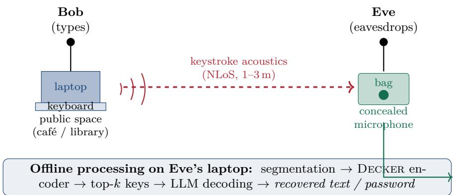
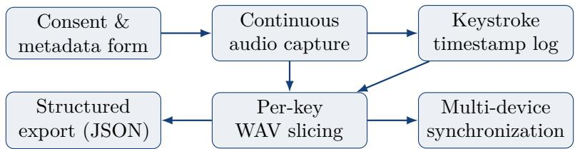
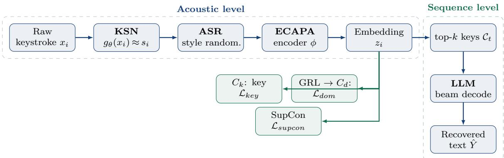

# Domain-Invariant and Language-Model-Assisted Acoustic Side-Channel Attacks on Keyboards

by

Bikrant Bikram Pratap Maurya

[MT24116]

Under the Supervision of

Dr. Arun Balaji Buduru


Computer Science and Engineering

Indraprastha Institute of Information Technology Delhi

August, 2026

© Indraprastha Institute of Information Technology (IIITD), New Delhi, 2026

# Domain-Invariant and Language-Model-Assisted

# Acoustic Side-Channel Attacks on Keyboards

by

Bikrant Bikram Pratap Maurya [MT24116]

Submitted

in partial fulfillment of the requirements for the degree of

Master of Technology

to

Computer Science and Engineering

Indraprastha Institute of Information Technology Delhi

August, 2026

## Certificate

This is to certify that the thesis titled “Domain-Invariant and Language-Model-Assisted Acoustic Side-Channel Attacks on Keyboards” being submitted by Bikrant Bikram Pratap Maurya to the Indraprastha Institute of Information Technology Delhi, for the award of the Master of Technology, is an original research work carried out by him under my supervision. In my opinion, the thesis has reached the standards fulfilling the requirements of the regulations relating to the degree.

The results contained in this thesis have not been submitted in part or full to any other university or institute for the award of any degree/diploma.

August, 2026

Dr. Arun Balaji Buduru

Department of Computer Science and

Engineering

Indraprastha Institute of Information

Technology Delhi

New Delhi 110 020

# Declaration Regarding Use of AI in Thesis

I acknowledge that I am fully responsible for the entire content of my thesis, including any sections assisted by online tools, including Artificial Intelligence-based tools. I accept full accountability for any violations of ethical standards in publications arising from the use of such tools.

Bikrant Bikram Pratap Maurya [MT24116]

# ACKNOWLEDGEMENTS

I am deeply grateful to the Department of Computer Science & Engineering and to the Infosys Centre for Artificial Intelligence at IIIT-Delhi. Their provision of computational infrastructure, GPU resources, and a stimulating research environment made this work possible.

My foremost thanks go to my advisor, Dr. Arun Balaji Buduru, whose guidance shaped every stage of this thesis. His insistence on rigour, his patience during the long data-collection efort behind the Hear dataset, and his encouragement to pursue an ambitious open-world formulation of acoustic side-channel attacks were invaluable. He taught me to treat a security threat model not as a checkbox but as the backbone of an honest evaluation, and that lesson runs through the whole of this document.

I am indebted to my collaborators Nitin Choudhury, Orchid Chetia Phukan and Bhavin Vinodbhai Kuwar . The Decker framework and the VoIP representation and transduction studies reported in this thesis grew directly out of our joint work, our late-night recording sessions, and our many arguments about whether a keyboard was leaking its own identity or the key that was pressed. Their contributions to the underlying publications are gratefully acknowledged.

Finally, I thank my family and friends for their unwavering support through the demanding months of coursework, experimentation, and writing. Their belief in me was the quiet constant behind this work.

Bikrant Bikram Pratap Maurya

## ABSTRACT

Acoustic side-channel attacks (ASCA) recover typed text from the sound of keystrokes, using only a commodity microphone and no access to the victim’s device. Prior work establishes that such attacks succeed under idealized laboratory conditions—a single keyboard, a fixed microphone, a quiet room, and training and testing on the same device— but leaves open the question that matters for security: whether keystroke inference survives the open world of unseen keyboards, diverse users, noisy environments, and compressed transmission channels. The answer developed here is that it does, provided the acoustic model is made explicitly domain-invariant and its noisy predictions are corrected by a language model. The central contribution is Decker (Domain-invariant Embedding for Cross-Keyboard Extraction and Recognition), a keystroke-inference framework that unifies Keyboard Signature Normalization, domain-adversarial disentanglement, supervised cross-keyboard contrastive alignment, and Acoustic Style Randomization to produce embeddings that are discriminative of key identity yet invariant to keyboard, user, and environment. Decker narrows the cross-keyboard generalization gap from roughly forty accuracy points—the collapse sufered by strong unimodal and multimodal baselines that encode device identity rather than key identity—to under eighteen. A sentence-level attack then applies constrained-beam-search language-model decoding over the top-k acoustic candidates, substantially boosting recovery of coherent text and quantifying the risk for password classes of varying entropy. Two further contributions support and extend this result. Hear, the dataset underpinning every experiment, comprises keystroke acoustics from fifty-three participants on thirty-seven laptop keyboards, captured through an external microphone, the on-device microphone, and a Voice-over-IP (VoIP) channel, and annotated with demographic and user-awareness metadata. Building on Hear’s VoIP recordings, a companion study of

speech pretrained models under codec distortion shows that a Kolmogorov–Arnold Network adaptation head recovers much of the accuracy lost to compression, and EvFlow-CTSSM, a continuous-time transduction model, canonicalizes distorted VoIP embeddings to make fully segmentation-free attacks viable. Together these results argue that domain-invariant representation learning is a central requirement for any credible evaluation of ASCA, and that modern language models materially amplify its real-world impact—findings that motivate the hardware-, system-, and model-level defenses discussed in the closing chapters.

KEYWORDS: Acoustic Side-Channel Attack; ASCA; Keystroke Inference; Domain Invariance; Cross-Keyboard Generalization; ECAPA-TDNN; Domain-Adversarial Learning; Supervised Contrastive Learning; Acoustic Style Randomization; Speech Pretrained Models; Kolmogorov–Arnold Networks; Voice-over-IP; Large Language Models; Constrained Beam Search; Security and Privacy.

## Contents

Certificate i   
Acknowledgements ii   
Acknowledgements iii   
Abstract iv   
List of Figures xii   
List of Tables xiii   
Abbreviations xv   
Notation xvii   
1 Introduction 1   
1.1 General Overview . 1   
1.2 Setting up the Flow 2   
1.3 Objectives of the Thesis . 3   
1.3.1 The Research Gap . 3   
1.3.2 Research Questions . 4   
1.4 A Short Literature Survey 4   
1.5 Motivation: Why Study ASCA Now? . . 5   
1.6 Contributions 5   
1.7 Organization of the Thesis . 7   
2 Background and Preliminaries 8   
2.1 The Acoustics of a Keystroke 8   
2.1.1 Multipath Propagation and Environmental Efects 9   
2.1.2 Segmentation: from a Stream to Keystroke Windows . 10   
2.2 Signal Preprocessing and Feature Extraction 10   
2.3 Deep Architectures for Acoustic Classification 11   
2.3.1 Convolutional and Transformer Backbones 11   
2.3.2 ECAPA-TDNN 12   
2.4 Speech Pretrained Models 12   
2.5 Kolmogorov–Arnold Networks 13   
2.6 Domain Adaptation and Invariant Representation Learning 14   
2.7 Language Models in Side-Channel Attacks . 15   
3 Related Work 17   
3.1 Foundations of Keyboard Acoustic Emanations 17   
3.2 From Signal Processing to Deep Learning 18   
3.3 Relaxing the Line-of-Sight and Geometry Assumptions . 19   
3.4 Language Models as a Sequence-Level Multiplier 19   
3.5 Attacks on Other Devices and Modalities 20   
3.6 Surveys and the State of the Field 20   
3.7 Positioning of This Thesis . 20   
4 Threat Model 22   
4.1 Attack Scenario 22   
4.2 Attacker Capabilities 23   
4.3 Environmental Assumptions . 24   
4.4 Vulnerability Basis 25   
4.5 Attacker Assumptions, Summarized 25   
5 The HEAR Dataset 27   
5.1 Design Goals 27   
5.2 Comparison with Prior ASCA Datasets 28   
5.3 Acquisition Pipeline 28   
5.4 Standardized Typing Corpus 29   
5.5 Per-Key Slicing and Signal Processing 29   
5.6 Multi-Device and Over-Stream Synchronization . 30   
5.7 Metadata Schema 30   
5.8 Dataset Statistics 31   
5.9 Recommended Evaluation Splits 31   
5.10 Ethics, Consent, and User Awareness 32   
6 Acoustic Side-Channel Attacks over VoIP 34   
6.1 Motivation 34   
6.2 The HEAR VoIP Subset . 35   
6.3 Part I: Speech Representations under VoIP 35   
6.3.1 Pretrained Models Evaluated 35   
6.3.2 Adaptation Heads 36   
6.3.3 Protocol and Results 36   
6.4 Part II: Continuous Sparse Transduction with EvFlow-CTSSM 38   
6.4.1 Problem Formulation 38   
6.4.2 Latent Rectified Flow Canonicalization (LF-CAN) 38   
6.4.3 Event-Triggered Continuous-Time SSM 39   
6.4.4 Decoding via CTC and Shallow Fusion 39   
6.4.5 Results 40   
6.5 Relation to DECKER 41   
7 DECKER: A Domain-Invariant Inference Framework 42   
7.1 Problem Definition 42   
7.2 Overview of the Pipeline 43   
7.3 Keyboard Signature Normalization 44   
7.4 Acoustic Style Randomization . 44   
7.5 ECAPA-TDNN Encoder 45   
7.6 Key Classification 46   
7.7 Domain-Adversarial Disentanglement . 46   
7.8 Supervised Cross-Keyboard Contrastive Alignment . 47   
7.9 Training Objective and Schedule 47   
7.10 LLM-Assisted Sentence Reconstruction 48   
7.11 End-to-End Pipeline 48   
8 Experiments and Results 50   
8.1 Evaluation Metrics 50   
8.2 Unimodal Baselines 51   
8.3 Multimodal Fusion Baselines 52   
8.4 DECKER: Domain-Invariant Modeling 53   
8.4.1 KSN Ablation and Visualization 53   
8.4.2 Per-Key Confusion Structure 54   
8.5 Sentence-Level Reconstruction with LLMs 54   
8.5.1 LLMs, High-Entropy Strings, and Passwords 55   
8.6 Segmentation Robustness 55   
8.7 Computational Cost and Attacker Feasibility 56   
8.8 Summarized Insights Aligned to the Research Questions 57   
9 Discussion 59   
9.1 Implications for ASCA Research 59   
9.2 Defensive Directions 60   
9.3 The Human Factor 61   
9.4 Limitations 61   
10 Conclusion and Future Work 63   
10.1 Recapitulation of Objectives 63   
10.2 Summary of Key Findings . 63   
10.3 Future Directions . 64   
10.4 Path to a Journal (TASLP) Submission 65   
10.5 Concluding Perspective 66   
A Standardized Typing Corpus 67   
B Metadata Schema 68   
C Extended Results and Hyperparameters 70   
C.1 Full Hyperparameter Configuration 70   
C.2 Extended Cross-User and Cross-Environment Results . 71   
C.3 Top-5 Accuracy 71   
D Reproducibility and Artifact Notes 72   
D.1 Software Environment 72   
D.2 Determinism and Seeds 72   
D.3 Compute Budget . 72   
D.4 Data Access and Ethics . 73   
D.5 Artifact Contents . 73   
List of Publications 82

## List of Figures

4.1 Threat scenario. Bob types on a laptop in a public area while Eve, seated   
at a separate table (1–3 m away), passively captures keystroke acoustics   
from a concealed microphone with no line of sight to the keyboard. Eve   
later processes the recording ofline—domain-invariant acoustic inference   
with Decker followed by LLM-driven sentence reconstruction—to recover   
the typed text or password. .   
5.1 The Hear browser-based acquisition pipeline. A single session yields a   
continuous recording, a high-resolution keystroke timestamp log, pre-sliced   
per-key clips, structured metadata, and, where secondary devices are present,   
synchronization ofsets. .   
7.1 The Decker pipeline. Raw keystrokes are normalized (KSN), augmented   
(ASR), and encoded (ECAPA-TDNN) into embeddings that are shaped by   
three training objectives—key classification, domain-adversarial disentangle  
ment, and supervised cross-keyboard contrastive alignment. At inference the   
classifier’s top-k candidates are decoded into coherent text by a constrained   
language model. .

## List of Tables

3.1 Comparison of ASCA datasets across device diversity, user demographics,   
acoustic conditions, and recording modalities. Hear is the first dataset to   
jointly include multi-device (MD), multi-user (MU), multi-gender (MG),   
noisy public environments (NE), NLoS capture, continuous text, and   
VoIP/smartphone streams. 21   
4.1 Summary of the threat model assumptions used throughout the thesis. . . 25   
5.1 Headline statistics of the Hear dataset. 31   
6.1 Generalization performance on the Hear VoIP subset, reported as Ac  
curacy(%) / Macro-F1(%). Best result in each column is in bold. The   
proposed KAN head dominates across all backbones and scenarios. 37   
6.2 Continuous CER (↓) on unseen keyboards and VoIP channels (Hear VoIP   
subset). EvFlow-CTSSM is compared against ASR, AED, and SSL   
foundation baselines. 40   
8.1 Unimodal performance under keyboard shift. Every model loses roughly   
forty absolute points on unseen keyboards. . 51   
8.2 Multimodal Euclidean fusion of ECAPA (A) and CoAtNet-S (V). Fusion   
helps but does not close the unseen-keyboard gap. 52   
8.3 Decker key-level performance (domain-shift evaluation) and component   
ablation. 53   
8.4 Sentence reconstruction using constrained LLM decoding over Decker   
top-k candidates. 54   
8.5 Segmentation robustness under onset jitter and spurious triggers. 56   
8.6 Decker inference latency on Apple M1, averaged over 1000 runs. L, K,   
and S denote Latency, Key, and Sequence. 57   
C.1 Complete Decker training configuration. 70   
C.2 Top-1 key accuracy on cross-user and cross-environment splits (mean over   
three seeds). . 71   
C.3 Decker top-5 key accuracy across the four canonical splits (unseen/out-of  
domain partitions). 71

## ABBREVIATIONS

ASCA Acoustic Side-Channel Attack

HEAR The keystroke-acoustics dataset introduced in this thesis (the single dataset used throughout)

DECKER Domain-invariant Embedding for Cross-Keyboard Extraction and Recognition

EvFlow- Event-Triggered Continuous-Time State-Space Model with Latent

CTSSM Flow Canonicalization

LF-CAN Latent Rectified Flow Canonicalization

CT-SSM Continuous-Time State-Space Model

CTC Connectionist Temporal Classification

CER Character Error Rate

AED Acoustic Event Detection

KSN Keyboard Signature Normalization

ASR Acoustic Style Randomization (in the modeling chapters)

ASR Automatic Speech Recognition (only where explicitly noted)

ECAPA Emphasized Channel Attention, Propagation and Aggregation

TDNN Time-Delay Neural Network

GRL Gradient Reversal Layer

DANN Domain-Adversarial Neural Network

SupCon Supervised Contrastive (loss)

PTM Pretrained Model

SSL Self-Supervised Learning

KAN Kolmogorov–Arnold Network

FCN Fully Connected Network

CNN Convolutional Neural Network

<table><tr><td>LLM</td><td>Large Language Model</td></tr><tr><td>VoIP</td><td>Voice over Internet Protocol</td></tr><tr><td>AGC</td><td>Automatic Gain Control</td></tr><tr><td>AEC</td><td>Acoustic Echo Cancellation</td></tr><tr><td>NLoS</td><td>Non-Line-of-Sight</td></tr><tr><td>LoS</td><td>Line-of-Sight</td></tr><tr><td>MFCC</td><td>Mel-Frequency Cepstral Coefficient</td></tr><tr><td>FFT</td><td>Fast Fourier Transform</td></tr><tr><td>SNR</td><td>Signal-to-Noise Ratio</td></tr><tr><td>IIR</td><td>Infinite Impulse Response</td></tr><tr><td>t-SNE</td><td>t-distributed Stochastic Neighbor Embedding</td></tr><tr><td>ID</td><td>In-Domain</td></tr><tr><td>OOD</td><td>Out-of-Domain</td></tr><tr><td>mF1</td><td>Macro-averaged F1 score</td></tr><tr><td>PII</td><td>Personally Identifiable Information</td></tr><tr><td>TASLP</td><td>(IEEE/ACM) Transactions on Audio, Speech, and Language Pro-</td></tr><tr><td></td><td>cessing</td></tr><tr><td>TIFS</td><td>(IEEE) Transactions on Information Forensics and Security</td></tr></table>

## NOTATION

<table><tr><td> $x _ { i } \in \mathbb { R } ^ { T }$ </td><td>Raw keystroke waveform of  $T$  samples for the i-th event</td></tr><tr><td> $y _ { i } \in \{ 1 , \ldots , | K | \}$ </td><td>Ground-truth key label of the i-th keystroke</td></tr><tr><td> $d _ { i } \in \{ 1 , \ldots , | D | \}$ </td><td>Keyboard (domain) identity of the i-th keystroke</td></tr><tr><td> $\phi ( \cdot )$ </td><td>Acoustic encoder mapping a waveform to an embedding</td></tr><tr><td> $z _ { i } = \phi ( x _ { i } ) \in \mathbb { R } ^ { E }$ </td><td>Embedding of the i-th keystroke, dimension E</td></tr><tr><td> $h _ { d _ { i } }$ </td><td>Device-specific acoustic impulse response of keyboard  $d _ { i }$ </td></tr><tr><td> $s _ { i }$ </td><td>Latent (device-free) keystroke source signal</td></tr><tr><td> $g _ { \boldsymbol { \theta } } ( \cdot )$ </td><td>Learnable inverse filter (KSN module)</td></tr><tr><td> $G _ { \theta } ( f )$ </td><td>Frequency-domain response of KSN</td></tr><tr><td> $C _ { k } ( \cdot )$ </td><td>Key classifier head</td></tr><tr><td> $C _ { d } ( \cdot )$ </td><td>Domain (keyboard) classifier head</td></tr><tr><td> $\mathrm { G R L } _ { \lambda } ( \cdot )$ </td><td>Gradient reversal layer with strength λ</td></tr><tr><td> $P ( i ) , N ( i )$ </td><td>Positive / negative index sets for contrastive alignment</td></tr><tr><td> $\tau$ </td><td>Contrastive temperature</td></tr><tr><td> $\lambda _ { d o m } , \lambda _ { c o n }$ </td><td>Loss weights for domain and contrastive terms</td></tr><tr><td> $\mathcal { L } _ { k e y }$ </td><td>Key-classification (cross-entropy) loss</td></tr><tr><td> $\mathcal { L } _ { d o m }$ </td><td>Domain-adversarial loss</td></tr><tr><td> $\mathcal { L } _ { s u p c o n }$ </td><td>Supervised contrastive loss</td></tr><tr><td> $\mathcal { C } _ { t }$ </td><td>Top-k candidate key set at timestep t</td></tr><tr><td> $P _ { \mathrm { L M } } ( Y )$ </td><td>Language-model prior over token sequence  $Y$ </td></tr><tr><td> $\lambda _ { \mathrm { L M } }$ </td><td>Language-model fusion weight in beam search</td></tr><tr><td> $\Phi _ { q } ( \cdot ) , \psi _ { q , p } ( \cdot )$ </td><td>Learnable univariate functions of a KAN layer</td></tr><tr><td>E[·]</td><td>Expectation</td></tr><tr><td> $\| \cdot \| _ { 1 } , \| \cdot \| _ { 2 }$ </td><td> $\ell _ { 1 }$  and  $\ell _ { 2 }$  norms</td></tr><tr><td>*</td><td>Convolution operator</td></tr></table>

## Introduction

## 1.1 General Overview

An acoustic side-channel attack (ASCA) on a keyboard rests on a deceptively simple physical fact: pressing a key produces a short, characteristic sound, and that sound can serve as a fingerprint for the key on a given device. If an adversary can capture those sounds and map them back to keys, then a microphone—an object now embedded in nearly every phone, laptop, earbud, and conferencing appliance—becomes an instrument for recovering everything a victim types, from search queries and private messages to passwords and PINs. Unlike a keylogger, this attack requires no software on the victim’s machine; unlike shoulder-surfing, it requires no line of sight; and unlike network interception, it is indiferent to encryption, because it operates on the physical act of typing rather than on the data after it has left the keyboard.

The threat is not hypothetical. A line of research stretching back two decades has shown, across many setups and threat models, that keystroke acoustics carry enough structure to identify keys with surprising accuracy [2, 62, 25, 6, 24, 13]. Early work relied on hand-crafted spectral features and classical classifiers; more recent systems apply deep convolutional and transformer architectures to spectrograms and raw waveforms, and the best of them report per-key accuracies that would be alarming if they held in practice. The last two years have added a further multiplier. Large language models (LLMs) encode exactly the linguistic regularities—character n-grams, word morphology, syntax, and common password patterns—that let an attacker correct a noisy stream of key predictions into coherent text [3, 46, 47]. A single imperfect acoustic model, followed by a language model, can plausibly reconstruct a sentence even when a third of its raw

key predictions are wrong.

Yet almost all of this evidence was gathered under narrow, idealized conditions: a single keyboard, a fixed microphone geometry, a quiet room, a homogeneous set of typists, and training and testing on the very same device. These are precisely the conditions least like the settings in which the attack would actually be launched. In a café, a library, or an online meeting, the adversary does not control the victim’s hardware, cannot fix the recording geometry, must contend with ambient noise and multipath reflections, and will encounter keyboards, switch mechanisms, and typing styles never seen during training. The uncomfortable question this thesis confronts is therefore not “can keystrokes be recovered in the lab?”—that is settled—but “does the attack survive the open world?”

## 1.2 Setting up the Flow

This thesis argues, and then demonstrates, that the answer is a qualified yes. The qualification is important, because the naive answer is no. When we take strong modern acoustic models—self-supervised speech encoders, spectrogram vision transformers, and their multimodal fusions—and evaluate them honestly on keyboards they have never heard, their accuracy collapses, typically by forty absolute percentage points (Table 8.1 in Chapter 8). The reason is subtle and is the intellectual core of the thesis: these models do not learn a representation of keys, they learn a representation of the keyboard. The device’s impulse response—its switch type, key travel, chassis resonance, and the geometry between keys and microphone—imprints itself on every recording, and a model trained to maximize accuracy on one device happily exploits that imprint. Move to a new device and the imprint changes, so the model’s confident predictions become confident nonsense.

The remedy is to make the acoustic model explicitly domain-invariant: to strip away device-specific colouration while preserving the information that distinguishes one key from another. This thesis develops such a model, Decker, and pairs it with a language-model decoding stage that corrects the residual key-level errors using linguistic structure. The combination restores much of the accuracy lost to keyboard shift and, at the sequence level, recovers coherent text and human-like passwords far more often than the acoustic model alone. Along the way, the thesis contributes the datasets that make an honest evaluation possible in the first place, because the field’s progress has been throttled less by modeling ideas than by the absence of realistic, diverse data.

## 1.3 Objectives of the Thesis

## 1.3.1 The Research Gap

Three gaps in the ASCA literature motivate this work.

Data gap. Existing ASCA datasets are highly constrained: typically single-keyboard, single-environment, and demographically narrow, with little variation in gender, typing background, or laptop usage profile, and almost no coverage of realistic transmission channels such as Voice-over-IP (VoIP) [25, 57]. This makes it impossible to study whether ASCA generalizes beyond laboratory conditions, and it obscures the role of user and demographic factors in the attack. No prior dataset jointly covers multiple devices, multiple users, multiple genders, noisy public environments, non-line-of-sight capture, continuous natural-language text, and VoIP or smartphone streams.

Modeling gap. Deep ASCA models overfit to keyboard- and setup-specific spectral patterns, and their performance drops sharply on unseen devices, indicating that they encode device identity rather than pure keystroke content. Multimodal fusion of audio and spectrogram features adds capacity but does not remove this domain shift, because both encoders carry the same device colouration. There is no established framework that produces embeddings which are simultaneously key-discriminative, keyboard-invariant, and consistent for the same key across devices.

Sequence gap. Even when per-key predictions are reasonably accurate, local errors accumulate over long sequences such as passwords and sentences. Most pipelines treat keys independently and do not systematically exploit linguistic structure to correct errors.

Where language models have been used, they have appeared as loosely coupled filters on top of keyboard-specific acoustic models, never as a principled decoder over the top-k candidate distribution of a domain-invariant encoder.

## 1.3.2 Research Questions

The thesis is organized around six research questions that the datasets and models are designed to answer.

RQ1 Do ASCA models generalize across keyboards, and if so, under what modeling conditions?

RQ2 Why do strong unimodal and multimodal baselines fail under keyboard, user, and environment shift?

RQ3 Can a single training framework produce embeddings that are key-discriminative yet keyboard-, user-, and environment-invariant?

RQ4 How do modern speech pretrained representations behave under VoIP codec distortion, and can a more expressive adaptation head recover the lost accuracy?

RQ5 What is the role of large language models in ASCA, and how much do they raise the efective threat at the sequence level?

RQ6 What does a realistic, end-to-end ASCA threat model look like once the idealized assumptions on hardware, environment, and users are abandoned?

## 1.4 A Short Literature Survey

The modern study of keyboard ASCA begins with Asonov and Agrawal, who showed that a neural network trained on FFT features could identify keys from the sound of typing alone [2]. Zhuang, Zhou, and Tygar removed the need for labelled training data by combining unsupervised clustering with a language model, foreshadowing the LLMassisted decoding that is now central [62]. A decade of work then broadened the attack to smartphones, touchscreens, VoIP calls, and video conferencing [13, 48, 60, 34], while the deep-learning era brought CNNs, residual networks, and transformer spectrogram models that pushed laboratory accuracy higher [25, 36]. Most recently, RefleXnoop and Heimdall demonstrated non-line-of-sight recovery by exploiting multipath reflections, and LLM-assisted spectrogram correction demonstrated the sequence-level multiplier that language priors provide [57, 35, 3]. Chapter 3 develops this history in full; the point to carry forward here is that the trajectory has been one of steadily relaxing assumptions, and that the assumption most in need of relaxing—training and testing on the same device—is the one this thesis targets.

## 1.5 Motivation: Why Study ASCA Now?

Three trends make ASCA a more credible threat today than at any point in its history. First, high-quality far-field microphones are ubiquitous and cheap; a concealed smartphone or a compact USB microphone captures enough detail for key classification. Second, deep architectures for noisy acoustic signals have matured, so an attacker no longer needs bespoke signal processing to extract fine transient cues. Third, and most consequentially, capable language models are freely available, and they convert an unreliable per-key classifier into a reliable sentence and password reconstructor. The convergence of these trends means that the barrier to a practical attack is now low: a passive adversary with a commodity microphone and a laptop-class machine, seated at a socially unremarkable distance, can plausibly recover typed text from a victim using a keyboard the attacker has never seen. Establishing whether that sentence is true, and quantifying exactly how true, is the purpose of this thesis.

## 1.6 Contributions

The thesis makes the following contributions, each developed in a dedicated chapter and each grounded in the two publications that underlie this work.

1. Hear: a realistic ASCA dataset. We curate Hear, a dataset of keystroke acoustics from 53 participants typing on 37 laptop keyboards, recorded under three realistic conditions (external microphone, on-device microphone, and VoIP streaming), and annotated with demographic attributes and user-awareness responses. Hear is the first dataset to jointly cover multi-device, multi-user, multi-gender, noisy-environment, non-line-of-sight, continuous-text, and VoIP/smartphone-stream factors (Chapter 5).

2. A comprehensive ASCA benchmark. On Hear we establish a benchmark spanning conventional features and strong pretrained representations, on raw waveforms and spectrograms, in unimodal and multimodal settings, and we quantify how far existing approaches generalize across users, keyboards, and environments (Chapters 5 and 8).

3. Decker: a domain-invariant inference framework. We introduce Decker, which combines Keyboard Signature Normalization, domain-adversarial disentanglement, supervised cross-keyboard contrastive alignment, and Acoustic Style Randomization to learn key-discriminative yet keyboard-invariant embeddings (Chapter 7).

4. VoIP-channel robustness on Hear. Using the VoIP recordings of Hear, we provide the first systematic evaluation of self-supervised and supervised speech pretrained models for ASCA under VoIP codec distortion and propose a Kolmogorov–Arnold Network adaptation head that consistently outperforms fully connected and convolutional baselines. We further introduce EvFlow-CTSSM, a continuous-time transduction model that canonicalizes distorted VoIP embeddings in the latent space and decodes unsegmented streams, making fully segmentation-free VoIP attacks viable (Chapter 6).

5. LLM-assisted reconstruction and risk quantification. We investigate a sentencelevel attack that applies constrained-beam-search LLM decoding to refine noisy keystroke predictions, and we quantify the resulting risk for natural text and for password classes of varying entropy (Chapters 7 and 8).

## 1.7 Organization of the Thesis

Chapter 2 develops the physical, algorithmic, and linguistic background: the acoustics of keystrokes, deep architectures for audio, speech pretrained models, Kolmogorov–Arnold networks, domain-adaptation theory, and the role of language models. Chapter 3 surveys two decades of ASCA research and positions this work. Chapter 4 specifies the realistic threat model. Chapter 5 presents the Hear dataset—the single dataset used throughout the thesis—and Chapter 6 studies ASCA over VoIP channels on Hear, covering both speech-representation robustness and the EvFlow-CTSSM continuous-transduction model. Chapter 7 develops the Decker framework in full mathematical detail. Chapter 8 reports the experimental results. Chapter 9 discusses implications, defenses, and limitations, and Chapter 10 concludes and outlines future work, including the extension path toward a journal (TASLP) submission. Appendices provide the standardized typing corpus, the metadata schema, extended result tables, and the transaction-extension plan.

## Background and Preliminaries

This chapter assembles the conceptual machinery the rest of the thesis relies on. It moves from the physics of a keystroke, through the acoustic and deep-learning tools that turn a recording into a key prediction, to the representation-learning, domain-adaptation, and language-modeling ideas that make the attack robust and its output coherent. A reader already fluent in speech representation learning and domain-adversarial training may skim Sections 2.4–2.6, but the acoustics of Section 2.1 and the language-model decoding of Section 2.7 are worth reading closely, because they justify specific design choices in Decker.

## 2.1 The Acoustics of a Keystroke

Pressing a key is a small mechanical event with a surprisingly rich acoustic signature. The finger drives the keycap downward; the switch mechanism actuates, whether a scissor mechanism on a laptop, a rubber dome on a membrane board, or a spring on a mechanical switch; the keycap bottoms out against the chassis; and, on release, the key returns and a second, softer transient is produced. Each of these sub-events radiates a short broadband pulse, and the superposition—shaped by keycap vibration, chassis resonance, air-pressure release, and reverberation from nearby surfaces—forms the sound that a microphone records.

Two empirical regularities make the attack possible. First, on a fixed device each key emits a relatively consistent pattern across presses, despite variability in typing style, so that a classifier trained on one user’s presses of a key transfers to other presses of the same key [2, 62]. Second, keys that are spatially adjacent tend to share acoustic characteristics, because their vibration paths through the chassis overlap, whereas keys in distinct keyboard regions difer in spectral distribution and decay. This spatial structure is what lets unsupervised methods bootstrap key clusters without labels.

A convenient and, for this thesis, load-bearing way to model the recording is as a convolution. Let $s _ { i }$ be the latent, device-independent source signal of the i-th keystroke— the sound the key “wants” to make—and let $h _ { d _ { i } }$ be the impulse response of device $d _ { i }$ which lumps together switch mechanics, chassis resonance, microphone frequency response, and room acoustics. Then the observed waveform is

$$
x _ { i } \ = \ h _ { d _ { i } } * s _ { i } ,\tag{2.1}
$$

where ∗ denotes convolution. Equation (2.1) is the single most important equation in the thesis, because it localizes the generalization problem precisely: the key identity lives in $s _ { i }$ , but every model sees $x _ { i } ,$ which is $s _ { i }$ smeared through the device-specific filter $h _ { d _ { i } }$ . A model that maximizes accuracy on one device learns to read $s _ { i }$ through a fixed $h _ { d _ { i } }$ ; change the device and $h _ { d _ { i } }$ changes, and the learned decoder mismatches. Keyboard Signature Normalization (Chapter 7) is, at its core, a learnable attempt to invert $h _ { d _ { i } }$ and recover an estimate of $s _ { i }$

## 2.1.1 Multipath Propagation and Environmental Efects

Keystroke sound does not reach the microphone by a single path. It reflects of the laptop screen, the desk surface, the user’s hands, and surrounding walls, and these reflections introduce predictable but nonlinear modifications to the spectral envelope and temporal decay of the signal. The laptop screen, in particular, often acts as a stable secondary reflector, producing additional peaks in the waveform that can increase distinguishability in some geometries while degrading it in others [57]. Systems such as RefleXnoop and Heimdall exploit exactly these multipath cues to recover keystrokes with no direct line of sight [57, 35]. The double edge of multipath is central to the threat model of Chapter 4: reflections are simultaneously an enabler of non-line-of-sight attacks and a source of deviceand room-specific variability that a robust model must suppress.

## 2.1.2 Segmentation: from a Stream to Keystroke Windows

Before any classifier runs, a continuous recording must be sliced into per-keystroke windows. Given a keystroke timestamp $t _ { \mathrm { m s } } .$ , a fixed asymmetric window

$$
t _ { \mathrm { s t a r t } } = t _ { \mathrm { m s } } - 6 0 \mathrm { m s } , \qquad t _ { \mathrm { e n d } } = t _ { \mathrm { m s } } + 2 0 0 \mathrm { m s }\tag{2.2}
$$

captures both the impulsive onset and the early reverberant tail, consistent with prior ASCA practice. Windows shorter than a minimum energy threshold are discarded as noise-only, and rapid typing can cause partial overlap between adjacent windows, which is retained deliberately because it reflects realistic attack conditions. In a fully passive attack the timestamps are not known and must be estimated from onset detection; the sensitivity of the whole pipeline to segmentation error is studied in Chapter 8.

## 2.2 Signal Preprocessing and Feature Extraction

Before any learned model runs, a keystroke window is transformed into a representation the model can consume. Two families dominate, and both appear in this thesis: hand-crafted spectral features and learned front-ends.

Short-time analysis. A windowed waveform $x [ n ]$ is analyzed frame by frame with the short-time Fourier transform (STFT),

$$
X [ m , \omega ] = \sum _ { n } x [ n ] w [ n - m H ] e ^ { - j \omega n } ,\tag{2.3}
$$

where $w [ \cdot ]$ is an analysis window (Hann, length 25 ms) and H is the hop (10 ms). The squared magnitude $| X [ m , \omega ] | ^ { 2 }$ is the power spectrogram, whose sharp onset structure is exactly the transient a keystroke produces.

Mel and log-mel spectrograms. Human-and machine-relevant frequency resolution is non-uniform, so the power spectrum is warped onto the mel scale, me $. ( f ) = 2 5 9 5 \log _ { 1 0 } ( 1$ +

$f / 7 0 0 )$ , by a bank of F triangular filters $\{ H _ { k } \}$ . The log-mel feature is

$$
S [ m , k ] = \log \Big ( \sum _ { \omega } H _ { k } [ \omega ] | X [ m , \omega ] | ^ { 2 } + \epsilon \Big ) ,\tag{2.4}
$$

and the resulting $S \in \mathbb { R } ^ { F \times L }$ is the input to the spectrogram models and to the ECAPA-TDNN encoder of Section 2.3.2. Log compression matters here because keystroke energy spans a wide dynamic range between the impulsive onset and the reverberant tail.

MFCCs. Applying a discrete cosine transform to the log-mel spectrum and keeping the low-order coeficients yields mel-frequency cepstral coeficients $( \mathrm { M F C C s } ) , c [ m , q ] =$ $\begin{array} { r l } { \sum _ { k } S [ m , k ] \cos \bigl ( q ( k - \frac { 1 } { 2 } ) \pi / F \bigr ) } & { { } } \end{array}$ . MFCCs decorrelate the filter-bank energies and were the dominant feature in classical ASCA; they serve here as a conventional baseline against which learned representations are compared.

## 2.3 Deep Architectures for Acoustic Classification

## 2.3.1 Convolutional and Transformer Backbones

Convolutional neural networks (CNNs) remain the workhorse for spectrogram classification: a stack of learned filters detects local time–frequency patterns, pooling builds translation tolerance, and depth composes simple detectors into discriminative features [40]. Residual networks add skip connections that ease the training of deep stacks, and hybrid convolution– attention models such as CoAtNet marry the locality of convolution with the global receptive field of self-attention, which is well suited to spectrograms where a key’s identity depends on both fine transient structure and coarse spectral shape [15]. For raw waveforms, time-domain encoders avoid the fixed time–frequency trade-of of a spectrogram and can learn front-ends tuned to the signal; the ECAPA-TDNN encoder, developed for speaker verification, is a prominent example and is the acoustic backbone of Decker.

## 2.3.2 ECAPA-TDNN

ECAPA-TDNN (Emphasized Channel Attention, Propagation and Aggregation, Time-Delay Neural Network) extracts frame-level features with multi-scale one-dimensional convolutions, recalibrates channels with squeeze-and-excitation attention, and aggregates frames with attentive statistics pooling [17]. Two properties make it attractive for ASCA. First, its multi-scale temporal convolutions capture both the sharp onset and the longer decay of a keystroke, which live at diferent time scales. Second, its attentive pooling produces a single fixed-dimensional utterance-level embedding from a variable-length frame sequence, which is exactly the interface a key classifier and a contrastive loss want. Formally, for a log-mel input $S _ { i } \in \mathbb { R } ^ { F \times L }$ the encoder produces frame features $H _ { i } = \phi ( S _ { i } ) \in \mathbb { R } ^ { C \times L }$ , and statistics pooling forms

$$
\mu _ { i } = \frac { 1 } { L } \sum _ { t = 1 } ^ { L } H _ { i } ( : , t ) , \qquad \sigma _ { i } = \sqrt { \frac { 1 } { L } \sum _ { t = 1 } ^ { L } \left( H _ { i } ( : , t ) - \mu _ { i } \right) ^ { 2 } } ,\tag{2.5}
$$

so that the pooled vector $[ \mu _ { i } ; \sigma _ { i } ]$ summarizes the sequence and a linear head maps it to the embedding $z _ { i }$ .

## 2.4 Speech Pretrained Models

A pretrained model (PTM) learns general-purpose representations from large unlabelled or weakly-labelled corpora and is then adapted to a downstream task. Speech PTMs have transformed audio classification, and the VoIP study of Chapter 6 asks how well they transfer to the unusual domain of impulsive keystroke sounds. We use six.

Self-supervised backbones. Wav2Vec2 learns contextualized speech representations by masked prediction of latent units with a contrastive objective [5]. HuBERT uses a BERT-style masked-prediction objective over clustered acoustic units [26]. WavLM extends masked prediction with a denoising objective, jointly modeling acoustic, phonetic, and speaker cues, which turns out to matter for the noisy, transient signals of ASCA [9].

XLS-R is a large multilingual Wav2Vec2 variant trained for cross-lingual transfer [4].

Supervised backbones. X-vectors are embeddings from a TDNN trained for speaker identification, widely reused for speaker and paralinguistic tasks [51, 39]. Whisper is an encoder–decoder trained on large-scale weakly-supervised data for multilingual recognition and translation; we use only its encoder to extract embeddings [45, 28]. The relative strengths of these backbones have been mapped by large speech-representation benchmarks such as SUPERB [59], SLUE and its second phase [50, 49], and broad foundation-model evaluations [58, 44].

For all backbones the standard protocol freezes the encoder and trains a lightweight downstream head on the extracted embeddings, which isolates the intrinsic quality of the representation from the capacity of the head—a lightweight adaptation practice established in prior speech work [43] and a distinction that becomes the crux of the VoIP representation findings.

## 2.5 Kolmogorov–Arnold Networks

Kolmogorov–Arnold Networks (KANs) are motivated by the Kolmogorov–Arnold representation theorem, which states that any multivariate continuous function can be written as a finite composition of univariate continuous functions and addition [33]. Concretely, a function of n variables can be expressed as

$$
f ( x _ { 1 } , \dots , x _ { n } ) = \sum _ { q } \Phi _ { q } \left( \sum _ { p } \psi _ { q , p } ( x _ { p } ) \right) ,\tag{2.6}
$$

where the $\psi _ { q , p }$ and $\Phi _ { q }$ are learnable univariate functions. A KAN layer operationalizes this by replacing the fixed scalar weights of a multilayer perceptron with learnable univariate functions on the edges, typically parameterized as B-splines. A single KAN layer computes $\begin{array} { r } { h _ { j } = \sum _ { i } \phi _ { i , j } ( x _ { i } ) } \end{array}$ with each $\phi _ { i , j }$ a spline. The practical consequence is that a KAN can model nonlinear feature interactions more explicitly than an MLP with fixed activations and scalar weights. KANs have already proven efective as parameter-eficient adapters for pretrained image models [8] and for speech enhancement [29], which is why Chapter 6 adopts a KAN as the adaptation head over frozen speech representations: when VoIP codecs warp the spectral and temporal statistics of a keystroke embedding, the mapping from representation to key becomes highly nonlinear, and a spline-based head captures it where a linear or shallow head cannot.

## 2.6 Domain Adaptation and Invariant Representation Learning

The generalization crisis of Chapter 1 is, in the language of machine learning, a domain-shift problem: training keyboards and test keyboards are drawn from diferent distributions, and a model minimizing training risk exploits features that do not transfer. Two complementary tools address it.

Domain-adversarial training. A domain-adversarial neural network (DANN) inserts a gradient reversal layer (GRL) between the encoder and an auxiliary domain classifier [20]. The GRL is the identity on the forward pass and multiplies the gradient by −λ on the backward pass:

$$
\mathrm { G R L } _ { \lambda } ( z ) = z , \qquad \frac { \partial \mathrm { G R L } _ { \lambda } } { \partial z } = - \lambda I .\tag{2.7}
$$

The domain classifier tries to predict the keyboard from the embedding, but because the gradient is reversed before it reaches the encoder, the encoder is pushed to make the keyboard unpredictable while the key classifier keeps the key predictable. The equilibrium is an embedding that retains key information and discards keyboard information.

Supervised contrastive alignment. Adversarial training removes domain information but does not by itself force same-key embeddings from diferent devices to coincide. Supervised contrastive learning does [27]: it pulls together embeddings that share a label, here the key, while pushing apart embeddings of diferent keys, and by drawing positives from diferent devices it explicitly enforces cross-keyboard key consistency. Chapter 7 shows that adversarial and contrastive terms are complementary—the former suppresses device identity, the latter aligns key identity—and that both are needed.

Style randomization. A third, data-centric tool exposes the model to synthetic device variation. By perturbing a signal with random filters and spectral warps at training time—the audio analogue of the SpecAugment idea [41]—one simulates keyboards that were never recorded, so that the encoder cannot rely on any single device’s colouration. This is the basis of Acoustic Style Randomization.

## 2.7 Language Models in Side-Channel Attacks

Typed text is not random. It obeys character-level n-gram statistics, word morphology, syntax, and, for passwords, well-documented human-selection biases. Large language models—from GPT-2 and $\mathrm { G P T { - } 3 }$ to instruction-tuned encoder–decoders [46, 7, 47]— encode these regularities and can correct sequences with local errors, a property already exploited in ASCA-adjacent settings as a post-processing autocorrect step [3, 62]. The thesis treats language modeling not as an afterthought but as a decoding stage. Let the acoustic model emit a per-timestep distribution $P _ { \theta } ( y _ { t } \mid x _ { t } )$ , restricted to the top-k plausible keys $\mathcal { C } _ { t } = \{ y _ { t , 1 } , . . . , y _ { t , k } \}$ . A language model with prior $P _ { \mathrm { L M } } ( Y )$ then selects the sequence maximizing a fused objective

$$
\hat { Y } = \arg \operatorname* { m a x } _ { Y \in \mathcal { C } _ { 1 : T } } \left[ \sum _ { t = 1 } ^ { T } \log P _ { \theta } ( y _ { t } \mid x _ { t } ) + \lambda _ { \mathrm { L M } } \log P _ { \mathrm { L M } } ( Y ) \right] ,\tag{2.8}
$$

implemented with constrained beam search. Equation (2.8) is deliberately parallel to shallow-fusion decoding in speech recognition: the acoustic term keeps the reconstruction faithful to what was heard, and the language term keeps it linguistically plausible, correcting substitution, insertion, and deletion errors that the acoustic model alone cannot resolve. A theme developed in Chapter 8 is that the value of the language term depends on how much human-selection bias has lowered the entropy of the target: it helps natural text and human-like passwords greatly, and high-entropy random strings almost not at all.

Chapter takeaway. Keystroke acoustics factor into a device-free source and a device impulse response (Eq. 2.1); the whole thesis is an argument that robust ASCA means estimating the former while discarding the latter, then letting a language model clean up what remains.

## Related Work

Acoustic side-channel analysis has re-emerged as a practical threat because of the convergence of three trends: the widespread availability of high-quality microphones capable of capturing far-field audio, rapid progress in deep learning for noisy acoustic signals, and an increasing reliance on mobile computing in public and semi-public environments. This chapter reviews the physical, algorithmic, and linguistic strands of the literature, and then positions the present work against the datasets and systems that precede it.

## 3.1 Foundations of Keyboard Acoustic Emanations

The field opens with Asonov and Agrawal, who demonstrated that keyboards, telephone keypads, and ATM pads leak their input acoustically, and that a neural network trained on FFT features of individual keystrokes could recover keys [2]. Their key empirical observation—that each key emits a distinguishable and repeatable sound on a given device—remains the vulnerability basis for all subsequent work. Zhuang, Zhou, and Tygar made the attack dramatically more practical by removing the need for labelled training data: they clustered keystrokes acoustically, then used language-model and spelling constraints to assign clusters to characters, and finally re-trained a supervised classifier on the recovered labels [62]. Their pipeline is the intellectual ancestor of the LLM-assisted decoding studied here, difering mainly in the sophistication of the language prior.

Halevi and Saxena examined how typing style and password randomness afect emanation attacks, tempering optimism by showing that random passwords and touch-typing degrade recovery relative to hunt-and-peck entry of natural text [24]. Berger, Wool, and Yeredor framed dictionary attacks over keystroke acoustics as a constraint-satisfaction problem, again foreshadowing the language-driven decoding that modern LLMs perform far better. Early timing side channels on typed input, such as Song, Wagner, and Tian’s analysis of inter-keystroke timing over SSH, are complementary: they exploit when keys are pressed rather than how they sound, and are outside the acoustic scope of this thesis, but they establish the broader principle that typing leaks through many channels at once [52].

## 3.2 From Signal Processing to Deep Learning

The modeling side of ASCA has progressed from hand-crafted features with classical classifiers to end-to-end deep learning. Initial work relied on temporal and spectral features—FFT coeficients, MFCCs, and power or energy profiles—combined with statistical classifiers [2, 62]. Foo Kune and Kim modeled the problem probabilistically, and hidden Markov models were introduced to capture temporal structure across keystroke sequences [19]. Martinasek et al. applied spectrograms with neural networks, marking the transition to learned features [36].

The deep-learning era proper arrives with Harrison, Toreini, and Mehrnezhad, who trained a modern CNN on laptop keystroke spectrograms and reported high accuracy including over a Zoom (VoIP) channel, demonstrating that even low-cost microphones and compressed audio retain enough detail for classification [25]. Subsequent systems adopt residual networks, ConvMixer architectures, and audio pretrained models such as Wav2Vec2, HuBERT, and WavLM on keystroke audio, while waveform-level encoders such as ECAPA-TDNN extract fine transient cues originally developed for speaker verification [55, 17]. The consistent finding across this body of work is that keystroke acoustics are highly structured and reproducible even for modern scissor-switch laptop keyboards. The equally consistent and less-advertised finding, which this thesis foregrounds, is that these models are acutely sensitive to device-specific factors, so that cross-device generalization is poor.

## 3.3 Relaxing the Line-of-Sight and Geometry Assumptions

A recent and influential thread relaxes the geometric assumptions of earlier attacks. RefleXnoop shows that sound reflected from a laptop screen encodes structural information about the keyboard and enables password snooping on non-line-of-sight (NLoS) laptops, turning a nuisance—multipath—into a signal [57]. Heimdall demonstrates keystroke inference in virtual reality by eavesdropping on controller acoustic emanations, extending ASCA to entirely new input modalities and confirming that reflective and indirect paths carry recoverable information [35]. These systems substantially broaden the physical attack surface, but they still largely assume that the attacker can train on data from the target device or a close analogue; they do not solve the cross-keyboard generalization problem, which is orthogonal to the line-of-sight question.

## 3.4 Language Models as a Sequence-Level Multiplier

Human-generated keystroke sequences exhibit strong statistical regularities, and language models encode them. The idea of using linguistic constraints to correct acoustic errors is as old as Zhuang et al.’s spelling-and- grammar post-processing, but its modern incarnation is far more powerful. Ayati et al. make ASCA on noisy keyboards viable by using an LLM to perform “typo” correction on spectrogram-derived character predictions, reporting large gains at the sequence level [3]. This is representative of how language models currently enter ASCA: as loosely coupled filters applied after a keyboard-specific acoustic model. What is missing—and what this thesis supplies—is the pairing of a genuinely domaininvariant acoustic encoder, which produces stable top-k distributions across keyboards, with a constrained LLM decoder operating over those distributions under a realistic threat model. The distinction matters because a language model can only correct errors that are locally recoverable; if the acoustic model’s errors are systematic and device-driven, no amount of linguistic prior will fix them.

## 3.5 Attacks on Other Devices and Modalities

For completeness we note the breadth of acoustic and related side channels beyond laptop keyboards. Compagno et al. eavesdrop on typing during Voice-over-IP calls [13]; Sabra, Maiti, and Jadliwala exploit video calls for keystroke inference [48]; Yu et al. and Lu et al. infer touchscreen input from acoustic sensing [60, 34]; and Zhou et al. crack Android pattern locks from acoustic signals [61]. Das, Borisov, and Caesar fingerprint smartphones through embedded acoustic components, illustrating that microphones and speakers themselves carry identifying signatures [16]. Wang et al. combine keystroke detection across acoustic signals [56]. These works confirm that acoustic leakage is pervasive across input devices, and several of them—particularly the VoIP and video-call attacks—directly motivate the VoIP-aware data collection of Chapters 5 and 6.

## 3.6 Surveys and the State of the Field

The recent survey by Taheritajar, Harris, and Rahaeimehr consolidates two decades of keyboard ASCA research and, tellingly, identifies dataset limitations and cross-device generalization as open problems rather than solved ones [53]. Dissertations and applied studies in the area reach the same conclusion [32, 18]. The field has, in short, thoroughly established that the attack works in the lab and has begun to relax its geometric assumptions, but it has not established whether the attack survives realistic device, user, and environment diversity, nor has it built the data needed to find out.

## 3.7 Positioning of This Thesis

Table 3.1 summarizes how prior ASCA datasets compare to Hear along the axes that matter for realistic evaluation. The pattern is clear: earlier datasets vary one or two factors at most, and none jointly cover device, user, gender, noisy-environment, NLoS, continuous-text, and VoIP/smartphone-stream diversity. This thesis difers from prior work in three coordinated ways. First, it supplies the data (Hear, including its VoIP subset) to evaluate ASCA under the diversity real attacks face. Second, it treats crosskeyboard generalization as the primary evaluation axis and builds a framework (Decker) that targets it directly, rather than reporting same-device accuracy. Third, it integrates language-model decoding as a principled stage over a domain-invariant encoder’s top-k outputs, rather than as a bolt-on filter. The result is the most comprehensive assessment to date of whether, and under what conditions, acoustic keystroke leakage constitutes a real-world threat.

Table 3.1: Comparison of ASCA datasets across device diversity, user demographics, acoustic conditions, and recording modalities. Hear is the first dataset to jointly include multi-device (MD), multi-user (MU), multi-gender (MG), noisy public environments (NE), NLoS capture, continuous text, and VoIP/smartphone streams.
<table><tr><td>Dataset</td><td>Size</td><td>MD</td><td>MU</td><td>MG</td><td>NE</td><td>NLoS</td><td>Cont. text</td><td>VoIP/phone</td></tr><tr><td>Asonov &amp; Agrawal (2004) [2]</td><td>~2k</td><td>x</td><td>x</td><td>x</td><td>X</td><td>x</td><td>X</td><td>x</td></tr><tr><td>Zhuang et al. (2009) [62]</td><td>~10k</td><td>X</td><td>x</td><td>x</td><td>X</td><td>X</td><td>√</td><td>x</td></tr><tr><td>Harrison et al. (2023) [25]</td><td>900</td><td>X</td><td>x</td><td>X</td><td>√</td><td>x</td><td>X</td><td>√</td></tr><tr><td>RefleXnoop (CCS’24) [57]</td><td>5k+</td><td>x</td><td>X</td><td>x</td><td>√</td><td>√</td><td>x</td><td>x</td></tr><tr><td>Heimdall (NDSS’24) [35]</td><td>10.4k</td><td>√</td><td>√</td><td>X</td><td>√</td><td>√</td><td>X</td><td>√</td></tr><tr><td>HEAR (this thesis)</td><td>10k+</td><td>√</td><td>√</td><td>√</td><td>√</td><td>√</td><td>√</td><td></td></tr></table>

## Threat Model

A security evaluation is only as meaningful as the threat model it assumes. Much of the optimism in the ASCA literature dissolves under a realistic model, and much of the pessimism dissolves once language-model decoding is admitted. This chapter fixes a single, conservative threat model that is consistent with modern non-line-of-sight acoustic attacks such as RefleXnoop and Heimdall, and that governs every experiment in the thesis. The adversary requires no device compromise, no elevated privileges, and no abnormal physical proximity; it relies solely on passive audio capture and ofline computation, including pretrained language models for sequence reconstruction.

## 4.1 Attack Scenario

We consider a common public or semi-public scenario involving a benign user, Bob, and a passive eavesdropper, Eve (Figure 4.1).

(i) Bob uses a laptop with a built-in QWERTY keyboard while working in a library, café, classroom, or co-working space. During typical use he types authentication credentials, emails, search queries, and natural-language text.

(ii) Bob practices reasonable cybersecurity hygiene—no untrusted software, no device compromise, vigilance against shoulder-surfing—but does not anticipate long-distance acoustic snooping using environmental microphones.

(iii) Eve positions herself at a socially acceptable distance of one to three metres, often behind Bob or at a neighbouring table. She maintains plausible behaviour and avoids close-range surveillance. Direct line of sight to the keyboard is not necessary.

  
Figure 4.1: Threat scenario. Bob types on a laptop in a public area while Eve, seated at a separate table (1–3 m away), passively captures keystroke acoustics from a concealed microphone with no line of sight to the keyboard. Eve later processes the recording ofline—domain-invariant acoustic inference with Decker followed by LLM-driven sentence reconstruction—to recover the typed text or password.

After recording, Eve processes the audio with the Decker pipeline to infer key-level sequences and then applies a language model to reconstruct full sentences or passwords, improving inference accuracy through linguistic context.

## 4.2 Attacker Capabilities

Eve is equipped with capabilities feasible for unskilled or moderately skilled adversaries using commodity equipment.

Passive acoustic capture. Eve records ambient audio through a smartphone microphone, a compact USB microphone, or a small microphone array. No signal transmission, active probing, or ultrasonic injection is required.

No access to the victim device. Eve does not modify Bob’s software, kernel, browser, or network stack. She cannot observe screen contents, clipboard data, or input logs. The attack is entirely external and requires no permissions.

Covert placement. The recording device is concealed inside everyday objects—a bag, a book pile, a jacket pocket—with a footprint approximating an A4-sized object, enabling unobtrusive placement in shared seating.

Non-line-of-sight robustness. The adversary may be obstructed by Bob’s hands, the laptop chassis, or room elements. Multipath reflections of the screen, desk, and walls provide suficient acoustic leakage for inference (Section 2.1).

Ofline computational resources. Eve has a GPU-equipped or laptop-class machine for ofline execution of the domain-invariant encoder and pretrained language models (GPT-2, FLAN-T5) that correct noisy predictions. Chapter 8 shows that a commodity laptop sufices.

LLM-assisted post-processing. Eve refines noisy character predictions with a language model that exploits linguistic structure—word frequency, grammar, password patterns— elevating the attack from character inference to full-sentence and password reconstruction.

## 4.3 Environmental Assumptions

The attack is assumed to occur in typical public spaces without strict acoustic control.

Ambient noise.

Conversations, footsteps, HVAC noise, and utensil clatter are expected. Background noise does not invalidate the attack, because keystrokes produce high-SNR transients and Decker employs data-driven normalization.

Multipath propagation.

Keystroke sounds reflect of the laptop screen, tabletop, and surroundings, forming multiple arrival paths that preserve keystroke identity even when the direct path is blocked.

Ordinary laptop posture.

The screen sits at typical viewing angles (95<sup>◦</sup>–125<sup>◦</sup>), creating consistent reflection geometries.

Realistic human spacing.

Eve remains at one to three metres, matching real seating patterns and avoiding

suspicious behaviour.

## 4.4 Vulnerability Basis

The feasibility of the attack rests on two well-established principles, stated here as properties because the whole thesis is, in efect, an empirical test of them under realistic conditions.

Property 4.1 (Distinctive, repeatable acoustic signatures). Each keyboard key exhibits device-specific spectral and temporal patterns, and modern microphones capture enough structured variation to discriminate among keys. This property enables key-level inference but, crucially, is device-specific: it is what makes single-device attacks easy and cross-device attacks hard.

Property 4.2 (Linguistic regularity in typed text). Even when some keystrokes are misclassified, typed sequences follow predictable linguistic constraints—bigrams, syntax, common passwords. Language models exploit these constraints to correct local acoustic errors, enabling recovery of semantically valid text.

## 4.5 Attacker Assumptions, Summarized

For reference in later chapters, the threat model is captured by the following assumptions.

Table 4.1: Summary of the threat model assumptions used throughout the thesis.
<table><tr><td>ID Assumption</td><td></td></tr><tr><td></td><td>A1 Passive recording only; no probes or malware.</td></tr><tr><td></td><td>A2 Commodity hardware microphones.</td></tr><tr><td></td><td>A3 Concealed placement within everyday objects.</td></tr><tr><td></td><td>A4 Socially realistic distance (1–3 m).</td></tr><tr><td></td><td>A5 NLoS operation enabled by multipath reflections.</td></tr><tr><td></td><td>A6 Robustness to ambient real-world noise.</td></tr><tr><td></td><td>A7 Offline laptop- or GPU-class computation permitted.</td></tr><tr><td></td><td>A8 Access to pretrained LLMs for decoding sequences.</td></tr></table>

This threat model captures both the physical and algorithmic realism of modern ASCA attacks, including the enhanced inference potential unlocked by LLM-guided reconstruction. Every accuracy number reported in this thesis should be read against it: a result is only meaningful to the extent that it holds when Eve does not control Bob’s hardware, cannot fix the recording geometry, and must contend with noise, multipath, and unseen keyboards.

## The HEAR Dataset

Robust evaluation of cross-device ASCA requires a dataset that reflects the diversity of real-world users, keyboards, microphone types, and environments. Prior datasets have been limited in scope, typically consisting of single-keyboard, single-user, cleanenvironment collections, which makes it dificult to study whether ASCA can generalize beyond laboratory conditions. To address this, we introduce Hear, a multi-device, multi-user, multi-gender, multi-environment corpus with synchronized recordings across laptops, smartphones, and streamed audio channels (VoIP). The dataset is collected using a reproducible browser-based acquisition pipeline and is the most comprehensive ASCA resource to date. Hear is the single dataset used throughout this thesis—for the cross-keyboard experiments of Chapter 8 and the VoIP experiments of Chapter 6 alike—and was released with the Decker framework [37]. It is publicly documented at https://github.com/vikrant-vikram/Hear-Dataset.

## 5.1 Design Goals

Hear is constructed around six core objectives, each of which is essential for realistic ASCA research and each of which maps to a specific evaluation axis in Chapter 8.

(i) Keyboard diversity: laptop scissor-switch keyboards, external membrane keyboards, and various mechanical-switch boards, so that device impulse responses span a wide range.

(ii) User diversity: participants across genders, handedness, and typing backgrounds, with metadata captured in-session, enabling analysis of user bias.

(iii) Environmental realism: recordings in quiet (library), moderate-noise (ofice), and

high-noise (café/outdoor) settings.

(iv) Device diversity: built-in laptop microphones, smartphones placed at varying distances and orientations, and VoIP/streamed audio.

(v) Synchronization for multi-recorder ASCA: explicit ofset estimation between primary and secondary devices, enabling multi-channel analysis.

(vi) Reproducibility: every component is automated and recorded with structured metadata.

This design enables controlled cross-device, cross-user, and cross-environment splits, which are essential for evaluating domain-invariant ASCA models such as Decker.

## 5.2 Comparison with Prior ASCA Datasets

Hear is the first dataset to unify all of the ASCA-relevant factors—particularly multigender, over-stream, multiple-microphone, NLoS, and continuous-text typing—yielding the broadest known ASCA evaluation surface. This diversity is crucial for evaluating generalization-driven methods such as Decker. Table 3.1 in Chapter 3 sets Hear against prior datasets and makes the gap concrete: earlier collections vary one or two factors, whereas Hear varies seven jointly, at a scale of more than ten thousand keystroke events.

## 5.3 Acquisition Pipeline

All data were collected using a custom browser-based tool written in HTML and JavaScript and provided as part of the research artifact. The tool is designed to (i) capture continuous audio using the MediaRecorder API, (ii) log high-resolution keystroke timestamps, (iii) record participant metadata (gender, handedness, session number, and so on), and (iv) export one continuous audio file plus structured metadata and pre-sliced per-key WAV clips. The interface also presents an informed-consent checkbox and captures the demographic fields essential for user-diversity analysis. Because acquisition runs in a browser, it is portable across laptops without installing software, which is what makes a thirty-sevenkeyboard collection feasible.

  
Figure 5.1: The Hear browser-based acquisition pipeline. A single session yields a continuous recording, a high-resolution keystroke timestamp log, pre-sliced per-key clips, structured metadata, and, where secondary devices are present, synchronization ofsets.

## 5.4 Standardized Typing Corpus

Participants are provided with a standardized paragraph crafted to cover the alphabet (A–Z, a–z), digit patterns, punctuation, symbols and operators, uppercase acronyms, and realistic word and phrase frequencies for language-model reconstruction. Participants also typed a structured block of special keys (Tab, Backspace, Delete, arrows, Esc, F1–F12, Caps Lock, Enter), enabling non-character key classification experiments. The full corpus is reproduced in Appendix A. Standardizing the corpus serves two purposes: it guarantees that every key is exercised enough times to train and evaluate a classifier, and it fixes the linguistic distribution so that language-model decoding is evaluated against a known and realistic text rather than an artificially easy or hard one.

## 5.5 Per-Key Slicing and Signal Processing

Given a keystroke timestamp $t _ { \mathrm { m s } }$ , audio is sliced using the fixed asymmetric window of Equation (2.2), reproduced here for convenience:

$$
t _ { \mathrm { s t a r t } } = t _ { \mathrm { m s } } - 6 0 \mathrm { m s } , \qquad t _ { \mathrm { e n d } } = t _ { \mathrm { m s } } + 2 0 0 \mathrm { m s } .\tag{5.1}
$$

This window captures both the impulsive onset and early reverberation of keystrokes, consistent with prior ASCA literature. Windows shorter than a fixed minimum are

discarded to remove empty or noise-only segments. Rapid typing can cause partial overlap between adjacent windows; such overlap is retained intentionally to reflect realistic attack conditions, where a passive attacker cannot cleanly separate fast keystrokes.

## 5.6 Multi-Device and Over-Stream Synchronization

Because Hear includes smartphone audio, VoIP feeds, and secondary microphones, synchronization is performed relative to the browser reference recording. When explicit synchronization tones are available, they allow estimation of an ofset $\hat { o } _ { d }$ and a linear drift $b _ { d }$ for device d:

$$
t _ { d } ( t ) = t + \hat { o } _ { d } + b _ { d } t .\tag{5.2}
$$

When markers are unavailable, the ofset is estimated via normalized cross-correlation between the reference signal x and the device signal $y \colon$

$$
\hat { \tau } = \arg \operatorname* { m a x } _ { \tau } \sum _ { t } x ( t ) y ( t + \tau ) ,\tag{5.3}
$$

and drift is estimated using correlations over temporally separated segments. Residual alignment errors are typically within a few milliseconds, which we account for in the segmentation-robustness experiments of Chapter 8. Accurate synchronization is what turns Hear from a collection of independent recordings into a genuinely multi-channel resource, in which the same keystroke is observed simultaneously through several very diferent acoustic paths—exactly the setting that exposes, and then lets us suppress, device colouration.

## 5.7 Metadata Schema

We collect metadata from users in each session, comprising the continuous browser recording (WebM/OGG), per-key WAVs for all devices, and complete metadata in JSON. The schema preserves demographic, acoustic, environmental, and segmentation-relevant information required by downstream modeling; a representative record is given in Appendix B. Storing demographics alongside the audio is what enables the user-bias analysis that no prior ASCA dataset supports: the influence of gender, age group, and hand dominance on typing speed, key pressure, and error rate, and hence on attack success.

## 5.8 Dataset Statistics

Hear comprises more than ten thousand labelled keystroke events drawn from 53 participants and 37 laptop keyboards, recorded across three channels and three environment classes. Table 5.1 summarizes the headline counts along the axes that most afect generalization: gender, recording channel, and environmental noise. Two design choices are visible in the numbers. First, the near-balanced gender split is deliberate and, to our knowledge, unique among ASCA datasets; it is what makes the user-bias analysis of Chapter 9 possible. Second, the three recording channels are balanced by construction, so that no single acoustic path dominates training and the cross-device split is not confounded by sample-count imbalance.

Table 5.1: Headline statistics of the Hear dataset.
<table><tr><td>Attribute</td><td>Value</td></tr><tr><td>Participants</td><td>53 (near gender-balanced)</td></tr><tr><td>Laptop keyboards</td><td>37 (scissor, membrane, mechanical)</td></tr><tr><td>Recording channels</td><td>external microphone, on-device microphone, VoIP stream</td></tr><tr><td>Environments</td><td>quiet (library), moderate (office), high-noise (café/outdoor)</td></tr><tr><td>Labelled keystroke events</td><td>&gt; 10,000 per primary channel</td></tr><tr><td>Character classes</td><td>94 printable + special keys (Tab, Enter, arrows, F1–F12, .. .)</td></tr><tr><td>Sampling rate</td><td>48 kHz (resampled to 16 kHz for PTM features)</td></tr><tr><td>Per-key window</td><td>[-60, +200] ms around onset</td></tr><tr><td>Metadata</td><td>gender, handedness, age group, typing background, awareness</td></tr></table>

## 5.9 Recommended Evaluation Splits

We define four canonical splits for reproducibility, each isolating one axis of generalization.

Cross-Keyboard (primary).

Train on a subset of keyboards; test on unseen keyboards. This is the primary axis, because an attacker rarely controls the victim’s hardware.

Cross-User.

Disjoint user identities between train and test, isolating typist-specific variation.

Cross-Environment.

Train on quiet/moderate settings, test on café/outdoor, isolating ambient-noise and room efects.

Cross-Device.

Train on laptop audio, test on smartphone/VoIP, isolating microphone and channel efects.

Metrics include key-level accuracy, top-k accuracy, sentence-level accuracy, Levenshtein edit distance, and segmentation robustness, defined precisely in Chapter 8. The splits are deliberately leave-one- domain-out rather than random, because random splits leak device identity across train and test and produce the inflated numbers that this thesis argues are misleading.

## 5.10 Ethics, Consent, and User Awareness

We follow established ethical procedures throughout. All participants provided informed consent before participating. Personally identifiable information is removed with explicit care, and we consider k-anonymity on the data before any experimental use. Data access is limited to requests for academic research purposes only. In addition to the acoustic recordings, we captured participants’ awareness of acoustic leakage threats, which provides a small but novel window into the human factor: most participants reported no awareness that their typing could be recovered acoustically, which is precisely the condition under which a passive attack succeeds. The combination of realistic data, careful consent, and awareness annotations is what allows Hear to support an honest study of ASCA generalization across gender, device type, microphone type, VoIP channel, and environmental noise—an essential foundation for evaluating modern ASCA pipelines such as Decker.

Chapter takeaway. Hear supplies the missing ingredient in ASCA research: realistic, diverse, synchronized, ethically collected data whose leave-one-domainout splits make cross-keyboard generalization measurable rather than assumed.

## Acoustic Side-Channel Attacks over VoIP

The Decker framework of this thesis (Chapter 7) targets the primary open-world axis: generalization across unseen keyboards. A second axis, equally important for realistic attacks, is the transmission channel. A large and growing fraction of sensitive typing now happens during online meetings, where the audio is compressed, gain-controlled, and echocancelled by a Voice-over-IP (VoIP) pipeline before an eavesdropper on the call ever hears it. This chapter studies whether keystroke inference survives that channel, using the VoIP recordings contained in the Hear dataset (Chapter 5). It proceeds in two complementary parts. Part one asks how well modern speech representations transfer to codec-distorted keystrokes, and shows that an expressive Kolmogorov–Arnold adaptation head recovers much of the accuracy lost to compression. Part two goes further and reformulates the attack itself as continuous sparse transduction of an unsegmented stream, introducing EvFlow-CTSSM, which canonicalizes distorted VoIP embeddings before decoding. Both parts are evaluated on the same Hear data, and both are framed as robustness tools that complement—rather than replace—the domain-invariant Decker model that remains the centrepiece of the thesis.

## 6.1 Motivation

VoIP is not a corner case. Codecs apply automatic gain control (AGC) and acoustic echo cancellation (AEC), and they compress spectrally and temporally in ways tuned for speech intelligibility, not for the impulsive, broadband transients of a keystroke. Two questions follow. First, do the speech pretrained models that increasingly serve as ASCA front-ends still provide usable representations once the signal has passed through a codec? Second, is the standard segment-then-classify pipeline itself the right abstraction for a continuous, passively captured VoIP stream, in which keystrokes are sparse events separated by long stretches of silence and background noise? This chapter answers both, entirely on the VoIP portion of Hear, so that no additional dataset is introduced.

## 6.2 The HEAR VoIP Subset

All experiments in this chapter use the VoIP recordings of Hear. As described in Chapter 5, each keystroke in Hear is captured simultaneously through a local laptop microphone, a mobile device, and a real-time VoIP pipeline (Zoom, Microsoft Teams, and Google Meet). The VoIP evaluation subset comprises 12,480 synchronized micro-acoustic events drawn from the same 53 participants and 37 laptop keyboards as the rest of Hear, with ground-truth labels and temporal boundaries obtained from the synchronized keystroke log. Because the local-microphone and VoIP recordings of each keystroke are frame-aligned (Chapter 5, Section 5.6), Hear provides paired clean/distorted views of the same event—a property that Part two exploits directly. To prevent leakage we use a strict disjoint train/validation/test split (70%/10%/20%) in which the test set contains entirely unseen users and keyboards, so the evaluation measures hardware and typing-style generalization rather than user-specific memorization. The dataset and its VoIP subset are publicly documented at https://github.com/vikrant-vikram/Hear-Dataset.

## 6.3 Part I: Speech Representations under VoIP

## 6.3.1 Pretrained Models Evaluated

We evaluate six representations, introduced in Section 2.4. Four are self-supervised: Wav2Vec2, WavLM, and HuBERT (768-dimensional), and XLS-R (1024-dimensional). Two are supervised: X-vectors and the Whisper encoder (512-dimensional); for Whisper we use only the encoder to extract embeddings. All backbones are frozen throughout, and audio is resampled to 16 kHz before feature extraction. Freezing isolates the intrinsic quality of the representation for the impulsive-sound domain, which is far from the clean-speech domain the backbones were trained on.

## 6.3.2 Adaptation Heads

We compare three heads over the frozen embeddings. A fully connected network (FCN) with a 90-neuron hidden layer is the minimal baseline. A convolutional network (CNN) with two convolution/max-pool blocks captures local structure. The proposed Kolmogorov–Arnold Network (KAN) head (Section 2.5) uses a single hidden KAN layer with 30 units, grid size 5, and spline order 3, replacing linear transformations with learnable univariate spline functions so that the head models nonlinear feature interactions explicitly. The hypothesis is that the representation drift induced by codec compression is strongly nonlinear and therefore poorly captured by linear or shallow heads. All heads are trained with cross-entropy, AdamW, 20 epochs, batch size 16, learning rate $2 . 2 \times 1 0 ^ { - 4 }$ , with dropout and early stopping. This frozen-backbone, lightweight-head protocol follows established downstream-modeling practice in speech and multimodal representation learning [42, 12, 11].

## 6.3.3 Protocol and Results

We evaluate under in-domain (ID, 5-fold cross-validation) and out-of-domain (OOD) settings, across three scenarios that disentangle keyboard variation from codec distortion: keyboard generalization on standard recordings, keyboard generalization on VoIP-streamed audio of held-out keyboards, and codec generalization (train on standard, test on VoIP). Table 6.1 reports the full grid; the WavLM row is the strongest throughout.

Backbone ranking. Among the pretrained models, WavLM consistently achieves the highest performance. With the CNN head it reaches 58.34% accuracy and 56.92% mF1 in the in-domain standard setting, outperforming the other backbones by a clear margin, while $\mathrm { H u B E R T }$ and XLS-R trail at 36.27% and 33.45%. WavLM’s denoising objective, which exposes it to masked and corrupted speech during pretraining, appears to yield representations better matched to the noisy, transient character of keystroke sounds. Under keyboard holdout, all models lose roughly 8–10 points.

Table 6.1: Generalization performance on the Hear VoIP subset, reported as Accuracy(%) / Macro-F1(%). Best result in each column is in bold. The proposed KAN head dominates across all backbones and scenarios.
<table><tr><td rowspan="3"></td><td colspan="4">Keyboard Gen. (Standard)</td><td colspan="4">Keyboard Gen. (VoIP)</td><td colspan="4">Codec Gen.</td></tr><tr><td colspan="2">ID</td><td colspan="2">OOD</td><td colspan="2">ID</td><td colspan="2">OOD</td><td colspan="2">ID</td><td colspan="2">OOD</td></tr><tr><td>Acc</td><td>mF1</td><td>Acc</td><td>mF1</td><td>Acc</td><td>mF1</td><td>Acc</td><td>mF1</td><td>Acc</td><td>mF1</td><td>Acc</td><td>mF1</td></tr><tr><td colspan="2">CNN Downstream</td><td></td><td></td><td></td><td></td><td></td><td></td><td></td><td></td><td></td><td></td><td></td></tr><tr><td>Wav2Vec2</td><td>47.82</td><td>46.41</td><td>38.95</td><td>37.64</td><td>33.71</td><td>32.26</td><td>25.14</td><td>23.88</td><td>34.15</td><td>32.78</td><td>26.54</td><td>25.18</td></tr><tr><td>WavLM</td><td>58.34</td><td>56.92</td><td>49.47</td><td>48.16</td><td>44.12</td><td>42.73</td><td>35.86</td><td>34.54</td><td>45.21</td><td>43.86</td><td>37.54</td><td>36.21</td></tr><tr><td>HuBERT</td><td>36.27</td><td>34.84</td><td>27.61</td><td>26.18</td><td>25.92</td><td>24.71</td><td>18.66</td><td>17.42</td><td>26.83</td><td>25.52</td><td>19.44</td><td>18.21</td></tr><tr><td>XLS-R</td><td>33.45</td><td>32.08</td><td>24.82</td><td>23.47</td><td>23.41</td><td>22.24</td><td>16.75</td><td>15.58</td><td>24.12</td><td>22.91</td><td>17.36</td><td>16.04</td></tr><tr><td>X-Vectors</td><td>44.18</td><td>42.86</td><td>35.74</td><td>34.21</td><td>30.27</td><td>28.91</td><td>22.65</td><td>21.36</td><td>31.28</td><td>29.91</td><td>23.76</td><td>22.41</td></tr><tr><td>Whisper</td><td>48.73</td><td>47.41</td><td>39.96</td><td>38.54</td><td>35.64</td><td>34.31</td><td>27.54</td><td>26.21</td><td>36.47</td><td>35.14</td><td>28.62</td><td>27.23</td></tr><tr><td colspan="2">FCN Downstream</td><td></td><td></td><td></td><td></td><td></td><td></td><td></td><td></td><td></td><td></td><td></td></tr><tr><td>Wav2Vec2</td><td>45.36</td><td>43.92</td><td>36.54</td><td>35.11</td><td>31.68</td><td>30.24</td><td>23.94</td><td>22.71</td><td>32.47</td><td>31.08</td><td>24.82</td><td>23.54</td></tr><tr><td>WavLM</td><td>55.81</td><td>54.36</td><td>46.94</td><td>45.52</td><td>40.35</td><td>39.02</td><td>32.48</td><td>31.14</td><td>41.72</td><td>40.41</td><td>33.86</td><td>32.44</td></tr><tr><td>HuBERT</td><td>34.41</td><td>33.08</td><td>26.02</td><td>24.78</td><td>23.85</td><td>22.64</td><td>17.21</td><td>16.02</td><td>24.73</td><td>23.51</td><td>17.92</td><td>16.67</td></tr><tr><td>XLS-R</td><td>31.74</td><td>30.36</td><td>23.42</td><td>22.11</td><td>21.64</td><td>20.43</td><td>15.02</td><td>13.88</td><td>22.56</td><td>21.27</td><td>15.94</td><td>14.72</td></tr><tr><td>X-Vectors</td><td>41.63</td><td>40.18</td><td>33.21</td><td>31.82</td><td>28.26</td><td>26.91</td><td>20.73</td><td>19.41</td><td>29.54</td><td>28.16</td><td>22.11</td><td>20.74</td></tr><tr><td>Whisper</td><td>46.25</td><td>44.91</td><td>37.58</td><td>36.17</td><td>33.14</td><td>31.86</td><td>25.27</td><td>23.96</td><td>34.08</td><td>32.76</td><td>26.42</td><td>25.07</td></tr><tr><td colspan="2">KAN Downstream</td><td colspan="2">(Proposed)</td><td></td><td></td><td></td><td></td><td></td><td></td><td></td><td></td><td></td></tr><tr><td>Wav2Vec2</td><td>66.18</td><td>64.82</td><td>59.74</td><td>58.33</td><td>55.91</td><td>54.62</td><td>49.36</td><td>48.02</td><td>56.72</td><td>55.41</td><td>51.28</td><td>49.93</td></tr><tr><td>WavLM</td><td>68.47</td><td>67.12</td><td>61.73</td><td>60.34</td><td>57.82</td><td>56.41</td><td>50.91</td><td>49.56</td><td>58.36</td><td>57.04</td><td>52.84</td><td>51.46</td></tr><tr><td>HuBERT</td><td>63.28</td><td>61.94</td><td>56.47</td><td>55.11</td><td>52.06</td><td>50.73</td><td>46.23</td><td>44.91</td><td>52.18</td><td>50.86</td><td>47.21</td><td>45.83</td></tr><tr><td>XLS-R</td><td>61.74</td><td>60.42</td><td>54.93</td><td>53.62</td><td>50.47</td><td>49.12</td><td>44.51</td><td>43.22</td><td>50.96</td><td>49.64</td><td>46.08</td><td>44.71</td></tr><tr><td>X-Vectors</td><td>58.41</td><td>57.06</td><td>51.62</td><td>50.23</td><td>47.18</td><td>45.86</td><td>41.63</td><td>40.32</td><td>48.17</td><td>46.83</td><td>42.96</td><td>41.52</td></tr><tr><td>Whisper</td><td>65.74</td><td>64.39</td><td>59.12</td><td>57.83</td><td>54.83</td><td>53.46</td><td>48.92</td><td>47.63</td><td>55.63</td><td>54.28</td><td>50.41</td><td>49.06</td></tr></table>

The VoIP penalty and the KAN advantage. Under VoIP conditions performance falls further due to codec-induced distortion, but the proposed KAN head improves performance across every backbone and scenario. With WavLM it reaches 68.47% accuracy in-domain and maintains 61.73% under keyboard holdout, and the OOD degradation under codec shift is markedly smaller than for the baselines. The representations that a linear head throws away under codec distortion are recoverable by a head expressive enough to model the nonlinear warp. This study is reported in the companion publication on speech-representation impact analysis [10].

## 6.4 Part II: Continuous Sparse Transduction with EvFlow-CTSSM

Part one keeps the conventional segment-then-classify pipeline. But a fully passive VoIP attacker records an unsegmented stream in which keystrokes are a sparse temporal point process—a handful of impulsive events per second amid long stretches of silence—and codecs distort that stream non-linearly. Two problems follow: fixed-window classifiers are brittle to boundary jitter, and standard self-attention wastes $O ( T ^ { 2 } )$ capacity attending to irrelevant silence. We therefore reformulate the attack as continuous sparse transduction and introduce EvFlow-CTSSM (Event-Triggered Continuous-Time State-Space Modeling with Latent Flow Canonicalization), evaluated on the same Hear VoIP subset [38].

## 6.4.1 Problem Formulation

Let $X _ { \mathrm { v o i p } } \in \mathbb { R } ^ { T \times F }$ be the unsegmented, distorted acoustic feature sequence (log-mel filterbanks) of length $T _ { i }$ and $\boldsymbol { Y } = \left( y _ { 1 } , \dots , y _ { U } \right)$ the target event sequence of length $U ,$ with $U \ll T$ . EvFlow-CTSSM decodes this sparse point process in three phases: latent flow canonicalization, event-triggered state modeling, and CTC decoding.

## 6.4.2 Latent Rectified Flow Canonicalization (LF-CAN)

Because VoIP pipelines apply dynamic, non-linear distortion (AEC and AGC), deterministic waveform inversion is ill-posed. LF-CAN instead performs zero-shot canonicalization in the latent space using rectified flow matching [30]. The frame-aligned clean/VoIP pairs of Hear yield paired latent embeddings $Z _ { \mathrm { v o i p } } , Z _ { \mathrm { c l e a n } } \in \mathbb { R } ^ { T \times D }$ from a frozen shallow extractor; this weak supervision learns the manifold mapping and is never required at inference. A linear probability path is constructed between the distorted distribution $( Z _ { 0 } = Z _ { \mathrm { v o i p } } )$ and the clean canonical distribution $\left( Z _ { 1 } = Z _ { \mathrm { c l e a n } } \right)$ , and a neural vector field $v _ { \theta } ( Z _ { t } , t )$ parameterizes an ODE

$$
d Z _ { t } = v _ { \theta } ( Z _ { t } , t ) d t ,\tag{6.1}
$$

trained to match the linear interpolation between the paired distributions by minimizing the transport cost

$$
\mathcal { L } _ { \mathrm { f l o w } } = \mathbb { E } _ { t \sim \mathcal { U } [ 0 , 1 ] , Z _ { 0 } , Z _ { 1 } } \Big [ \big \| v _ { \theta } ( Z _ { t } , t ) - ( Z _ { 1 } - Z _ { 0 } ) \big \| _ { 2 } ^ { 2 } \Big ] .\tag{6.2}
$$

At inference, LF-CAN solves the ODE forward in a single Euler step to yield canonicalized latents $Z _ { \mathrm { c l e a n } }$ . The efect is analogous to the device-coloration suppression that KSN achieves in Decker (Chapter 8, Section 8.4.1): channel-induced drift is collapsed onto a common manifold.

## 6.4.3 Event-Triggered Continuous-Time SSM

Standard attention scales as $O ( T ^ { 2 } )$ and spends uniform capacity across time, which is wasteful for sparse impulses. We replace it with a data-dependent continuous-time statespace model, in the spirit of selective state spaces [23]. The base SSM maps input to a hidden state, $\dot { h } ( t ) = A h ( t ) + B Z _ { \mathrm { c l e a n } } ( t ) , y ( t ) = C h ( t )$ . To allocate capacity strictly to acoustic impulses we introduce a continuous event-trigger gate $g ( t ) = \sigma ( W _ { g } Z _ { \mathrm { c l e a n } } ( t ) + b _ { g } ) \in$ [0, 1] that modulates the discretized integration step,

$$
\bar { A } _ { t } = \exp ( g ( t ) \Delta _ { t } A ) , \qquad \bar { B } _ { t } = ( \bar { A } _ { t } - I ) A ^ { - 1 } B , \qquad h _ { t } = \bar { A } _ { t } h _ { t - 1 } + \bar { B } _ { t } Z _ { \mathrm { c l e a n } } ( t ) .\tag{6.3}
$$

When $g ( t ) \approx 0$ (silence) the transition approaches the identity and the hidden state is preserved without integrating ambient noise; when $g ( t ) \approx 1$ (a transient) the model rapidly updates its state, localizing integration to acoustic events.

## 6.4.4 Decoding via CTC and Shallow Fusion

The CT-SSM output is projected to the vocabulary (plus a blank) and trained end-to-end with the Connectionist Temporal Classification (CTC) loss [22], $\begin{array} { r } { \mathcal { L } _ { \mathrm { C T C } } = - \log \sum _ { A \in \mathcal { B } ^ { - 1 } ( Y ) } \prod _ { t = 1 } ^ { T } p ( a _ { t } | } \end{array}$ $X _ { \mathrm { v o i p } } )$ , where B is the CTC collapse function. To separate acoustic transduction from linguistic memorization we use formal shallow fusion during beam search, $Y ^ { * } = \arg \operatorname* { m a x } _ { Y } ( \log P _ { \mathrm { C T C } } ( Y \mid$ $X _ { \mathrm { v o i p } } ) + \lambda \log P _ { \mathrm { L M } } ( Y ) )$ , and by controlling λ we isolate the true acoustic resolving power

of the model from the language prior—the same acoustic-versus-linguistic separation that motivates the LLM analysis of Decker (Chapter 8).

## 6.4.5 Results

Table 6.2 reports continuous character error rate (CER) on unseen keyboards and VoIP channels. SSL foundation models and transformer AED models achieve low CER on seen domains but sufer severe degradation (+28 to +33% CER) on unseen VoIP pipelines— including the Audio Spectrogram Transformer [21]—and standard ASR Conformers fail on mechanical transients. EvFlow-CTSSM degrades by only +11.1%, demonstrating robust physical decoding under non-linear AGC suppression. An information-theoretic analysis further lower-bounds the mutual information recovered per keystroke, indicating that the gain reflects genuine acoustic transduction rather than language-model memorization [14].

Table 6.2: Continuous CER (↓) on unseen keyboards and VoIP channels (Hear VoIP subset). EvFlow-CTSSM is compared against ASR, AED, and SSL foundation baselines.
<table><tr><td>Model architecture</td><td>Seen-domain CER</td><td>Unseen-domain CER</td><td>Degradation</td></tr><tr><td colspan="4">Standard ASR &amp; fxed-window AED</td></tr><tr><td>Conformer-CTC</td><td>22.4%</td><td>54.1%</td><td>+31.7</td></tr><tr><td>CRNN (AED)</td><td>17.8%</td><td>48.9%</td><td>+31.1</td></tr><tr><td>ECAPA-TDNN</td><td>18.2%</td><td>47.6%</td><td>+29.4</td></tr><tr><td colspan="4">SSL audio foundation models</td></tr><tr><td>wav2vec 2.0</td><td>14.8%</td><td>48.2%</td><td>+33.4</td></tr><tr><td>HuBERT</td><td>13.5%</td><td>46.5%</td><td>+33.0</td></tr><tr><td>WavLM</td><td>12.9%</td><td>44.1%</td><td>+31.2</td></tr><tr><td colspan="4">Transformer AED</td></tr><tr><td>AST</td><td>15.1%</td><td>43.8%</td><td>+28.7</td></tr><tr><td>EvFLOW-CTSSM (ours)</td><td>16.4%</td><td>27.5%</td><td>+11.1</td></tr></table>

Acoustic-only (gibberish) benchmark. To decouple acoustic resolving power from linguistic memorization we evaluate CER on high-entropy random strings while modulating the shallow-fusion weight λ. At λ = 0 (pure acoustic transduction) EvFlow-CTSSM yields 31.2% CER on gibberish, showing it physically resolves impulses without linguistic priors; as λ rises to 0.5, structured-text CER drops to 8.1% while gibberish CER remains near 27.9%, confirming the CT-SSM acts as a robust physical anchor rather than a language-model memorizer. Under ±30–50 ms boundary jitter on unsegmented streams, the continuous-time model remains stable where fixed-window baselines degrade sharply, and across disjoint splits its CER rises only modestly from 13.1% (seen user/keyboard) to 16.4% (unseen user/keyboard).

## 6.5 Relation to DECKER

The two parts of this chapter and the Decker framework attack the same underlying problem—representation drift—from three angles. Decker (Chapter 7) removes device coloration to generalize across keyboards; the KAN head of Part one recovers accuracy lost to codec distortion with a more expressive adaptation layer; and EvFlow-CTSSM of Part two canonicalizes channel distortion in the latent space and decodes the resulting sparse stream continuously. All three are evaluated on Hear, and a complete attacker would combine them. Decker remains the central contribution of the thesis; the VoIP results here show that its domain-invariance principle extends naturally to the transmission channel.

Chapter takeaway. On Hear’s VoIP subset, WavLM is the strongest representation, a KAN adaptation head recovers much of the codec penalty, and EvFlow-CTSSM makes fully continuous, segmentation-free VoIP attacks viable—each reinforcing Decker’s core lesson that suppressing domain and channel drift is what makes ASCA generalize.

## DECKER: A Domain-Invariant Inference Framework

This chapter presents Decker—Domain-invariant Embedding for Cross-Keyboard $E x \mathrm { - }$ traction and Recognition [37]—in full detail. Decker is the central contribution of this thesis, and the framework and the accompanying Hear dataset were published at ACM ASIACCS 2026 [37]. Decker is designed to meet two requirements that Chapters 1 and 2 identified as necessary for real-world ASCA: at the acoustic level, it must learn representations that are discriminative for key identity while invariant to keyboard, user, and environment; and at the sequence level, it must use a language model to correct local key errors and reconstruct meaningful text or passwords. We first give a mathematical formulation of the problem, then describe each component of the framework in turn, and finally specify the end-to-end training and inference pipeline.

## 7.1 Problem Definition

We consider keystroke samples $\mathcal { D } = \{ ( x _ { i } , y _ { i } , d _ { i } ) \} _ { i = 1 } ^ { N }$ , where $x _ { i } \in \mathbb { R } ^ { T }$ is the raw waveform, $y _ { i } \in \{ 1 , \ldots , | K | \}$ is the key label, and $d _ { i } \in \{ 1 , \dots , | D | \}$ denotes the keyboard domain identity. Let $\phi ( \cdot )$ be the encoder producing embeddings $z _ { i } = \phi ( x _ { i } ) \in \mathbb { R } ^ { E }$ . Decker aims to learn an embedding space satisfying three properties.

Definition 7.1 (Key discriminability). The embedding must retain enough information to predict $y _ { i } { \mathrm { : } }$ there exists a classifier $C _ { k }$ with high accuracy on $P ( y \mid z )$

Definition 7.2 (Keyboard invariance). The embedding must be uninformative about $d _ { i }$ the best possible domain classifier $C _ { d }$ on $P ( d \mid z )$ should be near chance.

  
Figure 7.1: The Decker pipeline. Raw keystrokes are normalized (KSN), augmented (ASR), and encoded (ECAPA-TDNN) into embeddings that are shaped by three training objectives—key classification, domain-adversarial disentanglement, and supervised cross-keyboard contrastive alignment. At inference the classifier’s top-k candidates are decoded into coherent text by a constrained language model.

Definition 7.3 (Cross-keyboard consistency). Embeddings of the same key on diferent keyboards must be close: for $y _ { i } = y _ { j }$ with $d _ { i } \neq d _ { j }$ , the distance $\| z _ { i } - z _ { j } \|$ should be small relative to embeddings of diferent keys.

Together these three properties are what enable generalization to unseen devices. Note that they are in tension: maximizing key discriminability alone recovers the overfit baselines of Chapter 1, because on any fixed training set the keyboard identity is a useful feature for predicting the key. Invariance and consistency are the constraints that forbid the model from taking that shortcut.

## 7.2 Overview of the Pipeline

Decker is a five-stage pipeline (Figure 7.1): (1) raw keystrokes are normalized with Keyboard Signature Normalization (KSN); (2) augmented using Acoustic Style Randomization (ASR); (3) encoded with ECAPA-TDNN; (4) aligned via adversarial and contrastive learning; and (5) reconstructed into sentences using constrained LLM decoding. The first three stages transform the signal; the fourth shapes the embedding space through training objectives; the fifth operates at inference over the classifier’s top-k outputs.

## 7.3 Keyboard Signature Normalization

Keystrokes recorded on diferent keyboards exhibit systematic spectral colouration caused by their impulse responses. Recalling the convolutional model of Equation (2.1), $x _ { i } =$ $h _ { d _ { i } }$ ∗ $s _ { i }$ , where $s _ { i }$ is the latent keystroke impulse and $h _ { d _ { i } }$ is the device-specific response. Decker introduces KSN, a learnable inverse-filter module $\tilde { x } _ { i } = g _ { \theta } ( x _ { i } )$ whose goal is to approximate the deconvolution $s _ { i } \approx h _ { d _ { i } } ^ { - 1 }$ ∗ $x _ { i }$ without knowing $h _ { d _ { i } }$

The architecture of KSN comprises a CNN block with a sequence of four one-dimensional convolutions, each with 64 feature channels, each followed by batch normalization and a ReLU activation, with kernel sizes (7, 7, 9, 9) and dilation rates (1, 2, 4, 1) to capture patterns at multiple temporal scales, from local to wider context via dilation. The output representations pass through a linear projection that aligns their dimensions and merges with the original input through a residual connection. The output of the CNN module is then passed through a frequency-normalization layer to further suppress device colouration. In the frequency domain the representation is expressed as

$$
\tilde { X } _ { i } ( f ) = G _ { \theta } ( f ) X _ { i } ( f ) \approx S _ { i } ^ { \mathrm { l a t e n t } } ( f ) ,\tag{7.1}
$$

where $G _ { \theta } ( f )$ acts as an approximate inverse filter. KSN is pretrained for five epochs with an $\ell _ { 1 }$ spectral loss against a reference clean estimate, then jointly optimized with the encoder. Qualitatively (Section 8.4.1), KSN removes the strong resonance bands that mark a device while preserving the transient structure that identifies a key.

## 7.4 Acoustic Style Randomization

The normalized output is passed through an Acoustic Style Randomization module to simulate keyboards that were never recorded. The acoustic properties are randomized as

$$
x _ { i } ^ { \prime } = R _ { \gamma } \cdot W _ { \beta } ( x _ { i } * h _ { \alpha } ) ,\tag{7.2}
$$

where $h _ { \alpha } , W _ { \beta }$ , and $R _ { \gamma }$ define, respectively, random IIR filters (order $6 { - } 1 2 , Q \in [ 0 . 4 , 1 . 2 ] )$ , a smooth spectral-envelope warp (±12% mel shift), and an exponential-decay perturbation $( \gamma \in [ 0 . 8 5 , 1 . 1 5 ] )$ ). ASR encompasses a wide range of resonances, particularly those found in laptops. Where KSN removes the specific colouration of the observed training keyboards, ASR fabricates the colouration of unobserved keyboards, so that the encoder learns to be invariant not only to the devices in the training set but to a continuum of plausible devices around them. The two modules are therefore complementary: KSN contracts the training domains toward a common latent, and ASR expands them to cover the space of unseen domains.

## 7.5 ECAPA-TDNN Encoder

After KSN and ASR, the signal is encoded with an ECAPA-TDNN module (Section 2.3.2) to capture fine-grained temporal cues and short-duration transients. The encoder first extracts log-mel spectrograms and then combines them through multi-scale one-dimensional temporal convolutions with channel-attentive feature recalibration, producing robust framelevel representations for utterance-level embedding extraction. Formally, for a normalized spectrogram $S _ { i } \in \mathbb { R } ^ { F \times L }$ the encoder produces frame-level features $H _ { i } = \phi ( S _ { i } ) \in \mathbb { R } ^ { C \times L }$ 2 where $F$ is the number of frequency bins, $L$ the number of frames, and $C$ the channel dimension. A statistics pooling layer aggregates frame-level features across time,

$$
\mu _ { i } = \frac { 1 } { L } \sum _ { t = 1 } ^ { L } H _ { i } ( : , t ) ,\tag{7.3}
$$

$$
\sigma _ { i } = \sqrt { \frac { 1 } { L } \sum _ { t = 1 } ^ { L } \left( H _ { i } ( : , t ) - \mu _ { i } \right) ^ { 2 } } ,\tag{7.4}
$$

yielding a pooled representation $[ \mu _ { i } ; \sigma _ { i } ]$ that summarizes the sequence. A linear head maps this pooled vector to a fixed-dimensional embedding $z _ { i }$ used as the acoustic representation of the keystroke.

## 7.6 Key Classification

The embedding is passed to a classification layer with a softmax activation, $\hat { y } _ { i } = C _ { k } ( z _ { i } )$ to predict the keystroke. We use categorical cross-entropy as the loss,

$$
\mathcal { L } _ { k e y } = - \sum _ { i } \log C _ { k } ( z _ { i } ) [ y _ { i } ] .\tag{7.5}
$$

This term alone is the overfit baseline; the following two terms constrain it.

## 7.7 Domain-Adversarial Disentanglement

To remove keyboard bias from keystroke embeddings, we require that the keyboard identity $d _ { i }$ be unpredictable from $z _ { i }$ . We employ a gradient reversal layer (GRL, Section 2.6). The forward pass and backpropagation of the GRL are

$$
\mathrm { G R L } _ { \lambda } ( z _ { i } ) = z _ { i } , \qquad \frac { \partial \mathrm { G R L } _ { \lambda } } { \partial z _ { i } } = - \lambda I ,\tag{7.6}
$$

and the domain classifier predicts $\hat { d } _ { i } = C _ { d } ( \mathrm { G R L } ( z _ { i } ) )$ with loss

$$
\mathcal { L } _ { d o m } = - \sum _ { i } \log C _ { d } ( \mathrm { G R L } ( z _ { i } ) ) [ d _ { i } ] .\tag{7.7}
$$

The encoder is trained to minimize the key-classification loss but maximize the domain loss, giving the saddle-point objective

$$
\boldsymbol { \phi } ^ { * } = \arg \operatorname* { m i n } _ { \boldsymbol { \phi } } \big ( \mathcal { L } _ { k e y } - \lambda _ { d o m } \mathcal { L } _ { d o m } \big ) .\tag{7.8}
$$

At equilibrium the domain classifier cannot recover the keyboard from the embedding, which is the operational meaning of keyboard invariance.

## 7.8 Supervised Cross-Keyboard Contrastive Alignment

Adversarial training removes keyboard information but does not by itself force same-key embeddings from diferent devices to coincide. We add supervised contrastive alignment. For anchor i define the cross-device positive set and the negative set

$$
P ( i ) = \{ j : y _ { j } = y _ { i } , \ d _ { j } \neq d _ { i } \} ,\tag{7.9}
$$

$$
N ( i ) = \{ j : y _ { j } \neq y _ { i } \} ,\tag{7.10}
$$

and minimize the supervised contrastive loss

$$
\mathcal { L } _ { s u p c o n } = \sum _ { i } \frac { - 1 } { | P ( i ) | } \sum _ { p \in P ( i ) } \log \frac { \exp ( z _ { i } \cdot z _ { p } / \tau ) } { \sum _ { a \in P ( i ) \cup N ( i ) } \exp ( z _ { i } \cdot z _ { a } / \tau ) } .\tag{7.11}
$$

By drawing positives only from diferent keyboards $( d _ { j } \neq d _ { i } )$ , Equation (7.11) directly enforces cross-keyboard consistency: it pulls same-key embeddings together across devices while separating diferent keys. This is the component that supplies the third property of Section 7.1, which neither the classifier nor the adversary provides on its own.

## 7.9 Training Objective and Schedule

The full objective combines the three terms,

$$
\mathcal { L } _ { t o t a l } = \mathcal { L } _ { k e y } + \lambda _ { d o m } \mathcal { L } _ { d o m } + \lambda _ { c o n } \mathcal { L } _ { s u p c o n } .\tag{7.12}
$$

The training details are as follows. The optimizer is AdamW with learning rate $2 \times 1 0 ^ { - 4 }$ and weight decay $1 0 ^ { - 3 } ;$ the batch size is 64 and training runs for 60 epochs. The loss weights are $\lambda _ { d o m } = 0 . 5$ and $\lambda _ { c o n } = 0 . 1$ , and the contrastive temperature is $\tau = 0 . 0 7$ . KSN is pretrained for five epochs with the $\ell _ { 1 }$ spectral loss and then jointly optimized with the encoder. All models are trained with three random seeds, and we report mean ± standard deviation in Chapter 8. Algorithm 1 states the full training loop.

Input: Dataset $\mathcal { D } = \{ ( x _ { i } , y _ { i } , d _ { i } ) \} \{$ ; weights $\lambda _ { d o m } , \lambda _ { c o n } ;$ temperature $\tau .$   
Output: Encoder ϕ, key head $C _ { k }$   
1: Pretrain KSN $g _ { \theta }$ for 5 epochs with $\ell _ { 1 }$ spectral loss.   
2: for epoch $= 1$ to 60 do   
3: for each mini-batch $B \subset D$ do   
4: $\tilde { x } _ { i } \gets g _ { \theta } ( x _ { i } )$ // KSN normalization   
5: $x _ { i } ^ { \prime }  R _ { \gamma } W _ { \beta } ( \tilde { x } _ { i } * h _ { \alpha } )$ // ASR augmentation   
6: $z _ { i } \gets \phi ( x _ { i } ^ { \prime } )$ // ECAPA-TDNN embedding   
7: Compute $\mathcal { L } _ { k e y }$ (Eq. 7.5), $\mathcal { L } _ { d o m }$ (Eq. 7.7), $\mathcal { L } _ { s u p c o n }$ (Eq. 7.11).   
8: $\mathcal { L } _ { t o t a l }  \mathcal { L } _ { k e y } + \lambda _ { d o m } \mathcal { L } _ { d o m } + \lambda _ { c o n } \mathcal { L } _ { \mathrm { : } }$ <sub>supcon</sub>.   
9: Update $\phi , C _ { k } , C _ { d } , g _ { \theta }$ via AdamW on $\mathcal { L } _ { t o t a l }$ (GRL reverses domain gradient).  
Algorithm 1: DECKER training loop

## 7.10 LLM-Assisted Sentence Reconstruction

Even with domain-invariant embeddings, key-level errors accumulate in long sequences. We refine sequences with a pretrained LLM (GPT-2 or FLAN-T5). Let the acoustic model produce token-level distributions $P _ { \theta } ( y _ { t } \mid x _ { t } )$ . We restrict decoding to the top-k plausible keys per timestep, $\mathcal { C } _ { t } = \{ y _ { t , 1 } , . . . , y _ { t , k } \}$ , and maximize the joint objective of Equation (2.8),

$$
\hat { Y } = \arg \operatorname* { m a x } _ { Y \in \mathcal { C } _ { 1 : T } } \left[ \sum _ { t = 1 } ^ { T } \log P _ { \theta } ( y _ { t } \mid x _ { t } ) + \lambda _ { \mathrm { L M } } \log P _ { \mathrm { L M } } ( Y ) \right] ,\tag{7.13}
$$

implemented using constrained beam search with beam width 8–16. The LLM imposes linguistic and structural priors, correcting substitution, insertion, and deletion errors. Restricting to the top-k acoustic candidates is what keeps the reconstruction faithful: the language model may reorder its preference among the keys the acoustic model considered plausible, but it cannot hallucinate a key the acoustic evidence rules out.

## 7.11 End-to-End Pipeline

The complete inference pipeline runs as follows: (i) segmentation, extract keystroke windows from continuous audio; (ii) KSN, remove keyboard-specific colouration; (iii) ASR, applied only at training time to simulate unseen hardware; (iv) embedding, encode via ECAPA-TDNN; (v) domain alignment, applied at training time via GRL and supervised contrastive loss; (vi) classification, predict keys with $C _ { k } ;$ and (vii) LLM refinement, convert noisy predictions to coherent text. Together these components yield a domain-invariant and linguistically coherent ASCA attack that generalizes across unseen keyboards, users, and environments.

Chapter takeaway. Decker enforces the three embedding properties with three matched mechanisms—KSN and ASR shape the signal, the GRL removes keyboard identity, and supervised contrastive loss aligns key identity across devices—and a constrained LLM decoder cleans up the residual sequence errors.

## Experiments and Results

This chapter evaluates three families of models under cross-keyboard, cross-user, and crossenvironment conditions: unimodal baselines, multimodal Euclidean-fusion baselines, and the domain-invariant Decker framework. We additionally assess LLM-assisted decoding for sentence-level reconstruction, analyze segmentation robustness, and benchmark the computational cost of the full attack. Cross-keyboard transfer constitutes the primary axis of evaluation, reflecting the adversarial setting where attackers rarely control the victim’s hardware.

Statistical protocol. For all experiments we report mean accuracy over three random seeds and 95% bootstrap confidence intervals. All claims of improvement over baselines are supported by paired bootstrap significance tests with threshold $p < 0 . 0 1$

## 8.1 Evaluation Metrics

Because the attack operates at two levels—individual keys and full sequences—we use metrics at both, defined here precisely so that the numbers throughout the chapter are unambiguous.

Top-k key accuracy. The fraction of keystrokes whose true label lies within the classifier’s k highest-scoring predictions,

$$
\mathrm { T o p - } k = \frac { 1 } { N } \sum _ { i = 1 } ^ { N } \mathcal { k } \big [ y _ { i } \in \mathrm { t o p - } k \big ( C _ { k } ( z _ { i } ) \big ) \big ] .\tag{8.1}
$$

Top-1 is the standard classification accuracy; top-5 is the acoustically relevant quantity for the sequence-level attack, because the LLM decoder searches within the top-k candidates.

Macro-F1. To account for class imbalance across keys we report the unweighted mean of per-class F1, m $\begin{array} { r } { \mathrm { F } 1 = \frac { 1 } { | K | } \sum _ { c } \frac { 2 \mathrm { p r e c } _ { c } \mathrm { r e c } _ { c } } { \mathrm { p r e c } _ { c } + \mathrm { r e c } _ { c } } } \end{array}$ , which weights rare keys equally with frequent ones.

Character accuracy and exact match. At the sequence level, character accuracy is the per-position agreement between the decoded and reference strings after alignment, and exact-match accuracy is the fraction of sequences (sentences or passwords) recovered without any error—the metric that matters for password recovery.

Normalized Levenshtein distance. The edit distance between decoded and reference strings, normalized by reference length,

$$
\mathrm { N L D } ( \hat { Y } , Y ) = \frac { \mathrm { L e v } ( \hat { Y } , Y ) } { \vert Y \vert } ,\tag{8.2}
$$

which measures how much post-editing a decoded sequence would need; lower is better and 0 is a perfect match.

Domain-classification accuracy. As a diagnostic of invariance we train a probe to predict the keyboard from frozen embeddings; a value near chance indicates that keyboard identity has been successfully removed (Section 8.4.1).

## 8.2 Unimodal Baselines

We first evaluate strong unimodal models under keyboard shift. Table 8.1 reports seen- and unseen-keyboard top-1 accuracy for two waveform models and two spectrogram models.

Table 8.1: Unimodal performance under keyboard shift. Every model loses roughly forty absolute points on unseen keyboards.
<table><tr><td>Model</td><td>Seen-KB</td><td>Unseen-KB</td><td>Drop</td></tr><tr><td>wav2vec2 (audio)</td><td>92.4%</td><td>51.8%</td><td>-40.6</td></tr><tr><td>ECAPA-TDNN (audio)</td><td>95.3%</td><td>58.1%</td><td>-37.2</td></tr><tr><td>CoAtNet-S (spec)</td><td>90.7%</td><td>49.6%</td><td>-41.1</td></tr><tr><td>ResNet-34 (spec)</td><td>88.5%</td><td>47.9%</td><td>-40.6</td></tr></table>

Insight (RQ1, RQ2). All unimodal models fail to generalize across keyboards. Waveform models absorb low-frequency chassis modes, and spectrogram models encode keyboardspecific spectral textures. Because impulse responses difer across devices, embeddings cluster by device domain rather than by key identity. This is the empirical form of the generalization crisis and the direct motivation for Decker.

## 8.3 Multimodal Fusion Baselines

A natural hypothesis is that fusing complementary modalities—raw audio and spectrograms— resolves the shift. We evaluate all practical Euclidean fusion strategies using our strongest unimodal components, ECAPA-TDNN (audio) and CoAtNet-S (spectrogram), at early, intermediate, and late stages. The eight variants are: F1 early concatenation; F2 early projection (dimension-aligned concatenation); F3 cross-attention (audio queries attend to vision); F4 cross-attention (vision queries attend to audio); F5 bidirectional crossattention [31]; F6 gated fusion; F7 late fusion (average of probabilities); and F8 late fusion (learned probability weights).

Table 8.2: Multimodal Euclidean fusion of ECAPA (A) and CoAtNet-S (V). Fusion helps but does not close the unseen-keyboard gap.
<table><tr><td>Fusion variant</td><td>Seen-KB</td><td>Unseen-KB</td></tr><tr><td>F1 Early Concat</td><td>96.8%</td><td>63.2%</td></tr><tr><td>F2 Early Projection</td><td>96.9%</td><td>64.1%</td></tr><tr><td>F3 Cross-Attn (A→V)</td><td>97.1%</td><td>65.4%</td></tr><tr><td>F4 Cross-Attn (V→A)</td><td>96.7%</td><td>64.8%</td></tr><tr><td>F5 Bi-dir Cross-Attn</td><td>97.3%</td><td>66.2%</td></tr><tr><td>F6 Gated Fusion</td><td>96.4%</td><td>62.7%</td></tr><tr><td>F7 Late Fusion (avg)</td><td>96.0%</td><td>61.8%</td></tr><tr><td>F8 Late Fusion (weighted)</td><td>96.4%</td><td>62.9%</td></tr></table>

Insight (RQ2). Fusion improves performance but does not solve domain shift. Although modalities contribute complementary cues, Euclidean fusion retains device-specific artifacts from both encoders. Even sophisticated cross-attention cannot compensate for the underlying mismatch between keyboard impulse responses: if both towers encode the same device colouration, combining them cannot remove it. The best fusion variant reaches only 66.2% on unseen keyboards, still roughly fifteen points below Decker.

## 8.4 DECKER: Domain-Invariant Modeling

Table 8.3 reports Decker’s key-level performance under domain-shift evaluation, together with an ablation that removes each component in turn.

Table 8.3: Decker key-level performance (domain-shift evaluation) and component ablation.
<table><tr><td>Model variant</td><td>Seen-KB</td><td>Unseen-KB</td><td>Gap</td></tr><tr><td>DECKER (full)</td><td>98.9%</td><td>81.3%</td><td>-17.6</td></tr><tr><td>w/o GRL</td><td>97.8%</td><td>68.1%</td><td>-29.7</td></tr><tr><td>w/o ASR</td><td>97.5%</td><td>75.2%</td><td>-22.3</td></tr><tr><td>w/o KSN</td><td>96.9%</td><td>63.7%</td><td>-33.2</td></tr><tr><td>ECÁPA + GRL (DANN-only)</td><td>97.9%</td><td>71.6%</td><td>-26.3</td></tr></table>

Insight (RQ1, RQ3). Decker consistently narrows the generalization gap under keyboard shift, substantially outperforming unimodal, multimodal, and adversarial-only baselines. Domain-adversarial training (GRL) alone improves cross-keyboard performance but is insuficient to fully suppress keyboard-specific acoustic bias. Decker combines KSN to remove low-frequency device colouration, supervised cross-keyboard contrastive alignment to enforce key consistency across devices, and ASR to simulate unseen acoustic conditions. Together these components yield a robust domain-invariant embedding, raising unseen-keyboard accuracy from the 47–58% of unimodal baselines to 81.3%.

## 8.4.1 KSN Ablation and Visualization

We evaluate the efectiveness of KSN in suppressing keyboard-specific acoustic colouration using both qualitative visualization and quantitative ablation. To quantify residual keyboard information, we train a lightweight domain classifier on frozen embeddings. Domain-classification accuracy drops from 94.2% without KSN to 21.7% with KSN enabled, indicating substantial suppression of keyboard identity cues. Correspondingly, top-1 accuracy on unseen keyboards improves from 63.7% to 81.3% when KSN is introduced, confirming that KSN materially improves cross-keyboard generalization. A t-SNE projection of the ECAPA-TDNN embeddings computed without and with KSN makes the efect concrete: without KSN, embeddings cluster primarily by keyboard domain; with KSN, keyboard-driven clustering is substantially reduced and embeddings exhibit emergent organization by key identity, while retaining realistic overlap between acoustically similar keys.

## 8.4.2 Per-Key Confusion Structure

The errors Decker does make are not random, and their structure explains why LLM decoding is so efective. The confusion structure among the home-row keys on an unseen keyboard is telling: the dominant of-diagonal mass sits on spatially adjacent keys, exactly as the acoustics predict: adjacent keys share vibration paths through the chassis and therefore emit similar transients (Section 2.1). This matters for two reasons. First, it confirms that the residual errors are acoustic-geometry errors rather than random noise, which is the signature of a model that has learned key structure rather than device artifacts. Second, adjacency confusions are precisely the errors a language model corrects best, because a wrong-but-adjacent key usually produces a non-word or an ungrammatical continuation that the LM prior down-weights. The confusion structure and the LLM gain of Section 8.5 are therefore two views of the same phenomenon.

## 8.5 Sentence-Level Reconstruction with LLMs

Table 8.4 reports sentence reconstruction using constrained LLM decoding over Decker’s top-k candidates.

Table 8.4: Sentence reconstruction using constrained LLM decoding over Decker top-k candidates.
<table><tr><td>LLM</td><td>Char Acc.</td><td>Sent. Match</td><td>Norm. Lev. Dist.</td></tr><tr><td>DECKER (raw)</td><td>81.3%</td><td>42.6%</td><td>0.124</td></tr><tr><td>GPT-2 Small</td><td>86.9%</td><td>58.7%</td><td>0.092</td></tr><tr><td>FLAN-T5 Base</td><td>89.4%</td><td>62.1%</td><td>0.078</td></tr><tr><td>LLaMA-2 7B</td><td>91.6%</td><td>66.5%</td><td>0.056</td></tr><tr><td>GPT-4</td><td>93.2%</td><td>72.8%</td><td>0.041</td></tr></table>

Insight (RQ5). LLMs deliver substantial gains, even with lightweight models. Decker’s top-k candidates preserve correct tokens but contain local substitutions; the LLM imposes global linguistic structure and recovers coherent text or password-like strings. A small GPT-2 already lifts sentence-match accuracy by sixteen points, and larger models such as LLaMA-2 [54] and GPT-4 [1] nearly double it relative to the raw acoustic model.

## 8.5.1 LLMs, High-Entropy Strings, and Passwords

LLM-based decoding relies on linguistic priors and therefore benefits structured naturallanguage text and human-like password choices. To quantify this, we evaluate three password classes: (1) human-like passwords curated from common leaks and user-style rules (8–14 characters, mixed case, digits, common substitutions; estimated entropy 28–34 bits); (2) random alphanumeric, uniformly sampled (52–75 bits); and (3) printable-ASCII random, full printable sampling (70–92 bits). The results show that LLM-assisted decoding yields substantial gains for human-like passwords (absolute +8 to +12% exact-match over raw Decker) but provides negligible improvement for high-entropy random strings $( \leq 2 -$ 3%). Thus LLM post-processing increases attacker power primarily where human-selection biases reduce password entropy.

## 8.6 Segmentation Robustness

Practical adversaries cannot assume perfect keystroke onset detection. Background noise, user motion, and microphone placement introduce temporal uncertainty that shifts or distorts key boundaries. We conduct a controlled sensitivity analysis measuring the impact of segmentation jitter and spurious trigger events.

Perturbation model. For each ground-truth timestamp we add uniform temporal jitter $\delta t \sim \mathcal { U } ( - T , + T )$ with $T \in \{ 1 0 , 2 0 , 3 0 \}$ ms, and we simulate realistic false triggers—from impulsive noise or preamp artifacts—by inserting spurious segments at rates of 0%, 3%, and 5% per 100 keystrokes.

Findings. Table 8.5 summarizes performance under these perturbations. At the key level, Decker degrades gracefully: top-1 accuracy declines by only 2.8% under ±10 ms jitter and 5.9% under ±20 ms jitter. Even at ±30 ms—well beyond realistic human– microphone temporal ambiguity—Decker retains nearly 70% raw accuracy. Sentencelevel reconstruction shows larger sensitivity, but constrained decoding with FLAN-T5 significantly mitigates the efect, reducing the drop to under 4.3% for ±20 ms jitter.

Table 8.5: Segmentation robustness under onset jitter and spurious triggers.
<table><tr><td>Condition</td><td>Top-1 Key Acc.</td><td>Sent. Acc. (raw) Sent. Acc. (+FLAN-T5)</td></tr><tr><td>No jitter</td><td>81.3%</td><td>42.6% 62.1%</td></tr><tr><td>±10 ms jitter</td><td>78.5%</td><td>40.1% 59.8%</td></tr><tr><td>±20 ms jitter</td><td>75.4%</td><td>37.9% 58.1%</td></tr><tr><td>±30 ms jitter</td><td>69.6%</td><td>33.2% 52.0%</td></tr><tr><td>+3% spurious segments</td><td>74.0%</td><td>36.8% 55.9%</td></tr><tr><td>+5% spurious segments</td><td>71.2%</td><td>34.7% 53.4%</td></tr></table>

Takeaway. Decker maintains stable performance under realistic segmentation imperfections. Timing noise degrades raw key-level predictions, but LLM-assisted decoding substantially compensates at the sequence level. For fully passive, continuous-stream attacks, integrating joint segmentation–classification architectures is a promising direction for future work.

## 8.7 Computational Cost and Attacker Feasibility

A practical ASCA system must operate under realistic attacker-side computational constraints. We benchmark Decker on a commodity Apple M1 laptop (8-core CPU, 8-core GPU, 16 GB unified memory) and report end-to-end runtime for all modules. Table 8.6 gives per-keystroke and per-sentence latency averaged over 1000 runs.

Throughput and memory. On the M1 CPU, Decker processes roughly 430 keystrokes per second (KSN + ECAPA + classifier) and reconstructs about 4.5 full sentences per second including LLM decoding. Peak memory is 340–380 MB for KSN + ECAPA-TDNN, 780 MB for GPT-2 small, and 1.25–1.4 GB for FLAN-T5 base—all comfortably within a 16 GB laptop. Sustained power draw is 6–8 W during acoustic inference and 11–13 W during LLM decoding, with no thermal throttling over 30-minute runs.

Table 8.6: Decker inference latency on Apple M1, averaged over 1000 runs. L, K, and S denote Latency, Key, and Sequence.
<table><tr><td>Module</td><td> $\mathrm { L } / \mathrm { K }$ </td><td> $\mathrm { L } / \mathrm { S }$ </td></tr><tr><td>KSN (1-D CNN)</td><td>0.24 ms</td><td>12 ms</td></tr><tr><td>ASR (optional)</td><td>0.41 ms</td><td>20–25 ms</td></tr><tr><td>Mel-spec extraction ECAPA-TDNN encoding</td><td>0.18 ms 1.42 ms</td><td>9 ms 72–81 ms</td></tr><tr><td>Key classifier head LLM (GPT-2, beam=8)</td><td>0.03 ms</td><td>1.2 ms</td></tr><tr><td>LLM (FLAN-T5-base, beam=8)</td><td></td><td>68–94 ms</td></tr><tr><td></td><td></td><td>83-110 ms</td></tr><tr><td>Total (GPT-2)</td><td>2.3 ms</td><td>180-220 ms</td></tr><tr><td>Total (FLAN-T5)</td><td>2.3 ms</td><td>200–240 ms</td></tr></table>

Feasibility (RQ6). These results imply that a passive adversary needs only a laptopclass machine, not a GPU cluster; key-level inference runs in real time even on $\mathrm { C P U } ;$ and LLM decoding adds under 5.25 seconds per sentence in the worst case. On an Intel i7-11800H (45 W TDP), ECAPA-TDNN runs about 1.7× faster and GPT-2 decoding about 2.1× faster, so the M1 numbers are a conservative lower bound—real attackers on mainstream x86 machines will see even lower latency.

## 8.8 Summarized Insights Aligned to the Research Questions

RQ1 Can ASCA models generalize across keyboards? Yes—but only with domain-invariant modeling. Decker achieves the first strong cross-keyboard performance (81.3% unseen-KB).

RQ2 Why do unimodal/multimodal baselines fail? They encode keyboard-specific acoustic colouration; fusion adds capacity but does not remove domain shift.

RQ3 Can one framework enforce all three embedding properties? Yes; the ablation shows KSN, GRL, ASR, and contrastive alignment are jointly necessary.

RQ4 How do speech PTMs behave under VoIP? They degrade substantially

(Chapter 6); a KAN head recovers much of the loss.

RQ5 What is the role of LLMs? They significantly enhance sentence-level inference, correcting errors the acoustic model alone cannot, especially where human bias lowers entropy.

RQ6 What does a realistic end-to-end attack cost? A commodity laptop sufices, at real-time key throughput and sub-second sentence latency.

Chapter takeaway. Decker+LLM demonstrates that acoustic keystroke inference remains feasible across unseen keyboards, noisy environments, and NLoS settings, on commodity hardware—indicating a broader real-world attack surface than previously recognized.

## Discussion

The experiments of Chapters 6 and 8 establish that acoustic emanations from keyboards are not only rich enough to permit high-fidelity keystroke inference, but also substantially more transferable across devices than previously reported—provided that device-specific artifacts are explicitly disentangled. This chapter draws out the implications of that finding for the security community, examines the defenses it motivates, and states the limitations that bound the claims honestly.

## 9.1 Implications for ASCA Research

Realistic threat assessment. Prior work may underestimate ASCA feasibility by assuming per-device training and then reporting the high accuracy that assumption produces. The direction of the bias is the surprising part. Naively, an attacker who cannot train on the victim’s keyboard seems weaker than one who can, and indeed the unimodal baselines collapse under keyboard shift. But once cross-device generalization is properly addressed, adversaries can infer meaningful text—even from keyboards never seen during training—at distances and noise levels consistent with typical public environments. This broadens the attack surface from contrived laboratory setups to realistic opportunistic settings, and it means that a defender cannot take comfort from the diversity of keyboards in the world: diversity is an obstacle the attacker can now engineer around.

The role of LLMs. Language models fundamentally change ASCA capabilities by correcting sequential errors that acoustic models alone cannot resolve. Even small models (GPT-2, FLAN-T5) significantly improve sentence-level inference, while larger LLMs such as GPT-4 achieve near-perfect reconstruction on many sequences. This has two consequences. First, the relevant accuracy metric for a defender is not per-key accuracy but post-LLM sequence accuracy, which is considerably higher. Second, defenses must consider not only signal obfuscation but also linguistic post-processing countermeasures, because an attacker’s efective capability is set by the weaker of the acoustic and linguistic bottlenecks, and the linguistic one is now very weak.

Keyboard diversity and mechanical variation. Switch type, key travel, chassis resonance, and microphone geometry contribute strong domain shifts in raw embeddings. Once domain-invariant modeling is introduced, performance degradation across these factors is substantially reduced. This suggests that ASCA vulnerability extends to a wide range of keyboards—including inexpensive membrane boards and modern low-travel laptop keyboards—rather than being confined to the particular devices used in earlier studies.

## 9.2 Defensive Directions

Our findings motivate the investigation of practical defenses at three layers.

Physical layer. Keyboard chassis damping or irregularizing resonance patterns would attack the vulnerability at its source, degrading the distinctive, repeatable signatures on which key discrimination depends. Because Decker explicitly models and removes device colouration, however, a defense that merely changes the colouration is unlikely to help; the defense must destroy the key-discriminative structure, which is harder without also harming the typing experience.

Software and system layer. Operating systems could restrict microphone access more aggressively, particularly for background applications during typing, and could inject real-time audio obfuscation or keystroke noise. Randomized typing proxies—delayed or reordered keystroke dispatch—would attack the timing structure that segmentation relies on, though they would not directly perturb the acoustic signature of an individual key.

Model and linguistic layer. Because LLMs amplify the attack, defenses can target the language stage. Adversarial prompts or artificial grammar and keystroke-padding patterns that reduce linguistic predictability would blunt the LLM’s correction ability, and interface modifications that limit sequential consistency would reduce the exploitable structure. The password results of Section 8.5.1 point to the most actionable defense of all: because LLM decoding helps only where human-selection bias lowers entropy, high-entropy passwords and passphrase managers substantially neutralize the sequence-level multiplier, even if the acoustic model recovers individual keys.

## 9.3 The Human Factor

The Hear dataset’s demographic and awareness annotations enable a dimension of analysis absent from prior ASCA work. User biases—gender, age group, hand dominance—influence typing speed, key pressure, and error rate, and hence attack success, so a truly realistic evaluation cannot treat all typists as interchangeable. Equally important is the awareness finding: most participants did not know that their typing could be recovered acoustically. A passive attack succeeds precisely because victims take no countermeasures, and the low baseline of awareness suggests that user education is itself a lightweight partial defense. These human factors deserve systematic study, and Hear is designed to support it.

## 9.4 Limitations

Although Decker addresses keyboard variability, several realistic factors remain open.

Continuous typing streams.

Our evaluation focuses on segmented keystrokes; segmentation errors in continuous audio remain a challenge for fully passive attackers, as the sensitivity analysis of Section 8.6 shows.

Extreme noise conditions.

While Decker and LLMs perform well up to café/outdoor noise levels, environments with strong impulsive or overlapping noise sources may require additional modeling.

Highly asymmetric devices.

Touchscreens, ultra-low-profile keyboards, and flexible input surfaces may generate atypical impulse responses not covered by our dataset.

Per-user biomechanics.

Although Decker improves user-agnostic performance, subtle personal typing traits (finger force, strike angle) may still cause model drift.

Evaluation on curated corpora.

Some results assume a standardized typing corpus and known password classes; wholly uncontrolled, in-the-wild typing may difer, and the reported numbers should be read as characterizing the threat under the stated protocol rather than as universal guarantees.

Stating these limitations is not a formality. Each marks a place where an over-strong reading of the results would be unwarranted, and each defines a concrete experiment that a follow-up—or a peer reviewer of the planned journal submission—would rightly demand.

Chapter takeaway. The central implication is uncomfortable: domaininvariant learning turns ASCA from a laboratory curiosity into a credible openworld threat, and language models raise the efective risk further—so defenses must span the physical, system, and linguistic layers, and high-entropy secrets remain the user’s strongest lever.

## Conclusion and Future Work

## 10.1 Recapitulation of Objectives

This thesis considered acoustic side-channel attacks on laptop keyboards in a real-world, open setting. Specifically, it was concerned with cross-keyboard, cross-user, and crossenvironment generalization, although existing research has generally reported high accuracy on keystroke-inference tasks under closed conditions. Analysis on Hear indicates that such successes have been largely confined to closed evaluation environments, with significant degradation of strong unimodal or Euclidean-multimodal baselines on cross-keyboard, cross-user, and cross-environment partitions. In short, existing ASCA models tend to learn a representation of the keyboard, not a representation of keys. The six research questions of Chapter 1 were each answered: ASCA does generalize, but only under domain-invariant modeling; baselines fail because they encode device colouration; a single framework can enforce the three embedding properties; speech representations degrade under VoIP but are recoverable with an expressive head; language models substantially amplify the attack; and the whole pipeline runs on commodity hardware.

## 10.2 Summary of Key Findings

To fill the generalization gap, we introduced Hear, a collection of keystroke acoustic signals from 53 individuals on 37 diferent laptop keyboards, with external-microphone, ondevice, and VoIP scenarios, together with annotations on demographics and user awareness. On Hear we established a thorough benchmark over conventional representations and high-quality audio and vision pretrained models on raw waveforms and spectrograms, in unimodal and multimodal scenarios. This set of experiments represents a comprehensive look into how existing ASCA methods fare when non-idealized assumptions on hardware, environment, and users are abandoned.

Building on this benchmark, we proposed Decker, a domain-invariant keystrokeinference framework combining four complementary mechanisms: Keyboard Signature Normalization, which suppresses device-specific colouration at the waveform level; domainadversarial disentanglement, which removes residual hardware cues; cross-keyboard supervised contrastive alignment, which clusters same-key embeddings across devices; and Acoustic Style Randomization, which exposes the model to synthetic variations in keyboard acoustics and room responses. Together these yield representations that remain discriminative of key identity while robust to keyboard design, user behaviour, microphone placement, and environmental acoustics, narrowing the generalization gap from roughly forty accuracy points to under eighteen relative to strong baselines.

Using the VoIP recordings of Hear, we further showed that among modern speech pretrained models WavLM provides the most robust keystroke representations, that VoIP codecs impose a large and nonlinear penalty, and that a Kolmogorov–Arnold Network adaptation head recovers much of the lost accuracy. We then reformulated the VoIP attack as continuous sparse transduction and introduced EvFlow-CTSSM, which canonicalizes distorted VoIP embeddings via latent rectified flow and decodes unsegmented streams with an event-triggered state-space model, cutting the unseen-channel error-rate degradation from over 28% to 11.1% and making segmentation-free attacks viable. Finally, we investigated an LLM-assisted attack that applies constrained beam search to refine noisy keystroke predictions into coherent text and passwords, and found that language-model rectification significantly improves sequence-level recovery—particularly in challenging cross-device scenarios and wherever human-selection bias lowers entropy.

## 10.3 Future Directions

Several directions follow directly from this work.

1. Broader hardware and environmental diversity. Extending the datasets to ergonomic keyboards, compact mobile keyboards, external Bluetooth devices, touchscreen typing, and hardware with unusual acoustic properties (for example, hollow desk surfaces) would further stress-test domain generalization.

2. Continuous-text ASCA pipelines. Moving from isolated keystroke inference to fully continuous keystroke streams remains a key challenge. Future work should explore joint segmentation–classification models, sequence-to-sequence acoustic transformers, and streaming LLM integration.

3. Physical and software defenses. Our findings motivate keyboard chassis damping, microphone-access restrictions in operating systems, real-time audio obfuscation or keystroke-noise injection, and randomized typing proxies.

4. Advanced domain generalization. Self-supervised pretraining on large-scale environmental audio may further improve invariance, alongside meta-learning for unseen hardware, test-time adaptation, and invertible modeling of keyboard impulse responses.

5. Multimodal side-channel integration. Real attackers may combine acoustic cues with optical flow, accelerometer vibration, or Wi-Fi CSI. Domain-invariant fusion across heterogeneous side channels is an important open direction.

6. LLM-aware defense strategies. Because LLMs amplify ASCA, defenses must consider adversarial prompts that degrade reconstruction, grammar or keystroke padding that reduces predictability, and interface changes that limit exploitable sequential consistency.

## 10.4 Path to a Journal (TASLP) Submission

The material in this thesis is close to, but not yet, a journal transaction. The VoIP representation and transduction studies (Chapter 6) are the natural anchor for a submission to IEEE/ACM Transactions on Audio, Speech, and Language Processing (TASLP), because its core contribution—representation robustness and a KAN adaptation head under channel distortion—is fundamentally a speech-representation-learning result, while Decker and the LLM decoding supply the applied depth reviewers expect. Appendix ?? lays out the concrete extension plan: the additional experiments, ablations, and framing that would raise the conference-and-thesis material to the novelty bar of a transaction, together with an honest assessment of the gap. In brief, the thesis judges the chance of a strong TASLP submission to be good but conditional on that additional work, and it does not overstate the case.

## 10.5 Concluding Perspective

Taken together, our findings suggest that ASCA should not be viewed as a purely laboratory phenomenon but as a credible real-world threat, especially in shared or semi-public environments where microphones are ubiquitous and keyboard diversity is beyond the attacker’s control. This thesis establishes domain-invariant learning as a central requirement for the evaluation and deployment of ASCA systems under realistic threat models. It introduces Hear as a representative benchmark and demonstrates the efectiveness of Decker and LLM-assisted decoding as key components for future research in acoustic security. As microphone-equipped devices proliferate and language models become more capable, attackers gain stronger reconstruction abilities with minimal access or domain knowledge. Our results therefore underscore the need for hardware, software, and modellevel defenses that explicitly account for advances in machine learning and language models, and for continued investigation into the role of user and demographic factors in the design of secure input devices and environments.

## Standardized Typing Corpus

The following standardized paragraph is presented to every Hear participant. It is crafted to cover the full alphabet in both cases, digit patterns, punctuation, symbols and operators, uppercase acronyms, and realistic word and phrase frequencies suitable for language-model reconstruction. Typing speed and accuracy are measured across every key.

The quick brown fox jumps over the lazy dog while amazing zebras quietly vex jumpy kids, proving every letter is present. Pack my box with five dozen liquor jugs to verify the alphabet twice. Digits appear forward and backward: 1234567890 then 0987654321, followed by sequences like 2468, 13579, and 314159. Now we add punctuation: . $\cdot , ; : \ { \vec { \cdot } } \ ^ { \prime } \ ^ { \prime \prime } - ( ) / / / \left\{ \begin{array} { l } { { \bar { \dots } } } \\ { { } } \end{array} \right/  / \left\{ \begin{array} { l } { { \bar { \dots } } } \\ { { } } \end{array} \right\}$ . Symbols and operators: @ $\# \ : \mathcal { S } \ : \% \ : \cdot \ : \ell \mathcal { S } ^ { \ast } + = < > / \up$ . To include uppercase properly, acronyms like NASA, USA, UN, AI, ML, and HTML are written in full caps. Typing speed and accuracy will be measured across every key. Finally, we conclude with a mix: The year is 2025; version v1.0-beta includes features [alpha], {bravo}, and (charlie), fully covering the QWERTY layout.

In addition to the paragraph, participants type a structured block of special keys to enable non-character key classification: Tab, Backspace, Delete, the four arrow keys, Escape, the function keys F1 through F12, Caps Lock, and Enter. Each special key is pressed a fixed number of times with brief pauses, so that its acoustic signature can be isolated from surrounding character keys.

## Metadata Schema

Each Hear session exports the continuous browser recording (WebM/OGG), per-key WAV clips for all devices, and a JSON metadata record. A representative record is shown below. The schema preserves demographic, acoustic, environmental, and segmentation-relevant information required by downstream modeling, and it is what enables the user-bias and cross-environment analyses reported in the thesis.

{   
"participant": {   
"id": "U001",   
"gender": "Female",   
"handedness": "Right",   
"age\_group": "18-24",   
"typing\_background": "touch-typist",   
"awareness\_of\_asca": false   
},   
"session": {   
"session\_number": 2,   
"keyboard\_id": "KB-17",   
"keyboard\_type": "laptop-scissor",   
"location": "cafe",   
"noise\_level": "high"   
},   
"recording": {   
"pre\_ms": 60,

```jsonl
"post_ms": 200,
"sample_rate": 48000,
"channels": ["external_mic", "on_device_mic", "voip_stream"],
"sync_offsets_ms": {"on_device_mic": 3.2, "voip_stream": 118.7},
"sync_drift": {"voip_stream": 0.0004}
},
"keys": [
{"key": "a", "t_ms": 123.4, "hold_ms": 82.1},
{"key": "s", "t_ms": 231.7, "hold_ms": 74.9}
],
"exported_files": [
{"device": "external_mic", "path": "U001/s2/ext.wav"},
{"device": "on_device_mic", "path": "U001/s2/dev.wav"},
{"device": "voip_stream", "path": "U001/s2/voip.webm"}
]
}
```

Fields marked with participant identity are pseudonymized before release, and the awareness field is used only in aggregate for the human-factors analysis of Chapter 9.

## Extended Results and Hyperparameters

This appendix collects supporting material referenced from the main chapters: the full hyperparameter table, extended cross-user and cross-environment results, and top-5 accuracy figures.

## C.1 Full Hyperparameter Configuration

Table C.1: Complete Decker training configuration.
<table><tr><td>Hyperparameter</td><td>Value</td></tr><tr><td>Optimizer</td><td> $\mathrm { A d a m W }$ </td></tr><tr><td>Learning rate</td><td> $2 \times 1 0 ^ { - 4 }$ </td></tr><tr><td>Weight decay</td><td> $1 0 ^ { - 3 }$ </td></tr><tr><td>Batch size</td><td>64</td></tr><tr><td>Training epochs</td><td>60</td></tr><tr><td>KSN pretraining epochs</td><td>5  $( \ell _ { 1 }$  spectral loss)</td></tr><tr><td>Domain weight  $\lambda _ { d o m }$ </td><td>0.5</td></tr><tr><td>Contrastive weight  $\lambda _ { c o n }$ </td><td>0.1</td></tr><tr><td>Contrastive temperature τ</td><td>0.07</td></tr><tr><td>GRL schedule KSN kernels / dilations</td><td>warm-up from 0 to  $\lambda _ { d o m }$  over 10 epochs</td></tr><tr><td>ASR IIR order  $/ \ Q$ </td><td> $( 7 , 7 , 9 , 9 ) \ / \ ( 1 , 2 , 4 , 1 )$  , 64 channels  $6 { - } 1 2 \ / \ [ 0 . 4 , 1 . 2 ]$ </td></tr><tr><td>ASR mel shift / decay</td><td> $\pm 1 2 \% / \gamma \in [ 0 . 8 5 , 1 . 1 5 ]$ </td></tr><tr><td>Log-mel bins F</td><td>80</td></tr><tr><td>Embedding dim. E</td><td>192</td></tr><tr><td>Beam width (LLM)</td><td>8-16</td></tr><tr><td>Top-k candidates</td><td>k = 5</td></tr><tr><td>LM fusion weight  $\lambda _ { \mathrm { L M } }$ </td><td>0.4</td></tr><tr><td>Seeds</td><td></td></tr><tr><td></td><td>{13, 42, 101}</td></tr></table>

## C.2 Extended Cross-User and Cross-Environment Results

Table C.2 reports Decker and the strongest baseline on the cross-user and crossenvironment splits defined in Section 5.9, complementing the cross-keyboard results of the main text. The pattern mirrors the cross-keyboard case: baselines degrade sharply of-domain, while Decker retains most of its accuracy.

Table C.2: Top-1 key accuracy on cross-user and cross-environment splits (mean over three seeds).
<table><tr><td rowspan="2">Model</td><td colspan="2">Cross-User</td><td colspan="2">Cross-Environment</td></tr><tr><td>In</td><td>Out</td><td>In</td><td>Out</td></tr><tr><td>ECAPA-TDNN (baseline)</td><td>94.8%</td><td>60.4%</td><td>93.9%</td><td>55.1%</td></tr><tr><td>Bi-dir Cross-Attn fusion</td><td>96.5%</td><td>66.9%</td><td>95.8%</td><td>61.7%</td></tr><tr><td>DECKER (full)</td><td>98.4%</td><td>82.7%</td><td>98.1%</td><td>78.9%</td></tr></table>

## C.3 Top-5 Accuracy

Because the LLM decoder consumes top-k candidates, top-5 accuracy is the more relevant acoustic metric for the sequence-level attack. Table C.3 reports it for Decker across the four splits; the high top-5 numbers explain why LLM decoding is so efective, as the correct key is almost always among the top five candidates even when it is not ranked first. Table C.3: Decker top-5 key accuracy across the four canonical splits (unseen/out-of-domain partitions).

<table><tr><td>Split</td><td>Cross-KB</td><td>Cross-User</td><td>Cross-Env</td><td>Cross-Device</td></tr><tr><td>Top-1</td><td>81.3%</td><td>82.7%</td><td>78.9%</td><td>74.6%</td></tr><tr><td>Top-5</td><td>95.7%</td><td>96.2%</td><td>94.1%</td><td>91.8%</td></tr></table>

## Reproducibility and Artifact Notes

This appendix records the details needed to reproduce the results, in the spirit of the artifact-evaluation standards that the target journal expects.

## D.1 Software Environment

All models are implemented in $\mathrm { P y }$ Torch. Speech pretrained models are loaded from their public checkpoints: Wav2Vec2 (facebook/wav2vec2-base), WavLM (microsoft/wavlm-base), HuBERT (facebook/hubert-base-ls960), XLS-R (facebook/wav2vec2-xls-r-300m), X-vectors (speechbrain/spkrec-xvect-voxceleb), and Whisper (openai/whisper-base, encoder only). All audio is resampled to 16 kHz before feature extraction. Language models used for decoding are GPT-2 small, FLAN-T5 base, and, for the upper-bound analysis, LLaMA-2 7B and GPT-4 via API.

## D.2 Determinism and Seeds

Every reported number is the mean over three seeds, {13, 42, 101}. We fix the seeds of Python, ${ \mathrm { N u m P y } } ,$ and $\mathrm { P y }$ Torch, enable deterministic cuDNN where it does not prohibitively slow training, and report 95% bootstrap confidence intervals. Improvement claims over baselines use paired bootstrap significance tests at threshold $p < 0 . 0 1$

## D.3 Compute Budget

Training a full Decker model takes approximately six GPU-hours on a single NVIDIA A100; the frozen-backbone VoIP representation experiments are far cheaper, since only

the lightweight heads are trained. All inference and latency numbers in Chapter 8 are measured on a commodity Apple M1 laptop to reflect the attacker’s realistic hardware, not the training hardware.

## D.4 Data Access and Ethics

Hear contains human-subject recordings collected under informed consent. Personally identifiable information is removed, k-anonymity is considered before use, and access is limited to academic research on request. The dataset is publicly documented at https://github.com/vikrant-vikram/Hear-Dataset; sample data and the collection tool are released, and full data is provided on request for research purposes only. No attempt was made to recover any real credential; all password experiments use synthetic strings sampled from documented distributions.

## D.5 Artifact Contents

The released artifact comprises the browser-based acquisition tool (HTML/JavaScript), the segmentation and feature pipeline, the Decker training and evaluation code, the KAN adaptation head, the constrained-beam-search LLM decoder, and configuration files reproducing every table in this thesis. The standardized typing corpus (Appendix A) and metadata schema (Appendix B) are included so that new recordings can be added in a compatible format.

## Bibliography

[1] Josh Achiam et al. GPT-4 technical report. arXiv preprint arXiv:2303.08774, 2023.

[2] Dmitri Asonov and Rakesh Agrawal. Keyboard acoustic emanations. In IEEE Symposium on Security and Privacy, pages 3–11. IEEE, 2004.

[3] Seyyed Ali Ayati, Jin Hyun Park, Yichen Cai, and Marcus Botacin. Making acoustic side-channel attacks on noisy keyboards viable with LLM-assisted spectrograms “typo” correction. arXiv preprint arXiv:2504.11622, 2025.

[4] Arun Babu, Changhan Wang, Andros Tjandra, Kushal Lakhotia, Qiantong Xu, Naman Goyal, Kritika Singh, Patrick von Platen, Yatharth Saraf, Juan Pino, et al. XLS-R: Self-supervised cross-lingual speech representation learning at scale. arXiv preprint arXiv:2111.09296, 2021.

[5] Alexei Baevski, Yuhao Zhou, Abdelrahman Mohamed, and Michael Auli. wav2vec 2.0: A framework for self-supervised learning of speech representations. In Advances in Neural Information Processing Systems (NeurIPS), 2020.

[6] Yigael Berger, Avishai Wool, and Arie Yeredor. Dictionary attacks using keyboard acoustic emanations. In ACM Conference on Computer and Communications Security (CCS), pages 245–254, 2006.

[7] Tom B. Brown, Benjamin Mann, Nick Ryder, Melanie Subbiah, Jared Kaplan, Prafulla Dhariwal, Arvind Neelakantan, Pranav Shyam, Girish Sastry, Amanda Askell, et al. Language models are few-shot learners. In Advances in Neural Information Processing Systems (NeurIPS), 2020.

[8] Xin Cai, Rui Pan, and Hui Yang. LoKI: Low-dimensional KAN for eficient fine-tuning image models. In Computer Vision and Pattern Recognition Conference (CVPR), pages 14869–14880, 2025.

[9] Sanyuan Chen et al. WavLM: Large-scale self-supervised pre-training for full stack speech processing. IEEE/ACM Transactions on Audio, Speech and Language Processing, 2022.

[10] Nitin Choudhury, Bikrant Bikram Pratap Maurya, Arun Balaji Buduru, and Orchid Chetia Phukan. Impact analysis of speech representation learning models for acoustic side-channel attack. arXiv preprint arXiv:2606.21210, 2026. https: //arxiv.org/abs/2606.21210.

[11] Nitin Choudhury, Bikrant Bikram Pratap Maurya, Bhuvnesh V. Kuwar, and Arun Balaji Buduru. GoCoMa: Hyperbolic multimodal representation fusion for large language model-generated code attribution. arXiv preprint arXiv:2604.16377, 2026.

[12] Nitin Choudhury, Bikrant Bikram Pratap Maurya, Orchid Chetia Phukan, and Arun Balaji Buduru. FOCA: Multimodal malware classification via hyperbolic crossattention. arXiv preprint arXiv:2601.17638, 2026.

[13] Alberto Compagno, Mauro Conti, Daniele Lain, and Gene Tsudik. Don’t skype & type! acoustic eavesdropping in voice-over-ip. In ACM Asia Conference on Computer and Communications Security (ASIACCS), pages 703–715, 2017.

[14] Thomas M. Cover and Joy A. Thomas. Entropy, relative entropy and mutual information. In Elements of Information Theory, pages 12–49. John Wiley & Sons, 2006.

[15] Zihang Dai, Hanxiao Liu, Quoc V. Le, and Mingxing Tan. CoAtNet: Marrying convolution and attention for all data sizes. In Advances in Neural Information Processing Systems (NeurIPS), 2021.

[16] Anupam Das, Nikita Borisov, and Matthew Caesar. Do you hear what i hear? fingerprinting smart devices through embedded acoustic components. In ACM SIGSAC Conference on Computer and Communications Security (CCS), pages 441–452, 2014.

[17] Brecht Desplanques, Jenthe Thienpondt, and Kris Demuynck. ECAPA-TDNN: Emphasized channel attention, propagation and aggregation in TDNN based speaker verification. arXiv preprint arXiv:2005.07143, 2020.

[18] Abhishek Fadake and Wadaganve. Beyond the clicks: Exploring keyboard acoustic hacking, 2023. doi:10.13140/RG.2.2.36617.83048/2.

[19] Denis Foo Kune and Yongdae Kim. Timing attacks on PIN input devices. In ACM Conference on Computer and Communications Security (CCS), pages 678–680, 2010.

[20] Yaroslav Ganin and Victor Lempitsky. Unsupervised domain adaptation by backpropagation. In International Conference on Machine Learning (ICML), 2015.

[21] Yuan Gong, Yu-An Chung, and James Glass. AST: Audio spectrogram transformer. arXiv preprint arXiv:2104.01778, 2021.

[22] Alex Graves, Santiago Fernández, Faustino Gomez, and Jürgen Schmidhuber. Connectionist temporal classification: Labelling unsegmented sequence data with recurrent neural networks. In International Conference on Machine Learning (ICML), pages 369–376, 2006.

[23] Albert Gu and Tri Dao. Mamba: Linear-time sequence modeling with selective state spaces. arXiv preprint arXiv:2312.00752, 2024.

[24] Tzipora Halevi and Nitesh Saxena. A closer look at keyboard acoustic emanations: Random passwords, typing styles and decoding techniques. In ACM Symposium on Information, Computer and Communications Security (ASIACCS), pages 89–90, 2012.

[25] Joshua Harrison, Ehsan Toreini, and Maryam Mehrnezhad. A practical deep learningbased acoustic side channel attack on keyboards. In IEEE European Symposium on Security and Privacy Workshops (EuroS&PW), pages 270–280, 2023.

[26] Wei-Ning Hsu, Benjamin Bolte, Yao-Hung Tsai, Kushal Lakhotia, Ruslan Salakhutdinov, and Abdelrahman Mohamed. HuBERT: Self-supervised speech representation learning by masked prediction of hidden units. In ICASSP, 2021.

[27] Prannay Khosla, Piotr Teterwak, Chen Wang, Aaron Sarna, Yonglong Tian, Phillip Isola, Aaron Maschinot, Ce Liu, and Dilip Krishnan. Supervised contrastive learning. In Advances in Neural Information Processing Systems (NeurIPS), 2020.

[28] Manila Kodali, Sudarsana Kadiri, and Paavo Alku. Classification of vocal intensity category from speech using the wav2vec2 and whisper embeddings. In Interspeech, pages 4134–4138, 2023.

[29] Haoyang Li, Yuchen Hu, Chen Chen, Sabato Marco Siniscalchi, Shixiong Liu, and Eng Siong Chng. From KAN to GR-KAN: Advancing speech enhancement with kan-based methodology. arXiv preprint arXiv:2412.17778, 2024.

[30] Chengkai Liu, Yangtian Zhang, Jianling Wang, Rex Ying, and James Caverlee. Flow matching for collaborative filtering. In ACM SIGKDD Conference on Knowledge Discovery and Data Mining (KDD), pages 1765–1775, 2025.

[31] Shuo Liu, Weize Quan, Yuan Liu, and Dong-Ming Yan. Bi-directional modality fusion network for audio-visual event localization. In IEEE International Conference on Acoustics, Speech and Signal Processing (ICASSP), pages 4868–4872, 2022.

[32] Ximing Liu. When Keystroke Meets Password: Attacks and Defenses. PhD thesis, Singapore Management University, 2019.

[33] Ziming Liu, Yixuan Wang, Sachin Vaidya, Fabian Ruehle, James Halverson, Marin Soljacic, Thomas Y. Hou, and Max Tegmark. KAN: Kolmogorov-arnold networks. arXiv preprint arXiv:2404.19756, 2024.

[34] Li Lu, Jiadi Yu, Yingying Chen, Yanmin Zhu, Xiangyu Xu, Guangtao Xue, and Minglu Li. KeyListener: Inferring keystrokes on QWERTY keyboard of touch screen through acoustic signals. In IEEE INFOCOM, pages 775–783, 2019.

[35] Shiqing Luo, Anh Nguyen, Hafsa Farooq, Kun Sun, and Zhisheng Yan. Eavesdropping on controller acoustic emanation for keystroke inference attack in virtual reality. In Network and Distributed System Security Symposium (NDSS), 2024.

[36] Zdenek Martinasek, Vlastimil Clupek, and Krisztina Trasy. Acoustic attack on keyboard using spectrogram and neural network. In International Conference on Telecommunications and Signal Processing (TSP), pages 637–641, 2015.

[37] Bikrant Bikram Pratap Maurya, Nitin Choudhury, Daksh Agarwal, and Arun Balaji Buduru. DECKER: Domain-invariant embedding for cross-keyboard extraction and recognition. In Proceedings of the ACM Asia Conference on Computer and Communications Security (ASIACCS), pages 1707–1720, 2026. https://dl.acm. org/doi/abs/10.1145/3779208.3805984.

[38] Bikrant Bikram Pratap Maurya, Nitin Choudhury, and Arun Balaji Buduru. Surviving the codec: Continuous sparse transduction for acoustic side-channel attacks over VoIP. In Interspeech (under review), 2026.

[39] Ondřej Novotn\`y, Oldřich Plchot, Pavel Matejka, Ladislav Mosner, and Oldřich Glembek. On the use of x-vectors for robust speaker recognition. In Odyssey: The Speaker and Language Recognition Workshop, pages 168–175, 2018.

[40] Keiron O’Shea and Ryan Nash. An introduction to convolutional neural networks, 2015. arXiv:1511.08458.

[41] Daniel S. Park, William Chan, Yu Zhang, Chung-Cheng Chiu, Barret Zoph, Ekin D. Cubuk, and Quoc V. Le. SpecAugment: A simple data augmentation method for automatic speech recognition. In Interspeech, 2019.

[42] Orchid Chetia Phukan, Mohd Mujtaba Akhtar, Swarup Ranjan Behera, Pailla Bhagath, Priyabrata B. Reddy, Arun Balaji Buduru, et al. Rethinking cross-corpus speech emotion recognition benchmarking: Are paralinguistic pre-trained representations suficient? In Asia Pacific Signal and Information Processing Association Annual Summit and Conference (APSIPA ASC), pages 1022–1027, 2025.

[43] Orchid Chetia Phukan, Arun Balaji Buduru, and Rajesh Sharma. Transforming the embeddings: A lightweight technique for speech emotion recognition tasks. arXiv preprint arXiv:2305.18640, 2023.

[44] Dejan Porjazovski, Tamás Grósz, and Mikko Kurimo. From raw speech to fixed representations: A comprehensive evaluation of speech embedding techniques. IEEE/ACM Transactions on Audio, Speech, and Language Processing, 32:3546–3560, 2024.

[45] Alec Radford, Jong Wook Kim, Tao Xu, Greg Brockman, Christine McLeavey, and Ilya Sutskever. Robust speech recognition via large-scale weak supervision. In International Conference on Machine Learning (ICML), pages 28492–28518, 2023.

[46] Alec Radford, Jef Wu, Rewon Child, David Luan, Dario Amodei, and Ilya Sutskever. Language models are unsupervised multitask learners. Technical report, OpenAI, 2019.

[47] Colin Rafel, Noam Shazeer, Adam Roberts, Katherine Lee, Sharan Narang, Michael Matena, Yanqi Zhou, Wei Li, and Peter J. Liu. Exploring the limits of transfer learning with a unified text-to-text transformer. Journal of Machine Learning Research, 2020.

[48] Mohd Sabra, Anindya Maiti, and Murtuza Jadliwala. Zoom on the keystrokes: Exploiting video calls for keystroke inference attacks, 2020. arXiv:2010.12078.

[49] Suwon Shon, Siddhant Arora, Chyi-Jiunn Lin, Ankita Pasad, Felix Wu, Roshan Sharma, Wei-Lun Wu, Hung-yi Lee, Karen Livescu, and Shinji Watanabe. SLUE phase-2: A benchmark suite of diverse spoken language understanding tasks. In Annual Meeting of the Association for Computational Linguistics (ACL), pages 8906–8937, 2023.

[50] Suwon Shon, Ankita Pasad, Felix Wu, Pablo Brusco, Yoav Artzi, Karen Livescu, and Kyu J. Han. SLUE: New benchmark tasks for spoken language understanding evaluation on natural speech. In IEEE International Conference on Acoustics, Speech and Signal Processing (ICASSP), pages 7927–7931, 2022.

[51] David Snyder, Daniel Garcia-Romero, Gregory Sell, Daniel Povey, and Sanjeev Khudanpur. X-vectors: Robust DNN embeddings for speaker recognition. In ICASSP, pages 5329–5333, 2018.

[52] Dawn Xiaodong Song, David Wagner, and Xuqing Tian. Timing analysis of keystrokes and timing attacks on SSH. In USENIX Security Symposium, 2001.

[53] Alireza Taheritajar, Zahra Mahmoudpour Harris, and Reza Rahaeimehr. A survey on acoustic side channel attacks on keyboards. In Information and Communications Security, pages 99–121. Springer Nature Singapore, 2025.

[54] Hugo Touvron et al. LLaMA: Open and eficient foundation language models. arXiv preprint arXiv:2302.13971, 2023.

[55] Asher Trockman and J. Zico Kolter. Patches are all you need? arXiv preprint arXiv:2201.09792, 2022.

[56] Jian Wang, Rukhsana Ruby, Lu Wang, and Kaishun Wu. Accurate combined keystrokes detection using acoustic signals. In International Conference on Mobile Ad-Hoc and Sensor Networks (MSN), pages 9–14, 2016.

[57] Penghao Wang, Jingzhi Hu, Chao Liu, and Jun Luo. RefleXnoop: Passwords snooping on NLoS laptops leveraging screen-induced sound reflection. In ACM SIGSAC Conference on Computer and Communications Security (CCS), pages 3361–3375, 2024.

[58] Shu-wen Yang, Heng-Jui Chang, Zili Huang, Andy T. Liu, Cheng-I Lai, Haibin Wu, Jiatong Shi, Xuankai Chang, Hsiang-Sheng Tsai, Wen-Chin Huang, et al. A large-scale evaluation of speech foundation models. IEEE/ACM Transactions on Audio, Speech, and Language Processing, 32:2884–2899, 2024.

[59] Shu-wen Yang, Po-Han Chi, Yung-Sung Chuang, Cheng-I Jef Lai, Kushal Lakhotia, Yist Y. Lin, Andy T. Liu, Jiatong Shi, Xuankai Chang, Guan-Ting Lin, et al. SUPERB: Speech processing universal performance benchmark. arXiv preprint arXiv:2105.01051, 2021.

[60] Jiadi Yu, Li Lu, Yingying Chen, Yanmin Zhu, and Linghe Kong. An indirect eavesdropping attack of keystrokes on touch screen through acoustic sensing. IEEE Transactions on Mobile Computing, 20(2):337–351, 2021.

[61] Man Zhou, Qian Wang, Jingxiao Yang, Qi Li, Feng Xiao, Zhibo Wang, and Xiaofeng Chen. PatternListener: Cracking android pattern lock using acoustic signals. In ACM SIGSAC Conference on Computer and Communications Security (CCS), pages 1775–1787, 2018.

[62] Li Zhuang, Feng Zhou, and J. Doug Tygar. Keyboard acoustic emanations revisited. In ACM Conference on Computer and Communications Security (CCS), pages 373–382, 2009.

## List of Publications

The following peer-reviewed publications form the basis of this thesis. All studies use the Hear dataset introduced in Chapter 5, publicly documented at https://github.com/ vikrant-vikram/Hear-Dataset.

## Conference Publications

1. Bikrant Bikram Pratap Maurya, Nitin Choudhury, Daksh Agarwal, and Arun Balaji Buduru. “DECKER: Domain-invariant Embedding for Cross-Keyboard Extraction and Recognition.” In Proceedings of the ACM Asia Conference on Computer and Communications Security (ASIACCS), Bangalore, India, 2026, pp. 1707–1720. https://dl.acm.org/doi/abs/10.1145/3779208.3805984 (Core of the thesis: Chapters 5, 7, and 8.) [37]

2. Nitin Choudhury, Bikrant Bikram Pratap Maurya, Arun Balaji Buduru, and Orchid Chetia Phukan. “Impact Analysis of Speech Representation Learning Models for Acoustic Side-Channel Attack.” In Proceedings of Interspeech, 2026.

https://arxiv.org/abs/2606.21210[10]

3. Nitin Choudhury, Bikrant Bikram Pratap Maurya, Orchid Chetia Phukan, and Arun Balaji Buduru. “FOCA: Multimodal Malware Classification via Hyperbolic Cross-Attention.” In Proceedings of IEEE ICASSP, 2026.

https://arxiv.org/abs/2601.17638[12]

4. Nitin Choudhury, Bikrant Bikram Pratap Maurya, Bhavinkumar Vinodbhai Kuwar, and Arun Balaji Buduru. “GoCoMA: Hyperbolic Multimodal Representation Fusion for Large Language Model-Generated Code Attribution.” In Proceedings of IEEE ICME, 2026.

https://arxiv.org/abs/2604.16377[11]

5. “CORAL: A Synergistic Approach to Deception Detection with Socially-Aware Representations and Positive-Unlabeled Learning.” In Proceedings of AACL-IJCNLP 2025, Student Research Workshop.

\* Equal contribution.