# Don’t Just Trust Your Memory: Evidence-Linked Memory Reduces Memory-Induced Degradation in LLM Agents

Yukyeong Lee<sup>1∗</sup> Yumin Choi<sup>1∗</sup> Jinheon Baek<sup>1†</sup> Sung Ju Hwang<sup>1,2†</sup>

<sup>1</sup>KAIST <sup>2</sup>DeepAuto.ai

{yukyeong, yuminchoi, jinheon.baek, sungju.hwang}@kaist.ac.kr

## Abstract

External memory enables LLM agents to improve from experience by distilling trajectories of past tasks into concise lessons for new tasks. However, memory can also lead to memoryinduced degradation, where an agent fails on tasks it would solve without memory, often because it follows a lesson that is incorrect, or misapplies or misreads a valid one. This is because lessons are inferred from trajectories labeled only with task success or failure, yet are typically provided without the trajectories they came from, leaving the agent no way to check them. To address this, we introduce WikiTrace, an evidence-linked memory system designed to let agents check each lesson against its original trajectory. Specifically, motivated by the finding that a trajectory often still holds the evidence needed to catch an erroneous lesson, WikiTrace stores each lesson as a concise insight linked to a summary of why its trajectory succeeded or failed and to the raw trajectory itself. Then, on a new task, the agent starts from all insights and, whenever one lacks details needed to act, conflicts with another, or comes from a failed task, descends through its links with terminal tools to fill in missing details or correct the insight before acting. We validate WikiTrace on five agentic benchmarks, showing that it consistently outperforms existing memory approaches and a baseline given the same insights alone, while also reducing memory-induced degradation. Our code is available at https: //github.com/yukyeongleee/wikitrace.

## 1 Introduction

Large language model (LLM) agents increasingly solve multi-step tasks by interacting with an environment (Yao et al., 2023), and external memory allows them to improve from experience without updating their parameters (Sumers et al., 2024; Hu et al., 2025b; Luo et al., 2026). Specifically, memory distills trajectories of past tasks, namely their sequences of actions and observations, into concise lessons that are reused on new tasks, allowing the agent to avoid repeated exploration and to follow procedures specific to its environment. Prior work captures such lessons in diverse forms, including verbal reflections, executable skills, instruction manuals, workflows, and reasoning strategies (Shinn et al., 2023; Zhao et al., 2024; Wang et al., 2024; Chen et al., 2024; Wang et al., 2025; Ouyang et al., 2026; Zhang et al., 2026b).

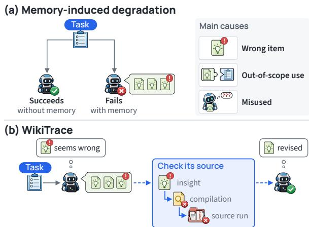  
Figure 1: Memory-induced degradation and Wiki-Trace. (a) The agent solves a task without memory but fails with memory that holds a wrong insight. (b) With WikiTrace, the agent follows the wrong insight’s links to its source run, revises it, and solves the task.

However, memory does not always help and can even lead to memory-induced degradation, where an agent fails on tasks it would solve without memory (Zhang et al., 2026a; Xiong et al., 2025; Hu et al., 2026a) (Figure 1a). Reliable experience reuse therefore requires solving more tasks while preserving those the agent already solves, but average accuracy cannot tell the two apart. We thus measure them separately, as Gain, the rate at which memory turns failures into successes, and Regression, the rate at which it turns successes into failures.

As shown in Figure 5, existing memory methods exhibit Regression comparable to, or even higher than, that of rerunning the agent without memory.

To understand this degradation, we analyze tasks that the agent consistently solves without memory but fails with it, and find that 52% of the failures trace to a memory item the agent followed (Figure 3), most often a wrong one. Wrong items arise because a trajectory comes with only a single label, success or failure, which does not reveal which of its many actions caused that outcome. Any method that learns lessons from such a trajectory therefore has to guess which actions matter and under which conditions, and each wrong guess yields a lesson that misleads the agent on new tasks. Yet, existing approaches provide lessons without the trajectories they came from, leaving the agent no way to check them, even though the evidence needed to catch an erroneous lesson often remains in that trajectory.

To this end, we present WikiTrace, an evidencelinked memory system that keeps each lesson together with a path back to its original trajectory (Figures 1b and 2), combining the strengths of both: a lesson concisely tells the agent what to do, whereas the trajectory faithfully records what actually happened but is too long to reread for every decision. Specifically, WikiTrace organizes its memory into three layers linked from top to bottom: each lesson is stored as a concise insight, which links down to a compilation that summarizes why its trajectory succeeded or failed, and further down to the raw trajectory itself. Then, on a new task, the agent starts from all insights and, whenever an insight lacks details needed to act, conflicts with another, or comes from a failed trajectory, descends through its links with terminal tools to recover missing details or revise the insight before acting.

We validate WikiTrace on five agentic benchmarks comprising eight suites, spanning simulated text worlds (Shridhar et al., 2021; Wang et al., 2022; Dagan et al., 2025) and tool-use environments (Yao et al., 2025; Barres et al., 2026; Trivedi et al., 2024). WikiTrace achieves the best performance on every suite, improving over the agent without memory by 10.7 points on average and outperforming a baseline given the same insights alone by 3.2 points, while reducing memory-induced degradation (Regression from 6.5% to 4.5%). Further analyses show that the agent consults the linked evidence more often on harder tasks, where its advantage is largest, and gains most when the evidence changes its plan. These gains hold under another backbone.

## 2 Related Work

## 2.1 Experience-Driven Procedural Memory

Language agents increasingly convert past execution experience into procedural memory that can guide future decisions. Prior methods retain verbal feedback or successful trajectories (Shinn et al., 2023; Zhao et al., 2024), accumulate executable skills (Wang et al., 2024), or distill experience into reusable guidelines, manuals, workflows, modular procedures, and multigranular scripts (Fu et al., 2024; Chen et al., 2024; Wang et al., 2025; Han et al., 2026; Fang et al., 2026). Continual approaches further update reasoning memories and playbooks with new successful and failed experience (Zhou et al., 2025; Ouyang et al., 2026; Zhang et al., 2026b; Cao et al., 2026). These approaches develop mechanisms for distilling, selecting, and updating experience for reuse. WikiTrace focuses on reassessing the resulting guidance during task execution, linking each lesson to its source evidence so that the agent can examine its basis and applicability to the current task.

## 2.2 Reliable Reuse of Unverified Memory

Reusing past experience does not always improve an agent’s performance. Agents ignore or misinterpret relevant condensed experience (Zhao et al., 2026a), encounter retrieval competition and negative transfer during continual learning (Hu et al., 2026a), and exhibit amplified unsafe behavior when reusing execution-oriented experience collected from benign tasks (Zhao et al., 2026c). These findings motivate evaluating the failures introduced by memory alongside the tasks it helps solve. We explicitly separate Gain from Regression to highlight memory-induced degradation that aggregate accuracy obscures. Research on memory admission and revision addresses reliability by controlling which experiences and lessons are retained. PREPING validates synthetic practice trajectories before storage (Choi et al., 2026), SkillOpt admits skill updates through held-out evaluation (Yang et al., 2026), and ReMe updates or removes memories using subsequent utility (Cao et al., 2026). WikiTrace complements these approaches by focusing on how stored lessons inform decisions during task execution. This perspective treats reliable memory reuse as a question of both which lessons to retain and whether those lessons are justified in the situations where they are applied.

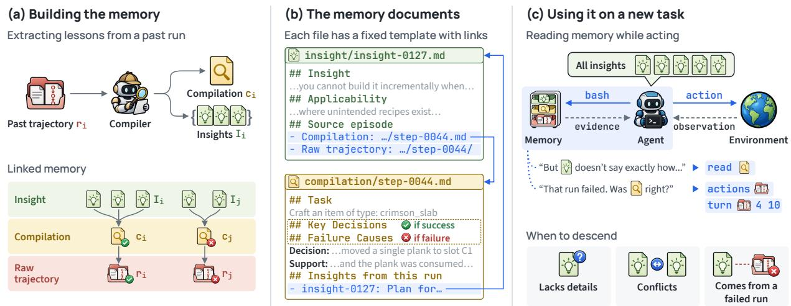  
Figure 2: Overview of WikiTrace. (a) A compiler turns each past run into a compilation, a diagnosis of why the run succeeded or failed, and insights, each a concise lesson. All layers stay linked. (b) Each layer’s documents follow a fixed template. (c) The agent starts from every insight and descends through the links under the conditions shown.

## 2.3 Memory Structure and Access

Agent memory design concerns both how past experience is organized and how agents access it during task execution. Hierarchical approaches organize experience at multiple levels of detail for compression, planning, and retrieval (Hu et al., 2025a; Zhang et al., 2025; Fang et al., 2026; Yang et al., 2025; Gao et al., 2025; Hu et al., 2026b), while HORMA connects filesystem summaries to raw interaction history and learns to select a minimal sufficient context (Hsu et al., 2026). Beyond memory organization, active-access methods determine when and what to retrieve during reasoning (Zhang et al., 2026c; Zhao et al., 2026b; Cai et al., 2026). Direct Corpus Interaction (DCI) provides a general approach to corpus access through terminal tools (Li et al., 2026). WikiTrace brings these two concerns together around the reassessment of procedural lessons: its structure preserves the connection between a lesson and its source execution, and its access mechanism lets the agent consult that execution when deciding how to apply the lesson.

## 3 WikiTrace

We first define the problem setting and examine memory-induced degradation to motivate Wiki-Trace. We then describe its memory construction and test-time evidence access (Figure 2).

## 3.1 Problem Setting

We consider an agent that reuses a fixed corpus of past runs collected without memory,

$$
\mathcal { D } _ { \mathrm { t r a i n } } = \{ ( x _ { i } , r _ { i } , s _ { i } ) \} _ { i = 1 } ^ { N } .
$$

Each run consists of a task $x _ { i } .$ a trajectory $r _ { i }$ recording the agent’s actions and observations, and a binary outcome $s _ { i } \in \{ 0 , 1 \}$ indicating task success or failure. No gold solutions or expert explanations are available, so a run’s outcome does not exactly tell us why it succeeded or failed. Thus, an insight drawn from it is not always valid.

We construct memory M from this corpus before any test task runs, with no additional run to validate an individual memory item. Once constructed, the memory remains fixed and read-only for an agent solving new tasks. Our objective is to improve task performance through experience reuse while limiting memory-induced degradation on tasks the agent solves without memory.

## 3.2 Understanding Memory-Induced Degradation

To understand how memory breaks tasks the agent can already solve, we examine tasks that the agent solves in all three repeated runs without memory but fails with memory. An LLM judge, gpt-5.6-sol at medium reasoning effort, compares each failed run with a no-memory run of the same task, locates the first turn where the two runs depart, and classifies the cause into one of five kinds (Figure 3; Appendix D).

In 52% of these cases, the failure traces to a memory item the agent followed (A to D). Most often the item itself was wrong (A, 20%). Otherwise, a valid item was applied outside its scope (B), misused by the agent (C), or followed while memory held a better one (D).<sup>1</sup> Checking the original run a lesson was drawn from can reveal a wrong or out-of-scope item. Figure 4 shows an example: a wrong rule from ExpeL (Zhao et al., 2024) fails a task the agent solves without memory, although the run behind the rule contradicts it.

<table><tr><td rowspan=3 colspan=1></td><td rowspan=1 colspan=6>The agent followed a memory itemA     B     C     D       E</td></tr><tr><td rowspan=1 colspan=1>Wrong</td><td rowspan=1 colspan=1>Out-of-</td><td rowspan=1 colspan=1>Misused</td><td rowspan=1 colspan=1>Missed</td><td rowspan=1 colspan=1></td><td rowspan=1 colspan=1>No link</td></tr><tr><td rowspan=1 colspan=1>item scope</td><td rowspan=1 colspan=1>item</td><td rowspan=1 colspan=1>item</td><td rowspan=1 colspan=1>better item</td><td rowspan=1 colspan=1>to</td><td rowspan=1 colspan=1>memory</td></tr><tr><td rowspan=1 colspan=1>All (355)</td><td rowspan=1 colspan=1>70</td><td rowspan=1 colspan=1>41</td><td rowspan=1 colspan=1>45</td><td rowspan=1 colspan=1>28</td><td rowspan=1 colspan=1></td><td rowspan=1 colspan=1>171</td></tr><tr><td rowspan=1 colspan=1></td><td rowspan=1 colspan=1></td><td rowspan=1 colspan=1></td><td rowspan=1 colspan=1></td><td rowspan=1 colspan=1></td><td rowspan=1 colspan=1></td><td rowspan=1 colspan=1></td></tr><tr><td rowspan=1 colspan=1>ExpeL (101)</td><td rowspan=1 colspan=1>31</td><td rowspan=1 colspan=1>5</td><td rowspan=1 colspan=1>11</td><td rowspan=1 colspan=1>2</td><td rowspan=1 colspan=1></td><td rowspan=1 colspan=1>52</td></tr><tr><td rowspan=1 colspan=1>ReasoningBank (78)</td><td rowspan=1 colspan=1>15</td><td rowspan=1 colspan=1>8</td><td rowspan=1 colspan=1>13</td><td rowspan=1 colspan=1>1</td><td rowspan=1 colspan=1></td><td rowspan=1 colspan=1>41</td></tr><tr><td rowspan=1 colspan=1>AWM (68)</td><td rowspan=1 colspan=1>2</td><td rowspan=1 colspan=1>11</td><td rowspan=1 colspan=1>13</td><td rowspan=1 colspan=1>6</td><td rowspan=1 colspan=1></td><td rowspan=1 colspan=1>36</td></tr><tr><td rowspan=3 colspan=1>Insights Only (62)WikiTrace (46)</td><td rowspan=1 colspan=1>15</td><td rowspan=1 colspan=1>11</td><td rowspan=1 colspan=1>2</td><td rowspan=1 colspan=1>10</td><td rowspan=1 colspan=1></td><td rowspan=1 colspan=1>24</td></tr><tr><td rowspan=1 colspan=1></td><td rowspan=1 colspan=1></td><td rowspan=1 colspan=1></td><td rowspan=1 colspan=1></td><td rowspan=1 colspan=1></td><td rowspan=1 colspan=1></td></tr><tr><td rowspan=1 colspan=1>7</td><td rowspan=1 colspan=1>6</td><td rowspan=1 colspan=1>6</td><td rowspan=1 colspan=1>9</td><td rowspan=1 colspan=1></td><td rowspan=1 colspan=1>18</td></tr></table>

Figure 3: Failure categories in memory-induced degradation. LLM-judged counts of failures on tasks solved in all three trials without memory.

These observations motivate preserving a path from each insight back to its source run. With this path, the agent can recover the observations an insight omits and check whether the insight is supported and whether it applies to the current task before following it. WikiTrace realizes this through source-linked memory (Section 3.3) and test-time evidence access (Section 3.4).

## 3.3 Constructing Source-Linked Memory

WikiTrace constructs memory $\mathcal { M } = ( R , C , I , E )$ consisting of raw trajectories R, compilations $C ,$ insights $I ,$ and source links E. Each run is processed independently so that every extracted lesson remains connected to the experience it came from.

Compilation and insight extraction A compiler reads a task $x _ { i } ,$ the agent’s trajectory $r _ { i }$ on that task, and a binary signal $s _ { i }$ of its success or failure, producing a compilation $c _ { i }$ and a set of insights $I _ { i } { \mathrm { : } }$

$$
( c _ { i } , I _ { i } ) = \mathrm { C o m p i l e r } ( x _ { i } , r _ { i } , s _ { i } ) .
$$

The compilation summarizes the run’s key decisions and supporting observations, using separate templates for successful and failed runs (Ouyang et al., 2026; Yang et al., 2026). For successful runs, it describes decisions associated with success; for failed runs, it records plausible explanations for failure. These accounts remain interpretations of the run rather than verified explanations of its outcome. The compiler also extracts at most three insights per run. Each insight is a separate document that says what to do, when it applies, which run it came from, and whether that run succeeded. We generate insights independently for each run, so each insight has a clear source, and we never update or delete them once written. The insight pool may therefore contain redundant or conflicting insights, and deciding which one applies to the current task is left to the agent.

<table><tr><td rowspan=1 colspan=3>Rule 2 Lamp tasks finish when the object is next to the lit lamp</td></tr><tr><td rowspan=1 colspan=3>Source run (step-0043 · success)                            √</td></tr><tr><td rowspan=3 colspan=3>TASK look at pencil under the desklamp.T4 ACT  use desklamp 1OBS  You turn on the desklamp 1.T8 ACT  take pencil 1 from desk 1OBS  You pick up the pencil 1 from the desk 1. Episode over √</td></tr><tr><td rowspan=1 colspan=1></td><td rowspan=2 colspan=1></td></tr><tr><td rowspan=1 colspan=1>Episode</td></tr><tr><td rowspan=1 colspan=2></td><td rowspan=1 colspan=1>TEST TASK look at vase under the desklamp.</td></tr><tr><td rowspan=1 colspan=3>With memory                                            ×Turns on the lamp beside the vase on the desk and declares the task done.Without memory                                         √</td></tr><tr><td rowspan=1 colspan=3>Picks up the vase, then turns on the lamp.</td></tr></table>

Figure 4: A wrong lesson induces degradation. A rule in memory says an ALFWorld lamp task ends once the object sits beside the lit lamp, which its source run contradicts. Following it, the agent fails a task it solves without memory (Figure 16).

Source preservation and linking WikiTrace preserves each raw trajectory unchanged: the task metadata, each turn’s reasoning, action and observation, and whether the run succeeded. Each insight links to both its source compilation and raw trajectory. Thus, when reassessing an insight, the test-time agent can see which run it came from and how that run was interpreted to derive it. To help the agent navigate, each layer also has an index. Appendix B provides the corpus layout, document templates, and construction algorithm.

## 3.4 Revisiting Source Evidence at Test Time

WikiTrace lets the agent start from the insights and descend to their source runs when an insight may not hold or does not say enough to act on now.

Initial input The agent first receives all insights, each stating what to do, when it applies, and the id of its source run. The message then lists the three past runs whose tasks are most similar to the current one, with the ids and titles of the insights drawn from each. These runs give the agent starting points for its search.

Table 1: Main results. Mean over three trials, ± the standard deviation across trials in small type. Avg. averages the eight suites. Best results are bolded and second-best results are underlined.
<table><tr><td rowspan="2">Method</td><td colspan="2">ALFWorld</td><td rowspan="2">ScienceWorld</td><td colspan="2">PlanCraft</td><td rowspan="2"> $\tau ^ { 3 } { \bf - b e n c h }$  Retail</td><td colspan="2">AppWorld</td><td rowspan="2">Avg.</td></tr><tr><td>Seen</td><td>Unseen</td><td>Seen</td><td>Unseen</td><td>Normal Challenge</td><td></td></tr><tr><td>No Memory</td><td> $9 4 . 4 { \pm } 2 . 0 $ </td><td> $9 4 . 3 { \pm } 1 . 9$ </td><td> $8 3 . 7 \pm 0 . 8$ </td><td> $7 2 . 3 { \pm } 1 . 9$ </td><td> $5 6 . 3 { \pm } 1 . 2 $ </td><td> $\underline { { 8 6 . 8 \pm 1 . 9 } }$ </td><td> $7 5 . 4 \pm 3 . 4$ </td><td> $7 2 . 7 \pm 2 . 2$ </td><td> $7 9 . 5 { \pm } 1 . 6 $ </td></tr><tr><td>AWM</td><td> $9 4 . 7 \pm 1 . 2$ </td><td> $9 7 . 3 { \pm } 0 . 9 $ </td><td> $8 8 . 9 { \pm } 4 . 7 $ </td><td> $7 6 . 3 { \pm } 3 . 7 $ </td><td> $5 7 . 3 { \pm 2 . 1 }$ </td><td> $8 5 . 5 { \pm 2 . 1 }$ </td><td> $7 9 . 3 { \pm } 0 . 7 $ </td><td> $7 3 . 4 \pm 1 . 7$ </td><td> $8 1 . 6 { \pm } 0 . 3 $ </td></tr><tr><td>ReasoningBank</td><td> $9 2 . 1 { \pm } 2 . 4 $ </td><td> $9 2 . 8 { \pm } 0 . 7 \ \qquad $ </td><td> $8 5 . 0 \pm 1 . 3$ </td><td> $8 4 . 7 \pm 2 . 6 $ </td><td> $6 1 . 3 { \pm } 3 . 4 $ </td><td> $8 6 . 4 \pm 1 . 6$ </td><td> $8 0 . 8 \pm 1 . 5$ </td><td> $7 0 . 7 \pm 3 . 0$ </td><td> $8 1 . 7 { \pm } 0 . 5 $ </td></tr><tr><td>ExpeL</td><td> $9 4 . 4 { \pm } 0 . 9$ </td><td> $9 8 . 0 { \pm } 0 . 4 \ $ </td><td> $9 1 . 9 { \pm } 1 . 6 $ </td><td> $7 4 . 0 { \pm } 8 . 5 $ </td><td> $5 1 . 0 { \pm } 3 . 6 $ </td><td> $8 2 . 5 { \pm } 5 . 1 $ </td><td> $8 0 . 5 \pm 5 . 7$ </td><td> $7 0 . 0 { \pm } 3 . 7 $ </td><td> $8 0 . 3 { \pm } 1 . 6 $ </td></tr><tr><td>Insights Only</td><td> $9 6 . 7 \pm 0 . 5$ </td><td> $9 7 . 3 { \pm } 1 . 3 $ </td><td> $9 4 . 9 { \pm } 0 . 6 $ </td><td> $8 8 . 7 \pm 6 . 1$ </td><td> $\underline { { 7 3 . 0 \pm 1 0 . 7 } }$ </td><td> $8 5 . 1 \pm 2 . 7$ </td><td> $\underline { { 8 6 . 8 \pm 0 . 4 } }$ </td><td> $\underline { { 7 3 . 7 \pm 1 . 4 } }$ </td><td> $8 7 . 0 { \pm } 2 . 5 $ </td></tr><tr><td>WikiTrace (ours)</td><td> $\mathbf { 9 8 . 7 \pm 0 . 5 }$  </td><td> ${ \bf 9 8 . 8 \pm 0 . 7 }$ </td><td> ${ \bf 9 6 . 1 \pm 1 . 4 }$ </td><td> $9 3 . 3 { \pm 3 . 4 }$  </td><td> ${ \bf 8 1 . 3 \pm 8 . 5 }$  </td><td> $\mathbf { 8 8 . 2 \pm 3 . 9 }$  </td><td> ${ \bf 8 9 . 5 \pm 1 . 5 }$ </td><td> $7 5 . 8 { \pm } 2 . 2 $  </td><td> ${ \bf 9 0 . 2 \pm 1 . 6 }$ </td></tr></table>

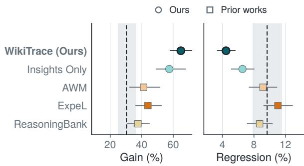  
Figure 5: Gain and Regression of WikiTrace and memory-based baselines, averaged over eight suites with 95% intervals.

Descent to source runs To let the agent examine an insight before following it, the prompt asks it to descend from the insight to its source run when the insight lacks the details needed to act on it, comes from a failed run, or disagrees with another insight. It asks for another descent whenever an action fails. The source-linked memory is mounted as read-only files, and the prompt encourages the agent to search them with read and bash for the fact that settles the question, such as a command format. Figure 27 in Appendix F gives the full prompt.

## 4 Experiments

## 4.1 Experimental Setup

Benchmarks We evaluate on eight suites across five benchmarks. Three are simulated text worlds, where the agent issues one text command at a time: ALFWorld (Shridhar et al., 2021) (household tasks), ScienceWorld (Wang et al., 2022) (science experiments) and PlanCraft (Dagan et al., 2025) (Minecraft crafting). Two are tool-use environments: AppWorld (Trivedi et al., 2024) poses everyday tasks through application APIs, and $\tau ^ { 3 }$ -bench Retail (Yao et al., 2025; Barres et al., 2026) combines conversation with a simulated customer and tool calls over an order database. AppWorld includes Test-Normal and Test-Challenge; the latter requires unseen applications. Appendix A.1 details suite construction and splits.

Baselines No Memory is the same agent with nothing added to its prompt or files. AWM (Wang et al., 2025) abstracts successful trajectories into reusable workflows. ExpeL (Zhao et al., 2024) keeps a list of free-form rules and reviews the whole list against each successful trajectory to add, edit or remove rules. ReasoningBank (Ouyang et al., 2026) distills successful and failed trajectories into reasoning strategies and retrieves them by task similarity. We adapt their official implementations to our offline protocol (Appendix A.3). Insights Only gives the same insights as WikiTrace but mounts no source compilations or raw trajectories and omits the prompt to descend, so the two differ only in access to source runs.

Protocol We run three trials per suite and method. In each trial, every method builds its memory once from the same No Memory runs of the training tasks and is tested on the same test tasks. No method may make additional runs to validate its memory. All methods use the same agent: a Pi terminal agent (Earendil Works, 2025) given each benchmark’s ReAct instruction. The agent and memory builders use deepseek-v4-flash<sup>2</sup> with high reasoning effort. We report each benchmark’s original metric, averaged over the three trials. See Appendix A.2 for implementation details.

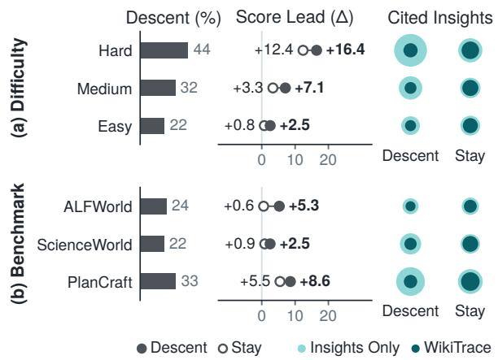  
Figure 6: WikiTrace against Insights Only by descent in the text-world benchmarks. Score Lead ∆ is WikiTrace minus Insights Only, and circle radius gives the insights reported as used. Difficulty: No Memory solves the task in none (Hard), one or two (Medium) or all three (Easy) trials.

## 4.2 Main Results

Table 1 shows that WikiTrace achieves the highest performance on all eight suites, averaging 90.2 compared with 79.5 for No Memory. It also exceeds Insights Only by 3.2 points on average, demonstrating the benefit of source evidence and the descent prompt beyond the same insights alone. Notably, WikiTrace is the only memory method that matches or exceeds No Memory on every suite, suggesting that revisiting source evidence helps mitigate memory-induced degradation.

## 4.3 Gain and Regression

Aggregate performance does not distinguish improvements on previously failed tasks from failures on previously solved tasks. We therefore report Gain and Regression separately.

Gain and Regression. For task i, let B<sub>i</sub> denote the majority No Memory outcome across three trials and $M _ { i , t }$ the outcome with memory in trial t. Gain measures success on tasks No Memory fails, while Regression measures failure on tasks No Memory solves:

$$
\begin{array} { r } { \mathrm { G a i n } = \mathrm { P r } ( M _ { i , t } = 1 \mid B _ { i } = 0 ) , } \\ { \mathrm { R e g r e s s i o n } = \mathrm { P r } ( M _ { i , t } = 0 \mid B _ { i } = 1 ) . } \end{array}
$$

Figure 5 reports both rates averaged across suites, with 95% bootstrap confidence intervals over tasks (Appendix C.1). To account for variation across runs, we evaluate three additional No Memory trials against the same reference outcomes $B _ { i } .$ . The dashed line shows this rerun baseline, measuring outcome changes without memory.

WikiTrace achieves a Regression of 4.5%, compared with 6.5% for Insights Only and 9.7% for the rerun baseline. Its Regression is lower than Insights Only on seven of the eight suites, and it is the only method whose Regression confidence interval lies entirely below the rerun band. This reduction accompanies higher Gain: WikiTrace exceeds the rerun baseline by 35 percentage points, compared with 27 for Insights Only and 7 to 14 for existing memory methods. Because WikiTrace and Insights Only differ only in access to source runs, the higher Gain and lower Regression are attributable to that access. Relative to Insights Only, wrong or out-of-scope items cause half as many of WikiTrace’s regressions (Figure 3). Appendix C provides results for individual suites.

## 5 Analysis

## 5.1 When Does Descent Help?

Insights Only gives the agent the same insights, so comparing it with WikiTrace on the same task and trial shows what access to source runs adds. We split WikiTrace’s test runs in the three textworld benchmarks into Descent runs, which open a compilation or raw trajectory, and Stay runs, which do not (Figure 6). WikiTrace descends more often on harder tasks, in 22% of runs on Easy tasks and 44% on Hard ones. Descent runs lead Insights Only by 1.6 to 4.7 points more than Stay runs at every difficulty and on every benchmark. The gap between Descent and Stay grows with difficulty, from 1.8 points on Easy tasks to 3.7 on Medium and 4.1 on Hard ones. These results suggest that source runs help more on harder tasks. The agent chooses when to descend, however, so Descent and Stay runs differ in more than the descent.

Stay runs also lead Insights Only, by 0.6 to 12.4 points. In Stay runs, WikiTrace reports 19 to 28% fewer insights as used,<sup>3</sup> which suggests more selective use of memory. The reduction is larger in Descent runs, 38 to 57%.

## 5.2 Why and How Does WikiTrace Descend?

Section 5.1 shows when descent helps, but not why the agent descends or what the opened run changes. To find out, an LLM judge reads the agent’s reasoning around each descent in the three text-world benchmarks and labels three things: its trigger, what prompted the descent; its target, what the agent looked for in the opened run; and its effect, what the run contributed to the agent’s next actions (Figures 8 and 9). The judge, gpt-5.6-sol at medium reasoning effort, agrees with a second judge, GLM-5.3, at Cohen’s κ of 0.77 on trigger and 0.63 on target. Effect is harder to judge, so its label is the majority of three judges (Appendix E.1).

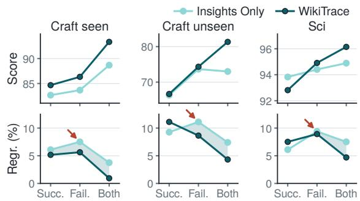  
Figure 7: Score and Regression by memory subset. Memory is built from successful runs (Succ.), failed runs (Fail.) or both. Arrows mark Insights Only’s higher Regression with failed runs.

Why it descends and what it seeks WikiTrace’s advantage over Insights Only concentrates on descents made after a problem. Descents that follow a blocked attempt, an observation that blocked the agent’s plan, or a doubt about an insight make up 36% of descents and lead Insights Only by 10.4 points, against 3.7 points for descents made with nothing gone wrong (Figure 8). The largest advantage, 17.3 points, comes when a blocked attempt sends the agent after a specific fact in past runs, which Insights Only has no way to look up. Routine checks are the most common descent (38%), and 90% of them read a similar run’s procedure, with a small advantage of 3.4 points.

How it uses source evidence The opened run changes the agent’s plan in 43% of descending runs, by revising an insight (24%), adding a detail an insight leaves out (14%), or supplying a fact no insight covers (4%). These runs lead Insights Only by 8.3 points, against 4.4 points when the opened run only confirms the plan or goes unused (Figure 9). Figure 11 illustrates such a revision, with additional cases in Appendix E.2.

## 5.3 Can Agents Reliably Learn from Failed Experiences?

Failed runs contain useful experience, but the lessons drawn from them depend on how the failure is interpreted. To examine their value for memory, we compare WikiTrace and Insights Only using insights from successful runs, failed runs, or both on PlanCraft and ScienceWorld. Figure 7 shows that both methods perform better with failed runs alone than with successful runs alone, and perform best with both. Failed runs therefore add guidance beyond what successful runs give.

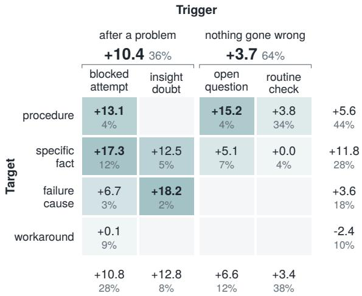

Figure 8: Why WikiTrace descends and what it seeks. WikiTrace’s score lead over Insights Only by trigger and target, with descent shares in gray.
<table><tr><td rowspan=1 colspan=1>insight</td><td rowspan=1 colspan=1>insight</td><td rowspan=1 colspan=1>fact</td><td rowspan=1 colspan=1>plan</td><td rowspan=1 colspan=1>none</td></tr><tr><td rowspan=1 colspan=1>+8.7</td><td rowspan=1 colspan=1>+6.6</td><td rowspan=1 colspan=1>+11.8</td><td rowspan=1 colspan=1>+5.2</td><td rowspan=1 colspan=1>+3.1</td></tr><tr><td rowspan=1 colspan=1>24%</td><td rowspan=1 colspan=1>14%</td><td rowspan=1 colspan=1>4%</td><td rowspan=1 colspan=1>32%</td><td rowspan=1 colspan=1>19%</td></tr></table>

Figure 9: How WikiTrace uses evidence. WikiTrace’s score lead over Insights Only by effect, with descent shares in gray.

However, this benefit accompanies a greater risk of regression when the extracted insights are provided alone. Insights Only has its highest Regression with failed runs alone, reaching 9.3% on Plan-Craft and 9.4% on ScienceWorld. With the same insights, WikiTrace reduces these rates to 7.1% and 8.9%. These findings support keeping failed runs with their source evidence, so that agents can revisit the basis of a lesson before reusing it.

## 5.4 How Cost-Effective Is WikiTrace?

To examine whether WikiTrace’s advantage comes from greater memory construction cost, we increase existing methods’ construction budgets by running their builders over the same training trajectories nine times for AWM and three times for ExpeL and ReasoningBank. Figure 10 shows that WikiTrace retains the highest average performance even with these larger baseline budgets. At test time, WikiTrace costs 1.17 times as much per task as Insights Only, averaged across suites, while improving average performance by 3.2 points. These results suggest that WikiTrace improves performance with modest additional test-time cost.

<table><tr><td rowspan="2">Method</td><td colspan="2">Craft</td><td rowspan="2">Sci</td><td rowspan="2">Avg.</td></tr><tr><td>Seen</td><td>Unseen</td></tr><tr><td>NM</td><td> $6 8 . 7 \pm 3 . 3$ </td><td> $5 5 . 3 { \pm 2 . 1 }$ </td><td> $8 9 . 6 \pm 1 . 5$ </td><td> $7 1 . 2 { \pm } 0 . 3 $ </td></tr><tr><td>AWM</td><td> $6 6 . 0 { \pm } 2 . 8 $ </td><td> $4 7 . 0 { \pm } 2 . 9$ </td><td> $9 1 . 7 { \pm } 1 . 0 $ </td><td> $6 8 . 2 { \pm } 0 . 5 $ </td></tr><tr><td>ReasoningBank</td><td> $7 4 . 7 \pm 4 . 2$ </td><td> $5 3 . 3 { \pm } 5 . 2 $ </td><td> $9 0 . 9 { \pm } 1 . 9 $ </td><td> $7 3 . 0 { \pm } 2 . 3 $ </td></tr><tr><td>ExpeL</td><td> $7 9 . 0 { \pm } 1 2 . 8 $ </td><td> $6 7 . 0 { \pm } 1 4 . 1$ </td><td> $8 8 . 6 \pm 1 . 4$ </td><td> $7 8 . 2 { \pm } 8 . 5 $ </td></tr><tr><td>Insights Only</td><td> $9 2 . 3 { \pm } 2 . 1 $ </td><td> $8 7 . 7 \pm 3 . 3$ </td><td> $9 2 . 6 { \pm } 0 . 8 $ </td><td> $9 0 . 9 2 1 . 6 $ </td></tr><tr><td>WT</td><td> $\mathbf { 9 5 . 7 \pm 1 . 7 }$  一</td><td> ${ \bf 8 9 . 0 { \pm } 1 . 6 }$  </td><td> ${ \bf 9 3 . 3 \pm 0 . 8 }$  </td><td> $9 2 . 7 { \pm } 0 . 4 $ </td></tr></table>

Table 2: Results with GLM-5.3-flash. Mean over three trials. NM is No Memory and WT is WikiTrace.

## 5.5 Does WikiTrace Generalize?

WikiTrace also achieves the highest performance on all three evaluated suites with GLM-5.3-flash (Table 2). We evaluate all methods on PlanCraft and ScienceWorld at medium reasoning effort, using training executions generated by the same model to construct memory. WikiTrace averages 92.7, exceeding Insights Only by 1.8 percentage points and No Memory by 21.5. Each existing memory method falls below No Memory on at least one suite. This pattern mirrors the DeepSeek results, supporting the benefit of source-linked memory across the two models.

## 5.6 Resolving Conflicting Insights

Figure 11 illustrates how WikiTrace resolves conflicting insights by revisiting source evidence. In PlanCraft, an insight from a failed run incorrectly rules out a valid procedure that another recommends. The successful run’s observations show that the procedure works. WikiTrace revises the insight and succeeds, whereas Insights Only, given identical insights, follows the wrong guidance and fails. This case shows how raw trajectories enable agents to reassess interpretations embedded in insights and compilations.

## 6 Conclusion

Lessons extracted from past executions are not validated by their outcomes alone, and reusing them without scrutiny can cause memory-induced degradation. We introduced WikiTrace, which links insights to source compilations and raw trajectories so that agents can recover missing details and reassess their guidance. Across five benchmarks, WikiTrace achieves the highest performance on every suite while increasing Gain and reducing Regression compared with injecting the same insights alone. These findings suggest that agent memory should preserve not only reusable lessons, but also the evidence needed to reassess them.

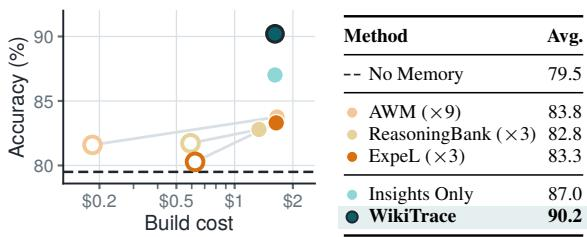  
Figure 10: Accuracy against build cost, averaged over the eight suites. A hollow mark is a default build and a filled mark the build run N times. The dashed line shows No Memory.

## Limitations

Memory is built from binary trajectory outcomes, so a compilation’s diagnosis of a failure, and any insight drawn from it, may be wrong. A source link lets the agent check an insight against its run but does not verify the insight. WikiTrace places every insight in the first message so that the agent never misses one, and the prompt therefore grows with the memory. A memory too large to place in full would need the agent to find the insights it needs, a retrieval problem this work leaves open. The causes of degradation (Section 3.2) and the descent labels (Section 5.2) come from an LLM judge that reads the agent’s reasoning, so they describe what that reasoning states, not what produced the outcome.

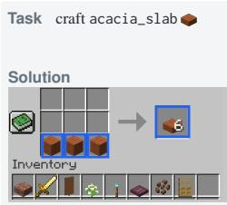  
Agent’s Common Mistake Auto-craft : After one item is placed, the output shows a product.

## 1 A wrong insight

insight-0083 failed run Wrong If placing a single item already crafts something, a recipe that needs several of it may be impossible. Consider giving up.

Why acacia\_button in the output is only a preview of what the grid matches so far. It was not auto-crafted: acacia\_planks stays on the grid. Ignore the preview and finish the recipe.

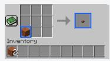  
Agents think this preview is an already crafted item and try to remove it.

## 2 What each method did next

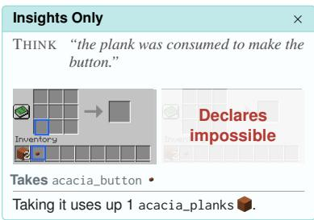

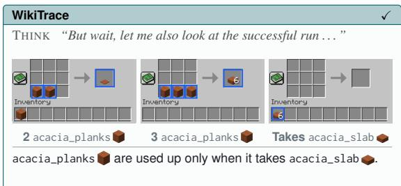

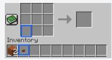  
Taking it uses up the item, so the agent can run out of materials and fail.

## 3 How WikiTrace revised the insight

insight-0130 successful run Until the recipe is complete, the output shows only an intermediate item. Place all required items.

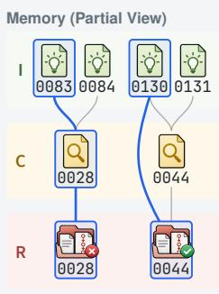

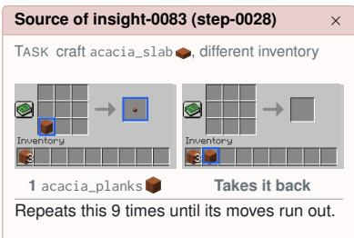

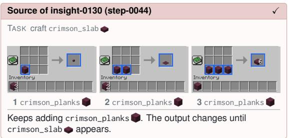  
THINK “The button/pressure plate outputs are temporary and get replaced when the full slab pattern is formed. So I can safely place my acacia\_planks one at a time!”  
insight-0083 is wrong: it is OK to keep adding acacia\_planks .

Figure 11: Qualitative example: revising a wrong insight (PlanCraft). Insight-0083 leads agents into the auto-craft mistake. Insights Only follows it and fails, but WikiTrace revises it through descent and succeeds.

## References

Victor Barres, Honghua Dong, Soham Ray, Xujie Si, and Karthik Narasimhan. 2026. τ<sup>2</sup>-bench: Evaluating conversational agents in a dual-control environment. In Forty-third International Conference on Machine Learning.

Yuxuan Cai, Wei Li, Jie Zhou, Qin Chen, Xin Li, Bo Zhang, and Liang He. 2026. Ask only when needed: Proactive retrieval from memory and skills for experience-driven lifelong agents. arXiv preprint arXiv:2604.20572.

Zouying Cao, Jiaji Deng, Li Yu, Weikang Zhou, Zhaoyang Liu, Bolin Ding, and Hai Zhao. 2026. Remember me, refine me: A dynamic procedural memory framework for experience-driven agent evolution. In Findings of the Association for Computational Linguistics: ACL 2026.

Minghao Chen, Yihang Li, Yanting Yang, Shiyu Yu, Binbin Lin, and Xiaofei He. 2024. AutoManual: Constructing instruction manuals by LLM agents via interactive environmental learning. In Advances in Neural Information Processing Systems.

Yumin Choi, Sangwoo Park, Minki Kang, Jinheon Baek, and Sung Ju Hwang. 2026. PREPING: Building agent memory without tasks. arXiv preprint arXiv:2605.13880.

Gautier Dagan, Frank Keller, and Alex Lascarides. 2025. Plancraft: an evaluation dataset for planning with LLM agents. In Second Conference on Language Modeling.

Earendil Works. 2025. Pi Agent Harness. https: //github.com/earendil-works/pi. Official Website: https://pi.dev/.

Runnan Fang, Yuan Liang, Xiaobin Wang, Jialong Wu, Shuofei Qiao, Pengjun Xie, Fei Huang, Huajun Chen, and Ningyu Zhang. 2026. Memp: Exploring agent procedural memory. In Findings of the Association for Computational Linguistics: ACL 2026.

Yao Fu, Dong-Ki Kim, Jaekyeom Kim, Sungryull Sohn, Lajanugen Logeswaran, Kyunghoon Bae, and Honglak Lee. 2024. AutoGuide: Automated generation and selection of context-aware guidelines for large language model agents. In Advances in Neural Information Processing Systems.

Pengyu Gao, Jinming Zhao, Xinyue Chen, and Long Yilin. 2025. An efficient context-dependent memory framework for LLM-centric agents. In Proceedings of the 2025 Conference of the Nations of the Americas Chapter of the Association for Computational Linguistics: Human Language Technologies (Volume 3: Industry Track).

Dongge Han, Camille Couturier, Daniel Madrigal Diaz, Xuchao Zhang, Victor Rühle, and Saravan Rajmohan. 2026. LEGOMem: Modular procedural memory for multi-agent LLM systems for workflow automation.

In Proceedings ofthe 2026 International Conference on Autonomous Agents and Multiagent Systems.

Hao-Lun Hsu, Nikki Lijing Kuang, Boyi Liu, Zhewei Yao, and Yuxiong He. 2026. Organize then retrieve: Hierarchical memory navigation for efficient agents. arXiv preprint arXiv:2606.11680.

Mengkang Hu, Tianxing Chen, Qiguang Chen, Yao Mu, Wenqi Shao, and Ping Luo. 2025a. HiAgent: Hierarchical working memory management for solving long-horizon agent tasks with large language model. In Proceedings of the 63rd Annual Meeting of the Associationfor Computational Linguistics (Volume 1: Long Papers).

Qisheng Hu, Quanyu Long, and Wenya Wang. 2026a. When continual learning moves to memory: A study of experience reuse in LLM agents. arXiv preprint arXiv:2604.27003.

Yuyang Hu, Jiongnan Liu, Jiejun Tan, Yutao Zhu, and Zhicheng Dou. 2026b. Memory matters more: Eventcentric memory as a logic map for agent searching and reasoning. In Findings of the Association for Computational Linguistics: ACL 2026.

Yuyang Hu, Shichun Liu, Yanwei Yue, Guibin Zhang, Boyang Liu, Fangyi Zhu, Jiahang Lin, Honglin Guo, Shihan Dou, Zhiheng Xi, Senjie Jin, Jiejun Tan, Yanbin Yin, Jiongnan Liu, Zeyu Zhang, Zhongxiang Sun, Yutao Zhu, Hao Sun, Boci Peng, and 28 others. 2025b. Memory in the age of AI agents. arXiv preprint arXiv:2512.13564.

Zhuofeng Li, Haoxiang Zhang, Cong Wei, Pan Lu, Ping Nie, Yi Lu, Yuyang Bai, Shangbin Feng, Hangxiao Zhu, Ming Zhong, Yuyu Zhang, Jianwen Xie, Yejin Choi, James Zou, Jiawei Han, Wenhu Chen, Jimmy Lin, Dongfu Jiang, and Yu Zhang. 2026. Beyond semantic similarity: Rethinking retrieval for agentic search via direct corpus interaction. arXiv preprint arXiv:2605.05242.

Bill Yuchen Lin, Yicheng Fu, Karina Yang, Faeze Brahman, Shiyu Huang, Chandra Bhagavatula, Prithviraj Ammanabrolu, Yejin Choi, and Xiang Ren. 2023. SwiftSage: A generative agent with fast and slow thinking for complex interactive tasks. In Advances in Neural Information Processing Systems, volume 36.

Jinghao Luo, Yuchen Tian, Chuxue Cao, Ziyang Luo, Hongzhan Lin, Kaixin Li, Chuyi Kong, Ruichao Yang, and Jing Ma. 2026. From storage to experience: A survey on the evolution of LLM agent memory mechanisms. In Findings ofthe Association for Computational Linguistics: ACL 2026.

Siru Ouyang, Jun Yan, I-Hung Hsu, Yanfei Chen, Ke Jiang, Zifeng Wang, Rujun Han, Long T. Le, Samira Daruki, Xiangru Tang, Vishy Tirumalashetty, George Lee, Mahsan Rofouei, Hangfei Lin, Jiawei Han, Chen-Yu Lee, and Tomas Pfister. 2026. ReasoningBank: Scaling agent self-evolving with reasoning memory. In The Fourteenth International Conference on Learning Representations.

Noah Shinn, Federico Cassano, Ashwin Gopinath, Karthik Narasimhan, and Shunyu Yao. 2023. Reflexion: language agents with verbal reinforcement learning. In Advances in Neural Information Processing Systems.

Mohit Shridhar, Xingdi Yuan, Marc-Alexandre Côté, Yonatan Bisk, Adam Trischler, and Matthew Hausknecht. 2021. ALFWorld: Aligning text and embodied environments for interactive learning. In International Conference on Learning Representations.

Theodore R. Sumers, Shunyu Yao, Karthik Narasimhan, and Thomas L. Griffiths. 2024. Cognitive architectures for language agents. Transactions on Machine Learning Research.

Harsh Trivedi, Tushar Khot, Mareike Hartmann, Ruskin Manku, Vinty Dong, Edward Li, Shashank Gupta, Ashish Sabharwal, and Niranjan Balasubramanian. 2024. AppWorld: A controllable world of apps and people for benchmarking interactive coding agents. In Proceedings of the 62nd Annual Meeting of the Associationfor Computational Linguistics (Volume 1: Long Papers).

Guanzhi Wang, Yuqi Xie, Yunfan Jiang, Ajay Mandlekar, Chaowei Xiao, Yuke Zhu, Linxi Fan, and Anima Anandkumar. 2024. Voyager: An open-ended embodied agent with large language models. Transactions on Machine Learning Research.

Ruoyao Wang, Peter Jansen, Marc-Alexandre Côté, and Prithviraj Ammanabrolu. 2022. ScienceWorld: Is your agent smarter than a 5th grader? In Proceedings of the 2022 Conference on Empirical Methods in Natural Language Processing.

Zora Zhiruo Wang, Jiayuan Mao, Daniel Fried, and Graham Neubig. 2025. Agent workflow memory. In Proceedings ofthe 42nd International Conference on Machine Learning, Proceedings of Machine Learning Research.

Zidi Xiong, Yuping Lin, Wenya Xie, Pengfei He, Zirui Liu, Jiliang Tang, Himabindu Lakkaraju, and Zhen Xiang. 2025. How memory management impacts LLM agents: An empirical study of experience-following behavior. arXiv preprint arXiv:2505.16067.

Wei Yang, Jinwei Xiao, Hongming Zhang, Qingyang Zhang, Yanna Wang, and Bo Xu. 2025. Coarse-tofine grounded memory for LLM agent planning. In Proceedings of the 2025 Conference on Empirical Methods in Natural Language Processing.

Yifan Yang, Ziyang Gong, Weiquan Huang, Qihao Yang, Ziwei Zhou, Zisu Huang, Yan Li, Xuemei Gao, Qi Dai, Bei Liu, Kai Qiu, Yuqing Yang, Dongdong Chen, Xue Yang, and Chong Luo. 2026. SkillOpt: Executive strategy for self-evolving agent skills. arXiv preprint arXiv:2605.23904.

Shunyu Yao, Noah Shinn, Pedram Razavi, and Karthik Narasimhan. 2025. τ-bench: A benchmark for toolagent-user interaction in real-world domains. In The Thirteenth International Conference on Learning Representations.

Shunyu Yao, Jeffrey Zhao, Dian Yu, Nan Du, Izhak Shafran, Karthik Narasimhan, and Yuan Cao. 2023. ReAct: Synergizing reasoning and acting in language models. In The Eleventh International Conference on Learning Representations.

Dylan Zhang, Yanshan Lin, Zhengkun Wu, Yihang Sun, Bingxuan Li, Dianqi Li, and Hao Peng. 2026a. Useful memories become faulty when continuously updated by LLMs. arXiv preprint arXiv:2605.12978.

Guibin Zhang, Muxin Fu, Kun Wang, Frank Wan, Miao Yu, and Shuicheng Yan. 2025. G-Memory: Tracing hierarchical memory for multi-agent systems. In Advances in Neural Information Processing Systems.

Qizheng Zhang, Changran Hu, Shubhangi Upasani, Boyuan Ma, Fenglu Hong, Vamsidhar Kamanuru, Jay Rainton, Chen Wu, Mengmeng Ji, Hanchen Li, Urmish Thakker, James Zou, and Kunle Olukotun. 2026b. Agentic context engineering: Evolving contexts for self-improving language models. In The Fourteenth International Conference on Learning Representations.

Wenyuan Zhang, Xinghua Zhang, Haiyang Yu, Shuaiyi Nie, Bingli Wu, Juwei Yue, Tingwen Liu, and Yongbin Li. 2026c. ExpSeek: Self-triggered experience seeking for web agents. In Findings of the Associationfor Computational Linguistics: ACL 2026.

Andrew Zhao, Daniel Huang, Quentin Xu, Matthieu Lin, Yong-Jin Liu, and Gao Huang. 2024. ExpeL: LLM agents are experiential learners. Proceedings ofthe AAAI Conference on Artificial Intelligence.

Weixiang Zhao, Yingshuo Wang, Yichen Zhang, Yang Deng, Yanyan Zhao, Wanxiang Che, Bing Qin, and Ting Liu. 2026a. Large language model agents are not always faithful self-evolvers. In Proceedings of the 43rd International Conference on Machine Learning, Proceedings of Machine Learning Research.

Weixiang Zhao, Yingshuo Wang, Yichen Zhang, Yanyan Zhao, Yu Zhang, Yang Wu, Dandan Tu, Bing Qin, and Ting Liu. 2026b. Rethinking experience utilization in self-evolving language model agents. arXiv preprint arXiv:2605.07164.

Weixiang Zhao, Yichen Zhang, Yingshuo Wang, Yang Deng, Yanyan Zhao, Xuda Zhi, Yongbo Huang, Hao He, Wanxiang Che, Bing Qin, and Ting Liu. 2026c. On safety risks in experience-driven self-evolving agents. In Findings ofthe Associationfor Computational Linguistics: ACL 2026.

Huichi Zhou, Yihang Chen, Siyuan Guo, Xue Yan, Kin Hei Lee, Zihan Wang, Ka Yiu Lee, Guchun Zhang, Kun Shao, Linyi Yang, and Jun Wang. 2025. Memento: Fine-tuning LLM agents without finetuning LLMs. arXiv preprint arXiv:2508.16153.

## Appendix

Table 3: Benchmark suites. One training set per benchmark serves all of its test suites.
<table><tr><td>Benchmark</td><td>Suite</td><td>Train</td><td>Test</td><td>What the test holds out</td><td>Metric</td></tr><tr><td>ALFWorld</td><td>valid-seen</td><td>50</td><td>101</td><td>Games in training rooms.</td><td>Success rate</td></tr><tr><td></td><td>valid-unseen</td><td>50</td><td>134</td><td>Games in rooms absent from training.</td><td>Success rate</td></tr><tr><td>ScienceWorld</td><td>scienceworld</td><td>50</td><td>100</td><td>Descriptions absent from training, same task types.</td><td>Mean score</td></tr><tr><td>PlanCraft</td><td>plancraft-seen</td><td>50</td><td>100</td><td>Examples with training target items.</td><td>Success rate</td></tr><tr><td></td><td>plancraft-unseen</td><td>50</td><td>100</td><td>Examples with target items absent from training.</td><td>Success rate</td></tr><tr><td>AppWorld</td><td>test-normal</td><td>54</td><td>111</td><td>Tasks over training apps.</td><td>TGC</td></tr><tr><td></td><td>test-challenge</td><td>54</td><td>99</td><td>Tasks needing apps absent from training.</td><td>TGC</td></tr><tr><td>τ3-bench</td><td>retail</td><td>38</td><td>76</td><td>New requests, mostly from training customers.</td><td>Pass rate</td></tr></table>

## A Experimental Details

## A.1 Benchmark Suite Construction

Table 3 lists the suites. Every draw is seeded.

ALFWorld Training holds 50 games of the training split, eight or nine per task type, in rooms that also appear in valid\_seen. valid-seen is the full set of 101 valid\_seen games filtered to rooms visited by the 50 training games, and valid-unseen uses all 134 valid\_unseen games, set in four rooms absent from training.

ScienceWorld We use ten of the 30 task types, boil, melt, freeze, change-the-state-of-matter-of, use-thermometer, measure-melting-point-knownsubstance, measure-melting-point-unknownsubstance, test-conductivity, test-conductivity-ofunknown-substances, and chemistry-mix. Each meets three conditions.

• Its variations pose distinct tasks.

• Its training and test descriptions are largely disjoint.

• Its reference solutions fit the simulator’s 100- step limit.

Training holds five variations per type from the training split, and test holds 100 variations from the test split whose description does not occur in training.

PlanCraft We use solvable examples only, weighted toward medium and hard ones. Training holds 50 examples of the training split with distinct target items that also occur in the test split. plancraft-seen holds 100 test examples whose target is a training target, and plancraft-unseen 100 whose target occurs in no solvable training example.

AppWorld A scenario groups three tasks and is solved only when all three pass, so every suite keeps scenarios whole. We use difficulty 2 and 3 only. Training holds all 18 such training scenarios (54 tasks), test-normal all 37 of the Test-Normal split (111 tasks), and test-challenge a draw of 33 of the 65 difficulty-3 scenarios of the Test-Challenge split (99 tasks). TGC counts tasks and SGC scenarios.

τ<sup>3</sup>-bench (Retail) We set aside the authors’ splits and divide the 114 tasks into 38 training and 76 test tasks, grouped by customer, so every customer with several tasks appears on both sides. The simulated user is gpt-4.1, and the judge of conversation assertions is gpt-5.4-mini at medium reasoning effort.

## A.2 Agent Harness

Table 4 lists each benchmark’s harness. An episode ends when the task is done, the step budget runs out, or the agent replies without a tool call. The Pi turn cap is only a guard, since a turn may hold memory reads that are not steps.

Tool act(command) Sends one text command to the game and returns its observation. We add a done command that ends the episode, so the agent can stop early.

Tool take\_action(action, argument) Joins the action and its argument with a colon for the benchmark’s own parser. PlanCraft’s actions are move and smelt (source slot, target slot, quantity), search (a recipe, seeded), and impossible, which ends the episode. We drop the authors’ think, since the agent has its own reasoning channel. In $\tau ^ { 3 } \mathrm { . }$ bench an action is one of the 16 retail tools, or respond with a message to the simulated user. An episode also ends on the user’s stop, transfer, or out-of-scope token, or after 10 tool errors.

Table 4: Agent harness per benchmark. The instruction, exemplars, and step budget follow the listed ReAct baseline. A step is one environment tool call, except in $\tau ^ { \mathrm { 3 } } { \mathrm { - } } { \mathrm { b e n c h } } .$ , which counts agent, user, and tool turns as its authors do.
<table><tr><td>Benchmark</td><td>ReAct baseline</td><td>Tool</td><td>Max steps</td><td>Max Pi turns</td></tr><tr><td>ALFWorld</td><td>ReAct loop (Yao et al., 2023)</td><td>act</td><td>49</td><td>150</td></tr><tr><td>ScienceWorld</td><td>SwiftSage&#x27;s ReAct baseline (Lin et al., 2023)</td><td>act</td><td>100</td><td>400</td></tr><tr><td>PlanCraft</td><td>The authors&#x27; prompt (Dagan et al., 2025)</td><td>take_action</td><td>30</td><td>150</td></tr><tr><td>AppWorld</td><td>AppWorld&#x27;s ReAct code agent (Trivedi et al., 2024)</td><td>exec</td><td>50</td><td>150</td></tr><tr><td> $\tau ^ { \mathrm { { 3 } } } { \mathrm { - } } { \mathrm { b e n c h } }$ </td><td> $\tau ^ { 2 } { \mathrm { - b e n c h " s L L M } }$  agent (Barres et al., 2026)</td><td>take_action</td><td>200</td><td>150</td></tr></table>

Table 5: Compared methods. Formatted Rules are rules with required fields. WikiTrace links each to the compilation and raw trajectory it came from. Access is inject (I), retrieve (R) or traverse (T).
<table><tr><td></td><td colspan="4">Learns from</td></tr><tr><td>Method</td><td></td><td></td><td>Succ. Fail. Memory</td><td>Access</td></tr><tr><td>AWM</td><td>√</td><td></td><td>Procedures</td><td>I</td></tr><tr><td>ExpeL</td><td>√</td><td></td><td>Rules</td><td>I</td></tr><tr><td>ReasoningBank</td><td>√</td><td>√</td><td>Formatted Rules</td><td>R</td></tr><tr><td>Insights Only</td><td>√</td><td> $\checkmark$ </td><td>Formatted Rules</td><td>I</td></tr><tr><td>WikiTrace (ours)</td><td>√</td><td> $\checkmark$ </td><td>+ Linked Evidence I + T</td><td></td></tr></table>

Tool exec(code) Runs Python in the task’s shell, which holds the benchmark’s API bindings and keeps state across calls, and returns the output.

## A.3 Compared Methods: Details

We run the official implementations of the existing memory methods with their own induction prompts and retrieval (Wang et al., 2025; Zhao et al., 2024; Ouyang et al., 2026), changed only to fit our protocol (Section 4.1).

• Offline. AWM runs in its offline mode, which induces workflows once from training examples. ReasoningBank updates memory after every test task, and we instead build it once. Every method thus builds memory once from the shared nomemory training trajectories and freezes it.

• True outcome. Each builder receives the binary outcome, in place of an LLM judge (AWM, ReasoningBank) or the environment reward (ExpeL).

• Single pass. Each training trajectory is read once. ExpeL thus has no failed and successful attempts at one task to compare, which its Reflexion (Shinn et al., 2023) retries would provide, so it draws insights from successes alone, and we omit its exemplar retrieval.

Algorithm 1 WIKITRACE: Memory Construction   
Require: Fixed corpus $\mathcal { D } _ { \mathrm { t r a i n } } = \{ ( x _ { i } , r _ { i } , s _ { i } ) \} _ { i = 1 } ^ { N }$   
Ensure: Frozen evidence-linked memory corpus M   
1: R ← {r<sub>i</sub>}<sup>N</sup> , C ← ∅, I ← ∅, E ← ∅   
2: for i = 1, . . . , N do   
3: (c<sub>i</sub>, I<sub>i</sub>) ← COMPILER(x<sub>i</sub>, r<sub>i</sub>, s<sub>i</sub>)   
4: C ← C ∪ {c<sub>i</sub>}, I ← I ∪ I<sub>i</sub>   
5: E ← E ∪ {(u, i) | u ∈ I<sub>i</sub>}   
6: end for   
7: Build IDX(L) for L ∈ {R, C, I} ▷ document titles   
8: M ← FREEZE(R, C, I, E) ▷ read-only   
9: return M

## B Memory System Details

## B.1 Corpus and Memory Layout

WikiTrace mounts its corpus read-only at /work/corpus. Each index is generated by code from the layer it lists, and the corpus has no root index.

WikiTrace corpus layout   
/work/corpus/   
|-- corpus.json build stamp   
|-- raw/   
| |-- \_index.md every run and its outcome   
\`-- step-NNNN/   
| |-- metadata.md task, outcome, step count   
| \`-- solver.full.jsonl the agent's turn log   
|-- compilation/   
| |-- \_index.md every compilation by title   
| \`-- step-NNNN.md one per run   
\`-- insight/   
|-- \_index.md insight titles by task type   
\`-- insight-NNNN.md one per candidate insight

A raw run keeps the record the agent left, unchanged. For one ALFWorld training run, which succeeded in 20 act calls, the box below shows its metadata.md and Figure 12 an excerpt of its solver.full.jsonl. The turn log holds the system and user messages, one line per environment call with the model’s reasoning and the observation, and a closing usage record.

raw/step-0000/metadata.md   
# alfworld\_0000\_pick\_and\_place\_simple-Kettle-None-Shelf-1   
- task\_type: pick\_and\_place\_simple   
- instruction: Your task is to: put a kettle in shelf.   
- initial\_observation: You are in the middle of a room. Looking   
quickly around you, you see a cabinet 9, a cabinet 8, a   
cabinet 7, a cabinet 6, a cabinet 5, a cabinet 4, a cabinet 3,   
a cabinet 2, a cabinet 1, a coffeemachine 1, a countertop 3, a   
countertop 2, a countertop 1, a drawer 9, a drawer 8, a drawer   
7, a drawer 6, a drawer 5, a drawer 4, a drawer 3, a drawer 2,   
a drawer 1, a fridge 1, a garbagecan 1, a microwave 1, a shelf   
3, a shelf 2, a shelf 1, a sinkbasin 1, a stoveburner 4, a   
stoveburner 3, a stoveburner 2, a stoveburner 1, and a toaster   
1.   
- success: True   
- steps: 20 act calls

## B.2 Evidence-Linked Document Formats

The compiler’s structured output is rendered as markdown with a frontmatter block. In the mounted corpus, a compilation lists links to the insight documents made from its candidate insights in place of the insights themselves.

Success compilation   
type: trajectory-compilation   
title: [success] <title of the case>   
description: <one-line description>   
step\_id: step-NNNN   
outcome: success   
# Compilation (success)   
## Task   
<the run's task fields>   
## Key Decisions   
### Decision 1   
\*\*Decision\*\*: <what the agent chose to do>   
\*\*Support\*\*: <what showed it was necessary>   
## Insights from this run   
- insight-NNNN: <title> (/work/corpus/insight/insight-NNNN.md)

## Failure compilation

type: trajectory-compilation   
title: [failure] <title of the case>   
description: <one-line description>   
step\_id: step-NNNN   
outcome: failure   
# Compilation (failure)   
## Task   
<the run's task fields>   
## Failure Causes   
### Cause 1   
\*\*Decision\*\*: <what the agent did, or did not do>   
\*\*Support\*\*: <what showed it caused the failure>   
## Insights from this run   
- insight-NNNN: <title> (/work/corpus/insight/insight-NNNN.md)

```jsonl
raw/step-0000/solver.full.jsonl, excerpt
{"type": "message", "role": "system", "content": "Interact with a household to solve a task. Here ...", "turn": 0}
{"type": "message", "role": "user", "content": "Here is the task.\nYou are in the middle of a roo ...", "turn": 1}
{"turn": 2, "type": "function_call", "role": "assistant", "name": "act", "arguments": {"command": "go to cabinet 1"}, "reasoning": "Let me
start by exploring the room to find a kettle. I'll ch ...", "result": "You arrive at cabinet 1. The cabinet 1 is closed.", "is_error":
false}
{"turn": 3, "type": "function_call", "role": "assistant", "name": "act", "arguments": {"command": "open cabinet 1"}, "reasoning": "Let me
open cabinet 1 to see what's inside.", "result": "You open the cabinet 1. The cabinet 1 is open. In it, you se ...", "is_error": false}
<turns 4 to 20: seventeen more act calls of the same form>
{"turn": 21, "type": "function_call", "role": "assistant", "name": "act", "arguments": {"command": "move kettle 1 to shelf 1"}, "reasoning":
"I can put the kettle on shelf 1.", "result": "You move the kettle 1 to the shelf 1.\n\nEpisode over", "is_error": false}
{"turn": 22, "type": "episode_over"}
{"type": "message", "role": "assistant", "content": "", "reasoning": "", "turn": 24}
{"type": "answer", "role": "assistant", "model_requested": null, "model_returned": "deepseek/deepseek-v4-flash", "parsed": null, "usage":
{"prompt_tokens": 52444, "completion_tokens": 1172, "...": "..."}, "read_set": [], "turn": 25}
```  
Figure 12: Excerpt of raw/step-0000/solver.full.jsonl, the turn log of one ALFWorld training run. Long strings are cut short.

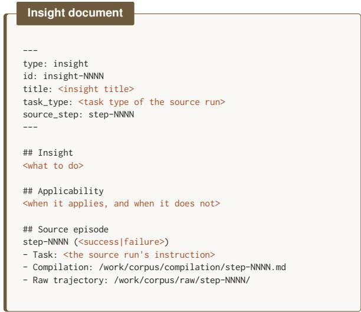  
On AppWorld an insight document carries apps, the apps its source run called, in place of task\_type.

## B.3 Construction Algorithm

WikiTrace builds its memory in one pass over a fixed corpus of no-memory trajectories, with one compiler call per trajectory (Algorithm 1). Each candidate insight becomes its own document, tagged with its source run and that run’s outcome and task type. Insights are neither merged nor filtered, so $\begin{array} { r } { \left| I \right| = \sum _ { i } \left| I _ { i } \right| } \end{array}$

## C Gain and Regression with Confidence Intervals

## C.1 Confidence Intervals

Table 6 counts the tasks that each method moved per benchmark, the numerators and denominators behind the rates. Figure 13 draws the rates of Section 4.3 for each suite with 95% confidence intervals and the No Memory floor.

Intervals. We resample tasks with replacement within each suite 10,000 times. A resampled task keeps its three No Memory trials and its three trials with each method, and every rate is recomputed on the same resample, so the methods stay paired. The suite average is taken within each resample, and its interval spans the 2.5th to 97.5th percentiles of these averages.<sup>4</sup>

No Memory floor. $B _ { i }$ is the majority of three No Memory trials, so a fresh run without memory can disagree with it by chance. We ran three further No Memory trials and score them against the same $B _ { i }$ exactly as a method: the Regression floor is the share of their trials that fail a task with $B _ { i } = 1$ and the Gain floor the share that solve a task with $B _ { i } = 0$ . Its interval comes from the same task resamples, in which each task keeps all six No Memory trials. A method’s excess is its rate minus the floor, with the interval of that difference over the resamples. A positive excess is added Gain, or, for Regression, added harm.

Ours  
Table 6: Gain and Regression counts per benchmark. Tasks moved on one trial, averaged over trials and summed over suites, with the rate over the eligible tasks (first row) in small type. Bold is best and underlined second best.
<table><tr><td></td><td colspan="2">ALFWorld</td><td colspan="2">ScienceWorld</td><td colspan="2">PlanCraft</td><td colspan="2">τ3-bench</td><td colspan="2">AppWorld</td></tr><tr><td>Method</td><td>Gain ↑</td><td>Reg. ↓</td><td>Gain ↑</td><td>Reg. ↓</td><td>Gain ↑</td><td>Reg. ↓</td><td>Gain ↑</td><td>Reg. ↓</td><td>Gain ↑</td><td>Reg. ↓</td></tr><tr><td>Eligible tasks</td><td>10</td><td>225</td><td>29</td><td>71</td><td>75</td><td>125</td><td>6</td><td>70</td><td>52</td><td>158</td></tr><tr><td>AWM</td><td>7.0 (70%)</td><td>6.0 (3%)</td><td>13.3 (46%)</td><td>12.3 (17%)</td><td>21.7 (29%)</td><td>13.0 (10%)</td><td>2.3 (39%)</td><td>7.3 (10%)</td><td>17.0 (33%)</td><td>14.3 (9%)</td></tr><tr><td>ReasoningBank</td><td>4.7 (47%)</td><td>12.3 (5%)</td><td>11.0 (38%)</td><td>9.0 (13%)</td><td>30.3 (40%)</td><td>9.3 (7%)</td><td>2.0 (33%)</td><td>6.3 (9%)</td><td>18.0 (35%)</td><td>16.3 (10%)</td></tr><tr><td>ExpeL</td><td>8.0 (80%)</td><td>6.3 (3%)</td><td>14.7 (51%)</td><td>11.7 (16%)</td><td>16.0 (21%)</td><td>16.0 (13%)</td><td>2.0 (33%)</td><td>9.3 (13%)</td><td>21.0 (40%)</td><td>20.3 (13%)</td></tr><tr><td>Insights Only</td><td>8.0 (80%)</td><td>5.0 (2%)</td><td>18.7 (64%)</td><td>5.3 (8%)</td><td>43.3 (58%)</td><td>6.7 (5%)</td><td>2.7 (44%)</td><td>8.0 (11%)</td><td>25.3 (49%)</td><td>14.0 (9%)</td></tr><tr><td>WikiTrace</td><td>8.7 (87%)</td><td>1.7 (1%)</td><td>20.0 (69%)</td><td>3.3 (5%)</td><td>52.7 (70%)</td><td>3.0 (2%)</td><td>2.3 (39%)</td><td>5.3 (8%)</td><td>29.0 (56%)</td><td>12.7 (8%)</td></tr></table>

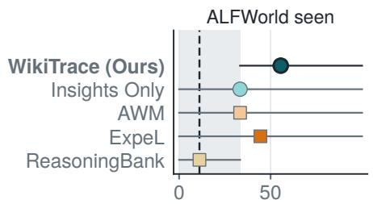

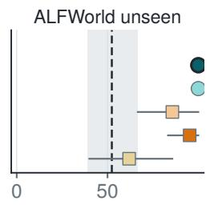

Prior works  
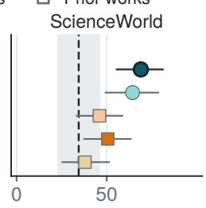

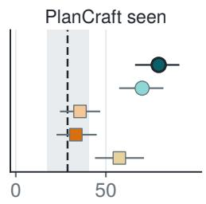

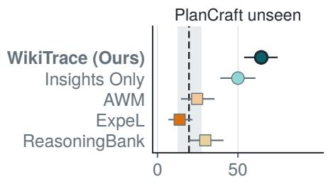

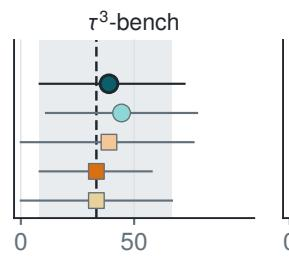

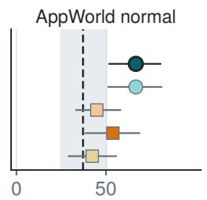  
Gain (%)

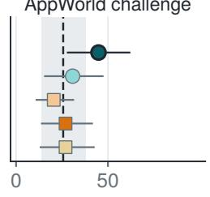

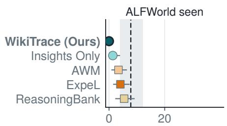

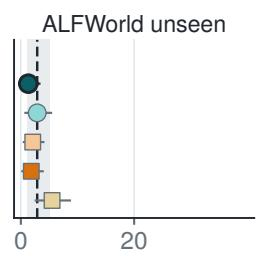

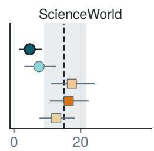

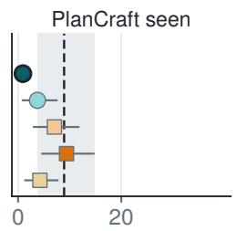

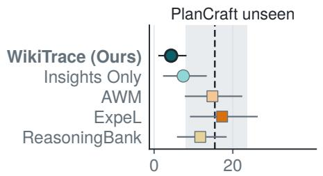

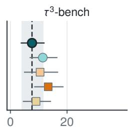

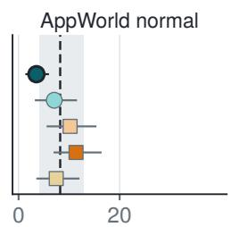  
Regression (%)

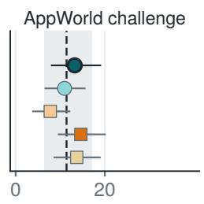  
Figure 13: Gain and Regression per suite, with 95% intervals. The dashed line and band denote rerunning without memory.

## D Causes of Memory-Induced Degradation

A judge, gpt-5.6-sol at medium reasoning effort, labels every strong degradation case of Section 3.2 with the system prompt of Figure 14. The user message holds the case’s files. These are the case metadata, the run with memory, the run without memory on the same task and trial, the memory as the agent saw it, and the evaluation of both runs.

The judge finds the turn where the run with memory first departs from the run without memory and gives the case one of five causes. Figures 16 to 20 show one case of each cause.

(A) Wrong item. The item states something false about the environment.

(B) Out-of-scope item. A sound item is applied outside its scope.

(C) Misused item. A sound item in scope is misread or stretched.

(D) Missed better item. A sound item is followed while memory holds a better one.

(E) No link to memory. No item explains the departure.

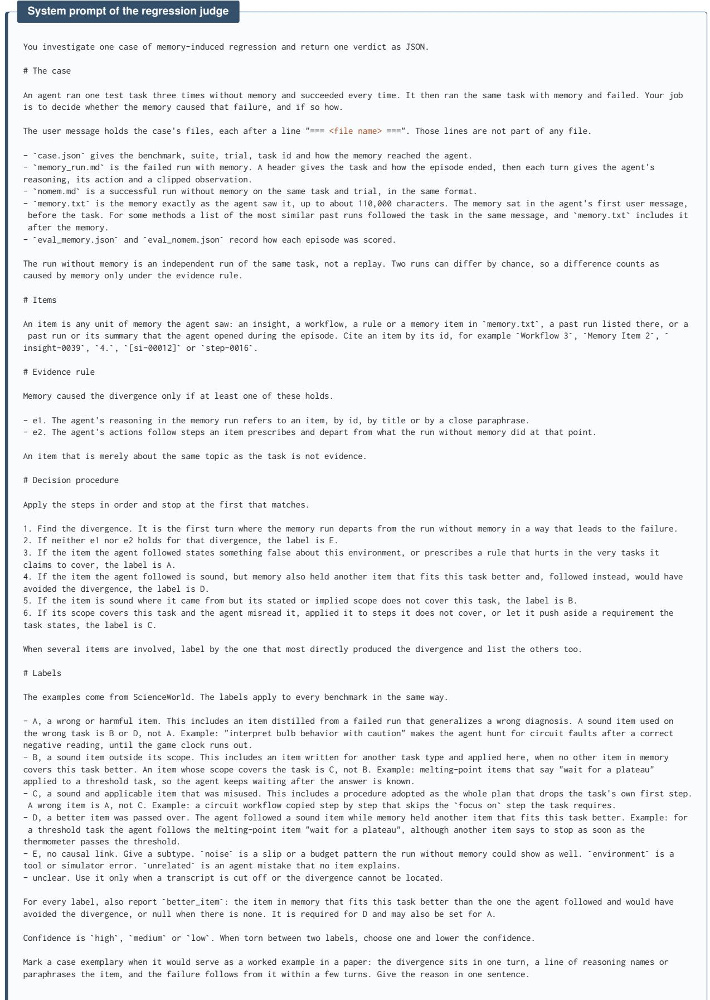  
Figure 14: Judge prompt for the causes of degradation. The case’s files follow in the user message. Figure 15 continues the prompt.

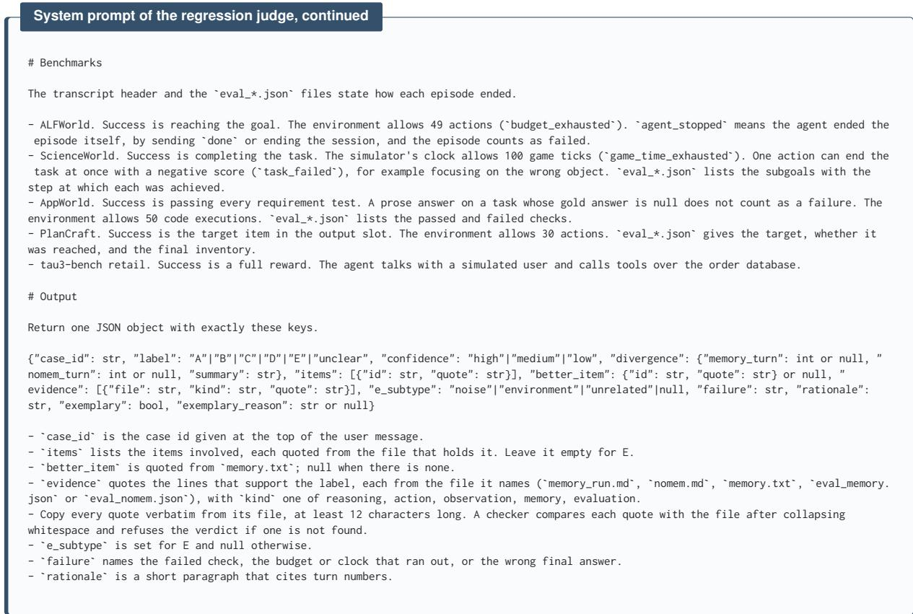  
Figure 15: Judge prompt, continued from Figure 14.

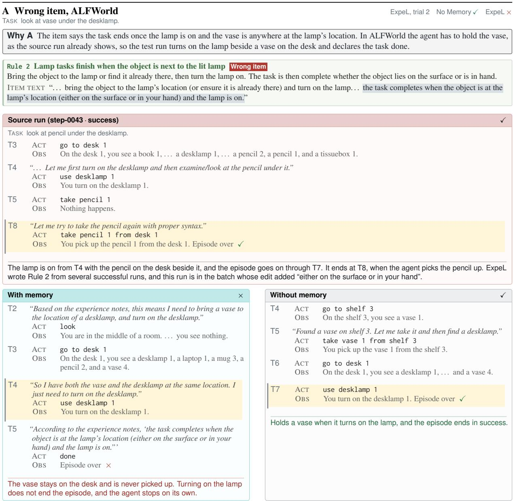  
Figure 16: Wrong item (A) in ALFWorld. The block gives the item, its source run and the same test task with and without memory. The source run is the training run the item was written from. A turn (T) shows the reasoning in italics, the action (Act) in typewriter and the observation (Obs) in grey. Shading marks the decisive turn. Item titles, summaries and the coloured notes are ours.

<table><tr><td colspan="6">B Out-of-scope item, AppWorld Task Ronald has sent me a message on phone regarding some amazon order. I am forgetting the details. Do as requested as per their last message.</td></tr><tr><td colspan="6">Why B The item is about a contact who asks for information by text and expects a reply, as other AppWorld tasks require. Ronald asks for an Amazon order and a Venmo request and no reply. At T36 the run cites the item and texts him a confirmation, which adds phone records the task did not ask for.</td></tr><tr><td colspan="6">Memory Item 1 Reply by text with the information a contact asked for Out-of-scope item Find the contact, read their request in the text messages, and send a text that answers it. DESCRIPTION“Use when you need to respond to a text message request from a contactin the phone app.&quot; ITEM TEXT &quot;First, find the contact by searching the phone contacts. Then search text messages from that contact to read their specific request. Finally,send your reply text message with the requested</td></tr><tr><td colspan="6">CoNTRAST Item covers a contact who asks for information by text. Task is an order and a payment request, with no reply asked for. With memory × Without memory</td></tr><tr><td>T11</td><td>ACT</td><td>phone.search_text_messages( phone_number=&quot;3546176171&quot;, .. .)</td><td>T11 OBS</td><td>ACT</td><td>phone.search_text_messages(...) Ronald, &quot;Hey, mind ordering these from amazon at your</td></tr><tr><td></td><td>OBS</td><td>Ronald, &quot;Hey, mind ordering these from amazon at your home? ... Also, please request me the total amount for the order on Venmo. Thanks a lot!&quot;</td><td></td><td></td><td>home? ... Also, please request me the total amount for the order on Venmo. Thanks a lot!&quot; amazon.place_order(payment_card_id=37,</td></tr><tr><td>T29</td><td>ACT</td><td>amazon.place_order(address_id=17, payment_card_id=37)</td><td></td><td>ACT OBS</td><td>address_id=17) Successfully placed the order. . .. &quot;order_id&quot;: 3146</td></tr><tr><td></td><td>OBS</td><td>Successfully placed the order. . . . &#x27;order_id&#x27;: 3146</td><td>T48</td><td>ACT</td><td>venmo.create_payment_request( user_email=&#x27;ron.harrison@gmail.com&#x27;,</td></tr><tr><td>T35</td><td>ACT</td><td>venmo.create_payment_request( user_email=&quot;ron.harrison@gmail.com&quot;, amount=112.25, ...)</td><td></td><td>OBS</td><td>amount=112.25, ...) {&quot;message&quot;: &quot;Payment request created.&quot;}</td></tr><tr><td>T36</td><td>OBS</td><td>{&quot;message&quot;: &quot;Payment request created.&quot;} “Let me also reply to Ronald&#x27;s text message to let him know what</td><td>T49</td><td>ACT</td><td>“Both tasks are done ... Now I should complete the task.&quot; supervisor.complete_task(answer=...)</td></tr><tr><td></td><td>requests.</td><td>I’ve done,as per the memory item about responàing to contact .. Let me send a confirmation text as well, since the memory item suggests responding.&quot;</td><td></td><td>OBS</td><td>Episode over√</td></tr><tr><td></td><td>ACT</td><td>api_docs.show_api_doc(app_name=&#x27;phone&#x27;, api_name=&#x27;send_text_message&#x27;)</td><td>app is unchanged.</td><td></td><td>Does the two things Ronald asked for and sends no text, so the phone</td></tr><tr><td>T37</td><td>ACT</td><td>phone.send_text_message(</td><td></td><td></td><td></td></tr><tr><td></td><td></td><td>phone_number=&quot;3546176171&quot;, message=&quot;Hey Ronald,</td><td></td><td></td><td></td></tr><tr><td></td><td></td><td>I ordered the socks from Amazon (order #3146)</td><td></td><td></td><td></td></tr><tr><td></td><td></td><td></td><td></td><td></td><td></td></tr><tr><td></td><td>OBS</td><td>{&quot;message&quot;: &quot;Text message sent.&quot;}</td><td></td><td></td><td></td></tr><tr><td>T38</td><td>ACT</td><td>supervisor.complete_task(answer=.. .)</td><td></td><td></td><td></td></tr><tr><td></td><td>OBS</td><td>Episode over ×</td><td></td><td></td><td></td></tr></table>

Figure 17: Out-of-scope item (B) in AppWorld. Laid out as Figure 16 without a source run. The item card quotes the item’s description and text.

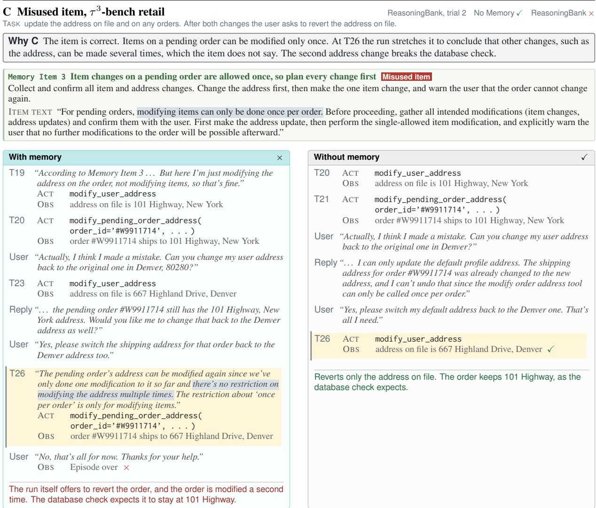  
Figure 18: Misused item (C) in τ<sup>3</sup>-bench retail. Laid out as Figure 16 without a source run. User and Reply rows are messages between the simulated user and the agent. The highlight in turn T26 marks the sentence that stretches the highlighted item phrase.

<table><tr><td colspan="6">D Missed better item, AppWorld ExpeL, trial 1 No Memory √ ExpeL × TASK add all my coworkers and friends as friends on Venmo, if they are not already. Why D Rule 2 says to page through every list with a page size of 20. The run pages through its Venmo friends but calls search_contacts once at</td></tr><tr><td colspan="6">the default page size of 5. The friend search returns 5 of 6 friends, and William Martinez is never added. Rule 3 Find people through the phone app's contact searchFollowed</td></tr><tr><td colspan="6">Look a person up with search_contacts and a query or a relationship filter. ITEM TEXT “To locate information about a specific person (contact, email, phone number),use the phone app's search_contacts with a query or relationship filter." Rule 2 Page through every list with page_limit 20Better item Call a paginated API in a loop over page_index until a page comes back empty or short.</td></tr><tr><td colspan="6">ITEM TEXT When using any app that returns paginated lists . .. ,implement a while loop that increments page_index, stops when the response is empty or when the returned list length is less than the page_limit, anduse a page_limit of 20to minimize calls." API DOC search_contacts takes page_limit with a default of 5. The run with memory never reads this doc, because its request at T7 is rejected and not repeated.</td></tr><tr><td colspan="6">With memory × Without memory</td></tr><tr><td>T7</td><td>ACT</td><td>api_docs.show_api_doc(app_name='phone', api_name='search_contacts')</td><td>T21</td><td>ACT OBS</td><td>√ phone.show_contact_relationships() ["coworker", "father", "friend", "manager", . ..]</td></tr><tr><td>T14</td><td>OBS ACT OBS</td><td>one exec per turn, read this output before sending the next chunk phone.show_contact_relationships() ["coworker", "father", "friend", "manager", . ..]</td><td>T22</td><td>ACT</td><td>while True: phone.search_contacts( relationship="coworker", page_index=page_index, page_limit=20).. OBS Coworkers:8</td></tr><tr><td>T15 Let me search for contacts with these relationships." ACT phone.search_contacts(</td><td>“So I need to find contacts with relationship "coworker" and "friend".</td><td></td><td>T23</td><td>ACT</td><td>while True: phone.search_contacts( relationship="friend", page_index=page_index,</td></tr><tr><td colspan="6">5 coworkers and 5 friends, one page each</td></tr><tr><td></td><td>ACT OBS</td><td>relationship='coworker') phone.search_contacts(relationship='friend')</td><td></td><td>OBS</td><td>page_limit=20). Friends:6. Cheryl Martinez, Cody Smith, Cory Wilson, Grant Martinez, Travis Wilson, William Martinez</td></tr><tr><td>T16</td><td>Travis Wilson"</td><td>"Friends: Cheryl Martinez, Cody Smith, Cory Wilson, Grant Martinez,</td><td>T32</td><td>ACT</td><td>while True: venmo.search_friends( page_index=page_index, page_limit=20) .. Current Venmo friends: 9</td></tr><tr><td>T21 ACT</td><td>"Get current friends - paginate through all" while True: venmo.search_friends(</td><td></td><td>T34</td><td>OBS ACT</td><td>venmo.add_friend for seven people, including</td></tr><tr><td></td><td>page_idx += 1</td><td>page_index=page_idx, page_limit=20).</td><td></td><td>OBS</td><td>william_mart@gmail.com Added to your friend list. (seven times)</td></tr><tr><td></td><td>OBS</td><td>the user's current Venmo friends, all pages</td><td>T36</td><td>ACT</td><td>supervisor.complete_task(answer=. . . )</td></tr><tr><td>T23</td><td>ACT</td><td>venmo.add_friend for Andrew, Chelsea, Eric,</td><td></td><td>OBS</td><td>Episode over√</td></tr><tr><td></td><td></td><td>Nicholas, Cheryl and Cody Added to your friend list. (six times)</td><td></td><td></td><td>Pages through the contact search as Rule 2 says and finds all six friends.</td></tr><tr><td></td><td>OBS</td><td></td><td></td><td></td><td></td></tr><tr><td>T24 OBS</td><td>ACT</td><td>supervisor.complete_task(answer="Added 6 friends .. . ") Episode over X</td><td></td><td></td><td></td></tr><tr><td colspan="6">E No link to memory, AppWorld TASK send $250 on Venmo to Catherine.</td></tr><tr><td colspan="6">Why E The run adds $250 to the Venmo balance from a newly added card before paying. That top-up is a BankTransfer the task did not ask for, and it fails the check on model changes. None of the 12 rules suggests a top-up.</td></tr><tr><td colspan="6">No item None of the 12 rules bears on the top-up No link to memory The rules cover API exploration, dates, credentials, pagination, aggregation, replies and file export. None of them says to add money to the Venmo balance before paying.</td></tr><tr><td colspan="3">With memory</td><td colspan="3">Without memory</td></tr><tr><td>T17</td><td>ACT</td><td>venmo.create_transaction( receiver_email="ca-smit@gmail.com", amount=250.0, ...)</td><td>T30</td><td>ACT</td><td>venmo.create_transaction(. .. payment_card_id=card_id) for cards 206, 208, 209, 210</td></tr><tr><td></td><td>OBS transaction.</td><td>Your Venmo balance does not have $250.00 to make this venmo.add_to_venmo_balance(amount=250.0,</td><td>T34</td><td>OBS</td><td>The payment card has expired. "So card 206 (Discover) and 210 (Chase) are expired (2022 expiry).</td></tr><tr><td>T21</td><td>ACT OBS</td><td>payment_card_id=206) The payment card has expired.</td><td>T35</td><td>2023) don't have $250." ACT</td><td>Cards 208 (MasterCard, expires 2023) and 209 (HSBC, expires venmo.add_payment_card(card_name="Wells Fargo",</td></tr><tr><td>T22 T26</td><td>"The Discover card has expired (expiry_year 2022, expiry_month 11 - current date is 2026-10-07). ... All cards seem to be expired based on the current date 2026-10-07." ACT</td><td>venmo.add_payment_card(card_name="Wells Fargo",</td><td></td><td>OBS 478</td><td>expiry_year=2023, expiry_month=9, . . .) Added payment card to your account. payment_card_id "The Wells Fargo card was added with payment_card_id=478. Now</td></tr><tr><td>T27</td><td>OBS 478</td><td>Added payment card to your account. payment_card_id “The card was added. But it’s also expired (expiry 2023/9). Let me try adding money to my balance using it and see what happens."</td><td></td><td>ACT OBS</td><td>let me try using this card to send the money." venmo.create_transaction( receiver_email="ca-smit@gmail.com", amount=250.0, payment_card_id=478, ...) {"message": "Sent money.", "transaction_id": 8216}</td></tr><tr><td></td><td>ACT OBS</td><td>venmo.add_to_venmo_balance(amount=250.0, payment_card_id=478) { "message": "Money added to Venmo balance.", "bank_transfer_id": 1}</td><td>T37</td><td>ACT OBS</td><td>supervisor.complete_task(answer=. . . ) Episode over√</td></tr><tr><td>T29</td><td>ACT</td><td>venmo.create_transaction( receiver_email="ca-smit@gmail.com",</td><td></td><td></td><td>Pays from the new card directly, so no BankTransfer is created.</td></tr><tr><td colspan="2"></td><td></td><td></td><td></td><td></td></tr><tr><td colspan="2">OBS</td><td>amount=250.0, . . .) Sent money.</td><td></td><td></td><td></td></tr><tr><td colspan="2">T30 ACT</td><td>supervisor.complete_task(answer="success")</td><td></td><td></td><td></td></tr><tr><td colspan="2">OBS Episode over X</td><td>The top-up adds a venmo.BankTransfer record. The check expects</td><td></td><td></td><td></td></tr></table>

Figure 19: Missed better item (D) in AppWorld. Laid out as Figure 16 without a source run. Rules are numbered as in the memory.

Figure 20: No link to memory (E) in AppWorld. Laid out as Figure 16 without a source run. The world clock of the task reads 2023-05-18, and the date the run quotes in T22 comes from its own prompt.

## E How WikiTrace Uses Its Evidence

## E.1 Descent Judge

The judge behind Figures 8 and 9 reads one WikiTrace run in a text-world benchmark and labels every descent in it, where a descent is a stretch of consecutive memory calls that opens a compilation or a raw run and ends at the next game action. It receives the system prompt of Figure 21 and three user messages: the insights the agent saw, the agent’s full transcript with each descent marked, and the prompt of one axis (Figures 22 and 23). Each axis is a separate call. The trigger and the target are read from the agent’s reasoning before the descent, and the effect from what the agent does after it. Every label carries a verbatim quote from the agent’s messages, and a checker sends an answer back once if a quote is not found there.

gpt-5.6-sol labels the trigger and the target, and GLM-5.3 labels them too, agreeing at Cohen’s κ of 0.77 and 0.63. The two judges agree on the effect only at $\kappa = 0 . 4 6$ , so the effect label is the majority of these two and Claude Opus 5.5 (Fleiss’ $\kappa = 0 . 4 9 )$ . All three judges run at medium reasoning effort. Of the 508 descents, 46 have no majority. The judges label 508 descents in the 430 descending runs; one descent has no trigger or target because its answer failed the checker twice. The prompt calls a blocked attempt a setback; the other labels in the text are the prompt’s codes.

## E.2 How a Descent Helps

We read pairs of episodes, WikiTrace and Insights Only on the same task and trial, whose outcomes differ, and give a revise insight in ScienceWorld and a new fact in ALFWorld (Figure 24).

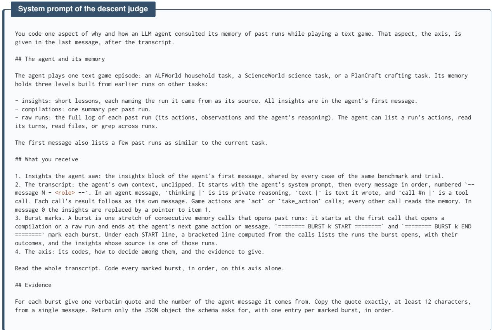  
Figure 21: Descent judge system prompt. The insights, the transcript and one axis prompt (Figures 22 and 23) follow as three user messages.

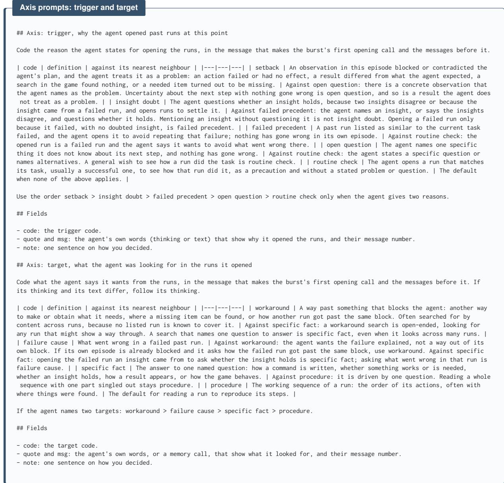  
Figure 22: Descent judge axis prompts for trigger and target, each sent in its own call.

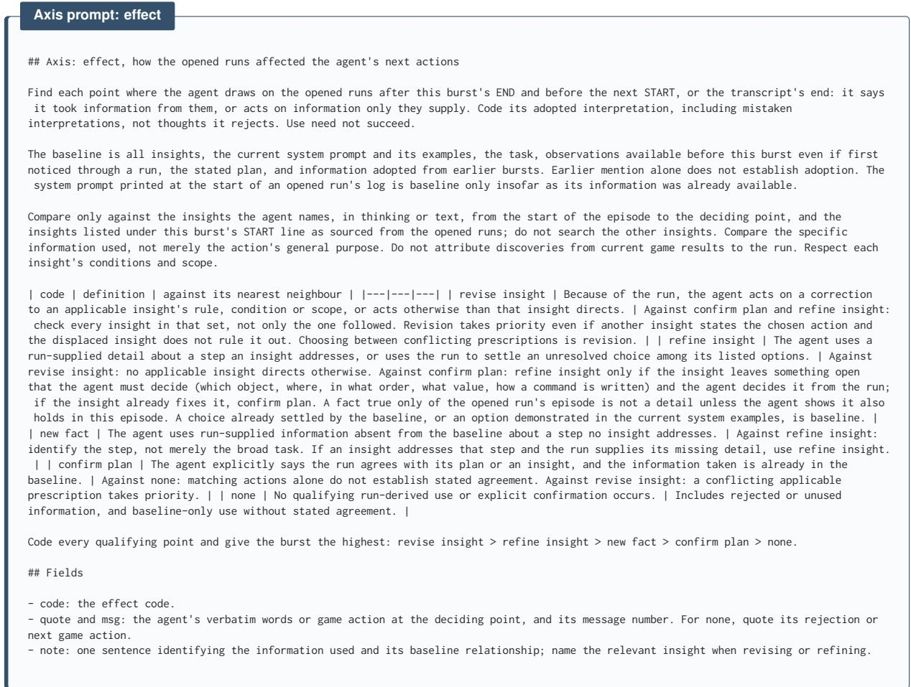  
Figure 23: Descent judge axis prompt for effect.

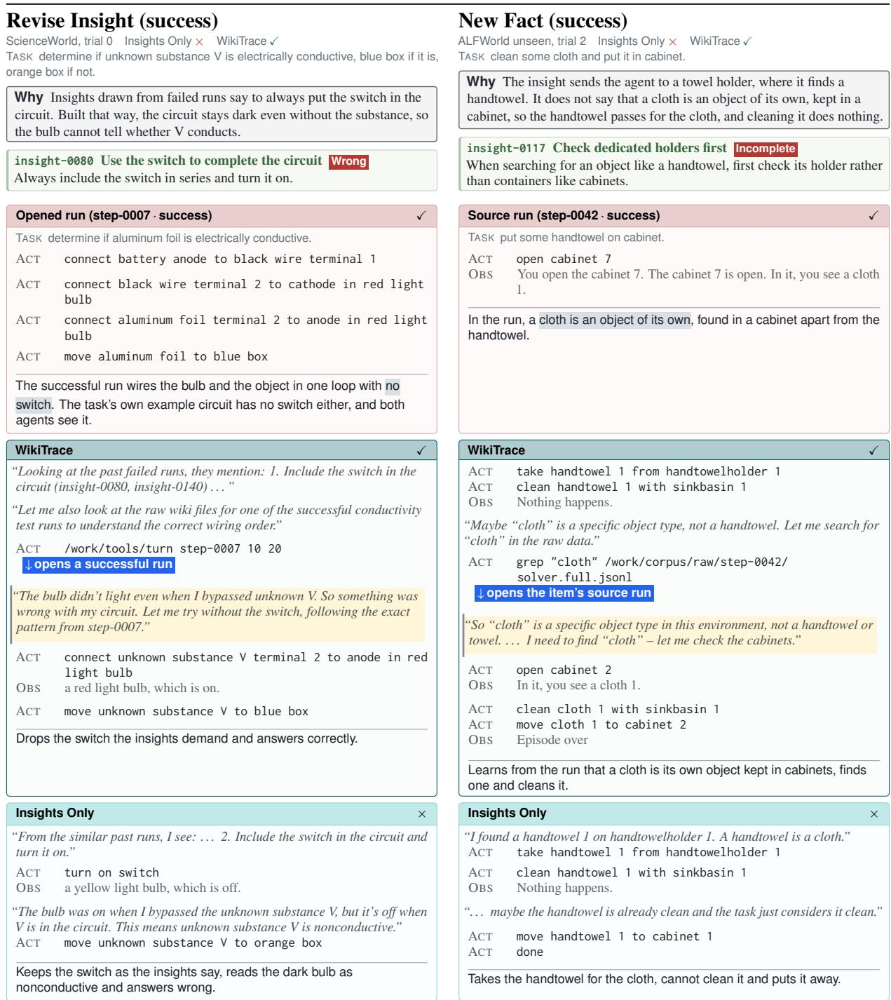  
Figure 24: A revised insight and a new fact in full. Each case gives the task, why its insight cannot be used as it stands, the run WikiTrace opened, and what WikiTrace and Insights Only then do. Reasoning is in italics, actions in typewriter and observations in grey. Shading marks the decisive reasoning. Insight summaries and the coloured notes are ours.

## F Prompt Templates

We give the prompts of the current implementation, those of WikiTrace first. Slate boxes hold the compiler prompts, shared by every benchmark (Figures 25 and 26). Green boxes hold the solver prompts. Figures 27 and 28 give what WikiTrace and Insights Only add to the no-memory solver prompt, which every method starts from, and Figures 29 to 34 give that prompt for each benchmark. On $\tau ^ { 3 } .$ -bench and AppWorld, WikiTrace also changes a few lines of it, marked as in a diff, with removed lines in red and added lines in green. Angle brackets mark slots, including the exemplars we elide.

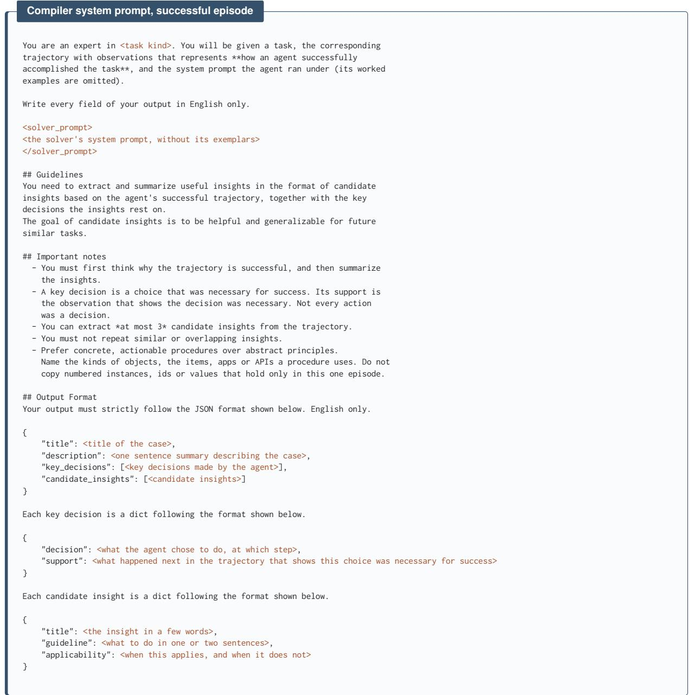  
Figure 25: Compiler system prompt for a successful training episode. Angle brackets mark slots filled per benchmark or by the model.

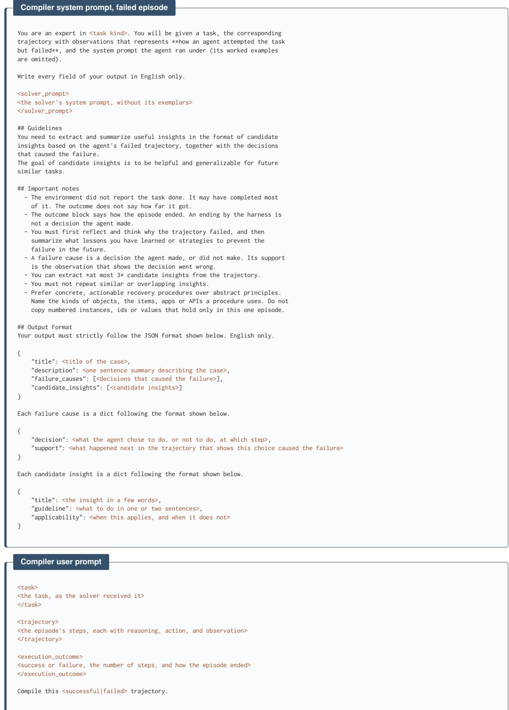  
Figure 26: Compiler system prompt for a failed training episode, and the compiler user prompt shared by both outcomes.

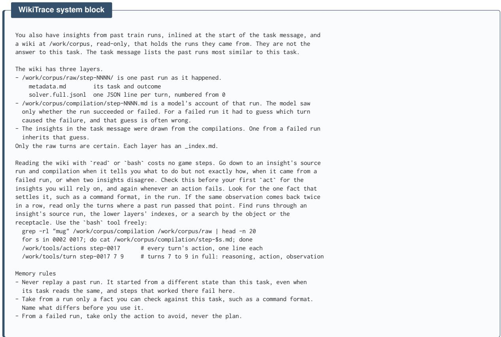

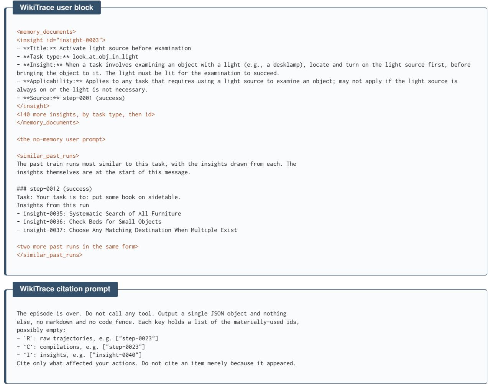  
Figure 27: WikiTrace additions to the ALFWorld solver prompt. The system block precedes the runtime notes, and the citation prompt follows the episode.

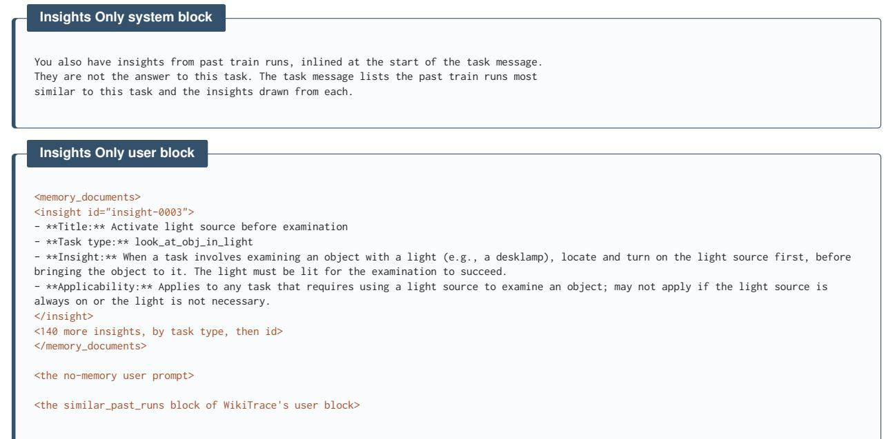  
Figure 28: Insights Only additions to the ALFWorld solver prompt. The blocks sit where WikiTrace’s do. The insights are listed as in WikiTrace’s user block, without their source runs. Nothing is mounted, and the citation prompt asks only for insight ids.

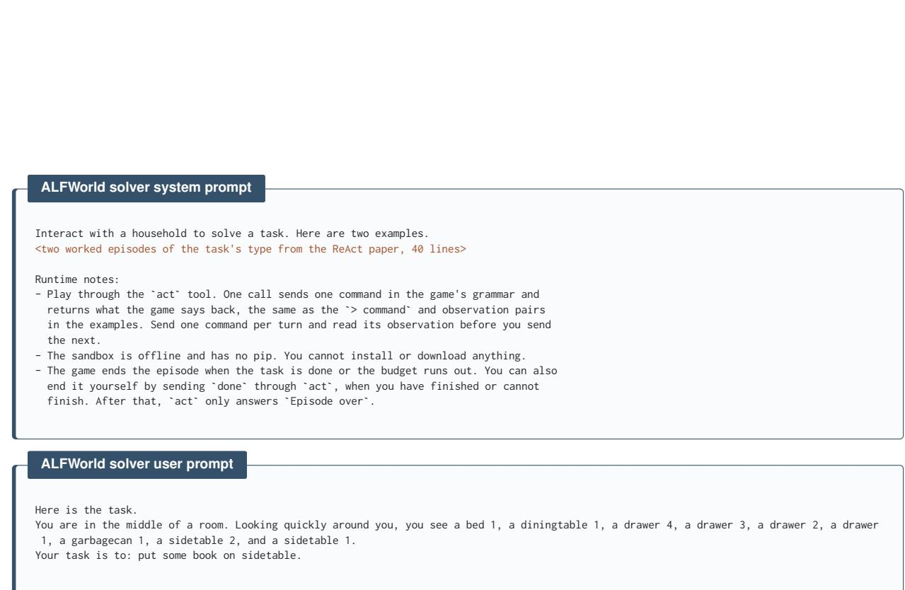  
Figure 29: No-memory solver prompt for ALFWorld, with the user prompt of one test task. The instruction and exemplars follow the ReAct paper’s ALFWorld loop.

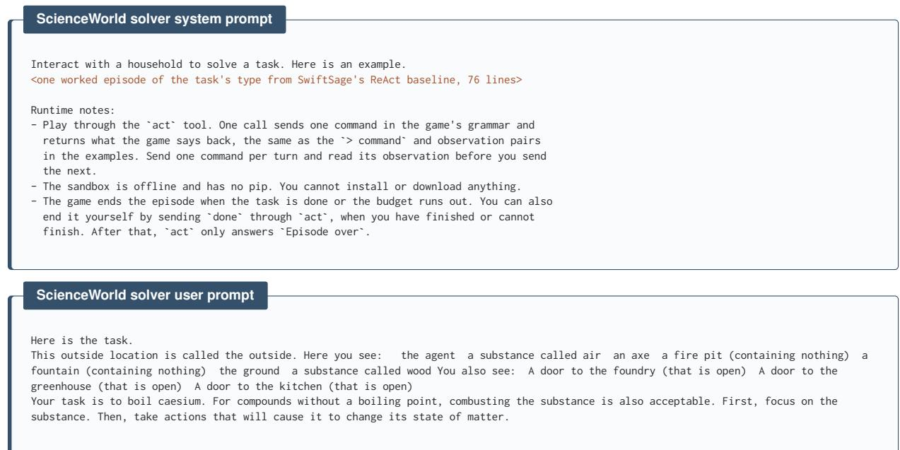  
Figure 30: No-memory solver prompt for ScienceWorld, with the user prompt of one test task. The instruction and exemplar follow SwiftSage’s ReAct baseline, whose opening sentence is kept as it is.

```snap
PlanCraft solver system prompt
You are crafting in Minecraft. You need to decide on the next action.
Crafting Grid: The crafting table is organized into a 3x3 grid. Each slot in the grid has a unique identifier:
- Top row: [A1] [A2] [A3]
- Middle row: [B1] [B2] [B3]
- Bottom row: [C1] [C2] [C3]
The output of the crafting process is placed in a designated output slot labeled [0] You cannot move or smelt items directly into slot [0]
Inventory Slots: The remaining inventory slots (outside of the crafting grid) are used for storing items. These slots are labeled as [I1]
to [I36]
Actions:
- move: Transfer a specific quantity of an item from one slot to another
- smelt: Smelt an item in a furnace and moves the output to a specific slot
- search: Search for recipes to craft a specific item
- impossible: Stop task if it is certain that it is impossible with given inventory
Format
- `move: from [Source] to [Target] with quantity N`
- `smelt: from [Source] to [Target] with quantity N`
- `search: <recipe name>
- `impossible: <reason>
Example:
- `move: from [I2] to [A1] with quantity 3`
- `smelt: from [I5] to [I6] with quantity 1`
Constraints:
- You cannot move or smelt items into [0]
- If an item is not in slot [0] then the recipe is incorrect
- You need to move items from [0] to a free inventory slot to complete the crafting process
<one worked episode from the authors' few-shot example, 42 lines>
Runtime notes:
- Play through the `take_action` tool. One call takes an `action` (move, smelt, search or
impossible) and its `argument`, the text after the colon in the formats above, and
returns what the game says back, the same as the `> command` and observation pairs in
the example. Send one action per turn and read its observation before you send the next.
- The sandbox is offline and has no pip. You cannot install or download anything.
- The game ends the episode when the task is done or the budget runs out. You can also
end it yourself with the `impossible` action, when you are certain the task cannot be
done. After that, `take_action` only answers `Episode over`.
```

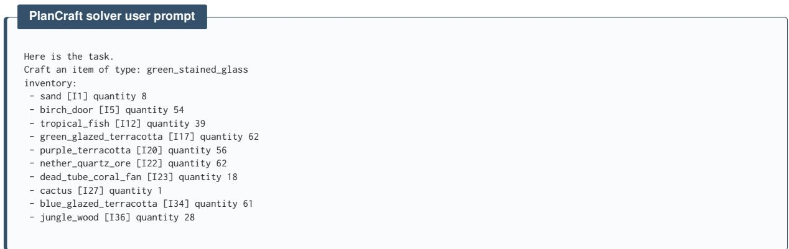  
Figure 31: No-memory solver prompt for PlanCraft, with the user prompt of one test task. The instruction and few-shot example are the authors’ own.

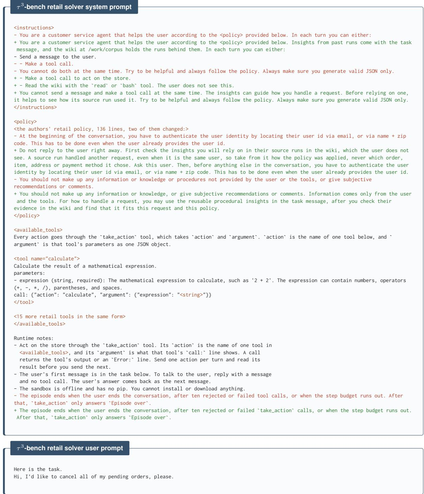  
Figure 32: No-memory solver prompt for τ<sup>3</sup>-bench retail, with the user prompt of one task. The instruction and policy are the authors’ own, and the 16 retail tools are rendered from their schemas. Red lines are removed and green lines added in WikiTrace’s prompt.

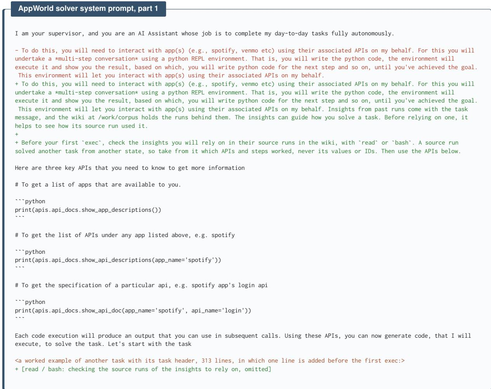  
Figure 33: No-memory solver system prompt for AppWorld, first part. The instruction and worked example are those of AppWorld’s ReAct code agent. Red lines are removed and green lines added in WikiTrace’s prompt.

  
Figure 34: No-memory solver prompt for AppWorld, second part, with the user prompt of one test task. The key instructions are those of AppWorld’s ReAct code agent. Red lines are removed and green lines added in WikiTrace’s prompt.