# FORESPARK: JOINT DRAFT AND VERIFICATION BUDGET SCHEDULING FOR PARALLEL SPECULATIVE DECODING

Jaeyong Song 1 2 \* Daniel Wang 1 Pratyush Patel 1 Jonny Kong 1 Preyas Shah 1 Shobhit Kanaujia 1

## ABSTRACT

Parallel drafters accelerate LLM decoding by proposing a whole block of draft tokens in a single forward pass, making them attractive for LLM serving. Recent systems optimize goodput (i.e., accepted tokens per second) because rejected drafts steal compute from other requests. However, these systems control only how many tokens are verified, so every request still drafts a full block. At high serving load, we find that drafting consumes up to 40% of step time, of which a majority is discarded because it is never verified. Yet, draft-length control from autoregressive drafters does not carry over, because a parallel drafter commits to its length before its single pass. Moreover, draft and verification lengths are coupled across the batch, so they must be selected jointly for every request while keeping the decision computationally cheap at every step. In this paper, we propose work-conserving speculation (WCS), a design that jointly allocates draft and verification budgets per request in LLM serving, and present FORESPARK as its prototype. FORESPARK realizes WCS with (i) a context-aware pre-draft estimator that predicts acceptance for every candidate length from the target model’s context features, (ii) a lightweight joint draft-verify scheduler that selects both lengths through a global sort, and (iii) a post-draft budget distribution that spends verification on the most promising tokens. Implemented on vLLM, FORESPARK improves throughput by up to 1.77× over the state-of-the-art DSPARK and by 2.49× over autoregressive decoding at a matched per-request generation rate, without changing the output distribution. It also tolerates higher load, sustaining up to 1.51× the request rate of DSPARK under latency service level objectives (SLOs).

## 1 INTRODUCTION

Speculative decoding leverages the idle compute during LLM decoding to accelerate inference (Leviathan et al., 2023; Sadhukhan et al., 2025). A drafter proposes several tokens that the target model verifies in one forward pass without changing its output distribution (Leviathan et al., 2023; Li et al., 2024a; Chen et al., 2026a).

To avoid the iterative forward passes that autoregressive drafters (e.g., MTP (DeepSeek-AI et al., 2024b) and EA-GLE (Li et al., 2024a;b; 2025)) incur when generating multiple draft tokens, parallel drafters (Chen et al., 2026a; Inco AI, 2026; Cheng et al., 2026) propose a block of K tokens in a single forward pass. Within the block, the drafter typically attends bidirectionally, so the logits for all K positions are produced in a single backbone pass.

Recent parallel drafters (Cheng et al., 2026; Qian et al., 2026) optimize goodput, the number of accepted tokens per second, because under high load, verification becomes compute-bound and rejected draft tokens take compute from other requests (Sadhukhan et al., 2025; Liu et al., 2024b). They address this through adaptive verification, which uses predicted acceptance to truncate each request’s verification to its most promising drafts. As Figure 1(a) shows, adaptive verification (DSPARK) substantially lifts throughput over full verification (DFLASH2) under high load.

Adaptive verification, however, still drafts afull block ofK tokens for every request, implicitly assuming the parallel draft is computationally cheap. We find that this assumption is costly under high load. As Figure 1(b) shows, drafting still takes up to 40% of DSPARK’s time per output token (gray bars). DSPARK acknowledges this fixed drafting cost as a limitation (Cheng et al., 2026), and we find that it grows with load. The reason is a mismatch between drafting and verification: at a load of 512 requests, adaptive verification retains only 3.77 of the 15 drafted tokens per request, while the drafter still generates all 15. Thus, 75% of the drafter’s computation is discarded, leaving LLM serving suboptimal.

A simple remedy is vLLM’s load-based batch-wise length cap (BW in Figure 1(a)), which shortens every speculation under load and already edges out DSPARK at several loads. Yet it applies one length to every request, so a better remedy is to choose the length per request, adapting approaches for autoregressive drafters (Huang et al., 2025a; Zhang et al., 2024). However, parallel drafters differ structurally from autoregressive ones, which poses two challenges.

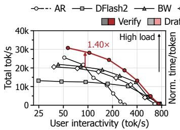

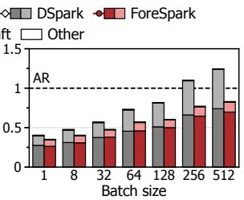  
(a) ShareGPT Pareto  
(b) Time per token  
Figure 1. Qwen3-14B on ShareGPT-E2E. (a) Total throughput versus user interactivity (per-user throughput), where DSPARK (Cheng et al., 2026) outperforms DFLASH2 with adaptive verification and FORESPARK adds joint scheduling. (b) Time per output token of DSPARK and FORESPARK, normalized to AR (i.e., no speculation). See Section 6.1 for detailed setup.

1. Draft length cannot be adjusted during drafting. Autoregressive drafters evaluate draft quality token by token and can stop as soon as their confidence drops (Huang et al., 2025a). Parallel drafters instead commit to a block size before their single pass, so they cannot prune candidates during drafting, and adaptive verification estimates acceptance only after the drafting compute is spent (Cheng et al., 2026; Qian et al., 2026). Past acceptance (Li et al., 2026a) is a poor proxy (Pan et al., 2025), changing across consecutive steps in over 80% of cases (Section 3). Adaptive verification also makes this proxy unexploitable, as truncation hides the actual acceptance length.

2. Joint length allocation is combinatorial yet must be computationally cheap. The scheduler must jointly choose, per request, a draft length and a verification budget within one step, while keeping the decision computationally cheap. The two lengths are coupled, making the decision combinatorial, since a token never drafted cannot be verified while a surplus draft token can be dropped during verification, so the scheduler must sometimes over-draft and set both lengths together to maximize goodput.

To address these challenges, we propose work-conserving speculation (WCS), a design for jointly allocating draft and verification budgets per request in LLM serving, and build FORESPARK as its prototype. WCS organizes each draftand-verify step into four coordinated stages, pre-draft estimate, joint schedule, draft, and distribute, so that drafting and verification compute is spent only where it pays off, the sense in which we call it work-conserving. FORESPARK realizes WCS through the following methods.

• Context-aware pre-draft estimation. We observe that the target’s context features at the last accepted token signal how predictable upcoming tokens are. Before drafting, a lightweight estimator reads them to predict acceptance for every candidate length, helping address both challenges.

• Lightweightjoint scheduling. To address the combinatorial search overhead, we replace each request’s expected yield across candidate lengths with its concave envelope. This reduces multi-request length allocation to one global sort, so the scheduler efficiently assigns per-request draft lengths and verification budgets. When drafting is computationally cheap, the scheduler intentionally over-drafts and defers the verification decision to the post-draft stage.

• Post-draft budget distribution. A variable-length drafter executes the schedule without padding, so shorter drafts save compute directly. A post-draft estimator then rescores the drafts, and the system distributes the verification budget across the batch to the most promising ones.

We implement FORESPARK on vLLM 0.30.0 (Kwon et al., 2023) and evaluate it on Qwen3-14B, GLM5.3-Flash, and GLM5.3, which span a range of model types and sizes. FORESPARK improves throughput by up to 1.77× over the state-of-the-art DSPARK and by 2.49× over autoregressive decoding at a matched per-request generation rate, without changing the output distribution. As Figure 1 previews, FORESPARK attains the highest throughput by jointly scheduling drafting and verification. It also tolerates higher load, sustaining up to 1.51× the request rate of DSPARK under TTFT and TPOT SLOs. Because full-block drafting with adaptive verification, as in DSPARK, is a special case within FORESPARK’s design space, FORESPARK performs comparably to DSPARK under low load. We believe WCS provides a foundation for future parallel drafters in LLM serving.

## 2 BACKGROUND

Speculative decoding. Speculative decoding generates multiple tokens per target-model pass by pairing the target with a lightweight drafter (Leviathan et al., 2023). As depicted in Figure 2, in each step the drafter extends the anchor, the last accepted or generated token, by up to K proposed tokens (K=4 in the example). The target model verifies all proposals in one forward pass, accepts the longest matching prefix (e.g., A,B), and emits one bonus token (e.g., F) that becomes the next anchor. With τ tokens emitted per step, throughput is $\tau / ( T _ { \mathrm { d r a f t } } + T _ { \mathrm { v e r i f y } } )$ , so speculation pays off only when τ is high and both times stay small.

Parallel speculative decoding. Autoregressive drafters such as EAGLE (Li et al., 2024a;b; 2025) and MTP (DeepSeek-AI et al., 2024b) run one pass per draft position, so $T _ { \mathrm { d r a f t } }$ grows with K. Parallel drafters instead fill a block of K mask tokens in a single pass of a parallel backbone that attends to target-model features (Chen et al., 2026a). Bidirectional attention within the block modestly raises acceptance over causal masking (Qian et al., 2026), but because no position sees the tokens chosen before it, later proposals can contradict earlier ones. DSpark repairs this with a sequential corrector that conditions each position on its predecessor (C−→D, D−→E) (Cheng et al., 2026), and DFlash2 does so with a lightweight path selector over the backbone’s top candidates (Inco AI, 2026).

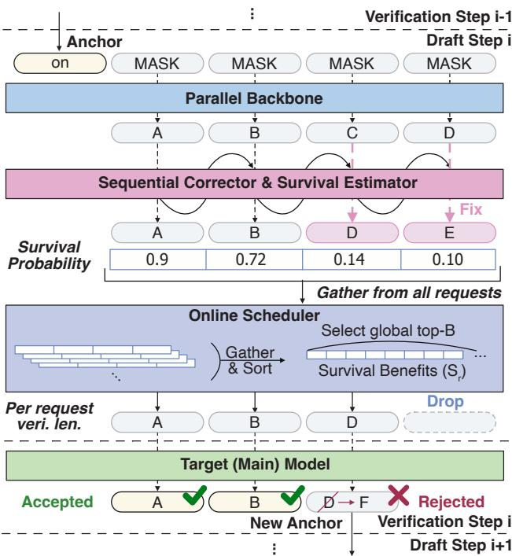  
Figure 2. Parallel speculative decoding example with DSPARK.

Goodput-aware speculation. A serving engine batches n requests, and each verification step processes N nonspeculative tokens (one anchor per decoding request plus prefill tokens) and B draft tokens. Beyond some load, verification becomes compute-bound and each extra verified token lengthens the whole batch’s step, so serving systems consider goodput, the rate of accepted tokens, alongside acceptance (Sadhukhan et al., 2025; Liu et al., 2024b).

DSpark pursues goodput with adaptive verification (Cheng et al., 2026). For each request i, its corrector estimates the probability $c _ { i , j }$ that the token at draft position j (the j-th token after the anchor) is accepted given its predecessors, and the survival probability $\begin{array} { r } { S _ { i , j } = \prod _ { t < j } c _ { i , t } } \end{array}$ gives the expected gain of verifying position j (0.9, 0.72, 0.14, and 0.10 in Figure 2). The scheduler pools $S _ { i , j }$ from all requests, sorts them so that $S _ { ( r ) }$ is the r-th largest, and picks the budget

$$
\underset { B } { \arg \operatorname* { m a x } } \frac { n + \sum _ { r = 1 } ^ { B } S _ { ( r ) } } { T _ { \mathrm { d r a f t } } + T _ { \mathrm { v e r i f y } } ( N + B ) } ,\tag{1}
$$

where the numerator counts one guaranteed token per request plus the expected accepted drafts, and the denominator is the profiled step latency. Since survival only shrinks along a draft, the selection is always a prefix of each draft (A,B,D, dropping E), which verification requires. AdaFlash similarly truncates verification based on a predicted acceptance ratio (Qian et al., 2026). Adaptive verification, however, still drafts all K tokens before deciding how many to verify.

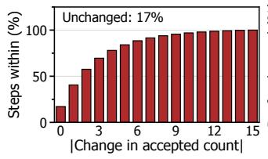  
(a) Accepted-count change

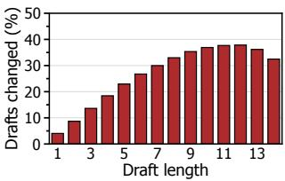  
(b) Length dependence  
Figure 3. DFLASH2 on Qwen3-14B (K=15) on ShareGPT. (a) Accepted-count change between consecutive steps. (b) Share of d-token drafts differing from the full draft’s first d tokens.

## 3 MOTIVATIONAL STUDY

Drafter overhead under adaptive verification. Adaptive verification shrinks the target’s verification work under load, but the drafter still produces all K tokens for every request, so drafting grows to up to 40% of step time (Figure 1(b)). Borrowing draft-length control from prior work appears to be a natural fix, but two challenges stand in the way.

Draft length cannot be adjusted during drafting. Unlike an autoregressive drafter, which can stop once its confidence drops (Huang et al., 2025a), a parallel drafter produces all K tokens in one pass, so it must fix its length before any draft token or confidence exists. The length must therefore be estimated beforehand, and prior work uses past acceptance for this (Li et al., 2026a). Past acceptance is a poor proxy (Pan et al., 2025), as the accepted count changes between consecutive steps in over 80% of cases and by three or more tokens in about 40% (Figure 3(a)). Adaptive verification also hides it, since tokens beyond the verified prefix are never scored, so a history-based controller that shortens a draft observes only shorter acceptance and may keep shrinking it. A loadaware, batch-wise K (Figure 1(a), BW) avoids estimation, but acceptance varies across requests as well as across steps, so one length for the whole batch cannot follow it.

Joint length allocation is combinatorial yet must be computationally cheap. DSPARK’s objective treats drafting latency as a constant (Equation (1)), so it never trades drafted tokens against drafting time. Making each draft length a decision variable couples it with the verification budget, because a token never drafted cannot be verified, and the joint space grows as $K ^ { n }$ for n requests while the choice must be made at every step. Bidirectional attention adds another complication. For each length $d ,$ Figure 3(b) shows that 4–38% of d-token drafts differ in at least one token from the first d tokens of the 15-token draft, so a shorter draft is a different proposal rather than a truncation. Thus, a scheduler should consider every draft length $( d \leq K )$ separately.1

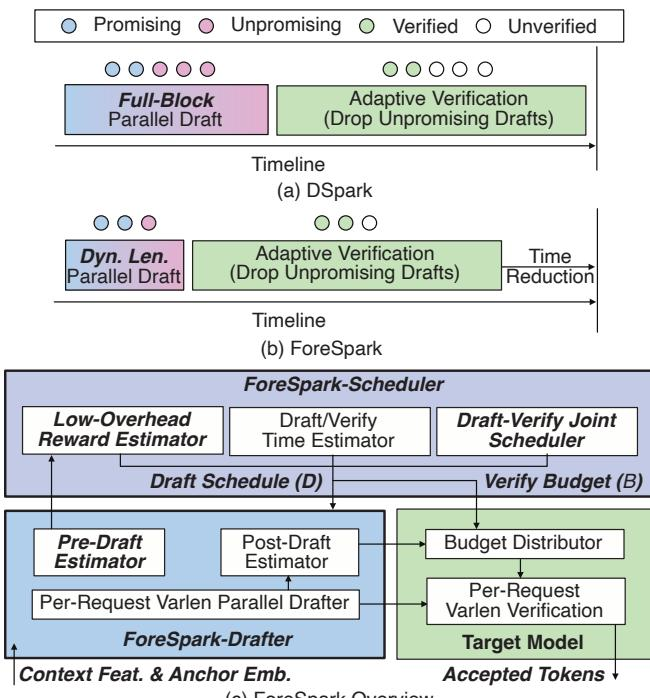  
(c) ForeSpark Overview  
Figure 4. (a) DSpark drafts a full block and drops drafts only at verification. (b) FORESPARK sizes each draft before drafting. (c) Overview of FORESPARK.

These observations motivate work-conserving speculation, which estimates per-length acceptance before drafting and allocates draft and verification lengths jointly per request.

## 4 FORESPARK: REALIZING WORK-CONSERVING SPECULATION

FORESPARK realizes work-conserving speculation by deciding how much to draft before any drafting cost is paid. As Figure 4(a,b) contrasts, DSPARK drafts a full block and drops unpromising drafts only at verification, whereas FORESPARK sizes each draft beforehand, so far fewer drafted tokens go unverified. Figure 4(c) maps the four stages of WCS onto FORESPARK system components. 1 Pre-draft estimate. The pre-draft estimator predicts what every candidate length would yield for each request (Section 4.2). 2 Joint schedule. The FORESPARK-Scheduler turns these predictions into a per-request draft schedule $\mathbf { D } = \left( d _ { 1 } , \ldots , d _ { n } \right)$ and a verification budget B (Section 4.3). 3 Draft. The variable-length drafter executes D. 4 Distribute. The post-draft estimator re-scores the drafted tokens, and the budget distributor allocates B to the most promising ones (Section 4.4).

## 4.1 Preliminaries: Parallel Drafting Backbone

We build on DFLASH2 (Inco AI, 2026), which forms the drafter in Figure 4(c), because it attains acceptance lengths similar to DSPARK (Section 6.6) while replacing the sequential corrector with a lightweight path selector over the backbone’s top candidates. Following EAGLE-3 (Li et al., 2025), the drafter conditions on the target model’s hidden states from several intermediate layers. A learned projection fuses those hidden states into context features $\bar { H } _ { \mathrm { f e a t } } \ \in \mathbb { R } ^ { T \times d _ { h } }$ one vector for each of the $T$ tokens in the target’s context, where $d _ { h }$ is the drafter’s hidden dimension. For request i, a length-d draft takes as input the embedding of the anchor token followed by d learned mask embeddings, one for each draft position $j = 1 , \ldots , d ,$ similar to Figure 2. Each draft layer attends bidirectionally to all draft positions and to $H _ { \mathrm { f e a t } }$ , which enters only as additional keys and values. The last layer yields a hidden state $h _ { i , j }$ for each draft position j, and the LM head turns it into the proposed token $x _ { i , j }$

## 4.2 Context-Aware Pre-Draft Estimation

As Figure 5 shows, the pre-draft survival estimator predicts, before drafting, how every candidate draft length would perform for each request. Instead of past acceptance (Section 3), it reads two inputs from the verification pass that just finished, both describing what comes next: the context feature $c _ { i } = H _ { \mathrm { f e a t } } [ a _ { i } ]$ , the row of $H _ { \mathrm { f e a t } }$ at the anchor’s position $a _ { i }$ in the context, and the anchor token’s embedding $e _ { i } .$ . Since a length-d draft need not be the prefix of a longer one, the estimator predicts a separate survival curve for every candidate length. To stay computationally cheap on the critical path between verification and drafting, it fuses the inputs in a low-rank space of dimension $r \ll d _ { h } ( r = 2 5 6$ by default) with one hidden layer,

$$
\begin{array} { r l } & { u _ { i } = \mathrm { S i L U } \left( W _ { c } c _ { i } + W _ { e } e _ { i } \right) \in \mathbb { R } ^ { r } , } \\ & { z _ { i } = W _ { o } u _ { i } \in \mathbb { R } ^ { K \left( K + 1 \right) / 2 } , } \end{array}\tag{2}
$$

where $W _ { c }$ and $W _ { e }$ project $c _ { i }$ and $e _ { i }$ into a shared $r \mathrm { - }$ dimensional hidden representation $u _ { i } .$ , and $W _ { o }$ maps $u _ { i }$ to the $K ( K + 1 ) / 2$ conditional-acceptance logits, with biases omitted for clarity. Applying SiLU to $W _ { c } c _ { i } + W _ { e } e _ { i }$ fuses the two inputs nonlinearly, and $W _ { o }$ reads every candidate length from $u _ { i } .$ . As $c _ { i }$ and $e _ { i }$ are already rich target representations, a single hidden layer suffices, and the estimator costs only a few matrix-vector products per request.

As depicted in Figure 5, the output forms a triangle whose row $z _ { i } ^ { ( d ) } \in \mathbb { R } ^ { d }$ describes a length-d draft, with entry $z _ { i , t } ^ { ( d ) }$ being the conditional-acceptance logit of position t, and the running product of the corresponding sigmoid probabilities

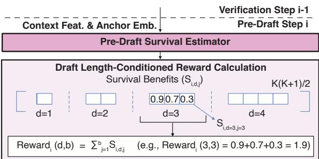

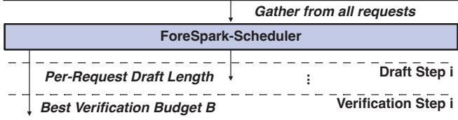  
Figure 5. Pre-draft estimation. The estimator predicts survival benefits for every candidate length, a triangle of $K ( K + 1 ) / 2$ values, from which the scheduler gathers per-length rewards.

gives the survival benefit

$$
S _ { i , d , j } = \prod _ { t = 1 } ^ { j } \sigma \big ( z _ { i , t } ^ { ( d ) } \big ) \approx \mathrm { P r } ( A _ { i , d } \geq j ) ,\tag{3}
$$

where $\sigma$ is the sigmoid function and $A _ { i , d }$ is the number of accepted tokens when request i drafts d tokens. Verifying the first $b \leq d$ tokens of a length-d draft is then expected to yield Rewardi $\begin{array} { r } { ( d , b ) = \sum _ { j = 1 } ^ { b } S _ { i , d , j } } \end{array}$ accepted tokens, so the length-3 draft in Figure 5 with benefits 0.9, 0.7, 0.3 gives Rewardi(3, 3) = 1.9. The estimator predicts per-position acceptance rather than the scheduler’s survival scores (Section 4.3), since a survival score depends on the whole reward curve and has no direct label, whereas acceptance is labeled by verification for training and calibration (Section 4.5). Composing survival benefits as a product of acceptance probabilities also keeps them non-increasing in j. For a directional drafter, i.e., one with causal attention within the block, shorter drafts are exact prefixes of longer ones, so every row equals a prefix of row K and $W _ { o }$ needs to output only K logits instead of $K ( K + 1 ) / 2$ . We show that FORESPARK also works well on such a case in Section 6.5.

## 4.3 Lightweight Draft-Verify Joint Scheduling

As Figure 6 shows, the FORESPARK-Scheduler turns perlength rewards into a draft schedule D and a verification budget B in one pass. Unlike Equation (1), it prices drafting latency, so it drafts tightly at high load and generously at low load, where extra drafts add little latency. Its search jointly covers every draft length of every request and the verification budget, yet stays computationally cheap as follows.

Per-request reward curve generation. To choose draft lengths, the scheduler values each length-d draft as if all its tokens were verified, $R _ { i } ( d ) = \operatorname { R e w a r d } _ { i } ( d , d )$ with $R _ { i } ( 0 ) =$ $0 ,$ and leaves which tokens to actually verify to the joint schedule below. A longer draft may lift the yield of its earlier positions (Figure 6, $R _ { i }$ plot), so $R _ { i }$ need not be concave, and a greedy rule that extends a draft only while the next token pays off could stop early and lose the larger gain that a longer draft would bring.

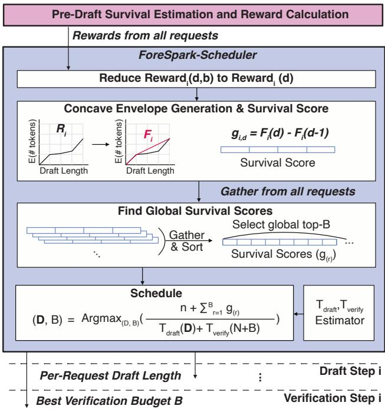  
Figure 6. FORESPARK-Scheduler. Survival scores, differences of concave envelopes $F _ { i }$ over per-length rewards $R _ { i }$ , are pooled, sorted, and priced against latency profiles to choose D and B.

Concave envelope and survival score generation. Therefore, as illustrated in Figure 6, the scheduler replaces $R _ { i }$ with its upper concave envelope $F _ { i }$ , the smallest concave function above $R _ { i }$ on $\{ 0 , \ldots , K \}$ }, and defines the survival score $g _ { i , d } = F _ { i } ( d ) - F _ { i } ( d - 1 )$ , the marginal gain of drafting the d-th token. Concavity makes $g _ { i , d }$ non-increasing in $d ,$ the property the next stage relies on. Where an extra token alone pays off little but enables a larger gain later, $F _ { i }$ spreads that gain evenly over the tokens in between, so the selection does not stop early. Building the envelope takes $O ( K )$ time and leaves an already concave $R _ { i }$ unchanged.

Global survival score gather. As DSPARK (Cheng et al., 2026) does in adaptive verification, the scheduler pools the scores of all requests and sorts them, $g _ { ( 1 ) } \geq g _ { ( 2 ) } \geq $ $\cdot \cdot \cdot$ , where $g _ { ( r ) }$ is the r-th largest. Because each request’s scores are non-increasing, the top entries always form a prefix of every request and directly yield a valid schedule D. This selection maximizes $\textstyle \sum _ { i } { \dot { F } } _ { i } ( d _ { i } )$ without searching $K ^ { n }$ schedules and stays within 0.01% of the exhaustive optimum on average on real batches (Section 6.4).

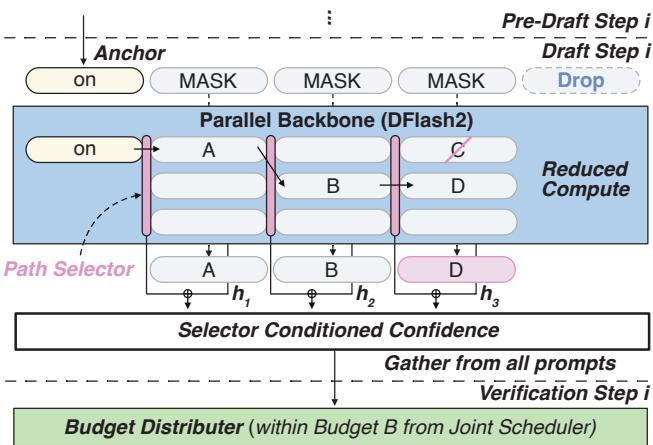  
Figure 7. Variable-length drafting and budget distribution. Masks beyond the scheduled length are skipped, and selector-conditioned confidence allocates the budget B.

Joint schedule. Finally, the scheduler chooses D and $B ,$ verifying no more than it drafts,

$$
( \mathbf { D } , B ) = \underset { \mathbf { D } , B \leq \sum _ { i } d _ { i } } { \arg \operatorname* { m a x } } \frac { n + \sum _ { r = 1 } ^ { B } g _ { ( r ) } } { T _ { \mathrm { d r a f t } } ( \mathbf { D } ) + T _ { \mathrm { v e r i f y } } ( N + B ) } ,\tag{4}
$$

where the numerator counts one token per request plus the expected accepted drafts among the B top-scored positions, and the denominator is the step latency from tables profiled offline. Since B may stay below $\textstyle \sum _ { i } d _ { i }$ , the scheduler can over-draft and leave surplus candidates for the post-draft stage to re-rank (Section 4.4). The search is computationally cheap because the drafter and target replay CUDA graphs for a few token-count buckets, so each latency is constant within a bucket. Within each pair of buckets the largest feasible schedule is best, so the scheduler checks one candidate per pair, reducing Equation (4) to a small grid.

## 4.4 Draft and Distribute: Variable-Length Drafting and Post-Draft Budget Distribution

Once the drafts exist, the post-draft estimator can use information the pre-draft estimator never had (Figure 7). The pre-draft estimator decides how much drafting compute to commit, while the post-draft estimator sees the realized tokens and decides where the verification budget is best spent, which is what makes over-drafting worthwhile.

Per-request variable-length drafting. FORESPARK packs the blocks of all requests, each with its anchor and $d _ { i }$ masks, into one flat batch with block-diagonal attention, so drafter compute scales with $\textstyle \sum _ { i } ( d _ { i } + 1 )$ rather than $n ( K + 1 )$ . In Figure 7, the fourth mask is dropped before the backbone runs, so it executes exactly the length the scheduler priced.

Selector-conditioned confidence. DFLASH2’s path selector keeps a few candidate tokens per position from the backbone and picks one by conditioning on the token chosen at the previous position (Inco AI, 2026), replacing C with D in the example. The hidden state $h _ { i , j }$ therefore reflects the backbone’s belief before this choice, not the token $x _ { i , j }$ actually proposed. Similar to the confidence head of DSPARK (Cheng et al., 2026), which pairs the backbone hidden state with an embedding of the previous token, the post-draft estimator pairs $h _ { i , j }$ with a selector feature $s _ { i , j } = ( W _ { s } h _ { i , j } ) \odot E _ { \mathrm { p r e d } } ( x _ { i , j - 1 } )$ , where $W _ { s }$ is a learned projection, $E _ { \mathrm { p r e d } }$ the selector’s embedding of the previous token $x _ { i , j - 1 }$ , and ⊙ the elementwise product,

$$
p _ { i , j } = \sigma \left( w ^ { \top } [ h _ { i , j } ; s _ { i , j } ] \right) , \qquad \widehat { S } _ { i , j } = \prod _ { t = 1 } ^ { j } p _ { i , t } ,\tag{5}
$$

where w is a learned weight vector (bias omitted) and $[ \cdot ; \cdot ]$ concatenation. Here $p _ { i , j }$ estimates the probability of accepting token j given its predecessors, and $\widehat { S } _ { i , j }$ is its post-draft survival probability. One linear layer suffices, as $h _ { i , j }$ and $s _ { i , j }$ already carry backbone and selector computation.

Budget distribution. The budget distributor verifies the B positions with the highest $\widehat { S } _ { i , j }$ across the batch, applying DSPARK’s adaptive verification (Cheng et al., 2026) (Section 2) to the variable-length drafts of FORESPARK. Since $\widehat { S } _ { i , j }$ never increases in j, the selection forms a prefix of each draft, and the target verifies the resulting $N + B$ tokens as one packed batch. Because the draft lengths and the verified prefix are chosen before the verification, and the verification applies standard speculative sampling (Leviathan et al., 2023), the output distribution is unchanged.

## 4.5 Training and Calibration

Both estimators are trained jointly with the DFLASH2 drafter by adding their losses to its objective, $\begin{array} { r l } { \mathcal { L } } & { { } = } \end{array}$ $\mathcal { L } _ { \mathrm { D F l a s h 2 } } + \lambda _ { \mathrm { p r e } } \mathcal { L } _ { \mathrm { p r e } } + \lambda _ { \mathrm { p o s t } } \mathcal { L } _ { \mathrm { p o s t } }$ . Instead of a binary label of whether each draft token was accepted, they learn from a soft acceptance target, the probability that the token would be accepted. Following DSPARK (Cheng et al., 2026), the target for position j is its acceptance probability under speculative sampling, $\begin{array} { r } { \alpha _ { j } = \sum _ { v \in \mathcal { C } } } \end{array}$ min $\{ P _ { j } ( v ) , Q _ { j } ( v ) \}$ , with the target distribution $P _ { j }$ and the drafter’s proposal $Q _ { j }$ . Unlike DSPARK, the sum covers only ${ \mathcal { C } } _ { j } ,$ , the candidate tokens the path selector keeps, and $Q _ { j }$ is the proposal over them after the selector’s choice. Because it is computed from the drafter’s full proposal rather than one sampled outcome, this target gives a smoother training signal than binary labels. For the pre-draft estimator, each training step samples a length $d ,$ runs the backbone at exactly that length, and trains row $\boldsymbol { z } ^ { ( d ) }$ on that length’s targets $\alpha _ { d , j }$ with binary cross-entropy, since non-causal drafts of different lengths differ, whereas for a directional drafter one length-K pass labels every row. Gradients stop at $c _ { i }$ and $e _ { i } ,$ , so this loss trains only the pre-draft estimator and leaves the drafter unchanged. The post-draft estimator is trained against $\alpha _ { j }$ with a weighted binary cross-entropy that excludes the anchor. Since each survival estimate multiplies the per-position probabilities, a small error at each position accumulates along the draft. After training, we therefore recalibrate both estimators on Alpaca (Taori et al., 2023) prompts, fitting a temperature for each position of the post-draft estimator, as in DSPARK (Cheng et al., 2026), and a scale and bias for each entry of the pre-draft estimator (see Appendix B).

## 5 IMPLEMENTATION

We implement FORESPARK on vLLM 0.30.0 (Kwon et al., 2023) with about 4K lines of Python and Triton, and train the drafters and estimators with Speculators (Red Hat, 2025).

Scheduler optimization. To keep the host from waiting on the GPU, FORESPARK splits the scheduler between them. The host decides only the batch totals of Equation (4), the total draft length $\textstyle \sum _ { i } d _ { i }$ and the verification budget B, using the previous step’s estimates. These estimates are copied to the host asynchronously, and a newly admitted request uses the mean estimate of the other requests until its own is available. The GPU then divides the total draft length among requests with a Triton kernel that ranks the current pre-draft scores in one pass. While the drafter runs, the host recomputes B with the verification step’s actual number of non-speculative tokens N, and the budget distributor selects the top-B positions with the same kernel. If requests finish or receive fewer draft tokens than planned, B is capped at the drafted tokens still present, so the GPU always fills exactly B positions and the host never waits for its selection.

Execution. Each decoding step replays captured CUDA graphs for the pre-draft estimator, the drafter, and the output heads. The drafting and verification latency tables are built by timing these graphs once. Under tensor parallelism, small numerical differences across ranks could produce different schedules and stall collective operations. FORESPARK therefore broadcasts rank 0’s pre-draft scores, draft tokens, post-draft estimates, and acceptance decisions at every step (each at most $K ( K + 1 ) / 2$ values per request) and uses rank 0’s latency tables, so all ranks schedule from identical inputs.

Hybrid and sparse-attention targets. The sparse-MLA kernels of the GLM models need each request’s lengths on the host before launch. For these targets, the host performs the per-request split and selects the verified positions itself, from the previous step’s estimates, and the GPU executes them unchanged, so the host and the GPU cannot disagree. Stale estimates affect only which tokens are drafted and verified, not the output, because verification remains lossless.

## 6 EVALUATION

## 6.1 Experimental Setup

Models. We use models that span dense, mixture-of-experts (MoE), and hybrid architectures with 14–744B parameters: Qwen3-14B (Yang et al., 2025), a 40-layer dense model served in BF16, GLM5.3-Flash (Z.ai, 2026) (320B, 18B active), a hybrid MoE model whose 45 layers interleave KDA linear attention (Kimi Team et al., 2025) and MLA with DSA sparse attention (DeepSeek-AI et al., 2024a; 2025), and GLM5.3 (GLM-5-Team et al., 2026) (744B, 40B active), a 78-layer MoE model using MLA with DSA sparse attention. Models are served with 8-way tensor parallelism (TP8), plus 8-way expert parallelism (EP8) for the MoE models, and both GLM models use NVFP4 routed experts and an FP8 KV cache. We use the lowest reasoning effort and greedy decoding (temperature 0) unless noted.

Hardware and software. We serve Qwen3-14B on eight NVIDIA H100 GPUs (96 GB each), and train all drafters and serve GLM5.3-Flash/GLM5.3 on eight NVIDIA B200 GPUs (180 GB each), with vLLM 0.30.0, PyTorch 2.13, and CUDA 13.0 (host details in Appendix C).

Baselines. We compare FORESPARK, which jointly schedules drafting and verification, with autoregressive decoding without speculation (AR) and three parallel-drafting baselines: DFLASH2 (Inco AI, 2026), a recent parallel drafter, which drafts and verifies a full block, Batchwise (BW), DFLASH2 with vLLM’s load-based schedule (vLLM Team, 2026), which caps the speculation length of the whole batch at a pre-calibrated value per load, and DSPARK (Cheng et al., 2026), a goodput-aware parallel drafter with adaptive verification. We also evaluate FORESPARK w/o JS, FORESPARK without its pre-draft estimator and joint scheduler (JS), which drafts full blocks and applies adaptive verification with FORESPARK’s post-draft estimator, isolating the gain of joint scheduling. Since FORESPARK w/o JS drafts full blocks, it applies the same adaptive verification as DSPARK and differs from DSPARK mainly in the drafter backbone. All parallel drafters follow their published training recipes (e.g., 5/6 layers) and use a maximum draft length of K=15, with K=7 for sensitivity (Section 6.5). To show that WCS generalizes, we also apply it to DSPARK and to two autoregressive drafters with K=5, MTP (DeepSeek-AI et al., 2024b) and EAGLE-3 (Li et al., 2025) (Section 6.7). Drafter training and the pre-deployment calibration details are in Appendices A and B.

Workloads and metrics. Our main workload replays 20,000 multi-turn ShareGPT (anon8231489123, 2023) conversations, and a decode-only variant releases each batch together after prefill and times 512 decode tokens per answer. In closed-loop runs, we sweep the load, the number of active clients and thus the batch size, from one to the largest load each deployment fits (e.g., 512 on Qwen3-14B) and plot total output tokens per second (TPS) against user interactivity, the per-user TPS given by the inverse of the median time per output token (TPOT, excluding the first token). We compare methods at matched user interactivity as in DSPARK (Cheng et al., 2026), interpolating between measured points and reporting only points where a method reaches at least half of its peak throughput. In open-loop runs, requests arrive as a seeded Poisson process, and following (Li et al., 2023), we report service level objective (SLO) attainment, the fraction of requests meeting both their time to first token (TTFT) and TPOT targets, and capacity, the arrival rate at which attainment falls to 90% (Appendix C).

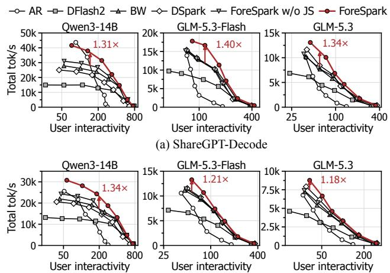  
(b) ShareGPT-E2E (Prefill+Decode)  
Figure 8. Total throughput versus user interactivity on (a) ShareGPT-Decode and (b) ShareGPT-E2E. Arrows mark the largest gain over the strongest baseline.

## 6.2 Analysis on Serving Performance

On the decode-only (ShareGPT-Decode) and end-to-end (ShareGPT-E2E) workloads of Figure 8, FORESPARK achieves up to 1.31/1.40/1.34× and 1.34/1.21/1.18× the throughput of the strongest baseline at matched user interactivity (arrows) and 1.77/1.40/1.34× and 1.53/1.21/1.18× that of DSPARK on Qwen3-14B/GLM5.3-Flash/ GLM5.3. The gains reach 1.37/1.46/1.46× and 1.43/1.24/1.30× over FORESPARK w/o JS, which shares FORESPARK’s checkpoint, isolating the benefit of joint scheduling, and 1.61/2.49/2.39× and 2.04/2.19/2.08× over AR.

Adaptive verification lets DSPARK and FORESPARK w/o JS outperform DFLASH2 under high load, but both still draft every block in full and pay its drafter overhead. FORESPARK reduces this overhead with joint scheduling and thus outperforms both. The gains of FORESPARK over DSPARK are larger on ShareGPT-Decode, since in ShareGPT-E2E prefill tokens share each step with decoding and add non-speculative tokens N that draft scheduling does not reduce. BW even outperforms DSPARK at several operating points, showing that its load-based cap is effective at those points. However, it applies one length to the whole batch regardless of each request’s acceptance, whereas FORESPARK schedules drafts per request and outperforms it.

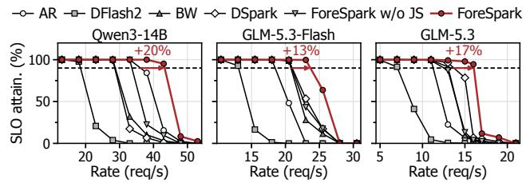

(a) Rate sweep (SLO: TTFT 1 s, TPOT 50 / 30 / 40 ms)  
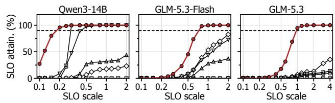  
(b) SLO scale (at 33 / 23 / 16 req/s)  
Figure 9. SLO attainment on ShareGPT-E2E, following (Zhong et al., 2024). (a) Versus request rate, where arrows mark capacity gains at 90% (dashed). (b) At a fixed rate, with both thresholds scaled.

At a load (batch size) of one, where full-block drafting is preferable and lies within FORESPARK’s design space, FORESPARK attains 1.15/1.07/0.96× and 1.11/0.98/0.98× the user interactivity of DSPARK on ShareGPT-Decode and ShareGPT-E2E, with the small gap on GLM5.3 consistent with the slightly higher acceptance of DSPARK’s drafter (Section 6.6). On Qwen3-14B ShareGPT-Decode, AR has the highest throughput at the heaviest load, where verification is compute-bound, but FORESPARK comes closest among speculative methods and surpasses AR at higher user interactivity. On Qwen3-14B ShareGPT-E2E, in contrast, FORESPARK exceeds AR even at the heaviest load. We attribute this to long multi-turn chat histories, which keep every method memory-bound, so extra verification stays computationally cheap and speculation remains worthwhile.

SLO attainment. These open-loop runs use the end-toend workload, since a decode-only run cannot measure TTFT. At 90% attainment (Figure 9(a)), FORESPARK sustains 1.20/1.13/1.17× the request rate of the strongest baseline, which is AR on Qwen3-14B, 1.51/1.13/1.17× that of DSPARK, and 1.29/1.13/1.28× that of FORESPARK w/o JS on Qwen3-14B/GLM5.3-Flash/GLM5.3. Once requests queue, extra step time delays both active generations and queued prefills, so removing unproductive drafting and verification keeps both SLOs met at higher rates.

Figure 9(b) fixes the request rate just above DSPARK’s capacity (33/23/16 requests/s) and scales the TTFT and TPOT thresholds by a common factor. At the original thresholds, FORESPARK meets the SLOs for 100/100/95% of requests, against 17/53/7% for DSPARK and 100/43/4% for FORESPARK w/o JS. FORESPARK keeps attainment above 90% even when the thresholds are tightened to 0.2/0.8/1.0×, whereas DSPARK stays below 90% even when they are relaxed to 2× on Qwen3-14B and GLM5.3-Flash and 4× on GLM5.3. At this rate, DSPARK’s queue keeps growing, so looser thresholds recover only a fraction of its requests, while FORESPARK still has headroom.

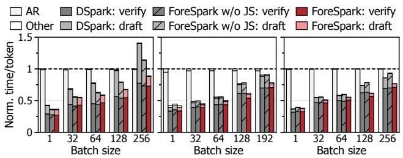  
(a) Qwen3-14B  
(b) GLM-5.3-Flash  
(c) GLM-5.3  
Figure 10. Time per output token on ShareGPT-Decode, normalized to AR at each batch size.

## 6.3 Execution Time Breakdown Analysis

Figure 10 breaks down execution time per output token, normalized to AR at each batch size. At the largest batch size, FORESPARK reduces drafting time by 76/68/67% relative to DSPARK on Qwen3-14B/GLM5.3-Flash/ GLM5.3, as it packs only the scheduled draft positions (Section 4.4), and by 62/70/76% even against FORESPARK w/o JS, which shares its checkpoint, so the saving comes from joint scheduling rather than the backbone. Total time drops by 37/13/11% relative to DSPARK, and on Qwen3-14B, DSPARK and FORESPARK w/o JS need 1.41× and 1.14× the time per token of AR, whereas FORESPARK needs 0.89×. Verification time per token also decreases at some batch sizes (e.g., by 12% at 128 requests on GLM5.3-Flash) despite the same post-draft estimator as FORESPARK w/o JS, which we attribute to joint scheduling sizing the verification budget together.

## 6.4 Analysis on Joint Scheduler

On GLM5.3-Flash with a common DFLASH2 backbone (Figure 11(a)), adaptive verification alone (+AV, i.e., FORESPARK w/o JS) improves throughput by up to 1.56× over full verification (DFLASH2), and joint scheduling adds up to 1.17× on top. This gain relies on a computationally cheap search, as an exhaustive scheduler with the same inputs (Exhaustive) falls below +AV at batch sizes of 64 and 192 and trails FORESPARK by up to 1.22×. FORESPARK decides a schedule in 88 µs at 192 requests, against 8.2 ms for Exhaustive, used only as an optimality reference, with an average goodput loss of at most 0.01%

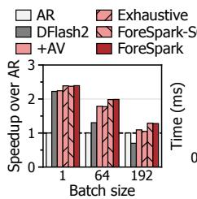  
(a) Design ablation

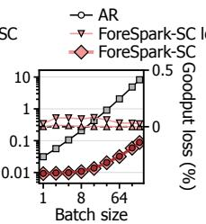  
(b) Error / overhead

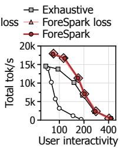  
(c) Pareto

Figure 11. Scheduler analysis on GLM5.3-Flash. (a) Decodeonly speedup over AR for design variants. (b) Comparison with exhaustive search. (c) Total throughput vs. user interactivity.  
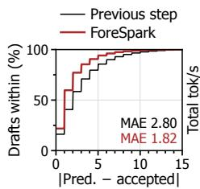

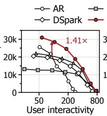  
(a) Predictor quality  
(b) Directional drafter

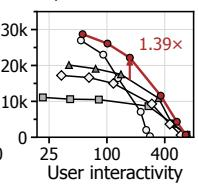  
(c) Temp=1.0  
Figure 12. (a) Share of drafts within a given acceptance-length error. (b) Total throughput versus user interactivity with a directional drafter. (c) Total throughput versus user interactivity of Qwen3-14B on ShareGPT-E2E with temperature 1.0.

(Figure 11(b)).

FORESPARK-SC (single curve) replaces the per-length estimator with the single shared length-K curve, which assumes prefix structure and makes each $R _ { i }$ concave. Despite the token differences in Section 3, it predicts acceptance as accurately and matches FORESPARK in all three panels, so DFLASH2 admits this simpler form, which FORESPARK forgoes for generality where this may not hold.

## 6.5 Sensitivity Studies

Dataset. FORESPARK’s advantage carries over to math and code workloads, with up to 1.49/1.38/1.24× the throughput of DSPARK on Qwen3-14B/GLM5.3-Flash/GLM5.3 (Appendix D), as it sets each request’s draft length from its current context rather than from a specialized setting.

Predictor quality. Although the previous step’s acceptance is infeasible under adaptive verification (Section 3), we compare against it over 1.48M full-block drafts of Qwen3-14B (K=15, no adaptive verification), where FORESPARK predicts acceptance within one token for 60% of drafts versus 41%, and lowers the mean absolute error from 2.80 to 1.82 tokens (Figure 12(a)), so the target model’s current features forecast the upcoming draft better than historical acceptance.

Drafter type. With a directional drafter, i.e., causal attention within the block (Figure 12(b)), FORESPARK still improves throughput over DSPARK by up to 1.55× at matched user interactivity. Full-block drafting remains overhead under load even for this drafter, which joint scheduling reduces.

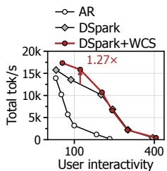  
(a) DSpark+WCS

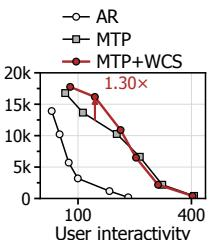  
(b) MTP+WCS

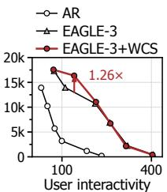  
(c) EAGLE-3+WCS  
Figure 13. Total throughput versus user interactivity of other drafters with and without WCS on GLM5.3-Flash.

Temperature. With temperature 1.0 instead of greedy decoding on Qwen3-14B ShareGPT-E2E (Figure 12(c)), FORESPARK achieves up to 1.39× the throughput of the strongest baseline (BW), 1.76× that of DSPARK, and 1.70× that of AR, compared with 1.34/1.53/2.04× under greedy decoding. Sampling lowers acceptance, which narrows the margin over AR, while the gap to the speculative baselines widens because full-block drafting wastes more work when fewer drafted tokens are accepted.

Draft length. With K=7, FORESPARK achieves up to 1.32× the throughput of DSPARK on Qwen3-14B and up to 1.24/1.16× that of the strongest baseline on GLM5.3-Flash/GLM5.3, so its gains hold although a smaller K leaves less drafter work to avoid (Appendix F).

## 6.6 Analysis on Acceptance Length and Overhead

Figure 15 (Appendix E) tests whether FORESPARK’s gains stem from a stronger or more expensive drafter. At K=15 without adaptive verification, FORESPARK reaches mean acceptance lengths of 4.38/3.33/3.37 on Qwen3-14B/ GLM5.3-Flash/GLM5.3 over SPEED-Bench’s 11 categories (Abramovich et al., 2026), within 3.2% of DSPARK and equal to DFLASH2 since the estimators do not alter the drafted tokens, so the serving gains do not stem from higher acceptance. Training costs little extra, taking 1.12/1.05/1.11× the time per iteration of DSPARK and only 3–5% more than DFLASH2, since length sampling trains one pre-draft row per step instead of running the drafter at every length (Section 4.5). The pre-/post-draft estimators add only 0.1–0.2% parameters, and the drafter is 3.7–5.0% larger than DSPARK’s due to the DFLASH2 backbone.

## 6.7 Analysis on WCS with Other Drafters

Since WCS needs only a drafter latency profile and a predraft estimator on the target’s context feature and anchor embedding (Section 4.2), it is not tied to FORESPARK’s drafter, and Figure 13 applies it to the parallel drafter DSPARK and the autoregressive drafters MTP and EAGLE-3, keeping each drafter’s maximum draft length and serving the same checkpoint with and without WCS. At matched user interactivity, WCS improves throughput by up to 1.27/1.30/1.26× over DSPARK, MTP, and EAGLE-3 (Appendix G).

## 7 DISCUSSION

Where FORESPARK helps most. Since full-block drafting is one of its schedules, FORESPARK stays comparable to DSPARK at low load while extending speculative decoding to higher loads and decode-dominated workloads, where speculation is usually considered unsuitable (Sections 6.2 and 6.3).

Remaining headroom. Against an oracle that knows each draft’s acceptance, both pre-/post-draft estimators remain conservative. This partly stems from our calibration on Alpaca, which assumes an unknown workload. Further gains thus lie in workload-matched calibration or better workload-adaptive estimators.

Fairness. Global sorting may leave a request undrafted in a step, which never changes outputs but can skew per-request speedups. Per-request minimum budgets could fix this.

## 8 RELATED WORK

Goodput-aware speculation in LLM serving. Complementary to drafter designs (Appendix H), serving systems schedule or disaggregate prefill and decoding for throughput or goodput (Yu et al., 2022; Kwon et al., 2023; Zheng et al., 2024; Agrawal et al., 2024; Zhong et al., 2024), but under load extra verification competes with other requests and can erase or even reverse the benefit of speculation (Su et al., 2023; Liu et al., 2024b; 2026c). TurboSpec (Liu et al., 2024b) and Nightjar (Li et al., 2026b) choose one speculation length per batch, and AdaServe (Li et al., 2026c), AdaSpec (Huang et al., 2025b), FASER (Chen et al., 2026c), and ECHO (Hu et al., 2026b) size it per request or tree, often under SLO or budget constraints, mostly for autoregressive or tree drafters. Batch-level verification budgets select the most promising draft tokens across requests (Wu et al., 2025), including for parallel drafters (Cheng et al., 2026; Liu et al., 2026b;a; Chen et al., 2026b), and AdaFlash truncates each request (Qian et al., 2026), but only after a full block is drafted, leaving the drafter overhead.

Draft length control. Adaptive draft lengths are mostly studied for autoregressive drafters through learned stopping predictors (Huang et al., 2025a; Mamou et al., 2024), singlerequest length regression (Zhang et al., 2024), drafting overlapped with verification (Liu et al., 2025), tree search (Wang et al., 2025), or online tuning (Hou et al., 2025). For parallel drafters, DiffuSpec (Li et al., 2026a) sizes drafts from recent acceptance, FailFast (Pan et al., 2025) and DLoop (Gu et al., 2026) keep drafting while confident at the cost of extra passes, and TreeSpark (Zhou et al., 2026) prunes a draft tree by path survival and shrinks it under load but builds it from a full backbone pass. None of them sizes each request’s draft before a parallel drafter’s pass from current-context acceptance estimates, jointly with a verification budget.

## 9 CONCLUSION

We presented work-conserving speculation and its prototype FORESPARK, which estimate acceptance before drafting, jointly allocate per-request draft lengths and the verification budget, and spend that budget with post-draft confidence, improving throughput by up to 1.77× over DSPARK. We hope work-conserving speculation guides how future parallel drafters are designed and scheduled for LLM serving.

## REFERENCES

Abramovich, T., Ashkenazi, M., Putterman, I., Chislett, B., Mitra, T., Rouhani, B. D., Zilberstein, R., and Geifman, Y. SPEED-Bench: A Unified and Diverse Benchmark for Speculative Decoding. In Proceedings of the 43rd International Conference on Machine Learning (ICML), 2026. URL https://proceedings.mlr.pres s/v306/abramovich26a.html.

Agrawal, A., Kedia, N., Panwar, A., Mohan, J., Kwatra, N., Gulavani, B., Tumanov, A., and Ramjee, R. Taming Throughput-Latency Tradeoff in LLM Inference with Sarathi-Serve. In Proceedings ofthe 18th USENIX Symposium on Operating Systems Design and Implementation (OSDI), 2024. URL https://www.usenix.org/c onference/osdi24/presentation/agrawal.

An, Z., Bai, H., Liu, Z., Li, D., and Barsoum, E. PARD: Accelerating LLM Inference with Low-Cost PARallel Draft Model Adaptation. In Proceedings of the 14th International Conference on Learning Representations (ICLR), 2026. URL https://proceedings.iclr .cc/paper\_files/paper/2026/hash/ea17 f1a1685d65e66af19da44471b9ae-Abstrac t-Conference.html.

anon8231489123. ShareGPT Dataset, 2023. URL https: //huggingface.co/datasets/anon823148 9123/ShareGPT\_Vicuna\_unfiltered.

Austin, J., Odena, A., Nye, M., Bosma, M., Michalewski, H., Dohan, D., Jiang, E., Cai, C., Terry, M., Le, Q., and Sutton, C. Program Synthesis with Large Language Models. arXiv preprint arXiv:2108.07732, 2021. URL https://arxiv.org/abs/2108.07732.

Cai, T., Li, Y., Geng, Z., Peng, H., Lee, J. D., Chen, D., and

Dao, T. Medusa: Simple LLM Inference Acceleration Framework with Multiple Decoding Heads. In Proceedings of the 41st International Conference on Machine Learning (ICML), 2024. URL https://proceedi ngs.mlr.press/v235/cai24b.html.

Chen, C., Borgeaud, S., Irving, G., Lespiau, J.-B., Sifre, L., and Jumper, J. Accelerating Large Language Model Decoding with Speculative Sampling. arXiv preprint arXiv:2302.01318, 2023. URL https://arxiv.or g/abs/2302.01318.

Chen, J., Liang, Y., and Liu, Z. DFlash: Block Diffusion for Flash Speculative Decoding. In Proceedings ofthe 43rd International Conference on Machine Learning (ICML), 2026a. URL https://proceedings.mlr.pres s/v306/chen26bv.html.

Chen, M., Tworek, J., Jun, H., Yuan, Q., de Oliveira Pinto, H. P., Kaplan, J., Edwards, H., Burda, Y., Joseph, N., Brockman, G., Ray, A., Puri, R., Krueger, G., Petrov, M., Khlaaf, H., Sastry, G., Mishkin, P., Chan, B., Gray, S., Ryder, N., Pavlov, M., Power, A., Kaiser, L., Bavarian, M., Winter, C., Tillet, P., Such, F. P., Cummings, D., Plappert, M., Chantzis, F., Barnes, E., Herbert-Voss, A., Guss, W. H., Nichol, A., Paino, A., Tezak, N., Tang, J., Babuschkin, I., Balaji, S., Jain, S., Saunders, W., Hesse, C., Carr, A. N., Leike, J., Achiam, J., Misra, V., Morikawa, E., Radford, A., Knight, M., Brundage, M., Murati, M., Mayer, K., Welinder, P., McGrew, B., Amodei, D., McCandlish, S., Sutskever, I., and Zaremba, W. Evaluating Large Language Models Trained on Code. arXiv preprint arXiv:2107.03374, 2021. URL https://arxiv.org/abs/2107.03374.

Chen, R., Xu, M., Fang, Z., Ye, K., and Xu, C. DScale: Scaling Block-Diffusion Speculative Decoding with Adaptive Verification. arXiv preprint arXiv:2609.37532, 2026b. URL https://arxiv.org/abs/2609.37532.

Chen, W., Lu, C., Lin, Y., and Ustiugov, D. FASER: Fine-Grained Phase Management for Speculative Decoding in Dynamic LLM Serving. arXiv preprint arXiv:2604.20503, 2026c. URL https://arxiv. org/abs/2604.20503.

Chen, Z., May, A., Svirschevski, R., Huang, Y., Ryabinin, M., Jia, Z., and Chen, B. Sequoia: Scalable and Robust Speculative Decoding. In Proceedings of the Advances in Neural Information Processing Systems 37 (NeurIPS), 2024. URL https://proceedings.neurips. cc/paper\_files/paper/2024/hash/ea1f5 f0878d43ff4fb8bf64ef4a2326c-Abstrac t-Conference.html.

Cheng, X., Yu, X., Shao, C., Li, J., Xiong, Y., Qian, Y., Zhu, J., Ma, S., Zhang, X., Ye, J., Chen, Q., Deng, C., Yu, J.,

Dai, D., Zhang, Z., Wei, Y., Tan, Y., Yang, W., Xu, R., Wu, Y., Xu, Z., Wang, X., Chen, M., Tian, R., Bi, X., Hao, Z., Chen, S., Cao, H., Zhang, W., Xu, A., Zhang, H., Zhao, D., and Liang, W. DSpark: Confidence-Scheduled Speculative Decoding with Semi-Autoregressive Generation. arXiv preprint arXiv:2607.05147, 2026. URL https://arxiv.org/abs/2607.05147.

Christopher, J. K., Bartoldson, B. R., Ben-Nun, T., Cardei, M., Kailkhura, B., and Fioretto, F. Speculative Diffusion Decoding: Accelerating Language Generation through Diffusion. In Proceedings of the 2025 Conference of the Nations ofthe Americas Chapter ofthe Associationfor Computational Linguistics: Human Language Technologies (NAACL), 2025. doi: 10.18653/v1/2025.naa cl-long.601.

Cobbe, K., Kosaraju, V., Bavarian, M., Chen, M., Jun, H., Kaiser, L., Plappert, M., Tworek, J., Hilton, J., Nakano, R., Hesse, C., and Schulman, J. Training Verifiers to Solve Math Word Problems. arXiv preprint arXiv:2110.14168, 2021. URL https://arxiv.or g/abs/2110.14168.

DeepSeek-AI, Liu, A., Feng, B., Wang, B., Wang, B., Liu, B., Zhao, C., Deng, C., Ruan, C., Dai, D., Guo, D., Yang, D., Chen, D., Ji, D., Li, E., Lin, F., Luo, F., Hao, G., Chen, G., Li, G., Zhang, H., Xu, H., Yang, H., Zhang, H., Ding, H., Xin, H., Gao, H., Li, H., Qu, H., Cai, J. L., Liang, J., Guo, J., Ni, J., Li, J., Chen, J., Yuan, J., Qiu, J., Song, J., Dong, K., Gao, K., Guan, K., Wang, L., Zhang, L., Xu, L., Xia, L., Zhao, L., Zhang, L., Li, M., Wang, M., Zhang, M., Zhang, M., Tang, M., Li, M., Tian, N., Huang, P., Wang, P., Zhang, P., Zhu, Q., Chen, Q., Du, Q., Chen, R. J., Jin, R. L., Ge, R., Pan, R., Xu, R., Chen, R., Li, S. S., Lu, S., Zhou, S., Chen, S., Wu, S., Ye, S., Ma, S., Wang, S., Zhou, S., Yu, S., Zhou, S., Zheng, S., Wang, T., Pei, T., Yuan, T., Sun, T., Xiao, W. L., Zeng, W., An, W., Liu, W., Liang, W., Gao, W., Zhang, W., Li, X. Q., Jin, X., Wang, X., Bi, X., Liu, X., Wang, X., Shen, X., Chen, X., Chen, X., Nie, X., Sun, X., Wang, X., Liu, X., Xie, X., Yu, X., Song, X., Zhou, X., Yang, X., Lu, X., Su, X., Wu, Y., Li, Y. K., Wei, Y. X., Zhu, Y. X., Xu, Y., Huang, Y., Li, Y., Zhao, Y., Sun, Y., Li, Y., Wang, Y., Zheng, Y., Zhang, Y., Xiong, Y., Zhao, Y., He, Y., Tang, Y., Piao, Y., Dong, Y., Tan, Y., Liu, Y., Wang, Y., Guo, Y., Zhu, Y., Wang, Y., Zou, Y., Zha, Y., Ma, Y., Yan, Y., You, Y., Liu, Y., Ren, Z. Z., Ren, Z., Sha, Z., Fu, Z., Huang, Z., Zhang, Z., Xie, Z., Hao, Z., Shao, Z., Wen, Z., Xu, Z., Zhang, Z., Li, Z., Wang, Z., Gu, Z., Li, Z., and Xie, Z. DeepSeek-V2: A Strong, Economical, and Efficient Mixture-of-Experts Language Model. arXiv preprint arXiv:2405.04434, 2024a. URL https://arxiv.org/abs/2405.04434.

DeepSeek-AI, Liu, A., Feng, B., Xue, B., Wang, B., Wu, B.,

Lu, C., Zhao, C., Deng, C., Zhang, C., Ruan, C., Dai, D., Guo, D., Yang, D., Chen, D., Ji, D., Li, E., Lin, F., Dai, F., Luo, F., Hao, G., Chen, G., Li, G., Zhang, H., Bao, H., Xu, H., Wang, H., Zhang, H., Ding, H., Xin, H., Gao, H., Li, H., Qu, H., Cai, J. L., Liang, J., Guo, J., Ni, J., Li, J., Wang, J., Chen, J., Chen, J., Yuan, J., Qiu, J., Li, J., Song, J., Dong, K., Hu, K., Gao, K., Guan, K., Huang, K., Yu, K., Wang, L., Zhang, L., Xu, L., Xia, L., Zhao, L., Wang, L., Zhang, L., Li, M., Wang, M., Zhang, M., Zhang, M., Tang, M., Li, M., Tian, N., Huang, P., Wang, P., Zhang, P., Wang, Q., Zhu, Q., Chen, Q., Du, Q., Chen, R. J., Jin, R. L., Ge, R., Zhang, R., Pan, R., Wang, R., Xu, R., Zhang, R., Chen, R., Li, S. S., Lu, S., Zhou, S., Chen, S., Wu, S., Ye, S., Ye, S., Ma, S., Wang, S., Zhou, S., Yu, S., Zhou, S., Pan, S., Wang, T., Yun, T., Pei, T., Sun, T., Xiao, W. L., Zeng, W., Zhao, W., An, W., Liu, W., Liang, W., Gao, W., Yu, W., Zhang, W., Li, X. Q., Jin, X., Wang, X., Bi, X., Liu, X., Wang, X., Shen, X., Chen, X., Zhang, X., Chen, X., Nie, X., Sun, X., Wang, X., Cheng, X., Liu, X., Xie, X., Liu, X., Yu, X., Song, X., Shan, X., Zhou, X., Yang, X., Li, X., Su, X., Lin, X., Li, Y. K., Wang, Y. Q., Wei, Y. X., Zhu, Y. X., Zhang, Y., Xu, Y., Xu, Y., Huang, Y., Li, Y., Zhao, Y., Sun, Y., Li, Y., Wang, Y., Yu, Y., Zheng, Y., Zhang, Y., Shi, Y., Xiong, Y., He, Y., Tang, Y., Piao, Y., Wang, Y., Tan, Y., Ma, Y., Liu, Y., Guo, Y., Wu, Y., Ou, Y., Zhu, Y., Wang, Y., Gong, Y., Zou, Y., He, Y., Zha, Y., Xiong, Y., Ma, Y., Yan, Y., Luo, Y., You, Y., Liu, Y., Zhou, Y., Wu, Z. F., Ren, Z. Z., Ren, Z., Sha, Z., Fu, Z., Xu, Z., Huang, Z., Zhang, Z., Xie, Z., Zhang, Z., Hao, Z., Gou, Z., Ma, Z., Yan, Z., Shao, Z., Xu, Z., Wu, Z., Zhang, Z., Li, Z., Gu, Z., Zhu, Z., Liu, Z., Li, Z., Xie, Z., Song, Z., Gao, Z., and Pan, Z. DeepSeek-V3 Technical Report. arXiv preprint arXiv:2412.19437, 2024b. URL https://arxiv.org/abs/2412.19437.

DeepSeek-AI, Liu, A., Mei, A., Lin, B., Xue, B., Wang, B., Xu, B., Wu, B., Zhang, B., Lin, C., Dong, C., Lu, C., Zhao, C., Deng, C., Xu, C., Ruan, C., Dai, D., Guo, D., Yang, D., Chen, D., Li, E., Zhou, F., Lin, F., Dai, F., Hao, G., Chen, G., Li, G., Zhang, H., Xu, H., Li, H., Liang, H., Wei, H., Zhang, H., Luo, H., Ji, H., Ding, H., Tang, H., Cao, H., Gao, H., Qu, H., Zeng, H., Huang, J., Li, J., Xu, J., Hu, J., Chen, J., Xiang, J., Yuan, J., Cheng, J., Zhu, J., Ran, J., Jiang, J., Qiu, J., Li, J., Song, J., Dong, K., Gao, K., Guan, K., Huang, K., Zhou, K., Huang, K., Yu, K., Wang, L., Zhang, L., Wang, L., Zhao, L., Yin, L., Guo, L., Luo, L., Ma, L., Wang, L., Zhang, L., Di, M. S., Xu, M. Y., Zhang, M., Zhang, M., Tang, M., Zhou, M., Huang, P., Cong, P., Wang, P., Wang, Q., Zhu, Q., Li, Q., Chen, Q., Du, Q., Xu, R., Ge, R., Zhang, R., Pan, R., Wang, R., Yin, R., Xu, R., Shen, R., Zhang, R., Liu, S. H., Lu, S., Zhou, S., Chen, S., Cai, S., Chen, S., Hu, S., Liu, S., Hu, S., Ma, S., Wang, S., Yu, S., Zhou, S., Pan, S., Zhou, S., Ni, T., Yun, T., Pei, T., Ye, T., Yue, T., Zeng, W., Liu, W.,

Liang, W., Pang, W., Luo, W., Gao, W., Zhang, W., Gao, X., Wang, X., Bi, X., Liu, X., Wang, X., Chen, X., Zhang, X., Nie, X., Cheng, X., Liu, X., Xie, X., Liu, X., Yu, X., Li, X., Yang, X., Li, X., Chen, X., Su, X., Pan, X., Lin, X., Fu, X., Wang, Y. Q., Zhang, Y., Xu, Y., Ma, Y., Li, Y., Li, Y., Zhao, Y., Sun, Y., Wang, Y., Qian, Y., Yu, Y., Zhang, Y., Ding, Y., Shi, Y., Xiong, Y., He, Y., Zhou, Y., Zhong, Y., Piao, Y., Wang, Y., Chen, Y., Tan, Y., Wei, Y., Ma, Y., Liu, Y., Yang, Y., Guo, Y., Wu, Y., Wu, Y., Cheng, Y., Ou, Y., Xu, Y., Wang, Y., Gong, Y., Wu, Y., Zou, Y., Li, Y., Xiong, Y., Luo, Y., You, Y., Liu, Y., Zhou, Y., Wu, Z. F., Ren, Z. Z., Zhao, Z., Ren, Z., Sha, Z., Fu, Z., Xu, Z., Xie, Z., Zhang, Z., Hao, Z., Gou, Z., Ma, Z., Yan, Z., Shao, Z., Huang, Z., Wu, Z., Li, Z., Zhang, Z., Xu, Z., Wang, Z., Gu, Z., Zhu, Z., Li, Z., Zhang, Z., Xie, Z., Gao, Z., Pan, Z., Yao, Z., Feng, B., Li, H., Cai, J. L., Ni, J., Xu, L., Li, M., Tian, N., Chen, R. J., Jin, R. L., Li, S. S., Zhou, S., Sun, T., Li, X. Q., Jin, X., Shen, X., Chen, X., Song, X., Zhou, X., Zhu, Y. X., Huang, Y., Li, Y., Zheng, Y., Zhu, Y., Ma, Y., Huang, Z., Xu, Z., Zhang, Z., Ji, D., Liang, J., Guo, J., Chen, J., Xia, L., Wang, M., Li, M., Zhang, P., Chen, R., Sun, S., Wu, S., Ye, S., Wang, T., Xiao, W. L., An, W., Wang, X., Sun, X., Wang, X., Tang, Y., Zha, Y., Zhang, Z., Ju, Z., Zhang, Z., and Qu, Z. DeepSeek-V3.2: Pushing the Frontier of Open Large Language Models. arXiv preprint arXiv:2512.02556, 2025. URL https://arxiv.org/abs/2512.02556.

Ding, N., Chen, Y., Xu, B., Qin, Y., Hu, S., Liu, Z., Sun, M., and Zhou, B. Enhancing Chat Language Models by Scaling High-quality Instructional Conversations. In Proceedings ofthe 2023 Conference on Empirical Methods in Natural Language Processing (EMNLP), 2023. doi: 10.18653/v1/2023.emnlp-main.183.

Fu, Y., Bailis, P., Stoica, I., and Zhang, H. Break the Sequential Dependency of LLM Inference Using Lookahead Decoding. In Proceedings ofthe 41st International Conference on Machine Learning (ICML), 2024. URL https://proceedings.mlr.press/v235/f u24a.html.

GLM-5-Team, Zeng, A., Lv, X., Hou, Z., Du, Z., Zheng, Q., Chen, B., Yin, D., Ge, C., Huang, C., Xie, C., Zhu, C., Yin, C., Wang, C., Pan, G., Zeng, H., Zhang, H., Wang, H., Chen, H., Zhang, J., Jiao, J., Guo, J., Wang, J., Du, J., Wu, J., Wang, K., Li, L., Fan, L., Zhong, L., Liu, M., Zhao, M., Du, P., Dong, Q., Lu, R., Shuang-Li, Cao, S., Liu, S., Jiang, T., Chen, X., Zhang, X., Huang, X., Dong, X., Xu, Y., Wei, Y., An, Y., Niu, Y., Zhu, Y., Wen, Y., Cen, Y., Bai, Y., Qiao, Z., Wang, Z., Wang, Z., Zhu, Z., Liu, Z., Li, Z., Wang, B., Wen, B., Huang, C., Cai, C., Yu, C., Li, C., Hu, C., Zhang, C., Zhang, D., Lin, D., Yang, D., Wang, D., Ai, D., Zhu, E., Yi, F., Chen, F., Wen, G., Sun, H., Zhao, H., Hu, H., Zhang, H., Liu, H., Zhang, H.,

Peng, H., Tai, H., Zhang, H., Liu, H., Wang, H., Yan, H., Ge, H., Liu, H., Chu, H., Zhao, J., Wang, J., Zhao, J., Ren, J., Wang, J., Zhang, J., Gui, J., Zhao, J., Li, J., An, J., Li, J., Yuan, J., Du, J., Liu, J., Zhi, J., Duan, J., Zhou, K., Wei, K., Wang, K., Luo, K., Zhang, L., Sha, L., Xu, L., Wu, L., Ding, L., Chen, L., Li, M., Lin, N., Ta, P., Zou, Q., Song, R., Yang, R., Tu, S., Yang, S., Wu, S., Zhang, S., Li, S., Li, S., Fan, S., Qin, W., Tian, W., Zhang, W., Yu, W., Liang, W., Kuang, X., Cheng, X., Li, X., Yan, X., Hu, X., Ling, X., Fan, X., Xia, X., Zhang, X., Zhang, X., Pan, X., Zou, X., Zhang, X., Liu, Y., Wu, Y., Li, Y., Wang, Y., Zhu, Y., Tan, Y., Zhou, Y., Pan, Y., Zhang, Y., Su, Y., Geng, Y., Yan, Y., Tan, Y., Bi, Y., Shen, Y., Yang, Y., Li, Y., Liu, Y., Wang, Y., Li, Y., Wu, Y., Zhang, Y., Duan, Y., Zhang, Y., Liu, Z., Jiang, Z., Yan, Z., Zhang, Z., Wei, Z., Chen, Z., Feng, Z., Yao, Z., Chai, Z., Wang, Z., Zhang, Z., Xu, B., Huang, M., Wang, H., Li, J., Dong, Y., and Tang, J. GLM-5: from Vibe Coding to Agentic Engineering. arXiv preprint arXiv:2602.15763, 2026. URL https://arxiv.org/abs/2602.15763.

Gu, G., Heo, B., Jun, H., Kang, Y., Lee, S., Yun, S., and Han, D. DLoop: Looped Speculative Decoding. arXiv preprint arXiv:2610.07659, 2026. URL https://ar xiv.org/abs/2610.07659.

Hendrycks, D., Burns, C., Kadavath, S., Arora, A., Basart, S., Tang, E., Song, D., and Steinhardt, J. Measuring Mathematical Problem Solving With the MATH Dataset. In Proceedings of the Neural Information Processing Systems Track on Datasets and Benchmarks 1 (NeurIPS Datasets and Benchmarks), 2021. URL https://da tasets-benchmarks-proceedings.neurips .cc/paper\_files/paper/2021/hash/be83 ab3ecd0db773eb2dc1b0a17836a1-Abstrac t-round2.html.

Hou, Y., Zhang, F., Du, C., Zhang, X., Pan, J., Pang, T., Du, C., Tan, V. Y. F., and Yang, Z. BanditSpec: Adaptive Speculative Decoding via Bandit Algorithms. In Proceedings of the 42nd International Conference on Machine Learning (ICML), 2025. URL https://proceedi ngs.mlr.press/v267/hou25h.html.

Hu, L., Feng, Z., Wu, Y., Yuan, H., Zhao, Y., Qian, Y.- Y., Wang, B., Zhao, P., Jiang, D., Zhu, Y., Rosing, T., and Zhang, H. JetSpec: Breaking the Scaling Ceiling of Speculative Decoding with Parallel Tree Drafting. arXiv preprint arXiv:2606.18394, 2026a. URL https://ar xiv.org/abs/2606.18394.

Hu, X., Shen, Y., Zhang, B., Zhang, H., Dai, J., Ge, S., Chen, L., Li, Y., and Wan, M. ECHO: Elastic Speculative Decoding with Sparse Gating for High-Concurrency Scenarios. In Proceedings ofthe 43rd International Conference on

Machine Learning (ICML), 2026b. URL https://pr oceedings.mlr.press/v306/hu26ar.html.

Huang, K., Guo, X., and Wang, M. SpecDec++: Boosting Speculative Decoding via Adaptive Candidate Lengths. In Proceedings ofthe 2nd Conference on Language Modeling (COLM), 2025a. URL https://openreview .net/forum?id=Y131N9fUbU.

Huang, K., Wu, H., Shi, Z., Zou, H., Yu, M., and Shi, Q. AdaSpec: Adaptive Speculative Decoding for Fast, SLO-Aware Large Language Model Serving. In Proceedings of the 16th ACM Symposium on Cloud Computing (SoCC), 2025b. doi: 10.1145/3772052.3772239.

Inco AI. DFlash 2: Keep Drafting Parallel, 2026. URL https://inco.ai/blog/dflash2/.

Jain, N., Han, K., Gu, A., Li, W.-D., Yan, F., Zhang, T., Wang, S., Solar-Lezama, A., Sen, K., and Stoica, I. LiveCodeBench: Holistic and Contamination Free Evaluation of Large Language Models for Code. In Proceedings of the 13th International Conference on Learning Representations (ICLR), 2025. URL https: //proceedings.iclr.cc/paper\_files/pa per/2025/hash/94074dd5a072d28ff75a76 dabed43767-Abstract-Conference.html.

Kimi Team, Zhang, Y., Lin, Z., Yao, X., Hu, J., Meng, F., Liu, C., Men, X., Yang, S., Li, Z., Li, W., Lu, E., Liu, W., Chen, Y., Xu, W., Yu, L., Wang, Y., Fan, Y., Zhong, L., Yuan, E., Zhang, D., Zhang, Y., Liu, T. Y., Wang, H., Fang, S., He, W., Liu, S., Li, Y., Su, J., Qiu, J., Pang, B., Yan, J., Jiang, Z., Huang, W., Yin, B., You, J., Wei, C., Wang, Z., Hong, C., Chen, Y., Chen, G., Wang, Y., Zheng, H., Wang, F., Liu, Y., Dong, M., Zhang, Z., Pan, S., Wu, W., Wu, Y., Guan, L., Tao, J., Fu, G., Xu, X., Wang, Y., Lai, G., Wu, Y., Zhou, X., Yang, Z., and Du, Y. Kimi Linear: An Expressive, Efficient Attention Architecture. arXiv preprint arXiv:2510.26692, 2025. URL https://arxiv.org/abs/2510.26692.

Kwon, W., Li, Z., Zhuang, S., Sheng, Y., Zheng, L., Yu, C. H., Gonzalez, J. E., Zhang, H., and Stoica, I. Efficient Memory Management for Large Language Model Serving with PagedAttention. In Proceedings of the 29th ACM Symposium on Operating Systems Principles (SOSP), 2023. doi: 10.1145/3600006.3613165.

Leviathan, Y., Kalman, M., and Matias, Y. Fast Inference from Transformers via Speculative Decoding. In Proceedings of the 40th International Conference on Machine Learning (ICML), 2023. URL https://proceedi ngs.mlr.press/v202/leviathan23a.html.

Li, G., Fu, Z., Fang, M., Zhao, Q., Tang, M., Yuan, C., and Wang, J. DiffuSpec: Unlocking Diffusion Language

Models for Speculative Decoding. In Findings of the Association for Computational Linguistics: ACL 2026, 2026a. doi: 10.18653/v1/2026.findings-acl .1048.

Li, R., Zhang, Z., Zhang, L., Wang, H., Fu, X., and Lai, Z. Nightjar: Dynamic Adaptive Speculative Decoding for Large Language Models Serving. Journal of Systems Architecture, 178:103889, 2026b. doi: 10.1016/j.sy sarc.2026.103889.

Li, Y., Wei, F., Zhang, C., and Zhang, H. EAGLE: Speculative Sampling Requires Rethinking Feature Uncertainty. In Proceedings ofthe 41st International Conference on Machine Learning (ICML), 2024a. URL https://pr oceedings.mlr.press/v235/li24bt.html.

Li, Y., Wei, F., Zhang, C., and Zhang, H. EAGLE-2: Faster Inference of Language Models with Dynamic Draft Trees. In Proceedings ofthe 2024 Conference on Empirical Methods in Natural Language Processing (EMNLP), 2024b. doi: 10.18653/v1/2024.emnlp-main. 422.

Li, Y., Wei, F., Zhang, C., and Zhang, H. EAGLE-3: Scaling up Inference Acceleration of Large Language Models via Training-Time Test. In Proceedings of the Advances in Neural Information Processing Systems 38 (NeurIPS), 2025. URL https://proceedings.neurips. cc/paper\_files/paper/2025/hash/c7b5a 35ea98b62512a869c19ea7b03cb-Abstrac t-Conference.html.

Li, Z., Zheng, L., Zhong, Y., Liu, V., Sheng, Y., Jin, X., Huang, Y., Chen, Z., Zhang, H., Gonzalez, J. E., and Stoica, I. AlpaServe: Statistical Multiplexing with Model Parallelism for Deep Learning Serving. In Proceedings of the 17th USENIX Symposium on Operating Systems Design and Implementation (OSDI), 2023. URL https: //www.usenix.org/conference/osdi23/p resentation/li-zhouhan.

Li, Z., Chen, Z., Delacourt, R., Oliaro, G., Wang, Z., Chen, Q., Lin, S., Yang, A., Zhang, Z., Chen, Z., Lai, Y.-H., Cheng, X., Miao, X., and Jia, Z. AdaServe: Accelerating Multi-SLO LLM Serving with SLO-Customized Speculative Decoding. In Proceedings of the 21st European Conference on Computer Systems (EuroSys), 2026c. doi: 10.1145/3767295.3769315.

Lightman, H., Kosaraju, V., Burda, Y., Edwards, H., Baker, B., Lee, T., Leike, J., Schulman, J., Sutskever, I., and Cobbe, K. Let’s Verify Step by Step. In Proceedings of the 12th International Conference on Learning Representations (ICLR), 2024. URL https://proceeding s.iclr.cc/paper\_files/paper/2024/has

h/aca97732e30bcf1303bc22ac3924fd16-A bstract-Conference.html.

Liu, H., Cen, R., Shi, J., Qin, G., Zhang, J., Liu, T., Fan, R., Zhao, G., Xie, R., Zhang, K., Liu, S., Yu, G., and Zhu, J. AngelSpec: Towards Real-World High Performance Inference with Speculative Decoding. arXiv preprint arXiv:2607.25852, 2026a. URL https://arxiv.or g/abs/2607.25852.

Liu, T., Li, Y., Lv, Q., Liu, K., Zhu, J., Hu, W., and Sun, X. PEARL: Parallel Speculative Decoding with Adaptive Draft Length. In Proceedings of the 13th International Conference on Learning Representations (ICLR), 2025. URL https://proceedings.iclr.cc/pape r\_files/paper/2025/hash/03b104305270 0b1a471996b0baf309d4-Abstract-Confere nce.html.

Liu, T., Shen, Y., Cen, R., Shi, J., Zhang, J., Qin, G., Liu, H., Liu, S., Yu, G., and Zhu, J. D-cut: Adaptive Verification Depth Pruning for Batched Speculative Decoding. arXiv preprint arXiv:2607.14647, 2026b. URL https://ar xiv.org/abs/2607.14647.

Liu, X., Hu, L., Bailis, P., Cheung, A., Deng, Z., Stoica, I., and Zhang, H. Online Speculative Decoding. In Proceedings of the 41st International Conference on Machine Learning (ICML), 2024a. URL https://proceedi ngs.mlr.press/v235/liu24y.html.

Liu, X., Park, J., Hu, L., Kwon, W., Li, Z., Zhang, C., Du, K., Mo, X., You, K., Cheung, A., Deng, Z., Stoica, I., and Zhang, H. TurboSpec: Closed-loop Speculation Control System for Optimizing LLM Serving Goodput. arXiv preprint arXiv:2406.14066, 2024b. URL https: //arxiv.org/abs/2406.14066.

Liu, X., Yu, J., Park, J., Stoica, I., and Cheung, A. Speculative Decoding: Performance or Illusion? In Proceedings ofthe 9th Conference on Machine Learning and Systems (MLSys), 2026c. URL https://proceedings.ml sys.org/paper\_files/paper/2026/hash/ 554e056fe2b6d9fd27ffcd3367ae1267-Abs tract-Conference.html.

Mamou, J., Pereg, O., Korat, D., Berchansky, M., Timor, N., Wasserblat, M., and Schwartz, R. Dynamic Speculation Lookahead Accelerates Speculative Decoding of Large Language Models. In Proceedings of the 4th NeurIPS Efficient Natural Language and Speech Processing Workshop (ENLSP), 2024. URL https://proceedings. mlr.press/v262/mamou24a.html.

Miao, X., Oliaro, G., Zhang, Z., Cheng, X., Wang, Z., Zhang, Z., Wong, R. Y. Y., Zhu, A., Yang, L., Shi, X., Shi, C., Chen, Z., Arfeen, D., Abhyankar, R.,

and Jia, Z. SpecInfer: Accelerating Large Language Model Serving with Tree-based Speculative Inference and Verification. In Proceedings of the 29th International Conference on Architectural Support for Programming Languages and Operating Systems (ASPLOS), 2024. doi: 10.1145/3620666.3651335.

Pan, R., Chen, Z., Liu, H., Krishnamurthy, A., and Netravali, R. Fail Fast, Win Big: Rethinking the Drafting Strategy in Speculative Decoding via Diffusion LLMs. arXiv preprint arXiv:2512.20573, 2025. URL https://ar xiv.org/abs/2512.20573.

Qian, Y.-Y., Wu, H.-C., Chen, C., Sun, J., Dong, Z., Zhao, P., and Zhou, Z.-H. AdaFlash: Adaptive Speculative Decoding via On-Policy Distilled Diffusion Drafters. In The 2nd Workshop on Efficient Reasoning at the 3rd Conference on Language Modeling (COLM), 2026. URL https: //openreview.net/forum?id=oRL5ePUnQt.

Red Hat. Speculators: A Unified Library for Speculative Decoding Algorithms in LLM Serving, 2025. URL ht tps://github.com/vllm-project/specula tors.

Ringel, L. and Romano, Y. Accelerating Speculative Decoding with Block Diffusion Draft Trees. In Proceedings ofthe 3rd Conference on Language Modeling (COLM), 2026. URL https://openreview.net/forum ?id=2ivmZcTz07.

Sadhukhan, R., Chen, J., Chen, Z., Tiwari, V., Lai, R., Shi, J., Yen, I. E.-H., May, A., Chen, T., and Chen, B. MagicDec: Breaking the Latency-Throughput Tradeoff for Long Context Generation with Speculative Decoding. In Proceedings ofthe 13th International Conference on Learning Representations (ICLR), 2025. URL https: //proceedings.iclr.cc/paper\_files/pa per/2025/hash/13f972adf12bdf886583d4 8cd528002f-Abstract-Conference.html.

Sandler, J., Christopher, J., Hartvigsen, T., and Fioretto, F. SpecDiff-2: Scaling Diffusion Drafter Alignment For Faster Speculative Decoding. In Proceedings ofthe 9th Conference on Machine Learning and Systems (MLSys), 2026. URL https://proceedings.mlsys.or g/paper\_files/paper/2026/hash/041dad 5ed2191b44ba3ed0e00cdc3187-Abstract-C onference.html.

Stern, M., Shazeer, N., and Uszkoreit, J. Blockwise Parallel Decoding for Deep Autoregressive Models. In Proceedings of the Advances in Neural Information Processing Systems 31 (NeurIPS), 2018. URL https: //proceedings.neurips.cc/paper\_files /paper/2018/hash/c4127b9194fe8562c64 dc0f5bf2c93bc-Abstract.html.

Su, Q., Giannoula, C., and Pekhimenko, G. The Synergy of Speculative Decoding and Batching in Serving Large Language Models. arXiv preprint arXiv:2310.18813, 2023. URL https://arxiv.org/abs/2310.1 8813.

Taori, R., Gulrajani, I., Zhang, T., Dubois, Y., Li, X., Guestrin, C., Liang, P., and Hashimoto, T. B. Stanford Alpaca: An Instruction-following LLaMA model, 2023. URL https://github.com/tatsu-lab/sta nford\_alpaca.

vLLM Team. Dynamic Speculative Decoding, 2026. URL https://docs.vllm.ai/en/stable/featu res/speculative\_decoding/dynamic\_spe culative\_decoding/.

Wang, J., Su, Y., Li, J., Xia, Q., Ye, Z., Duan, X., Wang, Z., and Zhang, M. OPT-Tree: Speculative Decoding with Adaptive Draft Tree Structure. Transactions ofthe Associationfor Computational Linguistics, 13:188–199, 2025. doi: 10.1162/tacl\_a\_00735.

Wu, Z., Zhou, Z., Verma, A., Prakash, A., Rus, D., and Low, B. K. H. TETRIS: Optimal Draft Token Selection for Batch Speculative Decoding. In Proceedings ofthe 63rd Annual Meeting of the Association for Computational Linguistics (ACL), 2025. doi: 10.18653/v1/2025.a cl-long.1598.

Xu, Z., Jiang, F., Niu, L., Deng, Y., Poovendran, R., Choi, Y., and Lin, B. Y. Magpie: Alignment Data Synthesis from Scratch by Prompting Aligned LLMs with Nothing. In Proceedings ofthe 13th International Conference on Learning Representations (ICLR), 2025. URL https: //proceedings.iclr.cc/paper\_files/pa per/2025/hash/be06e3802e9411381feece 79b4d960c1-Abstract-Conference.html.

Yang, A., Li, A., Yang, B., Zhang, B., Hui, B., Zheng, B., Yu, B., Gao, C., Huang, C., Lv, C., Zheng, C., Liu, D., Zhou, F., Huang, F., Hu, F., Ge, H., Wei, H., Lin, H., Tang, J., Yang, J., Tu, J., Zhang, J., Yang, J., Yang, J., Zhou, J., Zhou, J., Lin, J., Dang, K., Bao, K., Yang, K., Yu, L., Deng, L., Li, M., Xue, M., Li, M., Zhang, P., Wang, P., Zhu, Q., Men, R., Gao, R., Liu, S., Luo, S., Li, T., Tang, T., Yin, W., Ren, X., Wang, X., Zhang, X., Ren, X., Fan, Y., Su, Y., Zhang, Y., Zhang, Y., Wan, Y., Liu, Y., Wang, Z., Cui, Z., Zhang, Z., Zhou, Z., and Qiu, Z. Qwen3 Technical Report. arXivpreprint arXiv:2505.09388, 2025. URL https://arxiv.org/abs/2505.09388.

Yu, G.-I., Jeong, J. S., Kim, G.-W., Kim, S., and Chun, B.- G. Orca: A Distributed Serving System for Transformer-Based Generative Models. In Proceedings of the 16th USENIX Symposium on Operating Systems Design and Implementation (OSDI), 2022. URL https://www.

usenix.org/conference/osdi22/present ation/yu.

Z.ai. GLM-5.3-Flash Model Card, 2026. URL https:// huggingface.co/zai-org/GLM-5.3-Flash.

Zhang, S., Wang, H., Ma, D., Zhu, Z., Chen, L., Lan, K., and Yu, K. AdaEAGLE: Optimizing Speculative Decoding via Explicit Modeling of Adaptive Draft Structures. arXiv preprint arXiv:2412.18910, 2024. URL https://ar xiv.org/abs/2412.18910.

Zhang, S., Qiu, H., He, H., and Dai, Y. Cost-Aware Diffusion Draft Trees for Speculative Decoding. arXiv preprint arXiv:2606.01813, 2026. URL https://arxiv.or g/abs/2606.01813.

Zhang, Y. and Math-AI Team. American Invitational Mathematics Examination (AIME) 2025, 2025. URL https://huggingface.co/datasets/math -ai/aime25.

Zheng, L., Yin, L., Xie, Z., Sun, C., Huang, J., Yu, C. H., Cao, S., Kozyrakis, C., Stoica, I., Gonzalez, J. E., Barrett, C., and Sheng, Y. SGLang: Efficient Execution of Structured Language Model Programs. In Proceedings of the Advances in Neural Information Processing Systems 37 (NeurIPS), 2024. URL https://proceedings.ne urips.cc/paper\_files/paper/2024/hash /724be4472168f31ba1c9ac630f15dec8-Abs tract-Conference.html.

Zhong, Y., Liu, S., Chen, J., Hu, J., Zhu, Y., Liu, X., Jin, X., and Zhang, H. DistServe: Disaggregating Prefill and Decoding for Goodput-optimized Large Language Model Serving. In Proceedings of the 18th USENIX Symposium on Operating Systems Design and Implementation (OSDI), 2024. URL https://www.usenix.org/c onference/osdi24/presentation/zhong-y inmin.

Zhou, H., Wang, H., and Wang, X. TreeSpark: Calibrated, Load-Adaptive Draft Trees for Semi-Autoregressive Speculative Decoding. arXivpreprint arXiv:2609.22098, 2026. URL https://arxiv.org/abs/2609.22098.

Zhou, Y., Lyu, K., Rawat, A. S., Menon, A. K., Rostamizadeh, A., Kumar, S., Kagy, J.-F., and Agarwal, R. DistillSpec: Improving Speculative Decoding via Knowledge Distillation. In Proceedings ofthe 12th International Conference on Learning Representations (ICLR), 2024. URL https://proceedings.iclr.cc/pape r\_files/paper/2024/hash/8766fbc68e1e d1cdef712ce273e0a363-Abstract-Confere nce.html.

## AI USAGE DISCLOSURE

We used Anthropic’s Claude models (e.g., Opus 5.5) as an assistant in parts of this work. All research ideas, design decisions, and conclusions are the authors’ own, and the authors reviewed and verified every AI-assisted output.

Ideation and motivation. The research problem, the motivational observations, and the design of work-conserving speculation are the authors’ own, and the motivational measurements were designed and run by the authors.

Literature search. We used the assistant to search for related work and to check whether our idea had been proposed before. The authors read the identified papers themselves, and every citation was verified against its primary source.

Code. The authors implemented FORESPARK with AI assistance for code generation, most notably to optimize the Triton kernel for variable-length drafting. All AI-assisted code was reviewed and tested by the authors.

Experiment design and data. The authors designed and ran all experiments, using the assistant for feedback in discussion and to write plotting scripts. No benchmark or evaluation data were generated with AI tools.

Writing. The authors wrote the content of the paper. Under the authors’ direction, the assistant was used to revise drafts for clarity and concision and to check consistency between the text, figures, and notation. The authors checked and substantially revised all AI-assisted text and take full responsibility for the content.

## A DRAFTER TRAINING DETAILS

Training. We train all drafters with speculators (Red Hat, 2025) on 958K user turns from Magpie (Xu et al., 2025) and UltraChat (Ding et al., 2023), after removing the SPEED-Bench (Abramovich et al., 2026) prompts. The target model regenerates every response with its recommended sampling settings, up to 8,192 tokens, with thinking disabled on Qwen3-14B and the lowest reasoning effort on the GLM models. During training, a vLLM server running the target supplies the hidden states of the captured layers (Table 1). The parallel drafters use $K { = } 1 5$ with bidirectional attention within the block and train on 8,192-token sequences with up to 3,072 anchors. Their loss is 0.1 times crossentropy plus 0.9 times total variation, with position weights that decay exponentially. We train for three epochs with AdamW and a cosine schedule at the learning rates of the published recipes $( 6 \times 1 0 ^ { - 4 }$ for DFLASH2 and $3 \times 1 0 ^ { - 4 }$ for DSPARK). DFLASH2, BW, and FORESPARK w/o JS use FORESPARK’s checkpoint, so DFLASH2 drafts the same tokens as FORESPARK at length K. For other drafter hyperparameters, such as the number of layers and the captured target layers, we use the settings of widely adopted published drafters.

Pre-draft labels. The training length d of Section 4.5 cycles through $K , 1 , \ldots , K - 1$ across steps. When $d < K$ , the drafter first re-drafts at length d from every fourth anchor without gradients, and the labels $\alpha _ { d , j }$ compare only these drafted positions with the target distributions of the step.

Other drafters. The directional drafters of Figure 12(b) are retrained with causal attention within the block, so FORESPARK’s pre-draft estimator needs only one output per position (Section 4.2). EAGLE-3 is a one-layer drafter trained with the speculators recipe for three epochs, and MTP is GLM5.3-Flash’s own multi-token-prediction layer (Appendix G).

## B CALIBRATION DETAILS

After training, we calibrate both estimators once per model with their weights fixed, using up to 4,000 Alpaca prompts (Taori et al., 2023) that appear in neither the training data nor any benchmark. The calibration runs use greedy decoding and verify every drafted position, so every position has an acceptance label.

Post-draft estimator. Let $\ell _ { i , j } ~ = ~ w ^ { \top } [ h _ { i , j } ; s _ { i , j } ]$ be the logit of the post-draft estimator (Section 4.4). Following DSPARK (Cheng et al., 2026), each position j gets a temperature $\theta _ { j } ,$ so that $p _ { i , j } = \sigma ( \ell _ { i , j } / \theta _ { j } )$ and $\begin{array} { r } { \widehat { S } _ { i , j } = \prod _ { t \leq j } p _ { i , t } . } \end{array}$ The temperatures are fitted one position at a time, from j=1 to $K ,$ , as

$$
\theta _ { j } = \underset { \theta \in \Theta } { \arg \operatorname* { m i n } } \mathrm { E C E } \big ( \widehat { S } _ { i , j } ( \theta ) , \mathbf { 1 } [ A _ { i , K } \geq j ] \big ) ,\tag{6}
$$

where $\widehat { S } _ { i , j } ( \boldsymbol { \theta } )$ uses θ at position $j$ and the already fitted temperatures before it, $A _ { i , K }$ is the number of accepted tokens when request i drafts the full length K (Section 4.2), ECE is the expected calibration error over 15 equal-width bins, and the grid Θ holds 41 values evenly spaced in log θ from 0.1 to 10. The traces come from 1,000 of the prompts, drafted at the full length K with up to 256 output tokens each at a load of 16. DSPARK is calibrated in the same way, and the temperature-1.0 runs reuse the greedy fit.

Pre-draft estimator. Since each draft length yields a distinct proposal, we calibrate each entry $( d , j )$ of the triangle in Section 4.2 on a run at exactly length d. The calibrated conditional acceptance is $\sigma ( a _ { d , j } z _ { i , j } ^ { ( d ) } + b _ { d , j } )$ , where the scale $a _ { d , j }$ and bias $b _ { d , j }$ come from a logistic regression of whether position $j$ is accepted, fitted on the drafts whose first $j - 1$ tokens are accepted. One run per length $d = 1 , \ldots , 1 5$ on the 4,000 prompts, sweeping the load up to 512 requests (256 on GLM5.3), yields all $K ( K + 1 ) / 2$ pairs. A directional drafter needs only the length-K run, since its shorter drafts are prefixes of the longer one.

Latency tables and BW. FORESPARK takes drafting latencies from its startup profile (Section 5) and verification latencies from offline profiles. Each verification entry is the median target forward time for a given batch size and number of verified tokens per request, over at least 30 decodeonly steps. For the length cap of BW in vLLM 0.30, we run every cap $k = 1 , \ldots , 1 5$ at every load on the 4,000 prompts and assign each load range its fastest cap.

## C EVALUATION WORKLOAD AND METRIC DETAILS

The Qwen3-14B server has two Intel Xeon Platinum 8480CL CPUs and the B200 servers have two AMD EPYC 9654 CPUs, each with 2 TB of DDR5 DRAM. Each method runs alone on the node with the settings of Table 1.

ShareGPT-E2E. We take the first 20,000 ShareGPT conversations with at least four turns and form a stream of 88,051 requests, one per user turn. Each request carries the conversation so far, up to about 16K tokens, and consecutive turns of a conversation are about 512 requests apart. A request ends at the end-of-turn token or after 4,096 output tokens. Each closed-loop point starts from an empty prefix cache and warms up on held-out conversations for at least 30 s, until the batch reaches 90% of the load or stops growing. It then measures at least 128 requests over at least 120 s, and every method replays the same request sequence. We compare methods at matched user interactivity as in DSPARK (Cheng et al., 2026). We interpolate each curve linearly in log user interactivity between adjacent loads and report ratios only where both methods run at no less than half of their peak throughput.

Table 1. Training and serving configuration, identical for all methods on a model. All drafters train on eight B200 GPUs, and the GLM5.3-Flash drafters train against its FP8 release. Loads take the values 1, 8, 32, 64, 128, 256, and 512 within each range.
<table><tr><td></td><td>Qwen3-14B</td><td>GLM5.3-Flash</td><td>GLM5.3</td></tr><tr><td>Captured target layers</td><td>1, 10, 19,28, 37</td><td>6, 15, 25, 34, 43</td><td>6, 20, 34, 48, 62, 76</td></tr><tr><td>Drafter layers × hidden size</td><td>5 × 5,120</td><td>5 × 4,096</td><td>6 × 6,144</td></tr><tr><td>Training GPUs (server / trainer), steps</td><td>2 / 6,112K</td><td>4 / 4, 154K</td><td>4 / 4,162K</td></tr><tr><td>Serving GPUs and parallelism</td><td>8×H100, TP8</td><td>8×B200, TP8 + EP8</td><td>8×B200, TP8 + EP8</td></tr><tr><td>Weights / KV cache</td><td>BF16 /BF16</td><td>NVFP4 experts / FP8</td><td>NVFP4 experts / FP8</td></tr><tr><td>Max. requests / tokens per step</td><td>512 / 24,576</td><td>256 / 24,576</td><td>256 / 24,576</td></tr><tr><td>CUDA graphs up to (tokens)</td><td>8,192</td><td>4,096</td><td>4,096</td></tr><tr><td>Closed-loop / decode-only loads</td><td>1-512 / 1-512</td><td>1-256 / 1-192</td><td>1-256 / 1-256</td></tr><tr><td>Request rates (req/s)</td><td>4-53</td><td>4-30.5</td><td>2.5–21</td></tr><tr><td>SLO (TTFT / TPOT)</td><td>1 s / 50 ms</td><td>1 s / 30 ms</td><td>1 s / 40 ms</td></tr></table>

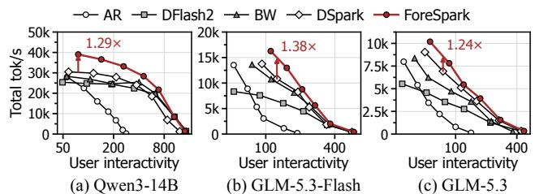  
Figure 14. Total throughput versus user interactivity on the math and code workload for (a) Qwen3-14B, (b) GLM5.3-Flash, and (c) GLM5.3. Arrows mark the largest gain over the strongest baseline.

ShareGPT-Decode. Each batch of C requests, where C is the batch size, is prefilled from an empty prefix cache and held at an engine-side barrier until every request has its first token, and then all requests are released together. Each request is timed over the 512 tokens after its first token, cut at its first end-of-turn token (e.g., <|im end|> on Qwen3-14B). To keep such cuts rare, we first decode the 4,096 ShareGPT prompts closest to 1K characters greedily with AR and keep only those whose answer reaches 641 tokens (1,572/618/646 prompts on Qwen3-14B/GLM5.3-Flash/GLM5.3). Since verification is lossless, every method then times the same answers, and only 2% of the timed answers on Qwen3-14B still end early, because numerical differences can change the greedy choice between nearly tied tokens. A batch’s throughput is the sum of its requests’ token rates over their timed spans, and its user interactivity is the median of these rates.

Open loop tests for SLO experiments. Requests arrive as a seeded Poisson process that is identical for every method. At rate r, 30r warm-up arrivals precede 120r measured ones, and requests that fail or do not finish count as SLO misses. We choose the rates with a fixed rule from a short probe of AR, DFLASH2, and FORESPARK: two light-load rates, then evenly spaced rates from 0.75× the lowest probed capacity to beyond the highest one.

Breakdown and acceptance. Figure 10 normalizes each method’s time per output token to AR, i.e., AR’s throughput divided by the method’s throughput. It splits this time into verification, drafting, and other time in proportion to step times sampled by vLLM’s CUDA-event step timer, which costs about 0.03% of the wall time. We measure acceptance length, one plus the accepted draft tokens per verification step, on SPEED-Bench’s 880 qualitative prompts (Abramovich et al., 2026) at a load of 32, verifying every drafted token at K=15.

## D DATASET SENSITIVITY: MATH AND CODE WORKLOAD

To show that FORESPARK’s advantages are not limited to a specific workload, we also evaluate FORESPARK on a math and code workload in Figure 14. The workload draws 2,855 single-turn prompts from GSM8K (Cobbe et al., 2021), MATH-500 (Hendrycks et al., 2021; Lightman et al., 2024), AIME25 (Zhang & Math-AI Team, 2025), HumanEval (Chen et al., 2021), MBPP (Austin et al., 2021), and LiveCodeBench (Jain et al., 2025) v5–v6, each with its set’s usual instruction. It runs in closed loop like ShareGPT-E2E, with the prefix cache disabled. At matched user interactivity, FORESPARK reaches up to 1.49/1.38/1.24× the throughput of DSPARK and up to 1.29/1.38/1.24× that of the strongest baseline on Qwen3-14B/GLM5.3-Flash/ GLM5.3 (arrows in Figure 14). These answers are more predictable than ShareGPT (Table 3), so FORESPARK outperforms AR at every load, unlike on Qwen3-14B ShareGPT-Decode (Section 6.2). As on ShareGPT, the gains appear at high load, where FORESPARK shortens the drafts of requests with low expected acceptance and keeps long drafts for the rest. The curves converge at high user interactivity, where full-block drafting is preferred and is within FORESPARK’s design space.

## E ACCEPTANCE LENGTH / DRAFTER COST

To show that the serving gains of FORESPARK come from joint scheduling rather than from a stronger or more expensive drafter, we analyze the acceptance lengths of the drafters in Table 2. We use the qualitative split of SPEED-Bench (Abramovich et al., 2026), which covers 11 categories. FORESPARK reaches average acceptance lengths of 4.38/3.33/3.37 on Qwen3-14B/ GLM5.3-Flash/GLM5.3, against 4.28/3.35/3.48 for DSPARK, staying within 3.2% of DSPARK. FORESPARK and DFLASH2 share one checkpoint and have identical acceptance, because the pre-/post-draft estimators only score drafts and never change the drafted tokens. The serving gains over DFLASH2 therefore come from how FORESPARK allocates drafting and verification, and those over DSPARK do not come from a higher token yield per full draft.

AR DFlash2 BW DSpark ForeSpark  
Table 2. Acceptance length by SPEED-Bench category at K=15 without adaptive verification (80 prompts per category at a load of 32). DFLASH2 shares FORESPARK’s drafter.
<table><tr><td rowspan="2">Category</td><td colspan="2">Qwen3-14B</td><td colspan="2">GLM5.3-Flash</td><td colspan="2">GLM5.3</td></tr><tr><td>DSPARK</td><td>FORESPARK</td><td>DSPARK</td><td>FORESPARK</td><td>DSPARK</td><td>FORESPARK</td></tr><tr><td>Coding</td><td>5.918</td><td>5.863</td><td>3.753</td><td>3.855</td><td>4.038</td><td>3.979</td></tr><tr><td>Humanities</td><td>4.495</td><td>4.715</td><td>2.947</td><td>2.950</td><td>3.101</td><td>3.021</td></tr><tr><td>Math</td><td>6.211</td><td>6.556</td><td>3.185</td><td>3.154</td><td>3.291</td><td>3.425</td></tr><tr><td>Multilingual</td><td>2.929</td><td>3.115</td><td>3.424</td><td>3.438</td><td>3.201</td><td>3.232</td></tr><tr><td>QA</td><td>3.335</td><td>3.277</td><td>3.027</td><td>2.889</td><td>3.336</td><td>2.929</td></tr><tr><td>RAG</td><td>4.378</td><td>4.445</td><td>4.662</td><td>4.838</td><td>4.775</td><td>4.752</td></tr><tr><td>Reasoning</td><td>5.146</td><td>5.362</td><td>3.912</td><td>3.763</td><td>4.214</td><td>3.679</td></tr><tr><td>Roleplay</td><td>2.539</td><td>2.532</td><td>2.222</td><td>2.145</td><td>2.257</td><td>2.229</td></tr><tr><td>STEM</td><td>5.153</td><td>5.299</td><td>2.930</td><td>2.996</td><td>3.184</td><td>3.069</td></tr><tr><td>Summarization</td><td>3.477</td><td>3.512</td><td>4.050</td><td>3.992</td><td>4.100</td><td>4.056</td></tr><tr><td>Writing</td><td>3.476</td><td>3.488</td><td>2.704</td><td>2.612</td><td>2.737</td><td>2.654</td></tr><tr><td>Average</td><td>4.278</td><td>4.379</td><td>3.347</td><td>3.330</td><td>3.476</td><td>3.366</td></tr></table>

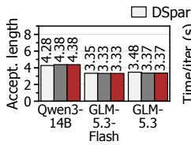  
(a) Acceptance length

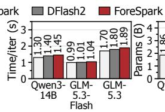  
(b) Training time

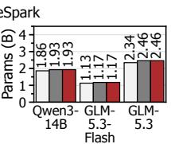  
(c) Drafter size  
Figure 15. Drafter quality and cost. (a) Acceptance length on SPEED-Bench (K=15, no adaptive verification, per category in Table 2). (b) Training time per iteration. (c) Parameters, excluding the embedding and LM head shared with the target.

Figure 15(b) reports the training time per iteration, measured in fresh runs at K=15 with the GPU splits of Table 1 and averaged over minutes 10–15 after the first step. FORESPARK takes 1.45/1.04/1.89 s per iteration, which is 1.12/1.05/1.11× that of DSPARK (1.30/0.99/1.70 s) and only 3–5% more than DFLASH2 (1.40/1.01/1.80 s). The overhead is small because length sampling trains one row of the pre-draft estimator per step, instead of running the drafter once for every candidate length (Section 4.5).

Figure 15(c) reports drafter parameters, excluding the embedding and output head that every drafter reuses from the target. FORESPARK has 1.93/1.17/2.46B parameters, almost the same as DFLASH2, since the two estimators add only 0.1–0.2%, and 3.7–5.0% more than DSPARK (1.86/1.13/2.34B) because of the DFLASH2 backbone.

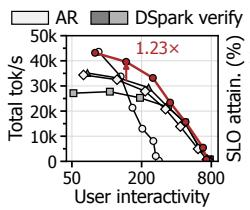  
(a) Pareto

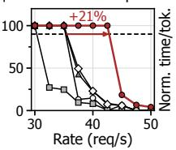  
(b) SLO sweep

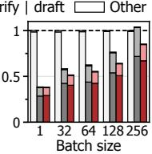  
(c) Breakdown

Figure 16. Qwen3-14B with K=7: (a) total throughput versus user interactivity on ShareGPT-Decode, (b) SLO attainment versus request rate on ShareGPT-E2E, and (c) time per output token on ShareGPT-Decode, normalized to AR at each batch size.  
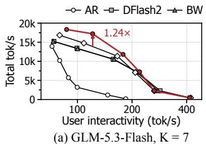

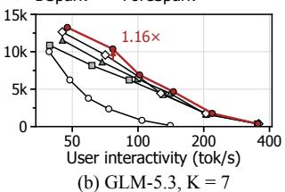

AR DFlash2 BW DSpark ForeSpark K = 15 K = 7  
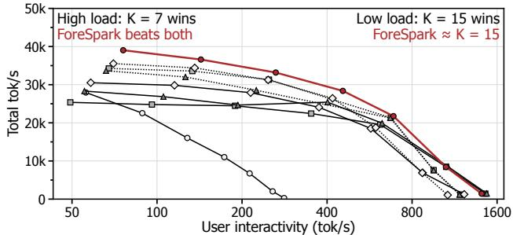  
(c) Qwen3-14B, K = 7 vs. K = 15 (Math & Code-E2E)  
Figure 17. ShareGPT-Decode with K=7 on (a) GLM5.3-Flash and (b) GLM5.3, where arrows mark the largest gain over the strongest baseline. (c) A larger K widens FORESPARK’s choice of draft lengths, which yields a better Pareto frontier of total throughput versus user interactivity (Qwen3-14B on the math and code workload, with K=7 dotted and K=15 solid).

## F DISCUSSION ON DRAFT LENGTH (K)

Lower K (K=7) sensitivity. To demonstrate that FORESPARK still benefits drafters with a smaller K, we train the drafters with K=7 using the same recipe. Figure 16 shows that FORESPARK achieves up to 1.23× the decodeonly throughput of the strongest baseline, BW, and 1.32× that of DSPARK at matched user interactivity (Figure 16(a)). It also sustains 1.21× the request rate of DSPARK at 90% SLO attainment (42.8 versus 35.5 requests/s, Figure 16(b)), and at 256 requests it spends 44% less drafting time per output token than DSPARK (Figure 16(c)). On larger models, FORESPARK achieves up to 1.24× and 1.16× the throughput of the strongest baseline on GLM5.3-Flash

Table 3. Acceptance length by math and code set at K=7 and K=15 without adaptive verification (80 prompts per set and all 30 of AIME25, at a load of 32), at most K + 1. DFLASH2 shares FORESPARK’s drafter.
<table><tr><td></td><td colspan="4">Qwen3-14B</td><td colspan="4">GLM5.3-Flash</td><td colspan="4">GLM5.3</td></tr><tr><td></td><td colspan="2">DSPARK</td><td colspan="2">FORESPARK</td><td colspan="2">DSPARK</td><td colspan="2">FORESPARK</td><td colspan="2">DSPARK</td><td colspan="2">FORESPARK</td></tr><tr><td>Set</td><td>K=7K=15K=7</td><td></td><td></td><td>K=15</td><td>K=7K=15K=7</td><td></td><td></td><td>K=15</td><td>K=7K=15K=7</td><td></td><td></td><td>K=15</td></tr><tr><td>GSM8K</td><td>5.85</td><td>7.47</td><td>5.94</td><td>7.93</td><td>4.85</td><td>5.35</td><td>4.84</td><td>5.53</td><td>4.67</td><td>5.12</td><td>4.82</td><td>5.27</td></tr><tr><td>MATH-500</td><td>6.21</td><td>8.04</td><td>6.32</td><td>8.75</td><td>4.50</td><td>5.29</td><td>4.49</td><td>5.13</td><td>4.58</td><td>4.90</td><td>4.56</td><td>5.30</td></tr><tr><td>AIME25</td><td>5.77</td><td>7.66</td><td>6.00</td><td>8.07</td><td>3.46</td><td>3.68</td><td>3.53</td><td>3.67</td><td>3.73</td><td>3.93</td><td>3.75</td><td>3.73</td></tr><tr><td>HumanEval</td><td>5.70</td><td>7.37</td><td>5.98</td><td>8.04</td><td>6.76</td><td>9.96</td><td>6.82</td><td>10.26</td><td>6.00</td><td>7.76</td><td>5.32</td><td>8.00</td></tr><tr><td>MBPP</td><td>5.19</td><td>6.02</td><td>5.30</td><td>6.25</td><td>3.91</td><td>4.30</td><td>4.28</td><td>4.41</td><td>4.14</td><td>4.70</td><td>4.56</td><td>4.97</td></tr><tr><td>LiveCodeBench 5.46</td><td></td><td>6.75</td><td>5.53</td><td>6.85</td><td>2.90</td><td>2.89</td><td>2.90</td><td>2.84</td><td>3.11</td><td>3.28</td><td>3.04</td><td>3.25</td></tr><tr><td>Average K=15/K=7</td><td>5.70 7.22 1.27×</td><td></td><td>5.85</td><td>7.65 1.31×</td><td>4.40 1.19×</td><td>5.24</td><td>4.48 1.19×</td><td>5.31</td><td>4.37 1.13×</td><td>4.95</td><td>4.34 1.17×</td><td>5.09</td></tr></table>

and GLM5.3, as shown in Figure 17(a) and (b). A smaller K leaves less drafter work to avoid, yet the scheduler still shortens drafts whose expected yield does not justify their cost.

Drafter overhead limits the use of a larger K. In actual deployment, a larger K raises the acceptance length, but the extra drafter overhead limits its use in LLM serving. Table 3 shows the acceptance gain on math and code, where raising K from 7 to 15 lengthens FORESPARK’s acceptance by 1.31/1.19/1.17× on Qwen3-14B/GLM5.3-Flash/ GLM5.3 and DSPARK’s by 1.27/1.19/1.13×. As shown in Figure 17(c), K=15 is preferable at low load, since its higher acceptance translates into higher user interactivity. At higher load, however, every speculative baseline suffers from the drafter overhead of K=15 and delivers lower total throughput than its K=7 counterpart at the same user interactivity.

On the other hand, FORESPARK jointly schedules draft and verification lengths, so it matches the user interactivity of K=15 at low load and still achieves the highest throughput at high load. This is because FORESPARK drafts a token only when it is expected to pay off, so a larger K only widens its choices without forcing extra drafter work. Thus, the main experiments use K=15, and FORESPARK lets serving systems benefit from long drafts without paying their overhead under load.

## G WCS WITH OTHER DRAFTERS DETAILS

All panels of Figure 13 run GLM5.3-Flash on ShareGPT-Decode at loads up to 192. WCS on DSPARK uses a perposition pre-draft estimator, which assumes that a shorter draft is a prefix of a longer one. We therefore retrain DSPARK with causal attention within the block and train the estimator alongside it, and both DSPARK and DSPARK +WCS serve this checkpoint. An autoregressive drafter runs one pass over the whole batch per draft position, so for MTP and EAGLE-3, WCS chooses one depth of at most 5 per step jointly with the budget B, using latencies measured at fixed depths. Its pre-draft estimator has five outputs and reads the target’s hidden state at the last accepted token and the anchor embedding, and we fit it on a serving log and calibrate it on Alpaca. After drafting, the budget distributor spends B according to vLLM’s online acceptance estimates for these drafters, a logistic function of the log-odds of the drafter’s top-token probability with per-position intercepts that vLLM refits while serving. In all three panels, the gains appear at high load, and the two arms converge at low load.

## H ADDITIONAL RELATED WORK

Parallel speculative decoding. Speculative decoding (Leviathan et al., 2023; Chen et al., 2023) has been strengthened with extra decoding heads (Cai et al., 2024), n-gram drafting (Fu et al., 2024), feature-conditioned autoregressive drafters (Li et al., 2024a;b; 2025), tree verification (Miao et al., 2024; Chen et al., 2024), and draft-model distillation (Zhou et al., 2024; Liu et al., 2024a). Following blockwise parallel decoding (Stern et al., 2018), parallel drafters propose a block in parallel with diffusion language models (Christopher et al., 2025; Sandler et al., 2026; Li et al., 2026a) or in one pass with lightweight drafters (Chen et al., 2026a; Inco AI, 2026; An et al., 2026), and later designs restore intra-block dependency (Cheng et al., 2026; Hu et al., 2026a), build draft trees (Ringel & Romano, 2026; Zhang et al., 2026), or distill for higher acceptance (Qian et al., 2026), and these drafter designs are orthogonal to FORESPARK, which decides how much a given drafter drafts and verifies.