# Integrating Action Prefix Prediction and Alignment Across Modalities for Multimodal Reinforcement Learning

Sijie Xu1 Francisco Cruz1,2

1 School of Computer Science and Engineering, UNSW Sydney, Australia 2 Escuela de Ingenier´ıa, Universidad Central de Chile, Santiago, Chile sijie.xu@student.unsw.edu.au, f.cruz@unsw.edu.au

## Abstract

Learning representations from multimodal observations is dificult in reinforcement learning with limited interaction data. Multi-Modal Joint Predictive Representation (MJPR) combines multimodal latent prediction with contrastive learning across modalities, but its recursive rollout depends on earlier predictions and its pairwise alignment focuses on correspondence between modalities. We propose Improved Predictive Representation (IPR), which combines prediction from action prefixes with a Contrastive Multimodal learning (CoMM) objective applied at the observed anchor. At each horizon, IPR predicts future representations for each modality directly from a common observed anchor and the corresponding action sequence. We evaluate IPR-S with a minimum retained crop area of 10% and IPR-H with 50%. Across five DeepMind Control Suite tasks, IPR-H achieves an average return 10.0% higher than the MJPR baseline with visual and depth images and 3.4% higher with visual images and position vectors. The relative performance of the two crop settings varies across tasks. In Webots navigation, both IPR configurations achieve higher returns than the baseline without LiDAR, while the baseline achieves the highest return when LiDAR is available.

## 1 Introduction

Reinforcement learning (RL) agents learn control policies through interaction with an environment [Sutton and Barto, 2018]. Multimodal control may combine images with depth, range, or low-dimensional state observations. These sources provide complementary information, but limited interaction data and reward supervision make it dificult to learn how to use them together.

Predicting representations of future observations from actions provides an additional learning signal.

Self-Predictive Representations (SPR) uses this idea [Schwarzer et al., 2021], and Multi-Modal Joint Predictive Representation (MJPR) extends it with modalityspecific latent prediction and cross-modal contrastive learning [Wang et al., 2025]. MJPR predicts future representations recursively, so errors can afect later horizons and the predictions must be generated in sequence. Its pairwise alignment also emphasises information shared between modalities.

Predicting each horizon from action prefix ofers an alternative to MJPR’s recursive rollout. Fast LeWorld-Model uses this approach for ofline planning with a single visual modality [Gao and Xu, 2026]. For multimodal alignment, Contrastive Multimodal learning (CoMM) relates fused representations to views retaining individual modalities [Dufumier et al., 2025]. Its input transformations, however, have no direct equivalent for predicted latent representations.

We integrate these ideas into MJPR as Improved Predictive Representation (IPR) for online multimodal control. IPR predicts each modality’s future representation directly from the same observed anchor and the corresponding action prefix. It applies CoMM style alignment to augmented anchor observations rather than predicted representations. The objectives train modality encoders shared with a Soft Actor–Critic (SAC) agent [Haarnoja et al., 2018]. Figure 1 shows the framework.

We evaluate IPR on DeepMind Control Suite (DMC) tasks [Tassa et al., 2018] using RGB images paired with depth images or position vectors, and in Webots navigation [Michel, 2004]. Both IPR configurations have higher observed averages than the MJPR baseline in the DMC settings. In Webots, the baseline performs better with LiDAR, whereas IPR has higher returns without it. Component ablations examine the two changes separately. A wall time comparison measures how replacing recursive prediction with action-prefix prediction afects total training time.

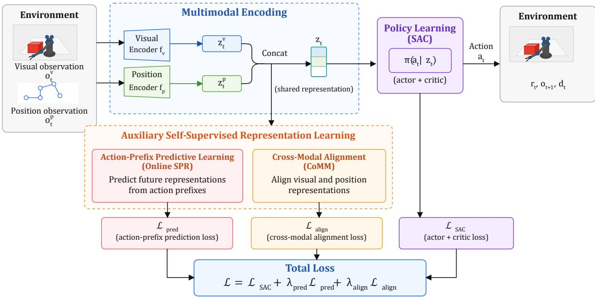  
Figure 1: High-level overview of IPR using visual and position observations as an example. The encoders provide representations to SAC and the two auxiliary branches. Action-prefix prediction provides temporal supervision, while CoMM style alignment relates complete and modality-retaining views at the anchor observation. Superscripts v and p denote visual and position representations.

## 2 Background and Related Work

Self-Supervised Representation Learning. Soft Actor–Critic (SAC) is an of-policy actor–critic algorithm that maximises expected return and policy entropy [Haarnoja et al., 2018]. Its maximum-entropy objective is

$$
J ( \pi ) = \mathbb { E } _ { \pi } \left[ \sum _ { t = 0 } ^ { \infty } \gamma ^ { t } \left( r _ { t } + \alpha \mathcal { H } \big ( \pi ( \cdot \mid s _ { t } ) \big ) \right) \right] ,\tag{1}
$$

where π is the policy, $s _ { t }$ and $r _ { t }$ are the state and reward at time t, γ is the discount factor, α controls the entropy contribution, and H denotes policy entropy. SAC provides the control backbone used by MJPR and IPR.

In image-based RL, Reinforcement Learning with Augmented Data (RAD) and Data-Regularized Q (DrQ) apply image transformations to regularise representation and value learning [Laskin et al., 2020b; Kostrikov et al., 2021]. Contrastive Unsupervised Representations for Reinforcement Learning (CURL) instead contrasts augmented views of the same observation [Laskin et al., 2020a]. These methods encourage consistency between augmented observations but do not explicitly model action-conditioned temporal transitions.

Temporal objectives also use sequential experience. Contrastive Predictive Coding distinguishes future representations from negative samples [van den Oord et al., 2018], while Augmented Temporal Contrast (ATC) contrasts observations sampled from nearby points in an RL trajectory [Stooke et al., 2021]. Self-Predictive Representations (SPR) predicts future representations under the intervening actions and matches them to targets produced by a slowly updated encoder [Schwarzer et al., 2021].

Multimodal Predictive and Contrastive Learning. Multimodal RL combines observations with different structures, including visual images, depth images, range data, and low-dimensional state vectors. Modality-specific encoders preserve information suited to each sensor, while a fused representation allows the policy and value functions to use complementary information.

MJPR extends SPR to multimodal RL by predicting modality-specific future representations and applying cross-modal contrastive learning during the latent rollout [Wang et al., 2025]. Its reported average across tasks is higher than the multimodal SAC, CURL, DrQ, and SPR variants evaluated in the same study. MJPR is also the closest architectural predecessor to IPR, as both use SAC, modality-specific encoders, momentum target networks, and multimodal latent prediction.

MJPR nevertheless uses a recursive latent rollout in which each future prediction depends on the preceding predicted representation. Its pairwise cross-modal alignment is also applied throughout the rollout and mainly emphasises correspondence shared between modalities.

Contrastive learning commonly treats augmented views of the same sample as positive pairs [Chen et al., 2020]. Contrastive Multiview Coding extends this principle across sensory views [Tian et al., 2020], while CoMM relates modality-retaining views to augmented fused representations [Dufumier et al., 2025]. CoMM is designed to represent redundant, unique, and synergistic multimodal information. However, its input transformations do not have an equivalent operation on predicted latent representations. This creates a dificulty when integrating CoMM with a predictive latent rollout.

Action-Prefix Latent Prediction. Fast LeWorld-Model replaces repeated one-step rollout with actionprefix prediction, allowing multiple future representations to be predicted from a common observation [Gao and Xu, 2026]. This avoids feeding earlier predictions back into the transition model and allows the prediction horizons to be computed in parallel.

Fast LeWorldModel studies ofline planning with a single visual modality. IPR instead applies action-prefix prediction as an auxiliary objective for online multimodal continuous control and combines it with anchorlevel cross-modal alignment.

## 3 Method

IPR modifies the multimodal predictive framework of MJPR [Wang et al., 2025] in two ways. It replaces recursive latent rollout with prediction conditioned on action prefixes and replaces pairwise alignment during the rollout with anchor-level cross-modal alignment.

## 3.1 Problem Formulation

At time t, the agent receives a multimodal observation $o _ { t } = \{ o _ { t } ^ { m } \} _ { m \in \mathcal { M } }$ , where M is the set of modalities and m indexes a modality. After selecting action $a _ { t } ,$ , the agent receives reward $r _ { t }$ and the next observation $o _ { t + 1 }$ . Each modality-specific encoder $f _ { m }$ maps its observation to the latent representation $z _ { t } ^ { m } = f _ { m } ( o _ { t } ^ { m } )$ . The modality representations are concatenated and supplied to the SAC actor and critics. The auxiliary objectives sample contiguous sequences from the replay bufer, using $o _ { t }$ as the anchor observation and later observations as prediction targets.

## 3.2 IPR Framework

Figure 2 illustrates the two auxiliary branches. The action-prefix prediction branch contains a temporal fusion network, an action-prefix encoder, modality-specific transition models, and momentum target encoders. The cross-modal alignment branch uses a separate fusion network, learned modality mask tokens, and a shared projection head. Both branches update the online modality encoders shared with the SAC agent.

Data Augmentation. All transformations are applied to observations before modality encoding. None is applied directly to a predicted latent representation. In the action-prefix prediction branch, anchor and target image observations are augmented using random spatial shifts. For DMC RGB–Position, 10% of the position vector entries are independently masked. In Webots, spatial shifts are applied only to the camera input, while the LiDAR and position inputs remain unchanged in this branch.

The cross-modal alignment branch uses random resized cropping at the anchor observation. For RGB– Depth, the same crop parameters are applied to the spatially aligned visual and depth inputs. For RGB– Position, the visual observation is cropped and the position vector is independently masked. In Webots, cropping is applied to the camera observation, while 10% of the LiDAR and position entries are independently masked.

Action-Prefix Prediction. Let H denote the prediction horizon. For each $k \in \{ 1 , \ldots , H \}$ , the corresponding action prefix is

$$
A _ { t } ^ { ( k ) } = ( a _ { t } , a _ { t + 1 } , \ldots , a _ { t + k - 1 } ) ,\tag{2}
$$

which contains the actions connecting the anchor observation $o _ { t }$ to the target observation $o _ { t + k }$

A temporal fusion network first contextualises the modality representations. The resulting features are mapped to a state token, while the actions are mapped to action embeddings. A causal Transformer [Vaswani et al., 2017] encodes the state token and action sequence to produce one action-prefix representation for each prediction horizon. Its causal mask prevents a representation from accessing actions beyond its corresponding prefix.

For each modality, a modality-specific transition model combines the original anchor representation, the fused anchor features, and the corresponding actionprefix representation to predict $\hat { z } _ { t + k } ^ { m } .$ . All future representations are predicted directly from the same anchor rather than recursively from earlier predictions. The horizons can therefore be computed in parallel, following the action-prefix principle of Fast LeWorldModel [Gao and $\mathrm { { X u , } }$ 2026].

RL Branch (Policy Learning)  
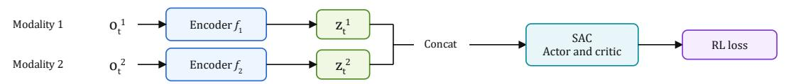

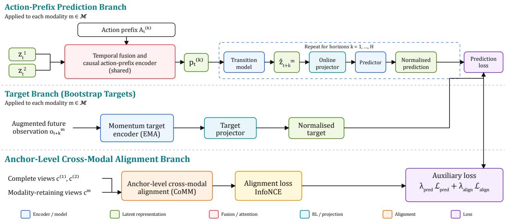  
Figure 2: Overview of IPR. The prediction branch predicts modality-specific future representations from a common anchor, while momentum target encoders provide stop-gradient targets. The alignment branch contrasts complete multimodal views with modality-retaining views at the anchor observation. An example with two modalities is shown.

Predictive Targets. Following SPR [Schwarzer et al., 2021], each predicted future representation is processed by online projection and prediction heads. A momentum target encoder and projection head produce a stopgradient target from the corresponding augmented future observation. The prediction and target are normalised to unit length and compared using cosine distance. These distances are averaged across modalities and prediction horizons to form the prediction loss $\mathcal { L } _ { \mathrm { p r e d } } .$ The target networks are updated through exponential moving averages of their corresponding online networks.

Anchor-Level Cross-Modal Alignment. The second auxiliary branch uses a CoMM style alignment objective [Dufumier et al., 2025]. The images and position vectors are augmented prior to encoding. The predicted representations no longer have the structure of these inputs, so applying the same augmentations to them would have a diferent meaning. In preliminary runs, augmenting these representations gave poorer results. We therefore apply alignment at the observed anchor.

Two complete views are generated independently, each view containing all modalities. For each modality, a modality-retaining view preserves that modality and replaces the remaining modalities with learned mask tokens. A separate fusion network and a shared projection head transform these views into normalised representations.

Let $c ^ { ( 1 ) }$ and $c ^ { ( 2 ) }$ denote the batches of fused representations from the two complete views, and let $c ^ { m }$ denote the batch obtained from the view retaining modality $m .$ For two representation batches x and $y ,$ each containing B samples, the directional Information Noise-Contrastive Estimation (InfoNCE) loss [van den Oord et al., 2018] is

$$
\ell _ { \mathrm { c o n } } ( x , y ) = - \frac { 1 } { B } \sum _ { i = 1 } ^ { B } \log \frac { \exp ( \sin ( x _ { i } , y _ { i } ) / T ) } { \sum _ { j = 1 } ^ { B } \exp ( \sin ( x _ { i } , y _ { j } ) / T ) } ,\tag{3}
$$

where B is the batch size, $T$ is the temperature, and sim(·, ·) denotes cosine similarity. The cross-modal align-

ment loss is

$$
\begin{array} { l } { \displaystyle \mathcal { L } _ { \mathrm { a l i g n } } = \frac { 1 } { 1 + | \mathcal { M } | } \Bigg [ \ell _ { \mathrm { c o n } } ( c ^ { ( 1 ) } , c ^ { ( 2 ) } ) } \\ { \displaystyle \qquad + \frac { 1 } { 2 } \sum _ { m \in \mathcal { M } } \ell _ { \mathrm { c o n } } ( c ^ { m } , c ^ { ( 1 ) } ) } \\ { \displaystyle \qquad + \frac { 1 } { 2 } \sum _ { m \in \mathcal { M } } \ell _ { \mathrm { c o n } } ( c ^ { m } , c ^ { ( 2 ) } ) \Bigg ] . } \end{array}\tag{4}
$$

The first term aligns the two complete views, while the remaining terms align each modality-retaining view with both complete views. The prediction loss matches each future prediction to one momentum target, whereas the alignment loss uses other samples in the batch as contrastive negatives.

The complete auxiliary loss is $\mathcal { L } _ { \mathrm { a u x } } = \lambda _ { \mathrm { p r e d } } \mathcal { L } _ { \mathrm { p r e d } } +$ $\lambda _ { \mathrm { a l i g n } } \mathcal { L } _ { \mathrm { a l i g n } }$ , where $\lambda _ { \mathrm { p r e d } }$ and $\lambda _ { \mathrm { a l i g n } }$ control the contributions of the prediction and alignment losses, respectively. SAC and auxiliary updates use the same replay data but are performed through separate gradient steps. During inference, the auxiliary fusion networks, projection and prediction heads, action-prefix encoder, transition models, and momentum target networks are discarded. Only the online modality encoders and actor are retained.

## 4 Experiments

The DMC benchmark [Tassa et al., 2018] is evaluated under RGB–Depth and RGB–Position observation settings. Component ablations examine the two modifications and their training time, while Webots provides a secondary navigation experiment. Return results are aggregated over five seeds. Learning curves show the mean and one standard deviation. The final return for each seed is the mean over its last five evaluations.

## 4.1 DeepMind Control Suite Environments

Experimental Setting. We evaluate five continuous control tasks from DMC: Ball-in-Cup Catch, Cheetah Run, Finger Spin, Cartpole Swing-up, and Walker Walk. We retain the original task dynamics, reward functions, action spaces, and termination conditions. DMC provides a reward in [0, 1] at each simulator step, and performance is measured as the sum of rewards over an episode. The task identifiers and action dimensions are listed in Table 1, while Figure 3 illustrates the controlled systems and their main task motions. Actions are scaled to [−1, 1] and repeated for four environment steps.

Both observation settings use three stacked $8 4 \times 8 4$ frames rendered from camera 0. Although we retain the term RGB when naming the experiments, the implementation averages the three color channels and normalizes the resulting single-channel image to [0, 1].

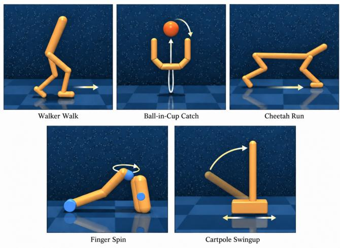  
Figure 3: Example RGB camera observations from the five DeepMind Control Suite tasks. The added arrows show the main motion directions and are not part of the agent observations.

Table 1: The DMC tasks used in multimodal observation settings, with their environment identifiers and action dimensions.
<table><tr><td>Task</td><td>DMC identifier</td><td>Action size</td></tr><tr><td>Catch</td><td>ball_in_cup/catch</td><td>2</td></tr><tr><td>Run</td><td>cheetah/run</td><td>6</td></tr><tr><td>Spin</td><td>finger/spin</td><td>2</td></tr><tr><td>Swing-up</td><td>cartpole/swingup</td><td>1</td></tr><tr><td>Walk</td><td>walker/walk</td><td>6</td></tr></table>

We use two observation settings to examine diferent forms of multimodal input. RGB–Depth follows the setting used in the original MJPR experiments [Wang et al., 2025]. The visual and depth images are rendered from the same camera at the same spatial resolution. Complementary diagonal masks remove 50% of the spatial information from each modality. Each image therefore contains a diferent half of the observation, and neither modality is complete on its own.

RGB–Position combines the visual observation with a position vector containing the simulator’s generalized position coordinates provided by DMC [Tassa et al., 2018]. This setting examines learning from an image and a lower-dimensional position vector with a diferent structure and scale. It does not apply the fixed visual masks used in RGB–Depth.

We denote our MJPR implementation by Base [Wang et al., 2025]. Its optimisation corrects the repeated update of shared online encoders by excluding them from the prediction module’s optimiser. Their auxiliary gradients are applied by the dedicated encoder optimisers.

The baseline and IPR use the same optimization implementation, SAC backbone, modality encoders, and common training hyperparameters. The comparison therefore isolates the proposed changes to recursive latent rollout and cross-modal alignment.

Table 2: Final returns under RGB–Depth. Values are mean final return ± standard deviation over five seeds. The highest mean in each row is shown in bold.
<table><tr><td>Task</td><td>BASE</td><td>IPR-S</td><td>IPR-H</td></tr><tr><td>Catch</td><td> $\overline { { 8 1 7 . 3 \pm 9 2 . 6 } }$ </td><td> $\mathbf { \overline { { 9 3 6 . 5 \pm 9 . 0 } } }$ </td><td> $\overline { { 9 1 3 . 3 \pm 5 5 . 0 } }$ </td></tr><tr><td>Run</td><td> $4 9 0 . 8 \pm 6 5 . 6$ </td><td> $5 1 0 . 0 \pm 8 2 . 9$ </td><td> ${ \bf 5 7 2 . 3 \pm 2 6 . 3 }$ </td></tr><tr><td>Spin</td><td> $5 5 7 . 3 \pm 8 7 . 6$ </td><td> $6 6 5 . 2 \pm 1 1 5 . 0$ </td><td> $\mathbf { 6 6 5 . 9 \pm 1 2 1 . 9 }$ </td></tr><tr><td>Swing-up</td><td> $7 3 5 . 8 \pm 7 6 . 5$ </td><td> $7 2 8 . 9 \pm 6 9 . 4$ </td><td> ${ \bf 7 6 7 . 2 \pm 4 6 . 5 }$ </td></tr><tr><td>Walk</td><td> $6 9 8 . 4 \pm 1 0 0 . 9$ </td><td> $\mathbf { 7 3 2 . 1 \pm 1 0 4 . 9 }$ </td><td> $7 1 0 . 8 \pm 9 4 . 5$ </td></tr><tr><td>Average</td><td>659.9</td><td>714.5</td><td>725.9</td></tr></table>

Because CoMM indicates that multimodal representation quality can depend on augmentation strength [Dufumier et al., 2025], we evaluate two random crop settings. In IPR-S, the sufix S denotes stronger cropping, and the crop retains between 10% and 100% of the original image area. In IPR-H, the sufix H denotes higher image retention, and the crop retains between 50% and 100%, preserving more visual context. The configurations difer only in the minimum retained image area and are used to evaluate sensitivity to crop strength.

Training uses 500,000 environment steps for Run, Spin, and Walk and 300,000 steps for Catch and Swingup. The first 1,000 agent decisions use random actions. The replay bufer capacity is 50,000, and both the RL and auxiliary batch sizes are 64. We use a discount factor of $\gamma = 0 . 9 9$ , a prediction horizon H = 5, and a learning rate of $1 0 ^ { - 3 }$ for the actor, critic, encoders and auxiliary modules. The prediction and alignment loss weights are $\lambda _ { \mathrm { p r e d } } = 1$ and $\lambda _ { \mathrm { a l i g n } } = 0 . 0 5$ , respectively. For RGB– Position, the action-prefix Transformer has two layers, two attention heads, and embeddings of dimension 50. The alignment projector outputs features of dimension 256 and uses an InfoNCE temperature of 0.1. The momentum update coeficient is 0.01. Learned mask tokens are initialised from a truncated normal distribution with standard deviation 0.02. Hyperparameter values were selected empirically. Shared settings were then held fixed across the compared methods within each observation setting. The policy is evaluated every 5,000 environment steps. Each evaluation reports the mean return over five episodes.

Results. Tables 2 and 3 report the mean final return and standard deviation over five seeds. Figures 4 and 5 show the corresponding learning curves.

Under RGB–Depth, both IPR configurations achieve higher averages across the five tasks than Base. IPR-H obtains the highest average, increasing it from 659.9 to 725.9, while IPR-S reaches 714.5.

Under RGB–Position, both IPR configurations also improve the average, although the gains are smaller. IPR-H reaches 779.2, followed closely by IPR-S at 777.7, compared with 753.3 for Base.

## 4.2 Ablation Study

We isolate the two changes made to MJPR in IPR using RGB–Position observations. The Base, Base-C, Base-P, and IPR-S columns in Table 3 form a factorial comparison between recursive and action-prefix prediction and between the baseline and CoMM alignment configurations. Base-C and IPR-S use the same random re sized crop setting, with the retained image area sampled between 10% and 100%. IPR-H is reported separately to compare the two crop settings within the complete IPR method. All methods use the same optimisation procedure, prediction horizon, evaluation protocol, and five seeds.

Results. Replacing the baseline alignment objective with anchor-level CoMM alignment while retaining the recursive latent rollout increases the mean final return on Catch, Run, Swing-up, and Walk, while producing a similar result on Spin. The average across the five tasks for Base-C is 1.7% higher than that of Base.

The efect of action-prefix prediction difers between the two alignment configurations. With the baseline alignment objective, replacing the recursive latent roll out with action-prefix prediction reduces the average across the five tasks from 753.3 for Base to 743.9 for Base-P. With CoMM alignment and the same minimum retained image area ratio of 0.1, action-prefix prediction increases the average from 765.8 for Base-C to 777.7 for IPR-S. This observed reversal is consistent with an interaction between the prediction and alignment config urations, although the variation across seeds prevents a stronger statistical conclusion.

We also compare the end-to-end training wall time of Base and Base-P under RGB–Depth. This comparison examines the computational efect of replacing the recursive latent rollout with action-prefix prediction while retaining the baseline alignment objective. Both meth ods use the same training budget, and each job uses one NVIDIA A100 graphics processing unit, four central processing unit cores, and 32 gigabytes of memory. Across the five tasks, Base-P reduces the mean wall time by 11.4% to 16.9%. The average reduction is 13.0%, corresponding to a speedup of approximately 1.15×.

The timing analysis includes all successful job records. Wall time includes environment interaction, evaluation, and data processing, so it measures total training time rather than the prediction module alone.

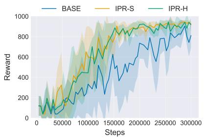  
(a) Catch

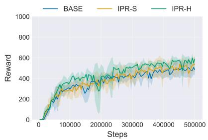

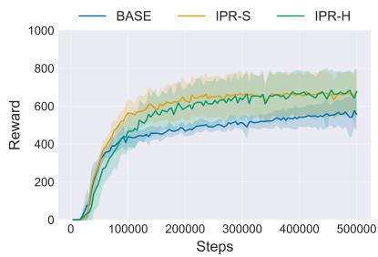

(b) Run  
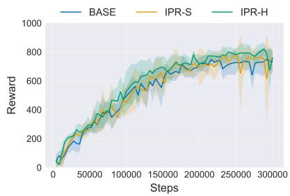  
(d) Swing-up

(c) Spin  
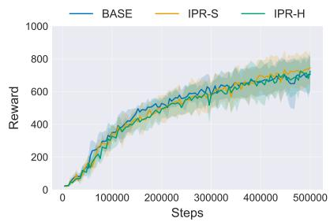  
(e) Walk  
Figure 4: Learning curves on five DMC tasks under RGB–Depth. Solid lines show the mean over five seeds, and shaded regions show one standard deviation. Catch and Swing-up use 300,000 training steps, while the other tasks use 500,000.

Table 3: Final returns and component ablations under RGB–Position. Values are mean final return ± standard deviation over five seeds. Base-C uses CoMM alignment with recursive latent rollout, while Base-P uses actionprefix prediction with the baseline alignment objective. The highest mean in each row is shown in bold.
<table><tr><td>Task</td><td>BASE</td><td> $\overline { { \mathrm { B A S E  – C } } }$ </td><td> $\overline { { \mathrm { B A S E  – P } } }$ </td><td> $\overline { { \mathrm { I P R } \mathrm { - } \mathrm { S } } }$ </td><td>IPR-H</td></tr><tr><td>Catch</td><td> $\overline { { 9 4 0 . 2 \pm 2 0 . 3 } }$ </td><td> $\overline { { 9 5 0 . 7 \pm 9 . 8 } }$ </td><td> $\overline { { 9 4 3 . 4 \pm 1 2 . 7 } }$ </td><td> $9 5 8 . 8 \pm 3 . 8$ </td><td> $\mathbf { \overline { { 9 6 0 . 6 \pm 5 . 7 } } }$ </td></tr><tr><td>Run</td><td> $5 6 3 . 2 \pm 3 9 . 2$ </td><td> $5 8 8 . 7 \pm 2 3 . 5$ </td><td> $5 5 9 . 6 \pm 3 3 . 2$ </td><td> $5 9 6 . 2 \pm 9 7 . 2$ </td><td> ${ \bf 5 9 7 . 2 \pm 6 4 . 6 }$ </td></tr><tr><td>Spin</td><td> $6 5 9 . 8 \pm 6 5 . 1$ </td><td> $6 5 9 . 4 \pm 8 6 . 9$ </td><td> $6 0 9 . 2 \pm 8 4 . 7$ </td><td> ${ \bf 6 7 9 . 8 \pm 8 6 . 1 }$ </td><td> $6 6 0 . 1 \pm 9 0 . 3$ </td></tr><tr><td>Swing-up</td><td> $7 7 1 . 2 \pm 5 2 . 8$ </td><td> $7 7 4 . 8 \pm 4 7 . 6$ </td><td> $7 8 2 . 4 \pm 6 7 . 7$ </td><td> $7 8 5 . 8 \pm 5 6 . 3$ </td><td> ${ \bf 8 2 2 . 7 \pm 2 3 . 0 }$ </td></tr><tr><td>Walk</td><td> $8 3 2 . 2 \pm 7 6 . 7$ </td><td> $8 5 5 . 6 \pm 7 5 . 6$ </td><td> $8 2 5 . 0 \pm 6 4 . 1$ </td><td> ${ \bf 8 6 8 . 1 \pm 3 3 . 1 }$ </td><td> $8 5 5 . 5 \pm 7 5 . 0$ </td></tr><tr><td>Average</td><td> $\overline { { 7 5 3 . 3 } }$ </td><td> $\overline { { 7 6 5 . 8 } }$ </td><td> $\overline { { 7 4 3 . 9 } }$ </td><td> $\overline { { 7 7 7 . 7 } }$ </td><td> $\overline { { 7 7 9 . 2 } }$ </td></tr></table>

## 4.3 Webots Environment

Environment Setting. We construct a navigation environment in Webots R2025a [Michel, 2004] using an E-puck diferential-drive robot. The arena contains four static cubic obstacles and three red spherical targets. At the beginning of each episode, the robot, obstacles, and targets are randomly positioned subject to minimum distance constraints. An episode terminates when the robot collides with an obstacle or boundary, or after 200 interaction steps. Reaching a target does not end the episode. Instead, the collected target is relocated to another valid position.

We evaluate two observation settings. The setting with three modalities contains an $8 4 \times 8 4$ single-channel camera image, 360 LiDAR measurements, and a fivedimensional position vector $( x , y , \theta , \Delta x , \Delta y )$ containing the planar position, orientation, and displacement of the robot. Both settings use the same Webots world, object placement, environment dynamics, reset procedure, actions, rewards, and termination conditions. The setting with two modalities difers only by removing LiDAR and retaining the camera image and position vector.

The camera image is obtained by averaging the colour channels and scaling the result to [0, 1]. Invalid LiDAR measurements in the setting with three modalities are replaced with zero. The displacement components represent the change in robot position between consecutive observations and are scaled by a factor of 50. The continuous action contains separate commands for the left and right wheels, with each command ranging from −1 to 1. The commands are linearly scaled to nonnegative wheel angular velocities, where −1 corresponds to a stationary wheel and 1 corresponds to the maximum wheel velocity. Each action is executed for 20 basic Webots simulation steps.

The agent receives the rewards listed in Table 4. The wheel-control term is applied at every interaction step, while target and collision rewards are added when the corresponding events occur.

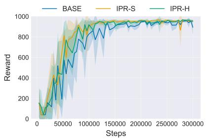  
(a) Catch

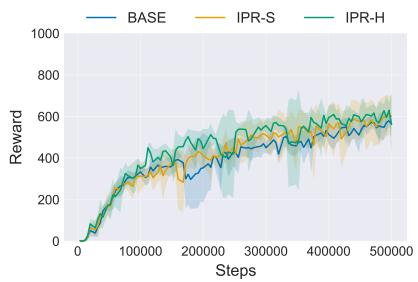  
(b) Run

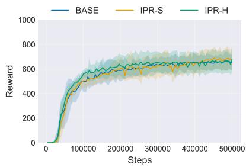  
(c) Spin

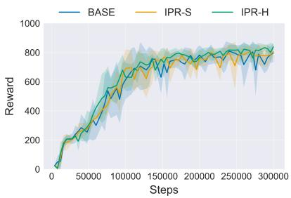  
(d) Swing-up

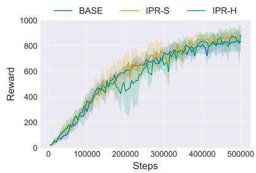  
(e) Walk

Figure 5: Learning curves on five DMC tasks under RGB–Position. Solid lines show the mean over five seeds, and shaded regions show one standard deviation. Catch and Swing-up use 300,000 training steps, while the other task use 500,000.  
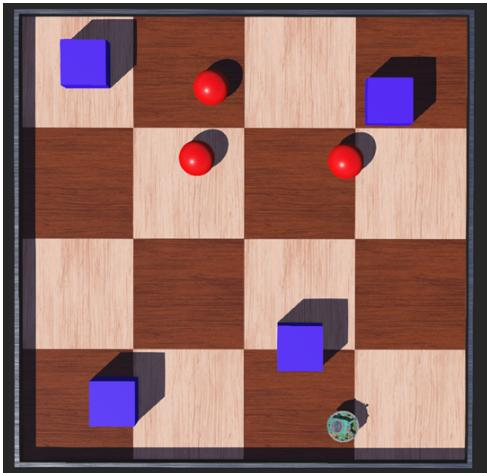  
Figure 6: Static Webots navigation arena used in both observation settings.

We compare Base, IPR-S, and IPR-H under both observation settings. The two IPR configurations use minimum retained image area ratios of 0.1 and 0.5, respectively. All methods are trained for 51,000 interaction steps, with random actions used during the first 1,000 steps. The prediction and alignment loss weights are $\lambda _ { \mathrm { p r e d } } = 1$ and $\lambda _ { \mathrm { a l i g n } } = 0 . 1$ , respectively. Evaluation is conducted every 1,000 steps using five episodes and a deterministic policy.

Table 4: Reward components used in the Webots environment. The wheel-control term acts as a turning penalty by discouraging asymmetric wheel commands.
<table><tr><td>Event or condition</td><td>Reward</td></tr><tr><td>Reaching a target</td><td>+10</td></tr><tr><td>Collision with an obstacle or boundary</td><td>-10</td></tr><tr><td>Wheel control at each step</td><td> $0 . 1 a _ { t , L } a _ { t , R } - 0 . 1$ </td></tr></table>

Table 5: Final Webots returns with three and two input modalities. Values are mean final return ± standard deviation over five seeds. The highest mean in each row is shown in bold.
<table><tr><td>Modalities</td><td>BASE</td><td>IPR-S</td><td>IPR-H</td></tr><tr><td>Camera, LiDAR,</td><td></td><td></td><td></td></tr><tr><td>position</td><td>158.9±18.3</td><td> $1 4 8 . 7 { \pm } 6 . 6 $ </td><td> $1 3 4 . 9 { \pm } 1 7 . 0 $ </td></tr><tr><td>Camera and</td><td></td><td></td><td></td></tr><tr><td>position</td><td> $1 1 . 4 { \pm } 1 1 . 9$ </td><td> $2 1 . 7 { \pm } 6 . 5$ </td><td> ${ \bf 2 8 . 6 { \pm 8 . 8 } }$ </td></tr></table>

Results. Figure 7 presents the learning curves, while Table 5 reports the mean and standard deviation over the five seeds {1000, 2000, 3000, 4000, 5000}.

The method ranking changes between the two observation settings. With three modalities, Base improves earlier and obtains the highest mean final return. The mean final returns of IPR-S and IPR-H are 6.4% and

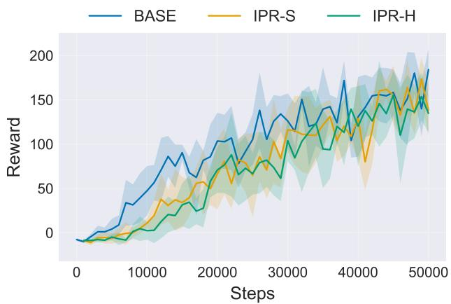  
(a) Camera, LiDAR, and position

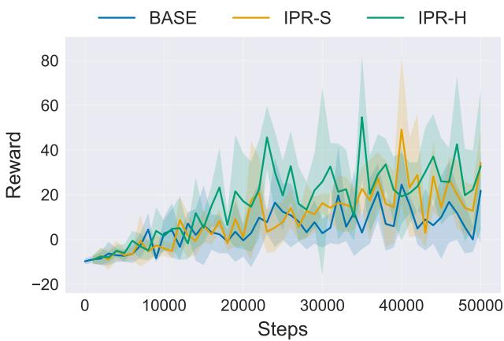  
(b) Camera and position  
Figure 7: Learning curves in the static Webots environment using (a) camera, LiDAR, and position observations and (b) camera and position observations. Solid lines show the mean over five seeds, and shaded regions show one standard deviation. The plots use diferent vertical scales because removing LiDAR substantially reduces the return.

15.1% below Base, respectively.

Removing LiDAR reduces the returns of all methods but reverses their ranking. With two modalities, both IPR configurations obtain higher mean final returns than Base, with IPR-H producing the highest mean final return.

## 5 Discussion

The DMC results show that the efect of IPR depends on both the observation setting and the crop configuration. Although IPR-H achieves the highest average under both observation settings, IPR-S performs better on some individual tasks. Preserving more image content is therefore beneficial on average but is not uniformly preferable. This variation suggests that crop strength afects the balance between retaining task-relevant information and introducing useful variation during representation learning.

The ablation results provide further evidence that the two IPR modifications should not be considered independently. Replacing CURL with CoMM alignment gives the more consistent improvement, whereas action-prefix prediction does not consistently improve return when CURL is retained. Its efect is more favourable when combined with CoMM alignment in the complete IPR framework. This pattern suggests that the benefit of action-prefix prediction may depend on how representations are aligned. However, the current results describe this interaction only through observed mean returns and do not establish its statistical reliability.

The Webots results also depend on the information provided by the observation modalities. Camera, Li-DAR, and position observations may already supply sufficient and partly redundant information for navigation.

In particular, LiDAR directly measures obstacle distance, so the additional prediction and alignment objectives may provide limited information beyond that available to Base.

Without LiDAR, the agent must infer distances to obstacles from the camera and position observations. Both IPR configurations achieve higher mean final returns than Base in this setting, suggesting that predictive and cross-modal supervision may be more useful when direct range information is unavailable. This explanation is consistent with the observed results but remains a hypothesis. Sensor and loss ablations are required to determine whether missing range information causes the change in method ranking.

Fast LeWorldModel shows that action-prefix prediction permits prediction horizons to be computed in parallel [Gao and Xu, 2026]. The lower end-to-end training wall time of Base-P is consistent with this motivation, although the experiment does not isolate the prediction module.

Finally, several tasks exhibit substantial variation across seeds, and no formal hypothesis test is performed. The reported comparisons therefore support conclusions about observed trends in mean return rather than statistical significance or general superiority. Additional runs, formal statistical tests, and experiments across further environments are needed to determine the reliability and scope of these findings.

## 6 Conclusion

This work integrates action-prefix prediction with anchor-level cross-modal alignment for online multi modal reinforcement learning. IPR achieves higher averages than Base in the evaluated DMC settings, while the Webots results indicate that its efect depends on the information provided by the observation modalities. These findings do not establish general superiority or a causal explanation for the observed diferences.

Future work should test the proposed explanation through targeted sensor and loss ablations, use addi tional runs with formal statistical tests, evaluate further robotic tasks, and examine transfer to real systems.

## Acknowledgments

The authors acknowledge the use of the University of New South Wales (UNSW) Compute Cluster Katana for the experiments reported in this work under Digital Object Identifier 10.26190/669X-A286.

## References

[Chen et al., 2020] Ting Chen, Simon Kornblith, Mohammad Norouzi, and Geofrey Hinton. A simple framework for contrastive learning of visual representations. In Proceedings of the 37th International Conference on Machine Learning, volume 119 of Proceedings of Machine Learning Research, pages 1597–1607. PMLR, 2020.

[Dufumier et al., 2025] Benoit Dufumier, Javiera Castillo-Navarro, Devis Tuia, and Jean-Philippe Thiran. What to align in multimodal contrastive learning? In International Conference on Learning Representations, 2025.

[Gao and Xu, 2026] Yuntian Gao and Xiangyu Xu. Fast LeWorldModel. arXiv preprint arXiv:2606.26217, 2026.

[Haarnoja et al., 2018] Tuomas Haarnoja, Aurick Zhou, Pieter Abbeel, and Sergey Levine. Soft actorcritic: Of-policy maximum entropy deep reinforcement learning with a stochastic actor. In Proceedings of the 35th International Conference on Machine Learning, volume 80 of Proceedings of Machine Learning Research, pages 1861–1870. PMLR, 2018.

[Kostrikov et al., 2021] Ilya Kostrikov, Denis Yarats, and Rob Fergus. Image augmentation is all you need: Regularizing deep reinforcement learning from pixels. In International Conference on Learning Representations, 2021.

[Laskin et al., 2020a] Michael Laskin, Aravind Srinivas, and Pieter Abbeel. CURL: Contrastive unsupervised representations for reinforcement learning. In Proceedings of the 37th International Conference on Machine Learning, volume 119 of Proceedings of Machine Learning Research, pages 5639–5650. PMLR, 2020.

[Laskin et al., 2020b] Misha Laskin, Kimin Lee, Adam Stooke, Lerrel Pinto, Pieter Abbeel, and Aravind

Srinivas. Reinforcement learning with augmented data. In Advances in Neural Information Processing Systems, volume 33, 2020.

[Michel, 2004] Olivier Michel. Cyberbotics Ltd. Webots: Professional mobile robot simulation. International Journal of Advanced Robotic Systems, 1(1):39– 42, 2004.

[Schwarzer et al., 2021] Max Schwarzer, Ankesh Anand, Rishab Goel, R. Devon Hjelm, Aaron Courville, and Philip Bachman. Data-eficient reinforcement learning with self-predictive representations. In International Conference on Learning Representations, 2021.

[Stooke et al., 2021] Adam Stooke, Kimin Lee, Pieter Abbeel, and Michael Laskin. Decoupling representation learning from reinforcement learning. In Proceedings of the 38th International Conference on Machine Learning, volume 139 of Proceedings of Machine Learning Research, pages 9870–9879. PMLR, 2021.

[Sutton and Barto, 2018] Richard S. Sutton and Andrew G. Barto. Reinforcement Learning: An Introduction. MIT Press, Cambridge, Massachusetts, 2 edition, 2018.

[Tassa et al., 2018] Yuval Tassa, Yotam Doron, Alistair Muldal, Tom Erez, Yazhe Li, Diego de Las Casas, David Budden, Abbas Abdolmaleki, Josh Merel, Andrew Lefrancq, Timothy Lillicrap, and Martin Riedmiller. DeepMind Control Suite. arXiv preprint arXiv:1801.00690, 2018.

[Tian et al., 2020] Yonglong Tian, Dilip Krishnan, and Phillip Isola. Contrastive multiview coding. In Computer Vision–ECCV 2020, pages 776–794. Springer, 2020.

[van den Oord et al., 2018] Aaron van den Oord, Yazhe Li, and Oriol Vinyals. Representation learning with contrastive predictive coding. arXiv preprint arXiv:1807.03748, 2018.

[Vaswani et al., 2017] Ashish Vaswani, Noam Shazeer, Niki Parmar, Jakob Uszkoreit, Llion Jones, Aidan N. Gomez, Lukasz Kaiser, and Illia Polosukhin. Attention is all you need. In Advances in Neural Information Processing Systems, volume 30, pages 5998–6008, 2017.

[Wang et al., 2025] Zehan Wang, Ziming He, Zijia Wang, Hua He, Beiya Yang, and Haobin Shi. MJPR: Multi-modal joint predictive representation in deep reinforcement learning. In 2025 IEEE International Conference on Robotics and Automation (ICRA), pages 1–7, 2025.