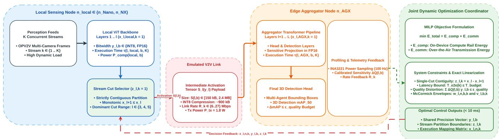
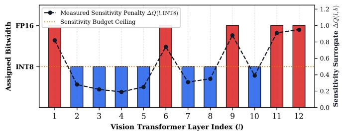
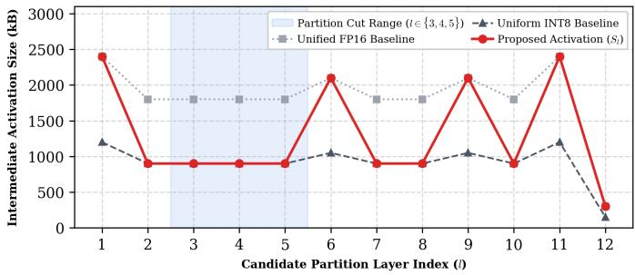

# Joint Quantization and Dynamic Partitioning for Context-Aware Edge Vision Transformers

Jiaqi Zhu

Prakriti Jain

Walmart

Sunnyvale, USA

Heidelberg University

Heidelberg, Germany

jiaqi.zhu@walmart.com prakriti.jain@stud.uni-heidelberg.de

Dewant Katare

Technische Universiteit Delft

Delft, the Netherlands

d.katare@tudelft.nl

Saurabh Kumar

Walmart

Sunnyvale, USA

saurabh.kumar4@walmart.com

Abstract—Deploying vision transformer models across connected and automated vehicles (CAVs) requires joint management of computation and Vehicle-to-Vehicle (V2V) communication. Static split-inference methods use fixed partition points and cannot adapt to time-varying link bandwidth, processing load, and concurrent multi-stream traffic. This paper proposes an edge orchestration framework that jointly selects model partition points, per-layer quantization bitwidths, and execution placement across heterogeneous vehicular compute nodes. The joint partitioning and mixed-precision allocation problem is formulated as a Mixed-Integer Linear Program (MILP) that minimizes compute and communication energy subject to end-to-end latency and task-quality constraints. The framework is evaluated on Jetson Orin Nano (8 GB), Jetson Orin NX (16 GB), and Jetson AGX Orin (32 GB) nodes using OPV2V-driven multi-stream workloads with $K \in \{ 2 , 4 , 6 , 8 \}$ . Across the evaluated configurations, the proposed formulation reduces V2V communication energy by 33.3–36.0% relative to a Uniform INT8 split. At K = 8, end-toend task completion latency is reduced by 34.0% on the Orin Nano and 33.1% on the Orin NX relative to the same baseline, while limiting the reduction in 3D detection accuracy to 3.1–4.1 percentage points in $\mathrm { m A P 5 0 }$ relative to FP16 execution.

Index Terms—Edge AI, Split Inference, Mixed-Precision Quantization, Vehicular Edge Computing, Vision Transformers

## I. INTRODUCTION

Connected and Automated Vehicles (CAVs) process camera, LiDAR, and other sensor streams to maintain situational awareness under changing traffic conditions. Transformerbased perception models provide strong performance for visual and spatio-temporal tasks by modeling long-range dependencies across input features [1], [2]. Their deployment on embedded platforms, however, introduces high computation, memory, and energy requirements [2], [3]. Distributed execution provides an alternative when local processing alone cannot satisfy the required latency or resource limits. In this setting, part of the inference graph executes on the sensing platform and the remaining computation is transferred to a second edge node [4], [5]. Split inference introduces a direct tradeoff between local computation and communication. Moving the partition deeper into the model increases the computation retained on the local node, while an earlier partition offloads more execution but may require transmission of a larger intermediate activation [4], [6]. This trade-off becomes more difficult under concurrent vehicular inference because layer execution time changes with processing load and the available

V2V data rate may differ across streams. A cut selected for one compute or link condition can therefore increase either completion latency or communication energy when these conditions change.

Existing methods address individual parts of this problem. Dynamic DNN partitioning and task offloading adapt execution to compute and network conditions [5], [7], while adaptive semantic communication reduces the amount of intermediate information transmitted during distributed inference [6], [8]. Quantization reduces arithmetic and memory cost by executing network operations at lower numerical precision [9]–[11]. Energy-aware CAV and edge–cloud frameworks have also considered adaptive deployment and resource allocation [12], [13]. These approaches do not jointly determine the streamspecific partition location and layer-wise numerical precision while accounting for their combined effect on compute energy, intermediate activation size, and V2V transmission cost.

This paper presents an edge orchestration framework for joint partition and mixed-precision selection in vehicular Vision Transformer inference. For each stream, the framework selects a contiguous local-to-aggregator partition, while a common layer-wise INT8/FP16 configuration is selected for the deployed model. The resulting problem is formulated as a Mixed-Integer Linear Program (MILP) that minimizes compute and V2V communication energy subject to perstream end-to-end latency and task-quality constraints. The formulation uses profiled concurrency-dependent layer latency, precision-dependent activation size, stream-specific V2V link rate, and empirically calibrated quantization sensitivity.

The framework is evaluated on a heterogeneous NVIDIA Jetson Orin testbed. Jetson Orin Nano (8 GB) and Jetson Orin NX (16 GB) are evaluated as alternative local compute nodes, with Jetson AGX Orin (32 GB) acting as the edge aggregator. Experiments use OPV2V-driven workloads with $K \in \{ 2 , 4 , 6 , 8 \}$ concurrent streams under emulated V2V link conditions. System performance is measured using end-to-end task completion latency, compute energy, V2V communication energy, and 3D detection $\mathrm { m A P _ { 5 0 } }$ . The research contributions are as follows:

• We formulate stream-specific model partitioning and layer-wise INT8/FP16 selection as a MILP that minimizes compute and V2V communication energy under latency and task-quality constraints.

• We couple precision-dependent execution cost and intermediate activation size with the partition decision, allowing the optimizer to account for both local compute load and stream-specific V2V transmission cost.

• We evaluate the formulation on three edge devices using configurations $K \in \{ 2 , 4 , 6 , 8 \}$ concurrent OPV2V-driven streams, reporting energy, task completion latency, solver runtime, and 3D detection accuracy against static FP16 and uniform INT8 deployments.

This paper is organized as follows. Section II discusses split inference, quantization, and communication-aware vehicular edge execution. Section III presents the system model and MILP formulation. Section IV describes the experimental setup. Section V presents the evaluation results, and Section VI concludes the paper.

## II. RELATED WORK

Distributed inference of Vision Transformers across connected vehicles requires balancing split inference boundaries, numerical compression, and multi-stream execution constraints. This section surveys recent developments in model partitioning, communication-aware edge inference, and vehicular edge computing, highlighting the methodological gap addressed by our joint formulation.

## A. Split Inference and Dynamic Partitioning

Split inference divides neural network between a resourceconstrained sensing platform and a more capable edge node. Matsubara and Levorato [4] partition object-detection networks and transmit intermediate features between mobile and edge platforms, showing that the selected cut affects both local execution and communication cost. The benefit of a partition therefore depends on the computational cost retained before the cut and the size of the activation transferred afterward. Recent work considers partition selection under changing edge conditions. Zhang et al. [5] jointly address DNN partitioning and task offloading using reinforcement learning under varying compute and communication conditions and concurrent task arrivals. Uslu and Dagdeviren [7] study optimization methods for distributed DNN and large-model inference, including partitioning, communication, and resource allocation. Katare et al. [13] consider adaptive resource allocation across serverless edge–cloud environments. These approaches support adaptive execution or resource assignment, but numerical precision is not jointly selected with the partition boundary.

## B. Quantization and Communication-Aware Edge Inference

Quantization reduces model memory and arithmetic cost by mapping weights and activations to lower numerical precision [9], [11]. Moosmann et al. [10] evaluate fully quantized object-detection models on low-power embedded systems, while Gaddi [9] studies post-training quantization for a transformer-based autonomous driving network. These methods address reduced-precision execution, but the selected bitwidth is not coupled to the communication cost of an intermediate split. Communication-oriented methods instead modify the intermediate data transmitted between compute nodes. Devoto et al. [6] adapt semantic token communication for transformer-based edge inference according to network conditions. Wang et al. [8] analyze communication overhead together with inference latency and reliability, while Fu et al. [3] discuss communication-efficient and task-oriented optimization for edge AI inference. These methods address the transmission side of distributed inference, but do not jointly select layer precision and the stream-specific partition point.

TABLE I: Comparison of Representative Edge AI Approaches
<table><tr><td>Work</td><td>Partition</td><td>Precision/Comm. Adaptation</td><td>Concurrent Workload</td><td>Domain</td></tr><tr><td>Matsubara et al. [4]</td><td>Static</td><td>No</td><td>No</td><td>Edge vision</td></tr><tr><td>Zhang et al. [5]</td><td>Dynamic</td><td>No</td><td>Yes</td><td>Mobile edge</td></tr><tr><td>Moosmann et al. [10]</td><td>None</td><td>Quantization</td><td>No</td><td>Embedded vision</td></tr><tr><td>Devoto et al. [6]</td><td>Fixed</td><td>Token adaptation</td><td>No</td><td>Transformer edge</td></tr><tr><td>Katare et al. [12]</td><td>Adaptive</td><td>Approximation</td><td>Yes</td><td>CAV</td></tr><tr><td>This Work</td><td>Dynamic</td><td>INT8/FP16</td><td> $\mathbf { Y e s } \ ( K \leq 8 )$ </td><td>CAV</td></tr></table>

## C. Vehicular Edge Execution

Vehicular inference have changing link conditions and continuous sensing to the partitioning problem. Mayumu et al. [14] study multimodal information processing and exchange in V2X systems. Katare et al. [12] consider model partitioning, adaptive deployment, and approximation for energy-aware CAV computing. These studies motivate adaptive compute and communication decisions in vehicular systems, but do not jointly optimize layer-wise precision and stream-specific partitioning under a common compute and V2V energy objective [15]. Table I compares representative methods with the formulation used in this paper. The comparison focuses on whether partition selection, precision or communication adaptation, and concurrent workload execution are considered together. Existing work provides mechanisms for dynamic partitioning, reduced-precision execution, or communication adaptation, but these decisions are generally addressed separately. The formulation in this paper couples the stream-specific partition boundary with a common layerwise INT8/FP16 configuration, allowing precision-dependent compute cost and transmitted activation size to enter the same energy minimization problem.

## III. SYSTEM MODEL AND OPTIMIZATION FORMULATION

This section formalizes the joint model partitioning, layerwise precision allocation, and execution placement framework. We first outline the multi-tier vehicular execution pipeline illustrated in Fig. 1, establish exact binary linearizations for the coupled decision variables, and formulate the Mixed-Integer Linear Program (MILP) that minimizes total energy consumption under end-to-end latency and task-quality constraints.

## A. System Architecture

We consider a two-node split-inference configuration selected from a three-device vehicular edge testbed, depicted in Fig. 1. The local on-vehicle node is either an NVIDIA Jetson Orin Nano (8 GB), denoted by $n _ { \mathrm { N a n o } } .$ , or an NVIDIA

  
Fig. 1: System model architecture and split-inference pipeline across local on-vehicle platforms $( n _ { \mathrm { l o c a l } } \in \{ n _ { \mathrm { N a n o } } , n _ { \mathrm { N X } } \} )$ and the AGX Orin aggregator $( n _ { \mathrm { A G X } } )$ . The optimization coordinator executes on the aggregator node, taking telemetry feedback and channel conditions to issue optimal partition points $( z _ { l , k } )$ , precision allocations $( y _ { l , b } )$ , and node assignments $( x _ { l , n , k } )$ .

Jetson Orin NX (16 GB), denoted by $n _ { \mathrm { N X } }$ . The edge aggregator is an NVIDIA Jetson AGX Orin (32 GB), denoted by nAGX. For each evaluated local-node configuration, $n _ { \mathrm { l o c a l } } \in$ $\{ n _ { \mathrm { N a n o } } , n _ { \mathrm { N X } } \}$ and the active compute-node set is

$$
\mathcal { N } = \{ n _ { \mathrm { l o c a l } } , n _ { \mathrm { A G X } } \} .\tag{1}
$$

As illustrated on the left side of Fig. 1, the local node processes K concurrent inference streams indexed by $\kappa =$ $\{ 1 , \ldots , K \}$ . Each stream executes an L-layer Vision Transformer backbone indexed by $\mathcal { L } ~ = ~ \{ 1 , \ldots , L \}$ . For stream k, layers up to and including the selected cut layer execute on $n _ { \mathrm { l o c a l } }$ . The corresponding intermediate activation tensor is then transferred over the emulated V2V wireless link, after which the remaining layers and the 3D detection heads execute on the edge aggregator $n _ { \mathrm { A G X } }$ . A layer-specific precision $b \in B = \{ 8 , 1 6 \}$ , corresponding to INT8 and FP16 execution, is selected for each transformer layer and is shared across all concurrent streams. The activation tensor size after layer l under precision b is denoted by $S ( l , b )$ in bytes. The available V2V data rate for stream k is denoted by $R _ { k }$ and varies across the evaluated link configurations.

## B. Decision Variables and Linearization

The optimization couples three decisions that are otherwise handled independently in conventional split-inference pipelines: where a stream is partitioned, which node executes each layer, and which numerical precision is used for that layer. These decisions are related because changing the bitwidth affects both the execution cost of a transformer block and the size of the activation transmitted across the V2V link (Fig. 1). For stream $k ,$ the binary variable $x _ { l , n , k }$ specifies the node assigned to layer l, while $y _ { l , b }$ selects the numerical precision of that layer. The variable $z _ { l , k }$ identifies whether the execution path is partitioned after layer l:

$$
x _ { l , n , k } \in \{ 0 , 1 \} ,\tag{2}
$$

$$
y _ { l , b } \in \{ 0 , 1 \} ,\tag{3}
$$

$$
z _ { l , k } \in \{ 0 , 1 \} .\tag{4}
$$

The precision decision is shared across concurrent streams because all streams execute the same deployed model configuration, whereas the partition location may differ across streams according to their link rate and processing condition.

The activation volume after layer l depends on the selected precision. For a layer with candidate activation sizes $S ( l , b )$ the transmitted volume is written as

$$
S _ { l } ( \mathbf { y } _ { l } ) = \sum _ { b \in \mathcal { B } } S ( l , b ) y _ { l , b } .\tag{5}
$$

This term links quantization directly to the communication cost: selecting INT8 reduces the activation payload relative to FP16, but may increase the task-quality penalty associated with that layer.

The computation term depends jointly on placement and precision, while the communication term depends jointly on precision and partition location. These products would make the formulation nonlinear. We therefore introduce the auxiliary binary variables

$$
w _ { l , n , b , k } = x _ { l , n , k } y _ { l , b } ,\tag{6}
$$

$$
v _ { l , b , k } = y _ { l , b } z _ { l , k } ,\tag{7}
$$

and enforce them exactly using the standard binary linearization constraints:

$$
\begin{array} { r l } & { w _ { l , n , b , k } \leq x _ { l , n , k } , \quad w _ { l , n , b , k } \leq y _ { l , b } , } \\ & { w _ { l , n , b , k } \geq x _ { l , n , k } + y _ { l , b } - 1 , } \\ & { \quad v _ { l , b , k } \leq y _ { l , b } , \quad v _ { l , b , k } \leq z _ { l , k } , } \\ & { \quad v _ { l , b , k } \geq y _ { l , b } + z _ { l , k } - 1 . } \end{array}\tag{8}
$$

(9)

Since all participating variables are binary, these constraints preserve the original products exactly and retain a solvable MILP formulation.

## C. Energy and Latency Models

The cost of a partition depends on both computation and communication. Executing additional layers locally increases the work performed by the on-vehicle node but may reduce the activation size transmitted to the aggregator. Moving the cut earlier has the opposite effect. The selected precision further changes both quantities because INT8 and FP16 have different execution profiles and activation sizes.

Let $\tau ( l , n , b , K )$ denote the profiled execution latency of layer l on node n under precision b with K concurrent streams. The dependency on K captures the change in layer execution time under the evaluated multi-stream load. Let $P _ { \mathrm { c o m p } } ( n , b )$ denote the corresponding profiled active compute power. The compute energy accumulated across all streams is

$$
E _ { \mathrm { c o m p } } = \sum _ { k \in { \cal K } } \sum _ { l \in \mathcal { L } } \sum _ { n \in \cal N } \sum _ { b \in { \cal B } } P _ { \mathrm { c o m p } } ( n , b ) \tau ( l , n , b , K ) w _ { l , n , b , k } .\tag{10}
$$

The variable $w _ { l , n , b , k }$ ensures that an energy term contributes only when layer l is assigned to node n and executed at precision b.

Communication cost is incurred only at the selected partition boundary. If stream k is divided after layer l, the transmission time is determined by the activation size at that layer and the available V2V data rate $R _ { k }$

$$
T _ { \mathrm { t x } } ( k ) = \sum _ { l = 1 } ^ { L - 1 } \sum _ { b \in \mathcal { B } } \frac { S ( l , b ) } { R _ { k } } v _ { l , b , k } .\tag{11}
$$

For a wireless interface transmission power $P _ { \mathrm { t x } } .$ , the total communication energy is

$$
E _ { \mathrm { c o m m } } = \sum _ { k \in \mathcal { K } } \sum _ { l = 1 } ^ { L - 1 } \sum _ { b \in \mathcal { B } } P _ { \mathrm { t x } } \frac { S ( l , b ) } { R _ { k } } v _ { l , b , k } .\tag{12}
$$

The formulation therefore favors later cuts when local execution is energy-efficient and link conditions are poor, while earlier cuts become feasible when aggregator execution compensates for the additional transmission cost. The end-to-end latency of stream k contains all layer execution time on the selected nodes and the single V2V transfer:

$$
T _ { \mathrm { e 2 e } } ( k ) = \sum _ { l \in \mathcal { L } } \sum _ { n \in \mathcal { N } } \sum _ { b \in \mathcal { B } } \tau ( l , n , b , K ) w _ { l , n , b , k } + T _ { \mathrm { t x } } ( k ) .\tag{13}
$$

This definition is used directly by the latency constraint and preserves the measured dependence of computation time on stream concurrency.

## D. MILP Formulation

The optimization selects the partition and precision configuration that minimizes the combined compute and V2V communication energy:

$$
\operatorname* { m i n } _ { \mathbf x , \mathbf y , \mathbf z , \mathbf w , \mathbf v } E _ { \mathrm { t o t a l } } = E _ { \mathrm { c o m p } } + E _ { \mathrm { c o m m } } .\tag{14}
$$

The objective does not minimize latency directly. Instead, latency is treated as a feasibility requirement so that an energyefficient solution is accepted only when it satisfies the perstream completion deadline.

Each layer of every stream must execute on exactly one active compute node:

$$
\sum _ { n \in \mathcal { N } } x _ { l , n , k } = 1 , \qquad \forall l \in \mathcal { L } , \forall k \in \mathcal { K } .\tag{15}
$$

Similarly, each transformer layer is assigned one numerical precision:

$$
\sum _ { b \in B } y _ { l , b } = 1 , \qquad \forall l \in \mathcal { L } .\tag{16}
$$

Because the precision variables are not stream-indexed, the resulting layer-wise quantization configuration is common to all concurrent streams.

The execution path is restricted to one contiguous localto-aggregator partition. Once execution moves from $n _ { \mathrm { l o c a l } }$ to nAGX, subsequent layers cannot return to the local node:

$$
x _ { l + 1 , n _ { \mathrm { l o c a l } } , k } \le x _ { l , n _ { \mathrm { l o c a l } } , k } , \qquad \forall l \in \{ 1 , \ldots , L - 1 \} , \forall k \in \mathcal { K } .\tag{17}
$$

The corresponding partition indicator is

$$
z _ { l , k } = x _ { l , n _ { \mathrm { l o c a l } } , k } - x _ { l + 1 , n _ { \mathrm { l o c a l } } , k } , \qquad \forall l \in \{ 1 , \dots , L - 1 \} , \forall k \in K .\tag{18}
$$

To exclude degenerate all-local or all-aggregator assignments, the first layer is constrained to the local node and the final layer to the aggregator:

$$
x _ { 1 , n _ { \mathrm { l o c a l } } , k } = 1 , \qquad \forall k \in \mathcal { K } ,\tag{19}
$$

$$
x _ { L , n _ { \mathrm { A G X } } , k } = 1 , \qquad \forall k \in { \mathcal { K } } .\tag{20}
$$

Together, these constraints produce exactly one transition between the two nodes:

$$
\sum _ { l = 1 } ^ { L - 1 } z _ { l , k } = 1 , \qquad \forall k \in \mathcal { K } .\tag{21}
$$

The selected configuration must also satisfy the application latency requirement:

$$
T _ { \mathrm { e 2 e } } ( k ) \leq T _ { \mathrm { b u d g e t } } , \qquad \forall k \in K .\tag{22}
$$

This prevents the optimizer from selecting a low-energy partition that violates the completion deadline under a given stream load or link rate. Quantization is constrained separately through an empirically calibrated task-quality budget:

$$
\sum _ { l \in \mathcal { L } } \sum _ { b \in \mathcal { B } } \Delta Q ( l , b ) y _ { l , b } \le \epsilon _ { \mathrm { q u a l i t y } } .\tag{23}
$$

Here, $\Delta Q ( l , b )$ represents the measured sensitivity associated with quantizing layer l to precision b. This quantity is used only as the optimization surrogate; final 3D detection accuracy is measured using m $\mathrm { A P _ { 5 0 } }$ on the evaluation workload. Together with the linearization constraints in (8)–(9), the above conditions define the feasible set of the MILP.

## E. Solver Implementation

As outlined in the coordinator block of Fig. 1, the formulation is implemented in Pyomo 6.7 and solved using SCIP 8.0 on the Jetson AGX Orin coordinator. For $L = 1 2 ,$ $| { \mathcal N } | = 2 , | { \mathcal B } | = 2$ , and $K \ = \ 8 ,$ the formulation contains 864 binary decision and auxiliary variables. Solver execution time and solution status are recorded for each evaluated stream configuration and reported with the experimental results.

TABLE II: System Performance Comparison Across Multi-Stream Workloads $( K \in \{ 2 , 4 , 6 , 8 \} )$ on the Heterogeneous Testbed
<table><tr><td>Configuration / Method</td><td>Stream Count (K)</td><td>Compute Energy Local  $\underline { { ( n _ { \mathrm { l o c a l } } ) } }$  Aggregator</td><td> $\overline { { E _ { \mathrm { c o m p } } \left( \mathbf { J } \right) } }$   $( n _ { \mathrm { A G X } } )$ </td><td>Comm. Energy Ecomm (J)</td><td>Total Energy  $\underline { { E _ { \mathrm { t o t a l } } \left( \mathbf { J } \right) } }$ </td><td>Avg. Latency  $T _ { \mathrm { e 2 e } } ~ ( \mathbf { m } \mathbf { s } )$ </td><td>3D Detection  $\mathrm { m A P _ { 5 0 } ~ ( \% ) }$ </td></tr><tr><td colspan="8">Local Platform: Jetson Orin Nano (8 GB) → Aggregator: Jetson AGX Orin (32 GB)</td></tr><tr><td>Full Local FP16</td><td>2</td><td>0.88</td><td>0.00</td><td>0.00</td><td>0.88</td><td>58.4</td><td>79.2</td></tr><tr><td>Static Early Split (l = 3, FP16)</td><td>2</td><td>0.21</td><td>0.49</td><td>0.38</td><td>1.08</td><td>44.1</td><td>78.8</td></tr><tr><td>Static Late Split (l = 8, FP16)</td><td>2</td><td>0.58</td><td>0.22</td><td>0.46</td><td>1.26</td><td>51.2</td><td>78.5</td></tr><tr><td>Uniform INT8 Split (l = 4)</td><td>2</td><td>0.16</td><td>0.34</td><td>0.21</td><td>0.71</td><td>36.5</td><td>74.8</td></tr><tr><td>Joint DynOpt (Proposed)</td><td>2</td><td>0.18</td><td>0.36</td><td>0.14</td><td>0.68</td><td>33.8</td><td>76.1</td></tr><tr><td>Full Local FP16</td><td>4</td><td>1.84</td><td>0.00</td><td>0.00</td><td>1.84</td><td>118.9</td><td>79.2</td></tr><tr><td>Static Early Split (l = 3, FP16)</td><td>4</td><td>0.45</td><td>1.06</td><td>0.76</td><td>2.27</td><td>86.7</td><td>78.8</td></tr><tr><td>Static Late Split (l = 8, FP16)</td><td>4</td><td>1.22</td><td>0.48</td><td>0.92</td><td>2.62</td><td>103.4</td><td>78.5</td></tr><tr><td>Uniform INT8 Split (l = 4)</td><td>4</td><td>0.35</td><td>0.72</td><td>0.42</td><td>1.49</td><td>72.3</td><td>74.6</td></tr><tr><td>Joint DynOpt (Proposed)</td><td>4</td><td>0.39</td><td>0.78</td><td>0.27</td><td>1.44</td><td>54.6</td><td>75.8</td></tr><tr><td>Full Local FP16</td><td>6</td><td>2.86</td><td>0.00</td><td>0.00</td><td>2.86</td><td>182.4</td><td>79.2</td></tr><tr><td>Static Early Split (l = 3, FP16)</td><td>6</td><td>0.71</td><td>1.64</td><td>1.15</td><td>3.50</td><td>131.8</td><td>78.8</td></tr><tr><td>Static Late Split (l = 8, FP16)</td><td>6</td><td>1.91</td><td>0.75</td><td>1.38</td><td>4.04</td><td>157.2</td><td>78.5</td></tr><tr><td>Uniform INT8 Split (l = 4)</td><td>6</td><td>0.55</td><td>1.12</td><td>0.64</td><td>2.31</td><td>110.6</td><td>74.5</td></tr><tr><td>Joint DynOpt (Proposed)</td><td>6</td><td>0.61</td><td>1.22</td><td>0.41</td><td>2.24</td><td>76.2</td><td>75.4</td></tr><tr><td>Full Local FP16</td><td>8</td><td>3.92</td><td>0.00</td><td>0.00</td><td>3.92</td><td>248.5</td><td>79.2</td></tr><tr><td>Static Early Split (l = 3, FP16)</td><td>8</td><td>0.98</td><td>2.28</td><td>1.54</td><td>4.80</td><td>176.2</td><td>78.8</td></tr><tr><td>Static Late Split (l = 8, FP16)</td><td>8</td><td>2.61</td><td>1.04</td><td>1.84</td><td>5.49</td><td>212.8</td><td>78.5</td></tr><tr><td>Uniform INT8 Split (l = 4)</td><td>8</td><td>0.76</td><td>1.54</td><td>0.86</td><td>3.16</td><td>149.2</td><td>74.3</td></tr><tr><td>Joint DynOpt (Proposed)</td><td>8</td><td>0.84</td><td>1.68</td><td>0.55</td><td>3.07</td><td>98.4</td><td>75.1</td></tr><tr><td colspan="8">Local Platform: Jetson Orin NX (16 GB) → Aggregator: Jetson AGX Orin (32 GB)</td></tr><tr><td></td><td></td><td></td><td></td><td></td><td></td><td></td><td></td></tr><tr><td>Full Local FP16</td><td>2</td><td>0.72</td><td>0.00</td><td>0.00</td><td>0.72</td><td>46.8</td><td>79.2</td></tr><tr><td>Static Early Split (l = 3, FP16)</td><td>2</td><td>0.18</td><td>0.49</td><td>0.38</td><td>1.05</td><td>39.6</td><td>78.8</td></tr><tr><td>Static Late Split (l = 8, FP16) Uniform INT8 Split (l = 4)</td><td>2</td><td>0.46</td><td>0.22 0.34</td><td>0.46</td><td>1.14</td><td>44.5</td><td>78.5</td></tr><tr><td>Joint DynOpt (Proposed)</td><td>2 2</td><td>0.14</td><td>0.36</td><td>0.21</td><td>0.69</td><td>32.1</td><td>74.8</td></tr><tr><td>Full Local FP16</td><td>4</td><td>0.16</td><td>0.00</td><td>0.14</td><td>0.66</td><td>29.7</td><td>76.1</td></tr><tr><td>Static Early Split (l = 3, FP16)</td><td>4</td><td>1.52 0.38</td><td>1.06</td><td>0.00</td><td>1.52</td><td>94.2</td><td>79.2</td></tr><tr><td>Static Late Split (l = 8, FP16)</td><td>4</td><td>0.98</td><td>0.48</td><td>0.76</td><td>2.20</td><td>78.4</td><td>78.8</td></tr><tr><td>Uniform INT8 Split (l = 4)</td><td>4</td><td>0.31</td><td>0.72</td><td>0.92 0.42</td><td>2.38 1.45</td><td>88.1</td><td>78.5</td></tr><tr><td>Joint DynOpt (Proposed)</td><td>4</td><td>0.34</td><td>0.78</td><td>0.27</td><td>1.39</td><td>63.8</td><td>74.6</td></tr><tr><td>Full Local FP16</td><td>6</td><td>2.36</td><td>0.00</td><td>0.00</td><td>2.36</td><td>48.2</td><td>75.9</td></tr><tr><td>Static Early Split (l = 3, FP16)</td><td>6</td><td>0.59</td><td>1.64</td><td>1.15</td><td>3.38</td><td>144.6 118.2</td><td>79.2</td></tr><tr><td>Static Late Split (l = 8, FP16)</td><td>6</td><td>1.52</td><td>0.75</td><td>1.38</td><td>3.65</td><td>134.8</td><td>78.8</td></tr><tr><td>Uniform INT8 Split (l = 4)</td><td>6</td><td>0.48</td><td>1.12</td><td>0.64</td><td>2.24</td><td>96.4</td><td>78.5</td></tr><tr><td>Joint DynOpt (Proposed)</td><td>6</td><td>0.52</td><td>1.22</td><td>0.41</td><td>2.15</td><td>67.5</td><td>74.5</td></tr><tr><td>Full Local FP16</td><td>8</td><td>3.24</td><td>0.00</td><td>0.00</td><td>3.24</td><td>196.4</td><td>75.5</td></tr><tr><td>Static Early Split (l = 3, FP16)</td><td>8</td><td>0.82</td><td>2.28</td><td>1.54</td><td>4.64</td><td>158.6</td><td>79.2 78.8</td></tr><tr><td>Static Late Split (l = 8, FP16)</td><td>8</td><td>2.12</td><td>1.04</td><td>1.84</td><td>5.00</td><td>181.4</td><td>78.5</td></tr><tr><td>Uniform INT8 Split (l = 4)</td><td>8</td><td>0.65</td><td>1.54</td><td>0.86</td><td>3.05</td><td>129.5</td><td>74.3</td></tr><tr><td>Joint DynOpt (Proposed)</td><td>8</td><td>0.71</td><td>1.68</td><td>0.55</td><td>2.94</td><td>86.7</td><td>75.3</td></tr></table>

## IV. EXPERIMENTAL SETUP

To evaluate the proposed optimization framework on embedded vehicular hardware, we deploy a physical testbed comprising three NVIDIA Jetson Orin platforms under emulated Vehicle-to-Vehicle network traces. This section details the hardware and software configuration, workload profiling methodology, V2V link parameterization, and the baseline deployment strategies used for comparative evaluation.

## A. Hardware Testbed and Software Environment

The testbed comprises NVIDIA Jetson Orin Nano (8 GB) and Jetson Orin NX (16 GB) platforms as alternative local compute nodes, $n _ { \mathrm { l o c a l } } .$ , and a Jetson AGX Orin (32 GB) as the edge aggregator, $n _ { \mathrm { A G X } }$ . The platforms are connected through an emulated vehicular communication link; hardware specifications are summarized in Table III. All platforms run NVIDIA JetPack 6.2. Model partitions and INT8/FP16 configurations are executed using TensorRT engines. Active compute-rail power is sampled at 100 Hz using the onboard

TABLE III: Hardware Testbed and Profiled System Parameters
<table><tr><td>Parameter</td><td>Orin Nano</td><td>Orin NX</td><td>AGX Orin</td></tr><tr><td>Memory</td><td>8 GB</td><td>16 GB</td><td>32 GB</td></tr><tr><td>GPU</td><td>1024-core</td><td>1024-core</td><td>1792-core</td></tr><tr><td>Tensor Cores</td><td>32</td><td>32</td><td>56</td></tr><tr><td>Execution Role</td><td>Local</td><td>Local</td><td>Aggregator</td></tr><tr><td>Precision</td><td>FP16, INT8</td><td>FP16, INT8</td><td>FP16, INT8</td></tr><tr><td>Power Monitoring</td><td>INA3221</td><td>INA3221</td><td>INA3221</td></tr></table>

Texas Instruments INA3221 current and voltage monitors through the Linux sysfs interfaces. The communication-energy model uses a wireless interface transmission power of $P _ { \mathrm { t x } } =$ 1.8 W.

## B. Workload Profiling and Dataset Traces

Evaluation workloads are derived from multi-agent LiDAR and camera perception traces in the OPV2V benchmark, including CARLA and Culver City scenarios. The computational workload uses a 12-layer Vision Transformer backbone (L = 12, hidden dimension $D = 7 6 8 .$ 12 attention heads).

Layer execution latency $\tau ( l , n , b , K )$ and active computepower profiles $P _ { \mathrm { c o m p } } ( n , b )$ are measured separately on the Orin Nano, Orin NX, and AGX Orin for precision $b \in \{ 8 , 1 6 \}$ and concurrency levels $K \in \{ 2 , 4 , 6 , 8 \}$ . Measurements are collected over 200 inference runs after warm-up. Activation tensor sizes $S ( l , b )$ range from 150 kB to 2.4 MB depending on layer position and bitwidth. The sensitivity values $\Delta Q ( l , b )$ are obtained from layer-wise quantization evaluation on an independent calibration subset.

## C. Network Configuration

For each experiment, the active local node and the AGX Orin aggregator are connected through an emulated V2V link. The available data rate for stream k is selected from {6, 12, 18, 24, 27} Mbps according to the evaluated link configuration. The stream-specific value $R _ { k }$ is used to calculate intermediate-tensor transmission latency and V2V communication energy.

## D. Baseline Deployment Strategies

The proposed framework is evaluated for both the Orin Nano–AGX Orin and Orin NX–AGX Orin configurations under $K \in \{ 2 , 4 , 6 , 8 \}$ . Four baseline deployment strategies are used:

1) Full Local FP16: All L layers execute on $n _ { \mathrm { l o c a l } }$ under FP16 precision.

2) Static Early Split (l = 3, FP16): Layers 1–3 execute on $n _ { \mathrm { l o c a l } } .$ , while layers 4–12 execute on $n _ { \mathrm { A G X } }$ under FP16 precision.

3) Static Late Split (l = 8, FP16): Layers 1–8 execute on $n _ { \mathrm { l o c a l } }$ , while layers 9–12 execute on $n _ { \mathrm { A G X } }$ under FP16 precision.

4) Uniform INT8 Split (l = 4): Execution is divided after layer 4, with all layers quantized uniformly to INT8.

Task quality is measured using 3D bounding-box detection m $\mathrm { A P _ { 5 0 } }$ . System-level metrics include end-to-end task completion latency $T _ { \mathrm { e 2 e } } ,$ compute energy $E _ { \mathrm { c o m p } } ,$ and V2V communication energy $E _ { \mathrm { { c o m m } } } .$

## V. EXPERIMENTAL RESULTS AND ANALYSIS

This section evaluates the proposed optimization framework against four baseline deployment strategies for $K \in$ $\{ 2 , 4 , 6 , 8 \}$ . Experiments cover both local-to-aggregator configurations: Jetson Orin Nano paired with Jetson AGX Orin and Jetson Orin NX paired with Jetson AGX Orin.

## A. Energy Consumption and Multi-Stream Allocation

Table II reports compute energy on the local node and aggregator, modeled V2V communication energy, total energy, average end-to-end task completion latency, and 3D detection $\mathrm { m A P _ { 5 0 } }$ . Energy values are accumulated across the K concurrent streams, whereas $T _ { \mathrm { e 2 e } }$ reports the average completion latency per stream. Static FP16 splits transmit the intermediate activation at the selected partition without reducing its numerical precision. For the Orin Nano configuration, the Early Split (l = 3) produces a 1.8 MB activation and requires 0.38 J of communication energy at $K = 2 ,$ increasing to 1.54 J at $K = 8$ . The Late Split (l = 8) produces a 2.4 MB activation, resulting in 0.46 J and 1.84 J at the same stream counts.

The proposed formulation jointly selects the partition location and layer precision. Layers whose calibrated INT8 penalties satisfy constraint (23) can execute at reduced precision, while the stream-specific cut determines the activation transmitted over the V2V link. Communication energy increases from 0.14 J at $K \ = \ 2$ to 0.55 J at $K \ = \ 8$ . Relative to the Uniform INT8 split, this corresponds to a 33.3–36.0% reduction across the evaluated stream counts. Relative to the FP16 static splits, the reduction ranges from 63.2% to 70.1% for the reported comparisons. Total energy combines compute energy on both active nodes and modeled V2V transmission energy. On the Orin Nano configuration, Full Local FP16 increases from 0.88 J at $K \ = \ 2$ to 3.92 J at $K \ = \ 8$ as concurrent load increases. $\mathbf { A } \mathbf { t } \ K = 8$ , the proposed method requires 3.07 J, corresponding to a 21.7% reduction relative to Full Local FP16. The reduction relative to Uniform INT8 is smaller, from 3.16 J to 3.07 J (2.8%), while the proposed configuration also provides lower latency and higher m $\mathrm { A P _ { 5 0 } }$

## B. End-to-End Latency and Stream Scaling

End-to-end latency increases with concurrency because the profiled layer latency $\tau ( l , n , b , K )$ includes the effect of simultaneous inference streams on each compute node. On the Orin Nano, Full Local FP16 increases from 58.4 ms at $K = 2$ to 248.5 ms at $K = 8$ . Static partitioning reduces the computation assigned to the local node but introduces V2V transfer delay, whose contribution depends on the activation size at the selected cut and the available stream-specific link rate. $\mathbf { A } \mathbf { t } \ K = 8 ,$ the proposed method reaches 98.4 ms on the Orin Nano, compared with 149.2 ms for Uniform INT8 and 176.2 ms for the Static Early Split. These values correspond to latency reductions of 34.0% and 44.2%, respectively. On the Orin NX, the proposed configuration reaches 86.7 ms, compared with 129.5 ms for Uniform INT8 and 158.6 ms for the Static Early Split, giving reductions of 33.1% and 45.3%.

## C. 3D Detection Accuracy and Precision Allocation

Unified FP16 execution provides a reference 3D detection accuracy of 79.2% m $\mathrm { \Omega _ { \mathrm { 4 P 5 0 } } }$ . Uniform INT8 execution reaches 74.3% at $K = 8 ,$ , corresponding to a 4.9 percentage-point reduction. The layer-wise sensitivity calibration shows that quantization sensitivity is non-monotonic across the transformer backbone. As shown in Fig. 2(a), layers $l \in \{ 1 , 6 , 9 , 1 1 , 1 2 \}$ incur comparatively larger INT8 sensitivity penalties and are retained in FP16, whereas layers $l \in \{ 2 , 3 , 4 , 5 , 7 , 8 , 1 0 \}$ have lower penalties and are assigned INT8. The resulting allocation satisfies the quality constraint in (23) while avoiding uniform quantization across layers with different measured sensitivities.

The communication effect of the selected precision configuration is shown in Fig. 2(b). At layers $l \in \{ 2 , 3 , 4 , 5 \}$ the intermediate activation size decreases from 1.8 MB under FP16 to 0.9 MB under INT8. The optimizer selects partition points within $l ~ \in ~ \{ 3 , 4 , 5 \}$ for the bandwidth-constrained cases, thereby combining a smaller transmitted activation with reduced-precision execution before the V2V transfer. Layers retained in FP16 preserve the corresponding FP16 activation representation. Across all evaluated stream counts, the proposed mixed-precision configuration achieves 75.1–76.1% m $\mathrm { A P _ { 5 0 } }$ on the Orin Nano and 75.3–76.1% on the Orin NX. Relative to the 79.2% FP16 reference, the measured reduction remains within 3.1–4.1 percentage points.

  
(a) Layer-wise INT8 sensitivity and selected FP16/INT8 assignment.

  
(b) Intermediate activation size across candidate partition layers.  
Fig. 2: Effect of layer-wise mixed-precision selection on quantization sensitivity and intermediate activation size.

## D. Solver Execution Runtime

The SCIP 8.0 solver runs on the AGX Orin coordinator. SCIP returns an optimal solution for each evaluated instance without reaching the configured time limit. Solver time increases with stream count, from 4.2 ms to 8.4 ms on the Orin Nano configuration and from 4.1 ms to 8.1 ms on the Orin NX configuration as K increases from 2 to 8. Across all evaluated stream counts, solver execution remains below 10 ms.

## VI. CONCLUSION

This paper explored an edge orchestration framework for split inference of vision transformer in connected automated vehicles. The framework jointly optimizes adaptive model partitioning and layer-wise INT8/FP16 selection through a Mixed-Integer Linear Program that minimizes compute and communication energy subject to end-to-end latency and taskquality constraints. The framework was evaluated on Jetson Orin Nano, Jetson Orin NX, and Jetson AGX Orin platforms using OPV2V-driven multi-stream workloads with K ∈ 2, 4, 6, 8. Across the evaluated configurations, joint partition and precision selection reduces V2V communication energy by 33.3–36.0% relative to the Uniform INT8 split and by up to 70.1% relative to the static FP16 splits. At $K \ = \ 8 ,$ end-to-end latency decreases from 149.2 ms to 98.4 ms on the Orin Nano and from 129.5 ms to 86.7 ms on the Orin NX relative to Uniform INT8. The selected mixed-precision configurations limit the reduction in 3D detection accuracy to 3.1–4.1 percentage points in m $\mathrm { A P _ { 5 0 } }$ relative to FP16 execution. Future exploration will consider communicationaware intermediate token reduction and targeting additional V2X link conditions.

## REFERENCES

[1] Q. Qi and X. Wang, “Tgbformer: Transformer-graphformer blender network for video object detection,” in Proceedings of the AAAI Conference on Artificial Intelligence, vol. 39, no. 6, 2025, pp. 6559–6567.

[2] A. Sharshar, L. U. Khan, W. Ullah, and M. Guizani, “Vision-language models for edge networks: A comprehensive survey,” IEEE Internet of Things Journal, vol. 12, no. 16, pp. 32 701–32 724, 2025.

[3] Y. Fu, P. Qin, and C. Jiang, “Edge ai inference in 6g mobile networks: From communication-efficient techniques to task-oriented optimization,” IEEE Communications Surveys & Tutorials, 2026.

[4] Y. Matsubara and M. Levorato, “Neural compression and filtering for edge-assisted real-time object detection in challenged networks,” in 2020 25th International Conference on Pattern Recognition (ICPR). IEEE, 2021, pp. 2272–2279.

[5] M. Zhang, J. Fang, Z. Teng, Y. Liu, and S. Wu, “Joint dnn partitioning and task offloading based on attention mechanism-aided reinforcement learning,” IEEE Transactions on Network and Service Management, vol. 22, no. 3, pp. 2914–2927, 2025.

[6] A. Devoto, J. Pomponi, M. Merluzzi, P. Di Lorenzo, and S. Scardapane, “Adaptive semantic token communication for transformer-based edge inference,” IEEE Transactions on Machine Learning in Communications and Networking, 2026.

[7] E. E. Uslu and O. Dagdeviren, “Distributed edge inference for llms and dnns: An assessment of optimization techniques, coverage gaps, and research directions,” in 2026 2nd International Symposium on AI-Driven Engineering Systems (ISADES). IEEE, 2026, pp. 1–8.

[8] Z. Wang, Q. Zeng, H. Zheng, and K. Huang, “Revisiting outage for edge inference systems,” IEEE Transactions on Communications, 2026.

[9] G. Gaddi, “Post-training quantization of a transformer-based autonomous driving neural network,” Ph.D. dissertation, Politecnico di Torino, 2025.

[10] J. Moosmann, H. Muller, N. Zimmerman, G. Rutishauser, L. Benini, and¨ M. Magno, “Flexible and fully quantized lightweight tinyissimoyolo for ultra-low-power edge systems,” IEEE Access, vol. 12, pp. 75 093–75 107, 2024.

[11] C. El Zeinaty, W. Hamidouche, G. Herrou, and D. Menard, “Designing object detection models for tinyml: Foundations, comparative analysis, challenges, and emerging solutions,” ACM Computing Surveys, vol. 58, no. 2, pp. 1–48, 2025.

[12] D. Katare, M. Janssen, and A. Y. Ding, “Energy-aware adaptive framework for cav,” in 2025 IEEE 15th Annual Computing and Communication Workshop and Conference (CCWC). IEEE, 2025, pp. 626–632.

[13] D. Katare, E. Marin, N. Kourtellis, M. Janssen, and A. Y. Ding, “Arasec: Adaptive resource allocation and model training for serverless edge computing,” IEEE Internet Computing, 2024.

[14] N. Mayumu, D. Xiaoheng, P. Mukala, S. U. R. Khan, and M. U. Saeed, “Omni-v2x: A vision-language model for actionable insights in vehicle-to-everything systems,” in 2025 International Joint Conference on Neural Networks (IJCNN). IEEE, 2025, pp. 1–8.

[15] D. Katare and A. Y. Ding, “Energy-efficient edge approximation for connected vehicular services,” in 2023 57th Annual Conference on Information Sciences and Systems (CISS). IEEE, 2023, pp. 1–6.