# LM-SimBench: A Unified Framework, Dataset, and Benchmark for Large Language Model Training Simulation

Yu Dong1,† Hong Li1,† Qiang Sun1 Xu Zhou1 Jinbiao Huo2 Qixiu Cheng1,∗ Zhiyuan Liu1,∗

1Southeast University 2The Hong Kong Polytechnic University

dongyu\_007@seu.edu.cn hongli09@seu.edu.cn 220243655@seu.edu.cn xuzhou@seu.edu.cn

jinbiao.huo@polyu.edu.hk qixiu.cheng@seu.edu.cn zhiyuanl@seu.edu.cn

†These authors contributed equally.

∗Corresponding authors: Qixiu Cheng and Zhiyuan Liu.

## Abstract

Evaluating candidate parallelization strategies through distributed training runs makes strategy selection prohibitively expensive at scale. Performance simulation offers a lowercost alternative, yet controlled comparisons among existing simulators remain difficult because they differ in the training stages they model and the workloads on which they are evaluated. We introduce LM-SimBench1, a unified framework, profiling dataset, and benchmark for evaluating LLM training simulators. Theframework decomposes simulation intofunctional stagesfrom model compilation to schedulelevel aggregation, connecting execution representations and cost estimators to measurable evaluation targets. Following thisframework, we profile 23 model settingsfrom 10 dense and Mixture-of-Experts (MoE) LLMfamilies on an Ascend Neural Processing Unit (NPU) cluster. The resulting dataset contains 348 feasible configurations that jointly vary five parallelism dimensions and activation recomputation, with six views spanning configuration, rank, operator, event, and kernel granularity. Evaluations of representative training simulators demonstrate how LM-SimBench supports comparisons ofprediction accuracy, assessment ofconfiguration selection, and diagnosis of prediction errors. Matched GPU– NPU experiments validate the cross-platform applicability ofthe collection and evaluation protocol and demonstrate NPU-guided GPU configuration selection.

## 1. Introduction

Distributed LLM training requires selecting parallel configurations that fit device memory and minimize iteration time. Performance depends on coupled choices in data, tensor, pipeline, context, and expert parallelism (DP/TP/PP/CP/EP), together with activation recomputation, scheduling, and network topology [15, 27]. Evaluating these choices through full training runs is costly. For example, DeepSeek-V3 reports 2.788 million H800 GPU-hours for its official training, corresponding to an estimated US\$5.576 million at US\$2 per GPU-hour [11]. OpenAI likewise notes that extensive model-specific tuning is infeasible for training runs at GPT-4’s scale [28]. Given a model, training strategy, and hardware platform, performance simulation estimates runtime and memory requirements to guide configuration selection before deployment (Figure 1).

Existing simulators are evaluated using different hardware platforms, software stacks, workloads, and validation targets. For example, vTrain validates training iteration times on A100 systems using Megatron-DeepSpeed [6]; ASTRAsim2.0 validates its analytical network backend against NCCL All-Reduce measurements on V100 GPUs [41]; and SimAI evaluates GPT-3 and LLaMA workloads on A100/H100 clusters with RoCEv2 networks [39]. These differences make reported prediction errors difficult to compare directly across studies, motivating shared evaluation tasks and matched execution conditions. Evaluating training simulators involves iteration-time accuracy, internal computation and communication costs, and configuration-selection quality. These complementary targets call for end-to-end measurements linked to intermediate profiles from the same training runs.

To address these evaluation challenges, we introduce LM-SimBench, which brings together a unified simulation framework, a profiling dataset collected with MindSpeed-LLM [4] on Ascend NPUs [24], and a hierarchical benchmark. The framework identifies simulator inputs and outputs, the dataset supplies corresponding measurements, and the benchmark evaluates prediction accuracy, error diagnosis,

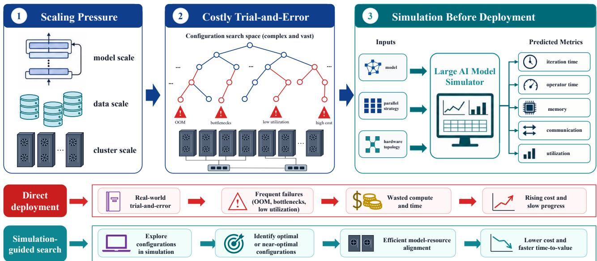  
Figure 1. Simulation for model–resource alignment. Effective alignment improves utilization and reduces cost; poor alignment creates bottlenecks and resource waste. Simulation estimates these effects before deployment, reducing the need for repeated full-scale trials.

and configuration selection.

Our contributions are:

• A unified simulation framework. We connect model compilation and device binding with execution modeling, computation and communication cost estimation, and schedule-level aggregation, relating simulator design choices to evaluation targets.

• A multi-granularity profiling dataset. We release 348 feasible configurations across 23 model settings from 10 dense and MoE LLM families, covering five parallelism dimensions and recomputation.

• A hierarchical evaluation benchmark. System-, component-, and strategy-level tasks connect prediction accuracy with error diagnosis and configuration selection. Calculon and vTrain demonstrate comparisons of prediction accuracy, simulation cost, and diagnostic outputs.

• Cross-platform protocol validation. Matched measurements for Qwen3-0.6B and Qwen3-1.7B on NVIDIA V100 GPUs and Ascend NPUs demonstrate cross-platform evaluation and NPU-guided GPU configuration selection.

## 2. Related Work

Distributed LLM training simulators. Existing simulators estimate training time and, in some cases, devicememory requirements under different parallel configurations [18, 30]. Table 1 summarizes representative tools by their operator-time estimation approach, prediction outputs, and availability of parameter-calibration tools. Analytical estimators apply cost equations with hardware parameters [18, 26]; profiling-based estimators use measured operator or kernel latencies [6, 12, 30]; hybrid estimators combine measured costs with analytical or mechanistic models [39]. Cost estimation and execution representation are separate modeling dimensions. For example, vTrain [6] combines profiled kernel times with analytical inter-node communication estimates, while SimAI [39] combines kernel profiling with detailed communication simulation. Lumos [23] develops trace-driven performance modeling for large-scale LLM training.

Profiling data and execution traces. Existing resources provide measurements and workload descriptions at different granularities (Table 2). NeuSight [21] provides operator and end-to-end latency measurements across Transformer models and GPU platforms. AcmeTrace [17] and Alibaba GPU traces [1] record production workloads and resource usage for cluster-level analysis. Chakra [36] provides a standardized execution-trace representation, while AICB [2] generates parameterized workloads for communication simulation. LM-SimBench links end-to-end measurements to per-rank computation, communication, and memory profiles from the same training runs across controlled parallel configurations, providing a common measurement basis for simulator calibration and evaluation.

Training benchmarks and simulator evaluation. MLPerf Training [25] standardizes workloads, quality targets, and reporting for evaluating training systems. Simulator evaluation addresses a different question: how accurately predictions reproduce measured system behavior and how effectively they guide configuration selection. Existing simulators validate their predictions using different workloads, platforms, and performance targets, including training iteration time and collective-communication latency [6, 39, 41]. LM-SimBench organizes evaluation into system-, component-, and strategy-level tasks. These tasks compare overall time and memory predictions with measurements, assess internal computation and communication costs, and evaluate the quality of recommended parallel configurations.

Table 1. Representative simulators for distributed LLM training. Cost estimation refers to operator computation time: Analytical uses hardware-based cost equations; Profiling-based directly uses measured operator or kernel latencies; Hybrid uses analytical models calibrated with operator profiling data. Memory denotes device-memory usage; Calibration tool indicates the availability of parameter-fitting tools.
<table><tr><td>Simulator</td><td>Cost estimation</td><td>Time</td><td>Memory</td><td>Calibration tool</td></tr><tr><td>Calculon [18]</td><td>Analytical</td><td>√</td><td>√</td><td>X</td></tr><tr><td>SimuMax [26]</td><td>Analytical</td><td>V</td><td>V</td><td>V</td></tr><tr><td>Proteus [12]</td><td>Profiling-based</td><td>√</td><td>√</td><td>X</td></tr><tr><td>vTrain [6]</td><td>Profiling-based</td><td>V</td><td>X</td><td>X</td></tr><tr><td>Phantora [30]</td><td>Profiling-based</td><td>√</td><td>V</td><td>X</td></tr><tr><td>ASTRA-sim 2.0 [5, 41]</td><td>Hybrid</td><td>√</td><td>√</td><td>X</td></tr><tr><td>SimAI [39]</td><td>Hybrid</td><td>√</td><td>X</td><td>X</td></tr><tr><td>Echo [14]</td><td>Hybrid</td><td>√</td><td>X</td><td>√</td></tr></table>

ASTRA-sim’s memory tracking requires tensor metadata; Echo’s calibration targets its slowdown predictor.

Table 2. Related public artifacts and the primary LM-SimBench collection. The comparison distinguishes measured profiling datasets, cluster traces, and tools for representing or generating workloads.
<table><tr><td>Artifact</td><td>Type / workloads</td><td>Released signals or specifications</td><td>Parallelism coverage</td><td>Hardware</td></tr><tr><td>NeuSight [21]</td><td>Profiling dataset; 5 dense + 1 MoE Trans- former</td><td>Operator and end-to-end latency measure- ments</td><td>DP/TP/PP sweeps</td><td>NVIDIA/ AMD GPUs</td></tr><tr><td>AcmeTrace [17]</td><td>Cluster trace; produc- tion LLM jobs</td><td>Scheduler logs, resource monitoring, timing, Job-level observations and failures</td><td></td><td>A100 GPUs</td></tr><tr><td>Alibaba GPU traces [1]</td><td>Cluster trace; produc- tion GPU jobs</td><td>Job-level resource and timing records</td><td>Job-level observations</td><td>GPUs</td></tr><tr><td>Chakra [36]</td><td>Execution-trace format</td><td>Graph schema and example traces; collec- tion and replay tools</td><td>Representation schema</td><td>Hardware- agnostic</td></tr><tr><td>Lumos [23]</td><td>3 family</td><td>Modeling toolkit; GPT- Kineto and execution-trace tooling</td><td>Modeling methodology</td><td>H100 GPUs</td></tr><tr><td>AICB [2]</td><td>Workload generator; dense and MoE LLMs</td><td>Parameterized workload specifications</td><td>DP/TP/PP/SP/EP speci- fications</td><td>GPU- agnostic</td></tr><tr><td>LM-SimBench</td><td>Profiling dataset; 23 settings, 10 dense/MoE families</td><td>Six linked views: iteration time, peak mem- ory, time breakdown, operator latency, com- munication events, and matrix kernels</td><td>348 configurations; DP/TP/PP/CP/EP and recomputation</td><td>Ascend NPUs</td></tr></table>

## 3. A Unified Framework for Large-Model Training Simulation

We describe training simulators through common inputs, outputs, and functional stages. This framework connects their execution and cost-modeling choices to measurable targets for overall accuracy, internal cost estimates, and configuration selection.

## 3.1. Pipeline and Formal Problem

A simulation instance is $x = ( M , P , N )$ : M specifies model architecture and workload; P specifies parallelism, microbatch size, recomputation, precision, fusion, and overlap; and N specifies compute, memory, and interconnect characteristics. RC and noRC denote configurations with and without activation recomputation, respectively. The simulator predicts

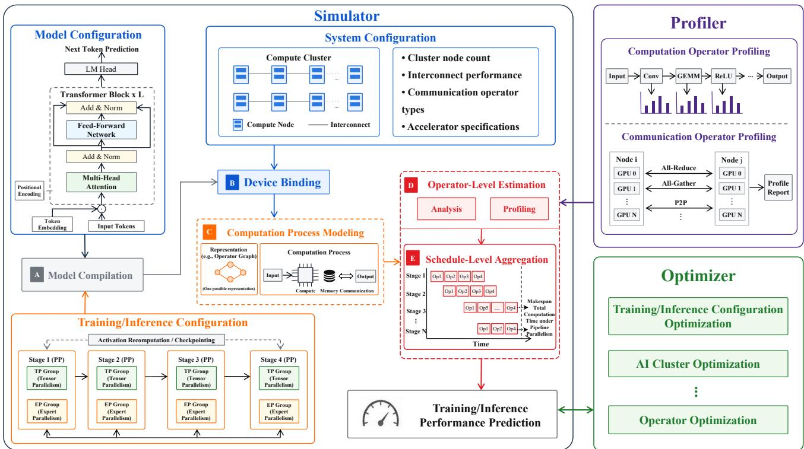  
Figure 2. Unified pipeline for large-model training simulation. Model, training, and system configurations drive compilation, device binding, and computation-process modeling. Computation and communication costs from operator-level estimation feed schedule-level aggregation to predict iteration time. Profiling supplies measured costs; the optimizer uses predictions for configuration search.

$$
S _ { \theta } ( x ) = ( \widehat { T } , \widehat { { \mathbf v } } , \widehat { C } , \widehat { z } ) ,\tag{1}
$$

where θ denotes simulator parameters. Outputs comprise iteration time $\widehat { T }$ , per-device peak memory $\widehat { \mathbf { V } } = ( \widehat { V } _ { d } ) _ { d \in D ( N ) }$ configuration-selection objective ${ \widehat { C } } ,$ , and optional diagnostics $\widehat { z } . D ( N )$ is the device set.

Figure 2 defines five functional stages. Stage A compiles the model under $P ,$ Stage B assigns devices and parallel groups, and Stage C constructs the execution representation:

$$
\begin{array} { l } { \displaystyle \bar { M } = \mathcal { C } ( M , P ) , } \\ { \displaystyle \Pi = \mathcal { B } ( \bar { M } , P , N ) , } \\ { \displaystyle R = \mathcal { R } ( \bar { M } , \Pi , P , N ) . } \end{array}\tag{2}
$$

Here, $\bar { M }$ is the compiled model and Π records placement and communication groups. R represents execution through analytical phases, an operator-level directed acyclic graph (DAG), a profiled trace, or a hybrid schedule.

Stage D estimates the costs of computation and communication units in R. Let $\mathcal { U } ( R ) = \mathcal { U } _ { \mathrm { o p } } ( R ) \cup \mathcal { U } _ { \mathrm { c o m m } } ( R )$ denote these units. Their predicted latencies are

$$
\begin{array} { r } { \widehat { t } _ { u } = \left\{ \begin{array} { l l } { \mathcal { F } _ { \mathrm { o p } } ( \phi _ { u } , \Pi , N ) , } & { u \in \mathcal { U } _ { \mathrm { o p } } ( R ) , } \\ { \mathcal { F } _ { \mathrm { c o m m } } ( \phi _ { u } , \Pi , N ) , } & { u \in \mathcal { U } _ { \mathrm { c o m m } } ( R ) , } \end{array} \right. } \end{array}\tag{3}
$$

where $\phi _ { u }$ describes tensor shape, FLOPs, transferred bytes, primitive, and group size. Estimators may be analytical, structure-aware, profiling-based, or learned. The profiler supplies computation and communication measurements for cost estimation.

Stage E aggregates unit costs under execution dependencies, resource constraints, and computation–communication overlap to predict iteration time. Time and memory predictions are expressed as

$$
\begin{array} { r l } & { \widehat { T } = \mathcal { A } \big ( R , \Pi , \{ \widehat { t } _ { u } \} _ { u \in \mathcal { U } ( R ) } , N \big ) , } \\ & { \widehat { \mathbf { V } } = \mathcal { V } ( R , \Pi , N ) . } \end{array}\tag{4}
$$

The aggregation function A implements phase rules, constrained graph scheduling, or trace replay, determining which scheduling and overlap effects are represented. The memory estimator V uses tensor layouts and lifetime assumptions in R and Π, together with N.

Table 3 compares execution representations (Stage C) and cost estimators (Stage D), linking simulator design to calibration requirements and intermediate evaluation targets.

## 3.2. Connecting Simulation to Evaluation

LM-SimBench evaluates overall predictions, internal cost estimates, and configuration selection using linked measure-

Table 3. Representative simulators in the unified framework: execution representations in Stage C and computation and communication cost estimators in Stage D.
<table><tr><td>Simulator</td><td>Execution</td><td>Computation</td><td>Communication</td></tr><tr><td>Calculon [18]</td><td>Analytical phases</td><td>Analytical</td><td>Mechanistic</td></tr><tr><td>SimAI [39]</td><td>Workload graph</td><td>Profiled kernels / analytical scaling</td><td>Mechanistic / packet-level</td></tr><tr><td>Optimus [20]</td><td>Operator graph</td><td>Analytical / structure-aware</td><td>Mechanistic</td></tr><tr><td>ASTRA-sim 2.0 [41]</td><td>Workload graph</td><td>Profiled / roofline</td><td>Mechanistic / packet-level</td></tr><tr><td>vTrain [6]</td><td>Execution graph</td><td>Profiled CUDA kernels</td><td>Profiled / analytical</td></tr><tr><td>LLMEmu [43]</td><td>Hybrid</td><td>Profiling-based</td><td>Trace-driven</td></tr></table>

ments from the same training runs:

$$
\mathcal { D } = \{ ( x _ { i } , y _ { i } ^ { \star } , z _ { i } ^ { \star } ) \} _ { i = 1 } ^ { n } ,\tag{5}
$$

where $x _ { i } = ( M _ { i } , P _ { i } , N _ { i } ) , y _ { i } ^ { \star } = ( T _ { i } ^ { \star } , { \bf V } _ { i } ^ { \star } )$ contains measured time and per-device peak memory, and $z _ { i } ^ { \star }$ contains rank-level breakdowns, operator latencies, communication events, and matrix-kernel records. Configuration and rank identifiers link these views.

System-level tasks compare time and memory predictions with $y _ { i } ^ { \star }$ . Component-level tasks compare intermediate estimates with $z _ { i } ^ { \star }$ at matching units and aggregation granularity: computation and communication profiles assess Stage D, while time breakdowns help assess scheduling and overlap in Stage E. Strategy-level tasks compare candidate configurations under a fixed model and system, assessing selection quality against measured iteration times (Section 5).

Configuration selection retains strategies that are valid and predicted to fit on every device:

$$
\begin{array} { r l } {  { I _ { \mathrm { f e a s } } ( M , P , N ) = \mathbf { 1 } \{ P \in \mathcal { K } ( M , N ) \} } \quad } & { } \\ & { \cdot \prod _ { d \in D ( N ) } \mathbf { 1 } \{ \widehat { V } _ { d } \leq \mathrm { c a p } _ { d } \} , } \end{array}\tag{6}
$$

where $\kappa ( M , N )$ is the valid strategy space and $\mathrm { c a p } _ { d }$ is device capacity. Scalar peak memory is $\widehat { V } = \operatorname* { m a x } _ { d \in D ( N ) } \widehat { V } _ { d } .$ Ranking retains predicted-feasible candidates; measured memory supplies the feasibility evaluation labels.

## 4. LM-SimBench Dataset

LM-SimBench contains distributed-training profiles for 23 model settings from 10 dense and MoE LLM families, covering 348 feasible parallel configurations. A model setting specifies the model and training sequence length; its configurations vary DP/TP/PP/CP/EP and recomputation settings. The primary collection uses Ascend 910B3 NPUs with 64 GiB per device and MindSpeed-LLM [4].

Training logs and per-rank Ascend Profiler outputs are processed into six measurement views (Table 4). Shared model-setting, configuration, and rank identifiers connect end-to-end labels to intermediate records from the same run. Processing checks configuration names, rank coverage, units, and schemas. The resulting 26.2 GB of CSV tables and 550 GB of raw profiles support both direct evaluation and trace-level analysis.

Table 4. Six linked measurement views and their evaluation uses.
<table><tr><td>View</td><td>Granularity</td><td>Evaluation use</td></tr><tr><td>Iteration time</td><td>Configuration</td><td>Runtime prediction and ranking</td></tr><tr><td>Peak memory</td><td>Rank</td><td>Memory prediction and feasibility</td></tr><tr><td>Time breakdown</td><td>Rank</td><td>Bottleneck diagnosis</td></tr><tr><td>Operator latency</td><td>Operator/rank</td><td>Computation cost modeling</td></tr><tr><td>Communication</td><td>Event/rank</td><td>Communication cost model- ing</td></tr><tr><td>Matrix kernels</td><td>Kernel/rank</td><td>Matrix-operator prediction</td></tr></table>

The dataset also includes paired NVIDIA V100 and Ascend 910B3 measurements for Qwen3-0.6B and Qwen3- 1.7B under the same schema. The dataset comprises system telemetry collected from controlled training runs.

## 5. Benchmark Design

LM-SimBench evaluates system- and component-level predictions, configuration-selection quality, and simulation cost. Cross-platform tasks compare paired measurements and evaluate NPU-guided GPU configuration selection.

## 5.1. Evaluation Protocol

For each $x = ( M , P , N )$ , predictions are matched to measured time, memory, and component costs through configuration, rank, and component identifiers. Shared-task comparisons use the same configurations and measurement labels, with sample counts reported for each experiment.

Calibration measurements supply simulator parameters or profiled costs. Simulator comparisons use disjoint calibration and test configurations; calibration-coverage experiments vary the calibration set while fixing the test set. Platform-calibration experiments fit parameters to each stack’s measurements and report the resulting calibration errors.

## 5.2. System- and Component-Level Prediction

Time and memory. Iteration-time predictions are compared with configuration-level measurements. Peak-memory error is computed per rank for platform calibration and on the maximum across ranks for configuration-level diagnostics. Configuration maxima also determine memory rankings and capacity decisions. Feasibility evaluation reports agreement with measured memory and retention of measured-feasible configurations.

Component costs. Computation targets include matrixkernel latency per call, stage computation time, and recomputation-stage time. Predictions are paired with measurements at the corresponding operator or stage granularity. Communication targets include event durations and nonoverlapped communication time from time breakdowns. $\mathrm { A g \mathrm { - } }$ gregated estimates are compared at matching configuration and rank granularity, with durations expressed in common units.

Prediction metrics are mean absolute error (MAE), symmetric mean absolute percentage error (sMAPE), and $R ^ { 2 }$ For matched predictions $\widehat { y } _ { i }$ and measurements $y _ { i } , \mathsf { s M A P E }$ averages $2 0 0 | \widehat { y } _ { i } - y _ { i } | / ( | \widehat { y } _ { i } | + | y _ { i } | + \epsilon )$ , with $\epsilon = 1 0 ^ { - 1 2 }$ Platform calibration reports mean absolute percentage error (MAPE) for iteration time and per-rank memory, with memory ranking evaluated on configuration maxima.

## 5.3. Configuration Selection and Simulation Cost

For a fixed model and system, configuration selection applies the capacity criterion in Eq. 6 and ranks candidates by predicted iteration time. Spearman $\rho$ and Kendall τ compare predicted and measured orderings. Top-k hit records whether the measured optimum enters the recommended set; Top-k set overlap is the fraction shared with the measured top-k set.

Let C be the evaluation candidate set, $S _ { k }$ the recommended k configurations, and $T ^ { \star } ( c )$ the measured iteration time. Shortlist regret is

$$
{ \mathrm { R e g r e t @ } } k = 1 0 0 \left( { \frac { \operatorname* { m i n } _ { c \in { \mathcal { S } } _ { k } } T ^ { \star } ( c ) } { \operatorname* { m i n } _ { c \in { \mathcal { C } } } T ^ { \star } ( c ) } } - 1 \right) \% ,\tag{7}
$$

which evaluates the fastest measured member of the shortlist. $\mathbf { A } \mathbf { t } k = 1$ , it gives the selected configuration’s time penalty. Simulation cost is evaluated using the median simulation time per configuration, measured as software wall-clock time in the same CPU and software environment.

## 5.4. Cross-Platform Evaluation

Paired comparisons match model settings and configuration identifiers across GPU and NPU stacks and report the matched sample count. Time and memory rankings are compared using Spearman $\rho ,$ Kendall $\tau _ { b } ,$ , Top-1 agreement, and Top-k set overlap, both pooled and stratified by RC/noRC. Matched RC/noRC pairs assess the direction of time and memory changes.

Matrix problems are matched by batch size, dimensions $( m , n , k )$ , and recorded input types. Per-call latencies are pooled across paired configurations and ranks to obtain a median per problem and stack. These medians define latency rankings, compared by Spearman $\rho$ and slowest-problem Top-k overlap. Operator-category and communicationprimitive durations are summed across ranks per configuration and normalized into time-share vectors. The vectors are aligned over the union of categories, with zero entries for absent categories. Spearman correlation and Jensen– Shannon divergence (JSD) are computed per configuration and summarized by their medians.

NPU-guided GPU selection ranks the paired candidates by measured NPU time and retains the fastest k. GPU measurements evaluate optimum inclusion and shortlist regret (Eq. 7), using the GPU-fastest configuration in the paired candidate set as the reference.

## 6. Results

We evaluate simulator accuracy, configuration selection, and simulation cost, examine computation, memory, and communication through intermediate profiles, and assess platform calibration and NPU-guided GPU configuration selection.

## 6.1. Simulator Accuracy, Selection, and Cost

Setup. We evaluate Calculon and vTrain on Qwen1.5-1.8B at 8K tokens with CP=1 on the NPU stack. Calculon uses analytical cost models, while vTrain combines an execution graph with LM-SimBench profiles supplied through an adapter. Ten configurations calibrate vTrain, and ten disjoint configurations form the test set. We compare iteration-time prediction, configuration ranking, and simulation cost on the six test configurations for which both simulators produce valid predictions.

Accuracy, selection, and cost. The two simulators exhibit distinct accuracy and execution-cost characteristics (Table 5). vTrain achieves 1.86% iteration-time sMAPE and Spearman $\rho = 1 . 0 0 0 \mathrm { { ; } }$ compared with 8.88% and 0.943 for Calculon. Both identify the measured fastest configuration and recover the measured top-three set. Calculon’s median simulation time is 1.78 ms per configuration, compared with 25.46 ms for vTrain, a 14.3× speedup.

Calibration coverage. Broader configuration coverage improves vTrain’s prediction accuracy. On a fixed set of eight test configurations, calibration with ten TP/DP/PP profiles yields 2.08% sMAPE, compared with 11.77% using six TP-endpoint profiles. The 9.69-percentage-point reduction demonstrates the value of sampling multiple parallelism dimensions for profiling-based simulation.

Table 5. Calculon and vTrain on six common test configurations of Qwen1.5-1.8B (8K tokens). Simulation time is median wall-clock time per configuration.
<table><tr><td>Metric</td><td>Calculon</td><td>vTrain</td></tr><tr><td>Iteration-time MAE (s) ↓</td><td>1.059</td><td>0.207</td></tr><tr><td>Iteration-time sMAPE (%) ↓</td><td>8.88</td><td>1.86</td></tr><tr><td>Iteration-time  $R ^ { 2 } \uparrow$ </td><td>0.630</td><td>0.990</td></tr><tr><td>Ranking Spearman  $\rho \uparrow$ </td><td>0.943</td><td>1.000</td></tr><tr><td>Ranking Kendall  $\tau \uparrow$ </td><td>0.867</td><td>1.000</td></tr><tr><td>Top-1 hit / regret</td><td>1/0%</td><td>1/0%</td></tr><tr><td>Top-3 set overlap</td><td>3/3</td><td>3/3</td></tr><tr><td>Simulation time (ms) ↓</td><td>1.78</td><td>25.46</td></tr></table>

Table 6. Calculon on platform calibration configurations. Entries report MAPE (%) / Spearman $\rho .$ Memory error uses per-rank peaks; ranking uses the maximum peak across ranks.
<table><tr><td>Qwen3 / stack</td><td>Time</td><td>Memory</td></tr><tr><td>0.6B / V100</td><td></td><td>10.28 / 0.861 15.99 / 0.993</td></tr><tr><td>0.6B / 910B3</td><td></td><td>10.19 / 0.95013.20 / 0.986</td></tr><tr><td>1.7B / V100</td><td></td><td>11.22 / 0.85312.56 / 0.993</td></tr><tr><td>1.7B / 910B3</td><td></td><td>7.97 / 0.935 12.55 / 0.994</td></tr></table>

## 6.2. Diagnosis with Intermediate Profiles

Computation. Operator- and stage-level profiles characterize computation predictions at their respective granularities. Calculon’s matrix-operator predictions achieve $R ^ { 2 } = 0 . 8 1 7 .$ with 0.109 ms MAE and 43.34% sMAPE. For vTrain, stagecomputation sMAPE is 11.60%, and recomputation-stage sMAPE is 2.75%.

Memory. Calculon’s memory model retains 13 of the 20 measured-feasible configurations, with a peak-memory MAE of 6.92 GiB on the retained set. Paired predictions and measurements reveal overestimates of 13–29 GiB in several noRC configurations, linking memory accounting to candidate retention.

Communication. Time breakdowns connect communication estimates with the overlap observed during training. vTrain’s non-overlapped communication prediction has 136.20% sMAPE. The associated communication profiles expose the difference between serialized communication estimates and observed overlap, providing a concrete target for refining communication scheduling.

## 6.3. Simulator Calibration across Platforms

Setup. We collect paired profiles for Qwen3-0.6B and Qwen3-1.7B at 4K tokens on 8×NVIDIA V100 GPUs (32 GiB, Megatron-LM) and 8×Ascend 910B3 NPUs (64 GiB, MindSpeed-LLM). Each model uses 18 DP/TP/PP/recomputation candidates with CP=1, micro/global batch sizes 1/32, and a distributed optimizer. We profile the sixth iteration after five warm-up steps. V100 uses FP16; 910B3 uses BF16, fused kernels, and sequence parallelism. The paired evaluation contains 15 complete configurations for Qwen3-0.6B and 11 for Qwen3-1.7B.

Platform calibration. We apply a common Calculon implementation incorporating Qwen3 architecture, pipeline scheduling, kernel-launch latency, and rank-level memory accounting. For each platform, a single parameter set for compute efficiency, launch latency, communication, and runtime memory is calibrated jointly across both models and their candidate configurations.

On the calibration configurations, iteration-time MAPE ranges from 7.97% to 11.22%, with ranking $\rho = 0 . 8 5 3 \mathrm { - }$ 0.950; peak-memory ranking reaches $\rho = 0 . 9 8 6 \mathrm { - } 0 . 9 9 4$ (Table 6). Within each of the four model×RC/noRC groups, GPU measurements, NPU measurements, and both calibrated simulators identify the same Top-1 configuration.

## 6.4. Cross-Platform Configuration Selection

NPU-guided GPU selection. Ranking the paired configurations by measured NPU iteration time produces a threecandidate shortlist containing the GPU-fastest configuration for both models (Table 7; Figure 3). This reduces the candidate sets from 15 to 3 and from 11 to 3. Selecting the fastest shortlisted configuration using GPU measurements yields zero Top-3 shortlist regret in both cases. Direct selection of the NPU-fastest configuration gives GPU regret of 0.0% and 6.9%, respectively.

Memory and recomputation trends. Cross-platform peak-memory rankings achieve $\rho = 0 . 9 8 2$ and 0.991, with identical three lowest-memory configurations. Across all nine matched RC/noRC pairs, recomputation increases iteration time and reduces peak memory on both platforms. These consistent trends support memory-oriented candidate screening across the two stacks.

Component-level execution characteristics. Matrixproblem latency rankings agree across platforms, with $\rho ~ = ~ 0 . 9 8 3$ and 0.987 and slowest-problem Top-10 overlaps of 8/10 and 10/10. Communication-primitive time shares have median rank correlations of 0.949 and 0.872.

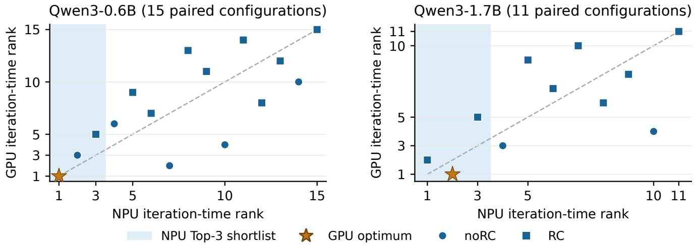

Table 7. Cross-platform transfer from Ascend 910B3 to NVIDIA V100. Shortlist regret uses GPU time. Correlations compare measured profiles on the two stacks.
<table><tr><td>Level</td><td>Metric</td><td>Qwen3-0.6B</td><td>Qwen3-1.7B</td></tr><tr><td>Coverage</td><td>Paired complete configurations</td><td>15</td><td>11</td></tr><tr><td>Strategy</td><td>Iteration-time rank ρ</td><td>0.718</td><td>0.664</td></tr><tr><td></td><td>NPU Top-1 selection: GPU regret ↓</td><td>0.0%</td><td>6.9%</td></tr><tr><td></td><td>GPU optimum in NPU Top-3</td><td>Yes</td><td>Yes</td></tr><tr><td></td><td>NPU Top-3 shortlist: GPU regret ↓</td><td>0.0%</td><td>0.0%</td></tr><tr><td>Memory</td><td>Peak-memory rank ρ</td><td>0.982</td><td>0.991</td></tr><tr><td></td><td>Lowest-memory Top-3 overlap</td><td>3/3</td><td>3/3</td></tr><tr><td></td><td>RC time/memory direction agreement</td><td>6/6 pairs</td><td>3/3 pairs</td></tr><tr><td>Component</td><td>Matrix median-latency rank ρ</td><td>0.983</td><td>0.987</td></tr><tr><td></td><td>Slowest matrix-problem Top-10 overlap</td><td>8/10</td><td>10/10</td></tr><tr><td></td><td>Communication-primitive median ρ</td><td>0.949</td><td>0.872</td></tr><tr><td></td><td>Operator-category median ρ</td><td>0.503</td><td>0.531</td></tr><tr><td></td><td>Non-overlapped communication share, GPU/NPU</td><td>17.0% / 28.5%</td><td>10.9% / 30.0%</td></tr></table>

Figure 3. NPU profiles guide GPU configuration selection. Each point is a paired configuration ranked by measured iteration time (rank 1 is fastest). The shaded NPU Top-3 shortlist contains the GPU optimum (star) for both models. The dashed line denotes identical ranks.

Operator-category correlations are 0.503 and 0.531, and nonoverlapped communication accounts for 17.0%/10.9% of runtime on V100 and 28.5%/30.0% on 910B3. The profiles identify expensive shared matrix problems and characterize each stack’s operator composition and communication overlap.

## 7. Conclusion

LM-SimBench connects a unified simulation framework, a multi-granularity profiling dataset, and a hierarchical evaluation benchmark for distributed LLM training. Its linked measurements support simulator calibration, prediction assessment, and diagnosis of computation, memory, and communication costs. Evaluations of Calculon and vTrain demonstrate how the same benchmark captures prediction accuracy, configuration-selection utility, and simulation cost. GPU– NPU experiments show that NPU profiles preserve useful memory and matrix-operator rankings and identify shortlists containing the GPU-optimal configurations. Extending workload and accelerator coverage will broaden this common basis for training-system simulation and optimization.

## LLM Usage Statement

We used generative AI tools to assist with the writing and presentation of this manuscript: improving its organization, clarity, and academic English, and checking internal consistency and layout. Generative AI tools were not used to formulate the research hypotheses, to design the methodology or the experiments, to implement the released code or the evaluated simulators, to generate or process the measured profiling data, or to interpret the results. All AI-assisted text was reviewed by the authors, who verified every technical claim and reported value and take responsibility for the final content of this work.

## References

[1] Alibaba. Alibaba cluster trace program: GPU cluster traces, 2023. Production GPU cluster traces (cluster-trace-gpu-v2020 and cluster-trace-gpu-v2023). Accessed: November 6, 2026.

[2] Alibaba. AICB: An open-source AI communication benchmark suite, 2024. Open-source software repository. Accessed: November 6, 2026.

[3] Alibaba Group. InferSim: A lightweight LLM inference performance simulator, 2025. Open-source software repository. Accessed: April 27, 2026.

[4] Ascend Community. MindSpeed-LLM: A distributed training suite for large language models on Ascend NPUs, 2024. Opensource software repository. Accessed: April 27, 2026.

[5] ASTRA-sim Developers. ASTRA-sim 2.0: Open-source implementation, 2026. Software, revision 518bd51. Accessed: November 6, 2026.

[6] Jehyeon Bang, Yujeong Choi, Myeongwoo Kim, Yongdeok Kim, and Minsoo Rhu. vTrain: A simulation framework for evaluating cost-effective and compute-optimal large language model training, 2024.

[7] James Bergstra and Yoshua Bengio. Random search for hyperparameter optimization. Journal of Machine Learning Research, 13(10):281–305, 2012.

[8] Bernd Bischl et al. Hyperparameter optimization: Foundations, algorithms, best practices, and open challenges. WIREs Data Mining and Knowledge Discovery, 13(2):e1484, 2023.

[9] Ermao Cai, Da-Cheng Juan, Dimitrios Stamoulis, and Diana Marculescu. NeuralPower: Predict and deploy energyefficient convolutional neural networks. In Proceedings of the Ninth Asian Conference on Machine Learning (ACML), pages 622–637. PMLR, 2017.

[10] Jaehong Cho, Minsu Kim, Hyunmin Choi, Guseul Heo, and Jongse Park. LLMServingSim: A HW/SW co-simulation infrastructure for LLM inference serving at scale. In 2024 IEEE International Symposium on Workload Characterization (IISWC), pages 15–29. IEEE, 2024.

[11] DeepSeek-AI et al. DeepSeek-V3 technical report, 2025.

[12] Jiangfei Duan, Xiuhong Li, Ping Xu, Xingcheng Zhang, Shengen Yan, Yun Liang, and Dahua Lin. Proteus: Simulating the performance of distributed DNN training. IEEE Transactions on Parallel and Distributed Systems, 35(10):1867–1878, 2024.

[13] Stefan Falkner, Aaron Klein, and Frank Hutter. BOHB: Robust and efficient hyperparameter optimization at scale. In Proceedings ofthe 35th International Conference on Machine Learning (ICML), pages 1437–1446. PMLR, 2018.

[14] Yicheng Feng, Yuetao Chen, Kaiwen Chen, Jingzong Li, Tianyuan Wu, Peng Cheng, Chuan Wu, Wei Wang, Tsung-Yi Ho, and Hong Xu. Echo: Simulating distributed training at scale. arXiv preprint arXiv:2412.12487, 2024.

[15] Aaron Grattafiori et al. The Llama 3 herd of models, 2024.

[16] Zhenhua Guo et al. A survey on performance modeling and prediction for distributed DNN training. IEEE Transactions on Parallel and Distributed Systems, 35(12):2463–2478, 2024.

[17] Qinghao Hu et al. Characterization of large language model development in the datacenter. In 21st USENIX Symposium on Networked Systems Design and Implementation (NSDI ’24), pages 709–729, 2024.

[18] Mikhail Isaev, Nic McDonald, Larry Dennison, and Richard W. Vuduc. Calculon: A methodology and tool for high-level co-design of systems and large language models. In Proceedings of the International Conference for High Performance Computing, Networking, Storage and Analysis (SC ’23). ACM, 2023.

[19] Mahmoud Khairy, Zhensheng Shen, Tor M. Aamodt, and Timothy G. Rogers. Accel-Sim: An extensible simulation framework for validated GPU modeling. In 2020 ACM/IEEE 47th Annual International Symposium on Computer Architecture (ISCA), pages 473–486, 2020.

[20] Joyjit Kundu et al. Performance modeling and workload analysis of distributed large language model training and inference. In 2024 IEEE International Symposium on Workload Characterization (IISWC), pages 57–67, 2024.

[21] Seonho Lee, Amar Phanishayee, and Divya Mahajan. Forecasting GPU performance for deep learning training and inference. In Proceedings of the 30th ACM International Conference on Architectural Support for Programming Languages and Operating Systems (ASPLOS ’25), 2025.

[22] Lisha Li, Kevin Jamieson, Giulia DeSalvo, Afshin Rostamizadeh, and Ameet Talwalkar. Hyperband: A novel banditbased approach to hyperparameter optimization. Journal of Machine Learning Research, 18(185):1–52, 2018.

[23] Mingyu Liang et al. Lumos: Efficient performance modeling and estimation for large-scale LLM training. In Proceedings ofMachine Learning and Systems (MLSys), 2025.

[24] Heng Liao et al. Ascend: A scalable and unified architecture for ubiquitous deep neural network computing: Industry track paper. In 2021 IEEE International Symposium on High-Performance Computer Architecture (HPCA), pages 789–801, 2021.

[25] Peter Mattson et al. MLPerf training benchmark. In Proceedings ofMachine Learning and Systems (MLSys), pages 336–349, 2020.

[26] Moore Threads. SimuMax: A static analytical model for LLM distributed training, 2026. Software, revision 4dcaae5. Accessed: November 6, 2026.

[27] Deepak Narayanan, Mohammad Shoeybi, Jared Casper, Patrick LeGresley, Mostofa Patwary, Vijay Korthikanti,

Dmitri Vainbrand, Prethvi Kashinkunti, Julie Bernauer, Bryan Catanzaro, et al. Efficient large-scale language model training on gpu clusters using megatron-lm. In Proceedings of the international conference for high performance computing, networking, storage and analysis, pages 1–15, 2021.

[28] OpenAI. GPT-4 technical report, 2023.

[29] Hang Qi, Evan R. Sparks, and Ameet Talwalkar. Paleo: A performance model for deep neural networks. In International Conference on Learning Representations (ICLR), 2017.

[30] Jianxing Qin, Jingrong Chen, Xinhao Kong, Yongji Wu, Tianjun Yuan, Liang Luo, Zhaodong Wang, Ying Zhang, Tingjun Chen, Alvin R. Lebeck, and Danyang Zhuo. Phantora: Maximizing code reuse in simulation-based machine learning system performance estimation. In 23rd USENIX Symposium on Networked Systems Design and Implementation (NSDI ’26), pages 1809–1825, 2026.

[31] Saeed Rashidi, Srinivas Sridharan, Sudarshan Srinivasan, and Tushar Krishna. ASTRA-SIM: Enabling SW/HW co-design exploration for distributed DL training platforms. In 2020 IEEE International Symposium on Performance Analysis of Systems and Software (ISPASS), pages 81–92. IEEE, 2020.

[32] Vijay Janapa Reddi et al. MLPerf inference benchmark. In 2020 ACM/IEEE 47th Annual International Symposium on Computer Architecture (ISCA), pages 446–459, 2020.

[33] Ananda Samajdar, Yuhao Zhu, Paul Whatmough, Matthew Mattina, and Tushar Krishna. SCALE-Sim: Systolic CNN accelerator simulator, 2019.

[34] Ananda Samajdar, Jan Moritz Joseph, Yuhao Zhu, Paul N. Whatmough, Matthew Mattina, and Tushar Krishna. A systematic methodology for characterizing scalability of DNN accelerators using SCALE-Sim. In 2020 IEEE International Symposium on Performance Analysis ofSystems and Software (ISPASS), pages 58–68, 2020.

[35] Mohammad Shoeybi, Mostofa Patwary, Raul Puri, Patrick LeGresley, Jared Casper, and Bryan Catanzaro. Megatron-LM: Training multi-billion parameter language models using model parallelism. arXiv preprint arXiv:1909.08053, 2019.

[36] Srinivas Sridharan et al. Chakra: Advancing performance benchmarking and co-design using standardized execution traces. arXiv preprint arXiv:2305.14516, 2023.

[37] Jonas Svedas et al. A survey of end-to-end modeling for distributed DNN training: Workloads, simulators, and TCO. arXiv preprint arXiv:2506.09275, 2025.

[38] Xiaokai Wang, Shaoyuan Huang, Yuting Li, and Xiaofei Wang. ScaleDL: Towards scalable and efficient runtime prediction for distributed deep learning workloads. arXiv preprint arXiv:2511.04162, 2025.

[39] Xizheng Wang et al. SimAI: Unifying architecture design and performance tuning for Large-Scale large language model training with scalability and precision. In 22nd USENIX Symposium on Networked Systems Design and Implementation (NSDI ’25), pages 541–558, 2025.

[40] Samuel Williams, Andrew Waterman, and David Patterson. Roofline: An insightful visual performance model for multicore architectures. Communications of the ACM, 52(4):65–76, 2009.

[41] William Won, Taekyung Heo, Saeed Rashidi, Srinivas Sridharan, Sudarshan Srinivasan, and Tushar Krishna. ASTRAsim2.0: Modeling hierarchical networks and disaggregated systems for large-model training at scale. In 2023 IEEE International Symposium on Performance Analysis ofSystems and Software (ISPASS), pages 283–294. IEEE, 2023.

[42] Li Yang and Abdallah Shami. On hyperparameter optimization of machine learning algorithms: Theory and practice. Neurocomputing, 415:295–316, 2020.

[43] Siyuan Yang, Enda Yu, Pingjing Lu, and Dezun Dong. LLMEmu: A lightweight performance emulator for highfidelity distributed LLM training. Performance Evaluation, 170:102526, 2025.

[44] Yang You, Aydın Buluç, and James Demmel. Scaling deep learning on GPU and Knights Landing clusters. In Proceedings of the International Conference for High Performance Computing, Networking, Storage and Analysis (SC ’17), pages 1–12. ACM, 2017.

[45] Geoffrey X. Yu, Yubo Gao, Pavel Golikov, and Gennady Pekhimenko. Habitat: A runtime-based computational performance predictor for deep neural network training. In Proceedings ofthe 2021 USENIX Annual Technical Conference (USENIX ATC ’21), pages 503–521. USENIX Association, 2021.

[46] Hengrui Zhang, August Ning, Rohan Prabhakar, and David Wentzlaff. A hardware evaluation framework for large language model inference, 2023.

## Appendices

## Overview and Resources

These appendices follow the main paper from framework and dataset design to simulator evaluation and cross-platform application. Appendix A places LM-SimBench among profiling resources and performance-modeling tools. Appendix B explains the simulation pipeline and modeling choices, and Appendix C documents the collection, processing, and file schema of the six linked measurement views.

Appendix D reports simulator accuracy, configuration selection, simulation cost, and calibration coverage. Appendix E uses single-node and multi-node cases to connect predictions with rank-, communication-, and operator-level measurements. Appendix F evaluates platform-specific calibration and NPU-guided GPU configuration selection using paired measurements.

Data and code. The resources comprise:

• Processed dataset: the six linked measurement views, manifests, and field documentation.

• Raw profiles: the original profiling traces for detailed execution analysis.

• Code: benchmark evaluation, preprocessing scripts, and usage examples.

Dataset organization, documentation, and licenses are described in Appendix C.

## A. Additional Related Work

This section expands Section 2 by relating profiling resources, performance predictors, and training simulators to the evaluation tasks in LM-SimBench. The organizing distinction is between the measurements an artifact provides and the modeling choices a simulator uses: linked measurements allow those choices to be assessed at both the output and component levels.

## A.1. Profiling Datasets and Trace Releases

Table 2 compares workload coverage, released signals, parallelism dimensions, and hardware across related artifacts based on their released content. The LM-SimBench entry covers the primary NPU collection; Appendix F reports the matched GPU supplement.

Performance-prediction datasets. NeuSight [21] is the closest artifact in purpose: it releases operator-level and endto-end latencies for six Transformer models across seven NVIDIA and AMD GPUs to support training-performance prediction. LM-SimBench provides per-rank memory and communication-event measurements, with a configuration sweep covering context and expert parallelism and activation recomputation across dense and MoE models.

Cluster operational traces. AcmeTrace [17] and the Alibaba GPU cluster traces [1] expose production-job behavior through scheduler logs, resource monitoring, timing, and failure records. Their job-level observations support scheduling and cluster-management studies. LM-SimBench instead associates individual training configurations with rank-level and operator-level execution measurements.

Trace formats and modeling toolkits. Chakra [36] standardizes graph-based execution traces and provides collection, generation, and replay tools. Lumos [23] develops trace-driven performance modeling, while AICB [2], the workload generator accompanying SimAI, provides parameterized LLM workload specifications. These tools address representation and modeling; LM-SimBench supplies measured profiles and labels for evaluating predictions at multiple granularities.

## A.2. Neural-Network Performance Prediction

Analytical predictors estimate execution costs from model structure, operation counts, and hardware characteristics. Roofline relates arithmetic intensity to compute and memory limits [40]; SCALE-Sim and Accel-Sim model systolic-array and GPU execution [19, 33]. Profiling-based approaches measure representative operators and combine their costs into workload-level estimates. Paleo combines analytica models with calibrated measurements [29], and NeuralPower predicts CNN-layer runtime, power, and energy [9]. Subsequent predictors extend these ideas across accelerators and distributed settings [34, 44, 45]. LM-SimBench provides distributed LLM training measurements for evaluating both aggregate predictions and their intermediate operator costs.

## A.3. Large-Model System Simulators

Training simulators combine analytical, graph-based, and measurement-based modeling [16, 37]. Calculon estimates iteration time and memory under Megatron-style parallelism [18, 35], while SimAI connects framework and network modeling for large-scale LLM training [39]. Graph- and task-based systems represent dependencies and scheduling explicitly: ASTRA-sim emphasizes distributed execution, collective communication, and network topology [31, 41], and Optimus uses operator graphs for workload and accelerator analysis [20].

Measurement-based systems use profiles to estimate execution costs. vTrain combines an execution graph with profiled kernel times and profiled or analytical communication estimates [6]; LLMEmu uses GPU-kernel profiles to emulate distributed training on CPU clusters [43]. Habitat and ScaleDL learn performance relationships across hardware or distributed settings [38, 45]. Related serving tools, including LLMCompass, LLMServingSim, and InferSim, address deployment performance and request-level behavior [3, 10, 46].

LM-SimBench provides common measurements and evaluation tasks for these different modeling choices. $\mathsf { A p - }$ pendix B maps representative training simulators by execution representation, computation estimator, and communication model.

## A.4. System Benchmarks and Configuration Search

MLPerf Training and Inference standardize workloads, quality targets, and reporting procedures for system-level comparisons [25, 32]. LM-SimBench complements this role by providing reusable training profiles for time and memory prediction, component-level diagnostics, and configuration ranking.

Configuration search turns performance estimates into training-system decisions. General search methods use random sampling, multi-fidelity allocation, and Bayesian optimization to allocate evaluation budgets [7, 8, 13, 22, 42]. In distributed training, parallelism, recomputation, scheduling, and placement determine runtime and memory requirements. LM-SimBench evaluates this use of simulation through configuration rankings, optimum inclusion, and selection regret, connecting prediction quality to the configurations a user would choose.

## B. Unified Simulation Framework

This section expands the five-stage pipeline in Section 3. It follows a simulation instance from its input configurations to execution representation, unit-cost estimates, and aggregated predictions, then relates these choices to representative simulators and configuration selection.

## B.1. Simulation Inputs and Execution Pipeline

Simulation inputs. We describe the target scenario with three inputs. The model configuration M records architectural and workload parameters such as layer types, hidden dimensions, sequence length, global batch size, and parameter count. The system configuration N specifies the target hardware, including compute capability, memory capacity, inter-device bandwidth, and topology. The training configuration P specifies data, tensor, pipeline, context, and expert parallelism; micro-batch size; recomputation; offloading; numerical precision; operator fusion; and computation– communication overlap.

Performance prediction problem. Given $( M , P , N )$ the simulator $\scriptstyle { S _ { \theta } }$ predicts the performance of one training iteration. Following Eq. 1, its outputs are iteration time ${ \tilde { T } } ,$ per-device peak memory $\widehat { \mathbf { V } } = ( \widehat { V } _ { d } ) _ { d \in D ( N ) }$ , a configurationselection objective ${ \widehat { C } } ,$ and optional diagnostics zb. Below, $\widehat { T }$ is the representative metric, and $\widehat { V } \ : = \ : \operatorname* { m a x } _ { d \in D ( N ) } \widehat { V } _ { d }$ denotes scalar peak memory when required.

Stages A–C: constructing the execution representation. For a training configuration $P ,$ model compilation transforms the abstract model into

$$
\bar { \boldsymbol { M } } = \mathcal { C } ( \boldsymbol { M } , \boldsymbol { P } ) ,\tag{8}
$$

where $\mathcal { C } ( \cdot )$ partitions or replicates components according to the selected parallel strategy. Tensor parallelism partitions parameters within operators, pipeline parallelism assigns blocks to stages, and data parallelism replicates the model across groups. Device binding then assigns each component of $\bar { M }$ to devices and communication groups:

$$
\Pi = { \cal B } ( \bar { M } , P , N ) ,\tag{9}
$$

where Π records placement and parallel-group membership, allowing the simulator to distinguish intra-node from internode communication.

The bound model is then transformed into an execution representation:

$$
R = \mathcal { R } ( \bar { M } , \Pi , P , N ) ,\tag{10}
$$

where R may be an analytical phase decomposition, an operator-level dependency graph, a profiled trace, or a hybrid schedule. It captures the execution order, synchronization constraints, and computation–communication structure induced by pipeline scheduling, tensor partitioning, recomputation, and overlap.

Stages D–E: estimating and aggregating costs. Stage D estimates the latency of each computation or communication unit in $\mathcal { U } ( R ) = \mathcal { U } _ { \mathrm { o p } } ( R ) \cup \mathcal { U } _ { \mathrm { c o m m } } ( R )$ . Stage E aggregates these estimates under the ordering and resource constraints represented by R and Π. As in Eq. 3, the predicted latency of unit u is

$$
\begin{array} { r } { \widehat { t } _ { u } = \left\{ \begin{array} { l l } { \mathcal { F } _ { \mathrm { o p } } ( \phi _ { u } , \Pi , N ) , } & { u \in \mathcal { U } _ { \mathrm { o p } } ( R ) , } \\ { \mathcal { F } _ { \mathrm { c o m m } } ( \phi _ { u } , \Pi , N ) , } & { u \in \mathcal { U } _ { \mathrm { c o m m } } ( R ) , } \end{array} \right. } \end{array}\tag{11}
$$

where $\phi _ { u }$ records features such as tensor shape, FLOPs, bytes transferred, primitive type, group size, and placement; Π provides placement and group membership; and N provides the required hardware parameters. The estimator may be analytical, structure-aware, profiling-based, or learned. This cost-estimation choice is separate from the execution representation: for example, an operator graph can use either analytical or measured latencies.

Stage E combines these unit costs with dependencies, resource constraints, and overlap to obtain iteration time:

$$
\widehat { T } = A \bigl ( R , \Pi , \{ \widehat { t } _ { u } \} _ { u \in \mathcal { U } ( R ) } , N \bigr ) .\tag{12}
$$

Peak memory is estimated from the execution representation and device placement, as in Eq. 4:

$$
\widehat { \mathbf { V } } = \gamma ( R , { \Pi } , N ) ,\tag{13}
$$

Here, $\boldsymbol { \mathcal { A } } ( \cdot )$ aggregates time over the execution representation, and $\mathcal { V } ( \cdot )$ estimates peak memory from the tensor-layout and lifetime assumptions in R and Π, together with system characteristics in $N .$ . The indicator $I _ { \mathrm { f e a s } } ( M , P , N )$ from Eq. 6 checks strategy validity and predicted memory against device capacity. Measured memory provides the reference for evaluating this predicted feasibility.

Memory components. The principal tensor-memory components are parameters, activations, gradients, and optimizer states. Their contribution on device d is

$$
\widehat { V } _ { \mathrm { t e n s o r } , d } = \widehat { V } _ { \mathrm { p a r a m } , d } + \widehat { V } _ { \mathrm { a c t } , d } + \widehat { V } _ { \mathrm { g r a d } , d } + \widehat { V } _ { \mathrm { o p t } , d } ,\tag{14}
$$

where $\widehat { V } _ { \mathrm { p a r a m } , d } , \widehat { V } _ { \mathrm { a c t } , d } , \widehat { V } _ { \mathrm { g r a d } , d } ,$ , and $\widehat { V } _ { \mathrm { o p t } , d }$ denote the memory used by parameters, activations, gradients, and optimizer states on device $d ,$ respectively. Their sizes and lifetimes depend on architecture, sequence length, batch size, precision, parallelism, and recomputation or offloading. The memory estimator combines these terms with its runtime-memory accounting to obtain ${ \widehat { V } } _ { d } ;$ rank-level measurements provide the corresponding evaluation targets.

## B.2. Modeling Choices and Simulator Mapping

The following choices determine the execution detail and cost of a simulator. Table 8 maps representative systems by execution representation (Stage C) and computation and communication estimators (Stage D), together with artifact availability and modeling focus.

Large-model abstraction. For the decoder-only Transformers in LM-SimBench, M records the layer count, hidden and feedforward dimensions, attention heads, sequence length, and batch size. These parameters determine the sizes of computation and memory operations; MoE models additionally specify routing and sparsity. Appendix C.1 lists the profiled workloads.

Cluster and hardware abstraction. Cluster modeling reduces the physical environment to three performancerelevant components: compute, memory, and network (Figure 4).

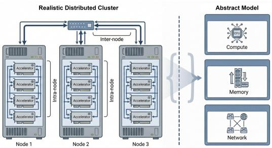  
Figure 4. Simplified cluster abstraction. The physical cluster is represented by compute, memory, and network components.

Compute is characterized by data type, peak FLOPs, and empirical efficiency; memory by capacity, bandwidth, and efficiency; and the network by bandwidth, latency, topology, and communication efficiency. The simulator combines peak capabilities with efficiency factors to obtain effective performance.

Measured operator and communication latencies can calibrate or replace analytical cost estimates for the target platform.

Training workflow modeling. Workflow modeling specifies the temporal order of computation and communication after compilation and device binding. In an operator-level graph, nodes represent computation or communication and edges encode data dependencies. A training graph typically includes the forward pass, backward pass, gradient synchronization, and parameter update.

Workflow granularity determines which execution effects can be represented. Graph-based models construct an operator-level DAG for fine-grained timing and dependency analysis. Analytical models reduce execution to phases such as forward, backward, communication, and optimizer update; they are faster but may miss overlap and synchronization. Hybrid models represent critical or communication-heavy segments explicitly and estimate the remainder analytically.

Computation cost modeling. Computation models estimate the latency of operators or phases using analytical formulas, structure-aware simulation, profiles, learned predictors, or combinations thereof. Roofline-style models estimate latency from FLOPs, throughput, and efficiency. Structure-aware models additionally represent hardware hierarchy, tiling, memory movement, and scheduling. Profilingbased methods reuse measured operator latency. Analytical models can thus provide broad coverage while profiles calibrate important or hardware-specific kernels.

Communication cost modeling. Communication models estimate the latency introduced by distributed parallelism. Data, tensor, pipeline, context, and expert parallelism induce collective or point-to-point operations such as All-Reduce, All-Gather, Reduce-Scatter, Send, and Receive. Their cost depends on message size, primitive, group size, bandwidth, latency, topology, and overlap with computation.

Mechanistic models estimate collectives from topology, bandwidth, latency, and algorithmic decomposition. Tracedriven models replay measured events and preserve their dependencies; packet-level simulators represent congestion and routing at higher computational cost; and data-driven predictors learn latency from message, topology, and configuration features. The appropriate choice depends on whether the goal is rapid search, workload-specific optimization, or high-fidelity architectural analysis.

## B.3. Simulation Outputs and Strategy Search

The predicted iteration time and per-device peak memory provide the efficiency and feasibility criteria for comparing candidate configurations. The diagnostic outputs connect these predictions to the operator and communication measurements used in component-level evaluation.

Table 8. Representative training simulators characterized by execution representation (Stage C), computation and communication estimators (Stage D), artifact availability, and modeling focus.
<table><tr><td>Simulator</td><td>Workflow</td><td>Comp.</td><td>Comm.</td><td>Public artifact</td><td>Primary focus</td></tr><tr><td>Calculon [18]</td><td>A</td><td>An</td><td>Mech</td><td>√</td><td>Analytical iteration-time and memory estimation for</td></tr><tr><td>SimAI [39]</td><td>G</td><td>Pr/An</td><td>Mech/Pkt</td><td>√</td><td>LLM training. Full-stack large-scale training simulation across</td></tr><tr><td>Optimus [20]</td><td>G</td><td>An/St</td><td>Mech</td><td>×</td><td>framework and network layers. Operator-graph modeling for workload and accelera-</td></tr><tr><td>ASTRA-sim 1.0 [31]</td><td>H</td><td>An</td><td>Mech/Pkt</td><td>√</td><td>tor microarchitecture exploration. Network-topology and collective-communication</td></tr><tr><td>ASTRA-sim 2.0 [41]</td><td>G</td><td>Pr/An</td><td>Mech/Pkt</td><td>V</td><td>simulation. Detailed workload graphs combined with network-</td></tr><tr><td>vTrain [6]</td><td>G</td><td>Pr</td><td>Pr/An</td><td></td><td>level simulation. Graph-based training simulation calibrated by real-</td></tr><tr><td>LLMEmu [43]</td><td>H</td><td>Pr</td><td>Trace</td><td>√</td><td>system measurements. Kernel-profiled GPU emulation of distributed LLM</td></tr><tr><td>Habitat [45]</td><td>A</td><td>Pr/Data</td><td>Data</td><td>√</td><td>training on CPU clusters. Machine learning (ML)-based runtime prediction</td></tr><tr><td>ScaleDL [38]</td><td>A</td><td>Data</td><td>Data</td><td>X</td><td>across unseen GPU generations. Data-driven performance prediction for distributed</td></tr><tr><td>Paleo [29]</td><td>A</td><td>An</td><td>Mech</td><td>√</td><td>training. Early CNN training-time estimator for GPU clus- ters.</td></tr></table>

G: graph-based; A/An: analytical; H: hybrid; St: structure-aware; Pr: profiling-based; Data: data-driven; Mech: white-box mechanistic; Trace: trace-driven; Pkt: packet-level.

Configuration-selection objective. Iteration time and per-device memory can be combined in a task-specific cost function. Consistent with the mapping $S _ { \theta } ( M , P , N ) $ $( \widehat { T } , \widehat { \mathbf { V } } , \widehat { C } , \widehat { z } )$ , we write

$$
\widehat { C } = C ( \widehat { T } , \widehat { { \mathbf v } } , N ) ,\tag{15}
$$

where N contains the system characteristics. In the benchmark of Section $5 , { \widehat { C } } = { \widehat { T } } :$ : configurations are ranked by predicted iteration time after the per-device capacity check. The general formulation also accommodates resource cost or other objectives when required by an application.

Strategy search. Configuration search minimizes predicted cost over valid strategies that pass the predicted feasibility check:

$$
\operatorname* { m i n } _ { P \in { \mathcal { K } } ( M , N ) } { \widehat C } .\tag{16}
$$

For the DP/TP/PP setting with CP=1 and no expert parallelism, resource allocation and recomputation satisfy

$$
P _ { t p } \cdot P _ { p p } \cdot P _ { d p } \leq N _ { \mathrm { p r o c } } ,\tag{17}
$$

$$
P _ { r c } \in \{ 0 , 1 \} ,\tag{18}
$$

Here $P _ { t p } , P _ { p p } ,$ and $P _ { d p }$ are the tensor-, pipeline-, and dataparallel degrees; $P _ { r c }$ is the recomputation switch; and $N _ { \mathrm { p r o c } }$ is the number of available processors. With M and N fixed, these choices define the candidate training configurations. Table 9 groups the inputs that specify a simulation instance; the benchmark varies the training dimensions within each model setting and system.

Table 9. Configuration inputs and their roles in simulation and search.
<table><tr><td>Input</td><td>Representative parameters</td><td>Role</td></tr><tr><td>Model and workload M</td><td>Architecture, layer dimensions, attention heads, sequence length, global batch size</td><td>Defines the training workload.</td></tr><tr><td>Training configuration P</td><td>DP/TP/PP/CP/EP, micro-batch size, recomputation, precision, optimizer-state partitioning, fusion, and overlap</td><td>Defines candidate execution strate- gies for a fixed workload and sys- tem.</td></tr><tr><td>System configuration N</td><td>Device count, compute capability, memory capacity and bandwidth, interconnect, and topology</td><td>Defines resources and capacity con- straints.</td></tr></table>

## C. LM-SimBench Dataset Details

This section provides the collection and storage details for the dataset introduced in Section 4. Shared model-setting, configuration, and rank identifiers connect the six measurement views from each training run. We describe their coverage, collection environment, processing pipeline, and file schema so that the same records can be used for simulator evaluation and execution analysis.

## C.1. Workload and Configuration Coverage

Table 10 summarizes the primary NPU collection, and Table 11 gives the per-model coverage. For each model setting, the latter lists the number of feasible configurations and the observed degrees of each parallelism dimension. A model setting specifies a model and its training sequence length; a parallel configuration combines parallelism degrees and a recomputation setting. Dataset size excludes raw profiler dumps.

Feasible coverage varies with architecture, parameter count, context length, memory capacity, and cluster size. Smaller settings therefore admit broader DP/TP/PP/CP combinations than some larger or more constrained settings. For MoE workloads, we additionally report expert parallelism because it changes both computation placement and communication.

The release identifiers in Table 11 encode the model and training sequence length. In the case studies, qwen15\_1.8b\_8k denotes Qwen1.5-1.8B at 8K tokens, and qwen25\_32b\_32k denotes Qwen2.5-32B at 32K tokens. The cross-platform identifiers qwen3\_0.6b\_4k and qwen3\_1.7b\_4k denote Qwen3-0.6B and Qwen3-1.7B, respectively, both at 4K tokens.

The cross-platform supplement pairs V100/Megatron-LM measurements with a newly collected 910B3/MindSpeed-LLM reference for two Qwen3 workloads. Its candidate names match a CP=1 subset of the primary collection; its paired measurements and comparisons are documented in Appendix F.

## C.2. Profiling Platform and Software Stack

The primary collection uses Ascend 910B3 NPUs with MindSpeed-LLM. Table 12 records the host, accelerator, interconnect, and software versions used for these runs.

## C.3. Processing Pipeline and Quality Control

Algorithm 1 converts per-rank Ascend Profiler outputs into the six views in Table 4. Peak memory, time breakdowns, operator latencies, communication events, and matrix-kernel records are extracted from the corresponding profiler files. Configuration-level iteration time is derived by summing the profiler-reported Stage and Bubble durations for each rank and taking the maximum across ranks, with microseconds converted to milliseconds. Shared model-setting, configuration, and rank identifiers link the configuration-level labels to their underlying execution records.

Algorithm 1 Data processing pipeline for LM-SimBench   
Require: Raw profiler directory Praw   
Ensure: Structured dataset directory D   
1: Initialize the structured output directory D   
2: for each model m in Praw do   
3: Identify feasible parallel configurations of m   
4: for each configuration c of m do   
5: Parse DP, TP, PP, CP, EP, and recomputation settings from   
c   
6: for each rank directory r under c do   
7: Read profiler metadata and obtain the rank identifier   
8: Extract memory, operator, time-breakdown, and com  
munication records   
9: Extract matrix-kernel features from kernel-level pro  
filer files   
10: end for   
11: Sum Stage and Bubble for each rank; take the maxi  
mum across ranks and convert to milliseconds   
12: Aggregate rank-level records into structured CSV files   
13: end for   
14: end for   
15: Normalize field names, rank identifiers, units, and directory   
layout   
16: Generate manifest records for coverage and size checks   
17: return Structured dataset directory D

Table 10. Scale and coverage of the processed LM-SimBench dataset.
<table><tr><td>Item</td><td>Value</td></tr><tr><td>Model settings</td><td>23</td></tr><tr><td>Parallel configurations</td><td>348</td></tr><tr><td>Data format</td><td>CSV</td></tr><tr><td>Data modality</td><td>Tabular profiling records</td></tr><tr><td>Model coverage</td><td>Dense and MoE models from 10 LLM families</td></tr><tr><td>Configuration dimensions</td><td>DP, TP, PP, CP, EP, recomputation</td></tr><tr><td>Profiling views</td><td>Iteration time, peak memory, time breakdown, operator latency, communication, matrix kernels</td></tr><tr><td>Processed dataset size</td><td>26.2 GB</td></tr><tr><td>Raw profiles</td><td>550 GB</td></tr></table>

Table 11. Observed parallelism degrees and configuration counts for each model setting in LM-SimBench.
<table><tr><td>Model-setting identifier</td><td>Configs</td><td>DP</td><td>TP</td><td>PP</td><td>CP</td><td>EP</td><td>Recompute</td></tr><tr><td>gemma2_27b_8k</td><td>3</td><td>1/2</td><td>4/8</td><td>2</td><td>1/2</td><td>一</td><td>RC</td></tr><tr><td>gemma2_9b_8k</td><td>5</td><td>1/2</td><td>2/4</td><td>2</td><td>1/2</td><td></td><td>RC/noRC</td></tr><tr><td>glm4_9b_8k</td><td>6</td><td>1/2</td><td>2</td><td>2/4</td><td>1/2</td><td></td><td>RC/noRC</td></tr><tr><td>internlm25_1point8b_32k</td><td>16</td><td>1/2/4</td><td>1/2/4</td><td>1/2/4</td><td>2/4/8</td><td>一</td><td>RC/noRC</td></tr><tr><td>internlm25_20b_32k_16p</td><td>9</td><td>1/2</td><td>2/4/8</td><td>2/4/8</td><td>1/2/4</td><td>一</td><td>RC</td></tr><tr><td>internlm25_7b_32k</td><td>5</td><td>1/2</td><td>2/4</td><td>2/4</td><td>1/2</td><td>一</td><td>RC/noRC</td></tr><tr><td>internlm3_8b_8k</td><td>7</td><td>1/2</td><td>1/2</td><td>2/4</td><td>2/4</td><td>一</td><td>RC/noRC</td></tr><tr><td>mistral_7b_32k</td><td>11</td><td>1/2/4</td><td>1/2/4/8</td><td>1/2/4/8</td><td>1</td><td>一</td><td>RC/noRC</td></tr><tr><td>phi35_mini_4k</td><td>38</td><td>1/2/4/8</td><td>1/2/4/8</td><td>1/2/4/8</td><td>1/2/4</td><td>一</td><td>RC/noRC</td></tr><tr><td>phi35_moe_4k</td><td>10</td><td>1</td><td>1/2/4/8</td><td>1/2/4/8</td><td>1</td><td>1/2/4/8</td><td>RC/noRC</td></tr><tr><td>qwen15_1.8b_8k</td><td>40</td><td>1/2/4/8</td><td>1/2/4/8</td><td>1/2/4/8</td><td>1/2/4/8</td><td></td><td>RC/noRC</td></tr><tr><td>qwen15_4b_8k</td><td>40</td><td>1/2/4/8</td><td>1/2/4/8</td><td>1/2/4/8</td><td>1/2/4/8</td><td>一</td><td>RC/noRC</td></tr><tr><td>qwen25_0point5_32k</td><td>6</td><td>1/2</td><td>2</td><td>2/4</td><td>1/2</td><td>一</td><td>RC/noRC</td></tr><tr><td>qwen25_14b_8k</td><td>1</td><td>1</td><td>4</td><td>8</td><td>1</td><td></td><td>RC</td></tr><tr><td>qwen25_32b_32k</td><td>4</td><td>1/2</td><td>4/8</td><td>4</td><td>1/2</td><td></td><td>RC/noRC</td></tr><tr><td>qwen25_3b_32k</td><td>6</td><td>1</td><td>1/2</td><td>1/2</td><td>2/4</td><td>1</td><td>RC/noRC</td></tr><tr><td>qwen25_72b_8k</td><td>3</td><td>1</td><td>4/8</td><td>4/8</td><td>1</td><td></td><td>RC/noRC</td></tr><tr><td>qwen25_7b_8k</td><td>6</td><td>1/2</td><td>1/2</td><td>4</td><td>1/2</td><td>7</td><td>RC/noRC</td></tr><tr><td>qwen2_1.5b_4k</td><td>26</td><td>1/2/4/8</td><td>1/2</td><td>1/2/4</td><td>1/2/4</td><td>1</td><td>RC/noRC</td></tr><tr><td>qwen3_0.6b_4k</td><td>38</td><td>1/2/4/8</td><td>1/2/4/8</td><td>1/2/4</td><td>1/2/4/8</td><td>1</td><td>RC/noRC</td></tr><tr><td>qwen3_1.7b_4k</td><td>38</td><td>1/2/4/8</td><td>1/2/4/8</td><td>1/2/4</td><td>1/2/4/8</td><td>1</td><td>RC/noRC</td></tr><tr><td>qwen3_30b_a3b_4k</td><td>2</td><td>1</td><td>4</td><td>2</td><td>2</td><td>1</td><td>RC/noRC</td></tr><tr><td>qwen3_8b_4k</td><td>28</td><td>1/2/4</td><td>1/2/4/8</td><td>1/2/4</td><td>1/2/4</td><td>一</td><td>RC/noRC</td></tr></table>

Quality checks cover configuration parsing, rank identifiers, field names, units, and file coverage. The manifest records configuration and file counts and storage sizes for consistency checks.

## C.4. File Schema and Field Definitions

The directory hierarchy preserves the associations established during processing. The root manifest indexes model settings; summary files within each model-setting directory contain configuration- and rank-level measurements; and configuration/rank directories retain the detailed communication and matrix-kernel records:

LM-SimBench/   
data\_manifest.csv   
<model\_name>/   
step\_time\_summary.csv   
peak\_memory.csv   
step\_trace\_time\_summary.csv   
operator\_latency\_by\_category.csv   
comm\_summary.csv   
<parallel\_config>/   
rank\_<id>/   
comm\_time.csv   
matrix\_operator\_latency.csv

Table 13 describes each file’s location, granularity, and benchmark role. Table 14 lists representative join keys, targets, and features. The dataset repository provides complete column definitions.

Table 12. Hardware and software environment used to collect the primary LM-SimBench profiles.
<table><tr><td>Category</td><td>Item</td><td>Value</td></tr><tr><td rowspan="3">Host processor</td><td>CPU architecture</td><td>aarch64</td></tr><tr><td>CPU model</td><td>Kunpeng-920</td></tr><tr><td>CPU cores</td><td>192</td></tr><tr><td rowspan="3">Accelerator</td><td>NPU model</td><td>Ascend 910B3</td></tr><tr><td>HBM per NPU</td><td>65536 MiB</td></tr><tr><td>NPU interconnect</td><td>HCCS</td></tr><tr><td rowspan="3">Ascend software stack</td><td>CANN toolkit</td><td>8.0.0</td></tr><tr><td>CANN kernels</td><td>910B, 8.0.0</td></tr><tr><td>CANN Neural Network Acceleration Library (NNAL)</td><td>8.0.0</td></tr><tr><td rowspan="3">Deep learning runtime</td><td>Python</td><td>3.9.11</td></tr><tr><td>PyTorch</td><td>2.1.0</td></tr><tr><td>torch-npu</td><td>2.1.0.post3</td></tr><tr><td rowspan="2"></td><td>Transformers</td><td>4.43.2</td></tr><tr><td>MindSpeed</td><td>0.8.0</td></tr><tr><td>Training framework</td><td>MindSpeed-LLM</td><td>branch 2.1.0, commit bf1e61f4</td></tr></table>

Within a model setting, optimization\_config joins configuration-level records and rank\_id identifies the corresponding rank-level views. Dense-model configuration names follow dp<dp>-tp<tp>-pp<pp>- cp<cp>-<RC|noRC>; MoE names may additionally contain ep<ep>. The suffixes RC and noRC specify the recomputation setting. These keys connect the iteration-time label to the rank-level summaries and the event- and kernel-level files for the same run.

## C.5. Documentation, Licensing, and Maintenance

Documentation. The resources listed at the beginning of this supplement include dataset cards, field descriptions, usage examples, and Croissant metadata. Table 15 summarizes the data’s use and provenance.

License. The datasets, metadata, and documentation are released under CC BY 4.0; the preprocessing and benchmark code is released under Apache-2.0.

Maintenance. The release will be versioned, with previous versions retained for reproducibility and major updates recorded in a changelog. File, schema, preprocessing, and data-loading issues will be tracked in the code repository.

Table 13. Storage location, profiling granularity, and benchmark role of the main CSV files.
<table><tr><td>File</td><td>Location</td><td>Granularity</td><td>Benchmark role</td></tr><tr><td>data_manifest.csv</td><td>Dataset root</td><td>Dataset / model level</td><td>Provides the global index of model di- rectories, configuration counts, rank- directory counts, file coverage, and</td></tr><tr><td>step_time_summary.csv</td><td>Model directory</td><td>Configuration level</td><td>Provides configuration-level iteration- time labels derived from profiler time breakdowns for runtime prediction and configuration ranking.</td></tr><tr><td>peak_memory.csv</td><td>Model directory</td><td>Rank level</td><td>Provides rank-level peak memory labels for memory modeling, feasibility analy- sis, and imbalance analysis across ranks.</td></tr><tr><td>step_trace_time_summar y.csv</td><td>Model directory</td><td>Rank level</td><td>Decomposes iteration time into compu- tation, communication, idle time, and pipeline-related components for bottle- neck diagnosis.</td></tr><tr><td>operator_latency_by_ca tegory.csv</td><td>Model directory</td><td>Operator-category / rank level</td><td>Aggregates profiler operators into se- mantic categories for operator-latency modeling and module-level performance analysis.</td></tr><tr><td>comm_summary.csv</td><td>Model directory</td><td>Communication-group / rank level</td><td>Provides aggregated communication statistics for comparing collective and point-to-point communication costs across configurations.</td></tr><tr><td>comm_time.csv</td><td>Configuration / rank directory</td><td>Communication-event / rank level</td><td>Preserves event-level communication behavior for analyzing waiting time, transfer size, link bandwidth, and com- munication bottlenecks.</td></tr><tr><td>matrix_operator_latenc y.csv</td><td>Configuration / rank directory</td><td>Matrix-kernel / rank level</td><td>Provides matrix-operator shapes, la- tency, data types, and hardware-counter features for GEMM modeling and hardware-aware analysis.</td></tr></table>

Table 14. Representative join keys, targets, and features in the main CSV files.
<table><tr><td>File</td><td>Representative fields</td></tr><tr><td>data manifest.csv</td><td>model_name,parallel_config_count, rank_directory_count,size_bytes, size_human.</td></tr><tr><td>step_time_summary.csv</td><td>optimization_config,iteration_time_ms.</td></tr><tr><td>peak_memory.csv</td><td>optimization_config,rank_id,peak_memory_mb.</td></tr><tr><td>step_trace_time_summary. CSV</td><td>optimization_config,rank_id, computing,communication,communicatio n_not_overlapped, overlapped, free, stage, bubble.</td></tr><tr><td>operator_latency_by_ca tegory.csv</td><td>optimization_config, rank_id, op_category, op_type, core_type, count, total_time_us,avg_time_us, ratio_percent.</td></tr><tr><td>comm_summary.csv</td><td>comm_scope, comm_type, comm_group, op_count, elapsed_time_sum_ms, wait_time_sum_ms,link_bandwidth.</td></tr><tr><td>comm_time.csv</td><td>comm_scope, comm_type, comm_group, op_name, elapsed_time_ms, wait_tim e_ms,link_type,link_transit_size_mb, link_bandwidth_gbps.</td></tr><tr><td>CSV</td><td>matrix_operator_latency. type,duration_us,input_shapes,output_shapes,a_shape,b_shape, c_shape, batch,m, n, k, aic_mac_ratio, cube_utilization_percent.</td></tr></table>

Table 15. Use, coverage, and provenance of LM-SimBench.
<table><tr><td>Topic</td><td>Summary</td></tr><tr><td>Intended use</td><td>Training-simulator evaluation and development: time and memory prediction, configuration rank- ing, operator and communication analysis, and calibration.</td></tr><tr><td>Coverage and evaluation scope</td><td>Measurements describe the sampled models, feasible configurations, and software/hardware stacks in Section C.1 and Appendix F. Coverage depends on model size, memory capacity, and platform implementations. Serving behavior and model-quality, safety, or fairness assessment require separate data.</td></tr><tr><td>Provenance and record type</td><td>Controlled distributed training runs produce the logs and profiler outputs; the processed tables are normalized derivatives of these measured records, without synthetic profiling samples or human annotations.</td></tr><tr><td>Personal or sensitive information</td><td>The release contains system telemetry, with no intentional personal records, user-generated text, or private user data</td></tr></table>

## D. Simulator Evaluation and Comparison

This section provides the full results supporting Sections 6.1 and 6.2. Calculon and vTrain [6] illustrate how LM-SimBench evaluates analytical and profiling-based simulators through common time and ranking targets. Intermediate profiles then connect their overall predictions to computation, memory, and communication behavior.

## D.1. Evaluation Setup

We use Qwen1.5-1.8B at an 8K-token sequence length with CP=1 on the primary NPU stack. Calculon uses analytical cost models; vTrain combines an execution graph with LM-SimBench profiles supplied through an adapter. Ten configurations calibrate vTrain, and ten disjoint configurations form the test set. The shared-task comparison uses the six test configurations for which both simulators produce valid predictions.

Predicted and measured iteration times are matched by configuration. Accuracy, ranking, and shortlist metrics follow Section 5; simulation cost is the median software wallclock time per configuration in the same CPU and software environment. The component and memory analyses below use their corresponding profiling targets, with coverage specified alongside the results.

## D.2. Prediction, Selection, and Simulation Cost

Table 16 expands the comparison in Table 5. vTrain achieves 1.86% iteration-time sMAPE and Spearman $\rho = 1 . 0 0 0$ , compared with 8.88% and 0.943 for Calculon. Its absolute time error is lower on five of the six configurations. Both simulators identify the measured fastest configuration and recover the measured top-three set, giving zero Top-1 selection regret.

Calculon’s median simulation time is 1.78 ms per configuration, compared with 25.46 ms for vTrain, a 14.3× speedup. Together, the prediction, selection, and timing metrics characterize how the two modeling approaches support configuration search: prediction accuracy describes the estimated runtime, while ranking and regret describe the resulting choice.

## D.3. Calibration Coverage

A separate analysis evaluates how the configuration coverage of the calibration profiles affects vTrain’s predictions. The test set is fixed at eight configurations. Six TP-endpoint calibration profiles yield 11.77% sMAPE; ten calibration profiles spanning TP/DP/PP reduce it to 2.08%. The 9.69- percentage-point reduction illustrates the value of covering multiple parallelism dimensions when supplying measured costs to a profiling-based simulator.

## D.4. Diagnosis with Intermediate Profiles

Calculon: memory and matrix operators. Table 17 summarizes Calculon’s diagnostic results. Its memory model retains 13 of the 20 measured-feasible configurations. Time and peak-memory errors and iteration-time rankings are evaluated on those 13 configurations; memory uses the maximum across ranks. Matrix-operator predictions are evaluated against per-call kernel latencies at matching matrix dimensions.

The 6.92 GiB peak-memory MAE and 43.34% matrixoperator sMAPE connect the end-to-end assessment to specific modeling components. Appendix E.1 shows the corresponding time and memory predictions, and Appendix E.3 reports matrix errors by configuration and shape. These linked views allow a reader to follow an aggregate metric to the measurements that explain it.

vTrain: computation and communication stages. Stagelevel profiles provide evaluation targets for the intermediate costs emitted by vTrain (Table 18). Computation and recomputation achieve 11.60% and 2.75% sMAPE, respectively. Non-overlapped communication has 136.20% sMAPE: vTrain’s serialized communication estimates differ from the overlap observed in the training profiles. The stage breakdown thus identifies communication scheduling as a concrete component to refine, alongside the accurate recomputation estimates.

Table 16. Shared-task evaluation of Calculon and vTrain on six common test configurations of Qwen1.5-1.8B (8K tokens, CP=1).
<table><tr><td>Level</td><td>Task and metric</td><td>Calculon</td><td>vTrain</td></tr><tr><td>System</td><td>Iteration time, MAE / sMAPE  $\prime R ^ { 2 }$ </td><td>1.059 s / 8.88% / 0.630</td><td>0.207 s / 1.86% / 0.990</td></tr><tr><td>Strategy</td><td>Iteration-time ranking, Spearman  $\rho$ </td><td>0.943</td><td>1.000</td></tr><tr><td></td><td>Iteration-time ranking, Kendall τ</td><td>0.867</td><td>1.000</td></tr><tr><td></td><td>Top-1 hit / selection regret</td><td>1/0%</td><td>1/0%</td></tr><tr><td></td><td>Top-3 set overlap</td><td>3/3</td><td>3/3</td></tr><tr><td>Efficiency</td><td>Median wall-clock per configuration</td><td>1.78 ms</td><td>25.46 ms</td></tr></table>

Table 17. Calculon diagnostics on Qwen1.5-1.8B (8K tokens, CP=1). Time, memory, and ranking use the 13 configurations retained from 20 measured-feasible candidates.
<table><tr><td>Task</td><td>Level</td><td>Metrics</td><td>Results</td></tr><tr><td>Iteration time prediction</td><td>System</td><td> $\mathbf { M A E / s M A P E } / R ^ { 2 }$ </td><td>1.97 s / 15.96% / 0.358</td></tr><tr><td>Peak memory prediction</td><td>System</td><td> $\mathbf { M A E / s M A P E } / R ^ { 2 }$ </td><td>6.92 GiB / 39.34% / -3.087</td></tr><tr><td>Matrix-operator latency</td><td>Component</td><td> $\mathbf { M A E / s M A P E } / R ^ { 2 }$ </td><td>0.109 ms / 43.34% / 0.817</td></tr><tr><td>Feasible-configuration retention</td><td>System</td><td>Retention rate</td><td>65.0% (13/20)</td></tr><tr><td>Iteration time ranking</td><td>Strategy</td><td>Spearman ρ / Top-1 hit</td><td>0.753 / 1</td></tr></table>

Iteration-time and peak-memory prediction and ranking use the 13 configurations retained by Calculon’s memory model; the retention rate uses all 20 measured-feasible configurations. Results follow the order of the listed metrics.

Table 18. vTrain component diagnostics on Qwen1.5-1.8B (8K tokens). Predictions are compared with stage-level profiling targets.
<table><tr><td>Target</td><td>MAE</td><td>sMAPE (%)</td><td> $R ^ { 2 }$ </td></tr><tr><td>Stage computation time</td><td>716.10 ms</td><td>11.60</td><td>0.462</td></tr><tr><td>Recomputation-stage time</td><td>37.99 ms</td><td>2.75</td><td>0.801</td></tr><tr><td>Non-overlapped communication time</td><td>8.710s</td><td>136.20</td><td>-0.643</td></tr></table>

## E. Profiling Cases and Simulator Diagnostics

The cases in this section expand the intermediate-profile analysis in Section 6.2. Qwen1.5-1.8B connects configuration selection to time and memory predictions, while Qwen2.5- 32B shows how rank-level profiles reveal the computation and communication behind a multi-node training iteration. In both cases, the linked views connect overall behavior to specific ranks, communication primitives, and matrix operators.

## E.1. Single-Node Case: Qwen1.5-1.8B

Configuration-level time and rank-level memory. For Qwen1.5-1.8B at a training sequence length of 8K tokens, varying DP, TP, PP, CP, and recomputation produces substantial differences in iteration time (Figure 5). Rank-level memory measurements expose how parallel partitioning and recomputation change the memory distribution within the same workload (Figure 6).

Connecting memory screening to prediction accuracy. On the CP=1 subset, Calculon’s memory model accepts 13 of the 20 measured-feasible configurations and rejects seven.

Its largest memory overestimates occur without recomputation. Figures 7 and 8 compare time and memory predictions for the accepted configurations. Together, these measurements distinguish runtime prediction errors from the loss of feasible candidates during memory screening. The aggregate metrics are reported in Table 17; detailed matrix-operator errors for this workload are collected in Appendix E.3.

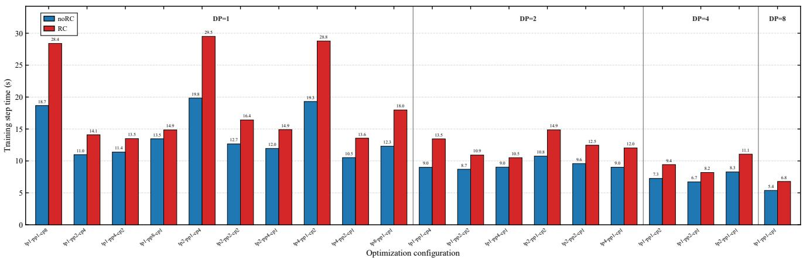  
Figure 5. Iteration time across parallel configurations. Mean iteration time of Qwen1.5-1.8B (8K tokens) under different DP/TP/PP/CP and recomputation settings.

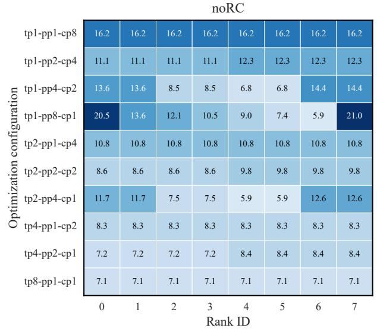

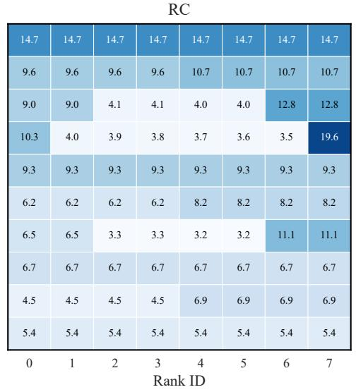  
Figure 6. Rank-level peak memory under DP=1 configurations. Peak memory of Qwen1.5-1.8B (8K tokens) by rank across TP/PP/CP configurations.

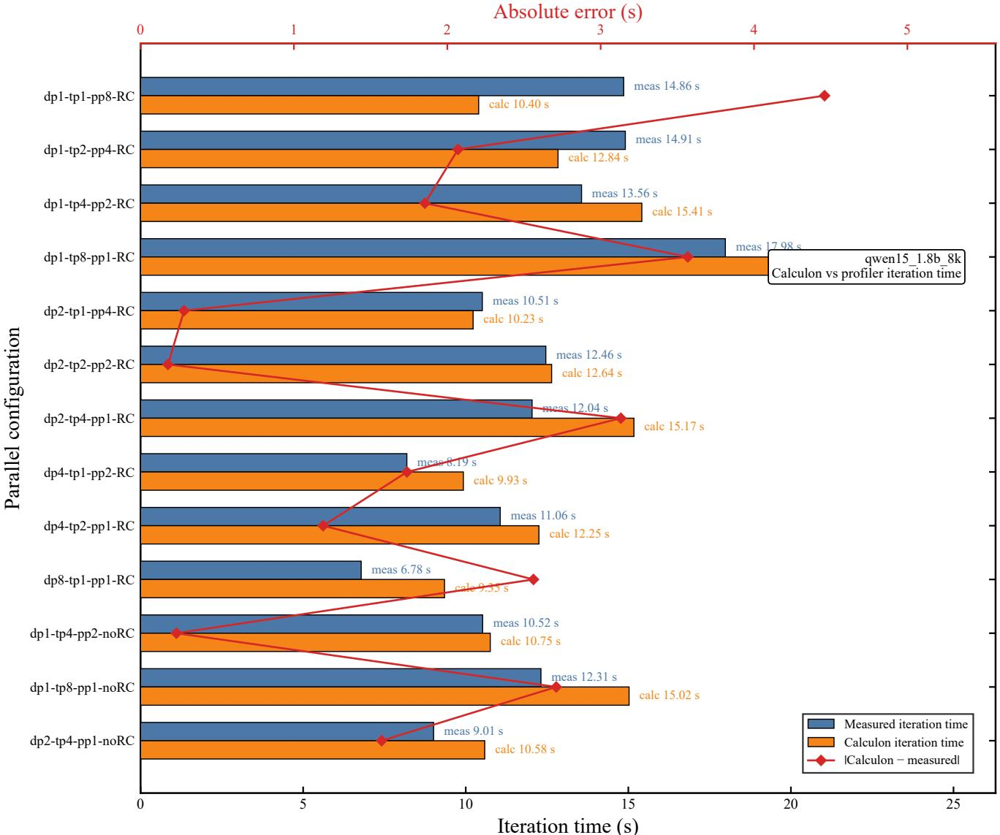  
Figure 7. Calculon iteration-time prediction on Qwen1.5-1.8B (8K tokens). Measured and Calculon-predicted iteration time for the 13 configurations accepted by Calculon’s memory model.

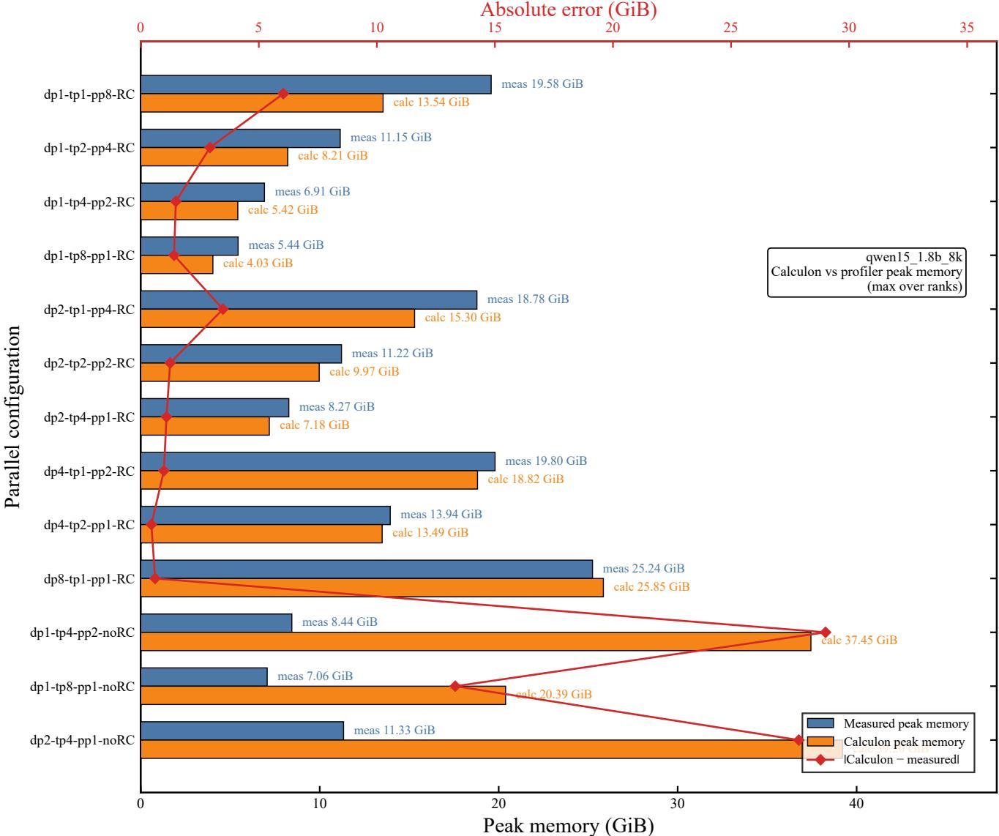  
Figure 8. Calculon peak-memory prediction on Qwen1.5-1.8B (8K tokens). Measured maximum rank-level peak memory and Calculon predictions for 13 configurations.

## E.2. Multi-Node Case: Qwen2.5-32B

Locating costs across ranks. For Qwen2.5-32B at a training sequence length of 32K tokens, rank-level profiles reveal nonuniform memory, computation, and communication across the distributed execution. Memory curves vary with parallel partitioning and pipeline-stage assignment (Figure 9); time breakdowns identify the computation and nonoverlapped communication associated with each rank (Figure 10).

Tracing dominant communication and matrix costs. The lower-level records identify the dominant costs. On rank 0 under dp1-tp8-pp4-cp1-RC, batchSendRecv accounts for most communication time (Figure 11), while a small set of matrix shapes accounts for most cumulative matrix-operator latency (Figure 12). These cumulative records locate the primitives and shapes that account for device work; the rank-level time breakdowns show how computation and communication contribute to the execution schedule.

Relating operator estimates to iteration time. The Calculon baseline uses a compatibility setup with multi-head attention in place of grouped-query attention and activation recomputation enabled; the baseline implementation supports neither grouped-query attention nor context parallelism. It predicts 73.76 s per iteration against the measured 112.22 s, a 34.3% underestimate. The operator-level comparison in Figure 13 shows that Calculon recovers the dominant matrix shapes and principal MatMulV3 hotspots, but underestimates their cumulative cost by 27–35%. Thus, the component profiles expose underestimated operator costs alongside the end-to-end runtime error.

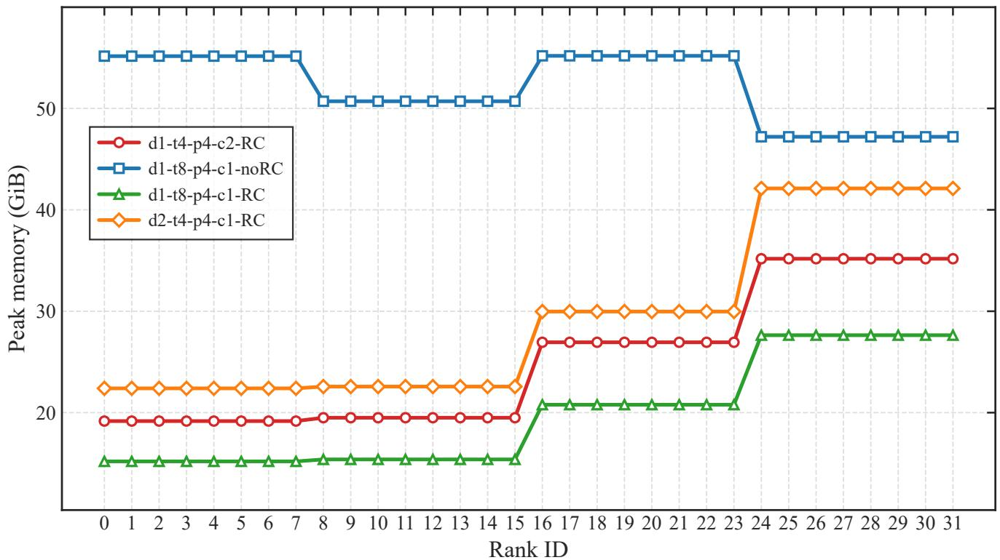  
Figure 9. Rank-level peak memory across configurations. Peak memory by rank for Qwen2.5-32B (32K tokens) under four paralle configurations.

dp1-tp8-pp4-cp1-noRC  
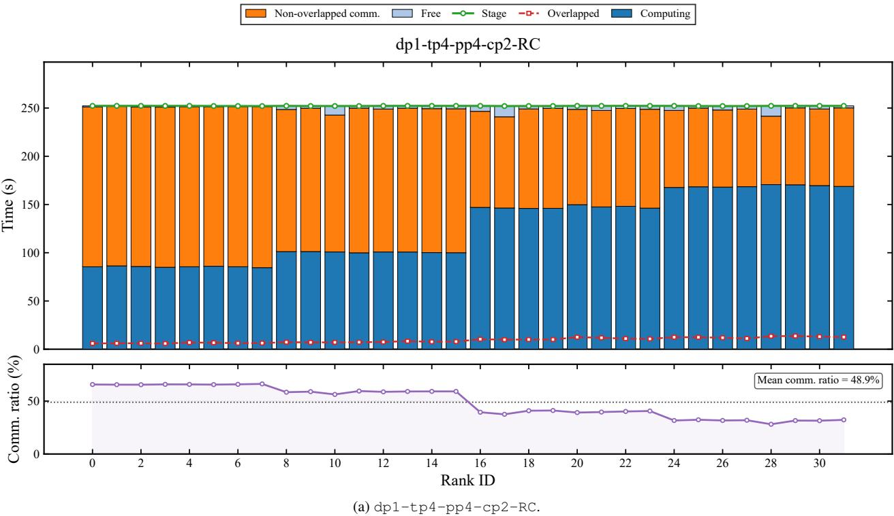

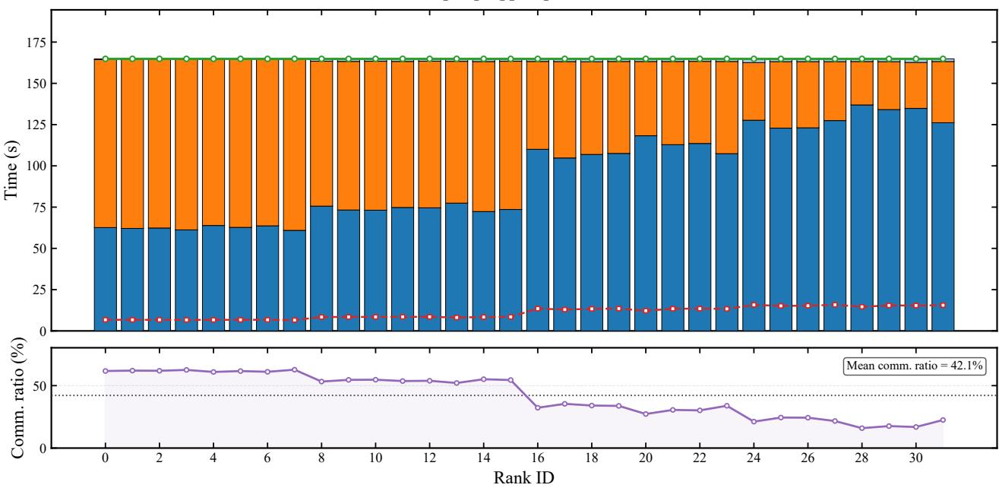  
(b) dp1-tp8-pp4-cp1-noRC.  
Figure 10. Rank-level iteration-time breakdowns. Each panel breaks down iteration time for Qwen2.5-32B (32K tokens) into computation, non-overlapped communication, free, stage, and overlapped time and reports the communication ratio for one configuration.

dp2-tp4-pp4-cp1-RC  
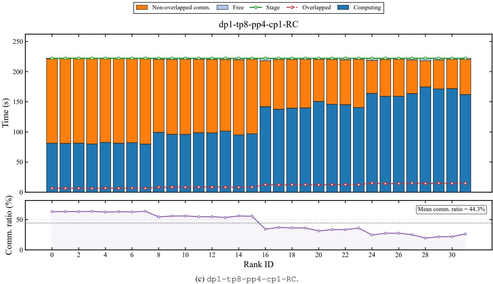

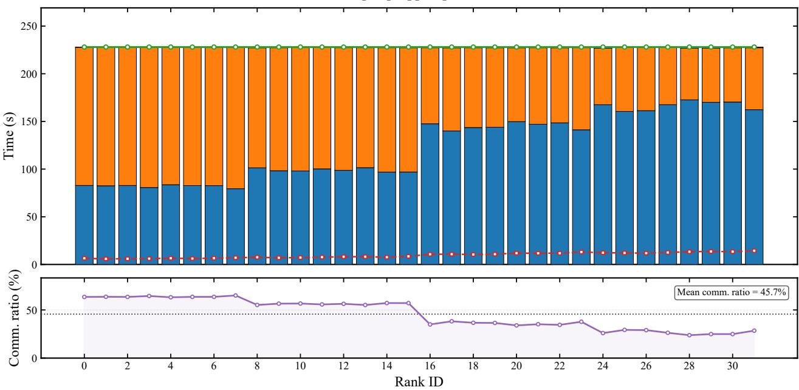  
(d) dp2-tp4-pp4-cp1-RC.  
Figure 10. Rank-level iteration-time breakdowns. Each panel breaks down iteration time for Qwen2.5-32B (32K tokens) into computation, non-overlapped communication, free, stage, and overlapped time and reports the communication ratio for one configuration.

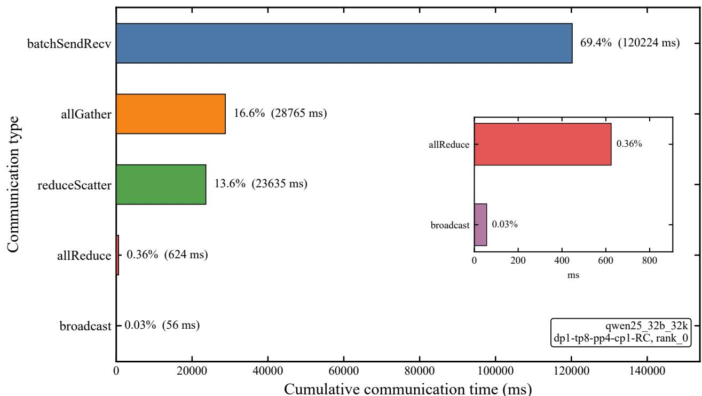  
Figure 11. Communication time breakdown. Cumulative time by communication primitive for rank 0 of Qwen2.5-32B (32K tokens) under $\mathtt { d p 1 - t p 8 - p p 4 - c p 1 - R C } .$ . The inset enlarges primitives with small shares.

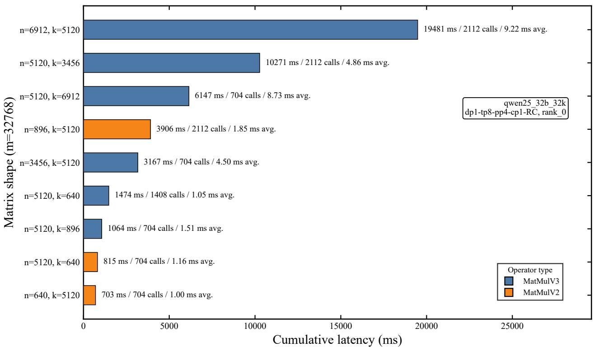  
Figure 12. Top matrix-operator shapes by cumulative latency. Matrix operators on rank 0 are grouped by $( n , k )$ with $m = 3 2 7 6 8$ for Qwen2.5-32B (32K tokens) under $\mathrm { d p 1 - t p 8 - p p 4 - c p 1 - R C }$ . Each bar reports cumulative latency, call count, and mean latency.

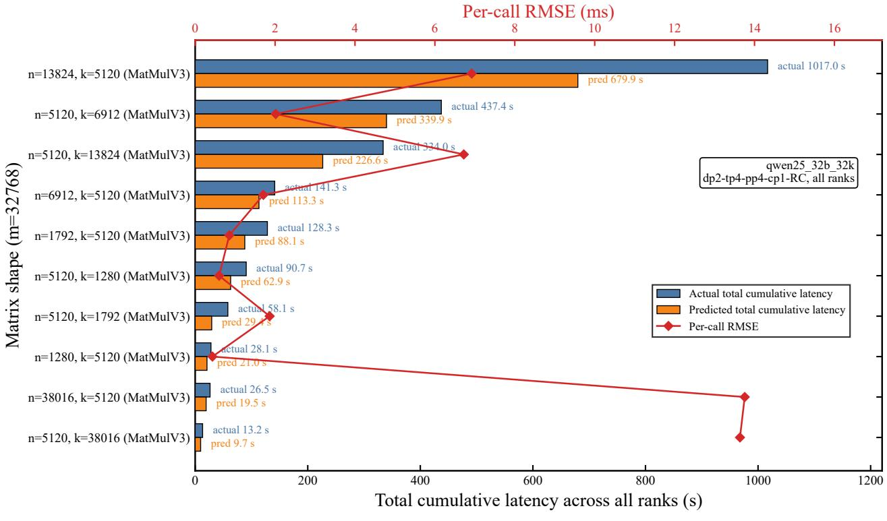  
(a) dp2-tp4-pp4-cp1-RC.

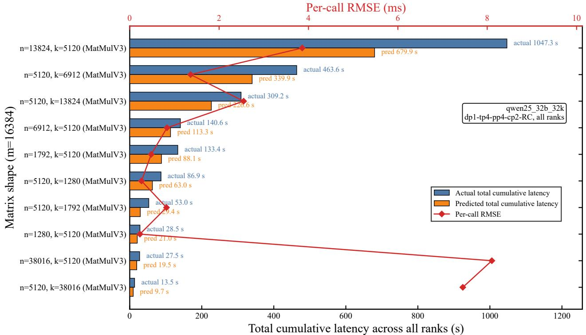  
(b) dp1-tp4-pp4-cp2-RC.  
Figure 13. Matrix-latency predictions for Qwen2.5-32B (32K tokens) under four parallel configurations. Bars compare measured and predicted cumulative latency across ranks for dominant shapes; the red curve shows per-call RMSE for each shape.

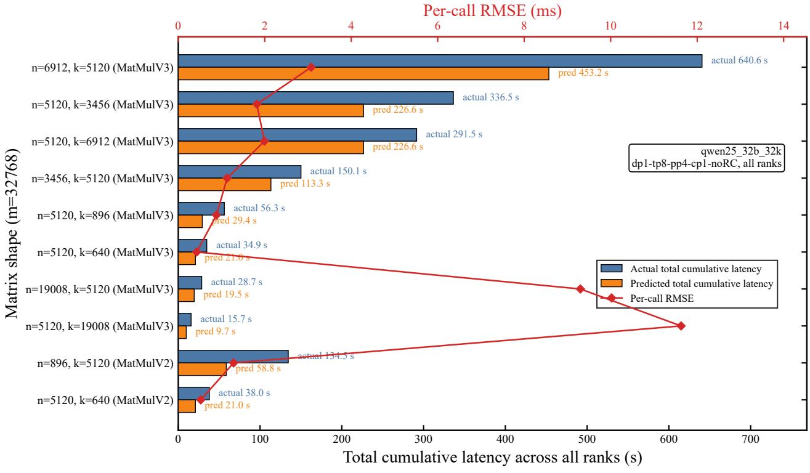  
(c) dp1-tp8-pp4-cp1-noRC.

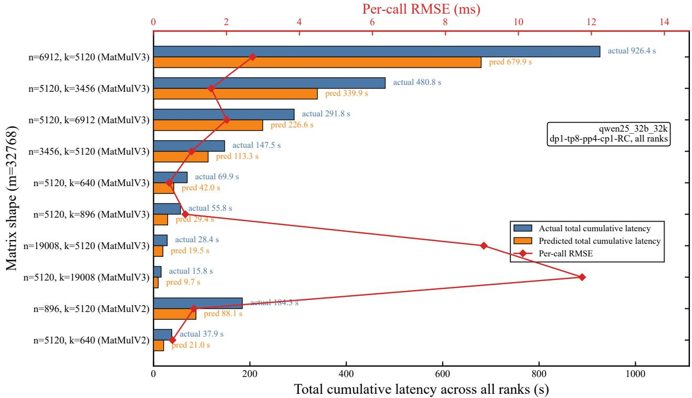  
(d) dp1-tp8-pp4-cp1-RC.  
Figure 13. Matrix-latency predictions for Qwen2.5-32B (32K tokens) under four parallel configurations. Bars compare measured and predicted cumulative latency across ranks for dominant shapes; the red curve shows per-call RMSE for each shape.

## E.3. Qwen1.5-1.8B Matrix-Operator Errors

Tables 19 and 20 expand the aggregate matrix-operator metrics in Table 17 for Qwen1.5-1.8B (8K tokens). Grouping by parallel configuration shows how estimation quality varies with the training strategy; grouping by matrix dimensions identifies the operator shapes associated with those errors. Together, the two tables support examining a computation estimator at both configuration and kernel granularity.

Table 19. Matrix-operator prediction metrics by parallel configuration for Qwen1.5-1.8B (8K tokens). Configurations continue from the left panel to the right.
<table><tr><td>Parallel configuration</td><td>MAE (ms)</td><td>sMAPE (%)</td><td> $R ^ { 2 }$ </td><td>Parallel configuration</td><td>MAE (ms)</td><td>sMAPE (%)</td><td> $R ^ { 2 }$ </td></tr><tr><td>dp1-tp1-pp1-cp8-RC</td><td>0.048</td><td>40.505</td><td>0.779</td><td>dp2-tp1-pp1-cp4-RC</td><td>0.072</td><td>36.826</td><td>0.864</td></tr><tr><td>dp1-tp1-pp1-cp8-noRC</td><td>0.053</td><td>42.190</td><td>0.778</td><td>dp2-tp1-pp1-cp4-noRC</td><td>0.076</td><td>38.311</td><td>0.873</td></tr><tr><td>dp1-tp1-pp2-cp4-RC</td><td>0.072</td><td>36.794</td><td>0.865</td><td>dp2-tp1-pp2-cp2-RC</td><td>0.120</td><td>30.403</td><td>0.890</td></tr><tr><td>dp1-tp1-pp2-cp4-noRC</td><td>0.076</td><td>38.126</td><td>0.874</td><td>dp2-tp1-pp2-cp2-noRC</td><td>0.127</td><td>31.581</td><td>0.897</td></tr><tr><td>dp1-tp1-pp4-cp2-RC</td><td>0.119</td><td>30.313</td><td>0.889</td><td>dp2-tp1-pp4-cp1-RC</td><td>0.252</td><td>31.580</td><td>0.874</td></tr><tr><td>dp1-tp1-pp4-cp2-noRC</td><td>0.128</td><td>31.596</td><td>0.895</td><td>dp2-tp1-pp4-cp1-noRC</td><td>0.268</td><td>32.662</td><td>0.880</td></tr><tr><td>dp1-tp1-pp8-cp1-RC</td><td>0.251</td><td>31.436</td><td>0.875</td><td>dp2-tp2-pp1-cp2-RC</td><td>0.101</td><td>45.635</td><td>0.758</td></tr><tr><td>dp1-tp1-pp8-cp1-noRC</td><td>0.267</td><td>32.491</td><td>0.881</td><td>dp2-tp2-pp1-cp2-noRC</td><td>0.118</td><td>50.418</td><td>0.748</td></tr><tr><td>dp1-tp2-pp1-cp4-RC</td><td>0.056</td><td>42.201</td><td>0.725</td><td>dp2-tp2-pp2-cp1-RC</td><td>0.203</td><td>42.782</td><td>0.741</td></tr><tr><td>dp1-tp2-pp1-cp4-noRC</td><td>0.061</td><td>45.811</td><td>0.741</td><td>dp2-tp2-pp2-cp1-noRC</td><td>0.245</td><td>48.749</td><td>0.722</td></tr><tr><td>dp1-tp2-pp2-cp2-RC</td><td>0.093</td><td>43.991</td><td>0.792</td><td>dp2-tp4-pp1-cp1-RC</td><td>0.117</td><td>43.081</td><td>0.696</td></tr><tr><td>dp1-tp2-pp2-cp2-noRC</td><td>0.113</td><td>49.147</td><td>0.769</td><td>dp2-tp4-pp1-cp1-noRC</td><td>0.141</td><td>47.530</td><td>0.690</td></tr><tr><td>dp1-tp2-pp4-cp1-RC</td><td>0.203</td><td>42.833</td><td>0.741</td><td>dp4-tp1-pp1-cp2-RC</td><td>0.120</td><td>30.453</td><td>0.888</td></tr><tr><td>dp1-tp2-pp4-cp1-noRC</td><td>0.245</td><td>48.783</td><td>0.721</td><td>dp4-tp1-pp1-cp2-noRC</td><td>0.127</td><td>31.512</td><td>0.894</td></tr><tr><td>dp1-tp4-pp1-cp2-RC</td><td>0.060</td><td>39.834</td><td>0.731</td><td>dp4-tp1-pp2-cp1-RC</td><td>0.262</td><td>32.662</td><td>0.869</td></tr><tr><td>dp1-tp4-pp1-cp2-noRC</td><td>0.069</td><td>43.331</td><td>0.731</td><td>dp4-tp1-pp2-cp1-noRC</td><td>0.271</td><td>32.963</td><td>0.879</td></tr><tr><td>dp1-tp4-pp2-cp1-RC</td><td>0.112</td><td>41.730</td><td>0.700</td><td>dp4-tp2-pp1-cp1-RC</td><td>0.210</td><td>43.702</td><td>0.727</td></tr><tr><td>dp1-tp4-pp2-cp1-noRC</td><td>0.144</td><td>48.204</td><td>0.690</td><td>dp4-tp2-pp1-cp1-noRC</td><td>0.245</td><td>48.707</td><td>0.721</td></tr><tr><td>dp1-tp8-pp1-cp1-RC</td><td>0.107</td><td>60.527 61.202</td><td>0.608 0.655</td><td>dp8-tp1-pp1-cp1-RC</td><td>0.279</td><td>34.472</td><td>0.859</td></tr><tr><td>dp1-tp8-pp1-cp1-noRC</td><td>0.109</td><td></td><td></td><td>dp8-tp1-pp1-cp1-noRC</td><td>0.292</td><td>34.973</td><td>0.859</td></tr></table>

Table 20. Matrix-operator prediction metrics by matrix dimensions for Qwen1.5-1.8B (8K tokens). Shapes continue from the left panel to the right.
<table><tr><td>m</td><td>n</td><td>k</td><td>MAE (ms)</td><td>sMAPE (%)</td><td>m</td><td>n</td><td>k</td><td>MAE (ms)</td><td>sMAPE (%)</td></tr><tr><td>1024</td><td>2048</td><td>2048</td><td>0.011</td><td>24.151</td><td>4096</td><td>3072</td><td>2048</td><td>0.078</td><td>38.374</td></tr><tr><td>1024</td><td>2048</td><td>5504</td><td>0.056</td><td>55.184</td><td>4096</td><td>5504</td><td>2048</td><td>0.114</td><td>32.488</td></tr><tr><td>1024</td><td>2048</td><td>6144</td><td>0.068</td><td>58.875</td><td>4096</td><td>6144</td><td>2048</td><td>0.108</td><td>28.405</td></tr><tr><td>1024</td><td>2048</td><td>11008</td><td>0.089</td><td>46.131</td><td>4096</td><td>11008</td><td>2048</td><td>0.193</td><td>29.637</td></tr><tr><td>1024</td><td>5504</td><td>2048</td><td>0.046</td><td>47.035</td><td>4096</td><td>37984</td><td>2048</td><td>1.271</td><td>48.828</td></tr><tr><td>1024</td><td>6144</td><td>2048</td><td>0.048</td><td>45.422</td><td>4096</td><td>75968</td><td>2048</td><td>1.350</td><td>30.161</td></tr><tr><td>1024</td><td>11008</td><td>2048</td><td>0.064</td><td>35.649</td><td>4096</td><td>151936</td><td>2048</td><td>2.326</td><td>26.538</td></tr><tr><td>1024</td><td>151936</td><td>2048</td><td>0.968</td><td>40.604</td><td>8192</td><td>256</td><td>2048</td><td>0.018</td><td>36.910</td></tr><tr><td>2048</td><td>1024</td><td>2048</td><td>0.009</td><td>19.450</td><td>8192</td><td>512</td><td>2048</td><td>0.032</td><td>45.419</td></tr><tr><td>2048</td><td>2048</td><td>1024</td><td>0.002</td><td>4.102</td><td>8192</td><td>688</td><td>2048</td><td>0.191</td><td>113.572</td></tr><tr><td>2048</td><td>2048</td><td>2048</td><td>0.031</td><td>44.121</td><td>8192</td><td>768</td><td>2048</td><td>0.078</td><td>64.092</td></tr><tr><td>2048</td><td>2048</td><td>2752</td><td>0.077</td><td>68.929</td><td>8192</td><td>1024</td><td>2048</td><td>0.042</td><td>32.793</td></tr><tr><td>2048</td><td>2048</td><td>3072</td><td>0.082</td><td>63.776</td><td>8192</td><td>1376</td><td>2048</td><td>0.091</td><td>47.508</td></tr><tr><td>2048</td><td>2048</td><td>5504</td><td>0.096</td><td>48.069</td><td>8192</td><td>1536</td><td>2048</td><td>0.078</td><td>38.603</td></tr><tr><td>2048</td><td>2048</td><td>6144</td><td>0.075</td><td>37.723</td><td>8192</td><td>2048</td><td>256</td><td>0.009</td><td>20.407</td></tr><tr><td>2048</td><td>2048</td><td>11008</td><td>0.153</td><td>41.648</td><td>8192</td><td>2048</td><td>512</td><td>0.030</td><td>43.394</td></tr><tr><td>2048</td><td>2752</td><td>2048</td><td>0.062</td><td>59.668</td><td>8192</td><td>2048</td><td>688</td><td>0.234</td><td>120.810</td></tr><tr><td>2048</td><td>3072</td><td>2048</td><td>0.050</td><td>47.278</td><td>8192</td><td>2048</td><td>768</td><td>0.032</td><td>33.151</td></tr><tr><td>2048</td><td>5504</td><td>2048</td><td>0.070</td><td>38.430</td><td>8192</td><td>2048</td><td>1024</td><td>0.062</td><td>42.996</td></tr><tr><td>2048</td><td>6144</td><td>2048</td><td>0.073</td><td>36.576</td><td>8192</td><td>2048</td><td>1376</td><td>0.092</td><td>47.680</td></tr><tr><td>2048</td><td>11008</td><td>2048</td><td>0.093</td><td>27.610</td><td>8192</td><td>2048</td><td>1536</td><td>0.121</td><td>48.883</td></tr><tr><td>2048</td><td>75968</td><td>2048</td><td>0.736</td><td>32.456</td><td>8192</td><td>2048</td><td>2048</td><td>0.074</td><td>28.819</td></tr><tr><td>2048</td><td>151936</td><td>2048</td><td>1.269</td><td>28.616</td><td>8192</td><td>2048</td><td>2752</td><td>0.177</td><td>45.856</td></tr><tr><td>4096</td><td>512</td><td>2048</td><td>0.009</td><td>20.546</td><td>8192</td><td>2048</td><td>3072</td><td>0.545</td><td>88.956</td></tr><tr><td>4096</td><td>1024</td><td>2048</td><td>0.035</td><td>48.722</td><td>8192</td><td>2048</td><td>5504</td><td>0.435</td><td>54.585</td></tr><tr><td>4096</td><td>1376</td><td>2048</td><td>0.066</td><td>62.631</td><td>8192</td><td>2048</td><td>6144</td><td>0.189</td><td>26.503</td></tr><tr><td>4096</td><td>1536</td><td>2048</td><td>0.047</td><td>44.944</td><td>8192</td><td>2048</td><td>11008</td><td>0.387</td><td>29.873</td></tr><tr><td>4096</td><td>2048</td><td>512</td><td>0.005</td><td>12.478</td><td>8192</td><td>2048</td><td>18992</td><td>1.663</td><td>60.863</td></tr><tr><td>4096</td><td>2048</td><td>1024</td><td>0.039</td><td>51.339</td><td>8192</td><td>2048</td><td>37984</td><td>5.344</td><td>82.560</td></tr><tr><td>4096</td><td>2048</td><td>1376</td><td>0.065</td><td>61.595</td><td>8192</td><td>2752</td><td>2048</td><td>0.139</td><td>38.224</td></tr><tr><td>4096</td><td>2048</td><td>1536</td><td>0.038</td><td>37.719</td><td>8192</td><td>3072</td><td>2048</td><td>0.137</td><td>34.575</td></tr><tr><td>4096</td><td>2048</td><td>2048</td><td>0.044</td><td>33.438</td><td>8192</td><td>5504</td><td>2048</td><td>0.268</td><td>38.426</td></tr><tr><td>4096</td><td>2048</td><td>2752</td><td>0.099</td><td>50.468</td><td>8192</td><td>6144</td><td>2048</td><td>0.259</td><td>34.041</td></tr><tr><td>4096</td><td>2048</td><td>3072</td><td>0.192</td><td>68.259</td><td>8192</td><td>11008</td><td>2048</td><td>0.440</td><td>32.862</td></tr><tr><td>4096</td><td>2048</td><td>5504</td><td>0.170</td><td>43.264</td><td>8192</td><td>18992</td><td>2048</td><td>1.423</td><td>53.131</td></tr><tr><td>4096</td><td>2048</td><td>6144</td><td>0.079</td><td>21.620</td><td>8192</td><td>37984</td><td>2048</td><td>2.795</td><td>52.109</td></tr><tr><td>4096</td><td>2048</td><td>11008</td><td>0.263</td><td>38.596</td><td>8192</td><td>75968</td><td>2048</td><td>2.778</td><td>30.899</td></tr><tr><td>4096</td><td>2048</td><td>37984</td><td>2.144</td><td>72.136</td><td>8192</td><td>151936</td><td>2048</td><td>5.433</td><td>30.293</td></tr><tr><td>4096</td><td>2752</td><td>2048</td><td>0.081</td><td>43.180</td><td></td><td></td><td></td><td></td><td></td></tr></table>

## F. Cross-Platform Evaluation

This section expands the platform-calibration and configuration-selection results in Sections 6.3 and 6.4. Paired V100/910B3 profiles support two uses of LM-SimBench: calibrating a common simulator on each platform and using NPU measurements to select promising GPU configurations. Detailed time, memory, and component records connect these uses to the execution characteristics of the two stacks.

## F.1. Experimental Setup and Coverage

We collect new paired measurements on 8×V100 (32 GiB per device) and 8×910B3 (64 GiB) for Qwen3-0.6B and Qwen3-1.7B at a training sequence length of 4K tokens. Each model uses the same 18 DP/TP/PP/recomputation candidates on both stacks, matching the CP=1 subset of its 38 configurations in the primary release. The NPU reference in this experiment was collected separately from that release. Both stacks use a distributed optimizer and profile the sixth iteration after five warm-up steps. The supplementary data directories use the suffix \_tp\_pp\_sweep\_cp1\_npu for NPU runs and \_tp\_pp\_sweep\_cp1\_gpu under processed\_gpu/ for GPU runs, prefixed by the workload name.

Table 21 lists the matched workload settings and the platform-specific precision, fusion, sequence-parallel, and profiler settings. Ascend-specific AICore/MTE/cube and HCCS/RDMA/SDMA fields are left empty in GPU records. Driver, CUDA/CANN, PyTorch, collective-library, and framework revisions are recorded in the artifact’s environment metadata.

Complete GPU profiles are available for 15 of 18 candidates for Qwen3-0.6B and 12 of 18 for Qwen3-1.7B; the NPU side is complete for 18 and 16 candidates, respectively. Paired statistics therefore use 15 and 11 same-named configurations with complete profiles on both stacks, 26 pairs in total. Table 22 lists every candidate that is not complete on both stacks. Empty GPU profile directories are marked missing\_ $\_ { \_ } { \bigcirc } \mathtt { r \_ i }$ ncomplete in the manifest; their failure causes are unknown. Table 23 summarizes the paired comparisons.

## F.2. Simulator Calibration across Platforms

Calculon provides a concrete application of the profiling data to simulator calibration and evaluation. We use a common modeling implementation on both platforms, calibrate its platform parameters against the corresponding profiles, and compare its time, memory, and ranking outputs with the measured targets. The implementation includes Qwen3 architecture and memory accounting, kernel launch latency, pipeline scheduling, and rank-level memory output. Each platform uses one parameter set for compute efficiency, launch latency, communication, and runtime memory across both models and the full candidate grid. Simulation outputs are stored under calculon/outputs/qwen3\_sweeps\_final/.

Table 24 expands Table 6 with rank-level memory errors. On the platform-calibration configurations, iterationtime MAPE is 7.97%–11.22% and time-ranking ρ is 0.853– 0.950; rank-level peak-memory MAPE is 12.55%–15.99% and configuration-level peak-memory ranking ρ is 0.986– 0.994. Across the four model×recomputation settings, GPU measurement, NPU measurement, Calculon-GPU, and Calculon-NPU select the same Top-1 configuration (4/4).

## F.3. NPU-Guided GPU Configuration Selection

NPU measurements provide a shortlist for GPU configuration selection, following the procedure in Section 5.4. For each model, we retrospectively rank the paired-complete candidates by measured NPU iteration time, retain the fastest three, and identify the fastest GPU configuration within that shortlist using its measured GPU time. The comparison target is the fastest GPU configuration over the entire paired candidate set. Top-1 selection regret and Top-3 shortlist regret measure the GPU runtime penalty relative to this optimum when selecting the NPU-fastest candidate or the GPU-fastest member of the NPU-derived top-three shortlist, respectively (Eq. 7). The values are recomputed from the rounded times in Table 27. In both workloads the NPUderived shortlist contains this GPU optimum, giving zero shortlist selection regret (Table 25). The candidate counts decrease from 15 to 3 and from 11 to 3, respectively.

Pooled over both recomputation settings, iteration-time rank agreement between the two stacks is moderate $( \rho =$ 0.718 and 0.664, $\tau _ { b } = 0 . 5 6 2$ and 0.491 for the two models). Directly choosing the NPU-fastest configuration finds the GPU optimum for Qwen3-0.6B and incurs a 6.9% GPU runtime penalty for Qwen3-1.7B. Table 26 additionally compares configurations with recomputation fixed: within each of the four model×recomputation strata, the two stacks select the same Top-1 configuration. This conditional agreement and the pooled shortlist results show how NPU observations can narrow GPU search even when the complete rankings differ.

Table 27 reports the per-configuration iteration times, with ranks computed over all paired configurations within each model, pooling RC and noRC. A leave-oneconfiguration-out diagnostic fits a median GPU/NPU time ratio on the other paired configurations and applies it to the held-out NPU time. It yields 22.4% and 22.9% sMAPE with $R ^ { 2 } = - 8 . 3 3$ and −4.74, respectively, showing that the runtime difference varies with configuration.

## F.4. Memory and Recomputation

Configuration-level peak memory is the maximum across ranks, matching the memory-ranking task in Section 5. Its ordering is strongly aligned across platforms: rank correlation is $\rho = 0 . 9 8 2$ and 0.991 $( \tau _ { b } = 0 . 9 2 4$ and 0.964), and the three lowest-memory configurations coincide on both stacks for both models. The median GPU/NPU memory ratios are 0.77 and 0.70. Table 28 lists the per-configuration peak memory.

Table 21. Matched workload settings and platform-specific choices in the cross-platform experiment.
<table><tr><td>Aspect</td><td>Setting</td></tr><tr><td>Matched</td><td>Model architecture, layer counts, hidden size, attention heads, and grouped-query attention; sequence length 4096; micro/global batch 1/32; eight devices;  $\mathrm { C P = 1 ; }$  candidate configuration names; optimizer</td></tr><tr><td>Stack-specific</td><td>hyperparameters and seed; profiled iteration index.</td></tr><tr><td></td><td>Data type (FP16 on V100 vs. BF16 on 910B3); fused kernels (FlashAttention and fused RoPE/SwiGLU/RMSNorm disabled in the GPU sweep, enabled on the Ascend stack); sequence par- allelism (enabled on the NPU side); profiler-visible hardware counters and communication-link fields;</td></tr></table>

Table 22. Candidates with missing or incomplete profiles on either stack, excluded from paired comparisons.
<table><tr><td>Model</td><td>Configuration</td><td>GPU status</td><td>NPU status</td></tr><tr><td>Qwen3-0.6B</td><td> $\mathtt { d p 2 - t p 1 - p p 4 - c p 1 - n o R C }$ </td><td>Missing/incomplete (empty directory)</td><td>Complete</td></tr><tr><td>Qwen3-0.6B</td><td> $\mathtt { d p 4 - t p 1 - p p 2 - c p 1 - n o R C }$ </td><td>Missing/incomplete (empty directory)</td><td>Complete</td></tr><tr><td>Qwen3-0.6B</td><td> $\mathtt { d p 8 - t p 1 - p p 1 - c p 1 - n o R C }$ </td><td>Missing/incomplete (empty directory)</td><td>Complete</td></tr><tr><td>Qwen3-1.7B</td><td> $\mathtt { d p 1 - t p 2 - p p 4 - c p 1 - n o R C }$ </td><td>Missing/incomplete (empty directory)</td><td>Complete</td></tr><tr><td>Qwen3-1.7B</td><td> $\mathtt { d p 2 - t p 1 - p p 4 - c p 1 - n o R C }$ </td><td>Missing/incomplete (empty directory)</td><td>Complete</td></tr><tr><td>Qwen3-1.7B</td><td> $\mathtt { d p 2 - t p 2 - p p 2 - c p 1 - n o R C }$ </td><td>Missing/incomplete (empty directory)</td><td>Complete</td></tr><tr><td>Qwen3-1.7B</td><td> $\mathrm { d p 4 - t p 1 - p p 2 - c p 1 - R C }$ </td><td>Complete</td><td>Missing</td></tr><tr><td>Qwen3-1.7B</td><td> $\mathtt { d p 4 - t p 1 - p p 2 - c p 1 - n o R C }$ </td><td>Missing/incomplete (empty directory)</td><td>Missing</td></tr><tr><td>Qwen3-1.7B</td><td> $\mathtt { d p 4 - t p 2 - p p 1 - c p 1 - n o R C }$ </td><td>Missing/incomplete (empty directory)</td><td>Complete</td></tr><tr><td>Qwen3-1.7B</td><td> $\mathtt { d p 8 - t p 1 - p p 1 - c p 1 - n o R C }$ </td><td>Missing/incomplete (empty directory)</td><td>Complete</td></tr></table>

Table 23. Cross-platform agreement in configuration rankings, memory behavior, and operator performance between V100 GPUs and Ascend 910B3 NPUs. ∗Three paired configurations.
<table><tr><td>Level</td><td>Metric</td><td>Qwen3-0.6B</td><td>Qwen3-1.7B</td></tr><tr><td>Coverage</td><td>Paired complete configurations</td><td>15</td><td>11</td></tr><tr><td rowspan="2">Strategy</td><td>Iteration rank  $\rho / \tau _ { b } ,$  pooled</td><td>0.718 / 0.562</td><td>0.664 / 0.491</td></tr><tr><td>Iteration rank  $\rho , \mathrm { n o R C } / \mathrm { R C }$ </td><td>0.714 / 0.683</td><td>1.000* / 0.690</td></tr><tr><td rowspan="3">System</td><td>Peak-memory rank  $\rho / \tau _ { b }$ </td><td>0.982 / 0.924</td><td>0.991 / 0.964</td></tr><tr><td>Lowest-memory Top-3 overlap</td><td>3/3</td><td>3/3</td></tr><tr><td>RC time/memory direction agreement</td><td>6/6</td><td>3/3</td></tr><tr><td rowspan="4">Component</td><td>Matrix median-latency  $\rho / \tau _ { b }$ </td><td>0.983 / 0.892</td><td>0.987 / 0.909</td></tr><tr><td>Slowest matrix-problem Top-10 overlap</td><td>8/10</td><td>10/10</td></tr><tr><td>Operator-category median ρ / JSD</td><td>0.503 / 0.436</td><td>0.531 / 0.356</td></tr><tr><td>Communication-primitive median  $\rho / \mathrm { J S D }$ </td><td>0.949 / 0.019</td><td>0.872 / 0.035</td></tr><tr><td></td><td>Non-overlapped comm. share, GPU / NPU</td><td>17.0% / 28.5%</td><td>10.9% / 30.0%</td></tr></table>

This agreement also holds when recomputation is fixed: the RC/noRC peak-memory rank correlations are 0.983/0.943 for Qwen3-0.6B and 0.976/1.000 for Qwen3- 1.7B (the latter noRC subset contains three candidates). The agreement across these subsets supports using NPU profiles to identify relatively memory-efficient GPU strategies under either recomputation setting.

Recomputation behaves consistently across stacks. Across six matched base configurations for Qwen3-0.6B and three for Qwen3-1.7B, enabling recomputation increases iteration time and decreases peak memory in the same direction in every pair (100% directional agreement). The median time overhead is 32.9% (GPU) versus 44.0% (NPU) for the smaller model and 32.6% versus 38.8% for the larger one; the median memory saving is 85.6% versus 77.2% and 77.5% versus 69.7%, respectively.

Table 24. Calculon time, memory, and ranking accuracy on the configurations used for platform-specific calibration.
<table><tr><td>Model</td><td>Platform</td><td>Time MAPE (%)</td><td>Time  $\rho$ </td><td>Rank-mem. MAPE (%)</td><td>Config-mem.  $\rho$ </td></tr><tr><td>Qwen3-0.6B</td><td>V100</td><td>10.28</td><td>0.861</td><td>15.99</td><td>0.993</td></tr><tr><td>Qwen3-0.6B</td><td>910B3</td><td>10.19</td><td>0.950</td><td>13.20</td><td>0.986</td></tr><tr><td>Qwen3-1.7B</td><td>V100</td><td>11.22</td><td>0.853</td><td>12.56</td><td>0.993</td></tr><tr><td>Qwen3-1.7B</td><td>910B3</td><td>7.97</td><td>0.935</td><td>12.55</td><td>0.994</td></tr></table>

Table 25. GPU configuration selection using NPU-derived rankings and top-three shortlists.
<table><tr><td>Model</td><td>Paired candidates</td><td>Top-1 regret</td><td>GPU optimum in Top-3</td><td>Top-3 regret</td></tr><tr><td>Qwen3-0.6B</td><td>15</td><td>0.0%</td><td>Yes</td><td>0.0%</td></tr><tr><td>Qwen3-1.7B</td><td>11</td><td>6.9%</td><td>Yes</td><td>0.0%</td></tr></table>

Table 26. Cross-platform iteration-time rank agreement by recomputation setting.
<table><tr><td>Model</td><td>Stratum</td><td>n</td><td> $\rho$ </td><td> $\tau _ { b }$ </td><td>Top-3</td><td>Top-1 agreement</td></tr><tr><td>Qwen3-0.6B</td><td>all</td><td>15</td><td>0.718</td><td>0.562</td><td>2/3</td><td>yes</td></tr><tr><td>Qwen3-0.6B</td><td>noRC</td><td>6</td><td>0.714</td><td>0.600</td><td>2/3</td><td>yes</td></tr><tr><td>Qwen3-0.6B</td><td>RC</td><td>9</td><td>0.683</td><td>0.556</td><td>2/3</td><td>yes</td></tr><tr><td>Qwen3-1.7B</td><td>all</td><td>11</td><td>0.664</td><td>0.491</td><td>2/3</td><td>no</td></tr><tr><td>Qwen3-1.7B</td><td>noRC</td><td>3</td><td>1.000</td><td>1.000</td><td>3/3</td><td>yes</td></tr><tr><td>Qwen3-1.7B</td><td>RC</td><td>8</td><td>0.690</td><td>0.571</td><td>2/3</td><td>yes</td></tr></table>

## F.5. Operator and Communication Behavior

Matrix-problem latency. Matrix operators are matched by batch size, dimensions $( m , n , k )$ , and recorded inputdata-type labels. Type labels are normalized for capitalization, quotation marks, and whitespace before matching. Per-call latencies are aggregated across all paired configurations and all eight ranks to obtain a median for each problem on each stack. Each model has 27 shared problem types, and those types account for 72.8% and 76.7% of GPU matrix calls. Ranking the shared problems by median latency gives $\rho = 0 . 9 8 3$ and 0.987 $( \tau _ { b } = 0 . 8 9 2$ and 0.909), with slowest-shape Top-10 overlap of 8/10 and 10/10. The relative latency ordering of the shared matrix problems is therefore preserved, whereas absolute speed differs by a median factor of 2.79 and 2.84 (Table 29).

Operator and communication composition. For each paired configuration, durations are summed across ranks by operator category or canonical communication primitive. Primitive names are normalized, with send/receive variants grouped as point-to-point communication. Vectors are aligned over the union of categories, filling absent entries with zero, and normalized separately for operators and communication. Spearman correlation and JSD are computed per configuration and summarized by their medians.

Communication-primitive time shares have median rank correlations of 0.949 and 0.872 and median JSD of 0.019 and 0.035; the dominant primitive matches in 86.7% and 72.7% of configurations. Operator-category correlations are 0.503 and 0.531, with median JSD of 0.436 and 0.356. Table 30 reports time shares pooled over the paired configurations within each model and stack. The category breakdown makes the implementation differences visible: on 910B3, other and shape\_transform account for a large share of device time, while attention is a separate category only on the GPU stack. These categories follow each profiler’s classification and reflect each stack’s kernel composition.

Communication overlap. Non-overlapped communication share is computed per rank as non-overlapped communication time divided by stage time. Rank-level shares are summarized by their median within each configuration, followed by the median over paired configurations. The median non-overlapped communication share is 17.0% and 10.9% on V100 versus 28.5% and 30.0% on 910B3, and the per-configuration correlation of this share across stacks is only $\rho = 0 . 1 7 9$ and 0.364. Communication primitive ordering is more consistent across stacks than the degree of communication overlap.

Table 27. GPU and NPU iteration times by configuration, ordered by GPU runtime within each model.
<table><tr><td>Configuration</td><td>GPU (s)</td><td>NPU (s)</td><td>GPU/NPU</td><td>GPU rank</td><td>NPU rank</td></tr><tr><td>Qwen3-0.6B</td><td></td><td></td><td></td><td></td><td></td></tr><tr><td> $\mathtt { d p 4 - t p 2 - p p 1 - c p 1 - n o R C }$ </td><td>6.40</td><td>3.93</td><td>1.63</td><td>1</td><td>1</td></tr><tr><td> $\mathtt { d p 2 - t p 4 - p p 1 - c p 1 - n o R C }$ </td><td>6.69</td><td>6.11</td><td>1.09</td><td>2</td><td>7</td></tr><tr><td> $\mathtt { d p 2 - t p 2 - p p 2 - c p 1 - n o R C }$ </td><td>7.20</td><td>4.48</td><td>1.61</td><td>3</td><td>2</td></tr><tr><td> $\mathtt { d p 1 - t p 4 - p p 2 - c p 1 - n o R C }$ </td><td>7.33</td><td>6.74</td><td>1.09</td><td>4</td><td>10</td></tr><tr><td> $\mathrm { d p 8 - t p 1 - p p 1 - c p 1 - R C }$ </td><td>7.53</td><td>4.69</td><td>1.61</td><td>5</td><td>3</td></tr><tr><td> $\mathtt { d p 1 - t p 2 - p p 4 - c p 1 - n o R C }$ </td><td>8.28</td><td>5.10</td><td>1.62</td><td>6</td><td>4</td></tr><tr><td> $\mathrm { d p 4 - t p 2 - p p 1 - c p 1 - R C }$ </td><td>8.60</td><td>5.63</td><td>1.53</td><td>7</td><td>6</td></tr><tr><td> $\mathrm { d p 2 - t p 4 - p p 1 - c p 1 - R C }$ </td><td>8.93</td><td>9.48</td><td>0.94</td><td>8</td><td>12</td></tr><tr><td> $\mathrm { d } \mathsf { p } 4 - \mathrm { t } \mathsf { p } 1 - \mathsf { p } \mathsf { p } 2 - \mathsf { c } \mathsf { p } 1 - \mathsf { R C }$ </td><td>8.95</td><td>5.50</td><td>1.63</td><td>9</td><td>5</td></tr><tr><td> $\mathtt { d p 1 - t p 8 - p p 1 - c p 1 - n o R C }$ </td><td>9.06</td><td>11.39</td><td>0.80</td><td>10</td><td>14</td></tr><tr><td> $\mathrm { d } { \mathsf { p } } 2 { \mathsf { - t p } } 2 { \mathsf { - p p } } 2 { \mathsf { - c p } } 1 { \mathsf { - R C } }$ </td><td>9.46</td><td>6.27</td><td>1.51</td><td>11</td><td>9</td></tr><tr><td> $\mathrm { d p 1 - t p 4 - p p 2 - c p 1 - R C }$ </td><td>9.69</td><td>9.75</td><td>0.99</td><td>12</td><td>13</td></tr><tr><td>dp2-tp1-pp4-cp1-RC</td><td>10.25</td><td>6.25</td><td>1.64</td><td>13</td><td>8</td></tr><tr><td> $\mathrm { d p 1 - t p 2 - p p 4 - c p 1 - R C }$ </td><td>10.65</td><td>6.98</td><td>1.53</td><td>14</td><td>11</td></tr><tr><td> $\mathrm { d p 1 - t p 8 - p p 1 - c p 1 - R C }$ </td><td>12.86</td><td>18.36</td><td>0.70</td><td>15</td><td>15</td></tr><tr><td>Qwen3-1.7B</td><td></td><td></td><td></td><td></td><td></td></tr><tr><td> $\mathtt { d p 2 - t p 4 - p p 1 - c p 1 - n o R C }$ </td><td>8.85</td><td>6.42</td><td>1.38</td><td>1</td><td>2</td></tr><tr><td> $\mathrm { d p 8 - t p 1 - p p 1 - c p 1 - R C }$ </td><td>9.46</td><td>5.49</td><td>1.73</td><td>2</td><td>1</td></tr><tr><td> $\mathtt { d p 1 - t p 4 - p p 2 - c p 1 - n o R C }$ </td><td>9.82</td><td>7.43</td><td>1.32</td><td>3</td><td>4</td></tr><tr><td> $\mathtt { d p 1 - t p 8 - p p 1 - c p 1 - n o R C }$ </td><td>10.75</td><td>12.09</td><td>0.89</td><td>4</td><td>10</td></tr><tr><td> $\mathrm { d p 4 - t p 2 - p p 1 - c p 1 - R C }$ </td><td>11.20</td><td>7.04</td><td>1.59</td><td>5</td><td>3</td></tr><tr><td> $\mathrm { d p 2 - t p 4 - p p 1 - c p 1 - R C }$ </td><td>11.74</td><td>9.26</td><td>1.27</td><td>6</td><td>8</td></tr><tr><td> $\mathrm { d } { \mathsf { p } } 2 { \mathsf { - t p } } 2 { \mathsf { - p p } } 2 { \mathsf { - c p } } 1 { \mathsf { - R C } }$ </td><td>12.34</td><td>7.83</td><td>1.58</td><td>7</td><td>6</td></tr><tr><td> $\mathrm { d p 1 - t p 4 - p p 2 - c p 1 - R C }$ </td><td>12.82</td><td>10.14</td><td>1.26</td><td>8</td><td>9</td></tr><tr><td> $\mathrm { d } \mathsf { p } 2 \mathrm { - t } \mathsf { p } 1 \mathrm { - p } \mathsf { p } 4 \mathrm { - c } \mathsf { p } 1 \mathrm { - R C }$ </td><td>13.28</td><td>7.46</td><td>1.78</td><td>9</td><td>5</td></tr><tr><td> $\mathrm { d p 1 - t p 2 - p p 4 - c p 1 - R C }$ </td><td>14.10</td><td>8.69</td><td>1.62</td><td>10</td><td>7</td></tr><tr><td> $\mathrm { d p 1 - t p 8 - p p 1 - c p 1 - R C }$ </td><td>14.28</td><td>16.78</td><td>0.85</td><td>11</td><td>11</td></tr></table>

Table 28. GPU and NPU peak memory by configuration, measured as the maximum across ranks.
<table><tr><td>Configuration</td><td>GPU (GiB)</td><td>NPU (GiB)</td><td>GPU/NPU</td><td>GPU rank</td><td>NPU rank</td></tr><tr><td>Qwen3-0.6B</td><td></td><td></td><td></td><td></td><td></td></tr><tr><td> $\mathrm { d p 1 - t p 8 - p p 1 - c p 1 - R C }$ </td><td>1.47</td><td>2.18</td><td>0.67</td><td>1</td><td>1</td></tr><tr><td> $\mathrm { d p 1 - t p 4 - p p 2 - c p 1 - R C }$ </td><td>2.18</td><td>3.16</td><td>0.69</td><td>2</td><td>2</td></tr><tr><td>dp2-tp4-pp1-cp1-RC</td><td>2.37</td><td>3.25</td><td>0.73</td><td>3</td><td>3</td></tr><tr><td>dp1-tp2-pp4-cp1-RC</td><td>3.64</td><td>5.26</td><td>0.69</td><td>4</td><td>5</td></tr><tr><td>dp2-tp2-pp2-cp1-RC</td><td>3.67</td><td>5.09</td><td>0.72</td><td>5</td><td>4</td></tr><tr><td>dp4-tp2-pp1-cp1-RC</td><td>4.14</td><td>5.37</td><td>0.77</td><td>6</td><td>6</td></tr><tr><td>dp2-tp1-pp4-cp1-RC</td><td>6.44</td><td>8.91</td><td>0.72</td><td>7</td><td>7</td></tr><tr><td>dp4-tp1-pp2-cp1-RC</td><td>6.68</td><td>8.94</td><td>0.75</td><td>8</td><td>9</td></tr><tr><td>dp8-tp1-pp1-cp1-RC</td><td>7.70</td><td>9.63</td><td>0.80</td><td>9</td><td>10</td></tr><tr><td>dp1-tp8-pp1-cp1-noRC</td><td>8.55</td><td>8.92</td><td>0.96</td><td>10</td><td>8</td></tr><tr><td>dp1-tp4-pp2-cp1-noRC</td><td>14.99</td><td>13.23</td><td>1.13</td><td>11</td><td>11</td></tr><tr><td>dp2-tp4-pp1-cp1-noRC</td><td>15.41</td><td>14.25</td><td>1.08</td><td>12</td><td>12</td></tr><tr><td>dp1-tp2-pp4-cp1-noRC</td><td>28.11</td><td>22.97</td><td>1.22</td><td>13</td><td>14</td></tr><tr><td>dp2-tp2-pp2-cp1-noRC</td><td>28.13</td><td>22.74</td><td>1.24</td><td>14</td><td>13</td></tr><tr><td>dp4-tp2-pp1-cp1-noRC</td><td>29.03</td><td>24.91</td><td>1.17</td><td>15</td><td>15</td></tr><tr><td>Qwen3-1.7B</td><td></td><td></td><td></td><td></td><td></td></tr><tr><td>dp1-tp8-pp1-cp1-RC</td><td>2.81</td><td>4.54</td><td>0.62</td><td>1</td><td>1</td></tr><tr><td>dp1-tp4-pp2-cp1-RC</td><td>3.61</td><td>5.72</td><td>0.63</td><td>2</td><td>2</td></tr><tr><td> $\mathrm { d p 2 - t p 4 - p p 1 - c p 1 - R C }$ </td><td>4.26</td><td>6.13</td><td>0.69</td><td>3</td><td>3</td></tr><tr><td>dp1-tp2-pp4-cp1-RC</td><td>5.38</td><td>8.34</td><td>0.64</td><td>4</td><td>5</td></tr><tr><td>dp2-tp2-pp2-cp1-RC</td><td>5.71</td><td>8.24</td><td>0.69</td><td>5</td><td>4</td></tr><tr><td>dp4-tp2-pp1-cp1-RC</td><td>7.16</td><td>9.31</td><td>0.77</td><td>6</td><td>6</td></tr><tr><td>dp2-tp1-pp4-cp1-RC</td><td>8.92</td><td>12.73</td><td>0.70</td><td>7</td><td>7</td></tr><tr><td>dp1-tp8-pp1-cp1-noRC</td><td>11.24</td><td>14.02</td><td>0.80</td><td>8</td><td>8</td></tr><tr><td>dp8-tp1-pp1-cp1-RC</td><td>12.96</td><td>15.66</td><td>0.83</td><td>9</td><td>9</td></tr><tr><td>dp1-tp4-pp2-cp1-noRC</td><td>18.10</td><td>18.85</td><td>0.96</td><td>10</td><td>10</td></tr><tr><td>dp2-tp4-pp1-cp1-noRC</td><td>18.96</td><td>20.20</td><td>0.94</td><td>11</td><td>11</td></tr></table>

Table 29. Median per-call latency of representative matched matrix operators on GPUs and NPUs.
<table><tr><td>Model</td><td>Matrix problem</td><td></td><td>GPU (µs)</td><td>NPU (μs)</td><td>GPU/NPU</td></tr><tr><td>Qwen3-0.6B</td><td>b8:</td><td>4096x4096</td><td> @ 4096x128</td><td>654.5</td><td>388.4</td></tr><tr><td>Qwen3-0.6B</td><td>b8:</td><td>4096x128 @</td><td>128x4096</td><td>693.3 234.0</td><td>1.69 2.96</td></tr><tr><td>Qwen3-0.6B</td><td>b16:</td><td>4096x4096</td><td>@ 4096x128</td><td>1187.3 697.2</td><td>1.70</td></tr><tr><td>Qwen3-0.6B</td><td>b4:</td><td>4096x4096 @ 4096x128</td><td></td><td>278.4 133.5</td><td>2.09</td></tr><tr><td>Qwen3-0.6B</td><td>b4:</td><td>4096x128 @ 128x4096</td><td></td><td>352.4</td><td>97.0 3.63</td></tr><tr><td>Qwen3-0.6B</td><td>b16:</td><td>4096x128</td><td>@ 128x4096</td><td>1371.0</td><td>484.1 2.83</td></tr><tr><td>Qwen3-0.6B</td><td>b1:</td><td>4096x1024 @</td><td>1024x1024</td><td>125.5</td><td>41.9 2.99</td></tr><tr><td>Qwen3-0.6B</td><td>b1:</td><td>4096x1024</td><td>@ 1024x3072</td><td>320.2 111.4</td><td>2.87</td></tr><tr><td>Qwen3-0.6B</td><td>b2:</td><td>4096x4096</td><td>@ 4096x128</td><td>177.6</td><td>53.7 3.31</td></tr><tr><td>Qwen3-0.6B</td><td>b1:</td><td>4096x1024</td><td>@ 1024x1536</td><td>168.8</td><td>63.7 2.65</td></tr><tr><td>Qwen3-1.7B</td><td>b1:</td><td>4096x2048 @ 2048x3072</td><td></td><td>603.4</td><td>212.4 2.84</td></tr><tr><td>Qwen3-1.7B</td><td>b1:</td><td>4096x2048</td><td>@ 2048x6144</td><td>1191.1</td><td>402.7 2.96</td></tr><tr><td>Qwen3-1.7B</td><td>b1:</td><td>4096x3072</td><td>@ 3072x2048</td><td>617.2</td><td>208.8 2.96</td></tr><tr><td>Qwen3-1.7B</td><td>b8:</td><td>4096x4096</td><td>@ 4096x128</td><td>710.1</td><td>387.5 1.83</td></tr><tr><td>Qwen3-1.7B</td><td>b1:</td><td>4096x2048</td><td>@ 2048x1536</td><td>309.2</td><td>118.0 2.62</td></tr><tr><td>Qwen3-1.7B</td><td>b1:</td><td>4096x1536 @</td><td>1536x2048</td><td>374.8</td><td>111.9 3.35</td></tr><tr><td>Qwen3-1.7B</td><td>b4:</td><td>4096x4096 @</td><td> 4096x128</td><td>284.5</td><td>134.9 2.11</td></tr><tr><td>Qwen3-1.7B</td><td>b1:</td><td>4096x2048</td><td>@ 2048x12288</td><td>2395.5</td><td>795.2 3.01</td></tr><tr><td>Qwen3-1.7B</td><td>b1:</td><td>4096x6144</td><td>6144x2048</td><td>1111.7</td><td>412.1 2.70</td></tr><tr><td>Qwen3-1.7B</td><td>b1:</td><td>4096x2048 @</td><td>2048x2048</td><td>470.8</td><td>147.4 3.19</td></tr></table>

Table 30. Operator-category and communication-primitive time shares on GPUs and NPUs.
<table><tr><td>Component</td><td>0.6B GPU</td><td>0.6B NPU</td><td>1.7B GPU</td><td>1.7B NPU</td></tr><tr><td>Operator categories</td><td></td><td></td><td></td><td></td></tr><tr><td>matmul</td><td>28.6%</td><td>14.9%</td><td>38.9%</td><td>22.0%</td></tr><tr><td>memory_movement</td><td>20.7%</td><td>4.2%</td><td>16.2%</td><td>3.3%</td></tr><tr><td>elementwise</td><td>18.6%</td><td>17.2%</td><td>19.1%</td><td>19.9%</td></tr><tr><td>attention</td><td>14.7%</td><td>0.0%</td><td>11.2%</td><td>0.0%</td></tr><tr><td>memory_init</td><td>13.0%</td><td>0.2%</td><td>10.1%</td><td>0.2%</td></tr><tr><td>other</td><td>2.3%</td><td>40.3%</td><td>2.2%</td><td>34.1%</td></tr><tr><td>shape_transform</td><td>1.6%</td><td>22.8%</td><td>1.4%</td><td>20.0%</td></tr><tr><td>activation</td><td>0.5%</td><td>0.2%</td><td>0.7%</td><td>0.3%</td></tr><tr><td>embedding</td><td>0.0%</td><td>0.0%</td><td>0.0%</td><td>0.0%</td></tr><tr><td>optimizer</td><td>0.0%</td><td>0.1%</td><td>0.1%</td><td>0.1%</td></tr><tr><td>indexing_or_embedding</td><td>0.0%</td><td>0.0%</td><td>0.0%</td><td>0.0%</td></tr><tr><td>normalization</td><td>0.0%</td><td>0.0%</td><td>0.0%</td><td>0.0%</td></tr><tr><td>Communication primitives</td><td></td><td></td><td></td><td></td></tr><tr><td>all_reduce</td><td>54.4%</td><td>82.9%</td><td>54.3%</td><td>84.1%</td></tr><tr><td>point_to_point</td><td>42.3%</td><td>15.3%</td><td>41.3%</td><td>14.0%</td></tr><tr><td>broadcast</td><td>1.8%</td><td>0.9%</td><td>1.8%</td><td>0.7%</td></tr><tr><td>reduce_scatter</td><td>1.5%</td><td>0.5%</td><td>2.7%</td><td>0.6%</td></tr><tr><td>all_gather</td><td>0.0%</td><td>0.4%</td><td>0.0%</td><td>0.5%</td></tr></table>