# Lilo: A Multi-Agent Conversational Sandbox for Children’s Digital Communication

OFRI ELBAUM, University of Haifa, Israel

AMIT MALIK, University of Haifa, Israel

TOMER MALKEVICH, University of Haifa, Israel

ZOHAR ELYOSEPH, University of Haifa, Israel

ADIR SOLOMON, University of Haifa, Israel

ROTEM DROR, University of Haifa, Israel

OSHRAT AYALON, University of Haifa, Israel

Children’s peer conflicts increasingly play out in group chats, where tone and timing are stripped away, and a hurtful message is easier to send than to say aloud. We present Lilo, a multi-agent conversational system that lets children practice such conversations, so they are better prepared when they encounter them in real digital communication. In Lilo, the child joins two AI-driven peers mid-argument, coached by a mentor character, also named Lilo, through a Stop-Think-Act trafic light. Through an exploratory study with 28 children (aged 9-11), we examine how children engage with Lilo’s simulated peer conflict and the mentor’s traficlight interventions. The study included an intervention with Lilo, surveys before and after the intervention, and exit interviews. Participants reported significantly higher self-eficacy for coping with unpleasant messages after their interaction with Lilo. They felt safe experimenting, knowing nothing they wrote would be held against them.

Additional Key Words and Phrases: Multi-Agent Systems, Child-Computer Interaction, Conversational Agents, Digital Communica tion, Large Language Models, Self-Eficacy

## 1 Introduction

Children enter the digital sphere at a young age. In the US, for example, two-thirds of children receive their first smartphone by age 10 or younger [Martin et al. 2025]. A similar picture emerges for social media (SM) use, where a substantial share of 8-12 year-olds already use SM platforms despite the oficial minimum age of 13 [Rideout et al. 2022]. Accordingly, peer-to-peer communication also takes place through these channels, and so do the conflicts that arise within it. This is a demanding arena for children in middle childhood, who are still developing the social and emotional skills needed to navigate it [Seo et al. 2024].

In particular, text-based messaging is a lean medium, as it strips away tone of voice, facial expression, and timing cues, such as a pause or an instant reply. These and other cues normally help people tell how a message is meant [Daft and Lengel 1986; Rhoads 2010; Walther 1992]. Online disinhibition makes a hurtful message easier to send than to say aloud, and it removes the visible reaction that would normally restrain it [Braddock et al. 2023; Margolis and Amanbekova 2023]. As a result, the skills that keep a disagreement from escalating, such as pausing before replying, considering how a message will land, reframing, and answering assertively rather than aggressively, must be exercised exactly where practice is most costly. A misjudged message in a real group chat cannot be taken back

The field of social skills training has long grappled with this challenge [Ding et al. 2024]. Prior work has used digital approaches to build such skills, for example, an automated social skills trainer that provided real-time feedback on non-verbal cues such as speaking volume and eye contact [Tanaka et al. 2016]. However, prior work largely relied on scripted or rule-based interaction rather than dynamic, responsive dialogue [Fu et al. 2022]. Moreover, most of it focused on clinical populations, particularly children on the autism spectrum [Ali et al. 2020; Ding et al. 2024; Hurst et al. 2020]. In recent years, the rise of generative AI has begun to narrow this gap, with LLM-based role-play helping improve conflict skills and self-eficacy [Lin et al. 2024; Shaikh et al. 2024]. Yet this work has targeted adults, and childfacing LLM agents so far focus on emotion disclosure or collaborative learning, not rehearsal of a peer conflict of one’s own [Liu et al. 2024; Seo et al. 2024].

We present Lilo (Figure 11), a multi-agent conversational system in which children practice digital communication inside a simulated peer conflict. From the user’s point of view, the system is designed around three AI-based characters: 1) Sagi, a boy who pushes back and resists compromise; 2) Reut, a girl who registers the emotional cost of what is said; and 3) Lilo, the system’s namesake, who acts as a mentor rather than a peer. The conflict itself is pre-defined. Sagi, despite being a good friend of Reut, refuses to invite her to his birthday party, insisting it will be a “boys only” party. The user of the system is a child, who joins the ongoing chat and is asked to participate the way they would in a regular group chat with their friends. The system’s interface resembles WhatsApp, a platform widely used by children. Behind the scenes, an orchestrator agent reads each turn and decides which characters respond, how firmly they hold their positions, and whether the mentor should intervene. The interventions operationalize the Stop-Think-Act model [Durlak et al. 2011; Kendall 1977] through a trafic-light metaphor [Elias et al. 1997], in which Lilo draws the child’s attention to a problematic issue, suggests other perspectives to consider, and provides positive feedback as the child communicates appropriately.

In this study, we explored the potential of an LLM-based conversational system to help children practice digital communication. We evaluated Lilo with 28 children aged 9-11 who regularly use WhatsApp with their classmates. Each session paired the interaction with Lilo with surveys administered before and after it, a semi-structured exit interview, and the system’s interaction logs. We asked how children’s self-eficacy and intended coping strategies changed following the session, how they engaged with the system and its interventions, and how they experienced it.

Participants reported significantly greater perceived ability to cope with unpleasant behavior after their session with Lilo, both when directed at them and when another child was the target, while their perceived ease of identifying such behavior did not significantly change. The exit interview discussions point to two possible reasons behind this gain, echoing two of Bandura’s sources of self-eficacy [Bandura 1977]. Participants described actively resolving the conflict themselves, and recalled Lilo telling them explicitly when they had done well. The characters’ credibility, in turn, depended on several factors: their register, persona, and conduct in the chat. For example, whether a character behaved as expected (conduct) influenced whether the child perceived it as more AI-like or more human. We discuss what these findings mean for designing simulated peers and mentoring agents for children in Section 6.

## 2 Related Work

## 2.1 Children’s Digital Communication

Digital platforms ofer children real benefits, including maintaining friendships beyond school, supporting self-presentation, and enabling the self-expression and emotional communication that strengthen their sense of belonging [D’Lima and Higgins 2021; Uhls et al. 2017]. They also expose children to risks, chief among them here cyberbullying, as well as the Fear of Missing Out (FOMO), which pressures children to stay constantly connected to avoid social exclusion [Braddock et al. 2023; D’Lima and Higgins 2021; Uhls et al. 2017].

Focusing on peer-to-peer communication, digital environments often serve as a volatile social arena for children in middle childhood, given their limited social experience and still-developing communication skills [Seo et al. 2024], so minor misunderstandings can rapidly intensify into significant social conflict [D’Lima and Higgins 2021]. This volatility is theoretically grounded in the Social Information Processing perspective [Walther 1992] and Media Richness Theory [Daft and Lengel 1986], which posit that text-based communication is inherently “lean”: lacking the tone, facial expression, and body language of face-to-face interaction, it leaves children struggling to accurately interpret a peer’s intent [Rhoads 2010].

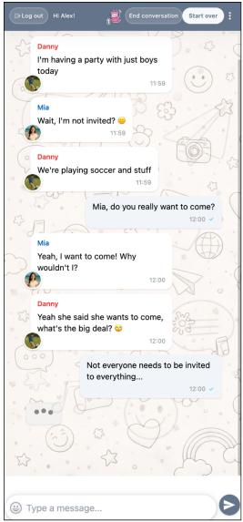  
A. Response leading to red intervention

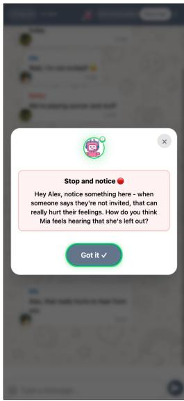  
B. Lilo's Red intervention

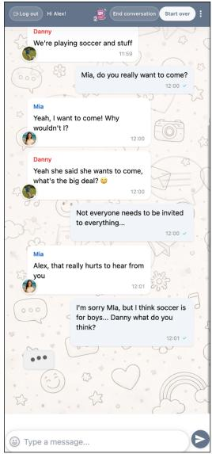  
C. Response leading to yellow intervention

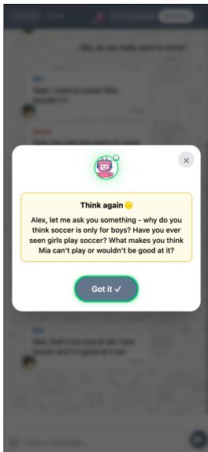  
D. Lilo's Yellow intervention  
Fig. 1. Examples of Lilo’s trafic-light interventions in the chat interface. A A child (Alex) response that leads to a Red intervention. B Lilo’s Red intervention, prompting the child to notice the impact of what was said. C A child response that leads to a Yellow intervention. D Lilo’s Yellow intervention, asking the child to consider the other side’s perspective. Screens show an English-localized build; the study itself was conducted in Hebrew. Danny and Mia correspond to Sagi and Reut.

Other efects further exacerbate this digital social environment. Online disinhibition leads children to be more outspoken and less restrained online, often sharing aggressive or hurtful remarks they would not communicate in person. In part, this happens because the medium hides the victim’s immediate reaction, filtering out the social cues that would normally trigger empathy and restrain aggression [Braddock et al. 2023; Margolis and Amanbekova 2023]. Although children may use paralinguistic adaptations like emojis to “filter in” social information, these lean media often remain ineficient for resolving peer friction due to high equivocality, making it particularly dificult for children with maturing emotional regulation to reach a shared understanding [Brody and Caldwell 2019]

## 2.2 Employing technology for social skills training

Technology has long been employed to support social and communicative development across a wide range of populations, from adults with social anxiety to individuals with clinical diagnoses [Ding et al. 2024]. Early automated systems, such as the “automated social skills trainer” [Tanaka et al. 2016], demonstrated that structured, repeatable practice through human-agent interaction could meaningfully improve social communication skills, providing realtime feedback on non-verbal cues such as speaking volume, pitch, and eye contact. Within this broader landscape, a substantial portion of technology-supported social skills training focused on children, particularly those with Autism Spectrum Disorder (ASD) [Ding et al. 2024]. Systems designed for this population ranged from conversational agents to physically embodied robots, each ofering a controlled and safe environment for social practice. The LISSA system [Ali et al. 2020], for instance, engaged teenagers with ASD in multi-topic conversations while providing real-time feedback on non-verbal behavior. Embodied platforms extended this further, where the robot Moxie [Hurst et al. 2020] leveraged physical presence to sustain engagement and deliver therapeutic content, and Keepon, a robot mediator [Shen et al. 2018], demonstrated that a robotic agent could intervene in live peer conflicts and prompt more constructive resolution among young children.

Despite their promise, early social skills training (SST) systems shared significant interaction and architectural limitations. A systematic review of commercially available voice-based conversational agents for children’s socialemotional learning (SEL) found that existing systems overwhelmingly provided shallow experiences, relying on a small set of rigid interaction styles such as “The Lecturer” - systems that talked at users without interaction - or “The Bulldozer” - systems that ignored user input and continued along a fixed script [Fu et al. 2022]. At the architectural level, Al Owayyed et al.’s ARTES framework argues that most existing systems emphasize either social situation simulation or educational scafolding at the expense of the other, limiting their overall training impact [Al Owayyed et al. 2025]. Early eforts to address these gaps introduced more structured pedagogical sequences, such as embedding social stories within phased conversation flows or leveraging story-based interactions to support socioemotional strategy acquisition [Fu et al. 2023; Gagan et al. 2022]. Yet these systems remained largely rule-based and scripted, constraining the naturalness and adaptability of interaction. The emergence of large language models (LLMs) ofered a new trajec tory, one in which conversational agents could move beyond fixed scripts toward dynamic, context-sensitive dialogue while still operating within structured pedagogical frameworks.

A parallel line of work, meanwhile, has shifted focus from clinical populations toward neurotypical children navigating online peer conflicts such as cyberbullying [Morag Yaar et al. 2022; Piccolo et al. 2021; Zou et al. 2024]. Early eforts approximated peer interaction through structured virtual role-play: FearNot!, for instance, immersed children in animated bullying episodes in which they took on the role of an “invisible friend” advising a virtual victim, demonstrating that simulated social scenarios could foster empathy and bystander intervention [Vannini et al. 2011]. More recent participatory design studies have surfaced clearer expectations for next-generation systems: children and educators envision chatbots that are trustworthy, non-judgmental, and act as “understanding friends” - humanized but not pretending to be human - ofering empathetic, contextualized “learning at the moment” guidance during online conflicts, while complementing rather than replacing parents and trusted adults [Piccolo et al. 2021; Zou et al. 2024]. Notably, these studies stop short of deploying actual LLM-driven systems, instead articulating socio-technical requirements that anticipate this shift.

The emergence of LLMs has transformed role-play from a scripted exercise into a generative practice tool, capable of producing dynamic, context-sensitive dialogue. Recent systems such as Rehearsal [Shaikh et al. 2024] and IMBUE [Lin et al. 2024], both designed for adults, demonstrate that grounding LLM outputs in established social-science frameworks can support meaningful skill acquisition. Both systems combine theory-grounded prompting with just-in-time feedback, and both improved outcomes in randomized studies - Rehearsal participants used more cooperative strategies in an actual conflict than a control group given didactic materials, and IMBUE raised participants’ self-eficacy and skill use relative to simulation without feedback. Within the children’s domain, recent work has likewise begun exploring LLM-based agents for communication and learning [Liu et al. 2024; Malik et al. 2026; Seo et al. 2024]. ChaCha [Seo et al. 2024], for example, applies a similar logic by pairing an LLM with a state machine that structures the dialogue into pedagogical phases, guiding children through emotion-coaching conversations. Together, this wave of work suggests that LLMs can be efective educational tools when their generative flexibility is shaped by an established pedagogical or psychological framework. However, as Hiniker et al. [Hiniker et al. 2021] caution, children are quick to learn routines from conversational agents but simultaneously value the “ontological distinction” between humans and ma chines, adapting whether and how they transfer such routines based on context. This suggests that generative agents should be designed with attention to children’s existing interpersonal norms and to how they distinguish interactions with humans from those with machines.

## 2.3 Psychological and Pedagogical Background

The pedagogical intervention in this study was based on the Stop, Think, Act model, an evidence-based strategy for fostering self-regulation and responsible decision-making, grounded in the principles of cognitive-behavioral therapy (CBT) and social-emotional learning (SEL) [Durlak et al. 2011; Kendall 1977]. The model was implemented using an intuitive “trafic light” user interface, a visual metaphor commonly used to scafold self-regulation and impulse control in children [Elias et al. 1997] (p. 29). The “stop” phase (red light) was designed to promote impulse control by encouraging an intentional pause before responding. The “thinking” phase (yellow light) formed the core of the intervention, guiding participants through a structured cognitive process that included: (a) social perspective taking, i.e., the ability to infer the thoughts and feelings of others involved in the situation [Gehlbach and Mu 2023], a particularly critical skill in digital contexts lacking nonverbal cues [Gehlbach and Mu 2023; Walther 1992]; and (b) cognitive reappraisal, in which users practice reframing the situation to regulate their emotional responses, a strategy positively associated with interpersonal functioning and well-being [Gross and John 2003]. Finally, the “action” phase (green light) focused on implementing the chosen solution through assertive communication, as opposed to passive or aggressive responses, which is a key goal of social skills training [Sert 2003]. This phase’s design also incorporated praise for efective communication in the moment. The overall aim ofthe process is to equip users with the practical skills required for responsible digital citizenship [Prasetiyo et al. 2023].

## 3 Lilo: System Design and Framework

Lilo is designed as a multi-agent conversational system that embeds structured pedagogical scafolding within openended, peer-like dialogue, and adapts to users’ communication skill development in real time. Building on the design principles established in Section 2, and in particular, the value of grounding generative agents in psychological and pedagogical frameworks [Lin et al. 2024; Seo et al. 2024; Shaikh et al. 2024], this section describes our system in detail.

## 3.1 Conversational Design and Educational Foundations

Lilo addresses the gap identified in Sections 2.1–2.2 by giving neurotypical children aged 9–11 a safe, simulated peer environment in which to practice impulse control, social perspective-taking, cognitive reappraisal, and assertive communication (Section 2.3) [Gehlbach and Mu 2023; Gross andJohn 2003; Kendall 1977; Sert 2003]. Within this framing, we made three design choices: (1) exposing children to a realistic peer conflict; (2) embedding the Stop-Think-Act framework within the conversation; and (3) adapting the interaction to the child’s evolving communication. LLM-driven simulation suits these directions because, unlike scripted agents, LLMs sustain context-sensitive, generative dialogue [Lin et al. 2024; Seo et al. 2024; Shaikh et al. 2024] and, when shaped by an established pedagogical framework, do so within the structure required for measurable skill acquisition.

Scripted Scenario Framework. Lilo’s interactions unfold within a controlled scenario: a peer conflict over a “boys only” birthday party invitation, designed to elicit empathy, perspective-taking, and conflict resolution. Anchoring the interaction in a fixed scenario follows a methodological tradition in technology-mediated social skills training, in which structured conversational contexts allow rehearsal without real-world interpersonal consequences [Haroon and Dogar 2024; Lin et al. 2024; Shaikh et al. 2024; Vannini et al. 2011]. This design choice serves three functions. First, a fixed scenario gives every child the same conflict and supports repeated practice of the same target skills [Durlak et al. 2011]. Second, the target communication skills, such as proposing compromises and taking the other side’s perspective, are also specified in the Orchestrator’s prompt and inform its per-turn assessment ofthe child’s recent communication and dificulty adjustments. Third, holding the situation constant across participants means that diferences in how children responded are not confounded with diferences in what they were responding to.

Psychological Foundations and Persona Design. Tseng et al. [Tseng et al. 2024] distinguish two paradigms for persona in LLMs: role-playing, in which the persona is assigned to the LLM, and personalization, in which the LLM models the user. Lilo’s design combines both. On the role-playing side, three character agents - Sagi, Reut, and Lilo - are assigned stable identities, communication styles, and behavioral tendencies, and interact within a multi-agent setting (Section 3.2). On the personalization side, the orchestrator continuously models the individual child’s communication conduct and skill development, conditioning character behavior - tone, willingness to compromise, level of challenge, and timing of interventions - on this evolving user model. While Tseng et al. [Tseng et al. 2024] treat role-playing and personalization as distinct lines of research, they note that the two can co-occur in a single system. Lilo is one such case, and the integration of the two is central to the system’s pedagogical function.

Lilo’s mentor design draws on ChaCha’s [Seo et al. 2024] use of an LLM-driven agent for emotion coaching with children, whose reflective, non-instructive approach, Seo et al. argue, sustains disclosure and self-reflection at this age. Lilo adopts the same orientation, and applies it within a simulated peer conflict. The mentor prompts the child to consider interpretations and feelings (reflective) rather than supplying a correct answer (non-instructive), while the peer agents continue the conflict around that guidance.

Trafic Light Intervention Model. Lilo operationalizes the Stop-Think-Act framework introduced in Section 2.3 as a system-level intervention protocol: the mentor agent (Lilo) moves through Red, Yellow, and Green phases of guidance, each scafolding the corresponding stage of the child’s reasoning. The phase is not pre-scheduled but is selected by the orchestrator based on the conversational context, the user’s recent communication patterns, and the emotional state of the exchange. The orchestrator may also select no mentor intervention, allowing the peer exchange to continue when additional guidance is unnecessary. This contextual timing is intended to preserve conversational flow rather than interrupt every turn, avoiding the rigid interaction styles described in earlier child-facing systems [Fu et al. 2022].

## 3.2 Architectural Framework

Lilo’s architecture is built on multi-agent orchestration: specialized persona agents are coordinated by a central orchestrator that manages conversation flow and maintains contextual coherence across the interaction. This design is motivated by recent work on Chain-of-Agents reasoning [Zhang et al. 2024] and on the degradation of LLM reasoning performance with longer input contexts [Levy et al. 2024]. Rather than relying on a single agent driven by one long prompt that must encode every character, every rule, and every educational objective, Lilo distributes the interaction across short, focused prompts, each handled by a separate agent. This decomposition is intended to reduce the load on a single prompt and to support consistent adherence to each character’s persona behavior, though it may also increase response latency because generating a turn can involve multiple model calls.

The architecture comprises five LLM-based agents: three character agents (Sagi, Reut, and Lilo), a central Orchestrator Agent that coordinates their interactions based on ongoing analysis of the conversation, and a Feedback Agent that generates structured feedback at the end of the session. In addition, the system is supported by session history and flow-management logic (Figure 2, which we describe later in Section 3.3). The remainder of this subsection describes how the orchestrator manages conversation flow and adaptive dificulty, and the safety layers that operate alongside the educational logic.

Adaptive Orchestration. The Orchestrator Agent is the system’s coordinating layer: it reads the unfolding conversation and decides how the system should respond at each turn. Its design draws on ChaCha’s [Seo et al. 2024] use of structured state management for child-computer interactions, but replaces transitions over a predefined state graph with per-turn decisions produced by an LLM-based orchestrator. At each user turn, the orchestrator analyzes the recent conversation history, the child’s latest message and communication patterns, and the interaction dynamics among the agents. It selects one or more responding agents, including Sagi, Reut, and potentially the mentor agent (Lilo), determines a trafic-light phase when Lilo is selected, and assigns a dificulty level that is passed to the responding agents.

Dificulty progresses through four levels: Intense, Hard, Medium, and Low, each characterized by more or less challenging character behavior and willingness to compromise. Initial interactions begin at Intense. After 2–3 consecutive messages at the current level that demonstrate efective communication, such as proposing compromises, considering both sides, using respectful language, or de-escalating the conflict, the orchestrator decreases the dificulty by one level. Inefective or aggressive communication leaves the level unchanged. This adaptive calibration is intended to keep children appropriately challenged while preventing frustration that could impede learning [Vygotsky 1978].

The orchestrator thus operates not as a rule executor but as a contextual decision-maker, able to keep the conversation aligned with both immediate dialogue dynamics and longer-term pedagogical objectives. The system logs each interaction and orchestration decision in detail. The use of these logs for analysis is described in Section 4.

Safety Layer. The system’s architecture includes safety as a continuous concern alongside the educational logic. Every user message is analyzed in real time for inappropriate content, with automatic flagging and intervention when problematic language or behavioral patterns such as curses, insults, humiliation, and other harmful messages are detected. This safety judgment is distinct from ordinary disagreement or impolite phrasing that remains within the simulated conflict. This detection is performed by the orchestrator agent as part of its per-turn analysis, which flags problematic language and routes the response to the mentor agent (Lilo) with a red trafic-light phase. Flagged messages are displayed to the user with a red background, signaling to the child that the message was not actually sent (Figure 3); the character agents (Sagi, Reut) do not see the flagged message at all, so the conversation continues without them reacting to it. For example, here are two cases exemplifying the diference:

Safety flag, message is not sent: “You’re so annoying, everyone thinks so”

Regular red light: “Not everyone needs to be invited to everything”

Language Model and Localization. All LLM-based agents in Lilo used Claude 3.7 Sonnet, selected during system development for its instruction-following and Hebrew-language capabilities. Agent-specific roles and behaviors were defined through role-specific prompting and orchestration, without model fine-tuning.

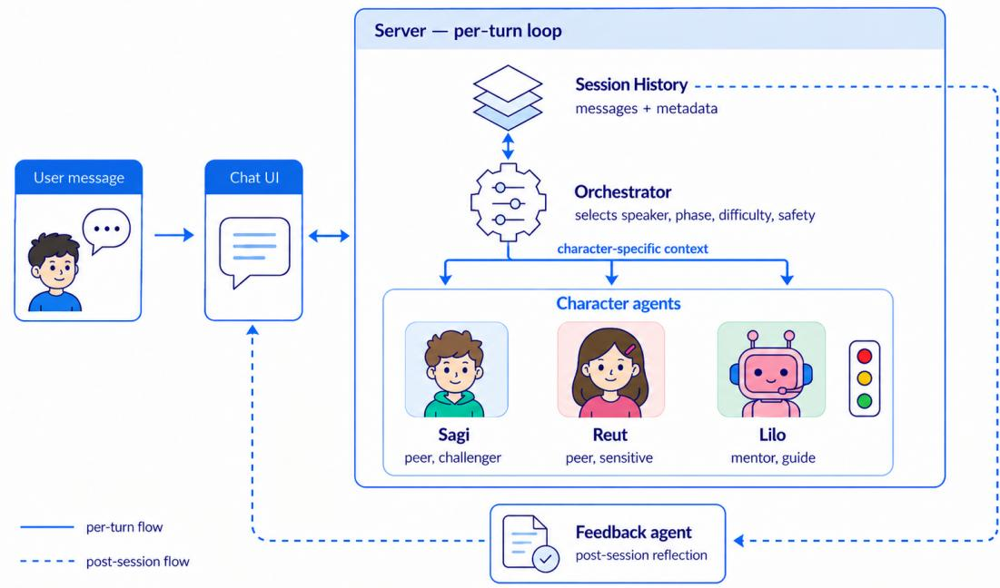  
Fig. 2. System architecture of the Lilo multi-agent framework.

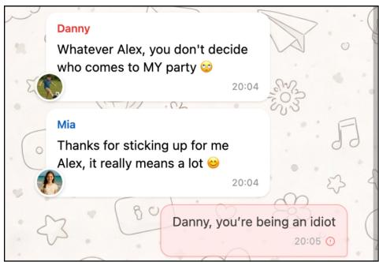  
Fig. 3. Example of problematic language and Lilo’s response.

Lilo was designed for Hebrew-language interaction using role-specific prompts tailored to the local linguistic and conversational context of children’s digital communication. Peer-character prompts encourage short, age-appropriate messages, informal expressions, slang, moderate emoji use, and occasional ambiguity, while the mentor prompt uses child-friendly Hebrew and guides children to consider colloquial and ambiguous expressions in context. Together, these prompt-level adaptations were intended to approximate everyday peer group-chat communication while preserving each agent’s distinct educational role.

## 3.3 Supporting Components and Character Agents

Memory and Context Management. The system maintains a session-scoped conversation history, storing message history together with metadata such as role, timestamps, content flags, and dificulty-level markers that track transitions in the system’s adaptive challenge level. Before each agent call, the orchestrator constructs the relevant con versation context from this history. For example, messages flagged as inappropriate are excluded from the character agents’ regular context while remaining available in the complete session history for safety review and post-session feedback. Character agents (Sagi, Reut) also receive a filtered view that excludes the mentor’s interventions, preserving the illusion of independent peer actors unaware of the pedagogical scafolding.

Retaining this history within the session also allows Lilo’s interventions to reference the child’s earlier behavior. The full history remains available beyond the per-turn loop: at the end of the interaction, it is passed to the Feedback Agent, which generates the end-of-conversation feedback shown to the child, situating this agent outside the main per-turn loop shown in Figure 2.

Flow and Trigger Orchestration. The orchestrator coordinates the timing and sequencing of system responses. It manages both reactive responses to user input and proactive auto-trigger mechanisms that maintain conversation engagement during periods of user inactivity. When users remain silent for an interval of 60 seconds, the auto-trigger system initiates character-to-character exchanges, in which the characters continue talking to each other rather than waiting for the user. The mechanism is designed primarily to draw the user back into active participation. Having the characters talk to each other (rather than prompt the user directly) also has the side efect of modeling that peer conversation continues on its own, mimicking how conversations unfold among real peers even when one participant is momentarily inactive.

When multiple characters are selected to respond within the same turn, the orchestrator generates and delivers their messages sequentially, with each generation conditioned on the messages that have already been produced in that turn. This sequential coordination prevents characters from contradicting or echoing each other within a single turn. The result is a multi-character exchange that approximates realistic group chat dynamics, in which the user and the two character peers (Sagi and Reut) interact much as they might in an actual group conversation.

Persona Implementation. Sagi, Reut, and Lilo were introduced in Section 3.1 as the three character agents that constitute Lilo’s role-playing layer. Here, we describe the behavioral role each plays in the session:

(1) Sagi (The Challenger): opinionated, stubborn, and boundary-testing, holding firm on the “boys only” invitation despite pushback and using deliberately ambiguous or slangy messages (e.g., “leave it”, “you’re weak”). His behavior requires users to practice patience, interpretation of ambiguous text, and de-escalation.

(2) Reut (The Sensitive Peer): emotionally expressive and direct about her feelings, with responses ranging from hurt and frustration (when excluded or dismissed) to warmth and relief (when validated). If the user remains passive, she presses them to state their position. Her behavior encourages users to consider the emotional impact of what they write, and how empathic responses repair the relationship.

(3) Lilo (The Mentor-Guide): a mentor rather than a peer, intervening through brief (≤60-word) messages structured around the trafic-light phases (Section 3.2) and addressed to the child rather than to Sagi or Reut. Lilo uses hedging language (e.g., “it might be that...”) to model non-judgmental interpretation, encourages perspectivetaking and reframing, and suggests possible responses without solving the conflict. During the Green phase, Lilo reinforces the constructive strategies listed in Section 3.2.

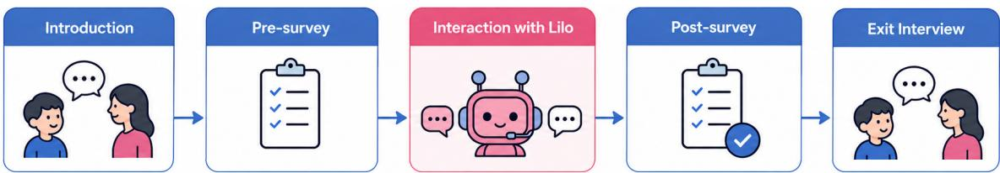  
Fig. 4. Study design stages, as described in §4.1.

## 3.4 Multi-Layered Prompting Architecture

Static Prompt Foundation. The static prompt layer defines the persona of each character. These prompts were developed through team discussions that included an expert educational psychologist to ensure psychological validity and educational efectiveness. Each character prompt encodes six components of character definition: 1) identity markers (character names and, for the child characters, age and gender); 2) functional role within the conversation system; 3) core personality traits and behavioral tendencies; 4) characteristic communication styles and linguistic patterns; 5) primary educational objectives; and 6) adaptive behavioral rules that govern response variation. The static prompts were informed by emotion coaching and peer mediation research [Seo et al. 2024; Shen et al. 2018], with the specific prompt content developed by the team. The prompts include contextual background and inter-character relationships, which support consistent character behavior across the session, alongside few-shot examples of appropriate responses in diferent conversational situations.

Dynamic Prompting and Contextual Adaptation. The dynamic prompting layer enables real-time adaptation of character responses based on the unfolding conversation and the child’s evolving conduct. At each turn, the system injects current session variables into the static prompt templates: user profile information (name, gender, and age), the over all dificulty level, reasoning produced by the Orchestrator (described in the next paragraph), and character-specific conversation context (described in Section 3.3); when Lilo is selected, the current trafic-light intervention phase is also supplied. This dynamic integration allows each character to remain consistent with its own persona while adapting its responses to the immediate situation: dificulty calibrates the peer characters’ behavioral intensity, while the trafic-light state governs the mentor’s form of intervention when it is used.

Orchestrator Reasoning Integration. The dynamic prompt layer also incorporates the Orchestrator’s per-turn reasoning. When the Orchestrator selects which character or characters should respond, it produces reasoning that explains why those characters were chosen and what educational purpose their responses should serve. This reasoning is injected into the dynamic prompt alongside the session variables described above, so that character responses are shaped not only by their personas but also by the Orchestrator’s pedagogical intent at that turn.

## 4 Methodology

We conducted a user study with three objectives: to examine whether and how children’s self-eficacy and intended coping strategies regarding unpleasant WhatsApp interactions changed following a structured interaction with Lilo; to characterize children’s engagement with the system and the interventions it produced; and to learn about their experience with it. To address these objectives, each session combined surveys administered before and after the interaction with a brief semi-structured interview that followed. In addition, the system logged each interaction, which we analyzed descriptively. The study design, including the interview protocol and survey questions, was approved by our institution’s Institutional Review Board (approval number: 297-25), and all parents provided informed consent prior to their child’s participation.

## 4.1 Procedure

The study was conducted entirely over Zoom, with one participant per session. Each session lasted approximately one hour and followed five stages: (i) introduction, (ii) pre-survey, (iii) interaction with Lilo, (iv) post-survey, and (v) exit interview. Figure 4 outlines the procedure. See Appendix A for all the study-related details and instruments used.

Recruitment proceeded in two stages, both conducted online via Qualtrics. In the first stage, parents completed a screening survey that collected relevant child information, including age, gender, and whether the child uses WhatsApp to communicate with classmates (rather than only with family). The screening also asked parents to rate, on a 1- to-5 scale, their child’s reading and typing abilities in WhatsApp, since the study required reading and typing at a conversational pace. To be eligible, children had to be aged 9-11, use WhatsApp to communicate with classmates, and have parent-rated reading and typing abilities of at least 3 on the 1-to-5 scale. Parents whose children met these criteria were invited to a second stage, in which they received a detailed description of the study - including the roleplay scenario, the AI-based nature of the characters, and safety mechanisms in Lilo - and provided informed consent. They also completed a brief demographic questionnaire. Parents were instructed not to over-explain the study to their child in advance, in order to avoid biasing the child’s behavior during the session

Sessions were led by three of the authors, one experimenter per session. At the start of the session, the experimenter introduced themselves, briefly described what the session would include, and reminded the child that participation was voluntary and that they could stop at any time. A parent was asked to be present at the beginning of the session to help with the technical setup, such as connecting the child’s phone to Zoom and sharing the phone screen so that the experimenter could see the child’s view of Lilo during the interaction. After the setup, the parent was asked to leave the room so that the child could engage with the system as naturally as possible, while remaining nearby in case of technical issues.

The pre-survey was administered in two parts. Part A was completed by the child alone, via a Qualtrics link sent during the session. It covered topics the child might prefer to answer privately rather than out loud to the experimenter: the child’s prior exposure to unpleasant behavior in classroom WhatsApp groups, adapted from [Aızenkot 2018], and how they would typically respond to such behavior. Part B was completed jointly with the experimenter, who read the questions aloud and recorded the child’s answers in Qualtrics. Part B included self-eficacy items [Bandura 1977], adapted from [Elyoseph et al. 2024], such as the extent to which the child would know how to deal with unpleasant behavior directed at them on WhatsApp. Throughout the survey, the closed-ended questions used a 1-7 Likert scale. Each closed-ended item was followed by an open-ended follow-up asking the child for an example.

After the pre-survey, the experimenter introduced the expected interaction with Lilo. The child was told that they were about to use an application that resembles WhatsApp, and that they would join an ongoing conversation between two AI-based peer characters, Sagi and Reut, who were currently in a disagreement. The child was asked to imagine that Sagi and Reut were their friends and to respond as they would in a real WhatsApp conversation. The experimenter explained that Lilo, an additional character, would intervene from time to time, and asked the child to read Lilo’s interventions and the trafic-light feedback rather than clicking past them immediately. The experimenter remained on Zoom throughout the interaction and could assist if needed. The interaction was capped at approximately 20 minutes, after which the experimenter would end the session if it had not ended naturally. The post-survey was then administered jointly by the experimenter, again via Qualtrics. It repeated the items from the pre-survey, and added Lilo-specific evaluation items, such as perceived future helpfulness of the experience and willingness to use Lilo again.

Finally, the exit interview was audio-recorded, lasting approximately 15 minutes. The interview followed a semistructured protocol adapted from [Seo et al. 2024] and covered the child’s experience with Lilo, including their perceptions of the characters and the trafic-light. At the end of the interview, the experimenter clarified that Sagi was deliberately designed to behave in a confrontational manner and that the research team does not endorse such be havior. Prior to data collection, two pilot sessions were conducted to refine the study protocol, including the survey questions, procedure, and interview protocol; data from these sessions are excluded from all analyses. As compensation for participation, participants were ofered the equivalent of approximately 10 USD.

## 4.2 Participants

We recruited the participants between July and December 2025 through various channels, including social media plat forms such as Facebook and X, WhatsApp groups, and a poster located at a children’s science museum. Ultimately, we recruited 28 participants. Children’s ages ranged from 9 to 11 (M=9.9), and the sample included 17 girls (61%) and 11 boys (39%). Table 1 presents the demographic breakdown by age and gender. All children owned a smartphone and used WhatsApp to communicate with classmates. Parents of participating children were predominantly highly educated (93% held at least a bachelor’s degree), and secular or traditional (72%).

Table 1. Participant demographics by age and gender.
<table><tr><td>Age</td><td>Girls (n)</td><td>Boys (n)</td><td>Total (n)</td></tr><tr><td>9</td><td>5</td><td>4</td><td>9</td></tr><tr><td>10</td><td>10</td><td>6</td><td>16</td></tr><tr><td>11</td><td>2</td><td>1</td><td>3</td></tr><tr><td>Total</td><td>17</td><td>11</td><td>28</td></tr></table>

## 4.3 Data Analysis

We report on the analysis of three data sources: 1) system logs; 2) surveys administered before (pre) and after (post) the intervention; and 3) exit interviews. We describe the analysis approach for each data source.

System logs. System log data were analyzed descriptively, where we report on characteristics of both participants interactions and system behavior, including engagement patterns and intervention distributions. Two participants were excluded from this analysis due to technical issues that prevented complete interaction logs from being recorded, leaving n=26 for log analysis. The survey analysis below is also based on 26 participants, but not the same 26: two diferent participants were excluded there, for the reasons noted in that paragraph, so the two datasets overlap on 24 participants.

Surveys. Descriptive statistics were used to summarize participants’ prior exposure to unpleasant behavior in class WhatsApp groups, their coping strategy selections, and their post-interaction evaluations of Lilo. We only analyzed closed-ended questions, as open-ended questions mostly covered topics that were later discussed during the exit interviews. To examine pre-post changes, we assessed three items individually: ease of identifying unpleasant WhatsApp behavior, self-eficacy for coping when personally targeted, and self-eficacy for intervening as a bystander. Each item captures a distinct construct and was therefore analyzed separately rather than combined into a composite score. Two participants were excluded from the survey analysis: one did not complete the post-survey, and one left a full item block in the pre-survey unanswered. This leaves 26 participants for all survey analyses. We first assessed normality of diference scores using the Shapiro-Wilk test. Diference scores for two of the three items showed non-normal distributions (� < .05). Therefore, Wilcoxon signed-rank tests were used consistently across all three items for comparability

Exit interviews. Qualitative data from the exit interviews were analyzed using thematic analysis [Terry et al. 2017]. The interviews were conducted in Hebrew, and quotations included in the paper were translated into English and attributed using anonymized participant identifiers. The interviews were analyzed by the same three authors who conducted the sessions (Section 4.1), together with a fourth senior researcher. The three researchers began by independently coding an initial set of two interviews. One of these interviews was part of the pilot stage (that is, excluded from the analysis). The team then met to discuss their codes and develop an initial codebook, which was further refined across two additional iterations of coding and discussion. Once the codebook was finalized, two of the three researchers independently analyzed the remaining interviews, 10 and 6 respectively, using the agreed-upon codebook, and were instructed to stop coding once they no longer identified new themes in the data. The codebook is presented in Appendix C. Coding stopped after 17 of the 28 recorded interviews, at which point the two researchers were no longer identifying new themes. Prior work also reported a similar phenomenon, where most codes were established after analyzing a relatively small number of participants [Guest et al. 2006]. Guest et al. further identified two conditions under which saturation is reached early: participants who are homogeneous with respect to the research domain, and a structured guide in which the same questions are asked of everyone. These two conditions hold in our case, where every child encountered the same fixed scenario with the same characters, every interview followed the same semi-structured protocol, and participants fell within a narrow age range (9-11). To assess inter-rater reliability, two interviews were independently coded by both researchers. Agreement was assessed at the level of the five overarching themes, treating each paragraph-theme pair as a unit. The coders agreed on 68.6% of units, with Cohen’s � = .63, indicating substantial agreement [Landis and Koch 1977].

## 5 Results

## 5.1 Participants’ Prior Experiences

When asked about their prior experience with instant messaging, most participants reported that their class had WhatsApp groups with classmates. 17 participants (65.4%) reported that there was a WhatsApp group that included all students in their class, while 22 (84.6%) reported that there were WhatsApp groups that included only some students from their class. These categories were not mutually exclusive, as participants could report the existence of both types of groups.

Overall, the majority of participants did not report any of the surveyed negative experiences during the preceding six months, as presented in Figure 5. Exposure varied across experience types, and participants could report more than one type of experience. The most frequently reported experience was receiving insulting replies to messages, reported by 9 participants (34.6%). Six participants (23.1%) reported having been insulted in a class group, and six reported tha they had avoided participating because they feared insulting responses. Five participants (19.2%) reported having been removed from a group against their will, three (11.5%) reported that an embarrassing photograph or sticker had been posted about them, and one (3.8%) reported having been laughed at in a class group.

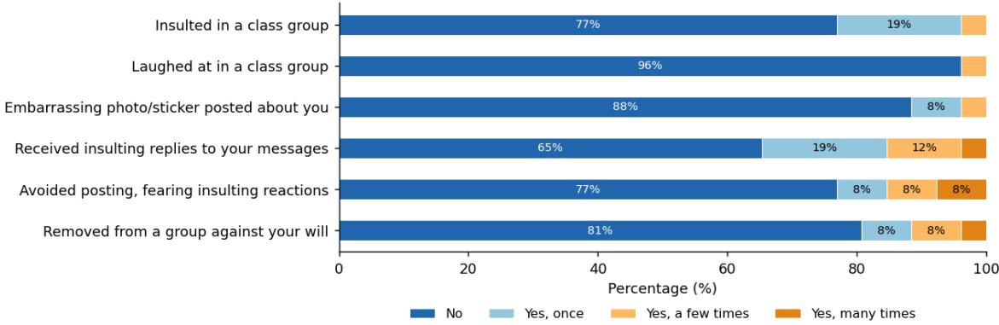  
Fig. 5. Prior experiences with unpleasant behavior in class WhatsApp groups in the past 6 months

## 5.2 System Logs

We report on 26 sessions that were conducted during the data collection, one per participant. Altogether, participants sent 261 messages, with a mean of 10.0 messages per session (median 9). As for session duration, sessions lasted 17.8 minutes on average (median 16.8, and longest 31.4). Across all sessions, 936 discussion messages were exchanged in total. Children’s 261 messages accounted for 28% of these, while the three agents produced the remaining 675: Lilo 181 (19%), Sagi 270 (29%), and Reut 224 (24%).

As described earlier (§3.2), the orchestrator manages two aspects of each turn: Lilo’s trafic-light intervention (Green/Yellow/Red) and the session’s dificulty level (Low/Medium/Hard/Intense). Across the 26 sessions, the orchestrator produced 181 trafic-light decisions - Green (Act) was most frequent (83, 46%), followed by Yellow (Think, 71, 39%) and Red (Stop, 27, 15%) - and assigned a dificulty level to 265 turns, spread across all four levels (47 Low, 81 Medium, 52 Hard, 85 Intense). Four turns were auto-generated to foster discussion, exceeding the 261 participants messages. Taking the two aspects together, Figure 6 cross-tabulates trafic-light phase against dificulty level; of the 265 turns carrying a dificulty label, 181 also carried a trafic-light decision, and the cross-tabulation is restricted to these. The proportion of Green decisions decreased as dificulty increased, from 88% at Low to 52% at both Medium and Hard, and 18% at Intense. Red decisions were rare overall (27 of 181, 15%) and heavily concentrated at the Intense level: 20 of the 27 Red decisions (74%) occurred there. Within Intense-level turns specifically, Red accounted for 35% of decisions - compared with 9% at Medium, 4% at Hard, and none at Low.

## 5.3 Changes in Coping Strategies and Perceived Ability

The post-intervention survey included two parts: questions about participants’ anticipated coping with negative WhatsApp experiences, and questions specific to their experience with Lilo (§5.4). In this subsection, we report on the first part of the survey. We asked which strategies participants would use in response to unpleasant behavior directed at them or witnessed toward another child (Figure 9, Appendix B). We observed that selections were largely unchanged before and after the intervention. For example, referring to the scenario in which the child is personally insulted, the same strategies - resolving the situation privately and seeking outside help - remained the most common for both preand post- intervention.

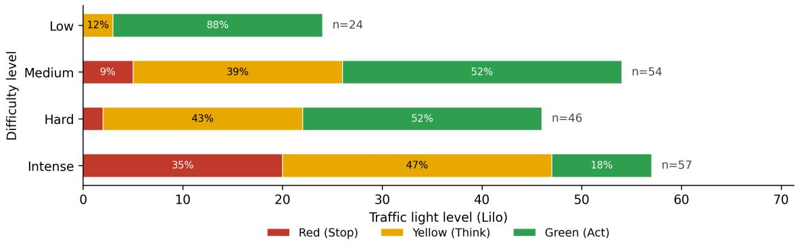  
Fig. 6. Trafic light level by dificulty level

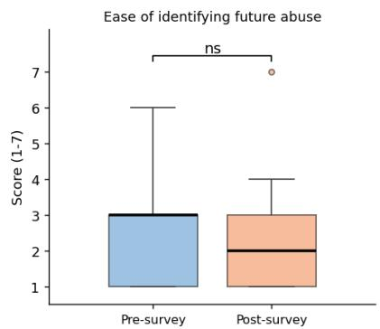

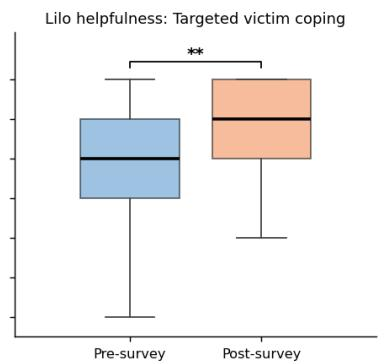

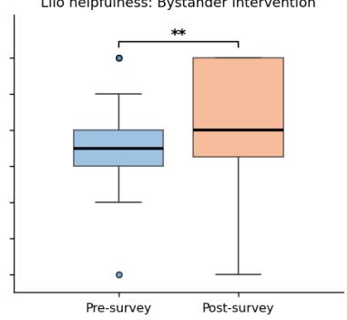  
Note: $^ { * } p < . 0 5 , ^ { * * } p < . 0 1$ , Wilcoxon signed-rank test.  
Fig. 7. Pre–Post comparison of perceived self-eficacy and identification of unpleasant interaction.

We compared responses to three individual survey questions before and after the interaction with Lilo using Wilcoxon signed-rank tests (Figure 7). The questions assessed participants’ perceived ease of identifying unpleasant behavior on WhatsApp, their perceived ability to cope when such behavior was directed toward them, and their perceived ability to respond when another child was treated unpleasantly. For the identification question, lower scores indicated greater perceived ease. For the two coping questions, higher scores indicated greater perceived ability.

As for ease of identifying future unpleasant behavior, participants’ responses showed a small descriptive improvement, but the pre-post diference was not statistically significant. Scores decreased from $\mathrm { M } { = } 2 . 5 0 \ ( \mathrm { S D } { = } 1 . 3 9 )$ before the interaction to M=2.23 (SD=1.50) afterward (Wilcoxon test: $\mathrm { W } { = } 4 9 . 0 , \mathrm { p } { = } . 3 1 4 )$ . In contrast, participants reported signifi cantly greater perceived ability to cope when unpleasant behavior was directed toward them. Scores increased from M=4.85 (SD=1.57) before the interaction to M=5.77 (SD=1.18) afterward (Wilcoxon test: W=11.0, p=.001.) Participants also reported greater perceived ability to respond when another child was treated unpleasantly. Scores increased from M=4.58 (SD=1.53) before the interaction to M=5.38 (SD=1.47) afterward (Wilcoxon test: W=9.0, p=.006.)

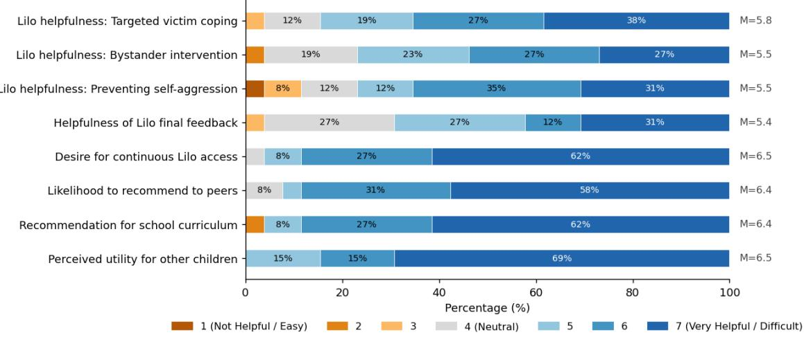  
Fig. 8. Post-evaluation of Lilo

## 5.4 Post-Interaction Evaluation of Lilo

The last part of the post-survey included questions to assess participants’ perceived future value of their experience with Lilo. Overall, as presented in Figure 8, participants evaluated the Lilo experience positively, but the strength of agreement varied by topic. Willingness to continue using and recommending Lilo to peers drew strong, homogeneous agreement, while its perceived usefulness for specific future coping situations was rated positively but somewhat lower and more variable. Specifically, concerning Lilo’s perceived usefulness, participants expected the Lilo experience to help them cope with future situations in which unpleasant behavior was directed toward them (M=5.85, SD=1.19), and to help them respond when another child was treated unpleasantly (M=5.50, SD=1.30). Participants also expected the experience to help them avoid behaving unpleasantly toward other children (M=5.54, SD=1.56).

Referring to willingness to use Lilo, participants expressed a strong desire to have the option to use it (M=6.46, SD=0.81), and reported that they would recommend it to their friends (M=6.38, SD=0.90). They similarly reported that they would recommend using Lilo in school life-skills lessons (M=6.38, SD=1.10). Participants expected access to Lilo to be helpful for other children (M=6.54, SD=0.76). This item received the highest mean evaluation, and al participants rated it between 5 and 7. Lastly, one item was designed to learn about participants’ perceptions of Lilo’s end-of-conversation feedback. This item, while overall positive, received the lowest mean score (M=5.38, SD=1.30).

## 5.5 Interview Findings

After the intervention with Lilo and the post-survey, we conducted interviews to learn about participants’ experience with Lilo, including their perceptions of the characters, main functions, and how useful and enjoyable they found it. In the following sections, we present a detailed analysis of 17 interviews. We organize the findings around two broad topics: (1) appraisals of the system - how participants judged Lilo, the characters, and the guidance they received, and (2) perceived value for themselves and others - what participants believed the experience gave them, and where and by whom it should be used.

## 5.5.1 Appraisals of the system.

Perceptions ofLilo. Most participants had a positive perception of Lilo (the mentor) and gave several reasons for it. We also note that most participants referred to Lilo in the feminine, and we follow their usage in this section. The reasons they gave were of two kinds. The first was her manner. Participants described her as cute, friendly and kind, and several characterized her as a girl who cares about everyone and does not want anyone to fight. The second was what she did for them during the conversation, and the way she went about it. Participants said she gave them ideas, told them what to pay attention to, and directed them to the other side’s feelings. Several described her guidance as responsive rather than general, responding to almost every message and telling them which moves were helpful and which were not. The same detailed, instructive style was described positively and, by some, as annoying. The positive perception is illustrated by P1 (g):

“She sounds very cute, and that she tries very hard to help all the time, and that she’s a good friend. That she’s always trying to give instructions on how to do good things, and not to fight, and to be good friends.”

In contrast, P2 (b) described the same attentiveness as intrusive:

“I wrote something and then she told me to pay attention to all kinds of other things, and that’s kind of annoying.”

As for Lilo’s perceived age, while a few participants placed Lilo among themselves, describing her as a child or as an excelling pupil, most perceived her as an adult. The figures they reached for were figures of authority and care. Participants likened her to a parent, to a grown-up in the group who watches over it without taking part, and to a teacher giving advice. A smaller group described Lilo as not sounding like a real person at all. These participants called her a robot or said the exchange felt computer-like.

Trafic-Light model. Participants found the trafic-light concept useful, but in most interviews they did not spontaneously recall that it had been introduced and defined at the start of the session. Once the interviewer mentioned the colors, they engaged with the model readily and described it in their own words. Their descriptions represented a process in which they were making (or not) a progress, with a positive (green) or negative (red) direction, and yellow somewhere in between, as explained by P12 (g):

“.. it really helped me understand that green also means I’m in a good direction, red means I’m not in a good direction, and yellow means I’m in the middle.”

P15 (g) described in her words how she perceived the trafic-light idea:

“... if you overdo it and it starts being hurtful, then they kind of tell you stop. And you can understand that you need to shift down a gear, to look at what you wrote, to try to find maybe there’s a way, that maybe the concept ofwhat you wrote is right, but maybe in other words..”

Participants then described how each level worked for them. Red was understood as a signal to stop, reserved for messages that were in the wrong direction or had become ofensive. Participants described how red messages called them to stop and think, and how they used it to pause and re-evaluate the situation, as described by P15 (g):

“When she gave me red lights, I understood I need to pause for a second and think, that maybe what I said needs changing, maybe I need to add something.”

Yellow occupied the middle of the scale, neither approving nor rejecting a message. Participants often associated this middle ground with being asked to reconsider the other side, although they attributed the prompt to Lilo rather than to the color itself. They described being moved of a single position in the dispute and toward the character they had not been supporting. P7 (g) described it more generally, not specifically in the context of the experienced situation:

“Even when I think I’m right, sometimes the other side doesn’t agree, and you have to respect that.”

Lastly, green functioned as confirmation to continue. Participants described it as a sign that they were on the right track and that their message had been well judged, and several experienced it as encouragement, recalling that Lilo told them they had done well.

Scenario and characters authenticity. Participants were asked about two aspects of the experience’s authenticity, the children’s characters and the scenario they discussed, a conflict about a birthday party. First, most participants placed the characters within a year of their own age. A few judged them slightly older, and a few younger. Beyond their age, most participants said the characters sounded like real children. Participants pointed to several aspects of what made them sound real, with arguing and being caught in a conflict as one such example, which they described as something children do. P14 (b), for example, said the characters reminded him of children who do not get along, and confirmed that this was precisely what made them feel real. A few participants located the realism in how the characters talked, for example, referring to the style in which they wrote to each other. One participant repeated a line back as the kind of thing children say, quoting Sagi asking why everyone was making a drama when he only wanted to invite his own friends. For example, P12 (g) described how Sagi and Reut sounded to her:

“They really sounded to me like real kids who are in the middle ofa fight and really need to solve it.”

On the other hand, several participants explained why Sagi and Reut did not sound like real children. First, they referred to the way the characters spoke, saying they did not talk like people and that the artificial intelligence was apparent. P9 (g), for example, put it as “they don’t talk like people, you can tell it’s AI, their speech isn’t like how I talk with my friends”. A related observation concerned what the characters failed to do. One participant reported using the word “empathetic” in the conversation, and noted that the characters let it pass, where children her own age would have remarked on it.

“ P15: For example, when I wrote “empathetic”, other kids wouldn’t have reacted the way they did, they’d

have reacted a bit diferently [...] because usually in conversations people don’t say the word “empathetic”.

Interviewer: What do you mean? They’d have pointed out that you said “empathetic”?

P15: Yes, they [real children] would have said to me that it sounds grown-up, something like that.”

Second, participants referred to inflexibility. One participant said the characters were too stubborn, explaining that with real friends he can usually bring people around, and here he could not. One participant said they did not sound especially real to her, noting that she knew throughout that it was a simulation, which may be what kept her from treating them as real.

Finally, a few participants questioned the premise rather than the characters themselves. One participant, who said the characters strongly reminded him ofreal children, added that girls in his class do not behave as Reut did, explaining that boys and girls in his class are not really friends. Another found it odd that Sagi would state a boys-only preference in the way he did, and that children would have phrased it diferently. This concerns the scenario as much as the characters, and participants also addressed the scenario directly. Most considered it realistic, reporting that they could imagine a similar conflict arising in their own group chats, and in several cases that they had experienced something similar themselves. A few participants did not see the conflict as reflecting their current social world, whether because it does not occur among the children they know or because they associated it with younger children.

## 5.5.2 Perceived value and future directions.

Learning process. During the discussion of their general feelings about the experience with Lilo, many participants spontaneously described Lilo as a place to practice and framed the session as preparation for situations they might encounter in their own group chats. Others valued being able to try something out and see how it was received, as exemplified by P13 (g):

“It’s reallyfun, and it also feels like Ican practice a bit. IfIwant to say something and I’m not sure whether it might hurt, Ifeel like I can say it there [...] and then test it, see.”

Participants also explained what made practicing possible. Several referred to the absence ofsocial cost, contrasting the simulated group with their own, where a badly judged message can be held against them long afterwards, and noting that the characters would neither judge them nor carry the exchange forward (beyond the session), as explained by P15 (g):

“On WhatsApp with people you know, if you write something bad, people can hold it against you, even a week later. But with an AI, people won’t judge you, no matter what you write.”

Several said that if a similar situation arose in their own group chats, they would now know how to behave, and that the session had shown them how such situations can be handled. Along the same lines, participants conveyed a sense of increased self-eficacy, saying that they had learned to make peace between friends, and that the conversation would not have ended well without them. P1 (g) described her feelings after using Lilo:

“Today my friends had a fight, and I couldn’t make peace between them. But now that I’ve helped someone on WhatsApp, at least someone who isn’t real, I think I’ve learned better how.”

A few participants went beyond the use Lilo was designed for, describing it not as a place to practice but as a resource to consult about real situations as they arose, whether before replying in a conversation or while an argument was unfolding. For example, P8 (g) said that if she had argued with a friend and was still angry, she would want to talk it through with Lilo and work that case out.

Perceived impact. Most participants described the session as an enjoyable experience, with a few attributing their enjoyment to having helped others. Relatedly, participants wanted access to Lilo beyond the session, consistent with the survey results reported in Section 5.4, and what they imagined doing with it difered by setting. At school they described it as something a class would do together, for example, as part of a recurring activity with a new scenario each time. At home, by contrast, participants described personal and on-demand use, wanting Lilo on their own phone, treating it as something to turn to when a real conflict arose, or using it daily so that it would keep teaching them things.

Participants were asked whether Lilo might help children who behave unpleasantly in group chats, those on the receiving end, or both. Several answered both, while others emphasized one side. Their explanations of the children who behave unpleasantly were consistent. Participants described the problem as a failure to notice rather than an intention to hurt, saying that children do not always realize what they are writing or that it is insulting, and that a phone makes this easier because the sender cannot see the other person’s reaction. Two participants went further and described the remedy as experiencing the other position rather than being told about it. For children on the receiving end, participants expected Lilo to help them know how to respond without escalating the exchange, or how to stand up for themselves rather than stay silent. P17 (b) referred to both roles:

“... whoever is treated unpleasantly, then he’d be able to know how to act. And whoever behaves unpleasantly

can understand that what he’s doing isn’t good, and ifit were done to him, then he wouldfeel it.”

Finally, participants also described what such use might change, at three scales. At the level of their own conduct, most said they could apply the trafic-light model beyond the session, most often as a rule about pausing before sending a message, or to take a disagreement into a private conversation rather than airing it in the group. At the level of the group, participants expected fewer conflicts if other children came to recognize the efect of what they write. One participant extended this to the platform itself, as explained by P15 (g):

“I really think it could change conversations on WhatsApp, ifWhatsApp did what Lilo does and put in a

trafic light. Stop. Stop for a second, look at what you wrote, try to rephrase it.”

Suggested improvements. Toward the end of the interview, participants were asked what they would change in Lilo. Most of their suggestions concerned the scenario. Participants proposed other topics for conflict scenarios, some more dificult than the one they encountered, including social exclusion and shaming, and some of a similar kind, such as an outing to a movie. Their motivations for suggesting other scenarios varied. Some wanted variety because a single fixed story would not sustain repeated use, which several of them said they would want. Others wanted a more challenging conflict because it would leave them more room to intervene, as explained by P16 (g):

“The topic was meh. If it had been a topic about everyone ganging up on someone, then it would have been

more [possible] to intervene. But, it’s a birthday, so at the end of the day it’s your day, you decide what to

$$
d o _ { * } ^ { * }
$$

A second group of suggestions concerned Lilo’s guidance itself. Two participants asked for more concrete help, either a button that would let them ask Lilo what the problem was and what to write, or ready phrasings they could send. Another topic concerned the conversation’s composition. Participants wanted more characters, both because a real class group is far larger, with one participant contrasting the three-person chat with the twenty-four children in her own group, and because, with only Sagi’s and Reut’s opinions positioned far apart, there was nothing in between. Finally, several participants referred to interface-related issues, such as not being able to send consecutive messages before a character replied, as in a real group chat

## 6 Discussion

## 6.1 Practicing on a conflict that is not real

Children reported significantly greater perceived ability to cope with unpleasant behavior on WhatsApp after their experience with Lilo, both when the behavior was directed at them and when another child was targeted. We found no comparable change in how easily they felt they could identify such behavior, which is unsurprising in retrospect, since the intervention was not designed to afect it.

We use self-eficacy theory to further discuss this finding. Bandura describes four sources of eficacy beliefs - per formance accomplishments, vicarious experience, verbal persuasion, and physiological states [Bandura 1977]. Two of these are present in Lilo, and both surfaced in what participants told us. Children wrote their own messages into the conflict, which is a performance accomplishment, and several described themselves as the ones who had ended the disagreement, saying they had helped, made peace, or found a solution that everyone would accept. Verbal persuasion was also present, as children described how Lilo told them when they had done well. Our findings are in line with prior work that placed users inside the exchange, where self-eficacy rose [Lin et al. 2024] and learned strategies were used more [Shaikh et al. 2024]. Our findings suggest this direction holds promise for children as well, in the digital conflicts they face themselves.

Beyond self-eficacy, participants also valued not only success but also the safety of failure. Several described Lilo as a place to practice and contrasted the simulated group with their own. In a real class group chat, a poorly judged message can be held against them even a week later, while with Lilo, they said, nobody would judge them whatever they wrote. Earlier work asked children, teens, and educators what they would want from a chatbot that supports them through cyberbullying and online conflict, and being non-judgmental was one of their answers [Piccolo et al. 2021; Zou et al. 2024]. Our participants suggest this property does real work. They not only found Lilo comfortable, but also said it let them try things they would not try in their own group.

## 6.2 What makes a simulated peer credible to children

To increase children’s engagement with the chat simulation, we aimed to create a group chat that would resemble their usual experience of digital communication with friends. Much of that resemblance rests on the peer characters, and on whether children read them as real. From what the participants told us in the interviews, we identified three factors on which they judged the characters’ credibility. Two of the three worked in both directions, and the same feature that convinced one child raised doubt for another.

The first factor is the characters’ register, the way they wrote to each other. Some participants pointed to it as evidence that the characters were real, describing the style in which Sagi and Reut wrote to each other, such as “mak ing a drama.” Other participants pointed to the same feature to explain why it was clear that the characters were AI-based, saying they did not talk like real people and that their vocabulary was too mature for children their age. This observation supports prior work, which showed that chatbots’ register characteristics influenced their perceived credibility [Chaves et al. 2022]. With children specifically, prior work found that AI-generated speech was associated with perceptions of the AI agent’s experience, i.e., whether it seems capable of feeling emotions or sensations [Xu et al. 2025].

The second factor is the characters’ persona. Participants described several elements of the characters that together point to a persona. They described Sagi as insulting and Reut as ofended, and that they sounded like children who do not get along. One participant (P7, g) went further and assigned them motives, describing Reut as a girl who wants attention, and Sagi as someone who treats everything as a joke. Such descriptions concern who the characters were, and not only how they expressed themselves. These accounts are in line with how Lilo was built. Each character was given a stable identity, a communication style, and behavioral tendencies in advance [Tseng et al. 2024], and what the participants told us suggests that this layer reached them, since they reconstructed the characters in their own words. Participants also pointed to a single trait, in our case the characters’ stubbornness. For several of them, it was evidence that the characters were real, while another said they were too stubborn, explaining that with real friends he can usually bring people around and here he could not. In the context of persona, these accounts show the extent to which such traits depend on calibration.

The third factor is the characters’ conduct in the conversation. Here, we refer to whether the characters’ responses, not just their words, felt appropriately human. Participants referred to this in two forms: how the characters conducted themselves toward one another (for example, Sagi’s confrontational tone toward Reut), and how they reacted to the participant. Several participants pointed to specific moments where a character failed to react as a real peer would, such as not remarking on the participant’s use of a grown-up word like “empathetic.” Focusing specifically on this AIparticipant dimension of conduct, prior work supports the observed impact of AI-agent conversational conduct on the way it is perceived by users. Exploring support-seeking conversations with a mental health chatbot, Rheu et al. found that when the chatbot’s responses violated users’ expectations of an appropriate reaction, users trusted the chatbot less and rated the overall interaction more negatively, even when the actual content of its response was accurate [Rheu et al. 2024].

To summarize, credibility is not a binary property, and it is not one to maximize. In two of the three factors, “failure” was possible in both directions. Stubbornness was praised as the way children behave and criticized when there was too much ofit. The characters’ conduct was faulted both for not reacting and for reacting too much. Beyond that, maximum human-likeness was not the goal. Children found the characters credible while knowing they were simulated, and held both views without feeling that they contradicted each other. In a text-based environment, where the non-verbal cues that guide face-to-face communication are missing [Daft and Lengel 1986; Walther 1992], building a simulated peer for children is a matter of calibration and context, and not only of linguistic accuracy. This is in line with prior work showing that children distinguish between people and machines and value that distinction [Hiniker et al. 2021], and with what children and educators themselves asked for, a system that is human in character without pretending to be a person [Piccolo et al. 2021; Zou et al. 2024].

## 6.3 A place to practice or a source of help

Participants had several suggestions and requests when asked what they would change or add to Lilo. Some of these re quests reflect a general desire for on-demand help. Beyond having a place to practice pre-defined scenarios or receiving situationally grounded ideas for how to proceed in a conflict, participants imagined Lilo as a character to consult on ongoing real conflicts, one that would also supply ready-made responses they could use directly. However, Lilo is deliberately not designed this way. It ofers ideas, suggests other points of view, and asks questions, ultimately functioning as a coach rather than a counselor.

A space to practice and an on-demand counselor are two diferent systems that serve diferent goals, and both have a place. Participants’ wish for the second is understandable, and it points to the tension between them. In the context ofautistic adults, prior work has seen the two as complementary, and proposes that future work explore how to combine simulation with real-time assistance within a single system [Haroon and Dogar 2024]. However, considering the population we studied, neurotypical children, and the context, teaching positive digital communication, we suggest keeping the two separate. A similar concern was raised in another domain, where students practicing high school mathematics with an assistant that gave finished solutions later scored lower than students who had never used one, while an assistant that gave hints instead did not produce this efect [Bastani et al. 2025].

Such a separation is derived from the participants’ responses as well. The value they described came from the fact that failing to communicate appropriately carried no social cost, and that no one would remember the next day, or for weeks, what they had written. An on-demand assistant that works inside a real conflict brings that cost back, and adds a risk of its own. In a real situation, an inaccurate or poorly judged suggestion from an LLM-based assistant reaches a child at the point where such an error can cause harm. This is unlike a controlled, pre-defined scenario, where learning, including making mistakes, is an essential part of the process. We do not claim, therefore, that an on-demand assistant is redundant, but that it seems preferable to keep the two distinct.

## 7 Limitations and Future Work

While our study advances understanding of how children experience practicing digital communication with an LLMbased system, several limitations apply. Our study consisted of a single session, in which we measured children’s experience and their view of whether Lilo would help them in the future, not how the intervention afects their communication in practice. A longitudinal design would be better suited to that question. A single session nevertheless supports an exploratory first study, allowing us to elicit information (such as children’s perceptions of the system and what might improve it) that contributes to the HCI literature and informs a future version of Lilo, which could then be used in longitudinal research.

Several additional limitations relate to the study design. While we observed a significant efect in children’s self eficacy, it may be specific to the scenario the children practiced. In a randomized trial of simulation-based communication training with adults, gains in skill transferred to new situations, while gains in self-eficacy did not [Lin et al. 2024]. Furthermore, our scenario used a fixed gender pairing: Sagi, the boy, always refused to invite Reut, the girl. A better design would counterbalance these character roles across sessions, and would also counterbalance the gender of the participant.

In addition, we did not have a control group to explore alternative explanations for the diference observed in participants’ self-eficacy measures. These measures were also administered aloud by the experimenter rather than privately. We cannot rule out that the change reflects taking part in a study, an hour spent thinking about conflict on WhatsApp, or a wish to report positively, rather than the intervention itself. A controlled design is the appropriate next step, and comparable systems have been evaluated that way [Lin et al. 2024; Shaikh et al. 2024].

Lastly, our sample was homogeneous; for example, all our participants owned smartphones, and most of them had highly educated parents. Such homogeneity limits how far our findings generalize, though our aim is transferable design insight rather than broad generalization. Children with diverse experience, either with phone use or group-chat use, as well as those whose families have diferent backgrounds, may relate to Lilo diferently.

Considering these limitations, several directions follow. The questions we could not answer quantitatively deserve dedicated measures. We did not measure the extent to which the characters were perceived as realistic, nor how that perception related to children’s engagement in the conversation, and both could be operationalized and tested directly. A longitudinal study would address the limitation of the single-session design. Deploying Lilo in a classroom across repeated sessions and varied scenarios would make it possible to ask whether children’s communication in their own group chats changes over time, rather than whether they believe it might. Finally, Lilo is designed for Hebrew, and its language is calibrated to the digital register of Israeli children. Extending it to other languages and societies would test whether the design holds where the norms of peer communication difer, and would widen access to it

## Ethics and Privacy Statement

Our work points to the potential of AI-based conversational systems to help children practice challenging digital communication situations so that they are better prepared to respond in real life. This potential carries risks common to AI systems used with children, including over-reliance on the system and erosion of independently developed communication skills, as well as the risk that a hallucinated or poorly judged model response could teach a child an inappropriate way of handling a real situation. A related risk is that such practice may take place without a parent’s or teacher’s involvement, whereas embedding it in settings with adult guidance, such as a classroom activity, could make the learning experience more holistic. We built in several mitigations: a real-time safety layer that intercepts harmful language, and a design deliberately restricted to a bounded practice scenario rather than an on-demand advisor for real, ongoing conflicts, a use case we argue requires separate safeguards beyond our system’s scope. Finally, because our system relies on a commercial, cloud-hosted LLM, it raises the same data-privacy considerations as other child-facing

AI tools; we mitigate this in part through a pre-defined, scripted scenario that invites children to role-play rather than share personal information, and future versions could further reduce this risk with a locally hosted model.

## References

Dana Aızenkot. 2018. Cyberbullying in WhatsApp classroom groups among children and adolescents: Exposure and victimization. The Eurasia Proceed ings ofEducational and Social Sciences 10 (2018), 1–10.

Mohammed Al Owayyed, Myrthe Tielman, Arno Hartholt, Marcus Specht, and Willem-Paul Brinkman. 2025. Agent-based social skills training systems: the ARTES architecture, interaction characteristics, learning theories and future outlooks. Behaviour & Information Technology 44, 9 (2025), 1787– 1814.

Mohammad Rafayet Ali, Seyedeh Zahra Razavi, Raina Langevin, Abdullah Al Mamun, Benjamin Kane, Reza Rawassizadeh, Lenhart K Schubert, and Ehsan Hoque. 2020. A virtual conversational agent for teens with autism spectrum disorder: Experimental results and design lessons. In Proceedings ofthe 20th ACM international conference on intelligent virtual agents. 1–8.

Albert Bandura. 1977. Self-eficacy: toward a unifying theory of behavioral change. Psychological review 84, 2 (1977), 191.

Hamsa Bastani, Osbert Bastani, Alp Sungu, Haosen Ge, Özge Kabakcı, and Rei Mariman. 2025. Generative AI without guardrails can harm learning: Evidence from high school mathematics. Proceedings ofthe National Academy ofSciences 122, 26 (2025), e2422633122.

Jennifer Braddock, Sara Heide, and Alma Spaniardi. 2023. Introduction to the virtual world: Pros and cons of social media. In Teens, Screens, and Social Connection: An Evidence-Based Guide to Key Problems and Solutions. Springer, 31–48.

Nicholas Brody and Lesley Caldwell. 2019. Cues filtered in, cues filtered out, cues cute, and cues grotesque: Teaching mediated communication with emoji Pictionary. Communication Teacher 33, 2 (2019), 127–131.

Ana Paula Chaves, Jesse Egbert, Toby Hocking, Eck Doerry, and Marco Aurelio Gerosa. 2022. Chatbots language design: The influence of language variation on user experience with tourist assistant chatbots. ACM Transactions on Computer-Human Interaction 29, 2 (2022), 1–38.

Richard L Daft and Robert H Lengel. 1986. Organizational information requirements, media richness and structural design. Management science 32, 5 (1986), 554–571.

Ding Ding, Pascal Remeijsen, Zian Song, Mark A Neerincx, and Willem-Paul Brinkman. 2024. Technology-supported social skills training systems: A systematic literature review. In 2024 27th International Conference on Computer Supported Cooperative Work in Design (CSCWD). IEEE, 3249–3256

Joseph A. Durlak, Roger P. Weissberg, Allison B. Dymnicki, Rebecca D. Taylor, and Kriston B. Schellinger. 2011. The Impact of Enhancing Students Social and Emotional Learning: A Meta-Analysis ofSchool-Based Universal Interventions. Child Development 82, 1 (2011), 405–432. doi:10.1111/j.1467- 8624.2010.01564.x

Peter D’Lima and Andrea Higgins. 2021. Social media engagement and Fear of Missing Out (FOMO) in primary school children. Educational Psychology in Practice 37, 3 (2021), 320–338.

Maurice Elias, Joseph E Zins, and Roger P Weissberg. 1997. Promoting social and emotional learning: Guidelines for educators. Ascd.

Zohar Elyoseph, Inbar Levkovitch, Yuval Haber, and Yossi Levi-Belz. 2024. Using GenAI to train mental health professionals in suicide risk assessment: Preliminary findings. medRxiv (2024), 2024–07.

Yue Fu, Rebecca Michelson, Yifan Lin, Lynn K Nguyen, Tala June Tayebi, and Alexis Hiniker. 2022. Social Emotional Learning with Conversational Agents: Reviewing Current Designs and Probing Parents’ Ideas for Future Ones. Proceedings of the ACM on Interactive, Mobile, Wearable and Ubiquitous Technologies 6, 2 (2022), 1–23.

Yue Fu, Mingrui Zhang, Lynn K Nguyen, Yifan Lin, Rebecca Michelson, Tala June Tayebi, and Alexis Hiniker. 2023. Self-talk with superhero zip: supporting children’s socioemotional learning with conversational agents. In Proceedings of the 22nd Annual ACM Interaction Design and Children Conference. 173–186.

Isser Troy Mangin Gagan, Maria Angela Mikaela Eusebio Matias, Ivy Tan, Christianne Marie Vinco, Ethel Ong, and Ron Resurreccion. 2022. Designing a virtual talking companion to support the social-emotional learning of children with ASD. In Proceedings of the 21st Annual ACM Interaction Design and Children Conference. 464–471.

Hunter Gehlbach and Nan Mu. 2023. How We Understand Others: A Theory of How Social Perspective Taking Unfolds. Review of General Psychology 27, 3 (2023), 282–302. doi:10.1177/10892680231152595

James J. Gross and Oliver P. John. 2003. Individual Diferences in Two Emotion Regulation Processes: Implications for Afect, Relationships, and Well-Being. Journal ofPersonality and Social Psychology 85, 2 (2003), 348–362. doi:10.1037/0022-3514.85.2.348

Greg Guest, Arwen Bunce, and Laura Johnson. 2006. How many interviews are enough? An experiment with data saturation and variability. Field Methods 18, 1 (2006), 59–82. doi:10.1177/1525822X05279903

Rukhshan Haroon and Fahad Dogar. 2024. Twips: A large language model powered texting application to simplify conversational nuances for autistic users. In Proceedings ofthe 26th International ACM SIGACCESS Conference on Computers and Accessibility. 1–18.

Alexis Hiniker, Amelia Wang, Jonathan Tran, Mingrui Ray Zhang, Jenny Radesky, Kiley Sobel, and Sungsoo Ray Hong. 2021. Can conversational agents change the way children talk to people?. In Proceedings ofthe 20th Annual ACM Interaction Design and Children Conference. 338–349.

Nikki Hurst, Caitlyn Clabaugh, Rachel Baynes, Jef Cohn, Donna Mitrof, and Stefan Scherer. 2020. Social and emotional skills training with embodied moxie. arXiv preprint arXiv:2004.12962 (2020).

Philip C. Kendall. 1977. On the Eficacious Use ofVerbal Self-Instructional Procedures with Children. Cognitive Therapy and Research 1, 4 (1977), 331–341. doi:10.1007/BF01663996

J. Richard Landis and Gary G. Koch. 1977. The Measurement of Observer Agreement for Categorical Data. Biometrics 33, 1 (1977), 159–174.

Mosh Levy, Alon Jacoby, and Yoav Goldberg. 2024. Same task, more tokens: the impact of input length on the reasoning performance of large language models. arXiv preprint arXiv:2402.14848 (2024).

Inna Lin, Ashish Sharma, Christopher Rytting, Adam Miner, Jina Suh, and Tim Althof. 2024. IMBUE: improving interpersonal efectiveness through simulation and just-in-time feedback with human-language model interaction. In Proceedings ofthe 62nd Annual Meeting ofthe Association for Computational Linguistics (Volume 1: Long Papers). 810–840.

Jiawen Liu, Yuanyuan Yao, Pengcheng An, and Qi Wang. 2024. Peergpt: Probing the roles of llm-based peer agents as team moderators and participants in children’s collaborative learning. In Extended abstracts ofthe CHI conference on human factors in computing systems. 1–6.

Amit Malik, Ofri Elbaum, Tomer Malkevich, Zohar Elyoseph, Adir Solomon, Rotem Dror, and Oshrat Ayalon. 2026. Multi-Agent Framework for Adaptive Social-Emotional Learning in Children’s Digital Communication. In Companion Proceedings of the 31st International Conference on Intelligent User Interfaces. 185–188.

Jenna Margolis and Dinara Amanbekova. 2023. Social media and cyberbullying. In Teens, screens, and social connection: An evidence-based guide to key problems and solutions. Springer, 79–101.

Justin D. Martin, Stephen W. Song, Wendy R. Rote, C. Bakour, L. T. Rance, Joshua M. Scacco, and S. Marcus. 2025. The Life in Media Survey: A Baseline Study of Digital Media Use and Well-Being Among 11- to 13-Year-Olds. Researchers at the University of South Florida in collaboration with The Harris Poll. Accessed: 2026-03-17. https://www.usf.edu/arts-sciences/departments/journalism/documents/lims2025/lims2025.pdf

Noa Morag Yaar, Eden Grossman, Noam Kimchi, Ofir Nash, Sagi Hatan, and Hadas Erel. 2022. Tobe: a virtual keyboard and an animated character for individual and educational cyberbullying intervention. In CHI conference on human factors in computing systems extended abstracts. 1–6.

Lara Schibelsky Godoy Piccolo, Pinelopi Troullinou, and Harith Alani. 2021. Chatbots to support children in coping with online threats: Socio-technical requirements. In Proceedings ofthe 2021 ACM designing interactive systems conference. 1504–1517.

Wibowo Heru Prasetiyo, Bambang Sumardjoko, Ahmad Muhibbin, Noor Banu MAHADİR Naidu, and Achmad Muthali’in. 2023. Promoting digital citizenship among student-teachers: The role of project-based learning in improving appropriate online behaviors. Participatory Educational Research 10, 1 (2023), 389–407.

Minjin Rheu, Yue Dai, Jingbo Meng, and Wei Peng. 2024. When a chatbot disappoints you: Expectancy violation in human-chatbot interaction in a social support context. Communication Research 51, 7 (2024), 782–814.

Mohja Rhoads. 2010. Face-to-face and computer-mediated communication: What does theory tell us and what have we learned so far? Journal of Planning Literature 25, 2 (2010), 111–122

Victoria Rideout, Allison Peebles, Sophie Mann, and Michael B. Robb. 2022. The Common Sense Census: Media Use by Tweens and Teens, 2021. Accessed 2026-03-17. https://www.commonsensemedia.org/sites/default/files/research/report/8-18-census-integrated-report-final-web\_0.pdf

Woosuk Seo, Chanmo Yang, and Young-Ho Kim. 2024. Chacha: leveraging large language models to prompt children to share their emotions about personal events. In Proceedings ofthe 2024 CHI Conference on Human Factors in Computing Systems. 1–20.

Adile Gülşah Sert. 2003. The Efect of an Assertiveness Training on the Assertiveness and Self Esteem Level of 5th Grade Children. Master’s thesis. Middle East Technical University. http://etd.lib.metu.edu.tr/upload/1217686/index.pdf

Omar Shaikh, Valentino Emil Chai, Michele Gelfand, Diyi Yang, and Michael S Bernstein. 2024. Rehearsal: Simulating conflict to teach conflict resolution. In Proceedings ofthe 2024 CHI Conference on Human Factors in Computing Systems. 1–20.

Solace Shen, Petr Slovak, and Malte F Jung. 2018. " Stop. I See a Conflict Happening." A Robot Mediator for Young Children’s Interpersonal Conflict Resolution. In Proceedings ofthe 2018 ACM/IEEE international conference on human-robot interaction. 69–77

Hiroki Tanaka, Sakti Sakriani, Graham Neubig, Tomoki Toda, Hideki Negoro, Hidemi Iwasaka, and Satoshi Nakamura. 2016. Teaching social communi cation skills through human-agent interaction. ACM Transactions on Interactive Intelligent Systems (TiiS) 6, 2 (2016), 1–26

Gareth Terry, Nikki Hayfield, Victoria Clarke, Virginia Braun, et al. 2017. Thematic analysis. The SAGE handbook of qualitative research in psychology 2, 17-37 (2017), 25.

Yu-Min Tseng, Yu-Chao Huang, Teng-Yun Hsiao, Wei-Lin Chen, Chao-Wei Huang, Yu Meng, and Yun-Nung Chen. 2024. Two tales of persona in llms: A survey of role-playing and personalization. In Findings ofthe Association for Computational Linguistics: EMNLP 2024. 16612–16631

Yalda T Uhls, Nicole B Ellison, and Kaveri Subrahmanyam. 2017. Benefits and costs of social media in adolescence. Pediatrics 140, Supplement\_2 (2017), S67–S70.

Natalie Vannini, Sibylle Enz, Maria Sapouna, Dieter Wolke, Scott Watson, Sarah Woods, Kerstin Dautenhahn, Lynne Hall, Ana Paiva, Elizabeth André et al. 2011. “FearNot!”: a computer-based anti-bullying-programme designed to foster peer intervention. European journal ofpsychology ofeducation 26, 1 (2011), 21–44.

L. S. Vygotsky. 1978. Mind in Society: The Development of Higher Psychological Processes. Harvard University Press, Cambridge, MA.

Joseph B Walther. 1992. Interpersonal efects in computer-mediated interaction: A relational perspective. Communication research 19, 1 (1992), 52–90

Ying Xu, Trisha Thomas, Chi-Lin Yu, and Echo Zexuan Pan. 2025. What makes children perceive or not perceive minds in generative AI? Computers in Human Behavior: Artificial Humans 4 (2025), 100135.

Yusen Zhang, Ruoxi Sun, Yanfei Chen, Tomas Pfister, Rui Zhang, and Sercan Arik. 2024. Chain of agents: Large language models collaborating on long-context tasks. Advances in Neural Information Processing Systems 37 (2024), 132208–132237.

Coping choices: pre-survey vs. post-survey  
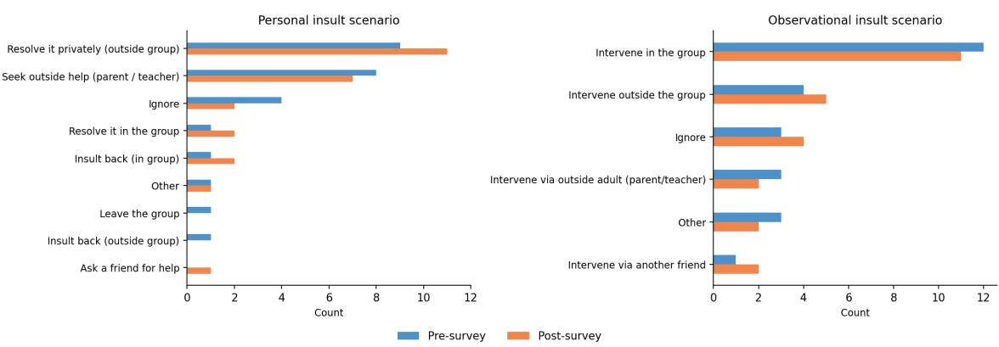  
Fig. 9. Coping strategies for insult situations, either personally (left), or observing someone else being insulted (right)

Wenting Zou, Qian Yang, Dominic DiFranzo, Melissa Chen, Winice Hui, and Natalie N Bazarova. 2024. Social Media Co-pilot: Designing a chatbot with teens and educators to combat cyberbullying. International Journal ofChild-Computer Interaction 41 (2024), 100680.

## A Study procedure instruments

The following instruments can be found in the link below: Introductory text, pre- and post-survey, exit-interview protocol:

https://osf.io/x4hqe/overview?view\_only=4ed01a88718b4b7eae0a3eddd7e1fcfd

## B Coping strategies for insult situations

## C Codebook Used for Thematic Analysis

The exit interviews were analyzed using a three-level coding hierarchy. For concision, the codebook below reports the first two levels and provides a brief description of the content captured by each code. Descriptions of second-level codes reflect the corresponding third-level codes used during analysis, where applicable. Third-level codes are not shown.

Table 2. Codebook used for thematic analysis. The codebook was applied to the exit interviews included in the analysis; the two pilot sessions were used to develop the codebook and are excluded.
<table><tr><td>Main category</td><td>Subcategory</td><td>Description</td></tr><tr><td>Educational approach</td><td>Perception of Lilo</td><td>Perceptions of Lilo, including its perceived age, whether it sounded like a real person, positive or negative impressions of the character, and its friendly, non-instructional learning tone.</td></tr><tr><td>Educational approach</td><td>Traffic-light model</td><td>Perceptions of the traffic-light model and its educational mech- anisms, including reframing, real-time feedback, self-reflection, and positive reinforcement.</td></tr><tr><td>Authenticity</td><td>Characters authenticity</td><td>Perceptions of whether the peer characters sounded like real children or did not, and whether their portrayal was age- appropriate.</td></tr><tr><td>Authenticity</td><td>Perception of characters</td><td>Participants&#x27; impressions of the peer characters as individuals, including their perceived dispositions and behavior.</td></tr><tr><td>Authenticity</td><td>Scenario authenticity</td><td>Perceptions of whether the scenario reflected real-life situ- ations, including personal identification with the topic and whether the scenario did or did not resemble real-life experi- ences.</td></tr><tr><td>Authenticity</td><td>Authentic self-expression</td><td>Participants&#x27; perceptions of their ability to express themselves authentically during the interaction.</td></tr><tr><td>Learning process</td><td>Safe practice</td><td>Perceptions of Lilo as a practice environment, including emo- tional safety and interaction with AI as a non-judgmental space.</td></tr><tr><td>Learning process</td><td>Self-efficacy</td><td>Participants&#x27; perceptions of their self-efficacy in the context of the experience.</td></tr><tr><td>Learning process</td><td></td><td>Relevance to personal experience Connections between the experience and situations encoun- tered in participants&#x27; real lives, including negative ones.</td></tr><tr><td>Learning process</td><td>Motivation and engagement</td><td>Participants&#x27; engagement with the experience, including expe- riences of loneliness or responsibility burden during the inter- action.</td></tr><tr><td>Attitudes</td><td>Perceived impact</td><td>Perceived impact of the experience, including conflict manage- ment, application of the traffic-light model, changes in attitude, potential for future use, and changes in communication dis- course.</td></tr><tr><td>Attitudes</td><td>Positive satisfaction</td><td>Positive expressions of satisfaction with the experience.</td></tr><tr><td>Suggestions for improvement</td><td></td><td>Suggestions for changes or improvements to Lilo or the experi- ence.</td></tr></table>