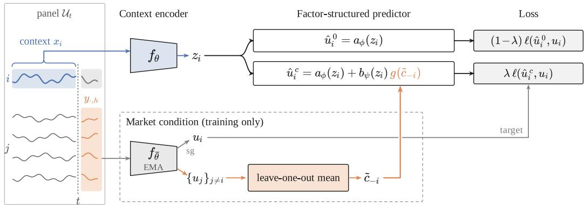
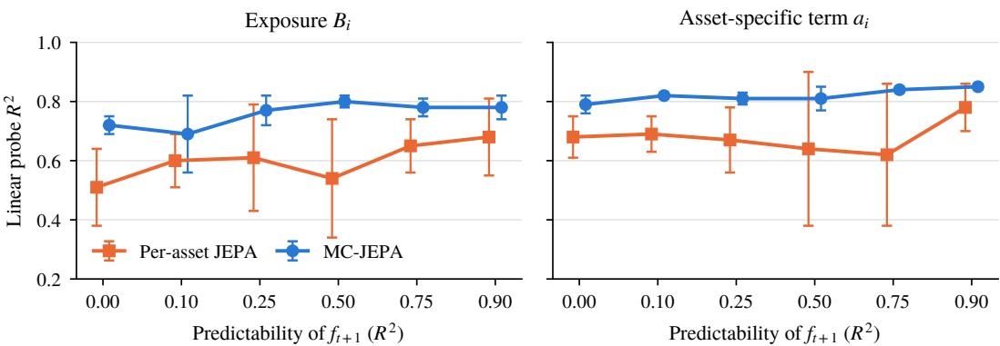
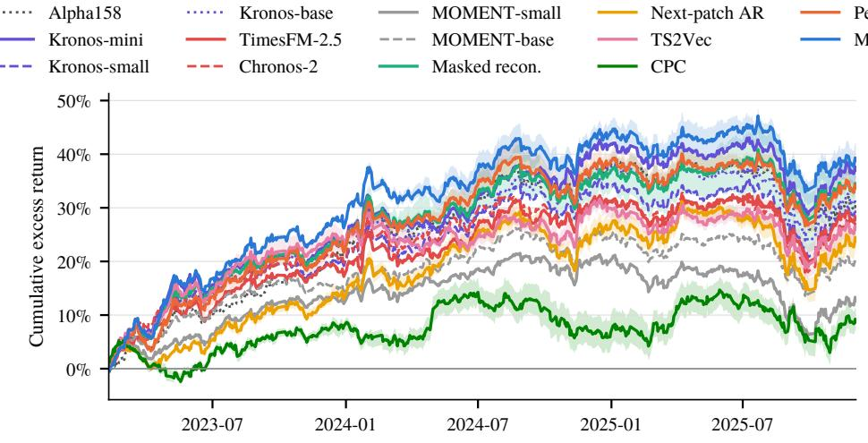
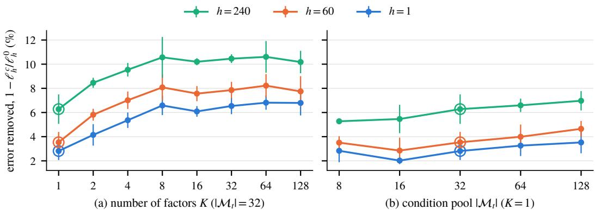

# Market-Conditioned JEPA: Learning from Unpredictable Market Shocks

Yuqi Wang1 Fengyuan Liu1,2 Mukai Li1 Haochen Luo1 Lei Li1 Qi Liu1 1The University of Hong Kong 2Grace Investment Machine wangyuqi@connect.hku.hk, liuqi@hku.hk

## Abstract

Much of the variation in financial time series is driven by market-wide shocks that cannot be predicted from an asset’s own history. Per-asset self-supervised learning treats this variation as irreducible noise. Under a latent factor model, we show that conditioning prediction on the realized market factor makes the asset’s market exposure necessary for optimal prediction, while reducing the noise against which the asset-specific component is learned. Building on this insight, we introduce Market-Conditioned JEPA (MC-JEPA), a joint-embedding predictive architecture for financial time series. During training, we construct a leave-one-out market condition for each asset from the future target embeddings of other assets and incorporate it through factor loadings derived from the asset’s own representation. On 11 years of minute-level Chinese A-share data, MC-JEPA improves over perasset JEPA across nine targets spanning returns, market exposure, risk, and liquidity, with the strongest and most statistically significant gains in exposure, risk, and liquidity. It achieves the best RankIC on all liquidity targets and on return horizons from two hours to five days, outperforming time-series foundation models and self-supervised baselines, and delivers the best portfolio performance in a historical backtest. Ablations show that the return and exposure gains require the condition to be aligned with the realized market movement. After restoring the volatility scale removed by normalization, the predictor’s factor loadings rank stocks by market beta nearly as well as a supervised probe, without labels. A synthetic factor-model study with known parameters shows that conditioning improves the recovery of both market exposure and the asset-specific component.

## 1 Introduction

Portfolio construction and risk management require estimates of an asset’s return, volatility, liquidity, and market exposure, which measures how an asset responds to market-wide movements. Selfsupervised learning offers a way to learn a unified representation that supports these diverse tasks. Recent work has developed a large number of time-series encoders and foundation models [Nie et al., 2023, Yue et al., 2022, Goswami et al., 2024, Das et al., 2024, Ansari et al., 2025], including models pretrained specifically on financial data [Shi et al., 2025]. However, these methods largely learn from individual time series, overlooking the common-factor structure of financial markets.

Under this structure, much of an asset’s variation is driven by market-wide shocks [Sharpe, 1964, Fama and French, 1993], which are difficult to predict from an asset’s own history. Therefore, a per-asset prediction objective treats the unpredictable component of these shocks as irreducible noise. This has two costs. First, the optimal predictor need only recover the asset’s conditional mean, without identifying how the asset responds to market movements. This provides limited supervision for market exposure. Second, the asset-specific signal that the predictor learns is observed against this market noise. Existing approaches that explicitly model cross-asset relationships [Xu et al., 2021, Li et al., 2024, Gu et al., 2021] are largely designed for supervised return prediction and often require cross-sectional information at inference. FactorVAE [Duan et al., 2022] is closely related to our approach, as it uses future cross-sectional returns to infer latent factors during training. However, it is a supervised return prediction model built on engineered daily features, and its factor predictor still aggregates information across stocks at inference. In contrast, MC-JEPA learns selfsupervised representations by conditioning on a market factor constructed from other assets’ future target embeddings. The resulting encoder operates independently on each asset at inference.

Our key observation is that unpredictable market movements are observable during training through the realized futures of other assets. Conditioning prediction on these movements turns them from noise into supervision, shifting the learning objective from forecasting market shocks to capturing how each asset responds to them. We formalize this in a latent factor model, showing that marketconditioned prediction makes exposure necessary for optimal prediction and removes the market component from the noise against which the asset-specific signal is learned.

Building on this observation, we introduce Market-Conditioned JEPA (MC-JEPA), a jointembedding predictive architecture [Assran et al., 2023] for financial time series. A per-asset encoder embeds each asset’s recent history to a representation, and a predictor estimates its future target embeddings. During training, we construct a leave-one-out market condition by aggregating the future target embeddings of other assets in the same panel. We then introduce a factor-structured predictor that incorporates this condition through loadings derived from the asset’s own representation, following the structure of a single-index factor model [Sharpe, 1964]. The market condition therefore cannot explain the target by itself. It helps only to the extent that the representation encodes the asset’s exposure. The market condition is privileged information [Duan et al., 2022] available only during training. At inference, the encoder is a standard per-asset model that requires no cross-sectional information.

We train MC-JEPA on minute-level candlesticks of the full cross-section of Chinese A-share stocks from 2015 to 2022 and evaluate the frozen representations with ridge probes on a held-out 2023–2025 period. It improves on per-asset JEPA across nine targets spanning returns, market exposure, risk, and liquidity, with the largest and most significant improvements in exposure, risk, and liquidity. It achieves the highest RankIC on all liquidity targets and on returns from two hours to five days, outperforming time-series foundation models and self-supervised baselines. In a historical trading backtest, it achieves the highest excess return and Sharpe ratio and the lowest maximum drawdown. Ablations show that the gains in return and exposure prediction depend on conditioning on the realized market movement over the same target period. Neither panel training alone nor conditioning on a different date reproduces these gains. The factor loadings of the predictor are also interpretable. Rescaled by the price volatility that per-asset normalization removes, they rank stocks by market beta nearly as well as a supervised probe, without any beta labels. A synthetic factor-model study with known parameters further shows that conditioning improves the recovery of both the true market exposure and the asset-specific component.

Our contributions are as follows:

• We show under a latent factor model that market conditioning makes exposure necessary for optimal prediction and reduces noise in learning asset-specific signals.

• We introduce MC-JEPA, which uses market conditioning during training to learn standalone per-asset representations.

• We demonstrate improvements across financial prediction tasks and a trading backtest, and show that the predictor’s factor loadings encode market exposure without labels.

## 2 Related Work

Self-supervised learning for time series. Self-supervised learning for time series has three main directions. Contrastive methods learn representations by aligning augmented views or temporally related windows of a series [van den Oord et al., 2019, Tonekaboni et al., 2021, Ennadir et al., 2025, Woo et al., 2022, Liu and Chen, 2024]. Masked-reconstruction methods recover hidden input patches from their surrounding context [Nie et al., 2023, Dong et al., 2023, Goswami et al., 2024]. More recently, large-scale pretraining has produced foundation models that forecast across diverse time-series corpora [Das et al., 2024, Rasul et al., 2024, Liu et al., 2025, Ansari et al., 2025, He et al., 2025, HE et al., 2026], as well as general-purpose encoders that learn transferable representations [Lin et al., 2024, Fu and Hu, 2025]. Joint-embedding predictive architectures (JEPA) [Assran et al., 2023] instead predict representations produced by a slowly updated target encoder, avoiding the need to reconstruct unpredictable details in input space. JEPA objectives have been adapted to time series for control [Girgis et al., 2025], in-context forecasting [Verdenius et al., 2024], general representation learning [Ennadir et al., 2025] and anomaly prediction [He et al., 2026], and recently to equity modeling [Luo et al., 2026, Merchant et al., 2026]. Finance-specific foundation models such as Kronos [Shi et al., 2025] pretrain on large-scale candlestick data, yet recent evaluations find that both generic and finance-pretrained models give limited gains on financial returns [Rahimikia et al., 2025, Alonso and Franklin, 2026]. A common limitation of these approaches is that they encode each asset independently and predict its future from its own history. However, in financial markets, much of an asset’s future variation is driven by market-wide shocks that cannot be inferred from its history alone. Consequently, such objectives provide little supervision for learning how an asset responds to these shocks. Our method addresses this limitation by retaining a per-asset JEPA encoder while conditioning its predictor on a market factor constructed from other assets’ future embeddings during training, which turns unpredictable market variation into a learning signal for market exposure.

  
Figure 1: MC-JEPA. During training, each asset’s future embedding is predicted both unconditionally and conditioned on a market factor derived from the future target embeddings of other assets. The factor enters through loadings computed from the asset’s own representation. At inference, only the per-asset context encoder $f _ { \theta }$ is retained.

Cross-asset dependencies in financial markets. Asset pricing has long modeled returns through asset-specific exposures to common factors, from the CAPM [Sharpe, 1964] to multi-factor models [Fama and French, 1993]. Such commonality extends beyond returns to order flow and liquidity [Hasbrouck and Seppi, 2001]. Two lines of work are particularly relevant to ours. First, factor-based neural models learn asset-specific exposures to shared factors. Conditional autoencoders [Gu et al., 2021] model exposures as nonlinear functions of asset characteristics and combine them with factors estimated from contemporaneous realized returns. FactorVAE [Duan et al., 2022] uses future cross-sectional returns as privileged information to infer latent factors during training. Both are supervised return-prediction models built on engineered daily features. In contrast, we bring the same factor exposure structure into self-supervised learning from raw time series. Asset-specific exposures are learned from each asset’s representation, and the market factor is constructed from other assets’ future target embeddings. Second, cross-asset neural models explicitly incorporate information from other assets through stock graphs and shared concepts [Xu et al., 2021], inter-stock attention with market gating [Li et al., 2024], spatiotemporal bootstrapping over correlated series [Wang et al., 2023], or correlation-aware adapters and group attention in foundation models [Cheng et al., 2026, Ansari et al., 2025]. These approaches generally rely on cross-sectional context at inference, while channel-mixing architectures can be less robust to distribution shift than channel-independent ones [Han et al., 2023]. Our method instead uses the market factor only to condition the predictor during training, leaving the deployed encoder fully per-asset and independent of cross-sectional inputs.

## 3 Method

We first describe a per-asset JEPA baseline (section 3.1), then show that its objective treats unpredictable market variation as noise (section 3.2). This motivates MC-JEPA, which conditions a factor-structured predictor on realized market variation (section 3.3). Figure 1 illustrates the framework.

## 3.1 Per-asset JEPA

Training panels. Each training sample consists of a decision time t and a panel $\mathcal { U } _ { t }$ of assets trading around t. For each asset $i \in \mathcal { U } _ { t }$ , the context $x _ { i } \in \mathbb { R } ^ { L \times F }$ contains the most recent L bars of $F$ features, ending at t. Each feature is standardized using the mean and standard deviation of its context window. Future bars are normalized using the same statistics, preserving their values relative to the observed history without leaking future information.

Context and target encoders. The context encoder $f _ { \theta }$ divides $x _ { i }$ into non-overlapping patches of $p$ bars [Nie et al., 2023], linearly embeds each patch, and processes the sequence with a bidirectional Transformer [Vaswani et al., 2017] equipped with learned positional embeddings and a learnable [CLS] token. The final [CLS] state gives the asset representation $z _ { i } = f _ { \theta } ( x _ { i } ) \in \breve { \mathbb R } ^ { D }$

Following JEPA [Assran et al., 2023], a target encoder $f _ { \bar { \theta } }$ with the same architecture is updated by an exponential moving average, $\bar { \theta }  \tau \bar { \theta } + ( 1 ^ {  } \tau ) \theta$ , with τ annealed from $\tau _ { 0 }$ to 1. For each prediction horizon $h \in \mathcal H$ , the target block $y _ { i , h }$ contains future bars beginning h bars after t. Its embedding is

$$
u _ { i , h } = \mathrm { s g } \big ( f _ { \bar { \theta } } ( y _ { i , h } ) \big ) \in \mathbb { R } ^ { D } ,\tag{1}
$$

where $\operatorname { s g } ( \cdot )$ denotes stop-gradient.

Prediction objective. A predictor $P _ { \phi }$ takes $z _ { i }$ and a learned horizon embedding $e _ { h }$ to predict $u _ { i , h }$ To account for differences in target scale across horizons, we standardize target embeddings using running statistics. Let $\mu _ { h }$ and $\bar { \Sigma } _ { h }$ denote the running mean and covariance of $u . _ { , h }$ , and define $s _ { h } ^ { 2 } = \mathrm { t r } \big ( \Sigma _ { h } \big ) / D$ . We use the normalized mean-squared error

$$
\begin{array} { r } { \ell _ { h } ( \hat { u } , u ) = \frac { 1 } { D } \bigl \| \hat { u } - ( u - \mu _ { h } ) / s _ { h } \bigr \| _ { 2 } ^ { 2 } . } \end{array}\tag{2}
$$

Predicting the target mean yields an expected loss of approximately 1. Thus, the normalized loss measures prediction error relative to a common mean-prediction baseline, making losses comparable across horizons.

The per-asset JEPA objective is $\mathcal { L } _ { \mathrm { J E P A } } = \mathbb { E } _ { i , h } \ell _ { h } \big ( P _ { \phi } ( z _ { i } , h ) , u _ { i , h } \big )$ . Each asset is predicted independently and the panel serves only as a training batch.

## 3.2 Market Shocks: Noise for Per-Asset Prediction, Supervision under Conditioning

Financial assets co-move because their returns are partly driven by common market shocks [Sharpe, 1964, Fama and French, 1993]. To understand what per-asset prediction learns about this dependence, consider a latent factor model of the future target embedding:

$$
u _ { i , h } = \alpha _ { i } + B _ { i } f _ { h } + \varepsilon _ { i , h } ,\tag{3}
$$

where $\boldsymbol { \alpha } _ { i } \in \mathbb { R } ^ { D }$ is an asset-specific component, $B _ { i } \in \mathbb { R } ^ { D \times K }$ is its exposure to $K$ common factors, $f _ { h } \in \mathbb { R } ^ { K }$ is the realized future market factor, and $\varepsilon _ { i , h }$ is idiosyncratic noise satisfying $\mathbb { E } [ \varepsilon _ { i , h }$ $x _ { i } , f _ { h } ] = 0$ . We assume $\alpha _ { i }$ and $B _ { i }$ are determined by the asset’s history $x _ { i }$

Short-horizon market shocks are difficult to predict from an individual asset’s history. We formalize this limiting case by assuming that $f _ { h }$ is independent of $x _ { i }$ , with mean m and covariance $\Sigma _ { f }$ . The best prediction of $u _ { i , h }$ from the asset’s own history is then its conditional mean

$$
\boldsymbol { \bar { u } } ( \boldsymbol { x } _ { i } ) = \mathbb { E } [ u _ { i , h } \mid \boldsymbol { x } _ { i } ] = \alpha _ { i } + B _ { i } \boldsymbol { m } ,\tag{4}
$$

in which the exposure $B _ { i }$ appears only through the expected factor m. For a representation $z = \varphi ( x _ { i } )$ we compare the unconditional prediction error min $\dot { \operatorname { P } } \mathbb { E } \| u _ { i , h } - P ( z ) \| ^ { 2 }$ with the market-conditioned prediction error min $_ { P } \mathbb { E } \| u _ { i , h } - P ( z , f _ { h } ) \| ^ { 2 }$ , where the predictor additionally observes the realized factor.

Proposition 1. Under (3) and the assumptions above, let $z = \varphi ( x _ { i } )$ be a representation

(a) Over all representations, the minimum unconditional prediction error is $\mathbb { E } \| B _ { i } ( f _ { h } - m ) \| ^ { 2 } +$ $\mathbb { E } \Vert \varepsilon _ { i , h } \Vert ^ { 2 } .$ . A representation z attains it if and only $i f \bar { u } ( x _ { i } )$ can be recoveredfrom z.

(b) $I f \Sigma _ { f } \succ 0 ,$ , the minimum market-conditioned prediction error over all representations is $\mathbb { E } \Vert \varepsilon _ { i , h } \Vert ^ { 2 }$ A representation z attains it ifand only ifboth $\alpha _ { i }$ and $B _ { i }$ can be recoveredfrom z.

The proof is in Appendix A. Part (a) shows that unconditional prediction requires only the conditional mean ${ \bar { u } } ( x _ { i } )$ , not the exposure $B _ { i }$ separately. The unpredictable component $\bar { B } _ { i } ( f _ { h } - \dot { m } )$ contributes to irreducible error without providing additional supervision for exposure. Although market factors may be partially predictable in practice, their unpredictable variation remains uninformative for learning exposure under unconditional prediction.

Part (b) shows how conditioning changes this. When the predictor observes the realized market factor, its prediction error includes an additional term that penalizes exposure information missing from the representation. Achieving the minimum error requires preserving $B _ { i }$ . Therefore, conditioning turns irreducible market variation into supervision for learning asset-specific exposure.

Conditioning reduces prediction noise. By accounting for realized market shocks, conditioning reduces the noise in learning asset-specific signals. This complements exposure learning by improving beta and risk prediction through market exposure and benefiting return and volume prediction through cleaner asset-specific representations. In practice, the learned condition reduces unconditional prediction error by 4.5% at $K = 1$ , indicating a modest denoising effect (Appendix E).

## 3.3 MC-JEPA

Motivated by Proposition 1, we introduce a market condition estimated from other assets’ future embeddings and a factor-structured predictor that uses this condition through loadings computed from the asset’s own representation.

Market condition from future embeddings. Although the realized market factor $f _ { h }$ is latent, its common component is reflected in the future embeddings of other assets. For each scored asset $i ,$ we construct a leave-one-out market condition from a pool $\mathcal { M } _ { t } \subseteq \mathcal { U } _ { t }$

$$
c _ { - i , h } = \frac { 1 } { | \mathcal { M } _ { t } | - 1 } \sum _ { j \in \mathcal { M } _ { t } \backslash \left\{ i \right\} } u _ { j , h } , \qquad \tilde { c } _ { - i , h } = \big ( c _ { - i , h } - \mu _ { h } ^ { c } \big ) / s _ { h } ^ { c } ,\tag{5}
$$

where $\mu _ { h } ^ { c }$ and $s _ { h } ^ { c }$ are running statistics of the full-pool mean, computed as in (2). When idiosyncratic noise is weakly correlated across assets, averaging reduces this noise while retaining variation driven by common market factors. As long as the factor effects do not cancel across assets, $c _ { - i , h }$ serves as a noisy proxy for the realized market factor $f _ { h }$

We exclude asset i from the mean so that the condition never contains its own target, which would allow the predictor to copy the answer. The condition is built from target embeddings, so it carries no gradient and costs only forward passes of the target encoder. The condition pool can also be larger than the scored asset set $\boldsymbol { \mathcal { S } } _ { t } \subseteq \bar { \boldsymbol { \mathcal { M } } } _ { t }$ , allowing the market estimate to aggregate more assets without increasing the number of online encoder evaluations.

Factor-structured predictor. To turn the market condition into supervision for asset-specific exposure, we structure the predictor so that the market factor influences each asset’s prediction through loadings inferred from its own representation. Following the exposure–factor decomposition in (3), we produce an unconditional and a market-conditioned prediction:

$$
\hat { u } _ { i , h } ^ { 0 } = a _ { \phi } ( z _ { i } , h ) , \qquad \hat { u } _ { i , h } ^ { c } = a _ { \phi } ( z _ { i } , h ) + B _ { \psi } ( z _ { i } , h ) g ( \tilde { c } _ { - i , h } ) ,\tag{6}
$$

where $a _ { \phi }$ is a base predictor, g extracts a low-dimensional market factor, and $B _ { \psi }$ computes assetspecific loadings from $z _ { i }$

This factorization restricts how market information enters prediction. Both passes share the same base $a _ { \phi } .$ , which never observes the condition. Any asset-dependent adjustment from the realized market factor must be mediated by loadings computed from $z _ { i }$ . The bilinear term $B _ { \psi } ( z _ { i } , h ) g ( \tilde { c } _ { - i , h } )$ mirrors the latent factor model. When the learned factor retains the relevant market variation, accurate conditional prediction rewards representations that encode the asset’s exposure. The factor dimension K further limits the capacity of the market-dependent adjustment.

We use a single factor $( K = 1 )$ , so $g ( \tilde { c } _ { - i , h } ) = w ^ { \top } \tilde { c } _ { - i , h }$ is a scalar and $B _ { \psi } ( z _ { i } , h )$ reduces to a loading vector $b _ { \psi } ( z _ { i } , h ) \in \mathbb R ^ { D }$ . This gives a latent analogue of the single-index model [Sharpe, 1964], in which each asset’s response to a common factor is determined by its own representation.

Training objective. We supervise both predictions against the same future target:

$$
\mathcal { L } = ( 1 - \lambda ) \mathbb { E } _ { i , h } \ell _ { h } \big ( \hat { u } _ { i , h } ^ { 0 } , u _ { i , h } \big ) + \lambda \mathbb { E } _ { i , h } \ell _ { h } \big ( \hat { u } _ { i , h } ^ { c } , u _ { i , h } \big ) ,\tag{7}
$$

where the expectation is over decision times $t ,$ scored assets $i \in S _ { t }$ and horizons $h \in \mathcal H$ . The weight $\lambda \in [ 0 , 1 ]$ ] controls the contribution of the conditional objective and $\lambda = 0$ recovers the per-asset JEPA baseline.

The unconditional term preserves the representation’s ability to predict what is inferable from the asset’s own history, while the conditional term additionally supervises its response to realized market variation. Both passes share the encoder outputs and base prediction, so the overhead over per-asset JEPA is the loading network and the target encoder’s forward passes over the condition pool.

Inference. The market condition is privileged information [Duan et al., 2022] during training only. Downstream tasks use $z _ { i } = f _ { \theta } ( x _ { i } )$ , which depends on asset $i \ ' _ { \mathbf { S } }$ own history alone. No peer assets, future observations, or market index are required at inference. MC-JEPA thus incorporates cross-asset supervision during training while retaining the inference interface and cost of a standard per-asset encoder.

## 4 Experiments

## 4.1 Experimental Setup

Datasets and Baselines. We use 1-minute OHLCV bars of Chinese A-share stocks from 2015 to 2025. All splits are chronological. Pretraining uses decision times before July 2022. For evaluation we freeze each encoder and embed one window per stock and trading day, ending at the target’s decision time. Daily targets are decided at the 15:00 close. Minute targets are decided at the 11:30 morning close. We fit ridge probes on 2019-01 to 2022-06, select the ridge penalty and the hyperparameters of MC-JEPA on 2022-07 to 2022-12, and report results on 2023-01 to 2025-12. We compare against three groups of baselines. (i) Finance-specific baselines. We use the Alpha158 daily factors [Yang et al., 2020]. Like the encoders, it is read out with a ridge probe. (ii) Pretrained time-seriesfoundation models. We use frozen Kronos [Shi et al., 2025], TimesFM-2.5 [Das et al., 2024], Chronos-2 [Ansari et al., 2025] and MOMENT [Goswami et al., 2024]. (iii) Self-supervised objectives. We compare objectives under the same encoder architecture, training data and compute budget. These include masked patch reconstruction (Masked recon.) [Nie et al., 2023, Dong et al., 2023], next-patch autoregression (Next-patch AR), TS2Vec [Yue et al., 2022], CPC [van den Oord et al., 2019], and per-asset JEPA (section 3.1). Ablations that isolate each component of our method are in section 4.3. Each encoder is read out from the [CLS] state if its objective trains it (JEPA variants and CPC), and from the mean of its patch states otherwise. For every baseline we checked that this is the better of the two readouts. Every encoder we train is run with three seeds, and we report the mean and standard deviation.

Evaluation metrics. We evaluate nine downstream targets spanning returns, market exposure, risk, and liquidity. These include future returns over horizons from 120 minutes to 20 days, forward 20-day market beta, realized volatility, relative volume, and the fraction of next-day volume traded at the open. Our primary metric is RankIC, computed as the Spearman correlation between predictions and realized targets across stocks on each test day, averaged over the test period. We further assess economic value through a historical long-only backtest using the Ret 20d predictions, reporting annualized excess return (AER), Sharpe ratio, information ratio (IR), and maximum drawdown (MDD). Appendix D provides detailed definitions of all targets and metrics.

Implementation details. Inputs are 1-minute OHLCV bars with a context of $L = 9 6 0$ bars, split into 96 patches of $p = 1 0$ bars. The encoder is a 12-layer Transformer with width $D = 2 5 6$ (about 10M parameters). Targets are 30-bar blocks at horizons $\mathcal { H } = \{ 1 , 6 0 , 2 4 0 \}$ bars, spanning the next half hour to the next trading day. Each step samples 128 decision times, each with a condition pool of $| \mathcal { M } _ { t } | = 3 2$ assets of which $\left| \dot { \boldsymbol { S } } _ { t } \right| = 8$ are scored. The pool is drawn uniformly at random from all assets around $t ,$ and the scored assets are a uniform random subset of the pool. Appendix C lists all hyperparameters.

Table 1: Main results on the 2023–2025 test set. We report RankIC of ridge probes fitted to frozen encoder representations or Alpha158 features. Encoders trained in our experiments report mean±std over three seeds. Bold and underlined values indicate the best and second-best scores, respectively.
<table><tr><td></td><td colspan="4">Return</td><td>Exposure</td><td>Risk</td><td colspan="3">Liquidity</td></tr><tr><td>Method</td><td>Ret 120m</td><td>Ret 1d</td><td>Ret 5d</td><td>Ret 20d</td><td>Beta 20d</td><td>Vol 120m</td><td>Volume 120m</td><td>Volume 1d Open vol share</td><td></td></tr><tr><td>Alpha158</td><td>.0425</td><td>.0591</td><td>.0867</td><td>.1011</td><td>.356</td><td>.364</td><td>.257</td><td>.417</td><td>.353</td></tr><tr><td>Kronos-mini</td><td>.0521</td><td>.0652</td><td>.1028</td><td>.1395</td><td>.324</td><td>.397</td><td>.466</td><td>.367</td><td>.358</td></tr><tr><td>Kronos-small</td><td>.0601</td><td>.0673</td><td>.1035</td><td>.1418</td><td>.333</td><td>.419</td><td>.552</td><td>.423</td><td>.376</td></tr><tr><td>Kronos-base</td><td>.0647</td><td>.0649</td><td>.1048</td><td>.1409</td><td>.348</td><td>.450</td><td>.568</td><td>.433</td><td>.381</td></tr><tr><td>TimesFM-2.5</td><td>.0564</td><td>.0626</td><td>.0983</td><td>.1358</td><td>.350</td><td>.424</td><td>.515</td><td>.406</td><td>.373</td></tr><tr><td>Chronos-2</td><td>.0649</td><td>.0639</td><td>.1023</td><td>.1390</td><td>.362</td><td>.491</td><td>.580</td><td>440</td><td>.387</td></tr><tr><td>MOMENT-small</td><td>.0552</td><td>.0677</td><td>.0972</td><td>.1261</td><td>.293</td><td>.333</td><td>.527</td><td>.390</td><td>.358</td></tr><tr><td>MOMENT-base</td><td>.0564</td><td>.0643</td><td>.0962</td><td>.1262</td><td>.294</td><td>.324</td><td>.524</td><td>.387</td><td>.356</td></tr><tr><td>Masked recon.</td><td> $. 0 6 0 5 _ { \pm . 0 0 4 1 }$ </td><td></td><td>.0682±.0008 .0998±.0010 .1295±.0013</td><td></td><td>.324±.017</td><td>.317±.007</td><td> $. 4 9 2 _ { \pm . 0 1 6 }$ </td><td> $. 3 9 3 _ { \pm . 0 0 5 }$ </td><td> $. 3 6 1 _ { \pm . 0 0 8 }$ </td></tr><tr><td>Next-patch AR</td><td> $. 0 6 4 8 _ { \pm . 0 0 2 6 }$ </td><td> $. 0 6 8 1 _ { \pm . 0 0 0 4 }$ </td><td> $. 1 0 0 2 _ { \pm . 0 0 1 0 }$ </td><td> $. 1 3 1 5 _ { \pm . 0 0 1 7 }$ </td><td>.382±.006</td><td>.395±.009</td><td> $. 5 4 0 _ { \pm . 0 0 2 }$ </td><td> $. 4 1 9 _ { \pm . 0 0 1 }$ </td><td> $. 3 9 0 _ { \pm . 0 0 1 }$ </td></tr><tr><td>TS2Vec</td><td> $. 0 5 8 6 _ { \pm . 0 0 1 8 }$ </td><td> $. 0 6 8 7 _ { \pm . 0 0 0 5 }$ </td><td> $\frac { 1 0 5 8 } { - } \pm . 0 0 1 0$ </td><td> $\mathbf { 1 4 5 4 } _ { \pm . 0 0 1 2 }$ </td><td>382±.002</td><td>.384±.017</td><td> $. 4 6 9 _ { \pm . 0 0 7 }$ </td><td> $. 3 7 7 _ { \pm . 0 0 5 }$ </td><td> $. 3 6 4 _ { \pm . 0 0 2 }$ </td></tr><tr><td>CPC</td><td> $. 0 6 3 4 _ { \pm . 0 0 2 4 }$ </td><td> $. 0 6 6 8 _ { \pm . 0 0 2 9 }$ </td><td> $. 1 0 1 1 _ { \pm . 0 0 4 9 }$ </td><td> $. 1 3 9 7 _ { \pm . 0 0 0 8 }$ </td><td>.391±.004</td><td> $. 5 5 2 _ { \pm . 0 0 5 }$ </td><td> $. 5 4 2 _ { \pm . 0 0 4 }$ </td><td> $. 4 0 1 _ { \pm . 0 0 5 }$ </td><td> $. 3 9 0 _ { \pm . 0 0 2 }$ </td></tr><tr><td>Per-asset JEPA</td><td> $\phantom { - } . 0 6 7 7 _ { \pm . 0 0 2 6 }$ </td><td> $. 0 7 1 2 { \scriptstyle \pm . 0 0 0 9 }$ </td><td> $. 1 0 3 8 _ { \pm . 0 0 0 6 }$ </td><td> $. 1 3 3 7 _ { \pm . 0 0 2 5 }$ </td><td>.359±.003</td><td> $. 4 4 4 _ { \pm . 0 1 7 }$ </td><td> $. 5 7 3 _ { \pm . 0 0 5 }$ </td><td> $. 4 4 0 _ { \pm . 0 0 3 }$ </td><td> $\underline { { 3 9 1 } } \pm . 0 0 2$ </td></tr><tr><td>MC-JEPA</td><td> $\mathbf { . 0 6 9 4 } _ { \pm . 0 0 0 9 }$ </td><td> $\mathbf { 0 7 4 6 } _ { \pm . 0 0 0 3 }$ </td><td> $\mathbf { \lambda _ { 1 0 7 4 } } _ { \pm . 0 0 0 4 }$ </td><td> $. 1 3 8 9 _ { \pm . 0 0 1 5 }$ </td><td> $. 3 7 4 _ { \pm . 0 0 3 }$ </td><td> $. 5 1 7 _ { \pm . 0 0 7 }$ </td><td> $. 5 9 4 _ { \pm . 0 0 6 }$ </td><td> $. 4 5 4 _ { \pm . 0 0 5 }$ </td><td> $. 3 9 7 _ { \pm . 0 0 1 }$ </td></tr></table>

Table 2: Backtest results on the 2023–2025 test period. Each day, the strategy selects the 7–8 stocks with the highest ridge-predicted 20-day returns among point-in-time CSI300 index members and holds them for 20 trading days. Results are net of 5/15 bp transaction costs, with excess returns measured against the CSI300 index. AER denotes annualized excess return, Sharpe the annualized Sharpe ratio, IR the annualized information ratio of the excess return, and MDD the magnitude of maximum drawdown. Encoders trained in our experiments report $\mathrm { \ m e a n _ { \pm s t d } }$ over three seeds. Bold and underlined values indicate the best and second-best scores, respectively.
<table><tr><td>Method</td><td>AER↑</td><td>Sharpe ↑</td><td>IR↑</td><td>MDD↓</td></tr><tr><td>Alpha158</td><td>0.103</td><td>1.07</td><td>1.16</td><td>0.135</td></tr><tr><td>Kronos-mini Kronos-small</td><td>0.128 0.101</td><td>1.09 0.95</td><td>1.32 1.12</td><td>0.159 0.177</td></tr><tr><td>Kronos-base TimesFM-2.5 Chronos-2</td><td>0.107 0.096 0.092</td><td>0.99 0.89 0.86</td><td>1.16 1.07 1.01</td><td>0.161 0.190 0.186</td></tr><tr><td>MOMENT-small</td><td>0.044</td><td>0.61</td><td>0.57</td><td>0.182</td></tr><tr><td>MOMENT-base</td><td>0.069</td><td>0.77</td><td>0.86</td><td>0.197</td></tr><tr><td>Masked recon.</td><td> $0 . 1 1 8 _ { \pm 0 . 0 1 7 }$ </td><td> $1 . 0 8 _ { \pm 0 . 1 2 }$ </td><td> $\underline { { 1 . 2 4 _ { \pm 0 . 1 5 } } }$ </td><td> $0 . 1 5 1 _ { \pm 0 . 0 1 0 }$ </td></tr><tr><td>Next-patch AR</td><td> $0 . 0 8 3 _ { \pm 0 . 0 0 9 }$ </td><td></td><td> $0 . 8 5 _ { \pm 0 . 0 8 }$ </td><td></td></tr><tr><td>TS2Vec</td><td></td><td> $0 . 9 0 _ { \pm 0 . 0 5 }$ </td><td></td><td> $0 . 1 5 4 _ { \pm 0 . 0 0 7 }$ </td></tr><tr><td></td><td> $0 . 0 9 0 _ { \pm 0 . 0 1 2 }$ </td><td> $0 . 8 5 _ { \pm 0 . 0 7 }$ </td><td> $0 . 9 7 _ { \pm 0 . 1 3 }$ </td><td> $0 . 1 8 4 _ { \pm 0 . 0 1 3 }$ </td></tr><tr><td>CPC</td><td> $0 . 0 3 0 { \scriptstyle \pm 0 . 0 0 7 }$ </td><td> $0 . 5 0 { \scriptstyle \pm 0 . 0 5 }$ </td><td> $0 . 3 6 _ { \pm 0 . 0 9 }$ </td><td> $0 . 2 4 7 _ { \pm 0 . 0 1 4 }$ </td></tr><tr><td>Per-asset JEPA</td><td> $0 . 1 1 7 _ { \pm 0 . 0 0 6 }$ </td><td> $\underline { { 1 . 1 1 _ { \pm 0 . 0 3 } } }$ </td><td> $1 . 2 0 { \scriptstyle \pm 0 . 0 7 }$ </td><td> $0 . 1 3 2 { \scriptstyle \pm 0 . 0 1 0 }$ </td></tr><tr><td></td><td></td><td></td><td></td><td></td></tr><tr><td>MC-JEPA</td><td> $\mathbf { 0 . 1 3 5 _ { \pm 0 . 0 1 1 } }$ </td><td> ${ \bf 1 . 1 9 { _ { \pm 0 . 0 8 } } }$ </td><td> ${ \bf 1 . 3 2 _ { \pm 0 . 0 9 } }$ </td><td> $\mathbf { 0 . 1 1 7 _ { \pm 0 . 0 0 1 } }$ </td></tr></table>

## 4.2 Results

Table 1 reports results on nine downstream targets. Tables 7 and 8 in Appendix report the minute targets at shorter horizons and four more daily targets.

One representation for return, risk and liquidity. MC-JEPA achieves the best RankIC on six of the nine targets, covering returns from two hours to five days and all three liquidity targets, and is second on intraday volatility, behind CPC. On Ret 20d, TS2Vec leads with a RankIC of 0.1454, compared with 0.1389 for MC-JEPA. Among the trained encoders, MC-JEPA has the smallest seed standard deviation on the three return targets up to five days.

Conditioning improves on per-asset JEPA. Per-asset JEPA uses the same setup and differs only in the conditional term of (7). Adding the condition improves all nine targets. Paired Newey–West tests (Table 12) show the gain significant at the 5% level on seven of the nine targets. The gains are not uniform across target types. Gains on exposure, risk, and liquidity are all significant, with t-statistics ranging from 6.9 to 49.4. Return gains are smaller and significant only for Ret 1d and Ret 20d. Next-patch AR, TS2Vec and CPC score higher on Beta 20d but are clearly worse on returns and volume. We compare the representation with trailing-beta estimators in Appendix F.

Table 3: Ablation results on the 2023–2025 test period. We report RankIC of ridge probes fitted to frozen representations, using the targets in Table 1. Each variant changes only the indicated component or hyperparameter relative to MC-JEPA. Results are reported as $\mathrm { \ m e a n _ { \pm s t d } }$ over three seeds. Bold values indicate the best score in each column.
<table><tr><td rowspan="2">Variant</td><td colspan="4">Return</td><td>Exposure</td><td>Risk</td><td colspan="3">Liquidity</td></tr><tr><td>Ret 120m</td><td>Ret 1d</td><td>Ret 5d</td><td>Ret 20d</td><td></td><td></td><td></td><td>Beta 20d Vol 120m Volume 120m Volume 1d Open vol share</td><td></td></tr><tr><td>(a) Components</td></tr><tr><td>Per-asset JEPA</td><td> $. 0 6 7 7 _ { \pm . 0 0 2 6 }$ </td><td> $. 0 7 1 2 _ { \pm . 0 0 0 9 }$ </td><td> $. 1 0 3 8 _ { \pm . 0 0 0 6 }$ </td><td>.1337±.0025</td><td> $. 3 5 9 _ { \pm . 0 0 3 }$ </td><td> $. 4 4 4 _ { \pm . 0 1 7 }$ </td><td> $. 5 7 3 _ { \pm . 0 0 5 }$ </td><td> $. 4 4 0 _ { \pm . 0 0 3 }$ </td><td> $. 3 9 1 _ { \pm . 0 0 2 }$ </td></tr><tr><td>Panel JEPA (λ = 0)</td><td> $. 0 6 6 3 _ { \pm . 0 0 1 3 }$ </td><td> $. 0 7 1 4 _ { \pm . 0 0 0 4 }$ </td><td></td><td>.1042±.0010 .1354±.0006 .345±.005</td><td></td><td> $. 4 3 9 _ { \pm . 0 2 9 }$ </td><td> $. 5 7 2 _ { \pm . 0 0 4 }$ </td><td> $. 4 3 9 _ { \pm . 0 0 3 }$ </td><td> $. 3 8 8 _ { \pm . 0 0 1 }$ </td></tr><tr><td>Placebo condition (other date)</td><td> $. 0 6 6 7 _ { \pm . 0 0 4 4 }$ </td><td>.0720±.0015 .1031±.0016 .1350±.0036 .362±.002</td><td></td><td></td><td></td><td> $. 4 8 7 _ { \pm . 0 2 3 }$ </td><td> $. 5 8 4 _ { \pm . 0 0 3 }$ </td><td> $. 4 4 8 _ { \pm . 0 0 4 }$ </td><td> $. 3 9 2 _ { \pm . 0 0 3 }$ </td></tr><tr><td>Unfactored predictor</td><td>.0658±.0006 .0732±.0015 .1066±.0011 .1365±.0013 .366±.002</td><td></td><td></td><td></td><td></td><td> $. 4 9 8 _ { \pm . 0 1 6 }$ </td><td> $. 5 8 9 _ { \pm . 0 0 6 }$ </td><td> $. 4 5 0 _ { \pm . 0 0 4 }$ </td><td> $. 3 9 4 _ { \pm . 0 0 1 }$ </td></tr><tr><td>(b) Condition weight λ</td></tr><tr><td> $\lambda = 0 . 2 5$ </td><td></td><td></td><td>.0663±.0014 .0719±.0004 .1040±.0007 .1350±.0004 .365±.002 .505±.003</td><td></td><td></td><td></td><td> $. 5 8 9 _ { \pm . 0 0 1 }$ </td><td> $. 4 5 0 _ { \pm . 0 0 3 }$ </td><td> $. 3 9 6 _ { \pm . 0 0 1 }$ </td></tr><tr><td> $\lambda = 0 . 5$ </td><td> $. 0 6 8 5 _ { \pm . 0 0 2 0 }$ </td><td></td><td>.0735±.0014 .1055±.0025 .1382±.0027 .367±.002</td><td></td><td></td><td> $. 5 1 9 _ { \pm . 0 1 2 }$ </td><td> $. 5 8 9 _ { \pm . 0 0 6 }$ </td><td> $. 4 5 0 _ { \pm . 0 0 3 }$ </td><td> $. 3 9 6 _ { \pm . 0 0 1 }$ </td></tr><tr><td> $\lambda = 1$ </td><td> $. 0 6 7 4 _ { \pm . 0 0 3 1 }$ </td><td></td><td>.0742±.0014 .1059±.0014 .1375±.0016 .371±.005</td><td></td><td></td><td> $. 5 2 4 _ { \pm . 0 0 7 }$ </td><td> $. 5 9 4 _ { \pm . 0 0 5 }$ </td><td> $. 4 5 3 _ { \pm . 0 0 1 }$ </td><td> $. 3 9 7 _ { \pm . 0 0 1 }$ </td></tr><tr><td>(c) Number of factors K</td></tr><tr><td></td><td></td><td></td><td></td><td></td><td></td><td></td><td> $. 5 9 8 { \scriptstyle \pm . 0 0 4 }$ </td><td> $. 4 5 4 _ { \pm . 0 0 5 }$ </td><td> $\mathbf { . 3 9 9 } _ { \pm . 0 0 3 }$ </td></tr><tr><td> $K = 2$   $K = 4$ </td><td>.0677±.0004 .0720±.0006 .1050±.0008 .1379±.0017 .378±.007 .527±.010 .0702±.0010 .0713±.0021 .1056±.0023 .1380±.0015 .379±.004 .540±.017</td><td></td><td></td><td></td><td></td><td></td><td> $. 6 0 0 { \scriptstyle \pm . 0 0 2 }$ </td><td> $. 4 5 5 _ { \pm . 0 0 1 }$ </td><td> $\mathbf { . 3 9 9 } _ { \pm . 0 0 1 }$ </td></tr><tr><td> $K = 8$ </td><td>.0673±.0027 .0730±.0012 .1058±.0008 .1371±.0009 .375±.002 .524±.007</td><td></td><td></td><td></td><td></td><td></td><td> $. 5 9 8 _ { \pm . 0 0 3 }$ </td><td> $. 4 5 6 _ { \pm . 0 0 3 }$ </td><td> $. 3 9 8 _ { \pm . 0 0 2 }$ </td></tr><tr><td>K = 16</td><td>.0682±.0025 .0720±.0022 .1056±.0012 .1383±.0009 .377±.000 .538±.004</td><td></td><td></td><td></td><td></td><td></td><td> $. 5 9 9 _ { \pm . 0 0 1 }$ </td><td> $. 4 5 3 _ { \pm . 0 0 2 }$ </td><td> $. 3 9 8 _ { \pm . 0 0 1 }$ </td></tr><tr><td> $K = 3 2$ </td><td>.0680±.0007 .0712±.0017 .1050±.0013 .1379±.0014 .382±.005</td><td></td><td></td><td></td><td></td><td> $\mathbf { . 5 4 0 _ { \pm . 0 0 2 } }$ </td><td> $. 5 9 9 _ { \pm . 0 0 1 }$ </td><td> $. 4 5 5 _ { \pm . 0 0 2 }$ </td><td> $\mathbf { . 3 9 9 } _ { \pm . 0 0 0 }$ </td></tr><tr><td> $K = 6 4$ </td><td>.0689±.0011 .0715±.0013</td><td></td><td> $. 1 0 4 8 _ { \pm . 0 0 0 7 }$ </td><td>.1372±.0003 .376±.001</td><td></td><td> $. 5 3 6 _ { \pm . 0 1 2 }$ </td><td> ${ \bf 6 0 3 _ { \pm . 0 0 4 } }$ </td><td> $\mathbf { . 4 5 8 _ { \pm . 0 0 2 } }$ </td><td> $\mathbf { . 3 9 9 } _ { \pm . 0 0 1 }$ </td></tr><tr><td> $K = 1 2 8$ </td><td>.0684±.0004 .0712±.0020</td><td></td><td> $. 1 0 4 5 _ { \pm . 0 0 2 2 }$ </td><td>.1368±.0021 .377±.001</td><td></td><td> $. 5 3 8 \pm . 0 1 3$ </td><td> $. 6 0 2 { \scriptstyle \pm . 0 0 2 }$ </td><td> $. 4 5 7 _ { \pm . 0 0 0 }$ </td><td> $\mathbf { . 3 9 9 } _ { \pm . 0 0 2 }$ </td></tr><tr><td>(d) Condition pool size |Mt|</td></tr><tr><td></td><td></td><td></td><td>.0675±.0017 .0727±.0008 .1049±.0018 .1365±.0019 .369±.001</td><td></td><td></td><td> $. 5 0 9 _ { \pm . 0 0 8 }$ </td><td> $. 5 9 3 _ { \pm . 0 0 1 }$ </td><td>.451±.003</td><td> $. 3 9 6 _ { \pm . 0 0 1 }$ </td></tr><tr><td> $| \dot { \mathcal { M } } _ { t } | = 8$   $| \mathcal { M } _ { t } | = 1 6$ </td><td></td><td></td><td>.0679±.0014 .0743±.0007 .1058±.0001 .1373±.0010 .371±.003</td><td></td><td></td><td> $. 5 0 8 _ { \pm . 0 2 2 }$ </td><td> $. 5 9 3 _ { \pm . 0 0 4 }$ </td><td> $. 4 5 1 _ { \pm . 0 0 1 }$ </td><td> $. 3 9 6 _ { \pm . 0 0 1 }$ </td></tr><tr><td> $| \mathcal { M } _ { t } | = 6 4$ </td><td></td><td>.0670±.0020.0728±.0007</td><td> $1 0 5 5 _ { \pm . 0 0 0 3 }$ </td><td>.1376±.0009</td><td> $. 3 6 8 _ { \pm . 0 0 2 }$ </td><td>.518±.008</td><td> $. 5 9 1 { \scriptstyle \pm . 0 0 3 }$ </td><td> $. 4 5 2 \substack { \pm . 0 0 4 }$ </td><td> $. 3 9 7 _ { \pm . 0 0 0 }$ </td></tr><tr><td> $\lvert \mathcal { M } _ { t } \rvert = 1 2 8$ </td><td></td><td>.0685±.0012 .0737±.0017 .1058±.0015 .1385±.0016 .370±.007</td><td></td><td></td><td></td><td> $. 5 2 4 _ { \pm . 0 0 3 }$ </td><td> $. 5 9 3 _ { \pm . 0 0 5 }$ </td><td> $. 4 5 3 _ { \pm . 0 0 4 }$ </td><td> $. 3 9 5 _ { \pm . 0 0 1 }$ </td></tr><tr><td>MC-JEPA  $( \lambda = 0 . 7 5 , K = 1 , | \mathcal { M } _ { t } | = 3 2 )$ </td><td>.0694±.0009 .0746±.0003 .1074±.0004 .1389±.0015 .374±.003</td><td></td><td></td><td></td><td></td><td> $. 5 1 7 _ { \pm . 0 0 7 }$ </td><td> $. 5 9 4 _ { \pm . 0 0 6 }$ </td><td> $. 4 5 4 _ { \pm . 0 0 5 }$ </td><td> $. 3 9 7 _ { \pm . 0 0 1 }$ </td></tr></table>

Foundation models do not close the gap. Frozen time-series foundation models are competitive on liquidity, where Chronos-2 is second on both volume targets. They are weaker on returns. Every TSFM is below MC-JEPA on all three return horizons. Scale does not change this. Moving from Kronos-mini to Kronos-base improves volatility and volume, but Ret 1d stays between 0.065 and 0.067.

Backtest. Table 2 turns the Ret 20d probe into a long-only CSI300 strategy. MC-JEPA has the highest annualized excess return, the highest Sharpe ratio and the smallest maximum drawdown. Compared with per-asset JEPA, it raises excess return by 1.8 points and lowers drawdown from 0.132 to 0.117, with a seed standard deviation of 0.001 on drawdown. Figure 3 shows the cumulative excess return of each method.

## 4.3 Ablations

Table 3 isolates the contribution of each component of MC-JEPA. Tables 9 and 10 in Appendix E report the same variants on the additional targets.

The gain comes from the aligned conditioning. Panel JEPA removes conditioning by setting $\lambda = 0$ while keeping the rest of the setup unchanged. It performs comparably to per-asset JEPA on returns and liquidity but worse on Beta 20d, indicating that panel sampling alone does not explain the gains. The placebo retains the full method but constructs the condition in (5) from a different decision time, breaking its alignment with the realized market movement over the target block. It recovers some of the gains on volatility and volume but not in returns or market exposure. Paired Newey–West tests (Table 12) confirm that MC-JEPA is significantly better than the placebo on all nine targets of Table 1 at the 5% level. These results suggest that the return and exposure gains depend on conditioning on the realized market movement over the same target block, consistent with Proposition 1.

Factor structure. The unfactored predictor feeds the condition to a predictor that reads it jointly with $z _ { i } ,$ so market information can shape the prediction without passing through asset-specific loadings. It falls below MC-JEPA on all nine targets of Table 1, indicating that routing the condition through loadings computed from $z _ { i }$ is necessary.

Condition weight. Every $\lambda > 0$ improves market exposure, risk and liquidity prediction over $\lambda = 0$ while returns prediction benefits only when $\lambda \geq 0 . 5$ . Improvements on liquidity saturate at $\lambda = 0 . 2 5$ while Beta 20d and Vol 120m keep improving as λ grows. We select λ by return prediction on the validation period, where Ret 1d and Ret 5d peak at $\lambda = 0 . 7 5 ( \mathrm { T a b l e } 1 1 )$ , and they also peak there on the test period. Removing the unconditional term entirely yields the best Vol 120m performance but slightly degrades return prediction.

Number of factors. Every $K > 1$ improves market exposure and risk relative to $K = 1$ , though not monotonically in K. At $\dot { K } = 3 2$ , Beta 20d reaches 0.382, matching next-patch AR and TS2Vec in Table 1. Return prediction goes the other way, with $K = 1$ performing best on Ret 1d, Ret 5d and Ret 20d. Since we select K on the validation period, we adopt $K = 1$ to prioritize return prediction while retaining a direct latent analogue of the single-index model. These results suggest that additional factors capture cross-sectional structure relevant to risk and exposure, allowing K to be selected according to the downstream task.

Condition pool size. Return and exposure prediction peak at the default pool of $| \mathcal { M } _ { t } | = 3 2$ . Both restricting the pool to the scored assets and widening it beyond 32 lower Ret 1d, Ret 5d, Ret 20d and Beta 20d. Vol 120m is the exception, improving with pool size overall, consistent with a less noisy market estimate, while the liquidity targets barely change. A wider pool helps the risk target, but not return and exposure prediction.

## 4.4 Market Exposure Analysis

The factor loadings encode market exposure without labels. The loadings of the factor-structured predictor can be read as an exposure estimate without beta labels. We project each stock’s loading onto the mean loading of its date, and multiply by the coefficient of variation of the stock’s close price over its context window, which is the scale removed by the per-asset normalization. Its RankIC with Beta 20d is 0.368, compared with 0.374 for a supervised ridge probe on the representation and 0.287 for price scale alone. Without the scale, the projection has a RankIC of $- 0 . 0 6$ . This is because normalization hides each asset’s volatility, so the loadings capture its correlation with the market rather than its beta. Consistent with this, the projection predicts each stock’s realized correlation with the market over the next 20 days beyond its trailing four-day correlation and volatility, with a partial RankIC of 0.105. A detailed discussion is provided in Appendix F.

## 4.5 Synthetic Study

Real data offers only one level of market predictability and an unknown factor structure. We simulate a panel with both under control to examine whether conditioning improves the representation of market exposure $B _ { i }$ and the asset-specific component $a _ { i } .$ , as discussed in Section 3.2.

Setup. Returns follow a single-factor model, $\begin{array} { r } { r _ { i , t } = a _ { i } + B _ { i } f _ { t } + e _ { i , t } . } \end{array}$ , with random $a _ { i }$ and $B _ { i }$ . We control how predictable the next factor value $f _ { t + 1 }$ is from the past, from $R ^ { 2 } = 0$ to $R ^ { 2 } = 0 . 9$ . A small MLP encoder sees each asset’s recent returns and the factor path, and is trained with per-asset JEPA or with MC-JEPA. We then fit linear probes for $B _ { i }$ and $a _ { i }$ on the frozen representation of new assets. Details are in Appendix B.

Results. Figure 2 shows that MC-JEPA improves the recovery of both quantities at every level of market-factor predictability. For the exposure $B _ { i }$ , linear-probe $R ^ { 2 }$ increases from 0.51–0.68 with per-asset JEPA to 0.69–0.80 with MC-JEPA, with less variation across seeds. Per-asset JEPA learns part of $B _ { i }$ from how the asset co-moves with the factor inside the input window, and this signal does not depend on whether $f _ { t + 1 }$ is predictable. Even $\mathbf { S O } ,$ , conditioning recovers the exposure better. MC-JEPA also recovers the asset-specific component $a _ { i }$ more accurately, improving $R ^ { \dot { 2 } }$ from $0 . 6 2 – 0 . 7 8$ to 0.79–0.85. This is consistent with the denoising effect, as conditioning explains away the market noise $B _ { i } f _ { t + 1 }$ that otherwise interferes with learning $a _ { i }$ . The learned condition removes 30% of the unconditional error when $f _ { t + 1 }$ is unpredictable and $5 \%$ at $R ^ { 2 } = 0 . 9$ (Appendix E). The gain on $a _ { i }$ persists at $R ^ { 2 } = 0 . 9$ , so denoising does not account for all of it. This second effect is the one relevant to return prediction on real data, where the probe ranks assets without access to the realized market shock.

  
Figure 2: Synthetic factor-model results. We report the $R ^ { 2 }$ of linear probes fitted to frozen representations for market exposure $B _ { i }$ (left) and the asset-specific component $a _ { i }$ (right), evaluated on held-out assets. The x-axis varies the predictability of the next market factor, measured by the $R ^ { 2 }$ of predicting $f _ { t + 1 }$ from its history. Points show the mean and error bars the standard deviation over five seeds.

## 5 Conclusion

We introduced MC-JEPA, a self-supervised method that turns unpredictable market movements into supervision. Conditioning on the realized market factor makes market exposure necessary for optimal prediction and denoises the asset-specific signal. During training, a factor-structured predictor conditions on a leave-one-out market signal constructed from other assets’ future target embeddings, with loadings computed from the asset’s own representation. The condition is used only during training, leaving a per-asset encoder that requires no cross-sectional information at inference. On 11 years of minute-level Chinese A-share data, MC-JEPA improves over per-asset JEPA on all nine targets spanning returns, market exposure, risk, and liquidity, most strongly on exposure, risk, and liquidity. It achieves the highest RankIC on all liquidity targets and on returns from two hours to five days, as well as the best performance in a historical backtest. Ablations show that the gains in return and exposure prediction depend on aligning the market condition with the realized market movement over the target period. A synthetic factor-model study further demonstrates that conditioning improves the recovery of both the true market exposure and the asset-specific component.

## 6 Limitations

All real-data experiments are conducted on Chinese A-share equities at a single bar frequency. Market-specific characteristics, including heavy retail participation, daily price limits, and T+1 settlement, may influence the impact of market-wide shocks on individual stocks. Whether our gains generalize to other markets, asset classes, or frequencies remains untested. Furthermore, Proposition 1 assumes a linear factor model with access to the true factor, whereas MC-JEPA relies on an estimated leave-one-out market condition. Our use of a single factor (K = 1) also leaves richer cross-sectional structure, such as industry and style factors, to be captured implicitly. Because inputs and targets are standardized per window, the learned loadings capture co-movement with the market rather than beta. Multiplying them by the window’s price volatility recovers a cross-sectional beta ranking. Targets that preserve each asset’s scale could make the loadings a beta directly.

## References

Miquel Noguer I Alonso and Rodolfo Pereira Franklin. Pretrained time-series foundation models for financial return forecasting, 2026. URL https://arxiv.org/abs/2606.27100.

Abdul Fatir Ansari, Oleksandr Shchur, Jaris Küken, Andreas Auer, Boran Han, Pedro Mercado, Syama Sundar Rangapuram, Huibin Shen, Lorenzo Stella, Xiyuan Zhang, Mononito Goswami, Shubham Kapoor, Danielle C. Maddix, Pablo Guerron, Tony Hu, Junming Yin, Nick Erickson, Prateek Mutalik Desai, Hao Wang, Huzefa Rangwala, George Karypis, Yuyang Wang, and Michael Bohlke-Schneider. Chronos-2: From univariate to universal forecasting, 2025. URL https: //arxiv.org/abs/2510.15821.

Mahmoud Assran, Quentin Duval, Ishan Misra, Piotr Bojanowski, Pascal Vincent, Michael Rabbat, Yann LeCun, and Nicolas Ballas. Self-supervised learning from images with a joint-embedding predictive architecture. arXiv preprint arXiv:2301.08243, 2023.

Hanyin Cheng, Xingjian Wu, Yang Shu, Zhongwen Rao, Lujia Pan, Bin Yang, and Guo Guo. Cora: Boosting time series foundation models for multivariate forecasting through correlationaware adapter. In C. Vondrick, B. Hariharan, C. Raffel, L. Pinto, D. Yang, and A. Faust, editors, International Conference on Learning Representations, volume 2026, pages 106657– 106680, 2026. URL https://proceedings.iclr.cc/paper\_files/paper/2026/file/ ae3e173398d6e43fea63cbcc16fbaa98-Paper-Conference.pdf.

Abhimanyu Das, Weihao Kong, Rajat Sen, and Yichen Zhou. A decoder-only foundation model for time-series forecasting. In Ruslan Salakhutdinov, Zico Kolter, Katherine Heller, Adrian Weller, Nuria Oliver, Jonathan Scarlett, and Felix Berkenkamp, editors, Proceedings ofthe 41st International Conference on Machine Learning, volume 235 of Proceedings ofMachine Learning Research, pages 10148–10167. PMLR, 21–27 Jul 2024. URL https://proceedings.mlr. press/v235/das24c.html.

Jiaxiang Dong, Haixu Wu, Haoran Zhang, Li Zhang, Jianmin Wang, and Mingsheng Long. Simmtm: A simple pre-training framework for masked time-series modeling. In Advances in Neural Information Processing Systems, 2023.

Yitong Duan, Lei Wang, Qizhong Zhang, and Jian Li. Factorvae: A probabilistic dynamic factor model based on variational autoencoder for predicting cross-sectional stock returns. In Proceedings ofthe AAAI conference on artificial intelligence, volume 36, pages 4468–4476, 2022.

Sofiane Ennadir, Siavash Golkar, and Leopoldo Sarra. Joint embeddings go temporal. ArXiv, abs/2509.25449, 2025. URL https://api.semanticscholar.org/CorpusID:273754976.

Eugene F Fama and Kenneth R French. Common risk factors in the returns on stocks and bonds. Journal offinancial economics, 33(1):3–56, 1993.

En Fu and Yanyan Hu. Frequency-masked embedding inference: A non-contrastive approach for time series representation learning, 2025. URL https://arxiv.org/abs/2412.20790.

Abanoub M. Girgis, Alvaro Valcarce, and Mehdi Bennis. Time-series jepa for predictive remote control under capacity-limited networks, 2025. URL https://arxiv.org/abs/2406.04853.

Mononito Goswami, Konrad Szafer, Arjun Choudhry, Yifu Cai, Shuo Li, and Artur Dubrawski. MOMENT: A family of open time-series foundation models. In Ruslan Salakhutdinov, Zico Kolter, Katherine Heller, Adrian Weller, Nuria Oliver, Jonathan Scarlett, and Felix Berkenkamp, editors, Proceedings ofthe 41st International Conference on Machine Learning, volume 235 of Proceedings ofMachine Learning Research, pages 16115–16152. PMLR, 21–27 Jul 2024. URL https://proceedings.mlr.press/v235/goswami24a.html.

Shihao Gu, Bryan Kelly, and Dacheng Xiu. Autoencoder asset pricing models. Journal ofEconometrics, 222(1):429–450, 2021.

Lu Han, Han-Jia Ye, and De-Chuan Zhan. The capacity and robustness trade-off: Revisiting the channel independent strategy for multivariate time series forecasting. IEEE Transactions on Knowledge and Data Engineering, 36:7129–7142, 2023. URL https://api.semanticscholar. org/CorpusID:258060249.

Joel Hasbrouck and Duane J Seppi. Common factors in prices, order flows, and liquidity. Journal of financial Economics, 59(3):383–411, 2001.

Cheng HE, Xu Huang, Gangwei Jiang, Zhaoyi Li, Defu Lian, Hong Xie, Enhong Chen, xijie liang, Zhengzengrong, and Patrick P. C. Lee. Gtm: A general time-series model for enhanced representation learning of time-series data. In C. Vondrick, B. Hariharan, C. Raffel, L. Pinto, D. Yang, and A. Faust, editors, International Conference on Learning Representations, volume 2026, pages 7280–7309, 2026. URL https://proceedings.iclr.cc/paper\_files/paper/ 2026/file/0c6639f49f01a8578675303ce0030233-Paper-Conference.pdf.

Hui He, Kun Yi, Yuanchi Ma, Qi Zhang, Zhendong Niu, and Guansong Pang. Sempo: Lightweight foundation models for time series forecasting. In D. Belgrave, C. Zhang, H. Lin, R. Pascanu, P. Koniusz, M. Ghassemi, and N. Chen, editors, Advances in Neural Information Processing Systems, volume 38, Main Conference, pages 161846–161879. Curran Associates, Inc., 2025. doi: 10.52202/085713-5405. URL https://proceedings.neurips.cc/paper\_files/paper/ 2025/file/ecfb69ce6be017deb5a926c2718f6bc1-Paper-Conference.pdf.

Yanan He, Yunshi Wen, Xin Wang, and Tengfei Ma. Sc-jepa: Stabilizing latent predictive learning for time-series anomaly prediction. 2026. URL https://api.semanticscholar.org/CorpusID: 285286285.

Tong Li, Zhaoyang Liu, Yanyan Shen, Xue Wang, Haokun Chen, and Sen Huang. Master: Marketguided stock transformer for stock price forecasting. In Proceedings ofthe AAAI Conference on Artificial Intelligence, volume 38, pages 162–170, 2024.

Chenguo Lin, Xumeng Wen, Wei Cao, Congrui Huang, Jiang Bian, Stephen Lin, and Zhirong Wu. Nutime: Numerically multi-scaled embedding for large-scale time-series pretraining, 2024. URL https://arxiv.org/abs/2310.07402.

Jiexi Liu and Songcan Chen. Timesurl: Self-supervised contrastive learning for universal time series representation learning. In Proceedings of the AAAI Conference on Artificial Intelligence, volume 38, pages 13918–13926, 2024.

Xu Liu, Juncheng Liu, Gerald Woo, Taha Aksu, Yuxuan Liang, Roger Zimmermann, Chenghao Liu, Junnan Li, Silvio Savarese, Caiming Xiong, and Doyen Sahoo. Moirai-MoE: Empowering time series foundation models with sparse mixture of experts. In Aarti Singh, Maryam Fazel, Daniel Hsu, Simon Lacoste-Julien, Felix Berkenkamp, Tegan Maharaj, Kiri Wagstaff, and Jerry Zhu, editors, Proceedings ofthe 42nd International Conference on Machine Learning, volume 267 of Proceedings ofMachine Learning Research, pages 38940–38962. PMLR, 13–19 Jul 2025. URL https://proceedings.mlr.press/v267/liu25an.html.

Yi-Zhi Luo, Jia-He Yi, Jian-Hui Zhang, and Shuo Sun. Stock-jepa: Prior-anchored latent revision representation learning in equity markets. 2026. URL https://api.semanticscholar.org/ CorpusID:292662907.

Humzah Merchant, Alec Guthrie, Simon Mahns, Randall Balestriero, and Bradford Levy. Towards financial world modeling. In The Fortieth Annual Conference on Neural Information Processing Systems, 2026. URL https://arxiv.org/abs/2610.09048.

Yuqi Nie, Nam H. Nguyen, Phanwadee Sinthong, and Jayant Kalagnanam. A time series is worth 64 words: Long-term forecasting with transformers. In International Conference on Learning Representations, 2023.

Eghbal Rahimikia, Hao Ni, and Weiguan Wang. Re(visiting) time series foundation models in finance. ArXiv, abs/2511.18578, 2025. URL https://api.semanticscholar.org/CorpusID: 283243969.

Kashif Rasul, Arjun Ashok, Andrew Robert Williams, Hena Ghonia, Rishika Bhagwatkar, Arian Khorasani, Mohammad Javad Darvishi Bayazi, George Adamopoulos, Roland Riachi, Nadhir Hassen, Marin Biloš, Sahil Garg, Anderson Schneider, Nicolas Chapados, Alexandre Drouin, Valentina Zantedeschi, Yuriy Nevmyvaka, and Irina Rish. Lag-llama: Towards foundation models for probabilistic time series forecasting, 2024. URL https://arxiv.org/abs/2310.08278.

William F Sharpe. Capital asset prices: A theory of market equilibrium under conditions of risk. The journal of finance, 19(3):425–442, 1964.

Yu Shi, Zongliang Fu, Shuo Chen, Bohan Zhao, Wei Xu, Changshui Zhang, and Jian Li. Kronos: A foundation model for the language of financial markets, 2025. URL https://arxiv.org/abs/ 2508.02739.

Sana Tonekaboni, Danny Eytan, and Anna Goldenberg. Unsupervised Representation Learning for Time Series with Temporal Neighborhood Coding. In International Conference on Learning Representations, 2021. URL https://mlanthology.org/iclr/2021/ tonekaboni2021iclr-unsupervised/.

Aaron van den Oord, Yazhe Li, and Oriol Vinyals. Representation learning with contrastive predictive coding, 2019. URL https://arxiv.org/abs/1807.03748.

Ashish Vaswani, Noam Shazeer, Niki Parmar, Jakob Uszkoreit, Llion Jones, Aidan N Gomez, Łukasz Kaiser, and Illia Polosukhin. Attention is all you need. Advances in neural information processing systems, 30, 2017.

Stijn Verdenius, Andrea Zerio, and Roy L. M. Wang. Lat-pfn: A joint embedding predictive architecture for in-context time-series forecasting, 2024. URL https://arxiv.org/abs/2405. 10093.

Lu-Xuan Wang, Lei Bai, Ziyue Li, Rui Zhao, and Fugee Tsung. Correlated time series selfsupervised representation learning via spatiotemporal bootstrapping. 2023 IEEE 19th International Conference on Automation Science and Engineering (CASE), pages 1–7, 2023. URL https://api.semanticscholar.org/CorpusID:259138815.

Gerald Woo, Chenghao Liu, Doyen Sahoo, Akshat Kumar, and Steven Hoi. CoST: Contrastive Learning of Disentangled Seasonal-Trend Representations for Time Series Forecasting. In International Conference on Learning Representations, 2022. URL https://mlanthology.org/ iclr/2022/woo2022iclr-cost/.

Wentao Xu, Weiqing Liu, Lewen Wang, Yingce Xia, Jiang Bian, Jian Yin, and Tie-Yan Liu. Hist: A graph-based framework for stock trend forecasting via mining concept-oriented shared information. arXiv preprint arXiv:2110.13716, 2021.

Xiao Yang, Wei-Qing Liu, Dong Zhou, Jiang Bian, and Tie-Yan Liu. Qlib: An ai-oriented quantitative investment platform. ArXiv, abs/2009.11189, 2020. URL https://api.semanticscholar. org/CorpusID:221856639.

Zhihan Yue, Yujing Wang, Juanyong Duan, Tianmeng Yang, Congrui Huang, Yunhai Tong, and Bixiong Xu. Ts2vec: Towards universal representation of time series. In Proceedings of the AAAI conference on artificial intelligence, volume 36, pages 8980–8987, 2022.

## A Proof of Proposition 1

We omit the asset and horizon indices and consider the factor model

$$
u = \alpha + B f + \varepsilon ,
$$

where $\alpha = \alpha ( x )$ and $B = B ( x )$ are determined by the asset history $x .$ Let $z = \varphi ( x )$ be its learned representation. We assume finite second moments, $f$ is independent of $x ,$ with $\operatorname { \mathbb { E } } [ f ] = m$ and $\operatorname { C o v } ( f ) = \Sigma _ { f } .$ , and $\mathbb { E } [ \varepsilon \mid x , f ] = 0$

Recall the conditional mean ${ \bar { u } } ( x ) = \mathbb { E } [ u \mid x ] = \alpha + B m$ from (4), the optimal squared-error prediction given the asset’s history alone. We show that unconditional prediction requires only ${ \bar { u } } ( x )$ whereas conditioning on $f$ additionally requires the exposure $B .$

(a) Unconditional prediction. Since z is a function of $x ,$ the orthogonality of conditional expectations gives

$$
\begin{array} { r l } & { \mathbb { E } \| u - P ( z ) \| ^ { 2 } = \mathbb { E } \| u - \bar { u } ( x ) \| ^ { 2 } + \mathbb { E } \| \bar { u } ( x ) - P ( z ) \| ^ { 2 } } \\ & { \qquad = \mathbb { E } \| \varepsilon \| ^ { 2 } + \mathbb { E } \| \bar { u } ( x ) - P ( z ) \| ^ { 2 } + \mathbb { E } \| B ( f - m ) \| ^ { 2 } . } \end{array}\tag{8}
$$

The first and last terms are irreducible errors arising from unpredictable market variation and idiosyncratic noise. Neither depends on the representation or predictor. The middle term measures how much of the conditional mean ${ \bar { u } } ( x )$ cannot be recovered from z. For a fixed $z ,$ it is minimized by $P ( z ) = \mathbb { E } [ \bar { u } ( { x } ) \mid z ]$ , which gives

$$
\operatorname* { m i n } _ { P } \mathbb { E } \| u - P ( z ) \| ^ { 2 } = \mathbb { E } \| B ( f - m ) \| ^ { 2 } + \mathbb { E } \| \varepsilon \| ^ { 2 } + \mathbb { E } \| \delta _ { \bar { u } } \| ^ { 2 } , \qquad \delta _ { \bar { u } } = \bar { u } ( x ) - \mathbb { E } [ \bar { u } ( x ) \mid z ] .
$$

Consequently, the minimum prediction error equals the floor $\mathbb { E } \| B ( f - m ) \| ^ { 2 } + \mathbb { E } \| \varepsilon \| ^ { 2 }$ if and only if ${ \delta _ { \bar { u } } = 0 }$ almost surely, that $\operatorname { i s } , { \bar { u } } ( x )$ can be recovered from z. The representation need not preserve B

separately, since exposure to unpredictable market variation contributes only to the irreducible error and provides no additional supervision.

(b) Market-conditioned prediction. When the predictor also observes the realized factor $f ,$ the optimal prediction given $( { \bar { x } } , f )$ becomes

$$
\operatorname { \mathbb { E } } [ u \mid x , f ] = \alpha + B f = { \bar { u } } ( x ) + B ( f - m ) .
$$

Unlike the unconditional mean, this prediction depends on the asset’s exposure to the realized factor variation.

For a fixed representation z, the optimal predictor is

$$
{ \cal P } ^ { \star } ( z , f ) = \mathbb { E } [ u \mid z , f ] = \mathbb { E } [ \bar { u } ( x ) \mid z ] + \mathbb { E } [ B \mid z ] ( f - m ) ,\tag{9}
$$

where the second equality follows from the independence of $f$ and $x .$

Define the parts of the conditional mean and exposure that are not recoverable from z:

$$
\delta _ { \bar { u } } = \bar { u } ( \boldsymbol { x } ) - \mathbb { E } [ \bar { u } ( \boldsymbol { x } ) \mid \boldsymbol { z } ] , \qquad \delta _ { B } = B - \mathbb { E } [ B \mid \boldsymbol { z } ] .
$$

The prediction error can then be written as

$$
u - P ^ { \star } ( z , f ) = \varepsilon + \delta _ { \bar { u } } + \delta _ { B } ( f - m ) .
$$

Since $\mathbb { E } [ \varepsilon \mid x , f ] = 0$ and $f - m$ is independent of $( \delta _ { \bar { u } } , \delta _ { B } )$ with zero mean, all cross terms vanish. Therefore,

$$
\begin{array} { r l } & { \mathbb { E } \| u - P ^ { \star } ( z , f ) \| ^ { 2 } = \mathbb { E } \| \varepsilon \| ^ { 2 } + \mathbb { E } \| \delta _ { \bar { u } } + \delta _ { B } ( f - m ) \| ^ { 2 } } \\ & { \quad \quad \quad = \mathbb { E } \| \varepsilon \| ^ { 2 } + \mathbb { E } \| \delta _ { \bar { u } } \| ^ { 2 } + \mathbb { E } \mathrm { t r } ( \delta _ { B } \Sigma _ { f } \delta _ { B } ^ { \top } ) . } \end{array}\tag{10}
$$

The last term follows from

$$
\mathbb { E } \| \delta _ { B } ( \boldsymbol { f } - \boldsymbol { m } ) \| ^ { 2 } = \mathbb { E } \operatorname { t r } ( \delta _ { B } \Sigma _ { f } \delta _ { B } ^ { \top } ) .
$$

The decomposition shows that conditioning introduces an additional penalty for exposure information missing from the representation. Since $\bar { \Sigma } _ { f } \succ 0$ , this penalty is zero if and only if $\delta _ { B } = 0$ almost surely, meaning that $B$ can be recovered from z. The conditional-mean penalty is zero if and only if $\delta _ { \bar { u } } = 0$ almost surely.

This decomposition holds for any fixed z. Thus, the minimum equals the floor $\mathbb { E } \Vert \varepsilon \Vert ^ { 2 }$ if and only if both ${ \bar { u } } ( x )$ and $B$ can be recovered from z. Since m is fixed, recovering $\bar { u } ( { \boldsymbol { x } } ) = \alpha + B m$ and $\bar { B }$ is equivalent to recovering α and B, completing the proof.

## B Synthetic Panel Details

We draw $a _ { i } \sim \mathcal { N } ( 0 , 0 . 5 ^ { 2 } ) , B _ { i } \sim \mathcal { N } ( 1 , 0 . 5 ^ { 2 } )$ and $e _ { i , t } \sim \mathcal { N } ( 0 , 1 )$ . Factor predictability is set through an observed signal $s _ { t } \sim \mathcal { N } ( 0 , 1 )$ , with $f _ { t + 1 } = \rho s _ { t } + \sqrt { 1 - \rho ^ { 2 } } \eta _ { t + 1 }$ and η i.i.d. standard normal. The past then predicts $f _ { t + 1 }$ with $R ^ { 2 } = \rho ^ { 2 }$ , while $f$ stays i.i.d. with unit variance, so identifying $B _ { i }$ from history is equally hard at every $\rho .$ The encoder is a two-layer MLP that sees the last 32 returns of the asset together with the factor and signal paths. The target is the next return $r _ { i , t + 1 }$ , so (3) holds exactly, with an observed target in place of an EMA embedding. Per-asset JEPA uses $\lambda = 0$ . MC-JEPA uses $K = 1 , \lambda = 0 . 7 5$ , and the leave-one-out panel mean of the targets as the condition (5). Both train on 1,024 assets over 4,000 time steps, with 32 dates of 64 assets per step for 4,000 steps. For evaluation we simulate 1,024 new assets on a new factor path, embed 16 windows per asset with the frozen encoder, fit a probe on half of the assets and report $R ^ { 2 }$ on the other half, averaged over five seeds.

## C Model and Training Hyperparameters

Tables 4 and 5 give the configuration of MC-JEPA. Every model we train, including the self-supervised baselines, uses the same Transformer backbone (Table 4, about 10M parameters), except that nextpatch AR uses causal attention and no [CLS] token. All share the same 960-bar context and the optimizer and schedule of Table 5, and are trained with data parallelism on two NVIDIA H800 GPUs.

Self-supervised baselines. Per-asset JEPA trains on 1024 independent windows per step, matching the 1024 scored windows of MC-JEPA. TS2Vec uses its official loss and augmentations, and CPC uses InfoNCE with temperature 0.1 over the per-GPU batch. JEPA variants and CPC are read out from the final [CLS] state, whose objective trains it, and all other baselines from the mean of their final patch states. For every baseline this is the better of the two readouts.

Table 4: Encoder and predictor config.
<table><tr><td>Setting</td><td>Value</td></tr><tr><td>Patch length p</td><td>10 bars</td></tr><tr><td>Transformer layers</td><td>12</td></tr><tr><td>Width D / MLP width</td><td>256 / 1024</td></tr><tr><td>Attention heads</td><td>8</td></tr><tr><td>Encoder parameters</td><td>9.52M</td></tr><tr><td>Horizons H</td><td>{1, 60, 240} bars</td></tr><tr><td>Target block length ∆</td><td>30 bars</td></tr><tr><td>Predictor MLP blocks  $( a _ { \phi } , m _ { \psi } )$ </td><td>2</td></tr><tr><td>Number of factors K</td><td>1</td></tr></table>

Table 5: Training settings of MC-JEPA.
<table><tr><td>Setting</td><td>Value</td></tr><tr><td>Decision times per step</td><td>128</td></tr><tr><td>Condition pool  $\bar { | \mathcal { M } _ { t } | }$ </td><td>32</td></tr><tr><td>Scored assets  $\lvert S _ { t } \rvert$ </td><td>8</td></tr><tr><td>Condition weight λ</td><td>0.75</td></tr><tr><td>Optimizer</td><td>AdamW, β = (0.9, 0.95)</td></tr><tr><td>Learning rate</td><td> $3 \times 1 0 ^ { - 4 }$ </td></tr><tr><td>Schedule</td><td>1,000-step linear warm-up, cosine decay to 0</td></tr><tr><td>Weight decay</td><td>0.05</td></tr><tr><td>Gradient clipping (norm)</td><td>1.0</td></tr><tr><td>Training steps</td><td>20,000</td></tr><tr><td>EMA momentum τ</td><td>linear from  $\tau _ { 0 } = 0 . 9 9 6 \mathrm { t o } 1$ </td></tr><tr><td>Precision</td><td>bfloat16</td></tr></table>

Pretrained foundation models. We evaluate each foundation model with frozen weights using its official implementation and native inference preprocessing. We extract the final-layer hidden states used by the model’s forecasting or reconstruction head. Kronos takes full OHLCV bars, which it normalizes and tokenizes, and we average its hidden states over all bars. For TimesFM-2.5, Chronos-2 and MOMENT, we provide the close price and volume as two series, relying on each model’s internal normalization. TimesFM-2.5 and MOMENT process the two series independently, whereas Chronos-2 treats them as a multivariate input, allowing cross-series interactions through group attention. For all three models, we average the final states over the window’s patches for each series and concatenate the two series’ embeddings. Each model reads the most recent bars of the window up to its maximum context length, capped at the 960-bar window. Table 6 lists the checkpoints.

Table 6: Checkpoints of the pretrained time-series foundation model baselines.
<table><tr><td>Model</td><td>Checkpoint</td></tr><tr><td>Kronos-mini</td><td>NeoQuasar/Kronos-mini</td></tr><tr><td>Kronos-small</td><td>NeoQuasar/Kronos-small</td></tr><tr><td>Kronos-base</td><td>NeoQuasar/Kronos-base</td></tr><tr><td>TimesFM-2.5</td><td>google/timesfm-2.5-200m-pytorch</td></tr><tr><td>Chronos-2</td><td>amazon/chronos-2</td></tr><tr><td>MOMENT-small</td><td>AutonLab/MOMENT-1-small</td></tr><tr><td>MOMENT-base</td><td>AutonLab/MOMENT-1-base</td></tr></table>

## D Evaluation Targets and Metrics

## D.1 Downstream Targets

One sample is one stock on one trading day t, and all targets below are defined for that stock. Let $P _ { d }$ be its close price on day $d , V _ { d }$ its total volume on day $d ,$ and $R _ { d } = P _ { d } / P _ { d - 1 } - 1$ its daily return. Daily targets are decided at the 15:00 close of day t, so the encoder window ends at that close. Minute targets are decided at the 11:30 morning close of day t. For them, let $p _ { 0 }$ be the 11:30 close, $p _ { k }$ the close of the k-th 1-minute bar after it, $r _ { k } = p _ { k } / p _ { k - 1 } - 1$ , and $v _ { k }$ the volume of that bar. The 120 bars after 11:30 form the whole afternoon session, and we treat the lunch break as one ordinary minute. A target is dropped if the stock does not trade on every market day it spans.

• Ret hd $( h \in \{ 1 , 5 , 2 0 \}$ ): $P _ { t + 1 + h } / P _ { t + 1 } - 1$ . The return starts at the close of day $t + 1$ , so a signal formed at the close of t can be traded at the next close, as in the backtest.

• Ret km $( k \in \{ 5 , 3 0 , 6 0 , 1 2 0 \} ) \colon p _ { k } / p _ { 1 } - 1$ . The return starts after the first bar, so the bid-ask bounce and the lunch-break news in the 11:30 and 13:01 bars cannot drive it. Ret 120m is the afternoon return.

• Beta 20d: the OLS slope of $R _ { t + k }$ on $M _ { t + k }$ over $k = 1 , \ldots , 2 0$ , where $M _ { d }$ is the equalweight mean of the daily returns of all stocks on day $d .$

• Vol km $( k \in \{ 5 , 3 0 , 6 0 , 1 2 0 \} )$ ): the standard deviation of $r _ { 1 } , \ldots , r _ { k }$

• Vol 1d: the standard deviation of the 1-minute close-to-close returns of day $t + 1$ . The first of them includes the overnight gap.

• Vol 5d: the same standard deviation, pooled over days $t + 1 , \ldots , t + 5$

• MDD 5d: the largest drop of the 1-minute close from its running peak over days $t + 1 , \ldots , t +$ 5, with the peak starting at $P _ { t }$

• Volume km $( k \in \{ 5 , 3 0 , 6 0 , 1 2 0 \} ) \mathrm { { : } }$ : the mean of $v _ { 1 } , \ldots , v _ { k }$ , divided by the mean volume per bar of day t up to 11:30.

• Volume 1d: $V _ { t + 1 } / V _ { t }$

• Volume 5d: $\textstyle { \frac { 1 } { 5 } } \sum _ { k = 1 } ^ { 5 } V _ { t + k } / V _ { t }$

• Open vol share: the share of $V _ { t + 1 }$ traded in the first 30 bars of day $t + 1$

## D.2 RankIC

Let T be the test days and $\mathcal { U } _ { d }$ the stocks on day d with both a prediction $\hat { y } _ { i , d }$ and a realized target $y _ { i , d }$ . The daily RankIC is the Pearson correlation of the within-day ranks,

$$
\rho _ { d } = \mathrm { c o r r } _ { i \in \mathcal { U } _ { d } } \big ( \mathrm { r a n k } _ { d } ( \hat { y } _ { i , d } ) , \mathrm { r a n k } _ { d } ( y _ { i , d } ) \big ) ,\tag{11}
$$

with ties given their average rank. We report RankI $\begin{array} { r } { \mathrm { C } = \frac { 1 } { | T ^ { \prime } | } \sum _ { d \in \mathcal { T } ^ { \prime } } \rho _ { d } } \end{array}$ , where $\mathcal { T } ^ { \prime } \subseteq \mathcal { T }$ keeps the days with $| \mathcal { U } _ { d } | \geq 2 0$

## D.3 Backtest Metrics

The backtest of Table 2 trades the Ret 20d probe. On each signal day t, a new tranche buys the top 7 or 8 predictions among the point-in-time CSI300 members at the close of $t + 1$ and sells them at the close of $t + 2 1$ . Each tranche receives 1/20 of the capital with equal weights inside it, so the book holds 20 overlapping tranches of about 150 stocks in total. Weights are reset daily, and only the net weight change of each stock is traded, at 5 bp on buys and 15 bp on sells. Prices are daily back-adjusted closes from BaoStock. Suspended days are removed from the data, so a held stock earns zero return while suspended. Let $r _ { d }$ be the daily return of the book net of costs and $b _ { d }$ that of the CSI300 index, over the N days from the first day the book holds all 20 tranches to the end of the test period. Following Qlib [Yang et al., 2020], we use arithmetic annualization with 238 trading

  
Figure 3: Cumulative excess return over the CSI300 index of the backtest in Table 2, net of transaction costs. For the encoders trained in our experiments, lines show the mean and shaded bands the range over three seeds.

days per year:

$$
{ \mathrm { A E R } } = 2 3 8 \cdot { \frac { 1 } { N } } \sum _ { d } ( r _ { d } - b _ { d } ) ,\tag{12}
$$

$$
\mathrm { S h a r p e } = \sqrt { 2 3 8 } \frac { \mathrm { m e a n } _ { d } ( r _ { d } ) } { \mathrm { s t d } _ { d } ( r _ { d } ) } ,\tag{13}
$$

$$
\mathrm { I R } = \sqrt { 2 3 8 } { \frac { \mathrm { m e a n } _ { d } ( r _ { d } - b _ { d } ) } { \mathrm { s t d } _ { d } ( r _ { d } - b _ { d } ) } } ,\tag{14}
$$

$$
\mathrm { M D D } = \operatorname* { m a x } _ { s \leq d } \Bigl ( - \sum _ { u = s + 1 } ^ { d } r _ { u } \Bigr ) .\tag{15}
$$

AER and IR are measured in excess of the index, while Sharpe and MDD are computed on the net return of the book. The Sharpe ratio uses no risk-free rate, and the drawdown is taken on cumulative returns.

Figure 3 plots the cumulative excess return of every method in Table 2 over the test period. MC-JEPA leads from early 2024 and keeps its lead through the 2025 drawdown, with Kronos-mini the closest.

## E Additional Experiment Results

Table 7 repeats the minute targets of Table 1 at shorter horizons, and Table 8 adds four daily targets.   
Appendix D.1 defines all of them. Probes, splits and seeds are the same as in Table 1.

Minute horizons. The gains of MC-JEPA on the minute targets hold at every horizon. It is the best encoder on volume and second to CPC on volatility at 5, 30 and 60 minutes, as it is at 120 minutes. On returns it is best at 5 and 60 minutes, and at 30 minutes it trails per-asset JEPA within one seed standard deviation.

Additional daily targets. The daily targets give a more mixed picture. MC-JEPA is the best encoder on Volume 5d, consistent with Volume 1d. The daily risk targets favor CPC, which is the best encoder on all three and the best method on Vol 1d and Vol 5d. MC-JEPA ranks fourth among encoders on MDD 5d, behind CPC, next-patch AR and Chronos-2, and sixth on Vol 1d and Vol 5d, where Kronos-base and TimesFM-2.5 also lead it. Compared with per-asset JEPA, conditioning improves every daily target.

Ablations. Tables 9 and 10 report the same targets for the variants of Table 3. Every variant with an aligned condition beats both per-asset and panel JEPA on all volatility, drawdown and volume targets, at every horizon. The placebo stays below MC-JEPA on every target except Ret 60m, where the two tie. More factors help the risk and liquidity targets but hurt daily returns. Every risk and liquidity target is best at some $K > 1$ . The number of factors trades risk and liquidity prediction against return prediction. Pool size matters most at minute horizons. Vol 5m, Vol 30m and Vol 60m rise with $\vert \mathcal { M } _ { t } \vert$ as Vol 120m does, and $| \mathcal { M } _ { t } | = 1 2 8$ is above MC-JEPA on all three minute return horizons, although its Ret 30m varies widely across seeds. The daily targets change little with pool size.

Hyperparameter selection. Table 11 reports the condition weight, factor-count and condition pool variants of Table 3 on the validation period, 2022-07 to 2022-12. We select λ and K by Ret 1d and Ret 5d on this period. $\lambda = 0 . 7 5$ and $K = 1$ are best on both. Larger K improves Beta 20d and Vol 120m, and $\lambda \ge 0 . 7 5$ matches or improves on smaller weights on every target except Ret 120m. Among pool sizes, $| \mathcal { M } _ { t } | = 3 2$ is best or tied on seven of the eight targets.

Statistical significance. Table 12 tests whether the gains of MC-JEPA over per-asset JEPA and over the placebo condition are robust to day-to-day variation, and reports their consistency across seeds. For each target, we average the daily test RankIC of each method over its three seeds and compute the two-sided Newey–West t-statistic of the mean daily difference. Overlapping labels make the daily RankIC autocorrelated, so a target whose label spans $h$ trading days uses $\operatorname* { m a x } ( h , 6 )$ lags, where 6 is the automatic choice $\lfloor 4 ( T / 1 0 0 ) ^ { 2 / 9 } \rfloor$ ⌋ for $T \approx 7 2 0$ test days. This gives 20 lags for Ret 20d and Beta 20d and 6 for every other target. We also count the seeds for which the MC-JEPA run beats the run of the other method with the same seed. We report unadjusted tests at the 5% level.

Against both methods, MC-JEPA is significantly better on every exposure, risk and liquidity target, with all three seed pairs in its favor. Return gains are smaller and less uniform. On daily returns, the gains over the placebo are significant on Ret 1d, Ret 5d and Ret 20d, and the gains over per-asset JEPA are significant on Ret 1d and Ret 20d but not on Ret 5d $( t = 1 . 8 )$ , with all seed pairs in favor of MC-JEPA in each case. Ret 20d is the closest to the threshold, with $t = 2 . 2$ and 2.0. Minute returns show no reliable gain. None of the four horizons is significant against per-asset JEPA, and against the placebo only Ret 120m is.

Measured reduction. Under (3), the error of the optimal unconditional predictor is $B _ { i } ( f _ { h } - m ) + \varepsilon _ { i , h }$ whereas the error of the optimal conditional predictor is $\varepsilon _ { i , h }$ alone. Therefore, the conditional mean $\bar { u } ( \boldsymbol { x } _ { i } )$ is learned against noise of variance $\mathbb { E } \Vert \varepsilon _ { i , h } \Vert ^ { 2 }$ instead of $\mathbb { E } \| \varepsilon _ { i , h } \| ^ { 2 } + \mathbb { E } \| B _ { i } ( f _ { h } - m ) \| ^ { 2 }$ . We measure the share of the unconditional error that the learned condition removes, $1 - \ell _ { h } ^ { c } / \ell _ { h } ^ { 0 }$ , where $\ell _ { h } ^ { 0 }$ and $\ell _ { h } ^ { c }$ are the two terms of (7) at horizon h. On the 2022-07 to 2022-12 validation period, at the end of training, the panel mean of the target embeddings accounts for 26% of their variance, yet the condition of MC-JEPA $( K = 1 )$ removes only $4 . 5 \pm 0 . 9 \%$ of the unconditional error over all horizons. Figure 4 shows how this share changes with the horizon, the number of factors and the condition pool. It is largest at the longest horizon, where market moves account for more of an asset’s future. It rises with $K$ up to $K = 8$ and then levels off below $9 \%$ , and it grows with the pool mainly at the longer horizons, consistent with a less noisy market estimate. Therefore, in the target-embedding space the realized market explains only a small part of the error that remains after conditioning on the asset’s own history, even with more factors, so the denoising effect on real data is modest. Return prediction does not improve with the share of error removed, as $K = 1$ removes the least error yet achieves the best return prediction performance. As in the synthetic study, denoising does not account for all of the return gain. In the synthetic panel, a predictor that knows $a _ { i } , B _ { i }$ and $\mathbb { E } [ f _ { t + 1 }$ | past] is left with unconditional error $\mathbb { E } [ \dot { B } _ { i } ^ { 2 } ] ( 1 - \dot { R } ^ { 2 } ) + \operatorname { v a r } ( e )$ , where $R ^ { 2 }$ is the predictability of $f _ { t + 1 }$ from the past, and observing $f _ { t + 1 }$ removes the first term. The best achievable reduction falls from 56% to $1 1 \%$ as $R ^ { 2 }$ rises from $\mathsf { \ i o } \ 0 . 9 \ ( \mathbb { E } [ B _ { i } ^ { 2 } ] = 1 . 2 5 , \operatorname { v a r } ( e ) = 1 )$ . The learned condition removes $3 0 \pm 4 \%$ and $5 \pm 4 \%$ at these two ends, about half of the best achievable reduction.

## F Market Exposure in the Representation and Factor Head

With $K = 1$ , the factor-structured predictor in (6) gives each stock a loading vector $b _ { \psi } ( z _ { i } , h ) \in \mathbb R ^ { D }$ on a single market factor. We examine whether these loadings encode market exposure and whether they can be interpreted as beta directly. All results use three MC-JEPA seeds and the 2023–2025 test period.

Probed exposure. Table 13 reports ridge probes for Beta 20d on the representation $z _ { i }$ , on the loadings $b _ { \psi } \big ( z _ { i } , 2 4 0 \big )$ at the longest horizon, and on their concatenation. The loadings nearly match the representation (0.366 versus 0.374), while combining them yields only a small improvement to

  
Figure 4: Share of the unconditional error removed by the market condition at each horizon $h ,$ $1 \stackrel { \sim } { - } \ell _ { h } ^ { c } / \ell _ { h } ^ { 0 }$ , on the validation period at the end of training, (a) by number of factors K at $| \mathcal { M } _ { t } | = 3 2$ and (b) by condition pool size $\vert \mathcal { M } _ { t } \vert$ at $K = 1$ . Points show the mean and error bars the standard deviation over three seeds. The circled point is MC-JEPA in both panels.

Table 7: RankIC of the minute targets at horizons of 5, 30 and 60 minutes, decided at the 11:30 morning close. The 120-minute horizon is in Table 1. Encoders trained in our experiments report $\mathrm { \ m e a n _ { \pm s t d } }$ over three seeds. Bold and underlined values indicate the best and second-best scores, respectively.
<table><tr><td></td><td colspan="3">Return</td><td colspan="3">Risk</td><td colspan="3">Liquidity</td></tr><tr><td>Method</td><td>Ret 5m</td><td>Ret 30m</td><td>Ret 60m</td><td>Vol 5m</td><td>Vol 30m</td><td>Vol 60m</td><td>Volume 5m</td><td>Volume 30m</td><td>Volume 60m</td></tr><tr><td>Alpha158</td><td>.0459</td><td>.0629</td><td>.0607</td><td>.256</td><td>.347</td><td>.359</td><td>.172</td><td>.195</td><td>.223</td></tr><tr><td>Kronos-mini</td><td>.0546</td><td>.0682</td><td>.0625</td><td>.146</td><td>.339</td><td>.371</td><td>.292</td><td>.358</td><td>.407</td></tr><tr><td>Kronos-small</td><td>.0600</td><td>.0683</td><td>.0637</td><td>.188</td><td>.364</td><td>.395</td><td>.366</td><td>.441</td><td>.489</td></tr><tr><td>Kronos-base</td><td>.0603</td><td>.0686</td><td>.0634</td><td>.207</td><td>.394</td><td>.425</td><td>.381</td><td>.455</td><td>.502</td></tr><tr><td>TimesFM-2.5</td><td>.0599</td><td>.0727</td><td>.0696</td><td>.159</td><td>.352</td><td>.387</td><td>.343</td><td>.410</td><td>.457</td></tr><tr><td>Chronos-2</td><td>.0719</td><td>.0717</td><td>.0677</td><td>.252</td><td>.442</td><td>.469</td><td>.430</td><td>.487</td><td>.525</td></tr><tr><td>MOMENT-small</td><td>.0628</td><td>.0701</td><td>.0685</td><td>.135</td><td>.285</td><td>.313</td><td>.362</td><td>.429</td><td>.470</td></tr><tr><td>MOMENT-base</td><td>.0635</td><td>.0683</td><td>.0694</td><td>.139</td><td>.282</td><td>.307</td><td>.357</td><td>.426</td><td>.468</td></tr><tr><td>Masked recon.</td><td> $. 0 6 3 1 _ { \pm . 0 0 1 4 }$ </td><td>.0749±.0004</td><td>.0695±.011 .136±.011</td><td></td><td>.273±.013</td><td>.296±.011</td><td> $. 3 1 4 _ { \pm . 0 1 7 }$ </td><td> $. 3 8 1 _ { \pm . 0 1 8 }$ </td><td> $. 4 2 9 _ { \pm . 0 1 7 }$ </td></tr><tr><td>Next-patch AR</td><td> $. 0 6 4 5 _ { \pm . 0 0 1 6 }$ </td><td>.0748±.0017</td><td>.0671±.0021</td><td>.179±.005</td><td>.343±.006</td><td>.371±.007</td><td> $. 3 5 0 _ { \pm . 0 0 6 }$ </td><td> $. 4 1 9 _ { \pm . 0 0 4 }$ </td><td> $. 4 7 0 _ { \pm . 0 0 2 }$ </td></tr><tr><td>TS2Vec</td><td>.0630±.0006</td><td>.0742±.0018</td><td>.0704±.0009</td><td>.146±.008</td><td>.323±.013</td><td>3.356±.014</td><td> $. 3 0 3 _ { \pm . 0 0 5 }$ </td><td> $. 3 6 8 _ { \pm . 0 0 5 }$ </td><td> $. 4 1 6 _ { \pm . 0 0 5 }$ </td></tr><tr><td>CPC</td><td> $. 0 7 2 0 { \scriptstyle \pm . 0 0 1 0 }$ </td><td>.0737±.0010</td><td>.0674±.0017</td><td>.293±.002</td><td>.502±.004</td><td> ${ \bf 5 3 1 } _ { \pm . 0 0 5 }$ </td><td> $. 4 1 9 _ { \pm . 0 0 1 }$ </td><td> $. 4 6 3 _ { \pm . 0 0 2 }$ </td><td> $. 4 9 6 _ { \pm . 0 0 2 }$ </td></tr><tr><td>Per-asset JEPA</td><td>.0730±.0025</td><td>.0767±.0036</td><td>.0716±.0054</td><td>.240±.011</td><td>.408±.017</td><td>.430±.017</td><td> $. 4 2 4 _ { \pm . 0 0 2 }$ </td><td> $. 4 8 1 _ { \pm . 0 0 3 }$ </td><td> $. 5 1 7 _ { \pm . 0 0 4 }$ </td></tr><tr><td>MC-JEPA</td><td>.0742±.0014</td><td>.0754±.0020</td><td>.0716±.0022</td><td>.275±.004</td><td>.476±.006</td><td>.500±.006</td><td> ${ \bf \cdot 4 4 1 _ { \pm . 0 0 3 } }$ </td><td> $\mathbf { 5 0 0 } _ { \pm . 0 0 5 }$ </td><td> $. 5 3 8 _ { \pm . 0 0 5 }$ </td></tr></table>

0.377. Since the loadings are a function of $z _ { i } ,$ the factor head makes exposure information accessible to a linear probe rather than introducing new information.

Historical betas estimated over trailing 20, 60, and 120 days against the equal-weight market are substantially stronger (0.525). Combining them with $z _ { i }$ improves RankIC to 0.539, consistently across seeds. Therefore, learned representation provides complementary exposure information.

The raw loadings measure co-movement. We construct a label-free exposure estimate $\hat { \beta } _ { i } =$ $\langle b _ { i } , \bar { b } \rangle / \| \bar { b } \| ^ { 2 }$ , where ¯b is the mean loading across stocks on the same date. The estimate varies substantially across stocks, with a cross-sectional standard deviation of 0.33–0.43, yet its RankIC with realized Beta 20d is only −0.06. To see what it ranks instead, we compare it with two statistics of each stock’s daily returns over days t+1 to t+20. Its RankIC is 0.18 with the Pearson correlation between the stock and the equal-weight market, and −0.26 with the stock’s volatility, the standard deviation of its returns. The correlation is not carried over from the context window: after regressing out the ranks of the window’s return standard deviation and its trailing four-day correlation with the equal-weight market, computed from 5-minute returns, the partial RankIC is $0 . 1 0 5 { \scriptstyle \pm 0 . 0 0 8 }$

This discrepancy is consistent with the per-asset normalization in Section 3.1. Each asset’s context and future bars are standardized using its own context-window statistics, reducing the information about absolute volatility scales. Since $\beta _ { i } = \rho _ { i } \sigma _ { i } / \sigma _ { m } .$ , where $\rho _ { i }$ is the asset-market return correlation and $\sigma _ { i }$ and $\sigma _ { m }$ are the return volatilities of the asset and market respectively, capturing market co-movement $\rho _ { i }$ alone does not suffice to recover beta. Therefore, the raw loadings should not be read as a beta directly.

Table 8: RankIC of additional daily targets, decided at the 15:00 close. Encoders trained in our experiments report mean $\pm \mathrm { s t d }$ over three seeds. Bold and underlined values indicate the best and second-best scores, respectively.
<table><tr><td rowspan="2">Method</td><td colspan="3">Risk</td><td rowspan="2">Liquidity</td></tr><tr><td>Vol 1d</td><td>Vol 5d</td><td>MDD 5d</td></tr><tr><td>Alpha158</td><td>.582</td><td>.562</td><td>.590</td><td>Volume 5d .495</td></tr><tr><td>Kronos-mini Kronos-small</td><td>.540 .540</td><td>.522 .518</td><td>.492 .505</td><td>.451 .496</td></tr><tr><td rowspan="3">Kronos-base TimesFM-2.5 Chronos-2</td><td>.551</td><td>.532</td><td>.507</td><td>.504</td></tr><tr><td>.551</td><td>.537</td><td>.520</td><td>.486</td></tr><tr><td>.575</td><td>.557</td><td>.527</td><td>.511</td></tr><tr><td>MOMENT-small MOMENT-base</td><td>.477</td><td>.452</td><td>.491</td><td>.457</td></tr><tr><td></td><td>.468</td><td>.446</td><td>.487</td><td>.454</td></tr><tr><td>Masked recon. Next-patch AR</td><td> $. 4 6 5 _ { \pm . 0 2 8 }$ </td><td> $. 4 5 2 _ { \pm . 0 3 0 }$ </td><td> $. 5 0 0 { \scriptstyle \pm . 0 0 8 }$ </td><td> $. 4 7 3 _ { \pm . 0 0 3 }$ </td></tr><tr><td></td><td> $. 5 5 7 _ { \pm . 0 0 5 }$ </td><td> $. 5 4 3 _ { \pm . 0 0 6 }$ </td><td> $. 5 2 9 _ { \pm . 0 0 5 }$ </td><td> $. 4 9 9 _ { \pm . 0 0 1 }$ </td></tr><tr><td>TS2Vec</td><td> $. 5 2 7 _ { \pm . 0 0 4 }$ </td><td> $. 5 1 2 _ { \pm . 0 0 4 }$ </td><td> $. 5 0 9 _ { \pm . 0 0 2 }$ </td><td> $. 4 5 6 _ { \pm . 0 0 5 }$ </td></tr><tr><td>CPC</td><td> ${ \bf \delta } . 6 0 1 _ { \pm . 0 0 3 }$ </td><td> ${ \bf . 5 8 1 _ { \pm . 0 0 2 } }$ </td><td> $. 5 4 5 _ { \pm . 0 0 2 }$ </td><td> $. 4 8 9 _ { \pm . 0 0 4 }$ </td></tr><tr><td>Per-asset JEPA</td><td> $. 5 1 2 _ { \pm . 0 0 7 }$ </td><td> $. 4 9 5 _ { \pm . 0 0 7 }$ </td><td> $. 5 1 6 _ { \pm . 0 0 0 }$ </td><td> $. 5 1 3 _ { \pm . 0 0 3 }$ </td></tr><tr><td>MC-JEPA</td><td> $. 5 4 3 _ { \pm . 0 0 3 }$ </td><td> $. 5 2 5 _ { \pm . 0 0 4 }$ </td><td> $. 5 2 5 _ { \pm . 0 0 2 }$ </td><td> $. 5 2 8 _ { \pm . 0 0 5 }$ </td></tr></table>

Table 9: Ablation results on the minute targets of Table 7. Variants and seeds are as in Table 3. Bold values indicate the best score in each column.
<table><tr><td rowspan="2">Variant</td><td colspan="3">Return</td><td colspan="3">Risk</td><td colspan="3">Liquidity</td></tr><tr><td>Ret 5m</td><td>Ret 30m</td><td>Ret 60m</td><td></td><td></td><td></td><td></td><td></td><td>Vol 5m Vol 30m Vol 60m Volume 5m Volume 30m Volume 60m</td></tr><tr><td>(a) Components</td><td></td><td></td><td></td><td></td><td></td><td></td><td></td><td></td><td></td></tr><tr><td>Per-asset JEPA</td><td> $. 0 7 3 0 _ { \pm . 0 0 2 5 }$ </td><td> $. 0 7 6 7 _ { \pm . 0 0 3 6 }$ </td><td> $. 0 7 1 6 _ { \pm . 0 0 5 4 }$ </td><td> $. 2 4 0 _ { \pm . 0 1 1 }$ </td><td></td><td> $. 4 0 8 _ { \pm . 0 1 7 } . 4 3 0 _ { \pm . 0 1 7 }$ </td><td> $. 4 2 4 _ { \pm . 0 0 2 }$ </td><td> $. 4 8 1 _ { \pm . 0 0 3 }$ </td><td> $. 5 1 7 _ { \pm . 0 0 4 }$ </td></tr><tr><td>Panel JEPA  $( \lambda = 0 )$ </td><td> $. 0 7 1 8 _ { \pm . 0 0 0 8 } ^ { - }$ </td><td> $. 0 7 5 8 _ { \pm . 0 0 2 4 }$ </td><td> $. 0 7 1 7 _ { \pm . 0 0 3 6 }$ </td><td>.243±.006 .408±.023</td><td></td><td> $. 4 2 6 _ { \pm . 0 2 7 }$ </td><td> $. 4 2 5 _ { \pm . 0 0 3 }$ </td><td>.483±.004</td><td> $. 5 1 8 _ { \pm . 0 0 4 }$ </td></tr><tr><td>Placebo condition (other date) .0729±.0017 .0738±.0025</td><td></td><td></td><td> $. 0 7 1 6 _ { \pm . 0 0 6 5 }$ </td><td>.262±.010</td><td></td><td> $. 4 4 7 _ { \pm . 0 1 9 } . 4 7 0 _ { \pm . 0 2 1 }$ </td><td> $. 4 3 2 _ { \pm . 0 0 5 }$ </td><td> $. 4 9 1 _ { \pm . 0 0 4 } ^ { ^ { - - } }$ </td><td> $. 5 2 8 _ { \pm . 0 0 3 }$ </td></tr><tr><td>Unfactored predictor</td><td> $. 0 7 0 7 _ { \pm . 0 0 1 7 }$ </td><td>.0730±.0013 .0695±.0058 .270±.004 .462±.012 .483±.013</td><td></td><td></td><td></td><td></td><td> $. 4 3 7 _ { \pm . 0 0 4 }$ </td><td> $. 4 9 7 _ { \pm . 0 0 5 }$ </td><td> $. 5 3 4 _ { \pm . 0 0 5 }$ </td></tr><tr><td>(b) Condition weight λ</td><td></td><td></td><td></td><td></td><td></td><td></td><td></td><td></td><td></td></tr><tr><td> $\lambda = 0 . 2 5$ </td><td> $. 0 7 2 9 _ { \pm . 0 0 1 1 }$ </td><td>.0743±.0019 .0695±.0009 .269±.004 .464±.003</td><td></td><td></td><td></td><td> $. 4 8 7 _ { \pm . 0 0 3 }$ </td><td> $. 4 3 8 _ { \pm . 0 0 3 }$ </td><td> $. 4 9 6 _ { \pm . 0 0 1 }$ </td><td> $. 5 3 3 _ { \pm . 0 0 1 }$ </td></tr><tr><td> $\lambda = 0 . 5$ </td><td> $. 0 7 3 9 _ { \pm . 0 0 2 2 }$ </td><td></td><td>.0763±.0012 .0695±.0007 .280±.006 .478±.009</td><td></td><td></td><td> $. 5 0 2 _ { \pm . 0 1 1 }$ </td><td> $. 4 3 8 _ { \pm . 0 0 4 }$ </td><td> $. 4 9 7 _ { \pm . 0 0 6 }$ </td><td> $. 5 3 3 _ { \pm . 0 0 6 }$ </td></tr><tr><td> $\lambda = 1$ </td><td> $\mathbf { 0 7 5 7 } _ { \pm . 0 0 1 8 }$ </td><td>.0758±.0016</td><td> $\mathbf { 0 7 4 1 } _ { \pm . 0 0 4 4 }$ </td><td>.284±.007 .481±.010</td><td></td><td> $. 5 0 5 _ { \pm . 0 0 9 }$ </td><td> $. 4 4 4 _ { \pm . 0 0 3 }$ </td><td> $. 5 0 2 _ { \pm . 0 0 6 }$ </td><td> $. 5 3 8 _ { \pm . 0 0 6 }$ </td></tr><tr><td>(c) Number of factors K</td><td></td><td></td><td></td><td></td><td></td><td></td><td></td><td></td><td></td></tr><tr><td> $K = 2$ </td><td></td><td></td><td></td><td></td><td></td><td></td><td> $. 0 7 3 7 _ { \pm . 0 0 2 2 } \ : \ : . 0 7 4 9 _ { \pm . 0 0 0 9 } \ : \ : . 0 6 8 3 _ { \pm . 0 0 1 9 } \ : \ : . 2 8 5 _ { \pm . 0 0 2 } \ : \ : . 4 8 5 _ { \pm . 0 0 7 } \ : \ : . 5 0 9 _ { \pm . 0 0 9 } \ : \ : \ : . 4 4 6 _ { \pm . 0 0 3 }$ </td><td> $. 5 0 4 _ { \pm . 0 0 4 }$ </td><td> $. 5 4 1 _ { \pm . 0 0 4 }$ </td></tr><tr><td> $K = 4$ </td><td></td><td>.0735±.0007 .0754±.0021 .0691±.0006 .295±.005 .497±.014 .522±.016</td><td></td><td></td><td></td><td></td><td> $. 4 4 7 _ { \pm . 0 0 4 }$ </td><td> $. 5 0 6 _ { \pm . 0 0 3 }$ </td><td> $. 5 4 3 _ { \pm . 0 0 3 }$ </td></tr><tr><td>K = 8</td><td></td><td>.0729±.0010 .0741±.0022 .0678±.0010 .282±.009 .481±.007 .506±.006</td><td></td><td></td><td></td><td></td><td> $. 4 4 5 _ { \pm . 0 0 1 }$ </td><td> $\underline { { 5 0 4 } } . . 0 0 3$ </td><td> $. 5 4 2 _ { \pm . 0 0 3 }$ </td></tr><tr><td> $K = 1 6$ </td><td></td><td>.0745±.0020 .0770±.0016 .0735±.0016 .291±.003 .495±.003 .520±.003</td><td></td><td></td><td></td><td></td><td> $. 4 4 5 _ { \pm . 0 0 1 }$ </td><td> $. 5 0 5 _ { \pm . 0 0 1 }$ </td><td>.542±.001</td></tr><tr><td> $K = 3 2$ </td><td></td><td></td><td></td><td></td><td></td><td></td><td>.0745±.0013 .0764±.0015 .0699±.0011 .290±.003 .497±.002 .522±.002 .446±.002 .505±.001</td><td></td><td> $. 5 4 3 _ { \pm . 0 0 1 }$ </td></tr><tr><td> $K = 6 4$ </td><td></td><td> $. 0 7 3 4 _ { \pm . 0 0 0 6 } ^ { - } . 0 7 5 6 _ { \pm . 0 0 1 7 } ^ { - } . 0 7 0 3 _ { \pm . 0 0 2 2 } ^ { - } . 2 8 8 _ { \pm . 0 1 0 } ^ { - } . 4 9 3 _ { \pm . 0 1 0 } ^ { - } . 5 1 8 _ { \pm . 0 1 1 } ^ { - }$ </td><td></td><td></td><td></td><td></td><td> $. 4 4 8 _ { \pm . 0 0 0 }$ </td><td> $. 5 0 7 _ { \pm . 0 0 3 }$ </td><td> $. 5 4 5 _ { \pm . 0 0 4 }$ </td></tr><tr><td> $K = 1 2 8$ </td><td></td><td> $0 7 3 9 _ { \pm . 0 0 2 4 } \ : \ : . 0 7 6 0 _ { \pm . 0 0 2 7 } \ : \ : . 0 7 4 1 _ { \pm . 0 0 1 7 } \ : \ : . 2 8 7 _ { \pm . 0 0 8 } \ : \ : . 4 9 5 _ { \pm . 0 1 2 } \ : \ : . 5 1 9 _ { \pm . 0 1 2 }$ </td><td></td><td></td><td></td><td></td><td> $. 4 4 8 _ { \pm . 0 0 2 }$ </td><td> $. 5 0 7 _ { \pm . 0 0 2 }$ </td><td> $. 5 4 5 _ { \pm . 0 0 3 }$ </td></tr><tr><td>(d) Condition pool size |Mt|</td><td></td><td></td><td></td><td></td><td></td><td></td><td></td><td></td><td></td></tr><tr><td> $| \mathcal { M } _ { t } | = 8$ </td><td></td><td> $. 0 7 3 5 _ { \pm . 0 0 1 7 } ~ . 0 7 5 9 _ { \pm . 0 0 0 0 } ~ . 0 7 1 1 _ { \pm . 0 0 3 9 }$ </td><td></td><td></td><td></td><td>.271±.006 .465±.007 .490±.008</td><td> $. 4 4 3 _ { \pm . 0 0 2 }$ </td><td> $. 5 0 0 { \scriptstyle \pm . 0 0 1 }$ </td><td></td></tr><tr><td>|Mt| = 16</td><td></td><td> $. 0 7 2 0 _ { \pm . 0 0 3 0 } . 0 7 3 6 _ { \pm . 0 0 0 9 } . 0 6 8 7 _ { \pm . 0 0 1 3 }$ </td><td></td><td></td><td></td><td>.272±.012 .468±.018 .491±.020</td><td> $. 4 4 1 _ { \pm . 0 0 2 }$ </td><td> $. 4 9 9 _ { \pm . 0 0 3 }$ </td><td> $. 5 3 7 _ { \pm . 0 0 0 }$  .536±.003</td></tr><tr><td> $| \mathcal { M } _ { t } | = 6 4$ </td><td></td><td> $. 0 7 2 3 _ { \pm . 0 0 1 8 } . 0 7 5 7 _ { \pm . 0 0 0 2 } . 0 7 1 0 _ { \pm . 0 0 2 5 }$ </td><td></td><td>.277±.004 .475±.008</td><td></td><td> $. 4 9 9 _ { \pm . 0 0 8 }$ </td><td>.440±.003 .498±.003</td><td></td><td> $. 5 3 5 _ { \pm . 0 0 3 }$ </td></tr><tr><td> $| \mathcal { M } _ { t } | = 1 2 8$ </td><td></td><td> $. 0 7 5 3 _ { \pm . 0 0 1 7 } . 0 7 6 3 _ { \pm . 0 0 3 7 } . 0 7 2 5 _ { \pm . 0 0 0 7 }$ </td><td></td><td>.281±.004.480±.002</td><td></td><td> $. 5 0 5 { \scriptstyle \pm . 0 0 1 }$ </td><td> $. 4 4 2 _ { \pm . 0 0 3 }$ </td><td> $. 5 0 1 { \scriptstyle \pm . 0 0 4 }$ </td><td> $. 5 3 7 _ { \pm . 0 0 5 }$ </td></tr><tr><td>MC-JEPA  $( \lambda = 0 . 7 5 , K = 1 , | \mathcal { M } _ { t } | = 3 2 )$ </td><td></td><td>.0742±.0014 .0754±.0020 .0716±.0022 .275±.004 .476±.006</td><td></td><td></td><td></td><td> $. 5 0 0 { \scriptstyle \pm . 0 0 6 }$ </td><td> $. 4 4 1 { \scriptstyle \pm . 0 0 3 }$ </td><td> $. 5 0 0 { \scriptstyle \pm . 0 0 5 }$ </td><td> $. 5 3 8 { \scriptstyle \pm . 0 0 5 }$ </td></tr></table>

Restoring the removed scale. The normalization standardizes each feature by the mean and standard deviation of its context window. We restore the removed scale by multiplying ${ \hat { \beta } } _ { i }$ by the coefficient of variation of the close price over the window, $\mathrm { C V } _ { i } = \mathrm { s t d } ( \mathrm { c l o s e } ) / \mathrm { m e a n } ( \mathrm { c l o s e } )$ . RankIC is computed across stocks on each date, so the market volatility $\sigma _ { m }$ is a per-date constant and does not need to be estimated. The result uses no labels, no fitted parameters and only the stock’s own bars. Table 14 compares it with alternatives. With this scale, RankIC with Beta 20d rises from −0.060 to 0.368, close to the ridge probe on $z _ { i }$ in Table 13, and 0.08 above $\mathrm { C V } _ { i }$ alone. Therefore, the loadings add

Table 10: Ablation results on the daily targets of Table 8. Variants and seeds are as in Table 3. Bold values indicate the best score in each column.
<table><tr><td rowspan="2">Variant</td><td colspan="3">Risk</td><td rowspan="2">Liquidity</td></tr><tr><td>Vol 1d</td><td>Vol 5d</td><td>MDD 5d Volume 5d</td></tr><tr><td>(a) Components</td><td></td><td></td><td></td><td></td></tr><tr><td>Per-asset JEPA</td><td> $. 5 1 2 _ { \pm . 0 0 7 }$ </td><td> $. 4 9 5 _ { \pm . 0 0 7 }$ </td><td> $. 5 1 6 _ { \pm . 0 0 0 }$ </td><td> $. 5 1 3 _ { \pm . 0 0 3 }$ </td></tr><tr><td>Panel JEPA  $( \lambda = 0 )$ </td><td> $. 4 8 5 _ { \pm . 0 1 5 }$ </td><td> $. 4 6 7 _ { \pm . 0 1 6 }$ </td><td> $. 5 1 0 { \scriptstyle \pm . 0 0 4 }$ </td><td> $. 5 1 3 _ { \pm . 0 0 2 }$ </td></tr><tr><td>Placebo condition (other date)</td><td> $. 5 1 7 _ { \pm . 0 1 2 }$ </td><td> $. 4 9 9 _ { \pm . 0 1 1 }$ </td><td> $. 5 1 8 _ { \pm . 0 0 3 }$ </td><td> $. 5 2 2 _ { \pm . 0 0 5 }$ </td></tr><tr><td>Unfactored predictor</td><td> $. 5 2 7 _ { \pm . 0 0 4 }$ </td><td> $. 5 0 7 _ { \pm . 0 0 4 }$ </td><td> $. 5 2 0 _ { \pm . 0 0 1 }$ </td><td> $. 5 2 4 _ { \pm . 0 0 5 }$ </td></tr><tr><td>(b) Condition weight λ</td><td></td><td></td><td></td><td></td></tr><tr><td> $\lambda = 0 . 2 5$   $\lambda = 0 . 5$ </td><td> $. 5 3 7 _ { \pm . 0 1 1 }$ </td><td> $. 5 1 8 _ { \pm . 0 1 2 }$ </td><td> $. 5 2 4 _ { \pm . 0 0 1 }$ </td><td> $. 5 2 3 _ { \pm . 0 0 3 }$ </td></tr><tr><td> $\lambda = 1$ </td><td> $. 5 3 7 _ { \pm . 0 0 9 }$ </td><td> $. 5 1 5 _ { \pm . 0 0 8 }$ </td><td> $. 5 2 2 _ { \pm . 0 0 2 }$ </td><td> $. 5 2 4 _ { \pm . 0 0 3 }$ </td></tr><tr><td>(c) Number of factors K</td><td> $. 5 4 7 _ { \pm . 0 0 5 }$ </td><td> $. 5 2 7 _ { \pm . 0 0 7 }$ </td><td> $. 5 2 4 _ { \pm . 0 0 1 }$ </td><td> $. 5 2 7 _ { \pm . 0 0 1 }$ </td></tr><tr><td> $K = 2$ </td><td></td><td></td><td></td><td></td></tr><tr><td> $K = 4$ </td><td> $. 5 5 7 _ { \pm . 0 1 2 }$ </td><td> $. 5 3 7 _ { \pm . 0 1 4 }$ </td><td> $. 5 2 7 _ { \pm . 0 0 3 }$ </td><td> $. 5 2 8 _ { \pm . 0 0 5 }$ </td></tr><tr><td></td><td> $. 5 6 4 _ { \pm . 0 0 6 }$ </td><td> $. 5 4 6 _ { \pm . 0 0 7 }$ </td><td> $. 5 2 8 _ { \pm . 0 0 4 }$ </td><td> $. 5 3 0 { \scriptstyle \pm . 0 0 3 }$ </td></tr><tr><td> $K = 8$ </td><td> $. 5 5 4 _ { \pm . 0 0 8 }$ </td><td> $. 5 3 4 _ { \pm . 0 0 7 }$ </td><td> $. 5 2 8 _ { \pm . 0 0 2 }$ </td><td> $. 5 3 1 { \scriptstyle \pm . 0 0 4 }$ </td></tr><tr><td> $K = 1 6$ </td><td> $. 5 5 9 _ { \pm . 0 0 5 }$ </td><td> $. 5 4 0 _ { \pm . 0 0 5 }$ </td><td> $. 5 2 9 _ { \pm . 0 0 1 }$ </td><td> $. 5 3 0 _ { \pm . 0 0 1 }$ </td></tr><tr><td> $K = 3 2$ </td><td> $\mathbf { . 5 6 5 _ { \pm . 0 0 5 } }$ </td><td> $. 5 4 6 _ { \pm . 0 0 5 }$ </td><td> ${ \bf . 5 3 0 _ { \pm . 0 0 2 } }$ </td><td></td></tr><tr><td> $K = 6 4$ </td><td> $. 5 6 2 _ { \pm . 0 0 4 }$ </td><td> $. 5 4 1 _ { \pm . 0 0 4 }$ </td><td></td><td> $. 5 3 0 { \scriptstyle \pm . 0 0 2 }$ </td></tr><tr><td> $K = 1 2 8$ </td><td> $. 5 5 8 _ { \pm . 0 0 5 }$ </td><td> $. 5 3 8 _ { \pm . 0 0 5 }$ </td><td> $. 5 2 9 _ { \pm . 0 0 2 }$   $. 5 2 6 _ { \pm . 0 0 1 }$ </td><td> $. 5 3 2 _ { \pm . 0 0 2 }$ </td></tr><tr><td>(d) Condition pool size  $\vert \mathcal { M } _ { t } \vert$ </td><td></td><td></td><td></td><td> $. 5 3 2 _ { \pm . 0 0 1 }$ </td></tr><tr><td> $| \mathcal { M } _ { t } | = 8$ </td><td> $. 5 4 2 _ { \pm . 0 0 8 }$ </td><td></td><td></td><td></td></tr><tr><td> $| \mathcal { M } _ { t } | = 1 6$ </td><td></td><td> $. 5 2 2 _ { \pm . 0 0 7 }$ </td><td> $. 5 2 2 _ { \pm . 0 0 1 }$ </td><td> $. 5 2 6 _ { \pm . 0 0 2 }$ </td></tr><tr><td> $| \mathcal { M } _ { t } | = 6 4$ </td><td> $. 5 3 7 _ { \pm . 0 0 8 }$ </td><td> $. 5 1 7 _ { \pm . 0 0 8 }$ </td><td> $. 5 2 2 _ { \pm . 0 0 2 }$ </td><td> $. 5 2 5 _ { \pm . 0 0 1 }$ </td></tr><tr><td> $\lvert \mathcal { M } _ { t } \rvert = 1 2 8$ </td><td> $. 5 4 7 _ { \pm . 0 0 9 }$   $. 5 4 2 _ { \pm . 0 1 0 }$ </td><td> $. 5 2 8 _ { \pm . 0 0 9 }$ </td><td> $. 5 2 4 _ { \pm . 0 0 4 }$ </td><td> $. 5 2 6 _ { \pm . 0 0 4 }$ </td></tr><tr><td> $_ { \mathrm { M C - J E P A } }$ </td><td></td><td> $. 5 2 3 _ { \pm . 0 1 1 }$ </td><td> $. 5 2 5 _ { \pm . 0 0 4 }$ </td><td> $. 5 2 6 _ { \pm . 0 0 3 }$ </td></tr><tr><td> $( \lambda = 0 . 7 5 , K = 1 , | \mathcal { M } _ { t } | = 3 2 )$ </td><td> $. 5 4 3 _ { \pm . 0 0 3 }$ </td><td> $. 5 2 5 _ { \pm . 0 0 4 }$ </td><td> $. 5 2 5 _ { \pm . 0 0 2 }$ </td><td> $. 5 2 8 _ { \pm . 0 0 5 }$ </td></tr></table>

exposure information beyond the window’s scale. The trailing four-day beta against the equal-weight market is stronger, but it requires the returns of all other stocks at inference.

Table 11: Validation results (2022-07 to 2022-12) for the condition weight, factor-count and condition pool variants of Table 3, on its targets. Probes are fitted on 2019-01 to 2022-06, as in Table 3. Seeds are as in Table 3. Bold values indicate the best score in each column.
<table><tr><td rowspan="2">Variant</td><td colspan="3">Return</td><td>Exposure</td><td>Risk</td><td colspan="3">Liquidity</td></tr><tr><td>Ret 120m</td><td>Ret 1d</td><td>Ret 5d</td><td></td><td></td><td></td><td>Beta 20d Vol 120m Volume 120m Volume 1d Open vol share</td><td></td></tr><tr><td>(a) Condition weight λ</td><td></td><td></td><td></td><td></td><td></td><td></td><td></td><td></td></tr><tr><td> $\lambda = 0 . 2 5$ </td><td> $. 0 6 2 0 _ { \pm . 0 0 4 3 }$ </td><td> $. 0 7 0 7 _ { \pm . 0 0 2 1 }$ </td><td> $. 1 1 4 6 _ { \pm . 0 0 1 3 }$ </td><td> $. 3 1 1 _ { \pm . 0 0 1 }$ </td><td> $. 4 9 9 _ { \pm . 0 0 2 }$ </td><td> $. 6 1 4 _ { \pm . 0 0 2 }$ </td><td> $. 4 7 4 _ { \pm . 0 0 3 }$ </td><td> $. 4 0 5 _ { \pm . 0 0 1 }$ </td></tr><tr><td> $\lambda = 0 . 5$ </td><td> $. 0 6 7 1 _ { \pm . 0 0 3 1 }$ </td><td> $. 0 7 1 3 _ { \pm . 0 0 3 5 }$ </td><td> $. 1 1 5 9 _ { \pm . 0 0 5 1 }$ </td><td> $. 3 1 2 _ { \pm . 0 0 2 }$ </td><td> $. 5 1 4 _ { \pm . 0 0 8 }$ </td><td> $. 6 1 4 _ { \pm . 0 0 7 }$ </td><td> $. 4 7 4 _ { \pm . 0 0 2 }$ </td><td> $. 4 0 5 _ { \pm . 0 0 1 }$ </td></tr><tr><td> $\lambda = 1$ </td><td> $. 0 6 4 9 _ { \pm . 0 0 3 2 }$ </td><td> $. 0 7 3 2 _ { \pm . 0 0 2 2 }$ </td><td> $. 1 1 7 1 { \scriptstyle \pm . 0 0 2 3 }$ </td><td> $. 3 1 9 _ { \pm . 0 0 3 }$ </td><td> $. 5 1 7 _ { \pm . 0 0 9 }$ </td><td> $. 6 1 9 _ { \pm . 0 0 4 }$ </td><td> $. 4 7 7 _ { \pm . 0 0 1 }$ </td><td> $. 4 0 6 _ { \pm . 0 0 2 }$ </td></tr><tr><td>(b) Number of factors K</td><td></td><td></td><td></td><td></td><td></td><td></td><td></td><td></td></tr><tr><td> $K = 2$ </td><td> $. 0 6 5 6 _ { \pm . 0 0 2 4 }$ </td><td> $. 0 7 0 0 _ { \pm . 0 0 2 5 }$ </td><td> $. 1 1 6 0 _ { \pm . 0 0 0 7 }$ </td><td> $. 3 2 3 _ { \pm . 0 0 2 }$ </td><td> $. 5 2 1 _ { \pm . 0 0 8 }$ </td><td> $. 6 2 1 _ { \pm . 0 0 3 }$ </td><td> $. 4 7 7 _ { \pm . 0 0 4 }$ </td><td> $. 4 0 7 _ { \pm . 0 0 2 }$ </td></tr><tr><td> $K = 4$ </td><td> $\mathbf { 0 6 7 6 } _ { \pm . 0 0 3 1 }$ </td><td> $. 0 6 8 3 _ { \pm . 0 0 3 2 }$ </td><td> $. 1 1 6 7 _ { \pm . 0 0 2 8 }$ </td><td> $. 3 2 3 _ { \pm . 0 0 4 }$ </td><td> $. 5 2 5 _ { \pm . 0 1 7 }$ </td><td> $. 6 2 4 _ { \pm . 0 0 1 }$ </td><td> $. 4 8 0 _ { \pm . 0 0 1 }$ </td><td> $. 4 0 7 _ { \pm . 0 0 1 }$ </td></tr><tr><td> $K = 8$ </td><td> $. 0 6 4 5 _ { \pm . 0 0 1 6 }$ </td><td> $. 0 7 1 0 _ { \pm . 0 0 3 9 }$ </td><td> $. 1 1 6 8 _ { \pm . 0 0 2 6 }$ </td><td> $. 3 1 9 _ { \pm . 0 0 2 }$ </td><td> $. 5 1 9 _ { \pm . 0 1 2 }$ </td><td> $. 6 2 1 _ { \pm . 0 0 3 } ^ { - }$ </td><td> $. 4 8 0 _ { \pm . 0 0 4 }$ </td><td> $. 4 0 7 _ { \pm . 0 0 2 }$ </td></tr><tr><td> $K = 1 6$ </td><td> $. 0 6 5 2 _ { \pm . 0 0 2 6 }$ </td><td> $. 0 6 9 2 _ { \pm . 0 0 3 0 }$ </td><td> $. 1 1 6 1 _ { \pm . 0 0 2 6 }$ </td><td> $. 3 2 3 _ { \pm . 0 0 3 }$ </td><td> $. 5 2 9 _ { \pm . 0 0 7 }$ </td><td> $. 6 2 3 _ { \pm . 0 0 2 }$ </td><td> $. 4 7 7 _ { \pm . 0 0 2 }$ </td><td> $\mathbf { \delta . 4 0 8 _ { \pm . 0 0 1 } }$ </td></tr><tr><td> $K = 3 2$ </td><td> $. 0 6 5 8 _ { \pm . 0 0 1 2 }$ </td><td> $. 0 6 8 1 _ { \pm . 0 0 2 9 }$ </td><td> $. 1 1 4 6 _ { \pm . 0 0 3 0 }$ </td><td> $. 3 2 4 _ { \pm . 0 0 2 }$ </td><td> $. 5 3 7 _ { \pm . 0 0 3 }$ </td><td> $. 6 2 3 _ { \pm . 0 0 1 }$ </td><td> $. 4 7 9 _ { \pm . 0 0 3 }$ </td><td> $\mathbf { \delta . 4 0 8 _ { \pm . 0 0 1 } }$ </td></tr><tr><td> $K = 6 4$ </td><td> $. 0 6 4 9 _ { \pm . 0 0 1 6 }$ </td><td> $. 0 7 1 7 _ { \pm . 0 0 1 7 }$ </td><td> $. 1 1 7 2 _ { \pm . 0 0 1 5 }$ </td><td> $. 3 2 1 _ { \pm . 0 0 3 }$ </td><td> $. 5 3 4 _ { \pm . 0 1 0 }$ </td><td> ${ \bf 6 2 6 } _ { \pm . 0 0 3 }$ </td><td> $\pm 8 2 _ { \pm . 0 0 1 }$ </td><td> $. 4 0 7 _ { \pm . 0 0 1 }$ </td></tr><tr><td> $K = 1 2 8$ </td><td> $. 0 6 4 7 _ { \pm . 0 0 2 4 }$ </td><td> $. 0 6 7 9 _ { \pm . 0 0 3 1 }$ </td><td> $. 1 1 3 9 _ { \pm . 0 0 3 3 }$ </td><td> $. 3 2 3 _ { \pm . 0 0 2 }$ </td><td> $. 5 3 1 _ { \pm . 0 0 9 }$ </td><td> $. 6 2 5 _ { \pm . 0 0 2 }$ </td><td> $\pm 8 2 _ { \pm . 0 0 1 }$ </td><td> $\mathbf { \delta . 4 0 8 _ { \pm . 0 0 1 } }$ </td></tr><tr><td>(c) Condition pool size |Mt|</td><td></td><td></td><td></td><td></td><td></td><td></td><td></td><td></td></tr><tr><td> $| \mathcal { M } _ { t } | = 8$ </td><td>.0643±.0023</td><td> $. 0 7 1 2 _ { \pm . 0 0 1 9 }$ </td><td> $. 1 1 5 2 _ { \pm . 0 0 2 8 }$ </td><td> $. 3 1 1 { \scriptstyle \pm . 0 0 3 } 4 9 5 { \scriptstyle \pm . 0 0 8 }$ </td><td></td><td> $. 6 1 8 _ { \pm . 0 0 1 }$ </td><td> $. 4 7 6 _ { \pm . 0 0 2 }$ </td><td> $. 4 0 4 _ { \pm . 0 0 1 }$ </td></tr><tr><td> $| \mathcal { M } _ { t } | = 1 6$ </td><td> $. 0 6 4 7 _ { \pm . 0 0 5 2 } . 0 7 4 3 _ { \pm . 0 0 2 4 }$ </td><td></td><td> $. 1 1 7 1 { \scriptstyle \pm . 0 0 1 9 }$ </td><td> $. 3 1 7 _ { \pm . 0 0 4 } . 4 9 7 _ { \pm . 0 2 1 }$ </td><td></td><td> $. 6 1 8 _ { \pm . 0 0 3 }$ </td><td> $. 4 7 6 _ { \pm . 0 0 1 }$ </td><td> $. 4 0 5 _ { \pm . 0 0 1 }$ </td></tr><tr><td> $| \mathcal { M } _ { t } | = 6 4$ </td><td> $. 0 6 2 1 _ { \pm . 0 0 1 9 }$ </td><td> $. 0 7 0 0 { \scriptstyle \pm . 0 0 0 4 }$ </td><td> $. 1 1 5 5 _ { \pm . 0 0 2 0 }$ </td><td> $. 3 1 5 _ { \pm . 0 0 2 } ~ . 5 1 1 _ { \pm . 0 1 2 }$ </td><td></td><td> $. 6 1 6 _ { \pm . 0 0 4 }$ </td><td> $. 4 7 7 _ { \pm . 0 0 4 }$ </td><td> $. 4 0 6 _ { \pm . 0 0 1 }$ </td></tr><tr><td> $\vert \mathcal { M } _ { t } \vert = 1 2 8$ </td><td> $. 0 6 4 7 _ { \pm . 0 0 1 2 }$ </td><td> $. 0 7 1 1 _ { \pm . 0 0 2 7 }$ </td><td> $. 1 1 5 5 _ { \pm . 0 0 2 8 }$ </td><td></td><td> $. 3 1 9 _ { \pm . 0 0 1 } ~ . 5 1 5 _ { \pm . 0 0 3 }$ </td><td> $. 6 1 8 _ { \pm . 0 0 5 }$ </td><td> $. 4 7 7 _ { \pm . 0 0 4 }$ </td><td> $. 4 0 4 _ { \pm . 0 0 1 }$ </td></tr><tr><td> $\mathbf { M C - J E P A }$  (λ = 0.75, K = 1, |Mt| = 32)</td><td> $. 0 6 4 9 _ { \pm . 0 0 2 0 }$ </td><td> $. 0 7 3 5 _ { \pm . 0 0 1 0 }$ </td><td> $\mathbf { 1 1 8 2 } _ { \pm . 0 0 2 9 }$ </td><td> $. 3 1 9 _ { \pm . 0 0 2 }$ </td><td> $. 5 1 6 _ { \pm . 0 0 6 }$ </td><td> $. 6 1 9 _ { \pm . 0 0 7 }$ </td><td> $. 4 7 8 _ { \pm . 0 0 5 }$ </td><td> $. 4 0 6 _ { \pm . 0 0 1 }$ </td></tr></table>

Table 12: Paired tests of MC-JEPA against per-asset JEPA and the placebo condition on the 2023– 2025 test set. ∆ is the mean daily RankIC difference, and t is its Newey–West t-statistic, with 20 lags for Ret 20d and Beta 20d and 6 otherwise. Bold marks $t > 1 . 9 6$ , a significant improvement at the 5% level. Seeds is the number of seeds, out of three, for which MC-JEPA has the higher RankIC.
<table><tr><td></td><td colspan="3">vs. Per-asset JEPA</td><td colspan="3">vs. Placebo condition</td></tr><tr><td>Target</td><td> $\Delta$ </td><td>t</td><td>Seeds</td><td> $\Delta$ </td><td>t</td><td>Seeds</td></tr><tr><td>Return</td><td></td><td></td><td></td><td></td><td></td><td></td></tr><tr><td>Ret 5m</td><td>0.0011</td><td>1.3</td><td>2/3</td><td>0.0013</td><td>1.8</td><td>2/3</td></tr><tr><td>Ret 30m</td><td>-0.0013</td><td>-1.1</td><td>1/3</td><td>0.0016</td><td>1.7</td><td>1/3</td></tr><tr><td>Ret 60m</td><td>0.0000</td><td>0.0</td><td>1/3</td><td>0.0000</td><td>0.0</td><td>1/3</td></tr><tr><td>Ret 120m</td><td>0.0018</td><td>1.5</td><td>2/3</td><td>0.0028</td><td>3.2</td><td>2/3</td></tr><tr><td>Ret 1d</td><td>0.0034</td><td>2.3</td><td>3/3</td><td>0.0026</td><td>5.2</td><td>3/3</td></tr><tr><td>Ret 5d</td><td>0.0036</td><td>1.8</td><td>3/3</td><td>0.0042</td><td>6.5</td><td>3/3</td></tr><tr><td>Ret 20d</td><td>0.0052</td><td>2.2</td><td>3/3</td><td>0.0039</td><td>2.0</td><td>3/3</td></tr><tr><td>Exposure</td><td></td><td></td><td></td><td></td><td></td><td></td></tr><tr><td>Beta 20d</td><td>0.0149</td><td>6.9</td><td>3/3</td><td>0.0125</td><td>8.6</td><td>3/3</td></tr><tr><td>Risk</td><td></td><td></td><td></td><td></td><td></td><td></td></tr><tr><td>Vol 5m</td><td>0.0345</td><td>31.8</td><td>3/3</td><td>0.0131</td><td>18.1</td><td>3/3</td></tr><tr><td>Vol 30m</td><td>0.0672</td><td>47.0</td><td>3/3</td><td>0.0281</td><td>30.2</td><td>3/3</td></tr><tr><td>Vol 60m</td><td>0.0700</td><td>48.6</td><td>3/3</td><td>0.0297</td><td>30.5</td><td>3/3</td></tr><tr><td>Vol 120m</td><td>0.0730</td><td>49.4</td><td>3/3</td><td>0.0303</td><td>30.3</td><td>3/3</td></tr><tr><td>Vol 1d</td><td>0.0310</td><td>28.4</td><td>3/3</td><td>0.0261</td><td>23.8</td><td>3/3</td></tr><tr><td>Vol 5d</td><td>0.0299</td><td>26.3</td><td>3/3</td><td>0.0260</td><td>21.4</td><td>3/3</td></tr><tr><td>MDD 5d</td><td>0.0083</td><td>10.7</td><td>3/3</td><td>0.0068</td><td>12.4</td><td>3/3</td></tr><tr><td>Liquidity</td><td></td><td></td><td></td><td></td><td></td><td></td></tr><tr><td>Volume 5m</td><td>0.0171</td><td>43.2</td><td>3/3</td><td>0.0093</td><td>30.2</td><td>3/3</td></tr><tr><td>Volume 30m</td><td>0.0198</td><td>42.1</td><td>3/3</td><td>0.0091</td><td>24.1</td><td>3/3</td></tr><tr><td>Volume 60m</td><td>0.0205</td><td>42.4</td><td>3/3</td><td>0.0099</td><td>23.2</td><td>3/3</td></tr><tr><td>Volume 120m</td><td>0.0210</td><td>39.8</td><td>3/3</td><td>0.0096</td><td>23.0</td><td>3/3</td></tr><tr><td>Volume 1d</td><td>0.0134</td><td>25.2</td><td>3/3</td><td>0.0059</td><td>15.1</td><td>3/3</td></tr><tr><td>Volume 5d</td><td>0.0153</td><td>24.3</td><td>3/3</td><td>0.0064</td><td>14.6</td><td>3/3</td></tr><tr><td>Open vol share</td><td>0.0064</td><td>18.1</td><td>3/3</td><td>0.0049</td><td>15.4</td><td>3/3</td></tr></table>

Table 13: Ridge probes for Beta 20d on the test period. Trailing betas are estimated against the equal-weight market and do not depend on the seed. $\mathbf { M e a n } _ { \pm \mathrm { s t d } }$ over three seeds.
<table><tr><td>Features Beta 20d</td></tr><tr><td> $M C - J E P A$ </td></tr><tr><td> ${ \mathrm { R e p r e s e n t a t i o n } } z _ { i }$   $0 . 3 7 4 _ { \pm 0 . 0 0 3 }$  Loadings  $b _ { \psi } \big ( z _ { i } , 2 4 0 \big )$   $0 . 3 6 6 { \scriptstyle \pm 0 . 0 0 3 }$ </td></tr><tr><td> $z _ { i } + \mathrm { l o a d i n g s }$   $0 . 3 7 7 _ { \pm 0 . 0 0 2 }$ </td></tr><tr><td> $\mathrm { T r a i l i n g \ b e t a s }$   $0 . 5 2 5$  MC-JEPA zi + trailing betas  $0 . 5 3 9 _ { \pm 0 . 0 0 1 }$ </td></tr></table>

Table 14: Label-free beta estimates on the test period: daily RankIC with Beta 20d. $\hat { \beta } _ { i }$ is the projection of the loading onto the date’s mean loading. Window statistics are computed on the stock’s own context window. The trailing four-day beta uses 5-minute returns of all stocks over the same window. $\mathbf { M e a n } _ { \pm \mathrm { s t d } }$ over three seeds.
<table><tr><td>Estimate</td><td>Beta 20d</td></tr><tr><td> $\hat { \beta } _ { i }$ </td><td> $- 0 . 0 6 0 _ { \pm 0 . 0 1 1 }$ </td></tr><tr><td> ${ \hat { \beta } } _ { i } \times \mathrm { C V } _ { i }$ </td><td> $0 . 3 6 8 _ { \pm 0 . 0 1 0 }$ </td></tr><tr><td> $\mathrm { C V } _ { i }$ </td><td>0.287</td></tr><tr><td>Trailing 4-day beta</td><td>0.434</td></tr></table>