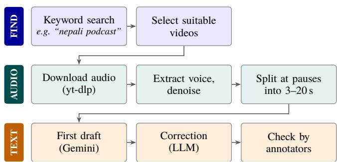
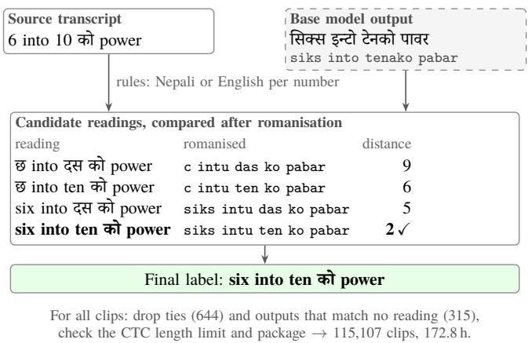
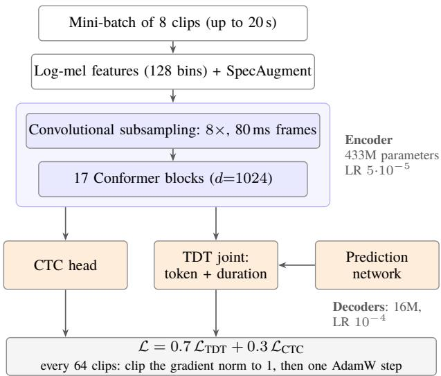
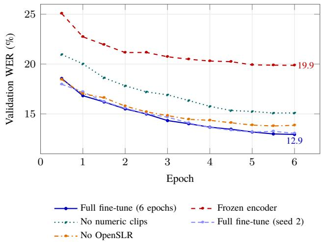
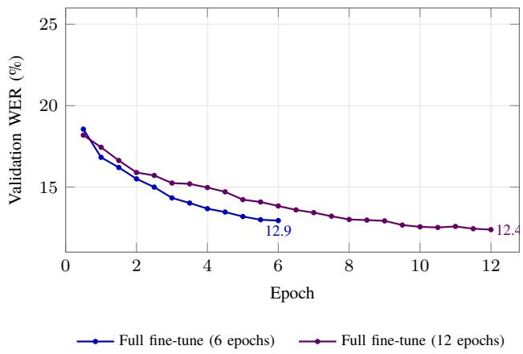

# Nepali–English Code-Mixed Speech Recognition: Data Preparation and Adaptation of a Speech Foundation Model

Jeevan Neupane, Janardan Bhetwal, Kshitiz Paudel, Anup Aryal, Bipin Bashyal

AI Lab Pvt. Ltd., Nepal

{jeevanneupane, janardanbhetwal, kshitizpaudel, anuparyal, bipinbashyal}@ailab.com.np

## Abstract

Nepali speakers regularly mix English words into conversation, but multilingual speech recognisers often struggle with language switches and the writing script used for English words. We study how to adapt SraVaani, a 449M-parameter hybrid TDT– CTC model, using a 172.8-hour corpus covering six Nepali speech domains. Its pretrained tokenizer does not support digits and several common symbols. Rather than replace it or discard these recordings, we generate Nepali and English readings for numbers and use zero-shot ASR output to select a plausible form. Full fine-tuning reduces test word error rate (WER) from 48.6% to 17.1%; a 12-epoch run reaches 16.3%, compared with 16.4% for fine-tuned Whisper large-v3-turbo. Freezing the encoder increases WER to 25.5%, while excluding numeric clips raises WER on numeric test speech from 14.3% to 21.3%. We also evaluate on FLEURS using both its original references and mixed-script alternatives. The comparison shows that transcription conventions explain part, but not all, of the out-of-domain performance loss.

Index Terms: automatic speech recognition, Nepali, codemixing, multilingual speech, text normalisation, fine-tuning

## 1. Introduction

Nepali speech frequently includes English words, particularly in discussions of education, work and technology. Speakers switch between languages within a sentence, but the written transcript is expected to retain Nepali in Devanagari and English in Latin script. A model can recognise the spoken word yet still produce the wrong script. Under standard word error rate (WER), that diference is treated as a recognition error.

Large multilingual recognisers such as Whisper [1] and Indic models trained on broad speech collections [2, 3, 4] provide a useful starting point. They do not, however, make the data preparation problem disappear. SraVaani was trained mainly on single-script utterances. On our evaluation set, its zero-shot output places many English words in Devanagari and sometimes selects another Indic script for short Nepali speech. The training labels also contain digits and punctuation that its fixed tokenizer cannot represent.

Numbers are especially dificult. The written form “1947” may correspond to a Nepali or English reading, while technical recordings contain equations and programming expressions. Removing these clips loses relevant speech. Replacing every digit with one language’s number words can produce labels that do not match the audio. We therefore construct alternative readings and select among them using the base model’s output as evidence, followed by quality checks.

Our study addresses three practical questions: how to prepare mixed-script transcripts without rebuilding the tokenizer, whether full encoder adaptation and numeric clips improve recognition, and how writing conventions afect reported error rates. We prepare 172.8 hours across six domains, compare full and restricted fine-tuning, evaluate against Whisper and Indic-Conformer, and test the same out-of-domain FLEURS speech under two reference conventions. These comparisons are intended to identify which changes matter, not to establish a new general-purpose state of the art.

## 2. Related Work

Multilingual and Indic ASR. Whisper [1] and MMS [5] cover Nepali, while IndicVoices [2], Vistaar [6] and VAANI [4] have expanded Indic speech training and evaluation. SraVaani [3] combines a FastConformer encoder [7] with Token-and-Duration Transducer (TDT) and CTC outputs [8]. We retain its pretrained vocabulary and both output heads.

Code-mixed recognition and scoring. The MUCS challenge [9] established Hindi–English and Bengali–English ASR benchmarks, and earlier work discusses code-switching and monolingual forgetting [10, 11]. Transliteration-aware measures [12, 13], language-specific metrics such as PIER [14] and switch-point evaluation [15] show why a single WER value can hide diferent errors. For Nepali, Devkota [16] studied codemixed transcription and script conversion, while Paudel [17] examined spontaneous Nepali–English podcast speech. Other Nepali comparisons include Whisper adaptation [18] and multimodel evaluation [19]. We difer in our emphasis on fixedtokenizer preparation, bilingual numbers and encoder adaptation.

Normalisation and evaluation corpora. Audio-guided text normalisation has been explored with NeMo [20]. We use a related selection principle but generate candidates in both languages and compare approximate pronunciation rather than raw script. OpenSLR Nepali [21] supplies read speech, and FLEURS [22] provides a public out-of-domain reference. Our mixed-script FLEURS version tests the influence of transcription style without changing its audio.

  
Fig. 1. YouTube speech collection: video selection, audio processing, seg-Figure 1: YouTube speech collection: video selection, audio processmentation and transcript verification.ing, segmentation and transcript verification.

## 3. Dataset Collection and Preparation

We combine public Nepali recordings with speech collected from online material. The preparation pipeline covers audio cleaning, transcript checks, train/test separation and compatibility with SraVaani’s fixed tokenizer. Figures 1 and 2 outline the main steps.

## Nepali, full of3.1 Speech sources

The corpus draws on six speech settings (Table 3). OpenSLR supplies mostly read Nepali sentences. The remaining sources in clude engineering lectures, podcasts, news and talk programmes, conversations and technical interviews. They difer in speaking style, background noise and the amount of English. Lectures, for instance, contain programming terms and mathematical expres-B. Data collectionsions that are uncommon in ordinary read speech.

## 3.2 Collection of in-the-wild speech

For the YouTube material, annotators first searched for suitable Nepali videos using a small tool built on the YouTube Data API. result with its thumbnail, duration and view count forAudio was downloaded with yt-dlp. We separated speech from background sounds, used a 300 Hz–8 kHz band-pass filter and 2) Audio extraction. The audio of each selected video isapplied denoising. Voice activity detection then split recordings downloaded with yt-dlp. The voice is separated froat pauses of at least 500 ms, targeting chunks of 3–20 seconds.

background sound, band-pass filtered (300 Hz–8 kHz)Gemini produced the first transcripts. A second LLM pass and denoised.corrected them, and human annotators checked the text against 3) Segmentation. Voice activity detection splits the audiothe recordings. The transcription convention was Nepali in De-at pauses of at least 500 ms into chunks of 3–20 s.vanagari and English words in Latin script. The 3–20 second 4) Transcription. Gemini transcribes each chunk, withtarget describes this collection step; clips from the other sources Nepali incould be longer.

## 3.3 Audio and transcript quality control

We converted audio to 16 kHz, mono, 16-bit PCM. MMS forced alignment [5] helped trim speech at clip boundaries. We re-observed durations reported in Sec. III-H.moved clips with poor transcript coverage and checked for dupli cate audio across subsets. We also removed train-set sentences C. Corpus cleaningthat were duplicated in held-out splits, where these could be iden-Alltified.

transcribed audio at the clip edges was trimmed with MMSA second automatic transcript helped flag possible mistakes forced alignment [5]. Clips whose transcript covered only afor review. We excluded 604 training clips during the earlier small part of the audio were removed, and so was duplicatequality filtering step: 377 with large disagreement between two audio within and across subsets. Where possible, validationtranscripts, 92 with repetition artefacts, 98 duplicate held-out sentences and 41 with implausible speech rates (four clips met two criteria). This left 116,175 source clips or 175.2 hours before tokenizer-specific cleaning. The existing train, validation and test assignments were kept.

Table 1: Source clips whose transcript contains a character the SraVaani tokenizer cannot encode, by cause.
<table><tr><td>Subset</td><td>Clips</td><td>Unenc. %</td><td>Digits %</td><td>Punct. %</td></tr><tr><td>OpenSLR Nepali</td><td>72,283</td><td>7.5</td><td>7.4</td><td>0.1</td></tr><tr><td>Lectures</td><td>20,138</td><td>86.3</td><td>38.9</td><td>47.3</td></tr><tr><td>Podcast</td><td>7,165</td><td>62.7</td><td>24.1</td><td>38.6</td></tr><tr><td>News &amp; talk</td><td>14,820</td><td>42.2</td><td>14.4</td><td>27.8</td></tr><tr><td>Conversation</td><td>997</td><td>22.6</td><td>8.1</td><td>14.4</td></tr><tr><td>Interviews</td><td>772</td><td>93.5</td><td>9.2</td><td>84.3</td></tr><tr><td>All</td><td>116,175</td><td>29.7</td><td>14.8</td><td>14.9</td></tr></table>

## 3.4 Tokenizer compatibility

SraVaani has a 5,000-piece SentencePiece BPE vocabulary [23]. It can represent Nepali and English letters, but not common digits or symbols such as the percent sign, punctuation marks and apostrophes. Unsupported characters are mapped to the unknown token. Table 1 shows that 29.7% of source clips contain at least one such character; 14.8% contain digits and 14.9% contain punctuation or symbols without digits.

We retain the original vocabulary to reuse the pretrained prediction network and output heads. Instead, we changed the transcripts to valid strings. This preserves those model weights, although English words may be divided into several short token pieces.

## 3.5 Transcription convention

The training targets follow four rules: Nepali words use Devanagari; English words use lowercase Latin script; punctuation is removed; and numbers and unsupported symbols are written as spoken words. Hyphens become spaces, apostrophes are removed, and we apply Unicode NFKC normalisation followed by single spacing. We check every final label by encoding and decoding it with the original tokenizer. A label is accepted only when no unknown token appears and the round-trip text is unchanged.

## 3.6 Bilingual number verbalisation

Digits alone do not show which language the speaker used. The string “1947” may be read in Nepali or English, and engineering recordings contain forms such as “6 into 10”, “FXK+1” and program identifiers with dots. We generate possible Nepali and English readings instead of applying a single rule to each number.

The rule-based verbaliser covers more than 40 patterns, including integers, years, decimals, ranges, percentages, ordinals, times, fractions, superscripts, subscripts, alphanumeric forms and code expressions. It builds candidate utterances from Nepali and English number words, keeping at most 32 completesentence candidates per clip.

Next, we run the base SraVaani model on the audio. Its output often writes English sounds in Devanagari. To compare outputs fairly, we map the text to a rough romanised pronunciation key, merging common spelling diferences. We score the candi-numbers was always correct. SraVaani uses a 5,000-piece SentencePiece BPE vocabu-date strings by Levenshtein distance to this key. After choosing lary [38] shared by all its languages, with NFKC normalisationa sentence-level candidate, we also try alternative readings forG. Length limits and packaging and no byte fallback. We keep this vocabulary, so that theindividual numbers. Figure 2 shows one example, and Table 2 pretrained predicgives more cases.

  
Fig. 2. Spelling out numbers, on a real lecture clip. Rules propose a NepaliFigure 2: Spelling out numbers, on a real lecture clip. Rules propose amix Nepali and English numbers. We drop a clip when i and an English reading for each number. We romanise the candidates and theNepali and an English reading for each number. We romanise the candi-two best readings tie (644 clips) or when even the best on dates and the base model’s output, which writes English in Devanagari,is far from the model output (normalised distance above 0.5 and keep the closest candidate.315 clips). Of the 35,15

and test sentences that also appeared in the training data wereTable 2: Spelling out numbers with the base model’s output as evidencea lot on the domain. In OpenSLR read speech 99.0% of th removed from the held-out splits. The transcripts used a m(excerpts). The last three examples are from engineering lectures.numbers are Nepali, while in the engineering lectures
<table><tr><td>Original</td><td>Base-model hypothesis</td><td>Final label</td></tr><tr><td>1947πIndia</td><td>HRRH</td><td>ⅡindiaⅡ</td></tr><tr><td>150de- gree</td><td></td><td>degree</td></tr><tr><td>322724 24</td><td></td><td>R </td></tr><tr><td>6 into 10  power</td><td>RARTR</td><td>six into ten  power</td></tr><tr><td>FXK+1</td><td>市</td><td>f x k plus one</td></tr><tr><td>T.remove teacher</td><td>RR</td><td>t dot remove teacher</td></tr></table>

y usable. It contains Devanagari and Latin letters, but noWe reject clips when the two best readings tie (644 clips) or digits (ASCII or Devanagari) and no comma, question mark,when the closest candidate is still too far from the model output hyphen, apostrophe or percent sign. All of these become(315 clips, using a normalised distance threshold of 0.5). Among <unk>. In the source transcripts, 29.7% of the clips contain at35,157 resolved numbers, 45.1% use Nepali readings and 53.1% least one such character: 14.8% because of digits, and anotheruse English readings. The distribution varies by source: 99.0% 14.9% because of punctuation or symbols alone (Table I).of numbers in OpenSLR are read in Nepali, while 75.6% of num-Training on these labels would teach the mbers in engineering lectures are read in English.

nk>.We manually audited 150 numeric clips sampled across the sources. Five contained errors (3.3%; 95% confidence interval script training transcripts without digits, punctuation or code-1.4–7.6%). Several errors came from missing reading patterns, switching. Consistent with this convention, zero-shot SraVaanisuch as an extra एक before hundreds or an operator that was not spoken. Adding these possibilities changed the chosen readings in 539 of 634 afected clips according to the same automatic scoring method. A separate sample of 100 clips had no identi-• fied errors in nonnumeric normalisation. The corrected numeric labels still need independent listening-based verification.

## need: (i) Nepali in Devanagari, English3.7 Length checks and data packagingallowed charact rs and meets the

SraVaani’s encoder emits one frame every 80 ms. With $T =$ ⌊d/0.08⌋ frames for a clip of d seconds, a CTC label of U tokens

  
okenizer, decode(encode(y)) = y. Writing English in LatinFig. 3. One fine-tuning step of SraVaani. The two decoders share the encodeFigure 3: One fine-tuning step of SraVaani. The two decoders share cript is new for SraVaani. The vocabulary allows it, but it          the encoder and the 5,000-piece vocabulary. All 449M parameters are plits English words into short pieces, because English wtrained, and the encoder gets half the learning rate of the decoders.

data) appears in more than one split;and R adjacent repeated tokens must satisfy

$$
U \leq T - 2 , \qquad U + R \leq T .\tag{re(1}
$$

ext alone does not tell us what was said. 17,971 source clipsH. Final corpusThis check removes 109 clips. We also cap training clips at 20 (15.5%) contain digits or mathematical or code symbols. Weseconds, which causes the data loader to skip another 33 clips andle them in three steps.during training; validation and test retain their longer clips.

a) Candidates: A rule-based verbaliser handles moreWe store the audio and manifests in NeMo’s tarred forhan 40 pattern types, such as integers, years, decimals, ranges,mat [24], using 32 training shards and two shards each for valercentages, ordinals, times, fractions, super- and subscripts,idation and test. The audio bytes and the manifest entries have okens with digits like S3 or 4K, and dots in code identifiers.matching orders. We check file duration, unique clip IDs, abor every number it proposes Nepali readings in Devanagarisence of duplicate audio hashes across splits, tokenizer round nd English readings in Latin script. For examtrips and full manifest coverage by the loader.

## ीन, दुइर् देिख तीन, two th  3.8 Corpus statistics

ords use the standard forms for 0–99 and the scale wordsIV. METHODThe final dataset has 115,107 clips and 172.8 hours of audio. य, हजार, लाख and करोड. Where several spellings exist, we takeTraining uses 105,448 clips (152.91 h), validation has 5,049 he most frequent one in the corpus. For ten this is दस, which(10.77 h), and the test set has 4,610 (9.08 h). Table 3 gives he base model also prefers. We keep at most 32 full-sentence       the source breakdown; Table 4 shows the clips removed dur-andidates per clip.         ing preparation. Of all clips, 43.8% contain at least one En-b) Evidence from the audio: We decode every clip with         glish word, and English accounts for 24.2% of reference words. he base SraVaani model and compare each candidate with         There are 69,158 distinct words, including 14,876 written in ts output. The base model writes English in Devanagari and   Latin script. Durations range from 0.99 to 28.6 seconds, with ometimes decodes Nepa   a mean of 5.40 seconds.

## re mapped to Devanagari and   4. SraVaani Adaptation

## ommon English numberb) Encoder: Three4.1 Model architecture

heir pronunciation. In this key, ट्वेन्टी and twenty become the       SraVaani [3] is a 449-million-parameter FastConformer model. ame string.          Its released checkpoint was pretrained on roughly 31,000 hours of VAANI speech and then trained on a similar amount of tran-model  scribed speech. We use the released weights, vocabulary and both output heads. Table 5 lists the components, and Figure 3 shows the training flow.

The front end converts 16 kHz audio to 128-dimensional logmel features, using 25 ms windows and a 10 ms hop. Three convolutional stages reduce the frame rate by a factor of eight. A linear projection and 17 Conformer blocks [25] then produce encoder states of width 1024. The encoder has approximately 433 million parameters.

Table 3: The final corpus by subset and split. CM: share of clips with at least one English word; EN: share of English words among all words.
<table><tr><td></td><td></td><td colspan="2">Train</td><td colspan="2">Validation</td><td colspan="2">Test</td><td></td><td></td></tr><tr><td>Subset</td><td>Domain</td><td>Clips</td><td>h</td><td>Clips</td><td>h</td><td>Clips</td><td>h</td><td>CM %</td><td>EN %</td></tr><tr><td>OpenSLR Nepali</td><td>read speech</td><td>69,133</td><td>57.62</td><td>1,472</td><td>1.22</td><td>1,500</td><td>1.25</td><td>15.1</td><td>6.6</td></tr><tr><td>Lectures</td><td>engineering/CS lectures</td><td>15,867</td><td>44.53</td><td>2,277</td><td>6.35</td><td>1,574</td><td>4.25</td><td>98.4</td><td>35.9</td></tr><tr><td>Podcast</td><td>podcast / talk show</td><td>6,305</td><td>28.47</td><td>363</td><td>1.63</td><td>358</td><td>1.63</td><td>85.1</td><td>13.1</td></tr><tr><td>News &amp; talk</td><td>news and conversation</td><td>12,990</td><td>19.61</td><td>816</td><td>1.29</td><td>730</td><td>1.12</td><td>85.9</td><td>26.3</td></tr><tr><td>Conversation</td><td>code-mixed conversation</td><td>570</td><td>0.99</td><td>48</td><td>0.08</td><td>373</td><td>0.62</td><td>95.5</td><td>36.2</td></tr><tr><td>Interviews</td><td>technical interviews</td><td>583</td><td>1.68</td><td>73</td><td>0.20</td><td>75</td><td>0.21</td><td>100.0</td><td>47.0</td></tr><tr><td>Total</td><td></td><td>105,448</td><td>152.91</td><td>5,049</td><td>10.77</td><td>4,610</td><td>9.08</td><td>43.8</td><td>24.2</td></tr></table>

Table 4: Number of clips removed at each preparation step.
<table><tr><td></td><td>Train</td><td>Val</td><td>Test</td></tr><tr><td>Source clips</td><td>106,347</td><td>5,138</td><td>4,690</td></tr><tr><td>Ambiguous number reading (tie)</td><td>519</td><td>66</td><td>59</td></tr><tr><td>Hypothesis too far (CER &gt; 0.5)</td><td>287</td><td>15</td><td>13</td></tr><tr><td>Label too long for CTC</td><td>93</td><td>8</td><td>8</td></tr><tr><td>Final clips</td><td>105,448</td><td>5,049</td><td>4,610</td></tr><tr><td>Final hours</td><td>152.9</td><td>10.8</td><td>9.1</td></tr></table>

Table 5: SraVaani components and parameter counts, from the released checkpoint. All parameters are fine-tuned in our main configuration.
<table><tr><td>Component</td><td>Structure</td><td>Params</td></tr><tr><td>Front end</td><td>log-mel, 128 bins (fixed)</td><td></td></tr><tr><td>Subsampling</td><td>3 strided conv. stages, 256 ch. + linear</td><td>4.3M</td></tr><tr><td>Conformer blocks</td><td>17× (d = 1024, 8 heads, kernel 9)</td><td>428.6M</td></tr><tr><td>Prediction network</td><td>embedding + LSTM, 640 units</td><td>6.5M</td></tr><tr><td>Joint network</td><td> $1 0 2 4 + 6 4 0  6 4 0  5 0 0 6$ </td><td>4.3M</td></tr><tr><td>CTC head</td><td>1024 → 5001</td><td>5.1M</td></tr><tr><td>Total</td><td></td><td>448.8M</td></tr></table>

The main decoder is a Token-and-Duration Transducer [8]. A 640-unit LSTM prediction network represents the tokens emitted so far. A joint network combines that representation $g _ { u }$ with the encoder state $h _ { t } \mathbf { \cdot }$

$$
z _ { t , u } = W _ { o } \operatorname { R e L U } ( W _ { h } h _ { t } + W _ { g } g _ { u } ) , \quad z _ { t , u } \in \mathbb { R } ^ { 5 0 0 6 } .\tag{2}
$$

The 5,006 output values cover 5,000 vocabulary pieces, one blank symbol and five duration choices $D = \{ 0 , 1 , 2 , 3 , 4 \}$ . Predicting durations lets the decoder advance by more than one frame. A separate CTC head predicts the vocabulary and blank at each encoder frame.

## 4.2 Training objective

We keep the checkpoint’s combination of TDT and CTC losses. If $\mathbf { y } = \left( y _ { 1 } , \ldots , y _ { U } \right)$ is the target sequence, the TDT loss sums the probabilities of all token-and-duration paths that produce

it [8]. With $P ( v , d \mid t , u ) = P _ { T } ( v \mid t , u ) P _ { D } ( d \mid t , u )$ , a forward variable can be written as

$$
\begin{array} { l } { \displaystyle \alpha ( t , u ) = \sum _ { d \in D \backslash \{ 0 \} } \alpha ( t - d , u ) P ( \emptyset , d \mid t - d , u ) } \\ { \displaystyle \qquad + \sum _ { d \in D } \alpha ( t - d , u - 1 ) P ( y _ { u } , d \mid t - d , u - 1 ) . } \end{array}
$$

The TDT loss is $\mathcal { L } _ { \mathrm { T D T } } = - \log P ( \mathbf { y } \mid \mathbf { x } )$ . For CTC [26], B collapses repeated tokens and blanks, giving

(3)

$$
\mathcal { L } _ { \mathrm { C T C } } = - \log \sum _ { \pi \in \mathcal { B } ^ { - 1 } ( \mathbf { y } ) } \prod _ { t = 1 } ^ { T } P ( \pi _ { t } \mid \mathbf { x } ) .\tag{4}
$$

We use the original loss weighting:

$$
\mathcal { L } = 0 . 7 \mathcal { L } _ { \mathrm { T D T } } + 0 . 3 \mathcal { L } _ { \mathrm { C T C } } .\tag{5}
$$

The original TDT settings for logit under-normalisation $( \sigma =$ 0.02) and occasional RNN-T loss use $( \omega = 0 . 1 )$ are unchanged. Blanks advance by at least one frame, while token predictions may use zero duration.

## 4.3 Fine-tuning configuration

We load the released checkpoint in NeMo [24] and keep the tokenizer and decoder dimensions unchanged. Every training label is checked before use. Table 6 compares our settings with the oficial recipe.

The main experiment updates all model parameters. We use AdamW with $\beta _ { 1 } = 0 . 9 , \beta _ { 2 } = 0 . 9 8$ and weight decay $1 0 ^ { - 3 }$ . The encoder’s peak learning rate is $5 \times 1 0 ^ { - 5 }$ ; the prediction network and output heads use $1 0 ^ { - 4 }$ . The schedule warms up for 5% of updates, then follows cosine decay to $1 0 ^ { - 6 }$ . At update s, it is

$$
\eta ( s ) = \left\{ \eta _ { \mathrm { m a x } } s / W , \quad \quad s < W , \right.\tag{6}
$$

Here $\theta _ { s } = \pi ( s - W ) / ( S - W )$ . For six epochs, $W = 4 9 4$ and $S = 9 8 8 8 ;$ for 12 epochs we use $W = 9 8 9$ and $S = 1 9 7 7 6$ . We clip the global gradient norm to 1 and use bf16 mixed precision.

Each mini-batch contains eight clips. We accumulate gradients over eight mini-batches, giving 64 clips per update. There are 1,648 updates per epoch. Eight workers read the tar shards, and we reshufle shard order each epoch. Training uses the checkpoint’s SpecAugment settings: two frequency masks of up to 27 bins and ten time masks of up to 5% of the clip length [27].

Table 6: Our fine-tuning settings compared with the oficial SraVaani fine-tuning script.
<table><tr><td>Setting</td><td>Official script</td><td>Ours</td></tr><tr><td>Encoder</td><td>frozen</td><td>trained, LR ×0.5</td></tr><tr><td>Peak LR (decoders)</td><td> $1 0 ^ { - 4 }$ </td><td> $1 0 ^ { - 4 }$ </td></tr><tr><td>Warm-up</td><td>10 updates</td><td>5% (494 updates)</td></tr><tr><td>Schedule</td><td>cosine to 10−6</td><td>cosine to  $1 0 ^ { - 6 }$ </td></tr><tr><td>Clips per update</td><td> $4 \times 8 = 3 2$ </td><td> $8 \times 8 = 6 4$ </td></tr><tr><td>Epochs</td><td>2</td><td>6 (and 12)</td></tr><tr><td>Precision</td><td> $\mathrm { f p } 3 2$ </td><td>bf16 mixed</td></tr><tr><td>Joint sub-batch</td><td>4</td><td>1</td></tr><tr><td>Validation</td><td>once per epoch</td><td>twice per epoch</td></tr><tr><td>Checkpoint selection</td><td>last weights</td><td>best validation WER</td></tr></table>

The TDT joint tensor can be large, especially for a long clip with many target tokens. We reduce its computation sub-batch from four clips to one. Peak reported GPU memory is 19.1 GiB. We evaluate the complete 5,049-clip validation set twice per epoch and choose the checkpoint with the lowest validation WER. The six-epoch run takes around three hours on one RTX 5090, including validation. We also train an encoder-frozen configuration, keeping the other settings the same, to test how much changing the encoder matters.

## 4.4 Decoding

We use greedy TDT decoding without an external language model. The decoder chooses a token and duration at each step, stops adding tokens for blanks and advances according to the predicted duration. We limit output to ten tokens at a frame. For the CTC comparison, we take the most likely frame-level symbols and collapse repeats and blanks.

## 5. Experiments

## 5.1 Baselines and ablations

We test released SraVaani without adaptation, full fine-tuning for six epochs, a second six-epoch seed, and a 12-epoch run. Three further runs freeze the encoder, remove numeric clips, or remove OpenSLR from training. The numeric-data ablation keeps 90,924 training clips (120.1 hours); the no-OpenSLR run keeps 36,315 clips (95.3 hours). We also measure the CTC output of the main model.

For a model-family comparison, we fine-tune Whisper largev3-turbo (809M parameters) on the same training split. Whisper uses AdamW, a $1 0 ^ { - 5 }$ peak learning rate, 5% warm-up, linear decay, bf16 precision and three training epochs. The language token is Nepali, and decoding is greedy. Its checkpoint is chosen on validation WER.

We also evaluate AI4Bharat’s Nepali IndicConformer. Its released 120M-parameter model has a vocabulary without Latin letters. For fine-tuning, we keep its encoder but train a new 5,000-piece BPE tokenizer and reinitialise the decoders, yielding about 128M parameters. This run uses six epochs, with peak learning rates of $1 0 ^ { - 4 }$ for the encoder and $1 0 ^ { - 3 }$ for the decoders.

Table 7: FLEURS reference adaptation to the mixed-script convention.
<table><tr><td>Original reference</td><td>Mixed-script reference</td></tr><tr><td>television reporplant 33430</td><td>33R30</td></tr><tr><td>RR 3</td><td>giza great yramid </td></tr><tr><td>配羽市H刺H</td><td>3刺 hot chocolate </td></tr><tr><td></td><td></td></tr></table>

## 5.2 Test sets

The in-domain test set contains 4,610 clips (9.08 hours) from the six sources shown in Table 3. We report results for the full set, for each source and for code-mixed versus Nepali-only clips. The test subset with numbers or symbols in the original transcripts has 1,125 clips. Model selection uses validation data only.

For an out-of-domain check, we use 586 clips (about 1.8 hours) from the Nepali FLEURS test split [22]. We exclude 138 clips containing digits because the references do not specify which spoken number form was used. The audio is unchanged, and all systems are scored on the same selected clips.

## 5.3 Mixed-script FLEURS references

FLEURS writes many English loans and names in Devanagari. Our training targets instead use Latin letters for English words. To see how much this diference afects WER, we create a second, mixed-script set of FLEURS references (examples in Table 7). We convert English loans and foreign names to lowercase Latin script and separate attached Nepali sufixes. Common Nepali word forms, names of countries and major cities, and Nepali terms for languages and nationalities stay in Devanagari.

An LLM made the initial text conversion from the original FLEURS references without seeing model predictions. We checked phonetic consistency and conversion rules automatically, but did not complete human verification. The conversion changes 390 of 586 sentences; 9.3% of words in the resulting references are in Latin script. This is a test of writing conventions on read speech, not a new spoken code-switching benchmark.

## 5.4 Evaluation metrics

All scoring uses lowercased text with punctuation removed. We report corpus-level word error rate (WER) and character error rate (CER) overall and for each domain. To separate recognition from writing convention, we also use four diagnostic metrics. Language-specific WER assigns substitution and deletion errors to the language of the reference word, and insertions by the predicted script. English exact match measures English words written correctly in Latin script; wrong script counts recognisable English words written in Devanagari. Romanised WER compares approximately phonetic Latin-script forms, reducing penalties for some script and spelling diferences. Finally, switch-point error measures substitutions and deletions next to a language boundary, compared with words elsewhere [12, 13, 14, 15]. We use corpus-level error totals, not a mean of clip-level scores. We estimate 95% confidence intervals with 1,000 paired bootstrapB. English words and script resamples over clips. These intervals describe uncertainty over clips and do not account for shared-speaker dependencies.

## 5.5 Implementation detailsand its EN-WER is 80.4%

The experiments reported in this paper used one NVIDIA RTX 5090 with 32 GB of memory, NeMo 2.7.3 and the recorded Py-Torch/CUDA environment. Training was logged with Tensor-Board and Weights & Biases.

## 6. Results and Discussion

## 6.1 Main resultsnised exactly an

SraVaani without fine-tuning reaches 48.6% WER on the sixdomain test set. After six epochs, its WER is 17.1% (95% CI 16.6–17.6%). A diferent seed gives 17.0%. Extending training to 12 epochs lowers WER to 16.3%. Full results appear in Table 8. Gains are seen in all six domains, although spontaneous podcasts and news remain harder than read speech.

The two best systems have similar overall accuracy: Whisper large-v3-turbo reaches 16.4% WER, and 12-epoch SraVaani reaches 16.3%. SraVaani has 449M parameters compared with Whisper’s 809M. The small diference between their WER scores is not statistically significant under our paired bootstrap.Training only the decoders, as in the oficial recipe, give IndicConformer reaches 19.9% after adaptation.25.5% WER. This closes 73% of the gap be

## 6.2 Code-mixed and switch-point performanceworse (95% CI +8.0 to +8.8; Table X). The d

Table 9 separates English and Nepali errors. Before fine-tuning,can learn most of the new output format. The frozen-encode English-word WER is 80.4%, and only 21.2% of English wordsmodel writes 72.6% of the English words exactly and almos match the reference exactly. After six epochs, English-word WER is 20.1% and exact recognition is 82.3%. With 12 epochs,which ignores script, stays at 23.5%, against 15.5% with ful these numbers improve to 18.8% and 83.6%. Nepali-word WERfine-tuning. This suggests that encoder adaptation improve also drops, from 36.1% before adaptation to 15.9% after sixrecognition beyond script selection. The six-epoch validatio epochs.

The gains are not only a change in script. Romanised WER, which largely ignores script diferences, drops from 41.3% to 15.5% after six epochs. Before adaptation, words next to language switches have a 65.9% error rate compared with 35.5% elsewhere. After adaptation, switch-point errors are 14.3%, close to 15.2% on other words. Code-mixed clips still have slightly higher WER than Nepali-only clips (17.4% versus 15.2% in the six-epoch run).

## 6.3 Encoder adaptation and training duration

The oficial fine-tuning recipe freezes the encoder. In our experiments, that gives 25.5% WER, compared with 17.1% when we update the full network. The diference is 8.4 WER points (95% CI +8.0 to +8.8). The frozen-encoder system learns much of the desired output script, but its romanised WER remains 23.5%, compared with 15.5% for full fine-tuning. Updating the encoder therefore appears to help recognise the speech itself, not just change its written form.

The validation curves in Figure 4 show that the frozen-encoder run levels of earlier. The six-epoch full model ends at 12.94% validation WER, while the frozen-encoder run ends near 19.9%. Twelve epochs reduce test WER by another 0.8 points, to 16.3%, with a 95% CI for this change of −1.0 to −0.6. Figure 5 shows CONFIGURATION, WITH ITS 95% CONFIDENCE INTERVAL. NUM. / OTHER: CLIPSthe two training schedules. The 12-epoch run still improves at its final checkpoint, so this experiment does not establish complete Systemconvergence.

Figure 4: Six-epoch validation WER for the main configuration and ablations. Validation is performed twice per epoch.  
  
Figure 5: Validation WER for six- and twelve-epoch full fine-tuning. Each run uses a cosine schedule matched to its training duration. Validation is performed twice per epoch.

## seed 2 17.0 −0.1 [−0.3, +0.1]6.4 Efect of numeric training data

Removing training clips whose source transcripts contain digits or symbols reduces training audio from 152.9 to 120.1 hours. No numeric clips 19.8 +2.7 [+2.4, +3.0] 22.3 21.3 19.0 31.8This model has 19.8% overall WER, 2.7 points worse than the main six-epoch model. The largest diference is on the 1,125 numeric test clips: WER rises from 14.3% to 21.3%. On the remaining test clips, the diference is small (+0.26 points; 95% CI −0.04 to +0.56).

Table 11 looks at number words rather than whole utterances. With the full training data, the error rates are 4.9% for English number words and 6.4% for Nepali number words. Without numeric training clips they rise to 16.6% and 29.8%. These results support keeping spoken-number examples in training, although D. Is spelling out numbers worth it?the way we selected labels can introduce bias and needs further auditing.

Table 8: Test results of all models (%). Rom-WER ignores script. FLEURS is out of domain. All fine-tuned models use the same training data; bold marks the best fine-tuned result in each column.
<table><tr><td>Model</td><td>Params</td><td>WER</td><td>CER</td><td>EN-WER</td><td>NE-WER</td><td>Rom-WER</td><td>OpenSLR</td><td>Lect.</td><td>Podc.</td><td>News</td><td>Conv.</td><td>Interv.</td><td>FLEURS</td></tr><tr><td>Zero-shot</td><td></td><td></td><td></td><td></td><td></td><td></td><td></td><td></td><td></td><td></td><td></td><td></td><td></td></tr><tr><td>SraVaani</td><td>449M</td><td>48.6</td><td>33.3</td><td>80.4</td><td>36.1</td><td>41.3</td><td>62.5</td><td>43.7</td><td>47.1</td><td>55.7</td><td>54.9</td><td>62.6</td><td>22.6</td></tr><tr><td>Whisper large-v3-turbo</td><td>809M</td><td>121.5</td><td>81.6</td><td>86.0</td><td>135.4</td><td>115.4</td><td>106.1</td><td>113.2</td><td>126.9</td><td>156.7</td><td>110.0</td><td>98.3</td><td>88.4</td></tr><tr><td>IndicConformer</td><td>120M</td><td>49.1</td><td>37.2</td><td>100.0</td><td>29.3</td><td>41.6</td><td>16.3</td><td>51.5</td><td>48.0</td><td>53.0</td><td>54.4</td><td>61.5</td><td>22.2</td></tr><tr><td>Fine-tuned on our training data</td><td></td><td></td><td></td><td></td><td></td><td></td><td></td><td></td><td></td><td></td><td></td><td></td><td></td></tr><tr><td>Whisper large-v3-turbo</td><td>809M</td><td>16.4</td><td>7.5</td><td>14.8</td><td>17.0</td><td>14.8</td><td>16.8</td><td>14.0</td><td>20.3</td><td>20.9</td><td>12.8</td><td>11.6</td><td>36.9</td></tr><tr><td>IndicConformer</td><td>128M</td><td>19.9</td><td>11.3</td><td>26.5</td><td>17.4</td><td>18.4</td><td>12.0</td><td>17.8</td><td>23.5</td><td>25.0</td><td>21.3</td><td>18.6</td><td>32.2</td></tr><tr><td>SraVaani, 6 epochs</td><td>449M</td><td>17.1</td><td>8.0</td><td>20.1</td><td>15.9</td><td>15.5</td><td>12.4</td><td>15.4</td><td>20.9</td><td>21.0</td><td>14.7</td><td>13.9</td><td>31.1</td></tr><tr><td>SraVaani, 12 epochs</td><td>449M</td><td>16.3</td><td>7.5</td><td>18.8</td><td>15.3</td><td>14.7</td><td>12.1</td><td>14.8</td><td>20.1</td><td>19.0</td><td>14.7</td><td>12.8</td><td>31.4</td></tr></table>

Table 9: Errors by language on the test set (%). CM / Mono: WER on clips with and without English words. Wrong script: English words written in Devanagari. Switch / Int.: error rate next to a language switch and elsewhere. Section 5.4 defines the metrics.
<table><tr><td>System</td><td>CM</td><td>Mono</td><td>EN-WER</td><td>NE-WER</td><td>EN exact ↑</td><td>Wrong script</td><td>Rom-WER</td><td>Switch</td><td>Int.</td></tr><tr><td>Zero-shot</td><td>49.6</td><td>42.1</td><td>80.4</td><td>36.1</td><td>21.2</td><td>11.6</td><td>41.3</td><td>65.9</td><td>35.5</td></tr><tr><td>Fine-tuned, 6 epochs</td><td>17.4</td><td>15.2</td><td>20.1</td><td>15.9</td><td>82.3</td><td>0.3</td><td>15.5</td><td>14.3</td><td>15.2</td></tr><tr><td>Fine-tuned, 12 epochs</td><td>16.6</td><td>14.4</td><td>18.8</td><td>15.3</td><td>83.6</td><td>0.3</td><td>14.7</td><td>13.6</td><td>14.4</td></tr></table>

Table 10: Ablations on the test set (WER, %). ∆: change from the main configuration, with its 95% confidence interval. Num./Other: clips with and without numbers in the source transcript.
<table><tr><td>System</td><td>WER</td><td>∆ [95% CI]</td><td>EN-WER</td><td>Num.</td><td>Other</td><td>FLEURS</td></tr><tr><td>Main (full fine-tune)</td><td>17.1</td><td>一</td><td>20.1</td><td>14.3</td><td>18.7</td><td>31.1</td></tr><tr><td>seed 2</td><td>17.0</td><td> $- 0 . 1 \left[ - 0 . 3 , + 0 . 1 \right]$ </td><td>19.7</td><td>14.4</td><td>18.5</td><td>31.7</td></tr><tr><td>12 epochs</td><td>16.3</td><td> $- 0 . 8 \left[ - 1 . 0 , - 0 . 6 \right]$ </td><td>18.8</td><td>13.6</td><td>17.8</td><td>31.4</td></tr><tr><td>CTC decoding</td><td>19.1</td><td> $+ 2 . 0 \ [ + 1 . 8 , + 2 . 2 ]$ </td><td>23.8</td><td>16.1</td><td>20.8</td><td>32.4</td></tr><tr><td>Frozen encoder</td><td>25.5</td><td> $+ 8 . 4 \left[ + 8 . 0 , + 8 . 8 \right]$ </td><td>30.4</td><td>22.0</td><td>27.5</td><td>31.8</td></tr><tr><td>No numeric clips</td><td>19.8</td><td> $+ 2 . 7 \ [ + 2 . 4 , + 3 . 0 ]$ </td><td>22.3</td><td>21.3</td><td>19.0</td><td>31.8</td></tr><tr><td>No OpenSLR</td><td>18.5</td><td> $+ 1 . 4 \ : [ + 1 . 1 , + 1 . 6 ]$ </td><td>20.2</td><td>14.9</td><td>20.5</td><td>36.2</td></tr></table>

Table 11: How often number words in the test references are recognised wrongly (substitutions and deletions, %), by the language they were spoken in.
<table><tr><td>System</td><td>English (1,617 words)</td><td>Nepali (3,744 words)</td></tr><tr><td>Zero-shot</td><td>88.0</td><td>32.6</td></tr><tr><td>No numeric clips</td><td>16.6</td><td>29.8</td></tr><tr><td>Fine-tuned, 6 epochs</td><td>4.9</td><td>6.4</td></tr></table>

## 6.5 Out-of-domain evaluation

Results on the standard Nepali FLEURS references show a loss after adaptation. SraVaani’s WER increases from 22.6% zeroshot to 31.1% after six epochs (Table 12). The two reference conventions explain part of this diference. The original references often use Devanagari for English loans, while our finetuned model writes those words in Latin script. With our mixedscript FLEURS references, WER instead falls from 30.0% zeroshot to 23.4% after six epochs.

This change does not mean the out-of-domain problem has disappeared. When we ignore both script and word boundaries, romanised CER still increases from 5.1% to 7.6%. Thus, part of the standard FLEURS drop is a transcription mismatch and part is a real recognition loss. The frozen-encoder model also loses accuracy, suggesting that decoder output habits contribute to the change. Training with examples from both writing conventions may be useful, but we have not tested that here.

Table 12: Results on FLEURS Nepali (%). ${ \mathrm { W E R } } _ { \mathrm { C M } } { \mathrm { : } }$ WER against references rewritten in our code-mixed convention (Sec. 6.5). Rom-CER sp ignores script and spaces; Latin: share of output words in Latin script.
<table><tr><td>System</td><td>WER</td><td>WERCM</td><td>CER</td><td>Rom-WER</td><td> $\mathsf { R o m - C E R } _ { \neg \mathrm { s p } }$ </td><td>Latin</td></tr><tr><td>SraVaani zero-shot</td><td>22.6</td><td>30.0</td><td>6.8</td><td>17.8</td><td>5.1</td><td>0.0</td></tr><tr><td>SraVaani fine-tune, 6 epochs</td><td>31.1</td><td>23.4</td><td>15.6</td><td>26.9</td><td>7.6</td><td>10.1</td></tr><tr><td>SraVaani fine-tune, 12 epochs</td><td>31.4</td><td>24.0</td><td>15.4</td><td>27.1</td><td>7.6</td><td>9.8</td></tr><tr><td>Whisper zero-shot</td><td>88.4</td><td>87.9</td><td>28.0</td><td>74.9</td><td>18.0</td><td>0.4</td></tr><tr><td>Whisper fine-tune</td><td>36.9</td><td>29.0</td><td>16.8</td><td>30.1</td><td>8.4</td><td>9.1</td></tr><tr><td>IndicConformer zero-shot</td><td>22.2</td><td>29.1</td><td>6.8</td><td>17.5</td><td>5.1</td><td>0.0</td></tr><tr><td>IndicConformer fine-tune</td><td>32.2</td><td>26.4</td><td>16.3</td><td>27.6</td><td>9.2</td><td>9.0</td></tr></table>

## 6.6 Efect of Nepali read speech

OpenSLR supplies many short, mostly Nepali-only clips. Removing it makes the full-test WER 18.5%, compared with 17.1% for the main run. Most of the loss comes from OpenSLR test speech, where WER rises from 12.4% to 29.3%. On the five code-mixed domains together, WER changes by only 0.27 points, although Nepali-word errors increase slightly while English-word errors decrease slightly. Out-of-domain FLEURS WER also rises from 31.1% to 36.2%. In this setting, monolingual read speech helps preserve Nepali recognition and out-ofdomain performance.

## 6.7 Comparison with other models

The models difer by language and speaking style. Zero-shot Whisper has a very high WER in our setup (121.5%), partly because repeated phrases cause many insertions; 388 test outputs show such loops. Fine-tuning reduces Whisper WER to 16.4%. It recognises English words better than 12-epoch SraVaani (14.8% versus 18.8% English-word WER). SraVaani does better on Nepali words (15.3% versus 17.0%) and on OpenSLR read speech (12.1% versus 16.8%).

Table 13: Representative transcript examples. The fine-tuned model usually retains English in Latin script. The final example illustrates a remaining error.
<table><tr><td>Domain</td><td>Reference</td><td>Zero-shot</td><td>Fine-tuned, 6 epochs</td></tr><tr><td>Lectures</td><td>a one a one dot length a one  length H</td><td></td><td>a one a one dot length a one  length H</td></tr><tr><td>Conversation</td><td>responsibility f project after  how they will continue </td><td>R3 何时</td><td>responsibility f project after  how they will continue </td></tr><tr><td>Lectures</td><td>zero point three five x thirty five </td><td>2f </td><td>zero point three five x thirty five </td></tr><tr><td>Conversation</td><td>certificate we are very very lucky</td><td></td><td>certificate   we are very very lucky</td></tr><tr><td>Lectures</td><td>girls fast student teacher doctor master</td><td>golf fast student teacher doctor master</td><td>gulf fast student teacher doctor master </td></tr></table>

The Whisper run used only three epochs and its validation score was still improving. We therefore do not claim that the present comparison measures the best possible Whisper configuration. Fine-tuned IndicConformer, with about 128M parameters, reaches 19.9% WER. Much of the gap is on English words. On OpenSLR read speech, IndicConformer and SraVaani perform similarly.

## 6.8 Error analysis

Before adaptation, SraVaani often uses the wrong Indic script. It produces mainly another Indic script for 40.9% of OpenSLR test recordings and 14.0% of the full test set. After fine-tuning, none of the test clips is mostly in another script.

After adaptation, errors mainly involve short Nepali particles and postpositions such as को, ले, छ and र may be missed; spelling choices such as हरु versus हरू may difer; and uncommon English names, technical terms or programming tokens are still dificult. Some diferences also come from inconsistent reference spelling. Table 13 shows representative output examples, including a difficult short code-mixed clip.

## 7. Conclusion

We adapted SraVaani to Nepali–English code-mixed speech using a 172.8-hour corpus while retaining its tokenizer and output heads. The main preparation challenge was resolving digits and symbols into labels that fit the vocabulary and the spoken language. With full fine-tuning, test WER fell from 48.6% to 17.1% after six epochs and to 16.3% after 12 epochs. The encoderfrozen and data ablations show that updating the encoder and keeping numeric speech both contribute to the gain. Nepali read speech helps with Nepali-only and out-of-domain recognition.

The FLEURS experiment shows a limitation of reporting a single WER for code-mixed systems: changing the reference writing style reverses the apparent direction of the result. A script-insensitive measure still indicates some loss, so the issue is not only spelling. The next steps are to verify numeric labels independently, test speaker-disjoint splits, and train with more than one accepted transcription convention.

## 8. Code, Models and Evaluation Resources

The project links are listed below. The GitHub repository is the main entry point for code and documentation. The three adapted model checkpoints and the test-output dataset are hosted on Hugging Face.

• GitHub code: https://github.com/AI-Lab-Pvt-L td/nepali-codemixed-asr

• SraVaani model: https://huggingface.co/ailab pvtltd/sravaani-nepali-english-codemix-asr

• Whisper model: https://huggingface.co/ailabpv tltd/whisper-large-v3-turbo-nepali-english -codemix-asr

• IndicConformer model: https://huggingface.co/a ilabpvtltd/indicconformer-nepali-english-c odemix-asr

• Test outputs and FLEURS references: https://hugg ingface.co/datasets/ailabpvtltd/nepali-eng lish-codemix-asr-test-outputs

These releases do not include the collected training audio, which remains subject to the original owners’ rights and permissions.

## Limitations and Ethical Considerations

The inherited train, validation and test splits are not guaranteed to be speaker-disjoint. As a result, in-domain WER may be optimistic. FLEURS covers read speech with limited English content and does not represent spontaneous out-of-domain codemixing. Its mixed-script references were generated with LLM assistance and automatically checked, but not independently validated by listening to each recording.

Selecting number readings from the base model’s predictions may favour its existing errors. An initial audit found five incorrect labels among 150 sampled numeric clips before revising the candidate rules; the final versions still require independent review. Only the main configuration was repeated with a second training seed, and Whisper’s validation WER was still improving after its shorter training schedule. Bootstrap intervals account for sampled clips, not shared speakers or run-to-run variation.

## References

[1] A. Radford, J. W. Kim, T. Xu, et al., “Robust speech recognition via large-scale weak supervision,” in Proc. ICML, 2023.

[2] T. Javed, J. Nawale, E. George, et al., “IndicVoices: Towards building an inclusive multilingual speech dataset for Indian languages,” in Findings of the Association for Computational Linguistics: ACL 2024. Bangkok, Thailand: Association for Computational Linguistics, 2024, pp. 10 740–10 782.

[3] S. Pulikodan, A. Basu, P. K. J., et al., “SraVaani 1.0: Scaling inclusive speech recognition for Indic languages,” arXiv:2608.08235, 2026.

[4] S. Pulikodan, A. Singh, A. Basu, et al., “VAANI: Capturing the language landscape for an inclusive digital India,” arXiv:2603.28714, 2026.

[5] V. Pratap, A. Tjandra, B. Shi, et al., “Scaling speech technology to 1,000+ languages,” Journal of Machine Learning Research, vol. 25, no. 97, pp. 1–52, 2024.

[6] K. Bhogale, S. Sundaresan, A. Raman, et al., “Vistaar: Diverse benchmarks and training sets for Indian language ASR,” in Proc. Interspeech, 2023, pp. 4384–4388.

[7] D. Rekesh, N. R. Koluguri, S. Kriman, et al., “Fast conformer with linearly scalable attention for eficient speech recognition,” in Proc. IEEE ASRU, 2023.

[8] H. Xu, F. Jia, S. Majumdar, et al., “Eficient sequence transduction by jointly predicting tokens and durations,” in Proc. ICML, 2023.

[9] A. Diwan, R. Vaideeswaran, S. Shah, et al., “MUCS 2021: Multilingual and code-switching ASR challenges for low resource Indian languages,” in Proc. Interspeech, 2021, pp. 2446–2450.

[10] S. Sitaram, K. R. Chandu, S. K. Rallabandi, and A. W. Black, “A survey of code-switched speech and language processing,” arXiv:1904.00784, 2019.

[11] S. Shah, B. Abraham, G. R. M., et al., “Learning to recognize code-switched speech without forgetting monolingual speech recognition,” arXiv:2006.00782, 2020.

[12] J. Emond, B. Ramabhadran, B. Roark, et al., “Transliteration based approaches to improve code-switched speech recognition performance,” in Proc. IEEE Spoken Language Technology Workshop (SLT), 2018, pp. 448–455.

[13] I. Hamed, A. Hussein, O. Chellah, et al., “Benchmarking evaluation metrics for code-switching automatic speech recognition,” in Proc. IEEE Spoken Language Technology Workshop (SLT), arXiv:2211.16319, 2022.

[14] E. Y. Ugan, N.-Q. Pham, L. Bärmann, and A. Waibel, “PIER: A novel metric for evaluating what matters in code-switching,” in

Proc. IEEE International Conference on Acoustics, Speech and Signal Processing (ICASSP), arXiv:2501.09512, 2025.

[15] C. Okocha and C. E. Grant, “Beyond word error rate: A switch aware evaluation of ASR and audio language models on English Yoruba code-switched speech,” arXiv:2609.11786, 2026.

[16] A. Devkota, “Beyond monolingual: Leveraging multilingual pretrained models for end-to-end Nepali-English code-mixed speech recognition,” Master’s thesis, Tribhuvan University, Institute of Engineering, Pulchowk Campus, Jan. 2026. model card

[17] F. Paudel, “Synthetic-to-real code-switched ASR: A spontaneous Nepali-English podcast benchmark,” arXiv:2610.30860, 2026.

[18] S. Rijal, S. Adhikari, M. Dahal, et al., “Whisper fine-tuning on Nepali language,” arXiv:2411.12587, 2024.

[19] S. Paudel and S. Sayami, “Comparative analysis of multilingual pre-trained models for Nepali automatic speech recognition,” arXiv:2608.12327, 2026.

[20] Y. Zhang, E. Bakhturina, and A. Antonova, “Text normalization and inverse text normalization with NVIDIA NeMo,” NVIDIA Technical Blog, Sep. 2022. NVIDIA Developer Blog

[21] O. Kjartansson, S. Sarin, K. Pipatsrisawat, et al., “Crowd-sourced speech corpora for Javanese, Sundanese, Sinhala, Nepali, and Bangladeshi Bengali,” in Proc. 6th Workshop on Spoken Language Technologies for Under-Resourced Languages (SLTU), 2018, pp. 52–55.

[22] A. Conneau, M. Ma, S. Khanuja, et al., “FLEURS: Few-shot learning evaluation of universal representations of speech,” in Proc. IEEE Spoken Language Technology Workshop (SLT), 2023, pp. 798–805.

[23] T. Kudo and J. Richardson, “SentencePiece: A simple and language independent subword tokenizer and detokenizer for neural text processing,” in Proc. EMNLP: System Demonstrations, 2018, pp. 66–71.

[24] O. Kuchaiev, J. Li, H. Nguyen, et al., “NeMo: a toolkit for building AI applications using neural modules,” 2019.

[25] A. Gulati, J. Qin, C.-C. Chiu, et al., “Conformer: Convolutionaugmented transformer for speech recognition,” in Proc. Interspeech, 2020, pp. 5036–5040.

[26] A. Graves, S. Fernández, F. Gomez, and J. Schmidhuber, “Connectionist temporal classification: Labelling unsegmented sequence data with recurrent neural networks,” in Proc. ICML, 2006, pp. 369–376.

[27] D. S. Park, W. Chan, Y. Zhang, et al., “SpecAugment: A simple data augmentation method for automatic speech recognition,” in Proc. Interspeech, 2019, pp. 2613– 2617.