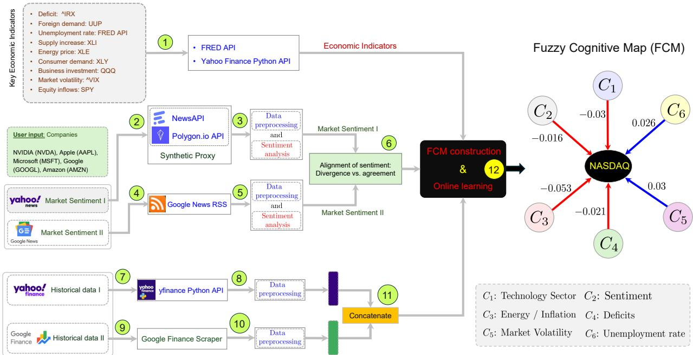
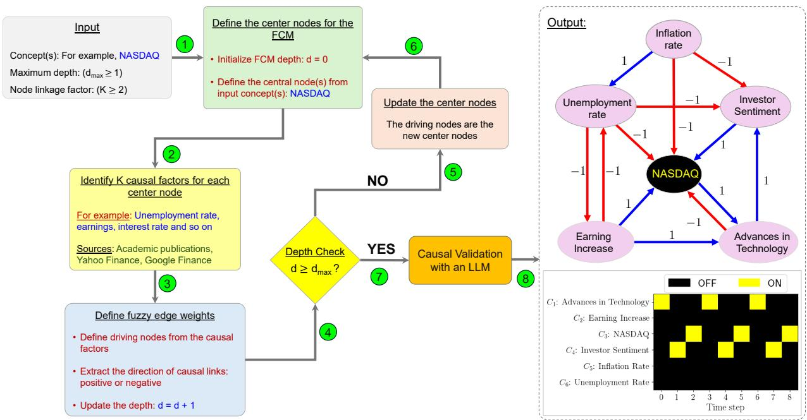
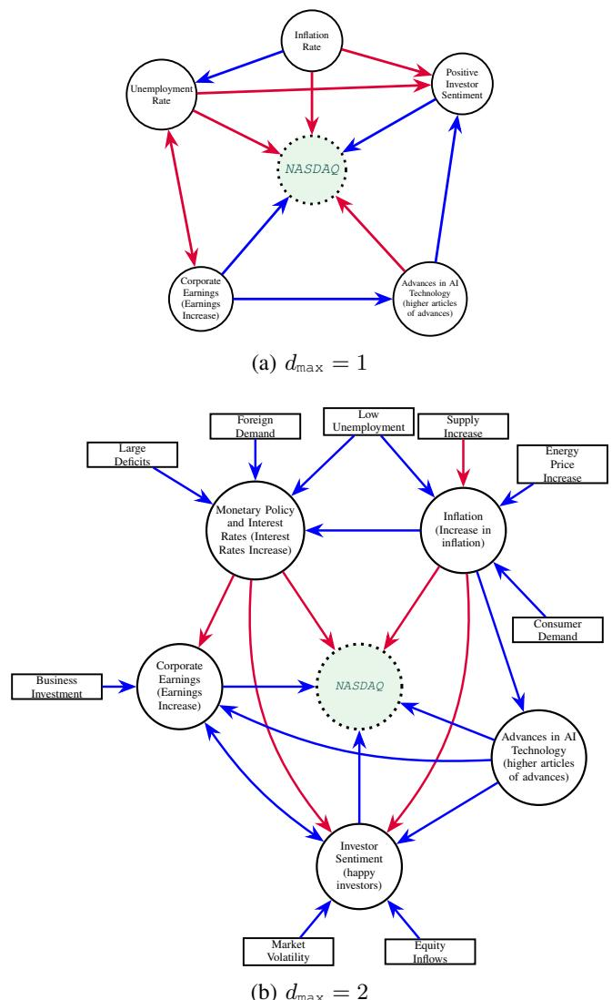
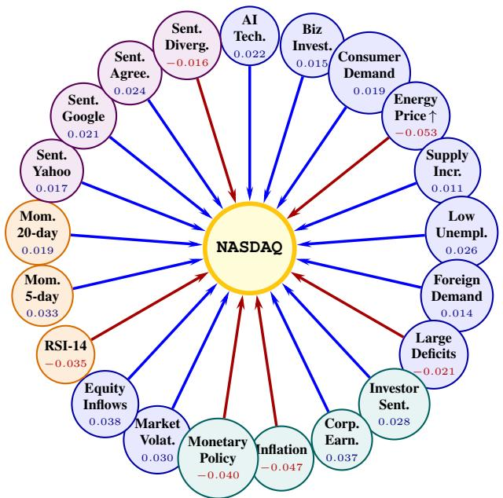
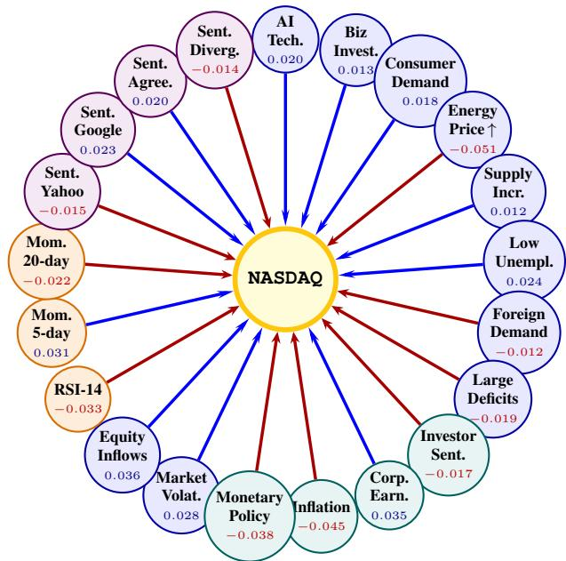
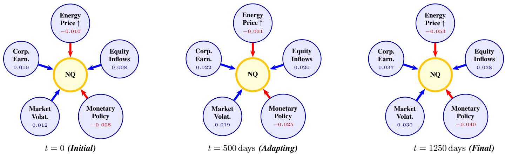

# Online-Adaptive Fuzzy Cognitive Maps for Neuro-symbolic Financial Forecasting

Brandon Rodriguez

Abel Deulofeu

Olaoluwa Adigun

College of Engineering and Computing

College of Engineering and Computing

Florida International University

College of Engineering and Computing

Miami, FL 33199

Florida International University

Miami, FL 33199

brodr299@fiu.edu

Florida International University

adeul001@fiu.edu

Miami, FL 33199

olaadigu@fiu.edu

Abstract—We present a neuro-symbolic framework that pairs online-adaptive Fuzzy Cognitive Maps (FCMs) with long shortterm memory (LSTM) networks for financial forecasting. Financial markets exhibit regime shifts and nonlinear dynamics. Existing models often trade off one of these key properties: these models capture temporal patterns but hide causal drivers, or they recover causal graphs that cannot adapt post-training. We close this gap with two frameworks. Framework I constructs an FCM from live dual-source price series and macroeconomic indicators, and adapts its edges online through an error-driven Hebbian rule. We introduce the Asymmetric Additive Residual Fusion method to seamlessly combine the FCM and LSTM predictions under Framework I. Framework II constructs a literature-grounded, LLM-augmented FCM where every edge carries a verifiable citation that gives an auditable map of factor interactions. On NASDAQ Composite data, Framework I matched the performance of the LSTM baseline on statedirectional accuracy and outperformed LSTM by 7.6 percentage points on the return-sign accuracy. Framework I outperformed standalone FCM models across both evaluation metrics. The adaptive maps converged to new regimes within 10–15 trading days, and Framework II center-node FCMs scored 68.9% to 85.7% on the state-directional accuracy.

Index Terms—Fuzzy cognitive maps, online adaptation, finan cial forecasting, sentiment analysis

## I. INTRODUCTION

Various heterogeneous factors and their interactions drive financial markets. These factors include market volatility, financial crises, firm-specific news, earnings, geopolitical events and so on [1]–[5]. They operate under incomplete information and behavioral biases. This contributes to the complexity of modeling such systems. The time-dependency and change in these factors explain the dynamic nature of financial market modeling [6]–[8].

Traditional econometric frameworks such as autoregressive integrated moving average (ARIMA) [9], [10], vector autoregression [11], and linear factor models assume stationarity and linearity [12]. But historical financial market data suggests otherwise. It shows that asset returns exhibit heavy tails, volatility clustering, nonlinear dependencies, and structural breaks that violate the linear and stationary assumptions. Financial practitioners also need transparent models that are interpretable and reveal causal drivers because of the financial implications of decisions based on such predictions.

Most machine learning models for financial market prediction fail to combine the desirable properties in a single framework: handling heterogeneous data, causal structure, dynamic behavior, and interpretability. Some combine heterogeneous signals, technical indicators from news and media attention in neural-based models such as LSTMs and transformers to improve prediction performance [13]–[15]. Most of them use post-hoc tools like SHAP and LIME to achieve explainability [16]. Neural-based methods excel at capturing longrange dependencies but they lack explicit causal capability and interpretability. Other prior works extract causal graphs from financial news [17] and learn causal representations for robustness [18]. However, their causality is acyclic and static, interpretability is external to the predictor, and inputs or functional form are restricted.

Fuzzy Cognitive Maps (FCMs) provide an interpretable graph-based framework for modeling complex systems such as financial markets. FCMs are directed graphs that model the causal relationships in a system [19], [20]. Their nodes denote concepts, and their signed, weighted edges quantify the direction and strength of each causal link. FCMs admit feedback loops and iterate to produce dynamic trajectories rather than static outputs for acyclic causal graphs [21]. FCM predictions trace directly to the signed edges that drove them and build explainability into the mechanism rather than post-hoc recovery. This pairing of causal structure, feedback dynamics, and intrinsic transparency in one model has driven FCM adoption across complex decision domains [22], [23].

Some prior works have applied FCMs for financial analysis ranging from expert-built maps of stock-market dynamics to interval-valued maps [24], [25]. The recent work CausalSeqGNN is a hybrid model that gives FCM nodes Fama-Frenchinspired fuzzy state vectors, learns the map with a genetic algorithm, and couples it with a graph neural network for cross-sectional forecasting [26]. These methods either extract these maps from experts or learn them offline. After training, they hold the map fixed. This leaves two questions open. How can we build FCMs from heterogeneous multi-source feeds and literature-grounded LLM knowledge? And how can we adapt them online as the market moves?

We present two frameworks for neuro-symbolic modeling with FCMs to address these questions. Framework I is a hybrid model that uses an FCM (or multiple FCMs) to extract and merge explainable features with LSTM neural processing for prediction. This framework uses live market feeds to extract useful knowledge and features. This framework extracts information from financial news sentiment and key macroeconomic indicators to build a combined FCM or two FCMs (one for market sentiment and the other for sectorspecific information). We introduce the Asymmetric Additive Residual Fusion method to combine dual FCMs with deep LSTM neural networks for prediction. Figure 1 shows the FCM pipeline for Framework I and the resulting causal map.

  
Fig. 1: Data pipeline and online FCM construction for Framework I: The system ingests three input streams and fuses them into an online-adapting fuzzy cognitive map. Step (1) pulls key economic indicators through the FRED API and the yFinance Python API. For news sentiment, the user specifies target companies (NVDA, AAPL, MSFT, GOOGL, AMZN); steps (2–3) query NewsAPI and the Polygon.io API as a synthetic proxy for Yahoo News, then preprocess the text and run sentiment analysis to produce Market Sentiment I. Steps (4–5) scrape Google News RSS and apply the same preprocessing and sentiment analysis to produce Market Sentiment II. Step (6) aligns the two sentiment streams and measures their divergence versus agreement. For price history, steps (7–8) retrieve Yahoo Finance data through the Yahoo Finance API and preprocess it. Steps (9–10) retrieve Google Finance data through a scraper and preprocess it, and step (11) concatenates the two price streams. Step (12) constructs the FCM and performs online learning, combining the economic indicators, aligned sentiment, and concatenated prices while updating edge weights as new data arrives. The right panel shows the resulting fuzzy cognitive map after online adaptation on NASDAQ Composite data (2020–2025). Blue arrows denote positive causal influence; red arrows denote negative influence. Edge labels show the final adapted weights $w _ { i , \mathrm { N A S D A Q } } .$ Energy price increase carries the strongest suppressive effect (−0.053), while low unemployment and elevated market volatility carry positive influence on NASDAQ.

Framework II fuses two knowledge sources, peer-reviewed literature and LLM knowledge, under human oversight, and produces a transparent, verifiable map of how financial factors interact rather than a forecast. Figure 2 shows the FCM pipeline for Framework II. Our work makes three main contributions: (1) We introduce an online FCM adaptation method. (2) We build a neuro-symbolic model combining FCMs and deep LSTM networks using the asymmetric additive residual fusion method. (3) We construct a literature-grounded, LLMaugmented FCM with per-edge citations.

On NASDAQ data, Framework I matches LSTM statedirectional accuracy (78.8%) while outperforming standalone LSTM by 7.6 percentage points in return-sign accuracy (52.0%) and pure FCMs by 15.6 percentage points. The adaptive FCMs converge to new market regimes within 10–

15 trading days. The literature-grounded Framework II maps reach 68%–85% state-directional accuracy.

## II. BACKGROUND AND NOTATION

## A. Fuzzy Cognitive Map

An FCM is a directed graph $\mathcal { G } = ( \mathcal { N } , \mathcal { E } )$ with node set N and edge set E with each edge weight in [−1, 1]. The value of $w _ { i j }$ indicates the strength and direction of the causal link from the $i ^ { t h }$ node $C _ { i }$ to the $j ^ { t h }$ node $C _ { j }$ . Positive weights indicate excitatory influence, negative weights mean inhibitory influence, and zero weights mean no influence [27].

The edge weight of an adaptive FCM depends on time step t. We define $w _ { i j } ^ { ( t ) }$ as the edge weight at time t. This generalizes to a static FCM, where $w _ { i j } ^ { ( t ) }$ is the same for all t. The state vector $\mathbf { C } ^ { ( t ) } = \left[ C _ { 1 } ^ { ( t ) } , \ldots , \hat { C _ { N } ^ { ( t ) } } \right] ^ { \intercal }$ represents the state of FCM nodes at time t, where $C _ { i } ^ { ( t ) }$ is the value of node $C _ { i }$ at time t. The state evolution is

$$
C _ { j } ^ { ( t + 1 ) } = f \Big ( \sum _ { i = 1 } ^ { N } w _ { i j } ^ { ( t ) } C _ { i } ^ { ( t ) } + b _ { j } ^ { ( t ) } \Big )\tag{1}
$$

where $f ( \cdot )$ is the logistic sigmoid $\sigma ( x ) = 1 / ( 1 + e ^ { - c x } ) , c \geq 0 .$ and $b _ { j } ^ { ( t ) }$ represents the exogenous bias (e.g., market sentiment) at time t.

  
Fig. 2: Iterative, literature-grounded FCM construction for Framework II: This expands a fuzzy cognitive map outward from one or more seed concepts until it reaches a maximum depth, then validates the result with an LLM. Given an input concept (for example, NASDAQ), a maximum depth $d _ { \mathrm { m a x } } ,$ and a node linkage factor $K \geq 2 ,$ , step (1) sets the seed as the central node and initializes the depth to $d = 0 .$ Step (2) identifies K causal factors for each center node, such as unemployment rate, earnings, and interest rate, and draws them from academic publications and financial data sources (Yahoo Finance and Google Finance). Step (3) defines the fuzzy edge weights: it designates the causal factors as driving nodes, extracts the sign of each causal link as positive or negative, and increments the depth to $d = d + { \bar { \mathbf { \Gamma } } }$ 1. Step (4) checks whether $d \geq d _ { \mathrm { m a x } } . \mathrm { I f }$ not, step (5) promotes the current driving nodes to center nodes and step (6) returns to step (1) to expand the next layer. Once $d \geq d _ { \mathrm { m a x } } ,$ , step (7) validates the causal links with an LLM and step (8) produces the final map. The output panel shows the constructed FCM centered on NASDAQ, where blue edges denote positive influence, red edges denote negative influence, and the labels give the signed edge weights. The raster below shows the map’s dynamics across time steps 0 to 8.

## B. Long Short-Term Memory (LSTM) Network

A long short-term memory (LSTM) network is a recurrent neural network that processes a sequence one step at a time while maintaining a cell state. It uses input, forget, and output gates to control what information it stores, discards, and exposes at each step [28]. These gates let the gradient flow across many steps without vanishing, so the LSTM learns long-range temporal dependencies that a plain recurrent neural network cannot. The time window parameter T of an LSTM sets the look-back length. This means that the network reads the most recent T consecutive time steps as one input sequence and produces its prediction from that window. Each window holds T successive 16-node FCM concept state vectors for the LSTM input in Framework I.

## C. Large Language Model (LLM) Domain Knowledge

A Large Language Model (LLM) is a deep neural network trained on extensive text corpora. These corpora encode broad domain knowledge, including financial concepts, market mechanisms, and economic relationships. We draw on this knowledge to propose and verify causal links between concept nodes in financial domain FCMs. The LLM cites supporting source(s) for each link because LLM outputs are not always reliable. The LLM provides verifiable literature citations for every causal edge in the graph to mitigate potential model hallucinations and ensure full auditability.

## III. DATA PIPELINE

We combine multi-source financial data and domain knowledge into computational neuro-symbolic models. In this section, we detail the data sources and preprocessing methods for both frameworks.

## A. Framework I

We combine structured data including historical price and macroeconomic data, and unstructured market sentiment data.

1) Historical Price Data: This captures the historical price of the target company or index fund over the T steps before time t. It also captures the prices of other companies or funds or values of indicators that drive the target. We collect historical market data using the yfinance Python library for Yahoo Finance, a custom Python scraper for Google Finance, or a combination of both (Figure 1). We combine both sources when individual providers lack complete coverage across tickers, timeframes, or data fields. This dual-sourcing strategy eliminates data gaps and maintains continuous pipeline execution during API rate limits or downtime.

We scaled all price data values to log-returns $r _ { t } \colon$

$$
r _ { t } = \ln { \frac { P _ { t } } { P _ { t - 1 } } } .\tag{2}
$$

The pipeline uses rolling min-max normalization over a 252- day window to scale all features to [0, 1]:

$$
\tilde { x } _ { t } = \frac { x _ { t } - \operatorname* { m i n } ( x _ { t - 2 5 2 : t } ) } { \operatorname* { m a x } ( x _ { t - 2 5 2 : t } ) - \operatorname* { m i n } ( x _ { t - 2 5 2 : t } ) + 1 0 ^ { - 1 2 } } .\tag{3}
$$

Here $x _ { t } \in \mathbb { R }$ is the raw feature value at time t (including logreturns, macroeconomic indicator values, or indicator signals) and the 252-day window represents one trading year of daily observations.

2) Key Economic Indicators: We incorporate market and macroeconomic proxies that capture the multi-horizon conditions driving financial markets. Market volatility (vix, vol\_surge) reflects near-term risk and stress, while short-term interest rates (rate3m), real yield momentum (real\_yield\_diff), inflation expectations (breakeven5y), and unemployment rates (unemp) set the medium-to-long-term regime in which asset prices evolve. We include these proxies because a price-only model sees the symptom but not the underlying economic cause; incorporating them enables the FCM to explain why the market reacts rather than merely predict that it does.

We track these 16 concept proxies across five categories: FRED UNRATE for unemployment (unemp), FRED VIXCLS for volatility (vix, vol\_surge), FRED DGS3MO for 3- month Treasury yields (rate3m), FRED T5YIE for 5- year breakeven inflation (breakeven5y), sector ETFs such as XLE for energy (energy) and QQQ/ONEQ for market concentration (breadth, tech\_rotation), alongside tech leadership vectors (tech, ai\_leadership) and technical momentum (rsi, m5, m20). Step (1) in Figure 1 shows the key economic indicator extraction pipeline.

3) Market Sentiment: Framework I fetches news headlines daily for the target companies from Yahoo News, Google News, or the combination of the two. It uses the NewsAPI to extract from Yahoo News and falls back to the Polygon.io API if that fails. For Google News, we use the Google RSS feed. The pipeline preprocesses each stream and runs sentiment analysis on the headlines to produce two independent sentiment signals. The pipeline uses the Loughran-McDonald lexicon [29] to compute a raw polarity score $S _ { t } \colon$

$$
S _ { t } = \frac { N _ { \mathrm { p o s } } - N _ { \mathrm { n e g } } } { N _ { \mathrm { t o t a l } } }\tag{4}
$$

where $N _ { \mathrm { p o s } }$ is the count of Loughran-McDonald positivesentiment words, $N _ { \mathrm { n e g } }$ is the count of negative-sentiment words, and $N _ { \mathrm { t o t a l } }$ is the total word count across all headlines on day t. Therefore we have $S _ { t } ~ \in ~ [ - 1 , 1 ]$ . We smooth the raw score using an exponential moving average with a decay coefficient $\delta = 0 . 8$ 8

$$
R _ { t } = \delta \cdot R _ { t - 1 } + ( 1 - \delta ) \cdot S _ { t } ,\tag{5}
$$

delay it by one trading day to avoid look-ahead bias, and bound it with $\tilde { S } _ { t } \ = \ \mathrm { t a n h } ( \bar { 5 } \cdot R _ { t - 1 } )$ . In the dual-sentiment configuration, the pipeline processes Yahoo News and Google News independently, and aligns both signals to measure their agreement or divergence before feeding them to the FCM (Figure 1).

## B. Framework II: Data Pipeline

Framework II constructs its FCM from two static knowledge sources rather than live market feeds. Causal nodes and edge signs are drawn from peer-reviewed literature, and an LLM proposes additional links. A cited justification accompanies each link and a human reviewer can verify it. No price or sentiment data is ingested at runtime. The FCM is fixed after the literature-grounding and LLM validation steps. Figure 2 shows the pipeline for constructing the FCM. We used the GPT-4 LLM for this work.

## IV. METHODOLOGY

## A. Framework I

This subsection explains the design of Framework I. This includes the FCM construction, its online adaptation, and the asymmetric additive residual hybrid fusion for the FCM-LSTM ensemble.

1) Fuzzy Cognitive Map Construction: The state vector evolution follows from Equation (1), where $b _ { i } ^ { ( t ) }$ is the exogenous bias (e.g., the smooth sentiment signal $\tilde { S } _ { t }$ injected into the NASDAQ node). For the baseline, initial weights are derived from a τ-day sign-correlation:

$$
w _ { i j } = \mathrm { t a n h } \Bigg ( \frac { 1 } { \tau } \sum _ { k = 1 } ^ { \tau } \mathrm { s i g n } ( \Delta C _ { i , k } ) \cdot \mathrm { s i g n } ( \Delta C _ { j , k } ) \Bigg ) ,\tag{6}
$$

where $\Delta C _ { i , k } = C _ { i } ^ { ( k ) } - C _ { i } ^ { ( k - 1 ) }$ is the one-day change in the normalized state of concept node i. The product $\mathrm { s i g n } ( \Delta C _ { i , k } )$ $\mathrm { s i g n } ( \Delta C _ { j , k } ) \in \{ - 1 , + 1 \}$ counts co-directional moves versus counter-directional moves. The model averages over τ trading days and applies the hyperbolic tangent (tanh) to map the real line to [−1, 1] and give the initial signed causal weight. Node activation $A _ { i } ( t )$ at time t for the $i ^ { t h }$ stock price uses the sigmoid of normalized returns

$$
A _ { i } ( t ) = \frac { 1 } { 1 + e ^ { - \alpha \cdot r _ { i , t } } }\tag{7}
$$

where $\alpha > 0$ and ${ r } _ { i , t }$ is the log-return for node i at time t.

Technical momentum and market microstructure nodes complement the economic indicators. The 14-day Relative Strength Index

$$
C _ { \mathtt { R S I } } ( t ) = 1 - \frac { 1 } { 1 + \bar { g } _ { 1 4 } / \bar { l } _ { 1 4 } } \ \in [ 0 , 1 ]\tag{8}
$$

where $\bar { g } _ { 1 4 }$ and $\bar { l } _ { 1 4 }$ are the respective 14-day average gain and loss. $C _ { \mathrm { R S I } } > 0 . 7$ indicates overbought regime and $C _ { \mathrm { R S I } } < 0 . 3$ signals oversold regime. We define the short-price momentum $C _ { \mathrm { M } 5 } ( t )$ and the medium-term price momentum $C _ { \mathrm { M } 2 0 } ( t )$ as follows:

$$
C _ { \mathtt { M } 5 } ( t ) = \operatorname { t a n h } ( 2 0 \cdot r _ { 5 d , t } )\tag{9}
$$

$$
C _ { \mathtt { M } 2 0 } ( t ) = \operatorname { t a n h } ( 1 0 \cdot r _ { 2 0 d , t } )\tag{10}
$$

where $r _ { 5 d , t }$ and r<sub>20d,t</sub> are the 5-day and 20-day cumulative log-returns. We define four market microstructure concepts

Algorithm 1 : FCM Online Edge Weight Adaptation   
Require: Realized return $r _ { t } ;$ learning rate $\eta = 0 . 0 5 ;$ momen  
tum $\beta = 0 . 9 ;$ predicted state $\hat { C } _ { \mathrm { N A S D A Q } } ^ { ( t ) } ;$ current node states   
$C _ { j } ^ { ( t ) }$   
1: Compute prediction error: $\epsilon _ { t } = r _ { t } - \hat { C } _ { \mathrm { N A S } } ^ { ( t ) }$ DAQ   
2: Calculate derivative: $\delta = \epsilon _ { t } \cdot \hat { C } _ { \tt N A S D A Q } ^ { ( t ) } \cdot ( 1 - \hat { C } _ { \tt N A S D A Q } ^ { ( t ) } )$ ▷   
Logistic derivative   
3: for each incoming edge w<sub>i,NASDAQ</sub> do   
4: $v _ { i }  \beta \cdot v _ { i } + \eta \cdot \delta \cdot C _ { i } ^ { ( t ) }$ ▷ Momentum   
accumulation   
5: $w _ { i , \tt N A S D A Q }  \mathrm { c l i p } ( w _ { i , \tt N A S D A Q } + v _ { i } , - 1 , 1 )$   
6: end for   
7: Verify spectral radius $\rho ( \mathbf { W } ) = \operatorname* { m a x } _ { k } | \lambda _ { k } ( \mathbf { W } ) | < 1$ for   
convergence.

to capture market concentration, sector rotation, and volatility acceleration. They are:

$$
C _ { \mathtt { B R E A D T H } } ( t ) = \mathrm { n o r m } \left( \frac { \mathrm { P r i c e } _ { \mathtt { Q Q Q } , t } } { \mathrm { P r i c e } _ { \mathtt { O N E Q } , t } } \right)\tag{11}
$$

$$
C _ { \mathrm { R O T A T I O N } } ( t ) = \mathrm { n o r m } \left( r _ { \textsc { Q Q Q } , t } - r _ { \mathrm { X L E } , t } \right)\tag{12}
$$

$$
C _ { \mathtt { V S U R G E } } ( t ) = \mathrm { n o r m } \left( \frac { \mathrm { V I X } _ { t } } { \mathrm { S M A } _ { 2 0 } ( \mathrm { V I X } ) _ { t } } \right)\tag{13}
$$

$$
{ C _ { \mathrm { R E A L \_ Y I E L D } } ( t ) } = \mathrm { n o r m } \left( { \Delta \mathrm { D G S } 3 \mathrm { M O } _ { t } } - { \Delta \mathrm { T } 5 \mathrm { Y } \mathrm { I } \mathrm { E } _ { t } } \right)\tag{14}
$$

where norm(·) denotes the rolling 252-day min-max normalization into [0, 1] defined in Equation (3).

2) Online Adaptation: Unlike static FCMs, we update weights at every time step using prediction error on the target node (NASDAQ). Algorithm 1 details the online adaptation rule. This Hebbian-style update strengthens edges that reduce prediction error. The dual pipelines (Yahoo and Google) adapt independently. The sentiment nodes are exogenous inputs that do not receive incoming updates but influence other nodes. Figure 4 compares the FCMs for the two pipelines over the same period.

3) FCM-LSTM Ensemble: While FCMs capture concept interactions, deep recurrent networks excel at learning longrange temporal dependencies. We used an LSTM recurrent neural network with 50 units and dropout value 0.2 and combined it with the adaptive FCM. The network processes input sequences of length $T = 3 0$ trading days, where each time step collects the 16-node concept state vector. We use the asymmetric additive residual fusion method to combine the FCMs with the LSTM:

$$
\begin{array} { r } { \hat { y } _ { t } ^ { \mathrm { e n s e m b l e } } = \mathrm { c } \mathrm { l } \mathrm { i p } \left( \hat { y } _ { t } ^ { \mathrm { L S T M } } + \alpha ( \Delta _ { t } ^ { \mathrm { F C M } } ) \cdot \Delta _ { t } ^ { \mathrm { F C M } } , 0 , 1 \right) } \end{array}\tag{15}
$$

where $\begin{array} { r } { \Delta _ { t } ^ { \mathrm { F C M } } = \frac { 1 } { 2 } \left( \hat { y } _ { t } ^ { \mathrm { F C M - A } } + \hat { y } _ { t } ^ { \mathrm { F C M - B } } \right) - 0 . 5 } \end{array}$ represents the zerocentered FCM directional steering vector, and the asymmetric multiplier $\alpha ( \cdot )$ accounts for market skewness:

$$
\alpha ( \Delta _ { t } ^ { \mathrm { F C M } } ) = \left\{ \begin{array} { l l } { \alpha _ { \mathrm { u p } } } & { \mathrm { i f ~ \Delta \Delta \Delta \Delta _ { t } ^ { \mathrm { F C M } } > 0 ~ \Delta ~ ( \mathrm { B u l l ~ i s h ~ \ s i g n a l } ) } } \\ { \alpha _ { \mathrm { d o w n } } } & { \mathrm { i f ~ \Delta \Delta \Delta _ { t } ^ { \mathrm { F C M } } \leq 0 ~ \Delta ~ ( \mathrm { B e a r i s h ~ \ s i g n a l } ) } } \end{array} \right.\tag{16}
$$

where $\alpha _ { \mathrm { { u p } } } , \alpha _ { \mathrm { { d o w n } } } \in [ 0 , 0 . 5 ]$ to preserve neural calibration.

## B. Framework II

We present the FCM extraction and construction methodology for Framework II. This framework initializes the concept map from a target central node up to a specified graph depth, $d _ { \operatorname* { m a x } } \geq 1$ . Every node must link to at least one neighboring concept to prevent isolated nodes and preserve connectivity. We constrain all node activation states to [0, 1] with the rolling min-max normalization. Similarly, we constrain causal edge weights to [−1, 1] with a hyperbolic tangent activation function to capture both positive and negative relationships. Algorithm 2 shows the pseudocode for this framework.

To grow outer concept nodes beyond the central target, we identify key market drivers through literature research. We query academic databases (e.g., AI-powered Google Scholar Lab) using standardized prompts such as: “What are the X most critical factors affecting [node]?” Following node identification, we establish directional causal links based on documented economic relationships. A key design challenge involves quantifying edge magnitudes. While empirical literature confirms directional polarities (e.g., the inverse relationship between unemployment and inflation), exact numerical weights are rarely stated explicitly. We resolve this by assigning polarity-aligned initial weights bounded in [−1, 1].

Once we construct the initial graph topology, we pass the network to a specialized Large Language Model (LLM) tasked with evaluating node validity and edge completeness. The LLM validates every node-edge attribution against published academic literature and provides human-verifiable citations for each link. In practice, this LLM verification step refined graph topology by identifying previously overlooked crosssector edges and reinforcing existing causal pathways. Figure 3 shows how the FCM extraction for Framework II works.

## V. SIMULATIONS AND RESULTS

## A. Experimental Setup

We evaluated our framework on daily financial and macroeconomic data from 2020 to 2025 (Train: 2020–2023, Validation: 2024, Test: 2025). We compared our model against a standalone LSTM. We evaluated all models with the statedirectional accuracy $( \mathbf { A c c } _ { \mathrm { s t a t e } } )$ and the return-sign accuracy $( \mathbf { A c c } _ { \mathrm { r e t } } )$ relative to the zero-return boundary. $\mathbf { A c c } _ { \mathrm { s t a t e } }$ measures how often the model correctly predicts the overall market state (bullish or bearish). $\mathbf { A c c } _ { \mathrm { r e t } }$ measures how often it correctly predicts the sign of the next day’s return. The dataset for Framework II simulation spans 119 days. We evaluated the model on the data from February–July 2026. The FCM for Framework II links each node to a ticker and masks the central node to avoid data leakage.

## B. Node Definitions

Table I lists the 16 concept nodes used in Framework I. The table summarizes the 16 concept feature nodes across five categories, including Market Benchmarks, Tech Anchors, Macroeconomic Indicators, Technical Momentum, and Market Microstructure. We used these concepts to construct the

Algorithm 2 : Iterative FCM extraction (Framework II)   
Require: Target depth $d _ { \mathrm { m a x } }$ , node linkage factor K   
Ensure: Connected FCM with $a _ { i } \in [ 0 , 1 ]$ and $w _ { i j } \in [ - 1 , 1 ]$   
1: Initialize center node $c \triangleright$ Broad market index,   
e.g. NASDAQ   
2: ${ \mathcal { F } } \gets { \mathcal { C } }$ ▷ Frontier: nodes awaiting   
expansion   
3: $d \gets 0$ ▷ Current depth   
4: repeat   
5: $\mathcal { F } ^ { \prime }  \mathcal { O }$   
6: for all $n \in \mathcal { F }$ do   
7: Identify K direct causal factors $\left\{ f _ { 1 } , \dots , f _ { K } \right\}$ of n   
8: for all $f _ { k } \in \{ f _ { 1 } , \ldots , f _ { K } \}$ do   
9: $s ( n , f k ) \gets$ Polarity score from literature   
10: $w _ { n , f _ { k } } \gets \operatorname { t a n h } ( s ( n , f k ) ) \in [ - 1 , 1 ]$ ▷ Fuzzy   
edge   
11: normalize $a _ { f _ { k } } \in [ 0 , 1 ]$   
12: $\mathcal { F } ^ { \prime }  \mathcal { F } ^ { \prime } \cup \{ \bar { f } _ { k } \}$   
13: end for   
14: end for   
15: $\mathcal { F }  \mathcal { F } ^ { \prime } ; \quad d  d + 1$   
16: until $d _ { \operatorname* { m a x } } \leq d$ ▷ depth check

TABLE I: Node definitions for Framework I FCMs: FCM-A (market sentiment) and FCM-B (sector momentum) share the nodes.  
```powershell
Notation Node name
$\overline { { C _ { \mathtt { A I } } } }$ Technology Sector
$C _ { \mathrm { V I X } }$ Market Volatility
$C _ { \mathrm { E n e } }$ Energy / Inflation
$C _ { \mathrm { D e f } }$ Deficits
$C _ { \mathrm { U n e m p } }$ Unemployment
$C _ { \mathrm { B I } }$ Business Investment
$C _ { \mathrm { { S e n t } } }$ Sentiment (dual-source)
$C _ { \mathrm { R S I } }$ RSI-14 (overbought / oversold)
$C _ { \mathrm { M } _ { \mathrm { \Delta \cdot } } ^ { \tt E } }$ Price Momentum (5-day)
$C _ { \mathrm { M } 2 0 }$ Price Momentum (20-day)
$C _ { \mathtt { q q q } }$ Market index
$C _ { \mathrm { n a s d a q } }$ Target index
$C _ { \mathrm { T } 3 }$ 3-Month Treasury Bill Yield Rate
$C _ { \mathrm { B 5 } }$ 5-Year Breakeven Inflation Rate
$C _ { \mathrm { b r e a d t h } }$ Market Concentration Ratio
$C _ { \mathrm { t e c h - r o t } }$ Sector Capital Rotation Differential
```

Framework I neuro-symbolic model. Framework II starts with the target node and grows until it reaches $d _ { \mathrm { m a x } }$

## C. Adaptation and Causal Dynamics

The online adaptation rule (Algorithm 1) updates the incoming edge weights to the target node at every trading day using the one-step prediction error. Figure 5 shows the weight trajectories across the full 2020–2025 training window for five representative nodes. The energy price increase node carries the strongest inhibitory effect on NASDAQ $( w \ =$ −0.053), consistent with the negative relationship between commodity inflation and technology-sector valuations. Deficits $( w = - 0 . 0 2 1 )$ apply additional downward pressure, reflecting rising interest rates and equity risk premiums. Conversely, market volatility stabilizes at $w = 0 . 0 3$ , capturing the rebound dynamics that follow volatility spikes. The system stabilizes to each new market regime within 10–15 trading days, consistent with the convergence properties of online gradient descent with weight clipping to [−1, 1].

  
Fig. 3: Framework II (FCM Extraction): These are center-node FCMs for the NASDAQ index using Algorithm 2 with secondary factor nodes (circles) feeding the primary concepts (rectangle). (a) The maximum depth is $d _ { \operatorname* { m a x } } = 1$ so the FCM added a layer of factors to the center-node. (b) The maximum depth is $d _ { \operatorname* { m a x } } = 2$ so the FCM added two layers of factors to the center-node.

## D. Predictive Performance: Framework I

Table II reports the directional accuracies for each component model and the ensemble. We evaluated on the 2025 test set $( n _ { \mathrm { t e s t } } = 2 5 0$ trading days). A prediction is classified as directionally correct when $\mathrm { s i g n } ( \hat { r } _ { t } - 0 . 5 ) = \mathrm { s i g n } ( r _ { t } - 0 . 5 )$ where $\hat { r } _ { t }$ is the predicted value. The 0.5 threshold separates up from down days in the normalized return space.

Our FCM-LSTM ensemble achieved 52.0% return-sign accuracy, outperformed the standalone LSTM baseline (44.4%) by 7.6 percentage points, and outperformed the standalone FCMs (48.8%) by 3.2 percentage points. The ensemble matched the LSTM on state-directional accuracy (78.8% vs.



  
(b) Google-adapted FCM (4 edges differ from Yahoo).

(a) Yahoo Finance FCM after online adaptation.  
Fig. 4: The numbers on each node indicate the edge weight link to the target. (a) FCM edge polarities to the NASDAQ target after online adaptation on NASDAQ Composite data (2020–2025), shown in a spoke layout to eliminate clutter. Blue arrows denote excitatory influence $( w _ { i , \mathrm { N Q } } > 0 ) ;$ ; red arrows denote inhibitory influence $( w _ { i , \mathbb { N Q } } < 0 )$ . Node colour encodes category: blue = economic/market, teal = intermediate inner nodes, orange = technical indicators, violet = sentiment. (b) Google Finance FCM after independent online adaptation on NASDAQ Composite data (2020–2025), using Google Finance price data and Google News RSS sentiment. The graph structure is identical to Figure 4a but 4 edge signs differ (Foreign Demand, Investor Sentiment, Yahoo Sentiment 20-day Momentum), reflecting divergent weight trajectories learned from a distinct data stream. Both FCMs are adapted in isolation; their predictions are averaged with the LSTM in the ensemble forecast.  
  
Fig. 5: Online adaptation of FCM edge weights to the NASDAQ target node over the 2020–2025 training window. Five representative nodes are shown for clarity. The full adapted network appears in Figures 4a–4b. The numbers on each node indicate the edge weight link to the target. Left (t = 0, initialization): weights start from the 30-day sign-correlation prior (Eq. 6). All magnitudes are near zero. Center (t = 500 days, ∼2022): energy price and monetary policy establish clear inhibitory influence as the Fed tightening cycle begins. Equity inflows and corporate earnings grow excitatory. Right (t = 1250 days, final): energy price reaches the strongest inhibitory weight $( w = - 0 . 0 5 3 )$ . Market volatility stabilizes at $w = + 0 . 0 3 0$ , a regime-rebound signature. Blue marks excitatory edges. Red marks inhibitory edges.

78.4%), while it outperformed pure FCM baselines (63.2%) by 15.6 percentage points. We determined the asymmetric steering parameters $( \alpha _ { \mathrm { u p } } = 0 . 2 1 0$ and $\alpha _ { \mathrm { d o w n } } = 0 . 2 0 0 )$ with a two-dimensional grid search on the 2024 validation dataset to maximize directional accuracy while preserving neural calibration. Standalone FCM-A (market-wide sentiment) and FCM-B (sector-specific momentum) produce closely aligned predictions $( r = 0 . 9 9 9 8 )$ because QQQ represents over 80% of ONEQ’s market capitalization weighting, allowing dualstream synthesis to filter single-stream noise while preserving tech sector sensitivity.

Table III reports the state-directional accuracy for Framework II. It shows four variations of Framework II. We evaluated the models by lagging input features by one trading day (t−1) to prevent look-ahead leakage. Term ℓ denotes the timelag in days. Same-day inputs (ℓ = 0) reached 85% accuracy. The accuracy drops as the time-lag increases.

TABLE II: Framework I Prediction: We measured the statedirectional and return-sign accuracies $( \mathbf { A c c } _ { \mathrm { s t a t e } }$ and $\mathbf { A c c } _ { \mathrm { r e t } } ) .$ . The best steering parameters are $\alpha _ { \mathrm { u p } } = 0 . 2 1$ and $\alpha _ { \mathrm { d o w n } } = 0 . 2$
<table><tr><td>Model</td><td> $\underline { { \mathbf { A c c . } _ { \mathit { s } \in \mathit { a } \mathrm { t } } } } \in$ </td><td> $\overline { { \mathbf { A c c . } _ { \mathrm { \tiny ~ \cdot ~ r e t } } } }$ </td></tr><tr><td>FCM A (Market-wide sentiment)</td><td>63.2%</td><td>48.8%</td></tr><tr><td>FCM B (Tech. sector momentum)</td><td>63.2%</td><td>48.8%</td></tr><tr><td>LSTM</td><td>78.4%</td><td>44.4%</td></tr><tr><td>Ensemble (FCMs and LSTM)</td><td>78.8%</td><td>52.0%</td></tr></table>

TABLE III: Framework II Performance: State-directional accuracies across four knowledge sources with time-lag ℓ in days. We evaluated the model on the data between February and July 2026 (119 days).
<table><tr><td rowspan=1 colspan=1>FCM</td><td rowspan=1 colspan=1> $\ell = 0$ </td><td rowspan=1 colspan=1> $\overline { { \ell = 1 } }$ </td><td rowspan=1 colspan=1> $\overline { { \ell = 7 } }$ </td></tr><tr><td rowspan=4 colspan=1>AI-BackedResearch-Based3-LayerStock-Based</td><td rowspan=1 colspan=1>77.31%</td><td rowspan=1 colspan=1>50.42%</td><td rowspan=1 colspan=1>49.56%</td></tr><tr><td rowspan=1 colspan=1>85.71%</td><td rowspan=1 colspan=1>50.42%</td><td rowspan=1 colspan=1>46.02%</td></tr><tr><td rowspan=1 colspan=1>68.91%</td><td rowspan=1 colspan=1>50.42%</td><td rowspan=1 colspan=1>50.44%</td></tr><tr><td rowspan=1 colspan=1>69.75%</td><td rowspan=1 colspan=1>54.62%</td><td rowspan=1 colspan=1>50.44%</td></tr></table>

## VI. DISCUSSION

Framework I shows a benefit of fusing FCM causal graphs with deep LSTMs for financial forecasting. The framework uses the asymmetric additive residual fusion method to combine the two. With the grid search over the validation set, the best steering values are $\alpha _ { \mathrm { u p } } = 0 . 2 1$ and $\alpha _ { \mathrm { d o w n } } = 0 . 2 0$ . This means that the ensemble permits a strong FCM conviction to adjust the LSTM prediction by up to ±10.5% in probability. The slight asymmetry reflects market tail skewness, granting bullish macro momentum marginally higher steering weight during market rallies. For Framework II, empirical results confirm that literature-grounded causal maps provide reliable same-day directional predictions.

## VII. CONCLUSION

We have presented a neuro-symbolic framework with two complementary parts. Framework I integrates dual adaptive FCMs, real-time news sentiment, and an LSTM for financial market prediction. This ensemble uses the asymmetric additive residual fusion to combine LSTMs and FCMs. The ensemble outperformed the standalone LSTM and standalone FCMs. Framework II builds a literature-grounded, LLM-augmented map whose edges carry verifiable citations, which makes its value the auditability of how financial factors interact rather than raw forecasting. Together, the two frameworks show that combining structural nonlinear dynamic modeling with deep learning yields better predictions and offers a promising direction for adaptive and interpretable financial forecasting.

## REFERENCES

[1] P. K. Maurya, R. Bansal, and A. K. Mishra, “Investor sentiment and its implication on global financial markets: a systematic review of literature,” Qualitative Research in Financial Markets, vol. 18, no. 1, pp. 209–248, 2026.

[2] C. Saravanos and A. Kanavos, “Forecasting stock market volatility using social media sentiment analysis,” Neural Computing and Applications, vol. 37, no. 17, pp. 10 771–10 794, 2025.

[3] R. J. Shiller, “Speculative asset prices,” American Economic Review, vol. 104, no. 6, pp. 1486–1517, 2014.

[4] P. C. Tetlock, “Giving content to investor sentiment: The role of media in the stock market,” The Journal of Finance, vol. 62, no. 3, pp. 1139– 1168, 2007.

[5] R. Khalil, “AI-driven sentiment analysis in financial markets: using transformer base models and social media signals for stock market predictions,” Journal of Modelling in Management, pp. 1–25, 2026.

[6] T. Hens and K. R. Schenk-Hoppe,´ Handbook of financial markets: dynamics and evolution. Elsevier, 2009.

[7] C.-w. J. Chiu, R. D. Harris, E. Stoja, and M. Chin, “Financial market volatility, macroeconomic fundamentals and investor sentiment,” Journal of Banking & Finance, vol. 92, pp. 130–145, 2018.

[8] P. F. Procacci, “Non stationarity and market structure dynamics in financial time series,” Ph.D. dissertation, UCL (University College London), 2023.

[9] T. C. Mills and R. N. Markellos, The econometric modelling of financial time series. Cambridge University Press, 2008.

[10] S. M. Idrees, M. A. Alam, and P. Agarwal, “A prediction approach for stock market volatility based on time series data,” IEEE Access, vol. 7, pp. 17 287–17 298, 2019.

[11] L. Kilian and H. Lutkepohl, ¨ Structural vector autoregressive analysis. Cambridge University Press, 2017.

[12] J. Bai and S. Ng, “Large dimensional factor analysis,” Foundations and Trends in Econometrics, vol. 3, no. 2, pp. 89–163, 2008.

[13] H. H. Htun, M. Biehl, and N. Petkov, “Survey of feature selection and extraction techniques for stock market prediction,” Financial Innovation, vol. 9, no. 1, p. 26, 2023.

[14] J. Wang, S. Zhou, W. Liu, and L. Jiang, “An ensemble model for stock index prediction based on media attention and emotional causal inference,” Journal of Forecasting, vol. 43, no. 6, pp. 1998–2020, 2024.

[15] A. T. Haryono, R. Sarno, and K. R. Sungkono, “Transformer-gated recurrent unit method for predicting stock price based on news sentiments and technical indicators,” IEEE Access, vol. 11, pp. 77 132–77 146, 2023.

[16] D. Muhammad, I. Ahmed, K. Naveed, and M. Bendechache, “An explainable deep learning approach for stock market trend prediction,” Heliyon, vol. 10, no. 21, 2024.

[17] Y. Deng, Y. Liang, and S. Yiu, “Towards interpretable stock trend prediction through causal inference,” Expert Syst. Appl., vol. 238, no. Part B, p. 121654, 2024.

[18] S. Xu, Q. Cheng, and C. Lee, “A Causal Perspective of Stock Prediction Models,” IEEE Trans. Knowl. Data Eng., vol. 38, no. 1, pp. 14–25, 2026.

[19] B. Kosko, “Fuzzy Cognitive Maps,” Int. J. Man Mach. Stud., vol. 24, no. 1, pp. 65–75, 1986.

[20] A. K. Panda, O. Adigun, and B. Kosko, “Causal Autoencoder-like Generation of Feedback Fuzzy Cognitive Maps with an LLM Agent,” in 2025 International Conference on Machine Learning and Applications (ICMLA), 2025, pp. 1234–1241.

[21] C. D. Stylios and P. P. Groumpos, “Modeling complex systems using fuzzy cognitive maps,” IEEE Trans. Syst. Man Cybern. Part A, vol. 34, no. 1, pp. 155–162, 2004.

[22] E. I. Papageorgiou and J. L. Salmeron, “A review of fuzzy cognitive maps research during the last decade,” IEEE Trans. Fuzzy Syst., vol. 21, no. 1, pp. 66–79, 2013.

[23] G. Felix, G. Napoles, R. Falcon, W. Froelich, K. Vanhoof, and R. Bello,´ “A review on methods and software for fuzzy cognitive maps,” Artif. Intell. Rev., vol. 52, no. 3, pp. 1707–1737, 2019.

[24] D. E. Koulouriotis, I. E. Diakoulakis, and D. M. Emiris, “A Fuzzy Cognitive Map-based Stock Market Model: Synthesis, Analysis & Experimental Results,” in Proceedings of the 10th IEEE International Conference on Fuzzy Systems, Melbourne, Australia, December 2-5, 2001. IEEE, 2001, pp. 465–468.

[25] P. Hajek and O. Prochazka, “Learning interval-valued fuzzy cognitive maps with pso algorithm for abnormal stock return prediction,” in International Conference on Theory and Practice of Natural Computing. Springer, 2017, pp. 113–125.

[26] H. Yu and J. Liu, “CausalSeqGNN: A Fama-French Inspired Fuzzy Cognitive Map Combined With Graph Neural Network for Stock Prediction,” IEEE Transactions on Fuzzy Systems, 2025.

[27] A. K. Panda, O. Adigun, and B. Kosko, “The Agentic Leash: Extracting Causal Feedback Fuzzy Cognitive Maps with LLMs,” in 2025 International Conference on Large Language Models, 2025.

[28] S. Hochreiter and J. Schmidhuber, “Long short-term memory,” Neural Computation, vol. 9, no. 8, pp. 1735–1780, 1997.

[29] T. Loughran and B. McDonald, “When is a liability not a liability? textual analysis, dictionaries, and 10-ks,” The Journal of Finance, vol. 66, no. 1, pp. 35–65, 2011.