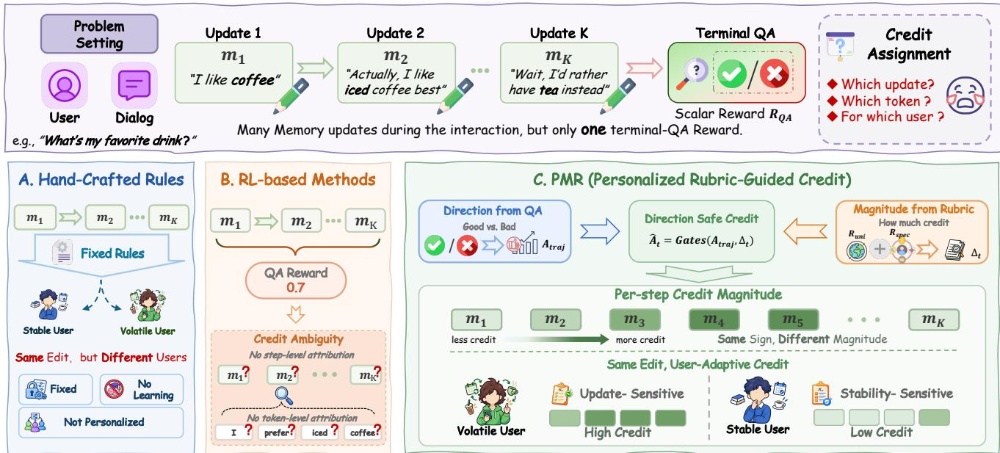
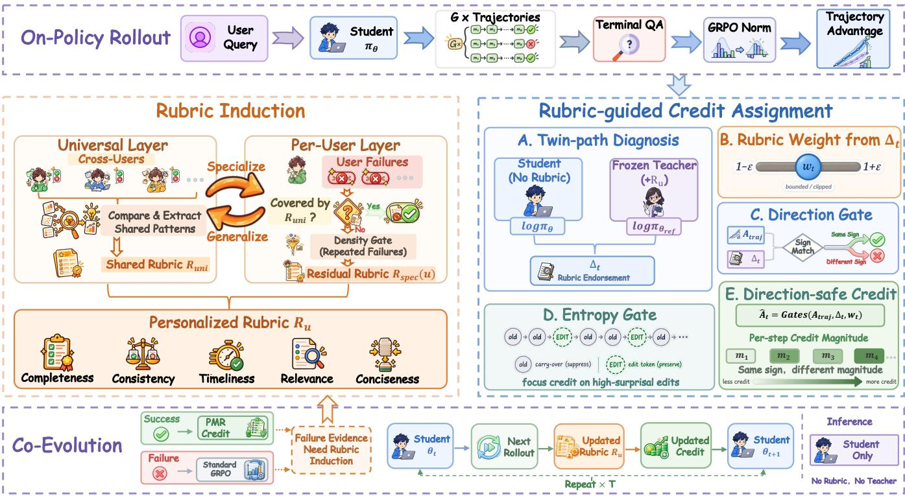
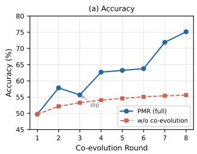
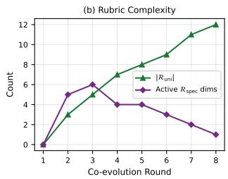
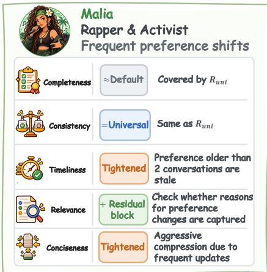
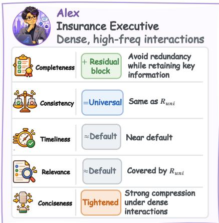
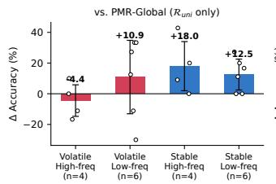
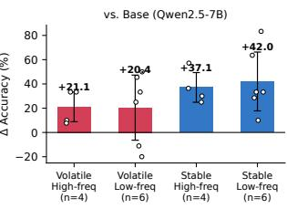
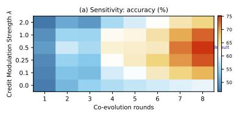
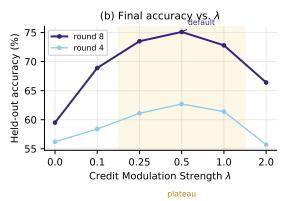

# Personalized Memory Rubrics: Learning What to Remember per User via Rubric-Guided Credit Assignment

Yupeng Han   
University of Science and Technology   
of China & City University of Hong   
Kong & State Key Laboratory of   
Cognitive Intelligence   
Hefei, China   
yupenghan@mail.ustc.edu.cn   
Ze Liu   
University of Science and Technology   
of China & State Key Laboratory of   
Cognitive Intelligence   
Hefei, China   
liuze2120@mail.ustc.edu.cn

Xiangyu Zhao City University of Hong Kong Hong Kong, China xianzhao@cityu.edu.hk

Kai Zhang∗   
University of Science and Technology   
of China & State Key Laboratory of   
Cognitive Intelligence   
Hefei, China   
kkzhang08@ustc.edu.cn   
Xianquan Wang   
University of Science and Technology   
of China & State Key Laboratory of   
Cognitive Intelligence   
Hefei, China   
wxqcn@mail.ustc.edu.cn   
Qi Liu   
University of Science and Technology   
of China & State Key Laboratory of   
Cognitive Intelligence   
Hefei, China   
qiliuql@ustc.edu.cn   
Shuochen Liu   
University of Science and Technology   
of China & City University of Hong   
Kong & State Key Laboratory of   
Cognitive Intelligence   
Hefei, China   
shuochenliu@mail.ustc.edu.cn   
Zhihong Pan   
University of Science and Technology   
of China & State Key Laboratory of   
Cognitive Intelligence   
Hefei, China   
panzh@mail.ustc.edu.cn   
Enhong Chen   
University of Science and Technology   
of China & State Key Laboratory of   
Cognitive Intelligence   
Hefei, China   
cheneh@ustc.edu.cn

## Abstract

Long-horizon personalized agents maintain an evolving memory by continuously deciding what to add, modify, or discard. However, learning an optimal update policy remains challenging. Conventional training relies solely on terminal question-answering accuracy, yielding a coarse feedback signal that treats all intermediate updates identically. Furthermore, update utility is inherently user specific, as identical memory actions may yield opposite efects across diferent user personas. Existing methods fail to address this heterogeneity, relying on globally shared evaluation standards with at most a single scalar intermediate reward. To address these challenges, we propose Personalized Memory Rubrics (PMR), a framework that translates terminal feedback into fine-grained, per-step, and per-user credit assignment. PMR decomposes evaluation into a universal layer capturing cross-persona failure patterns and a per-user adaptive layer modeling individual traits as a specialized delta over the universal baseline. Through Rubric-Guided Credit Assignment, PMR redistributes credit at the token level,

selectively amplifying validated decisions on successful trajectories while falling back to standard policy optimization on failed ones to avoid unreliable attribution. The rubric and memory policy co-evolve in a closed loop with anti-circularity guarantees. Crucially, PMR incurs zero inference overhead, operating without any rubric or external judge during deployment. Extensive experiments across four benchmarks demonstrate consistent gains over strong memory-augmented baselines.

## CCS Concepts

• Computing methodologies → Natural language processing;   
Natural language processing; Artificial intelligence.

## Keywords

personalized memory, LLM agents, rubric learning, self-distillation, credit assignment, long-horizon personalization

## ACM Reference Format:

Yupeng Han, Kai Zhang, Shuochen Liu, Ze Liu, Xianquan Wang, Zhihong Pan, Xiangyu Zhao, Qi Liu, and Enhong Chen. 2027. Personalized Memory Rubrics: Learning What to Remember per User via Rubric-Guided Credit Assignment. In Proceedings ofThe 20th ACM International Conference on Web Search and Data Mining (WSDM ’27). ACM, New York, NY, USA, 11 pages. https://doi.org/XXXXXXX.XXXXXXX

To maintain personalized memory over long horizons, large language model (LLM) agents must continuously distill extensive interactions into reusable representations [6, 9, 11, 28, 33, 45]. The cost of processing unbounded histories necessitates localized and

## 1 Introduction

  
Figure 1: Long-horizon memory learning involves multiple updates but only a terminal QA reward, making fine-grained credit assignment dificult. Hand-crafted methods use fixed, non-personalized rules, while RL-based methods rely on sparse scalar feedback with ambiguous step/token attribution. PMR decouples direction from magnitude: the QA advantage determines the learning direction, while personalized rubric evidence modulates credit magnitude through direction-safe gating.

sequential memory extraction [7, 35, 39]. As these extractions accumulate, errors in identifying and integrating relevant cues can propagate across updates, compromising the fidelity of the global user model and downstream personalization.

However, mitigating these compounding errors through opti mization is typically limited by the credit assignment problem [8, 47, 50]. The primary learning signal, terminal question answering (QA) accuracy, is shared across intermediate extractions, obscuring which decisions contributed to or degraded the outcome [17, 31, 42]. Early memory systems [2, 3, 14, 36] address long-horizon memory construction with predefined update rules, avoiding optimization but providing no feedback on extraction quality. More recent reinforcement learning (RL)-based memory agents [5, 29, 39, 40] formulate multi-turn memory construction as a Markov Decision Process (MDP) [10, 43], enabling memory operations to be optimized based on interaction outcomes. However, their rewards remain sparse, leaving the contributions of individual extraction decisions unresolved [13, 24, 49]. Furthermore, dense step-wise rewards, when introduced, measure format compliance or semantic plausibility, providing heuristic signals for surface-level properties rather than downstream utility [16, 41]. MemCoE [35] incorporates an LLMjudge process reward, but its hand-crafted scoring guide reduces evaluation to a fixed scalar shared across users. Such a uniform criterion is inadequate for personalization, as the utility of a memory extraction is inherently user-specific, where a memory overwrite that benefits a volatile user may prove redundant or harmful for a stable one [18, 26, 46]. This gap motivates a question: Can sparse, terminal feedback be transformed into fine-grained, per-user credit assignment without relying on an external, hand-craftedjudge?

To this end, we introduce Personalized Memory Rubrics (PMR), a framework that bridges terminal feedback to per-step, peruser credit assignment within Group Relative Policy Optimization (GRPO) [22]. As illustrated in Fig. 1, PMR decomposes the evaluation rubric into a universal component and a user-adaptive component through three mechanisms: (1) Rubric Induction learns a diagnostic rubric for each user by contrasting successful and failed rollouts across diverse memory quality dimensions. The universal component captures failure patterns that generalize across users through cross-user comparisons, while the user-adaptive component models residual failure modes specific to each user on top of the universal layer. Before injection, the rubric’s discriminative power is verified against real outcomes to ensure it provides a meaningful signal. (2) Rubric-Guided Credit Assignment uses the induced rubric as a privileged context for a frozen teacher model, which evaluates the student’s sampled trajectories and produces per-token endorsement scores. These scores modulate the magnitude of each token’s GRPO advantage through a direction gate (amplify-only, preventing the rubric from reversing the outcome direction) and an entropy gate (focusing credit on edit decisions rather than carry-over tokens). On successful trajectories, endorsed tokens receive amplified credit; on failed trajectories, standard GRPO is retained, as the rubric is more reliable for identifying key contributing tokens than for attributing failure to specific decisions. (3) The Co-Evolution Loop alternates between rubric induction and credit assignment, allowing the rubric to guide credit allocation while student rollouts provide feedback for its refinement. To avoid circular dependencies, the rubric modulates only the magnitude of credit, while the direction remains determined by the trajectory-level QA outcome. Unlike prior approaches that require an external judge at inference time [35], PMR is fully self-contained and requires no rubric during inference. Our main contributions are summarized as follows:

• We formulate the per-user credit assignment problem in longhorizon personalized memory and propose PMR, a framework that decomposes rubrics into universal and user-adaptive layers to translate sparse terminal QA rewards into fine-grained, stepwise feedback within GRPO.

• We introduce rubric-guided credit assignment with an asymmetric design: the rubric amplifies endorsed decisions on successful trajectories while preserving standard GRPO on failed ones, supported by direction and entropy gates that bound the rubric’s influence and focus credit on edit decisions.

• Extensive experiments on PersonaMem, PrefEval, PersonaBench and PERMA demonstrate consistent improvements. Ablations isolate each design choice, including the asymmetric design, peruser personalization, and co-evolution.

## 2 Related Work

## 2.1 Memory-Augmented LLM Agents

Early memory systems [2, 3, 19, 36] rely primarily on predefined or model-driven procedures for memory extraction, organization, and consolidation, leaving update policies fixed rather than optimized from downstream outcomes. CoM [37] introduces an iterative reasoning mechanism that structures historical synthesis through chained memory contexts. More recent RL-based meth ods [12, 34, 44] formulate memory construction as a sequential decision process and optimize memory operations using interactionlevel feedback. MemAgent [39] processes long contexts and learns memory updates through RL, while Mem-� [29] directly derives rewards from downstream performance. MemBuilder [23] attributes dense rewards to individual memory components based on their downstream contribution, introducing contribution-aware gradient weighting. However, these methods either rely on terminal rewards, attribute credit at the memory component level rather than the token level, or compress evaluation into scalar scores shared across users. MemCoE [35] employs an intermediate LLM judge to evaluate memory updates, yet its scoring guide is hand-crafted, scalar, and globally identical. This is limiting for personalized memory, where the utility of an extraction depends on the user’s evolving preferences and history [32]. Although personalized agents adapt to users [1, 18, 26], they treat profiles as static context rather than dy namic reward criteria, precluding fine-grained, user-tailored credit assignment. PMR addresses this gap by learning a user-adaptive evaluation rubric that redistributes token-level credit within GRPO, shifting the focus from learning only what to do to also learning what to evaluate.

## 2.2 From Trajectory to Token-Level Supervision

On-policy self-distillation (OPSD) [49] introduces a teacher-student framework in which a frozen policy augmented with privileged context, such as reference answers, provides per-token guidance on the student’s sampled trajectories. The teacher’s next-token distribution serves as a dense supervision signal through KL divergence, providing finer-grained credit information than conventional RL, which assigns a trajectory-level reward uniformly across tokens.

RLSD [38] extends this framework by combining RL policy gradients with self-distillation, using trajectory-level advantages to determine the optimization direction and token-level teacher-student divergence to modulate its magnitude. RCSD [4] replaces referenceanswer supervision with a learned rubric as privileged context, demonstrating the value of structured evaluation criteria for finegrained supervision, while PARL [20] further explores rubric induction from interaction histories. However, these approaches hinge on the quality of the privileged supervision. When the privileged context is provided by a learned and potentially noisy rubric, direct distribution matching may propagate erroneous guidance into the policy. CREST [30] addresses this issue with gating mechanisms, including an amplify-only direction gate and entropy-based edit focus, which constrain privileged supervision to credit magnitude while preserving the direction determined by the verifier. However, its direction signal relies on environment-provided perturn rewards, which are unavailable in terminal-only settings. Our work addresses this limitation through credit magnitude modulation: a learned per-user rubric modulates the magnitude of each token’s advantage within GRPO, while its direction is determined exclusively by the terminal QA outcome. This design retains the fine-grained supervision of OPSD-style methods without directly matching the policy to potentially noisy rubric distributions, while the co-evolving per-user rubric enables evaluation criteria to adapt to both user-specific characteristics and policy improvement.

## 3 Method

In this section, we present Personalized Memory Rubrics (PMR), a framework that bridges terminal QA feedback to per-step, peruser credit assignment. Rubric Induction (Sec. 3.2) learns a peruser rubric from success/failure rollout comparison, decomposed into a universal layer and a per-user layer. Rubric-Guided Credit Assignment (Sec. 3.3) uses the learned rubric to redistribute credit at the token level, amplifying endorsed decisions on successful trajectories while preserving standard policy optimization on failed ones. The two stages co-evolve in a closed loop (Sec. 3.4). The overall architecture is illustrated in Fig. 2.

## 3.1 Preliminary

We consider a conversational setting in which a memory-augmented agent interacts with user � across sessions. The dialogue history is segmented into contextual chunks $\{ c _ { 1 } , \ldots , c _ { K } \}$ , which are processed sequentially. At each memory-update step $k \in \{ 1 , \ldots , K \}$ , the agent maintains a compact memory state $m _ { k }$ (a natural-language summary), which is updated as:

$$
m _ { k } = \pi _ { \boldsymbol { \theta } } ( c _ { k } , m _ { k - 1 } ) ,\tag{1}
$$

where �� is the memory update policy. After processing all � chunks, the agent answers a question � using $m _ { K } .$ . The correctness reward $R _ { \mathrm { a n s } } \in \{ 0 , 1 \}$ is the only observable feedback signal.

We adopt Group Relative Policy Optimization (GRPO) [22] as the base training algorithm. For each prompt, � trajectories are sampled; the trajectory-level advantage is computed via groupnormalized rewards:

$$
A _ { i } ^ { \mathrm { t r a j } } = \frac { R _ { i } - \bar { R } } { \sigma _ { R } + \varepsilon } ,\tag{2}
$$

  
Figure 2: Overview of PMR. PMR first induces a personalized rubric $R _ { u }$ from shared cross-user patterns and residual per-user failures, and then uses it to shape direction-safe, per-step credit while preserving the trajectory-level update direction. A co-evolution loop iteratively updates the student, rubric, and credit assignment, with standard GRPO used as a fallback for failures. At inference, only the student model is required.

where $R _ { i }$ is the reward of trajectory $i , { \bar { R } }$ and $\sigma _ { R }$ are the group mean and standard deviation, respectively, and $\varepsilon > 0$ is a small constant for numerical stability. In standard GRPO, every token in trajectory � receives the same $A _ { i } ^ { \mathrm { t r a j } }$ , meaning all update decisions share a single trajectory-level signal.

The credit assignment problem. Since $R _ { \mathrm { a n s } }$ is computed only at the end, all � updates share one reward. The agent cannot determine whether the third update (a good preference overwrite) or the seventh (a stale-detail retention) contributed to the outcome. Prior RL-based memory agents [29, 39] face the same limitation: all � updates within an episode share a single reward signal, and their dense per-step signals (format compliance, semantic plausibility) evaluate surface properties rather than downstream utility. Mem-CoE [35] mitigates this with an intermediate LLM-judge process reward, but its scoring guide is hand-crafted, collapses to a scalar, and is globally identical for every user.

The personalization challenge. The value of an update is inherently user-specific: the same overwrite is beneficial for a volatile user yet harmful for a stable one. Efective credit assignment must be both per-step and per-user. To enable this, we decompose the evaluation rubric into shared and personalized components:

$$
\mathcal { R } _ { u } = \mathcal { R } _ { \mathrm { u n i } } \cup \mathcal { R } _ { \mathrm { s p e c } } ( u ) ,\tag{3}
$$

where ${ \mathcal { R } } _ { \mathrm { u n i } }$ defines general evaluation criteria shared across users, while $\mathcal { R } _ { \mathrm { s p e c } } ( u )$ captures user-specific criteria that reflect the behavioral patterns and preferences of user �.

## 3.2 Rubric Induction

Existing evaluation criteria for memory updates are either handcrafted (e.g., MemCoE’s fixed rubric-following scores [35]) or absent entirely (standard GRPO provides no per-step evaluation signal [22]). Those that exist are globally shared across users and frozen before training begins. This is inadequate for two reasons: a static, global criterion cannot capture user-specific failure patterns, and a frozen criterion cannot adapt to new failure modes that emerge as the policy evolves. To address these limitations, we propose learning a diagnostic rubric from the agent’s own rollout experience. The rubric is a natural-language evaluation document organized around five memory quality dimensions: completeness, timeliness, consistency, conciseness, and relevance. For each dimension, it specifies a universal goal that defines what to evaluate, a user-specific standard that determines how strictly to evaluate it, and user-specific diagnostic checks that identify concrete questions for verification. The complete rubric for user � is $\mathcal { R } _ { u } = \mathcal { R } _ { \mathrm { u n i } } \cup \mathcal { R } _ { \mathrm { s p e c } } ( u )$ , where ${ \mathcal { R } } _ { \mathrm { u n i } }$ contains universally shared criteria and $\mathcal { R } _ { \mathrm { s p e c } } ( u )$ contains per-user adaptations. Learning such a rubric presents two challenges: the rubric has no ground truth to supervise against, and per-user rollout data is sparse. Our approach addresses both by pooling evidence across users to learn the universal layer and verifying the discriminative power of the resulting rubric before using it for evaluation.

Universal layerfrom cross-persona comparison. The universal layer ${ \mathcal { R } } _ { \mathrm { u n i } }$ is learned by comparing successful and failed rollouts across all training personas. We collect success/failure pairs, preferring same-persona pairs for fairer comparison and supplementing with cross-persona pairs to identify universal patterns. Multiple pairs from diferent users are presented to an LLM, which identifies failure patterns that are universal (appearing across diferent users) versus per-user only. Only universal patterns are added to ${ \mathcal { R } } _ { \mathrm { u n i } } ;$ per-user patterns are deferred to $\mathcal { R } _ { \mathrm { s p e c } }$

Per-userlayeras residual. The per-user layer $\mathcal { R } _ { \mathrm { s p e c } } ( u )$ is learned as a residual on top of ${ \mathcal { R } } _ { \operatorname { u n i } }$ . The induction prompt injects ${ \mathcal { R } } _ { \mathrm { u n i } }$ as known context and asks: Given these universal rules, what patterns does this user need that are not already covered?. A coverage test determines whether per-user adaptation is needed: i ${ \mathcal { R } } _ { \operatorname { u n i } }$ already covers the majority of this user’s failure patterns, $\mathcal { R } _ { \mathrm { s p e c } } ( u )$ is allowed to be empty. Within per-user induction, a failure density gate marks a dimension as active only if its failure rate exceeds $\theta _ { \mathrm { a c t i v e } }$ , ensuring only dimensions with repeated failures receive adjustments.

Quality gate and cross-persona sharing. Before injecting the rubric into the teacher’s prompt for credit assignment (Sec. 3.3), we verify its discriminative power by computing corr $( \bar { \Delta } _ { i } , A _ { i } ^ { \mathrm { t r a j } } )$ across all trajectories, where $\bar { \Delta } _ { i }$ is the mean endorsement of trajectory �. If the correlation falls below a threshold, the rubric lacks signal, and the round reverts to standard GRPO. Additionally, if a per-user check appears in $\geq \theta _ { \mathrm { f l o w } }$ fraction of personas, it is promoted to ${ \mathcal { R } } _ { \mathrm { u n i } }$ and pruned from individual $\mathcal { R } _ { \mathrm { s p e c } }$ layers, as it represents a universal pattern rather than a localized adaptation.

## 3.3 Rubric-Guided Credit Assignment

Standard GRPO assigns a single trajectory-level advantage $A ^ { \mathrm { t r a j } }$ uniformly to every token in a trajectory, providing no per-token resolution to distinguish which update decisions contributed to the outcome. Prior attempts to densify this signal remain insuficient: heuristic per-step rewards such as format compliance or semantic plausibility evaluate surface properties rather than downstream utility, while scalar intermediate rewards [35] reduce memory quality to a single value without indicating which dimension failed or what to fix. A more principled approach, suggested by the privileged information framework (Sec. 2.2), is to use the learned rubric as the teacher’s privileged context. However, applying KL distillation in this setting forces the student to match the teacher’s full output distribution: when the privileged context (a learned, inherently noisy rubric) is wrong, the entire policy is pulled toward incorrect distributions, causing training collapse. We instead propose credit magnitude modulation, which separates direction (always from real QA outcomes) from magnitude (modulated by the rubric). To distinguish the two levels of granularity, we use � to index memoryupdate steps and � to index token positions within an update. For the �-th memory update, let $y _ { k , t }$ denote its �-th generated token; when the memory-update index is clear from context, we omit � for notational simplicity. The modified advantage for token � is:

$$
\hat { A } _ { t } = \boldsymbol { A } ^ { \mathrm { t r a j } } \cdot \bigg [ 1 + \boldsymbol { \lambda } \cdot \boldsymbol { g } _ { t } ^ { \mathrm { d i r } } \cdot \boldsymbol { m } _ { t } ^ { \mathrm { e n t } } \cdot \left( \boldsymbol { w } _ { t } - 1 \right) \bigg ] ,\tag{4}
$$

where three independent factors modulate the magnitude: the rubric weight $w _ { t } ,$ , the direction gate $g _ { t } ^ { \mathrm { d i r } }$ , and the entropy gate ${ \bf { \it m } } _ { t } ^ { \mathrm { e n t } }$ The trajectory-level direction $A ^ { \mathrm { t r a j } }$ is never modified. The coeficient � controls the overall rubric influence, with a linear warmup over the first few steps to align with rubric cold-start.

Rubric endorsement and bounded weight. The rubric is injected into the teacher’s prompt as privileged context. The teacher is the same model with frozen weights $\pi _ { \theta _ { \mathrm { r e f } } } ;$ the student is the trainable $\pi _ { \theta } .$ Both evaluate the student’s own sampled trajectory (on-policy, no gradient for the teacher). The per-token rubric endorsement is:

$$
\Delta _ { t } = \beta \Big [ \log \pi _ { \theta _ { \mathrm { r e f } } } ( y _ { t } \mid x \oplus \mathcal { R } _ { u } , y _ { < t } ) - \log \pi _ { \theta } ( y _ { t } \mid x , y _ { < t } ) \Big ] ,\tag{5}
$$

where $\beta > 0$ is a scaling coeficient that controls the magnitude of rubric endorsement and � ⊕ $\mathcal { R } _ { u }$ denotes the prompt with the user’s rubric prepended. A positive $\Delta _ { t }$ indicates the rubric increases the teacher’s probability of token �� (endorsement); a negative $\Delta _ { t }$ indicates the opposite. The bounded weight is:

$$
w _ { t } = \mathrm { c l i p } \Big ( e ^ { \Delta _ { t } } , ~ 1 - \epsilon , ~ 1 + \epsilon \Big ) ,\tag{6}
$$

where $\epsilon \in ( 0 , 1 )$ bounds the per-token adjustment to $\left[ 1 - \epsilon , 1 + \epsilon \right]$ Endorsed tokens $\left( \Delta _ { t } \ > \ 0 \right)$ receive $w _ { t } ~ > ~ 1$ and amplified credit; for $\Delta _ { t } < 0$ the direction gate below closes, leaving $\hat { A } _ { t } = A ^ { \mathrm { t r a j } }$ , so non-endorsement withholds amplification rather than penalizing. The clip ensures no single token dominates the gradient.

Direction gate. The direction gate ensures the rubric can only amplify existing credit, never reverse it:

$$
g _ { t } ^ { \mathrm { d i r } } = \mathbb { W } \Bigl [ \mathrm { s i g n } ( A ^ { \mathrm { t r a j } } ) \cdot \Delta _ { t } > 0 \Bigr ] .\tag{7}
$$

When the endorsement direction disagrees with the trajectory-level outcome, the gate closes and the modulation vanishes. Without it, such evidence would shrink a token’s credit to $( 1 - \lambda \epsilon ) A ^ { \mathrm { t r a j } }$ penalizing it on an otherwise successful trajectory; with it, the worst case is imprecise amplification, never wrong-direction learning.

Entropy gate. Memory updates comprise two token types: carryover tokens copied from the previous memory (low surprisal) and edit tokens representing new decisions (high surprisal). Carry-over tokens are not decisions and should not bear credit. We use the student’s per-token surprisal $s _ { t } = - \log \pi _ { \theta } ( y _ { t } \mid x , y _ { < t } )$ to distinguish them:

$$
m _ { t } ^ { \mathrm { e n t } } = \mathrm { s i g m o i d } \Big ( \frac { s _ { t } - \mu _ { s } } { \sigma _ { s } + \varepsilon } \Big ) ,\tag{8}
$$

where $\mu _ { s }$ and $\sigma _ { s }$ denote the mean and standard deviation of surprisal across the trajectory, respectively, and $\varepsilon > 0$ is the same small numerical-stability constant used in the GRPO reward normalization. Carry-over tokens receive $m _ { t } ^ { \mathrm { e n t } } \approx 0$ (credit suppressed), whereas edit tokens receive $m _ { t } ^ { \mathrm { e n t } } \approx 1$ (credit preserved). This incurs no additional forward-pass cost, since $s _ { t }$ is already available from the student forward pass.

Asymmetric design. The full credit assignment mechanism is applied only on successful trajectories $( A ^ { \mathrm { t r a j } } > 0 ) ;$ failed trajectories $( A ^ { \mathrm { t r a j } } \leq 0 )$ receive standard GRPO. On successful trajectories, the rubric performs credit sorting: given the trajectory succeeded, which tokens were key? This is a ranking task tolerant to rubric noise, as the worst case is imprecise amplification. On failed trajectories, the rubric would need to perform blame attribution: given the trajectory failed, which tokens caused the failure? This causal task is fragile, as rubric misattribution can penalize correct tokens and teach wrong lessons. Failed trajectories’ evidence is not discarded but feeds the rubric induction pipeline (Sec. 3.2), which learns from failure patterns without gradient risk.

Safety guarantees. The modulation satisfies three properties that limit rubric errors. First, the modulation factor is bounded below by $1 - \lambda \epsilon > 0 ,$ so the rubric scales credit magnitude without flipping its sign. Second, � bounds the per-token adjustment, preventing excessive credit concentration. Third, when $A ^ { \mathrm { t r a j } } = 0$ or $\Delta _ { t } \approx 0 ,$ the modified advantage reduces to standard GRPO.

## 3.4 Co-Evolution Loop

A rubric learned from the rollouts of an initially weak student captures only the failure patterns of that policy. As the student improves, new failure modes emerge while old ones disappear, rendering a frozen rubric increasingly stale. We address this issue through a co-evolution loop that alternates rubric induction (Sec. 3.2) and credit assignment (Sec. 3.3). In each round, the student generates new trajectories, the rubric is refined by comparing success and failure patterns, and credit is redistributed using the updated rubric. Repeating this process allows the rubric to track the student’s evolving failure landscape, while the resulting credit signals continuously guide policy improvement.

Anti-circularity. A potential concern is that the rubric, which guides credit allocation, is itself learned from the student’s rollouts, creating a circular dependency. Our design ofers a stronger guarantee through the structural separation in Eq. 4: the rubric operates exclusively in the magnitude channel $( w _ { t } ) _ { : }$ , while direction $\bar { ( A ^ { \mathrm { t r a j } } ) }$ is always determined by real QA outcomes. The rubric cannot create a positive signal for a bad trajectory or a negative signal for a good one. It can only redistribute credit among tokens within a trajectory whose direction is already fixed. This is not merely isolating two signals but structurally confining the rubric’s influence to a channel that cannot afect gradient direction.

Inference. At inference time, the student operates independently: it generates memory updates without any rubric context, as the rubric’s diagnostic knowledge has been internalized through creditguided training. This makes PMR fully self-contained, unlike Mem-CoE [35] which requires an external strong LLM judge at both training and inference time.

## 4 Experiments

## 4.1 Experimental Setup

Benchmarks. As described in Tab. 1, we evaluate on four personalized memory benchmarks. PersonaMem [11] simulates multisession dialogues for 20 personas whose preferences evolve across

<table><tr><td>Benchmark</td><td>Type</td><td>#Users</td><td>#Queries</td><td>Settings</td><td>Metric</td></tr><tr><td>PersonaMem</td><td>ID</td><td>20</td><td>589 /  2727</td><td>32K, 128K</td><td>Accuracy</td></tr><tr><td>PrefEval</td><td>OOD</td><td>一</td><td>1000 / 1000</td><td>Explicit, Implicit</td><td>Accuracy</td></tr><tr><td>PersonaBench</td><td>OOD</td><td>6</td><td>263</td><td>4 noise levels</td><td>Macro-F1</td></tr><tr><td>PERMA</td><td>OOD</td><td>10</td><td>705 / 389</td><td> $\mathrm { C } / \mathrm { N } \times \mathrm { S } / \mathrm { M }$ </td><td>Accuracy</td></tr></table>

Table 1: Summary of evaluation benchmarks. PersonaMem is in-domain; the rest are out-of-domain.

15 task domains, with 7 query types probing distinct personalization capabilities including fact recall, preference tracking, and cross-domain generalization. We use context scales of 32K and 128K tokens. PrefEval [48] evaluates explicit and implicit preference following with 50 inserted distractor turns between preference revelation and query, testing long-range retrieval under noise. PersonaBench [25] assesses personalized retrieval over heterogeneous user corpora (conversations, AI dialogues, e-commerce histories) across four noise levels (0, 0.3, 0.5, 0.7). PERMA [15] evaluates cross-domain generalization with 10 user profiles across 20 domains, structured as Clean/Noise × Single/Multi-domain scenarios. PersonaMem serves as the in-domain benchmark; the remaining three are out-of-domain. We report accuracy for PersonaMem, PrefEval, and PERMA, and macro-F1 for PersonaBench.

Baselines. We compare against a diverse selection of baselines. Long Context feeds raw dialogue histories directly into the context window, serving as a memoryless lower bound, while RAG retrieves the top-� most relevant segments from the full history via dense retrieval. We include three static memory pipelines that maintain external memory banks with fixed rules: Mem0 [2] applies hand-crafted extraction, summarization, and selective forgetting; A-Mem [36] organizes memory as a self-structuring Zettelkasten with dynamic connections; and LightMem [3] maintains memory within a fixed token budget via lightweight compression. We further compare against three RL-based memory agents that learn memory operations from interaction outcomes: MemAgent [39] reshapes long-context interactions via multi-conversation RL with terminal QA reward; Mem-� [29] learns memory construction via RL with composite rewards (correctness, format, compression); and MemSkill [44] reframes static memory operations as learnable and evolvable skills with dynamic selection and refinement. Finally, we include the strategy-guided method: MemCoE [35] introduces a two-stage optimization with guideline induction via textual gradient and GRPO with an intermediate LLM judge reward.

Implementation. We employ Qwen2.5-7B-Instruct [21] as the backbone language model for most methods, whereas Mem-� utilizes Qwen3-4B and MemSkill uses Qwen3-Next-80B-A3B-Instruct. For retrieval, all-MiniLM-L6-v2 [27] extracts the top ten candidates. Our training set consists of 423 instances sampled from 70% of the PersonaMem 32K subset. To reduce computational overhead, training uses retrieved dialogues as context, whereas inference utilizes the full history, processing context in 4K-token chunks. PMR runs 8 co-evolution rounds, where each round performs a full training pass over all training samples with �=8 rollout samples per query (temperature 1.0). The rubric reflection LLM is Qwen2.5-7B-Instruct, the same as the backbone, ensuring full self-containment.

<table><tr><td rowspan="2">Method</td><td colspan="2">PersonaMem</td><td colspan="2">PrefEval</td><td colspan="4">PersonaBench</td><td colspan="4">PERMA</td></tr><tr><td>32K</td><td>128K</td><td>Expl.</td><td>Impl.</td><td>0</td><td>0.3</td><td>0.5</td><td>0.7</td><td>C-S</td><td>C-M</td><td>N-S</td><td>N-M</td></tr><tr><td>Long Context RAG</td><td>45.18 54.22</td><td>35.57 38.50</td><td>34.70 47.40</td><td>27.30</td><td>27.77</td><td>22.38</td><td>19.45</td><td>12.59</td><td>24.11</td><td>22.88</td><td>24.82</td><td>22.81</td></tr><tr><td rowspan="3">Mem0 A-Mem</td><td></td><td></td><td></td><td>32.40</td><td>32.21</td><td>29.13</td><td>25.28</td><td>23.36</td><td>51.63</td><td>36.84</td><td>51.77</td><td>35.09</td></tr><tr><td>48.53</td><td>39.67</td><td>59.10</td><td>48.80</td><td>17.43</td><td>18.95</td><td>19.31</td><td>16.49</td><td>52.76</td><td>51.67</td><td>51.49</td><td>51.15</td></tr><tr><td>59.63</td><td>40.34</td><td>64.70</td><td>54.30</td><td>30.09</td><td>28.52</td><td>25.81</td><td>24.10</td><td>53.05</td><td>52.70</td><td>52.91</td><td>49.87</td></tr><tr><td>LightMem</td><td>54.22</td><td>37.40</td><td>67.20</td><td>58.90</td><td>19.14</td><td>17.83</td><td>19.61</td><td>17.51</td><td>59.43</td><td>53.73</td><td>59.43</td><td>55.53</td></tr><tr><td>MemAgent</td><td>61.44</td><td>51.34</td><td>77.40</td><td>64.40</td><td>30.74</td><td>28.34</td><td>24.47</td><td>23.53</td><td>53.98</td><td>53.90</td><td>55.74</td><td>48.84</td></tr><tr><td>Mem-α</td><td>59.63</td><td>49.25</td><td>75.70</td><td>63.10</td><td>19.31</td><td>18.01</td><td>17.35</td><td>16.64</td><td>52.19</td><td>51.67</td><td>54.46</td><td>46.53</td></tr><tr><td>MemSkill</td><td>66.27</td><td>55.74</td><td>82.60</td><td>68.40</td><td>31.19</td><td>29.89</td><td>24.85</td><td>23.36</td><td>62.83</td><td>51.92</td><td>60.14</td><td>53.21</td></tr><tr><td>MemCoE</td><td>67.47</td><td>58.67</td><td>83.40</td><td>68.60</td><td>31.71</td><td>29.03</td><td>25.12</td><td>23.74</td><td>60.99</td><td>53.21</td><td>60.71</td><td>51.41</td></tr><tr><td>PMR (Ours)</td><td>76.76</td><td>69.45</td><td>87.60</td><td>70.70</td><td>33.59</td><td>30.24</td><td>25.86</td><td>25.14</td><td>63.82</td><td>53.98</td><td>61.70</td><td>56.56</td></tr></table>

Table 2: Overall comparison across twelve evaluation settings. PersonaMem (32K/128K) is in-domain; PrefEval (Explicit/Implicit), PersonaBench (4 noise levels), and PERMA (C-S/C-M/N-S/N-M denote Clean/Noise × Single/Multi-Domain) are out-of-domain. Higher is better. Best results are in bold.

Key hyperparameters: credit modulation strength �=0.5, endorsement temperature �=2.0, clip bound �=0.28, failure density gate $\theta _ { \mathrm { a c t i v e } } { = } 0 . 3$ , cross-persona sharing threshold $\theta _ { \mathrm { f l o w } } { = } 0 . 4$ . Baselines are implemented using their public repositories; for a fair comparison, MemAgent, Mem-�, and MemSkill are initialized from public check points and fine-tuned on our 423 samples. All experiments run on 8 × NVIDIA A100 GPUs.

## 4.2 Main Results

Overall Comparison with Baselines. As shown in Tab. 2, PMR consistently demonstrates superior performance across all twelve evaluation settings. On PersonaMem 32K, PMR achieves 76.76 accuracy, outperforming the strongest baseline MemCoE (67.47) by 9.29 points and the RL-based MemAgent (61.44) by 15.32 points. This gap widens at the longer 128K context, where PMR reaches 69.45 compared to MemCoE’s 58.67, a 10.78-point margin, indicating that per-token credit assignment becomes increasingly valuable as the number ofsequential updates grows. Static memory pipelines (Mem0, A-Mem, LightMem) and context-based methods (LongContext, RAG) trail significantly, confirming that learning from interaction feedback is essential for long-horizon memory quality. Among RL-based agents, MemSkill and MemCoE are the most competitive, yet they still lag behind PMR by 10+ points on in-domain tasks. This advantage stems from PMR’s rubric-guided credit assignment, which provides per-token diagnostic supervision that neither scalar intermediate rewards (MemCoE) nor terminal trajectory level rewards (MemAgent, Mem-�, MemSkill) can ofer.

Generalization Across Setings. PMR maintains strong performance on out-of-domain benchmarks. On PrefEval, PMR achieves 87.60 (Explicit) and 70.70 (Implicit), surpassing MemCoE by 4.20 and 2.10 points, respectively. On PersonaBench, PMR leads across all four noise levels, with the largest margin at noise=0 (33.59 vs 31.71), suggesting that the rubric’s diagnostic evaluation is robust even in clean settings where other methods converge. On PERMA,

<table><tr><td rowspan="2">Configuration</td><td colspan="2">PersonaMem</td><td colspan="4">PERMA</td></tr><tr><td>32K</td><td>128K</td><td>C-S</td><td>C-M</td><td>N-S</td><td>N-M</td></tr><tr><td>PMR (Full)</td><td>76.76</td><td>69.45</td><td>63.82</td><td>53.98 61.70</td><td></td><td>56.56</td></tr><tr><td>w/o Positive-only</td><td>57.23</td><td>51.34</td><td>46.24</td><td>40.36</td><td>47.52</td><td>39.07</td></tr><tr><td>w/o Rubric amplitude (wt)</td><td>62.16</td><td>52.81</td><td>47.52</td><td>35.99</td><td>46.24</td><td>41.90</td></tr><tr><td>w/o Diagnostic (5-dim)</td><td>63.85</td><td>58.05</td><td>51.06</td><td>46.27</td><td>50.35</td><td>49.36</td></tr><tr><td>w/o Entropy gate</td><td>65.66</td><td>60.24</td><td>59.57</td><td>52.18</td><td>57.16</td><td>51.41</td></tr><tr><td>w/o Direction gate</td><td>67.03</td><td>61.61</td><td>57.02</td><td>49.61</td><td>58.15</td><td>53.98</td></tr></table>

Table 3: Ablation on credit assignment components. Cell color indicates drop from Full ( <3 to ≥15 pp). Rows ordered by average drop.

PMR achieves the best results on C-S (63.82), N-S (61.70), and N-M (56.56), with the N-M gain of 5.15 points over MemCoE being particularly notable, as multi-domain noise settings stress-test the rubric’s ability to handle heterogeneous failure patterns. This generalization is driven by ${ \mathcal { R } } _ { \operatorname { u n i } }$ , which captures transferable evaluation criteria across users, while the per-user layer’s efect is amortized into shared policy weights rather than stored as explicit per-user rules at inference.

## 4.3 Ablation Studies

We conduct ablation experiments to isolate the contribution of each design choice in PMR. All ablations are evaluated on PersonaMem (32K/128K) and PERMA (C-S/C-M/N-S/N-M), following the same setting as the main experiment.

Credit Assignment Components. Tab. 3 isolates each credit assignment component by removing it from the full model. Removing the rubric amplitude (��) causes the largest drop on PersonaMem (14.6 and 16.6 points at 32K and 128K), confirming that per-token credit modulation based on rubric endorsement is the core mechanism; without it, all tokens receive uniform trajectory-level advantage, collapsing to pure GRPO. The direction gate, which discards endorsements that disagree with the trajectory outcome instead of letting them shrink a token’s credit, contributes up to 9.7 points across settings. The entropy gate shows the widest variation: 11.1 points on PersonaMem 32K, where long histories produce many carry-over tokens to suppress, but only 1.8 on PERMA C-M, where moderate noise leaves fewer carry-overs. Removing the positiveonly restriction produces the largest drop on PERMA (up to 17.6 points on C-S), as applying rubric-guided credit to failed trajectories introduces unreliable blame attribution. Finally, removing the five-dimensional diagnostic rubric (reverting to scalar endorsement) costs 12.9 and 11.4 points on PersonaMem, confirming that per-dimension diagnosis carries richer signal than a single score. The two largest contributions target diferent regimes: �� dominates on PersonaMem where long histories produce many edit decisions to sort, while positive-only dominates on PERMA where high noise makes failed-trajectory blame attribution especially fragile, suggesting that credit modulation and blame avoidance address complementary failure modes. Together, the three signal components (� , positive-only, diagnostic rubric) account for the bulk of PMR’s gains, while the two gates provide complementary safety benefits at lower individual cost.

  
Figure 3: Co-evolution dynamics across 8 rounds on PersonaMem 32K. Left axis: accuracy; PMR (full, rising) and w/o co-evolution (frozen rubric, plateauing). Right axis: $| \mathcal { R } _ { \mathbf { u n i } } |$ (growing) and active $\mathcal { R } _ { \mathrm { s p e c } }$ (decreasing as student learns).

Rubric Structure. To isolate the contribution of each rubric structural component, we remove one at a time from the full model (Tab. 4). The most striking finding is that disabling cross-persona sharing causes the largest degradation across all settings, exceeding the removal of either rubric layer individually. This indicates that the dynamic boundary between ${ \mathcal { R } } _ { \mathrm { u n i } }$ and $\mathcal { R } _ { \mathrm { s p e c } }$ is more critical than the content of either layer: per-user discoveries must flow upward to benefit other users, and blocking this transfer hurts more than losing per-user adaptation entirely. The coverage test ranks second, confirming that forcing peruser rules when ${ \mathcal { R } } _ { \mathrm { u n i } }$ sufices introduces substantial noise through over-personalization. Removing ${ \mathcal { R } } _ { \mathrm { u n i } }$ hurts more than removing $\mathcal { R } _ { \mathrm { s p e c } } ,$ consistent with the universal layer serving as the shared foundation. Notably, ${ \mathcal { R } } _ { \mathrm { u n i } }$ removal causes larger drops on outof-domain benchmarks than in-domain, suggesting that the universal layer’s transferability is key to generalization; $\mathcal { R } _ { \mathrm { s p e c } }$ removal shows the opposite pattern, as per-user adaptation is less relevant for unseen users whose per-user layer is amortized into weights rather than stored explicitly. The quality gate has a moderate efect, indicating that non-discriminative rubrics introduce meaningful but not catastrophic noise.

<table><tr><td rowspan="2">Configuration</td><td colspan="2">PersonaMem</td><td colspan="4">PERMA</td></tr><tr><td>32K</td><td>128K</td><td>C-S</td><td>C-M</td><td>N-S</td><td>N-M</td></tr><tr><td>PMR (Full)</td><td>76.76</td><td>69.45</td><td>63.82</td><td>53.98</td><td>61.70</td><td>56.56</td></tr><tr><td>w/o Cross-persona sharing</td><td>54.05</td><td>45.76</td><td>42.69</td><td>34.70</td><td>42.98</td><td>34.45</td></tr><tr><td>w/o Coverage test</td><td>59.63</td><td>52.99</td><td>46.10</td><td>38.30</td><td>42.98</td><td>35.99</td></tr><tr><td>w/o  ${ \mathcal { R } } _ { \mathrm { u n i } }$  (per-user only)</td><td>66.49</td><td>62.96</td><td>51.06</td><td>41.90</td><td>49.22</td><td>44.21</td></tr><tr><td>w/o Quality gate</td><td>67.03</td><td>62.56</td><td>56.45</td><td>46.27</td><td>54.33</td><td>46.79</td></tr><tr><td>w/o  $\mathcal { R } _ { \mathrm { s p e c } }$  (global only)</td><td>70.27</td><td>66.01</td><td>58.15</td><td>50.38</td><td>58.72</td><td>51.41</td></tr></table>

Table 4: Ablation on rubric structure components. Cell color indicates drop from Full ( <3 to ≥15 pp).

Co-Evolution Dynamics. Fig. 3 traces accuracy and rubric complexity across co-evolution rounds. Starting from an empty rubric in round 1, the universal layer acquires checks monotonically as cross-persona failure patterns are discovered, while the per-user layer’s active dimensions first grow and then transition to resolved as the student learns to address user-specific failure modes. A temporary accuracy dip at round 3 coincides with a spike in active $\mathcal { R } _ { \mathrm { s p e c } }$ dimensions: newly induced checks temporarily destabilize the student, but accuracy recovers by round 4 as distillation absorbs the tightened rubric. In contrast, the w/o co-evolution baseline, which freezes the rubric after the initial induction, improves only marginally and converges to a substantially lower accuracy. This contrast confirms that rubric refinement must track the student’s evolving failure landscape.

## 4.4 Further Analysis

Per-User Analysis. To examine how personalization benefits diferent users, we partition the 20 PersonaMem personas into four groups based on median splits of preference volatility and interaction frequency. Fig. 5 reports the accuracy gain of PMR over PMR-Global $( \mathcal { R } _ { \mathrm { u n i } }$ only). Surprisingly, stable users benefit more from $\mathcal { R } _ { \mathrm { s p e c } }$ than volatile users. One possible explanation is that volatile users share common failure modes, such as stale preferences, that the universal rubric already addresses, whereas stable users exhibit more idiosyncratic recall and consistency errors requiring user-specific criteria. This suggests that personalization adds the most value where universal guidance falls short, rather than where preferences change most frequently. The volatile, high-frequency group is an exception (−4.4 pp), potentially because preferences evolve faster than reliable user-specific evidence accumulates, a limitation only partially mitigated by the quality gate.

Rubric Interpretability. Fig. 4 illustrates the learned personalized rubrics for three representative personas across five dimensions. For Malia, whose preferences shift frequently, $\mathcal { R } _ { \mathrm { s p e c } }$ tightens Timeliness by treating preferences older than two conversations as stale, strengthens Conciseness for frequent updates, and adds a Relevance check to capture reasons for preference changes. For Maria, whose preferences remain stable, the rubric largely retains universal criteria, with only minor adjustments to Timeliness. For Alex, whose interactions are frequent and dense, $\mathcal { R } _ { \mathrm { s p e c } }$ adds a Completeness check to reduce redundancy while preserving key information and strengthens Conciseness for greater compression. Notably, Consistency remains universal across all three personas. Overall, these cases demonstrate selective, behavior-aligned specialization:

Figure 4: Case study of learned personalized rubrics. PMR selectively adapts rubric dimensions to user behavior: Malia emphasizes timeliness and conciseness, Maria largely retains universal criteria, and Alex strengthens completeness and conciseness. Consistency remains universal across all three personas.  

  
Figure 5: Per-user gains from $\mathcal { R } _ { \mathrm { s p e c } }$ across four persona groups defined by median splits of volatility and interaction frequency. Δ = Acc(PMR) − Acc(PMR-Global), with larger gains for stable users.

personalized rubrics adapt to user-specific needs while preserving universal criteria elsewhere.

Sensitivity to � and Co-evolution Rounds. Fig. 6 examines the interplay between credit modulation strength � and co-evolution rounds, revealing three key findings. (i) Rubric modulation enables sustained improvement. Without modulation (�=0), training saturates early, whereas �=0.5 continues to yield substantial gains in later rounds. This highlights the importance of rubricguided credit diferentiation beyond outcome-only supervision. (ii) Performance is robust to �. Accuracy peaks at the default �=0.5 but remains within 2.3 pp across � ∈ [0.25, 1.0], indicating a broad, stable optimum rather than sensitivity to precise tuning. (iii) Benefits compound with co-evolution. The advantage over standard GRPO grows from 2.7 pp to 15.6 pp across rounds, suggesting that the co-evolving rubric provides increasingly informative credit signals. Even aggressive modulation (�=2.0) outperforms the un modulated baseline despite transient fluctuations. The direction gate and bounded credit adjustment (Sec. 3.3) help explain this graceful degradation under excessive modulation.

## 5 Conclusion

In this paper, we introduced Personalized Memory Rubrics (PMR), a framework that transforms sparse terminal QA feedback into fine-grained, per-user credit assignment for long-horizon memory agents. PMR learns a diagnostic rubric decomposed into universal and user-adaptive layers from success/failure rollout comparison, and uses it as privileged context for a frozen teacher to redistribute credit at the token level within GRPO. The design rests on three key principles: the rubric modulates only credit magnitude while direction is always determined by real QA outcomes (structural anti-circularity); the asymmetric positive-only design exploits the reliability gap between credit sorting on successful trajectories and blame attribution on failed ones; and the co-evolution loop allows the rubric to track the student’s evolving failure landscape. Unlike prior methods that depend on an external LLM judge at inference, PMR is fully self-contained. Experiments across four benchmarks demonstrate consistent improvements, with ablations confirming that each design choice contributes to performance.

  
Figure 6: Sensitivity to credit modulation strength � and coevolution rounds. (a) Held-out accuracy across the �× rounds grid. (b) Accuracy versus � at rounds 4 and $\mathbf { 8 } ,$ with shading indicating the robust plateau (� ∈ [0.25, 1.0]).

## Ethical Considerations

All experiments in this work are performed using publicly accessible benchmark datasets that have been fully anonymized and contain no personally identifiable or sensitive information. The study does not involve human participants, protected demographic attributes, or data that may pose privacy risks. We do not anticipate any significant negative societal consequences, including discriminatory outcomes, unauthorized surveillance, or intentional misuse by malicious actors. The proposed PMR framework is intended solely for research on personalized agent memory and is not developed for deployment in sensitive or safety-critical scenarios. Throughout the study, we adhere to standard ethical practices concerning data use, reproducibility, and responsible research. Experimental configurations and implementation details are reported to promote transparency and facilitate replication.

## References

[1] Yuhao Chen, Shuochen Liu, Jiayao Shi, Jian Hong, Chen Cheng, Xinyun Ding, Tao Wang, Ya Li, Quan Liu, and Tong Xu. 2026. DPPM: Dual-Path Parametric Memory for Personalized Language Models. arXiv preprint arXiv:2610.11776 (2026).

[2] Prateek Chhikara, Dev Khant, Saket Aryan, Taranjeet Singh, and Deshraj Yadav. 2025. Mem0: Building Production-Ready AI Agents with Scalable Long-Term Memory. arXiv:2504.19413 [cs.CL] https://arxiv.org/abs/2504.19413

[3] Jizhan Fang, Xinle Deng, Haoming Xu, Ziyan Jiang, Yuqi Tang, Ziwen Xu, Shumin Deng, Yunzhi Yao, Mengru Wang, Shuofei Qiao, Huajun Chen, and Ningyu Zhang. 2026. LightMem: Lightweight and Eficient Memory-Augmented Generation. arXiv:2510.18866 [cs.CL] https://arxiv.org/abs/2510.18866

[4] Siyi Gu, Jialin Chen, Sophia Zhou, Arman Cohan, and Rex Ying. 2026. Rethinking Reward Supervision: Rubric-Conditioned Self-Distillation. arXiv:2606.19327 [cs.AI] https://arxiv.org/abs/2606.19327

[5] Yupeng Han, Shuochen Liu, Kai Zhang, Ze Liu, Zhihong Pan, and Xianquan Wang. 2026. Learning What to Share and What to Personalize: Hierarchical Strategy Co Evolution for Agent Memory. In Proceedings ofthe 2026 Conference on Empirical Methods in Natural Language Processing, Hung-Yi Lee, Sunipa Dev, Junyi Jessy Li, and Desmond Elliott (Eds.). Association for Computational Linguistics, Budapest, Hungary, 35232–35249. doi:10.18653/2026.emnlp-main.1544

[6] Yupeng Han, Kai Zhang, Xianquan Wang, Zhihong Pan, Ze Liu, and Jiyuan He. 2026. Trust, but Verify: Uncertainty-Driven Evidential Multimodal Representation Learning. In Proceedings of the Thirty-Fifth International Joint Conference on Artificial Intelligence. International Joint Conferences on Artificial Intelligence Organization, 1143–1151.

[7] Mengkang Hu, Tianxing Chen, Qiguang Chen, Yao Mu, Wenqi Shao, and Ping Luo. 2025. HiAgent: Hierarchical Working Memory Management for Solving Long-Horizon Agent Tasks with Large Language Model. In Proceedings ofthe 63rd Annual Meeting ofthe Association for Computational Linguistics (Volume 1: Long Papers), Wanxiang Che, Joyce Nabende, Ekaterina Shutova, and Moham mad Taher Pilehvar (Eds.). Association for Computational Linguistics, Vienna, Austria, 32779–32798. doi:10.18653/v1/2025.acl-long.1575

[8] Yuyang Hu, Shichun Liu, Yanwei Yue, Guibin Zhang, Boyang Liu, Fangyi Zhu, Jiahang Lin, Honglin Guo, Shihan Dou, Zhiheng Xi, Senjie Jin, Jiejun Tan, Yanbin Yin, Jiongnan Liu, Zeyu Zhang, Zhongxiang Sun, Yutao Zhu, Hao Sun, Boci Peng, Zhenrong Cheng, Xuanbo Fan, Jiaxin Guo, Xinlei Yu, Zhenhong Zhou, Zewen Hu, Jiahao Huo, Junhao Wang, Yuwei Niu, Yu Wang, Zhenfei Yin, Xiaobin Hu Yue Liao, Qiankun Li, Kun Wang, Wangchunshu Zhou, Yixin Liu, Dawei Cheng, Qi Zhang, Tao Gui, Shirui Pan, Yan Zhang, Philip Torr, Zhicheng Dou, Ji-Rong Wen, Xuanjing Huang, Yu-Gang Jiang, and Shuicheng Yan. 2026. Memory in the Age of AI Agents. arXiv:2512.13564 [cs.CL] https://arxiv.org/abs/2512.13564

[9] Yuyang Hu, Hongjin Qian, Shuting Wang, Jiongnan Liu, Ziliang Zhao, Jiejun Tan, Zheng Liu, and Zhicheng Dou. 2026. SAM: State-Adaptive Memory for Long-Horizon Reasoning Agent. arXiv:2605.24468 [cs.AI] https://arxiv.org/abs/ 2605.24468

[10] Wei-Chieh Huang, Weizhi Zhang, Yueqing Liang, Yuanchen Bei, Yankai Chen, Tao Feng, Xinyu Pan, Zhen Tan, Yu Wang, Tianxin Wei, Shanglin Wu, Ruiyao Xu, Liangwei Yang, Rui Yang, Wooseong Yang, Chin-Yuan Yeh, Hanrong Zhang, Haozhen Zhang, Siqi Zhu, Henry Peng Zou, Wanjia Zhao, Song Wang, Wujiang Xu, Zixuan Ke, Zheng Hui, Dawei Li, Yaozu Wu, Langzhou He, Chen Wang, Xiongxiao Xu, Baixiang Huang, Juntao Tan, Shelby Heinecke, Huan Wang, Caim ing Xiong, Ahmed A. Metwally, Jun Yan, Chen-Yu Lee, Hanqing Zeng, Yinglong Xia, Xiaokai Wei, Ali Payani, Yu Wang, Haitong Ma, Wenya Wang, Chenguang Wang, Yu Zhang, Xin Eric Wang, Yongfeng Zhang, Jiaxuan You, Hanghang Tong, Xiao Luo, Xue Liu, Yizhou Sun, Wei Wang, Julian McAuley, James Zou, Jiawei Han, Philip S. Yu, and Kai Shu. 2026. A Survey of Agent Memory in the Second Half: Towards Self-Evolving and Long-Horizon Agents. arXiv:2602.06052 [cs.CL] https://arxiv.org/abs/2602.06052

[11] Bowen Jiang, Zhuoqun Hao, Young-Min Cho, Bryan Li, Yuan Yuan, Sihao Chen, Lyle Ungar, Camillo J. Taylor, and Dan Roth. 2025. Know Me, Respond to Me: Benchmarking LLMs for Dynamic User Profiling and Personalized Responses at Scale. arXiv:2504.14225 [cs.CL] https://arxiv.org/abs/2504.14225

[12] Jingyi Kang, Chunyu Li, Ding Chen, Bo Tang, Feiyu Xiong, and Zhiyu Li. 2026. MemReader: From Passive to Active Extraction for Long-Term Agent Memory.

arXiv:2604.07877 [cs.CL] https://arxiv.org/abs/2604.07877

[13] Yaxuan Li, Yuxin Zuo, Bingxiang He, Jinqian Zhang, Chaojun Xiao, Cheng Qian, Tianyu Yu, Huan ang Gao, Wenkai Yang, Zhiyuan Liu, and Ning Ding. 2026. Rethinking On-Policy Distillation of Large Language Models: Phenomenology, Mechanism, and Recipe. arXiv:2604.13016 [cs.LG] https://arxiv.org/abs/2604. 13016

[14] Zhiyu Li, Shichao Song, Hanyu Wang, Simin Niu, Ding Chen, Jiawei Yang, Chenyang Xi, Huayi Lai, Jihao Zhao, Yezhaohui Wang, Junpeng Ren, Zehao Lin, Jiahao Huo, Tianyi Chen, Kai Chen, Kehang Li, Zhiqiang Yin, Qingchen Yu, Bo Tang, Hongkang Yang, Zhi-Qin John Xu, and Feiyu Xiong. 2025. MemOS: An Operating System for Memory-Augmented Generation (MAG) in Large Language Models. arXiv:2505.22101 [cs.CL] https://arxiv.org/abs/2505.22101

[15] Shuochen Liu,Junyi Zhu, Long Shu,Junda Lin, Yuhao Chen, Haotian Zhang, Chao Zhang, Derong Xu, Jia Li, Bo Tang, Zhiyu Li, Feiyu Xiong, Enhong Chen, and Tong Xu. 2026. PERMA: Benchmarking Personalized Memory Agents via Event-Driven Preference and Realistic Task Environments. arXiv:2603.23231 [cs.AI] https://arxiv.org/abs/2603.23231

[16] Weitao Ma, Xiaocheng Feng, Lei Huang, Xiachong Feng, Zhanyu Ma, Jun Xu, Jiuchong Gao, Jinghua Hao, Renqing He, and Bing Qin. 2026. Fine-Mem: Fine-Grained Feedback Alignment for Long-Horizon Memory Management. arXiv:2601.08435 [cs.CL] https://arxiv.org/abs/2601.08435

[17] Marina Mao, Alexandr Liu, Pengbo Li, Siheng Li, Bo Zhou, and Xiang Wang. 2026. Tree-based Credit Assignment for Multi-Agent Memory System. arXiv:2605.04811 [cs.MA] https://arxiv.org/abs/2605.04811

[18] Hongyi Nie, Yaqing Wang, Mingyang Zhou, Feiyang Pan, Quanming Yao, and Zhen Wang. 2026. Adaptive Preference Arithmetic: A Personalized Agent with Adaptive Preference Arithmetic for Dynamic Preference Modeling. In The Thirtyninth Annual Conference on Neural Information Processing Systems. https:// openreview.net/forum?id=gkG8JOOUF4

[19] Charles Packer, Sarah Wooders, Kevin Lin, Vivian Fang, Shishir G. Patil, Ion Stoica, and Joseph E. Gonzalez. 2024. MemGPT: Towards LLMs as Operating Systems. arXiv:2310.08560 [cs.AI] https://arxiv.org/abs/2310.08560

[20] Yilun Qiu, Xiaoyan Zhao, Yang Zhang, Yuxin Chen, Cilin Yan, Jiayin Cai, Xiaolong Jiang, Yao Hu, Yoko Yamakata, and Tat-Seng Chua. 2026. Preference-Aware Rubric Learning for Personalized Evaluation. arXiv:2605.31545 [cs.CL] https: //arxiv.org/abs/2605.31545

[21] Qwen, :, An Yang, Baosong Yang, Beichen Zhang, Binyuan Hui, Bo Zheng, Bowen Yu, Chengyuan Li, Dayiheng Liu, Fei Huang, Haoran Wei, Huan Lin, Jian Yang, Jianhong Tu, Jianwei Zhang, Jianxin Yang, Jiaxi Yang, Jingren Zhou, Junyang Lin, Kai Dang, Keming Lu, Keqin Bao, Kexin Yang, Le Yu, Mei Li, Mingfeng Xue, Pei Zhang, Qin Zhu, Rui Men, Runji Lin, Tianhao Li, Tianyi Tang, Tingyu Xia, Xingzhang Ren, Xuancheng Ren, Yang Fan, Yang Su, Yichang Zhang, Yu Wan, Yuqiong Liu, Zeyu Cui, Zhenru Zhang, and Zihan Qiu. 2025. Qwen2.5 Technical Report. arXiv:2412.15115 [cs.CL] https://arxiv.org/abs/2412.15115

[22] Zhihong Shao, Peiyi Wang, Qihao Zhu, Runxin Xu, Junxiao Song, Xiao Bi, Haowei Zhang, Mingchuan Zhang, Y. K. Li, Y. Wu, and Daya Guo. 2024. DeepSeek-Math: Pushing the Limits of Mathematical Reasoning in Open Language Models. arXiv:2402.03300 [cs.CL] https://arxiv.org/abs/2402.03300

[23] Zhiyu Shen, Ziming Wu, Fuming Lai, Shaobing Lian, and Yanghui Rao. 2026. MemBuilder: Reinforcing LLMs for Long-Term Memory Construction via Attrib uted Dense Rewards. arXiv:2601.05488 [cs.CL] https://arxiv.org/abs/2601.05488

[24] Mingyang Song and Mao Zheng. 2026. A Survey of On-Policy Distillation for Large Language Models. arXiv:2604.00626 [cs.LG] https://arxiv.org/abs/2604. 00626

[25] Juntao Tan, Liangwei Yang, Zuxin Liu, Zhiwei Liu, Rithesh R N, Tulika Manoj Awalgaonkar, Jianguo Zhang, Weiran Yao, Ming Zhu, Shirley Kokane, Silvio Savarese, Huan Wang, Caiming Xiong, and Shelby Heinecke. 2025. PersonaBench: Evaluating AI Models on Understanding Personal Information through Accessing (Synthetic) Private User Data. In Findings ofthe Association for Computational Linguistics: ACL 2025, Wanxiang Che, Joyce Nabende, Ekaterina Shutova, and Mohammad Taher Pilehvar (Eds.). Association for Computational Linguistics, Vienna, Austria, 878–893. doi:10.18653/v1/2025.findings-acl.49

[26] Shuoxin Wang, Chang Liu, Gowen Loo, Lifan Zheng, Kaiwen Wei, Xinyi Zeng, Jingyuan Zhang, and Yu Tian. 2026. Me-Agent: A Personalized Mobile Agent with Two-Level User Habit Learning for Enhanced Interaction. arXiv:2601.20162 [cs.CL] https://arxiv.org/abs/2601.20162

[27] Wenhui Wang, Furu Wei, Li Dong, Hangbo Bao, Nan Yang, and Ming Zhou. 2020. MiniLM: Deep Self-Attention Distillation for Task-Agnostic Compression of Pre-Trained Transformers. arXiv:2002.10957 [cs.CL] https://arxiv.org/abs/2002.10957

[28] Xianquan Wang, Zhaocheng Du, Huibo Xu, Shukang Yin, Yupeng Han, Jieming Zhu, Kai Zhang, and Qi Liu. 2025. Personalized Visual Content Generation in Conversational Systems. In The Thirty-ninth Annual Conference on Neural Information Processing Systems. https://openreview.net/forum?id=6MUgQXkxIC

[29] Yu Wang, Ryuichi Takanobu, Zhiqi Liang, Yuzhen Mao, Yuanzhe Hu, Julian McAuley, and Xiaojian Wu. 2026. MEM-\$\alpha\$: LEARNING MEMORY CON-STRUCTION VIA REINFORCEMENT LEARNING. https://openreview.net/ forum?id=dm42omwep1

[30] Zechuan Wang, Siyuan Lu, Hongxuan Zhang, Linjian Mo, Chenyi Zhuang, and Leilei Gan. 2026. Teach the Magnitude, Not the Direction: Verifier-Bounded Credit Assignment for Multi-Turn Multi-step LLM Agents. arXiv:2608.13179 [cs.AI] https://arxiv.org/abs/2608.13179

[31] Quan Wei, Siliang Zeng, Chenliang Li, William Brown, Oana Frunza, Wei Deng, Anderson Schneider, Yuriy Nevmyvaka, Yang Katie Zhao, Alfredo Garcia, and Mingyi Hong. 2025. Reinforcing Multi-Turn Reasoning in LLM Agents via Turn Level Reward Design. arXiv:2505.11821 [cs.LG] https://arxiv.org/abs/2505.11821

[32] Tingyu Wu, Zhisheng Chen, Ziyan Weng, Shuhe Wang, Chenglong Li, Shuo Zhang, Sen Hu, Silin Wu, Qizhen Lan, Huacan Wang, and Ronghao Chen. 2026. KnowMe-Bench: Benchmarking Person Understanding for Lifelong Digital Companions. arXiv:2601.04745 [cs.AI] https://arxiv.org/abs/2601.04745

[33] Yifan Wu, Lizhu Zhang, Yuhang Zhou, Mingyi Wang, Bo Peng, Serena Li, Xiangjun Fan, and Zhuokai Zhao. 2026. Remember When It Matters: Proactive Memory Agent for Long-Horizon Agents. arXiv:2607.08716 [cs.AI] https: //arxiv.org/abs/2607.08716

[34] Yunfei Xie, Kevin Wang, Bobby Cheng, Jianzhu Yao, Zhizhou Sha, Alexander Dufy, Yihan Xi, Hongyuan Mei, Cheston Tan, Chen Wei, Pramod Viswanath, and Zhangyang Wang. 2026. MEMO: Memory-Augmented Model Context Optimization for Robust Multi-Turn Multi-Agent LLM Games. In Forty-third International Conference on Machine Learning. https://openreview.net/forum?id=bYDjZyqKxq

[35] Derong Xu, Shuochen Liu, Pengfei Luo, Pengyue Jia, Yingyi Zhang, Yi Wen, Yimin Deng, Wenlin Zhang, Enhong Chen, Xiangyu Zhao, and Tong Xu. 2026. Learning How and What to Memorize: Cognition-Inspired Two-Stage Optimization for Evolving Memory. arXiv:2605.00702 [cs.CL] https://arxiv.org/abs/2605.00702

[36] Wujiang Xu, Zujie Liang, Kai Mei, Hang Gao, Juntao Tan, and Yongfeng Zhang. 2026. A-Mem: Agentic Memory for LLM Agents. In The Thirty-ninth Annual Conference on Neural Information Processing Systems. https://openreview.net/ forum?id=FiM0M8gcc

[37] Xiucheng Xu, Bingbing Xu, Tian Xueyun, Zihe Huang, Rongxin Chen, Li Yunfan, and Huawei Shen. 2026. Chain-of-Memory: Lightweight Memory Construction with Dynamic Evolution for LLM Agents. In Proceedings ofthe 64th Annual Meeting of the Association for Computational Linguistics (Volume 1: Long Papers), Maria Liakata, Viviane P. Moreira, Jiajun Zhang, and David Jurgens (Eds.). Association for Computational Linguistics, San Diego, California, United States, 11618–11631. doi:10.18653/v1/2026.acl-long.534

[38] Chenxu Yang, Chuanyu Qin, Qingyi Si, Minghui Chen, Naibin Gu, Dingyu Yao, Zheng Lin, Weiping Wang, Jiaqi Wang, and Nan Duan. 2026. Self-Distilled RLVR. arXiv:2604.03128 [cs.LG] https://arxiv.org/abs/2604.03128

[39] Hongli Yu, Tinghong Chen, Jiangtao Feng, Jiangjie Chen, Weinan Dai, Qiying Yu, Ya-Qin Zhang, Wei-Ying Ma, Jingjing Liu, Mingxuan Wang, and Hao Zhou. 2026. MemAgent: Reshaping Long-Context LLM with Multi-Conv RL-based Memory Agent. In The Fourteenth International Conference on Learning Representations. https://openreview.net/forum?id=k5nIOvYGCL

[40] Yi Yu, Liuyi Yao, Yuexiang Xie, Qingquan Tan, Jiaqi Feng, Yaliang Li, and Libing Wu. 2026. Agentic Memory: Learning Unified Long-Term and Short-Term Mem ory Management for Large Language Model Agents. arXiv:2601.01885 [cs.CL] https://arxiv.org/abs/2601.01885

[41] Yanwei Yue, Guibin Zhang, Boci Peng, Xuanbo Fan, Jiaxin Guo, Qiankun Li, and Yan Zhang. 2026. Mem-T: Densifying Rewards for Long-Horizon Memory Agents. In Forty-third International Conference on Machine Learning. https: //openreview.net/forum?id=8ppVmLtA2V

[42] Chenchen Zhang. 2026. From Reasoning to Agentic: Credit Assignment in Reinforcement Learning for Large Language Models. arXiv:2604.09459 [cs.CL] https://arxiv.org/abs/2604.09459

[43] Guibin Zhang, Hejia Geng, Xiaohang Yu, Zhenfei Yin, Zaibin Zhang, Zelin Tan, Heng Zhou, Zhongzhi Li, Xiangyuan Xue, Yijiang Li, Yifan Zhou, Yang Chen, Chen Zhang, Yutao Fan, Zihu Wang, Songtao Huang, Francisco Piedrahita-Velez, Yue Liao, Hongru Wang, Mengyue Yang, Heng Ji, Jun Wang, Shuicheng Yan, Philip Torr, and Lei Bai. 2026. The Landscape of Agentic Reinforcement Learning for LLMs: A Survey. arXiv:2509.02547 [cs.AI] https://arxiv.org/abs/2509.02547

[44] Haozhen Zhang, Quanyu Long, Jianzhu Bao, Tao Feng, Weizhi Zhang, Haodong Yue, and Wenya Wang. 2026. MemSkill: Learning and Evolving Memory Skills for Self-Evolving Agents. arXiv:2602.02474 [cs.CL] https://arxiv.org/abs/2602.02474

[45] Kai Zhang and Yupeng Han. 2025. Harnessing commonsense: Llm-driven knowledge integration for fine-grained sentiment analysis. In Proceedings of the 34th ACM International Conference on Information and Knowledge Management. 4106– 4116.

[46] Xinliang Frederick Zhang, Nick Beauchamp, and Lu Wang. 2025. PRIME: Large Language Model Personalization with Cognitive Dual-Memory and Personalized Thought Process. arXiv:2507.04607 [cs.CL] https://arxiv.org/abs/2507.04607

[47] Zeyu Zhang, Xiaohe Bo, Chen Ma, Rui Li, Xu Chen, Quanyu Dai, Jieming Zhu, Zhenhua Dong, and Ji-Rong Wen. 2024. A Survey on the Memory Mechanism of Large Language Model based Agents. arXiv:2404.13501 [cs.AI] https://arxiv.org/ abs/2404.13501

[48] Siyan Zhao, Mingyi Hong, Yang Liu, Devamanyu Hazarika, and Kaixiang Lin. 2025. Do LLMs Recognize Your Preferences? Evaluating Personalized Preference Following in LLMs. In The Thirteenth International Conference on Learning

Representations. https://openreview.net/forum?id=QWunLKbBGF

[49] Siyan Zhao, Zhihui Xie, Mengchen Liu, Jing Huang, Guan Pang, Feiyu Chen, and Aditya Grover. 2026. Self-Distilled Reasoner: On-Policy Self-Distillation for Large Language Models. arXiv:2601.18734 [cs.LG] https://arxiv.org/abs/2601.18734

[50] Sining Zhoubian, Dan Zhang, Evgeny Kharlamov, and Jie Tang. 2026. Memory for Large Language Models. arXiv:2607.25380 [cs.CL] https://arxiv.org/abs/2607. 25380