# ProofCoder: Continuous Reasoning for Automated Software Verification

MARTIM AFONSO, INESC-ID & IST, University of Lisbon, Portugal and Politecnico di Torino, Italy

INÊS LYNCE, INESC-ID & IST, University of Lisbon, Portugal

MAURIZIO MORISIO, Politecnico di Torino, Italy

JOÃO F. FERREIRA, INESC-ID & Faculty of Engineering, University of Porto, Portugal

Formal verification using proof assistants provides strong correctness guarantees for software, but constructing proofs remains labor-intensive and requires significant expertise. Recent approaches based on large language models (LLMs) have shown promise in automating proof synthesis. However, these approaches typically constrain the model to a rigid tactic-generation loop, in which the surrounding system controls premise retrieval, proof-state management, and backtracking.

We introduce ProofCoder, an agentic proof-synthesis system for Rocq that approaches theorem proving from a coding-agent perspective. Rather than generating tactics within a fixed loop, ProofCoder reasons continuously throughout proof search and uses proof-assistant feedback to decide when to gather additional information, inspect proof states, revise previously generated proof fragments, or backtrack to an earlier point in the proof. This allows it to iteratively construct, repair, and refine proofs, at either tactic-level or whole-proof granularity.

We evaluate ProofCoder on 280 challenging verification tasks from the AutoRocq Benchmark. On the best-performing configurations, ProofCoder increases proof success from 47% to 60% over the state-of-theart AutoRocq system, corresponding to a 27.7% relative improvement at approximately half the cost. Our ablations identify continuous reasoning as a key design choice: without it, the agent solves fewer lemmas at substantially higher cost, backtracks four to six times more often, and more frequently discards its own revisions. Whole-proof and tactic-level generation achieve similar success rates but follow distinct search and repair strategies. These results suggest that efective automated software verification requires more than improved tactic selection: continuous reasoning and feedback-guided proof revision are critical ingredients for robust proof synthesis.

CCS Concepts: • Software and its engineering → Formal software verification; • Security and privacy → Logic and verification.

Additional Key Words and Phrases: Formal Methods, Program Verification, Theorem-proving, LLM Agent

## 1 Introduction

As large language models (LLMs) are increasingly used for code generation, there is a growing need to verify generated software for bugs, vulnerabilities, and violations of intended specifications [6]. Formal verification ofers a principled way to establish strong correctness guarantees and has been used in several real-world systems [21, 22, 29, 32]. In many verification workflows, programs and specifications are translated into logical proof obligations that can be discharged using interactive theorem provers (ITPs), such as Lean [10] and Rocq [40]. However, formal verification through ITPs remains expensive: users must formulate appropriate specifications and construct proof scripts accepted by the proof assistant, a process that is time-consuming and requires substantial expertise. Moreover, changes to the program or its specifications can invalidate existing proofs, requiring proofs to be adapted or reconstructed as the software evolves.

LLM-based proof synthesis is a promising direction for reducing the burden of interactive theorem proving. Compared with code generation, proof generation has a distinctive advantage: candidate proof scripts are checked by the proof assistant. As a result, hallucinated or nonsensical model outputs do not silently compromise correctness, as they are rejected by the proof assistant and can be treated as failed attempts. This makes theorem proving well suited to LLM-based approaches, combining strong, executable feedback with the soundness guarantees of the underlying prover.

A common design in prior LLM-based proof systems is to place the model within a controllerdriven search loop, where the surrounding algorithm determines when and how to retrieve context, backtrack, or repair [13, 18, 26, 34, 35, 39, 41]. AutoRocq [42] moves toward an agentic formulation of software verification, showing that giving the model greater control over proof search can substantially improve over earlier controller-driven approaches. Instantiated in Rocq, it targets program-verification obligations and allows the LLM to select among tools for planning, tactic generation, and querying the verification environment. Nevertheless, its autonomy is bounded by a semi-constrained protocol that restricts tool use and guides subsequent actions.

In this work, we introduce ProofCoder, an agentic proof-synthesis system inspired by modern coding agents [47]. Rather than following a fixed or highly structured interaction loop, ProofCoder gives the agent greater control over the proof process: it can inspect previous proof states, query the environment, read the source file, edit the proof script, and continuously reason about how to combine these actions, using ITP feedback to guide proof construction and repair. This design lets us study whether a coding-agent-style interaction model is better suited to interactive theorem proving than more constrained tactic-generation loops, and how restrictions on tools, generation granularity, and interaction structure afect proving performance.

We evaluate ProofCoder on 280 challenging verification lemmas from the AutoRocq Benchmark, drawn from SV-COMP [3] and the Linux kernel (Verker). Our primary comparison is with AutoRocq [42], the state ofthe art in agentic Rocq-based software verification. We additionally compare against Rango [41], PALM [26], COPRA [39], QEDCartographer [35], and Proverbot9001 [34].

Across both benchmarks and two diferent models, ProofCoder outperforms the state of the art, increasing proof success from 47% to 60% in the best-performing configuration while also reducing inference cost by approximately half. We further conduct a series of ablations showing that continuous reasoning and localized repair are key to these gains.

In summary, the main contributions of this paper are:

• A new approach to agentic theorem proving, inspired by coding agents, that uses continuous reasoning and a more flexible agentic loop to outperform the state of the art.

• Several ablations and analyses that quantify the impact of diferent constraints on agent performance and behavior.

• A pipeline for theorem proving in Rocq with a simple and adaptable Model Context Protocol.

## 2 Motivating Example

We illustrate the behavior of ProofCoder with the loop-invariant preservation property shown in Listing 1, adapted from the SV-COMP benchmark. This example is representative of the verification lemmas and proof engineering tasks encountered in software verification with interactive proof assistants such as Rocq, particularly those generated by tools such as Frama-C [20].

```lisp
Theorem wp_goal :
forall ( t : addr -> int ) ( i i1 : int ) ( a : addr ) ,
let x := t ( shift a i1) in
0 < i1 -> 0 < i -> i1 <= i ->
(* region and bound hypotheses omitted *)
is_sint32 (t ( shift a i)) ->
( forall i2 ,
let x1 := t ( shift a i2) in 0 < i2 -> i2 < i ->
-2147483648 <= x1 <= 2147483647) ->
-2147483648 <= x <= 2147483647.
```

Listing 1. Abridged loop-invariant preservation lemma.

Intuition. The loop invariant states that every array element processed so far (i.e., every index i2 < i) is a valid signed 32-bit integer (i.e., within the bounds −2147483648 and 2147483647). The goal is to prove that the same property holds for an arbitrary index i1 satisfying i1 <= i.

Challenge. The proof obligation is simple at a high level, but it requires careful interaction with the evolving proof state. The invariant hypothesis applies only to indices strictly smaller than i, while the context gives only i1 <= i. Thus, applying the invariant directly is insuficient: the proof must distinguish between the cases i1 < i and i1 = i. In the first case, the invariant applies directly. In the second case, the goal reduces to the existing hypothesis is\_sint32(t (shift a i)), after unfolding the definition of is\_sint32.

AutoRocq behavior. AutoRocq, the state of the art in agentic Rocq-based software verification, identifies the main proof structure early: it observes that the proof must distinguish between the cases i1 < i and i1 = i. This is the right high-level decomposition, since the loop invariant can only be applied to indices strictly smaller than i, while the context provides only i1 <= i. However, after reaching the boundary case i1 = i, AutoRocq fails to turn this decomposition into a completed proof.

In this branch, rewriting i1 to i reduces the goal to an arithmetic bound on t (shift a i). The context already contains the hypothesis

H\_sint32\_i\_val : is\_sint32 ( t ( shift a i ) )

which is suficient after unfolding the definition of is\_sint32. AutoRocq retrieves this definition via Print, but does not unfold it, instead exploring transformations of the address expression such as rewriting and unfolding shift, and attempting to prove equalities between terms. These steps move the proof away from the fact needed to close the branch.

Thus, AutoRocq’s failure is not due to missing the global proof idea. It finds the same case split that is needed for the proof. The failure occurs at the level of local proof-state interpretation: once the proof reaches the branch where i1 = i, AutoRocq does not recognize that the remaining goal is an unfolded form of an existing is\_sint32 hypothesis. The result is a long sequence of unproductive repairs, eventually exhausting the token budget without completing the proof.

How ProofCoder succeeds. ProofCoder begins from the natural but incomplete strategy of applying the loop invariant directly at index i1. Initially, it tries the following:

intros ... H\_forall .   
unfold x .   
apply H\_forall .   
- assumption .   
- lia .

This attempt fails because the remaining subgoal is i1 < i. The proof state therefore exposes the missing condition: the context contains i1 <= i, but the invariant requires a strict inequality. ProofCoder receives this feedback and, through continuous reasoning, revises its strategy rather than abandoning the proof or continuing with unrelated rewrites:

The issue is that we need to show i1 < i, but we only have i1 <= i. Let me reconsider the proofstrategy. The universal quantifier requires i2 < i, but we only know i1 <= i. I need to handle the case where i1 = i separately.

It backtracks to the beginning of the proof fragment and introduces the needed case split:

intros ... H\_forall .   
unfold x.   
assert ( i1 < i \/ i1 = i ) as [ H\_lt | H\_eq ] by lia .

This repair preserves the useful prefix of the proof, namely the introduced variables and the unfolding of x, while replacing only the incorrect attempt to apply the invariant unconditionally. In the i1 < i branch, ProofCoder reuses the original idea and applies H\_forall successfully:

apply H\_forall .   
assumption .

The remaining branch is the boundary case i1=i. Rewriting with H\_eq gives:

-2147483648 <= t ( shift a i ) <= 2147483647

Here, assumption fails because the matching hypothesis uses the defined predicate:

H\_sint32\_i\_val : is\_sint32 ( t ( shift a i ) )

ProofCoder queries the definition of is\_sint32, learns that it expands to -2147483648 <= x < 2147483648, and, through its continuous reasoning process, comes up with:

The goal requires ... <= 2147483647 while is\_sint32 uses < 2147483648. These are equivalent for integers. Let me apply H\_sint32\_i\_val and use lia.

It then locally replaces the failed assumption step with:

```batch
unfold is_sint32 in H_sint32_i_val .
lia .
```

This closes the proof. The first repair adds the missing case split, while the second changes only the closing tactic for the boundary case. Together, continuous reasoning and localized repair allow ProofCoder to complete the lemma; the final proof is shown in Listing 2.

```verilog
intros t i i1 ... H_sint32_i H_sint32_succ H_sint32_0 H_sint32_i_val H_forall .
unfold x.
assert (i1 < i \/ i1 = i) as [ H_lt | H_eq ] by lia.
apply H_forall .
assumption .
assumption .
rewrite H_eq .
unfold is_sint32 in H_sint32_i_val .
lia .
```  
Listing 2. Final proof generated by ProofCoder.

Takeaway. This example shows that the key diference is not whether the agents find the right high-level idea: both AutoRocq and ProofCoder identify the split between i1 < i and i1 = i. The diference is how they react to the resulting proof states. AutoRocq reaches the right decomposition but fails to close the boundary case, while ProofCoder uses each failed tactic to revise its local plan.

This is where focused repair matters. The failed steps do not invalidate the whole proof: the introduced context, the unfolding of x, the case split, and the solved i1 < i branch remain useful. ProofCoder can preserve this prefix and replace only the failing fragment. Its continuous reasoning between tool calls becomes the main driver in proof repair, allowing the agent to interpret proof-state feedback more accurately and fix the script, first adding the missing case split and then unfolding is\_sint32 to close the final arithmetic goal.

## 3 Agentic Proof Synthesis with Continuous Reasoning

Figure 1 summarizes ProofCoder’s workflow. Inspired by coding agents, ProofCoder treats the proof script as an editable artifact: at each step, it uses Rocq feedback to reason about the current state, retrieve context when needed, and either extend the proof or revise a previously generated sufix. This gives the agent control over when and where to construct and repair proofs.

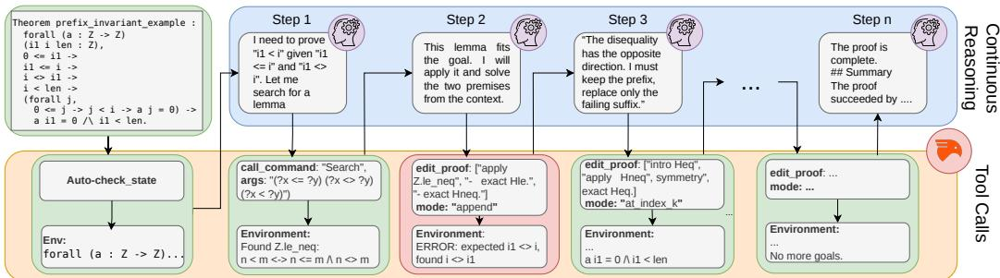  
Fig. 1. Overview of ProofCoder’s workflow.

## 3.1 Proof Sessions

Each proof attempt is executed inside a preconfigured Rocq session. The harness binds the agent to a single proof obligation, including the theorem name, the source file, and the workspace containing the generated verification condition. The agent does not invoke Rocq directly or edit files outside this workspace; interactions with the proof assistant go through the tool interface described below.

At the beginning of a session, the agent receives the initial proof state, including the current hypotheses and goals. From there, it incrementally constructs a proofscript. The script is represented as an ordered list of tactic lines, and the proof assistant is used as the verifier after every edit. A session terminates successfully when Rocq accepts the generated script and all goals are discharged. The agent is not allowed to use placeholder proof commands such as admit or shelve/unshelve; only fully checked proofs are counted as successful. Furthermore, the environment’s setup prevents the agent from changing the theorem statement.

## 3.2 Tool Interface

The agent interacts with Rocq through a small set of tools. These tools expose both read-only operations, used to inspect proof states or retrieve context, and a single mutating operation, used to edit the proof script.

check\_state. Read-only tool that replays the proof script up to a given tactic index and returns the corresponding proof state. The index denotes the length of the prefix to execute: index 0 corresponds to the initial goal, while index n corresponds to the state after the first n tactic lines. This allows the agent to inspect not only the current state, but also earlier states in the proof. In practice, the agent should use this tool sparingly, primarily when it needs to revisit the context at an earlier point before deciding where to repair the script.

call\_command. Read-only tool that provides access to standard Rocq commands such as Search, Print and Locate. The agent can search for relevant lemmas, inspect definitions, locate identifiers, or check the type of a term before using it in the proof. The output of these commands is returned as text and becomes part of the subsequent model context.

read\_proof\_file. Read-only tool that enables the agent to inspect files in the session workspace. This is useful when the compact proof-state display omits information that is easier to understand from the source theorem, or when the agent needs to verify definitions and local context present in the file.

edit\_proof. This is the only tool that modifies the proof script. The tool takes a proof fragment and inserts it into the current script. By default, the fragment is appended to the end of the proof.

Alternatively, the agent may provide an edit index n. In that case, the environment preserves the first n proof lines, discards the remaining sufix, and appends the newly generated fragment.

This interface is independent ofthe granularity ofproofgeneration. In a tactic-level configuration, the generated fragment is restricted to a single tactic. In a whole-proof configuration, the fragment may contain an entire proof attempt or the sufix necessary to complete it. Thus, it provides a uniform mechanism for forward proof construction, localized repair, and full proof revision.

After each edit, the environment rechecks the resulting script and returns feedback from Rocq. If the edit is accepted but goals remain, the response contains the updated proof state. On failure, the response reports the failing tactic index and the corresponding proof state at the point of failure. The agent can then continue from the current prefix, replace the rejected step, or backtrack further by editing from an earlier index.

## 3.3 Continuous Reasoning

The integration of continuous reasoning [50] with verifier-guided proof repair is a central part of our agent design. At each step, the model produces a natural language message, along with the tool call, recording the model’s interpretation of the current proof state, the local proof objective, the intended action, and, when relevant, its diagnosis of a previous failed attempt. The tool call executes the action described in this reasoning, such as inspecting a proof state, querying Rocq, or editing the proof script.

The role of these messages is to guide the agent’s control policy. Proof search often requires decisions that are not captured by the next tactic alone: whether a failed subgoal indicates a minor syntactic error, a wrong lemma application, an unhelpful case split, or a proof prefix that should be abandoned. By making this diagnosis explicit before each action, the agent maintains a running account of the proof attempt that conditions later decisions.

This mechanism is especially important for proof repair. When an edit fails or leads to an unproductive state, the agent can use its previous reasoning together with the new proof-state feedback to decide how much of the proof should be preserved. For example, it may conclude that only the last tactic should be replaced, that an earlier assertion was formulated incorrectly, or that the proof should restart from a previous case split. Continuous reasoning therefore supports not only tactic selection, but also the higher-level decision of where and how to revise the proof script.

This difers from systems where the model primarily emits isolated tactics, or where an external proof-search loop predetermines when to query the environment and when to backtrack, such as Rango [41] or PALM [26]. It also difers from AutoRocq, where reasoning is organized primarily around an explicit initial plan rather than a continuous rationale before each proof-editing action. In our setting, the model controls both the proof edits and the surrounding reasoning process. The resulting workflow resembles coding-agent repair: progress is made by repeatedly editing an artifact, observing the result, diagnosing the failure mode, and revising the artifact accordingly.

## 4 Experimental Setup

This section describes the experimental setup, including the research questions, benchmark, baselines, implementation and configurations, and stopping criteria.

## 4.1 Research Questions

To evaluate the efectiveness of ProofCoder on verification tasks, our evaluation answers three research questions:

• RQ1. How does ProofCoder compare with the state of the art, and which design choices contribute most to its performance?

• RQ2. How do diferent agentic configurations afect backtracking behavior during proof search?

• RQ3. How do diferent proof generation granularity strategies compare in our setup?

## 4.2 Benchmarks

SV-COMP. We consider the SV-COMP dataset of the AutoRocq benchmark [42], consisting of verification lemmas generated from annotated C programs through a deductive-verification workflow. In the Frama-C ecosystem [20], these programs are typically specified in ACSL [5], and the resulting verification conditions can be discharged by automatic provers, for example through Why3 [11], or exported to interactive proof assistants when more expressive reasoning is required. Due to cost constraints, we select the 200 verification lemmas with the highest term count, one of the complexity metrics used by Tu et al. [42]. Their term counts range from 178 to 703, with a mean of 292.4 and a median of 265.5. Since no ground-truth proofs are available, the benchmark does not establish which lemmas are provable; however, 88 tasks in our subset were solved by AutoRocq or one of its baselines in the original evaluation. Thus, while provability is not established for the full subset, it retains most obligations known to be solvable by existing approaches and provides a challenging setting without being dominated by obligations for which no proof has yet been found. Linux Kernel. We select 80 verification lemmas from Verker, a benchmark that formalizes functional correctness of Linux kernel code, used in AutoRocq’s own case study. As reported by Tu et al. [42], these lemmas are used to reason about the correctness of intricate program behaviors, and come from various source files, such as memory management (e.g., memmove) and utilities such as string operations (e.g., strcpy) and type conversion (e.g., hex2bin). In terms of complexity, these lemmas have term counts ranging from 29 to 549, with a mean of 178.66 and a median of 130.

## 4.3 Baselines

We compare ProofCoder against several existing theorem-proving systems, using AutoRocq [42] as our primary baseline because it is the state of the art in agentic Rocq-based software verification and the closest system to our approach. In its original evaluation, AutoRocq also compared against Rango [41], PALM [26], COPRA [39], Proverbot9001 [34], and QEDCartographer [35], outperform ing these systems. We reuse these published baseline results to provide broader context, while focusing our new experiments on AutoRocq.

AutoRocq is an agentic loop with access to four tools: Plan, which allows it to generate a free-form plan for the proof, stored in the context; Query, to execute query commands like Search, Print and Locate; Tactic, used to generate tactics; and Rollback, used to delete a certain number of previously accepted steps. Rollback was not evaluated originally in [42], but the tool implementation was present in the replication package and early experiments showed that, with more recent models, it improved the performance. AutoRocq processes the proof script and proof state as a tree. Context retrieval, either by using query commands or by feeding proofs from history, is usually done at the beginning of a new state or after a certain number of failed attempts to generate a tactic.

AutoRocq was originally evaluated using gpt-4.1. We revisit this design choice by replacing it with the more recent models claude-sonnet-4.5 and gpt-6-sol.

As previously mentioned, one further challenge when evaluating theorem provers on AutoRocq benchmark is that ground-truth proofs are generally unavailable. Consequently, some obligations may be unprovable, or simply beyond the capabilities of current automated approaches. To account for this, the agent terminates a proof attempt when it determines that further search is unlikely to succeed. We refer to this behavior as give up. In order to save costs and ensure a fair comparison across approaches, we equip our agent with an equivalent mechanism in our evaluation.

## 4.4 Agent Implementation and Configurations

We implement ProofCoder as a thin integration layer on top of the OpenCode agent runtime [1], connected to Rocq through a custom Model Context Protocol (MCP) server of approximately 3,100 lines of Python. This separates agent orchestration, including reasoning, tool selection, and conversation management, from theorem-prover interaction, including script maintenance, replay, and goal reporting. The Rocq backend reuses AutoRocq’s CoqInterface, based on CoqPyt [7], coqlsp [15], and Rocq 8.18, which the MCP server imports at runtime rather than reimplementing. We run our experiments across claude-sonnet-4.5 and gpt-6-sol both with temperature 0.

We define the following ProofCoder configurations, where WP and TL stand for, respectively, Whole Proof and Tactic-Level:

• ProofCoder-WP: the agent generates multiple tactics per edit\_proof call and is prompted to always try to complete the proof. It repairs proofs through the default behavior of edit\_proof.

• ProofCoder-TL: the agent generates one tactic per edit\_proof call. It repairs proofs through the default behavior of edit\_proof.

• ProofCoder-TL-NoCR: an ablation that uses a plan tool instead of continuous reasoning between tool calls (tactic-level).

• ProofCoder-TL-NoCR+Rollback: an ablation that more closely matches AutoRocq: the agent performs tactic-level generation, backtracks only through Rollback and produces no continuous reasoning between calls.

• ProofCoder-WP-NoCR: uses a plan tool instead of continuous reasoning between tool calls (whole proof).

• ProofCoder-WP-Reset: replaces localized backtrack with a deterministic reset that restarts the proof after every failed generation.

## 4.5 Stopping Criteria

Evaluating agentic provers can be computationally expensive, so we impose a fixed resource budget on each proof attempt. Limits were set on the basis of practical cost constraints and preliminary experiments, which showed diminishing improvements in proof success beyond these thresholds.

Our primary stopping criterion is a budget of 200k non-cached tokens. This metric is better suited to comparing agents with diferent proof-generation granularities than the number of tool calls, which would favor some configurations over others. Non-cached token usage provides a more consistent measure of the model usage required for a proof attempt.

We impose two secondary limits for edge cases. First, we cap total token usage at 5M tokens, since some tactic-level configurations can produce very long interactions while consuming relatively few non-cached tokens due to context reuse. Second, we set a 30-minute wall-clock timeout per verification lemma to prevent a small number of unusually expensive searches from dominating the evaluation time. These additional limits make the experiments predictable while having little impact on typical proof attempts.

## 5 Experimental Results

This section presents the experimental results and answers our research questions.

## 5.1 RQ1. How does ProofCoder compare with the state of the art, and which design choices contribute most to its performance?

Table 1 reports proof success on the SV-COMP lemmas, including our ProofCoder configurations, AutoRocq using the same models (claude-sonnet-4.5 and gpt-6-sol), and the baselines reported in the original AutoRocq evaluation. AutoRocq benefits substantially from the stronger model, improving from 86 to 94 solved lemmas when moving from claude-sonnet-4.5 to gpt-6-sol, which shows that its agentic design continues to benefit from advances in the underlying LLM. ProofCoder shows the same trend and, importantly, both of its configurations outperform AutoRocq with either model. With claude-sonnet-4.5, ProofCoder-WP proves 113 lemmas, 27 more than AutoRocq, a 31.4% relative improvement, while ProofCoder-TL proves 25 more. With gpt-6-sol, ProofCoder-WP and ProofCoder-TL prove 26 and 25 more lemmas than AutoRocq, respectively.

Table 1. Pass rates, average cost, and average time on 200 SV-COMP lemmas. The last three columns are solved lemmas of each obligation type (49 assert reachability, 30 signed int overflow, and 121 loop invariant).
<table><tr><td>System</td><td>Passed</td><td>Avg. cost (USD)</td><td>Avg. time (s)</td><td>Assert reachability</td><td>Signed int overflow</td><td>Loop invariant</td></tr><tr><td>Rango</td><td>40 (20.0%)</td><td></td><td></td><td>22 (44.9%)</td><td>4 (13.3%)</td><td>14 (11.6%)</td></tr><tr><td>PALM</td><td>24 (12.0%)</td><td></td><td></td><td>6 (12.2%)</td><td>1 (3.3%)</td><td>17 (14.0%)</td></tr><tr><td>QEDCartographer</td><td>46 (23.0%)</td><td></td><td></td><td>25 (51.0%)</td><td>2 (6.7%)</td><td>19 (15.7%)</td></tr><tr><td>Proverbot9001</td><td>56 (28.0%)</td><td></td><td></td><td>24 (49.0%)</td><td>2 (6.7%)</td><td>30 (24.8%)</td></tr><tr><td>COPRA</td><td>71 (35.5%)</td><td></td><td></td><td>23 (46.9%)</td><td>8 (26.7%)</td><td>40 (33.1%)</td></tr><tr><td>AutoRocq (GPT-4.1)</td><td>70 (35.0%)</td><td></td><td></td><td>21 (42.9%)</td><td>11 (36.7%)</td><td>38 (31.4%)</td></tr><tr><td>AutoRocq (claude-sonnet-4.5)</td><td>86 (43.0%)</td><td>0.678</td><td>609</td><td>30 (61.2%)</td><td>22 (73.3%)</td><td>34 (28.1%)</td></tr><tr><td>Tactic-Level (claude-sonnet-4.5)</td><td>111 (55.5%)</td><td>0.516</td><td>747</td><td>31 (63.3%)</td><td>22 (73.3%)</td><td>58 (47.9%)</td></tr><tr><td>Whole-Proof (claude-sonnet-4.5)</td><td>113 (56.5%)</td><td>0.352</td><td>895</td><td>32 (65.3%)</td><td>23 (76.7%)</td><td>58 (47.9%)</td></tr><tr><td>AutoRocq (gpt-6-sol)</td><td>94 (47.0%)</td><td>0.177</td><td>475</td><td>29 (59.2%)</td><td>20 (66.7%)</td><td>45 (37.2%)</td></tr><tr><td>Tactic-Level (gpt-6-sol)</td><td>119 (59.5%)</td><td>0.090</td><td>230</td><td>33 (67.3%)</td><td>25 (83.3%)</td><td>61 (50.4%)</td></tr><tr><td>Whole-Proof (gpt-6-sol)</td><td>120 (60.0%)</td><td>0.084</td><td>229</td><td>34 (69.4%)</td><td>25 (83.3%)</td><td>61 (50.4%)</td></tr></table>

Table 2. Pass rates, average cost, and average time on 80 Verker lemmas. The last two columns are solved lemmas of each obligation type (53 assert and 27 loop invariant).
<table><tr><td colspan="5"></td><td rowspan="2">Assert Loop invariant</td></tr><tr><td>System</td><td>Passed</td><td>Avg. cost (USD)</td><td>Avg. time (s)</td><td>reachability</td></tr><tr><td>AutoRocq (claude-sonnet-4.5)</td><td>29 (36.2%)</td><td>1.336</td><td>856</td><td>17 (32.1%)</td><td>12 (44.4%)</td></tr><tr><td>Tactic-Level (claude-sonnet-4.5)</td><td>34 (42.5%)</td><td>1.177</td><td>727</td><td>23 (43.4%)</td><td>11 (40.7%)</td></tr><tr><td>Whole-Proof (claude-sonnet-4.5)</td><td>31 (38.8%)</td><td>0.970</td><td>1007</td><td>22 (41.5%)</td><td>9 (33.3%)</td></tr><tr><td>AutoRocq (gpt-6-sol)</td><td>38 (47.5%)</td><td>0.388</td><td>653</td><td>27 (50.9%)</td><td>11 (40.7%)</td></tr><tr><td>Tactic-Level (gpt-6-sol)</td><td>46 (57.5%)</td><td>0.288</td><td>391</td><td>31 (58.5%)</td><td>15 (55.6%)</td></tr><tr><td>Whole-Proof (gpt-6-so1)</td><td>48 (60.0%)</td><td>0.182</td><td>420</td><td>33 (62.3%)</td><td>15 (55.6%)</td></tr></table>

Furthermore, as shown in Figures 2a and 2b, all verification lemmas proved by AutoRocq were also proved by at least one configuration of ProofCoder.

Because the agentic systems substantially outperform the other baselines on SV-COMP, we compare our approaches exclusively with AutoRocq on Verker. In Table 2, we see a similar diference in performance between approaches, with ProofCoder-WP proving 38.8% and 60% of lemmas with claude-sonnet-4.5 and gpt-6-sol, respectively and ProofCoder-TL proving 42.5% and 57.5%. AutoRocq, on the other hand, proved 36.2% and 47.5%.

The Venn diagrams in Figures 2c and 2d show that, although our approach outperforms AutoRocq, the two approaches do not solve exactly the same lemmas: a small number are proved exclusively by AutoRocq. This suggests that, on the more challenging Verker dataset, diferent agentic approaches can still succeed on diferent proof obligations, with our best configuration proving three AutoRocqunsolved lemmas compared with one lemma solved exclusively by AutoRocq.

Cost and Time Analysis: Whole-Proof is the cheapest of the three systems, and AutoRocq is the most expensive. On SV-COMP with claude-sonnet-4.5, ProofCoder-WP (\$0.352) costs about two-thirds as much as ProofCoder-TL (\$0.516) and about half as much as AutoRocq (\$0.678). With gpt-6-sol the two agents are close: \$0.084 against \$0.090, both about half of AutoRocq (\$0.177). On Verker, the Whole-Proof saving is larger for gpt-6-sol (\$0.182 against \$0.288 and \$0.388) than for claude-sonnet-4.5 (\$0.970 against \$1.177 and \$1.336).

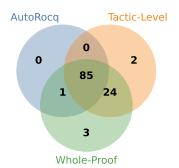  
(a) SV-COMP (Sonnet 4.5)

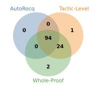  
(b) SV-COMP (gpt-6-sol)

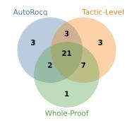  
(c) Verker (Sonnet 4.5)

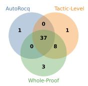  
(d) Verker (gpt-6-sol)  
Fig. 2. Overlap of verification lemmas proved by AutoRocq and ProofCoder.

Time does not follow cost. With claude-sonnet-4.5, ProofCoder-WP is the slowest configuration on both datasets (895 s on SV-COMP, 1007 s on Verker), while ProofCoder-TL is faster than Whole-Proof and, on Verker, faster than AutoRocq (727 s against 856 s). With gpt-6-sol the two agents take almost the same time, and both are faster than AutoRocq: about 230 s against 475 s on SV-COMP, and about 391–420 s against 653 s on Verker. Verker is the more expensive dataset for every system, at roughly two to three times the SV-COMP cost per lemma, reflecting the increase in dificulty for this dataset.

Verification Lemma Categories: The SV-COMP tasks fall into three categories: Assert Reachability (49 lemmas), Assert (RTE) Signed Overflow (30 lemmas), and Loop Invariants (121 lemmas). As shown in Table 1, ProofCoder’s gains over AutoRocq are concentrated on loop invariants. With claude-sonnet-4.5, AutoRocq solves 34 of these lemmas (28.1%), while ProofCoder-TL and ProofCoder-WP each solve 58 (47.9%). That increase of 24 lemmas is the whole net gain of Tactic-Level over AutoRocq (111 against 86) and 24 of Whole-Proof’s 27 additional proofs (113 against 86). On the other two categories claude-sonnet-4.5 AutoRocq is already close to the agents: 30 against 31 and 32 of the 49 assert-reachability lemmas, and 22 against 22 and 23 of the 30 signed-overflow lemmas. With gpt-6-sol the same concentration holds, above a stronger AutoRocq baseline. AutoRocq solves 45 loop invariants (37.2%), and both agents solve 61 (50.4%), which is 16 of the 25 and 26 extra proofs by ProofCoder-TL and ProofCoder-WP, respectively. The rest is split across the other categories: assert reachability rises from 29 to 33 and 34, and signed overflow from 20 to 25 for both agents.

Loop invariant lemmas are not substantially more complex by syntactic metrics, such as hypothesis count, term count, or statement length. They difer in proof structure, requiring reasoning about multiple memory snapshots, universally quantified array properties, map updates, and case distinctions over indices. This makes them a natural setting for agents that inspect intermediate proof states, reason continuously about the evolving context, and revise partially constructed proofs. Manual inspection suggests that ProofCoder’s advantage is not primarily due to discovering entirely new proof strategies. In more than half of the tasks solved only by ProofCoder, AutoRocq attempted the same key proof steps, such as unfolding Map.set, splitting on index equalities, or instantiating universally quantified hypotheses. The diference lies in execution: ProofCoder pre serves promising prefixes, inspects previous states, and repairs localized failures, while AutoRocq often remains stuck in local repairs until eventually resetting the proof through rollback.

The Verker tasks fall into two categories, Assert Reachability (53 lemmas) and Loop Invariant (27), as shown in Table 2. Unlike SV-COMP, where ProofCoder’s gains are concentrated on Loop Invariant lemmas, the Verker results with claude-sonnet-4.5 are driven by Assert Reachability. AutoRocq solves 17 of 53 Assert Reachability lemmas (32.1%) and 12 of 27 Loop Invariant lemmas (44.4%), compared with 23 (43.4%) and 11 (40.7%) for ProofCoder-TL and 22 (41.5%) and 9 (33.3%) for ProofCoder-WP, respectively. Thus, the additional proofs obtained with claude-sonnet-4.5 come entirely from Assert Reachability, while both configurations solve fewer Loop Invariant lemmas than AutoRocq. With gpt-6-sol, however, the pattern changes: all three approaches improve on both categories, and both ProofCoder configurations surpass AutoRocq on Loop Invariants. AutoRocq solves 27 Assert Reachability lemmas (50.9%) and 11 Loop Invariant lemmas (40.7%), compared with 31 (58.5%) and 15 (55.6%) for ProofCoder-TL and 33 (62.3%) and 15 (55.6%) for ProofCoder-WP. This suggests that the relative advantage of ProofCoder depends not only on the proof category but also on the underlying model: the stronger model enables gains on Loop Invariants that are not observed with claude-sonnet-4.5 on this dataset.

Table 3. ProofCoder ablations with gpt-6-sol: proof success, cost, and time on SV-COMP and Verker.
<table><tr><td rowspan="2">Ablation</td><td colspan="3">SV-COMP (200 lemmas)</td><td colspan="3">Verker (80 lemmas)</td></tr><tr><td>Passed</td><td>Avg. cost (USD)</td><td>Avg. time (s)</td><td>Passed</td><td>Avg. cost (USD)</td><td>Avg. time (s)</td></tr><tr><td>TL-NoCR</td><td>115 (57.5%)</td><td>0.206</td><td>358</td><td>40 (50.0%)</td><td>0.674</td><td>768</td></tr><tr><td>TL-NoCR+Rollback</td><td>115 (57.5%)</td><td>0.154</td><td>339</td><td>35 (43.8%)</td><td>0.689</td><td>646</td></tr><tr><td>WP-NoCR</td><td>113 (56.5%)</td><td>0.130</td><td>301</td><td>43 (53.8%)</td><td>0.326</td><td>653</td></tr><tr><td>WP-Reset</td><td>81 (40.5%)</td><td>0.192</td><td>346</td><td>24 (30.0%)</td><td>0.403</td><td>542</td></tr></table>

Ablations. To better understand the impact of ProofCoder’s design choices, we evaluate the four ablation configurations described above using our best-performing model, gpt-6-sol. Table 3 summarizes the results. Removing continuous reasoning reduces performance while substantially increasing cost and runtime for gpt-6-sol. For ProofCoder-TL, performance drops from 119 to 115 solved lemmas on SV-COMP and from 46 to 40 on Verker, while cost more than doubles on both datasets and Verker runtime nearly doubles. ProofCoder-WP shows the same trend, dropping from 120 to 113 solved lemmas on SV-COMP and from 48 to 43 on Verker, with cost increasing by 55% and 79%, respectively. Replacing our backtrack with an explicit rollback tool to reasoning-free ProofCoder-TL has little efect on SV-COMP performance, which remains at 115 solved lemmas, while performance on Verker decreases to 35. These results are consistent with the hypothesis that the reasoning step helps the agent coordinate tool use and proof search. Replacing ProofCoder-WP’s localized repair with a full restart from the beginning on error leads to a much larger performance drop, from 120 to 81 solved SV-COMP lemmas and from 48 to 24 on Verker. The restart strategy also slightly increases SV-COMP cost from \$0.084 to \$0.192. This result is consistent with the hypothesis that preserving the existing proof and repairing the failing sufix is more efective than discarding the proof and restarting.

Overall, the ablation results show that continuous reasoning and localized repair are key to ProofCoder’s efectiveness: removing either reduces proof success, with localized repair having the larger impact.

Answer to RQ1: ProofCoder consistently outperforms the state of the art across both benchmarks and both models. On SV-COMP, every lemma proved by AutoRocq is also proved by at least one ProofCoder configuration. ProofCoder-WP improves over AutoRocq by 31.4% with claude-sonnet-4.5 and 27.7% with gpt-6-sol, while requiring roughly half the inference cost, with gains concentrated on loop-invariant lemmas. Whole-proof and tactic-level generation achieve similar success rates, with ProofCoder-WP generally ofering the best success–cost trade-of. The ablations show that continuous reasoning and localized repair are key design choices: removing continuous reasoning lowers success while substantially increasing cost, whereas replacing localized repair with full restarts causes much larger performance drops. Replacing our backtracking mechanism with AutoRocq’s rollback tool does not improve performance.

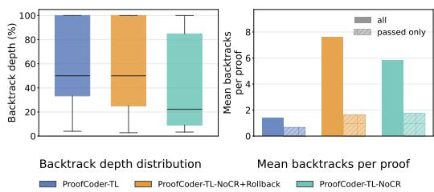

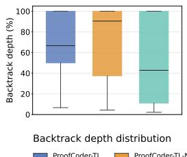

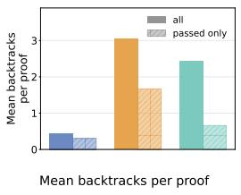  
(a) Backtrack depth and frequency (SV-COMP)  
(b) Backtrack depth and frequency (Verker)  
Fig. 3. Comparison of backtrack depth and frequency across tactic-level approaches.

## 5.2 RQ2. How do diferent agentic configurations afect backtracking behavior during proof search?

Backtracking lets agents revise accepted proof fragments rather than follow a monotonic tactic sequence, ranging from local repairs to broader exploration or full restarts. Its behavior depends on the interaction interface, including rollback mechanisms, editable proof scripts, and continuous reasoning. Efective backtracking therefore requires deciding which proof prefix to preserve and which sufix to discard. We compare backtracking across tactic-level approaches by analyzing backtrack depth and frequency, tactic replacement patterns, and the fraction of preserved revisions. We use the gpt-6-solconfiguration of our agent and its ablations.

Backtrack depth and frequency. We define backtrack depth as the percentage of the current proof discarded by a backtrack, and backtrack frequency as the mean number of backtracks per task. Depth captures repair aggressiveness: higher values indicate larger discarded sufixes, while lower values indicate local edits near the end of the script.

Figure 3 shows substantial diferences between approaches. The most pronounced efect of continuous reasoning is on frequency: ProofCoder-TL backtracks roughly 4–6× less often than both ablations (0.45 vs. 2.4 for ProofCoder-TL-NoCR and 3.05 for ProofCoder-TL-NoCR+Rollback on SV-COMP; 1.39 vs. 5.8 and 7.6 on Verker). Moreover, for the ablations, the frequency over all tasks is 2–5× as high than over successful tasks alone, indicating that heavy backtracking is characteristic of failing runs, whereas ProofCoder-TL shows only a small gap between the two. The approaches also difer in how they backtrack. Without reasoning, ProofCoder-TL-NoCR favors shallow, local edits (median depth ≈43% on SV-COMP and ≈22% on Verker), while ProofCoder-TL-NoCR+Rollback tends towards near-complete restarts on SV-COMP (median depth ≈90%) and, even in successful proofs, backtracks the most of the three variants. ProofCoder-TL sits between these extremes (median depth ≈67% on SV-COMP and ≈50% on Verker). This suggests that reasoning about a failure before acting lets the agent choose a single, appropriately placed resumption point, instead of repeatedly patching locally or discarding most of the proof.

Tactic replacement paterns. Tables 4 and 5 report the five most frequently deleted tactics and their three most common replacements. Across tactic-level variants, intros is by far the most frequently deleted tactic. For ProofCoder-TL, it is replaced by intros in 92.3% of cases on SV-COMP and 89.7% on Verker. Removing continuous reasoning changes this substantially: ProofCoder-TL-NoCR retains intros in only 34.5% and 31.7% of cases, respectively, with replacements dispersed across tactics such as lia, pose, and idtac. This suggests that, without reasoning, the chosen resumption point does not always correspond to the proof decision the agent intends to revise.

Table 4. Most frequently deleted tactics and their three most common replacements on SV-COMP.
<table><tr><td colspan="4">ProofCoder-TL</td></tr><tr><td>Deleted tactic</td><td>n #1</td><td>#2</td><td>#3</td></tr><tr><td>intros</td><td>52 intros (92.3%)</td><td>cbn (5.8%)</td><td>idtac (1.9%)</td></tr><tr><td>apply</td><td>6 apply (33.3%)</td><td>destruct (33.3%)</td><td>rewrite (16.7%)</td></tr><tr><td>eauto</td><td>6 congruence (33.3%)</td><td>exfalso (33.3%)</td><td>nia (16.7%)</td></tr><tr><td>destruct</td><td>4 specialize (50.0%)</td><td>assert (25.0%)</td><td>destruct (25.0%)</td></tr><tr><td>specialize</td><td>3 destruct (66.7%)</td><td>specialize (33.3%)</td><td></td></tr><tr><td colspan="4">ProofCoder-TL-NoCR+Rollback</td></tr><tr><td>Deleted tactic</td><td>n #1</td><td>#2</td><td>#3</td></tr><tr><td>intros</td><td>337 intros (89.9%)</td><td>intro (5.6%)</td><td>cbv (1.8%)</td></tr><tr><td>intro</td><td>22 intros (50.0%)</td><td>intro (13.6%)</td><td>cbn (9.1%)</td></tr><tr><td>destruct</td><td>21 assert (33.3%)</td><td>destruct (28.6%)</td><td>exfalso (14.3%)</td></tr><tr><td>assert exfalso</td><td>16 assert (37.5%)</td><td>destruct (37.5%)</td><td>exfalso (6.2%)</td></tr><tr><td></td><td>11 pose (18.2%)</td><td>al1 (9.1%)</td><td>assert (9.1%)</td></tr><tr><td colspan="4">ProofCoder-TL-NoCR</td></tr><tr><td>Deleted tactic</td><td>n #1</td><td>#2</td><td>#3</td></tr><tr><td>intros</td><td>142 intros (34.5%)</td><td>lia (10.6%)</td><td>pose (8.5%)</td></tr><tr><td>assert destruct</td><td>61 assert (29.5%)</td><td>pose (14.8%)</td><td>destruct (13.1%)</td></tr><tr><td></td><td>38 assert (23.7%)</td><td>destruct (21.1%)</td><td>exfalso (13.2%)</td></tr><tr><td>pose</td><td>37 assert (27.0%)</td><td>clear (18.9%)</td><td>pose (13.5%)</td></tr><tr><td>idtac</td><td>32 idtac (21.9%)</td><td>clear (12.5%)</td><td>intros (12.5%)</td></tr></table>

ProofCoder-TL-NoCR+Rollback shows a diferent pattern. It deletes intros much more often than either other variant (337 and 239 times on SV-COMP and Verker, compared with 142 and 101 for ProofCoder-TL-NoCR and 52 and 68 for ProofCoder-TL) and replaces it with intros or intro in over 95% of cases. This is consistent with rollback frequently discarding the proof setup, which the agent then reconstructs before diverging later. Beyond setup, ProofCoder-TL-NoCR+Rollback resembles ProofCoder-TL-NoCR, with dispersed revisions among tactics such as assert, destruct, pose, and exfalso.

Other frequently revised tactics include apply, assert, and destruct, which correspond to substantive proof decisions such as lemma selection, intermediate facts, and case decomposition. They are often replaced by the same or closely related tactics (e.g., apply by apply in 54.3% of cases for ProofCoder-TL-NoCR on Verker and assert by assert in 48.6% for ProofCoder-TL-NoCR+Rollback), suggesting that the agent often preserves the overall strategy while revising its realization. For ProofCoder-TL, however, deletions beyond intros are rare (� ≤ 9), so these replacement distributions should be interpreted cautiously.

Overall, continuous reasoning primarily reduces how often revisions are needed: ProofCoder-TL performs far fewer deletions and largely preserves proof setup, whereas the reasoning-free variants revise more aggressively. Rollback stabilizes the setup only because it is repeatedly reconstructed after near-complete restarts.

Proofrevision stability. We measure whether backtracks lead to stable proofrevisions. A backtrack is preserved if the proof search following it is not entirely undone at the end of the run. If a backtrack resumes generation from index �, it is preserved unless a later backtrack resumes from some index $j \leq i ,$ , thereby discarding the branch introduced after the original backtrack.

Table 5. Most frequently deleted tactics and their three most common replacements on Verker.
<table><tr><td colspan="3">ProofCoder-TL</td></tr><tr><td>Deleted tactic</td><td>n #1</td><td>#2</td><td>#3</td></tr><tr><td>intros</td><td>68 intros (89.7%)</td><td>cbn (2.9%)</td><td>cbv (2.9%)</td></tr><tr><td>apply</td><td>9 apply (22.2%)</td><td>pose (22.2%)</td><td>eapply (11.1%)</td></tr><tr><td>eapply</td><td>4 apply (25.0%)</td><td>assert (25.0%)</td><td>destruct (25.0%)</td></tr><tr><td>assert replace</td><td>3 assert (66.7%)</td><td>destruct (33.3%)</td><td></td></tr><tr><td></td><td>3 eapply (33.3%)</td><td>rewrite (33.3%)</td><td>unfold (33.3%)</td></tr><tr><td colspan="4">ProofCoder-TL-NoCR+Rollback</td></tr><tr><td>Deleted tactic</td><td>n #1</td><td>#2</td><td>#3</td></tr><tr><td>intros</td><td>239 intros (92.5%)</td><td>intro (3.8%)</td><td>cbv (2.1%)</td></tr><tr><td>assert</td><td>74 assert (48.6%)</td><td>pose (20.3%)</td><td>destruct (14.9%)</td></tr><tr><td>pose</td><td>41 pose (36.6%)</td><td>destruct (26.8%)</td><td>assert (17.1%)</td></tr><tr><td>destruct intro</td><td>36 destruct (30.6%)</td><td>assert (27.8%)</td><td>pose (25.0%)</td></tr><tr><td></td><td>17 intro (64.7%)</td><td>intros (17.6%)</td><td>pose (17.6%)</td></tr><tr><td colspan="4">ProofCoder-TL-NoCR</td></tr><tr><td>Deleted tactic</td><td>n #1</td><td>#2</td><td>#3</td></tr><tr><td>intros</td><td>101 intros (31.7%)</td><td>idtac (17.8%)</td><td>intro (6.9%)</td></tr><tr><td>assert destruct</td><td>68 assert (22.1%)</td><td>apply (13.2%) assert (16.0%)</td><td>destruct (13.2%)</td></tr><tr><td>pose</td><td>50 destruct (36.0%) 47 clear (27.7%)</td><td>pose (14.9%)</td><td>apply (12.0%)</td></tr><tr><td></td><td></td><td></td><td>apply (12.8%)</td></tr><tr><td>apply</td><td>35 apply (54.3%)</td><td>exact (17.1%)</td><td>destruct (8.6%)</td></tr></table>

We compute preservation at the proof level: for each successful proof with at least one backtrack, we calculate the fraction of preserved backtracks, and then average these fractions across proofs:

$$
\mathrm { P r e s e r v a t i o n R a t e } = \frac { 1 } { | \mathcal { P } _ { b t } | } \sum _ { \substack { \mathstrut p \in \mathcal { P } _ { b t } } } \frac { \mathrm { b a c k t r a c k s \_ p r e s e r v e d } ( p ) } { \mathrm { b a c k t r a c k s \_ t o t a l } ( \mathstrut p ) } \times 1 0 0 ,
$$

with $\mathcal { P } _ { b t }$ as the set of successful proofs with at least one backtrack. This is a retrospective measure of stability: discarded backtracks still have diagnostic value, but the metric captures whether a repair became part of the surviving search trajectory.

Figure 4 shows a consistent ordering on both benchmarks: ProofCoder-TL > ProofCoder-TL-NoCR > ProofCoder-TL-NoCR+Rollback. On SV-COMP, preservation drops from 88.7% to 65.0% without continuous reasoning and to 48.5% with rollback, while the distributions widen substantially (interquartile ranges 80–100%, 33–100%, and 21–67%, respectively). Verker shows the same ordering (77.6%, 72.0%, 68.2%), but with smaller diferences and largely overlapping distributions. This complements the depth and frequency results: ProofCoder-TL-NoCR’s shallow backtracks are more often overridden by later revisions, whereas ProofCoder-TL-NoCR+Rollback’s near-complete restarts discard earlier revisions by construction. Since the final backtrack is always preserved, ProofCoder-TL’s higher rate also partly reflects its lower backtrack frequency. Overall, continuous reasoning reduces both the need for revision and the likelihood that revisions are later undone.

Answer to RQ2: Continuous reasoning substantially changes backtracking behavior, mainly by reducing the need for revision: ProofCoder-TL backtracks approximately 4–7× less often than its ablations, and the revisions it does make are rarely undone. Without continuous reasoning, the agent performs frequent shallow backtracks that are later overridden by deeper ones, suggesting that continuous reasoning helps identify which proof prefix should be retained and which should be discarded. The interaction model also influences recovery strategy: adding the rollback tool leads to the most frequent and least stable backtracks, often near-complete restarts, indicating that multiple revision mechanisms lead the agent to discard its own repairs rather than refine them. Finally, across configurations, backtracking most frequently revises proof setup, particularly intros, followed by tactics such as apply, assert, and destruct that make substantive changes to the proof state. This suggests that agents use backtracking to revise higher-level proof decisions rather than simply regenerate failed tactics.

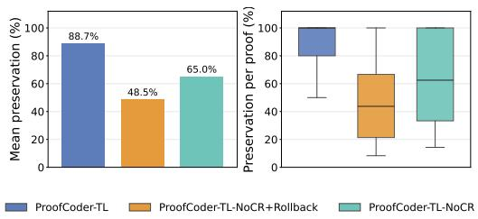  
(a) Preservation rate and distribution (SV-COMP).

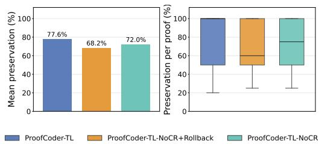  
(b) Preservation rate and distribution (Verker)  
Fig. 4. Backtrack preservation rate for the tactic-level ablations. Backtrack is considered preserved if the subsequent proof search is not entirely undone by the end of the run.

## 5.3 RQ3. How do diferent proof generation granularities compare?

Prior work explores proof synthesis at diferent granularities, from tactic-level generation [16, 34, 39, 41] to whole-proof generation [14, 25, 46]. Tactic-level generation provides intermediate proof states for early error detection and adaptive search, while whole-proof generation reduces proof-assistant interactions. Direct comparison can be confounded by training-data contamination, as whole-proof generation may benefit from reproducing known proofs. AutoRocq benchmark mitigates this concern because its proof obligations have no ground-truth proofs available online. We therefore compare ProofCoder-TL and ProofCoder-WP within the same agent framework to isolate the efect of proof-generation granularity.

As discussed in RQ1 and shown in Tables 1 and 2, whole-proof generation tends to achieve slightly better overall performance. We next compare both configurations in terms of tool calls and backtracking, proof length, and proof similarity.

Tool calls and backtracking. The tool-call traces show that ProofCoder-WP relies more heavily on explicit state inspection, particularly with gpt-6-sol. On SV-COMP, ProofCoder-WP and ProofCoder-TL make 567 and 521 check\_state calls with claude-sonnet-4.5, but 206 and only 6 with gpt-6-sol. The same pattern holds on Verker, where the configurations make 203 vs. 107 calls with claude-sonnet-4.5 and 98 vs. 14 with gpt-6-sol. This reflects their diferent feedback granularity: ProofCoder-WP receives the proof state only after each generated fragment and therefore uses check\_state to inspect intermediate states, whereas ProofCoder-TL receives the state after every tactic. The other context-retrieval actions remain broadly similar within each model: read\_proof\_file is comparable across configurations (131–148 with claude-sonnet-4.5; 184–189 with gpt-6-sol), while call\_command is frequent for both and, on Verker, more frequent for ProofCoder-TL with gpt-6-sol (695 vs. 483).

Backtracking shows the same configuration- and model-dependent pattern. On SV-COMP, ProofCoder-WP backtracks on 70.0% of claude-sonnet-4.5 lemmas (140/200), with 5.35 backtracks on average, compared with 65.0% (130/200) and 3.69 for ProofCoder-TL; with gpt-6-sol, these rates fall to 58.5% and 26.5%, with means of 1.01 and 0.45, respectively. Verker exhibits more frequent backtracking overall: with claude-sonnet-4.5, the corresponding rates are 91.2% (73/80) and 86.2% (69/80), with means of 10.89 and 6.04; with gpt-6-sol, they are 68.8% and 51.2%, with means of 2.16 and 1.39. Thus, ProofCoder-WP consistently performs more explicit state inspections and backtracks than ProofCoder-TL, with both diferences substantially larger for gpt-6-sol.

Prooflength and similarity. Figure 5 compares proofs produced by ProofCoder-TL and ProofCoder-WP on lemmas solved by both configurations. This intersection contains 109 and 118 SV-COMP lemmas for claude-sonnet-4.5 and gpt-6-sol, respectively, and 28 and 45 Verker lemmas. Before computing Jaccard similarity, we remove comments and canonicalize introduced and generated variables, and numeric literals.

On SV-COMP, proofs are generally short and similar in length across configurations. With claude-sonnet-4.5, ProofCoder-WP and ProofCoder-TL average 14.7 and 12.9 tactics, respectively; with gpt-6-sol, they average 10.8 and 10.6. At least 93% contain 25 tactics or fewer, although ProofCoder-WP exhibits a somewhat longer tail. Proof similarity is moderate, with mean Jaccard scores of 0.41 for claude-sonnet-4.5 and 0.40 for gpt-6-sol. Only 3 and 8 proof pairs, respectively, are identical, indicating that the two configurations generally construct distinct proofs despite sharing many tactic steps.

On Verker, proofs are longer and the efect of granularity depends on the model. When using claude-sonnet-4.5, ProofCoder-WP averages 30.4 tactics compared with 20.8 for ProofCoder-TL; with gpt-6-sol, the pattern reverses, with averages of 16.7 and 23.8. Similarity is also lower than on SV-COMP, with mean Jaccard scores of 0.30 and 0.31 for claude-sonnet-4.5 and gpt-6-sol, respectively. Across both models, only two proofs are identical with gpt-6-sol.

Taken together, the results show no consistent advantage of either granularity in proof length, while the relatively low similarity indicates that granularity materially afects how proofs are constructed. Combined with the tool-call traces, this suggests diferent search and repair strategies: ProofCoder-WP relies more on explicit state inspection and backtracking, whereas ProofCoder-TL receives feedback after every tactic and therefore requires fewer explicit revisions.

Answer to RQ3: Whole-proof and tactic-level generation achieve similar proof success, differing by at most three lemmas per setting, with ProofCoder-WP ahead in three of four. Granularity mainly afects interaction behavior: as ProofCoder-WP receives feedback only after each generated fragment, it performs more explicit state inspections (by up to 34× with gpt-6-sol) and backtracks more often, while ProofCoder-TL receives the proof state after every tactic, requiring fewer explicit checks and revisions. Despite this, ProofCoder-WP is cheaper in all settings, as larger fragments require fewer model turns. On lemmas solved by both configurations, proofs have moderate tactic overlap (mean Jaccard 0.30–0.41), are rarely identical, and neither granularity consistently yields shorter proofs. Granularity has little efect on success rate but substantially shapes search, repair, and the resulting proof scripts.

## 6 Related Work

Deep learning has become prominent in theorem proving [4, 8, 12–14, 17–19, 23, 24, 30, 34, 35, 39, 41– 44, 48, 49, 51–53] and software verification [24, 27, 28, 31, 33, 36–38, 42, 45, 51, 54]. Recent work on automated theorem proving for software verification has particularly benefited from LLMs.

Rango [41] fine-tunes an LLM for tactic-level Rocq proof generation: at each step, the model receives proof-assistant context, relevant lemmas, and premises, and generates the next tactic. When a tactic fails, Rango recovers by restarting proof search from the beginning. COPRA [39] also performs tactic-level generation, prompting the model with the current proof state and additional context at each step. However, backtracking is controlled by an external depth-first search procedure: once the allowed attempts from a state are exhausted, the controller returns to an earlier proof state and asks the model for a diferent tactic. PALM [26] follows a generate-then-repair pipeline: it retrieves relevant lemmas and definitions, prompts the LLM to generate a proof script, executes it, and applies symbolic repairs when errors occur. If repair fails, PALM backtracks and attempts to solve earlier goals using CoqHammer [9]. Cobblestone [18] uses a divide-and-conquer strategy. It executes LLM-generated proof scripts in a fail-safe mode, preserves the fragments accepted by Rocq, replaces failing parts with temporary admits, and recursively proves the remaining subgoals. The final assembled proof is accepted only after Rocq checking, often with support from tools such as CoqHammer. Baldur [14] explores whole-proof generation for Isabelle/HOL, using LLMs to produce complete proof scripts rather than individual tactics. When a proof fails, Baldur conditions a learned repair model on the failed script and proof-assistant error message to revise local mistakes. In these systems, the model is primarily invoked at a specific step to generate tactics, proof scripts, or proof fragments, while search control, retrieval, and recovery are largely managed by the surrounding algorithm in a deterministic, yet more restrictive manner.

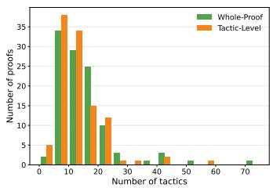  
(a) Proof length (SV-COMP, Sonnet 4.5).

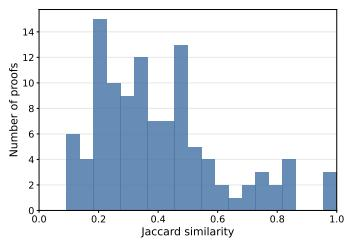  
(b) Proof similarity (SV-COMP, Sonnet 4.5).

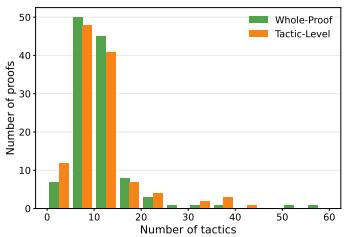  
(c) Proof length (SV-COMP, gpt-6-sol).

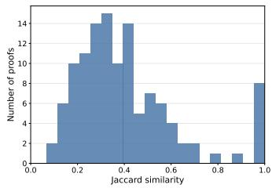  
(d) Proof similarity (SV-COMP, gpt-6-sol).

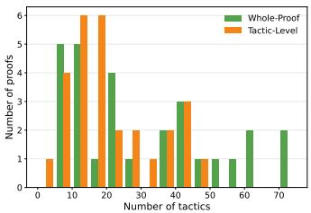

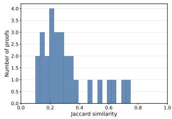

(e) Proof length (Verker, Sonnet 4.5)  
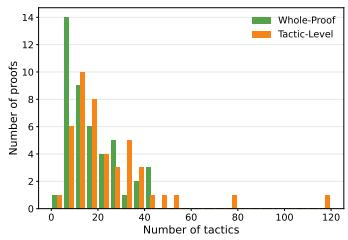  
(g) Proof length (Verker, gpt-6-sol).

(f) Proof similarity (Verker, Sonnet 4.5)  
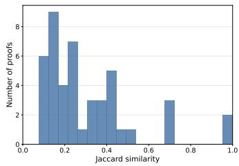  
(h) Proof similarity (Verker, gpt-6-sol).  
Fig. 5. Comparison of length and similarity between proofs generated by ProofCoder-TL and ProofCoder-WP.

AutoRocq [42] is, to our knowledge, the state-of-the-art agentic approach for Rocq-based software verification and an important step toward more autonomous proof synthesis. It equips the LLM with tools for context retrieval, planning, tactic generation, and rollback, and shows that this agentic formulation can substantially outperform earlier approaches. AutoRocq nevertheless retains a structured interaction policy, with prompting that guides tool selection, limits repeated queries, and encourages particular actions in specific situations. ProofCoder proposes a less prescribed interaction model, allowing the agent to freely call and combine tools and to revise proofs through a compact editing and backtracking mechanism.

## 7 Threats to Validity

Construct validity. Comparing whole-proof and tactic-level approaches introduces inherent diferences in resource consumption, as whole-proof generation typically requires fewer LLM calls. Using the number of LLM calls as the stopping criterion would therefore systematically favor whole-proof generation. To mitigate this threat, we use the total number of non-cached LLM tokens as the primary stopping criterion, providing a more comparable computational budget across approaches. We additionally impose maximum wall-clock time and total token-budget limits. Preliminary experiments showed that increasing these limits yielded only marginal improvements in proof success, suggesting that performance had largely saturated under the allocated resources. Internal validity. Although both ProofCoder and AutoRocq are agentic theorem provers that interact with Rocq through CoqPyt, they use diferent agent frameworks. AutoRocq relies on LiteLLM [2], whereas ProofCoder is a thin integration layer over OpenCode. Consequently, framework diferences in context management, conversation history, or tool-call serialization may influence performance. To mitigate this threat, we complement the comparison with an ablation study in which all ProofCoder variants use the same OpenCode-based infrastructure, isolating the impact of the proposed design choices.

External validity. Due to resource constraints, we do not evaluate on the full AutoRocq benchmark. Since there are no ground-truth proofs, evaluating every obligation would require spending a substantial fraction of the token budget on obligations that may not be provable. Instead, we evaluate the 200 SV-COMP obligations with the highest term complexity, yielding a challenging yet tractable subset. To ensure that this subset contains a substantial number of provable obligations, we confirmed that 88 were solved in the original AutoRocq evaluation by either AutoRocq or one of its baselines. Thus, our findings should be interpreted as evidence of ProofCoder’s efectiveness on this challenging subset rather than as a complete characterization of AutoRocq’s benchmark.

## 8 Conclusion

We presented ProofCoder, an agentic Rocq prover that advances the state of the art on challenging verification benchmarks while introducing a new perspective on LLM-based theorem proving. Our results demonstrate that the design of the agent interface is an important factor in proving performance. In particular, continuous reasoning and structured proof revision substantially improve an agent’s ability to recover from failed proof attempts. These findings suggest that LLM-based theorem provers should be designed not only around tactic generation, but also around feedback-driven proof repair. More broadly, our work indicates that continuous reasoning and robust backtracking policies are key ingredients for building efective agentic verification systems.

Future work includes evaluating these ideas on additional proof assistants and verification-aware languages, as well as exploring richer verifier interactions and collaborative multi-agent proof search.

## 9 Data Availability

We make all code, experimental scripts, and data publicly available: https://doi.org/10.5281/zenodo. 21084811

## 10 Acknowledgments

This work was supported by national funds through Fundação para a Ciência e a Tecnologia, I.P. (FCT) under projects UID/50021/2025 (DOI: 10.54499/UID/50021/2025), UID/PRR/50021/2025 (DOI: UID/ PRR/50021/2025), and co-funded by the European Union through the Lisboa 2030 Programme (ERDF) and by national funds through FCT, I.P., under project no. 15018 (project SafeIaC, DOI: 10.54499/ 2023.18089.ICDT). We thank Amazon Science for the Amazon Research Awards (Fall 2024), which enabled the experiments through access to AWS Bedrock.

## References

[1] Anomaly. 2025. OpenCode. https://github.com/anomalyco/opencode.

[2] BerriAI. 2025. LiteLLM: Achieving Sub-Millisecond Proxy Overhead. https://docs.litellm.ai/blog/sub-millisecondproxy-overhead.

[3] Dirk Beyer and Jan Strejček. 2025. Improvements in software verification and witness validation: SV-COMP 2025. In International Conference on Tools and Algorithms for the Construction and Analysis of Systems. Springer, 151–186.

[4] Lasse Blaauwbroek, Miroslav Olšák, Jason Rute, Fidel Ivan Schaposnik Massolo, Jelle Piepenbrock, and Vasily Pestun. 2024. Graph2Tac: Online representation learning of formal math concepts. arXiv preprint arXiv:2401.02949 (2024).

[5] Allan Blanchard, Claude Marché, and Virgile Prevosto. 2024. Formally expressing what a program should do: the ACSL language. In Guide to Software Verification with Frama-C: Core Components, Usages, and Applications. Springer, 3–80.

[6] Yuriy Brun, Saikat Chakraborty, Claire Le Goues, Corina Păsăreanu, and Adish Singla. 2026. Automatically Engineering Trusted Software: A Research Roadmap. ACM Transactions on Software Engineering and Methodology (2026).

[7] Pedro Carrott, Nuno Saavedra, Kyle Thompson, Sorin Lerner, João F Ferreira, and Emily First. 2024. CoqPyt: Proof navigation in Python in the era of LLMs. In Companion Proceedings of the 32nd ACM International Conference on the Foundations of Software Engineering. 637–641.

[8] Luoxin Chen, Jinming Gu, Liankai Huang, Wenhao Huang, Zhicheng Jiang, Allan Jie, Xiaoran Jin, Xing Jin, Chenggang Li, Kaijing Ma, et al. 2025. Seed-Prover: Deep and broad reasoning for automated theorem proving. arXiv preprint arXiv:2507.23726 (2025).

[9] Łukasz Czajka and Cezary Kaliszyk. 2018. Hammer for Coq: Automation for dependent type theory. Journal of automated reasoning 61, 1 (2018), 423–453.

[10] Leonardo de Moura and Sebastian Ullrich. 2021. The Lean 4 Theorem Prover and Programming Language. In Proceedings ofthe 28th International Conference on Automated Deduction. Springer, 625–635. doi:10.1007/978-3-030-79876-5\_37

[11] Jean-Christophe Filliâtre and Andrei Paskevich. 2013. Why3—where programs meet provers. In European symposium on programming. Springer, 125–128.

[12] Emily First and Yuriy Brun. 2022. Diversity-driven automated formal verification. In Proceedings of the 44th International Conference on Software Engineering. 749–761.

[13] Emily First, Yuriy Brun, and Arjun Guha. 2020. TacTok: Semantics-aware proof synthesis. Proceedings ofthe ACM on Programming Languages 4, OOPSLA (2020), 1–31.

[14] Emily First, Markus N Rabe, Talia Ringer, and Yuriy Brun. 2023. Baldur: Whole-proof generation and repair with large language models. In Proceedings of the 31st ACM Joint European Software Engineering Conference and Symposium on the Foundations ofSoftware Engineering. 1229–1241.

[15] Emilio Jesús Gallego Arias and rocq-lsp contributors. 2025. Rocq-lsp: Visual Studio Code Extension and Language Server Protocol for Rocq. https://github.com/ejgallego/rocq-lsp GitHub repository.

[16] Jesse Michael Han, Jason Rute, Yuhuai Wu, Edward W Ayers, and Stanislas Polu. 2021. Proof artifact co-training for theorem proving with language models. arXiv preprint arXiv:2102.06203 (2021).

[17] Albert Qiaochu Jiang, Sean Welleck, Jin Peng Zhou, Wenda Li, Jiacheng Liu, Mateja Jamnik, Timothée Lacroix, Yuhuai Wu, and Guillaume Lample. 2023. Draft, Sketch, and Prove: Guiding Formal Theorem Provers with Informal Proofs. In International Conference on Learning Representations. https://doi.org/10.48550/arXiv.2210.12283

[18] Saketh Ram Kasibatla, Arpan Agrawal, Yuriy Brun, Sorin Lerner, Talia Ringer, and Emily First. 2026. Cobblestone: A Divide-and-Conquer Approach for Automating Formal Verification. In Proceedings ofthe 48th International Conference on Software Engineering (ICSE). Rio de Janeiro, Brazil, 714–726. doi:10.1145/3744916.3773178

[19] Zhanna Kaufman, Emily First, Alex Sanchez-Stern, Kyle Thompson, Sorin Lerner, and Yuriy Brun. 2026. ProofCoop: Collaborative Automated Formal Verification. In Proceedings ofthe 48th International Conference on Software Engineering (ICSE). Rio de Janeiro, Brazil.

[20] Florent Kirchner, Nikolai Kosmatov, Virgile Prevosto, Julien Signoles, and Boris Yakobowski. 2015. Frama-C: A software analysis perspective. Formal aspects of computing 27, 3 (2015), 573–609.

[21] Gerwin Klein, Kevin Elphinstone, Gernot Heiser, June Andronick, David Cock, Philip Derrin, Dhammika Elkaduwe, Kai Engelhardt, Rafal Kolanski, Michael Norrish, et al. 2009. seL4: Formal verification of an OS kernel. In Proceedings of the ACM SIGOPS 22nd symposium on Operating systems principles. 207–220.

[22] Xavier Leroy, Sandrine Blazy, Daniel Kästner, Bernhard Schommer, Markus Pister, and Christian Ferdinand. 2016. CompCert-a formally verified optimizing compiler. In ERTS 2016: Embedded Real Time Software and Systems, 8th European Congress.

[23] Zhaoyu Li, Jialiang Sun, Logan Murphy, Qidong Su, Zenan Li, Xian Zhang, Kaiyu Yang, and Xujie Si. 2024. A Survey on Deep Learning for Theorem Proving. In First Conference on Language Modeling.

[24] Xiaohan Lin, Qingxing Cao, Yinya Huang, Haiming Wang, Jianqiao Lu, Zhengying Liu, Linqi Song, and Xiaodan Liang. 2024. FVEL: Interactive Formal Verification Environment with Large Language Models via Theorem Proving. Advances in Neural Information Processing Systems 37 (2024), 54932–54946.

[25] Yong Lin, Shange Tang, Bohan Lyu, Jiayun Wu, Hongzhou Lin, Kaiyu Yang, Jia Li, Mengzhou Xia, Danqi Chen, Sanjeev Arora, et al. 2025. Goedel-prover: A frontier model for open-source automated theorem proving. arXiv preprint arXiv:2502.07640 (2025).

[26] Minghai Lu, Benjamin Delaware, and Tianyi Zhang. 2024. Proof automation with large language models. In Proceedings ofthe 39th IEEE/ACM International Conference on Automated Software Engineering. 1509–1520.

[27] Zhengxiong Luo, Huan Zhao, Dylan Wolf, Cristian Cadar, and Abhik Roychoudhury. 2026. Agentic Concolic Execution. In Proceedings ofthe IEEE Symposium on Security and Privacy (S&P). 1–19.

[28] Lezhi Ma, Shangqing Liu, Yi Li, Xiaofei Xie, and Lei Bu. 2025. SpecGen: Automated Generation of Formal Program Specifications via large language models. In 2025 IEEE/ACM 47th International Conference on Software Engineering (ICSE). IEEE, 16–28.

[29] Gregory Malecha, Greg Morrisett, Avraham Shinnar, and Ryan Wisnesky. 2010. Toward a verified relational database management system. In Proceedings of the 37th annual ACM SIGPLAN-SIGACT symposium on Principles of programming languages. 237–248.

[30] Maciej Mikuła, Szymon Tworkowski, Szymon Antoniak, Bartosz Piotrowski, Qiaochu Jiang, Jin Zhou, Christian Szegedy, Łukasz Kuciński, Piotr Miłoś, and Yuhuai Wu. 2024. Magnushammer: A transformer-based approach to premise selection. In International Conference on Learning Representations, Vol. 2024. 39326–39350.

[31] Md Rakib Hossain Misu, Cristina V Lopes, Iris Ma, and James Noble. 2024. Towards ai-assisted synthesis of verified dafny methods. Proceedings of the ACM on Software Engineering 1, FSE (2024), 812–835.

[32] Talia Ringer, Karl Palmskog, Ilya Sergey, Gligoric Milos, and Zachary Tatlock. 2019. QED at large: A survey of engineering of formally verified software. Foundations and Trends in Programming Languages 5, 2-3 (2019), 102–281.

[33] Haifeng Ruan, Yuntong Zhang, and Abhik Roychoudhury. 2025. Specrover: Code intent extraction via llms. In 2025 IEEE/ACM 47th International Conference on Software Engineering (ICSE). IEEE, 963–974.

[34] Alex Sanchez-Stern, Yousef Alhessi, Lawrence Saul, and Sorin Lerner. 2020. Generating correctness proofs with neural networks. In Proceedings of the 4th ACM SIGPLAN International Workshop on Machine Learning and Programming Languages. 1–10.

[35] Alex Sanchez-Stern, Abhishek Varghese, Zhanna Kaufman, Dylan Zhang, Talia Ringer, and Yuriy Brun. 2025. QED-Cartographer: Automating formal verification using reward-free reinforcement learning. In 2025 IEEE/ACM 47th International Conference on Software Engineering (ICSE). IEEE, 307–320.

[36] Merlijn Sevenhuijsen, Khashayar Etemadi, and Mattias Nyberg. 2025. VecoGen: Automating Generation of Formall Verified C Code with Large Language Models. In 2025 IEEE/ACM 13th International Conference on Formal Methods in Software Engineering (FormaliSE). IEEE, 101–112.

[37] Xujie Si, Hanjun Dai, Mukund Raghothaman, Mayur Naik, and Le Song. 2018. Learning loop invariants for program verification. Advances in Neural Information Processing Systems 31 (2018).

[38] Xujie Si, Aaditya Naik, Hanjun Dai, Mayur Naik, and Le Song. 2020. Code2inv: A deep learning framework for program verification. In International Conference on Computer Aided Verification. Springer, 151–164.

[39] Amitayush Thakur, George Tsoukalas, Yeming Wen, Jimmy Xin, and Swarat Chaudhuri. 2024. An In-Context Learning Agent for Formal Theorem-Proving. In First Conference on Language Modeling.

[40] The Coq Development Team. 2017. Coq, v.8.7. https://coq.inria.fr.

[41] Kyle Thompson, Nuno Saavedra, Pedro Carrott, Kevin Fisher, Alex Sanchez-Stern, Yuriy Brun, João F Ferreira, Sorin Lerner, and Emily First. 2025. Rango: Adaptive Retrieval-Augmented Proving for Automated Software Verification. In 2025 IEEE/ACM 47th International Conference on Software Engineering (ICSE). IEEE, 347–359.

[42] Haoxin Tu, Huan Zhao, Yahui Song, Mehtab Zafar, Ruijie Meng, and Abhik Roychoudhury. 2026. Agentic Verification of Software Systems. Proc. ACM Softw. Eng. 3, FSE (2026). doi:10.1145/3808164

[43] Haiming Wang, Huajian Xin, Zhengying Liu, Wenda Li, Yinya Huang, Jianqiao Lu, Zhicheng Yang, Jing Tang, Jian Yin, Zhenguo Li, et al. 2024. Proving theorems recursively. Advances in Neural Information Processing Systems 37 (2024), 86720–86748.

[44] Haiming Wang, Huajian Xin, Chuanyang Zheng, Zhengying Liu, Qingxing Cao, Yinya Huang, Jing Xiong, Han Shi, Enze Xie, Jian Yin, et al. 2024. Lego-prover: Neural theorem proving with growing libraries. In International Conference on Learning Representations, Vol. 2024. 31566–31597.

[45] Guangyuan Wu, Weining Cao, Yuan Yao, Hengfeng Wei, Taolue Chen, and Xiaoxing Ma. 2024. LLM Meets Bounded Model Checking: Neuro-Symbolic Loop Invariant Inference. In Proceedings ofthe 39th IEEE/ACMInternational Conference on Automated Software Engineering. 406–417.

[46] Huajian Xin, ZZ Ren, Junxiao Song, Zhihong Shao, Wanjia Zhao, Haocheng Wang, Bo Liu, Liyue Zhang, Xuan Lu, Qiushi Du, et al. 2025. Deepseek-Prover-v1. 5: Harnessing proof assistant feedback for reinforcement learning and monte-carlo tree search. In International Conference on Learning Representations, Vol. 2025. 72274–72303.

[47] John Yang, Carlos Jimenez, Alexander Wettig, Kilian Lieret, Shunyu Yao, Karthik Narasimhan, and Ofir Press. 2024. SWE-agent: Agent-computer interfaces enable automated software engineering. Advances in Neural Information Processing Systems 37 (2024), 50528–50652.

[48] Kaiyu Yang and Jia Deng. 2019. Learning to prove theorems via interacting with proof assistants. In International Conference on Machine Learning. PMLR, 6984–6994.

[49] Kaiyu Yang, Aidan Swope, Alex Gu, Rahul Chalamala, Peiyang Song, Shixing Yu, Saad Godil, Ryan J Prenger, and Animashree Anandkumar. 2023. LeanDojo: Theorem proving with retrieval-augmented language models. Advances in Neural Information Processing Systems 36 (2023), 21573–21612

[50] Shunyu Yao, Jefrey Zhao, Dian Yu, Nan Du, Izhak Shafran, Karthik R. Narasimhan, and Yuan Cao. 2023. ReAct: Synergizing Reasoning and Acting in Language Models. In ICLR. OpenReview.net. http://dblp.uni-trier.de/db/conf/ iclr/iclr2023.html#YaoZYDSN023

[51] Huan Zhao, Haoxin Tu, Zhengyao Liu, Martin Rinard, and Abhik Roychoudhury. 2026. Lemma Discovery in Agentic Program Verification. arXiv preprint arXiv:2603.22114 (2026).

[52] Xueliang Zhao, Wenda Li, and Lingpeng Kong. 2024. Subgoal-based demonstration learning for formal theorem proving. In Forty-first International Conference on Machine Learning.

[53] Chuanyang Zheng, Haiming Wang, Enze Xie, Zhengying Liu, Jiankai Sun, Huajian Xin, Jianhao Shen, Zhenguo Li, and Yu Li. 2023. Lyra: Orchestrating dual correction in automated theorem proving. arXiv preprint arXiv:2309.15806 (2023).

[54] Xinyue Zuo, Yifan Zhang, Hongshu Wang, Yufan Cai, Zhe Hou, Jing Sun, and Jin Song Dong. 2025. PAT-Agent: Autoformalization for Model Checking. In 2025 40th IEEE/ACM International Conference on Automated Software Engineering (ASE). IEEE, 2122–2133.