# ReTrace: Distilling Tool-Using Agents into Planner-Free Workflows

Kaiyuan Hou<sup>∗†</sup> Columbia University kh3119@columbia.edu

Rohith Nama<sup>†</sup> Amazon rohinama@amazon.com

Yang Ping Kuo<sup>†‡</sup> Amazon yangkuo@amazon.com

Prathap Ramachandra Amazon prathara@amazon.com

Arushi Gupta<sup>†</sup> Amazon arushimg@amazon.com

Xiaofan Jiang Columbia University jiang@ee.columbia.edu

Indranil Bhattacharya<sup>†</sup> Amazon bindrani@amazon.com

Carlos D. Castillo Amazon cdcast@amazon.com

Francesco Carbone Amazon carbonef@amazon.com

## Abstract

Business process automation runs the same Standard Operating Procedure (SOP) again and again on new inputs. Large Language Model (LLM) agents can follow an SOP written in natural language, but they call an LLM to choose every step of every run, which adds latency and cost at scale. We present ReTrace, which turns an SOP and a few logged agent runs into a reusable workflow in which code, not an LLM, selects the next step. The agent’s reasoning, the explanation it writes with each tool call, often states why it took an action; the tool calls alone do not. ReTrace extracts the condition behind each step, merges these conditions across runs into a compact rule document, and generates an executable workflow from it. Only this last stage depends on the platform, so rule documents can be compiled for different orchestration platforms. On 79 procedures from our production platform, ReTrace workflows reach 93.8% completion, against 96.8% for the agent, at 24% lower cost per task. On τ<sup>2</sup>-bench, they reach 75.8% task success (agent: 80.6%) and run in 1.3 s instead of 170 s; three rounds of repair on training failures lift k=2 workflows from 66.7% to 81.2%. On eight SOP-Bench procedures, ReTrace without repair trails few-shot generation (80.6% vs. 83.6%), but repair from labeled training failures lifts it to 87.8% at 0.40 s per task, compared to 85.5% in 46.6 s for the agent.

## 1 Introduction

Many business processes run thousands of times on different inputs: a support case is triaged, a form is checked, an order is escalated. Automating such a process has traditionally meant building a workflow by hand, wiring tools, inputs, and branches in code or in a workflow editor [Object Management Group, 2011, van der Aalst et al., 2018]. Large Language Model (LLM) agents remove most of this effort. A process owner writes a Standard Operating Procedure (SOP) in natural language, and the agent reads it and calls the available tools [Yao et al., 2023, Li et al., 2025, Nandi et al., 2026,

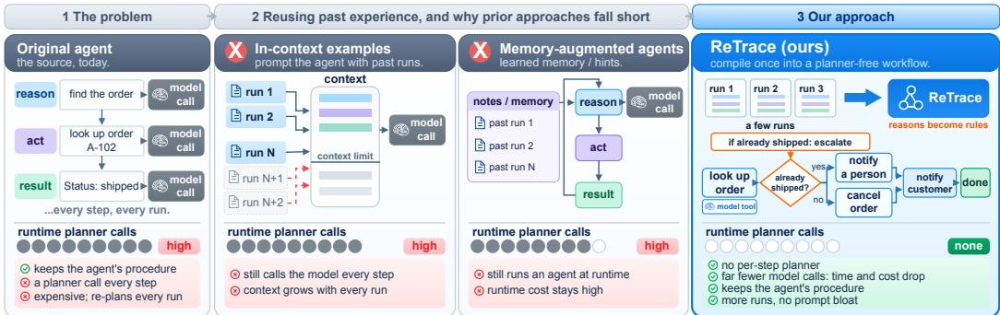  
Figure 1: From agent runs to executable workflows. The agent, and methods that reuse its past runs as examples or memory, call an LLM to choose each step. ReTrace turns the agent’s reasoning and tool calls into rules before deployment; at run time, code selects the next step.

Wang et al., 2026]. The price is paid at run time: the agent calls an LLM to plan, route, and transform data at every step of every execution, which is slow and expensive at high volume.

These costs are visible in production. Of the 5,115 automations that customers created on our enterprise business process automation platform between April and June 2026, 91.8% were agents that plan at run time, yet seven of the ten most frequently executed automations were fixed workflows. For agents using three to five tools, choosing the next step took 37–43% of execution time, on top of the token cost. For a procedure that runs often, building a workflow once pays off: from the measured savings and a τ<sup>2</sup>-bench construction cost, we estimate that construction is recovered after about 75 executions, while each of those seven workflows ran 297k–528k times in three months (Appendix L).

Logged agent runs, or traces, show how a procedure is carried out, and prior work reuses them as written guidance, skills, or code [Wang et al., 2023, 2025b, Zhao et al., 2024, Wang and Lu, 2026, Li et al., 2026]. Replacing the agent with a workflow, however, requires knowing when each tool should be called and where each of its inputs comes from. Tool calls alone often do not say. If an agent looks up an order and then escalates to a human, the trace does not show whether the shipping status caused the escalation. The agent’s reasoning often does, and it can also mention alternatives that no logged run took. Giving a model more raw traces is not enough: with many long traces, the workflow generator eventually writes worse code (Section 5.1).

We present ReTrace, which builds a reusable workflow from an SOP and agent traces that include reasoning (Figure 1). It extracts the condition, tool, and input sources behind each step, merges them across traces into a compact rule document that links every rule to its evidence, and generates an executable workflow from that document. LLMs are used only in this one-time construction; at run time, code selects the next step, though a tool may still call a model, for example to classify a document. Our contributions are:

• Rules from agent reasoning. We combine the agent’s reasoning with its tool records to recover action conditions, input sources, and alternatives that no logged run executed.

• One rule document, several platforms. Only the final stage depends on the target, so the same pipeline yields Python code for two public benchmarks and typed workflow graphs for our production platform.

• Evidence from production and two public benchmarks. On 79 production procedures and on τ<sup>2</sup>-bench, ReTrace workflows come within 3 and 5 points of the agent, respectively, while cutting enterprise cost per task by 24% and τ<sup>2</sup>-bench time per task from 170 s to 1.3 s. Removing the agent’s reasoning costs 8.8 and 6.2 points, respectively, and gains 1.7 on SOP-Bench. Repaired workflows reach 81.2% on τ<sup>2</sup>-bench (agent: 80.6%, n.s.) and 87.8% on SOP-Bench (agent: 85.5%), where unrepaired ReTrace trails few-shot.

## 2 Related Work

Reusing agent experience. Agent Workflow Memory (AWM) stores workflow descriptions as written guidance for an agent, while ExpeL and ReasoningBank store lessons and strategies [Wang et al., 2025b, Zhao et al., 2024, Ouyang et al., 2026]. Voyager, ASI, SKILL-DISCO, and NSI instead produce reusable code, or skills, that an LLM agent selects and calls at run time [Wang et al., 2023, 2025a, Guo et al., 2026, Shao et al., 2026]. Skill Factory builds skills from successful runs, but a model still picks a skill and fills its inputs for each task [Wang and Lu, 2026]; BPOP learns only which actions must precede others [Li et al., 2026]. In all of these but BPOP, a model keeps choosing steps; ReTrace compiles conditions and input sources into a workflow that does not need one. SOP benchmarks test whether an agent follows a written procedure at run time [Li et al., 2025, Nandi et al., 2026, Wang et al., 2026]; ReTrace instead compiles the procedure once, so no agent has to follow it on each run.

Compiling executable workflows. TraceCompiler tracks how tool outputs feed later inputs and builds mostly deterministic workflows that may still call an LLM to fill some inputs; on AppWorld, it escalates when a required branch never appeared in the logged runs [El Yadouni and Li, 2026]. Trace2Policy reconstructs experts’ decision rules from behavior records with a Vision-Language Model (VLM) and revises them on validation errors; its deployed version is human-refined Python that runs without an LLM [Zha et al., 2026]. Concurrent work on $\tau ^ { 2 }$ -bench keeps a model in the loop at run time: PLVR guides or checks a small model that still generates actions, and STAGE runs model-backed judgment nodes inside a code-controlled graph [Bhat et al., 2026, Luo et al., 2026]. ReTrace differs in its evidence: it reads the conditions and alternatives stated in the agent’s own reasoning, which can cover branches that no logged run took. Workflow search and optimization methods tune agent designs, prompts, or LLM-calling steps [Zhang et al., 2025, Hu et al., 2025, Zhuge et al., 2024, Zhou et al., 2024, Khattab et al., 2024, Yuksekgonul et al., 2025, Cheng et al., 2024]; we instead recover workflow rules from an SOP and logged runs. Table 10 in Appendix K compares the closest methods.

## 3 Method

## 3.1 Inputs and target workflow

A taskfamily is a set of inputs handled by the same SOP P, for example support cases under one troubleshooting procedure. We use k traces $\mathcal { T } _ { k } = \{ \tau ^ { ( 1 ) } , \dots , \tau ^ { ( k ) } \}$ of an agent on such inputs. A trace $\tau = ( s _ { 1 } , \dots , s _ { L } )$ records each of its $L$ steps as $s _ { t } = ( r _ { t } , a _ { t } , v _ { t } , o _ { t } )$ , where $r _ { t }$ is the agent’s reasoning for the step, $a _ { t }$ the tool called, $v _ { t }$ its inputs, and $o _ { t }$ the result.

The output is an executable workflow π, built once per procedure and reused on new inputs. At run time, code chooses the next step without calling an LLM; this is what we mean by planner-free. Individual tools may still call models. The workflow is Python code on the public benchmarks and a typed graph of steps on INTERNAL, our enterprise dataset.

## 3.2 Building the workflow

Construction has three stages: extraction reads each step, aggregation merges evidence across traces into an Intermediate Representation (IR) I (a compact rule document); synthesis generates the workflow from it. Algorithm 1 in Appendix B gives the full procedure.

Extraction: reading each step. For each step, an LLM extracts a record $z _ { t } = ( g _ { t } , \alpha _ { t } , a _ { t } , v _ { t } , \omega _ { t } )$ The reasoning supplies the condition $g _ { t }$ under which the action applies and the intended action $\alpha _ { t }$ The condition may use only information available before the action: “airplane mode is $\mathrm { o n } ^ { \prime \prime }$ can justify turning it off, but the result of turning it off cannot. The tool record supplies the tool $a _ { t } .$ , its typed inputs $v _ { t }$ , and the source $\omega _ { t }$ of each input, such as a task input, an earlier result, or a constant; unknown sources are marked as such. Case-specific values, such as a customer ID, become variables filled from each new task. The record also keeps alternative actions that the reasoning mentions but the agent did not take.

Aggregation: combining traces into rules. An LLM first summarizes each trace against the SOP, matching its steps to the procedure and noting alternatives that were mentioned but not executed. A merge step then combines the summaries: it unifies repeated steps, works out how earlier results feed later inputs, checks the reasoning against the recorded calls and outcomes, and resolves disagreements using the SOP, giving a reason for anything it drops. The result is a completion check and an ordered list of rules:

$$
\mathcal { T } = \bigl ( \chi , \langle ( g _ { 1 } , \alpha _ { 1 } ) , \dots , ( g _ { m } , \alpha _ { m } ) \rangle \bigr ) .\tag{1}
$$

Here $\chi$ tests whether the task is complete, and rule j pairs a condition, or guard, $g _ { j }$ with an action $\alpha _ { j }$ , its tool, and its input sources. The rules form a decision list [Rivest, 1987]. Each rule cites the trace steps or SOP statements that support it, and alternatives that no trace executed are marked unwitnessed; for example, the reasoning for turning off airplane mode may also name disabled mobile data as a cause, which becomes an unwitnessed rule (Appendix I). A final check uses rule names and citations to confirm that no rule or named alternative was dropped silently; it does not judge whether a condition is right. Beyond eight traces, the rest are added one at a time (Appendix D). The workflow generator reads the IR, not the raw traces; on $\tau ^ { 2 }$ -bench at k=16, its input is 24.5k tokens, against 101.4k with full traces (Table 9 in Appendix I).

Synthesis: generating and checking the workflow. An LLM converts the IR into code or the platform’s workflow format. Let h be the state of a run: the task input plus every tool call and result so far. At each step, the workflow stops if the completion check succeeds; otherwise, it runs the first rule whose guard holds:

$$
\pi ( h ) = \left\{ { \begin{array} { l l } { { \mathsf { s t o p } } } & { { \mathrm { i f } } \chi ( h ) , } \\ { \alpha _ { j ^ { \star } ( h ) } ( h ) } & { { \mathrm { o t h e r w i s e } } , } \end{array} } \right.\tag{2}
$$

where $j ^ { \star } ( h ) = \operatorname* { m i n } \{ j : g _ { j } ( h )$ holds}. The action calls its tool with inputs taken from $h$ or constants, and the result updates h. If the completion check fails and no rule applies, the workflow stops as incomplete and never asks an LLM for a step.

Before deployment, generated code must load and must not be able to make planning calls. On the public benchmarks, candidates may import only approved libraries and run in a sandbox; we reject any candidate that makes a planning call when re-executed on the training inputs and keep the one that reproduces the most recorded steps. On INTERNAL, the platform builds a single workflow graph, which must contain no node that asks a model for the next step. Neither check establishes task correctness (Appendix D). Where the benchmark can be re-executed offline, the workflow can also be repaired from its failures on training inputs: an LLM revises the code, and the IR is left unchanged (Appendix C).

## 4 Experimental Setup

## 4.1 Benchmarks and traces

τ<sup>2</sup>-bench. This public customer-support benchmark provides tools that act on a simulated environment [Barres et al., 2025]. We use the telecom domain’s official split of 74 training and 40 test inputs across three task families (MMS, mobile data, and service issues) in solo mode, without a simulated user (Appendix A). We collect eight agent runs per training input. Unless noted, traces come from Sonnet 4.6 with native thinking, which returns its reasoning alongside tool calls. Construction uses only successful traces and Sonnet 4.6 in all three stages. Five-fold cross-validation on the training inputs selects configurations, including $k ;$ the main comparisons use k=4. Test inputs are never used for trace generation, configuration selection, or candidate checks.

SOP-Bench. This public benchmark pairs industrial SOPs with tools and labeled task inputs [Nandi et al., 2026]. We admit 8 of its 14 domains (Appendix A explains the exclusions). The 8 procedures use 3–10 tools and SOPs of 4–12k characters, and each asks for a decision such as escalating or resolving a case. SOP-Bench has no official split, so we split each procedure in half, stratified by label, into 758 training and 744 test inputs. Traces come from eight runs of Sonnet 4.6, as a two-pass ReAct agent, on each training input. We develop with five-fold cross-validation on the training inputs: in each fold, a method that uses traces draws three samples of k successful traces from the other four folds, builds one workflow per sample with Sonnet 4.6, and is scored on the held-out fold, for $k \in \{ 1 , 2 , 4 , 8 , 1 6 \}$ . Table 1 uses k=16, the best k in cross-validation (or within 0.1 points of it) for every method. For the test, we regenerate the workflows at the k selected in cross-validation, from a new set of agent runs on the training inputs, and run them on the 744 test inputs; the agent runs three times on each test input. Intervals resample test inputs within each procedure and do not reflect variation across the trace samples used to generate the workflows.

INTERNAL. This proprietary dataset contains 79 production procedures, sampled by customer usage from our platform (Section 1). They use 23 tool types and range from three-step extractions to multi-tool reviews with conditional steps. Each procedure has 20 construction inputs and up to 20 disjoint test inputs. We split procedures into Low, Med, and High complexity using only the procedure text and input/output definitions (Appendix A). Traces come from the platform’s two-pass ReAct agent (Sonnet 4.0), which explains each step before calling a tool. Every method uses the same k=3 traces per procedure and generates one workflow. For ReTrace, extraction and aggregation use Opus 4.8, and the platform generates the final workflow graph with a model of its choice.

## 4.2 Compared methods

All methods receive the procedure and tool definitions. The original agent, which produced the traces, is the reference for task outcomes and execution costs. Zero-shot gets only these, few-shot also gets k full traces, and execution-only gets the same traces with the reasoning removed; all three use ReTrace’s generation prompt but, unlike ReTrace, keep their first valid workflow. Zero-shot and few-shot run on all three datasets. On $\tau ^ { 2 } .$ -bench and SOP-Bench, we also evaluate AWM [Wang et al., 2025b], which keeps a model that chooses steps at run time, and Skill Factory [Wang and Lu, 2026], whose generated code we run with inputs supplied directly instead of through its model-based skill selection. On $\tau ^ { 2 } .$ -bench only, we evaluate the Bayesian partial-order method BPOP [Li et al., 2026], which learns tool order but cannot produce SOP-Bench’s decision output (Appendix H). Finally, we repair workflows for up to three rounds using failures on training inputs: ReTrace on both public benchmarks and zero-shot on $\tau ^ { 2 } .$ -bench, with the same feedback, repair model, and stopping rule within each benchmark (Appendix D).

## 4.3 Metrics

Build rate is the fraction of requested constructions that yield a usable workflow: the code must load and, for planner-free methods, pass the planning-call checks. On SOP-Bench, code is regenerated until it parses, so every method builds; these retries count as construction calls. Task success is the benchmark’s score among built workflows, with execution errors counted as failures. On SOP-Bench an answer counts only if it uses the SOP’s output format and every scored field matches the label; this is stricter than the benchmark’s own substring match, so our numbers are not comparable to published SOP-Bench results. SOP-Bench results are macro averages over its 8 procedures. Enterprise completion is the fraction of executions the platform marks as successfully finished, averaged over procedures. We also report time per task, model calls for construction and execution, and enterprise cost per task. Confidence intervals (95%) are bootstrap estimates, paired where possible; enterprise differences use procedures that both methods ran (Appendix D).

## 5 Results and Analysis

## 5.1 Task outcomes and repair

Main comparison. On $\tau ^ { 2 } .$ -bench, ReTrace reaches 75.8% task success with a 100% build rate (Table 1). This is the highest mean among unrepaired methods without a runtime planner. The paired gain over zero-shot is 37.1 points [19.8, 51.1]; the margins over few-shot (5.3) and execution-only (7.9) are not significant (Appendix D). The original agent (80.6%) and AWM (82.3%) score higher but call an LLM at every step. On SOP-Bench, ReTrace (80.6%) trails few-shot (83.6%), is level with execution-only (80.9%), and is ahead of zero-shot (67.7%) and Skill Factory (60.5%). AWM (84.5%) and the agent (85.5%) score higher, gaining mostly where a step must read free text at run time. Only ReTrace selects among candidates; with the same selection, few-shot reaches 84.0% in cross-validation (Appendix H). On some procedures the labels follow a rule the SOP does not state; the IR follows the SOP, so its workflows miss those labels (Appendix F). On INTERNAL, ReTrace’s mean completion is 93.8%, against 96.8% for the agent (paired difference −3.0 [−8.0, 1.0]) and 88.6% for few-shot; the agent’s rate overstates its web-procedure success (Section 5.4).

Repairing workflows with training feedback. Starting from k=2 workflows, three repair rounds raise ReTrace on $\tau ^ { 2 } .$ -bench from 66.7% to 81.2% test success (Figure 2), close to the agent’s 80.6%, though the interval is too wide to claim parity; zero-shot rises from 38.8% to 60.6%. On SOP-Bench, repair raises ReTrace at k=16 from 80.6% to 87.8%, the best result in Table 1. There the feedback shows each failed input’s label, so the comparison with unrepaired methods is not like-for-like.

Table 1: Main results. $\tau ^ { 2 } { \mathrm { - b e n c h : ~ } } k { \mathrm { = } } 4 .$ , chosen by five-fold cross-validation on the 74 training inputs; results on the 40 test inputs. SOP-Bench: k=16, the best k (±0.1) in five-fold cross-validation on the training split; results on the 744 test inputs (agent: three runs per input). INTERNAL: k=3, not tuned; results on test inputs disjoint from construction, over the procedures each method could run (70–78 of 79). Repair starts from k=2 workflows on τ<sup>2</sup>-bench and from k=16 workflows on SOP-Bench. Times: mean per run (INTERNAL: mean / median). Model calls: construction / execution (C / E), with construction as a lower bound. Bold: best success, time, or cost without a runtime planner; —: not measured or not applicable.
<table><tr><td></td><td colspan="4"> $\tau ^ { 2 } .$  -bench</td><td colspan="4">SOP-Bench</td></tr><tr><td>Method</td><td>Build %</td><td>Task success % [95% CI]</td><td>Calls C/E</td><td>Time (s)</td><td>Build %</td><td>Task success % [95% CI]</td><td>Calls C/E</td><td>Time (s)</td></tr><tr><td>Original agent</td><td></td><td>80.6 [52.1, 100.0]</td><td>—/12.1</td><td>170</td><td></td><td>85.5 [83.0, 88.0]</td><td>—/11.0</td><td>46.6</td></tr><tr><td>Zero-shot</td><td>100.0</td><td>38.8 [30.0, 44.4]</td><td>2/0</td><td>1.8</td><td>100.0</td><td>67.7 [64.5, 70.9]</td><td>2.1/0</td><td>0.27</td></tr><tr><td>Few-shot</td><td>91.7</td><td>70.6 [52.1, 88.9]</td><td>2/0</td><td>1.6</td><td>100.0</td><td>83.6 [81.2, 86.2]</td><td>2.3/0</td><td>0.24</td></tr><tr><td>ReTrace</td><td>100.0</td><td>75.8 [66.1, 85.5]</td><td>11/0</td><td>1.3</td><td>100.0</td><td>80.6 [78.1, 83.1]</td><td>17.0/0</td><td>0.29</td></tr><tr><td>ReTrace + repair</td><td>94.4</td><td>81.2 [74.4, 88.1]</td><td>17.8/0</td><td>1.3</td><td>100.0</td><td>87.8 [86.2, 89.4]</td><td>35.8/0</td><td>0.40</td></tr><tr><td>AWM</td><td>100.0</td><td>82.3 [68.0, 100.0]</td><td>1/26.2</td><td>89.8</td><td>100.0</td><td>84.5 [82.0, 86.8]</td><td>1.0/7.1</td><td>25.8</td></tr><tr><td>Execution-only</td><td>94.4</td><td>67.9 [53.3, 82.6]</td><td>2/0</td><td>1.7</td><td>100.0</td><td>80.9 [78.2, 83.6]</td><td>1.9/0</td><td>0.24</td></tr><tr><td>Skill Factory</td><td>72.2</td><td>62.3 [44.4, 80.2]</td><td>3/0</td><td>2.9</td><td>100.0</td><td>60.5 [57.9, 63.2]</td><td>4.4/0</td><td>0.22</td></tr><tr><td>BPOP</td><td>100.0</td><td>30.6 [12.1, 48.4]</td><td>0/0</td><td>4.3</td><td></td><td>not evaluated on SOP-Bench</td><td></td><td></td></tr></table>

Table 2: INTERNAL results from Table 1, shown separately for readability.
<table><tr><td rowspan="2">Method</td><td colspan="4">Completion % [95% CI]</td><td rowspan="2"></td><td colspan="2">Per task</td></tr><tr><td>All</td><td>Low</td><td>Med</td><td>High</td><td>Time (s)</td><td>Cost ($)</td></tr><tr><td>Original agent</td><td>96.8 [93.5, 99.0]</td><td>95.4 [87.4, 100.0]</td><td>98.5 [97.2, 99.6]</td><td></td><td>96.7 [92.4, 99.4]</td><td>153/68</td><td>0.127</td></tr><tr><td>Zero-shot</td><td>82.7 [73.9, 90.7]</td><td>83.9 [69.6, 95.4]</td><td>80.0 [64.0, 96.0]</td><td></td><td>84.0 [68.7, 96.2]</td><td>134/42</td><td>0.072</td></tr><tr><td>Few-shot</td><td>88.6 [81.1, 95.3]</td><td>91.5 [80.4, 99.3]</td><td>88.6 [75.0, 100.0]</td><td></td><td>85.0 [69.3, 98.6]</td><td>105/42</td><td>0.033</td></tr><tr><td>ReTrace</td><td>93.8 [88.4, 98.2]</td><td>96.3 [88.9, 100.0]</td><td>95.8 [87.6, 100.0]</td><td>89.2 [78.6, 97.6]</td><td></td><td>163/37</td><td>0.096</td></tr></table>

Generating workflows from full traces. On $\tau ^ { 2 } .$ -bench, supplying more full traces to the workflow generator first helps, then lowers build-adjusted cross-validation success, and the build rate falls from 100% at k=16 to 31% at k=32. On INTERNAL, nine full traces lower completion to 81.4%, below zero-shot’s 82.7% (Appendix J). Short SOP-Bench traces (2–8 steps) show no such decline even at k=16 (Table 7 in Appendix F).

## 5.2 What does the agent’s reasoning add?

As an ablation, we keep ReTrace’s pipeline and remove the reasoning from every trace step. At k=4, reasoning adds 6.2 points of τ<sup>2</sup>-bench success [0.5, 12.5]. At k=1 the version without reasoning is 1.7 points ahead, but full ReTrace leads at every larger k (Figure 3a). On INTERNAL, reasoning raises completion from 85.0% to 93.8%, a gain of 8.8 points [2.5, 15.9] over 77 procedures. SOP-Bench does not show the effect: without reasoning, ReTrace scores 82.3% against 80.6% on the test inputs at k=16 (Table 6 in Appendix F). Its short, lookup-like procedures leave the reasoning little to add. Most of the enterprise gain comes from four procedures where the workflow built without reasoning fails on every input, each time at the same code step (Figure 3b; Appendix E.1).

The reasoning also names actions no trace executed: without it, unwitnessed branches citing reasoning fall from 44 to 3 at k=4 (Appendix D).

## 5.3 Execution time and operating cost

Public benchmarks. On τ<sup>2</sup>-bench, ReTrace averages 1.3 s per task, 130× faster than the original agent (170 s); AWM takes 90 s. In a separate timing run by task depth, ReTrace’s workflows stay under 2.5 s even on the deepest tasks, where the agent needs 214 s (Figure 5a in Appendix E). The workflows call no models, since the tools are simulated. Construction makes at least 11 model calls, once; the agent’s 12.1 planning calls and AWM’s 26.2 recur on every run. On SOP-Bench, planner-free workflows take 0.22–0.40 s per task, against 25.8 s and 7.1 model calls for AWM and 46.6 s and 11.0 calls for the agent.

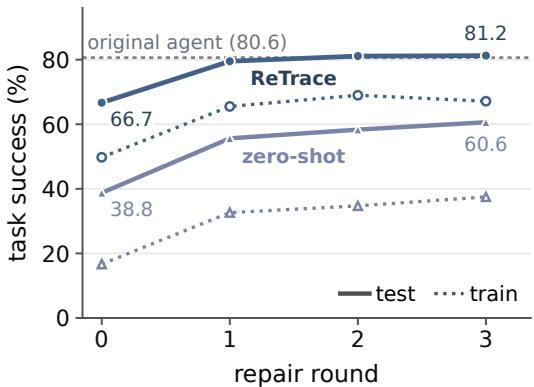  
Figure 2: Repair on $\tau ^ { 2 }$ -bench. Test success after each repair round from k=2 workflows (the unrepaired ReTrace row of Table 1 uses k=4). Solid: test; dotted: training inputs, which are harder (Appendix D).

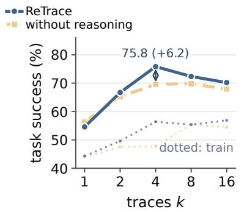

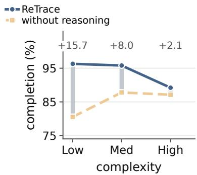  
(a) $\tau ^ { 2 } .$ bench number of traces  
(b) INTERNAL complexity  
Figure 3: Effect of removing the agent’s reasoning. (a) $\tau ^ { 2 } .$ -bench task success by number of traces k; dotted: training inputs. (b) INTERNAL completion by complexity group; gray bars: gain from reasoning.

Enterprise costs. ReTrace lowers mean cost per task by 24%, from \$0.127 to \$0.096, counting model calls made inside tools. Few-shot costs less (\$0.033), but its completion is 5.2 points lower. Median time falls from 68 s to 37 s (46%), but mean time rises from 153 s to 163 s (Section 5.4).

## 5.4 Why enterprise mean time increases

Twenty of the 79 enterprise procedures use web automation. Without them, ReTrace averages 58 s per task against the agent’s 92 s, at 19% of its cost (Figure 5b in Appendix E). A successful web-tool call takes a median of 270 s and a failed one a few seconds, so the agent is sometimes faster only because its calls fail. Web-tool calls succeed 86.6% of the time for ReTrace and 27.3% for the agent. Some agent runs with no successful tool call still count as complete (Appendix E.2).

## 5.5 Lessons for practitioners

First, check tool outcomes, not only completion flags (Section 5.4). Second, test the model that writes the workflow: it matters more than the extraction model, and a larger model did not help

(Appendix E.4). Third, when traces are long, give the generator few of them: more full traces eventually hurt (Section 5.1).

## 6 Conclusion

ReTrace turns an SOP and a few logged agent runs into a workflow in which code, not an LLM, picks each step. The agent’s reasoning adds 6.2 points of task success on $\tau ^ { 2 } .$ -bench and 8.8 points of enterprise completion, but not on SOP-Bench’s short procedures. The workflows cut $\tau ^ { 2 } .$ -bench time per task from 170 s to 1.3 s and enterprise cost by 24%. For high-volume procedures, compiling an agent into a workflow can pay off.

## 7 Limitations

ReTrace relies on the agent’s reasoning, which may be wrong or may not reflect why the agent acted. Our construction checks confirm that generated code loads and contains no planning calls and, where re-execution is available, count how many logged steps it reproduces; they do not show that the recovered conditions are correct. We evaluate new inputs to the same procedures, not transfer to new procedures, and a change to an SOP or its tools may require rebuilding the workflow. Poor or incomplete traces limit what can be recovered. Enterprise completion is reported by the platform, which can mark failed runs as complete (Section 5.4); a human audit of outcomes would give a more reliable measure. The public evaluation covers only the telecom domain of $\tau ^ { 2 }$ -bench and eight SOP-Bench domains. SOP-Bench results use one workflow generation per trace sample, and its repair feedback includes training labels. Aggregation lets the SOP override traces that contradict it (Section 5.1); revising a rule when its cited evidence disagrees is left to future work. We also draw traces at random, without regard to which branches they cover, although the draw matters: results on a single SOP-Bench procedure vary by as much as 50 points across trace samples. Mixing successful and failed traces tends to help on $\dot { \tau } ^ { 2 }$ -bench, though not significantly (Appendix E.3), and with long traces, full traces hurt beyond a dataset-dependent k. We choose k by cross-validation among a few small values $( k \leq 4 \mathrm { o n } \tau ^ { 2 }$ -bench), since each trace costs a live agent run. Choosing traces that cover different branches and outcomes, and setting k from trace length, could give a complete IR from fewer agent runs and a workflow that succeeds on its first build, without repair. Future work should also verify that recovered conditions hold before the actions they justify and should cover more public domains.

## 8 Ethical Considerations

Public benchmarks. $\tau ^ { 2 } .$ -bench and SOP-Bench provide publicly available task data and evaluation code [Barres et al., 2025, Nandi et al., 2026]. Evaluation on these benchmarks uses existing task data and test environments, without collecting new data from human participants or interacting with real customers.

Enterprise data. Agent traces can contain sensitive information in task inputs, tool results, and explanations. We report only aggregate enterprise results and do not name the platform.

Deployment. Reusing a workflow can repeat an incorrect condition or an unfair decision across many cases. The agent’s reasoning and written procedures may preserve biases from the original agent or business process; code-based step selection does not remove those biases. Workflow owners should review recovered conditions, restrict tool access, and require human review for actions with significant consequences for users. Access restrictions also matter because the same automation could scale unauthorized collection or use of sensitive data. Our evaluation does not assess differences in error rates across user groups.

## References

Victor Barres, Honghua Dong, Soham Ray, Xujie Si, and Karthik Narasimhan. $\tau ^ { 2 } .$ -Bench: Evaluating conversa tional agents in a dual-control environment. arXiv preprint arXiv:2506.07982, 2025.

Vishvesh Bhat, Asad Aali, and Muhammad Ahmed Mohsin. Compiling expert procedures into verified programs: When a small model is enough. arXiv preprint arXiv:2610.19148, 2026.

Ching-An Cheng, Allen Nie, and Adith Swaminathan. Trace is the next AutoDiff: Generative optimization with rich feedback, execution traces, and LLMs. In Advances in Neural Information Processing Systems (NeurIPS), 2024.

Salma El Yadouni and Guanyi Li. TraceCompiler: Skill-guided mining and compilation of LLM agent traces into mostly deterministic workflows. arXiv preprint arXiv:2608.02680, 2026.

Zhongxin Guo, Danrui Qi, Hanwen Gu, Peng Cheng, and Yongqiang Xiong. SKILL-DISCO: Distilling and compiling agent traces into reusable procedural skills. arXiv preprint arXiv:2606.26669, 2026.

Shengran Hu, Cong Lu, and Jeff Clune. Automated design of agentic systems. In International Conference on Learning Representations (ICLR), 2025.

Omar Khattab, Arnav Singhvi, Paridhi Maheshwari, Zhiyuan Zhang, Keshav Santhanam, Sri Vardhamanan, Saiful Haq, Ashutosh Sharma, Thomas T. Joshi, Hanna Moazam, Heather Miller, Matei Zaharia, and Christopher Potts. DSPy: Compiling declarative language model calls into self-improving pipelines. In International Conference on Learning Representations (ICLR), 2024.

Mosh Levy, Alon Jacoby, and Yoav Goldberg. Same task, more tokens: the impact of input length on the reasoning performance of large language models. In Proceedings of the 62nd Annual Meeting of the Associationfor Computational Linguistics (ACL), 2024.

Dongqing Li, Zheqiao Cheng, Geoff K. Nicholls, and Quyu Kong. De-linearizing agent traces: Bayesian inference of latent partial orders for efficient execution. arXiv preprint arXiv:2602.02806, 2026.

Zekun Li, Shinda Huang, Jiangtian Wang, Nathan Zhang, Antonis Antoniades, Wenyue Hua, Kaijie Zhu, Sirui Zeng, Chi Wang, William Yang Wang, and Xifeng Yan. SOPBench: Evaluating language agents at following standard operating procedures and constraints. arXiv preprint arXiv:2503.08669, 2025.

Nelson F. Liu, Kevin Lin, John Hewitt, Ashwin Paranjape, Michele Bevilacqua, Fabio Petroni, and Percy Liang. Lost in the middle: How language models use long contexts. Transactions of the Association for Computational Linguistics (TACL), 12:157–173, 2024.

Mengxi Luo, Changjia Chen, An Cao, Zirong Huang, and Wanyi Dai. STAGE: Stateful translation to agentic graph execution with policy-scoped context and deterministic control. arXiv preprint arXiv:2608.22538, 2026.

Subhrangshu Nandi, Arghya Datta, Rohith Nama, Udita Patel, Nikhil Vichare, Indranil Bhattacharya, Shivam Asija, Arushi Gupta, Giuseppe Carenini, Jing Xu, Shayan Ray, Huzefa Raja, Aaron Chan, Francesco Carbone, Esther Xu Fei, Gaoyuan Du, Zuhaib Akhtar, Prince Grover, Sreyoshi Bhaduri, Weian Chen, Wei Zhang, Ming Xiong, Harshita Asnani, and Jeetu Mirchandani. SOP-Bench: Complex industrial SOPs for evaluating LLM agents. In Proceedings ofthe 32nd ACM SIGKDD Conference on Knowledge Discovery and Data Mining V.2. Association for Computing Machinery, 2026. doi: 10.1145/3770855.3817538.

Object Management Group. Business process model and notation (BPMN), version 2.0, 2011. OMG document formal/11-01-03.

Siru Ouyang, Jun Yan, I-Hung Hsu, Yanfei Chen, Ke Jiang, Zifeng Wang, Rujun Han, Long T. Le, Samira Daruki, Xiangru Tang, Vishy Tirumalashetty, George Lee, Mahsan Rofouei, Hangfei Lin, Jiawei Han, Chen-Yu Lee, and Tomas Pfister. ReasoningBank: Scaling agent self-evolving with reasoning memory. In International Conference on Learning Representations (ICLR), 2026.

Ronald L. Rivest. Learning decision lists. Machine Learning, 2(3):229–246, 1987.

Jie-Jing Shao, Haiyan Yin, Yueming Lyu, Xingrui Yu, Lan-Zhe Guo, Ivor Tsang, James Kwok, and Yu-Feng Li. Lifting traces to logic: Programmatic skill induction with neuro-symbolic learning for long-horizon agentic tasks. In International Conference on Machine Learning (ICML), 2026.

Wil M. P. van der Aalst, Martin Bichler, and Armin Heinzl. Robotic process automation. Business & Information Systems Engineering, 60(4):269–272, 2018.

Demi Ruohan Wang and Yadong Lu. Web skill factory: Evolving reusable, verified, code-native skills for web agents. https://github.com/microsoft/Webwright/tree/main/src/webwright/skill\_ factory, 2026. Built on Webwright.

Guanzhi Wang, Yuqi Xie, Yunfan Jiang, Ajay Mandlekar, Chaowei Xiao, Yuke Zhu, Linxi Fan, and Anima Anandkumar. Voyager: An open-ended embodied agent with large language models. arXiv preprint arXiv:2305.16291, 2023.

Jiaming Wang, Zhe Tang, Zehao Jin, Hefei Chen, Yilin Jin, Peng Ding, Xiaoyu Li, and Xuezhi Cao. SOP-maze: Evaluating large language models on complicated business standard operating procedures. In Findings of the Associationfor Computational Linguistics: ACL 2026, pages 14568–14588, San Diego, California, United States, 2026. Association for Computational Linguistics. doi: 10.18653/v1/2026.findings-acl.715.

Zora Zhiruo Wang, Apurva Gandhi, Graham Neubig, and Daniel Fried. Inducing programmatic skills for agentic tasks. arXiv preprint arXiv:2504.06821, 2025a.

Zora Zhiruo Wang, Jiayuan Mao, Daniel Fried, and Graham Neubig. Agent workflow memory. In International Conference on Machine Learning (ICML), 2025b.

Shunyu Yao, Jeffrey Zhao, Dian Yu, Nan Du, Izhak Shafran, Karthik Narasimhan, and Yuan Cao. ReAct: Synergizing reasoning and acting in language models. In International Conference on Learning Representations (ICLR), 2023.

Mert Yuksekgonul, Federico Bianchi, Joseph Boen, Sheng Liu, Zhi Huang, Carlos Guestrin, and James Zou. TextGrad: Automatic “differentiation” via text. Nature, 639:609–616, 2025.

Junli Zha, Jinbo Wang, Chao Zhou, and Xiang Song. Trace2Policy: From expert behavior traces to self-evolving decision agents. arXiv preprint arXiv:2606.10457, 2026.

Jiayi Zhang, Jinyu Xiang, Zhaoyang Yu, Fengwei Teng, Xionghui Chen, Jiaqi Chen, Mingchen Zhuge, Xin Cheng, Sirui Hong, Jinlin Wang, Bingnan Zheng, Bang Liu, Yuyu Luo, and Chenglin Wu. AFlow: Automating agentic workflow generation. In International Conference on Learning Representations (ICLR), 2025.

Andrew Zhao, Daniel Huang, Quentin Xu, Matthieu Lin, Yong-Jin Liu, and Gao Huang. ExpeL: LLM agents are experiential learners. In AAAI Conference on Artificial Intelligence, 2024.

Andy Zhou, Kai Yan, Michal Shlapentokh-Rothman, Haohan Wang, and Yu-Xiong Wang. Language agent tree search unifies reasoning, acting, and planning in language models. In International Conference on Machine Learning (ICML), 2024.

Mingchen Zhuge, Wenyi Wang, Louis Kirsch, Francesco Faccio, Dmitrii Khizbullin, and Jürgen Schmidhuber. GPTSwarm: Language agents as optimizable graphs. In International Conference on Machine Learning (ICML), 2024.

## Appendix

## A Dataset details

τ<sup>2</sup>-bench. We use only the telecom domain. The airline and retail environments do not support the solo mode that a planner-free workflow needs, and only telecom provides a written workflow document for each task family. A benchmark is useful here only if the original agent solves its tasks often enough to leave a procedure worth compiling. We pin the benchmark code to a fixed revision and keep its official split of 74 training and 40 test inputs across three task families. Traces come from running the original agent eight times on each training input; no trace comes from a test input. We vary the number of traces over $k \in \{ 1 , 2 , 4 , 8 , 1 6 \}$ , limited to the values each family supports, and add k=32 for the full-trace sweep (Appendix J). Because solo mode removes the simulated user, our τ<sup>2</sup>-bench scores are not comparable to published results.

SOP-Bench. We pin the public SOP-Bench code to a fixed revision [Nandi et al., 2026] and admit 8 of its 14 domains (Table 3). Two excluded domains (aircraft inspection, patient intake) have tools that return the answer columns directly, so there is nothing to induce. Three (content flagging, order fulfillment, warehouse package inspection) declare no input columns, so the benchmark’s loader passes the whole row, label included, as the task. In the last (video annotation), 20 of 26 tools are empty stubs. We drop one dangerous\_goods row whose required input is missing. SOP-Bench has no official split, so we split each domain 50/50, stratified by label, and freeze the split before collecting traces. We called every tool on every row and confirmed that no tool returns a row’s label. Two adaptations apply to every method: tool results are normalized (whitespace in keys becomes an underscore, and a single wrapping object is removed), and an answer given only as a structured payload is rendered into the SOP’s output tag before scoring. For ReTrace only, the workflow generator is told which task-input field each copied tool argument comes from, because its argument tracing otherwise sees only earlier tool results. The strict score counts an answer only if it appears in the SOP’s output format and every scored field matches; SOP-Bench’s own scorer accepts substring matches, such as “do not ESCALATED” for “ESCALATED”. Traces come from Sonnet 4.6 as a two-pass ReAct agent, eight runs per training input (6,064 traces).

Table 3: Admitted SOP-Bench domains. Majority: share of the most frequent training label. Agent: the original agent’s success over its training runs.
<table><tr><td>Domain</td><td>Train</td><td>Test Tools</td><td></td><td>SOP (k chars)</td><td>Majority % Agent %</td><td></td></tr><tr><td>customer_service</td><td>79</td><td>77</td><td>10</td><td>7.6</td><td>35.4</td><td>95.7</td></tr><tr><td>dangerous_goods</td><td>137</td><td>136</td><td>4</td><td>4.1</td><td>32.8</td><td>69.8</td></tr><tr><td>email_intent</td><td>93</td><td>93</td><td>5</td><td>4.0</td><td>25.8</td><td>96.8</td></tr><tr><td>know_your_business</td><td>45</td><td>45</td><td>8</td><td>7.3</td><td>37.8</td><td>53.6</td></tr><tr><td>referral_abuse_v1</td><td>101</td><td>99</td><td>3</td><td>7.3</td><td>52.5</td><td>100.0</td></tr><tr><td>referral_abuse_v2</td><td>102</td><td>98</td><td>6</td><td>11.9</td><td>65.7</td><td>98.2</td></tr><tr><td>traffic_spoofing</td><td>101</td><td>99</td><td>6</td><td>4.2</td><td>45.5</td><td>78.2</td></tr><tr><td>video_classification</td><td>100</td><td>97</td><td>10</td><td>5.9</td><td>51.0</td><td>84.4</td></tr><tr><td>Total / mean</td><td>758</td><td>744</td><td></td><td></td><td>43.3</td><td>84.6</td></tr></table>

Enterprise dataset (INTERNAL). INTERNAL is a private collection of production procedures from the platform described in Section 1 (Table 4). Each procedure is written as a structured Markdown document with explicit branches and typed JSON input and output schemas. We sampled the procedures by customer usage from a much larger set, and they cover several business areas. Each procedure has two disjoint input pools, one for traces and one for testing, so no method sees a test input during construction. Because INTERNAL is private, we report only aggregate results that do not identify its source.

For the web-tool results in Section 5.4, a tool call counts as successful only when its own output reports success, not when the run ends. The platform statistics in Section 1 come from the platform’s automation registry and execution log from April 1 to July 1, 2026. They cover 5,115 new automations (4,694 agents that plan at run time and 421 fixed workflows that never ask a model for the next step), together with the execution counts from which we take the ten most frequently executed automations.

Table 4: INTERNAL at a glance. Top: scale, procedure size $( p _ { 5 0 } / p _ { 9 5 } )$ , and the original agent’s time per task, which is long-tailed because of the web-automation procedures. Bottom: procedures in which the original agent called each tool type on the test inputs; a procedure can use several types, so the column sums to more than 100%.
<table><tr><td colspan="2">Property Procedures</td></tr><tr><td>Test inputs per procedure Steps per procedure</td><td>79 ≤20 5/14</td></tr><tr><td>Tool types per procedure Original-agent time (s/task)</td><td>4/8 68/729</td></tr><tr><td>Tool type</td><td>Procedures</td></tr><tr><td>LLM invocation</td><td>% 45 57%</td></tr><tr><td>Web browsing</td><td>20 25%</td></tr><tr><td>Code interpreter</td><td>14 18%</td></tr><tr><td>Image and table QA</td><td>6 8%</td></tr><tr><td>Ticket and case retrieval</td><td>6 8%</td></tr><tr><td>Optical character recognition</td><td>5 6%</td></tr><tr><td>Text classification</td><td></td></tr><tr><td></td><td>3 4%</td></tr><tr><td>Document conversion Other</td><td>2 3% 7 9%</td></tr></table>

Complexity groups. We group procedures by a difficulty score computed only from the procedure text and its input and output schemas, never from execution results, so the grouping does not favor any method. The score is the mean of two standardized components. The structural score averages the standardized procedure length, step count, branch count, number of tool types, and number of schema fields. The rubric score is a model’s 0–5 rating of ambiguity, branching, data handling, error handling, and step count. The two components are related but not redundant (Spearman 0.62 over the 79 procedures). We split the combined score into thirds: Low (27 procedures, score [−2.03, −0.39]), Med (26, [−0.37, +0.32]), and High (26, [+0.33, +1.46]). Every structural measure increases from Low to High, though steps per tool type barely changes from Low to Med (Table 5).

Table 5: Structure of the INTERNAL complexity groups. Means per procedure.
<table><tr><td>Measure</td><td>Low</td><td>Med</td><td>High</td></tr><tr><td>Tool types</td><td>2.8</td><td>4.3</td><td>5.8</td></tr><tr><td>Steps</td><td>3.3</td><td>5.2</td><td>8.5</td></tr><tr><td>Branches</td><td>5.5</td><td>7.8</td><td>12.2</td></tr><tr><td>Procedure length (words)</td><td>730</td><td>873</td><td>1,134</td></tr><tr><td>Steps per tool type</td><td>1.20</td><td>1.22</td><td>1.47</td></tr></table>

Example procedures. Because INTERNAL is private, we cannot show its procedures. The two below are synthetic: we wrote them in INTERNAL’s Markdown format and tool vocabulary, with neutral tasks in place of business content. They show the kind of steps and branches a method must recover.

```markdown
Synthetic procedure 1: message triage
# SOP: Triage an incoming support message
## Goal
Classify the message, summarize it, and decide whether a human is needed.
## Inputs
- messageText (string): the raw incoming message.
## Steps
### Step 1: Classify
- Call the text model to label the message as one of
{billing, technical, account, other}.
### Step 2: Summarize
- Produce a one-sentence summary of the request.
```

Synthetic procedure 1: message triage (continued)   
### Step 3: Escalation check   
- If the label is "technical" and the message reports data loss,   
set needs\_human = true; otherwise needs\_human = false.   
## Output   
- category (string), summary (string), needs\_human (bool).   
input schema : {"messageText": "string"}   
output schema: {"category": "string", "summary": "string",   
"needs\_human": "boolean"}

Synthetic procedure 2: form extraction

# SOP: Extract fields from a scanned form   
## Goal   
Read a scanned form and return its key fields, flagging low-confidence reads.   
## Inputs   
- fileReference (string): handle to the uploaded file.   
## Steps   
### Step 1: Convert   
- Convert the file to a text-extractable format.   
### Step 2: Read   
- Run optical character recognition to obtain the page text.   
### Step 3: Extract   
- Call the text model to pull {name, date, total} from the page text.   
### Step 4: Confidence gate   
- If any field is empty or OCR confidence < 0.8,   
set review\_required = true; otherwise false.   
## Output   
- fields (object), review\_required (bool).   
input schema : {"fileReference": "string"}   
output schema: {"fields": "object", "review\_required": "boolean"}

## B Detailed workflow construction

Algorithm 1: Detailed construction procedure for Python workflows.   
Input: the SOP P and traces T , each τ = (s , . . . , s ) with s = (r , a , v , o )   
Output: a workflow π that chooses steps without calling an LLM   
Stage 1. EXTRACT s<sub>t</sub> 7→ z<sub>t</sub>, one step at a time:   
foreach $\tau ^ { ( i ) } \in \mathcal { T } _ { k }$ and each $s _ { t } \in \tau ^ { ( i ) }$ , in parallel do   
$z _ { t } ^ { ( i ) } \gets ( g _ { t } , \alpha _ { t } , a _ { t } , v _ { t } , \omega _ { t } )$ read off s<sub>t</sub>;   
return one record per step; nothing is merged or compared yet   
Stage 2. AGGREGATE {z } × P 7→ I:   
foreach i ≤ k, in parallel do   
summarize trace i’s records against P;   
I ← joint merge of the first min(k, 8) summaries with P;   
for i = 9 to k do   
I ← add trace i’s summary to I, keeping all existing elements;   
return ${ \mathcal { T } } = { \bigl ( } \chi , \langle ( g _ { 1 } , \alpha _ { 1 } ) , \dots , ( g _ { m } , \alpha _ { m } ) \rangle { \bigr ) }$ once it passes the consistency check   
Stage 3. SYNTHESIZE I 7→ π:   
for c = 1 to 3 do   
generate a candidate from I, with at most one fix call on its own errors;   
discard it if it fails the static check or makes a planning call when re-executed;   
if no candidate remains then   
return constructionfailure   
return the remaining candidate that reproduces the most recorded steps ofT

Algorithm 1 gives the full construction procedure summarized in Section 3.2. Generating several candidates and screening the code apply only to the public benchmarks; the enterprise platform builds one workflow graph without re-executing candidates (Appendix D). Extraction reads each step independently. Aggregation first summarizes each trace against the SOP and then merges the summaries; Appendix D describes how more than eight traces are handled. The merge checks that earlier rules are kept or removed with a reason and that every alternative named in the reasoning is accounted for. These checks concern the recorded evidence, not whether the rules are correct.

## C Prompts

Traces can come from agents with native thinking, which return their reasoning alongside each tool call, or from two-pass ReAct agents [Yao et al., 2023], which write an explanation before each call. Both provide the step fields $s _ { t } = ( r _ { t } , a _ { t } , v _ { t } , o _ { t } )$ of Section 3.1. The three stages of Section 3.2 use five kinds of model calls: extraction once per trace step; a per-trace summary and a cross-trace merge, which together make up aggregation; and workflow generation with at most one fix call. We wrote the prompts for $\tau ^ { 2 }$ -bench and used them on INTERNAL and SOP-Bench without changes (apart from the SOP-Bench input-field note in Appendix A), including their example values, so a few $\tau ^ { 2 } .$ -bench tool and argument names appear in them as format examples. Because nothing was re-tuned, INTERNAL also tests whether the extraction and aggregation prompts transfer; on INTERNAL every method uses the platform’s own generation prompt. Apart from the trace-loading code, our implementation contains no tool names from INTERNAL or SOP-Bench. We summarize each prompt below.

Models for each stage. On $\tau ^ { 2 }$ -bench all three stages use Sonnet 4.6. Appendix E.4 changes the extraction or synthesis model while keeping the others fixed; we never change the aggregation model. On INTERNAL, the traces come from a Sonnet 4.0 agent, extraction and aggregation use Opus 4.8, and the platform generates the workflow with its own prompt and model, which we do not control.

Sampling the merge. We run the merge several times rather than once: five independent runs on the same evidence for $k \leq 2$ and three for larger k. We measure agreement between runs by the tool calls each rule contains rather than by its wording, and take the most common structure as the base. A rule that only some runs contain is kept as an open item; regenerating the whole document instead worked worse in our tests. When a single new trace is added to an existing IR, we run the merge once, since the existing IR already serves as the base.

Extraction (Stage 1). This prompt turns one trace step into a record. The model replaces casespecific details (names, IDs, quoted values) with typed variables and reports only decision logic that carries over to new inputs: the situation the step responds to, the action it takes, the observable condition that justifies the action, and whether the step ends the task. Each field must be grounded in the tool called and the result just received, and a condition may use only information available before the action. The reasoning-side fields are precondition (the condition $g _ { t } )$ , action (the intended action $\alpha _ { t } ) ,$ state, and is\_terminal; the tool-side fields are the tool, its arguments with their JSON types, and the source of each argument.

Per-trace summary (Stage 2). For a single trace, this prompt records which procedure steps the trace visited, under what conditions, with what arguments and results, which steps it skipped, and where the run went wrong and how it ended.

Merge and IR format (Stage 2). This prompt combines all per-trace summaries and the recorded tool results into the IR, a document with a fixed format. It lists the opening steps, the completion check, and an ordered list of decision rules, each pairing a condition with the action it selects and the evidence for it. While the completion check fails, the first rule whose guard holds runs. The opening steps are a printing convention, not a separate component: they are the rules whose conditions hold before any tool has been called. The document also marks unwitnessed branches that no trace reached, named either by the SOP or by a step’s reasoning, and lists material that was explicitly excluded. Every element cites the trace steps or SOP statements that support it. When a new trace is added to an existing IR, the prompt must keep every existing rule, or remove it with a stated reason, and may confirm, narrow, extend, or contradict it.

Workflow generation and consistency check. The generation prompt turns the IR into a workflow with a single decision function and forbids model calls that choose steps during execution. Before generation, a check uses rule names and citations to confirm three things, without judging what the rules mean: every rule from the summaries is kept or explicitly removed, every merged step has a citation, and every alternative named in the reasoning appears either as a branch or as cited excluded material.

Repair from training failures. Repair starts from a built workflow (round 0) and runs it on a fixed set of training inputs of the same task family (4 on τ<sup>2</sup>-bench, 16 on SOP-Bench). If any input fails, the repair model receives one prompt and returns a complete replacement workflow. The new workflow passes the same static checks as the first; when it fails them, the model gets up to two more attempts with the static-check error, separate from the repair rounds. The loop stops when every repair input succeeds, after three revisions, or when a revision cannot be built. It keeps the round with the highest score on the repair inputs, preferring the earlier round on ties. Validation and test inputs never enter the loop. The repair prompt receives neither the IR nor the traces, so repair changes only the code, and the IR remains the IR used for round 0. Infrastructure faults stop construction instead of being shown as failures. The system prompt is the workflow-generation system prompt; the user prompt is a single JSON object, in which “refinement” and “program” mean repair and workflow:

## Repair prompt (structure; fields abbreviated)

Repair the previous complete Python policy using only the visible SOP,   
declared runtime/tool surface, and structured failures from the designated   
train refinement tasks. Preserve correct behavior, address the listed   
failures, and return one complete replacement program.   
{ "sop": <procedure text>,   
"runtime": <decide(obs) interface, budget>, "tools": <tool schemas>,   
"refinement": {   
"round\_index": r, "max\_rounds": 3, "n\_refine": n,   
"previous\_program": <full source of round r-1>,   
"requirements": { "policy\_model\_calls": 0,   
"return\_complete\_program": true, ... },   
"feedback": { "completed\_round": r-1, "primary\_score": <share solved>,   
"failures": [ { "task": <inputs>, "status": <completed | defect>,   
"score": 0, "failure\_detail": "<Type>: <message>",   
"steps": [ <observation, action, tool results> ],   
"answer\_check": { "answer": ..., "label": ...   
"field\_matches": ... } } ] } } }

Only failed inputs appear in the feedback. The failure detail gives an exception’s type and message but no traceback; a workflow that exceeds its step budget receives a fixed message instead. On $\tau ^ { 2 } .$ -bench each step records the observation, the action, its results, and whether the run ended, and there is no answer\_check: the model sees only the score and the execution record. On SOP-Bench the steps record actions and results, with long text cut at 4,000 characters, and answer\_check shows the workflow’s answer, the training label, and which fields match. A previous workflow longer than 64k characters is shortened to its first and last 32k.

## D Construction guarantees and approximations

Repeated construction and build rates. For each configuration that uses traces on $\tau ^ { 2 } .$ -bench, we sample k traces three times and generate four workflows independently from each sample. Over three task families this gives 36 requested constructions (3 samples × 4 generations × 3 families). Repeated generation captures the variation between model-written workflows. Zero-shot uses no traces and so requests only 12 constructions. Build rates in Table 1 therefore move in steps of 2.8 points for methods that use traces; the training folds contain more constructions and give finer steps. We track requested, built, executed, and scored workflows separately and report exclusions at each stage.

Confidence intervals. Confidence intervals come from a deterministic paired bootstrap (2000 resamples, seed 0), blocked by family, fold, and trace sample. Except as noted next, every τ<sup>2</sup>-bench difference we report with an interval is this paired estimate over the 120 matched cells, not the difference between the two values in the table. Zero-shot uses no traces, and AWM, the original agent, and the repair runs were evaluated separately; none of them shares trace samples with the other methods, so their comparisons are paired by family and test input over the 40 test inputs instead. $\mathbf { A l l \ } \tau ^ { 2 } .$ -bench results pool the three trace samples over the same 40 test inputs, so they are on one scale. Because the paired estimator weights test inputs equally, a paired difference need not equal the difference of the table means. We do not correct for multiple comparisons. With 40 test inputs, ReTrace’s margins over few-shot, +5.3 [−10.2, +21.7], and over execution-only, +7.9 [−3.6, +20.5], are not significant, nor is repair’s +0.6 [−19.8, +20.7] over the original agent. The margin over zero-shot, +37.1 [+19.8, +51.1], is significant, as are both reasoning-removal effects in Section 5.2.

Call counts are lower bounds. The construction call counts in Table 1 understate the ReTrace rows (with and without repair), because extraction results are cached and reused, and AWM’s, because its construction calls were not fully logged. Three construction stages also do not mean three calls. At k=4, one ReTrace construction makes an extraction call per trace step, a summary call per trace, several merge calls, a generation call, and at most one fix call. The table counts only the calls that the extraction cache did not serve.

Procedure counts on INTERNAL. A method’s INTERNAL completion is the mean over the proce dures for which it produced a runnable workflow, with each procedure weighted equally and scored on its own test inputs. The overall value is therefore not the mean of the three group values, because each method has its own group sizes. Out of 79 procedures (27 Low, 26 Med, 26 High), the original agent ran 76 (27, 23, 26), both versions of ReTrace 77 (27, 25, 25), zero-shot 78 (27, 25, 26), and few-shot 70 (27, 22, 21). INTERNAL intervals come from a bootstrap over procedures (2000 resamples, seed 0); a paired INTERNAL difference resamples only the procedures that both methods ran, and every INTERNAL difference reported with an interval is this paired estimate.

Zero-shot and few-shot rows. The zero-shot and few-shot rows of Table 1 come from a separate evaluation round on the same 40 test inputs with the same scorer; the original agent’s score in that round matches the one reported here exactly. That round kept every scored attempt (160 for zero-shot; 432 for few-shot at k=4), so their intervals use the same bootstrap as the other τ<sup>2</sup>-bench rows.

Repair procedure. Each repair round runs the workflow on the training inputs and uses its failures to revise it. The traces, tasks, feedback, workflow-generation model, and stopping rule are fixed, and test inputs are evaluated only after the last round. Each version depends on the previous repair, so these results do not average independent generations as the main comparison does.

Three rounds raise test success from 66.7% to 81.2% [74.4, 88.1] for ReTrace and from 38.8% to 60.6% for zero-shot. The estimated test gains are 14.6 and 21.9 points, and the gains on the training inputs are 17.4 and 20.8 points. Training success stays below test success, likely because the training inputs are harder: the original agent succeeds on 65.0% of its training runs against 80.6% on test (Appendix G), and the hardest family, mms\_issue, makes up 33 of the 74 training inputs but 16 of the 40 test inputs. The repaired workflow’s difference from the original agent (80.6%) is 0.6 points [−19.8, 20.7], which does not establish equal performance. Both the starting and the repaired ReTrace workflows run without planning calls. We do not run repair on INTERNAL: the platform provisions each workflow, and we currently cannot re-execute candidates offline during construction.

Enforcing no planning calls (public benchmarks). On τ<sup>2</sup>-bench and SOP-Bench we enforce the no-planning-call rule in three layers. First, a static check requires that the generated code parses and loads, exposes a single synchronous decision function, imports only the tool actions and a restricted part of the standard library, and contains no reflection, model-provider code, or dynamic evaluation. Second, the code runs in a separate sandbox process whose import hook blocks every model provider and which limits memory and time. Third, each candidate is re-executed on the training inputs, and we reject any candidate that makes a planning call. Code that passes all three layers made no planning call in any execution we observed. On INTERNAL the platform builds a typed workflow graph that we cannot run in our sandbox, so none of the three layers applies; there, the guarantee is that the graph contains no planner node.

Choosing among candidates (public benchmarks). When candidates can be re-executed, generation produces up to three of them and keeps the one that reproduces the most recorded steps, breaking ties in favor of fewer decision steps. Each later candidate sees the earlier ones and their results on each example, so the choice is a small guided search rather than a single filter. This selection is not available on INTERNAL, where the platform builds the workflow and we cannot re-execute candidates, so we generate one workflow per procedure there. The merge’s consistency check needs no execution environment and is used on all three datasets.

Rules for branches absent from the traces. The IR marks a branch as unwitnessed when its action never appears in the supplied traces. Its support comes from the SOP or from reasoning that names an alternative action. We count each branch once, at its decision rule; counting every line that carries the mark would inflate the total by about 1.7×. A branch is supported by reasoning when it cites a trace step’s reasoning rather than only the SOP.

Across fifteen saved IRs built from $k \in \{ 1 , \ldots , 1 6 \}$ traces, 23 of 115 unwitnessed branches cite trace reasoning; the rest cite only the SOP. In a larger matched set built from the same trace samples, removing reasoning reduces the branches supported by reasoning from 68 to 4 at k=1, from 44 to 3 at k=4, and from 65 to 4 at k=8 (Figure 4).

The fifteen IRs come from an earlier construction round with a different code version; the main round saved workflows but not their IRs. The larger matched counts come from saved merge outputs before candidate selection. Neither set records whether test executions reach these branches, so the counts describe construction evidence and do not by themselves explain the task-success gains in Section 5.2.

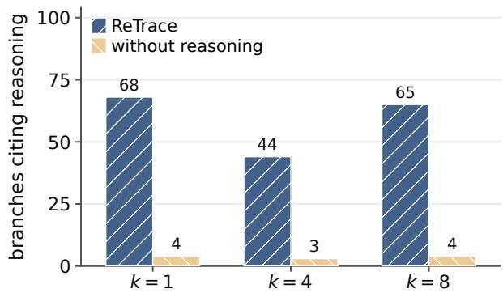  
Figure 4: Unwitnessed branches citing the agent’s reasoning in $\tau ^ { 2 } .$ -bench IRs built with and without reasoning. Counts describe IRs before candidate selection, not branches reached at test time.

Building the IR without the SOP. Aggregation takes the SOP P as an input (Section 3.2). Without it, the IR fails the same way each time: with no structure to attach steps to, it follows the order of the trace, indexes steps by their position in that run, and copies the sampled case’s values into the tool calls. The result is longer than its evidence; on $\tau ^ { 2 }$ -bench, 24,878 characters from an 8,344-character trace.

Aggregation beyond eight traces. Merging all k per-trace summaries at once overflows the context as k grows, and adding them one at a time from the start takes k sequential merge calls. We therefore merge the first eight summaries together and then add each further trace to that base, keeping every existing element and citation. The merge input stays bounded, and the IR grows slowly, to about 10k tokens at $k { = } 1 6$ . Each later trace is compared with the merged IR rather than with every other later trace. The $\tau ^ { 2 }$ -bench and INTERNAL main results (k=4 and k=3) never reach the incremental step; the SOP-Bench results at k=16 do.

Batch merge versus incremental merge. Aggregation can merge a fixed set of traces at once (the default) or add each new trace to the IR as it arrives. The two give similar training results: 49.6% [37.7, 62.9] for the batch merge and 49.8% [37.6, 62.5] for the incremental merge at k=2, and 56.4% [44.7, 69.2] and 54.9% [41.3, 69.4] at k=4. The incremental IR also stays compact, at 4,601 tokens and 25 decision rules at k=2 and 5,921 tokens and 27 rules at k=4. At least up to k=4, ReTrace can therefore add new runs as a procedure keeps executing, without waiting for a batch.

Argument types. Extraction reads the tool records together with the reasoning (Section 3.2), so every argument reaches the IR as a typed variable with a recorded source, or marked unknown. The order of actions alone provides neither: it shows which call followed which but leaves each argument’s value and type to the workflow generator, and a numeric field filled with a string passes construction and fails during execution. The guarantee ends at the IR: generation is a model call, so whether the workflow respects a type depends on the generation model; ReTrace controls only the information that model receives.

## E Additional experimental results

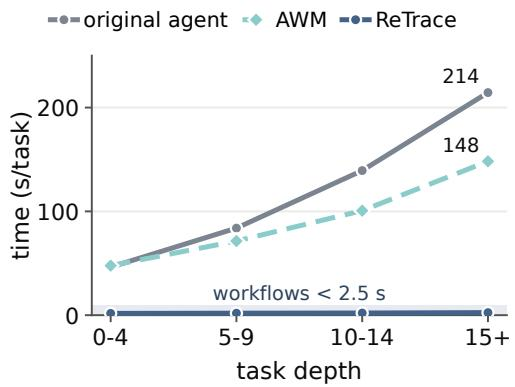  
(a) $\tau ^ { 2 } .$ -bench time

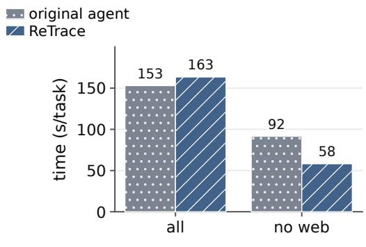  
(b) INTERNAL mean time  
Figure 5: Execution time per task. (a) $\tau ^ { 2 } .$ -bench, by task depth (tool calls per task), from a separate timing run that uses ReTrace’s k=2 workflows; the band spans all workflows without a runtime planner. (b) INTERNAL mean time over the procedures each method ran, and over those without web automation.

## E.1 Reasoning removal: trace counts, complexity, and cost

Removing the reasoning keeps each tool call, its inputs, and its result; all construction stages and models stay the same. On $\tau ^ { 2 } .$ -bench, the version without reasoning is 1.7 points ahead at $k { = } 1$ . For every larger number of traces we tested, full ReTrace leads by 1.5–6.2 points, and at k=4 the gain is 6.2 points [0.5, 12.5]. The best version without reasoning reaches 69.8% at k=8, still below full ReTrace’s 75.8% at k=4 (Figure 3a).

On INTERNAL, completion rises from 85.0% without reasoning to 93.8% with it, a paired gain of 8.8 points [2.5, 15.9] over 77 procedures. Mean time and cost per task are 178 s and \$0.101 without reasoning and 163 s and \$0.096 with it, so removing reasoning brings no efficiency benefit. The completion gains are 15.7 points [3.7, 29.6] for Low, 8.0 for Med, and 2.1 for High complexity procedures; only the Low gain is significant, since only its 95% interval excludes zero (Figure 3b). The trend comes from four all-or-nothing failures, not from a steady effect of complexity: on four Low procedures, the workflow built without reasoning fails on all 20 test inputs, each time at the same code step (in one, the code reads a field that is missing), while full ReTrace completes all 20. Without these four, the Low gain falls to about 1 point, and 22 of the 27 Low procedures show no difference.

## E.2 Enterprise web-tool failures

This section details the web-automation results summarized in Section 5.4. On eight of the twenty procedures, the original agent makes no successful web call. It passes the tool an unresolved instruction, receives a rejection, retries two to five times, and then writes an answer without any successful tool result. On these procedures it takes 54–85 s per execution and records 100% completion with 0% toolcall success. One answer reads "Unable to extract title - web extraction failed", yet the platform marks the run complete. Across the test set, 184 agent executions are marked successful

although their outcome field says the goal was not achieved, and another 454 have no outcome field.   
Neither problem occurs in ReTrace’s outputs.

ReTrace’s completion falls from 96.3% on Low to 89.2% on High complexity procedures, while the agent’s ranges from 95.4% to 98.5% with no clear trend. Platform completion does not directly measure whether the user’s goal was met. Tool outcomes add evidence about execution quality, but they do not establish that every workflow is correct.

## E.3 Successful and failed traces

We compare workflows built from successful traces, from failed traces, and from a balanced mix of both. The main Sonnet trace pool is 65% successful and contains no failures for one family, so this comparison uses Haiku 4.5 traces, whose 29% success rate gives both outcomes in every family, with k=4.

τ<sup>2</sup>-bench. With native thinking, a mix of outcomes gives 66.7% task success against 60.3% for successful traces only; with two-pass ReAct, it gives 66.0% against 63.1% (Figure 6a). Neither paired gain (6.3 and 2.9 points; Appendix D) is significant: both 95% intervals include zero. Relative to successful traces only, failed traces alone raise success by 5.6 points with native thinking but lower it by 15.4 points [−30.3, −0.4] with two-pass ReAct, so failures alone are not reliably useful.

INTERNAL. This experiment generates few-shot workflows directly from the platform agent’s traces, without ReTrace’s extraction and aggregation. Each trace mix (successful, failed, or mixed) is compared with zero-shot on the procedures where that mix is available. The groups contain 8–34 procedures and differ in complexity, because failed traces exist mostly for harder procedures. Completion gains over zero-shot are 11.5 points for mixed traces, 3.1 for successful traces, and 3.7 for failed traces (Figure 6b). Because the groups contain different procedures, these gains are not a controlled ranking. Together, the two experiments suggest trying mixed traces, but they do not show that failed traces are always safe to include alongside successes.

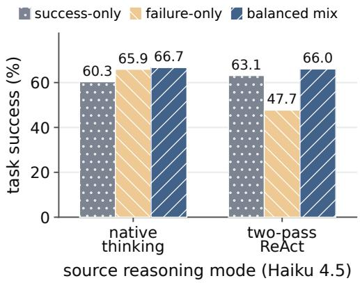  
(a) $\tau ^ { 2 } { \mathrm { - } } { \mathrm { b e n c h } }$

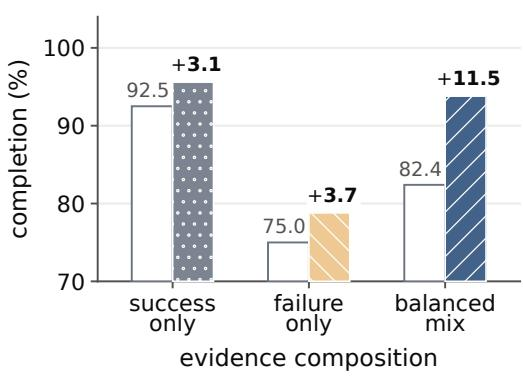  
(b) INTERNAL  
Figure 6: Which traces should construction use? (a) Workflows built from Haiku 4.5 traces, k=4. (b) Enterprise few-shot workflows; each trace mix is compared with zero-shot on its own procedures, so the groups are not controlled comparisons. The y-axis starts at 70.

## E.4 Model choices during construction

On $\tau ^ { 2 } .$ -bench with k=4, we change one of three models at a time: the agent that produces the traces, the extraction model, or the synthesis model, which writes the workflow. All other models stay at Sonnet 4.6.

Agent producing the traces. Sonnet traces give workflows with 75.8% and 67.7% task success under native thinking and two-pass ReAct, against 60.3% and 63.1% for Haiku traces (Figure 7a).

Native thinking leads ReAct by 8.1 points for Sonnet but trails it by 2.8 for Haiku, so the better reasoning format may depend on the model.

Extraction and synthesis models. Replacing Sonnet with Haiku lowers success by 36.5 points in synthesis but by only 10.6 in extraction (Figure 7b; these are paired estimates, which need not equal the differences between bars, Appendix D). Replacing Sonnet with Opus 4.8 also lowers the averages, by 11.8 points in synthesis and 1.5 in extraction. Synthesis is the more sensitive stage in both cases. The synthesis model should therefore be tested before use, since a larger model is not automatically better. These results do not explain why Opus scores below Sonnet.

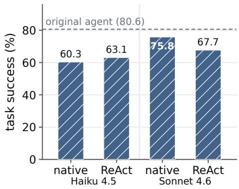  
(a) trace-producing agent

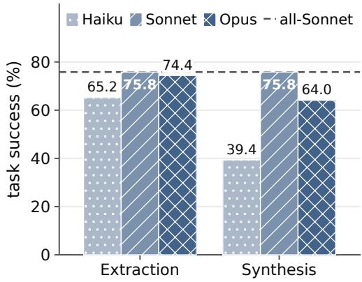  
(b) construction stage  
Figure 7: Model changes on τ<sup>2</sup>-bench, k=4. (a) Changing the agent that produces the traces. (b) Changing the model of one construction stage while the other stages stay at Sonnet 4.6.

## F SOP-Bench results in detail

All values are strict task success (%). Table 6 gives test results at k=16: each method builds three workflows, one per trace sample from the full training split, and runs each once on every test input; the agent runs three times per input. Table 7 gives five-fold cross-validation on the training split, averaged over three trace samples with one workflow generation each, from an earlier trace collection with the same protocol. Single procedure–method cells vary by as much as 50 points across trace samples, so per-procedure gaps of a few points are within noise; we report intervals only for the macro test results (Table 1).

Table 6: SOP-Bench test results by procedure. Methods at k=16. The two repair columns start from k=16 ReTrace workflows and from zero-shot workflows. No-reas. is ReTrace with the reasoning removed. Bold marks the best result in each row.
<table><tr><td>Procedure</td><td>ReTrace</td><td>reas.</td><td>shot</td><td>No- Few- Exec.- only Factory</td><td></td><td>Skill Zero-</td><td>shot AWM Agent</td><td></td><td>ReTrace + Zero-shot repair</td><td>+ repair</td></tr><tr><td>customer_service</td><td>81.0</td><td>81.4</td><td>84.8</td><td>83.5</td><td>74.5</td><td>62.3</td><td>88.3</td><td>92.2</td><td>76.2</td><td>84.8</td></tr><tr><td>dangerous_goods</td><td>75.5</td><td>79.4</td><td>78.7</td><td>78.7</td><td>78.7</td><td>78.7</td><td>78.7</td><td>73.8</td><td>91.2</td><td>95.6</td></tr><tr><td>email_intent</td><td>83.5</td><td>83.2</td><td>85.7</td><td>85.3</td><td>74.6</td><td>67.7</td><td>100.0</td><td>98.2</td><td>95.7</td><td>93.5</td></tr><tr><td>know_your_business</td><td>51.1</td><td>60.0</td><td>59.3</td><td>60.0</td><td>37.8</td><td>26.7</td><td>53.3</td><td>60.0</td><td>67.4</td><td>82.2</td></tr><tr><td>referral_abuse_v1</td><td>100.0</td><td>100.0</td><td>100.0</td><td>100.0</td><td>100.0 100.0</td><td></td><td>100.0</td><td>100.0</td><td>100.0</td><td>100.0</td></tr><tr><td>referral_abuse_v2</td><td>94.9</td><td>94.9</td><td>99.3</td><td>90.5</td><td>33.3</td><td>82.7</td><td>98.6</td><td>96.9</td><td>99.7</td><td>100.0</td></tr><tr><td>traffic_spoofing</td><td>80.8</td><td>80.8</td><td>74.7</td><td>80.8</td><td>56.9</td><td>71.7</td><td>76.1</td><td>80.1</td><td>77.8</td><td>80.8</td></tr><tr><td>video_classification</td><td>78.4</td><td>78.4</td><td>86.6</td><td>68.0</td><td>28.5</td><td>51.5</td><td>81.1</td><td>82.8</td><td>94.8</td><td>89.0</td></tr><tr><td>Macro</td><td>80.6</td><td>82.3</td><td>83.6</td><td>80.9</td><td>60.5</td><td>67.7</td><td>84.5</td><td>85.5</td><td>87.8</td><td>90.8</td></tr></table>

Main comparison. On the test inputs, ReTrace leads few-shot only on traffic spoofing (80.8% against 74.7%), ties it on referral abuse v1, and trails it on the other six procedures (Table 6).

Table 7: SOP-Bench macro task success by number of traces, five-fold cross-validation on the training split. Zero-shot uses no traces (72.0%). Bold marks the best k for each method.
<table><tr><td>Method</td><td>k=1</td><td>2</td><td>4</td><td>8</td><td>16</td></tr><tr><td>ReTrace</td><td>69.4</td><td>71.0</td><td>76.7</td><td>79.3</td><td>82.2</td></tr><tr><td>ReTrace, no reasoning</td><td>72.7</td><td>74.7</td><td>75.4</td><td>79.4</td><td>81.4</td></tr><tr><td>Few-shot</td><td>73.5</td><td>75.4</td><td>77.0</td><td>79.5</td><td>82.9</td></tr><tr><td>Execution-only</td><td>64.9</td><td>66.6</td><td>67.0</td><td>75.8</td><td>75.7</td></tr><tr><td>Skill Factory</td><td>68.7</td><td>62.9</td><td>65.9</td><td>68.3</td><td>69.0</td></tr><tr><td>AWM (runtime planner)</td><td>81.2</td><td>82.7</td><td>82.7</td><td>84.0</td><td>84.4</td></tr></table>

Know-your-business (51.1% against 59.3–60.0% for few-shot, execution-only, and ReTrace without reasoning) and video classification (78.4% against 86.6%) account for most of the gap. In crossvalidation, every method that uses traces scores higher at k=16 than at k=1 (Table 7). Two procedures do not separate methods: referral abuse v1 is saturated (zero-shot scores 100%), and on dangerous goods almost every method without repair stays near 78.7%, because the $\mathrm { { s o p } \mathrm { { \bar { s } } } }$ own scoring rule disagrees with about a quarter of the labels. Know-your-business is hard even for the agent (60.0%), yet a lookup on a single input field scores 73.3% on the training inputs (leave-one-out), above every method’s test score. In cross-validation at small $k ,$ ReTrace’s main failure is execution defects on traffic spoofing: loops that exhaust the step budget and calls to tools that the SOP names but the tool list lacks. Both disappear by k=16. AWM’s lead comes mostly from email intent (100%), where it reads each email at run time; the agent is close there (98.2%) and leads on customer service (92.2%).

Reasoning removal. On the test inputs, ReTrace without the reasoning scores 82.3%, 1.7 points above full ReTrace. It is ahead on know-your-business (60.0% against 51.1%) and dangerous goods (79.4% against 75.5%) and within 0.4 points on the other procedures. In cross-validation, it is 3.3 and 3.7 points higher at k=1 and 2, 1.3 points lower at $k { = } 4$ , and within one point at $k { = } 8$ and 16 (Table 7). SOP-Bench traces have 2–8 tool-calling steps, and on five of the eight procedures every tool argument can be obtained by lookup from the task inputs and earlier results, so the reasoning has little to add that the actions do not already show.

Labels that contradict the SOP. On customer service, the label is “resolved” exactly when latency after troubleshooting is at most 100 ms. The SOP additionally requires jitter of at most 30 ms and bandwidth at or above the subscribed plan, and every resolved case misses its plan’s bandwidth slightly. In cross-validation at $k { = } 1 6 .$ , 12 of the 15 IRs contain the $\mathrm { { s o p } \mathrm { { \bar { s } } } }$ full guard; they note the bandwidth shortfall in the traces only as a caution, and the generated workflows escalate the resolved cases. With the bandwidth clause removed from the IR and everything else unchanged, ReTrace rises from 82.7% in a replicate run (85.2% in the main cross-validation run) to 92.8% on the same trace samples (29 cells better, 5 worse). Telling the workflow generator to prefer evidence over literal guards did not help (80.6%). On email intent, the SOP allows an “unable to decide” answer that never occurs as a label; in cross-validation at k=2, ReTrace gives it in 32 of 279 cells, and zero-shot never does.

## G Trace-producing agents on $\tau ^ { 2 } ,$ -bench

The agents that produce traces vary along two axes: the model (Claude Haiku 4.5 or Sonnet 4.6) and the reasoning format (native thinking or a two-pass ReAct loop). Figure 7a shows the test success of the workflow built from each agent’s traces. The agents’ own success rates are measured over all their training runs, a different denominator, so we do not plot them next to the workflows. The main experiments use Sonnet 4.6 with native thinking, the only agent we also ran on the 40 test inputs: there it scores 80.6% with 12.1 planning calls and 170 s per task (Table 1), above its 65.0% success over the training runs.

Every agent spends 104–153 s and 14–30 planning calls per task, which a compiled workflow removes (Table 8). All values in that table are measured on the training runs.

Table 8: Planning cost of each trace-producing agent, per task on the $\tau ^ { 2 }$ -bench training runs. Calls: planning calls; Time: planning time; native: native thinking; ReAct: two-pass ReAct.
<table><tr><td>Model</td><td>Mode</td><td>Calls</td><td>Time (s)</td></tr><tr><td>Haiku 4.5</td><td>native</td><td>17.2</td><td>117</td></tr><tr><td>Haiku 4.5</td><td>ReAct</td><td>30.3</td><td>104</td></tr><tr><td>Sonnet 4.6</td><td>native</td><td>14.3</td><td>153</td></tr><tr><td>Sonnet 4.6</td><td>ReAct</td><td>30.0</td><td>151</td></tr></table>

## H Baseline implementations and fair comparison

Choosing k. Every method receives the same inputs where they apply: the SOP, the tool list, and the same pool of traces. Each method except AWM on $\tau ^ { 2 }$ -bench chooses its number of traces k by five-fold cross-validation on the training split before any test run; no method is tuned on the test split. On τ<sup>2</sup>-bench, cross-validation averages four workflow generations per fold, scores them with the same estimator as the test (task success among built workflows), and chooses among $k \in \{ 1 , 2 , 4 \}$ breaking ties toward smaller k. We cap the candidates at $k { = } 4$ because every trace costs a live agent run, so a method that needs few traces is the one worth deploying. Larger k, up to 32, were swept afterwards as a sensitivity analysis, not as candidates (Appendix J). Choosing k and the traces themselves without cross-validation is future work (Section 7). This selects $k ^ { \star } { = } 4$ for ReTrace, few-shot, execution-only, Skill Factory, and BPOP (whose ordering threshold is chosen the same way [Li et al., 2026]), and we also report AWM at k=4. ReTrace’s training scores are 44.3% at k=1, 49.6% at $k { = } 2 ,$ and $5 6 . 4 \%$ at $k { = } 4$ , with build rates of 91.7% at $k { = } 2$ and 99.2% at k=4. On SOP-Bench, cross-validation uses three trace samples per fold and compares $k \in \{ 1 , 2 , 4 , 8 , 1 6 \}$ (Table 7); k=16 is the best k, or within 0.1 points of it, for every method, so Table 1 reports every method at $k { = } 1 6$

Baseline implementations. Zero-shot, few-shot, execution-only, and ReTrace share one workflowgeneration model and one generation prompt and differ in the evidence they receive and, for ReTrace, in candidate selection and, on SOP-Bench, the input-field note (Appendix A). ReTrace chooses among up to three candidates by re-executing them on its traces (Appendix D); the other workflowgeneration baselines keep their first valid workflow. In SOP-Bench cross-validation at k=16, giving the baselines the same selection raises few-shot from 82.9% to 84.0% and execution-only from 75.7% to 81.2%, against 82.2% for ReTrace, so selection accounts for most (5.5 of 6.5 points) of ReTrace’s margin over execution-only there. The external baselines follow their published methods on the same traces. We run Skill Factory [Wang and Lu, 2026] as the planner-free code it produces, so that it can be compared directly with the other planner-free workflows. Its full system also makes one model call per task to choose a skill and fill its parameters, and falls back to a live agent when no skill applies (Table 10); we supply the parameters directly instead. AWM [Wang et al., 2025b] keeps its runtime planner, and we report its runtime cost accordingly. BPOP learns only the order of tool calls and ends each run with a fixed message, so it cannot produce SOP-Bench’s decision output, and we run it only on $\tau ^ { 2 }$ -bench. Where the original papers left a setting unspecified, we chose the value that maximized the baseline’s own cross-validation score.

## I What the workflow generator receives

Witnessed and unwitnessed rules. The two shortened rules below illustrate the example in Section 3.2. The first links a stated condition to a recorded action; the second records an alternative that the reasoning mentions but no supplied trace executes.

Two rules from the IR (shortened)   
Observed rule   
condition: check\_network\_status() reports "Airplane Mode: ON"   
action: toggle\_airplane\_mode()   
evidence: trace 1, step 2 (reason); step 3 (tool call)   
Unwitnessed rule   
condition: check\_network\_status() reports "Mobile Data Enabled: No"   
action: toggle\_data()   
reason: mobile data is required to send messages  
Tool results provide the exact field names and text that the generated conditions must check. The unwitnessed rule shows what reasoning can add, but nothing guarantees that such a rule is correct.  
The IR grows much more slowly than the full traces. From one trace to sixteen, it grows from 4.0k to 10.4k tokens, while the full traces themselves grow from 6.6k to 87.3k. It contains about 22 decision rules up to k=8 and 31 at k=16. The totals in Table 9 include the SOP and tool definitions that every method receives.

Table 9: Workflow-generator input on $\tau ^ { 2 } .$ -bench, in mean tokens, for each number of traces k. ZS: SOP and tool list only, which every method receives; $\mathrm { F S } { \mathrm { : } } + k$ full traces; EO: + k traces without reasoning; ReTrace: + the IR I; m: decision rules in I (batch merge; incremental beyond k=8).
<table><tr><td rowspan="2">Input</td><td colspan="5">k</td></tr><tr><td>1</td><td>2</td><td>4</td><td>8</td><td>16</td></tr><tr><td>ZS</td><td></td><td></td><td>14.1k for every k</td><td></td><td></td></tr><tr><td>FS</td><td>20.7k</td><td>24.9k</td><td>35.6k</td><td>56.5k</td><td>101.4k</td></tr><tr><td>EO</td><td>16.4k</td><td>18.4k</td><td>22.3k</td><td>30.4k</td><td>46.5k</td></tr><tr><td>ReTrace</td><td>18.1k</td><td>18.2k</td><td>18.3k</td><td>19.0k</td><td>24.5k</td></tr><tr><td>m</td><td>22</td><td>22</td><td>21</td><td>22</td><td>31</td></tr></table>

Given the same traces, the three methods give the workflow generator inputs of widely different sizes. We show all three for one $\tau ^ { 2 } .$ -bench telecom family, mms\_issue (MMS troubleshooting), built from the same two traces (k=2). The median generator prompt is 24,653 tokens for few-shot and 18,356 for execution-only, against the 14,120 tokens that the SOP and tool list alone take (Table 9). This family’s ReTrace IR, shown below, is 4,083 tokens, smaller than a single full trace, yet it states the branching structure that the generator would otherwise have to work out from the transcripts. The IR lists the opening steps, a repeated check (the completion check $\chi ) .$ , and its ordered decision rules, printed as numbered layers: L1 to L15 are the rules $\langle ( g _ { 1 } , \alpha _ { 1 } ) , \dots , ( g _ { m } , \alpha _ { m } ) \rangle$ of Equation 1. Each rule has a condition (guard), an action (remedy), and its supporting trace steps in ⟨·⟩. A rule may also add a condition learned across traces (unless), an UNWITNESSED mark for a branch no trace reached, or an open question. The PROBE line describes a whole run, not a single step: the workflow re-applies Equation 2 after every action, a remedy that clears its fault also clears its guard, and re-running the probe acts as the last rule, so repeated single-rule steps walk down the layers in order and apply every remedy whose guard still holds. We omit some layers and steps where marked and shorten long tool outputs.

ReTrace IR, mms\_issue, k=2 (4,083 tokens)   
ENTRY   
get\_customer\_by\_phone(phone\_number: str) -> customer\_id, line\_ids, status <t0.0, t1.0>   
can\_send\_mms() -> initial MMS capability status <t0.1, t1.1>   
PROBE can\_send\_mms()   
fixed "Your messaging app can send MMS messages."   
not fixed "Your messaging app cannot send MMS messages."   
On \`not fixed\`, descend all layers in order, applying every remedy whose guard   
holds; re-probe only after a full descent finds no further applicable layer.   
L1 Airplane Mode ON   
why Airplane Mode disables all radios; no cellular service means no MMS. <t1.2>   
check check\_network\_status() guard "Airplane Mode: ON"   
remedy toggle\_airplane\_mode() -> "Airplane Mode is now OFF." <t1.3>   
L2 SIM Card Missing

## ReTrace IR, mms\_issue, k=2 (4,083 tokens) (continued)

## Few-shot prompt, same traces

=== SHARED PREAMBLE (same for all three methods) ===   
[SOP: tau2-telecom policy, \~22.8k chars, abbreviated] # Telecom Agent Policy ... technical support, overdue bills, line suspension, plan options ... [\~22k chars of policy and troubleshooting trees]   
[TOOL SCHEMAS: 43 tools] can\_send\_mms, check\_apn\_settings, check\_network\_status, get\_customer\_by\_phone, get\_details\_by\_id, reseat\_sim\_card, reset\_apn\_settings, toggle\_wifi\_calling, enable\_roaming, ... (43 total)   
=== DEMONSTRATIONS (the k=2 evidence: two raw traces, verbatim) ===   
### DEMONSTRATION 1 (outcome: solved)   
[step 0] THINK: The user is John Smith, phone number 555-123-2002, currently abroad in France, having trouble sending MMS messages. ... I must first identify the customer before providing technical support. [truncated] CALL get\_customer\_by\_phone({"phone\_number": "555-123-2002"}) RESULT: {"customer\_id":"C1001","full\_name":"John Smith","account\_status":"Active", "bill\_ids":["B1001","B1002","B1003"], ...}   
[step 1] THINK: The customer has been identified as John Smith (C1001). ... The customer is abroad in France, so I need to check their line details and also consider roaming. [truncated] CALL can\_send\_mms({}) RESULT: Your messaging app cannot send MMS messages.   
[step 2] THINK: ... According to the SOP, I need to: 1. First ensure basic connectivity ... [truncated] CALL check\_network\_status({}) RESULT: Airplane Mode: OFF | SIM Card Status: missing | Cellular Connection: no\_service | Mobile Data Enabled: Yes | Data Roaming Enabled: Yes | ...   
[step 3] THINK: ... SIM Card Status: \*\*missing\*\* ... [truncated] CALL reseat\_sim\_card({}) RESULT: SIM card re-seated successfully. [status bar: Excellent | 5G | Data | 80%] ... [steps 4-13 omitted: check\_apn\_settings, check\_wifi\_calling\_status, check\_app\_permissions, grant\_app\_permission, can\_send\_mms -> "cannot send", get\_details\_by\_id x2 (matched line: roaming\_enabled false), enable\_roaming, can\_send\_mms -> "can send", FINAL\_ANSWER] ...   
### DEMONSTRATION 2 (outcome: solved) [second full trace, 13 steps, same THINK + CALL + RESULT format, stacked verbatim: get\_customer\_by\_phone, can\_send\_mms, check\_network\_status (Airplane Mode: ON),

```markdown
Few-shot prompt, same traces (continued)
toggle_airplane_mode, reseat_sim_card, set_network_mode_preference, ...,
can_send_mms -> "can send", FINAL_ANSWER] ..
=== AUTHORING INSTRUCTION ===
Using the SOP, tool schemas, and demonstrations above, write one Python program
that reproduces the demonstrated policy for the mms_issue family.
Execution-only prompt, same traces
=== IDENTICAL PREAMBLE AND AUTHORING INSTRUCTION; every THINK block removed ===
### DEMONSTRATION 1 (outcome: solved)
[step 0] CALL get_customer_by_phone({"phone_number": "555-123-2002"})
RESULT: {"customer_id":"C1001","full_name":"John Smith","account_status":"Active",
"bill_ids":["B1001","B1002","B1003"], ...}
[step 1] CALL can_send_mms({}) RESULT: Your messaging app cannot send MMS messages.
[step 2] CALL check_network_status({})
RESULT: Airplane Mode: OFF | SIM Card Status: missing | Mobile Data Enabled: Yes | ...
[step 3] CALL reseat_sim_card({})
RESULT: SIM card re-seated successfully. [status bar: Excellent | 5G | Data | 80%]
... [steps 4-13 omitted; step 11 enable_roaming; step 12 can_send_mms -> "can send";
step 13 FINAL_ANSWER] ...
### DEMONSTRATION 2 (outcome: solved) ... [second trace, reasoning removed, elided] ...
```

## J Direct construction from full and execution-only traces

This section gives the supporting experiments for Section 5.1. Few-shot gives the workflow generator complete traces, including the reasoning. Execution-only removes the reasoning but keeps the tool calls, inputs, and results. Zero-shot uses only the SOP and tool definitions. A construction builds when the generated code passes the checks needed to run it, which is different from solving the task.

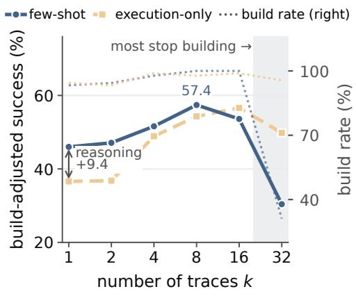  
(a) τ<sup>2</sup>-bench

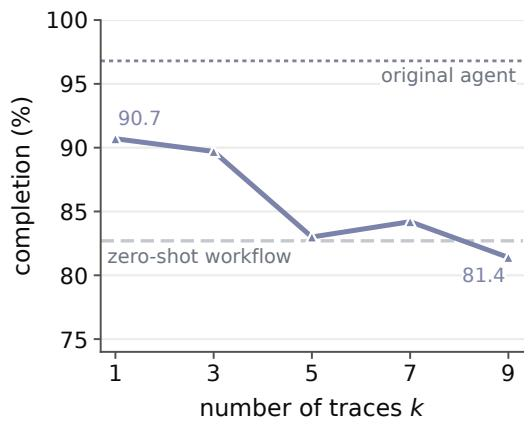  
(b) INTERNAL  
Figure 8: Adding full traces helps at first, then hurts the generated workflow. $\mathbf { \tau } ( \mathbf { a } ) \ \tau ^ { 2 } .$ -bench five-fold cross-validation on training inputs: build-adjusted success and build rate by number of traces. (b) INTERNAL completion by number of traces, one workflow per point from a separate sweep, so its $k { = } 3$ value differs from few-shot’s 88.6% in Table 1.

The simplest way to reuse an agent’s past runs is to give their traces to the workflow generator as examples. We vary the number of traces $k _ { 0 \mathrm { { n } } } \tau ^ { 2 }$ -bench and on INTERNAL and evaluate the resulting workflows. On $\tau ^ { 2 } .$ -bench we use five-fold cross-validation over the training inputs; on INTERNAL we generate one workflow per procedure for each k on a single split. Here we report $\tau ^ { 2 } .$ -bench results as build-adjusted success, which counts a construction that fails to build as a failed task, so that a setting that stops producing runnable code cannot look like an improvement.

Full traces help only up to a point. $\mathrm { O n } \tau ^ { 2 } .$ -bench (Figure 8a), the generated workflow improves up to k=8 and declines afterwards; its build rate falls from 100% at k=16 to 31% at k=32. The decline coincides with longer inputs. Full traces grow the generator input from about 21k tokens at k=1 to 101k at $k { = } 1 6$ , and inputs that long reduce reasoning accuracy well before they reach the context limit [Levy et al., 2024, Liu et al., 2024]. The pattern is stronger on INTERNAL (Figure 8b), where a single trace can exceed 20,000 tokens while the SOP is a few thousand: completion falls from 90.7% at k=1 to 81.4% at k=9, below zero-shot’s 82.7% and far below the original agent’s 96.8%.

Table 10: Procedure construction and runtime control. Signal: evidence used for construction; Artifact: deployed artifact; LLM orch.: whether an LLM selects workflow steps or skills at run time, not counting models used inside fixed tools or nodes; Exec. cond.: whether the deployed artifact contains executable branch conditions, as opposed to conditions described in prompt text. “Dispatch only” means one model call to select a skill and fill its arguments. “—”: not assessed. <sup>†</sup>TraceCompiler may still call an LLM to fill some arguments, but has no general runtime planner. <sup>⋆</sup>External baselines in our evaluation.
<table><tr><td>Method</td><td>Signal</td><td>Artifact</td><td>LLM orch.</td><td>Exec. cond.</td></tr><tr><td>AWM* [Wang et al., 2025b]</td><td>successful trajectories</td><td>prompt/context text</td><td>yes</td><td>no</td></tr><tr><td>ExpeL [Zhao et al., 2024]</td><td>insights from successes and prompt/context text failures</td><td></td><td>yes</td><td></td></tr><tr><td>ReasoningBank [Ouyang et al., 2026]</td><td>successful and failed experiences</td><td>reasoning memory</td><td>yes</td><td>no</td></tr><tr><td>ASI [Wang et al., 2025a]</td><td>verified success traces</td><td>skills (LLM-called)</td><td>yes</td><td>partial</td></tr><tr><td>SKILL-DISCO [Guo et al., 2026]</td><td>success traces</td><td>skills (LLM-called)</td><td>yes</td><td>yes</td></tr><tr><td>NSI [Shao et al., 2026]</td><td>execution traces</td><td>skills (LLM-called)</td><td>yes</td><td>yes</td></tr><tr><td>BPOP* [Li et al., 2026]</td><td>action order</td><td>partial order</td><td>no</td><td>no</td></tr><tr><td>Skill Factory* [Wang and Lu, 2026]</td><td>verified solve traces</td><td>program (skill)</td><td>dispatch only</td><td>partial</td></tr><tr><td>TraceCompiler [El Yadouni and Li, 2026]</td><td>value provenance in tool traces</td><td>mostly deterministic workflow</td><td>residual†</td><td>partial</td></tr><tr><td>Trace2Policy [Zha et al., 2026]</td><td>VLM-reconstructed expert records and validation errors</td><td>human-refined deterministic Python (deployed variant)</td><td>no</td><td>yes</td></tr><tr><td>PLVR [Bhat et al., 2026]</td><td>teacher reasoning and action traces</td><td>program with model primitives and student</td><td>yes</td><td>yes</td></tr><tr><td>STAGE [Luo et al., 2026]</td><td>authoritative policy</td><td>executable graph with model-backed nodes</td><td>no</td><td>yes</td></tr><tr><td>ReTrace</td><td>SOP, reasoning + execution</td><td>executable workflow</td><td>no</td><td>yes</td></tr></table>

Removing reasoning shortens the input but hurts at small k. Dropping the reasoning r<sub>t</sub> and keeping only tool calls, inputs, and results roughly halves the input (47k tokens at k=16 against 101k) and moves the peak from k=8 to k=16. Execution-only traces also keep building where full traces fail (96% against 31% at k=32), but they need sixteen traces to reach their peak of 56.6%, while full traces reach 57.4% with eight. The cost appears at small k: at k=1, full traces lead by 9.4 points.

## K Comparison of procedure construction and runtime control

Table 10 expands the comparison in Section 2. It separates the evidence used for construction, the deployed artifact, and runtime control, because an executable artifact may still rely on a model to select skills or to carry out individual steps. Starred methods are the external baselines we evaluate; the others are compared from their papers only, without a controlled performance comparison against ReTrace. Skill Factory is listed in its original deployment form; our evaluation supplies its skill parameters directly (Appendix H).

## L One-time construction and repeated execution cost

Let $c _ { \mathrm { p l a n } }$ be the original agent’s cost of choosing steps in one run, $c _ { \mathrm { t o o l } }$ the tool cost per run, and $C _ { \mathrm { i n d } }$ the one-time cost of building the workflow. If both methods have the same tool cost, running a procedure n times costs

$$
\underbrace { n \left( c _ { \mathrm { p l a n } } + c _ { \mathrm { t o o l } } \right) } _ { \mathrm { o r i g i n a l ~ a g e n t } } \qquad \mathrm { a g a i n s t } \qquad \underbrace { C _ { \mathrm { i n d } } + n c _ { \mathrm { t o o l } } } _ { \mathrm { w o r k f l o w ~ \pi ~ } } .\tag{3}
$$

At comparable task quality, construction pays for itself after $n ^ { \star } = C _ { \mathrm { i n d } } / c _ { \mathrm { p l a n } }$ runs. If the workflow changes the number or type of tool calls, the break-even should use the measured difference in total cost per run instead.

Example enterprise break-even. We apply the \$2.32 construction cost estimated on $\tau ^ { 2 } .$ -bench to the enterprise setting. With the measured difference in total enterprise cost per task $( \$ 0.031)$ , about 75 executions recover the construction cost, while the seven fixed workflows among the ten most frequently executed automations each ran 297k–528k times over the three months covered by the platform log (Appendix A). The \$2.32 is an estimate from the public benchmark, not a measured enterprise cost, and enterprise construction uses Opus 4.8, which costs more; the actual break-even depends on the platform’s construction costs.