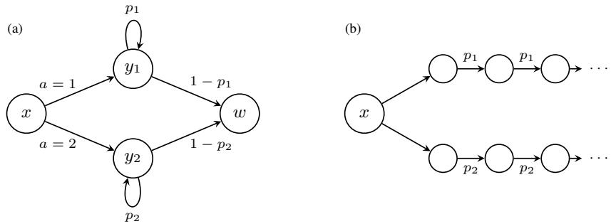
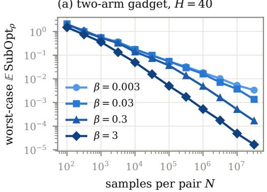
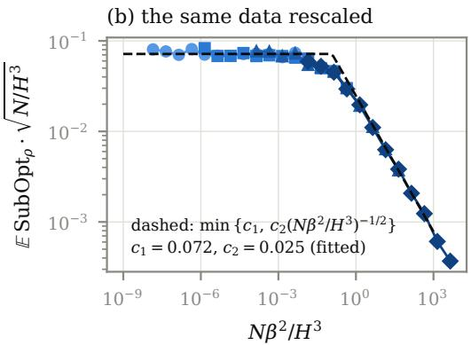
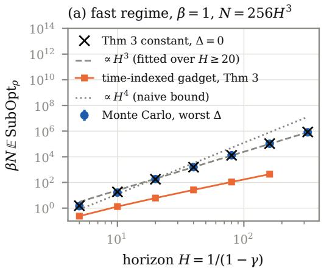
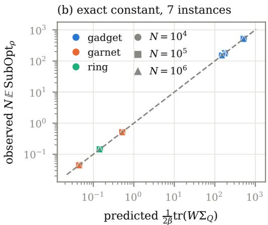
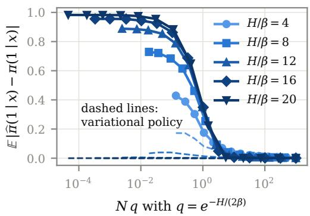
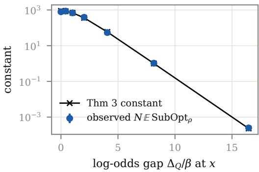

# Sharp Sample Complexity of KL-Regularized Reinforcement Learning

Andrew Liu Columbia University all2209@columbia.edu

## Abstract

KL-regularized reinforcement learning, the objective behind maximum-entropy RL and RL from human feedback, is variational inference in the graphical model of “control as inference”: the regularized optimal policy is a posterior over trajectories, and the suboptimality of a policy is $\beta$ times a KL divergence between path measures. However, it is not known how many samples it takes to learn this posterior, even with a generative model. Earlier 1/ϵ guarantees scale with $H ^ { 5 }$ in the effective horizon H, and no lower bound for MDPs depends on the temperature $\beta .$ . In this work, we show that for a discounted MDP with K state-action pairs, the plug-in estimator finds a policy that is ϵ-optimal from every initial state with $\widetilde { O } ( K H ^ { 3 } / ( \epsilon \operatorname* { m a x } \{ \epsilon , \beta \} ) + K H )$ samples, and that no algorithm, even one that chooses where to sample, can do with fewer when $\epsilon \lesssim \operatorname* { m i n } \{ H , H ^ { 2 } / \beta \}$ . For $\epsilon < \beta$ this is a $1 / \epsilon$ rate with the same horizon dependence as unregularized RL. We also find the exact asymptotic constant of the plug-in estimator, a Fisher-weighted variance of the estimated soft Q-function. The estimator is locally asymptotically minimax among methods that sample every pair equally often, and we give the allocation of samples that is optimal among adaptive designs. Simulations on small MDPs match the rates and the constants.

## 1 Introduction

Many reinforcement learning (RL) methods optimize a regularized objective: the expected discounted reward minus $\beta$ times the Kullback–Leibler divergence between the policy and a reference policy $\pi _ { \mathrm { r e f } }$ . Maximum-entropy RL and soft Q-learning [Ziebart, 2010, Fox et al., 2016, Haarnoja et al., 2017, 2018] take $\pi _ { \mathrm { r e f } }$ uniform; RL fine-tuning of language models takes $\pi _ { \mathrm { r e f } }$ to be the pretrained model [Ouyang et al., 2022]. The same objective arises from probabilistic inference. In the “control as inference” graphical model [Todorov, 2009, Rawlik et al., 2012, Levine, 2018], each step carries a binary optimality variable whose likelihood is $e ^ { r / \beta }$ . With deterministic dynamics, the posterior over trajectories given optimality is $p ( \tau ) \propto p _ { \mathrm { r e f } } ( \tau ) e ^ { R ( \tau ) / \beta }$ and is generated by the soft-optimal policy. With stochastic dynamics, the exact posterior changes the dynamics and becomes risk-seeking, and the soft-optimal policy is the variational posterior that keeps the true dynamics [Levine, 2018], and Korbak et al. [2022] interpret RLHF in the same way. In both cases the suboptimality of a policy π equals $\beta$ times the KL divergence from the path law of π to the path law of the soft-optimal policy (Lemma 2.1). So learning an ϵ-optimal regularized policy is the same problem as learning the posterior of control as inference to KL accuracy $\epsilon / \beta$

For unregularized RL with a generative model the answer is known: $\Theta ( K H ^ { 3 } / \epsilon ^ { 2 } )$ samples up to logarithmic factors [Gheshlaghi Azar et al., 2013, Agarwal et al., 2020, Li et al., 2024b]. Regularization makes the objective strongly concave in the policy, which allows $1 / \epsilon$ rates. Lan [2023] and Jia and Lan [2026] obtain ${ \widetilde O } ( K H ^ { 5 } / ( \beta \epsilon ) )$ with mirror-descent methods; Jia and Lan [2026] also give ${ \widetilde O } ( K H ^ { 3 } / { \epsilon } ^ { 2 } )$ for general convex regularizers, so the best previous guarantee was min $\left\{ K H ^ { 3 } / \epsilon ^ { 2 } , \check { K } H ^ { 5 } / ( \beta \epsilon ) \right\}$ . The plug-in estimator inherits a $1 / \epsilon$ rate from a sup-norm Q bound, as Tiapkin et al. [2023] remark, and working this out gives $K H ^ { 4 } / ( \beta \epsilon )$ (Section 4). In the online and offline settings the horizon dependence is looser still [Tiapkin et al., 2023, 2024, Zhao et al., 2025b, Hao et al., 2026]. Sharp two-regime rates are known for bandits $( H = 1 )$ [Zhao et al., 2025a, Ji et al., 2026]. However, for MDPs no lower bound that depends on β is known, and Tiapkin et al. [2023] list the optimal rate as open.

Table 1: Sample complexity (number of transitions) for an ϵ-optimal policy for the KL-regularized objective, up to logarithmic factors. K: state-action pairs. The episodic, offline and bandit rows use their own definitions of $H , S , A ( C ^ { \star } \colon$ : single-policy concentrabili $\operatorname { t y } ; \eta = 1 / \beta )$ . A dash means that no lower bound depending on β is known. †For $\epsilon \lesssim$ min{H, $H ^ { 2 } / \beta \}$
<table><tr><td>Reference</td><td>Setting</td><td>Upper bound</td><td>Lower bound</td></tr><tr><td>Gheshlaghi Azar et al. [2013]; Li et al. [2024b]</td><td>generative,  $\beta = 0$ </td><td> $K H ^ { 3 } / \epsilon ^ { 2 }$ </td><td> $K H ^ { 3 } / \epsilon ^ { 2 }$ </td></tr><tr><td>Lan [2023]</td><td>generative</td><td> $K H ^ { 5 } / ( \beta \epsilon )$ </td><td></td></tr><tr><td>Jia and Lan [2026]</td><td>generative</td><td> $\operatorname* { m i n } \{ \dot { K } \dot { H } ^ { 3 } / \epsilon ^ { 2 } , K H ^ { 5 } / ( \beta \epsilon ) \}$ </td><td></td></tr><tr><td>Tiapkin et al. [2023] (remark)</td><td>generative</td><td> $1 / { \epsilon } \mathrm { r a t e } , \mathrm { n o } \mathrm { e x p l i c i t } H$ </td><td></td></tr><tr><td>Tiapkin et al. [2024]</td><td>online, episodic</td><td> $\dot { H } ^ { 5 } S ^ { 2 } A / ( \beta \epsilon )$ </td><td></td></tr><tr><td>Hao et al. [2026]</td><td>offline, episodic</td><td> $\eta H ^ { 7 } S A { \dot { C } } ^ { \star } / { \dot { \epsilon } }$ </td><td></td></tr><tr><td>Zhao et al. [2025a], Ji et al. [2026]</td><td>bandits (H = 1)</td><td>two regimes</td><td>matching</td></tr><tr><td>This paper</td><td>generative</td><td> $K H ^ { 3 } / ( \epsilon \operatorname* { m a x } \{ \epsilon , \beta \} )$ </td><td> $\mathrm { s a m e ^ { \dagger } }$ </td></tr></table>

In this work, we settle the generative-model case up to logarithmic factors for $\epsilon \lesssim \operatorname* { m i n } \{ H , H ^ { 2 } / \beta \}$ (Table 1). We show that with N samples per pair the plug-in estimator satisfies maxs $( V ^ { * } ( s ) \bar { \ }-$ $V ^ { \widehat \pi } ( s ) ) \lesssim \operatorname* { m i n } \{ \sqrt { H ^ { 3 } / N } , H ^ { 3 } / ( \beta N ) \}$ up to logarithmic factors once N exceeds a burn-in of order H (Theorem 1), and that no algorithm does better in this range, even one that chooses where to sample (Theorem 2). In the fast regime the horizon dependence is therefore $H ^ { 3 }$ , as for unregularized RL, and for $\epsilon < \beta$ this improves the best previous guarantee by a factor min $\{ H ^ { 2 } , \beta / \epsilon \}$ . The main step is to bound the across-action variance of the Q-error along the learner’s own trajectories with a martingale identity, instead of summing per-step worst cases (Section 4).

We also find the exact constant. For an initial distribution $\rho ,$ the risk of the plug-in estimator is $\mathrm { t r } ( W \Sigma _ { Q } ) / ( 2 \beta N ) + O ( N ^ { - 3 / 2 } )$ , where $\Sigma _ { Q }$ is the asymptotic covariance of the estimated soft Q-function and W weights it by the Fisher information of the softmax policy along the optimal occupancy (Theorem 3). The estimator is locally asymptotically minimax among methods that use N samples per pair (Proposition 3). When the samples may be allocated freely, sampling pair z in proportion to $\sqrt { c _ { z } }$ for explicit weights $c _ { z }$ is optimal, also among adaptive designs (Theorem 4). The constant is at most of order $H ^ { 3 } / \beta ,$ , and at most of order $H ^ { 2 } / \beta$ when no noisy pair can be visited twice (Proposition 2).

## 2 Preliminaries

A discounted MDP has finite state space $s ,$ finite action sets $A _ { s } ,$ , the set $\mathcal Z = \{ ( s , a ) : a \in \mathcal A _ { s } \}$ of $K = | \mathcal { Z }$ | state-action pairs, a transition kernel $P ,$ known rewards $r : \mathcal { Z } \to [ \bar { 0 } , 1 ]$ and discount $\gamma \in [ 1 / 2 , 1 ) ; H = 1 / ( 1 \dot { - } \gamma )$ . A reference policy $\pi _ { \mathrm { r e f } }$ gives positive probability to every action, and $\beta > 0$ is the temperature. The regularized value of a policy π is

$$
V ^ { \pi } ( s ) = \mathbb { E } _ { s } ^ { \pi } \Bigl [ \sum _ { t \geq 0 } \gamma ^ { t } \Bigl ( r ( s _ { t } , a _ { t } ) - \beta \mathrm { K L } \bigl ( \pi ( \cdot \mid s _ { t } ) \parallel \pi _ { \mathrm { r e f } } ( \cdot \mid s _ { t } ) \bigr ) \Bigr ) \Bigr ] .
$$

The soft-optimal value and policy satisfy $\begin{array} { r } { Q ^ { * } = r + \gamma P V ^ { * } , V ^ { * } ( s ) = \beta \log \sum _ { a } \pi _ { \mathrm { r e f } } ( a \mid s ) e ^ { Q ^ { * } ( s , a ) / \beta } } \end{array}$ and $\pi ^ { * } ( a \mid s ) = \pi _ { \mathrm { r e f } } ( a \mid s ) e ^ { ( Q ^ { * } ( s , a ) - V ^ { * } ( s ) ) / \beta } ;$ ; then $0 \leq V ^ { * } \leq H$ and $V ^ { * } \geq V ^ { \pi }$ for every π. A generative model returns independent draws $s ^ { \prime } \sim P ( \cdot \mid z )$ for any queried pair $z .$ The plug-in estimator draws N samples per pair (total $T = K N )$ , forms the empirical kernel ${ \widehat { P } } ,$ and returns the soft-optimal policy πb of the empirical MDP, i.e., of $( \widehat { P } , r , \gamma , \beta , \pi _ { \mathrm { r e f } } )$ . We write $\mathrm { { S u b O p t } } ( \pi ) =$ maxs $( V ^ { * } \bar { ( } s ) - \bar { V } ^ { \pi } ( s \bar { ) } )$ for the worst-case suboptimality over initial states and $\mathrm {  ~ \ S u b o p t } _ { \rho } ( \pi ) =$ $V ^ { * } ( \rho ) - V ^ { \pi } ( \rho )$ for an initial distribution $\rho .$ Since $\mathrm { S u b O p t } _ { \rho } \leq \mathrm { S u b O p t }$ t, we state the upper bound for $\mathrm { S u b O p t }$ and the lower bounds and exact constants for $\mathrm { S u b O p t } _ { \rho } .$ whose expectation E $\mathrm { S u b O p t } _ { \rho } ( \widehat { \pi } )$ we call the risk. Finally $\iota = \log ( 4 K ( N + 1 ) / \delta )$

Lemma 2.1 (suboptimality is a path KL; Nachum et al., 2017, Mei et al., 2020). For every policy π and state s, $\begin{array} { r } { V ^ { * } ( s ) - V ^ { \tilde { \pi } } ( s ) \dot { = } \beta \mathbb { E } _ { s } ^ { \pi } \sum _ { t > 0 } \gamma ^ { t } \mathrm { K L } ( \pi ( \cdot \mid s _ { t } ) \| \pi ^ { * } ( \cdot \mid s _ { t } ) ) } \end{array}$ , which is β times the KL divergence between the laws ofthe trajectories ofπ and $\pi ^ { * }$ from s, killed at rate $1 - \gamma$

Remark 1 (exact versus variational inference). Conditioning on optimality with stochastic dynamics gives the backup $Q ( s , a ) = r ( s , a ) + \gamma \beta \log \mathbb { E } _ { s ^ { \prime } \sim P ( \cdot \vert s , a ) } e ^ { V ( s ^ { \prime } ) / \beta }$ , an entropic-risk (risk-seeking) recursion [Levine, 2018]. Learning it requires $e ^ { \Omega ( H / \dot { \beta } ) }$ samples, by the lower bounds for recursive entropic risk of Mortensen and Talebi [2025] (see also Fei et al., 2020). Appendix E works out a small example, the jackpot MDP, shown in Figure 4(a). The variational posterior studied here needs only polynomially many samples.

## 3 Main results

## 3.1 Minimax rates

Theorem 1 (upper bound). There are absolute constants $c _ { 0 } , C$ such that for every $\delta \in ( 0 , 1 )$ and $N \geq c _ { 0 } H \iota ,$ with probability at least $1 - \delta$

$$
\| \widehat { Q } ^ { * } - Q ^ { * } \| _ { \infty } \leq C \sqrt { \frac { H ^ { 3 } \iota } { N } } \qquad \mathrm { \normalfont ~ { \it ~ a n d } ~ } \qquad \mathrm { S u b O p t } ( \widehat { \pi } ) \leq C \operatorname* { m i n } \Big \{ \sqrt { \frac { H ^ { 3 } \iota } { N } } , \frac { H ^ { 3 } \iota } { \beta N } \Big \} .
$$

Corollary 1 (sample complexity). For every $\epsilon \in ( 0 , H ]$ , the plug-in estimator is ϵ-optimal with probability at least $1 - \delta$ whenever $N \geq C ^ { \dot { 2 } } H ^ { 3 } \iota / ( \dot { \epsilon } \operatorname* { m a x } \{ \epsilon , \hat { \beta \} } ) \stackrel { \smile } + c _ { 0 } H \iota .$ . Since ι grows only like log N, this holds for all large $N ,$ , and $T = K N = \widetilde { O } ( K H ^ { 3 } / ( \epsilon \operatorname* { m a x } \{ \epsilon , \beta \} ) + K H )$ samples suffice.

Theorem 2 (lower bounds). Let $\gamma \geq 4 / 7$ and $\beta > 0 .$ . There is an absolute constant $c > 0$ such that the following hold. (a) $I f N \geq H / \mathrm { { i } } 6$ , there are two MDPs with five state-action pairs and a state x such that every estimator that uses N samples per pair has, on one of them, $\mathbb { E } [ V ^ { \ast } ( x ) \textrm { -- }$ $V ^ { \widehat \pi } ( x ) ] \ge c \operatorname* { m i n } \{ H ^ { 3 } / ( \beta N ) , \sqrt { H ^ { 3 } / N } \}$ . (b) For $K \geq 5$ and ϵ with ϵ max $\{ \epsilon , \beta \} \le c H ^ { 2 }$ , there is a family ofMDPs with at most K pairs and an initial distribution $\rho$ such that every algorithm that draws $\dot { T }$ samples, possibly choosing each query after seeing the previous ones, and guarantees $\mathbb { E } [ V ^ { * } ( \rho ) - V ^ { \widehat { \pi } } ( \rho ) ] ^ { ^ { \cdot } } \leq \epsilon$ on the wholefamily must have $T \geq c K H ^ { 3 } \dot { / } ( \epsilon \operatorname* { m a x } \{ \epsilon , \beta \} )$ .

Theorems 1 and 2 give the minimax sample complexity $\widetilde { \Theta } ( K H ^ { 3 } / ( \epsilon \operatorname* { m a x } \{ \epsilon , \beta \} ) )$ for $\epsilon \ \lesssim$ $\operatorname* { m i n } \{ H , H ^ { 2 } / \beta \}$ . The two regimes meet at $\epsilon \asymp \beta$ , equivalently $N \asymp \bar { H } ^ { 3 } / \beta ^ { 2 } \colon$ once the Q-error falls below the temperature, the loss becomes quadratic in it. The upper bound does not depend on $\pi _ { \mathrm { r e f } }$ , which may put arbitrarily small mass on some actions.

The regularized optimum is within $\beta H \log | \mathcal { A } |$ of the unregularized one (for uniform $\pi _ { \mathrm { r e f } } )$ , so using regularization only to approximate the unregularized optimum to accuracy ϵ means $\beta \ : \asymp$ $\epsilon / ( \tilde { H } \log | \tilde { \mathcal { A } } | )$ . That puts the problem in the slow regime and gives back $K H ^ { 3 } / \epsilon ^ { 2 }$ , consistent with Kozuno et al. [2022]. At the other end, very strong regularization needs no data:

Proposition 1. For every MDP, $\mathrm { S u b O p t } ( \pi _ { \mathrm { r e f } } ) \le H ^ { 3 } / ( 8 \beta )$

So some restriction on ϵ is necessary.

## 3.2 Exact constants and optimal designs

Fix an instance and an initial distribution ρ. Let $P _ { \pi }$ ∗ be the $K \times K$ matrix $P _ { \pi ^ { * } } [ ( s , a ) , ( s ^ { \prime } , a ^ { \prime } ) ] = P ( s ^ { \prime } \mid$ $\begin{array} { r } { s , a ) \pi ^ { * } ( a ^ { \prime } \mid s ^ { \prime } ) , M = ( I - \gamma P _ { \pi ^ { * } } ) ^ { - 1 } , \sigma _ { z } ^ { 2 } = \operatorname { V a r } _ { s ^ { \prime } \sim P ( \cdot \mid z ) } V ^ { * } ( s ^ { \prime } ) } \end{array}$ , and $\Sigma _ { Q } = \gamma ^ { 2 } M \mathrm { d i a g } ( \sigma ^ { 2 } ) M ^ { \top }$ , the asymptotic covariance of $\sqrt { N } ( \widehat { Q } ^ { * } - Q ^ { * } )$ . Let $\begin{array} { r } { d ( s ) = \sum _ { t > 0 } \gamma ^ { t } \operatorname* { P r } _ { \rho } ^ { \pi ^ { * } } ( s _ { t } = s ) } \end{array}$ be the (unnormalized, total mass $H )$ discounted state occupancy of $\pi ^ { * } , F _ { s } = \bar { \mathrm { d i a g } } ( \pi ^ { * } ( \cdot \mid s ) ) - \pi ^ { * } ( \cdot \mid s ) \pi ^ { * } ( \cdot \mid s ) ^ { \top }$ the Fisher information of the softmax family at $\pi ^ { * } ( \cdot \mid s )$ in its natural parameter (up to $\dot { \beta } ^ { - 2 } )$ , and $W = { \mathrm { b l o c k d i a g } } _ { s } ( d ( s ) F _ { s } )$

Theorem 3 (exact asymptotics). As $N ~  ~ \infty$ with N samples per pair: (i) $N ( V ^ { * } ( \rho ) ~ -$ $\begin{array} { r l r } { V ^ { \widehat \pi } ( \rho ) ) } & { { } \to } & { \frac { 1 } { 2 \beta } Z ^ { \top } \dot { W } Z } \end{array}$ in distribution, ${ \cal Z } ~ \sim ~ { \mathcal N } ( 0 , \Sigma _ { Q } ) ; ~ ( i i ) ~ { \cal N } \mathbb { E } [ V ^ { * } ( \rho ) ~ - ~ V ^ { \widehat \pi } ( \rho ) ] ~ $ $\begin{array} { r c l } { \mathscr { C } } & { : = } & { \frac { 1 } { 2 \beta } \mathrm { t r } ( W \Sigma _ { Q } ) } \end{array}$ ; (iii) for every sequence of estimators that use N samples per pair, lim $1 _ { C } {  } \infty$ lim inf $\begin{array} { r } { N \operatorname { s u p } _ { \| \theta - \theta _ { 0 } \| \leq c / \sqrt { N } } \mathbb { E } _ { \theta } [ V _ { \theta } ^ { * } ( \rho ) - V _ { \theta } ^ { \widetilde { \pi } } ( \rho ) ] \geq \mathcal { C } , } \end{array}$ , where θ parametrizes kernels with the support of $P = P _ { \theta _ { 0 } }$

The convergence in (ii) is uniform over a neighbourhood of the instance with error $O ( N ^ { - 1 / 2 } )$ (Proposition 3 in Appendix D.2), so the plug-in estimator attains C uniformly over shrinking neighbourhoods; with (iii), it is locally asymptotically minimax among estimators that use N samples per pair.

Theorem 4 (optimal allocation). Let $c _ { z } = \gamma ^ { 2 } \sigma _ { z } ^ { 2 } [ M ^ { \top } W M ] _ { z z } ,$ , so that $\begin{array} { r } { \textstyle { \mathcal { C } } = \frac { 1 } { 2 \beta } \sum _ { z } c _ { z } } \end{array}$ . (i) For every algorithm that draws T samples adaptively, lim $1 _ { c \to \infty }$ lim inf $\begin{array} { r } { T \operatorname* { s u p } _ { \| \theta - \theta _ { 0 } \| \leq c / \sqrt { T } } \mathbb { E } _ { \theta } [ V _ { \theta } ^ { \ast } ( \rho ) - } \end{array}$ $\begin{array} { r } { V _ { \theta } ^ { \widetilde { \pi } } ( \rho ) ] \geq \frac { 1 } { 2 \beta } \big ( \sum _ { z } \sqrt { c _ { z } } \big ) ^ { 2 } } \end{array}$ . (ii) The plug-in estimator with $w _ { z } T$ samples $\begin{array} { r } { a t z { ( w _ { z } > 0 , \sum _ { z } w _ { z } = 1 ) } } \end{array}$ has $\begin{array} { r } { T \mathbb { E } [ V ^ { * } ( \rho ) - V ^ { \widehat { \pi } } ( \rho ) ]  \frac { 1 } { 2 \beta } \sum _ { z } c _ { z } / w _ { z } . } \end{array}$ If all $c _ { z } > 0$ , the choice $w _ { z } \propto \sqrt { c _ { z } }$ attains the bound in (i); in general, allocations with a small floor come within any factor $1 + \eta o f i t$

Unless every $c _ { z }$ is zero (then both risks are $o ( 1 / T )$ , as for a deterministic kernel), uniform sampling therefore loses a factor $\textstyle K \sum _ { z } c _ { z } / ( \sum _ { z } \sqrt { c _ { z } } ) ^ { 2 } \in [ 1 , K ]$ . The factor is large when a few pairs carry most of the influence, such as noisy transitions that the optimal policy visits often.

Proposition 2 (instance dependence). Let $\begin{array} { r } { n _ { z } = \sum _ { t } \gamma ^ { t } \mathcal { H } \{ ( s _ { t } , a _ { t } ) = z \} } \end{array}$ be the discounted number of visits $t o \ z \ u n d e r \ \pi ^ { * }$ . Then $\begin{array} { r } { \mathcal { C } \le \frac { 1 } { \beta } \operatorname* { m a x } _ { s _ { 0 } } \sum _ { z } \sigma _ { z } ^ { 2 } \mathbb { E } _ { s _ { 0 } } ^ { \pi ^ { * } } [ n _ { z } ^ { 2 } ] \le 1 0 8 H ^ { 3 } / \beta , } \end{array}$ , and the bound improves to 108 $H ^ { 2 } / \beta$ if no pair with $\sigma _ { z } > 0$ can be visited twice in a trajectory $( e . g .$ , in a time-indexed state space).

The $H ^ { 3 }$ of the minimax rate comes from repeated visits: an estimation error at a pair that a trajectory revisits about H times enters the value coherently each time. The hard instances of Theorem 2 are built this way, from self-loops with exit probability of order $1 / H$ [Gheshlaghi Azar et al., 2013].

## 4 Proof ideas

All proofs are in the appendix; here we explain the upper bound, which is the main technical step. Write $f = \widehat { Q } ^ { * } - Q ^ { * } , g = \widehat { V } ^ { * } - V ^ { * } , \kappa = \beta \mathrm { K L } ( \widehat { \pi } \| \pi ^ { * } )$ and $\xi ^ { \prime } = \gamma ( \widehat { P } - P ) \widehat { V } ^ { \ast }$ . By Lemma 2.1, $\begin{array} { r } { \mathrm { S u b O p t } ( \widehat { \pi } ) = \operatorname* { m a x } _ { s } \mathbb { E } _ { s } ^ { \widehat { \pi } } \sum _ { t } \gamma ^ { t } \kappa ( s _ { t } ) } \end{array}$ , and since $\widehat { \pi } \propto \pi ^ { * } e ^ { f / \beta }$ , a Bennett-type bound gives $\kappa ( s ) \leq$ $\textstyle { \frac { 3 } { 4 \beta } } \mathrm { V a r } _ { a \sim { \widehat { \pi } } ( \cdot | s ) } f ( s , a )$ once $\| f \| \le \beta / 2$ (Lemma A.4).

Why the naive argument gives $H ^ { 4 }$ . Bounding Varπ $f \leq \| f \| ^ { 2 } \lesssim H ^ { 3 } / N$ at every state and summing over the H effective steps gives SubOpt $\lesssim \dot { H } \cdot \dot { H ^ { 3 } } / ( \beta \dot { N } )$ . This treats the errors at consecutive states as unrelated—but f solves a Bellman equation driven by the noise $\xi ^ { \prime }$ , so they are not.

A martingale identity. Two exact identities hold (Lemma B.3): $f = \xi ^ { \prime } + \gamma P g$ and $g = { \widehat { \pi } } f - \kappa =$ $\pi ^ { * } f + \kappa ^ { \prime }$ with $\kappa ^ { \prime } = \dot { \beta } \mathrm { K L } ( \pi ^ { * } \| \widehat { \pi } ) \geq 0$ . So g is the value of πb for the reward $\xi ^ { \prime }$ and the state cost $\kappa ,$ and f is its Q-function. Along a trajectory of πb, write $D _ { t } = f ( s _ { t } , a _ { t } ) - \widehat { \pi } f ( s _ { t } )$ (action noise) and $E _ { t + 1 } = g ( s _ { t + 1 } ) - P g ( s _ { t } , a _ { t } )$ (transition noise). Then

$$
\sum _ { t } \gamma ^ { t } \big ( \xi ^ { \prime } ( s _ { t } , a _ { t } ) - \kappa ( s _ { t } ) \big ) - g ( s _ { 0 } ) = \sum _ { t } \gamma ^ { t } \big ( D _ { t } + \gamma E _ { t + 1 } \big ) ,
$$

and orthogonality of martingale increments gives $\begin{array} { r l r } { \sum _ { t } \gamma ^ { 2 t } \mathbb { E } [ \mathrm { V a r } _ { \widehat { \pi } } f ( s _ { t } ) ] } & { { } \le } & { 3 \big ( \mathbb { E } ( \sum _ { t } \gamma ^ { t } \xi _ { t } ^ { \prime } ) ^ { 2 } + } \end{array}$ $\begin{array} { r } { \mathbb { E } ( \sum _ { t } \gamma ^ { t } \kappa ( s _ { t } ) ) ^ { 2 } + g ( s _ { 0 } ) ^ { 2 } ) } \end{array}$ . The left side is exactly what the suboptimality needs (after a comparison between $\gamma ^ { t }$ and $\gamma ^ { 2 t }$ weights, Lemma $_ { \mathrm { A } . 6 ) }$ . On the right, the second term is at most $2 \mathrm { S u b O p t } ^ { 2 }$ by a potential inequality (Lemma $\mathbf { A . } 5 )$ , because the expected remaining sum of κ from any time is the suboptimality at the current state, and $\begin{array} { r } { \mathbb { E } ( \sum _ { t } \gamma ^ { t } \xi _ { t } ^ { \prime } ) ^ { 2 ^ { \bullet } } \leq H \mathbb { E } \sum _ { t } \gamma ^ { t } \xi _ { t } ^ { \prime 2 } } \end{array}$

A closed system. With absorbing-MDP decoupling [Agarwal et al., 2020] adapted to soft Bellman operators, Bernstein’s inequality gives $\begin{array} { r } { \xi ^ { \prime 2 } \lesssim \dot { \frac { \iota } { N } } ( \bar { \mathrm { V a r } } _ { P } \bar { V } ^ { * } + \mathrm { V a r } _ { P } g ) } \end{array}$ at every pair (Lemma B.2). A soft total variance lemma bounds $\begin{array} { r l } { \mathbb { E } \sum _ { t } \gamma ^ { t } \mathrm { V a r } _ { P } V ^ { * } \left( s _ { t } , a _ { t } \right) } & { { } } \end{array}$ by $O ( ( H + \mathrm { S u b } \mathrm { O p t } ) ^ { 2 } )$ along any policy (Lemma A.8); the extra difficulty compared with the unregularized case is the random

  
Figure 1: The two-arm gadget of Theorem 2(a). (a) From the decision state $x ,$ action i leads to a state $y _ { i }$ with reward 1, which the process leaves for the absorbing state w (reward 0) with probability $1 - p _ { i } ;$ here $p _ { 1 , 2 } = p _ { 0 } \pm \Delta$ and $1 - p _ { 0 } \asymp 1 / H$ . (b) The time-indexed version used in Section 5: each loop is unrolled into a chain of distinct states with reward 1, each moving on with probability $p _ { i }$ and otherwise to $w ,$ so no state is visited twice.

  
Figure 2: Rates in N (Theorems 1 and 2). (a) Expected suboptimality of the plug-in estimator on the two-arm gadget with $H = 4 0$ , worst case over 13 values of the gap $\Delta .$ . Each point averages 900 datasets; standard errors are smaller than the markers. (b) The same data, E $\mathrm { S u b O p t } _ { \rho } \cdot \sqrt { N / H ^ { 3 } }$ against $N \beta ^ { 2 } / H ^ { 3 }$ . The dashed line is min $\{ c _ { 1 } , c _ { 2 } ( N \beta ^ { 2 } / H ^ { 3 } ) ^ { - 1 / 2 } \}$ , with $c _ { 1 }$ and $c _ { 2 }$ read off the two ends of the range; near the bend the data lie below it.

KL penalty, whose sum is controlled by the same potential inequality. The term $\operatorname { V a r } _ { P } g$ is the transition noise of $g$ in the identity above, so it is bounded by the same right side. This yields inequalities between the noise second moments along πb and $\pi ^ { * } , \lVert g \rVert$ and $\mathrm { S u \bar { b } O p t }$ that close once $N \gtrsim H \iota$ (Lemma B.6) and give $\begin{array} { r } { \Xi \sum _ { t } \gamma ^ { t } \xi _ { t } ^ { \prime 2 } \lesssim H ^ { 2 } \iota / N , \| g \| , \| f \| , \mathrm { S u b O p t } \lesssim \sqrt { H ^ { 3 } \iota / N } } \end{array}$ , and finally SubOpt $\textstyle \lesssim \frac { 1 } { \beta } ( H ^ { 3 } \iota / N + \mathrm { S u b O p t } ^ { 2 } )$ ). With the slow rate for $\mathrm { S u b O p t }$ , the last term can be absorbed once $N \gtrsim \dot { H } ^ { 3 } \iota / \beta ^ { 2 }$

Lower bound. A decision state with two actions leads to two self-loops with stay probabilities $p _ { 0 } \pm \Delta , 1 - p _ { 0 } \asymp 1 / H$ (Figure 1a). The Q-gap is about $H ^ { 2 } \Delta$ , and for any learned action probability the regularized losses under the two hypotheses sum to at least 2β log cosh $( \Delta _ { Q } / ( 2 \beta ) )$ ) (Lemma C.1). Since log cosh $v \asymp \operatorname* { m i n } \{ v ^ { 2 } , v \}$ , one argument covers both regimes and the transition between them. With $\Delta \asymp ( H N ) ^ { - 1 / 2 }$ the hypotheses are indistinguishable and the loss is min $\{ H ^ { 3 } / ( \beta N ) , \sqrt { H ^ { 3 } / N } \}$ ; Assouad’s lemma with the chain rule for adaptive sampling extends this to the total budget.

  
Figure 3: (a) Horizon dependence in the fast regime $( \beta = 1 , N = 2 5 6 H ^ { 3 } )$ . Dots: $\beta N \mathbb { E } \mathrm { S u b O p t } _ { \rho }$ at the worst gap $\Delta$ , estimated from 900 datasets. Crosses: the constant of Theorem 3 at $\Delta = 0$ . Squares: the same constant for the time-indexed version of the gadget. (b) Measured $N \mathbb { E } \mathrm { S u b O p t } _ { \rho }$ against the constant of Theorem 3 on seven instances at three sample sizes (3000 datasets each). Standard errors are smaller than the markers.

## 5 Simulations

We ran small simulations to see how the rates and constants show up at moderate sample sizes. Throughout we report $\mathrm { S u b O p t } _ { \rho }$ . On the gadget of Theorem $2 ( \mathrm { a } )$ , drawn in Figure $1 , \rho$ is the decision state, so $\operatorname { S u b O p t } _ { \rho } ^ { - } = \operatorname { S u b O p t } .$ . Appendix F gives the details.

## 5.1 Both regimes appear at moderate sample sizes

We first checked the rate in N on the gadget with $H = 4 0$ and four temperatures. The worst-case risk over the gap $\Delta$ falls like $N ^ { - 1 / 2 }$ while $N \lesssim H ^ { 3 } / \beta ^ { 2 }$ and like $N ^ { - 1 }$ after that (Figure 2a), and after rescaling the four curves fall on one (Figure 2b). Across $1 0 ^ { 2 } \leq N \leq 3 \cdot 1 0 ^ { 7 }$ the risk stays within a factor 3.6 of min $\{ \sqrt { H ^ { 3 } / N } , H ^ { 3 } / ( \beta N ) \}$ , with constants in front far smaller than those of Theorem 1.

## 5.2 The constant grows like $H ^ { 3 }$ , and like $H ^ { 2 }$ without revisits

The fast regime is where our bound improves on earlier ones, so we followed it in $H ,$ with $\beta = 1$ and $N = 2 5 6 \bar { H } ^ { 3 }$ . As expected, $\beta N \mathbb { E } \mathrm { S u b O p t } _ { \rho }$ grows like $H ^ { 3 . 0 2 } \mathrm { f o r } 2 0 \le H \le 3 2 0$ , not like the $H ^ { 4 }$ of the naive argument (Figure 3a). $\mathrm { { A t } } \Delta = 0$ the risk has a closed form, and it agrees with the constant of Theorem 3 to within 0.07% at every H (Table 3). In the slow regime $( \beta = 1 0 ^ { - 4 } , N = 6 4 H )$ the ratio $\mathbb { E } \operatorname { S u b } \mathrm { O p t } _ { \rho } / \sqrt { H ^ { 3 } / N }$ grows only like $H ^ { 0 . 1 1 }$

Proposition 2 ties the $H ^ { 3 }$ to repeated visits. To test this, we unrolled each loop of the gadget into a chain of distinct states with the same transition probabilities (Figure 1b). The exact constant then grows like $H ^ { 2 . 0 6 }$ , against $H ^ { 3 . 0 7 }$ for the gadget with loops over the same range of H (Figure 3a).

## 5.3 The asymptotic constant matches the measured risk

Theorem 3 gives the constant itself, so we compared $\scriptstyle { \frac { 1 } { 2 \beta } } \mathrm { t r } ( W \Sigma _ { Q } )$ with the measured $N \mathbb { E } \mathrm { S u b O p t } _ { \rho }$ at $N = 1 0 ^ { 6 }$ on seven instances whose constants span four orders of magnitude: gadgets, random “Garnet” MDPs with random reference policies, and a 100-state ring. The two agree to within 2.1% (Figure 3b and Table 4). On the gadget the constant carries the Fisher weight $\pi ^ { * } { \bigl ( } 1 \mid x { \bigr ) } \pi ^ { * } ( 2 \mid x )$ of the decision state $x ,$ so it decays exponentially in the log-odds gap at $x ;$ the measured risk follows it (Figure 4b).

Table 2: Uniform sampling versus the allocation $w _ { z } \propto \sqrt { c _ { z } }$ of Theorem 4, with budget $T = K \cdot 1 0 ^ { 5 } ;$ the constant $\begin{array} { r } { \frac { 1 } { 2 \beta } \sum _ { z } c _ { z } / w _ { z } } \end{array}$ z and the measured T E SubOpt (3000 datasets per entry, ± one standard error). The gadget has $\beta = 1$ , the Garnets $\gamma = 0 . 9 5$ and $\beta = 0 . 5$ . The gain is the ratio of the uniform to the optimal risk.
<table><tr><td>instance</td><td>K</td><td>design</td><td>constant</td><td>measured</td><td>gain (theory / measured)</td></tr><tr><td>gadget,  $H = 2 0$ </td><td>5</td><td>uniform</td><td>888.4</td><td> $8 9 9 . 8 \pm 2 3 $ </td><td>2.50 / 2.57</td></tr><tr><td>gadget, H = 20</td><td>5</td><td>optimal</td><td>355.4</td><td> $3 5 0 . 6 \pm 9 . 1$ </td><td></td></tr><tr><td> $\mathrm { G a r n e t } , S = 1 0 , A = 4$ </td><td>40</td><td>uniform</td><td>12.9</td><td> $1 2 . 9 5 \pm 0 . 1$ </td><td>1.50 / 1.52</td></tr><tr><td> ${ \mathrm { G a r n e t } } , S = 1 0 , A = 4$ </td><td>40</td><td>optimal</td><td>8.625</td><td> $8 . 5 3 9 \pm 0 . 0 5 2$ </td><td></td></tr><tr><td>Garnet,  $S = 2 0 , A = 2$ </td><td>40</td><td>uniform</td><td>13.62</td><td> $1 3 . 9 2 \pm 0 . 2 1$ </td><td>2.19 / 2.23</td></tr><tr><td>Garnet,  $S = 2 0 , A = 2$ </td><td>40</td><td>optimal</td><td>6.23</td><td> $6 . 2 4 7 \pm 0 . 0 5 1$ </td><td></td></tr></table>

## 5.4 Sampling in proportion to $\sqrt { c _ { z } }$ lowers the risk

On three instances, the allocation of Theorem 4 lowers the risk by up to a factor 2.57 relative to uniform sampling, close to the gain the theorem gives, and the risk of each design is close to its constant (Table 2).

## 5.5 Exact inference needs exponentially many samples

Figure 4(a) shows the jackpot MDP for $H / \beta \leq 2 0$ . Proposition 4 needs $H / \beta \geq 3 2 .$ , but the separation is already clear at these values. The plug-in estimate of the exact-inference posterior stays far from the truth until N is of order $e ^ { H / ( 2 \beta ) }$ , while the error of the variational policy is below 0.1 once $N \geq 8$

## 6 Related work

Generative-model RL. Minimax rates for unregularized discounted MDPs are due to Gheshlaghi Azar et al. [2013] and were extended to the full range of sample sizes by Agarwal et al. [2020] and Li et al. [2024b]. Model-free methods reach them with variance reduction [Sidford et al., 2018, Wainwright, 2019], while plain Q-learning needs $H ^ { 4 }$ [Li et al., 2024a]. We extend the decoupling argument of Agarwal et al. [2020] to soft Bellman operators and combine the hard instance of Gheshlaghi Azar et al. [2013] with a two-point argument for the regularized loss.

Regularized MDPs. Regularization speeds up planning [Geist et al., 2019, Cen et al., 2022] and is used as an algorithmic device for the unregularized objective [Kozuno et al., 2022]. For learning the regularized objective itself, mirror-descent methods give 1/ϵ rates with a generative model [Lan, 2023, Jia and Lan, 2026], and later work covers the online and offline settings [Tiapkin et al., 2023, 2024, Zhao et al., 2025b, Hao et al., 2026]; Table 1 compares the rates. The closest results are for bandits, where Zhao et al. [2025a] and Ji et al. [2026] prove sharp two-regime rates with matching lower bounds. Our results give the analogue for MDPs, where the horizon enters. Hu et al. [2021] show fast regret rates for plug-in policies under margin conditions.

Control as inference. The inference view goes back to Todorov [2009], Rawlik et al. [2012] and Ziebart [2010]; see Levine [2018] for a review and Neu et al. [2017] for its relation to entropyregularized MDPs. Its consequences for exploration were studied by O’Donoghue et al. [2020] and Tarbouriech et al. [2023]. Exact inference leads to the entropic-risk recursion studied by Fei et al. [2020] and Mortensen and Talebi [2025]. We use the inference view to pose the question, and its variational identities in the proofs (the Gibbs variational principle and the two forms of g in Section 4).

Instance-dependent and asymptotic analysis. Li et al. [2023] prove a central limit theorem for entropy-regularized Q-learning with the covariance $\Sigma _ { Q } ;$ Khamaru et al. [2020, 2021] give instanceoptimal bounds for value estimation. Theorem 3 concerns the suboptimality of the plug-in policy, which is second order in the estimation error. Its proof combines the second-order delta method [van der Vaart, 1998] with the van Trees inequality [Gill and Levit, 1995]; the allocation of Theorem 4 has the form of Neyman’s allocation in stratified sampling [Neyman, 1934]. Soft-optimal (logit)

policies also appear in dynamic discrete choice models in econometrics [Rust, 1987, Mai and Jaillet, 2020], where the goal is to estimate rewards rather than to learn a policy.

## 7 Discussion

Two readings of the results seem worth stating. The first is about control as inference. The exact posterior—which lets the optimality variables bend the dynamics—needs a number of samples exponential in $H / \beta ,$ , while the variational posterior, which keeps the true dynamics, is learned at the rates above. The usual preference for the variational form, which Levine [2018] motivates by the risk-seeking behaviour of exact inference, thus has a statistical side as well. Second, Theorem 1 is a worst-case bound, and on typical instances the exact constant is far below it: on the Garnet instances of Section 5 it is several orders of magnitude smaller than $H ^ { 3 } / \beta$ . We suspect that a finite-sample bound in terms of the revisit moments of Proposition 2 holds, which would show this gap outside the asymptotic regime.

## 7.1 Limitations

Our results are for tabular MDPs with a generative model and known rewards. This setting isolates the cost of learning the dynamics, but it leaves out exploration and function approximation, where the data depend on the learner’s own policy; the online setting is the natural next case. When $\beta \gtrsim H$ the lower bound also leaves the window $H ^ { 2 } / \beta \lesssim \epsilon \lesssim H ^ { 3 }  \big / \beta$ open. There the hard instances cannot produce a loss above order $H ^ { 2 } / \beta$ and the upper bound is set by the burn-in, so closing the window needs a different hard instance or a smaller burn-in. The optimal allocation of Theorem 4 needs the weights $c _ { z }$ , which depend on the unknown instance and would have to be estimated. Finally, the constants of Theorem 1 are far from tight (its logarithmic factor also includes a log N from the decoupling argument), so most of our simulated sample sizes lie below the burn-in it requires.

## 7.2 Conclusion

Learning the posterior of control as inference to KL accuracy $\epsilon / \beta$ takes $\widetilde { \Theta } ( K H ^ { 3 } / ( \epsilon \operatorname* { m a x } \{ \epsilon , \beta \} ) )$ samples from a generative model when $\epsilon \lesssim$ min $\{ H , H ^ { 2 } / \beta \}$ , and the plug-in estimator attains it with a constant that is locally optimal among methods that sample every pair equally often. Regularization therefore buys a $1 / \epsilon$ rate at no cost in the horizon. The right horizon dependence is $\overline { { H ^ { 3 } } }$ for the regularized problem, as for the unregularized one, and the $\breve { H ^ { 4 } }$ and $H ^ { 5 }$ of earlier bounds come from the analyses. The exact constant also shows that samples matter most at the noisy transitions that the optimal policy keeps coming back to, in proportion to $\sqrt { c _ { z } }$ . Natural next steps are a two-stage allocation that estimates these weights from a pilot sample, the online setting, where Tiapkin et al. [2023] conjecture the analogous rate for best-policy identification, and offline data, where the best known horizon dependence is $H ^ { 7 }$ [Hao et al., 2026].

## References

Alekh Agarwal, Sham Kakade, and Lin F. Yang. Model-based reinforcement learning with a generative model is minimax optimal. In Conference on Learning Theory (COLT), 2020. arXiv:1906.03804.

Stéphane Boucheron, Gábor Lugosi, and Pascal Massart. Concentration Inequalities: A Nonasymptotic Theory ofIndependence. Oxford University Press, 2013.

Shicong Cen, Chen Cheng, Yuxin Chen, Yuting Wei, and Yuejie Chi. Fast global convergence of natural policy gradient methods with entropy regularization. Operations Research, 70(4): 2563–2578, 2022. arXiv:2007.06558.

Yingjie Fei, Zhuoran Yang, Yudong Chen, Zhaoran Wang, and Qiaomin Xie. Risk-sensitive reinforcement learning: Near-optimal risk-sample tradeoff in regret. In Advances in Neural Information Processing Systems (NeurIPS), 2020. arXiv:2006.13827.

Roy Fox, Ari Pakman, and Naftali Tishby. Taming the noise in reinforcement learning via soft updates. In Conference on Uncertainty in Artificial Intelligence (UAI), 2016. arXiv:1512.08562.

Matthieu Geist, Bruno Scherrer, and Olivier Pietquin. A theory of regularized Markov decision processes. In International Conference on Machine Learning (ICML), 2019. arXiv:1901.11275.

Mohammad Gheshlaghi Azar, Rémi Munos, and Hilbert J. Kappen. Minimax PAC bounds on the sample complexity of reinforcement learning with a generative model. Machine Learning, 91(3): 325–349, 2013.

Richard D. Gill and Boris Y. Levit. Applications of the van Trees inequality: a Bayesian Cramér-Rao bound. Bernoulli, 1(1–2):59–79, 1995.

Tuomas Haarnoja, Haoran Tang, Pieter Abbeel, and Sergey Levine. Reinforcement learning with deep energy-based policies. In International Conference on Machine Learning (ICML), 2017. arXiv:1702.08165.

Tuomas Haarnoja, Aurick Zhou, Pieter Abbeel, and Sergey Levine. Soft actor-critic: Off-policy maximum entropy deep reinforcement learning with a stochastic actor. In International Conference on Machine Learning (ICML), 2018. arXiv:1801.01290.

Yize Hao, Guangxin Jiang, and Shuang Qiu. Fast rates for offline Q-learning with KL regularization. arXiv preprint arXiv:2610.18839, 2026.

Yichun Hu, Nathan Kallus, and Masatoshi Uehara. Fast rates for the regret of offline reinforcement learning. arXiv preprint arXiv:2102.00479, 2021.

Kaixuan Ji, Qiwei Di, Heyang Zhao, Qingyue Zhao, and Quanquan Gu. On the optimal sample complexity of offline multi-armed bandits with KL regularization. arXiv preprint arXiv:2605.02141, 2026.

Zhichao Jia and Guanghui Lan. Value mirror descent for reinforcement learning. arXiv preprint arXiv:2604.06039, 2026.

Koulik Khamaru, Ashwin Pananjady, Feng Ruan, Martin J. Wainwright, and Michael I. Jordan. Is temporal difference learning optimal? an instance-dependent analysis. arXiv preprint arXiv:2003.07337, 2020.

Koulik Khamaru, Eric Xia, Martin J. Wainwright, and Michael I. Jordan. Instance-optimality in optimal value estimation: Adaptivity via variance-reduced Q-learning. arXiv preprint arXiv:2106.14352, 2021.

Tomasz Korbak, Ethan Perez, and Christopher L. Buckley. RL with KL penalties is better viewed as Bayesian inference. In Findings ofthe Associationfor Computational Linguistics: EMNLP, 2022. arXiv:2205.11275.

Tadashi Kozuno, Wenhao Yang, Nino Vieillard, Toshinori Kitamura, Yunhao Tang, Jincheng Mei, Pierre Ménard, Mohammad Gheshlaghi Azar, Michal Valko, Rémi Munos, Olivier Pietquin, Matthieu Geist, and Csaba Szepesvári. KL-entropy-regularized RL with a generative model is minimax optimal. arXiv preprint arXiv:2205.14211, 2022.

Guanghui Lan. Policy mirror descent for reinforcement learning: Linear convergence, new sampling complexity, and generalized problem classes. Mathematical Programming, 198:1059–1106, 2023. doi: 10.1007/s10107-022-01816-5. arXiv:2102.00135.

Tor Lattimore and Csaba Szepesvári. Bandit Algorithms. Cambridge University Press, 2020.

Sergey Levine. Reinforcement learning and control as probabilistic inference: Tutorial and review. arXiv preprint arXiv:1805.00909, 2018.

Gen Li, Changxiao Cai, Yuxin Chen, Yuting Wei, and Yuejie Chi. Is Q-learning minimax optimal? a tight sample complexity analysis. Operations Research, 72(1):222–236, 2024a. arXiv:2102.06548.

Gen Li, Yuting Wei, Yuejie Chi, and Yuxin Chen. Breaking the sample size barrier in model-based reinforcement learning with a generative model. Operations Research, 72(1):203–221, 2024b. NeurIPS 2020; arXiv:2005.12900.

Xiang Li, Wenhao Yang, Jiadong Liang, Zhihua Zhang, and Michael I. Jordan. A statistical analysis of Polyak-Ruppert averaged Q-learning. In International Conference on Artificial Intelligence and Statistics (AISTATS), 2023. arXiv:2112.14582.

Tien Mai and Patrick Jaillet. A relation analysis of Markov decision process frameworks. arXiv preprint arXiv:2008.07820, 2020.

Jincheng Mei, Chenjun Xiao, Csaba Szepesvári, and Dale Schuurmans. On the global convergence rates of softmax policy gradient methods. In International Conference on Machine Learning (ICML), 2020. arXiv:2005.06392.

Oliver Mortensen and Mohammad Sadegh Talebi. Recursive entropic risk optimization in discounted MDPs: Sample complexity bounds with a generative model. arXiv preprint arXiv:2506.00286, 2025.

Ofir Nachum, Mohammad Norouzi, Kelvin Xu, and Dale Schuurmans. Bridging the gap between value and policy based reinforcement learning. In Advances in Neural Information Processing Systems (NeurIPS), 2017. arXiv:1702.08892.

Gergely Neu, Anders Jonsson, and Vicenç Gómez. A unified view of entropy-regularized Markov decision processes. arXiv preprint arXiv:1705.07798, 2017.

Jerzy Neyman. On the two different aspects of the representative method: The method of stratified sampling and the method of purposive selection. Journal ofthe Royal Statistical Society, 97(4): 558–606, 1934. doi: 10.1111/j.2397-2335.1934.tb04184.x.

Brendan O’Donoghue, Ian Osband, and Catalin Ionescu. Making sense of reinforcement learning and probabilistic inference. In International Conference on Learning Representations (ICLR), 2020. arXiv:2001.00805.

Long Ouyang, Jeff Wu, Xu Jiang, Diogo Almeida, Carroll L. Wainwright, Pamela Mishkin, et al. Training language models to follow instructions with human feedback. In Advances in Neural Information Processing Systems (NeurIPS), 2022. arXiv:2203.02155.

Konrad Rawlik, Marc Toussaint, and Sethu Vijayakumar. On stochastic optimal control and reinforcement learning by approximate inference. In Robotics: Science and Systems (RSS), 2012.

John Rust. Optimal replacement of GMC bus engines: An empirical model of Harold Zurcher. Econometrica, 55(5):999–1033, 1987.

Aaron Sidford, Mengdi Wang, Xian Wu, Lin F. Yang, and Yinyu Ye. Near-optimal time and sample complexities for solving discounted Markov decision process with a generative model. Advances in Neural Information Processing Systems (NeurIPS), 2018. arXiv:1806.01492.

Jean Tarbouriech, Tor Lattimore, and Brendan O’Donoghue. Probabilistic inference in reinforcement learning done right. In Advances in Neural Information Processing Systems (NeurIPS), 2023. arXiv:2311.13294.

Daniil Tiapkin, Denis Belomestny, Daniele Calandriello, Eric Moulines, Rémi Munos, Alexey Naumov, Pierre Perrault, Yunhao Tang, Michal Valko, and Pierre Ménard. Fast rates for maximum entropy exploration. In International Conference on Machine Learning (ICML), 2023. arXiv:2303.08059.

Daniil Tiapkin, Denis Belomestny, Daniele Calandriello, Eric Moulines, Alexey Naumov, Pierre Perrault, Michal Valko, and Pierre Ménard. Demonstration-regularized RL. In International Conference on Learning Representations (ICLR), 2024. arXiv:2310.17303.

Emanuel Todorov. Efficient computation of optimal actions. Proceedings of the National Academy of Sciences, 106(28):11478–11483, 2009

Aad W. van der Vaart. Asymptotic Statistics. Cambridge University Press, 1998.

Martin J. Wainwright. Variance-reduced Q-learning is minimax optimal. arXiv preprint arXiv:1906.04697, 2019.

Heyang Zhao, Chenlu Ye, Quanquan Gu, and Tong Zhang. Sharp analysis for KL-regularized contextual bandits and RLHF. In Advances in Neural Information Processing Systems (NeurIPS), 2025a. arXiv:2411.04625.

Heyang Zhao, Chenlu Ye, Wei Xiong, Quanquan Gu, and Tong Zhang. Logarithmic regret for online KL-regularized reinforcement learning. In International Conference on Machine Learning (ICML), 2025b. arXiv:2502.07460.

Brian D. Ziebart. Modeling Purposeful Adaptive Behavior with the Principle ofMaximum Causal Entropy. PhD thesis, Carnegie Mellon University, 2010.

## A Preliminaries

Notation. $\mathcal { Z } = \{ ( s , a ) : s \in S , a \in \mathcal { A } _ { s } \}$ is the set of state-action pairs, $K = | { \mathcal { Z } } | ,$ , and $H =$ $1 / ( 1 - \gamma )$ with $\gamma \in [ 1 / 2 , 1 )$ . For $v : S \to \mathbb { I }$ R and $z \in { \mathcal { Z } }$ we write $\begin{array} { r } { P v ( z ) = \sum _ { s ^ { \prime } } P ( s ^ { \prime } \mid \dot { z } ) v ( s ^ { \prime } ) } \end{array}$ and $\begin{array} { r } { \mathrm { V a r } _ { P } v ( z ) = P ( v ^ { 2 } ) ( z ) - ( P v ( z ) ) ^ { 2 } ; } \end{array}$ for $q : \mathcal { Z }  \mathbb { I }$ R and a policy $\begin{array} { r } { \pi , ( \pi q ) ( s ) = \sum _ { a } \pi ( a \mid s ) q ( s , a ) } \end{array}$ and $\operatorname { V a r } _ { \pi } q ( s ) = \pi ( q ^ { 2 } ) ( s ) - ( \pi q ( s ) ) ^ { 2 }$ . We write $\mathrm { K L } _ { \pi } ( s ) = \mathrm { K L } ( \pi ( \cdot \mid s ) \parallel \pi _ { \mathrm { r e f } } ( \cdot \mid s ) )$ . For a policy π and a kernel $P ^ { \prime } , \mathbb { E } _ { s } ^ { \pi , P ^ { \prime } }$ denotes expectation over the trajectory $( s _ { t } , a _ { t } ) _ { t \geq 0 }$ with $s _ { 0 } = s , a _ { t } \sim \pi ( \cdot \mid s _ { t } )$ $s _ { t + 1 } \sim P ^ { \prime } ( \cdot \mid s _ { t } , a _ { t } )$ ; we drop ${ \bf { \bar { \boldsymbol { P } } } } ^ { \prime }$ when $P ^ { \prime } = P$ , the true kernel. $\mathcal { F } _ { t } = \sigma ( s _ { 0 } , a _ { 0 } , \ldots , s _ { t } )$ and $\mathcal G _ { t } = \mathcal F _ { t } \vee \sigma ( \dot { a } _ { t } )$ . Norms $\| \cdot \|$ are sup norms. The regularized Bellman operator of π under $P ^ { \prime }$ is

$$
T _ { P ^ { \prime } } ^ { \pi } v ( s ) = \pi \big ( r + \gamma P ^ { \prime } v \big ) ( s ) - \beta \mathrm { K L } _ { \pi } ( s ) ,
$$

its fixed point is $V _ { P ^ { \prime } } ^ { \pi }$ , and $Q _ { P ^ { \prime } } ^ { \pi } = r + \gamma P ^ { \prime } V _ { P ^ { \prime } } ^ { \pi }$ The soft Bellman operator is ${ \cal T } _ { P ^ { \prime } } v ( s ) =$ $\begin{array} { r } { \beta \log \sum _ { a } \pi _ { \mathrm { r e f } } ( a ~  { \left| \begin{array} { l } { s } \end{array} \right) } \exp \left( ( r ( s , a ) + \gamma P ^ { \prime } v ( s , a ) ) / \beta \right) } \end{array}$ . For $q : \mathcal { Z }  \mathbb { R }$ we write $\pi _ { q } ( a \mid s )$ ∝ $\pi _ { \mathrm { r e f } } ( a \mid s ) e ^ { q ( s , a ) / \beta }$

Lemma A.1 (Gibbs variational principle). For a state $s , q : \mathcal { A } _ { s } $ R and any distribution µ on $\mathcal { A } _ { s }$

$$
\beta \log \sum _ { a } \pi _ { \mathrm { r e f } } ( a \mid s ) e ^ { q ( a ) / \beta } = \sum _ { a } \mu ( a ) q ( a ) - \beta \mathrm { K L } ( \mu \Vert \pi _ { \mathrm { r e f } } ( \cdot \mid s ) ) + \beta \mathrm { K L } ( \mu \Vert \pi _ { q } ( \cdot \mid s ) ) .
$$

Proof. Write $\begin{array} { r } { Z = \sum _ { a } \pi _ { \mathrm { r e f } } ( a \mid s ) e ^ { q ( a ) / \beta } } \end{array}$ , so log $\pi _ { q } ( a \mid s ) = \log \pi _ { \operatorname { r e f } } ( a \mid s ) + q ( a ) / \beta - \log Z$ . Then $\mathrm { K L } ( \mu | | \pi _ { q } ) = \mathrm { K L } ( \bar { \mu } | | \tilde { \pi } _ { \mathrm { r e f } } ) - \mu q / \beta + \log$ $Z ;$ multiply by $\beta$ and rearrange. □

Lemma A.2 (basic properties). $( i ) T _ { P ^ { \prime } }$ and $T _ { P ^ { \prime } } ^ { \pi }$ are monotone, satisfy $T ( v + c \mathbf { 1 } ) = T v + \gamma c \mathbf { 1 }$ , and are γ-contractions in sup norm; theirfixed points $V _ { P ^ { \prime } } ^ { * }$ and $V _ { P ^ { \prime } } ^ { \pi }$ exist and are unique. $( i i ) \pi _ { P ^ { \prime } } ^ { * } : = \pi _ { Q _ { P } ^ { * } }$ with $Q _ { P ^ { \prime } } ^ { * } = r + \gamma P ^ { \prime } V _ { P ^ { \prime } } ^ { * }$ satisfies $V _ { P ^ { \prime } } ^ { \pi _ { P ^ { \prime } } ^ { * } } = V _ { P ^ { \prime } } ^ { * }$ . (iii) $I f r \in [ 0 , 1 ]$ then $0 \leq V _ { P ^ { \prime } } ^ { \pi _ { \mathrm { r e f } } } \leq V _ { P ^ { \prime } } ^ { * } \leq H$ and $0 \leq Q _ { P ^ { \prime } } ^ { * } \leq H$

Proof. (i) Monotonicity and the translation property are immediate (log-sum-exp is monotone and commutes with constants); together they give the contraction. (ii) By Lemma A.1 with $\mu = \pi _ { P ^ { \prime } } ^ { * } ( \cdot \mid s )$ $T _ { P ^ { \prime } } V ^ { * } = T _ { P ^ { \prime } } ^ { \pi ^ { * } } V ^ { * }$ , so $V ^ { * }$ is the fixed point of $T _ { P ^ { \prime } } ^ { \pi ^ { * } }$ . (iii) $\mathrm { K L } _ { \pi _ { \mathrm { r e f } } } = 0$ and $r \geq 0$ give $V ^ { \pi _ { \mathrm { r e f } } } \geq 0 ;$ Lemma $\mathrm { A . 1 }$ gives $T _ { P ^ { \prime } } v \geq T _ { P ^ { \prime } } ^ { \pi } v$ for every $\pi ,$ hence $V ^ { * } \geq V ^ { \pi }$ for all $\pi ;$ and ${ T _ { P ^ { \prime } } v \leq 1 + \gamma \| v \| }$ (take $\mu = \pi _ { q }$ and use $\mathrm { K L } \geq 0 )$ gives $V ^ { * } \leq H$ . Finally $Q ^ { * } = r + \gamma P ^ { \prime } V ^ { * } \in [ 0 , 1 + \gamma H ] = [ 0 , \ddot { H } ]$ □

Lemma A.3 (Lemma 2.1 restated). For every policy π, kernel $P ^ { \prime }$ and state s,

$$
V _ { P ^ { \prime } } ^ { * } ( s ) - V _ { P ^ { \prime } } ^ { \pi } ( s ) = \mathbb { E } _ { s } ^ { \pi , P ^ { \prime } } \sum _ { t \geq 0 } \gamma ^ { t } \beta \mathrm { K L } \big ( \pi ( \cdot \mid s _ { t } ) \mid \mid \pi _ { P ^ { \prime } } ^ { * } ( \cdot \mid s _ { t } ) \big ) .
$$

Equivalently, it is $\beta$ times the KL divergence between the laws ofthe trajectories ofπ and $\pi _ { P ^ { \prime } } ^ { * }$ started at s and killed at each step with probability $1 - \gamma$

Proof. By Lemma A.1 with $\mu \ = \ \pi ( \cdot \ | \ s )$ and $q = Q ^ { * } ( s , \cdot ) , V ^ { * } ( s ) = \pi Q ^ { * } ( s ) - \beta \mathrm { K L } _ { \pi } ( s ) +$ $\beta \mathrm { K L } ( \pi \| { \dot { \pi } } ^ { * } ) ( s )$ . Hence $\mathbb { E } ^ { \pi } [ V ^ { * } ( s _ { t } ) - \gamma V ^ { * } ( \bar { s } _ { t + 1 } ) - r ( s _ { t } , a _ { t } ) + \beta \mathrm { K L } _ { \pi } ( \bar { s } _ { t } ) \mid \mathcal { F } _ { t } ] = \beta \mathrm { K L } ( \pi \| \pi ^ { * } ) ( s _ { t } )$ Multiply by $\gamma ^ { t } .$ , sum over t (the sums converge absolutely because all terms are bounded) and use $\begin{array} { r } { V ^ { \pi } ( s ) \dot { = } \mathbb { E } _ { s } ^ { \pi } \sum _ { t } \gamma ^ { t } ( r ( s _ { t } , a _ { t } ) - \beta \mathrm { K L } _ { \pi } ( s _ { t } ) ) } \end{array}$ . For the path form, the log-likelihood ratio of a killed trajectory $\begin{array} { r } { ( \bar { s } _ { 0 } , \bar { a } _ { 0 } , . . . , s _ { \tau } , a _ { \tau } ) \mathrm { i s } \sum _ { t < \tau } \log ( \pi / \pi ^ { * } ) ( a _ { t } \mid s _ { t } ) } \end{array}$ and $\operatorname* { P r } ( \tau \geq \overline { { t } } ) = \gamma ^ { t }$ □

Lemma A.4 (KL between Gibbs policies). Let p, q be distributions on a finite set with $p \propto q e ^ { f / \beta }$ and suppose $\operatorname { o s c } ( f ) = \operatorname* { m a x } f - \operatorname* { m i n } f \leq b \beta$ . Then $\beta \mathrm { K L } ( p \| q ) \leq \phi ( b ) \bar { \mathrm { V a r } } _ { p } ( f ) / \beta ,$ , where $\phi ( b ) = $ $( e ^ { b } - 1 - b ) / b ^ { 2 }$ . In particular $\phi ( 1 ) = e - 2 < 3 / 4$

Proof. $q = p e ^ { - f / \beta } / \mathbb { E } _ { p } e ^ { - f / \beta }$ , so $\mathrm { K L } ( p | | q ) = \mathbb { E } _ { p } [ f ] / \beta +$ log $\mathbb { E } _ { p } e ^ { - f / \beta } = \log \mathbb { E } _ { p } e ^ { X }$ with $X =$ $- ( f - \mathbb { E } _ { p } f ) / \beta , \mathbb { E } _ { p } X \bar { = } 0 , X \le b$ . Since $x \mapsto ( e ^ { x } - \overset { \cdot } { 1 } - x ) / x ^ { 2 }$ is increasing, $e ^ { x } \leq \bar { 1 } + x + \phi ( b ) x ^ { 2 }$ for $x \leq b ,$ so log $\begin{array} { r } { \hat { \mathbb { E } _ { p } } e ^ { X } \le \mathbb { E } _ { p } [ e ^ { X } - 1 ] \le \phi ( b ) \mathbb { E } _ { p } X ^ { 2 } = \phi ( b ) \mathrm { V a r } _ { p } ( f ) / \beta ^ { 2 } } \end{array}$ □

Lemma A.5 (a potential inequality). Let $x _ { t } \geq 0$ be $\mathcal { F } _ { t }$ -measurable and suppose $\begin{array} { r } { \mathbb { E } [ \sum _ { t > k } \gamma ^ { t - k } x _ { t } \ | } \end{array}$ $\mathcal { F } _ { k } ] \leq$ c almost surelyfor every $k \geq 0 .$ . Then $\begin{array} { r } { \mathbb { E } [ ( \sum _ { t \geq 0 } \gamma ^ { t } x _ { t } ) ^ { 2 } ] \leq 2 c \mathbb { E } [ \sum _ { t \geq 0 } \gamma ^ { t } x _ { t } ] \leq 2 \overline { { c ^ { 2 } } } } \end{array}$

Proof. $\begin{array} { r } { ( \sum _ { t } \gamma ^ { t } x _ { t } ) ^ { 2 } \leq 2 \sum _ { t } \gamma ^ { t } x _ { t } \sum _ { t ^ { \prime } > t } \gamma ^ { t ^ { \prime } } x _ { t ^ { \prime } } } \end{array}$ (each off-diagonal pair once with factor 2, the diagonal with factor 2). Conditioning on $\begin{array} { r } { \mathcal { F } _ { t } , \mathbb { E } [ \gamma ^ { t } x _ { t } \sum _ { t ^ { \prime } > t } \gamma ^ { t ^ { \prime } } x _ { t ^ { \prime } } ] = \mathbb { E } [ \gamma ^ { 2 t } x _ { t } \mathbb { E } [ \sum _ { t ^ { \prime } > t } \gamma ^ { t ^ { \prime } - t } x _ { t ^ { \prime } } \ | \ \mathcal { F } _ { t } ] ] \ \leq \ } \end{array}$ $c \mathbb { E } [ \gamma ^ { t } x _ { t } ]$ . Sum over t. □

Lemma A.6 (comparison of resolvents). Let P be a stochastic matrix on a finite set and $x \ge 0$ Then $\begin{array} { r } { \| ( I - \gamma \mathcal { P } ) ^ { - 1 } x \| \le ( 1 + \gamma ) \| ( I - \gamma ^ { 2 } \mathcal { P } ) ^ { - 1 } x \| } \end{array}$ . In trajectory form: max $\begin{array} { r } { \mathbb { E } _ { s } \sum _ { t } \gamma ^ { t } x ( s _ { t } ) \le } \end{array}$ $( 1 + \gamma )$ maxs $\begin{array} { r } { \mathbb { E } _ { s } \sum _ { t } \gamma ^ { 2 t } x ( s _ { t } ) } \end{array}$ for a Markov chain $\left( { { s _ { t } } } \right)$

Proof. Let $u = ( I - \gamma { \mathcal P } ) ^ { - 1 } x \ge 0$ and $v = ( I - \gamma ^ { 2 } \mathcal { P } ) ^ { - 1 } x$ . Then $( I - \gamma ^ { 2 } \mathcal { P } ) u = x + \gamma ( 1 - \gamma ) \mathcal { P } u$ so $\overset { \cdot } { u } = v + \gamma ( 1 - \gamma ) ( I - \gamma ^ { 2 } \mathcal { P } ) ^ { - 1 } \mathcal { P } u$ . The matrix $( \dot { I } - \gamma ^ { 2 } \mathcal { P } ) ^ { - 1 } \dot { \mathcal { P } }$ is nonnegative with row sums $\begin{array} { r } { 1 / ( 1 - \gamma ^ { 2 } ) , \mathrm { s o } \| u \| \leq \| v \| + \frac { \gamma } { 1 + \gamma } \| u \| } \end{array}$ □

Lemma A.7 (martingale variance identity). Let P′ be a kernel, $\pi a$ policy, $\rho : \mathcal { Z } \to \mathbb { R } , c : \mathcal { S } \to \mathbb { R }$ and $v : S $ R bounded with $v = \pi ( \rho + \gamma P ^ { \prime } v ) - c . \ P u t \ q = \rho + \gamma P ^ { \prime } v , { \cal A } _ { t } = q ( s _ { t } , a _ { t } ) - \pi q ( s _ { t } )$ and $E _ { t + 1 } = v ( s _ { t + 1 } ) - P ^ { \prime } v ( s _ { t } , a _ { t } )$ . Along trajectories of $( \bar { \pi } , P ^ { \prime } ) f r o m s _ { 0 } $

$$
\sum _ { t } \gamma ^ { t } \big ( \rho ( s _ { t } , a _ { t } ) - c ( s _ { t } ) \big ) - v ( s _ { 0 } ) = \sum _ { t } \gamma ^ { t } \big ( A _ { t } + \gamma E _ { t + 1 } \big ) ,
$$

and $\begin{array} { r } { \mathbb { E } \big [ \big ( \sum _ { t } \gamma ^ { t } ( \rho ( s _ { t } , a _ { t } ) - c ( s _ { t } ) ) - v ( s _ { 0 } ) \big ) ^ { 2 } \big ] = \sum _ { t } \gamma ^ { 2 t } \mathbb { E } \big [ \mathrm { V a r } _ { \pi } q ( s _ { t } ) + \gamma ^ { 2 } \mathrm { V a r } _ { P ^ { \prime } } v ( s _ { t } , a _ { t } ) \big ] } \end{array}$ . In particular $\begin{array} { r } { \boldsymbol { v } ( s _ { 0 } ) = \mathbb { E } \sum _ { t } \gamma ^ { t } ( \rho ( s _ { t } , a _ { t } ) - c ( s _ { t } ) ) . } \end{array}$

Proof. $v ( s _ { t } ) = \pi q ( s _ { t } ) - c ( s _ { t } ) = \rho ( s _ { t } , a _ { t } ) - c ( s _ { t } ) + \gamma v ( s _ { t + 1 } ) - \gamma E _ { t + 1 } - A _ { t } ;$ multiply by $\gamma ^ { t }$ and sum (telescoping, using boundedness). The sequence $A _ { 0 } , \gamma E _ { 1 } , \gamma A _ { 1 } , \gamma ^ { 2 } E _ { 2 } , . . .$ . is a bounded martingale difference sequence for the interleaved filtration $\mathcal { F } _ { 0 } \subset \mathcal { G } _ { 0 } \subset \mathcal { F } _ { 1 } \subset \cdot \cdot \cdot ( \mathbb { E } [ A _ { t } \mid \mathcal { F } _ { t } ] = 0$ $\mathbb { E } [ E _ { t + 1 } \ | \ \mathcal { G } _ { t } ] = 0 )$ , so its increments are uncorrelated and $\mathbb { E } [ A _ { t } ^ { 2 } \mid \mathcal { F } _ { t } ] = \operatorname { V a r } _ { \pi } q ( s _ { t } ) , \mathbb { E } [ E _ { t + 1 } ^ { 2 } \mid \mathcal { G } _ { t } ] =$ $\mathrm { V a r } _ { P ^ { \prime } } v ( s _ { t } , a _ { t } )$ □

Lemma A.8 (soft total variance). Let π be any policy and $\begin{array} { r } { \Delta _ { \pi } = \operatorname* { m a x } _ { s } ( V ^ { * } ( s ) - V ^ { \pi } ( s ) ) } \end{array}$ (true kernel). For every s0,

$$
\sum _ { t } \gamma ^ { 2 t } \mathbb { E } _ { s _ { 0 } } ^ { \pi } \big [ \mathrm { V a r } _ { \pi } Q ^ { * } ( s _ { t } ) + \gamma ^ { 2 } \mathrm { V a r } _ { P } V ^ { * } ( s _ { t } , a _ { t } ) \big ] \leq 1 8 ( H + \Delta _ { \pi } ) ^ { 2 } ,
$$

$$
\operatorname* { m a x } _ { s } \mathbb { E } _ { s } ^ { \pi } \sum _ { t } \gamma ^ { t } \mathrm { V a r } _ { P } V ^ { * } ( s _ { t } , a _ { t } ) \le 1 0 8 ( H + \Delta _ { \pi } ) ^ { 2 } .
$$

Proof. Let $\kappa _ { \pi } ( s ) = \beta \mathrm { K L } ( \pi \| \pi ^ { * } ) ( s ) \geq 0$ . By Lemma $\mathrm { A . 1 } , V ^ { * } = \pi ( r + \gamma P V ^ { * } ) - ( \beta \mathrm { K L } _ { \pi } - \kappa _ { \pi } )$ , so Lemma $\mathrm { A } . 7$ applies with $\rho = r , c = \beta \mathrm { K L } _ { \pi } - \kappa _ { \pi } , v = V ^ { * } , q = Q ^ { * }$ . The left side of the first claim equals $\mathbb { E } [ ( R - L + K ^ { \prime } - V ^ { * } ( s _ { 0 } ) ) ^ { 2 } ]$ with $\begin{array} { r } { R = \sum _ { t } \gamma ^ { t } r ( s _ { t } , \boldsymbol { \hat { a _ { t } } } ) \in \mathsf { \bar { \Gamma } } [ 0 , H ] , L = \sum _ { t } \gamma ^ { t } \beta \mathrm { K L } _ { \pi } ( s _ { t } ) \geq 0 } \end{array}$ and $\begin{array} { r } { K ^ { \prime } \stackrel {  } { = } \sum _ { t } \gamma ^ { t } \kappa _ { \pi } ( s _ { t } ) \geq 0 } \end{array}$ . Writing the argument as $\begin{array} { r } { ( R - \bar { H / 2 } ) - \bar { L } + \bar { K ^ { \prime } } + ( \bar { H / 2 } - \bar { V ^ { * } } ( s _ { 0 } ) ) } \end{array}$ and using $V ^ { * } \in [ 0 , H ]$ $\mathbb { E } [ ( \cdot ) ^ { 2 } ] \le \dot { 4 } ( H ^ { 2 } / 4 + \mathbb { E } L ^ { 2 } + \dot { \mathbb { E } } K ^ { \prime 2 } + \dot { H ^ { 2 } } / 4 )$ . By Lemma A.3 and the Markov property, $\begin{array} { r } { \mathbb { E } [ \sum _ { t > k } \gamma ^ { t - \bar { k } } \kappa _ { \pi } ( s _ { t } ) ~ | ~ \mathcal { F } _ { k } ] = V ^ { * } ( s _ { k } ) - V ^ { \pi } ( s _ { k } ) \le \Delta _ { \pi } } \end{array}$ , so Lemma A.5 gives $\mathbb { E } K ^ { \prime 2 } \le 2 \Delta _ { \pi } ^ { 2 }$ . Also $\begin{array} { r } { \mathbb { E } [ \bar { \sum } _ { t > k } \gamma ^ { t - k } \beta \mathrm { K L } _ { \pi } ( s _ { t } ) \mid \mathcal { F } _ { k } ] = \mathbb { E } [ \sum _ { t > k } \gamma ^ { t - k } r ( s _ { t } , a _ { t } ) \mid \mathcal { F } _ { k } ] - V ^ { \pi } ( s _ { k } ) \le } \end{array}$ $H - V ^ { * } ( s _ { k } ) + \Delta _ { \pi } \leq H + \Delta _ { \pi }$ , so $\mathbb { E } L ^ { 2 } \leq 2 ( H + \Delta _ { \pi } ) ^ { 2 }$ . Collecting terms gives at most $2 H ^ { 2 } +$ $8 ( H + \Delta _ { \pi } ) ^ { 2 } + 8 \dot { \Delta } _ { \pi } ^ { 2 } \leq 1 8 ( H + \Delta _ { \pi } ) ^ { 2 }$ . For the second claim apply Lemma A.6 to the state chain of π with $x ( s ) = \pi ( \mathrm { V a r } _ { P } V ^ { * } ) ( s )$ , divide by $\gamma ^ { 2 }$ and use $( 1 + \gamma ) / \hat { \gamma } ^ { 2 } \le 6 \mathrm { f o r } \gamma \ge 1 / 2$ □

Lemma A.9 (Bernstein). $I f Y _ { 1 } , \ldots , Y _ { N }$ are i.i.d., $Y _ { i } \in [ 0 , H ] $ , with variance $\sigma ^ { 2 }$ , then for $t > 0 ,$ , with probability at least $\begin{array} { r } { 1 - 2 e ^ { - t } , | \frac { 1 } { N } \sum _ { i } Y _ { i } - \mathbb { E } Y _ { 1 } | \leq \sqrt { 2 \sigma ^ { 2 } t / N } + H t / ( 3 N ) } \end{array}$

This is the standard Bernstein inequality [e.g. Boucheron et al., 2013, Thm. 2.10].

## B Proof of Theorem 1

Throughout, $\widehat { P }$ is the empirical kernel built from N samples per pair, $\widehat { V } ^ { * } , \widehat { Q } ^ { * } , \widehat { \pi }$ are the soft-optimal value, Q-function and policy of $( \widehat { P } , r , \gamma , \beta , \pi _ { \mathrm { r e f } } )$ , and

$$
\begin{array} { r l } & { f = \widehat { Q } ^ { * } - Q ^ { * } , \qquad g = \widehat { V } ^ { * } - V ^ { * } , \qquad \xi ^ { \prime } = \gamma ( \widehat { P } - P ) \widehat { V } ^ { * } , } \\ & { \qquad \kappa = \beta \mathrm { K L } ( \widehat { \pi } \| \pi ^ { * } ) , \qquad \kappa ^ { \prime } = \beta \mathrm { K L } ( \pi ^ { * } \| \widehat { \pi } ) , } \end{array}
$$

$\begin{array} { r } { \Delta = \operatorname* { m a x } _ { s } ( V ^ { * } ( s ) - V ^ { \widehat { \pi } } ( s ) ) } \end{array}$ and $\iota = \log ( 4 K ( N + 1 ) / \delta )$

## B.1 Decoupling

For a state s and $u \in \mathbb { R }$ let $\widehat { M } _ { s , u }$ be the MDP that coincides with the empirical MDP except at s, where every action returns to s with probability one and earns reward $( 1 - \gamma ) u$ . Let $\widehat { V } _ { s , u }$ be its soft-optimal value. This is the construction of Agarwal et al. [2020] for unregularized MDPs.

Lemma B.1. $( i ) \ \widehat { V } _ { s , u } ( s ) = u . \ ( i i ) \ \widehat { V } _ { s , \widehat { V } ^ { * } ( s ) } = \widehat { V } ^ { * } . \ ( i i i ) \ \| \widehat { V } _ { s , u } - \widehat { V } _ { s , u ^ { \prime } } \| \leq | u - u ^ { \prime } | . \ ( i \nu ) \ \widehat { V } _ { s , u }$ is a function of the samples at states other than s only. (v) $I f u \in [ 0 , H ]$ then $0 \leq \widehat { V } _ { s , u } \leq H$

Proof. (i) At s all actions have the same value $( 1 - \gamma ) u + \gamma v ( s )$ , so the soft Bellman equation at s reads $v ( s ) = ( 1 - \gamma ) u + \gamma v ( s )$ . (ii) ${ \widehat { V } } ^ { * }$ satisfies the soft Bellman equations of $\widehat { M } _ { s , u }$ at every $s ^ { \prime } \neq s$ (same transitions and rewards there) and at s when $u = \widehat { V } ^ { * } ( s )$ ; uniqueness of the fixed point (Lemma $\mathsf { A } . 2 )$ gives the claim. (iii) The two soft Bellman operators differ only at s, by $( 1 - \gamma ) ( u - u ^ { \prime } )$ ; so $\| \widehat { V } _ { s , u } - \widehat { V } _ { s , u ^ { \prime } } \| \leq \gamma \| \widehat { V } _ { s , u } - \widehat { V } _ { s , u ^ { \prime } } \| + ( 1 - \gamma ) | u - u ^ { \prime } |$ . (iv) is by construction and (v) follows from Lemma A.2(iii) since all rewards lie in $[ 0 , 1 ]$ □

Lemma B.2 (decoupled noise bound). With probability at least $1 - \delta ,$ for every $( s , a ) \in \mathcal { Z } _ { : }$

$$
\begin{array} { l } { { \displaystyle | \xi ^ { \prime } ( s , a ) | \le \sqrt { 2 \iota / N } \left( \sigma _ { V ^ { * } } ( s , a ) + \sigma _ { g } ( s , a ) \right) + 3 H \iota / N , } } \\ { { \displaystyle \xi ^ { \prime } ( s , a ) ^ { 2 } \le \frac { 6 \iota } { N } \big ( \sigma _ { V ^ { * } } ^ { 2 } ( s , a ) + \sigma _ { g } ^ { 2 } ( s , a ) \big ) + \frac { 2 7 H ^ { 2 } \iota ^ { 2 } } { N ^ { 2 } } , } } \end{array}
$$

where $\begin{array} { r } { \sigma _ { v } ^ { 2 } ( s , a ) = \mathrm { V a r } _ { P } v ( s , a ) f o r v \in \{ V ^ { * } , g \} } \end{array}$

Proof. Let $U = \{ 0 , H / N , 2 H / N , \ldots , H \} ( N + 1 \mathrm { p o i n t s } )$ . For fixed $s , u \in U$ and $a \in A _ { s } ,$ condition on the samples at states other than s: by Lemma $\mathbf { B } . 1 ( \mathrm { i v } , \mathrm { v } ) , \widehat { V } _ { s , u }$ is then a fixed function with values in $[ 0 , H ]$ , and $\widehat { P } ( \cdot \mid s , a )$ is the empirical law of N fresh draws from $\textstyle P ( \cdot \mid s , a )$ . Lemma A.9 with $t = \iota$ and a union bound over the $K ( N + 1 )$ triples give, with probability at least $1 - \delta .$ , for all of them, $| ( \widehat { P } - P ) \widehat { V } _ { s , u } ( s , a ) | \leq \sqrt { 2 \iota \mathrm { V a r } _ { P } \widehat { V } _ { s , u } ( s , a ) / N + H \iota / N }$ . On this event fix $( s , a )$ and let $u _ { s } \in U$ be closest to $\widehat { V } ^ { \ast } ( s ) \in [ 0 , H ]$ . By Lemma B.1(ii,iii), $\lVert \widehat { V } _ { s , u _ { s } } - \widehat { V } ^ { * } \rVert \leq H / ( 2 N )$ , hence $| ( \widehat { P } - P ) \widehat { V } ^ { \ast } ( s , a ) | \leq | ( \widehat { P } - P ) \widehat { V } _ { s , u _ { s } } ( s , a ) | + H / N$ and $\sqrt { \mathrm { V a r } _ { P } \widehat { V } _ { s , u _ { s } } } \leq \sqrt { \mathrm { V a r } _ { P } \widehat { V } ^ { * } + H / ( 2 N ) } \leq$ $\sigma _ { V ^ { * } } + \sigma _ { g } + H / ( 2 N )$ (the standard deviation is a seminorm bounded by the sup norm). Since $\iota \ge 1 , \sqrt { 2 \iota / N } H / ( 2 N ) \le H \iota / N$ , and $\gamma \leq 1$ gives the first bound; the second follows from $( x + y + z ) ^ { 2 } \leq 3 ( x ^ { 2 } + y ^ { 2 } + z ^ { 2 } )$ □

## B.2 Identities

Lemma B.3. (i) $f = \xi ^ { \prime } + \gamma P g . \ ( i i ) \ g = { \widehat { \pi } } f - \kappa = \pi ^ { * } f + \kappa ^ { \prime } . \ ( i i i ) \ V _ { \widehat { P } } ^ { \widehat { \pi } } - V ^ { \widehat { \pi } } = { \widehat { V } } ^ { * } - V ^ { \widehat { \pi } }$ satisfies $d = { \widehat { \pi } } ( \xi ^ { \prime } + \gamma P d )$ .

Proof. $\mathrm { ( i ) } \widehat { Q } ^ { * } - Q ^ { * } = \gamma \widehat { P } \widehat { V } ^ { * } - \gamma P V ^ { * } = \gamma ( \widehat { P } - P ) \widehat { V } ^ { * } + \gamma P ( \widehat { V } ^ { * } - V ^ { * } )$ . (ii) Lemma A.1 applied to ${ \widehat { V } } ^ { * }$ and to $V ^ { * }$ with the same $\mu$ gives $\widehat { V } ^ { * } = \mu \widehat { Q } ^ { * } - \beta \mathrm { K L } ( \mu \| \pi _ { \mathrm { r e f } } ) + \beta \mathrm { K L } ( \mu \| \widehat { \pi } )$ and $V ^ { * } =$ $\mu Q ^ { * } - \beta \mathrm { K L } ( \mu | | \pi _ { \mathrm { r e f } } ) + \beta \mathrm { K L } ( \mu | | \pi ^ { * } )$ ; subtract with $\mu = \widehat { \pi }$ and with $\mu = \pi ^ { * } . \ ( \mathrm { i i i } ) \ \widehat V ^ { * } = V _ { \widehat P } ^ { \widehat \pi } =$ $\widehat { \pi } ( r + \gamma \widehat { P } \widehat { V } ^ { * } ) - \beta \mathrm { K L } _ { \widehat { \pi } }$ and $\begin{array} { r } { V ^ { \widehat { \pi } } = \widehat { \pi } ( r + \gamma P V ^ { \widehat { \pi } } ) - \beta \mathrm { K L } _ { \widehat { \pi } } } \end{array}$ ; subtract and use $( \mathrm { i } ) \mathrm { \cdot }$ decomposition.

By (ii), g is the value of πb under $P$ for the reward $\xi ^ { \prime }$ and state cost $\kappa ,$ and the value of $\pi ^ { * }$ for the reward $\xi ^ { \prime }$ and state $\cos \mathrm { t } - \kappa ^ { \prime } ;$ in both cases Lemma $\mathrm { A } . 7$ applies with $q = f . \mathrm { B y } ( \operatorname { i i i } ) , { \widehat { V } } ^ { * } - V ^ { \widehat { \pi } }$ is the value of πb for reward $\xi ^ { \prime }$ and no cost.

## B.3 A closed system of inequalities

Define

$$
\begin{array} { c } { { X = \displaystyle \operatorname* { m a x } _ { s } \mathbb { E } _ { s } ^ { \hat { \pi } } \sum _ { t } \gamma ^ { t } \xi ^ { \prime } ( s _ { t } , a _ { t } ) ^ { 2 } , \qquad X _ { * } = \displaystyle \operatorname* { m a x } _ { s } \mathbb { E } _ { s } ^ { \pi ^ { * } } \sum _ { t } \gamma ^ { t } \xi ^ { \prime } ( s _ { t } , a _ { t } ) ^ { 2 } , } } \\ { { { } } } \\ { { Y = \displaystyle \operatorname* { m a x } ( X , X _ { * } ) , \qquad G = \| g \| . } } \end{array}
$$

All statements below hold on the event of Lemma ${ \bf B } . 2$ and are deterministic statements about the realized data: given the data, ${ \widehat { \pi } } , \xi ^ { \prime } , g , f ,$ , κ and $\kappa ^ { \prime }$ are fixed functions, and $\mathbb { E } _ { s } ^ { \widehat { \pi } } , \mathbb { E } _ { s } ^ { \pi ^ { * } }$ denote expectations over a fresh trajectory of the true MDP. The Markov property and Lemmas ${ \mathrm { A } } . 3$ $\mathbf { A } . { \bar { 5 } } , \mathbf { A } . 6$ and $\mathrm { A . 7 }$ therefore apply for each fixed data set. Cauchy–Schwarz with weights $\gamma ^ { t }$ gives $\begin{array} { r } { \mathbb { E } _ { s } ^ { \pi } \sum _ { t } \gamma ^ { t } | \xi _ { t } ^ { \prime } | \le \sqrt { H X _ { \pi } } } \end{array}$ and $\begin{array} { r } { \mathbb { E } _ { s } ^ { \mathbf { \tilde { \pi } } } ( \sum _ { t } \gamma ^ { t } \xi _ { t } ^ { \prime } ) ^ { 2 } \leq H X _ { \pi } } \end{array}$ for $\pi \in \{ \widehat { \pi } , \pi ^ { * } \}$

$$
\mathbf { L e m m a \ B . 4 _ { * } } \ - \sqrt { H X _ { * } } \leq g \leq \sqrt { H X } , s o G \leq \sqrt { H Y } ; a n d \Delta \leq \sqrt { H X } + \sqrt { H X _ { * } } \leq 2 \sqrt { H Y } .
$$

Proof. By Lemma A.7 and Lemma B.3(ii), $\begin{array} { r } { g ( s ) = \mathbb { E } _ { s } ^ { \widehat { \pi } } \sum _ { t } \gamma ^ { t } ( \xi _ { t } ^ { \prime } - \kappa ( s _ { t } ) ) \leq \mathbb { E } _ { s } ^ { \widehat { \pi } } \sum _ { t } \gamma ^ { t } | \xi _ { t } ^ { \prime } | } \end{array}$ and $\begin{array} { r } { g ( s ) = \mathbb { E } _ { s } ^ { \pi ^ { * } } \sum _ { t } \gamma ^ { t } ( \xi _ { t } ^ { \prime } + \kappa ^ { \prime } ( s _ { t } ) ) \geq - \mathbb { E } _ { s } ^ { \pi ^ { * } } \sum _ { t } \gamma ^ { t } | \xi _ { t } ^ { \prime } | } \end{array}$ . For $\Delta \colon V ^ { * } - V ^ { \widehat { \pi } } = - g + ( \widehat { V } ^ { * } - V ^ { \widehat { \pi } } )$ and, by Lemma B.3(iii) and Lemma $\begin{array} { r } { \mathrm { A } . 7 , ( \widehat { V } ^ { * } - V ^ { \widehat { \pi } } ) ( s ) = \mathbb { E } _ { s } ^ { \widehat { \pi } } \sum _ { t } \gamma ^ { t } \xi _ { t } ^ { \prime } \leq \sqrt { H X } } \end{array}$ □

Lemma B.5. For every s0,

$$
\begin{array} { r l r } {  { \sum _ { t } \gamma ^ { 2 t } \mathbb { E } _ { s _ { 0 } } ^ { \widehat { \pi } } \big [ \mathrm { V a r } _ { \widehat { \pi } } f ( s _ { t } ) + \gamma ^ { 2 } \mathrm { V a r } _ { P } g ( s _ { t } , a _ { t } ) \big ] \leq 3 ( H X + 2 \Delta ^ { 2 } + G ^ { 2 } ) , } } \\ & { } & { \displaystyle \sum _ { t } \gamma ^ { 2 t } \mathbb { E } _ { s _ { 0 } } ^ { \pi ^ { * } } \big [ \gamma ^ { 2 } \mathrm { V a r } _ { P } g ( s _ { t } , a _ { t } ) \big ] \leq 1 5 ( H X _ { * } + G ^ { 2 } ) . ~ } \end{array}
$$

Consequently ma $\begin{array} { r } { \mathrm { x } _ { s } \mathbb { E } _ { s } ^ { \widehat { \pi } } \sum _ { t } \gamma ^ { t } \sigma _ { g } ^ { 2 } ( s _ { t } , a _ { t } ) \le 1 8 ( H X + 2 \Delta ^ { 2 } + G ^ { 2 } ) } \end{array}$ and ma $\begin{array} { r } { \mathfrak { c } _ { s } \mathbb { E } _ { s } ^ { \pi ^ { * } } \sum _ { t } \gamma ^ { t } \sigma _ { g } ^ { 2 } ( s _ { t } , a _ { t } ) \le } \end{array}$ $9 0 ( H X _ { * } + G ^ { 2 } )$

Proof. Under ${ \widehat { \pi } } ,$ Lemma A.7 (reward $\xi ^ { \prime } ,$ cost κ) bounds the left side by $\begin{array} { r } { \mathbb { E } [ ( \sum _ { t } \gamma ^ { t } \xi _ { t } ^ { \prime } - \sum _ { t } \gamma ^ { t } \kappa ( s _ { t } ) - } \end{array}$ $\begin{array} { r } { g ( s _ { 0 } ) ) ^ { 2 } ] \le 3 ( H X + \mathbb { E } ( \sum _ { t } \gamma ^ { t } \kappa ( s _ { t } ) ) ^ { 2 } + G ^ { 2 } ) } \end{array}$ . By Lemma $\begin{array} { r l } { \mathtt { A } . 3 , \mathbb { E } [ \sum _ { t > k } \gamma ^ { t - k } \bar { \kappa } ( s _ { t } ) \ \bar { | } \ \mathcal { F } _ { k } ] = V ^ { * } ( s _ { k } ) - } & { { } } \end{array}$ $V ^ { \widehat { \pi } } ( s _ { k } ) \leq \Delta .$ , so Lemma $_ { \mathrm { A . 5 } }$ gives $\begin{array} { r } { \mathbb { E } ( \sum _ { t } \gamma ^ { t } \kappa ( s _ { t } ) ) ^ { 2 } \le 2 \Delta ^ { 2 } } \end{array}$ . Under $\pi ^ { * }$ (reward $\xi ^ { \prime } ,$ cost $- \kappa ^ { \prime } )$ the same argument gives $\begin{array} { r } { 3 ( H X _ { \ast } + \mathbb { E } ( \sum _ { t } \gamma ^ { t } \kappa ^ { \prime } ( s _ { t } ) ) ^ { 2 } + G ^ { 2 } ) } \end{array}$ . Here $\begin{array} { r } { \mathbb { E } [ \sum _ { t > k } \gamma ^ { t - k } \kappa ^ { \prime } ( s _ { t } ) \mid \mathcal { F } _ { k } ] = g ( s _ { k } ) - } \end{array}$ $\begin{array} { r } { \mathbb { E } [ \sum _ { t > k } \gamma ^ { t - k } \xi _ { t } ^ { \prime } \mid \mathcal { F } _ { k } ] \le G + \sqrt { H X _ { * } } } \end{array}$ , so Lemma A.5 gives $\begin{array} { r } { \mathbb { E } ( \sum _ { t } \gamma ^ { t } \bar { \kappa } ^ { \prime } ( s _ { t } ) ) ^ { 2 } \leq 2 ( G + \sqrt { H X _ { * } } ) ^ { 2 } \leq } \end{array}$ $4 G ^ { 2 } + 4 H X _ { * }$ . The consequences follow from Lemma A.6 applied to the state chains of $\widehat { \pi }$ and $\pi ^ { * }$ with $x ( s ) = \pi ( \sigma _ { q } ^ { 2 } ) ( s )$ , and $( 1 + \gamma ) / \gamma ^ { 2 } \leq 6$ □

Lemma B.6. $H N ~ \ge ~ c _ { 0 } H \iota$ with $c _ { 0 } ~ = ~ 1 2 5 2 8 ,$ then $Y \ \leq \ 2 6 0 0 H ^ { 2 } \iota / N$ . Consequently $G \leq$ 51 $\sqrt { H ^ { 3 } \iota / N } , \Delta \leq 1 0 2 \sqrt { H ^ { 3 } \iota / N } a n d \| f \| \leq 5 2 \sqrt { H ^ { 3 } \iota / N }$

Proof. By Lemma B.2, Lemma A.8 (with $\Delta _ { \widehat { \pi } } = \Delta$ and $\Delta _ { \pi ^ { * } } = 0 )$ and Lemma B.5,

$$
\begin{array} { r l } & { \ X \le \frac { 6 \iota } { N } \big ( 1 0 8 ( H + \Delta ) ^ { 2 } + 1 8 ( H X + 2 \Delta ^ { 2 } + G ^ { 2 } ) \big ) + \frac { 2 7 H ^ { 3 } \iota ^ { 2 } } { N ^ { 2 } } , } \\ & { X _ { * } \le \frac { 6 \iota } { N } \big ( 1 0 8 H ^ { 2 } + 9 0 ( H X _ { * } + G ^ { 2 } ) \big ) + \frac { 2 7 H ^ { 3 } \iota ^ { 2 } } { N ^ { 2 } } . } \end{array}
$$

Insert $G ^ { 2 } \leq H Y$ and $\Delta ^ { 2 } \leq 4 H Y$ (Lemma B.4) and $( H + \Delta ) ^ { 2 } \leq 2 H ^ { 2 } + 2 \Delta ^ { 2 }$ : both right sides are at most $\begin{array} { r } { \frac { 6 \iota } { N } ( 2 1 6 H ^ { 2 } + 1 0 4 4 H Y ) + \frac { 2 7 H ^ { 3 } \iota ^ { 2 } } { N ^ { 2 } } } \end{array}$ . Hence $Y \le 1 2 9 6 H ^ { 2 } \iota / N + 6 2 6 4 H \iota Y / N + 2 7 H ^ { 3 } \iota ^ { 2 } / N ^ { 2 }$

For $N \ge 1 2 5 2 8 H \iota$ the coefficient of $Y$ is at most $1 / 2 .$ , and $2 7 H ^ { 3 } \iota ^ { 2 } / N ^ { 2 } \leq 0 . 0 0 3 H ^ { 2 } \iota / N$ , so $Y \le 2 \bar { 6 0 } 0 H ^ { 2 } \iota / N$ . The bounds on G and $\Delta$ follow from Lemma $\mathrm { \bf B . } 4 .$ . For $f ,$ Lemma B.3(i) gives $\| f \| \leq \| \dot { \xi } ^ { \prime } \| + G$ , and by Lemma B.2 with $\sigma _ { V ^ { * } } \leq H / 2 , \sigma _ { g } \leq G$ and $N \geq c _ { 0 } H \iota , H \geq 2 \colon$ $\left. \xi ^ { \prime } \right. \leq \sqrt { H ^ { 2 } \iota / ( 2 N ) } + 5 1 \sqrt { 2 } \sqrt { H ^ { 3 } \iota / N + 3 H \iota / N } \leq \sqrt { H ^ { 3 } \iota / N }$ □

## B.4 The fast rate

Lemma B.7. $I f N \ge c _ { 0 } H \iota$ and $N \geq c _ { 1 } H ^ { 3 } \iota / \beta ^ { 2 }$ with $c _ { 1 } = 1 8 3 6 ^ { 2 }$ , then $\Delta \le 4 6 8 0 0 H ^ { 3 } \iota / ( \beta N )$

Proof. By Lemma B.6 $, 2 \| f \| \leq 1 0 4 \sqrt { H ^ { 3 } \iota / N } \leq \beta$ , so osc $f ( s , \cdot ) \leq \beta$ for every s. Since $\widehat { \pi } ( \cdot \vert s ) \propto$ $\pi ^ { * } ( \cdot \mid s ) e ^ { f ( s , \cdot ) / \beta }$ , Lemma A.4 with $b = 1$ gives $\begin{array} { r } { \kappa ( s ) \leq \frac { 3 } { 4 \beta } \mathrm { V a r } _ { \widehat { \pi } } f ( s ) } \end{array}$ . By Lemma A.3, Lemma A.6 (state chain of $\widehat { \pi } , x = \operatorname { V a r } _ { \widehat { \pi } } f )$ and Lemma B.5,

$$
\begin{array} { r l r } {  { \Delta = \operatorname* { m a x } _ { s } \mathbb { E } _ { s } ^ { \widehat { \pi } } \sum _ { t } \gamma ^ { t } \kappa ( s _ { t } ) \leq \frac { 3 ( 1 + \gamma ) } { 4 \beta } \operatorname* { m a x } _ { s } \mathbb { E } _ { s } ^ { \widehat { \pi } } \sum _ { t } \gamma ^ { 2 t } \mathrm { V a r } _ { \widehat { \pi } } f ( s _ { t } ) } } \\ & { } & { \leq \frac { 9 } { 2 \beta } ( H X + 2 \Delta ^ { 2 } + G ^ { 2 } ) \leq \frac { 9 } { \beta } ( H Y + \Delta ^ { 2 } ) . } \end{array}
$$

Using $\Delta \leq 1 0 2 \sqrt { H ^ { 3 } \iota / N }$ and $\begin{array} { r } { N \ge c _ { 1 } H ^ { 3 } \iota / \beta ^ { 2 } , \frac 9 \beta \Delta ^ { 2 } \le \frac { 9 1 8 \sqrt { H ^ { 3 } \iota / N } } \beta \Delta \le \frac 1 2 \Delta } \end{array}$ . Hence $\Delta \le$ $\begin{array} { r } { \frac { 1 8 } { \beta } H Y \le 4 6 8 0 0 H ^ { 3 } \iota / ( \beta N ) } \end{array}$ □

ProofofTheorem 1. Take $c _ { 0 } ~ = ~ 1 2 5 2 8$ On the event of Lemma B.2 (probability at least $1 - \delta )$ , Lemma B.6 gives $\| f \| \le 5 2 \sqrt { H ^ { 3 } \iota / N }$ and $\Delta \le 1 0 2 \sqrt { H ^ { 3 } \iota / N }$ , and Lemma B.7 gives $\Delta \le ~ 4 6 8 0 0 H ^ { 3 } \iota / ( \beta N )$ when $N \ge { c _ { 1 } H ^ { 3 } \iota } / { \beta ^ { 2 } }$ . If instead $N < c _ { 1 } H ^ { 3 } \iota / \beta ^ { 2 }$ , then $\sqrt { H ^ { 3 } \iota / N } <$ $\sqrt { c _ { 1 } } H ^ { 3 } \iota / ( \beta N )$ , so in all cases $\Delta \le C \operatorname* { m i n } \{ \sqrt { H ^ { 3 } \iota / N } , H ^ { 3 } \iota / ( \beta N ) \}$ with $C = 1 0 2 { \sqrt { c _ { 1 } } } < 1 . 9 \cdot 1 0 ^ { 5 }$ and also $\| f \| \le C \sqrt { H ^ { 3 } \iota / N }$ □

Remark 2 (where the extra factor H is avoided). The proof above replaces the sum of per-step worst cases, $H \| f \| ^ { 2 } / \beta \asymp H ^ { 4 } \iota / ( \beta N )$ , by the across-action variance of $f$ along the learner’s own trajectories, whose discounted sum is controlled by the martingale identity of Lemma A.7: by Lemma B.5 it is at most $3 ( H X + 2 \Delta ^ { 2 } + G ^ { 2 } )$ , and HX is of order $H \cdot H ^ { 2 } \iota / \dot { N }$ because of the total variance bound of Lemma A.8.

ProofofCorollary 1. Let $\epsilon \in ( 0 , H ] . \mathrm { ~ H ~ } \beta \geq \epsilon$ and $N \geq C H ^ { 3 } \iota / ( \beta \epsilon )$ then $\Delta \le C H ^ { 3 } \iota / ( \beta N ) \le \epsilon ;$ if $\beta \ < \ \epsilon$ and $N \ge C ^ { 2 } H ^ { 3 } \iota / \epsilon ^ { 2 }$ then $\Delta \le C \sqrt { H ^ { 3 } \iota / N } \le \epsilon .$ Both conditions are implied by $N \ge C ^ { 2 } H ^ { 3 } \iota / ( \epsilon \operatorname* { m a x } \{ \epsilon , \beta \} )$ since $C \geq 1 ;$ adding the burn-in $N \ge c _ { 0 } H \iota$ and multiplying by $K$ gives the claim. □

## C Proof of Theorem 2

The two-arm gadget. Fix $\gamma \geq 4 / 7$ (so $H \ge 7 / 3 ) , p _ { 0 } = ( 4 \gamma - 1 ) / ( 3 \gamma ) \ge 3 / 4$ and $0 \leq \Delta \leq$ $( 1 - p _ { 0 } ) / 2$ . The MDP $M _ { \theta } , \theta \in \{ + 1 \} , - 1 \}$ }, has a decision state x with two actions and three singleaction states $y _ { 1 } , y _ { 2 } , w \colon$ action i at x moves to y with reward $0 ;$ at $y _ { i }$ the reward is 1 and the next state is $y _ { i }$ with probability $p _ { i }$ and w otherwise; w is absorbing with reward $0 ; \pi _ { \mathrm { r e f } } ( \cdot \mid x )$ is uniform; $p _ { 1 } = p _ { 0 } + \theta \Delta$ and $p _ { 2 } = p _ { 0 } - \theta \Delta$ . There are $K = 5$ pairs, and only the samples at $y _ { 1 } , y _ { 2 }$ are random. Single-action states contribute no KL term, so by Lemma A.3, for every policy π,

$$
\begin{array} { c } { { V _ { \theta } ^ { * } ( x ) - V _ { \theta } ^ { \pi } ( x ) = \beta \mathrm { K L } \big ( \pi ( \cdot \mid x ) \mid \mid \pi _ { \theta } ^ { * } ( \cdot \mid x ) \big ) , } } \\ { { \pi _ { \theta } ^ { * } ( 1 \mid x ) = \sigma ( \theta u ) , \qquad u = \frac { Q ( p _ { 0 } + \Delta ) - Q ( p _ { 0 } - \Delta ) } { \beta } , } } \end{array}\tag{1}
$$

where $Q ( p ) = \gamma / ( 1 - \gamma p )$ is the value of action i when $p _ { i } = p$ and $\sigma$ is the logistic function. Since $\textstyle 1 - \gamma p _ { 0 } = { \frac { 4 } { 3 } } ( 1 - \gamma ) = { \frac { 4 } { 3 H } }$

$$
\beta u = \frac { 2 \gamma ^ { 2 } \Delta } { ( 1 - \gamma p _ { 0 } ) ^ { 2 } - \gamma ^ { 2 } \Delta ^ { 2 } } \geq \frac { 2 \gamma ^ { 2 } \Delta } { ( 1 - \gamma p _ { 0 } ) ^ { 2 } } = \frac { 9 } { 8 } \gamma ^ { 2 } H ^ { 2 } \Delta .\tag{2}
$$

Lemma C.1 (two-point loss). $F o r \textit { u } > 0$ and $q ~ \in ~ [ 0 , 1 ] , ~ \mathrm { K L } ( \mathrm { B e r } ( q ) | | \mathrm { B e r } ( \sigma ( u ) ) ) ~ +$ $\mathrm { K L } ( \mathrm { B e r } ( q ) | | \mathrm { B e r } ( \sigma ( \dot { - } u ) ) ) \geq 2 \log \cosh ( u / 2 )$ , and log cosh $v \geq 0 . 3$ min $\{ v ^ { 2 } , v \} f o r v \ge 0 .$

Proof. The left side is convex in q and symmetric under $q \mapsto 1 - q .$ , so it is minimized at $q = 1 / 2$ where it equals $- \log ( 4 \sigma ( u ) \sigma ( - \bar { u } ) ) = \bar { 2 }$ log cos $_ 1 ( u / 2 )$ . For $v \leq 1 .$ , log cosh $~ , \geq v ^ { 2 } / 2 - \hat { v } ^ { 4 } / 1 2 \stackrel { \cdot } { \geq }$ $\begin{array} { r } { { \frac { 5 } { 1 2 } } v ^ { 2 } ; \operatorname { f o r } v \ge 1 } \end{array}$ , log cosh $v \geq \dot { v } - \log 2 \geq 0 . 3 v \mathrm { ( a t \ } \dot { v } = 1$ , log cosh $1 = \mathrm { { 0 . 4 3 4 } }$ , and $v - \log 2 - 0 . 3 v$ is increasing). □

Lemma C.2 (information). Let $\operatorname { k l } ( a , b )$ denote the Bernoulli KL divergence. For $b \in \{ p _ { 0 } \pm \Delta \}$ and $a \in \{ p _ { 0 } \pm \Delta \} , \mathrm { k l } ( a , b ) \le 1 6 \Delta ^ { 2 } / ( \mathrm { 1 - } p _ { 0 } ) = 4 8 \gamma H \Delta ^ { 2 }$

Proof. $\mathrm { k l } ( a , b ) \le ( a - b ) ^ { 2 } / ( b ( 1 - b ) ) , | a - b | \le 2 \Delta$ , and $\begin{array} { r } { b ( 1 - b ) \geq \frac { 1 } { 2 } \cdot \frac { 1 - p _ { 0 } } { 2 } } \end{array}$ because $b \ge p _ { 0 } - \Delta \ge$ $1 / 2$ and $1 - b \geq ( 1 - p _ { 0 } ) / 2$ . Finally $1 - p _ { 0 } = ( 1 - \gamma ) / ( 3 \gamma )$

ProofofTheorem $2 ( a )$ . Let $\widehat { \pi }$ be any estimator and write $q = \widehat { \pi } ( 1 \mid x )$ . By (1) and Lemma C.1, for every realization of the data, $L _ { + } ( q ) + L _ { - } ( q ) \geq 2 \beta$ log cosh $( \dot { u } / 2 )$ , where $L _ { \theta }$ is the loss under $M _ { \theta }$ . With $\mathbb { P } _ { \theta }$ the law of the data, max $\begin{array} { r } { \mathbb { E } _ { \theta } L _ { \theta } \ge \frac { 1 } { 2 } \int ( L _ { + } \bar { d } \mathbb { P } _ { + } + \dot { L _ { - } } \bar { d } \mathbb { P } _ { - } ) \ge \beta } \end{array}$ log cosh $. ( u / 2 ) ( 1 -$ $\mathrm { T V } ( \mathbb { P } _ { + } , \mathbb { P } _ { - } ) )$ . The data are N draws at $y _ { 1 }$ and $\tilde { N }$ at $y _ { 2 } .$ , so by Lemma $\mathrm { \dot { C } } . 2 \mathrm { \ K L } ( \mathrm { \bar { P } } _ { + } \| \mathbb { P } _ { - } ) \overset { \cdot } { \leq } 2 N$ $4 8 \gamma H \Delta ^ { 2 }$ . Choose $\Delta = ( 7 6 8 \gamma H N ) ^ { - 1 / 2 }$ , which satisfies $\Delta \le ( 1 - p _ { 0 } ) / 2 = ( 6 \gamma H ) ^ { - 1 }$ whenever $N \geq 3 \gamma H / 6 4$ , in particular when $N \geq H / 1 6$ . Then $\mathrm { K L } \leq 1 / 8 , \mathrm { T V } \leq \sqrt { \mathrm { K L } / 2 } \leq 1 / 4$ , and by (2) $\textstyle \beta u \ge \frac { 9 } { 8 \sqrt { 7 6 8 } } \gamma ^ { 3 / 2 } \sqrt { H ^ { 3 } / N } \ge g _ { 0 } : = 0 . 0 1 7 5 \sqrt { H ^ { 3 } / N }$ (using $\gamma ^ { 3 / 2 } \geq ( 4 / 7 ) ^ { 3 / 2 } )$ . By Lemma C.1 and monotonicity of log cosh,

$$
\operatorname* { m a x } _ { \theta } \mathbb { E } _ { \theta } \left[ V _ { \theta } ^ { * } ( x ) - V _ { \theta } ^ { \hat { \pi } } ( x ) \right] \geq \frac { 3 } { 4 } \beta \cdot 0 . 3 \operatorname* { m i n } \Big \{ \frac { g _ { 0 } ^ { 2 } } { 4 \beta ^ { 2 } } , \frac { g _ { 0 } } { 2 \beta } \Big \} \geq 1 . 7 \cdot 1 0 ^ { - 5 } \operatorname* { m i n } \Big \{ \frac { H ^ { 3 } } { \beta N } , \sqrt { \frac { H ^ { 3 } } { N } } \Big \} . \quad \boxed { \mathrm { ~ H ~ H ~ } } \hat { \pi } .
$$

ProofofTheorem 2(b). Take m independent copies of the gadget (decision states $x _ { j }$ , loop states $y _ { j 1 } , y _ { j 2 } )$ sharing one absorbing state w, so $K \stackrel { \cdot } { = } 4 m + 1 , \stackrel { \cdot } { \mathrm { w i t h } } \stackrel { \cdot } { \rho }$ uniform on $\{ x _ { j } \}$ and parameter $\theta \in \{ \pm 1 \} ^ { m }$ . By Lemma $\begin{array} { r } { \mathrm { A } . 3 , V _ { \theta } ^ { * } ( \rho ) - V _ { \theta } ^ { \pi } ( \rho ) = \frac { 1 } { m } \sum _ { i } \beta \mathrm { K L } ( \pi ( \cdot \mid x _ { j } ) \| \pi _ { \theta _ { i } } ^ { * } ( \cdot \mid x _ { j } ) ) } \end{array}$ . Consider any algorithm that makes $T$ adaptively chosen queries (possibly randomized) and then outputs $\widehat { \pi }$ . Let $n _ { j }$ be the number of queries at $y _ { j 1 } \ \mathrm { o r } \ y _ { j 2 } ;$ only these observations depend on $\theta _ { j }$ . For θ and $j$ let $\theta ^ { j \pm }$ be θ with coordinate $j$ set $\mathbf { t o } \pm 1$ , and $\mathbb { P } _ { \theta }$ the law of the transcript. The divergence decomposition for adaptive sampling [Lattimore and Szepesvári, 2020, Lemma 15.1] and Lemma C.2 give $\dot { \mathrm { K L } } ( \mathbb { P } _ { \theta ^ { j } + } \lVert \mathbb { P } _ { \theta ^ { j } - } \rVert ^ { \star } \leq 4 8 \gamma \dot { H } \Delta ^ { 2 } \bar { \mathbb { E } } _ { \theta ^ { j + } } n _ { j }$ . Averaging over θ uniform (Assouad’s argument) and using the two-point bound for each coordinate,

$$
\mathbb { E } \big [ V _ { \theta } ^ { * } ( \rho ) - V _ { \theta } ^ { \widehat { \pi } } ( \rho ) \big ] \geq \frac { \beta \log \cosh ( u / 2 ) } { m } \sum _ { j } \overline { { \Big ( 1 - \sqrt { 2 4 \gamma H \Delta ^ { 2 } \mathbb { E } _ { \theta ^ { j } + } n _ { j } } \Big ) } } ,
$$

where the bar denotes averaging over $\theta _ { - j }$ (respectively $\theta )$ . By concavity of the square root and $\begin{array} { r } { \overline { { \mathbb { E } _ { \theta ^ { j + } } n _ { j } } } \leq 2 \bar { \mathbb { E } } [ n _ { j } ] , \sum _ { i } \bar { \mathbb { E } } n _ { j } \leq T } \end{array}$ , the right side is at least β log cosh $. ( u / 2 ) ( 1 - \sqrt { 4 8 \gamma H \Delta ^ { 2 } T / m } )$ which is at least $\textstyle { \frac { 1 } { \gamma } } \beta \log \cosh ( u / 2 )$ when $T \leq m / ( 1 9 2 \gamma H \Delta ^ { 2 } )$ . Now fix $\epsilon > 0$ and choose $\Delta$ so that $\frac { 1 } { 2 } \beta \cdot 0 . 3$ min $\bar { \{ u ^ { 2 } / 4 , u / 2 \} } = 2 \epsilon$ with $\begin{array} { r } { \beta u = \frac { 9 } { 8 } \gamma ^ { 2 } H ^ { 2 } \Delta \left( \mathbf { a } \right. } \end{array}$ lower bound on the true gap by (2), so the loss is then at least $2 \epsilon > \epsilon )$ . This gives $\begin{array} { r } { \Delta ^ { 2 } \le \frac { 7 1 2 \epsilon \operatorname* { m a x } \{ \epsilon , \beta \} } { ( 9 / 8 ) ^ { 2 } \gamma ^ { 4 } H ^ { 4 } } } \end{array}$ (in the branch $u \leq 2$ the solution is $\Delta ^ { 2 } = { \textstyle \frac { 1 6 0 } { 3 } } { \textstyle \frac { \beta \epsilon } { ( 9 / 8 ) ^ { 2 } \gamma ^ { 4 } H ^ { 4 } } }$ , in the branch $u \geq 2$ it is $\begin{array} { r } { \Delta ^ { 2 } = ( \frac { 8 0 } { 3 } ) ^ { 2 } \frac { \epsilon ^ { 2 } } { ( 9 / 8 ) ^ { 2 } \gamma ^ { 4 } H ^ { 4 } } ) } \end{array}$ , so any algorithm with su $\begin{array} { r } { \mathrm { p } _ { \theta } \mathbb { E } _ { \theta } [ V _ { \theta } ^ { \ast } ( \rho ) - V _ { \theta } ^ { \widehat { \pi } } ( \rho ) ] \leq \epsilon } \end{array}$ must have

$$
T > \frac { m } { 1 9 2 \gamma H \Delta ^ { 2 } } \geq c ^ { \prime } \frac { m H ^ { 3 } } { \epsilon \mathrm { m a x } \{ \epsilon , \beta \} } , \qquad c ^ { \prime } = \frac { ( 9 / 8 ) ^ { 2 } \gamma ^ { 3 } } { 1 9 2 \cdot 7 1 2 } \geq 1 . 7 \cdot 1 0 ^ { - 6 } .
$$

The constraint $\Delta \le ( 6 \gamma H ) ^ { - 1 }$ holds when ϵ max $\{ \epsilon , \beta \} \le 1 . 6 \cdot 1 0 ^ { - 5 } H ^ { 2 } ( \mathrm { u s e } \gamma ^ { 2 } \ge ( 4 / 7 ) ^ { 2 } )$ . Finally, a family with at most $K \geq 5$ pairs allows $m \overset { \circ } { = } \lvert ( K - 1 ) / 4 \rvert \geq ( K - 4 ) / 4 \geq \dot { K } / 2 0$ gadgets, which gives $T \geq 8 \cdot 1 0 ^ { - 8 } K \dot { H } ^ { 3 } / ( \epsilon \operatorname* { m a x } \{ \epsilon , \beta \} )$ . Both parts of Theorem 2 therefore hold with $c = 8 \cdot \mathsf { \bar { 1 0 ^ { - 8 } } }$ □

The trivial regime. We prove Proposition 1; it shows that Theorem 2(b) cannot hold for $\epsilon \geq$ $H ^ { 3 } / ( 8 \beta )$

ProofofProposition 1. By Lemma A.3, $\begin{array} { r l r } { V ^ { * } ~ - ~ V ^ { \pi _ { \mathrm { r e f } } } } & { = } & { \mathbb { E } ^ { \pi _ { \mathrm { r e f } } } \sum _ { t } \gamma ^ { t } \beta \mathrm { K L } ( \pi _ { \mathrm { r e f } } \| \pi ^ { * } ) ( s _ { t } ) } \end{array}$ and $\begin{array} { r } { \mathrm { K L } ( \pi _ { \mathrm { r e f } } \| \pi ^ { * } ) ( s ) = \log \mathbb { E } _ { \pi _ { \mathrm { r e f } } } e ( Q ^ { * } ( s , \cdot ) - \pi _ { \mathrm { r e f } } Q ^ { * } ( s ) ) / \beta \le \mathrm { o s c } ( Q ^ { * } ) ^ { 2 } / ( 8 \beta ^ { 2 } ) \le H ^ { 2 } / ( 8 \beta ^ { 2 } ) } \end{array}$ by Hoeffding’s lemma and $Q ^ { * } \in [ 0 , H ]$ □

## D Proofs of Theorems 3 and 4

Fix the instance. For $z \in { \mathcal { Z } }$ let ${ \mathrm { s u p p } } _ { z } = \{ s ^ { \prime } : P ( s ^ { \prime } \mid z ) > 0 \}$ ; the empirical kernel is supported on these sets. Let R be the set of states reachable from ρ; since $\pi _ { \mathrm { r e f } }$ has full support, every policy only visits $\mathcal { R } _ { : }$ , and $\begin{array} { r } { d ( s ) : = \sum _ { t > 0 } \gamma ^ { t } \mathrm { P r } _ { \rho } ^ { \pi ^ { * } } ( s _ { t } = s ) > 0 } \end{array}$ (unnormalized, total mass H) for $s \in \mathcal R$ Write $P _ { \pi ^ { * } }$ for the $K \times K$ matrix ${ } ^ { " } P _ { \pi ^ { * } } [ ( s , a ) , ( s ^ { \prime } , a ^ { \prime } ) ] = P ( s ^ { \prime } \mid s , a ) \pi ^ { * } ( a ^ { \prime } \mid s ^ { \prime } ) , M = ( I - \gamma P _ { \pi ^ { * } } ) ^ { - 1 }$ $\sigma _ { z } ^ { 2 } = \mathrm { V a r } _ { P } V ^ { * } ( z ) , F _ { s } = \mathrm { d i a g } ( \pi _ { s } ^ { * } ) - \pi _ { s } ^ { * } \pi _ { s } ^ { * \top }$ and $W = \mathrm { b l o c k d i a g } _ { s } ( d ( s ) F _ { s } )$ . For $q \in \mathbb { R } ^ { \mathcal { Z } }$ let $\Phi ^ { * } ( q ) = V ^ { * } ( \rho ) - V ^ { \pi _ { q } } ( \rho )$

Lemma D.1 (smoothness). (i) On a neighbourhood ofP within the kernels supported on $\{ \mathrm { s u p p } _ { z } \}$ the map $P ^ { \prime } \mapsto Q _ { p ^ { \prime } } ^ { * } i s C ^ { \infty }$ , with derivative $h \mapsto \bar { M } \gamma h V ^ { * }$ at P. (ii) Φ is $\dot { C } ^ { \infty }$ near $Q ^ { * } , \Phi \geq 0 _ { }$ $\Phi ( Q ^ { * } ) ^ { * } = 0 , \nabla \Phi ( \bar { Q } ^ { * } ) = 0 a n d \nabla ^ { 2 } \Phi ( Q ^ { * } ) = W / \beta .$

Proof. $( \mathrm { i } ) \ : Q _ { P ^ { \prime } } ^ { * }$ ′ solves $F ( q , P ^ { \prime } ) = q - r - \gamma P ^ { \prime }$ soft $( q ) = 0$ with sof $\begin{array} { r } { \langle q \rangle ( s ) = \beta \log \sum _ { a } \pi _ { \mathrm { r e f } } ( a \ | } \end{array}$ $s ) e ^ { q ( s , a ) / \beta } . \ F$ is $C ^ { \infty }$ and $\partial _ { q } F ( Q ^ { * } , P ) = I - \gamma P _ { \pi ^ { * } }$ ∗ , whose inverse is M (the Jacobian of soft at q has rows $\pi _ { q } ( \cdot \mid s ) )$ . The implicit function theorem gives (i). (ii) By Lemma ${ \bf A } . 3 , \Phi ( q ) = { \bf \Phi }$ $\begin{array} { r } { \beta \sum _ { s } d _ { \rho } ^ { \pi _ { q } } ( s ) \mathrm { K L } ( \pi _ { q } ( \cdot \textit { \textbf { \em s } } ) \| \pi ^ { * } ( \cdot \textit { \textbf { \em s } } ) ) } \end{array}$ ). The occupancy $d _ { \rho } ^ { \pi }$ is a smooth function of $\pi ,$ and for the exponential family $\pi _ { q } ( \cdot \mid s )$ with natural parameter $\begin{array} { r } { q ( s , \cdot ) / \dot { \beta } , \mathrm { K L } ( \pi _ { q } \| \pi ^ { * } ) ( s ) = \frac { 1 } { 2 \beta ^ { 2 } } ( q - Q ^ { * } ) _ { s } ^ { \top } F _ { s } ( q - } \end{array}$ $Q ^ { * } ) _ { s } + O ( \| q - Q ^ { * } \| ^ { 3 } )$ (the KL is the Bregman divergence of the log-partition function, whose Hessian is the covariance $F _ { s } )$ □

Proof of Theorem 3(i). By the multivariate central limit theorem, ${ \sqrt { N } } ( { \widehat { P } } ( \cdot \mid z ) - P ( \cdot \mid z ) )$ converge jointly to independent Gaussian vectors $G _ { z }$ with $\mathrm { C o v } ( G _ { z } ^ { \top } V ^ { * } ) = \sigma _ { z } ^ { 2 }$ . By Lemma D.1(i) and the delta method, $\sqrt { N } ( \widehat { Q } ^ { * } - Q ^ { * } ) \to Z : = \gamma M ( G _ { z } ^ { \top } V ^ { * } )$ in distribution, so $Z \sim { \mathcal { N } } ( 0 , \Sigma _ { Q } )$ with $\Sigma _ { Q } = \gamma ^ { 2 } M \mathrm { d i a g } ( \sigma ^ { 2 } ) M ^ { \top }$ . By Lemma D.1(ii), $\begin{array} { r } { N \Phi ( \widehat { Q } ^ { * } ) = \frac { 1 } { 2 \beta } ( \sqrt { N } ( \widehat { Q } ^ { * } - Q ^ { * } ) ) ^ { \top } W ( \sqrt { N } ( \widehat { Q } ^ { * } - } \end{array}$ $Q ^ { * } ) ) + N O ( \| \widehat { Q } ^ { * } - Q ^ { * } \| ^ { 3 } )$ on events of probability tending to one, and the remainder is $O _ { p } ( N ^ { - 1 / 2 } )$ The continuous mapping theorem gives $\begin{array} { r } { N \Phi ( \widehat { Q } ^ { * } )  \frac { 1 } { 2 \beta } Z ^ { \top } W Z } \end{array}$ □

ProofofTheorem 3(ii). It suffices to show that $N \Phi ( \widehat { Q } ^ { * } )$ is uniformly integrable, since $\begin{array} { r } { \mathbb { E } \frac { 1 } { 2 \beta } Z ^ { \top } W Z = \frac { 1 } { 2 \beta } \mathrm { t r } ( W \Sigma _ { Q } ) } \end{array}$ . Let $\xi = \gamma ( \widehat { P } - P ) V ^ { \ast }$ and $M _ { N } = \left\| \xi \right\|$ . With $f = \widehat { Q } ^ { * } - Q ^ { * }$ and $g = \widehat { V } ^ { * } - V ^ { * }$ , the identities of Lemma B.3 also hold with $( \widehat { P } , \xi )$ in place of $( P , \xi ^ { \prime } ) : f = \xi + \gamma \widehat { P } g$ and $\pi ^ { * } f \leq g \leq { \widehat { \pi } } f$ . Hence $( I - \gamma \widehat { P } _ { \pi ^ { * } } ) ^ { - 1 } \xi \leq f \leq ( I - \gamma \widehat { P } _ { \widehat { \pi } } ) ^ { - 1 } \xi$ and $\| f \| \le H M _ { N }$ . Choose $r _ { 0 } > 0$ such that $\Phi ^ { \prime } ( q ) \leq \dot { C } _ { 0 } \| q - \dot { Q } ^ { * } \| ^ { 2 }$ for $\lVert q - Q ^ { * } \rVert \leq r _ { 0 }$ (Lemma D.1(ii)). On $A _ { N } = \{ H M _ { N } \leq r _ { 0 } \}$ $N \Phi ( \widehat { Q } ^ { * } ) \leq C _ { 0 } H ^ { 2 } N M _ { N } ^ { 2 }$ , and by Hoeffding’s inequality $\mathrm { P r } ( \sqrt { N } M _ { N } > t ) \le 2 K e ^ { - 2 t ^ { 2 } / H ^ { 2 } }$ , so sup $_ N \mathbb { E } [ ( N M _ { N } ^ { 2 } ) ^ { 2 } ] < \infty .$ . On $A _ { N } ^ { c } , \Phi ( { \widehat { Q } } ^ { * } ) \leq H + H ^ { 2 }$ because $\mathrm { K L } ( \widehat { \pi } \| \pi _ { \mathrm { r e f } } ) \leq \mathrm { o s c } ( \widehat { Q } ^ { * } ) / \beta \leq H / \beta$ gives $V ^ { \widehat { \pi } } \geq - H ^ { 2 }$ ; and $\mathrm { P r } ( A _ { N } ^ { c } ) \le 2 K e ^ { - 2 N r _ { 0 } ^ { 2 } / H ^ { 4 } }$ , so $N ( H + H ^ { 2 } ) \mathrm { P r } ( A _ { N } ^ { c } )  0 .$ □

## D.1 Local minimax lower bound over adaptive designs

Parametrize each $P ( \cdot \mid z )$ by its coordinates on supp minus one reference state; this gives $\theta \in$ $\Theta \subset \mathbb { R } ^ { D }$ , an open set, with the true $\theta _ { 0 }$ . An algorithm queries pairs $z _ { 1 } , \dots , z _ { T }$ , each chosen as a measurable function of the past observations and independent randomness, observes $s _ { k } ^ { \prime } \sim P _ { \theta } ( \cdot \mid z _ { k } )$ and outputs a policy π. Let $n _ { z }$ be the number of queries at z and $I _ { z } ( \theta )$ the Fisher information of one draw from $P _ { \theta } ( \cdot \mid z )$ (a block supported on the coordinates of z). The score of the transcript is a sum of martingale differences, so its Fisher information is $\begin{array} { r } { \mathbb { Z } _ { T } \boldsymbol { ( \theta ) } = \sum _ { z } \mathbb { E } _ { \boldsymbol { \theta } } [ n _ { z } ] I _ { z } ( \boldsymbol { \theta } ) } \end{array}$

Lemma D.2 (van Trees inequality; Gill and Levit 1995). Let λ be a $C ^ { 1 }$ prior density on a compact ball $B \subset \Theta$ , vanishing on ∂B, with finite Fisher information matrix $\begin{array} { r } { \dot { J } ( \lambda ) = \int \dot { \nabla } \lambda \nabla \lambda ^ { \top } / \lambda . } \end{array}$ For $\varphi \in C ^ { 1 } ( \Theta )$ , any estimator $\widehat { \varphi }$ and any $\begin{array} { r } { b \in \mathbb { R } ^ { D } , \int \mathbb { E } _ { \theta } ( \widehat { \varphi } - \varphi ( \theta ) ) ^ { 2 } \lambda ( \theta ) d \theta \geq \frac { ( \int b ^ { \top } \nabla \varphi \lambda ) ^ { 2 } } { \int b ^ { \top } \mathcal { T } _ { T } ( \theta ) b \lambda + b ^ { \top } J ( \lambda ) b } . } \end{array}$

Let $\psi ( \theta ) = Q _ { P _ { \theta } } ^ { * } , \dot { \psi } = \nabla \psi ( \theta _ { 0 } )$ (by Lemma D.1(i), column block z is $\gamma M e _ { z } \nabla _ { \theta _ { z } } ( P _ { \theta } ( \cdot \mid z ) ^ { \top } V ^ { * } ) )$ , and $\| e \| _ { W } ^ { 2 } = e ^ { \top } W e ,$ a seminorm that vanishes on per-state constants and on states outside R (where $d = { \mathrm { 0 } } ;$ the same holds for $W _ { \theta }$ in the fixed-support neighbourhood). For a policy π with no zero on $\mathcal { R } ,$ let $\ell ( \pi ) ( s , a ) = \beta \log ( \pi ( a \mid s ) / \pi _ { \mathrm { r e f } } ( a \mid \hat { s } ) )$ for $s \in \mathcal R$ and $\ell ( \pi ) ( s , a ) \bar { = } \psi ( \dot { \theta } _ { 0 } ) ( s , a )$ for $s \not \in \mathcal { R }$ a finite vector; if π has a zero on $\mathcal { R } , \ell ( \pi )$ is not defined and we set $\| \ell ( \pi ) - q \| _ { W } = \infty$ for every q. Write $\Phi _ { \theta } , W _ { \theta }$ for the quantities of the instance θ.

Lemma D.3 (reduction to a quadratic loss). For every $\eta \in ( 0 , 1 )$ ) there are a neighbourhood $\mathcal { N }$ of $\cdot \theta _ { 0 }$ and a map $\pi \mapsto { \widehat { \psi } } ( \pi ) \in \mathbb { R } ^ { \mathcal { Z } }$ such that $\begin{array} { r } { \Phi _ { \theta } ( \pi ) \geq ( 1 - \eta ) \frac 1 { 2 \beta } \| \widehat \psi ( \pi ) - \psi ( \theta ) \| _ { W } ^ { 2 } } \end{array}$ for all $\theta \in \mathcal N$ and all policies π.

Proof. Local part. By Lemma D.1(ii) applied to every instance near $\theta _ { 0 }$ (the Hessian $W _ { \theta } / \beta$ and the third derivatives are continuous in $\theta ,$ , and $\bar { W } _ { \theta } \to W )$ , there are $r _ { 0 } > 0$ and a neighbourhood $\mathcal { N } _ { 0 }$ such that $\begin{array} { r } { \Phi _ { \theta } ( \pi ) \geq ( 1 - \eta ) \frac 1 { 2 \beta } \| \ell ( \pi ) - \psi ( \theta ) \| _ { W } ^ { 2 } } \end{array}$ whenever $\theta \in \mathcal { N } _ { 0 }$ and $\lVert \ell ( \pi ) - \psi ( \theta ) \rVert _ { W } \leq 3 r _ { 0 } ;$ here we use that $\| \cdot \| _ { W }$ is a norm on per-state centred vectors over R, so a small $\| \ell ( \pi ) - \psi ( \theta ) \| _ { W }$ forces π to be close to $\pi _ { \theta } ^ { * }$ on $\mathcal { R }$ . Far part. $\Phi _ { \theta } ( \pi )$ is jointly continuous in $( \theta , \pi )$ on the compact set $\overline { { \mathcal { N } _ { 0 } } } \times \{ \mathrm { p o l i c i e s } \}$ (the KL to $\pi _ { \mathrm { r e f } }$ is continuous because $\pi _ { \mathrm { r e f } } > 0 )$ . If $\Phi _ { \theta } ( \pi ) = 0$ then $\pi = \pi _ { \theta } ^ { * }$ on every state with $d _ { \rho } ^ { \pi } > 0 ;$ ; since $\pi _ { \theta } ^ { * }$ has full support, induction along shortest paths from the support of $\rho$ shows $d _ { \rho } ^ { \pi } > 0$ on all of $\mathcal { R } _ { : }$ , so $\pi = \pi _ { \theta } ^ { * }$ on $\mathcal { R }$ . Hence $c _ { \mathrm { f a r } } = \operatorname* { i n f } \{ \Phi _ { \theta } ( \pi ) : \theta \in \overline { { \mathcal { N } _ { 0 } } } , \| \ell ( \pi ) - \psi ( \theta ) \| _ { W } \geq r _ { 0 } \} > 0$ Construction. Let $\mathcal { N } \subset \mathcal { N } _ { 0 }$ be so small that $\begin{array} { r } { \epsilon _ { 0 } : = \operatorname* { s u p } _ { \theta \in \mathcal { N } } \| \psi ( \theta ) - \psi ( \theta _ { 0 } ) \| _ { W } \leq \operatorname* { m i n } \{ r _ { 0 } , \sqrt { 2 \beta c _ { \mathrm { f a r } } } \} } \end{array}$ Set $\widehat \psi ( \pi ) = \ell ( \pi )$ if π has no zero on R and $\| \ell ( \pi ) - \psi ( \theta _ { 0 } ) \| _ { W } \leq 2 r _ { 0 }$ , and ${ \widehat { \psi } } ( \pi ) = \psi ( \theta _ { 0 } )$ otherwise; in both cases $\widehat { \psi } ( \pi )$ is a finite vector. In the first case $\lVert { \boldsymbol { \ell } } ( \pi ) - \psi ( { \boldsymbol { \theta } } ) \rVert _ { W } \leq 3 r _ { 0 }$ and the local part applies. In the second, $\begin{array} { r } { \| \ell ( \pi ) - \psi ( \theta ) \| _ { W } > r _ { 0 } , \mathrm { s o } \Phi _ { \theta } ( \pi ) \ge c _ { \mathrm { f a r } } \ge \frac { 1 } { 2 \beta } \epsilon _ { 0 } ^ { 2 } \ge \frac { 1 } { 2 \beta } \| \widehat \psi ( \pi ) - \psi ( \theta ) \| _ { W } ^ { 2 } } \end{array}$ □

ProofofTheorem 4(i). Fix η and take $\mathcal { N }$ from Lemma D.3. Let $\lambda ( u ) \propto ( 1 - \| u \| _ { 2 } ^ { 2 } ) ^ { 3 }$ on the unit ball of $\mathbb { R } ^ { D }$ ; it is $C ^ { 1 }$ , vanishes on the boundary and has $J ( \lambda ) = j I$ with $0 < j < \infty$ . For $c > 0$ let $\lambda _ { T } ( \theta ) = ( \sqrt { T } / c ) ^ { D } \lambda ( \sqrt { T } ( \theta - \theta _ { 0 } ) / c )$ , supported on the ball of radius $c / \sqrt { T }$ around $\theta _ { 0 } .$ , which lies in $\mathcal { N }$ for large $T ; J ( \lambda _ { T } ) = ( T / c ^ { 2 } ) J ( \lambda )$ . Let $\begin{array} { r } { W = \sum _ { k } \omega _ { k } v _ { k } v _ { k } ^ { \top } } \end{array}$ be an eigendecomposition $( \omega _ { k } \ge 0 )$ and $\varphi _ { k } = v _ { k } ^ { \top } \psi$ . For any algorithm, Lemma D.3 gives

$$
\operatorname* { s u p } _ { \theta \in \mathrm { s u p p } \lambda _ { T } } \mathbb { E } _ { \theta } \Phi _ { \theta } ( \widetilde { \pi } ) \geq \int \mathbb { E } _ { \theta } \Phi _ { \theta } ( \widetilde { \pi } ) \lambda _ { T } \geq \frac { 1 - \eta } { 2 \beta } \sum _ { k } \omega _ { k } \int \mathbb { E } _ { \theta } ( v _ { k } ^ { \top } \widehat \psi ( \widetilde { \pi } ) - \varphi _ { k } ( \theta ) ) ^ { 2 } \lambda _ { T } .
$$

Let $\begin{array} { r } { \bar { n } _ { z } = \int \mathbb { E } _ { \theta } [ n _ { z } ] \lambda _ { T } } \end{array}$ and $\bar { w } _ { z } = \bar { n } _ { z } / T$ , so $\bar { w } \in \Delta ( \mathcal { Z } )$ , and let $\begin{array} { r } { \mathbb { J } _ { c } ( w ) = \sum _ { z } w _ { z } I _ { z } ( \theta _ { 0 } ) + J ( \lambda ) / c ^ { 2 } } \end{array}$ The functions $I _ { z }$ and $\nabla \varphi _ { k }$ are uniformly continuous near $\theta _ { 0 }$ and the support of $\lambda _ { T }$ shrinks to $\theta _ { 0 }$ Hence, with $\begin{array} { r } { \epsilon _ { T } = \mathrm { m a x } _ { z } \operatorname* { s u p } _ { \theta \in \mathrm { s u p p } \lambda _ { T } } \| I _ { z } ( \theta ) - I _ { z } ( \theta _ { 0 } ) \| \to 0 } \end{array}$ and because $\textstyle \sum _ { z } n _ { z } = T$

$$
B _ { T } : = \frac { 1 } { T } \int \mathcal { T } _ { T } \lambda _ { T } + \frac { J ( \lambda ) } { c ^ { 2 } } = \mathbb { J } _ { c } ( \bar { w } ) + E _ { T } , \qquad \| E _ { T } \| \le \epsilon _ { T } ,
$$

for every algorithm, and $\begin{array} { r } { a _ { T , k } : = \int \nabla \varphi _ { k } \lambda _ { T } = a _ { k } + o ( 1 ) } \end{array}$ with $a _ { k } = \nabla \varphi _ { k } ( \theta _ { 0 } )$ (norms are spectral and Euclidean). Both $B _ { T }$ and $\mathbb { J } _ { c } ( \bar { w } )$ are at least $( j / c ^ { 2 } ) I$ , so $\lVert B _ { T } ^ { - 1 } - \mathbb { J } _ { c } ( \bar { w } ) ^ { - 1 } \rVert \leq ( c ^ { 2 } / j ) ^ { 2 } \epsilon _ { T }$ The denominator in Lemma D.2 is $T b ^ { \top } B _ { T } b ;$ taking $b = B _ { T } ^ { - 1 } a _ { T , k }$ (any b if $a _ { T , k } \ = \ 0 )$ gives $\begin{array} { r } { T \int \mathbb { E } _ { \theta } ( v _ { k } ^ { \top } \widehat \psi ( \widetilde \pi ) - \varphi _ { k } ( \theta ) ) ^ { 2 } \lambda _ { T } \geq a _ { T , k } ^ { \top } B _ { T } ^ { - 1 } a _ { T , k } \geq a _ { k } ^ { \top } \mathbb { J } _ { c } ( \bar { w } ) ^ { - 1 } a _ { k } - \delta _ { T } \mathrm { w i t h ~ } \delta _ { T } \to 0 } \end{array}$ independent of the algorithm. Summing with the weights $\omega _ { k }$ , and using $\begin{array} { r } { \sum _ { k } \omega _ { k } a _ { k } ^ { \top } \mathbb J ^ { - 1 } a _ { k } = \mathrm { t r } ( W \dot { \psi } \mathbb J ^ { - 1 } \dot { \psi } ^ { \top } ) } \end{array}$

$$
\begin{array} { r l } & { T \underset { \theta \in \mathrm { s u p p } \lambda _ { T } } { \operatorname* { s u p } } \mathbb { E } _ { \theta } \Phi _ { \theta } ( \widetilde { \pi } ) \geq \frac { 1 - \eta } { 2 \beta } \Big ( \mathrm { t r } \big ( W \dot { \psi } \mathbb { J } _ { c } ( \bar { w } ) ^ { - 1 } \dot { \psi } ^ { \top } \big ) - \delta _ { T } ^ { \prime } \Big ) } \\ & { \qquad \geq \frac { 1 - \eta } { 2 \beta } \Big ( \underset { w \in \Delta ( z ) } { \operatorname* { i n f } } \mathrm { t r } \big ( W \dot { \psi } \mathbb { J } _ { c } ( w ) ^ { - 1 } \dot { \psi } ^ { \top } \big ) - \delta _ { T } ^ { \prime } \Big ) , } \end{array}\tag{3}
$$

where $\delta _ { T } ^ { \prime }  0$ uniformly over algorithms. The bound has no division, so it also covers pairs and directions with zero gradient. $\mathbf { A s } c \to \infty$ the integrand increases, for every w, to $\sum _ { z } c _ { z } / w _ { z }$ with the convention $c _ { z } / 0 = + \infty$ when $c _ { z } > 0$ and $0 / 0 = 0 { : }$ on blocks with $w _ { z } > 0$ the matrix $\textstyle \sum _ { z ^ { \prime } } w _ { z ^ { \prime } } I _ { z ^ { \prime } }$ is invertible (block-diagonal structure), a block with $w _ { z } = 0$ and $c _ { z } > 0$ is regularized only by $J ( \lambda ) / c ^ { 2 }$ and its contribution diverges, and a block with $c _ { z } = 0$ has $W ^ { 1 / 2 } \dot { \psi } _ { z } = 0$ and contributes nothing. Here $c _ { z } = \mathrm { t r } ( W \dot { \psi } _ { z } I _ { z } ^ { - 1 } \dot { \psi } _ { z } ^ { \top } ) = \gamma ^ { 2 } \sigma _ { z } ^ { 2 } [ M ^ { \top } W M ] _ { z z }$ because the Cramér–Rao bound for the linear functional $P ( \cdot \mid z ) ^ { \top } V ^ { * }$ of one multinomial draw is $\sigma _ { z } ^ { 2 } .$ . The infimum of an increasing family of lower semicontinuous functions on the compact simplex converges to the infimum of the limit, and in $\begin{array} { r } { \mathbb { f } _ { w } \sum _ { z } c _ { z } / w _ { z } = ( \sum _ { z } \sqrt { c _ { z } } ) ^ { 2 } } \end{array}$ by Cauchy–Schwarz. Let $T \to \infty ,$ then $c  \infty .$ , then $\eta  0$ □

ProofofTheorem 4(ii) and Theorem 3(iii). For a fixed allocation with $n _ { z } = w _ { z } T$ samples at z and all $w _ { z } > 0 .$ , the proofs of Theorem $^ { 3 ( \mathrm { i } , \mathrm { i i } ) }$ go through with $\sigma _ { z } ^ { 2 }$ replaced by $\sigma _ { z } ^ { 2 } / w _ { z }$ and N by T, so $\begin{array} { r } { T \mathbb { E } \Phi ( \widehat { Q } ^ { * } )  \frac { 1 } { 2 \beta } \sum _ { z } c _ { z } / w _ { z } } \end{array}$ . With $w _ { z } \propto \sqrt { c _ { z } }$ (or, if some $c _ { z } = 0$ , a small positive floor on those coordinates) this is within any factor $1 + \eta$ of the lower bound. The uniform design $w _ { z } = 1 / K$ $T = K N$ gives $\begin{array} { r } { N \mathbb { E } \Phi  \frac { 1 } { 2 \beta } \dot { \sum } _ { z } c _ { z } = \frac { 1 } { 2 \beta } \dot { \mathrm { t r } } ( W \Sigma _ { Q } ) } \end{array}$ , and the first inequality in (3), applied to this fixed design $( \bar { w } _ { z } = 1 / K$ for every T) and followed by the same limits (with c rescaled by $\sqrt { K } )$ shows that no estimator using N samples per pair has a smaller local asymptotic minimax risk.

## D.2 Uniformity of Theorem 3(ii) and local asymptotic minimaxity

Proposition 3. There are a neighbourhood U of $\cdot \theta _ { 0 }$ and a constant $C _ { U }$ such that for all $N \geq 1$

$$
\operatorname* { s u p } _ { \theta \in U } \Big | N \mathbb { E } _ { \theta } \big [ V _ { \theta } ^ { * } ( \rho ) - V _ { \theta } ^ { \widehat { \pi } } ( \rho ) \big ] - \mathcal { C } ( \theta ) \Big | \leq \frac { C _ { U } } { \sqrt { N } } , \qquad \mathcal { C } ( \theta ) = \frac { 1 } { 2 \beta } \mathrm { t r } \big ( W _ { \theta } \Sigma _ { Q } ( \theta ) \big ) .
$$

Consequently lim $1 _ { c \to \infty }$ lim $\begin{array} { r } { \operatorname* { s u p } _ { N } N \operatorname* { s u p } _ { \| \theta - \theta _ { 0 } \| < c / \sqrt { N } } \mathbb { E } _ { \theta } [ V _ { \theta } ^ { * } ( \rho ) - V _ { \theta } ^ { \widehat { \pi } } ( \rho ) ] = \mathcal { C } ( \theta _ { 0 } ) } \end{array}$ , and with Theorem 3(iii) the plug-in estimator is locally asymptotically minimax among estimators that use N samples per pair. The same holdsfor anyfixed allocation w with all $w _ { z } > 0 ( T h e o r e m 4 ( i i ) )$ , with C replaced by $\frac { 1 } { 2 \beta } \sum _ { z } c _ { z } / w _ { z }$ and the comparison restricted to estimators that use this allocation.

Proof. On vectors and kernels, $\| \cdot \|$ is the maximum norm (largest entry in absolute value); for a matrix $W , \| W \|$ is its $\ell _ { \infty } \to \ell _ { 1 }$ norm, so that $\left| x ^ { \top } W y \right| \leq \left\| W \right\| \left\| x \right\| \left\| y \right\|$ . Let $U \subset \Theta$ be a compact neighbourhood of $\theta _ { 0 }$ . For $\theta \in U$ the kernel $P _ { \theta }$ has the supports $\operatorname { s u p p } _ { z } ,$ , and every empirical kernel drawn from it is supported on these sets, possibly with a smaller support (so it need not lie in Θ). Write $\mathcal { P }$ for the set of all transition kernels supported on these sets, including those with smaller support; it is compact and convex and contains every $P _ { \theta } , \theta \in U$ , and every empirical kernel.

Step 1: uniform smoothness. The soft-optimal Q-function $P ^ { \prime } \mapsto Q _ { P } ^ { * } ,$ is $C ^ { \infty }$ on a neighbourhood of $\mathcal { P } \mathrm { : }$ it solves $F ( q , P ^ { \prime } ) = 0$ with F analytic (as in Lemma D.1) and $\partial _ { q } F = I - \gamma P _ { \pi _ { q } } ^ { \ 7 }$ , with $P _ { \pi _ { q } } ^ { \prime }$ the $K \times K$ state-action matrix of Section 3. For $P ^ { \prime } \in \mathcal { P }$ the inverse of $\partial _ { q } F$ has norm at most $H$ and at most 2H on a small enough neighbourhood of $\mathcal { P }$ , so the implicit function theorem applies. Likewise $( P ^ { \prime } , q ) \mapsto \Phi _ { P ^ { \prime } } ( q ) = \check { V _ { P ^ { \prime } } } ( \rho ) \stackrel { \sim } { - } V _ { P ^ { \prime } } ^ { \pi _ { q } } ( \rho ) \mathrm { i s } C ^ { \infty }$ , because $V _ { P ^ { \prime } } ^ { \hat { \pi _ { \prime } } } = ( I - \gamma \bar { P } _ { \pi } ^ { \prime } ) ^ { - 1 } ( r _ { \pi } - \beta \mathrm { \hat { K } } \mathrm { { L } } _ { \pi } )$ with $\begin{array} { r } { \bar { P } _ { \pi } ^ { \prime } ( s , s ^ { \prime } ) = \sum _ { a } \pi ( a \mid s ) P ^ { \prime } ( s ^ { \prime } \mid s , a ) } \end{array}$ the state transition matrix, is analytic in $( P ^ { \prime } , \pi )$ for π with full support, and $\pi _ { q }$ is analytic in q. Derivatives of every order are bounded on compact sets, and $\mathcal { P }$ and the balls $\left\{ q : \lVert { \dot { q } } - Q _ { \theta } ^ { * } \rVert \leq r _ { 0 } \right\}$ are convex, so Taylor’s theorem along segments gives constants $L _ { 1 } , L _ { 2 } , L _ { 3 } , r _ { 0 } > 0$ with the following properties. With $D _ { P ^ { \prime } }$ the derivative of $Q _ { P ^ { \prime } } ^ { * } ,$ , for all $P ^ { \prime } , P ^ { \prime \prime } \in \mathcal { P }$ $\begin{array} { r } { \| D _ { P ^ { \prime } } \| \leq L _ { 1 } , \| Q _ { P ^ { \prime \prime } } ^ { * } - Q _ { P ^ { \prime } } ^ { * } \| \leq L _ { 1 } \| \bar { P } ^ { \prime \prime } - P ^ { \prime } \| \mathrm { ~ a n d ~ } \| Q _ { P ^ { \prime \prime } } ^ { * } - Q _ { P ^ { \prime } } ^ { * } - D _ { P ^ { \prime } } ( P ^ { \prime \prime } - \bar { P } ^ { \prime } ) \| \leq L _ { 2 } \| \bar { P } ^ { \prime \prime } - P ^ { \prime } \| ^ { 2 } } \end{array}$ For all $\begin{array} { r } { \theta \in U \mathrm { ~ a n d ~ } \| q - Q _ { \theta } ^ { * } \| \leq r _ { 0 } \colon | \Phi _ { \theta } ( q ) - \frac { 1 } { 2 \delta } ( q - Q _ { \theta } ^ { * } ) ^ { \top } W _ { \theta } ( q - Q _ { \theta } ^ { * } ) | \leq L _ { 3 } \| q - Q _ { \theta } ^ { * } \| ^ { 3 } } \end{array}$ ; here we used $\Phi _ { \theta } ( Q _ { \theta } ^ { * } ) = 0 , \nabla \Phi _ { \theta } ( Q _ { \theta } ^ { * } ) = 0$ (Lemma A.3) and $\nabla ^ { 2 } \Phi _ { \theta } ( Q _ { \theta } ^ { * } ) = W _ { \theta } / \beta$ (Lemma D.1), for every θ. Finally $\operatorname { s u p } _ { \theta \in U } \| W _ { \theta } \| < \infty$

Step 2: moments. Let $\Delta _ { N } = \sqrt { N } (  { \widehat { P } } - P _ { \theta } )$ . Its blocks are normalized sums of bounded, centred, independent vectors, so $\mathrm { s u p } _ { \theta , N } \mathbb { E } _ { \theta } \| \Delta _ { N } \| ^ { 4 } < \infty$ , and by Hoeffding’s inequality $\operatorname* { P r } _ { \theta } ( \| \widehat { P } - P _ { \theta } \| >$ $t ) \leq 2 K | S | e ^ { - 2 N t ^ { 2 } }$

Step 3: expansion. Let $Z _ { N } = \sqrt { N } ( \widehat { Q } ^ { * } - Q _ { \theta } ^ { * } )$ and $L _ { N } = D _ { P _ { \theta } } \Delta _ { N }$ . For every $N , \mathbb { E } _ { \theta } [ L _ { N } L _ { N } ^ { \top } ] =$ $\Sigma \bar { Q } ^ { \bar { ( \theta ) } }$ exactly, because $\mathrm { C o v } ( \Delta _ { N } )$ is the multinomial covariance and $D _ { P _ { \theta } }$ is linear. By Step 1, $\| Z _ { N } \| , \| L _ { N } \| \leq L _ { 1 } \| \Delta _ { N } \|$ and $\lVert Z _ { N } - L _ { N } \rVert \leq L _ { 2 } \lVert \Delta _ { N } \rVert ^ { 2 } / \sqrt { N }$ . Hence

$$
\begin{array} { r l } & { \left| \mathbb { E } _ { \theta } [ Z _ { N } ^ { \top } W _ { \theta } Z _ { N } ] - \mathrm { t r } ( W _ { \theta } \Sigma _ { Q } ( \theta ) ) \right| \le \| W _ { \theta } \| \mathbb { E } _ { \theta } \left[ \| Z _ { N } - L _ { N } \| ( \| Z _ { N } \| + \| L _ { N } \| ) \right] } \\ & { \qquad \le \frac { 2 L _ { 1 } L _ { 2 } \| W _ { \theta } \| \mathbb { E } _ { \theta } \| \Delta _ { N } \| ^ { 3 } } { \sqrt { N } } \le \frac { c _ { 1 } } { \sqrt { N } } . } \end{array}
$$

On $A _ { N } = \{ \| \widehat { Q } ^ { * } - Q _ { \theta } ^ { * } \| \leq r _ { 0 } \}$ , Step 1 gives $\begin{array} { r } { N \Phi _ { \theta } ( \widehat { Q } ^ { * } ) = \frac { 1 } { 2 \beta } Z _ { N } ^ { \top } W _ { \theta } Z _ { N } + R _ { N } } \end{array}$ with $| R _ { N } | ~ \le$ $L _ { 3 } \| Z _ { N } \| ^ { 3 } / \sqrt { N }$ , so $\mathbb { E } _ { \theta } [ | R _ { N } | \mathbb { k } _ { A _ { N } } ] \le L _ { 3 } L _ { 1 } ^ { 3 } \mathbb { E } _ { \theta } \| \Delta _ { N } \| ^ { 3 } / \sqrt { N } \le c _ { 2 } / \sqrt { N }$ . On $A _ { N } ^ { c } , 0 \leq N \Phi _ { \theta } ( { \widehat { Q } } ^ { * } ) \leq$ $N ( H + H ^ { 2 } )$ (as in the proof of Theorem 3(ii)); since $\Vert \widehat { Q } ^ { * } - Q _ { \theta } ^ { * } \Vert \leq H \operatorname* { m a x } _ { z } | ( \widehat { P } - P _ { \theta } ) V _ { \theta } ^ { * } ( z ) |$ and $V _ { \theta } ^ { * }$ takes values in $[ 0 , H ]$ , Hoeffding’s inequality gives $\mathrm { P r } _ { \theta } ( A _ { N } ^ { c } ) \ : \leq \ : 2 K e ^ { - 2 N r _ { 0 } ^ { 2 } / H ^ { 4 } }$ . With $\mathbb { E } _ { \theta } [ Z _ { N } ^ { \top } W _ { \theta } Z _ { N } \mathbb { k } _ { A _ { N } ^ { c } } ] \ \leq \ \| W _ { \theta } \| L _ { 1 } ^ { 2 } ( \mathbb { E } _ { \theta } \| \Delta _ { N } \| ^ { 4 } ) ^ { 1 / 2 } \operatorname* { P r } _ { \theta } ( A _ { N } ^ { c } ) ^ { 1 / 2 }$ , the event $A _ { N } ^ { c }$ contributes at most $c _ { 3 } / \sqrt { N }$ . All constants are uniform over $\theta \in U$ , which proves the display.

Step 4: consequences. $\theta \mapsto { \mathcal { C } } ( \theta )$ is continuous on $U ,$ so $\begin{array} { r } { \operatorname* { s u p } _ { \| \theta - \theta _ { 0 } \| \leq c / \sqrt { N } } | \mathcal { C } ( \theta ) - \mathcal { C } ( \theta _ { 0 } ) |  0 } \end{array}$ for every $c ;$ with the display this gives the limit, and Theorem 3(iii) gives the matching lower bound.

Fixed allocations. Let $n _ { z } = \lfloor w _ { z } T \rfloor$ samples be drawn at z, with $T \geq 2 / \operatorname* { m i n } _ { z } w _ { z }$ so that $n _ { z } \geq$ $w _ { z } T / 2 \geq 1$ . The same steps apply with N replaced by T and $\Delta _ { T } = ( \sqrt { T } ( \widehat { P } ( \cdot \mid z ) - P _ { \theta } ( \cdot \mid z ) ) ) _ { z } .$ . Its covariance is the multinomial covariance times $T / n _ { z } = 1 / w _ { z } + O ( 1 / T )$ , which changes $\mathbb { E } [ L _ { T } L _ { T } ^ { \top } ]$ by $O ( 1 / T )$ ; the moment bounds hold with constants that depend on $\operatorname* { m i n } _ { z } w _ { z }$ , and the Hoeffding exponents are multiplied by $\mathrm { m i n } _ { z } w _ { z } / 2$ . This gives the display with C replaced by $\begin{array} { r } { \frac { 1 } { 2 \beta } \sum _ { z } c _ { z } / w _ { z } \overline { { \ } } } \end{array}$ The matching lower bound among estimators that use this allocation follows from the first inequality in (3) with the fixed design $\bar { w } = w$ , in the same way as Theorem 3(iii) follows for $w _ { z } = 1 / K$ □

## D.3 Instance dependence

We prove Proposition 2.

ProofofProposition 2. Let $\varsigma \sim \mathcal { N } ( 0 , \gamma ^ { 2 } \mathrm { d i a g } ( \sigma ^ { 2 } ) )$ and $Z \ = \ M \zeta .$ , so $\boldsymbol Z \sim \mathcal N ( \boldsymbol 0 , \boldsymbol \Sigma _ { Q } )$ and $Z \ = \ \dot { \zeta } + \dot { \gamma } P \pi ^ { * } Z \colon Z$ is the Q-function of reward ζ under $\pi ^ { * }$ , with value $\bar { z } \ = \ \pi ^ { * } Z$ Then $\begin{array} { r c l } { { { \frac { 1 } { 2 \beta } } \mathrm { t r } \big ( \tilde { W } \Sigma _ { Q } \big ) } } & { { = } } & { { { \frac { 1 } { 2 \beta } } \mathbb { E } _ { \rho } ^ { \pi ^ { * } } \sum _ { t } \gamma ^ { t } \bar { x } ( s _ { t } ) } } \end{array}$ with $x ( s ) ~ = ~ \mathbb { E } _ { \zeta } { \mathrm { V a r } } _ { \pi ^ { * } } Z ( s )$ . By Lemma $_ { \mathrm { A } . 6 }$ this is at most $\begin{array} { r } { \frac { 1 + \gamma } { 2 \beta } \operatorname* { m a x } _ { s _ { 0 } } \mathbb { E } _ { s _ { 0 } } ^ { \pi ^ { * } } \sum _ { t } \gamma ^ { 2 t } x ( s _ { t } ) } \end{array}$ For fixed ζ, Lemma $\mathrm { A . 7 }$ gives $\begin{array} { r l } { \sum _ { t } \gamma ^ { 2 t } \mathbb { E } \mathrm { V a r } _ { \pi ^ { * } } Z ( s _ { t } ) } & { \leq } \end{array}$ $\begin{array} { r } { \mathbb { E } ( \sum _ { t } \gamma ^ { t } \zeta ( s _ { t } , a _ { t } ) - \bar { z } ( s _ { 0 } ) ) ^ { 2 } \leq \mathbb { E } ( \sum _ { t } \gamma ^ { t } \zeta ( s _ { t } , a _ { t } ) ) ^ { 2 } } \end{array}$ (the middle term is a variance around the mean $\bar { z } ( s _ { 0 } ) )$ . Taking $\mathbb { E } _ { \zeta }$ and using independence across pairs gives $\begin{array} { r } { \sum _ { z } \gamma ^ { 2 } \sigma _ { z } ^ { 2 } \mathbb { E } [ n _ { z } ^ { 2 } ] } \end{array}$ . For the bounds, $n _ { z } \leq H$ gives $\begin{array} { r } { \sum _ { z } \sigma _ { z } ^ { 2 } \mathbb { E } n _ { z } ^ { 2 } \le H \mathbb { E } ^ { \pi ^ { * } } \sum _ { t } \gamma ^ { t } \mathrm { V a r } _ { P } V ^ { * } ( s _ { t } , a _ { t } ) \le 1 0 8 H ^ { 3 } } \end{array}$ by Lemma ${ \bf A } . 8 ;$ if relevant pairs are visited at most once, $n _ { z } ^ { 2 } \leq n _ { z }$ and the factor H disappears. □

## E Exact inference: the jackpot MDP

The “jackpot” MDP has a decision state x with two actions and single-action states $u , G , w , z$ Action 1 moves to u, which moves to G with probability q and to z otherwise; G is absorbing with reward 1, z is absorbing with reward 0; action 2 moves to w, absorbing with reward $1 / 4 ;$ all other rewards are 0 and $\pi _ { \mathrm { r e f } } ( \cdot \mid x )$ is uniform. The exact-inference recursion $\mathbf { \dot { Q } } ^ { \mathrm { E I } } ( s , a ) = r ( \mathbf { \dot { s } } , a ) +$ $\begin{array} { r } { \gamma \beta \log \mathbb { E } _ { s ^ { \prime } } e ^ { V ^ { \mathrm { E I } } ( s ^ { \prime } ) / \beta } , V ^ { \mathrm { E I } } ( s ) = \beta \log \sum _ { a } \pi _ { \mathrm { r e f } } ( a \mid s ) e ^ { Q ^ { \mathrm { E I } } ( s , a ) / \beta } \mathrm { g i v e s } Q ^ { \mathrm { E I } } ( x , 1 ) = \gamma ^ { 2 } \beta \log ( 1 - q + 1 ) , } \end{array}$ $q e ^ { H / \beta } )$ and $Q ^ { \mathrm { E I } } ( x , 2 ) = \gamma H / 4 ;$ ; the soft-optimal (variational) values are $Q ^ { * } ( x , 1 ) = \gamma ^ { 2 } q H$ and $Q ^ { * } ( x , 2 ) = \gamma H / 4$

Proposition 4. Let $\gamma \ge 3 / 4 , H / \beta \ge 3 2$ and $q _ { 1 } = e ^ { - H / ( 2 \beta ) }$ . Any estimator pb ofthe exact-inference $p r o b a b i l i t y \pi ^ { \mathrm { E I } } ( 1 \mid x )$ that uses $N \leq e ^ { H / ( 2 \beta ) } / 3$ samples per pair has $\mathrm { n a x } _ { q \in \{ 0 , q _ { 1 } \} } \mathbb { E } _ { q } \vert \widehat { p } - \pi _ { q } ^ { \mathrm { E I } } ( 1 \ |$ $x ) | \geq 0 . 3 ,$ , while the variational probabilities satisfy $| \pi _ { 0 } ^ { * } ( 1 \mid x ) - \pi _ { q _ { 1 } } ^ { * } ( 1 \mid x ) | \le \gamma ^ { 2 } H q _ { 1 } / ( 4 \beta )$ .

Proof. Under $q \ = \ 0$ the log-odds of action 1 are $- \gamma H / ( 4 \beta )$ Under $q _ { 1 } , \ Q ^ { \mathrm { E I } } ( x , 1 ) \ \geq$ $\gamma ^ { 2 } \beta \mathrm { { \bar { l o g } } } ( q _ { 1 } e ^ { H / \bar { \beta } } ) = \gamma ^ { 2 } H / 2$ , so the log-odds are at least $\gamma H ( 2 \gamma - 1 ) / ( 4 \beta ) \geq \gamma H / ( 8 \beta )$ . Hence the two exact-inference probabilities differ by at least $\sigma ( \gamma H / ( 8 \beta ) ) - \sigma ( - \gamma H / ( 4 \beta ) ) \geq 1 - 2 e ^ { - \gamma H / ( 8 \beta ) } \geq$ 0.9. Only the samples at u are informative; the total-variation distance between their laws is

$1 - ( 1 - q _ { 1 } ) ^ { N } \ \leq \ N q _ { 1 } \ \leq \ 1 / 3$ . Le Cam’s two-point argument gives max $_ q \mathbb { E } _ { q } | \widehat { p } - \pi _ { q } ^ { \mathrm { E I } } | \geq$ ${ \begin{array} { l } { { \frac { 1 } { 2 } } \cdot 0 . 9 \cdot ( 1 - { \frac { 1 } { 3 } } ) = 0 . 3 } \end{array} }$ . For the variational policies the log-odds differ by $\gamma ^ { 2 } q _ { 1 } H / \beta$ and the logistic function is $\scriptstyle { { \frac { 1 } { 4 } } - \mathrm { I } }$ ipschitz. □

It is a special case of the exponential lower bounds for entropic-risk objectives [Fei et al., 2020, Mortensen and Talebi, 2025], small enough to show the difference between the exact and the variational posterior directly.

(a) exact inference vs. variational  

(b) margin, H = 20, β = 0.2  
  
Figure 4: (a) Jackpot MDP, H = 40: mean absolute error of the plug-in estimate of $\pi ( 1 \mid x )$ against $N q$ with $q = e ^ { - \bar { H _ { / } } ( 2 \beta ) }$ , for the exact-inference posterior (solid) and the variational policy (dashed), 6000 datasets per point. (b) Two-arm gadget, $H \overset { ^ { - } } { = } 2 0 , \beta = 0 . 2 , N = 1 0 ^ { 6 }$ : the constant of Theorem 3 (line) and N E SubOpt (1200 datasets per point) against the log-odds gap at the decision state. Standard errors are smaller than the markers.

## F Simulation details

The code is available from the author on request. Soft-optimal policies are computed by soft policy iteration (exact evaluation by a linear solve, then a softmax step) to a Bellman residual below $1 0 ^ { - 8 }$ relative to ∥Q∥. A Monte Carlo estimate draws independent datasets with N samples per pair and evaluates the plug-in policy exactly in the true MDP. The captions give the number of datasets behind each estimate, and error bars and ± values are one standard error.

Worst cases over the gap $\Delta$ are chosen on one batch of datasets and re-estimated on a fresh one (three times, with 300 datasets per batch), to avoid the upward bias of maximizing noisy estimates. When the first batch picks a $\Delta$ with lower risk, the re-estimate can come out below the value at $\Delta = 0 .$ , as it does for some H in Table 3. $\mathbf { A } \mathbf { t } \ \Delta = 0$ only the two loop pairs of the gadget are random: with stay counts $k _ { a } .$ , the plug-in policy at the decision state is the softmax of $\gamma / ( 1 - \gamma k _ { a } / N )$ over $\beta ,$ , and by Lemma 2.1 the risk is $\beta$ times its KL divergence from the uniform policy. Table 3 uses this closed form.

On the data of Figure 2, the fitted slopes in N average −0.53 in the slow regime $( N \leq 0 . 0 3 H ^ { 3 } / \beta ^ { 2 }$ $\beta \in \{ 0 . 0 0 3 , 0 . 0 3 , 0 . 3 \} \mathrm { }$ ) and are −1.01 in the fast one $( N \ge 3 0 H ^ { 3 } / \beta ^ { 2 } , \bar { \beta = 3 } )$ . Starting the fastregime window at 3 or 10 times $H ^ { 3 } / \beta ^ { 2 }$ gives slopes no flatter than $- 0 . 9 8$ . For the time-indexed gadget we compute the constant of Theorem 3 in closed form for $2 0 \leq H \leq 1 6 0 ;$ a Monte Carlo estimate at $H = 2 0$ is 1.01 times the closed form. In Figure $4 ( \mathrm { a } )$ , at $N \approx e ^ { H / ( 2 \beta ) }$ the error of the exact-inference estimate is still at least 0.23 times the gap between the two hypotheses. All simulations together take about 18 minutes on a 4-core CPU.

Instances. The two-arm gadget is the MDP of Theorem $2 ( \mathrm { a } )$ with $p _ { 0 } ~ = ~ ( 4 \gamma - 1 ) / ( 3 \gamma )$ and $p _ { 1 , 2 } = p _ { 0 } \pm \Delta$ . Its time-indexed version replaces each loop by a chain of $\lceil 8 H \rceil$ ⌉ distinct states with reward 1 that move to the next state of the chain with probability $p _ { 0 }$ and otherwise to the terminal state. Garnet instances have $S$ states, A actions and branching b: each pair moves to b uniformly chosen states with Dirichlet(1) weights, rewards are uniform on [0, 1], the rows of $\pi _ { \mathrm { r e f } }$ are Dirichlet(1)

and $\rho$ is uniform. The ring has 100 states on a cycle and two actions; action a moves $a + 1$ steps forward with probability $0 . 7$ and $a + 2$ steps with probability 0.3, rewards are uniform on $\lbrack 0 , 1 \rbrack$ , πref is uniform and $\rho$ is a point mass. The allocation experiment uses the gadget $( H = 2 0 , \beta = \mathsf { \bar { l } } , \bar { \Delta } = 0 )$ and Garnets with $( S , A ) = ( 2 0 , 2 )$ and (10, 4), b = 3, $\gamma = 0 . 9 5$ and $\beta = 0 . 5 ;$ pairs with $c _ { z } = 0 ~ \mathrm { g e t }$ one sample.  
Table 3: Horizon dependence. Fast regime: $\beta N \mathbb { E } \mathrm { S u b O p t } _ { \rho }$ with $\beta = 1$ and $N = 2 5 6 H ^ { 3 } .$ , at the worst gap $\Delta$ (900 datasets) and at $\Delta = 0 ( 3 \cdot 1 0 ^ { 6 }$ datasets), next to the constant of Theorem 3. Slow regime: worst case over $\Delta$ of E $\mathrm { S u b O p t } _ { \rho } / \sqrt { H ^ { 3 } / N }$ with $\beta = 1 0 ^ { - 4 }$ and $N = 6 4 H$ (900 datasets). The ± values are one standard error.
<table><tr><td>H</td><td>fast, worst case over  $\Delta$ </td><td> $\mathrm { f a s t } , \Delta = 0$ </td><td>Thm. 3 constant</td><td>slow</td></tr><tr><td>5</td><td> $1 . 4 2 4 \pm 0 . 0 6 6$ </td><td> $1 . 5 4 5 8 \pm 0 . 0 0 1 3$ </td><td>1.5469</td><td> $0 . 0 4 7 \pm 0 . 0 0 3$ </td></tr><tr><td>10</td><td> $1 6 . 3 1 \pm 0 . 7 8$ </td><td> $1 8 . 5 0 5 \pm 0 . 0 1 5$ </td><td>18.51</td><td> $0 . 0 5 4 \pm 0 . 0 0 4$ </td></tr><tr><td>20</td><td> $1 8 4 . 5 \pm 9 . 5$ </td><td> $1 7 7 . 7 9 \pm 0 . 1 5$ </td><td>177.68</td><td> $0 . 0 5 9 \pm 0 . 0 0 4$ </td></tr><tr><td>40</td><td> $1 5 6 1 \pm 7 7$ </td><td> $1 5 5 1 . 1 \pm 1 . 3$ </td><td>1550.7</td><td> $0 . 0 7 1 \pm 0 . 0 0 5$ </td></tr><tr><td>80</td><td> $1 3 2 0 0 \pm 6 0 0$ </td><td> $1 2 9 4 0 \pm 1 1$ </td><td>12945</td><td> $0 . 0 7 1 \pm 0 . 0 0 4$ </td></tr><tr><td>160</td><td> $1 0 3 7 0 0 \pm 4 8 0 0$ </td><td> $1 0 5 7 2 0 \pm 8 6$ </td><td>105770</td><td> $0 . 0 7 1 \pm 0 . 0 0 4$ </td></tr><tr><td>320</td><td> $8 0 8 5 0 0 \pm 3 9 0 0 0$ </td><td> $8 5 5 2 6 0 \pm 7 0 0$ </td><td>855030</td><td> $0 . 0 7 5 \pm 0 . 0 0 4$ </td></tr></table>

Table 4: The constant $\textstyle { \frac { 1 } { 2 \beta } } \mathrm { t r } ( W \Sigma _ { Q } )$ of Theorem 3 and the measured $N \mathbb { E } \mathrm { S u b O p t } _ { \rho }$ (3000 datase $s , \pm$ one standard error).
<table><tr><td>instance</td><td>N</td><td>constant</td><td>measured</td><td>ratio</td></tr><tr><td>gadget,  $H = 2 0 , \beta = 1 , \Delta = 0$ </td><td> $1 0 ^ { 4 }$ </td><td>177.7</td><td> $1 6 8 . 1 \pm 4$ </td><td>0.946</td></tr><tr><td> $\mathrm { g a d g e t } , H = 2 0 , \beta = 1 , \Delta = 0$ </td><td> $1 0 ^ { 5 }$ </td><td>177.7</td><td> $1 7 7 . 9 \pm 4 . 6$ </td><td>1.001</td></tr><tr><td> $\mathrm { g a d g e t } , H = 2 0 , \beta = 1 , \Delta = 0$ </td><td> $1 0 ^ { 6 }$ </td><td>177.7</td><td> $1 7 7 . 3 \pm 4 . 6$ </td><td>0.998</td></tr><tr><td> $\mathrm { g a d g e t } , H = 2 0 , \beta = 1 , \Delta = 0 . 0 0 2$ </td><td> $1 0 ^ { 4 }$ </td><td>150.5</td><td> $1 4 5 . 1 \pm 3 . 5$ </td><td>0.964</td></tr><tr><td> $\mathrm { g a d g e t } , H = 2 0 , \beta = 1 , \Delta = 0 . 0 0 2$ </td><td> $1 0 ^ { 5 }$ </td><td>150.5</td><td> $1 4 8 . 7 \pm 3 . 8$ </td><td>0.988</td></tr><tr><td> $\mathrm { g a d g e t } , H = 2 0 , \beta = 1 , \Delta = 0 . 0 0 2$ </td><td> $1 0 ^ { 6 }$ </td><td>150.5</td><td> $1 5 3 . 7 \pm 4 . 1$ </td><td>1.021</td></tr><tr><td> ${ \mathrm { g a d g e t , } } H = 4 0 , \beta = 3 , \Delta = 0$ </td><td> $1 0 ^ { 4 }$ </td><td>516.9</td><td> $4 8 7 . 7 \pm 1 2$ </td><td>0.944</td></tr><tr><td> ${ \mathrm { g a d g e t , } } H = 4 0 , \beta = 3 , \Delta = 0$ </td><td> $1 0 ^ { 5 }$ </td><td>516.9</td><td> $5 1 3 . 5 \pm 1 4$ </td><td>0.993</td></tr><tr><td> ${ \mathrm { g a d g e t , } } H = 4 0 , \beta = 3 , \Delta = 0$ </td><td> $1 0 ^ { 6 }$ </td><td>516.9</td><td> $5 2 0 . 3 \pm 1 3$ </td><td>1.007</td></tr><tr><td> $\mathrm { G a r n e t } , S = 1 0 , A = 3 , \gamma = 0 . 9 , \beta = 0 . 1$ </td><td> $1 0 ^ { 4 }$ </td><td>0.5167</td><td> $0 . 5 2 0 9 \pm 0 . 0 0 5 3$ </td><td>1.008</td></tr><tr><td> $\mathrm { G a r n e t } , S = 1 0 , A = 3 , \gamma = 0 . 9 , \beta = 0 . 1$ </td><td> $1 0 ^ { 5 }$ </td><td>0.5167</td><td> $0 . 5 1 0 3 \pm 0 . 0 0 5 1$ </td><td>0.988</td></tr><tr><td> $\mathrm { G a r n e t } , S = 1 0 , A = 3 , \gamma = 0 . 9 , \beta = 0 . 1$ </td><td> $1 0 ^ { 6 }$ </td><td>0.5167</td><td> $0 . 5 1 5 3 \pm 0 . 0 0 5 2$ </td><td>0.997</td></tr><tr><td> ${ \mathrm { G a r n e t } } , S = 1 0 , A = 3 , \gamma = 0 . 9 , \beta = 1$ </td><td> $1 0 ^ { 4 }$ </td><td>0.04478</td><td> $0 . 0 4 4 8 1 \pm 0 . 0 0 0 3 4$ </td><td>1.001</td></tr><tr><td> ${ \mathrm { G a r n e t } } , S = 1 0 , A = 3 , \gamma = 0 . 9 , \beta = 1$ </td><td> $1 0 ^ { 5 }$ </td><td> $\phantom { - } 0 . 0 4 4 7 8$ </td><td> $0 . 0 4 4 1 5 \pm 0 . 0 0 0 3 4$ </td><td>0.986</td></tr><tr><td> ${ \mathrm { G a r n e t } } , S = 1 0 , A = 3 , \gamma = 0 . 9 , \beta = 1$ </td><td> $1 0 ^ { 6 }$ </td><td> $\phantom { - } 0 . 0 4 4 7 8$ </td><td> $0 . 0 4 4 5 \pm 0 . 0 0 0 3 3$ </td><td>0.994</td></tr><tr><td> $\mathrm { G a r n e t } , S = 3 0 , A = 4 , \gamma = 0 . 9 5 , \beta = 0 . 5$ </td><td> $1 0 ^ { 4 }$ </td><td> $0 . 1 4 4 2$ </td><td> $0 . 1 4 4 3 \pm 0 . 0 0 0 5 7$ </td><td>1.001</td></tr><tr><td> $\mathrm { G a r n e t } , S = 3 0 , A = 4 , \gamma = 0 . 9 5 , \beta = 0 . 5$ </td><td> $1 0 ^ { 5 }$ </td><td> $0 . 1 4 4 2$ </td><td> $0 . 1 4 3 5 \pm 0 . 0 0 0 5 7$ </td><td>0.995</td></tr><tr><td> $\mathrm { G a r n e t } , S = 3 0 , A = 4 , \gamma = 0 . 9 5 , \beta = 0 . 5$ </td><td> $1 0 ^ { 6 }$ </td><td>0.1442</td><td> $0 . 1 4 4 9 \pm 0 . 0 0 0 5 6$ </td><td>1.005</td></tr><tr><td> $\mathrm { r i n g } , S = 1 0 0 , \gamma = 0 . 9 5 , \beta = 0 . 5$ </td><td> $1 0 ^ { 4 }$ </td><td>0.1441</td><td> $0 . 1 4 3 9 \pm 0 . 0 0 0 7$ </td><td>0.999</td></tr><tr><td> $\mathrm { r i n g } , S = 1 0 0 , \gamma = 0 . 9 5 , \beta = 0 . 5$ </td><td> $1 0 ^ { 5 }$ </td><td>0.1441</td><td> $0 . 1 4 4 1 \pm 0 . 0 0 0 7 1$ </td><td>0.999</td></tr><tr><td> $\mathrm { r i n g } , S = 1 0 0 , \gamma = 0 . 9 5 , \beta = 0 . 5$ </td><td> $1 0 ^ { 6 }$ </td><td>0.1441</td><td> $0 . 1 4 5 1 \pm 0 . 0 0 0 7 1$ </td><td>1.006</td></tr></table>