# A Joint LLM and Optimization Agent Solution for Drone Scheduling in Victim Search Missions

Yinghao Zhang∗, Yalin Liu∗¶, Hong-Ning Dai†, Yan Zhang‡, Qubeijian Wang§, Bishenghui Tao∗, and Yaohan Li∗

∗Hong Kong Metropolitan University, †Hong Kong Baptist University, Hong Kong, China

‡University of Electronic Science and Technology of China, §Northwestern Polytechnical University, China

Emails: {zhangyi, ylliu, btao, yahli}@hkmu.edu.hk, {hndai, yanzhang}@ieee.org, qubeijian.wang@nwpu.edu.cn

Abstract—Victim search in wilderness areas is time-critical. Drones enable rapid area search, but scheduling them is challenging because victims may continue moving, detection results are uncertain, and effective decisions must combine structured mission information with unstructured contextual clues and domain knowledge. To address this, we propose an agent-aided drone scheduling system. The system employs an agent at the ground control station (GCS) to coordinate multiple drones over successive search cycles. In each cycle, the agent applies a scheduling policy that combines a large language model (LLM) for reasoning about where to search with an optimizer for determining how to dispatch the drones under energy constraints. Simulation results show that the proposed system consistently completes the victim-search mission, whereas none of the six non-LLM baselines does so and direct LLM scheduling is considerably less reliable. The source code is publicly available at https://github.com/1643204431/llm-uav-victim-search.

Index Terms—Large Language Models, Multi-Drone Scheduling, Artificial Intelligence Agent, Victim Search Missions

## I. INTRODUCTION

Victim search in wilderness areas is highly time-critical, as every hour of delay dramatically reduces the probability of finding survivors alive [1]. Additionally, the search areas often contain complex terrain that is difficult for ground search teams to access and traverse. The emerging drones offer strong maneuverability and cost-effectiveness, and are therefore promising for rapid victim-search missions [2]– [4]. A realistic mission typically involves multiple victims dispersed over a wide area, so multiple drones are required to simultaneously search different regions [5]. To complete the mission in time (i.e., confirm that all victims are found), a ground control station (GCS) is necessary to make global drone scheduling and coordinate their search activities [6], [7].

Existing studies have focused on drone scheduling based on approaches such as coverage path planning [8], [9], greedy dispatching to unexplored cells [10], [11], and probabilistic belief-map updating [12], [13]. These methods generally rely on limited and structured inputs, e.g., grid-map information and the number of victims. However, practical missions also involve unstructured prior victim-search knowledge, such as contextual clues from distress calls and domain knowledge from rescuers. Incorporating such unstructured knowledge into drone scheduling is both useful and largely underexplored.

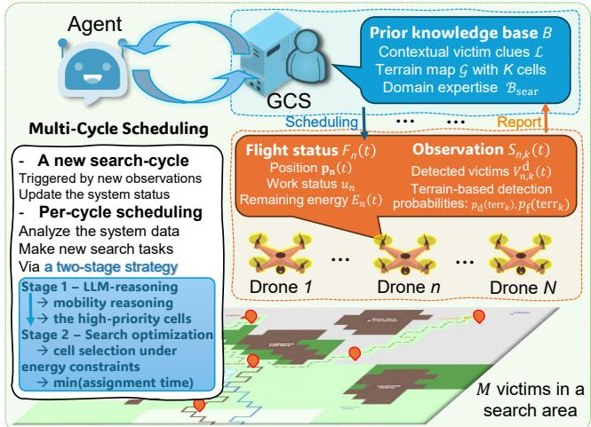  
Fig. 1: The agent-aided drone scheduling system for victim search.

Advanced large language models (LLMs) offer a promising way to integrate structured map information and unstructured prior knowledge for drone scheduling [14], [15]. For instance, consider a distress call reporting “the father is with his sevenyear-old child; they heard running water.” An LLM may infer that the pair tends to move toward a nearby water source and eventually remain close to it. The LLM can also use the child’s limited walking range to exclude distant destinations and narrow the plausible combinations of routes and destinations. Despite this reasoning capability, LLMs alone cannot reliably produce drone scheduling decisions under a dynamic system status and strict energy constraints during long-term search [15]–[17]. As a consequence, directly generating an LLM-enabled drone scheduling decision is insufficient.

To bridge this gap, we aim to develop a joint LLM and optimization agent solution that utilizes an agent at the GCS to tightly couple LLM-based victim search reasoning with reliable optimization for drone scheduling. Designing such a joint global scheduling solution is non-trivial for three reasons. First, it is difficult to determine the effective search direction for drones because victim mobility is uncertain. Second, each drone is energy-constrained and cannot perform long-term search in a single flight. Third, each drone’s observation changes over time. All these factors complicate the continuous global scheduling across multiple drones.

To address these issues, we design a comprehensive workflow for an agent-aided drone scheduling system, taking into account long-term system status tracking and continuous drone scheduling over multiple search cycles, as shown in Fig. 1. In each cycle, the agent at the GCS applies a global scheduling policy to the current system state and prior knowledge to determine drone-to-cell assignments. The drones then fly to the assigned cells, perform search, and report new detection results. For efficient scheduling under dynamic status and drones’ energy constraints, we develop a two-stage drone scheduling strategy that coordinates multiple energyconstrained drones over successive search cycles. In each cycle, the agent first (Stage 1) queries the LLM to reason over all available information and identify the most promising search cells. It then (Stage 2) invokes an optimizer to decide how to dispatch available drones to those selected cells with minimal time. Moreover, we evaluate the proposed system through simulations and show that it consistently completes the victim-search mission with substantially fewer search cycles and lower energy consumption than baseline methods.

## II. SYSTEM WORKFLOW

An agent-aided drone scheduling system is designed to execute victim search missions as shown in Fig. 1. Given a coming mission that aims to search for victims in a target area, multiple drones are dispatched from a GCS to different regions of the area. Some prior clues of victims are known in the GCS. Each drone is equipped with an onboard sensing system to detect victims and continuously communicates with the GCS to report its observations, including search results and flight status. Considering the uncertain locations of victims and dynamic system status, the agent needs to make a global scheduling policy that can continuously analyze the global system status, infer the regions most likely to contain victims, and efficiently schedule drones to complete the mission. The detailed system workflow includes four parts: i) mission knowledge preparation, ii) drone configurations, iii) agentaided global scheduling, and iv) two-stage scheduling strategy.

## A. Mission Knowledge Preparation

Let’s consider a coming victim search mission where M missing victims need to be found from a search area. The agent possesses some prior knowledge for this mission, stored as a database B represented by a three-element tuple as follows.

$$
\begin{array} { r l } & { \mathsf { B } = \left. \mathcal { L } , \mathcal { G } , \mathcal { B } _ { \mathrm { s e a r } } \right. , \mathrm { w h e r e } } \\ & { \mathcal { G } = \left\{ \mathsf { G } _ { k } | k \in \mathcal { K } \right\} , } \\ & { k \in \mathcal { K } , \mathsf { G } _ { k } = \left. \mathsf { p } _ { k } , \mathrm { t e r r } _ { k } \right. . } \end{array}
$$

Herein, $\mathcal { L }$ denotes the collection of unstructured contextual clues of M missing victims, which are available before the search. These clues may concern one or multiple victims and include victim profiles, group relationships, intended routes, and last-seen locations and times, e.g., “the child is $\ l ^ { 7 } \ y { \tt e a r s } \ \circ \mathrm { 1 d } ^ { \bullet \bullet }$ . The term $\mathcal { G }$ denotes the set of K regular cells’ terrain information for the search area. Terrain information of cell k is a two-element tuple ${ \sf G } _ { k } = \left. { \bf p } _ { k } , \mathrm { t e r r } _ { k } \right.$ , where $\mathbf { p } _ { k }$ is the three-dimensional (3D) coordinate of its center and terrk is its terrain type. The term ${ \cal K } = \{ 1 , 2 , . . . , K \}$ is the index set of all search cells. The term $B _ { \mathrm { s e a r } }$ is the knowledge base that stores specialized domain information, including victim behavior profiles and terrain-mobility mappings that describe how terrain types affect movement speed and direction.

## B. Drone Configurations

Given N drones in the GCS to be dispatched. Let ${ \mathcal { N } } =$ $\{ 1 , 2 , . . . , N \}$ be the index sets of the drones. All drones adopt the same hardware configuration, including flight setting, onboard sensing, and the search task execution as follows.

1) Flight Setting: During the search, all drones are assumed to fly at a constant speed $v _ { c }$ and the flight power $P _ { \mathrm { f } } ,$ , as their trajectories remain relatively stable at an altitude that ensures safe flight. At time t, the flight status of drone $n \ ( n \in \mathcal { N } )$ is stored as a three-element tuple below:

$$
\mathsf { F } _ { n } ( t ) = \left. \mathbf { p } _ { n } ( t ) , u _ { n } ( t ) , E _ { n } ( t ) \right. ,
$$

where $\mathbf { p } _ { n } ( t )$ is its position, $u _ { n } ( t ) \in \{ 0 , 1 , . . . , K \}$ is the index of its scheduled search cell, and $E _ { n } ( t )$ is its remaining energy. The drone is active when $u _ { n } ( t ) \neq 0$ and idle when $u _ { n } ( t ) =$ $0 ,$ meaning that it has finished its scheduled task. Then, the estimated flight time required for drone n to reach cell k at time t is $t _ { n , k } = \| \mathbf { p } _ { n } ( t ) - \mathbf { p } _ { k } \| / v _ { c }$

2) Onboard sensing: The onboard sensing system applies a vision-based detection model pretrained for the traversable terrain types considered in the search area. The model outputs the number of victims detected in each cell, and its power consumption is fixed at $P _ { \mathrm { d } }$ . Its detection performance is characterized by two terrain-dependent probabilities, $p _ { \mathrm { d } } ( \operatorname { t e r r } _ { k } )$ and $p _ { \mathrm { f } } ( \mathrm { t e r r } _ { k } )$ , denoting the probability of correctly detecting a victim present in the cell and the probability of falsely reporting a victim when none is present, respectively. Each positive detector output is verified by the agent.

3) Search Task Execution: During the search mission, N drones continuously execute the search tasks scheduled by the agent. Given a scheduled search task that the n-th drone $( n \in$ $\mathcal { N } )$ searches the k-th cell $( k \in \mathcal { K } )$ , it is executed via two steps: i), the n-th drone flies to the center of the k-th cell; and ii) the drone hovers and detects the presence of victims upon arrival. The detection outcome is stored as a three-element tuple:

$$
\mathsf { S } _ { n , k } ( t ) = \big \langle V _ { n , k } ^ { \mathrm { d } } ( t ) , p _ { \mathrm { d } } ( \mathrm { t e r r } _ { k } ) , p _ { \mathrm { f } } ( \mathrm { t e r r } _ { k } ) \big \rangle \mathrm { ~ . ~ }
$$

where $V _ { n , k } ^ { \mathrm { d } } ( t ) \in \{ 0 , 1 , 2 , . . . , M \}$ records the number of victims detected by the onboard model. Once victims are found, the drone instructs them to remain in place and reports their locations to the agent.

## C. Agent-aided Global Scheduling

To find all M victims in the target mission, the agent continuously performs global scheduling by analyzing the global system status and dispatching drones to new cells. As the system status changes, the global scheduling is performed across multiple analyze-dispatch cycles. Each cycle determines multiple search tasks that pair idle drones and search cells.

To ensure secure drone recall in searching a specific cell (say the k-th cell), the agent needs to find an idle drone (say the n-th drone) that satisfies a sufficient minimum value for the remaining energy $E _ { n } ( t )$ , called a Effective Energy Reserving Condition (EERC) defined as follows.

EERC $: E _ { n } ( t ) \geq E _ { n , k } ^ { \mathrm { f } } ( t ) + E _ { k } ^ { \mathrm { d } } + E _ { n , k } ^ { \mathrm { r e } }$ , where

$$
\begin{array} { r } { E _ { n , k } ^ { \mathrm { f } } ( t ) = P _ { \mathrm { f } } \Vert \mathbf { p } _ { n } ( t ) - \mathbf { p } _ { k } \Vert / v _ { c } , E _ { k } ^ { \mathrm { d } } = P _ { \mathrm { d } } \hat { T } _ { k } ^ { \mathrm { d } } ( t ) , } \end{array}
$$

$$
\begin{array} { r } { E _ { n , k } ^ { \mathrm { r e } } = P _ { \mathrm { f } } \Vert \mathbf { p } _ { k } - \mathbf { p } _ { \mathrm { b a s e } } \Vert / v _ { c } + E _ { \mathrm { b u f } } , } \end{array}
$$

where $E _ { n , k } ^ { \mathrm { f } }$ is the energy consumed during the flight to the cell, $E _ { k } ^ { \mathrm { d } }$ is the energy consumed while searching the cell, $E _ { n , k } ^ { \mathrm { r e } }$ is the energy reserved for safely returning to the base point at pbase, $\hat { T } _ { k } ^ { \mathrm { d } } ( t )$ is the expected cell-search time, determined by the cell area and terrain complexity, and $E _ { \mathrm { b u f } }$ is a fixed safety margin for all drones.

Accordingly, the agent runs the per-cycle scheduling below.

• First, the cycle is triggered when the agent receives at least one new observation (i.e., the drone’s detection results) and a certain number (denoted by B) of drones become idle. Then the agent updates the global system status data O(t), which is stored as a four-element tuple below:

$$
\begin{array} { r l } & { \mathsf { O } ( t ) = \left. \hat { V } _ { \mathrm { g l o b a l } } ( t ) , \hat { S } ( t ) , \hat { \mathcal { A } } ( t ) , \hat { \mathcal { F } } ( t ) \right. , \mathrm { ~ w h e r e ~ } } \\ & { \hat { V } _ { \mathrm { g l o b a l } } ( t ) \in \{ 0 , 1 , 2 , . . . , M \} , \hat { \mathcal { F } } ( t ) = \{ \mathsf { F } _ { n } ( t ) | n \in \mathcal { N } \} , } \\ & { \hat { S } ( t ) = \{ \mathsf { S } _ { n , k } ( \tau ) a _ { n , k } ( \tau ) | \tau \in [ 0 , t ] , n \in \mathcal { N } , k \in \mathcal { K } \} , } \\ & { \hat { \mathcal { A } } ( t ) = \{ a _ { n , k } ( t ) \in \{ 0 , 1 \} | n \in \mathcal { N } , k \in \mathcal { K } \} , } \end{array}
$$

where $\hat { V } _ { \mathrm { g l o b a l } }$ records the number of confirmed victims, $\hat { S }$ records all historical detection results, Aˆ is the set of ongoing search tasks, and $\hat { \mathcal { F } } ( t )$ collects the flight status of all drones. In $\hat { \mathcal { A } } , a _ { n , k }$ is a binary indicator that equals 1 when the k-th cell is being searched by the n-th drone, corresponding to the search status $u _ { n } ( t ) = k$ in $\mathsf { F } _ { n }$

• The agent then analyzes the current system data ${ \bf O } ( t )$ and the victim search prior knowledge B, and makes new search tasks via a per-cycle scheduling policy defined by

$$
\begin{array} { r l } & { \pi ( t ) : ( 0 ( t ) , \mathsf { B } ) \to \tilde { \mathcal { A } } ( t ) , } \\ & { \tilde { \mathcal { A } } ( t ) = \{ \tilde { a } _ { n , k } ( t ) = 1 | k \in \tilde { \mathcal { K } } _ { \mathsf { s e a r } } ( t ) , n \in \tilde { \mathcal { N } } _ { \mathsf { d i s p } } ( t ) \} , } \end{array}
$$

where $\tilde { \mathcal { A } } ( t )$ is a set of scheduled search tasks with $\tilde { a } _ { n , k } ( t ) =$ 1 indicating that the n-th drone is scheduled to search the k-th cell. The term $\tilde { \mathcal { K } } _ { s e a r } ( t )$ is the selected search cells and $\tilde { \mathcal { N } } _ { \sf d i s p } ( t )$ is the B drones to be dispatched. The dispatched drone set $\tilde { \mathcal { N } } _ { \sf d i s p } ( t )$ consists of idle drones that must satisfy EERC for at least one candidate cell in $\tilde { \mathcal { K } } _ { \mathsf { s e a r } } ( t )$ . Idle drones that do not satisfy EERC are recalled to the base point. Accordingly, the dispatched drones fly to the search cells, execute victim detection, and report their observations.

Overall, the global scheduling in the agent evolves across multiple cycles as new observations arrive. The search is completed when all M victims have been confirmed found; otherwise, it terminates when no feasible drone dispatch remains or a prescribed cycle cap is reached.

## D. Two-Stage Scheduling Strategy

To run a victim search mission efficiently, the multi-cycle global scheduling (mentioned in Section II-C) needs to be completed (i.e., confirm all victims found) in a minimum time. The terms $T _ { 0 }$ and $T _ { \mathrm { c o m p } }$ denote the start time1 and the completion time of the search mission. Suppose that all victims are confirmed found in C cycles, the mission completion time $T _ { \mathrm { c o m p } }$ can be calculated by $T _ { \mathrm { c o m p } } = T _ { 0 } +$ $\begin{array} { r } { \sum _ { c = 1 } ^ { C ^ { - } } \Big ( T _ { \mathrm { a g e n t } } ^ { ( c ) } + T _ { \mathrm { i d l e } } ^ { ( c ) } \Big ) ^ { \ast } } \end{array}$ , where $T _ { \mathrm { a g e n t } } ^ { ( c ) }$ and $T _ { \mathrm { i d l e } } ^ { ( c ) }$ are the agent computation time and the time from the completion of the agent’s decision to the beginning of the subsequent cycle, respectively. Let $\mathcal { T } _ { \mathrm { d e c } } = \{ \bar { t _ { c } } \ | \ c = 1 , \dots , C \} \subseteq \overline { { [ T _ { 0 } , T _ { \mathrm { c o m p } } ] } }$ denote the set of decision times. Let $\Pi = \{ \pi ( \tau ) | \tau \in \mathcal { T } _ { \mathrm { d e c } } \}$ denote the set of per-cycle drone-scheduling policies used to complete the mission. Then, an efficient Π needs to be found by minimizing $T _ { \mathrm { c o m p } }$ as follows.

$$
\operatorname* { m i n } _ { \Pi } \quad T _ { \mathrm { c o m p } }\tag{1a}
$$

$$
\begin{array} { r } { \mathrm { s . t . } \quad \forall \tau \in \mathcal { T } _ { \mathrm { d e c } } , \pi ( \tau ) : ( 0 ( \tau ) , \mathsf { B } ) \to \tilde { \mathcal { A } } ( \tau ) , } \end{array}
$$

$$
\begin{array} { r } { \tilde { \cal K } _ { \mathsf { s e a r } } ( \tau ) \subseteq \mathcal { K } | _ { \sum _ { n } a _ { n , k } ( \tau ) = 0 } , \tilde { \cal N } _ { \mathsf { d i s p } } ( \tau ) \subseteq { \cal N } | _ { \sum _ { k } a _ { n , k } ( \tau ) = 0 } , } \end{array}\tag{1b}
$$

$$
\sum \tilde { a } _ { n , k } ( \tau ) \leq 1 , \quad \sum \tilde { a } _ { n , k } ( \tau ) \leq 1 ,\tag{1c}
$$

$$
k { \in } \tilde { \mathcal { K } } _ { \mathrm { s e a r } } ( \tau ) \qquad n { \in } \tilde { \mathcal { N } } _ { \mathrm { d i s p } } ( \tau )
$$

$$
\forall \tilde { a } _ { n , k } ( \tau ) \in \tilde { \mathcal { A } } ( \tau ) , \mathsf { E E R C } | _ { \tilde { a } _ { n , k } ( \tau ) } .\tag{1d}
$$

Herein, constraint (1b) prevents idle drones from being assigned to cells already occupied by active drones, (1c) enforces one-to-one assignments, and (1d) ensures sufficient energy for returning to the base with the required safety reserve after completing the search. It can be observed that $T _ { \mathrm { c o m p } }$ is affected by both the number of search cycles and the duration of each cycle. The number of search cycles primarily depends on which cells are selected for search in each cycle. For example, if the selected cells are more likely to contain unfound victims, the mission can be completed in fewer search cycles. The duration of each cycle is affected by how the drones are assigned to the selected cells.

Motivated by the above, the global scheduling policies Π can be found in a two-stage scheduling strategy in each cycle:

#A two-stage scheduling strategy   
Stage 1 - Cell prioritization: In each cycle at time t, given the   
current system state O(t) and prior knowledge B, the agent   
identifies the probability of containing unfound victims in cells   
and assigns them a priority vector $\mathbf { w } ( t ) \in [ 0 , 1 ] ^ { K }$ , where $w _ { k } ( t )$   
represents the relative search priority of cell k.   
Stage 2 - Efficient assignment: Given ${ \bf w } ( t )$ and the scheduling   
constraints in (1b)–(1d), the agent assigns drones in the current   
dispatch batch to top-B high-priority reachable cells while   
minimizing the worst-case outbound travel time. This affects the   
search tasks of each cycle through the drone-to-cell assignment.

## III. JOINT LLM AND OPTIMIZATION IMPLEMENTATION

In order to implement the two-stage scheduling strategy, the agent needs to analyze the per-cycle system status and generate the efficient per-cycle policy. Thus, we present a joint LLM and Optimization solution running two stages. In Stage 1, the agent queries an LLM to reason about the priority weight vector. In Stage 2, the agent invokes a drone-to-cell optimizer to minimize the worst-case travel time to high-priority cells.

## A. Stage 1: LLM Reasoning

The agent in this stage reasons about the priority weight vector ${ \bf w } ( t )$ based on the contextual clues L and the domain expertise $B _ { \mathrm { s e a r } }$ . Particularly, the agent queries an LLM to perform the knowledge preparation and a two-step reasoning:

• Relevant knowledge preparation. To provide relevant domain expertise to the LLM, the agent first uses the contextual clues $\mathcal { L }$ as queries to retrieve a mission-relevant subset R from the specialized domain knowledge $B _ { \mathrm { s e a r } }$ . The agent then combines the retrieved set ${ \mathcal { R } } ,$ terrain map G, and clue set L as the relevant prior knowledge $\mathsf { B } | _ { \mathcal { R } }$

• Step 1: Mobility Pattern Reasoning. The LLM reasons about each unfound victim’s mobility pattern and likely current location based on the system status O(t) and relevant prior knowledge $\mathsf { B } | _ { \mathcal { R } }$ , producing a natural-language analysis.

• Step 2: Cell Prioritization. The LLM maps the analysis from Step 1 onto the search area to produce the priority vector that identifies the search cells in which the victims are most likely to appear and quantifies their priorities using a weight vector $\boldsymbol { \mathbf { \mathit { v } } } ( t ) \in [ 0 , 1 ] ^ { \boldsymbol { \kappa } }$ . To save token, only the top-$K ^ { \prime } \left( K ^ { \prime } \ll K \right)$ cells will be reported by LLM.

A prompt is designed to run the above reasoning, consisting of a system message and a user message as follows.

#LLM Reasoning Prompt Design   
System Message #assembled once at mission start   
– Role and task. You are the victim search agent deployed at the GCS.   
At search cycle t, solve the cell-prioritization problem by estimating   
how likely each search cell is to contain unfound victims. Represent   
the result using $\mathbf { w } ( t ) \in [ 0 , 1 ] ^ { K }$ , where w is the priority of cell k.   
Do not determine drone-to-cell assignments; they are computed by   
the optimizer in Stage 2.   
Relevant prior knowledge. Use the terrain map G, contextual clues   
L, and retrieved domain knowledge R provided below as $\mathsf { B } | _ { \mathcal { R } } .$   
– Step 1: Mobility Pattern Reasoning. For each unfound victim, infer   
plausible mobility patterns and current locations using the contextual   
clues, elapsed time, terrain and trail structure, landmarks, retrieved   
walking-speed and stamina ranges, and accumulated detection his  
tory. When the clues indicate that multiple victims travel together,   
reason about them jointly and bound their movement using the least  
mobile member. Use physical reachability to exclude locations that   
the victims could not have reached.   
Step 2: Cell Prioritization. Map the mobility analysis from Step 1   
onto the cell set K. Assign larger w to cells that are more consistent   
with the inferred routes, destinations, rest locations, and current   
observations. Revise previously searched cells using their detection   
records, while distinguishing sensor observations from confirmed   
victim reports.   
– Behavior principles. Impassable cells cannot contain victims and   
must receive zero priority. Terrain and impassable regions may nev  
ertheless constrain the victims’ feasible movement routes. Confirmed   
victims are excluded from subsequent reasoning. A negative detection   
reduces the priority of the corresponding cell but does not by itself   
prove that the cell is empty.   
Output format. Provide the mobility analysis from Step 1, followed   
by exactly one JSON object containing the top- $K ^ { \prime }$ entries of w(t):   
$\{ \mathbf { \bar {" } p r i o r i t i e s " } : \{ \mathbf { \bar { " } r o w } , \mathbf { c o l " } : \mathbf { \bar { \mathbf { w } } _ { - } k } , \mathbf { \bar { \mathbf { \xi } } } : . . . \} \}$ . Each coordi  
nate must refer to a valid, passable cell, and every reported score   
must lie in [0, 1]. Cells not listed in the JSON object are assigned   
zero priority.   
User Message #rebuilt at each search cycle   
Current cycle time: t. Remaining unfound victims: $M - { \hat { V } } _ { \mathrm { g l o b a l } } ( t ) .$   
Confirmed victims: their locations and confirmation times. Detection   
history: Sˆ(t).

Once at mission start, the system message is constructed with four parts: (i) a role definition with two-step reasoning instructions; (ii) the behavior principles of victims embedded as text. With only general knowledge in the agent, the above reasoning cannot cater to specific victims’ physical behaviors (e.g., victims cannot appear in physically unreachable cells).; (iii) the relevant prior knowledge $\mathsf { B } | _ { \mathcal { R } }$ , including ${ \mathcal { G } } , { \mathcal { L } } ,$ and $\mathcal { R } _ { : }$ embedded as plain text; and (iv) a structured output format that specifies the JSON schema for the LLM to output ${ \bf w } ( t )$ for the top- $K ^ { \prime }$ cells. The user message is rebuilt in each search cycle using four fields of cycle-varying information: (i) the current cycle time t, (ii) the remaining unfound victim count $M - { \hat { V } } _ { \mathrm { g l o b a l } } ( t )$ , (iii) the locations and confirmation times of confirmed victims, and (iv) the detection history $\hat { S } ( t )$

Within a search cycle, if the LLM response is unusable (e.g., it reaches the output-token limit or cannot be parsed into a valid priority vector), the agent queries the LLM again using the same prompt. If the second response remains unusable, the agent applies a fallback that assigns the same priority to every passable cell for that search cycle.

## B. Stage 2: Drone-to-Cell Optimization

After the above reasoning, the agent obtains the top- $K ^ { \prime }$ cells and invokes an optimizer to determine drone-to-cell assignments. It first selects a small candidate cell set from w(t) and then solves a bottleneck assignment over that set by minimizing the worst-case travel time.

• Cell selection. For each drone n in the current dispatch batch $\tilde { \mathcal { N } } _ { \sf d i s p } ( t )$ , its reachable cell set $\mathcal { R } _ { n } ( t )$ contains cells that satisfy two conditions: each cell is not currently being searched by another drone, and the drone has sufficient energy to fly to the cell, complete the search, and return to the base, i.e.,

$$
\mathcal { R } _ { n } ( t ) = \left\{ k \in \mathcal { K } \left| \begin{array} { l } { \sum _ { n ^ { \prime } } a _ { n ^ { \prime } , k } ( t ) = 0 , } \\ { \mathsf { E E R C h o l d s f o r } \left( n , k \right) } \end{array} \right. \right\} .
$$

The candidate cell pool $\begin{array} { r } { \mathcal { R } ^ { * } ( t ) = \bigcap _ { n \in \tilde { \mathcal { N } } _ { \mathrm { d i s p } } ( t ) } \mathcal { R } _ { n } ( t ) } \end{array}$ retains only the cells reachable by every drone in the current dispatch batch. The optimizer selects the top-B cells from $\mathcal { R } ^ { * } ( t )$ according to $w _ { k } ( t )$ to form a candidate set $\mathcal { C } ( t )$

• Assignment Time Minimization. The optimizer constructs an efficient assignment problem $\tilde { \mathcal { P } } _ { 1 . 2 }$ to find a maximumcardinality assignment $\tilde { \mathcal { A } } ( t )$ while minimizing the worstcase travel time to the top-B cells. The problem is given by

$$
\operatorname* { m i n } _ { \{ \tilde { a } _ { n , k } \} } \quad \operatorname* { m a x } _ { \substack { n \in \tilde { \mathcal { N } } _ { \mathrm { d i s p } } ( t ) , k \in \mathcal { C } ( t ) } } t _ { n , k } \cdot \tilde { a } _ { n , k } ( t )\tag{2a}
$$

$$
\mathrm { s . t . } \sum _ { n , k } \tilde { a } _ { n , k } ( t ) = \operatorname* { m i n } \bigl ( B , | \mathcal { C } ( t ) | \bigr ) ,\tag{2b}
$$

$$
\sum _ { k \in \mathcal { C } ( t ) } \tilde { a } _ { n , k } ( t ) \leq 1 , \sum _ { n \in \tilde { \mathcal { N } } _ { \mathrm { d i s p } } ( t ) } \tilde { a } _ { n , k } ( t ) \leq 1 .\tag{2c}
$$

$\tilde { \mathcal { P } } _ { 1 . 2 }$ is solved by binary search over the sorted set of finite travel times. Specifically, given a travel-time threshold $\sigma ,$ a bipartite graph retaining only edges with $t _ { n , k } ~ \leq ~ \sigma$ is constructed, the maximum matching is computed, and the smallest σ that yields the cardinality required by Eq. (2b) is selected. Finally, the resulting $\tilde { \mathcal { A } } ( t )$ is the output of the per-cycle policy $\pi ( t )$ . Drones not assigned in $\tilde { \mathcal { A } } ( t )$ remain idle and participate in the next search cycle.

Performance analysis: The above scheduling strategy affects the mission performance as follows. First, in the cellprioritization stage, an upper bound for the expected completion cycle exists, and this upper bound decreases when the top-B high-priority reachable cells are more likely to contain unfound victims. The derivation is provided in Appendix A. Meanwhile, given the selected cells in the assignment stage, the scheduling performance can be characterized by the worstcase outbound travel time $\begin{array} { r } { \operatorname* { m a x } _ { n , k : \tilde { a } _ { n , k } ( t _ { c } ) = 1 } t _ { n , k } . } \end{array}$ . A smaller value reduces the maximum travel delay before the assigned search cells are reached.

## IV. NUMERICAL RESULTS

## A. Simulation Setup

1) Map and Contextual Clues: We simulate a 7 km × 7 km wilderness search area discretized into 28 × 28 equal-sized cells. The map G is available to the agent before the search, containing eight terrain types and specifying the locations of GCS/Entry (the southern trailhead), Trail Fork, Overlook, Caves, Pond, and Campsite. Given a victim search mission, the exact clue text provided to the agent is as follows.

A hiking group of 5 people departed from the southern   
trailhead this morning at 08:30, heading for the overlook   
in the northeast of the region as their shared   
destination. They were expected back by 5 PM but have not   
returned and are now unreachable by phone. Group   
composition: Family A (a parent in their 40s with a   
7-year-old child; the young child limits how far the   
family can travel), Family B (a married couple in their   
early 30s, moderately fit), and Youth C (a 22-year-old   
experienced solo hiker with strong stamina). Last visual   
sighting: a passing hiker saw all five at the trail fork   
around 10:00 AM; no sightings since.

2) Ground-truth mobility: Using the same terrain map, the simulator generates the victims’ subsequent trajectories as the simulation ground truth. These trajectories, including the subgroup-specific destinations and mobility parameters, are not provided to the agent. After reaching Trail Fork, Family A heads toward Pond, Family B heads toward Campsite, and Youth C continues toward Overlook. The three subgroups follow terrain-weighted shortest paths that favor marked trails, at constant speeds of 0.5, 0.8, and 1.0 m/s, respectively. Upon arrival, they wander within radii of 300, 400, and 500 m at reduced speeds of 0.2, 0.3, and 0.4 m/s, respectively. The wandering direction varies with the random seed.

3) Drone Configuration: The default number of drones is $N = 1 0$ . Each drone has initial energy $E _ { \mathrm { i n i t } } = 5 0 0 \mathrm { k J }$ , safety reserve $E _ { \mathrm { { b u f } } } = 3 0 \mathrm { { k J } }$ , cruise speed $v _ { c } = 1 5 \mathrm { m } / \mathrm { s }$ , flight power $P _ { \mathrm { f } } = 2 0 0 \mathrm { { W } } .$ and search power $P _ { \mathrm { d } } = 1 5 0 \mathrm { W }$ . The dispatch batch size is $B ~ = ~ 1 0$ in each search cycle. The terraindependent detection parameters $( p _ { \mathrm { d } } , p _ { \mathrm { f } } )$ are set to (0.95, 0.02) for meadow, trail, creek, and pond, (0.80, 0.05) for sparse vegetation, (0.55, 0.10) for dense forest, and (0.65, 0.12) for rocky terrain. The cell-search times are 50, 60, 60, 70, 80, 100, and 120 s for trail, meadow, pond, creek, sparse vegetation, rocky terrain, and dense forest, respectively.

4) Agent Configuration: We take the last sighting at 10:00 AM as $t = 0 .$ After a response delay of $T _ { 0 } = 3 6 0 0 \mathrm { s } ,$ the drones are dispatched and the first search cycle begins at $t ~ = ~ T _ { 0 }$ (i.e., 11:00 AM). The retrieved knowledge R contains category-specific on-trail/off-trail walking-speed and stamina ranges: 0.4–0.7/0.2–0.4 m/s and 4–5 km for children, 0.7–1.0/0.4–0.6 m/s and 6–9 km for average adults, and 0.9– 1.3/0.6–0.9 m/s and 15–30 km for experienced hikers. It also includes water-seeking and physical-reachability heuristics. The default backbone is DeepSeek V4 Pro in non-thinking mode. DeepSeek V4 Flash, Qwen Flash, Qwen Plus, and Qwen3 Max are evaluated under the same non-thinking setting for comparison. We set $K ^ { \prime } = 5 0$ , so the LLM reports the 50 highest-priority entries of w(t) in each search cycle; unlisted cells are assigned zero priority.

5) Comparison Methods: We compare the proposed solution with six non-LLM baselines and four LLM variants.

• Baselines. The six deterministic baselines span uninformed coverage, Bayesian filtering, and clue-derived spatial priors. The clue prior is constructed once from the last sighting, victim categories, elapsed time, terrain, water-seeking behavior, and the shared destination. Simulated trajectories and subgroup destinations are excluded.

– Lawnmower [8] covers the grid by sweeping each row sequentially from south to north.

– Greedy-Coverage [11] dispatches each idle drone to its nearest feasible least-searched cell.

– Bayesian Search [12] starts from a uniform belief, applies terrain-aware motion prediction and negative-observation updates, and greedily selects cells by expected detection reward per unit travel-and-search time.

– Clue-Prior Sweep orders the boustrophedon row strips once using their mass under the fixed clue prior.

– Clue-Prior Greedy uses the same fixed prior throughout the mission and greedily trades off its probability mass against drone travel distance.

– Clue-Prior Bayes initializes the Bayesian filter with subgroup-specific clue priors and subsequently applies the same motion and observation updates as Bayesian Search.

• Variants. Four LLM variants evaluate four design choices: two-stage decomposition, knowledge retrieval, explicit mo bility reasoning, and drone-to-cell optimization.

– LLM-Direct directly asks the LLM to assign the idle drones to search cells. If both the initial response and one retry are invalid, the drones are assigned to their nearest feasible cells for that search cycle.

– w/o Knowledge Retrieval removes the retrieved domain knowledge R from the system message.

– w/o Mobility Reasoning removes Step 1; the LLM produces w(t) without reasoning about victim mobility.

– w/o Bottleneck reuses the per-cycle priority maps generated by Ours and replaces the bottleneck drone-to-cell matching with a uniformly random one-to-one assignment over the same selected cells.

6) Evaluation Metrics: We evaluate the comparison methods, ablations, and LLM backbones based on five random seeds (42–46) with each run capped at 40 search cycles. Particularly, we report three groups of metrics.

• Mission effectiveness metrics include i) victims found (Found), ii) seeds achieving full completion (Compl.), and iii) completion time $T _ { \mathrm { c o m p } }$ . The mean and standard deviation of $T _ { \mathrm { c o m p } }$ are computed over completed seeds only; “—” means that no seed completes the mission.

• Resource cost metrics, reported as the mean and standard deviation across the five seeds, include i) search cycles (Cycles), ii) energy

TABLE III: Main comparison results.  
TABLE I: Architecture and component ablation results. Bold marks the best result in columns that permit direct comparison.
<table><tr><td>Method / Variant</td><td>Found</td><td>Compl.</td><td>Cycles</td><td> $T _ { \mathrm { { c o m p } } } ~ ( \mathrm { { s } ) }$ </td><td> $E / \mathrm { v i c } \ ( \mathbf { k J } )$ </td><td> $\mathrm { T o k / r u n }$ </td><td> $T _ { \mathrm { a g e n t } } / \mathrm { c y c . ~ ( s ) }$ </td><td>Illegal Fb.</td><td></td></tr><tr><td>Ours (DS V4 Pro)</td><td> ${ \bf 5 . 0 \pm 0 . 0 }$ </td><td>5/5</td><td> ${ \bf 3 . 8 \pm 1 . 8 }$ </td><td> ${ \bf 4 6 6 1 } \pm { \bf 4 5 7 }$ </td><td> ${ \bf 3 2 3 \pm 1 2 8 }$ </td><td> $\mathbf { 3 2 k \pm 1 6 k }$ </td><td> $2 2 \pm 1$ </td><td>26.3%</td><td>0</td></tr><tr><td> $\mathtt { L L M - D i r e c t }$ </td><td> $4 . 0 \pm 1 . 2$ </td><td>2/5</td><td> $2 8 . 0 \pm 1 1 . 0$ </td><td> $6 2 2 3 \pm 1 0 8 3$ </td><td> $1 1 6 0 \pm 7 2 9$ </td><td> $2 7 3 k \pm 1 2 7 k$ </td><td> $\mathbf { 9 \pm 0 }$ </td><td>52.1%</td><td>6</td></tr><tr><td>w/o Knowledge Retrieval</td><td> $4 . 6 \pm 0 . 9$ </td><td>4/5</td><td> $9 . 6 \pm 1 2 . 5$ </td><td> $4 6 5 4 \pm 2 6 4$ </td><td> $5 5 6 \pm 5 6 0$ </td><td> $9 5 k \pm 1 3 0 k$ </td><td> $2 4 \pm 9$ </td><td>38.8%</td><td>0</td></tr><tr><td> $\mathsf { w / o } \mathrm { \mathbb { M } o b i l i t y }$  Reasoning</td><td> $3 . 2 \pm 1 . 5$ </td><td>1/5</td><td> $2 6 . 0 \pm 1 2 . 5$ </td><td> $4 6 8 2 \pm 0$ </td><td> $1 8 5 4 \pm 1 6 5 4$ </td><td> $2 8 9 k \pm 1 6 2 k$ </td><td> $1 7 \pm 7$ </td><td>33.8%</td><td>5</td></tr><tr><td> $\mathsf { w / o } \mathtt { B o t t 1 e n e c k }$ </td><td> ${ \bf 5 . 0 \pm 0 . 0 }$ </td><td>5/5</td><td> ${ \bf 3 . 8 \pm 1 . 8 }$ </td><td> $4 7 0 3 \pm 4 5 3$ </td><td> $3 2 7 \pm 1 3 6$ </td><td> $\mathbf { 3 2 k \pm 1 6 k }$ </td><td> $2 2 \pm 1$ </td><td>26.3%</td><td>0</td></tr></table>

<table><tr><td>Backbone</td><td>Found</td><td></td><td>Compl.</td><td>Cycles</td><td> $T _ { \mathrm { c o m p } } ~ \mathrm { ( s ) }$ </td><td></td><td> $E / \mathrm { v i c } \ ( \mathrm { k J } )$ </td><td></td><td> $\mathbf { T o k } / \mathbf { r u n }$ </td><td></td><td> $T _ { \mathrm { a g e n t } } / { \mathrm { c y c . ~ } } ( \mathrm { s } )$ </td><td></td><td>Illegal</td><td>Fb.</td></tr><tr><td>DeepSeek V4 Pro</td><td> $5 . 0 \pm 0 . 0$ </td><td></td><td> $5 / 5$ </td><td> $3 . 8 \pm 1 . 8$ </td><td></td><td> $4 6 6 1 \pm 4 5 7$ </td><td></td><td> $^ { 3 2 3 } \pm 1 2 8$ </td><td></td><td> $3 2 k \pm 1 6 k$ </td><td></td><td> ${ 2 2 \pm 1 }$ </td><td>26.3%</td><td>0</td></tr><tr><td>DeepSeek V4 Flash</td><td> $4 . 8 \pm 0 . 4$ </td><td></td><td> $4 / 5$ </td><td> $5 . 0 \pm 6 . 7$ </td><td></td><td> $4 3 9 9 \pm 2 5 3$ </td><td></td><td> $4 0 6 \pm 4 2 8$ </td><td> $9 1 k \pm 1 3 1 k$ </td><td></td><td> $5 4 \pm 2 1$ </td><td></td><td>12.5%</td><td>1</td></tr><tr><td>Qwen Flash</td><td> $1 . 6 \pm 0 . 9$ </td><td></td><td> $0 / 5$ </td><td> $4 0 . 0 \pm 0 . 0$ </td><td></td><td></td><td> $2 2 0 1 \pm 6 5$ </td><td></td><td> $5 6 6 k \pm 9 k$ </td><td></td><td> $1 9 \pm 2$ </td><td></td><td>93.0%</td><td>0</td></tr><tr><td>Qwen Plus</td><td> $5 . 0 \pm 0 . 0$ </td><td></td><td> $5 / 5$ </td><td> $5 . 6 \pm 3 . 2$ </td><td></td><td> $6 4 2 6 \pm 1 5 3 6$ </td><td> $4 7 0 \pm 2 4 2$ </td><td></td><td> $1 1 4 k \pm 7 0 k$ </td><td></td><td> $2 3 9 \pm 1 7$ </td><td></td><td>50.0%</td><td>0</td></tr><tr><td>Qwen3 Max</td><td> $5 . 0 \pm 0 . 0$ </td><td></td><td> $5 / 5$ </td><td> $3 . 2 \pm 1 . 6$ </td><td></td><td> $4 9 0 7 \pm 6 2 3$ </td><td></td><td> $2 7 4 \pm 8 3$ </td><td> ${ \boldsymbol { 5 2 } } { \boldsymbol { \mathrm { k } } } \pm 3 3 { \boldsymbol { \mathrm { k } } }$ </td><td></td><td> $1 4 2 \pm 2 1$ </td><td></td><td>29.4%</td><td>0</td></tr></table>

<table><tr><td>Method</td><td>Found</td><td></td><td>Compl. Cycles</td><td> $T _ { \mathrm { { c o m p } } } ( \mathrm { { s } ) }$ </td><td>E/vic(kJ)</td></tr><tr><td>Lawnmower</td><td> $0 . 0 \pm 0 . 0$ </td><td>0/5</td><td> $1 4 . 0 \pm 0 . 0$ </td><td></td><td></td></tr><tr><td>Greedy-Coverage</td><td> $0 . 0 \pm 0 . 0$ </td><td>0/5</td><td> $3 2 . 0 \pm 0 . 0$ </td><td></td><td></td></tr><tr><td>Bayesian Search</td><td> $0 . 0 \pm 0 . 0$ </td><td>0/5</td><td> $3 3 . 0 \pm 0 . 0$ </td><td></td><td></td></tr><tr><td>Clue-Prior Sweep</td><td> $2 . 6 \pm 0 . 9$ </td><td>0/5</td><td> $1 4 . 0 \pm 0 . 0$ </td><td></td><td> $2 1 8 6 \pm 1 3 9 6$ </td></tr><tr><td>Clue-Prior Greedy</td><td> $2 . 8 \pm 0 . 4$ </td><td>0/5</td><td> $3 1 . 0 \pm 0 . 0$ </td><td></td><td> $1 6 9 0 \pm 3 4 4$ </td></tr><tr><td>Clue-Prior Bayes</td><td> $3 . 0 \pm 0 . 0$ </td><td>0/5</td><td> $2 8 . 0 \pm 0 . 0$ </td><td></td><td> $1 5 5 9 \pm 0$ </td></tr><tr><td>Ours (DS V4 Pro)</td><td> ${ \bf 5 . 0 \pm 0 . 0 }$ </td><td>5/5</td><td></td><td> ${ \bf 3 . 8 \pm 1 . 8 ~ 4 6 6 1 \pm 4 5 7 }$ </td><td> ${ \bf 3 2 3 \pm 1 2 8 }$ </td></tr></table>

per found victim (E/vic), iii) total tokens per run (Tok/run), and iv) average end-to-end agent computation time per search cycle $( T _ { \mathrm { a g e n t } } / \mathrm { c y c . } ) .$  
• Output quality metrics include i) the illegal-output rate (Illegal), computed as the fraction of all LLM responses across the five seeds that place priorities or assignments on impassable cells; and ii) the total number of search cycles (Fb.) across the five seeds that invoke the fallback.

## B. Results

This section presents comparisons of our solution with baselines, ablated variants, and multiple LLM backbones, together with analyses of the initial priority maps, a representative search trajectory, and dispatch-batch sensitivity.

26.3% to 52.1% and triggers six fallbacks, while Ours triggers none, showing that LLMs struggle to directly make scheduling decisions under constraints. w/o Knowledge Retrieval completes four of the five runs and increases the illegaloutput rate from 26.3% to 38.8%, indicating that task-specific knowledge helps the LLM reason about the likely locations of unfound victims. w/o Mobility Reasoning completes only one of the five runs and triggers five fallbacks, showing that directly generating cell priorities in a single step is unreliable. Compared with w/o Bottleneck, bottleneck matching reduces the mean worst-case outbound travel time per cycle by 16.1%, demonstrating that the drone-to-cell optimizer primarily shortens the slowest dispatch in each cycle.

1) Performance Comparison: Table III compares our solution with baselines. Bold marks the best result in columns that permit direct comparison. The comparison highlights the benefit of reasoning over contextual clues and updating cell priorities across search cycles. The uninformed Lawnmower, Greedy-Coverage, and Bayesian Search baselines find no victim. Their inefficient assignments exhaust the available energy before the 40-cycle limit is reached. The three clueprior baselines improve the average number of victims found to 2.6–3.0, but none completes the mission. In contrast, Ours finds all five victims under all five seeds, requiring only 3.8 search cycles and 323 kJ per victim on average. These results show that a one-time clue-derived prior improves search focus, whereas updating the priorities with elapsed time and accumulated observations allows the search to adapt to victim movement and locate all victim subgroups.

2) Ablation Study: As shown in Table I, the two-stage policy turns LLM reasoning into more reliable and resourceefficient scheduling than direct assignment. LLM-Direct completes only two of the five runs. Compared with Ours, LLM-Direct nearly doubles the illegal-output rate from

3) Cross-Backbone Analysis: Table II demonstrates that the two-stage policy transfers across multiple backbones, although mission reliability and resource cost remain backbonedependent. DeepSeek V4 Pro, Qwen3 Max and Qwen Plus complete all five seeds, while DeepSeek V4 Flash completes four and Qwen Flash completes none. DeepSeek V4 Flash delivers less reliable mission performance and incurs higher resource costs than DeepSeek V4 Pro. Qwen3 Max and Qwen Plus require 3.2 and 5.6 cycles on average, respectively, close to the 3.8 cycles required by DeepSeek V4 Pro. However, their per-cycle agent computation times increase from 22 s to 142 s and 239 s, resulting in longer mission completion times of 4907 s and 6426 s. Importantly, Qwen Plus reaches an illegal-output rate of 50.0%, comparable to LLM-Direct, but the optimizer in Stage 2 filters invalid priorities and enforces scheduling constraints before execution. Qwen Flash performs worst, finding only 1.6 ± 0.9 victims and completing no seed. With a 93.0% illegal-output rate, all runs reach the 40-cycle limit, consuming 566k tokens per run and 2201 kJ per found victim despite only 19 s of agent computation per cycle.

Fig. 2 shows that the same contextual input produces different spatial distributions of the initial priorities across backbones. DeepSeek V4 Flash includes all three victimsubgroup locations among its top-B cells, while DeepSeek V4 Pro and Qwen Plus each include one. Neither Qwen Flash nor Qwen3 Max directly covers a victim-subgroup location, but Qwen3 Max extends its top-B cells along the trail toward the northern victim region, whereas Qwen Flash confines them to

1.0  
0.8  
0.6  
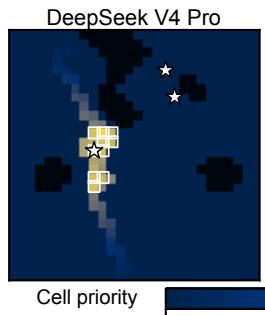  
0.0

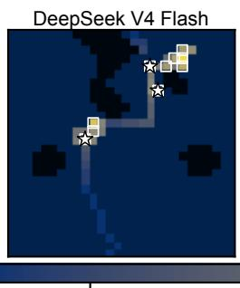  
0.2

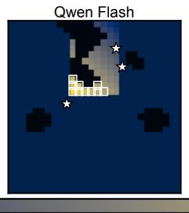  
0.4

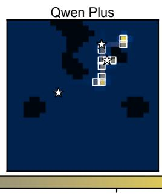

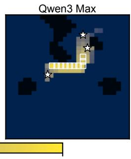

Fig. 2: Initial priority maps generated by five LLM backbones for seed 42 before any search observation. Cell color represents the inferred priority, white squares mark the top-B $( B = 1 0 )$ high-priority reachable cells, and stars mark the simulated victim-subgroup locations (hidden from the agent).  
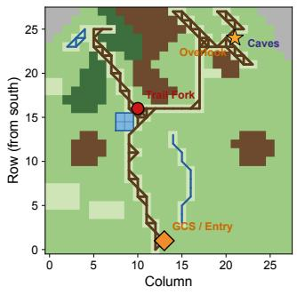

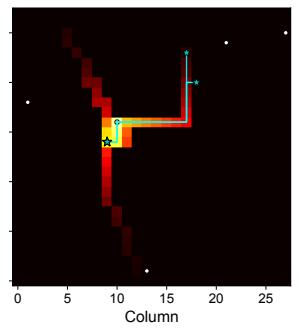

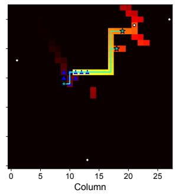

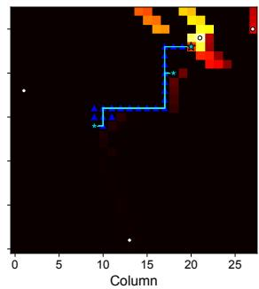  
(d) t = 4288 s  
Meadow Sparse vegetation Dense forest Rocky terrain Impassable zone Pond Creek Trail

Fig. 3: Case study of the proposed agent solution. (a) shows the terrain map with four annotated landmarks. (b)–(d) show the inferred cell priorities at three reference moments. Heatmap intensity encodes wk, cyan traces show victim paths, and blue triangles mark previously dispatched search cells.

a short central segment. This difference is consistent with their mission performance: Qwen3 Max completes all five seeds, while Qwen Flash completes none.

4) Case Study: We next examine how the inferred cell priorities evolve with victim movement and accumulated search observations during a completed mission. Fig. 3 visualizes how the inferred priorities remain aligned with the locations and movement routes of the still-unfound victims during the seed-42 run. $~ \mathrm { A t } ~ t ~ = ~ 3 6 0 0 ~ \mathrm { s } ,$ the highest-priority region follows the trail toward the pond and Trail Fork, and includes the actual location of Family A. The first dispatch consequently finds both family members at $t ~ = ~ 3 9 0 7$ s. After these detections, the map at t = 3929 s shifts eastward along the trail toward the campsite region occupied by Family B, which is subsequently found at t = 4280 s. At t = 4288 s, only Youth C remains unfound. The priority map then concentrates on cells around the victim’s current position and the route toward the overlook; the following dispatch finds the final victim at $t = 4 4 8 8 \mathrm { s }$ . This progression reveals the mechanism behind the successful run: each time the high-priority region covers the current location of a remaining victim subgroup, the following dispatch discovers that subgroup, allowing all five victims to be found within four cycles.

5) Dispatch-Batch Sensitivity: We next evaluate how the number of drones dispatched per decision cycle affects mission completion and fleet energy. We fix $N = 1 0$ and vary B from 3, the number of victim subgroups, to 10, the fleet size. To ensure a comparable workload across batch sizes, we allow approximately 200 drone dispatches for each setting. For each batch size B, we therefore cap the number of search cycles at $\lceil 2 0 0 / B \rceil$ . Because this study uses different parameter settings, we rerun all batch-size configurations instead of reusing the results reported in the main comparison. As shown in Fig. 4, seven of the eight settings complete all five seeds, while B = 7 completes four and exhibits the largest energy variation. Among the fully completing settings, $B = 1 0$ achieves the lowest mean completion time of 4527 s, whereas $B \ = \ 4$ minimizes mean total energy at 1266 kJ. The settings $B = 8$ and $B = 9$ are dominated by $B = 1 0$ in both completion time and energy consumption. These results demonstrate that batch size controls a genuine time–energy tradeoff: changing B alters both the number of dispatched drones and the cells selected in each cycle, rather than providing a monotonic gain from additional parallelism.

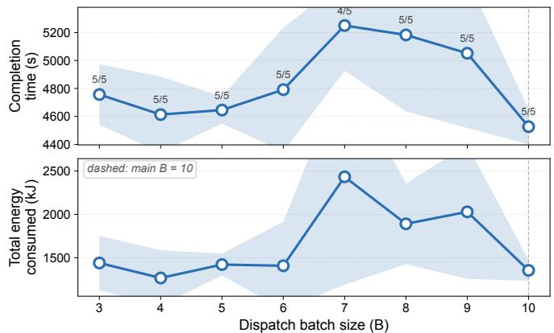  
Fig. 4: Sensitivity to dispatch batch size B with N = 10. Top: completion time, with each label showing completed seeds. Bottom: total fleet energy. Curves show mean values and shaded bands show one standard deviation. The dashed line marks the default B = 10.

Summary: The results lead to three main findings. First, mission completion time is jointly determined by the number of search cycles and the duration of each cycle: more accurate cell priorities can reduce the required cycles by increasing the likelihood of searching the victims’ actual locations, while, when different reasoning methods produce similar priorities and require similar numbers of cycles, assignment optimization can further reduce completion time by shortening the outbound travel time in each cycle. Second, unstructured contextual clues provide useful information for narrowing the search area, but a fixed clue-derived prior is insufficient when victims continue moving and new observations become available. Third, the main value of the LLM lies in its ability to combine contextual clues, domain knowledge, terrain constraints, elapsed time, and accumulated observations to continuously update search priorities; the optimizer then complements this reasoning by converting the priorities into energy-feasible and time-efficient drone assignments.

## V. CONCLUSION

We developed an agent-aided drone scheduling system for victim search missions. The system performs efficient global drone scheduling using a joint LLM and optimization agent solution. The solution interprets unstructured victim clues and performs constrained drone scheduling in two sequential stages. First, the LLM reasons over a structured prompt to generate the priority vector of search cells. A drone-to-cell optimizer is then invoked to generate the scheduling policy while minimizing travel time. Simulations confirmed that interpreting contextual information is essential for mission completion, and the ablations validated the contributions of the individual design components. Our future work will validate the proposed system in real-world victim-search missions using physical drones and geographic terrain data. Field experiments will further examine its reliability under practical factors not fully captured by the current simulations, such as sensing errors, communication delays, localization uncertainty, wind disturbances, and variable energy consumption.

## APPENDIX A

Derivation of the expected-cycle upper bound: Let $C _ { m }$ denote the cycle in which victim m is first confirmed, so that the total number of search cycles is $\begin{array} { r } { C = \operatorname* { m a x } _ { 1 \leq m \leq M } C _ { m } . } \end{array}$ Let $k _ { m } ( t _ { c } )$ denote the cell occupied by victim m at the actual execution time of the corresponding search task in cycle c, and let $\mathrm { T o p } _ { B } ( \mathbf { w } ( t _ { c } ) ; \mathcal { R } ^ { * } ( t _ { c } ) )$ denote the B cells with the highest priorities within the reachable candidate pool $\mathcal { R } ^ { * } ( t _ { c } )$ . For an unfound victim $m ,$ , we define the quality (i.e., the probability’s correctness) in the priority vector as $\begin{array} { r l } { \rho _ { m , c } ( \mathbf { w } ( t _ { c } ) ) } & { { } = } \end{array}$ $\operatorname* { P r } ( k _ { m } ( t _ { c } ) \in \mathrm { T o p } _ { B } ( \mathbf { w } ( t _ { c } ) ; \mathcal { R } ^ { * } ( t _ { c } ) ) \mid C _ { m } \geq c , 0 ( t _ { c } ) , \mathsf { B } )$ A larger $\rho _ { m , c } ( \mathbf { w } ( t _ { c } ) )$ means that the cells ultimately selected for search are more likely to include the actual cell of victim m. Suppose that, for every reachable system state, every cycle $c ,$ and every victim m with $C _ { m } \geq c , \rho _ { m , c } ( \mathbf { w } ( t _ { c } ) ) \geq \underline { { \rho } } > 0 .$ while the detector satisfies $p _ { \mathrm { d } } ( \mathrm { t e r r } ) ~ \geq ~ \underline { { p } } _ { \mathrm { d } } ~ > ~ 0$ for every traversable terrain type. Then, the probability of an unfound victim being confirmed in each cycle is at least $\underline { { \rho } } \underline { { p } } _ { \mathrm { d } }$ , giving $\Pr _ { \pi } ( C _ { m } > c ) \leq ( 1 - \underline { { \rho p } } _ { \mathrm { { q } } } ) ^ { c }$ . Since $C > c$ implies that at least one victim remains unconfirmed, the union bound gives $\operatorname* { P r } _ { \pi } ( C > c ) \leq M ( 1 - \rho p _ { _ { { \mathrm { d } } } } ) ^ { c }$ . Since $0 < \rho { p } _ { { d } } < 1$ , applying the tail-sum identity $\begin{array} { r } { \mathbb { E } _ { \pi } \overline { { [ C ] } } \equiv \sum _ { c = 0 } ^ { \infty } \operatorname* { P r } _ { \pi } ( \overline { { C } } \overset { \sim } { \underset { \sf T } { \sim } } c ) } \end{array}$ , we have

$$
\mathbb { E } _ { \boldsymbol \pi } \left[ \operatorname* { m a x } _ { 1 \leq m \leq M } C _ { m } \right] \leq \left| \frac { \ln M } { - \ln \left( 1 - \underline { { \rho { p } _ { \mathrm { d } } } } \right) } \right| + \frac { 1 } { \underline { { \rho { p } _ { \mathrm { d } } } } } .\tag{3}
$$

Thus, an upper bound for the expected completion-cycle is proved. REFERENCES ■

[1] Z. Ge, J. Jiang, and M. Coombes, “Multi-uav search and rescue in wilderness using smart agent-based probability models,” IEEE Transactions on Aerospace and Electronic Systems, 2025.

[2] M.-A. Lahmeri, V. Mustieles-Perez, M. Vossiek, G. Krieger, and´ R. Schober, “Uav formation and resource allocation optimization for communication-assisted 3d insar sensing,” IEEE Transactions on Communications, vol. 73, no. 8, pp. 5788–5804, 2025.

[3] P. Grassi, M. Manzoni, S. Tebaldini, and C. M. Prati, “A geometrical autofocus method for uav-based sar,” IEEE Transactions on Geoscience and Remote Sensing, 2026.

[4] J. Yan, L. Li, P. Li, Z. Ding, Y. Gao, and Y. Liu, “A high-band phase synchronization approach for distributed uav sar,” IEEE Transactions on Geoscience and Remote Sensing, 2026.

[5] W. Li, Y. Ma, Y. Zhang, B. Li, Y. Shi, and L. Chu, “A multiangle observation and imaging method for uav swarm sar based on consensus constraints,” IEEE Sensors Journal, vol. 25, no. 11, pp. 19 776–19 793, 2025.

[6] S. Sharma, G. Tsoumplekas, Y. Spyridis, N. Vitzilaios, and V. Argyriou, “Cooperative uav search and rescue via multi-agent reinforcement learning in simulated wildfire environments,” in 2026 International Conference on Unmanned Aircraft Systems (ICUAS). IEEE, 2026, pp. 828–835.

[7] L. Sun, S. Zhao, L. Wan, K. Liu, J. Wang, Y. Yuan, Y. Lin, and B. Ai, “Robust uav spectrum scheduling under incomplete information: A fuzzy framework based on ppo-assisted evolutionary reinforcement learning,” IEEE Transactions on Consumer Electronics, vol. 71, no. 3, pp. 8008– 8020, 2025.

[8] H. Choset, “Coverage of known spaces: The boustrophedon cellular decomposition,” Autonomous Robots, vol. 9, no. 3, pp. 247–253, 2000.

[9] H. Lu, Y. Yang, R. Tao, and Y. Chen, “Coverage path planning for saruav in search area coverage tasks based on deep reinforcement learning,” in 2022 IEEE International Conference on Unmanned Systems (ICUS). IEEE, 2022, pp. 248–253.

[10] W. Burgard, M. Moors, C. Stachniss, and F. E. Schneider, “Coordinated multi-robot exploration,” IEEE Transactions on robotics, vol. 21, no. 3, pp. 376–386, 2005.

[11] B. Yamauchi, “Frontier-based exploration using multiple robots,” in Proceedings of the second international conference on Autonomous agents, 1998, pp. 47–53.

[12] S. Perez-Carabaza, E. Besada-Portas, J. A. Lopez-Orozco, and J. M. de la Cruz, “Ant colony optimization for multi-uav minimum time search in uncertain domains,” Applied Soft Computing, vol. 62, pp. 789–806, 2018.

[13] S. Perez-Carabaza, E. Besada-Portas, and J. A. L´ opez-Orozco, “Mini-´ mizing the searching time of multiple targets in uncertain environments with multiple uavs,” Applied Soft Computing, vol. 155, p. 111471, 2024.

[14] X. Wu, Y. Wang, J. Farooq, and J. Chen, “Llm-driven agentic ai approach to enhanced o-ran resilience in next-generation networks,” in IEEE INFOCOM 2025-IEEE Conference on Computer Communications Workshops (INFOCOM WKSHPS). IEEE, 2025, pp. 1–6.

[15] A. Qayyum, A. Albaseer, J. Qadir, A. Al-Fuqaha, and M. Abdallah, “Llm-driven multi-agent architectures for intelligent self-organizing networks,” IEEE Network, 2025.

[16] J. Tong, W. Guo, J. Shao, Q. Wu, Z. Li, Z. Lin, and J. Zhang, “Wirelessagent: Large language model agents for intelligent wireless networks,” arXiv preprint arXiv:2505.01074, 2025.

[17] Y. Tan, F. Kurfess, E. Delgado, C. Young, and G. Bloom, “Posthoc knowledge grounding for verifiable multi-agent search and rescue decision support,” in Proceedings of the AAAI Symposium Series, vol. 8, no. 1, 2026, pp. 577–586.