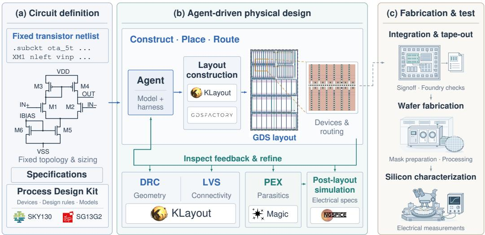
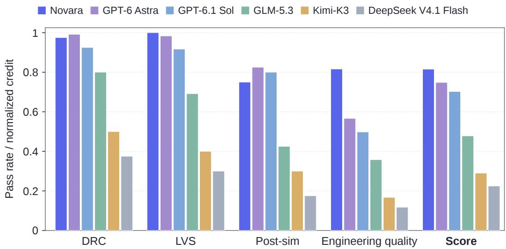
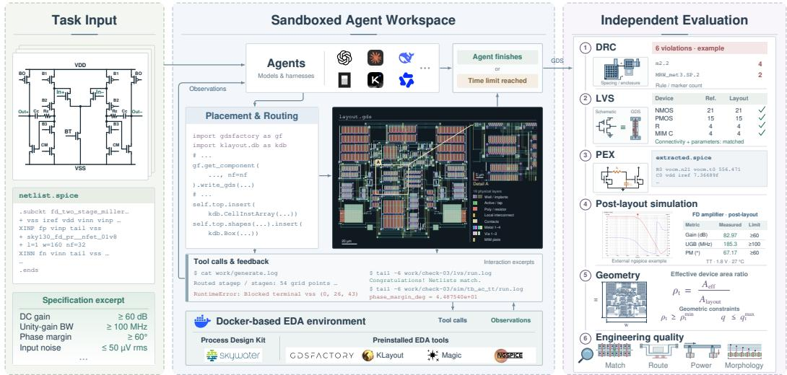
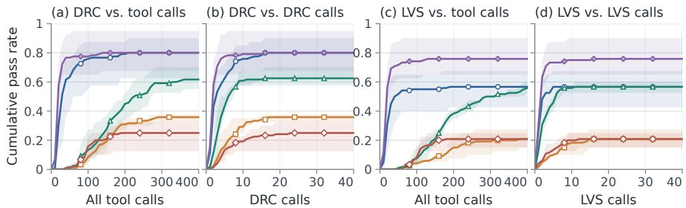
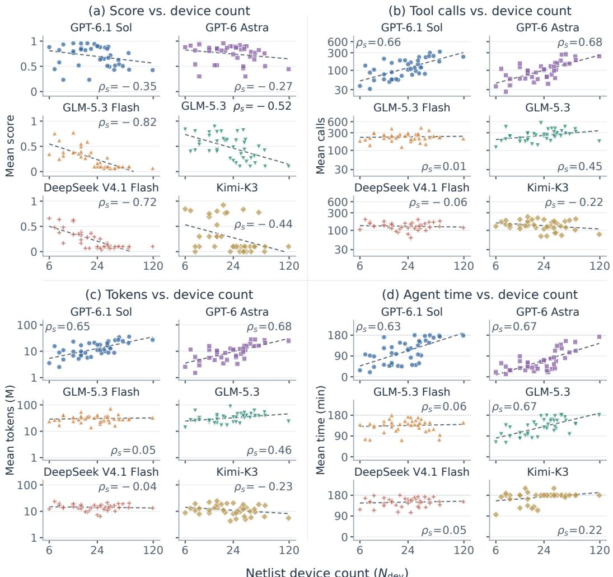
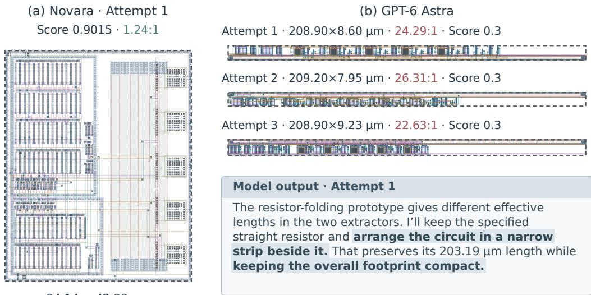
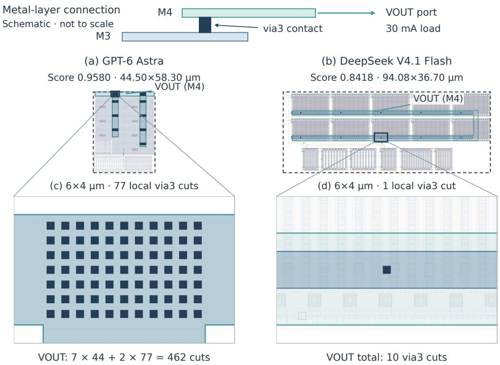
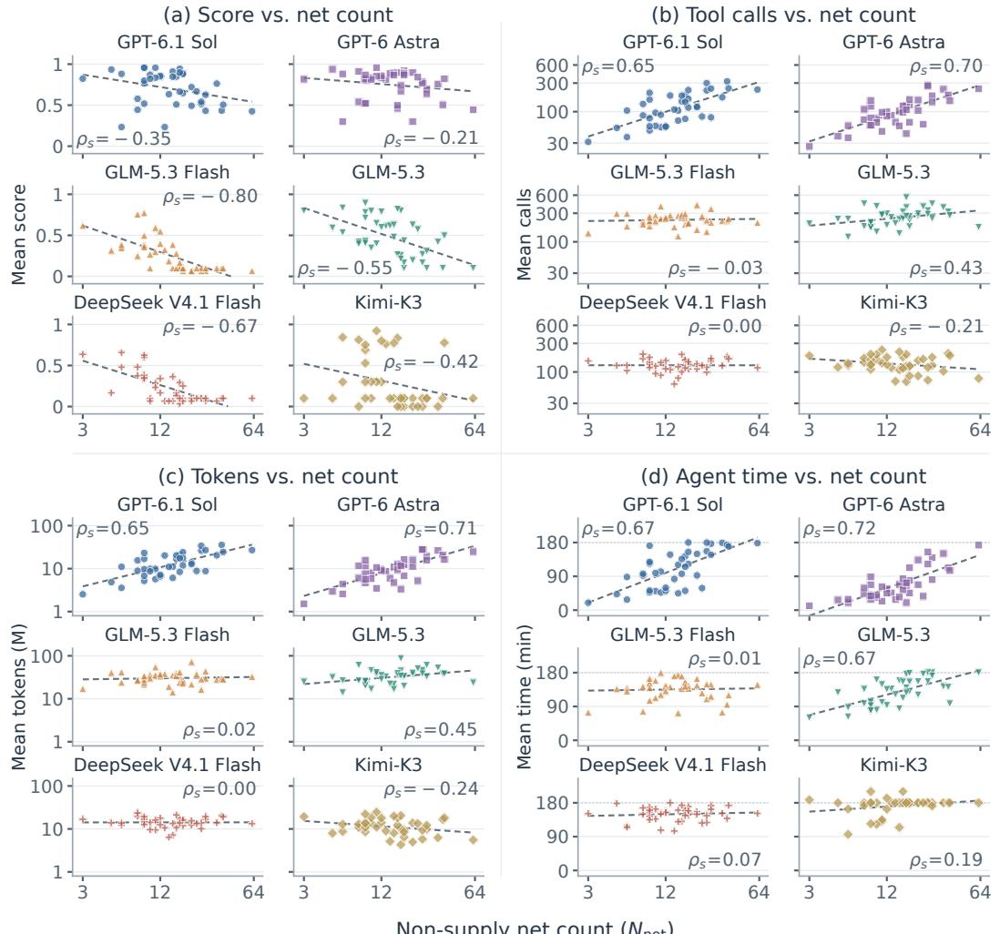
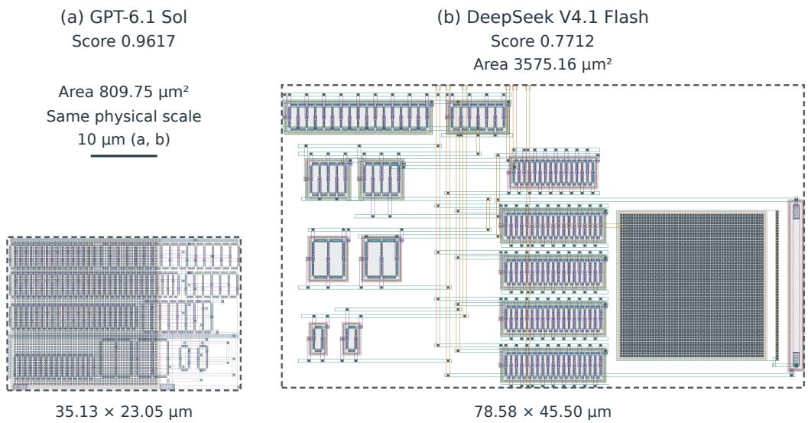
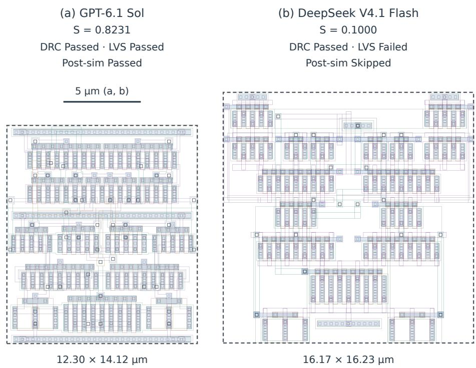

# AnalogLayoutWorld: An Open Benchmark for Agentic Analog Layout Design

Nova-Silicon Team

xinxingyuan-sh@nova-silicon.com

## Abstract

Coding agents have demonstrated strong capabilities in software development, yet their ability to tackle long-horizon engineering tasks governed by physical constraints remains less understood. We study this question through analog circuit layout, which demands domain knowledge, geometric reasoning, and iterative interaction with design and verification tools. We introduce AnalogLayoutWorld, an open-source agent benchmark with 40 expert-reviewed tasks for end-to-end layout generation from fixed transistor-level netlists. It combines an integrated design environment with independent physical and post-layout electrical verification, as well as objective layout quality metrics co-designed with analog layout experts. Across 13 model–harness configurations, 91.1% of attempts produce GDS layouts, but only 21.3% satisfy the benchmark’s acceptance criteria. We also evaluate Novara, an internally developed agent system, which achieves the highest reported aggregate score. Our analysis links performance differences to test-time scaling under fixed budgets, suggesting that reasoning efficiency and effective use of verification feedback help sustain design quality as task complexity grows.1

  
Figure 1: Agentic analog layout design process. (a) A fixed netlist, specifications, and process design kit define the task. (b) The agent constructs and refines layouts using layout tools and verification feedback. (c) Integration, fabrication, and silicon characterization provide physical validation.

## 1 Introduction

General coding agents increasingly tackle software and terminal tasks [Jimenez et al., 2024, Merrill et al., 2026]. Recent foundation models advance coding, tool use, and scientific reasoning [OpenAI, 2026b, Anthropic, 2026, DeepSeek-AI, 2026b, Intern-S1 Team, 2025], motivating evaluation of agent reliability in long-horizon engineering under physical constraints.

Analog layout requires domain knowledge and geometric reasoning to turn fixed netlists into device placements and interconnects through iterative verification (Figure 1). Even layouts that pass physical checks and post-layout simulation require separate assessment of compactness, latch-up susceptibility, and electromigration reliability [Johnson et al., 2015, Jerke and Kahng, 2014].

Recently, many LLM-based methods try to address analog circuit design [Hammoud et al., 2024, Li et al., 2026a, Zhang et al., 2026, Liu et al., 2025]. However, limited task coverage and proprietary dependencies in some systems motivate broader, objective evaluation of general-purpose agents.

We introduce AnalogLayoutWorld, an open benchmark of 40 expert-reviewed fixed-netlist layout tasks for agentic analog layout design. Our environment provides preinstalled open-source EDA software and concise documentation, without benchmark-specific typed tools or customized MCP interfaces. Agents can freely determine their own design and verification workflows using the native execution tools provided by their harnesses. Independent grading assesses physical and post-layout electrical correctness, compactness, and engineering quality using objective metrics co-designed with engineers.

Across 13 model–harness configurations, 91.1% of attempts produce GDS, but only 21.3% meet all acceptance criteria. Our in-house developed agent system Novara ranks highest overall (Figure 2). Correlation analysis reveals opposing patterns: circuit scale correlates strongly with GPT-series resource use but less strongly with scores, whereas most analyzed open-source agents show the reverse. Our findings suggest that most agents can still benefit from test-time scaling. Under fixed budgets, however, realized gains depend on reasoning efficiency and the ability to effectively convert environmental feedback into verified improvements.

Finally, we summarize our key contributions as follows:

• We introduce AnalogLayoutWorld, an open-source benchmark for agentic analog layout design with 40 expert-reviewed tasks, which combines an end-to-end open-source EDA software stack with independent physical, electrical, and layout-quality evaluation.

• We empirically characterize how iterative verification and test-time scaling relate to agent performance, highlighting the importance of reasoning efficiency and the ability to effectively convert environmental feedback into verified improvements within the available budget.

  
Figure 2: Performance comparison of some agent systems across multiple verification metrics. DRC, LVS, and Post-simulation report pass rates. Score is the mean total over all 40 tasks.

## 2 Related Work

## 2.1 Automated Analog Layout Design

Analog layout automation seeks to translate circuit netlists and design constraints into layouts that meet physical and electrical requirements. MAGICAL [Xu et al., 2019] and ALIGN [Dhar et al., 2021] automate device generation and constraint-driven placement and routing. LLM-based approaches extend this automation to language-to-layout generation with GLayout [Hammoud et al., 2024] and interactive refinement with LayoutCopilot [Liu et al., 2025]. ICPI [Liu et al., 2026] incorporates simulation feedback into refinement, while LAMP [Xu et al., 2026] targets adaptive placement. Beyond individual layouts, Chu et al. [2026] study reusable generator development, and PANDA [Zhang et al., 2026] and OPERA [Saxena and Mandal, 2026] integrate layout into broader design flows. ViraStack [Cadence Design Systems, 2026] brings agent orchestration into commercial EDA, while Yoshioka [2026] examines agent-driven design through post-layout verification. Despite this progress, evaluations remain concentrated on selected circuit families and specialized workflows, with proprietary dependencies in some systems, leaving the broader reliability and reproducibility of autonomous layout design insufficiently established.

## 2.2 Agent and IC Design Benchmarks

Recent agentic benchmarks [Liu et al., 2024, Jimenez et al., 2024, Zhou et al., 2024, Xie et al., 2024, Merrill et al., 2026, Marten, 2026] assess coding, tool use, and long-horizon task completion across diverse domains and environments. Within IC design, digital benchmarks range from functionally verified RTL generation [Liu et al., 2023] to workload-to-GDS design [Gunukula et al., 2026]. Analog circuit datasets and benchmarks address transistor-level design: Analog Design Bench [Analog Design Bench Team, 2026] evaluates netlist design and simulation-based specification closure, while LOADBench [Leibl et al., 2026] provides circuit data and evaluation tasks for topology and device sizing. TapeoutBench [Simra AI, 2026] reports mixed chip-design activities, including layout repair and routing. Our work evaluates LLM agents on end-to-end analog layout generation through an open EDA environment and independent verification, assessing their capabilities in long-horizon, domain-specific problem solving and iterative optimization using environmental feedback.

## 3 AnalogLayoutWorld

## 3.1 Task Collection

We construct AnalogLayoutWorld, a suite of 40 analog layout tasks, drawing on circuits from Analog Design Bench Team [2026] and Leibl et al. [2026], our own designs, and other open-source projects. The tasks cover amplifiers, references, power-management circuits, sampling circuits, and oscillators. Each task combines a fixed transistor-level SKY130 netlist with electrical specifications and an executable validation procedure.

Analog circuit experts contribute to task selection and to the design and review of netlists, specifications, and validation procedures. All circuits pass pre-layout simulation, establishing a verified electrical baseline for subsequent layout generation.

## 3.2 Task Format and Agent Environment

We provide a flexible EDA environment with preinstalled open-source software and concise interface documentation. Agents write their own scripts and choose how to construct, verify, and revise their layouts using tool feedback. Each task provides a fixed transistor-level SPICE netlist, electrical specifications, implementation constraints, and public simulation testbenches. Task instructions and documentation are available in both English and Chinese.

Built on Harbor [Harbor Contributors, n.d.], our benchmark uses a custom Docker [Docker, Inc., n.d.] image with the SKY130 PDK [SkyWater PDK Authors, n.d.a]. The toolchain includes gdsfac tory [gdsfactory community, n.d.] for layout generation, KLayout [KLayout Project, n.d.] for layout editing and physical verification including DRC and LVS, Magic [Magic Development Team, n.d.] for parasitic extraction (PEX), and ngspice [ngspice Developers, n.d.] for circuit simulation. Specifically, design rule checking (DRC) checks geometric constraints such as minimum wire widths and spacings, while layout-versus-schematic (LVS) checking verifies that devices and connections extracted from the layout match the reference netlist.

  
Figure 3: Overview of AnalogLayoutWorld. Agents receive fixed circuit inputs and interact with a preconfigured EDA workspace through the native tools from harnesses. After termination or timeout, the submitted GDS undergoes independent physical, electrical, and layout-quality assessment. The waveform is cropped from KiCad [KiCad Documentation Contributors, n.d.].

Each attempt has a three-hour wall-clock budget for layout generation, debugging, and self-checks. Agents must save the current layout to submission/layout.gds, with the prescribed top cell and ports, and retain generation code under submission/src/. Official grading begins after agent termination or timeout, outside this execution budget.

Note that we provide no shared benchmark-specific typed tools or Model Context Protocol (MCP) interfaces. Agents access the preinstalled software and usage documentation through the native execution tools provided by their harnesses, deciding which checks to run and how to revise their designs. The evaluation containers run in a network-isolated environment. Together, these settings support open-ended exploration in an isolated sandbox, subject to the task constraints.

## 3.3 Evaluation

After termination, we independently evaluate the submitted GDS in a fresh directory within the same task container. Trusted references, testbenches, and grading code are introduced separately; agentreported results do not determine the score. Evaluation comprises DRC, LVS, PEX and post-layout simulation, together with geometric and engineering-quality measurements.

Geometry and eligibility. Compact layouts reduce silicon cost and can shorten interconnects, limiting parasitic resistance and capacitance. We measure compactness with the effective devicearea ratio

$$
\rho _ { t } = \frac { A _ { \mathrm { e f f } } } { A _ { \mathrm { l a y o u t } } } , \qquad A _ { \mathrm { l a y o u t } } = W H , \qquad q = \frac { \operatorname* { m a x } ( W , H ) } { \operatorname* { m i n } ( W , H ) } .\tag{1}
$$

Here W, H bound the layout’s manufacturing geometry, and $A _ { \mathrm { e f f } }$ sums the areas of LVS-recognized device regions corresponding to the reference circuit. The geometric indicator $I _ { \mathrm { G E O } }$ requires valid measurements, $q \ \leq \ q _ { t } ^ { \mathrm { m a x } }$ , and $\rho _ { t } ~ \geq ~ \rho _ { t } ^ { \mathrm { m i n } }$ ; the aspect bound discourages elongated blocks that are difficult to integrate with neighboring circuits. The morphology indicator $I _ { \mathrm { M } }$ denotes passing a screen for degenerate bus-and-row layouts. Let $I _ { \mathrm { G } } = 1 $ if the agent submits a GDS file at the required path and $I _ { \mathrm { L } } = 1$ if LVS passes; each is zero otherwise. Eligibility is then

$$
E _ { t } = I _ { \mathrm { G } } I _ { \mathrm { L } } I _ { \mathrm { G E O } } I _ { \mathrm { M } } .\tag{2}
$$

Required geometry and morphology evidence must be available for $E _ { t } = 1$

Scoring. Let $\boldsymbol { I _ { \mathrm { D } } }$ indicate passing DRC. For layout L on task t, the score is

$$
S _ { t } ( \mathcal { L } ) = \underbrace { \omega _ { \mathrm { G } } I _ { \mathrm { G } } + I _ { \mathrm { L } } \left( \omega _ { \mathrm { L } } + \omega _ { \mathrm { D } } I _ { \mathrm { D } } \right) } _ { \mathrm { s u b m i s s i o n ~ a n d p h y s i c a l ~ v e i f i c a t i o n } } + E _ { t } \underbrace { \Bigg [ \omega _ { \mathrm { A } } \operatorname* { m i n } \{ 1 , \frac { \rho _ { t } } { \rho _ { t } ^ { * } } \} ^ { \gamma } + \underbrace { \omega _ { \mathrm { Q } } Q _ { t } } _ { \mathrm { C o m p a c t i n g ~ q u a l i t y } } + \underbrace { \omega _ { \mathrm { S } } F _ { t } } _ { \mathrm { E l e c t i c a l ~ v e r i f i c a t i o n } } \Bigg ] } _ { \mathrm { C o m p a c t u n e s s } } .\tag{3}
$$

Here $\rho _ { t } ^ { \star }$ sets the full-credit area-ratio target and $\gamma > 0$ controls compactness sensitivity. $Q _ { t } \in [ 0 , 1 ]$ aggregates device matching, critical-net routing, and power-delivery quality, including a coupling penalty. $F _ { t } \in [ 0 , 1 ]$ is the verified passing fraction of a fixed electrical verification manifest, and is zero without successful PEX. DRC credit requires passing LVS; the three terms gated by $E _ { t }$ do not additionally require DRC or all-case simulation success. Complete acceptance additionally requires passing DRC and all electrical cases, with complete evidence; partial scores preserve verified progress. Nonnegative weights with $\textstyle \sum _ { k } \omega _ { k } = 1$ ensure $S _ { t } \in [ 0 , 1 ]$ ; task scores are averaged equally. For detailed metric definitions and engineer-specified parameter values, see Appendix C.

## 4 Main Results

## 4.1 Experimental Setup

We evaluate 13 model–harness configurations, with reasoning settings listed in Table 1. The GPT models [OpenAI, 2026a,b] use Codex [OpenAI, n.d.]; GLM models [GLM-5-Team, 2026] use OpenCode [Anomaly, n.d.], with GLM-5.3 and its Flash variant also evaluated in our Intern-Bootcamp harness [Li et al., 2026b,c]. DeepSeek models [DeepSeek-AI, $2 0 2 6 \mathsf { b } , \mathsf { c } ]$ use Claude Code [Anthropic, n.d.], and DeepSeek V4.1 Flash is additionally evaluated with DeepSeek Harness (DSH) [DeepSeek-AI, 2026a]. Kimi models [Moonshot AI, 2026, Kimi Team, 2026] use Kimi Code CLI [Moonshot AI, n.d.], and Qwen3.8 Flash Next [Qwen Team, 2026] uses Qwen Code [Qwen Team, n.d.]. Except for the GPT models accessed through an API, all models are deployed on our own cluster using SGLang [Zheng et al., 2024]. Using the environment, three-hour agent budget, and independent evaluation protocol described in Section 3, we run three independent trials per task. For the figures and case studies, we use OpenCode for GLM models and DSH for DeepSeek V4.1 Flash; Table 1 includes all evaluated configurations.

Novara Agent System. We also evaluate Novara, an in-house automated agent system specifically designed for analog circuit layout and developed by our Nova-Silicon team [Li, 2026]. It supports multiple process technologies, is deployed entirely on our own cluster, and uses no external APIs.

## 4.2 Overall Results

Table 1 shows substantial variation in layout-generation performance across the evaluated systems. Novara achieves the highest aggregate score (0.8154), followed by GPT-6 Astra (0.7483). The GPT configurations attain substantially higher physical and electrical verification rates than the other general-purpose agents, while several configurations struggle to produce circuit-equivalent layouts. For GPT agents, violations of geometric and morphological constraints, including aspect-ratio limits, account for most of the gap between simulation pass rates and complete acceptance. Producing a layout artifact alone therefore does not establish successful completion of the task.

Results in Table 1 also indicate that the relative strengths of agent systems depend on which aspect of layout quality is examined. GPT-6 Astra leads in DRC and all-case post-layout simulation, whereas Novara leads in LVS and credited engineering quality. Figure 2 makes this distinction visible: the aggregate ranking reflects both verified circuit behavior and engineering quality, whose relative strengths differ across agent systems. The ordering of general-purpose agents is broadly consistent with expectations based on their general coding capabilities.

Table 1: Main results on AnalogLayoutWorld. Results are averaged over three independent repetitions per task. DRC, LVS, and SIM are pass rates over all task attempts; SIM requires all prescribed post-layout cases to pass. Acc. reports the fraction of task attempts meeting all benchmark acceptance criteria. Area is the effective device-area ratio. Toks counts cumulative recorded input and output tokens. Tool calls count tool invocations. Brackets show reasoning settings or deployment. Bold marks column maxima for outcomes and minima for resource use.
<table><tr><td>Model / System</td><td>Harness</td><td>DRC (%)</td><td>LVS (%)</td><td>SIM (%)</td><td>Acc. (%)</td><td>Area (%)</td><td>Quality EtQt</td><td>Tool Calls ↓</td><td>Toks (M)↓</td><td>Avg. Score</td></tr><tr><td>Novara Agent System [locally deployed]</td><td></td><td>97.5</td><td>100.0</td><td>75.0</td><td>72.5</td><td>52.2</td><td>0.816</td><td></td><td></td><td>0.8154</td></tr><tr><td>DeepSeek V4 Pro [max]</td><td>Claude Code</td><td>23.3</td><td>23.3</td><td>12.5</td><td>3.3</td><td>11.3</td><td>0.049</td><td>226.9</td><td>23.8</td><td>0.1504</td></tr><tr><td>DeepSeek V4.1 Flash [max]</td><td>Claude Code</td><td>41.7</td><td>29.2</td><td>17.5</td><td>8.3</td><td>35.0</td><td>0.086</td><td>134.0</td><td>13.2</td><td>0.1974</td></tr><tr><td>DeepSeek V4.1 Flash [max]</td><td>DSH</td><td>37.5</td><td>30.0</td><td>17.5</td><td>9.2</td><td>44.5</td><td>0.118</td><td>133.1</td><td>14.7</td><td>0.2246</td></tr><tr><td>GLM-5.2 FP8 [max]</td><td>OpenCode</td><td>10.0</td><td>10.0</td><td>5.0</td><td>0.0</td><td>21.3</td><td>0.000</td><td>242.3</td><td>18.3</td><td>0.1075</td></tr><tr><td>GLM-5.3 [max]</td><td>OpenCode</td><td>80.0</td><td>69.2</td><td>42.5</td><td>35.0</td><td>35.6</td><td>0.358</td><td>264.8</td><td>34.5</td><td>0.4779</td></tr><tr><td>GLM-5.3 [max]</td><td>InternBootcamp</td><td>55.0</td><td>65.0</td><td>45.0</td><td>27.5</td><td>49.8</td><td>0.350</td><td>253.3</td><td>30.3</td><td>0.4632</td></tr><tr><td>GLM-5.3 Flash [max]</td><td>OpenCode</td><td>44.2</td><td>33.3</td><td>22.5</td><td>14.2</td><td>27.8</td><td>0.146</td><td>239.1</td><td>31.7</td><td>0.2555</td></tr><tr><td>GLM-5.3 Flash [max]</td><td>InternBootcamp</td><td>40.0</td><td>30.0</td><td>22.5</td><td>12.5</td><td>26.3</td><td>0.117</td><td>310.8</td><td>38.0</td><td>0.2378</td></tr><tr><td>Kimi-K2.6 [max]</td><td>Kimi Code</td><td>0.8</td><td>0.0</td><td>0.0</td><td>0.0</td><td></td><td>0.000</td><td>235.0</td><td>23.0</td><td>0.0958</td></tr><tr><td>Kimi-K3 [max]</td><td>Kimi Code</td><td>50.0</td><td>40.0</td><td>30.0</td><td>20.0</td><td>37.5</td><td>0.167</td><td>142.0</td><td>12.2</td><td>0.2900</td></tr><tr><td>Qwen3.8 Flash Next [xhigh]</td><td>Qwen Code</td><td>40.0</td><td>41.7</td><td>25.0</td><td>14.2</td><td>32.9</td><td>0.140</td><td>217.4</td><td>21.6</td><td>0.2633</td></tr><tr><td>GPT-6 Astra [max]</td><td>Codex</td><td>99.2</td><td>98.3</td><td>82.5</td><td>70.8</td><td>59.5</td><td>0.566</td><td>111.8</td><td>11.2</td><td>0.7483</td></tr><tr><td>GPT-6.1 Sol [max]</td><td>Codex</td><td>92.5</td><td>91.7</td><td>80.0</td><td>62.5</td><td>60.5</td><td>0.498</td><td>131.6</td><td>14.5</td><td>0.7023</td></tr></table>

## 5 Analysis

Beyond aggregate scores, we analyze verification progress, task-scale sensitivity, and test-time re source use. By relating circuit scale to both final quality and resource expenditure, we seek a quantitative explanation for the performance gap between the evaluated open-weight configurations and GPT-based agents from the perspective of test-time scaling. The central question is whether systems can sustain productive iteration as task demands grow under a fixed time budget.

## 5.1 Progress through Verification Feedback

We first examine recovered DRC and LVS self-checks to track how verification progress accumulates during agent interaction, as demonstrated in Figure 4.

Agents make progress through repeated verification. Agents often require repeated verification attempts to reach a passing self-check. Among trajectories with a recovered passing self-check, 90.3% of DRC first passes and 66.8% of LVS first passes occur after the first verification call. The gains beyond the initial check show that continued interaction can produce additional verified progress. Repeated verification is therefore a substantive part of trajectories with recovered passing self-checks, supporting productive design–verification loops of iterative optimization.

Verification progress remains uneven. The amount of verified progress achieved differs substantially across configurations. Figure 4 indexes progress by both total tool calls and verification calls, distinguishing overall interaction effort from repeated checking. At common budgets, the systems reach different fractions of tasks with passing checks, and many trajectories still lack a recovered pass within the displayed range. Thus, the opportunity to iterate does not yield the same progress for every system, motivating a closer examination of task demands and resource use, which we discuss in the following sections.

  
Figure 4: Verification progress during agent interaction. Curves show the fraction of tasks with a recovered passing self-check by a given budget, averaged over three independent runs; shading shows the range across runs. The left pair shows DRC and the right pair LVS, indexed by all tool calls and the respective verification calls. All panels share a vertical scale from 0 to 1.

## 5.2 Task Scale and Difficulty

We next examine how the scale of the input circuit relates to final layout quality. Figure 5(a) compares source-netlist device count with independently evaluated final scores.

Task scale reflects empirical difficulty. Device count provides an agent-independent measure of circuit scale: additional devices expand the placement and connectivity requirements that an agent must coordinate. Averaging final scores across the six plotted configurations yields a negative tasklevel correlation with device count $( \rho _ { s } = - 0 . 7 3 )$ , indicating that larger circuits tend to be more difficult for the evaluated systems. See Appendix D for the complementary net-count analysis, which shows similar trends. Together, these results support circuit scale as a useful descriptor of empirical task difficulty in AnalogLayoutWorld.

Scale sensitivity differs across systems. Increasing circuit scale affects some systems much more strongly than others. GLM-5.3 Flash, GLM-5.3, DeepSeek V4.1 Flash, and Kimi-K3 exhibit stronger negative correlations $( \rho _ { s } = - 0 . 8 2 \mathrm { t o } - 0 . 4 4 )$ ), whereas GPT-6.1 Sol and GPT-6 Astra show weaker associations (−0.35 and −0.27). Because all configurations face the same task collection and scoring criteria, this contrast raises an important question: why do the GPT configurations preserve quality better as circuit scale increases? We examine their use of tools, tokens, and time next to understand how they respond to these growing demands.

## 5.3 Test-Time Scaling under Budget Constraints

To understand these differences in scale sensitivity, we relate circuit scale to both final scores and resource use (Figure 5). The results indicate that GPT-series agents show stronger positive resource correlations but weaker negative score correlations, whereas most open-weight configurations exhibit the reverse. We examine whether differences in test-time scaling help explain this contrast.

GPT-series agents scale interaction with task demands. GPT-6.1 Sol and GPT-6 Astra devote more interaction to larger circuits. Device count correlates positively with their tool calls $( \rho _ { s } = 0 . 6 6$ and 0.68) and elapsed time (0.63 and 0.67), alongside similarly positive token trends. Their recorded workloads therefore expand with circuit scale, while final scores show comparatively smaller de clines. Finishing smaller tasks with time to spare leaves room for longer design–verification loops as task demands grow. Combined with the verification progress in Section 5.1, this pattern is consistent with productive test-time scaling through continued environment interaction: larger tasks receive more effort, with smaller score declines than observed for the open-weight agents.

Budget saturation limits room for further iteration. High expenditure on smaller circuits leaves less room to extend the verification process as task demands grow. GLM-5.3 Flash, DeepSeek V4.1

  
Figure 5: Task scale, design quality, and resource use. Each point is a task-level mean for one configuration. Groups show (a) score, (b) tool calls, (c) reported input-plus-output tokens in millions, and (d) agent time in minutes. Device count, calls, and tokens use logarithmic axes; in-panel $\rho _ { s }$ denotes Spearman rank correlation. Dashed lines show least-squares trends in the displayed coordinates, restricted to [0, 1] for scores.

Flash, and Kimi-K3 already incur substantial time costs on smaller circuits and exhibit weaker time– size associations. GLM-5.3 Flash reaches the agent time limit in 51 of 120 attempts, compared with none for GPT-6 Astra. GLM-5.3 is an intermediate case, with a strong time–size correlation $( \rho _ { s } = 0 . 6 7 )$ but more modest growth in calls and tokens. These patterns suggest that limited budget headroom can constrain additional verification and repair. As task demands increase, several openweight configurations show weaker growth in interaction and stronger score degradation, consistent with a budget-limited response to increasing difficulty.

Efficiency and realized test-time scaling. The contrasting correlations suggest that the performance gap partly reflects differences in realized test-time scaling. The GPT agents combine stronger growth in effort with weaker score degradation as circuit scale increases; most open-weight configurations already incur high costs on smaller tasks, limiting room to extend iteration on harder ones. GPT-6 Astra also achieves a mean score of 0.7483 with 11.2M reported tokens per task, compared with 0.4779 and 34.5M for GLM-5.3 (Table 1), consistent with more effective use of test-time resources. Together with the observed verification progress, these findings suggest that most of the agents examined here can still benefit from test-time scaling. However, under practical budget constraints, its realized benefits depend on reasoning efficiency and the ability to effectively convert environmental feedback into verified improvements within the available budget.

## 6 Case Studies

In this section, we present representative cases to examine agent behavior and illustrate how verification and engineering-quality assessment shape the final scores.

## 6.1 Residual Failures in Strong Agents

The current-starved ring VCO (Task 9) illustrates a physical-design limitation that persists despite successful verification (Figure 6). All three GPT-6 Astra attempts pass DRC, LVS, and both prescribed post-layout tests. Nevertheless, their aspect ratios range from 22.63 to 26.31, exceeding the evaluation bound of 4. Each receives 0.1 for submission, LVS, and DRC, totaling 0.3; geometric ineligibility withholds the area, engineering-quality, and electrical credits despite the passing simulations. In comparison, all Novara runs pass the same checks; its first attempt achieves an aspect ratio of 1.24 and a score of 0.9015, demonstrating that electrical acceptance and a compact block shape can be achieved together.

The recorded trajectories, including the model output in Figure 6, explain how this repeated outcome arose. Each GPT-6 Astra attempt explores a folded resistor whose extracted length fails LVS parameter matching, then adopts a straight resistor of 203.19 µm. This device dominates the block width even after local placement improvements. In the second attempt, the agent also constructs and verifies a clustered transistor placement before restoring the earlier strip implementation. Thus, the failure is not an absence of verification or geometric exploration: the agent makes local repairs but does not find an implementation that jointly achieves electrical closure and a suitable global shape. The three independent attempts expose a remaining limitation even in a strong closed-source model.

34.14 × 42.33 µm  
  
Figure 6: Current-starved ring VCO submissions. Novara’s first attempt is compared with three independent GPT-6 Astra attempts. All four pass DRC, LVS, and both prescribed post-layout tests, but the Astra layouts exceed the aspect-ratio bound. Dashed outlines mark the bounding rectangles. The box quotes Astra’s first attempt, highlighting its strip choice and compactness assessment.

## 6.2 Engineering Quality beyond Electrical Acceptance

The 30 mA PMOS-pass LDO (Task 17) shows why functional acceptance alone does not establish interconnect adequacy (Figure 7). The GPT-6 Astra and DeepSeek V4.1 Flash submissions both pass DRC, LVS, and all prescribed post-layout simulations. Both expose VOUT on metal4, but their output networks contain 462 and ten via3 cuts, respectively, connecting metal3 to metal4. The

DeepSeek layout has no metal5 bypass; when the specified load is carried through its declared output access, these ten cuts must collectively carry 30 mA. The public SkyWater technology LEF [SkyWater PDK Authors, n.d.b] specifies a DC-average current budget of 0.48 mA per via3 cut at a junction temperature of 90◦C. Ten cuts therefore provide only 4.8 mA of aggregate capacity at this reference condition; at least 63 are necessary.

Table 2 separates the resulting score contributions. Both layouts earn the full 0.7 submission, physical, and electrical credits; their differences arise from compactness and engineering quality. Within the latter, the normalized power-delivery subscore is 0.748 for GPT-6 Astra and 0.199 for DeepSeek V4.1 Flash, with matching and routing also contributing to the overall quality difference. The viacapacity check supplies a physical basis for a quality distinction that the prescribed functional tests do not expose. It is a necessary current-budget screen at the stated reference condition, rather than complete electromigration or lifetime sign-off. Additional compactness and circuit correctness examples are demonstrated in Appendix E.

Table 2: LDO score decomposition. Entries are weighted contributions to the total score. Both submissions pass DRC, LVS, and all prescribed electrical tests.
<table><tr><td>Submission</td><td>GDS</td><td>LVS</td><td>DRC</td><td>Area</td><td>Quality</td><td>SIM</td><td>Total</td></tr><tr><td>GPT-6 Astra</td><td>0.1000</td><td>0.1000</td><td>0.1000</td><td>0.1651</td><td>0.0929</td><td>0.4000</td><td>0.9580</td></tr><tr><td>DeepSeek V4.1 Flash</td><td>0.1000</td><td>0.1000</td><td>0.1000</td><td>0.0956</td><td>0.0462</td><td>0.4000</td><td>0.8418</td></tr></table>

  
DeepSeek via3 budget at 90°C: 10 × 0.48 mA = 4.8 mA < 30 mA

Figure 7: Power-delivery geometry in the LDO. The top schematic explains the M3–via3–M4 output connection. Colored overlays show the extracted VOUT geometry in the submitted GDS. Equal 6 × 4 µm detail windows contain 77 and 1 local via3 cuts; the respective whole-net totals are 462 and 10. Complete layouts are fitted separately with their aspect ratios preserved.

## 7 Conclusion

We presented AnalogLayoutWorld, an open-source benchmark for agentic analog layout design with 40 expert-reviewed tasks, an end-to-end open-source EDA software stack, and independent physical, electrical, and layout-quality evaluation. Agents freely determine their design and verification workflows, while assessment is grounded in submitted layouts. Our experiments reveal a substantial gap between artifact generation and verified completion. Analyses of verification progress, task scale, and resource use suggest that most agents can benefit from test-time scaling, but gains under finite budgets depend on reasoning efficiency and effective use of environmental feedback. We discuss the scope and limitations of our work in Appendix B. Future work will broaden circuit and process coverage and refine layout-quality assessment through expert review and community feedback.

## Acknowledgments

We sincerely thank the authors of Analog Design Bench [Analog Design Bench Team, 2026] and LOADBench [Leibl et al., 2026] for openly releasing the circuit data used to construct part of our task suite. We also thank the developers of Harbor [Harbor Contributors, n.d.] and SGLang [Zheng et al., 2024] for the evaluation and model-serving infrastructure, and the communities behind KLayout [KLayout Project, n.d.], gdsfactory [gdsfactory community, n.d.], Magic [Magic Development Team, n.d.], Netgen [Netgen Developers, n.d.], ngspice [ngspice Developers, n.d.], SKY130 [Sky-Water PDK Authors, n.d.a], and open\_pdks [open\_pdks Contributors, n.d.] for enabling a fully open-source design and verification toolchain. We gratefully acknowledge researchers from Shang hai Artificial Intelligence Laboratory and Fudan University for their helpful advice.

## References

Analog Design Bench Team. Long-horizon analog design bench: Benchmarking agents on hourslong analog and mixed-signal circuit design tasks. arXiv:2609.33356v1, 2026. https://arxiv. org/abs/2609.33356v1.

Anomaly. OpenCode. https://github.com/anomalyco/opencode, n.d. Accessed November 12, 2026.

Anthropic. Claude Opus 5.5 System Card. System card, 2026. September. https://www. anthropic.com/claude-opus-5-5-system-card.

Anthropic. Claude Code. https://github.com/anthropics/claude-code, n.d. Accessed November 12, 2026.

Cadence Design Systems. ViraStack AI Super Agent for custom and analog IC design. Product documentation, 2026. Official product page, accessed November 3, 2026.

Minxing Chu, Anhang Li, Martins Atilla, Ruichen Qi, and Mehdi Saligane. The code behind the layout: AI agents for analog layout generators. arXiv preprint arXiv:2610.38426, 2026. https: //arxiv.org/abs/2610.38426.

DeepSeek-AI. DeepSeek Harness: Everything is a Plugin. https://github.com/deepseek-ai/ deepseek-harness, 2026a.

DeepSeek-AI. DeepSeek-V4: Towards Highly Efficient Million-Token Context Intelligence. arXiv:2606.19348, 2026b. https://arxiv.org/abs/2606.19348.

DeepSeek-AI. DeepSeek-V4.1-Flash: Pushing the Limits of KV Cache Compression. Technical report, 2026c. https://huggingface.co/deepseek-ai/DeepSeek-V4.1-Flash/blob/ main/DeepSeek\_V41\_Tech\_Report.pdf.

Tonmoy Dhar, Kishor Kunal, Yaguang Li, Meghna Madhusudan, Jitesh Poojary, Arvind K. Sharma, Wenbin Xu, Steven M. Burns, Ramesh Harjani, Jiang Hu, Desmond A. Kirkpatrick, Parijat Mukherjee, Soner Yaldiz, and Sachin S. Sapatnekar. ALIGN: A system for automating analog layout. IEEE Design & Test, 38(2):8–18, 2021. doi: 10.1109/MDAT.2020.3042177. Preprint: https://arxiv.org/abs/2008.10682.

Docker, Inc. Docker Documentation: What Is Docker? Official documentation, n.d. Accessed November 3, 2026.

gdsfactory community. gdsfactory Documentation. Official documentation, n.d. Accessed November 3, 2026.

GLM-5-Team. GLM-5: from vibe coding to agentic engineering, 2026. URL https://arxiv. org/abs/2602.15763.

Surya Gunukula, Jerry Yicheng Wang, and Kevin Zhang. Introducing Build-A-Chip-Bench: From workload specification to GDS. ChipAgents Research Blog, 2026. https://chipagents.ai/ research/build-a-chip-bench, accessed November 3, 2026.

Ali Hammoud, Chetanya Goyal, Sakib Pathen, Arlene Dai, Anhang Li, Gregory Kielian, and Mehdi Saligane. Human language to analog layout using GLayout layout automation framework. In Proceedings of the 2024 ACM/IEEE International Symposium on Machine Learning for CAD, 2024. doi: 10.1145/3670474.3685971. https://openreview.net/pdf?id=4ZzkZkequO.

Harbor Contributors. Harbor Documentation. https://docs.harborframework.com/, n.d. Accessed October 20, 2026.

Intern-S1 Team. Intern-S1: A Scientific Multimodal Foundation Model, 2025. https://arxiv. org/abs/2508.15763.

Goeran Jerke and Andrew B. Kahng. Mission Profile Aware IC Design—A Case Study. In Proceedings ofthe Design, Automation & Test in Europe Conference & Exhibition, pages 1–6, 2014. doi: 10.7873/DATE.2014.077. https://vlsicad.ucsd.edu/Publications/Conferences/ 312/c312.pdf.

Carlos E. Jimenez, John Yang, Alexander Wettig, Shunyu Yao, Kexin Pei, Ofir Press, and Karthik Narasimhan. SWE-bench: Can language models resolve real-world GitHub issues? In International Conference on Learning Representations, 2024. Conference paper.

Marty Johnson, Roger Cline, Scott Ward, and Joe Schichl. Latch-Up. Technical Report SCAA124, Texas Instruments, April 2015. https://www.ti.com/lit/wp/scaa124/scaa124.pdf.

KiCad Documentation Contributors. KiCad schematic editor reference manual, version 9.0. Official documentation, n.d. URL https://docs.kicad.org/9.0/en/eeschema/eeschema. html. Simulator screenshot cropped for Figure 3. Creative Commons Attribution 3.0 or later (https://creativecommons.org/licenses/by/3.0/). Accessed November 12, 2026.

Kimi Team. Kimi K3: Open frontier intelligence, 2026. URL https://arxiv.org/abs/2607. 24653.

KLayout Project. KLayout User Manual. Official documentation, n.d. Accessed November 3, 2026.

Markus Leibl, Filipe Azevedo, Stefan Uhlich, Andrea Bonetti, Arun Venkitaraman, Chia-Yu Hsieh, Phuoc Pham, Lorenzo Servadei, Helmut Graeb, and Ricardo Martins. LOADBench: A large open analog dataset and benchmark for machine learning in IC design. In Proceedings of the 2026 ACM/IEEE International Symposium on Machine Learning for CAD, 2026. doi: 10.1145/ 3831599.3840321. https://arxiv.org/abs/2610.21591v1.

Linyang Li. Agent-Orchestration in Autonomous Chip Design. arXiv:2608.14035, 2026. https: //arxiv.org/abs/2608.14035.

Peiji Li, Linyang Li, Handa Sun, Wenjin Mai, Yongkang Chen, Xiaozhe Li, Yue Shen, Yichuan Ma, Yiliu Sun, Jiaxi Cao, Zhishu He, Bo Wang, Xiaoqing Zheng, Zhaori Bi, Xipeng Qiu, Qipeng Guo, Kai Chen, and Dahua Lin. TL-GRPO: Turn-level RL for reasoning-guided iterative optimization. arXiv:2601.16480, 2026a. https://arxiv.org/abs/2601.16480.

Peiji Li, Jiasheng Ye, Yongkang Chen, Yichuan Ma, Zijie Yu, Kedi Chen, Xiaozhe Li, Ganqu Cui, Haozhan Li, Jiacheng Chen, Chengqi Lyu, Wenwei Zhang, Linyang Li, Qipeng Guo, Dahua Lin, Bowen Zhou, and Kai Chen. InternBootcamp Technical Report: Boosting LLM Reasoning with Verifiable Task Scaling. arXiv:2508.08636v2, 2026b. https://arxiv.org/abs/2508. 08636v2.

Xiaozhe Li, Yongkang Chen, Shujian Deng, Peiji Li, Yichuan Ma, Huaxi Huang, Qiye Cai, Tianyi Lyu, Le Ma, Linyang Li, Qipeng Guo, Dahua Lin, and Kai Chen. InternAgentHarness: A Scalable Synthetic Environment for Enhancing LLM Agentic Abilities. Preprints.org, 2026c. https: //www.preprints.org/manuscript/202609.0958.

Bingyang Liu, Haoyi Zhang, Xiaohan Gao, Zichen Kong, Xiyuan Tang, Yibo Lin, Runsheng Wang, and Ru Huang. LayoutCopilot: An LLM-powered multi-agent collaborative framework for interactive analog layout design. IEEE Transactions on Computer-Aided Design ofIntegrated Circuits and Systems, 44(8):3126–3139, 2025. doi: 10.1109/TCAD.2025.3529805.

Bingyang Liu, Ziming Wei, Xiaohan Gao, and David Z. Pan. Simulation-aware in-context policy improvement for LLM-aided analog layout refinement. arXiv:2608.13767, 2026. https:// arxiv.org/abs/2608.13767.

Mingjie Liu, Nathaniel Pinckney, Brucek Khailany, and Haoxing Ren. Invited paper: VerilogEval: Evaluating large language models for Verilog code generation. In 2023 IEEE/ACM International Conference on Computer Aided Design, 2023. doi: 10.1109/ICCAD57390.2023.10323812. https://arxiv.org/abs/2309.07544.

Xiao Liu, Hao Yu, Hanchen Zhang, Yifan Xu, Xuanyu Lei, Hanyu Lai, Yu Gu, Hangliang Ding, Kaiwen Men, Kejuan Yang, Shudan Zhang, Xiang Deng, Aohan Zeng, Zhengxiao Du, Chenhui Zhang, Sheng Shen, Tianjun Zhang, Yu Su, Huan Sun, Minlie Huang, Yuxiao Dong, and Jie Tang. AgentBench: Evaluating LLMs as agents. In International Conference on Learning Representa tions, 2024. https://arxiv.org/abs/2308.03688.

Magic Development Team. Magic VLSI Layout Tool. Official documentation, n.d. Accessed November 3, 2026.

Ryan Marten. Terminal-Bench 4.0. Official benchmark release, 2026. https://www.tbench.ai/ news/terminal-bench-4-0, accessed November 3, 2026.

Mike A. Merrill, Alexander G. Shaw, Nicholas Carlini, et al. Terminal-Bench: Benchmarking agents on hard, realistic tasks in command line interfaces. arXiv preprint arXiv:2601.11868, 2026. https://arxiv.org/abs/2601.11868.

Moonshot AI. Kimi K2.6: Advancing open-source coding. Official technical blog, April 2026. URL https://www.kimi.com/en/blog/kimi-k2-6.

Moonshot AI. Kimi Code CLI. https://github.com/MoonshotAI/kimi-code, n.d. Accessed November 12, 2026.

Netgen Developers. Netgen 1.5: Netlist Comparison (LVS) and Format Manipulation. https: //opencircuitdesign.com/netgen/welcome.html, n.d. Accessed November 12, 2026.

ngspice Developers. ngspice Documentation. Official documentation, n.d. Accessed November 3, 2026.

OpenAI. Addendum to GPT-6 Astra System Card: GPT-6.1 Sol. System card addendum, 2026a. September 29. https://deploymentsafety.openai.com/gpt-6-1-sol.

OpenAI. GPT-6 Astra System Card. System card, 2026b. September 3. https:// deploymentsafety.openai.com/gpt-6-astra.

OpenAI. Codex CLI. https://github.com/openai/codex, n.d. Accessed November 12, 2026.

open\_pdks Contributors. open\_pdks: Open Process Design Kits. https://github.com/ fossi-foundation/open-pdks, n.d. Accessed November 12, 2026.

Qwen Team. On the design of Qwen3.8-Next architecture: Evaluation, efficiency, and training stability. Technical report, Alibaba Group, August 2026. URL https://arxiv.org/abs/2608. 30320.

Qwen Team. Qwen Code. https://github.com/QwenLM/qwen-code, n.d. Accessed November 12, 2026.

Vishal Saxena and Soumyajit Mandal. OPERA: OPamp design by an expert-taught reasoning agent, from specifications to layout. arXiv preprint arXiv:2610.39395, 2026. https://arxiv.org/ abs/2610.39395.

Simra AI. TapeoutBench v0.1: Coding agents on thirteen steps of a chip tapeout. Technical report, 2026. https://tapeoutbench.simratech.com/v0.1/, accessed October 20, 2026.

SkyWater PDK Authors. SkyWater SKY130 PDK Documentation. https://skywater-pdk. readthedocs.io/en/main/, n.d.a. Accessed October 20, 2026.

SkyWater PDK Authors. SKY130 High Density Standard Cell Technology LEF. Public technology file, n.d.b. Official source; DC-average current limits at a junction temperature of 90 degrees Celsius. Accessed November 12, 2026.

Tianbao Xie, Danyang Zhang, Jixuan Chen, Xiaochuan Li, Siheng Zhao, Ruisheng Cao, Jing Hua Toh, Zhoujun Cheng, Dongchan Shin, Fangyu Lei, Yitao Liu, Yiheng Xu, Shuyan Zhou, Silvio Savarese, Caiming Xiong, Victor Zhong, and Tao Yu. OSWorld: Benchmarking multimodal agents for open-ended tasks in real computer environments. In Advances in Neural Information Processing Systems, volume 37, 2024. https://arxiv.org/abs/2404.07972.

Biying Xu, Keren Zhu, Mingjie Liu, Yibo Lin, Shaolan Li, Xiyuan Tang, Nan Sun, and David Z. Pan. MAGICAL: Toward fully automated analog IC layout leveraging human and machine intelligence. In Proceedings ofthe 2019 IEEE/ACM International Conference on Computer-Aided Design, 2019. doi: 10.1109/ICCAD45719.2019.8942060. Invited paper.

Zecheng Xu, Guanhua Chen, Yumao Wu, and Keren Zhu. LAMP: LLM-driven analog placement through adaptive tool composition. arXiv preprint arXiv:2610.39882, 2026. https://arxiv. org/abs/2610.39882.

Kentaro Yoshioka. The era of vibe tapeout: Dark age or golden age for analog circuit design? arXiv:2610.15240, 2026. https://arxiv.org/abs/2610.15240.

Haoyi Zhang, Weijian Fan, Xiaohan Gao, Bingyang Liu, Runsheng Wang, and Yibo Lin. PANDA: An LLM-enhanced performance-driven analog design framework bridging design intent and layout generation. arXiv:2606.15052, 2026. https://arxiv.org/abs/2606.15052.

Lianmin Zheng, Liangsheng Yin, Zhiqiang Xie, Chuyue Sun, Jeff Huang, Cody Hao Yu, Shiyi Cao, Christos Kozyrakis, Ion Stoica, Joseph E. Gonzalez, Clark Barrett, and Ying Sheng. SGLang: Efficient execution of structured language model programs. In Advances in Neural Information Processing Systems, volume 37, 2024. https://proceedings.neurips.cc/paper\_files/ paper/2024/hash/724be4472168f31ba1c9ac630f15dec8-Abstract-Conference.html.

Shuyan Zhou, Frank F. Xu, Hao Zhu, Xuhui Zhou, Robert Lo, Abishek Sridhar, Xianyi Cheng, Tianyue Ou, Yonatan Bisk, Daniel Fried, Uri Alon, and Graham Neubig. WebArena: A realistic web environment for building autonomous agents. In International Conference on Learning Representations, 2024. https://arxiv.org/abs/2307.13854.

## A Contributions

The listing of contributors is in alphabetical order based on their last names.

## A.1 Project Lead

Linyang Li

## A.2 Core Contributors

Peiji Li\*, Jianqiu Chen\*, Wenjin Mai

## A.3 Contributors

Jie Chen, Yongkang Chen, Hongwei Fang, Zhishu He, Siqi Li, Jianze Liang, Jialin Lu, Zeyao Lu, Yue Shen, Xun Wang, Jianxi Xue

## B Limitations and Future Work

Task and process coverage. The current release covers 40 fixed-netlist tasks using the SKY130 PDK. It evaluates physical implementation with predefined devices and specifications; topology selection and transistor sizing are outside the task scope. Results characterize performance within the included circuit families and scale range. Extending the suite to additional process technologies and larger hierarchical circuits is an important direction for future work.

Verification boundary. Acceptance is defined by the design rule decks, device models, extraction settings, and electrical test cases. These checks provide reproducible rule-based evidence under the stated conditions, but do not establish foundry sign-off or guarantee silicon performance. The study includes no silicon measurements, and performance under untested conditions remains unverified.

Evaluation of layout quality. Passing DRC, LVS, and the prescribed post-layout simulations is necessary for benchmark acceptance, but is far from sufficient to characterize practical layout quality. We introduce geometric and engineering-quality metrics to narrow this gap. These metrics were designed in consultation with analog layout engineers. As an initial approximation, these metrics may have incomplete coverage or assign low scores to otherwise sound layouts. We will refine these metrics through expert review and welcome community feedback and suggestions.

## C Evaluation Details

Parameters and device area. The weights in Equation $^ { 3 , }$ ordered as GDS, LVS, DRC, area, quality, and simulation, are $( 0 . 1 0 , 0 . 1 0 , 0 . { \overset { \cdot } { 1 0 } } , 0 . 2 0 , { \overset { \cdot } { 0 . } } 1 0 , 0 . 4 0 ) ; \gamma = 2 .$ . Engineers specify $q _ { t } ^ { \operatorname* { m a x } } \in$ $\{ 3 , 4 \}$ and $\rho _ { t } ^ { \star } \in [ 0 . 6 0 , 1 . 1 0 ] ;$ ; all $\rho _ { t } ^ { \mathrm { m i n } } = 0 . 1 0 \ ( \mathrm { T a b l e \ 3 } )$ $A _ { \mathrm { e f f } }$ requires complete reference-device correspondence: MOS contributions are $W L { + } A _ { \mathrm { S } } { + } A _ { \mathrm { D } } ;$ resistors and capacitors use native extracted area parameters; BJT contributions union collector/base/emitter recognition regions within each device. Physical-device areas are summed without reapplying multiplicity or finger count. Routing, gate extensions outside diffusion, substrate, and PCell envelopes are excluded. Different devices may overlap, allowing $\rho _ { t } > 1$

Engineering quality. Task annotations and LVS correspondence support three categories: matching (placement relations, local environments, orientation, and array ends), critical routing (detours relative to a spanning-tree lower bound and differential balance), and power delivery (rail geometry, via redundancy, and, where warranted by currents, resistive-grid estimates of wire/via stress and voltage drop). These are layout proxies, not reliability sign-off. For applicable categories $j \in \mathcal { I } _ { t } ,$ raw scores $r _ { t j } \in [ 0 , 1 ]$ yield

$$
Q _ { t } = ( 1 - p _ { t } ) \frac { \sum _ { j \in \mathcal { T } _ { t } } \alpha _ { j } \operatorname* { m i n } \Bigl \{ 1 , \frac { r _ { t j } } { \tau _ { j } } \Bigr \} } { \sum _ { j \in \mathcal { T } _ { t } } \alpha _ { j } } .\tag{4}
$$

In matching/routing/power order, weights $\alpha _ { j }$ are $( 0 . 4 0 , 0 . 4 5 , 0 . 1 5 )$ and saturation targets $\tau _ { j }$ are $( 0 . 8 0 , 0 . 8 0 , 0 . 9 0 )$ . The geometric coupling penalty $p _ { t } \in [ 0 , 1 ]$ concerns annotated aggressor–victim nets. Inapplicable categories are omitted; missing applicable measurements retain their weight with value zero. Set $Q _ { t } = \bar { 0 } \mathrm { i f } \ J _ { t }$ is empty, and $p _ { t } = 1$ if required coupling evidence is unavailable.

Morphology and backend conventions. The screen rejects the joint presence of $\geq 5$ long parallel signal nets, $\geq 5$ perpendicular drops, and a device row with length/thickness $\geq$ 4 containing $\ge 7 0 \%$ of matched devices. All conditions must hold; unknown morphology withholds eligibility.

Electrical credit. Electrical credit is based on post-layout simulation with extracted parasitics. For the fixed electrical verification manifest $\begin{array} { r } { \mathcal { C } _ { t } , \hat { F _ { t } } = \dot { I _ { \mathrm { P E X } } } | \mathcal { C } _ { t } | ^ { - 1 } \sum _ { c \in \mathcal { C } _ { t } } I _ { c } } \end{array}$ , where $I _ { \mathrm { P E X } }$ denotes successful extraction; $I _ { c } = 1$ only for a completed item satisfying all required checks with finite measurements. Unfinished items remain in the denominator and verified passes survive timeouts. Missing evidence yields a lower-bound score, not a presumed pass.

Table 3: Task-specific geometry parameters for all 40 tasks; $\rho _ { t } ^ { \mathrm { m i n } } = 0 . 1 0$ for all tasks.
<table><tr><td>Task</td><td> $q _ { t } ^ { \operatorname* { m a x } }$ </td><td> $\rho _ { t } ^ { \star }$ </td><td>Task</td><td> $q _ { t } ^ { \operatorname* { m a x } }$ </td><td> $\rho _ { t } ^ { \star }$ </td><td>Task</td><td> $q _ { t } ^ { \operatorname* { m a x } }$ </td><td> $\rho _ { t } ^ { \star }$ </td><td>Task</td><td> $q _ { t } ^ { \operatorname* { m a x } }$ </td><td> $\rho _ { t } ^ { \star }$ </td><td>Task</td><td> $q _ { t } ^ { \operatorname* { m a x } }$ </td><td> $\rho _ { t } ^ { \star }$ </td></tr><tr><td>1</td><td>3</td><td>1.05</td><td>9</td><td>4</td><td>0.60</td><td>17</td><td>4</td><td>0.70</td><td>25</td><td>4</td><td>0.80</td><td>33</td><td>3</td><td>0.80</td></tr><tr><td>2</td><td>4</td><td>1.10</td><td>10</td><td>3</td><td>0.90</td><td>18</td><td>4</td><td>0.95</td><td>26</td><td></td><td>0.85</td><td>34</td><td></td><td>0.95</td></tr><tr><td>3</td><td>4</td><td>1.05</td><td>11</td><td>3</td><td>0.90</td><td>19</td><td>3</td><td>0.95</td><td>27</td><td>4</td><td>0.60</td><td>35</td><td>3</td><td>0.95</td></tr><tr><td>4</td><td>4</td><td>0.60</td><td>12</td><td>3</td><td>0.95</td><td>20</td><td>4</td><td>0.65</td><td>28</td><td>4</td><td>0.80</td><td>36</td><td>3</td><td>0.95</td></tr><tr><td>5</td><td>3</td><td>0.90</td><td>13</td><td>4</td><td>0.65</td><td>21</td><td>3</td><td>0.95</td><td>29</td><td>3</td><td>0.95</td><td>37</td><td>4</td><td>0.90</td></tr><tr><td>6</td><td>4</td><td>0.90</td><td>14</td><td>4</td><td>0.90</td><td>22</td><td>3</td><td>1.10</td><td>30</td><td>4</td><td>0.90</td><td>38</td><td>3</td><td>0.80</td></tr><tr><td>7</td><td>3</td><td>0.90</td><td>15</td><td>3</td><td>0.60</td><td>23</td><td>4</td><td>0.65</td><td>31</td><td>3</td><td>0.75</td><td>39</td><td>3</td><td>0.80</td></tr><tr><td>8</td><td>3</td><td>0.90</td><td>16</td><td>3</td><td>0.95</td><td>24</td><td>3</td><td>1.00</td><td>32</td><td>4</td><td>1.10</td><td>40</td><td>3</td><td>1.10</td></tr></table>

## D Task Scale Analysis

We repeat the score and resource-use analyses using non-supply net count (Figure 8). This counts distinct electrical nets connected to devices after flattening the reference netlist, excluding designated supply, ground, and substrate nets; each net is counted once, regardless of how many terminals it connects. The trends remain similar to the device-count analysis.

  
Non-supply net count $( N _ { \mathrm { n e t } } )$  
Figure 8: Quality and resource use versus non-supply net count. Groups show (a) task-level mean scores, (b) tool calls, (c) reported tokens, and (d) agent time. Configurations, scales, and line conventions match Figure 5; in-panel annotations report Spearman rank correlations.

## E Additional Case Studies

These examples separate compactness and circuit correctness using individual final submissions evaluated under the same per-task parameters.

## E.1 Compactness at Comparable Device Content

On the local two-stage OTA (Task 40), GPT-6.1 Sol and DeepSeek V4.1 Flash both pass the required physical and electrical checks (Figure 9). Their effective device areas are 910.01 and $9 1 2 . 0 4 \dot { \mu } \mathrm { { m } ^ { 2 } }$ differing by only 0.22%. Both earn 0.7 from submission, physical, and electrical verification, and their engineering-quality contributions are similar, at 0.0617 and 0.0605. Yet the bounding areas are 809.75 and $3 5 7 5 . 1 \dot { 6 } \mu \mathrm { { m } ^ { 2 } }$ . The area-score contributions are consequently 0.2000 and 0.0108, accounting for 99.4% of the total-score difference (0.9617 versus 0.7712). With nearly unchanged effective device content, this pair makes the score’s preference for compact physical organization directly inspectable.

  
Figure 9: Compactness control on the local two-stage OTA. The two complete layouts share the same physical scale. Similar effective device areas and engineering-quality values accompany substantially different bounding areas, marked by dashed outlines. Both pass the prescribed physical and electrical checks including DRC, LVS and post-layout simulation.

## E.2 Circuit Correctness beyond Visual Appearance

Compact appearance and clean DRC do not establish circuit equivalence. Figure 10 compares two submissions for the local comparator (Task 38). Both pass DRC and form compact blocks, yet the DeepSeek V4.1 Flash layout fails LVS after successful extraction. The extracted netlist reveals incorrect gate connections in the cross-coupled NMOS pair: each gate is connected to its local latch node rather than the opposite node required by the reference. All twelve named top-level ports match, so this is an internal connectivity error rather than a port-naming mismatch.

GPT-6.1 Sol passes LVS and all prescribed post-layout tests, scoring 0.8231: 0.3 for submission and physical verification, 0.0333 for area, 0.0898 for engineering quality, and 0.4 for electrical verification. DeepSeek V4.1 Flash receives only the 0.1 submission credit. Its failed LVS withholds DRC credit and the remaining components; parasitic extraction and post-layout tests are consequently skipped, rather than recorded as failed tests. The contrast demonstrates why compact geometry must be checked against the intended circuit before receiving layout-quality credit.

  
Figure 10: Compact layouts with different circuit correctness. The local-comparator submissions share a physical scale; dashed outlines mark their scoring bounds. Both pass DRC, but incorrect internal gate connections cause the DeepSeek layout to fail LVS. Its post-layout tests are skipped. The GPT-6.1 Sol submission passes all prescribed checks.