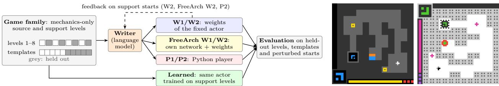
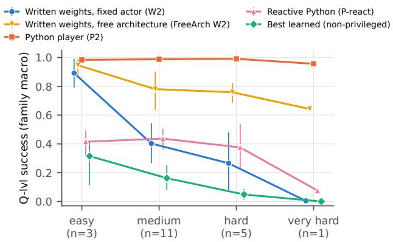
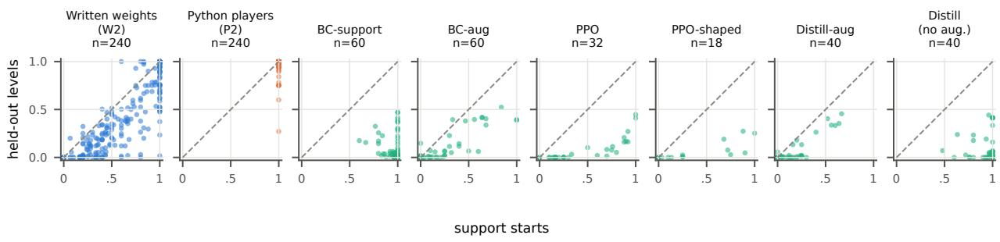
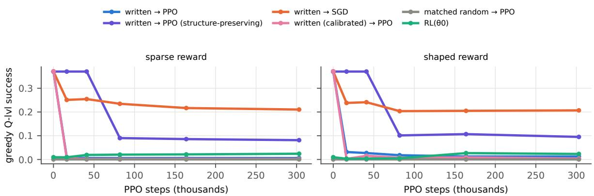

# Compiling Known Rules into Compact Neural Agents: Weight-Space Programming on Unseen Games

Jens Lehmann∗

Amazon, TU Dresden

## Abstract

Frontier language models have recently been reported to write the weights of neural networks directly, without training: weight-space programming (WSP). If they can do so for tasks they have never seen, a model’s understanding of a task could be compiled into a compact network that runs without the model and might be refined by training. We test this on 20 privately authored, never published game families in the style of ARC-AGI-3. A language model, the writer, receives a game’s simulator source without the held-out levels and must produce one network that plays held-out levels, renderings and start states. When the architecture is fixed (a recurrent convolutional network with 57k parameters), the best writer’s networks solve 56% of episodes on held-out levels with feedback, but the four strongest writers’ Python programs solve 97–100%, and the gap grows with game dificulty. Learning this architecture’s weights from the levels shown to the writers, instead of writing them, transfers far worse (at most 11%), and learned weights fail even on those levels once the rendering changes, which costs written weights at most 8 points. Writers read the source while learners see only those levels, so this compares information access. When writers design their own network in a small tensor language, an exploratory condition, these four writers solve 68–90%. On closer inspection, these networks are programs in network form: 93% of their parameters are exactly zero, 90% of the rest are small integers or powers of two, and NumPy programs with the same loop rules and caps solve 91% against the networks’ 79%. In these games, and under a protocol that forbids fitting and search, WSP thus amounts to writing a restricted class of programs, not networks of the kind training produces. Nor does the neural format bring its main hoped-for benefit, training. The best writer’s architectures, trained from standard initialisation within our budget, solve 1%. Written weights in the fixed network are also fragile: weight noise the size of PPO’s first update removes most of their success, as does the update itself. Asked for noise-robust weights, two of three writers tolerate about 10 times more noise, but PPO’s first update on them is 10–100 times larger and still removes most of their success. With standard PPO on these binary-success games, writing and RL fine-tuning do not combine

## 1 Introduction

Frontier language models can solve tasks they have never seen by writing programs, for example programs that play new games. A stranger claim is that they can also write the weights of a neural network directly: construct networks for simple tasks, read what small networks compute, and repair failures by editing parameters (Takehi et al., 2026; Singh, 2026). If such weight-space programming (WSP) works, a model’s reasoning about a task could be compiled into a compact neural agent. Such an agent would run without the model, with small, fixed computation per step instead of a large model’s long and variable reasoning, and, being diferentiable, might be refined by reinforcement learning (RL). We find that written networks do not behave like trained ones: they are programs in network form, their architectures fail when trained from scratch within our budget, and written fixed-actor weights do not survive standard PPO fine-tuning.

We are interested in three research questions about WSP. Do written networks generalise to instances their writer never saw? Do they add anything over an ordinary program written by the same model, for example because they can be trained further or run more cheaply? Do they add anything over learning the same network from the instances the writer was shown? Existing demonstrations use public tasks (Breakout,

Go, arithmetic), where recall of familiar strategies cannot be excluded, and rarely compare against programs or against learning in the same architecture.

We study these questions on 20 privately authored game families in the style of ARC-AGI-3 (ARC Prize Foundation, 2026). Games are a demanding test: a player must read the frame, remember what it has done and act over many steps, and new levels show whether it generalises. We report the 25 public ARC-AGI-3 games as a separate, possibly familiar tier. In our setup, a language model, the writer, receives a game’s simulator source with solvers and held-out levels removed. The remaining support levels are the ones it can study and get feedback on. It must produce one actor that plays held-out levels, renderings and start states. Nine writer models from OpenAI and Anthropic either set the weights of a fixed 57k-parameter recurrent convolutional actor, design and set a network of their own in a small tensor language (free architecture, FreeArch), or write a Python player, each one-shot or with feedback. We compare against learned weights in the same actor and against simple replay and fixed-action baselines.

## Findings.

1. In the fixed actor, written weights generalise, but programs are far better. Main writers’ actors solve 33–56% of held-out-level episodes with feedback, far above the baselines (≤4%), while their Python players solve 97–100%, and the gap grows with dificulty. Where a program can solve the task, as here, writing it is the better approach. Tasks without a compact program may difer.

2. Learned weights in the fixed actor transfer poorly, and written weights are appearance-invariant. Learn ing the actor’s weights from the support levels, instead of writing them, transfers at most 11%, although the actor can fit held-out episodes when trained on them. The learned actors fail even on the levels they were trained on once the rendering changes: a held-out renderer template alone costs them 34–79 points and written weights 1–8. Writers read the source and learners see 15–30 level starts per family, so this compares information access more than learning.

3. With a free architecture, writers write programs in network form. In networks of their own design, an exploratory condition, main writers solve 68–90%, mostly owing to the free topology. The networks are bounded, branch-free tensor programs, and NumPy programs with the same loop rules and caps do better (91% against 79%). Writers had to construct weights by design, without fitting or search, which favours such networks. The ability is concentrated in the strongest models: the other current and the previous-generation writers reach only 14–48%.

4. The ordering holds on the public games. On the 25 public ARC-AGI-3 games, which are harder and possibly familiar, programs (43–75%) beat free architectures (13–42%), which beat fixed-actor weights (≤8%).

5. Written weights and standard PPO do not combine. In the fixed actor, written weights do not survive PPO fine-tuning: weight noise the size of PPO’s first update removes most of their success, and PPO removes it, as does a random update of the same size. The writers’ architectures also fail when trained from scratch within our budget (1% for the best writer). So the main hoped-for benefit of the neural format is not realised here, and written networks are also slower per step than Python players.

Contributions. The findings above are our main contribution. They rest on (i) a controlled protocol for weight-space programming on unseen interactive tasks: audited mechanics-only sources, held-out final levels, certified perturbed starts, closed-loop controls and complete request accounting for the main study; (ii) a multi-writer comparison of written weights, in a fixed actor and in free architectures, with programs by the same models, learned weights in the same actor, and controls that separate the language, the topology and the operators; and (iii) tests of training from scratch, refinement by RL and cost, with weight-perturbation controls.

## 2 Related work

Weight-space programming. Takehi et al. (2026) report that a frontier model can tell from raw weights what a small network was trained to do, write MinAtar and 9×9 Go policy networks from the rules, and repair networks by direct edits. Their games are public. Singh (2026) had a coding agent set every weight of smal transformers for ten algorithmic tasks, and document evaluation leakage, forbidden fitting and lookup-table solutions, which motivate our sandbox and held-out design. A later version also writes language classifiers and brain encoding models (Singh et al., 2026). Follow-up work edits small language models for reasoning benchmarks (Hu et al., 2026) and audits small clinical networks (Nusrat and Nusrat, 2026). On the reading side, Ahmed (2026) find that zero-shot weight reading relies on local arithmetic and dataset priors more than on tracing computation. We difer from this work in four ways. Our games are private, so writers cannot recall solutions, and every network is scored on held-out levels, renderings and start states. Each written network is compared with programs by the same model and with weights learned in the same architecture. We test whether written networks can be trained further, with RL and perturbation controls. And we cover nine writers across two model generations, in a fixed architecture and in architectures the writers design.

Rules and programs compiled into networks. KBANN maps a propositional domain theory to the topology and initial weights of a network (Towell and Shavlik, 1994), finite-state automata can be programmed stably into recurrent networks (Omlin and Giles, 1996), and neural-symbolic work generalises such translations (d’Avila Garcez et al., 2002; Besold et al., 2017). A minimal convolutional network can run the Game of Life exactly, yet networks of that size rarely learn it (Springer and Kenyon, 2021), and gradient descent in diferentiable interpreters rarely finds the programs that discrete search finds (Gaunt et al., 2016). RASP and Tracr compile programs into transformer weights (Weiss et al., 2021; Lindner et al., 2023), with extensions to learnable (Friedman et al., 2023), looped (Shaw et al., 2025; Giannou et al., 2023) and embedded (Weng et al., 2024) programs. There, a person or an exact compiler translates a formal rule language. Our writers start from simulator source, must also invent the policy, and give no correctness guarantee: we measure correctness on held-out instances.

Generating weights. HyperNetworks (Ha et al., 2017), G.pt (Peebles et al., 2022), p-dif (Wang et al., 2024b), neural functionals (Navon et al., 2023; Zhou et al., 2023) and Text-to-LoRA (Charakorn et al., 2025) learn a mapping into weight space by gradient descent, mostly from collections of trained networks (see also Wang et al., 2026). Our writers receive no trained networks or gradients, only the task’s source and feedback.

Algorithmic reasoning in networks. CLRS (Veličković et al., 2022; Veličković and Blundell, 2021), value iteration networks (Tamar et al., 2016) and weight-tied recurrent networks that extrapolate by iterating longer (Schwarzschild et al., 2021; Bansal et al., 2022) ask whether gradient descent finds algorithmic solutions. We ask whether a writer can set them directly. Our fixed actor contains such a weight-tied recurrent block, iterated 128 times per step, so a writer can use it to run an iterative algorithm, for example to spread information across the grid.

Language models writing code that acts. Language models write robot policies (Liang et al., 2023), skill libraries (Wang et al., 2024a), reward functions (Ma et al., 2024), world models (Tang et al., 2024; Dainese et al., 2024), evolved programs (Romera-Paredes et al., 2024), programmatic policies (Liu et al., 2025) and game-playing algorithms (Li et al., 2026). On ARC (Chollet, 2019; Chollet et al., 2025), sampled and verified programs are among the strongest approaches (Wang et al., 2024c; Li et al., 2025; Chollet et al., 2024). ARC-AGI-3 turns such tasks into games that require exploration and rule discovery (ARC Prize Foundation, 2026), where coding agents build programmatic world models from interaction (Lehmann et al., 2026) and training-free graph exploration is a strong baseline (Rudakov et al., 2025). Our writers instead read the game’s source, so we measure how well they compile known rules. The weights conditions ask for the program as the parameters of a network, so that no language-model call, planner or search remains at run time.

RL fine-tuning and distillation. Fine-tuning can forget capabilities on states that are not visited early (Wołczyk et al., 2024), which JSRL (Uchendu et al., 2023) and residual policy learning (Silver et al., 2018; Johannink et al., 2019) avoid by keeping the prior policy fixed. Our distillation baseline builds on policy distillation (Rusu et al., 2015; Czarnecki et al., 2019; Hinton et al., 2015) and DAgger (Ross et al., 2011).

## 3 Experimental setup

## 3.1 Games and held-out scope

We study generalisation within a game: given a game’s rules, the writer must produce one actor that plays new levels, layouts, renderings and states of that game. Games the writer was never told about are left for future work. “Unseen” refers to the writer: the private games were never published, although familiar ideas such as path finding, parity and matching are known to the models.

Private tier (primary). 20 ARC-AGI-3-style game families (Table 7, Appendix A.7). An observation is a 64 × 64 grid of 16 colour ids. The actions are RESET, ACTION1–5, ACTION6 (a click at a cell) and ACTION7. Before any result, the game author assigned each family to a dificulty stratum: 3 easy, 11 medium, 5 hard and 1 very hard. Core computations include object comparison, colour matching under a budget, maze planning with global phase changes, click localisation with cascades, constraint covering, timing and hidden state. Each family has 6–12 fixed levels and ten renderer templates that keep the mechanics but vary geometry, object and HUD grammar, and palette. A held-out template is not an interpolation of the shown ones, and the colour ids that carry a role change across templates and palettes, so a detector keyed to fixed colour ids cannot work (Figure 1 shows an example, Appendix A.7). Every family comes with an exact planner that we wrote, a solver that returns a shortest action sequence completing a level from a given state. It certifies evaluation instances and supervises or shapes learned baselines, but is never used in the writer or actor. Three of the 20 families (ztl, lys, esm) were used in a preliminary study that informed the protocol and prompts (Appendix A.4).

Public tier (secondary). The 25 public ARC-AGI-3 games are widely discussed, so writers may know them, and we report them separately. They have no renderer templates, so each game has a single rendering.

Splits and evaluation sets. For a game with n levels we hold out levels $n , n - 2 , \ldots$ . down to level 2: about half the levels, always including the final one. Templates 0–4 are shown and 5–9 held out. The primary set, Q-lvl, contains every held-out level under all ten templates, each from the level’s start and from up to five certified perturbed starts. A perturbed start is reached by 1–6 random actions that change the observation. It is kept only if the planner’s direct plan from it replays to completion. We report held-out levels between shown ones (Q-lvl-mid) and the final level (Q-lvl-final) separately. Q-tpl renders support levels with held-out templates, and S-start holds the support level starts used for feedback. On the public tier, each held-out level has its start and up to 20 perturbed starts. An episode ends on level completion (success), on GAME\_OVER or after 3×(certified plan length)+10 actions; RESET restarts the level and counts as an action. All sets are built mechanically before the main study’s first writer call (Appendix A.7).

Mechanics-only source. The writer receives the game’s source code, the simulator that applies actions and renders frames, without held-out level data and template parameters (replaced by WITHHELD placeholders), without any solver, planner or oracle routine or value derived from one, such as optimal move counts, and without comments that discuss levels or strategy. The redacted simulator reproduces the original frame for frame on every support level and template (525k steps), and raises an error when asked to build a held-out level or template, whose data it no longer contains (Appendix A.8). Ablation M+S keeps the solver.

## 3.2 The fixed actor

All fixed-architecture neural conditions produce the weights of one recurrent convolutional actor with 57,289 float32 parameters (Appendix A.1). We designed it before the study to express the computations grid games need, with operators simple enough to set by hand, not for particular games:

• one-hot colour planes and coordinate channels, for colours and positions;

• a $5 \times 5$ and a $3 \times 3$ convolution, for local patterns and objects;

• row- and column-wise max broadcasts, for same-row and same-column relations;

• a weight-tied $3 \times 3$ block iterated 128 times, for flood fills and distance fields (Schwarzschild et al., 2021; Bansal et al., 2022; Tamar et al., 2016);

  
Figure 1: Left: setup. A writer receives a game’s mechanics-only source and returns weights for the fixed actor, a network of its own design, or a Python player, one-shot (1) or with feedback (2). Learned baselines train the fixed actor on the support levels. Right: one state of the public game ls20 (ARC Prize Foundation, 2026) as published and under a template we constructed for this figure. The board and HUD are turned, player, collectibles, walls and the key frame are drawn in other styles, and colours are permuted, which changes 91% of the cells while the mechanics stay the same. The private templates vary geometry, object and HUD style and palette in this way.

• spatial pooling, an MLP with a 64-dimensional episodic memory, an action head and a click map, for decisions that depend on earlier steps.

Decoding is deterministic argmax over available actions. The actor runs alone, without search, planner or external calls, at 1.32 GMAC per step. Final actor evaluations use exact FP32; the training-time curves in Figure 4 use TF32 checkpoints. Written networks are numerically brittle: TF32 convolutions change the decisions of 11 of 60 tested written actors (Appendix A.9).

## 3.3 Free architecture

In the free-architecture condition (FreeArch), the writer designs its own network in a small static tensor language and supplies all of its weights. We specified the language after the fixed-actor results were known, so the FreeArch analyses are exploratory. The language ofers convolutions, elementwise arithmetic including multiplication and min/max, row, column and global pooling, dense layers, weight-tied loops of fixed length and an episodic memory, but no data-dependent control flow. Inputs are the fixed actor’s plus the availableaction mask. Caps on graph size, loop length, arithmetic (1.5 GMAC per step, close to the fixed actor’s 1.33) and parameters (150k, 2.6× the fixed actor’s) match the two settings roughly on arithmetic, not on parameters or wall-clock cost (Appendix A.1). The prompt shows the fixed actor in the language as an example.

Two controls separate what FreeArch changes, with the same writers, families, runs and feedback. In control A, the graph must be the fixed actor’s own graph written in the language, so only the weights are free. In control B, any graph is allowed, but only with the fixed actor’s operations. The bounded program player writes NumPy code under FreeArch’s loop rules and caps, with more operations (division, comparisons, np.where and others) and without node or channel limits (Appendix A.1). It shows what the weight format costs against a program with the same limits.

## 3.4 Writers and conditions

Writers. The four main writers are GPT-6 Astra, GPT-6.1 Sol, GPT-6.1 Terra and Claude Opus 5.5. The five weaker writers are GPT-6 Luna, Claude Sonnet 5.5, Claude Haiku 5.5 and the previous-generation GPT-5.6 Sol and Claude Opus 5. All run at reasoning efort high, without tools, with the same prompt: the mechanics-only source and the engine base class, the support start observations, the episode rules and, for the weights conditions, the actor’s exact NumPy reference (Appendices A.3 and A.4).

## Conditions (Figure 1).

• Written weights, one-shot (W1) or with feedback (W2): the writer returns build(), which constructs all tensors of the fixed actor. A sandbox prohibits training, fitting, searching over weights and simulating the game (Appendix A.5). Feedback allows up to three resubmissions, each after an outcome table on the support starts and up to three failure reports (frames, action traces and, for networks, logits and channel maxima).

• FreeArch W1 and FreeArch W2: the same in the free architecture.

• Python players, one-shot (P1) or with feedback (P2): act(obs, available, memory). They control for game understanding.

• P-react: a one-shot Python player that may not simulate the game or search, with fixed computation per frame and 50 ms per step. It is a program control closer to what a network computes. The restrictions are prompted and audited, not enforced (Appendix A.5).

W1, W2, P1 and both FreeArch arms run for all nine writers and the other arms for the main writers, with three runs per family (Table 9). P-react and the public-tier one-shot arms run for the seven current writers. Ablations on six families, with one run each, add solver code, remove the actor’s axial broadcasts, cut its tied iterations to 8, or lower the reasoning efort.

Hypotheses. Four hypotheses about the fixed actor on the private tier, and the fixed-actor analyses, were written down in a protocol before data collection (excerpt and dated amendments in the supplement):

• H1: the main writers’ written weights solve held-out instances well above the replay and open-loop floors (Section 3.6).

• H2: written weights generalise better than weights learned in the same actor from the same support data, with augmentations that the source shows to preserve the game’s rules.

• H3: weight writing degrades with game dificulty faster than program writing.

• H4: written actors are closed-loop and do not replay support sequences.

## 3.5 Learned baselines

All fixed-architecture learned baselines train the identical 57k actor from the same initialisation, on support levels and templates unless noted (Appendix A.6). BC-support is DAgger (Ross et al., 2011) with the planner as teacher. BC-aug adds augmentations that the source shows to preserve the game’s rules: colour permutations, and board symmetries where the game’s own templates use them (a symmetry-only variant runs on 13 families). BC-oracle also trains on states of the held-out levels and is a capacity check, not a generalisation result. Distill and distill-aug use a writer’s final P2 player as teacher, without and with augmentation. PPO (Schulman et al., 2017) uses a sparse completion reward (2 × 106 steps), and the privileged PPO-shaped adds potential-based shaping (Ng et al., 1999) from the planner’s distance to go. Learned FreeArch networks are Astra’s FreeArch graphs with re-initialised weights, trained by BC-support and by distillation for at most 6 h per run.

## 3.6 Evaluation and statistics

Floors and closed-loop controls. Two floors measure how much of a game can be solved without reading the frame. The replay floor replays, on every held-out start, the planner’s plan for the support start whose first frame difers from it in the fewest cells. The open-loop floor is the best fixed schedule: one action, or two alternating ones, repeated until the episode ends. We would have excluded as blind-solvable any family on which a floor reaches 0.5. None does, and no public game scores above 0. For every written actor we measure success with a constant observation (zero frame) or one frozen at the episode’s first frame (first frame), success on perturbed starts with RESET disabled, and how often the action changes on counterfactual frames.

Scoring and statistics. Refusals, truncated replies, invalid artifacts and undelivered sessions score 0; Table 18 reports delivery, scores without undelivered sessions and other protocol-specified analyses. The unit of analysis is the family: runs are averaged within a family, then families are weighted equally (family macro). Q-lvl success is level-balanced (the mean of per-level success; within 0.02 of the raw episode rate at the reported family-macro cell level). Confidence intervals come from a hierarchical bootstrap over families, held-out levels and runs; paired diferences are bootstrapped over families. Appendix A.9 covers numerics and integrity.

Table 1: Held-out-level success (Q-lvl) on the 20 private families: equal-weight family macro with 95% hierarchical-bootstrap CIs (families → held-out levels → runs). W = written weights in the fixed actor, P = Python player; 1 = one-shot, 2 = with up to three feedback rounds. “W1 deliv.” is the fraction of W1 sessions that returned a valid artifact (refusals and invalid artifacts score 0). “W2 final lvl” is W2 success on the held-out final level only. P2 was run for the four main writers. † previous generation.
<table><tr><td>Writer</td><td>W1</td><td>W2</td><td>P1</td><td>P2</td><td>W1 deliv.</td><td>W2 final lvl</td></tr><tr><td>GPT-6 Astra</td><td>0.40 [0.26,0.54]</td><td>0.56 [0.40,0.71]</td><td>0.95 [0.86,1.00]</td><td>1.00 [1.00,1.00]</td><td>1.00</td><td>0.40</td></tr><tr><td>GPT-6.1 Sol</td><td>0.32 [0.17,0.49]</td><td>0.43 [0.28,0.59]</td><td>0.96 [0.91,1.00]</td><td>1.00 [0.98,1.00]</td><td>0.98</td><td>0.31</td></tr><tr><td>Claude Opus 5.5</td><td>0.15 [0.06,0.26]</td><td>0.36 [0.20,0.52]</td><td>0.85 [0.73,0.94]</td><td>0.97 [0.91,1.00]</td><td>0.85</td><td>0.25</td></tr><tr><td>GPT-6.1 Terra</td><td>0.21 [0.09,0.36]</td><td>0.33 [0.19,0.48]</td><td>0.97 [0.92,1.00]</td><td>0.98 [0.95,1.00]</td><td>0.98</td><td>0.18</td></tr><tr><td>GPT-6 Luna</td><td>0.05 [0.01,0.11]</td><td>0.11 [0.04,0.19]</td><td>0.45 [0.31,0.60]</td><td></td><td>0.70</td><td>0.02</td></tr><tr><td>Claude Sonnet 5.5</td><td>0.06 [0.02,0.13]</td><td>0.19 [0.08,0.33]</td><td>0.72 [0.59,0.84]</td><td></td><td>1.00</td><td>0.12</td></tr><tr><td>Claude Haiku 5.5</td><td>0.04 [0.01,0.11]</td><td>0.06 [0.02,0.13]</td><td>0.46 [0.32,0.61]</td><td></td><td>1.00</td><td>0.02</td></tr><tr><td>GPT-5.6 Sol†</td><td>0.12 [0.05,0.21]</td><td>0.25 [0.13,0.38]</td><td>0.86 [0.75,0.94]</td><td></td><td>0.97</td><td>0.18</td></tr><tr><td>Claude Opus 5†</td><td>0.09 [0.03,0.17]</td><td>0.16 [0.07,0.27]</td><td>0.72 [0.56,0.86]</td><td></td><td>0.85</td><td>0.06</td></tr></table>

## 4 Results

## 4.1 Written weights generalise (H1)

Table 1 gives held-out-level success (Q-lvl) for every writer and condition on the 20 private families. GPT-6 Astra’s written actors solve 40% of held-out-level episodes one-shot (W1) and 56% with feedback (W2). With feedback, GPT-6.1 Sol reaches 43%, Claude Opus 5.5 36% and GPT-6.1 Terra 33%. The other current models solve at most 6% one-shot, and previous-generation models at most 12%. Replaying the plan of the nearest support start solves 2.5%, and the best repeating action schedule 3.9%. No family exceeds 0.26 under the first floor or 0.46 under the second. H1 holds in every dificulty stratum except the very hard family (Table 19). Without the preliminary-study families, W2 is 0.27–0.50 and P2 0.96–1.00 (Table 20).

Every main writer improves with feedback, by 11–21 points and in 15–17 of 20 families. Runs vary widely: 31 of Astra’s 60 feedback runs reach 50% on held-out levels, and 25 of Sol’s. Selection matches part of the feedback gain: the best of three one-shot runs, chosen by support-start success at a similar request count, recovers 45–70% of it (Appendix B).

A new appearance costs almost nothing, a new level costs a lot. A template keeps a level’s mechanics but can rotate or mirror the board, draw objects and the HUD in another style and give roles other colours. Re-rendering one state under another template changes up to 99% of its cells (median over families of the largest change). Every episode carries its renderer template, so success splits by appearance novelty and level novelty at once (Table 10). Holding the levels and the start type fixed, a held-out template costs written weights 1 point for Astra (−0.01 [−0.03, +0.01], paired over families), 2 for Sol, 4 for Terra and 8 for Opus 5.5, and at most 5 in networks of the writers’ own design. A permuted palette, which changes the colour ids of every role, costs no more. The written actors therefore locate objects from the frame rather than from fixed colours or positions, which they could not read of the source (Section 3.1). Their first layers show how: 73% of the channels that read colour apply one kernel to eight or more colours or repeat one detector for each of four or more colours, whereas every channel of a learned first layer reads all 16 colours with distinct kernels. New levels are the dificulty: on the same held-out templates, success falls from 78% on support levels to 56% on held-out ones for Astra, and held-out levels between shown ones are solved more often than the final level (Astra W2 61% against 40%, Sol 47% against 31%).

Ablations. On six families with one run each (Table 21, Appendix B), solver code in the source does not clearly help written weights, removing the actor’s axial broadcasts changes little, and cutting its tied iterations from 128 to 8 hurts most.

  
Figure 2: Held-out-level success by dificulty stratum (family macro, bootstrap 95% CI over families, main writers pooled; the very hard stratum is one family). Written weights in the fixed actor (W2) degrade with dificulty, reactive programs (P-react) stay near 40% except on the very hard family, free architectures (FreeArch W2) degrade less, and unrestricted programs (P2) not at all. Learned baselines transfer worst.

## 4.2 Weights versus programs (H3)

Every writer’s Python players beat its written weights: by 39–75 points one-shot, by 44–65 points with feedback for the main writers, and in 76 of the 80 main writer–family pairs with feedback (3 pairs tie and 1 is reversed). H3 was specified as a dificulty-by-format interaction without a fixed test statistic, so we assess it descriptively per stratum (Figure 2; Table 19, with CIs over families). The main writers’ written actors (W2) solve 89% [79, 99] on easy families, 40% [27, 55] on medium, 27% [8, 48] on hard and 0% on the very hard stratum, which is a single family. Python players stay at 96–99% in every stratum, so with P2 near ceiling the growing gap mainly reflects the decline of W2. An exploratory trend test with the family as unit agrees: the per-family P2−W2 gap rises with stratum rank (Spearman $\rho = 0 . 6 7$ , one-sided permutation $p < 0 . 0 0 1$ , 20 families; without the preliminary-study families $\rho = 0 . 5 9 , p = 0 . 0 0 7 )$ . One-shot, where P1 is below ceiling (Table 19), it gives $\rho = 0 . 5 2 \ ( p = 0 . 0 0 9 )$ . H3 is supported descriptively.

P-react, the one-shot program control without simulation or search, solves 40% pooled over the main writers: close to written weights with feedback (42%) and far below unrestricted programs (99%). It is not matched to the actor’s computation (Appendix B).

What do these results say about writing weights? Across the nine writers and 20 families, a one-shot network solves at least half of the held-out-level episodes only where the same writer’s one-shot Python player does too (19 of 19 such writer–family pairs in the fixed actor, 51 of 51 with a free architecture, Section 4.3). Where the program fails (34 pairs), the networks solve 2% and 6%. Understanding a game well enough to program it thus appears necessary for writing its weights, and expressing that understanding in a fixed network is the hard part. This does not show that writers derive their weights from a program, since any harder output format could give the same pattern. Programs also handle new templates because the source contains the code of the five support templates and the prompt says that evaluation uses unseen visual variants. Their players parse frames invariantly, for example by taking the most frequent colour as background and matching objects by shape rather than by colour id.

## 4.3 A free architecture closes most of the gap (FreeArch, exploratory)

Table 2 pairs each writer’s FreeArch networks with its fixed-actor weights, and Figure 2 shows both by dificulty. Every main writer gains 33–41 points with feedback, all confidence intervals above zero, and FreeArch is better in 17–19 of the 20 families. One-shot, FreeArch reaches 40–74%. The collapse with dificulty largely disappears: pooled over the main writers, FreeArch actors solve 95% on easy, 78% on medium, 76% on hard and 64% on the very hard stratum, where the fixed actor reached 0%. Without the preliminary-study families, FreeArch W2 is 65–89% and the gain 37–47 points, every interval above zero (Table 20). As in the fixed actor, the final level is harder (Astra: 81% against 93%).

Gap to programs. Astra’s FreeArch actors come within 10 points of its Python players, and within 5 points on 12 of the 20 families. Sol 6.1 comes within 16 points, and Terra and Opus 5.5 within 24–28. Neither program control is matched to FreeArch: P2 may simulate and search without bound, P-react may do neither, and FreeArch networks run bounded loops of up to 256 iterations. With FreeArch’s loop rules and caps, the bounded program players solve 91%, against 79% for FreeArch W2 (+0.11 [+0.06, +0.17]; Table 15), with positive point estimates for every writer, although Sol 6.1’s interval includes zero; unrestricted players stay 8 points ahead [4, 12]. The +0.11 estimates the cost of the weight format, with confounds in both directions (Appendix A.1).

Table 2: Free architecture (FreeArch) against the fixed actor on the 20 private families (held-out-level success, family macro). ∆ is the paired FreeArch−fixed diference with feedback (W2), with a bootstrap 95% CI over families; the last column counts families where FreeArch is better. Upper block: main writers; lower block: weaker writers († previous generation).
<table><tr><td>Writer</td><td>W1 fixed</td><td>W1 FreeArch</td><td>W2 fixed</td><td>W2 FreeArch</td><td></td><td>∆ W2 [95% CI]</td><td>FreeArch&gt;fixed</td></tr><tr><td>GPT-6 Astra</td><td>0.40</td><td>0.74</td><td>0.56</td><td>0.90</td><td>+0.34 </td><td>[+0.21,+0.48]</td><td>17/20</td></tr><tr><td>GPT-6.1 Sol</td><td>0.32</td><td>0.52</td><td>0.43</td><td>0.84</td><td>+0.41</td><td>[+0.25,+0.56]</td><td>17/20</td></tr><tr><td>Claude Opus 5.5</td><td>0.15</td><td>0.40</td><td>0.36</td><td>0.68</td><td>+0.33</td><td>[+0.22,+0.45]</td><td>18/20</td></tr><tr><td>GPT-6.1 Terra</td><td>0.21</td><td>0.51</td><td>0.33</td><td>0.74</td><td>+0.41</td><td>[+0.30,+0.52]</td><td>19/20</td></tr><tr><td>GPT-6 Luna</td><td>0.05</td><td>0.09</td><td>0.11</td><td>0.14</td><td>+0.04 </td><td>[-0.01,+0.09]</td><td>8/20</td></tr><tr><td>Claude Sonnet 5.5</td><td>0.06</td><td>0.17</td><td>0.19</td><td>0.39</td><td>+0.20</td><td>[+0.11,+0.29]</td><td>14/20</td></tr><tr><td>Claude Haiku 5.5</td><td>0.04</td><td>0.06</td><td>0.06</td><td>0.14</td><td></td><td>+0.07 [+0.02,+0.13]</td><td>12/20</td></tr><tr><td>GPT-5.6 Sol†</td><td>0.12</td><td>0.25</td><td>0.25</td><td>0.48</td><td></td><td>+0.23 [+0.13,+0.32]</td><td>17/20</td></tr><tr><td>Claude Opus 5†</td><td>0.09</td><td>0.21</td><td>0.16</td><td>0.33</td><td></td><td>+0.17 [+0.07,+0.30]</td><td>16/20</td></tr></table>

Where the gain comes from (Table 16, Appendix B).

• Not the prompt or the language. Control A matches the fixed actor (+0.01 [−0.02, +0.04], pooled over writers); all 240 delivered A graphs equal the fixed actor’s graph.

• Mostly the topology. Control B gains 29 points over A [21, 37], with every writer’s interval above zero. B is better in all 20 families pooled, and in 16, 19, 17 and 20 families for Astra, Sol 6.1, Opus 5.5 and Terra. 11 of 608 B candidates used other operations and were rejected as invalid.

• The added operators contribute the rest (+0.06 [+0.02, +0.10]), most clearly for Opus 5.5 (+0.12).

• Not the parameter cap. 152 of the 239 delivered FreeArch networks and 108 of the 240 B networks stay within the fixed actor’s 57k parameters and its MACs. These alone solve 80% and 68% of held-outlevel episodes, against 42% for the fixed actor on the same families. This comparison selects artifacts after the fact and is descriptive.

The controls do not separate the architecture from the weights written into it.

Weaker writers gain far less. With feedback, the weaker writers’ FreeArch networks solve 14–48%, against 68–90% for the main writers (Table 2, lower block). FreeArch helps four of the five, by 7–23 points with confidence intervals above zero, but not GPT-6 Luna (+0.04 [−0.01, +0.09]). The weaker writers can still write programs: one-shot, their Python players solve 45–86%, against 6–25% for their FreeArch networks. Writing a working network from the rules is thus concentrated in the strongest models.

What writers build. The main writers’ 451 delivered private-tier FreeArch networks (one-shot and with feedback) have a median of 30k parameters (interquartile range 11k–64k) and 0.33 GMAC per step (0.07– 0.80), less than the fixed actor. They rely heavily on multiplicative gating, which the fixed actor lacks. 320 of them use tied loops of 2–256 iterations (median 48), and 154 read the available-action mask. Their weights are hand-set constants: 93% of all parameters are exactly 0, and 90% of the nonzero ones are ±1, another small integer or a power of two (97% and 86% for written fixed-actor weights, W2). They encode Boolean logic, for example NOT as 1 − min(relu(x), 1) and AND as a product. They are closed-loop: fed a constant frame instead of the observation, they solve at most 4% of held-out-level episodes. FreeArch networks are thus bounded, branch-free tensor programs in network form, with fixed iteration counts. This is close to compiling programs into networks (Weiss et al., 2021; Lindner et al., 2023), except that the writer, not a compiler, derives the computation from informal rules and source. Nor are they cheaper to run than programs: a FreeArch network takes a median of 5–24 ms per step on a GPU and 36 ms on one CPU thread, against 0.8 ms for a sandboxed Python player (Table 25, Appendix B).

## 4.4 Written versus learned weights (H2)

Table 3 compares written weights with learned weights in the identical actor. BC-support fits the support starts (95%) but transfers poorly to held-out levels (11%). Distilling the writers’ own Python players fits the teacher on the support levels (92% of support starts), yet solves only 10% of held-out-level episodes, where the teachers solve over 99% (Figure 3, Appendix B). PPO with sparse reward reaches 8%. The privileged PPO-shaped baseline fits the support set only partly and transfers no better (5%). With source-licensed augmentation, the learners fail to fit the support set within our training budget: they solve only 17–20% of support starts (BC-aug, distill-aug; 56% with dihedral transformations alone) and 7–10% of held-out-level episodes. Per family, Astra’s written actors beat the best non-privileged learned baseline by 41 points [29, 54], and in 18 of the 20 families (both are near zero in the other two). H2 is supported, as a comparison of information access: writers read the source, while learners see only the support levels (15–30 starts per family and their perturbations). The learners with augmentation, which H2 names, did not fit their training levels, which weakens the comparison. The result shows that support-level data do not convey what the source does; it is not a test of learning as such.

The learned actors also fail without any new level. On the support levels, where BC-support solves 92% under the templates it trained on, a held-out template alone drops it to 13% (−0.79 [−0.86, −0.72]; distillation −0.74, PPO −0.34; Table 10), against −0.01 for Astra’s written weights. The one learner that is appearance-robust, BC-aug, buys it from palette and dihedral augmentation licensed by the source, and fits the support set so poorly (20%) that it gains nothing overall.

The actor can fit these episodes when trained on them. Trained with the planner teacher on states from all levels, including the held-out levels’ own start states (BC-oracle), it solves 90% of held-out-level episodes. This is an in-distribution capacity check, not generalisation, and it isolates the appearance efect: BC-oracle trains on all ten templates and is robust to them (+0.02), yet a permuted palette, which it never sees, drops it from 90% to 26%, where written weights lose nothing (+0.01 for Astra, paired over families). A learned actor of this architecture can therefore reach the written actors’ accuracy and still not survive a change of appearance.

Learned FreeArch networks. A writer’s own graphs learn almost nothing when trained from standard initialisation. With re-initialised weights, Astra’s FreeArch graphs solve 1% of held-out-level episodes under BC-support or distillation, against 89% with Astra’s written weights (+0.89 [+0.77, +0.98]; Table 17, Appendix B), although the same learners fit the support set in the fixed actor. These graphs are hard-gated circuits built for hand-set constants: many have no gradient at initialisation and others diverge. They are thus not trainable from standard initialisation within our budget, which does not show that no learner could fit them.

## 4.5 Closed-loop behaviour and mechanism (H4)

The main writers’ W2 actors read the screen and act closed-loop (Table 22, Appendix B). With a constant frame they solve at most 2% of held-out episodes, and frozen at the first frame 5–7%. On perturbed starts without RESET they solve 41–65%, and their action changes on 71–76% of counterfactual frames. H4 holds.

Mechanism. In five strong written actors, we ablated the components the writers name, after writing down the predicted efect. 14 of 17 predictions were confirmed: for example, zeroing the tied-block channels a writer calls a flood fill drops held-out success from 0.97 to 0 (Appendix B).

## 4.6 Public games

On the 25 public games, which are harder and possibly familiar (Tables 23 and 24, Appendix B), fixed-actor written weights fail: at most 8% on held-out levels for every writer and condition. Free architectures help

Table 3: Learned baselines in the same 57k actor, family macro over the private families (seeds averaged within a family, Appendix A.6), against GPT-6 Astra W2. ∗ privileged: PPO-shaped uses the planner’s distance as a potential, and BC-oracle trains on held-out levels. The paired $\Delta$ compares Astra W2 with the best non-privileged baseline per family (bootstrap over families).
<table><tr><td>Method</td><td>S-start</td><td>Q-lvl</td><td>Q-tpl</td><td>families</td></tr><tr><td>BC-support</td><td>0.95</td><td>0.11</td><td>0.13</td><td>20</td></tr><tr><td>BC-aug</td><td>0.20</td><td>0.09</td><td>0.21</td><td>20</td></tr><tr><td>BC-aug (dihedral only)</td><td>0.56</td><td>0.10</td><td>0.25</td><td>13</td></tr><tr><td>Distill-aug</td><td>0.17</td><td>0.07</td><td>0.17</td><td>20</td></tr><tr><td>Distill (no aug.)</td><td>0.92</td><td>0.10</td><td>0.15</td><td>20</td></tr><tr><td>PPO</td><td>0.47</td><td>0.08</td><td>0.12</td><td>20</td></tr><tr><td>PPO-shaped*</td><td>0.33</td><td>0.05</td><td>0.07</td><td>6</td></tr><tr><td>BC-oracle*</td><td>0.94</td><td>0.90</td><td>0.94</td><td>20</td></tr><tr><td>GPT-6 Astra W2</td><td>0.80</td><td>0.56</td><td>0.78</td><td>20</td></tr><tr><td>Paired ∆ (W2 – best non-privileged)</td><td colspan="2">0.41 [0.29,0.54]</td><td></td><td>20</td></tr></table>

Table 4: Fragility of written weights: held-out-level success of the 18 written actors under noise relative to each tensor’s RMS, after $\mathrm { P P O } \mathrm { { s } }$ first checkpoint and after a random update of the same size (Tables 11 and 12).
<table><tr><td></td><td colspan="3">Relative noise</td><td>PPO, first</td><td>Random update,</td></tr><tr><td>Written weights</td><td>0</td><td> $1 0 ^ { - 7 }$ </td><td> $1 0 ^ { - 4 }$ </td><td>checkpoint</td><td>same size</td></tr><tr><td>Fixed actor, noise on all entries</td><td>0.51</td><td>0.31</td><td>0.05</td><td>0.04</td><td>0.06</td></tr><tr><td>Fixed actor, noise on nonzero entries only</td><td>0.51</td><td>0.45</td><td>0.08</td><td></td><td></td></tr><tr><td>FreeArch networks, noise on all entries</td><td>0.95</td><td>0.72</td><td>0.44</td><td></td><td></td></tr></table>

(13–42% with feedback, gains of 7–34 points), but they stay about 30 points below the same writers’ Python players (43–75%). Possible familiarity does not rescue weight writing, and the larger residual gap suggests that richer mechanics are harder to compile.

## 4.7 Weight writing and standard PPO: no benefit in either direction

From written weights to RL. We fine-tuned the W2 actors of Astra, Sol 6.1 and Terra on the six ablation families with PPO (3 seeds, 300k steps, sparse and planner-shaped reward; Figure 4, Appendix B). Final actors are evaluated in exact FP32, and diverged runs score 0. Written actors work on ztl, lys and esm (Astra’s also on ruz) and start near 0 on crg and mds, so the result rests mainly on three to four families, three of them from the preliminary study. Standard PPO drives held-out success from 0.50 at initialisation to 0.01. Structure-preserving PPO (Appendix A.6) ends at 0.08–0.10, and small-step SGD at 0.22–0.25: success improves as the step size shrinks. RL from the learned baselines’ initialisation $\theta _ { 0 }$ and from matchedrandom initialisations stays at 0.02 or below. Under the decision rule specified before data collection, no family, writer, variant and reward combination beats both the written initialisation and $\operatorname { R L } ( \theta _ { 0 } )$ (0 of 132). Standard PPO collapses by its first checkpoint (16k steps), also in exact FP32 and on support starts, and rescaling the output head does not help (Appendix A.6). The main cause is fragility (Table 4): random noise of $1 0 ^ { - 7 }$ of each tensor’s RMS already removes much of the success, at this size mostly through the exact zeros, although decisions are not near ties. PPO’s first checkpoint moves the weights by $1 0 ^ { - 4 }$ overall, and a random update of the same size and support is as destructive.

Robust written weights. Asked for weights robust to noise of $1 0 ^ { - 3 }$ of each tensor’s RMS, Astra and Sol 6.1 lose 3 and 8 points but keep most of their success up to that noise, about $1 0 ^ { 4 }$ times what halves standard weights (Table 13; Opus 5.5 does not become robust). PPO still removes their success (Table 14): its first update on them is 10–100 times larger, about as destructive as a random update of that size.

From RL to written weights. Asked to repair RL-trained actors by editing weights, Astra and Sol 6.1 rebuild them to the level of their fresh W2 actors, while continued PPO stays at 0.00–0.01 (Appendix B).

## 5 Conclusions

Given the mechanics of an unpublished game, the strongest current language models can write the weights of a network that plays new levels, renderings and start states of that game, closed-loop and far above replaying plans or repeating actions. Written weights also generalise better than weights learned in the same network from the levels the writers saw, because the source tells the writer what the support levels do not.

What the writers produce, however, are programs in network form. With a free architecture, the main writers write bounded, branch-free tensor programs that come close to their own Python programs but not beyond them. In the fixed architecture they fall far short: 145 of 240 main-writer feedback runs stay below 50% on held-out levels, although the same actor fits these episodes when trained on them. Nor do written networks combine with training here: the architectures fail when trained from scratch, and a single standard PPO update removes most of the fixed actor’s success, even with noise-robust weights. Where a task can be solved by a program, as here, writing the program remains the better choice.

These results suggest a hypothesis about how weight-space programming works: the writer first derives a symbolic solution and then expresses it in weights, so that what it writes is a program even when the output is a network. Earlier demonstrations fit this reading. Takehi et al. (2026) describe their writer as converting “desired programs” into neural form for public games with known rules, and where no algorithm is known, written models are built from hand-designed interpretable features (Singh et al., 2026). Their written transformers for language tasks have the same signature as our networks: rebuilding 21 of their 24 released language-task models from their code, we find 99% of the parameters exactly zero and 95% of the rest small integers or powers of two (Appendix B). Our evidence comes from games whose perception, although it must be computed at run time, can be specified exactly from the rendering code, and whose policies admit a compact program. Tasks whose perception is statistical rather than exact, such as natural images, would test the hypothesis, and tasks with dense rewards, where RL fine-tuning works well, would test whether writing and training can combine.

## Limitations.

• Scope. We test generalisation within a game family, with the mechanics given as source code, not the discovery of unknown rules or transfer to new games. Our games have binary success per level, which makes them a poor testbed for combining writing with RL. The RL result covers standard PPO on the fixed actor with from-scratch settings, with structure-preserving PPO and small-step SGD controls but without supervised fine-tuning, and rests on three to four families (Section 4.7).

• Estimation. Per-family estimates rest on 3–6 held-out levels, and the ablations use one run each. Learning budgets were bounded (2M PPO steps, 6 DAgger iterations, 6 h per learned FreeArch network), so stronger learners might narrow the gap to written weights.

• Independence and elicitation. The games were authored with language-model assistance and never published. Prompts were piloted with evaluated writers, only the Claude writers get a task-budget hint, and refused Opus 5.5 sessions score 0. An evaluated writer (Claude Opus 5.5) designed the harness and analysis. Writers had no tools and had to construct weights by design, which favours program-like networks.

## References

Nazmus Sakib Ahmed. Can an LLM actually reason and program about neural network’s weights or is it just memorization on steroids? exploring “weight-space programming”. arXiv preprint arXiv:2611.08070, 2026.

ARC Prize Foundation. ARC-AGI-3: A new challenge for frontier agentic intelligence. arXiv preprint arXiv:2603.24621, 2026.

Arpit Bansal, Avi Schwarzschild, Eitan Borgnia, Zeyad Emam, Furong Huang, Micah Goldblum, and Tom Goldstein. End-to-end algorithm synthesis with recurrent networks: Extrapolation without overthinking. In Advances in Neural Information Processing Systems, 2022.

Tarek R. Besold, Artur d’Avila Garcez, Sebastian Bader, Howard Bowman, Pedro Domingos, Pascal Hitzler, Kai-Uwe Kühnberger, Luis C. Lamb, Daniel Lowd, Priscila Machado Vieira Lima, Leo de Penning, Gadi Pinkas, Hoifung Poon, and Gerson Zaverucha. Neural-symbolic learning and reasoning: A survey and interpretation. arXiv preprint arXiv:1711.03902, 2017.

Rujikorn Charakorn, Edoardo Cetin, Yujin Tang, and Robert Tjarko Lange. Text-to-LoRA: Instant transformer adaption. In International Conference on Machine Learning, 2025.

François Chollet. On the measure of intelligence. arXiv preprint arXiv:1911.01547, 2019.

François Chollet, Mike Knoop, Gregory Kamradt, and Bryan Landers. ARC prize 2024: Technical report. arXiv preprint arXiv:2412.04604, 2024.

François Chollet, Mike Knoop, Gregory Kamradt, Bryan Landers, and Henry Pinkard. ARC-AGI-2: A new challenge for frontier AI reasoning systems. arXiv preprint arXiv:2505.11831, 2025.

Wojciech Marian Czarnecki, Razvan Pascanu, Simon Osindero, Siddhant M. Jayakumar, Grzegorz Swirszcz, and Max Jaderberg. Distilling policy distillation. In International Conference on Artificial Intelligence and Statistics, 2019.

Nicola Dainese, Matteo Merler, Minttu Alakuijala, and Pekka Marttinen. Generating code world models with large language models guided by Monte Carlo tree search. In Advances in Neural Information Processing Systems, 2024.

Artur S. d’Avila Garcez, Krysia B. Broda, and Dov M. Gabbay. Neural-Symbolic Learning Systems: Foundations and Applications. Perspectives in Neural Computing. Springer, 2002. doi: 10.1007/ 978-1-4471-0211-3.

Dan Friedman, Alexander Wettig, and Danqi Chen. Learning transformer programs. In Advances in Neural Information Processing Systems, 2023.

Alexander L. Gaunt, Marc Brockschmidt, Rishabh Singh, Nate Kushman, Pushmeet Kohli, Jonathan Taylor, and Daniel Tarlow. TerpreT: A probabilistic programming language for program induction. arXiv preprint arXiv:1608.04428, 2016.

Angeliki Giannou, Shashank Rajput, Jy-yong Sohn, Kangwook Lee, Jason D. Lee, and Dimitris Papailiopoulos. Looped transformers as programmable computers. In International Conference on Machine Learning, 2023.

David Ha, Andrew Dai, and Quoc V. Le. Hypernetworks. In International Conference on Learning Representations, 2017.

Geofrey Hinton, Oriol Vinyals, and Jef Dean. Distilling the knowledge in a neural network. arXiv preprint arXiv:1503.02531, 2015.

Junru Hu, Cheng Tang, Wei Li, Hongze Zhu, Chun-Mei Feng, Qi Zhang, Yirong Chen, and Ming Hu. Exploring weight-space programming: Capabilities, generalization, and limitations. arXiv preprint arXiv:2611.09382, 2026.

Tobias Johannink, Shikhar Bahl, Ashvin Nair, Jianlan Luo, Avinash Kumar, Matthias Loskyll, Juan Aparicio Ojea, Eugen Solowjow, and Sergey Levine. Residual reinforcement learning for robot control. In IEEE International Conference on Robotics and Automation, 2019. doi: 10.1109/ICRA.2019.8794127.

Jens Lehmann, Andrei Aioanei, and Sahar Vahdati. Tycho: Active abstraction with programmatic world models for ARC-AGI-3. arXiv preprint arXiv:2607.28287, 2026.

Wen-Ding Li, Keya Hu, Carter Larsen, Yuqing Wu, Simon Alford, Caleb Woo, Spencer M. Dunn, Hao Tang, Wei-Long Zheng, Yewen Pu, and Kevin Ellis. Combining induction and transduction for abstract reasoning. In International Conference on Learning Representations, 2025.

Zun Li, John Schultz, Marc Lanctot, and Daniel Hennes. Modular discovery of general game-playing algorithms with large language models. arXiv preprint arXiv:2609.33115, 2026.

Jacky Liang, Wenlong Huang, Fei Xia, Peng Xu, Karol Hausman, Brian Ichter, Pete Florence, and Andy Zeng. Code as policies: Language model programs for embodied control. In IEEE International Conference on Robotics and Automation, 2023.

David Lindner, János Kramár, Sebastian Farquhar, Matthew Rahtz, Tom McGrath, and Vladimir Mikulik. Tracr: Compiled transformers as a laboratory for interpretability. In Advances in Neural Information Processing Systems, 2023.

Max Liu, Chan-Hung Yu, Wei-Hsu Lee, Cheng-Wei Hung, Yen-Chun Chen, and Shao-Hua Sun. Synthesizing programmatic reinforcement learning policies with large language model guided search. In International Conference on Learning Representations, 2025.

Yecheng Jason Ma, William Liang, Guanzhi Wang, De-An Huang, Osbert Bastani, Dinesh Jayaraman, Yuke Zhu, Linxi Fan, and Anima Anandkumar. Eureka: Human-level reward design via coding large language models. In International Conference on Learning Representations, 2024.

Aviv Navon, Aviv Shamsian, Idan Achituve, Ethan Fetaya, Gal Chechik, and Haggai Maron. Equivariant architectures for learning in deep weight spaces. In International Conference on Machine Learning, 2023.

Andrew Y. Ng, Daishi Harada, and Stuart J. Russell. Policy invariance under reward transformations: Theory and application to reward shaping. In International Conference on Machine Learning, 1999.

Humza Nusrat and Omar Nusrat. Weight-space programming for auditing clinical decision networks. arXiv preprint arXiv:2611.05341, 2026.

Christian W. Omlin and C. Lee Giles. Constructing deterministic finite-state automata in recurrent neural networks. Journal of the ACM, 43(6), 1996. doi: 10.1145/235809.235811.

William Peebles, Ilija Radosavovic, Tim Brooks, Alexei A. Efros, and Jitendra Malik. Learning to learn with generative models of neural network checkpoints. arXiv preprint arXiv:2209.12892, 2022.

Bernardino Romera-Paredes, Mohammadamin Barekatain, Alexander Novikov, Matej Balog, M. Pawan Kumar, Emilien Dupont, Francisco J. R. Ruiz, Jordan S. Ellenberg, Pengming Wang, Omar Fawzi, Pushmeet Kohli, and Alhussein Fawzi. Mathematical discoveries from program search with large language models. Nature, 625(7995):468–475, 2024. doi: 10.1038/s41586-023-06924-6.

Stéphane Ross, Geofrey Gordon, and Drew Bagnell. A reduction of imitation learning and structured prediction to no-regret online learning. In International Conference on Artificial Intelligence and Statistics, 2011.

Evgenii Rudakov, Jonathan Shock, and Benjamin Ultan Cowley. Graph-based exploration for ARC-AGI-3 interactive reasoning tasks. arXiv preprint arXiv:2512.24156, 2025.

Andrei A. Rusu, Sergio Gomez Colmenarejo, Caglar Gulcehre, Guillaume Desjardins, James Kirkpatrick, Razvan Pascanu, Volodymyr Mnih, Koray Kavukcuoglu, and Raia Hadsell. Policy distillation. arXiv preprint arXiv:1511.06295, 2015.

John Schulman, Philipp Moritz, Sergey Levine, Michael Jordan, and Pieter Abbeel. High-dimensional continuous control using generalized advantage estimation. arXiv preprint arXiv:1506.02438, 2015.

John Schulman, Filip Wolski, Prafulla Dhariwal, Alec Radford, and Oleg Klimov. Proximal policy optimization algorithms. arXiv preprint arXiv:1707.06347, 2017.

Avi Schwarzschild, Eitan Borgnia, Arjun Gupta, Furong Huang, Uzi Vishkin, Micah Goldblum, and Tom Goldstein. Can you learn an algorithm? generalizing from easy to hard problems with recurrent networks. In Advances in Neural Information Processing Systems, 2021.

Peter Shaw, James Cohan, Jacob Eisenstein, Kenton Lee, Jonathan Berant, and Kristina Toutanova. ALTA: Compiler-based analysis of transformers. Transactions on Machine Learning Research, 2025.

Tom Silver, Kelsey Allen, Josh Tenenbaum, and Leslie Kaelbling. Residual policy learning. arXiv preprint arXiv:1812.06298, 2018.

Chandan Singh. Weight-space programming from scratch on simple tasks. https://csinva. io/weight-space-programming-autoresearch/analyze/toy\_examples/report.html, November 2026. Blog post.

Chandan Singh et al. Interpretable weight-space programming builds transparent transformers and brain encoding models. https://github.com/csinva/weight-space-programming-autoresearch, 2026. Repository snapshot retrieved 10 November 2026.

Jacob M. Springer and Garrett T. Kenyon. It’s hard for neural networks to learn the game of life. In International Joint Conference on Neural Networks, 2021. doi: 10.1109/IJCNN52387.2021.9534060.

Rikiya Takehi, Jayden Teoh, Alex Zhang, and Omar Khattab. Sparks of weight-space programming: LLMs can natively read & write neural network weights. https://rikiyat.github.io/blog/ weight-space-programming/, November 2026. Blog post; logs at https://github.com/RikiyaT/lm\_ understand-logs.

Aviv Tamar, Yi Wu, Garrett Thomas, Sergey Levine, and Pieter Abbeel. Value iteration networks. In Advances in Neural Information Processing Systems, 2016.

Hao Tang, Darren Key, and Kevin Ellis. WorldCoder, a model-based LLM agent: Building world models by writing code and interacting with the environment. In Advances in Neural Information Processing Systems, 2024.

Geofrey G. Towell and Jude W. Shavlik. Knowledge-based artificial neural networks. Artificial Intelligence, 70(1–2):119–165, 1994. doi: 10.1016/0004-3702(94)90105-8.

Ikechukwu Uchendu, Ted Xiao, Yao Lu, Banghua Zhu, Mengyuan Yan, Joséphine Simon, Matthew Bennice, Chuyuan Fu, Cong Ma, Jiantao Jiao, Sergey Levine, and Karol Hausman. Jump-start reinforcement learning. In International Conference on Machine Learning, pages 34556–34583, 2023.

Petar Veličković and Charles Blundell. Neural algorithmic reasoning. Patterns, 2021. doi: 10.1016/j.patter. 2021.100273.

Petar Veličković, Adrià Puigdomènech Badia, David Budden, Razvan Pascanu, Andrea Banino, Misha Dashevskiy, Raia Hadsell, and Charles Blundell. The CLRS algorithmic reasoning benchmark. In International Conference on Machine Learning, 2022.

Guanzhi Wang, Yuqi Xie, Yunfan Jiang, Ajay Mandlekar, Chaowei Xiao, Yuke Zhu, Linxi Fan, and Anima Anandkumar. Voyager: An open-ended embodied agent with large language models. Transactions on Machine Learning Research, 2024a.

Kai Wang, Dongwen Tang, Boya Zeng, Yida Yin, Zhaopan Xu, Yukun Zhou, Zelin Zang, Trevor Darrell, Zhuang Liu, and Yang You. Neural network difusion. arXiv preprint arXiv:2402.13144, 2024b.

Ruocheng Wang, Eric Zelikman, Gabriel Poesia, Yewen Pu, Nick Haber, and Noah D. Goodman. Hypothesis search: Inductive reasoning with language models. In International Conference on Learning Representations, 2024c.

Zhangyang Wang, Peihao Wang, and Kai Wang. Position: Weight space should be a first-class generative AI modality. arXiv preprint arXiv:2605.18632, 2026.

Gail Weiss, Yoav Goldberg, and Eran Yahav. Thinking like transformers. In International Conference on Machine Learning, 2021.

Yixuan Weng, Minjun Zhu, Fei Xia, Bin Li, Shizhu He, Kang Liu, and Jun Zhao. Mastering symbolic operations: Augmenting language models with compiled neural networks. In International Conference on Learning Representations, 2024.

Maciej Wołczyk, Bartłomiej Cupiał, Mateusz Ostaszewski, Michał Bortkiewicz, Michał Zajac, Razvan Pascanu, Łukasz Kuciński, and Piotr Miłoś. Fine-tuning reinforcement learning models is secretly a forgetting mitigation problem. In International Conference on Machine Learning, 2024.

Allan Zhou, Kaien Yang, Kaylee Burns, Adriano Cardace, Yiding Jiang, Samuel Sokota, J. Zico Kolter, and Chelsea Finn. Permutation equivariant neural functionals. In Advances in Neural Information Processing Systems, 2023.

## A Reproducibility details

This appendix specifies the actor, episodes, prompts, writer settings, sandbox, learned baselines, evaluation sets and redaction procedure, and summarises evaluation numerics and integrity. All evaluation sets and redacted game sections were fixed before the main study’s first writer call, and each condition’s prompts before its first call.

Release. Code and compact result data are available in the project repository (commit 20eee09). The release contains the evaluation and writer harness, the code that builds every prompt, the free-architecture language with its validator and executors, the public-tier query manifests, and per-session results and request accounting for the main-study conditions, with a script that recomputes the headline numbers. The robustness follow-up has aggregate noise curves, per-run PPO results and matched-random-update evaluations. The sources and level data of the 20 private families are withheld so that they stay unseen. On request, we evaluate submitted actors and players on them.

## A.1 Actor specification

Table 5 lists every tensor of the fixed actor. One step computes, with ⋆ a convolution, 1 × 1 maps written as matrix products over channels, and $T = 1 2 8$ :

$$
\begin{array} { r } { F _ { 1 } = \mathrm { R e L U } ( W _ { 1 } \star x _ { 0 } + b _ { 1 } ) , \qquad F _ { 2 } = \mathrm { R e L U } ( W _ { 2 } \star F _ { 1 } + b _ { 2 } ) , } \end{array}
$$

$$
F _ { 3 } = \mathrm { R e L U } \big ( W _ { 3 } [ F _ { 2 } ; \mathrm { r o w m a x } ( F _ { 2 } ) ; \mathrm { c o l m a x } ( F _ { 2 } ) ] + b _ { 3 } \big ) ,
$$

$$
H ^ { ( 0 ) } = 0 , \qquad H ^ { ( t ) } = \mathrm { R e L U } \big ( W _ { h } \star H ^ { ( t - 1 ) } + U _ { h } F _ { 3 } + b _ { h } \big ) , \quad t = 1 , \dots , T , \qquad H = H ^ { ( T ) } ,
$$

$$
\begin{array} { r } { g = [ \operatorname* { m a x } H ; \ \operatorname* { m e a n } H ; \ \operatorname* { m a x } F _ { 3 } ; \ \operatorname* { m e a n } F _ { 3 } ] \in \mathbb { R } ^ { 9 6 } , \qquad z = \mathrm { R e L U } ( W _ { z } g + b _ { z } ) , } \end{array}
$$

$$
\begin{array} { r } { m ^ { \prime } = \operatorname { t a n h } ( W _ { m } m + W _ { m z } z + W _ { m a } { a ^ { - } } + b _ { m } ) , \qquad \ell = W _ { o } [ z ; m ^ { \prime } ] + b _ { o } , \qquad \kappa = W _ { c } [ F _ { 3 } ; H ] + b _ { c } . } \end{array}
$$

Here rowmax $( \boldsymbol { F } ) _ { c , i , j } = \mathrm { m a x } _ { j ^ { \prime } } F _ { c , i , j ^ { \prime } }$ and colmax $( \boldsymbol { F } ) _ { c , i , j } = \operatorname* { m a x } _ { i ^ { \prime } } F _ { c , i ^ { \prime } , j }$ broadcast each row’s and column’s maximum, max and mean in g pool over the 64 × 64 positions per channel (so g has $1 6 + 1 6 + 3 2 + 3 2 = 9 6$ entries), ℓ are the eight action logits, and κ is the 64×64 click map. Convolution kernels are cross-correlations of shape (out, in, k, k) with zero padding that keeps the 64×64 resolution. The input $x _ { 0 }$ has 19 channels: 16 one-hot colour planes, row/63, column/63 and a constant 1. The previous-action input $a ^ { - }$ is a one-hot over the eight actions (RESET, ACTION1–ACTION7, zero at episode start), and the memory m is zero at episode start. Decoding is deterministic: the argmax of ℓ over available actions (unavailable logits are −∞, and ties go to the lowest index), and, if ACTION6 wins, the argmax cell of the click map κ (ties go to the first cell in row-major order). A step whose available-action logits are non-finite is recorded as an invalid action rather than decoded.

Table 5: Tensors of the fixed actor (57,289 float32 parameters in total).
<table><tr><td>Tensor</td><td>Shape</td><td>Entries</td><td>Role</td></tr><tr><td> $W _ { 1 } , \ b _ { 1 }$ </td><td>(32, 19, 5, 5), (32)</td><td>15,232</td><td> $\mathrm { ~ 5 ~ } \times \mathrm { ~ 5 ~ }$  convolution on  $x _ { 0 }  F _ { 1 }$ </td></tr><tr><td> $W _ { 2 } , \ b _ { 2 }$ </td><td>(32, 32, 3, 3), (32)</td><td>9,248</td><td> ${ \mathrm { 3 \times 3 } }$  convolution  $F _ { 1 }  F _ { 2 }$ </td></tr><tr><td> $W _ { 3 } , \ b _ { 3 }$ </td><td>(32, 96), (32)</td><td>3,104</td><td> $1 \times 1$  mixing of  $[ F _ { 2 } ; { \mathrm { r o w m a x } } ( F _ { 2 } ) ; { \mathrm { c o l m a x } } ( F _ { 2 } ) ]  F _ { 3 }$ </td></tr><tr><td> $W _ { h }$ </td><td>(16, 16, 3, 3)</td><td>2,304</td><td>weight-tied  ${ \bar { 3 } } \times { \bar { 3 } }$  recurrence on  $\dot { H }$ </td></tr><tr><td> $U _ { h } , ~ b _ { h }$ </td><td>(16, 32), (16)</td><td>528</td><td> $1 \times 1$  drive from  $F _ { 3 }$  into the recurrence</td></tr><tr><td> $W _ { z } , \ b _ { z }$ </td><td>(128, 96), (128)</td><td>12,416</td><td> $\mathrm { M L P }$  on pooled features  $g  z$ </td></tr><tr><td> $W _ { m } , W _ { m z } , W _ { m a } , b _ { m }$ </td><td>(64, 64), (64, 128), (64, 8), (64)</td><td>12,864</td><td>episodic memory update (tanh)</td></tr><tr><td> $W _ { o } , \ b _ { o }$ </td><td>(8, 192), (8)</td><td>1,544</td><td>action logits from  $[ z ; m ^ { \prime } ]$ </td></tr><tr><td> $W _ { c } , \ b _ { c }$   $\mathrm { T o t a l }$ </td><td>(1, 48), (1)</td><td>49</td><td>click map from  $[ F _ { 3 } ; H ]$ </td></tr><tr><td colspan="4"></td></tr></table>

Variants (operator ablation). All variants share the tensor schema. full: axial broadcasts and $T = 1 2 8$ tied iterations. noaxial: $F _ { 3 } = \mathrm { R e L U } ( W _ { 3 } [ : , : 3 2 ] F _ { 2 } + b _ { 3 } )$ , so the entries $W _ { 3 } [ : , 3 2 : ]$ are ignored. t8: as full with $T = 8$ . Counting the multiply-accumulates of convolutions and dense layers, a step costs 1.32, 1.31 and 0.19 GMAC for full, noaxial and t8. The FreeArch counting rule, which also counts elementwise operations and reductions, gives 1.33 for full.

Numerics and initialisation. Writers receive an exact NumPy reference of one actor step. Evaluation uses an equivalent batched FP32 PyTorch implementation (Appendix A.9). Tensors returned by a writer are cast to float32, and the number of entries changed by the cast is recorded. Learned baselines start from $\theta _ { 0 } { : }$ weights drawn uniformly from $[ - 1 / \sqrt { f } , 1 / \sqrt { f } ]$ , where $f$ is the fan-in of the tensor, zero biases, and $W _ { h }$ scaled by 0.1 so that the 128-step recurrence starts stable.

Free-architecture language. A FreeArch network is a list of nodes evaluated in order, each applying one operation to the inputs or to earlier nodes, and a dictionary of named float32 arrays. The inputs are those of the fixed actor and the available-action mask. The operations are convolutions with kernels of size 1, 3, 5 or 7, elementwise ReLU, tanh, sigmoid and absolute value, the elementwise sum, diference, product, maximum and minimum of two tensors, channel concatenation and slicing, row- and column-wise maximum and sum, global maximum and mean, dense layers, the vector versions of the activations, sum, product, concatenation and slicing, and a loop that runs its body a fixed number of times (at most 256) with tied weights. Loops cannot be nested, and the network contains no data-dependent control flow and no argmax. A network may use at most 150k parameters, 1.5 GMAC per step, 1,000 nodes, 10,000 node evaluations per step (a loop body counted per iteration), 512 channels per tensor, 4,096 channels in total and 256 memory units. A convolution or dense layer costs one MAC per weight application, an elementwise binary operation one per output element and a reduction one per input element. Outputs are decoded as for the fixed actor.

Bounded program player. A NumPy function of the observation, the available-action mask, a memory vector and the previous action returns action scores, click scores and the next memory, decoded as for FreeArch. As in FreeArch, loops have fixed counts of at most 256 iterations and are not nested, and there is no data-dependent Python control flow, scalar extraction or indexing. FreeArch’s caps apply to operations per call, element operations per call, array size $( 5 1 2 \times 6 4 \times 6 4 ~ \mathrm { e n t r i e s } )$ , memory and constants. Unlike FreeArch, the operation set also includes division, floor division, modulo, powers, exp, comparisons, bitwise operators, np.where, roll and flip, reshape and transpose, and reductions and contractions (with one constant operand) along any axis, and FreeArch’s limits of 1,000 nodes and 4,096 summed channels are not enforced. A validator and a counting runtime enforce the rules, and violations are invalid artifacts. The comparison with FreeArch is confounded in both directions: the bounded player has broader operations, no node and channel limits and a familiar language, while the FreeArch prompt shows the complete fixed actor and the bounded player’s prompt only a trivial player.

## A.2 Episodes, actions and scoring

Observations are $6 4 \times 6 4$ grids of colour ids 0–15. A policy sees only the current frame and the availableaction mask. The game object and planner stay inside the evaluator. Level starts are reached by continuous play from the first level, not by a debug initialiser. Every prompt contains the following rules verbatim:

\## Episodes and scoring

An episode starts at the beginning of one level (or at a state reached by a few actions into it) and ends when that level is completed (success), on GAME\_OVER, or after 3 x (shortest solution length) + 10 actions. Invalid actions count as wasted steps. RESET restarts the current level and counts as an action. Success rate over many held-out episodes is the score.

The action cap of an episode is 3L + 10, where L is the length of the planner’s certified direct plan from that episode’s start state (Appendix A.7). Every decision, including RESET, invalid actions, timeouts and errors, uses one step of the cap. Losing a life ends an attempt but not the episode, and such events are counted. On the public tier the engine is configured so that RESET restarts only the current level, as on the private tier and as the rules state.

## A.3 Prompts

Prompts are identical across writers and difer between families only in the game section. In order, a prompt contains a title, the game section (redacted simulator source and the engine base class, Appendix A.8), the episode rules above, the start observations of the support set as hexadecimal grids (all support levels of template 0 and the first support level of the other support templates) and the task.

• Weights task. The prompt gives the actor specification (prose, the NumPy reference and the tensor shapes) and asks for build(), which returns every tensor with exactly its shape. It states that the actor must play the game by itself on levels, layouts and visual variants it has never seen, and that behaviour that only replays the support levels will fail. The weights must be constructed by design: no training, optimising, fitting, searching over weights or simulating the game inside build(). It receives no data, may use only numpy, math and pure-Python standard modules, and must finish within 60 s. The reply must explain the implemented mechanism (which channels and units compute what) and contain exactly one Python code block.

• Python task. It asks for act(obs, available, memory), where memory is a dictionary that persists within one episode, returning within 10 s per step. P-react additionally forbids reimplementing the transition function, simulating future states and searching over action sequences, allows image analysis of the current frame, and sets 50 ms per step.

• FreeArch and controls. The FreeArch prompts replace the actor specification by the tensor language, its caps and the fixed actor written in it. The prompts of controls A and B add one paragraph with the graph or operation constraint, which the validator enforces. Operator-ablation prompts add one paragraph that describes the variant.

• Repair of RL actors. The task asks for edit(params) under the same prohibitions and gives a per-tensor summary of the trained weights (shape, $\ell _ { 2 }$ norm, maximum magnitude, nonzero count). The full arrays are passed to edit() at run time. A second interface (three runs per writer and family, like the first) adds the full values of the small output, memory and readout tensors and per-channel statistics of the convolutional and encoder tensors. Per family, Astra and Sol 6.1 reach 0.60–0.89 with the summary and 0.27–0.96 with the values, and Opus 5.5 0.00–0.03 with either.

Feedback rounds (W2, FreeArch W2, P2). After each submission the artifact is evaluated on S-start (on the public tier, on S-start and S-dev). The feedback message contains a table with template, level, start type, result and action count for every episode, and up to three failure reports. Each report gives the reason (artifact error, invalid action, an action without efect, a return to an earlier frame, or the cap), the first 40 actions, the frame at the first problem, and, for weights, the logits, the value and location of the maximum of every $F _ { 3 }$ and H channel, and the memory norm at that frame. A session stops early once all support episodes are solved. The final artifact is the candidate with the most support successes, ties going to the latest round.

## A.4 Writer settings

The writers are GPT-6 Astra, GPT-6.1 Sol, GPT-6.1 Terra, GPT-6 Luna and GPT-5.6 Sol (OpenAI) and Claude Opus 5.5, Sonnet 5.5, Haiku 5.5 and Opus 5 (Anthropic), queried in November 2026 through hosted APIs, with no tools, in stateless sessions: every turn resends the full visible transcript, and no hidden reasoning is carried between turns.

• Efort and output cap. Reasoning efort high (medium in the efort ablation) and an output cap of 128,000 tokens for every writer. A request is cancelled after 90 minutes and not resubmitted.

• Claude writers (Opus 5.5, Sonnet 5.5, Haiku 5.5, Opus 5): streaming, adaptive thinking, and an advisory task budget of 96,000 tokens (beta task-budgets-2026-03-13). The model sees a countdown of its remaining budget, which is not enforced. The enforced limit is the 128k output cap, of which the model is not informed.

• OpenAI writers (GPT-6 Astra, GPT-6.1 Sol, GPT-6.1 Terra, GPT-6 Luna, GPT-5.6 Sol): background requests, polled every 15 s.

• Code extraction. The last fenced Python block of the reply is executed, and a reply without one is an invalid artifact.

Prompts were piloted on a toy game with all nine writers and on one family outside the study with GPT-6 Astra, Claude Opus 5.5 and Claude Sonnet 5.5. A preliminary study then ran all nine writers under W1 and P1, and the seven current ones also under W2 and P2, on the three study families named in Section 3.1 and another family outside the study, with the solver code in the source and an earlier level split. Its results informed the protocol and prompts of the main study. No output from these runs entered any evaluated prompt.

## A.5 Sandbox rules

Writer code is audited statically and then executed in isolation. The threat model is a non-adversarial writer that might accidentally read data, fit parameters or embed tables.

• Import allowlist (checked in the AST and by an import hook at run time): numpy, math, itertools, functools, collections, heapq, random, dataclasses, typing, enum, copy, operator, statistics, bisect, time, array, re, string, fractions, numbers, abc, warnings, struct and decimal. Relative imports are rejected.

• Rejected: open, exec, eval, compile, \_\_import\_\_, input, breakpoint, globals, locals, vars, memoryview, exit, quit, help, getattr, setattr, delattr, ctypes, system and popen, every name or attribute that starts with a double underscore, NumPy file input and output (load, save, fromfile, tofile, memmap and related) and a missing entry function.

• Flagged (recorded, not rejected): linear-algebra solvers and decompositions (lstsq, solve, pinv, inv, svd, eig and related), while loops, more than 1,000 numeric literals, and initialisers that use more than 30 s of CPU time. Flags are assigned by these static checks of the initialiser code, never by hand. A flag never changes a score, and no artifact was excluded for one. Of the 3,719 delivered network artifacts (final artifacts of fixed-actor, FreeArch and repair sessions), 210 carry a flag: 193 for a while loop, 14 for numeric literals and 5 for a linear-algebra routine. Excluding them changes no cell by more than 0.023.

• Isolation. A separate python -I process in an empty working directory, a new session, a scrubbed environment (single-threaded numerical libraries), restricted builtins, and no data passed in: build() receives nothing and edit() only float32 copies of the trained tensors.

• Time limits. build() and edit(): 60 s in the prompt, enforced as a 120 s wall-clock and CPU limit. Python players run in one fresh process per episode, so no memory survives between episodes, with 10 s per step and 600 s of CPU per episode. P-react: 50 ms per step in the prompt and a 100 ms hard limit. P-react’s other restrictions are stated in the prompt and audited by source-pattern flags, not enforced by rejection: 56 of the 138 delivered P-react players contain a flagged queue, heap or step function (the prompt allows distances and connected regions in the current frame), and the main writers’ flagged players score no higher than the others (0.38 against 0.44, mean over players). A timeout, crash or exception inside act counts as an invalid action.

• Output validation. The returned dictionary must contain exactly the tensor names of Table 5 (or of the writer’s FreeArch graph), with exact shapes and finite values after the float32 cast. Otherwise the artifact is invalid.

## A.6 Learned baselines

All fixed-architecture learned baselines train the actor of Table 5 from $\theta _ { 0 }$ and are deployed with the same greedy decoding as written actors. Training episodes are S-start and S-dev (support levels and templates only). BC-oracle instead uses every level and all ten templates, each with its level start and three certified perturbed starts. Table 6 lists the hyperparameters. Seeds per family are 3 for BC-support, BC-aug and PPO-shaped, 1 for dihedral-only BC and BC-oracle, one student per Astra and Sol 6.1 run-0 player for both distillation variants, and for PPO 3 on the six ablation families and 1 elsewhere (32 runs).

DAgger (BC and distillation). DAgger (Ross et al., 2011) runs seven collection rounds. Round 0 follows the teacher, and round $i \geq 1$ follows it with probability $0 . 5 ^ { i }$ and the student otherwise. Every visited state is labelled by the teacher, and each round is followed by four epochs of training. The loss is the cross-entropy of the teacher’s action over available actions plus, for ACTION6 labels, the cross-entropy of the clicked cell over the click map. States the planner teacher cannot label within its 5 s budget are dropped from the loss, still feed the memory, and are counted. The distillation teacher is the writer’s final P2 player, run in the sandbox.

Recurrent and progressive training. Learners use truncated backpropagation through time over windows of 16 steps through the episodic memory. Windows are cut from contiguous episode segments with a random ofset per episode and epoch, and are unrolled from the student’s memory at the window start. That memory is recomputed at every epoch by running the current student over the same episode prefix, with the episode’s augmentation applied to every frame, so a window never starts from a memory computed on different frames or by an earlier student. A minibatch holds 4 windows for DAgger (64 frames) and 64 for PPO (1,024 frames). DAgger learners use a simplified progressive loss (Bansal et al., 2022): with probability 0.5 per minibatch, the tied block runs n $\sim \mathcal { U } \{ 0 , \dotsc , T - 1 \}$ iterations without gradient and k $\sim \mathcal { U } \{ 1 , . . . , T - n \}$ with gradient, and the loss is computed on the output after n+k iterations. Otherwise all $T = 1 2 8$ iterations run with gradient. Deployment always uses $T = 1 2 8$ . PPO does not use the progressive loss, because it would change the sampled policy and bias the importance ratio.

Source-licensed augmentation (BC-aug, distill-aug). Two transformation families are applied to training minibatches only, one per sample or window: (i) a random permutation of the 16 colour ids and (ii) one of the eight elements of the dihedral group $D _ { 4 }$ acting on the frame, with ACTION1–ACTION4 remapped as screen directions, click coordinates mapped like pixels, and the available-action mask and previous-action input permuted accordingly. A transformation is licensed only when the game source shows it to preserve semantics. Palette permutation is licensed for all private families. The dihedral group is licensed only where the family’s own templates apply board symmetries that generate $D _ { 4 }$ and ACTION1–ACTION4 are absent or are screen directions: lys, esm, aiv, obn, qwv, ubr, trx, qpv, yiy, crg, bvn, yuz and mds.

PPO. PPO (Schulman et al., 2017) with generalised advantage estimation (Schulman et al., 2015) and a separate critic used only in training: two $4 \times 4$ convolutions with stride 4 over the one-hot frame (32 and 64 channels), concatenated with the actor’s memory and previous action, and a 256-unit hidden layer. Episodes are drawn uniformly from S-start and S-dev. Actions and click cells are sampled during rollouts, and evaluation is greedy. The sparse reward is +1 on level completion. The shaped reward adds $\gamma \Phi ( s ^ { \prime } ) - \Phi ( s )$ (Ng et al., 1999) with $\Phi ( s ) = - d ( s )$ , the tightest certified planner distance to go within 200 ms, and $\Phi = 0$ at every episode end. In all 18 PPO-shaped runs and all shaped-reward runs from written initialisations, every potential was certified. Learning rate and entropy coeficient were selected from $\{ 1 0 ^ { - 4 } , 3 { \cdot } 1 0 ^ { - 4 } \} \times \{ 0 . 0 0 3 , 0 . 0 1 \}$ in 1M-step runs on lys, ruz and crg, separately for each reward.

Table 6: Hyperparameters of the learned baselines.
<table><tr><td></td><td>Parameter</td><td>Value</td></tr><tr><td>DAgger</td><td>collection rounds, mixing β epochs per round, optimiser minibatch, gradient clip buffer cap</td><td>7 (round 0 teacher only), 0.5i 4, Adam (fresh per round, lr  $1 0 ^ { - 3 } )$  64 frames, norm 1.0 200,000 samples (whole random episodes dropped)</td></tr><tr><td>PPO</td><td>augmentation environment steps</td><td>16 steps, on  $( p = 0 . 5 )$  licensed set (BC-aug, distill-aug), none otherwise  $2 \times 1 0 ^ { 6 }$  (bvn, qwv: truncated at 1.80M, 1.06M)</td></tr><tr><td></td><td>learning rate, entropy coefficient parallel environments, horizon epochs per update, minibatch BPTT window</td><td> $3 \times 1 0 ^ { - 4 }$  , 0.01 64, 128 (8,192 steps per update) 4, 1,024 frames 16 steps 0.99, 0.95, 0.2</td></tr></table>

RL from written initialisations. On the six ablation families with three seeds, PPO starts from the final W2 actor (run 0) of GPT-6 Astra, GPT-6.1 Sol or GPT-6.1 Terra, from $\theta _ { 0 }$ , or from random weights matched to the written actor’s per-tensor nonzero count and $\ell _ { 2 }$ norm, for 300k steps with the settings above and each reward. The variants are (a) standard PPO, (b) structure-preserving PPO, which updates only entries that are nonzero at initialisation, adds $0 . 0 5 \mathrm { K L } ( \pi \parallel \pi _ { \mathrm { i n i t } } )$ and trains only the critic for the first 50k steps, (c) SGD on the actor with learning rate $1 0 ^ { - 5 }$ , and (d) standard PPO after output-head calibration, which divides $W _ { o }$ and $b _ { o }$ so that the maximum absolute logit on support starts is 5. Variant (d) runs for the 12 of 18 written actors whose divisor exceeds 1. Every initialisation is evaluated under greedy and sampled decoding. Greedy checkpoints follow at the first update boundary after 10k, 40k, 80k, 160k and 300k steps (16k, 41k, 82k, 164k and 303k). Of the 540 runs, 114 diverged to non-finite weights: 29 of 108 standard-PPO, 8 of 108 structure-preserving, 10 of 72 calibrated and 67 of 108 matched-random runs, and none of the 108 SGD or 36 $\theta _ { 0 }$ runs. Two properties of the written initialisations may add to the collapse. Under the TF32 numerics of training, the written actors solve 56% of support starts greedily (70% in exact FP32) but only 36% when actions are sampled, the mode PPO trains in, and 21% of all runs diverge.

## A.7 Evaluation-set construction

All sets are built mechanically from the games’ own levels and renderer templates, without level generators, and are fixed before the main study’s first writer call. Table 7 lists the private families and Table 8 the sets.

• Templates and palettes (private tier). Seed s renders with template s mod 10. Seeds 0–4 are support and seeds 5–9 held-out templates. Seeds 10–19 permute the palette and are used only where the palette changes the frame. trx has eight templates, so only its seeds 5–7 count as held-out templates. The ten templates are a curated set, not a product of options: in 16 of the 20 families at least one held-out template takes a value on some appearance axis that no support template uses, and in 14 it uses a colour id that no support template uses. The colour ids carrying a given role difer across templates in all 20 families and across palette seeds in 19. Re-rendering one state under another template changes 3–99% of its cells (median over families of the smallest and largest change).

• Perturbed starts. From the level start, $k \sim \mathcal { U } \{ 1 , \dotsc , 6 \}$ moves are drawn uniformly from the moves that change the observation (clicks are probed on up to 48 non-background cells). A candidate is rejected if the prefix completes the level, leaves it or ends an attempt, or if its frame duplicates an existing start. It is kept only if the planner’s direct plan from that state (no RESET, 5 s budget) replays to completion in the native environment. Each requested start gets at most 40 tries. Sets are drawn in the order S-dev, Q-of, Q-lvl, Q-tpl with a shared exclusion set, so no two sets share a start state.

• Certification and cap. Every start, including the level starts, must certify. Its certified plan length L sets the action cap 3L + 10. Planner outputs are used only to certify starts and to supervise or shape learned baselines. No plan is shown to a writer.

Table 7: The 20 private families: dificulty stratum (set by the game author before any result), available actions besides RESET, held-out levels (1-based), number of levels, and evaluation-set sizes (episodes). S-start has one start per support level and support template (5). Q-lvl has, per held-out level and template (10), the level start and up to five perturbed starts. Q-tpl has, per support level and held-out template (5), the level start and up to two perturbed starts. Sets fall short of these counts where too few distinct perturbed starts could be drawn and certified within 40 tries each (Q-lvl of ztl, vvf and yiy, Q-tpl of ztl).
<table><tr><td>Family</td><td>Stratum</td><td>Actions</td><td>Held-out levels</td><td>Levels</td><td>S-start</td><td>Q-lvl</td><td>Q-tpl</td></tr><tr><td>ztl</td><td>easy</td><td>A1,A2,A3,A4</td><td>2,4,6,8</td><td>8</td><td>20</td><td>210</td><td>50</td></tr><tr><td>wih</td><td>easy</td><td>A1,A5</td><td>2,4,6</td><td>6</td><td>15</td><td>180</td><td>45</td></tr><tr><td>qcn</td><td>easy</td><td>A1,A2,A3,A4,A5</td><td>2,4,6,8</td><td>8</td><td>20</td><td>240</td><td>60</td></tr><tr><td>lys</td><td>medium</td><td>A1,A2,A3,A4</td><td>2,4,6,8,10,12</td><td>12</td><td>30</td><td>360</td><td>90</td></tr><tr><td>esm</td><td>medium</td><td>A6</td><td>2,4,6,8,10</td><td>10</td><td>25</td><td>300</td><td>75</td></tr><tr><td>aiv</td><td>medium</td><td>A6</td><td>2,4,6,8,10,12</td><td>12</td><td>30</td><td>360</td><td>90</td></tr><tr><td>nkp</td><td>medium</td><td>A5,A6,A7</td><td>2,4,6,8,10</td><td>10</td><td>25</td><td>300</td><td>75</td></tr><tr><td>obn</td><td>medium</td><td>A1,A2,A3,A4,A5,A7</td><td>3,5,7,9</td><td>9</td><td>25</td><td>240</td><td>75</td></tr><tr><td>qwv</td><td>medium</td><td>A6,A7</td><td>2,4,6,8,10</td><td>10</td><td>25</td><td>300</td><td>75</td></tr><tr><td>ruz</td><td>medium</td><td>A1,A2,A6</td><td>2,4,6,8</td><td>8</td><td>20</td><td>240</td><td>60</td></tr><tr><td>vvf</td><td>medium</td><td>A1,A2,A3,A4,A5</td><td>2,4,6,8</td><td>8</td><td>20</td><td>209</td><td>60</td></tr><tr><td>ubr</td><td>medium</td><td>A6</td><td>3,5,7,9</td><td>9</td><td>25</td><td>240</td><td>75</td></tr><tr><td>yuz</td><td>medium</td><td>A5,A6,A7</td><td>2,4,6,8,10,12</td><td>12</td><td>30</td><td>360</td><td>90</td></tr><tr><td>bvn</td><td>medium</td><td>A6</td><td>3,5,7,9</td><td>9</td><td>25</td><td>240</td><td>75</td></tr><tr><td>trx</td><td>hard</td><td>A5,A6,A7</td><td>3,5,7,9,11</td><td>11</td><td>30</td><td>300</td><td>90</td></tr><tr><td>yiy</td><td>hard</td><td>A5,A6</td><td>2,4,6,8,10,12</td><td>12</td><td>30</td><td>341</td><td>90</td></tr><tr><td>crg</td><td>hard</td><td>A1,A2,A3,A4,A5</td><td>3,5,7,9</td><td>9</td><td>25</td><td>240</td><td>75</td></tr><tr><td>qpv</td><td>hard</td><td>A1,A2,A3,A4,A5</td><td>2,4,6,8</td><td>8</td><td>20</td><td>240</td><td>60</td></tr><tr><td>ydv</td><td>hard</td><td>A1,A2,A3,A4,A7</td><td>3,5,7,9,11</td><td>11</td><td>30</td><td>300</td><td>90</td></tr><tr><td>mds</td><td>very hard</td><td>A6,A7</td><td>3,5,7,9,11</td><td>11</td><td>30</td><td>300</td><td>90</td></tr></table>

Table 8: Support and query sets per family.
<table><tr><td>Set</td><td>Levels</td><td>Templates / seeds</td><td>Starts per (level, template)</td></tr><tr><td>Private tier</td><td></td><td></td><td></td></tr><tr><td>S-start (feedback, training)</td><td>support</td><td>0-4</td><td>level start</td></tr><tr><td>S-dev (training only)</td><td>support</td><td>0-4</td><td>4 perturbed</td></tr><tr><td>Q-off</td><td>support</td><td>0-4</td><td>6 perturbed</td></tr><tr><td>Q-1vl (primary)</td><td>held out</td><td>0-9</td><td>level start + 5 perturbed</td></tr><tr><td>Q-tpl</td><td>support</td><td>5-9</td><td>level start + 2 perturbed</td></tr><tr><td>Q-pal</td><td>held out</td><td>palette seeds 10-19</td><td>level start</td></tr><tr><td>Public tier (canonical rendering only)</td><td></td><td></td><td></td></tr><tr><td>S-start (feedback with S-dev, training)</td><td>support</td><td>canonical</td><td>level start</td></tr><tr><td>S-dev</td><td>support</td><td>canonical</td><td>4 perturbed</td></tr><tr><td>Q-off</td><td>support</td><td>canonical</td><td>6 perturbed</td></tr><tr><td>Q-lvl</td><td>held out</td><td>canonical</td><td>level start + up to 20 perturbed</td></tr></table>

Public tier. The 25 oficial games are provisioned at pinned versions. The longest redacted section has about 126k tokens, mostly literal pixel arrays. Attempt ends are detected from the games’ own signals, including lost lives. Every level start certifies. Of the 3,353 perturbed-state certification checks recorded in the public manifests, 2,675 succeed (79.8%); duplicates and invalid perturbations are rejected before certification. Only certified starts are evaluated. Q-lvl reaches 21 starts per held-out level except for g50t level 3 (16 starts) and wa30 level 9 (11 starts), where the construction budget was exhausted. Augmentation licences come from a per-game source survey and are conservative: palette permutation for 15 and the dihedral group for 4 of the 25 games.

## A.8 Redaction procedure

The prompt contains a redacted copy of each family’s simulator source, while the harness keeps using the full source to enter levels and certify starts. The redacted source keeps state, transitions, the goal test, rendering, the level schema, support-level data and the engine base class. Each source file is redacted in five steps:

1. Classes of other families that share the file are replaced by a one-line note.

2. Held-out entries of per-level data and renderer-template tables become WITHHELD placeholders, which the prompt defines as evaluation-only entries. Branches conditioned on a held-out level raise an error. Every function that matches solver, planner, oracle, search or solution patterns is removed with every helper that only it uses, as are statements that store solver output and comments that name solvers, optimal solutions or held-out levels. Mechanics gated by a level index remain visible, because they are rules.

3. Solver-derived quantities in the mechanics are replaced. Oracle move budgets become explicit perlevel tables, with support values copied and held-out entries withheld. Support-level slack fields are dropped, because budget minus slack would reveal the optimum. Loss rules or animations that need a search call engine hooks, whose implementation is withheld and whose docstring states exactly what they compute.

4. Comments and prose strings inside per-level data are removed, and the level data itself is unchanged.

5. Every top-level definition that the simulator class cannot reach is dropped (baselines, diagnostics, probes, constants used only by held-out levels, unused imports).

The M+S ablation applies the same redaction of levels and templates but keeps the solver code. The game section opens with a fixed header that names the withheld levels and templates, states that solver and planning code is not included, describes any engine hooks, and explains the start states and template seeds.

Checks and audits. Every redacted family must compile with no undefined names, reproduce the origina simulator frame for frame on every support level and template under certified, perturbed and random action sequences, and raise an error for every held-out level and template. An automated scan lists suspicious content (solver-like names, queue-based search over transition functions, optimal move counts, conditionals on the level index, level numbers in comments, per-level parameter tables, embedded solution witnesses). Two separate agent instances then reviewed ten families each. These audits found leaks or broken code in 18 of the 20 automatically redacted families, such as solvers retained because analysis code called them, oracle-depth tables for held-out levels, held-out builder functions shipped in full and, in one family, removed core mechanics. All were corrected before the main study’s first writer call. Public-tier sections come from reviewed per-game configurations plus a traced excerpt of the engine API and pass the same equivalence check. A full read by separate agent instances found and fixed 10 further leaks. On the public tier, generic rules used only by held-out levels and range gates that include a support level are kept, so some held-out move budgets can be inferred.

## A.9 Evaluation and integrity

• Exact FP32. Final evaluation scores use exact FP32; Figure 4 retains training-time TF32 checkpoint scores. With PyTorch’s default TF32 convolutions, 11 of 60 tested written actors change decisions, on 355 of 3,666 steps (9.7%), because written weights often rely on large gains and exact cancellations. The exact batched GPU evaluator agrees with the $\mathrm { N u m P y }$ reference on 99.7% of 3,513 decisions from 60 written actors (maximum relative logit error $8 \times 1 0 ^ { - 6 }$ , and the remaining diferences are ties). Feedback during writing used a backend that matches the reference within $3 \times 1 0 ^ { - 3 }$ . The mechanism ablations also ran on it, because the batched CPU executor is not faithful (for one 128-step flood fill its logits deviate by up to 10.6). Training of learned baselines and RL used TF32, and Section 4.7 reports an exact-FP32 check.

• Re-runs. A request was retried automatically only if it provably never started. Whole sessions were re-run from scratch only after interruptions, never based on their outcome: 310 of 5,900 sessions (329 discarded attempts), including 25 whose first request failed at the API before any output. Excluding these sessions changes no private-tier W2, P2 or FreeArch W2 cell by more than 0.006.

• Missing artifacts. Refusals, truncated replies, invalid artifacts and undelivered sessions score 0. In feedback sessions, a failed round keeps the best earlier artifact.

Table 9: Main-study request accounting by arm. Wr.: writers. Req.: all writer requests, including discarded attempts. Outcomes: completed, truncated (output cap), refused (usage policy), API error, and interrupted (no outcome because the session was interrupted). Re-run: sessions re-run from scratch after such an event. Only the final attempt is scored. aEfort, solver-source and operator ablations (W1/P1).
<table><tr><td rowspan="2">Arm</td><td rowspan="2">Wr.</td><td rowspan="2">Sess.</td><td rowspan="2">Req.</td><td colspan="5">Requests by outcome</td><td rowspan="2">Re-run</td><td rowspan="2">No artifact</td></tr><tr><td>Compl.</td><td>Trunc. Ref.</td><td></td><td>Err.</td><td>Interr.</td></tr><tr><td>Private tier (20 families)</td><td></td><td></td><td></td><td></td><td></td><td></td><td></td><td></td><td></td><td></td></tr><tr><td>W1</td><td>9</td><td>540</td><td>571</td><td>530</td><td>0</td><td>9</td><td>1</td><td>31</td><td>31</td><td>40 (7%)</td></tr><tr><td>P1</td><td>9</td><td>540</td><td>560</td><td>540</td><td>0</td><td>0</td><td>0</td><td>20</td><td>20</td><td>6 (1%)</td></tr><tr><td>W2</td><td>9</td><td>540</td><td>2,065</td><td>2,015</td><td>1</td><td>8</td><td>4</td><td>37</td><td>38</td><td>11 (2%)</td></tr><tr><td>P2</td><td>4</td><td>240</td><td>306</td><td>289</td><td>0</td><td>0</td><td>0</td><td>17</td><td>18</td><td>0 (0%)</td></tr><tr><td>P-react</td><td>7</td><td>140</td><td>141</td><td>140</td><td>0</td><td>0</td><td>0</td><td>1</td><td>1</td><td>2 (1%)</td></tr><tr><td>Ablationsa</td><td>7</td><td>114</td><td>116</td><td>107</td><td>0</td><td>7</td><td>0</td><td>2</td><td>2</td><td>14 (12%)</td></tr><tr><td>FreeArch W1</td><td>9</td><td>540</td><td>542</td><td>539</td><td>0</td><td>0</td><td>1</td><td>2</td><td>2</td><td>83 (15%)</td></tr><tr><td>FreeArch W2</td><td>9</td><td>540</td><td>1,659</td><td>1,646</td><td>0</td><td>1</td><td>4</td><td>8</td><td>8</td><td>6 (1%)</td></tr><tr><td>FreeArch control A</td><td>4</td><td>240</td><td>840</td><td>840</td><td>0</td><td>0</td><td>0</td><td>0</td><td>0</td><td>0 (0%)</td></tr><tr><td>FreeArch control B</td><td>4</td><td>240</td><td>608</td><td>608</td><td>0</td><td>0</td><td>0</td><td>0</td><td>0</td><td>0 (0%)</td></tr><tr><td>Bounded program</td><td>4</td><td>240</td><td>443</td><td>415</td><td>0</td><td>0</td><td>22</td><td>6</td><td>21</td><td>1 (0%)</td></tr><tr><td>RL-actor repair</td><td>3</td><td>36</td><td>115</td><td>107</td><td>0</td><td>3</td><td>5</td><td>0</td><td>0</td><td>2 (6%)</td></tr><tr><td>Public tier (25 games)</td><td></td><td></td><td></td><td></td><td></td><td></td><td></td><td></td><td></td><td></td></tr><tr><td>W1</td><td>7</td><td>525</td><td>558</td><td>526</td><td>0</td><td>0</td><td>0</td><td>32</td><td>32</td><td>21 (4%)</td></tr><tr><td>P1</td><td>7</td><td>525</td><td>525</td><td>525</td><td>0</td><td>0</td><td>0</td><td>0</td><td>0</td><td>15 (3%)</td></tr><tr><td>W2</td><td>4</td><td>300</td><td>1,386</td><td>1,338</td><td>0</td><td>1</td><td>4</td><td>43</td><td>96</td><td>1 (0%)</td></tr><tr><td>P2</td><td>4</td><td>300</td><td>705</td><td>696</td><td>0</td><td>0</td><td>5</td><td>4</td><td>17</td><td>0 (0%)</td></tr><tr><td>FreeArch W2</td><td>4</td><td>300</td><td>1,045</td><td>1,021</td><td>0</td><td>0</td><td>0</td><td>24</td><td>24</td><td>2 (1%)</td></tr><tr><td>Total</td><td>9</td><td>5,900</td><td>12,185</td><td>11,882</td><td>1</td><td>29</td><td>46</td><td>227</td><td>310</td><td>204 (3%)</td></tr></table>

• Truncated runs. Two PPO baseline runs were truncated, at 1.80M and 1.06M of $2 \times 1 0 ^ { 6 }$ steps (Table 6).

• Accounting. The main study used 11,637 writer requests in final sessions (588M input, 209M output tokens). A usage-policy classifier stopped only Claude Opus 5.5, and only when it wrote weights (17 of its 120 private-tier fixed-actor sessions, 9 other sessions and 3 of 42 RL-repair requests). Table 9 assigns every writer request of the main study to a session. Of the 204 final sessions without an artifact, 168 returned an invalid artifact, 27 were refused, 8 ended with an API error and 1 was truncated. Not counted are the 697 requests of the prompt pilots and the preliminary study, and 112 requests of 28 sessions outside the design, which were discarded unevaluated. The robustness follow-up in Appendix B is reported separately and is not included in these request totals.

## B Additional results

External language-task networks. For the comparison with Singh et al. (2026), we inspected their repository snapshot retrieved on 10 November 2026. The sample comprises sentiment-sst2, nli-snli, paraphrase-mrpc and trec-coarse, each with haiku55, opus55 and sonnet55 runs s1 and s2 (24 models). We called each model’s build\_model(), disabled the separate dev\_report diagnostic, and ran no task eval uation. Three constructors failed because the datasets dependency was unavailable: nli-snli-opus55-s2, nli-snli-sonnet55-s1 and trec-coarse-sonnet55-s2. The 21 constructed models contain 252,513,103 parameters. Shares are pooled over parameters, with exact zero, ±1, other nonzero integers of magnitude at most 16, and powers of two of magnitude $2 ^ { - 8 } { \overset { \cdot } { - } } 2 ^ { 1 6 }$ classified as in our own weight analysis. The pooled zero share is about 99.2%, and about 95.4% of the nonzero parameters fall in the latter three categories.

Robust written weights. This condition is the W2 session of the main study (fixed actor, mechanics-only source, three feedback rounds) with one added rule: the actor must keep playing well when every tensor receives independent Gaussian noise with standard deviation $1 0 ^ { - 3 }$ times its RMS, added to every entry including the zeros. The prompt adds that weights relying on exact cancellations, exact zeros or very large gains usually fail under such noise. Feedback reports the support success of the exact actor and of the actor under one noise draw, with a new draw in every round, and the final round is the one with the most exact plus noisy support successes. Astra, Sol 6.1 and Opus 5.5 wrote three runs on each of the six ablation families. The API repeatedly returned no response for Sol 6.1 on crg and ruz, so Sol 6.1 has one run on crg and none on ruz. Opus 5.5 sessions stopped by the usage-policy classifier (4 of 18) score 0. Table 13 compares the noise curves with the standard W2 runs of the same writers, families and run indices, and Table 14 gives standard PPO from run 0 of both prompts (exact FP32, 300k steps, sparse and planner-shaped reward, three seeds).

Table 10: Appearance novelty against level novelty (private tier, family macro, with feedback). Every episode carries its renderer template: support templates are the five the writer sees through the simulator source, new templates are the five withheld from it, and a permuted palette re-draws the colour ids of a template the writer does see. “∆ appearance” is new minus support templates on the support levels, paired over families with a bootstrap 95% CI. It holds the levels fixed, and separating level starts from perturbed starts changes it by at most 0.01. The palette column holds level starts only, on the 19 families whose palette changes the frame. Learned baselines train on support levels under support templates. ∗BC-oracle trains on held-out levels under all ten templates, so only its palette column is out of distribution.
<table><tr><td rowspan="2">Policy source</td><td colspan="4">Support levels</td><td colspan="3">Held-out levels</td></tr><tr><td>Support templ.</td><td>New templ.</td><td></td><td>∆ appearance [95% CI]</td><td>Support templ.</td><td>New templ.</td><td>Permuted palette</td></tr><tr><td>GPT-6 Astra W2</td><td>0.79</td><td>0.78</td><td></td><td>-0.01 [-0.03,+0.01]</td><td>0.57</td><td>0.56</td><td>0.54</td></tr><tr><td>GPT-6.1 Sol W2</td><td>0.62</td><td>0.60</td><td></td><td>-0.02 [-0.04,0.00]</td><td>0.44</td><td>0.43</td><td>0.39</td></tr><tr><td>Claude Opus 5.5 W2</td><td>0.51</td><td>0.43</td><td></td><td>-0.08 [-0.13,-0.03]</td><td>0.39</td><td>0.33</td><td>0.31</td></tr><tr><td>GPT-6.1 Terra W2</td><td>0.52</td><td>0.48</td><td></td><td>-0.04 [-0.09,-0.01]</td><td>0.35</td><td>0.32</td><td>0.30</td></tr><tr><td>GPT-6 Astra FreeArch W2</td><td>0.97</td><td>0.97</td><td></td><td>0.00 [-0.01,0.00]</td><td>0.90</td><td>0.90</td><td>0.90</td></tr><tr><td>GPT-6 Astra P2 (Python)</td><td>1.00</td><td>1.00</td><td></td><td>0.00 [0.00,0.00]</td><td>1.00</td><td>1.00</td><td>1.00</td></tr><tr><td>BC-support</td><td>0.92</td><td>0.13</td><td></td><td>-0.79 [-0.86,-0.72]</td><td>0.15</td><td>0.07</td><td>0.07</td></tr><tr><td>Distill (no aug.)</td><td>0.89</td><td>0.15</td><td></td><td>-0.74 [-0.82,-0.65]</td><td>0.14</td><td>0.07</td><td>0.08</td></tr><tr><td>PPO</td><td>0.46</td><td>0.12</td><td></td><td>-0.34 [-0.45,-0.24]</td><td>0.11</td><td>0.05</td><td>0.06</td></tr><tr><td>BC-aug</td><td>0.21</td><td>0.21</td><td></td><td>0.00 [-0.02,+0.01]</td><td>0.09</td><td>0.09</td><td>0.08</td></tr><tr><td>BC-oracle*</td><td>0.92</td><td>0.94</td><td></td><td>+0.02 [0.00,+0.04]</td><td>0.89</td><td>0.90</td><td>0.26</td></tr></table>

PPO’s first update moves the robust weights by $1 . 0 \cdot 1 0 ^ { - 3 }$ of their norm (median over the 15 run-0 actors with both prompts), against $2 . 9 \cdot 1 0 ^ { - 5 }$ for the standard ones (median over the 12 whose first update stays finite, while the other three diverge to non-finite weights), with similar largest per-tensor changes $( 1 . 2 \cdot 1 0 ^ { - 2 }$ and $1 . 1 \cdot 1 0 ^ { - 2 } )$ . On the same actors, held-out success is 0.48 at initialisation (standard 0.57), 0.45 under noise of $1 0 ^ { - 4 } ~ ( 0 . 0 5 )$ , 0.10 after $\mathrm { P P O ^ { \circ } s }$ first update (0.04, with the three diverged runs scored 0) and 0.14 after a random update with the same per-tensor size and support (0.05, over the 12 finite updates). Robust actors are much weaker when actions are sampled, the mode PPO trains in (Astra 0.62 greedy and 0.15 sampled, against 0.61 and 0.40 for its standard actors), but rescaling the output head to a largest logit of 5 does not help: on the nine robust actors that work, held-out success falls from 0.92 to 0.07 after the first update. Robust runs diverge to non-finite weights less often (6 of 96 against 23 of 102), and none beats both its initialisation and $\operatorname { R L } ( \theta _ { 0 } )$

Ablations. In Table 21, solver code in the source gives Astra 0.53, Sol 0.41 and Opus 0.21, each within the range of single runs without it (Astra 0.22–0.56, Sol 0.31–0.43, Opus 0.06–0.30). Without axial broadcasts, Astra still solves 0.50 and Sol 0.33. With 8 instead of 128 tied iterations, Astra drops to 0.16 and Sol to 0.28, while Opus 5.5 does not drop (0.23, with 3 of 6 sessions delivered). With efort medium, Astra and Sol lose 4–10 points and Terra drops from 0.27 to 0.09. Opus 5.5 scores 0.18 against 0.15, and the three other current writers stay below 0.08 at either efort.

Learned FreeArch networks. In Table 17, Astra’s FreeArch graphs with re-initialised weights solve 1% of support starts and 1% of held-out-level episodes under either learner, against 100% and 89% with the written weights (higher in 19 of 20 families, tied in the family where the written network also fails). The same learners fit the support set in the fixed actor (90–96%). With random weights, 9 of the 20 graphs have at least 99% of weight entries without gradient on support frames, because an early clamp is inactive everywhere, and one is numerically unstable from the start. Four BC and five distillation runs diverged and score 0, and seven reached the time limit.

Table 11: Fragility of written fixed-actor weights (W2 run 0 of Astra, Sol 6.1 and Terra on the six ablation families, 18 actors). Isotropic Gaussian noise of ϵ times each tensor’s RMS, RL checkpoints, and random updates with the same size and support as each RL update. The checkpoints are those of the seed-0 sparsereward runs of Section 4.7, reproduced in exact FP32, and update sizes are medians over actors. Held-out success uses 60 episodes per actor (the same subsample throughout, so values difer slightly from Section 4.7) and support starts are evaluated in full, with family bootstrap 95% CIs.
<table><tr><td>Weights (n actors)</td><td colspan="2">||∆0||/||0||</td><td colspan="2">Q-lvl [95% CI]</td><td colspan="2">S-start [95% CI]</td></tr><tr><td></td><td></td><td>overall max. tensor</td><td></td><td></td><td></td><td></td></tr><tr><td>Written W2 actor (18)</td><td>0</td><td></td><td></td><td>0 0.51 [0.18, 0.82]</td><td></td><td>0.70 [0.50, 0.89]</td></tr><tr><td> $+ \mathrm { i s o t r o p i c ~ n o i s e } , \epsilon = 1 0 ^ { - 7 }$ </td><td> $1 0 ^ { - 7 }$ </td><td> $1 . 2 \cdot 1 0 ^ { - 7 }$ </td><td></td><td>0.31 [0.11, 0.55]</td><td></td><td>0.34 [0.11, 0.63]</td></tr><tr><td> $+ \mathrm { i s o t r o p i c ~ n o i s e } , \epsilon = 1 0 ^ { - 6 }$ </td><td> $1 0 ^ { - 6 }$ </td><td> $1 . 2 \cdot 1 0 ^ { - 6 }$ </td><td></td><td>0.24 [0.08, 0.46]</td><td></td><td>0.27 [0.07, 0.55]</td></tr><tr><td> $+ \mathrm { i s o t r o p i c ~ n o i s e } , \epsilon = 1 0 ^ { - 5 }$ </td><td>10-5</td><td> $1 . 2 \cdot 1 0 ^ { - 5 }$ </td><td></td><td>0.10 [0.02, 0.20]</td><td>0.17 [0.05, 0.33]</td><td></td></tr><tr><td> $+ \mathrm { i s o t r o p i c ~ n o i s e } , \epsilon = 1 0 ^ { - 4 }$ </td><td>10-4</td><td> $1 . 2 \cdot 1 0 ^ { - 4 }$ </td><td></td><td>0.05 [0.00, 0.13]</td><td></td><td>0.12 [0.02, 0.26]</td></tr><tr><td> $+ \mathrm { i s o t r o p i c ~ n o i s e } , \epsilon = 1 0 ^ { - 3 }$ </td><td> $1 0 ^ { - 3 }$ </td><td> $1 . 2 \cdot 1 0 ^ { - 3 }$ </td><td></td><td>0.04 [0.00, 0.10]</td><td></td><td>0.10 [0.01, 0.23]</td></tr><tr><td> $+ \ \mathrm { i s o t r o p i c \ n o i s e , } \ \epsilon = 1 0 ^ { - 2 }$ </td><td> $1 0 ^ { - 2 }$ </td><td> $1 . 2 \cdot 1 0 ^ { - 2 }$ </td><td></td><td>0.02 [0.00, 0.05]</td><td></td><td>0.04 [0.01, 0.09]</td></tr><tr><td> $+ \ \mathrm { i s o t r o p i c \ n o i s e , } \ \epsilon = 1 0 ^ { - 1 }$ </td><td> $1 0 ^ { - 1 }$ </td><td> $1 . 2 \cdot 1 0 ^ { - 1 }$ </td><td></td><td>0.01 [0.00, 0.03]</td><td></td><td>0.03 [0.01, 0.07]</td></tr><tr><td>Standard PPO, first ckpt 16k (18)</td><td> $9 . 4 \cdot 1 0 ^ { - 5 }$ </td><td> $2 . 0 \cdot 1 0 ^ { - 2 }$ </td><td></td><td>0.04 [0.00, 0.12]</td><td></td><td>0.08 [0.00, 0.19]</td></tr><tr><td>random direction, same size (15)</td><td></td><td></td><td></td><td>0.06 [0.00, 0.14]</td><td></td><td>0.07 [0.00, 0.18]</td></tr><tr><td>Structure-preserving PPO, first ckpt after warm-up 82k (3)</td><td> $2 . 0 \cdot 1 0 ^ { - 5 }$ </td><td> $2 . 5 \cdot 1 0 ^ { - 2 }$ </td><td></td><td>0.26 [0.00, 0.52]</td><td></td><td>0.42 [0.25, 0.57]</td></tr><tr><td>random direction, same size (3)</td><td></td><td></td><td></td><td>0.11 [0.00, 0.22]</td><td>0.18 [0.02, 0.40]</td><td></td></tr><tr><td>same actors at initialisation</td><td></td><td></td><td></td><td>0.91 [0.82, 1.00]</td><td></td><td>1.00 [1.00, 1.00]</td></tr><tr><td>SGD, lr  ${ 1 0 ^ { - 5 } } ,$  final 303k (18)</td><td> $4 . 2 \cdot 1 0 ^ { - 8 }$ </td><td> $1 . 5 \cdot 1 0 ^ { - 5 }$ </td><td></td><td>0.29 [0.10, 0.46]</td><td></td><td>0.33 [0.13, 0.51]</td></tr><tr><td>random direction, same size (18)</td><td></td><td></td><td></td><td>0.27 [0.10, 0.44]</td><td></td><td>0.31 [0.12, 0.50]</td></tr><tr><td>Structure-preserving PPO, final 303k (17)</td><td> $1 . 4 \cdot 1 0 ^ { - 5 }$ </td><td> $4 . 2 \cdot 1 0 ^ { - 2 }$ </td><td></td><td>0.10 [0.03, 0.17]</td><td></td><td>0.17 [0.07, 0.29]</td></tr><tr><td>random direction, same size (17)</td><td></td><td></td><td></td><td>0.07 [0.00, 0.16]</td><td>0.11 [0.02, 0.25]</td><td></td></tr><tr><td>same actors at initialisation</td><td></td><td></td><td></td><td>0.50 [0.18, 0.81]</td><td>0.69 [0.50, 0.89]</td><td></td></tr></table>

Table 12: Noise on all entries and on nonzero entries only (same overall relative size ϵ), for the fixed actors of Table 11 and the final FreeArch W2 networks (run 0) of the same writers and families (18 each). Held-out success uses the same subsample. The first row is from Table 11 (two noise directions), and the other rows use one direction. Without noise, exact ties between the two largest action logits occur in 1.6% (fixed actor) and 12% (FreeArch) of decisions, the median gap between them is 0.99 and 0.94 of the larger one, and reversing the tie-break changes 62 and 24 of 5,400 episode outcomes. FreeArch networks difer widely: 5 of 18 lose more than half their success at $1 0 ^ { - 7 } .$ , 5 keep their success up to $1 0 ^ { - 4 }$
<table><tr><td>Held-out Q-lvl at relative noise €</td><td>0</td><td> $1 0 ^ { - 7 }$ </td><td> $1 0 ^ { - 6 }$ </td><td> $1 0 ^ { - 5 }$ </td><td> $1 0 ^ { - 4 }$ </td><td> $1 0 ^ { - 3 }$ </td><td> $1 0 ^ { - 2 }$ </td><td> $1 0 ^ { - 1 }$ </td></tr><tr><td>Fixed actor, all entries</td><td>0.51</td><td>0.31</td><td>0.24</td><td>0.10</td><td>0.05</td><td>0.04</td><td>0.02</td><td>0.01</td></tr><tr><td>Fixed actor, nonzero entries only</td><td>0.51</td><td>0.45</td><td>0.31</td><td>0.20</td><td>0.08</td><td>0.06</td><td>0.05</td><td>0.02</td></tr><tr><td>FreeArch network, all entries</td><td>0.95</td><td>0.72</td><td>0.74</td><td>0.62</td><td>0.44</td><td>0.24</td><td>0.03</td><td>0.02</td></tr><tr><td>FreeArch network, nonzero entries only</td><td>0.95</td><td>0.71</td><td>0.72</td><td>0.62</td><td>0.54</td><td>0.24</td><td>0.05</td><td>0.02</td></tr></table>

Cost and latency. We timed 120 FreeArch actors drawn at random from the 451 above, 60 fixed-actor written actors and 60 Python players, in exact FP32 on one otherwise idle GPU (Table 25, Appendix B). The FreeArch networks have fewer parameters and MACs than the fixed actor, but they evaluate a median of 2,362 small nodes per step, against 412. At batch 1 in matched eager mode they are 5× slower (24 against 4.8 ms); batched, they cost 525 µs per action against 273 µs. Sandboxed Python players take a median of 0.8 ms per call on one CPU thread, where both network types need about 36 ms. Written networks are thus not cheaper per step than programs, only static and bounded.

Table 13: Noise curves of robust and standard written fixed-actor weights (held-out-level success, family macro over the ablation families, matched run indices). The noise-free column uses the full held-out set, the others the fixed subsample of Table 11, with two noise draws. Refused Opus 5.5 sessions score 0.
<table><tr><td>Prompt</td><td>Writer (families)</td><td>0 10-7</td><td></td><td>10-6</td><td>10-5</td><td>10-4</td><td>10-3</td><td>10-2</td><td>10-1</td></tr><tr><td>Standard Robust</td><td>GPT-6 Astra (6) GPT-6 Astra (6)</td><td>0.63 0.60</td><td>0.35 0.59</td><td>0.24 0.59</td><td>0.10 0.59</td><td>0.05 0.59</td><td>0.05 0.53</td><td>0.03 0.10</td><td>0.01 0.01</td></tr><tr><td>Standard</td><td>GPT-6.1 Sol (5)</td><td>0.56</td><td>0.26</td><td>0.14</td><td>0.09</td><td>0.03</td><td>0.03</td><td>0.01</td><td>0.01</td></tr><tr><td>Robust</td><td>GPT-6.1 Sol (5)</td><td>0.48</td><td>0.48</td><td>0.48</td><td>0.48</td><td>0.48</td><td>0.41</td><td>0.04</td><td>0.01</td></tr><tr><td>Standard Robust</td><td>Claude Opus 5.5 Claude Opus 5.5</td><td>(6) 0.41 (6) 0.23</td><td>0.19 0.23</td><td>0.15 0.21</td><td>0.12 0.21</td><td>0.03 0.18</td><td>0.03 0.12</td><td>0.00 0.05</td><td>0.01 0.02</td></tr></table>

Table 14: Standard PPO from robust and standard written weights (run 0, exact FP32): held-out-level success by training step, mean over seeds and rewards, family macro over the families where both prompts produced an actor. Diverged runs score 0 from their divergence on.
<table><tr><td>Prompt</td><td>Writer (families)</td><td>0</td><td>8k</td><td>16k</td><td>41k</td><td>82k</td><td>164k</td><td>303k</td></tr><tr><td>Standard Robust</td><td>GPT-6 Astra (6) GPT-6 Astra (6)</td><td>0.61 0.62</td><td>0.02 0.07</td><td>0.01 0.03</td><td>0.01 0.00</td><td>0.01 0.00</td><td>0.01 0.01</td><td>0.01 0.00</td></tr><tr><td>Standard Robust</td><td>GPT-6.1 Sol (5) GPT-6.1 Sol (5)</td><td>0.59 0.44</td><td>0.01 0.05</td><td>0.01 0.05</td><td>0.01 0.04</td><td>0.01 0.03</td><td>0.01 0.03</td><td>0.01 0.03</td></tr><tr><td>Standard Robust</td><td>Claude Opus 5.5 (4) Claude Opus 5.5 (4)</td><td>0.48 0.33</td><td>0.03 0.09</td><td>0.03 0.09</td><td>0.03 0.08</td><td>0.03 0.09</td><td>0.03 0.10</td><td>0.02 0.10</td></tr></table>

Table 15: Bounded program player against FreeArch and the fixed actor (held-out-level success with feedback, family macro over the 20 private families). Bounded: NumPy players with FreeArch’s loop rules and caps and a broader operation set (Appendix A.1). Diferences are paired over families with bootstrap 95% CIs. The pooled row averages the four writers per family first.
<table><tr><td>Writer</td><td>Fixed W2</td><td>FreeArch W2</td><td>Bounded</td><td>P2</td><td></td><td>Bounded-FreeArch</td><td>P2-Bounded</td><td></td></tr><tr><td>GPT-6 Astra</td><td>0.56</td><td>0.90</td><td>0.98</td><td>1.00</td><td>+0.08</td><td>[+0.02,+0.15]</td><td></td><td>+0.02 [+0.00,+0.04]</td></tr><tr><td>GPT-6.1 Sol</td><td>0.43</td><td>0.84</td><td>0.91</td><td>1.00</td><td>+0.07</td><td>[-0.02,+0.16]</td><td></td><td>+0.09 [+0.03,+0.17]</td></tr><tr><td>Claude Opus 5.5</td><td>0.36</td><td>0.68</td><td>0.87</td><td>0.97</td><td>+0.18</td><td>[+0.11,+0.26]</td><td></td><td>+0.10 [+0.06,+0.14]</td></tr><tr><td>GPT-6.1 Terra</td><td>0.33</td><td>0.74</td><td>0.87</td><td>0.98</td><td>+0.13</td><td>[+0.02,+0.23]</td><td></td><td>+0.11 [+0.04,+0.21]</td></tr><tr><td>Pooled (4 writers</td><td>0.42</td><td>0.79</td><td>0.91</td><td>0.99</td><td></td><td>+0.11 [+0.06,+0.17]</td><td></td><td>+0.08 [+0.04,+0.12]</td></tr></table>

Reactive programs (P-react). P-react is a one-shot program control without simulation or search (one run per family; Appendix A.5). Pooled over the main writers, it solves 40%: above one-shot written weights (27%), close to written weights with feedback (42%), and far below unrestricted programs (99%). Because P-react forbids search while the fixed actor iterates its tied block 128 times, it is not matched to the actor’s computation and does not separate understanding the rules from expressing them.

Structure of the Python players. Of the final unrestricted programs (P2), only 7–39% (by writer) contain explicit queue-based search and up to 29% re-implement transition steps. Most parse the state and compute the answer directly.

Mechanism. In five strong written actors (Astra and Sol 6.1; two easy, two medium and one hard family), we ablated the components the writers name, after writing down the predicted efect. 14 of 17 predictions were confirmed; each of the 3 misses failed on one metric. Zeroing the tied-block channels the writer calls a flood fill, in a maze family, drops held-out success from 0.97 to 0. In the hard family, zeroing the channels described as value propagation drops it from 1.0 to 0.04. Zeroing one direction latch in memory leaves unperturbed starts at 1.0 but halves success on perturbed starts. The networks are very sparse: 1.4–13.8% of weights are nonzero, the tied block uses 2–16 channels and memory at most 7 of 64 units. FreeArch networks are closed-loop as well (family means per writer): frozen at the first frame, they solve 5–8% of held-out-level episodes, and the chosen action changes on 72–76% of counterfactual frames.

From RL to written weights. Asked to repair the 2M-step PPO-shaped actors of two families (held-out success 0.00 and 0.03) through edit(params), shown a per-tensor summary or also the small tensors’ values (Appendix A.3), Astra and Sol 6.1 rebuild them (21 of 23 actors change more than 99.9% of entries) and reach 0.27–0.96, like their fresh W2 actors (0.32–0.92); Opus 5.5 makes small edits and never exceeds the RL actor. Continued PPO stays at 0.00–0.01.

Preliminary-study families. Table 20 repeats the main comparisons without the three study families of the preliminary study. On the remaining 17 families, the H3 trend test gives Spearman $\rho = 0 . 5 9$ (one-sided permutation $p = 0 . 0 0 7 )$ , against $\rho = 0 . 6 7 \ ( p < 0 . 0 0 1 )$ on all 20. The three families are 3 of the 6 ablation families and 3 of the 5 mechanism actors (Section 4.5). On the other three ablation families (ruz, crg, mds), one-shot written weights solve at most 0.13 in every ablation arm, so the ablation contrasts come almost entirely from the preliminary-study families.

Protocol-specified secondary analyses. Table 18 reports delivery, the analyses conditional on delivery and without undelivered sessions, Q-pal and the number of runs that reach 0.5. With feedback, only Opus 5.5 has undelivered sessions (8 in W2, 1 in FreeArch W2). Without them, its W2 rises from 0.36 to 0.39–0.41. In the one-shot arms, where delivery is lower, excluding undelivered sessions raises Opus 5.5’s W1 from 0.15 to 0.18 and Sol 6.1’s FreeArch W1 from 0.52 to 0.67, and changes every other main-writer cell by at most 0.03. Q-pal is within 5 points of Q-lvl in every cell, but it contains only level starts and 19 families, so the diference is not a matched palette efect. The last analysis compares feedback with choosing the best of k one-shot runs by support-start success (ties going to the first run) at the same token cost, where k is the rounded ratio of the mean tokens of a W2 session to those of a W1 session. At matched output tokens the ratio is 2.1–3.5, so k = 2 for Astra and Sol 6.1 and k = 3 for Opus 5.5 and Terra, with best-of-2 averaged over the three pairs of runs. Best-of-k then reaches 0.48, 0.35, 0.24 and 0.27, against 0.56, 0.43, 0.36 and 0.33 for W2. At matched total tokens (input and output) the ratio is 3.4–5.1, so k would exceed the three one-shot runs per family except for Astra. Best-of-3, which uses 59–88% of W2’s total tokens, gives 0.51, 0.37, 0.24 and 0.27.

Table 16: Where the FreeArch gain comes from (held-out-level success with feedback, family macro over the 20 private families). A: the fixed actor’s graph in the FreeArch language, only weights free. B: any graph with the fixed actor’s operations. Diferences are paired over families with bootstrap 95% CIs, and pooled rows average the four writers per family first.
<table><tr><td>Writer</td><td>Fixed</td><td>A</td><td>B</td><td>FreeArch</td><td>A-fixed</td><td></td><td>B-A</td><td></td><td>FreeArch-B</td></tr><tr><td>GPT-6 Astra</td><td>0.56</td><td>0.58</td><td>0.88</td><td>0.90</td><td>+0.02 </td><td>[-0.03,+0.08]</td><td>+0.30</td><td>[+0.17,+0.43] +0.02</td><td>[-0.02,+0.06]</td></tr><tr><td>GPT-6.1 Sol</td><td>0.43</td><td>0.44</td><td>0.78</td><td>0.84</td><td>+0.00</td><td>[-0.04,+0.04]</td><td>+0.35</td><td>[+0.24,+0.46] +0.06</td><td>[-0.03,+0.15]</td></tr><tr><td>Claude Opus 5.5</td><td>0.36</td><td>0.35</td><td>0.56</td><td>0.68</td><td></td><td>-0.01 [-0.08,+0.06]</td><td>+0.22 [+0.12,+0.32]</td><td>+0.12</td><td>[+0.05,+0.21]</td></tr><tr><td>GPT-6.1 Terra</td><td>0.33</td><td>0.37</td><td>0.68</td><td>0.74</td><td></td><td>+0.03 [-0.00,+0.07]</td><td>+0.31 [+0.22,+0.41]</td><td>+0.06</td><td>[-0.00,+0.13]</td></tr><tr><td>Pooled (4 writers)</td><td>0.42</td><td>0.43</td><td>0.73</td><td>0.79</td><td></td><td>+0.01 [-0.02,+0.04]</td><td>+0.29 [+0.21,+0.37]</td><td></td><td>+0.06 [+0.02,+0.10]</td></tr></table>

Table 17: Weights in the writer’s own FreeArch graph (Astra, FreeArch W2 run 0, one graph per private family): written versus learned from re-initialised weights, with the same learners in the fixed actor for reference (seed 0). Family macro; diverged runs score 0; the diference is paired over families with a bootstrap 95% CI.
<table><tr><td>Weights in the writer&#x27;s FreeArch graph</td><td>S-start</td><td>Q-lvl</td><td></td><td>Written – learned [95% CI]</td><td></td></tr><tr><td>Written (Astra, FreeArch W2 run 0)</td><td>1.00</td><td>0.89</td><td></td><td></td><td></td></tr><tr><td>Learned: BC-support</td><td>0.01</td><td>0.01</td><td></td><td>+0.89 [+0.77,+0.98] (19/20)</td><td></td></tr><tr><td>Learned: distill (no aug.)</td><td>0.01</td><td>0.01</td><td></td><td>+0.89 [+0.77,+0.98] (19/20)</td><td></td></tr><tr><td>Fixed actor: BC-support</td><td>0.96</td><td>0.12</td><td></td><td></td><td></td></tr><tr><td>Fixed actor: distill (no aug.)</td><td>0.90</td><td>0.09</td><td></td><td></td><td></td></tr></table>

Table 18: Protocol-specified secondary analyses (private tier, main writers, with feedback, family macro unless stated). Deliv.: fraction of the 60 sessions with an artifact. Q-lvl: primary, undelivered sessions score 0. Cond. deliv.: mean over delivered sessions. Excl. undeliv.: family means over delivered runs only (number of families in parentheses where one drops out). Q-pal: held-out levels with permuted palettes, level starts only, on the 19 families where the palette changes the frame, with undelivered sessions scored 0. Last column: runs with $\mathrm { Q } { \mathrm { - l v l } } \geq 0 . 5$ , with a Wilson 95% interval.
<table><tr><td>Arm</td><td>Writer</td><td>Deliv.</td><td>Q-lvl</td><td>Cond. deliv.</td><td>Excl. undeliv.</td><td>Q-pal</td><td>runs ≥ 0.5 [Wilson 95% CI]</td></tr><tr><td>W2</td><td>GPT-6 Astra</td><td>1.00</td><td>0.56</td><td>0.56</td><td>0.56</td><td>0.54</td><td>31/60 [0.39, 0.64]</td></tr><tr><td></td><td>GPT-6.1 Sol</td><td>1.00</td><td>0.43</td><td>0.43</td><td>0.43</td><td>0.39</td><td>25/60 [0.30, 0.54]</td></tr><tr><td></td><td>Claude Opus 5.5</td><td>0.87</td><td>0.36</td><td>0.41</td><td>0.39 (19)</td><td>0.31</td><td>18/60 [0.20, 0.43]</td></tr><tr><td></td><td>GPT-6.1 Terra</td><td>1.00</td><td>0.33</td><td>0.33</td><td>0.33</td><td>0.30</td><td>21/60 [0.24, 0.48]</td></tr><tr><td>P2</td><td>GPT-6 Astra</td><td>1.00</td><td>1.00</td><td>1.00</td><td>1.00</td><td>1.00</td><td>60/60 [0.94, 1.00]</td></tr><tr><td></td><td>GPT-6.1 Sol</td><td>1.00</td><td>1.00</td><td>1.00</td><td>1.00</td><td>1.00</td><td>60/60 [0.94, 1.00]</td></tr><tr><td></td><td>Claude Opus 5.5</td><td>1.00</td><td>0.97</td><td>0.97</td><td>0.97</td><td>0.97</td><td>59/60 [0.91, 1.00]</td></tr><tr><td></td><td>GPT-6.1 Terra</td><td>1.00</td><td>0.98</td><td>0.98</td><td>0.98</td><td>0.99</td><td>60/60 [0.94, 1.00]</td></tr><tr><td>FreeArch W2</td><td>GPT-6 Astra</td><td>1.00</td><td>0.90</td><td>0.90</td><td>0.90</td><td>0.90</td><td>56/60 [0.84, 0.97]</td></tr><tr><td></td><td>GPT-6.1 Sol</td><td>1.00</td><td>0.84</td><td>0.84</td><td>0.84</td><td>0.83</td><td>53/60 [0.78, 0.94]</td></tr><tr><td></td><td>Claude Opus 5.5</td><td>0.98</td><td>0.68</td><td>0.70</td><td>0.69</td><td>0.66</td><td>44/60 [0.61, 0.83]</td></tr><tr><td></td><td>GPT-6.1 Terra</td><td>1.00</td><td>0.74</td><td>0.74</td><td>0.74</td><td>0.73</td><td>49/60 [0.70, 0.89]</td></tr></table>

  
Figure 3: Support-start success (x) against held-out-level success (y) per artifact (n: one per writer run, distilled P2 run, or training seed and family, with the 32 sparse-reward runs of Table 3 for PPO). Unaugmented learners fit the support set and collapse on held-out levels, while augmented learners fit neither. Written weights lie closer to the diagonal. Python players cluster near (1, 1).

  
Figure 4: Greedy held-out-level success during PPO from written initialisations (six families, three writers, three seeds) and controls. Training-time checkpoints use TF32 convolutions, so the step-0 checkpoint (about 0.37) is below the exact initial score (0.50). Diverged runs count as 0 after their last checkpoint.

Table 19: Q-lvl by dificulty stratum (number of families in parentheses, family macro, main writers pooled). For W2 and P2, brackets give 95% bootstrap CIs over the families within a stratum (none for the onefamily stratum). “Best learned” takes, per family, the best of BC-support, BC-aug, dihedral-only BC, both distillation variants and PPO. BC-oracle trains on states of held-out levels and only shows the actor’s capacity.
<table><tr><td>Policy source</td><td>easy (3)</td><td>medium (11)</td><td>hard (5)</td><td>very hard (1)</td><td>macro</td></tr><tr><td>Written weights, W2</td><td>0.89 [0.79,0.99]</td><td>0.40 [0.27,0.55]</td><td>0.27 [0.08,0.48]</td><td>0.00</td><td>0.42</td></tr><tr><td>Written weights, W1</td><td>0.65</td><td>0.25</td><td>0.14</td><td>0.00</td><td>0.27</td></tr><tr><td>Python player, P2</td><td>0.98 [0.96,1.00]</td><td>0.99 [0.97,1.00]</td><td>0.99 [0.97,1.00]</td><td>0.96</td><td>0.99</td></tr><tr><td>Python player, P1</td><td>0.97</td><td>0.93</td><td>0.94</td><td>0.84</td><td>0.93</td></tr><tr><td>Reactive Python, P-react</td><td>0.42</td><td>0.44</td><td>0.38</td><td>0.08</td><td>0.40</td></tr><tr><td>Best learned baseline (non-privileged)</td><td>0.32</td><td>0.16</td><td>0.05</td><td>0.00</td><td>0.15</td></tr><tr><td>BC-oracle (capacity)</td><td>0.96</td><td>0.89</td><td>0.89</td><td>0.83</td><td>0.90</td></tr></table>

Table 20: Without the three preliminary-study families (ztl, lys, esm): held-out-level success with feedback on the other 17 private families (family macro). Upper block: main writers pooled, by stratum, with the value on all 20 families in parentheses where it difers. Lower block: per writer, with the paired FreeArch W2−W2 diference (bootstrap 95% CI over families, with the number of families where FreeArch is better).
<table><tr><td>Main writers pooled</td><td>easy (2)</td><td>medium (9)</td><td>hard (5)</td><td colspan="2">very hard (1)</td><td>macro</td></tr><tr><td>W2</td><td>0.89</td><td>0.31 (0.40)</td><td>0.27</td><td colspan="2">0.00</td><td>0.35 (0.42)</td></tr><tr><td>FreeArch W2</td><td>0.92 (0.95)</td><td>0.75 (0.78)</td><td>0.76</td><td colspan="2">0.64</td><td>0.77 (0.79)</td></tr><tr><td>P2</td><td>0.98</td><td>0.99</td><td>0.99</td><td colspan="2">0.96</td><td>0.98 (0.99)</td></tr><tr><td>Per writer</td><td>W2</td><td>FreeArch W2</td><td>P2</td><td colspan="2">FreeArch W2 – W2 [95% CI]</td><td></td></tr><tr><td>GPT-6 Astra</td><td>0.50</td><td>0.89</td><td>1.00</td><td></td><td colspan="2">+0.39 [+0.25,+0.55] (15/17)</td></tr><tr><td>GPT-6.1 Sol</td><td>0.35</td><td>0.82</td><td>0.99</td><td></td><td colspan="2">+0.47 [+0.30,+0.63] (15/17)</td></tr><tr><td>Claude Opus 5.5</td><td>0.27</td><td>0.65</td><td>0.96</td><td></td><td colspan="2">+0.37 [+0.25,+0.51] (16/17)</td></tr><tr><td>GPT-6.1 Terra</td><td>0.27</td><td>0.71</td><td>0.98</td><td></td><td colspan="2">+0.44 [+0.32,+0.56] (16/17)</td></tr></table>

Table 21: Ablations on six stratified families (ztl, lys, esm, ruz, crg, mds), with one run each except for the main W1 and P1, which average three runs. M+S: the source includes solver code. No axial: the actor without row and column broadcasts. 8 iter.: 8 instead of 128 tied iterations. Undelivered sessions score 0: Opus 5.5 delivered 5, 5, 3 and 4 of 6 sessions for W1 M+S, no axial, 8 iter. and efort med., Sol 6.1 5 of 6 without axial broadcasts, and Astra and Sol 6.1 5 of 6 for P1 M+S.
<table><tr><td>Writer</td><td>W1</td><td>W1, M+S</td><td>no axial</td><td>8 iter.</td><td>effort med.</td><td>P1</td><td>P1, M+S</td></tr><tr><td>GPT-6 Astra</td><td>0.43</td><td>0.53</td><td>0.50</td><td>0.16</td><td>0.39</td><td>0.94</td><td>0.73</td></tr><tr><td>GPT-6.1 Sol</td><td>0.39</td><td>0.41</td><td>0.33</td><td>0.28</td><td>0.29</td><td>0.96</td><td>0.73</td></tr><tr><td>Claude Opus 5.5</td><td>0.15</td><td>0.21</td><td>0.13</td><td>0.23</td><td>0.18</td><td>0.89</td><td>0.84</td></tr></table>

Table 22: Closed-loop controls for written actors (W2, family macro over the private tier). Zero frame: the observation is replaced by a constant frame. First frame: frozen at the episode’s first frame. Perturbed, no RESET: success with RESET disabled on the perturbed starts of held-out and support levels (Q-lvl and Q-of, pooled). CF sensitivity: the fraction of counterfactual frames (a frame from another episode, inserted at a random step) that change the chosen action. The last row gives the floors.
<table><tr><td>Writer (W2)</td><td>Q-lvl</td><td>zero frame</td><td>first frame</td><td>perturbed, no RESET</td><td>CF sensitivity</td></tr><tr><td>GPT-6 Astra</td><td>0.56</td><td>0.00</td><td>0.07</td><td>0.65</td><td>0.75</td></tr><tr><td>GPT-6.1 Sol</td><td>0.43</td><td>0.00</td><td>0.05</td><td>0.48</td><td>0.76</td></tr><tr><td>Claude Opus 5.5</td><td>0.36</td><td>0.02</td><td>0.05</td><td>0.45</td><td>0.75</td></tr><tr><td>GPT-6.1 Terra</td><td>0.33</td><td>0.00</td><td>0.06</td><td>0.41</td><td>0.71</td></tr><tr><td colspan="6">Replay floor / best open loop 0.02 / 0.04</td></tr></table>

Table 23: Public tier (25 oficial ARC-AGI-3 games, possibly seen, held-out levels with one level start and up to 20 perturbed starts each). Family macro with bootstrap 95% CI.
<table><tr><td>Writer</td><td>W1</td><td>W2</td><td></td><td>P1</td><td></td><td>P2</td></tr><tr><td>GPT-6 Astra</td><td></td><td>0.06 [0.01,0.14]</td><td>0.08 [0.01,0.18]</td><td></td><td>0.59 [0.47,0.72]</td><td>0.75 [0.64,0.85]</td></tr><tr><td>GPT-6.1 Sol</td><td></td><td>0.04 [0.00,0.10]</td><td>0.05 [0.01,0.12]</td><td></td><td>0.58 [0.46,0.70]</td><td>0.68 [0.55,0.79]</td></tr><tr><td>Claude Opus 5.5</td><td></td><td>0.03 [0.00,0.10]</td><td>0.06 [0.00,0.15]</td><td></td><td>0.31 [0.17,0.45]</td><td>0.43 [0.29,0.56]</td></tr><tr><td>GPT-6.1 Terra</td><td></td><td>0.01 [0.00,0.03]</td><td>0.02 [0.00,0.05]</td><td></td><td>0.51 [0.39,0.64]</td><td>0.57 [0.44,0.69]</td></tr><tr><td>GPT-6 Luna</td><td></td><td>0.00 [0.00,0.02]</td><td></td><td></td><td>0.06 [0.01,0.12]</td><td></td></tr><tr><td>Claude Sonnet 5.5</td><td></td><td>0.00 [0.00,0.01]</td><td></td><td></td><td>0.18 [0.08,0.30]</td><td></td></tr><tr><td>Claude Haiku 5.5</td><td></td><td>0.00 [0.00,0.00]</td><td></td><td></td><td>0.05 [0.00,0.12]</td><td></td></tr></table>

Table 24: Public tier with feedback: fixed actor, free architecture and Python players (held-out-level success, mean over 25 games, with the paired FreeArch−fixed diference with bootstrap 95% CI over games).
<table><tr><td>Writer</td><td>W2 fixed</td><td>W2 FreeArch</td><td>P2</td><td colspan="3">∆ FreeArch-fixed [95% CI]</td></tr><tr><td>GPT-6 Astra</td><td>0.08</td><td>0.42</td><td>0.75</td><td></td><td>+0.34 [+0.24,+0.44]</td><td>(25 games)</td></tr><tr><td>GPT-6.1 Sol</td><td>0.05</td><td>0.36</td><td>0.68</td><td></td><td>+0.31 [+0.20,+0.42]</td><td>(25 games)</td></tr><tr><td>Claude Opus 5.5</td><td>0.06</td><td>0.13</td><td>0.43</td><td></td><td>+0.07 [+0.01,+0.16]</td><td>(25 games)</td></tr><tr><td>GPT-6.1 Terra</td><td>0.02</td><td>0.26</td><td>0.57</td><td></td><td>+0.24 [+0.14,+0.36] (25 games)</td><td></td></tr></table>

Table 25: Size and warmed-up latency per step (median [90th percentile], exact FP32, one idle H200 GPU and one CPU thread). MACs and node evaluations follow the FreeArch counting rule (Section 3.3). † CUDAgraph capture failed for the fixed actor, so its eager time is shown (few large kernels, so little overhead to remove). ‡ sandboxed act() wall time, as evaluated.
<table><tr><td>Measure (median [p90])</td><td>Free architecture</td><td>Fixed actor</td><td>Python player</td></tr><tr><td>Parameters</td><td>30,157 [99,383]</td><td>57,289</td><td></td></tr><tr><td>GMAC per step</td><td>0.32 [1.23]</td><td>1.33</td><td></td></tr><tr><td>Node evaluations per step</td><td>2,362 [9,671]</td><td>412</td><td></td></tr><tr><td>GPU, batch 1, eager (ms)</td><td>23.8 [115.3]</td><td>4.8</td><td></td></tr><tr><td>GPU, batch 1, CUDA graph (ms)</td><td>4.6 [22.0]</td><td>4.8†</td><td></td></tr><tr><td>GPU, batch 64, per action (µs)</td><td>525 [2065]</td><td>273</td><td></td></tr><tr><td>CPU, 1 thread, batch 1 (ms)</td><td>35.8 [312]</td><td>36.3</td><td>0.82 [2.78]</td></tr></table>