# DIAGNO: Diagonal Spherical Neural Operators for Heterogeneous Earth Dynamics Modeling

Herui Li1, Bin Lu1,∗, Haonan Qi1, Lei Zhou2, Luoyi Fu3, Xinbing Wang1, Meng Jin4,∗

1School of Information Science and Electronic Engineering, Shanghai Jiao Tong University 2School of Oceanography, Shanghai Jiao Tong University 3School of Computer Science, Shanghai Jiao Tong University 4School of Artificial Intelligence, Shanghai Jiao Tong University

## Abstract

Accurate forecasting of Earth’s dynamic systems is vital in geophysics, where neural operators offer a powerful data-driven paradigm. Standard operators often treat the Earth as a flat Euclidean plane, introducing geometric artifacts. In contrast, Spherical Neural Operators (SNOs) resolve this mismatch by operating within the spherical spectral space, naturally adapting to spherical geometries. However, for computational efficiency, existing SNOs typically rely on the rotation equivariance assumption. This assumption simplifies the transitions of physical states into isolated spectral modal evolutions, thereby over-idealizing the Earth as a homogeneous system. To solve this problem, we no longer rely on the rotation equivariance assumption that isolates spectral modal evolution, but directly derive an explicit modal interaction kernel and propose Diagonal Spherical Neural Operators named DIAGNO. DIAGNO explicitly parameterizes cross-modal interactions through spectral modal decomposition, thereby preserving the inherent heterogeneity of Earth dynamics. Furthermore, leveraging the unique diagonal structure of the spherical spectrum, we design inter- and intra-diagonal interaction mechanisms to natively capture essential zonal and meridional dynamics, respecting intrinsic geophysical regularities. Extensive experiments across simulated fluid dynamics and real-world Earth system reanalysis (including atmosphere and ocean) datasets demonstrate DIAGNO’s superior capability, consistently achieving state-of-the-art performance in multi-step forecasting. Beyond this, we validate DIAGNO’s practical analytical value in professional geophysical domains by assessing its fidelity in capturing climatological anomalies and maintaining physical consistency.

## 1 Introduction

Accurate forecasting of Earth’s dynamic systems is vital in geophysics, particularly within oceanic and atmospheric sciences [1–5]. While numerically solving governing partial differential equations (PDEs) is computationally prohibitive [6], neural operators [7, 8] offer a powerful data-driven paradigm, modeling the spatiotemporal evolution of physical fields via functional space mappings.

However, standard neural operators encounter a topological hurdle when applied to global-scale Earth systems: they treat the spherical manifold as a Euclidean plane. Such planar modeling does not account for the intrinsic curvature and coordinate singularities of sphere [9], inevitably introducing geometric mismatches. Consequently, it triggers radial artifacts near the poles that can completely overwhelm the valid prediction. To resolve the mismatch, spherical neural operators, such as SFNO [10] and its variants [11, 12], shift the framework to the spherical spectral domain, naturally adapting to spherical geometries (we present a detailed analysis of this phenomenon in Section 3.2).

Despite resolving the mismatch through spherical spectral modeling, existing spherical neural operators rely on the assumption of rotation equivariance [13] for computational efficiency, which mathematically simplifies state transitions into isolated spectral modal evolutions (detailed in Appendix A.1). By enforcing uniform rotational relationships, this approach over-idealizes the Earth as a homogeneous system. However, the Earth is a heterogeneous dynamical system, where physical evolution is tied to absolute geographical locations rather than relative rotational symmetries [14, 15]. This heterogeneity is driven by non-uniform boundary conditions, such as continental geometries [16], and spatially varying parameters like Coriolis force [17]. Consequently, the intrinsic heterogeneity of the Earth system cannot be adequately characterized by over-idealized rotation equivariance.

To address the limitation, we propose the Diagonal Spherical Neural Operator named DIAGNO1, which shifts the modeling paradigm from isolated modal evolution to explicit cross-modal interaction. Rather than relying on idealized system modeling, DIAGNO utilizes direct spectral modal decomposition to derive a parameterized interaction kernel, thereby effectively capturing the heterogeneity of the Earth system. Furthermore, we observe that Spherical Harmonic spectrum inherently characterizes the distribution of zonal and meridional dynamics. Therefore, instead of restricting spectral modes to isolated element-wise evolutions, DIAGNO leverages this unique diagonal distribution to enable cross-modal interactions within the spectral domain, which is illustrated in Figure 1. This approach strictly respects the geophysical regularities of the Earth.

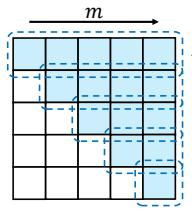

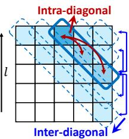  
Element-Wise  
DIAGNO (Ours)  
Figure 1: Comparison in spherical spectral space. Spherical Harmonics form a triangular (l, m) spectrum. Unlike previous SNOs using element-wise transforms, DIAGNO enables intra- and inter-diagonal interactions.

Extensive experiments across simulated fluid dynamics and various Earth system reanalysis datasets (including both atmosphere and ocean) demonstrate that DIAGNO consistently achieves state-of-theart performance in forecasting. Furthermore, we validate DIAGNO’s practical analytical value within professional geophysical domains by assessing its fidelity in capturing climatological anomalies and its ability to maintain physical consistency. These results confirm that DIAGNO provides a reliable paradigm for modeling the complex and heterogeneous dynamics of the Earth system. Overall, our contributions are summarized as follows:

• Instead of relying on the idealized rotation equivariance assumption of previous spherical neural operators, which restricts physical state transitions to isolated modal evolutions, we model explicit cross-modal interactions through direct spectral modal decomposition, fundamentally preserving the inherent heterogeneity of Earth’s dynamic systems.

• We observe that the diagonal structure of the Spherical Harmonic spectrum naturally characterizes global-scale zonal and meridional dynamics. Leveraging this unique spectral property, we propose a diagonal-based interaction strategy that enables explicit intra- and inter-diagonal interactions, strictly respecting intrinsic geophysical regularities.

We comprehensively evaluate DIAGNO across critical Earth dynamics scenarios, including atmospheric and oceanic forecasting, where it consistently achieves state-of-the-art (SOTA) results. Furthermore, we demonstrate the model’s practical analytical value in professional geophysics, evidenced by its high fidelity in capturing climatological anomalies and its robust ability to maintain physical consistency.

## 2 Related Works

Neural operators provide a data-driven paradigm for solving PDEs in complex physical scenarios such as fluid dynamics. Unlike traditional numerical solvers that rely on computationally expensive discretization and iterative processes [6], neural operators directly learn mappings between infinitedimensional function spaces in a data-driven manner [7]. This framework is embodied in diverse architectures. Spectral methods [18, 7, 19–23] capture global dependencies via frequency-domain parameterization. Transformer-based architectures [24–31] utilize attention mechanisms to dynamically weight localized spatial interactions. State-space models [32–36] integrate state-space structures to track the temporal evolution of fluid states. Meanwhile, graph neural operators [37–39] construct graph frameworks to resolve multi-scale features. However, when applied to Earth system modeling, these architectures fail to respect the inherent spherical geometry. Operating within Euclidean planes, they introduce spatial aliasing that manifests as radial artifacts near the poles.

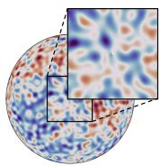  
(a) ground truth

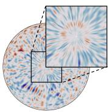  
(b) MambaNO

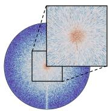  
(c) Transolver

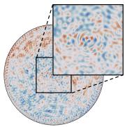  
(d) SFNO

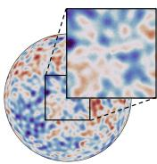  
(e) GSNO

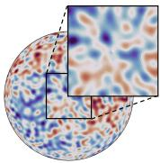  
(f) DIAGNO  
Figure 2: 10-hour SSWE velocity field (U) forecasting from a North Pole perspective. (a) Ground truth. Standard modules (b-c) exhibit radial artifacts at the pole. SNOs (d-f) eliminate artifacts, though (d-e) suffer from energy dissipation. (f) DIAGNO maintains the highest physical fidelity.

In contrast, Spherical Neural Operators (SNOs), such as SFNO [10] and GSNO [11], shift the framework from Euclidean planes to spherical spectral domain. However, to prioritize computational efficiency, conventional SNOs primarily rely on rotation-equivariant spectral operations. By modeling the Earth as an idealized system, these approaches restrict spectral modes to isolated evolution, thereby failing to capture the heterogeneity of global dynamics. Instead of relying on such an idealized assumption, we decompose physical states into spectral modes to derive an explicit interaction kernel. Building upon this, we leverage the distinct diagonal structure of the spectrum to design a novel DIAGNO module that effectively captures heterogeneous interactions across orthogonal directions.

## 3 Preliminaries

## 3.1 Problem Formulation

Kernel Integral Operator. We consider the spatiotemporal evolution $[ 4 0 , 4 1 ]$ of physical dynamics governed by PDEs on a general spatial domain D. Let ${ \mathbf u } ( x , t ) \in \mathbb { R } ^ { C }$ denote the physical state at spatial coordinate $x \in \mathcal { D }$ and time t, where $C$ represents the number of characteristic channels. We seek to learn an operator $\mathcal { G } _ { \theta }$ that approximates the true solution operator for single-step evolution:

$$
{ \mathbf { u } } ( x , t + \Delta t ) = \mathcal { G } _ { \boldsymbol { \theta } } ( { \mathbf { u } } ( x , t ) ) ,\tag{1}
$$

where θ represents the learnable parameters and $\Delta t$ denotes the time interval. Following the neural operator paradigm, this mapping is formulated as a kernel integral operator [7]. Defining the input state as $\mathbf { u } ( x ) : = \mathbf { u } ( x , t )$ and the target state as $\mathbf { v } ( x ) : = \mathbf { u } ( x , t + \Delta t )$ , the operator K is expressed as:

$$
\mathbf { v } ( x ) = ( K \mathbf { u } ) ( x ) = \int _ { \mathcal { D } } \kappa ( x , x ^ { \prime } ) \mathbf { u } ( x ^ { \prime } ) d x ^ { \prime } ,\tag{2}
$$

where $\pmb { \kappa } ( x , x ^ { \prime } ) \in \mathbb { R } ^ { C \times C }$ is a continuous kernel representing interactions between x and $x ^ { \prime } .$ . Specifically, when modeling global geophysical dynamics, the domain D restricts to the two-dimensional sphere $\mathbb { S } ^ { 2 }$ , with the coordinate specified as $\dot { \boldsymbol { x } } = ( \theta , \phi ) \in \mathbb { S } ^ { 2 }$ , where $\theta \in [ 0 , \pi ]$ and $\phi \in [ 0 , 2 \pi )$ .

Spherical Harmonic. For modeling on the sphere $\mathbb { S } ^ { 2 }$ , Spherical Harmonics $Y _ { l } ^ { m } ( \theta , \phi )$ are typically adopted as the canonical orthogonal basis [42]. The integer degree $l \geq 0$ and order $m \in [ - l , l ]$ collectively determine the spatial frequency of the basis function. Thus, the continuous spherical spatial field $\mathbf { u } ( \theta , \phi )$ can be projected to the spectral domain through the Spherical Harmonic Transform (SHT) [43]. Specifically, the complex spectral coefficients $\hat { \mathbf { u } } _ { l , m }$ are extracted via:

$$
\hat { \mathbf { u } } _ { l , m } = S H T [ \mathbf { u } ] = \int _ { 0 } ^ { \pi } \int _ { 0 } ^ { 2 \pi } \mathbf { u } ( \theta , \phi ) \overline { { Y } } _ { l } ^ { m } ( \theta , \phi ) \sin \theta d \phi d \theta ,\tag{3}
$$

where $\overline { { Y } } _ { l } ^ { m }$ and sin θ dϕdθ denote the conjugate spherical harmonic and the invariant measure on $\mathbb { S } ^ { 2 }$ , respectively. The inverse transform (iSHT) then reconstructs the spatial field from the spectral domain up to a maximum degree L of the spherical harmonic expansion:

$$
\mathbf { u } ( \theta , \phi ) = i S H T [ \hat { \mathbf { u } } ] = \sum _ { l = 0 } ^ { L - 1 } \sum _ { m = - l } ^ { l } \hat { \mathbf { u } } _ { l , m } Y _ { l } ^ { m } ( \theta , \phi ) .\tag{4}
$$

Hereafter, we omit spectral coefficients with $m < 0$ to eliminate redundancy, leveraging the spectral conjugate symmetry of real-valued fields.

## 3.2 Why Spherical Harmonics Matter?

Standard neural operators typically model geophysical dynamics by treating $\mathbb { S } ^ { 2 }$ as Euclidean domains. This planar modeling fails to account for the sphere’s intrinsic curvature and coordinate singularity. Specifically, their reliance on uniform feature extraction violates the Nyquist bounds near topological singularities (i.e., the geographical poles) [44, 45], inevitably triggering spectral aliasing.

To investigate this phenomenon, we conduct a case study on Spherical Shallow Water Equation (SSWE) with several popular neural solvers. As illustrated in Figure 2(b)-(c), the geometric mismatch inevitably introduces severe radial artifacts near the poles. These artifacts are driven by spectral aliasing, originating at poles and compounding to overwhelm the valid prediction. Meanwhile, spherical neural operators adopt a different perspective by modeling geophysical dynamics directly in spectral coordinates of the Spherical Harmonic space. By transitioning the framework from the Euclidean plane to the spherical spectral domain, these models operate within a spectral representation that naturally respects the sphere geometry. As shown in Figure 2(d)-(f), this approach effectively eliminates polar artifacts. However, compared to our proposed DIAGNO, the prediction results of SFNO and GSNO still suffer from energy dissipation, leading to blurred edges and fragmented structures.

## 4 Methodology

In this section, we model global dynamics as a heterogeneous process of cross-modal interactions. Firstly, we decompose the physical states, deriving a parameterized modal interaction kernel. Leveraging the unique diagonal structure of spectrum, we factorize the kernel along spectral diagonals to preserve geophysical regularities. Building upon this formulation, we design the DIAGNO module to govern the modal interactions. Finally, by integrating these modules into a multi-resolution hierarchical architecture [46], our framework captures the dominant dynamics at varying spatial scales, facilitating a comprehensive mapping of Earth’s dynamics.

## 4.1 Formulation of Cross-Modal Interaction

In this subsection, instead of relying on the rotation equivariance assumption that isolates modal evolution, we explicitly formulate cross-modal interactions to preserve the heterogeneity of Earth dynamics. We first derive an interaction kernel through a direct modal decomposition. To ground this formulation in actual geophysical regularities, we factorize the kernel utilizing the unique diagonal structure of spherical spectrum, yielding a formulation that captures zonal and meridional dynamics.

Cross-Modal Kernel Parameterization. Driven by the need to explicitly parameterize the crossmodal interaction, we perform modal decomposition on the physical state fields. The Galerkin projection [47] formalizes the decomposition by representing the physical states $\mathbf { u } ( x ) , \mathbf { v } ( x ) \in \mathbb { R } ^ { C }$ as linear combinations of a set of orthogonal basis functions $\{ \bar { \Psi } _ { k } ( \bar { x } ) \}$ that span the functional space:

$$
\mathbf { u } ( x ) = \sum _ { i } { \hat { \mathbf { u } } } _ { i } \Psi _ { i } ( x ) , \quad \mathbf { v } ( x ) = \sum _ { j } { \hat { \mathbf { v } } } _ { j } \Psi _ { j } ( x ) ,\tag{5}
$$

where $\hat { \mathbf { u } } _ { i } , \hat { \mathbf { v } } _ { i } \in \mathbb { C } ^ { C }$ denote the modal coefficients associated with the modes. By specifying these basis functions as Spherical Harmonics, the SHT (Equation 3) derives the target modal coefficient as $\begin{array} { r } { \hat { \mathbf { v } } _ { l , m } = \int _ { \mathbb { S } ^ { 2 } } \mathbf { v } ( x ) \overline { { Y } } _ { l } ^ { m } ( x ) d x } \end{array}$ . Applying the integral operator in Equation $2 , \hat { \mathbf { v } } _ { l , m }$ is given by:

$$
\hat { \mathbf { v } } _ { l , m } = \int _ { \mathbb { S } ^ { 2 } } \left[ \int _ { \mathbb { S } ^ { 2 } } \kappa ( x , x ^ { \prime } ) \mathbf { u } ( x ^ { \prime } ) d x ^ { \prime } \right] \overline { { Y } } _ { l } ^ { m } ( x ) d x .\tag{6}
$$

By substituting the iSHT representation of the input state $\mathbf { u } ( x ^ { \prime } )$ from Equation 4 and interchanging the order of integration and summation, the formulation becomes:

$$
\begin{array} { c } { { \displaystyle \hat { \mathbf { v } } _ { l , m } = \int _ { \mathbb { S } ^ { 2 } } \left[ \int _ { \mathbb { S } ^ { 2 } } \kappa ( x , x ^ { \prime } ) \left( \sum _ { l ^ { \prime } , m ^ { \prime } } \hat { \mathbf { u } } _ { l ^ { \prime } , m ^ { \prime } } Y _ { l ^ { \prime } } ^ { m ^ { \prime } } ( x ^ { \prime } ) \right) d x ^ { \prime } \right] \overline { { { Y } } } _ { l } ^ { m } ( x ) d x } } \\ { { = \displaystyle \sum _ { l ^ { \prime } , m ^ { \prime } } \underbrace { \left( \iint _ { \mathbb { S } ^ { 2 } \times \mathbb { S } ^ { 2 } } \overline { { { Y } } } _ { l } ^ { m } ( x ) \kappa ( x , x ^ { \prime } ) Y _ { l ^ { \prime } } ^ { m ^ { \prime } } ( x ^ { \prime } ) d x d x ^ { \prime } \right) } _ { \displaystyle \mathcal { W } _ { ( l , m ) , ( l ^ { \prime } , m ^ { \prime } ) } } \hat { \mathbf { u } } _ { l ^ { \prime } , m ^ { \prime } } , } } \end{array}\tag{7}
$$

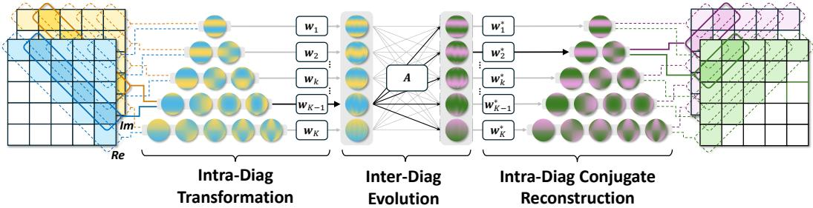  
Figure 3: DIAGNO module architecture. Complex spectral coefficients are represented as triangular matrices and evolved through sequential intra-diagonal transformation, inter-diagonal evolution, and intra-diagonal conjugate reconstruction. Spheres illustrate spatial patterns of spectral modes.

where $\hat { \mathbf { u } } _ { l ^ { \prime } , m ^ { \prime } }$ are spectral modal coefficients of $\mathbf { u } ( { x } ^ { \prime } )$ . Through this transformation, we define the kernel of modal interaction $\mathcal { W } _ { ( l , m ) , ( l ^ { \prime } , m ^ { \prime } ) } ,$ which encapsulates interaction between input spectral mode $( l ^ { \prime } , m ^ { \prime } )$ and target spectral mode (l, m). Therefore, the continuous spatial operator in Equation 2 is distilled into a discrete spectral representation:

$$
\hat { \mathbf { v } } _ { l , m } = \sum _ { l ^ { \prime } , m ^ { \prime } } \mathcal { W } _ { ( l , m ) , ( l ^ { \prime } , m ^ { \prime } ) } \hat { \mathbf { u } } _ { l ^ { \prime } , m ^ { \prime } } .\tag{8}
$$

In this formulation, W serves as a parameterized kernel that enables interactions across different modes. By parameterizing cross-modal interactions, our framework provides mathematical flexibility to preserve the heterogeneity of global dynamics.

Diagonal Kernel Factorization. While a dense interaction kernel W theoretically permits arbitrary interactions between any two spectral modes, this unconstrained formulation contradicts actual physical regularities. In geophysical fluid dynamics, the global evolution is primarily dominated by zonal patterns, such as global zonal climate belts [48], whereas meridional processes act as auxiliary pathways for energy exchange [49] and oceanic heat transport [50].

We observe that the diagonal structure of Spherical Harmonic spectrum inherently characterizes the distribution of the orthogonal directions. Formally, the spectral modal coefficients $\hat { \mathbf { u } } _ { l , m }$ aligned along the same diagonal direction share a constant degree-order offset k. We group these components by defining a diagonal index set $\mathcal { D } _ { k } = \{ ( l , m ) ~ | ~ l { - } \bar { m } { + } 1 = k \}$ for each offset, where $0 \leq m \leq l \leq L - \mathrm { i }$ and $k \in \{ 1 , \overline { { \cdot \cdot \cdot } } , L \}$ indexes the $\dot { K } = \dot { L }$ diagonal sets. Specifically, modes within the same $\mathcal { D } _ { k }$ (intra-diagonal) share a unified zonal pattern, where an increasing degree l proportionally raises the longitudinal wavenumber to capture denser meridional oscillations. In contrast, modes across different sets $\mathcal { D } _ { k }$ dictate distinct zonal patterns, where an increasing index k proportionally raises the latitudinal wavenumber to reflect progressively denser zonal structures. Inspired by the diagonal structure of the Spherical Harmonic spectrum, we factorize the operator W into intra-diagonal and inter-diagonal operations to characterize modal interactions along the orthogonal directions:

$$
{ \mathcal { W } } = { \mathcal { W } } _ { \mathrm { r e c } } { \mathcal { A } } _ { \mathrm { a t t n } } { \mathcal { W } } _ { \mathrm { t r a n s } } ,\tag{9}
$$

where $\mathcal { W } _ { \mathrm { t r a n s } } , \mathcal { A } _ { \mathrm { a t t n } } .$ , and ${ \mathcal W } _ { \mathrm { r e c } }$ denote the intra-diagonal transformation operator, the inter-diagonal evolution operator, and the intra-diagonal reconstruction operator, respectively.

## 4.2 Design of DIAGNO Module

Based on the factorized interaction, we design the DIAGNO module to operate within the spherical spectral domain, capturing complex physical dynamics through three consecutive steps: intra-diagonal transformation, inter-diagonal evolution, and intra-diagonal conjugate reconstruction. The complete architectural design is illustrated in Figure 3. Through these operations, the module achieves a complete parameterized mapping of spatial physical states for Earth systems.

Intra-Diagonal Transformation. To capture the meridional interactions, we modulate the transformation among modes sharing the same zonal pattern. During this intra-diagonal transformation, we introduce a complex learnable aggregation tensor $\widetilde { \mathbf { w } } _ { k } \in \mathbb { C } ^ { C \times | \mathcal { D } _ { k } | }$ for each set $\mathcal { D } _ { k }$ . This tensor learns to quantify the relative contributions and dynamic redistributions among meridional oscillations. We apply a softmax normalization to the amplitude of $\widetilde { \mathbf { w } } _ { k }$ over each $\mathcal { D } _ { k }$ while retaining the phase as $\tilde { \mathbf { w } _ { k } } = \mathrm { S o f t m a x } ( | \widetilde { \mathbf { w } } _ { k } | ) \odot ( \widetilde { \mathbf { w } } _ { k } / | \widetilde { \mathbf { w } } _ { k } | )$ , where ⊙ denotes the Hadamard product. The intra-diagonal transformation operator ${ \mathcal { W } } _ { \mathrm { t r a n s } }$ synthesizes these meridional interactions, aggregating spectral modes sharing the identical zonal pattern into a unified aggregated zonal mode $\hat { \mathbf { z } } _ { k }$

$$
\hat { \mathbf { z } } _ { k } = [ \mathcal { W } _ { \mathrm { t r a n s } } \hat { \mathbf { u } } ] _ { k } = \sum _ { n = 1 } ^ { | \mathcal { D } _ { k } | } \mathbf { w } _ { k } ^ { ( n ) } \odot \hat { \mathbf { u } } _ { \mathcal { D } _ { k } } ^ { ( n ) } ,\tag{10}
$$

where $\mathbf { w } _ { k } ^ { ( n ) } \in \mathbb { C } ^ { C }$ denotes the n-th column of the learnable aggregation weight matrix ${ \bf w } _ { k }$ , and $\hat { \mathbf { u } } _ { \mathcal { D } _ { k } } ^ { ( n ) } \in \mathbb { C } ^ { C }$ represents the n-th spectral mode coefficient within the diagonal set $\mathcal { D } _ { k }$

Inter-Diagonal Evolution. To explicitly capture the inter-diagonal evolution (i.e., the interactions among different zonal patterns), we introduce a physically-grounded attention mechanism. Let $\mathbf { q } _ { k } \in \mathbf { \mathbb { C } } ^ { C }$ denote a learnable latent query refined by a self-attention layer. This query encodes the inter-zonal transfer tendency of aggregated zonal modes. We compute an interaction matrix $\mathbf { A } ( \hat { \mathbf { u } } ) \in \mathbb { R } ^ { K \times K }$ to quantify the coupling strength between $\mathbf q _ { k }$ and $\hat { \mathbf { z } } _ { k ^ { \prime } }$ . To reflect physical crosscorrelation, the attention scores are evaluated using the real part of their complex inner product:

$$
A _ { k , k ^ { \prime } } = \frac { \exp \left( \frac { 1 } { \sqrt { C } } \operatorname { R e } \left[ \mathbf { q } _ { k } ^ { H } \mathbf { \hat { z } } _ { k ^ { \prime } } \right] \right) } { \sum _ { j = 1 } ^ { K } \exp \left( \frac { 1 } { \sqrt { C } } \operatorname { R e } \left[ \mathbf { q } _ { k } ^ { H } \mathbf { \hat { z } } _ { j } \right] \right) } ,\tag{11}
$$

where $( \cdot ) ^ { H }$ denotes the conjugate transpose operator. Driven by these coupling weights, energy is dynamically redistributed across the inter-zonal spectrum. We define this process as the inter-diagonal evolution operator ${ \mathcal { A } } _ { \mathrm { a t t n } } ,$ forming the evolved zonal modes $\tilde { \mathbf { z } } _ { k }$

$$
\tilde { \mathbf { z } } _ { k } = [ A _ { \mathrm { a t t n } } \hat { \mathbf { z } } ] _ { k } = \sum _ { k ^ { \prime } = 1 } ^ { K } A _ { k , k ^ { \prime } } \hat { \mathbf { z } } _ { k ^ { \prime } } .\tag{12}
$$

Intra-Diagonal Conjugate Reconstruction. To complete the modal interaction process, we map the evolved zonal modes back to the spectral domain to reconstruct the target state $\hat { \mathbf { v } } _ { l , m } \colon$

$$
\hat { \mathbf { v } } _ { l , m } = [ { \mathcal { W } } _ { \mathrm { r e c } } \tilde { \mathbf { z } } ] _ { l , m } = ( \mathbf { w } _ { k } ^ { ( n ) } ) ^ { * } \odot \tilde { \mathbf { z } } _ { k } ,\tag{13}
$$

where $( \cdot ) ^ { * }$ denotes the element-wise conjugate and $n = m + 1$ . As formulated in Equation 13, rather than introducing an independent set of learnable parameters for reconstruction, we directly utilize the conjugate of the aggregation tensor ${ \bf w } _ { k }$ . This design is fundamentally rooted in the Best Approximation Theorem [51, 52] within the context of Hilbert spaces. The proof is provided in the Appendix A.2. By composing the above three operators, the factorized spectral coupling process can be explicitly parameterized into its final expansion to obtain the target state $\hat { \mathbf { v } } _ { l , m } \colon$

$$
\hat { \mathbf { v } } _ { l , m } = [ ( \mathcal { W } _ { \mathrm { r e c } } \mathcal { A } _ { \mathrm { a t m } } \mathcal { W } _ { \mathrm { t r a n s } } ) \hat { \mathbf { u } } ] _ { l , m } = \sum _ { l ^ { \prime } , m ^ { \prime } } \left[ ( \mathbf { w } _ { k } ^ { ( m + 1 ) } ) ^ { * } \odot A _ { k , k ^ { \prime } } ( \hat { \mathbf { u } } ) \mathbf { w } _ { k ^ { \prime } } ^ { ( m ^ { \prime } + 1 ) } \right] \odot \hat { \mathbf { u } } _ { l ^ { \prime } , m ^ { \prime } } .\tag{14}
$$

Finally, the DIAGNO module formally defines the end-to-end transition from the input spatial state $\mathbf { u } ( x )$ to the target state v(x) as:

$$
\mathbf { v } ( x ) = i S H T \left[ ( \mathcal { W } _ { \mathrm { r e c } } \mathcal { A } _ { \mathrm { a t t n } } \mathcal { W } _ { \mathrm { t r a n s } } ) S H T [ \mathbf { u } ( x ) ] \right] .\tag{15}
$$

## 5 Experiment

We evaluate DIAGNO through comprehensive experiments, addressing four key research questions: versatility (RQ1), utility (RQ2), interpretability (RQ3), and necessity (RQ4):

RQ1: Does DIAGNO achieve consistent SOTA performance across diverse geophysical scenarios?

RQ2: Does DIAGNO provide practical analytical value within professional geophysical domains?

RQ3: Does DIAGNO offer mechanistic interpretability for scale-specific global dynamics?

RQ4: How do the diagonal designs and hyperparameter settings contribute to model effectiveness?

## 5.1 Experiment Setup

Benchmarks and Datasets. To evaluate DIAGNO across diverse physical scenarios, we utilize one simulated benchmark and two real-world Earth system reanalysis datasets (detailed in Appendix B.1):

• Spherical Shallow Water Equations: The SSWE [53, 54] dataset simulates large-scale fluid dynamics on planetary surfaces. The ground-truth trajectories are randomly generated using a pseudo spectral method across 1024 training, 256 validation, and 256 test samples.

• Sea Surface Forecasting: Using GLORYS12 [55] reanalysis data, we characterize ocean dynamics SSH, SST, U, V across training (2013–20), validation (21–22), and testing (23–24) periods.

• Atmospheric Forecasting: We utilize 500 hPa ERA5 [56] reanalysis to model Z, U, V fields at 6-hour resolution, following the same temporal partitioning as the sea surface dataset.

Baselines. Baselines include standard neural operators (FNO [7], LSM [57], Transolver [29], MambaNO [33] and AMG [39]) and spherical neural operators (SFNO [10] and GSNO [11]), as well as domain-specific models: LangYa [58] for sea surface and ClimaX [59] for atmospheric forecasting. The specific hyperparameter settings for all evaluated baselines are detailed in Table 4.

Further details on training/inference, evaluation metrics, and computational complexity are provided in Appendices B.3, B.4, and B.5, respectively. All reported metrics are averaged over multiple independent runs to ensure reliability.

## 5.2 Overall Performance (RQ1)

Spherical Shallow Water Equation. The 5- hour and 10-hour SSWE forecasting results are summarized in Table 1, where spherical neural operators generally outperform standard baselines. Specifically, DIAGNO achieves the lowest error across all metrics, significantly surpassing other models. While some standard operators suffer from early predictive stagnation and blurred states, DIAGNO maintains steady error growth, reflecting its capacity to capture continuous physical evolution. Detailed visualizations are provided in the Appendix C.1.

Sea Surface Forecasting. In the sea surface forecasting experiment, we evaluate the daily autoregressive prediction performance over a 10- day lead time. Figure 4 traces the continuous Anomaly Correlation Coefficient (ACC) of spherical neural operators and the marine forecasting model LangYa [58]. Detailed comparisons involving all baselines are provided in Table 7,

Table 1: Performance comparison for SSWE. Spherical neural operators generally outperform standard baselines. DIAGNO achieves the best performance, reducing averaged error by 35.2% while maintaining competitive memory efficiency.
<table><tr><td rowspan="2">MODEL</td><td rowspan="2">#MEM (GB)</td><td colspan="2">5 hours 10 hours</td></tr><tr><td>MAE ↓ RMSE ↓ MAE↓ RMSE↓ (×103) (×103)</td><td>(×103) (×103)</td></tr><tr><td>Swin [60]</td><td>2.49</td><td>0.2285 0.2878</td><td>0.2545 0.3212</td></tr><tr><td>FNO [7]</td><td>2.50</td><td>0.2702 0.3390</td><td>0.2653 0.3326</td></tr><tr><td>LSM [57]</td><td>3.92 0.1038</td><td>0.1583</td><td>0.1905 0.2502</td></tr><tr><td>Transolver [29]</td><td>5.61 0.2897</td><td>0.3636</td><td>0.2871 0.3591</td></tr><tr><td>MambaNO [33]</td><td>12.14 0.1393</td><td>0.1893</td><td>0.5848 0.7438</td></tr><tr><td>AMG [39]</td><td>3.06 0.2784</td><td>0.3491</td><td>0.2675 0.3355</td></tr><tr><td>SFNO [10]</td><td>2.30 0.1055</td><td>0.1322</td><td>0.1973 0.2481</td></tr><tr><td>GSNO [11]</td><td>9.63 0.0761</td><td>0.0955</td><td>0.1113 0.1400</td></tr><tr><td>DIAGNO</td><td>4.26 0.0448</td><td>0.0563</td><td>0.0790 0.0985</td></tr></table>

where DIAGNO consistently achieves state-of-the-art performance. Notably, while spherical operators generally outpace LangYa, DIAGNO exhibits the strongest temporal robustness.

Atmospheric Forecasting. In atmospheric forecasting tasks, we evaluate the 72-hour and 120- hour predictive performance (Table 2). While the foundation model ClimaX [59] demonstrates commendable stability at extended lead times (120 hours), DIAGNO consistently outperforms both ClimaX and existing spherical operators across all forecasting horizons. Notably, our model achieves a significant improvement in the ACC for the geopotential (Z) field, a critical metric for capturing large-scale circulations. This indicates that modeling atmospheric heterogeneity via our diagonal factorization provides an effective physical prior for atmospheric dynamics.

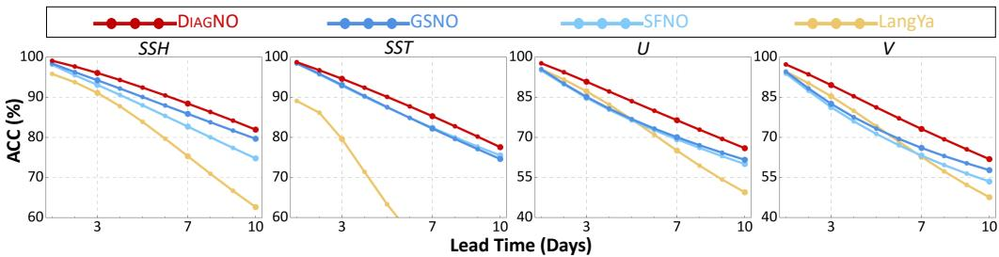  
Figure 4: The ACC of ocean surface prediction (higher is better). DIAGNO exhibits superior stability across all lead times compared to spherical operators and the domain-specific LangYa model.

Table 2: Performance comparison for ERA5 atmospheric forecasting. DIAGNO consistently outperforms all baselines across all lead times, with particularly strong improvements in Z forecasting.
<table><tr><td rowspan="3">MODEL</td><td colspan="6">72 Hours (12 steps)</td><td colspan="6">120 Hours (20 steps)</td></tr><tr><td>MAE↓</td><td>RMSE↓</td><td></td><td>ACC(%) ↑</td><td></td><td></td><td>MAE↓</td><td>RMSE↓</td><td></td><td>ACC(%) ↑</td><td></td><td></td></tr><tr><td>(×103)</td><td>(×103)</td><td>Z</td><td>U</td><td>V</td><td>Avg.</td><td>(×103)</td><td>(×103)</td><td>Z</td><td>U</td><td>V</td><td>Avg.</td></tr><tr><td>Swin [60]</td><td>0.2029</td><td>0.3014</td><td>68.97</td><td>59.98</td><td>55.36</td><td>61.44</td><td>0.3147</td><td>0.4627</td><td>38.53</td><td>33.21</td><td>27.17</td><td>32.97</td></tr><tr><td>FNO [7]</td><td>0.2974</td><td>0.4145</td><td>36.47</td><td>37.04</td><td>33.40</td><td>35.63</td><td>0.4710</td><td>0.6404</td><td>12.45</td><td>15.32</td><td>12.92</td><td>13.57</td></tr><tr><td>LSM [57]</td><td>0.1697</td><td>0.2503</td><td>73.64</td><td>62.36</td><td>58.28</td><td>64.76</td><td>0.2448</td><td>0.3595</td><td>46.28</td><td>37.86</td><td>31.99</td><td>38.71</td></tr><tr><td>Transolver [29]</td><td>0.2956</td><td>0.4165</td><td>36.60</td><td>27.89</td><td>23.95</td><td>29.48</td><td>0.3918</td><td>0.5344</td><td>17.53</td><td>12.05</td><td>11.43</td><td>13.67</td></tr><tr><td>MambaNO [33]</td><td>0.2694</td><td>0.5448</td><td>68.57</td><td>67.13</td><td>65.12</td><td>66.94</td><td>0.3869</td><td>0.6497</td><td>34.36</td><td>40.08</td><td>33.77</td><td>36.07</td></tr><tr><td>AMG [39]</td><td>0.1806</td><td>0.2619</td><td>71.62</td><td>57.19</td><td>54.66</td><td>61.16</td><td>0.2615</td><td>0.3765</td><td>40.58</td><td>31.82</td><td>27.16</td><td>33.18</td></tr><tr><td>SFNO [10]</td><td>0.1973</td><td>0.2782</td><td>65.62</td><td>57.90</td><td>55.42</td><td>59.65</td><td>0.2594</td><td>0.3670</td><td>40.37</td><td>36.11</td><td>31.97</td><td>36.15</td></tr><tr><td>GSNO [11]</td><td>0.1801</td><td>0.2629</td><td>73.86</td><td>61.86</td><td>58.18</td><td>64.63</td><td>0.2600</td><td>0.3795</td><td>47.12</td><td>38.26</td><td>31.38</td><td>38.92</td></tr><tr><td>ClimaX [59]</td><td>0.1885</td><td>0.2630</td><td>70.35</td><td>64.39</td><td>62.41</td><td>65.72</td><td>0.2574</td><td>0.3576</td><td>45.88</td><td>42.85</td><td>38.86</td><td>42.53</td></tr><tr><td>DIAGNO</td><td>0.1505</td><td>0.2344</td><td>81.18</td><td>67.87</td><td>65.14</td><td>71.40</td><td>0.2264</td><td>0.3549</td><td>56.72</td><td>44.93</td><td>39.88</td><td>47.18</td></tr></table>

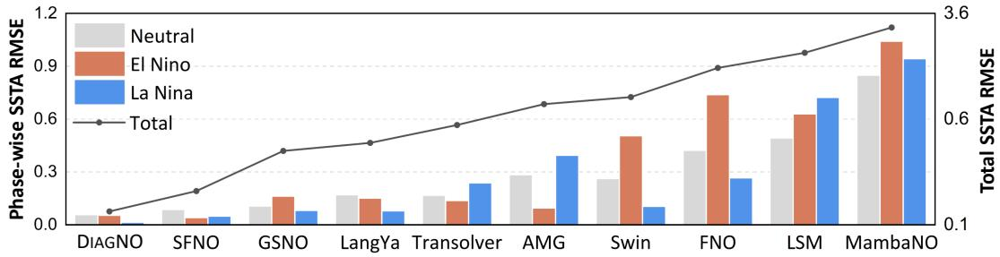  
Figure 5: SSTA RMSE comparison. Left axis: phase-wise SSTA RMSE (bars). Right axis: total SSTA RMSE (line) on a logarithmic scale for visual compactness. See Table 8 for exact values.

## 5.3 Practical Analytical Value: Anomalies and Physical Consistency (RQ2)

To verify practical analytical value, we extend our evaluation beyond general metrics to focus on two advanced dimensions: sensitivity to climatological anomalies and physical consistency in energetics.

Climatological Anomaly. We evaluate climate anomaly capturing via 7-day Sea Surface Temperature Anomaly (SSTA) forecasts in the Niño 3.4 region [61] (Figure 5). Using ±0.5◦C thresholds to classify ENSO phases [62], DIAGNO significantly outperforms baselines in Neutral and La Niña conditions, while marginally trailing SFNO during extreme El Niño. This balanced performance achieves the lowest cumulative error across the entire ENSO cycle, confirming the practical utility of DIAGNO’s forecasts in characterizing climatological anomalies.

Physical Consistency: Energy Cascades. Based on the atmospheric forecasting results, we assess the physical consistency of the 120-hour wind predictions (U, V). Specifically, we analyze the Kinetic Energy Spectrum (KES) [63, 64] and Eddy Kinetic Energy (EKE) [65] to quantify the intensity of transient weather systems and verify energy distribution across scales. As depicted in Figure 6, DIAGNO achieves the most accurate trade-off between maintaining spatial intensity and preserving the spectral distribution. By explicitly modeling the inherent heterogeneity of atmospheric systems via our diagonal factorization, the model effectively respects the dynamic energy cascades.

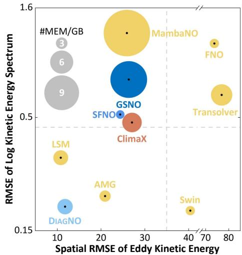  
Figure 6: Physical consistency analysis. Xaxis: Spatial EKE RMSE. Y-axis: Log KES RMSE on a logarithmic scale. ClimaX shows competitive predictive performance second to DIAGNO, yet falls considerably short in energy consistency.

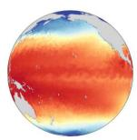  
(a)

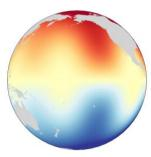  
(b)

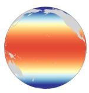  
(c)

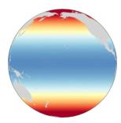  
(d)

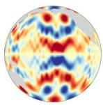  
(e)

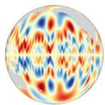  
(f)  
Figure 7: Scale-specific dominant mode reconstructions. (a) Actual SST field. (b-f) iSHT representations reveal hierarchical extraction: (b) lowest-resolution interhemispheric asymmetry; (c-d) intermediate-resolution climate belts; (e-f) high-resolution fine asymmetric details.

## 5.4 Interpreting Dominant Dynamics: A Scale-Resolution Correspondence (RQ3)

To verify how DIAGNO captures dominant dynamics across resolutions, we analyze its cross-attention matrices generated during Sea Surface Temperature (SST) forecasting, which quantify the coupling between aggregated zonal modes and latent queries. We select the dominant modes by identifying those with the maximum attention weights, representing the highest evolutionary tendency for energy redistribution. Reconstructing the $S S T$ field from these modes via iSHT (Figure 7) reveals a scaleresolution correspondence and their distinct physical roles. Specifically, lower-resolution layers establish macroscopic foundational dynamics, such as interhemispheric asymmetry and planetary climate belts, whereas higher-resolution layers are responsible for high-frequency spatial waves and fine-grained asymmetric details. This explicit decoupling validates DIAGNO’s ability to adaptively coordinate interpretable, scale-specific modal interactions for complex global forecasting.

## 5.5 Ablation and Hyperparameter Analysis (RQ4)

To further validate DIAGNO, we conduct ablation studies by replacing diagonal interactions with standard l-dim or m-dim transformations. As shown in Table 3, DIAGNO consistently outperforms these variants in 10-day sea surface forecasting, underscoring the necessity of diagonal spectral coupling. Additionally, our hyperparameter configurations are substantiated by a sensitivity analysis on the Spherical Shallow Water Equations (Figure 8).

## 6 Conclusions & Limitations

Conclusions. We propose DIAGNO, which abandons the over-idealized rotation equivariance of previous spherical neural operators to explicitly model cross-modal interactions. By leveraging the unique diagonal structure of the Spherical Harmonic spectrum, DIAGNO natively captures global-scale zonal and meridional dynamics, preserving the intrinsic heterogeneity of Earth systems. Extensive evaluations across atmospheric and oceanic scenarios demonstrate that DIAGNO achieves state-of-the-art forecasting performance while exhibiting strong practical value through high physical consistency and accurate anomaly capture.

Limitations and Future Work. While DI-AGNO effectively captures global heterogeneity, its reliance on SHTs mathematically necessitates complete global grids. Consequently, it is restricted when applied to localized spherical domains, which is a fundamental constraint shared by all spherical spectral-based models. Future work will extend our diagonal interaction paradigm to regional modeling. For instance, developing localized representations to independently model polar dynamics remains our next direction.

Table 3: Ablation study. Evaluation of 10-day sea surface forecasting. DIAGNO consistently outperforms l-dim and m-dim variants.
<table><tr><td rowspan="2">MODEL</td><td rowspan="2">MAE↓ RMSE↓</td><td rowspan="2"></td><td colspan="4">ACC(%)↑</td></tr><tr><td>SSH</td><td>SST</td><td>U</td><td>V</td></tr><tr><td>m-dim</td><td>0.1738</td><td>0.2512</td><td>80.97</td><td>76.44</td><td>65.04</td><td>61.37</td></tr><tr><td>l-dim</td><td>0.1939</td><td>0.2968</td><td>79.65</td><td>75.87</td><td>64.41</td><td>60.15</td></tr><tr><td>DIAGNO</td><td>0.1638</td><td>0.2387</td><td>81.93</td><td>77.57</td><td>65.97</td><td>61.89</td></tr></table>

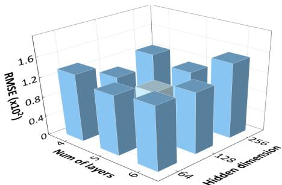  
Figure 8: Hyperparameter analysis. 10-hour prediction RMSE on SSWE. Our configuration (5 multi-resolution layers, 128 dim) is optimal.

## Acknowledgments

This work was supported in part by the National Natural Science Foundation of China under Grant No. T2421002 and No. 62272293, and the Postdoctoral Fellowship Program of CPSF under Grant No. GZB20250806. The authors declare no competing interests.

## References

[1] Salva Rühling Cachay, Brian Henn, Oliver Watt-Meyer, Christopher S. Bretherton, and Rose Yu. Probablistic emulation of a global climate model with spherical dyffusion. In A. Globerson, L. Mackey, D. Belgrave, A. Fan, U. Paquet, J. Tomczak, and C. Zhang, editors, Advances in Neural Information Processing Systems, volume 37, pages 127610–127644. Curran Associates, Inc., 2024. doi: 10. 52202/079017-4052. URL https://proceedings.neurips.cc/paper\_files/paper/2024/file/ e6a11b618402617342f38f5b49430937-Paper-Conference.pdf.

[2] Qiusheng Huang, Yuan Niu, Xiaohui Zhong, Anboyu Guo, Lei Chen, Dianjun Zhang, Xuefeng Zhang, and Hao Li. Fuxi-ocean: A global ocean forecasting system with sub-daily resolution, 2025. URL https://arxiv.org/abs/2506.03210.

[3] Yuze Sun, Wentao Luo, Yanfei Xiang, Jiancheng Pan, Jiahao Li, Quan Zhang, and Xiaomeng Huang. Deploying atmospheric and oceanic ai models on chinese hardware and framework: Migration strategies, performance optimization and analysis. In Proceedings ofthe AAAI Conference on Artificial Intelligence, volume 40, pages 40521–40527, 2026.

[4] Z. Wang, B. Lu, Y. Xin, T. Ito, L. Zhou, L. Cheng, Y. Li, X. Wang, and M. Jin. Jingwei-nutrients: a global spatiotemporal reconstruction of ocean nutrients (1965–2023) using multi-task deep learning. Earth System Science Data, 18(7):5069–5092, 2026. doi: 10.5194/essd-18-5069-2026. URL https: //essd.copernicus.org/articles/18/5069/2026/.

[5] Bin Lu, Jingjing Shen, Ze Zhao, Jianping Zhou, Haonan Qi, Luyu Han, Xiaoying Gan, Meng Jin, Lei Zhou, Luoyi Fu, Xinbing Wang, and Chenghu Zhou. Oceanverse: Evaluable 4d ocean element reconstruction dataset under realistic sparsity. In Proceedings of the 32nd ACM SIGKDD Conference on Knowledge Discovery and Data Mining V.2, KDD ’26, page 9474–9485, New York, NY, USA, 2026. Association for Computing Machinery. ISBN 9798400722592. doi: 10.1145/3770855.3817534. URL https://doi.org/10.1145/3770855.3817534.

[6] Peter Bauer, Alan Thorpe, and Gilbert Brunet. The quiet revolution of numerical weather prediction. Nature, 525(7567):47–55, 2015.

[7] Zongyi Li, Nikola Borislavov Kovachki, Kamyar Azizzadenesheli, Burigede Liu, Kaushik Bhattacharya, Andrew M. Stuart, and Anima Anandkumar. Fourier neural operator for parametric partial differential equations. In 9th International Conference on Learning Representations, ICLR 2021, Virtual Event, Austria, May 3-7, 2021. OpenReview.net, 2021. URL https://openreview.net/forum?id=c8P9NQVtmnO.

[8] Lu Lu, Pengzhan Jin, Guofei Pang, Zhongqiang Zhang, and George Em Karniadakis. Learning nonlinear operators via deeponet based on the universal approximation theorem of operators. Nature machine intelligence, 3(3):218–229, 2021.

[9] Andrew Staniforth and John Thuburn. Horizontal grids for global weather and climate prediction models: a review. Quarterly Journal ofthe Royal Meteorological Society, 138(662):1–26, 2012.

[10] Boris Bonev, Thorsten Kurth, Christian Hundt, Jaideep Pathak, Maximilian Baust, Karthik Kashinath, and Anima Anandkumar. Spherical Fourier neural operators: Learning stable dynamics on the sphere. In Andreas Krause, Emma Brunskill, Kyunghyun Cho, Barbara Engelhardt, Sivan Sabato, and Jonathan Scarlett, editors, Proceedings of the 40th International Conference on Machine Learning, volume 202 of Proceedings ofMachine Learning Research, pages 2806–2823. PMLR, 23–29 Jul 2023. URL https: //proceedings.mlr.press/v202/bonev23a.html.

[11] Hao Tang, Hao Chen, and Chao Li. Generalized spherical neural operators: Green’s function formulation. In The Fourteenth International Conference on Learning Representations, 2026. URL https://openreview.net/forum?id=XkGjzSDTnm.

[12] Yifan Hu, Fukang Yin, Weimin Zhang, Kaijun Ren, Junqiang Song, Kefeng Deng, and Di Zhang. Spherical multigrid neural operator for improving autoregressive global weather forecasting. Scientific Reports, 15 (1):11522, 2025.

[13] Taco S Cohen, Mario Geiger, Jonas Köhler, and Max Welling. Spherical cnns. arXiv preprint arXiv:1801.10130, 2018.

[14] Trond H Torsvik, Rob van der Voo, Pavel V Doubrovine, Kevin Burke, Bernhard Steinberger, Lewis D Ashwal, Reidar G Trønnes, Susan J Webb, and Abigail L Bull. Deep mantle structure as a reference frame for movements in and on the earth. Proceedings ofthe National Academy ofSciences, 111(24):8735–8740, 2014.

[15] Adam M Dziewonski, Vedran Lekic, and Barbara A Romanowicz. Mantle anchor structure: an argument for bottom up tectonics. Earth and Planetary Science Letters, 299(1-2):69–79, 2010.

[16] Brian J Hoskins and David J Karoly. The steady linear response of a spherical atmosphere to thermal and orographic forcing. Journal ofAtmospheric Sciences, 38(6):1179–1196, 1981.

[17] Tapio Schneider. The general circulation of the atmosphere. Annu. Rev. Earth Planet. Sci., 34(1):655–688, 2006.

[18] Haonan Qi, Bin Lu, Yimian Hu, Ze Zhao, Meng Jin, Lixin Qu, Shuai Li, Shizhen Zhao, Lei Zhou, Xiaoying Gan, Xinbing Wang, and Chenghu Zhou. From surface to depth: Diagnosing ocean vertical velocity with 3d frequency operator. In Proceedings ofthe 32nd ACM SIGKDD Conference on Knowledge Discovery and Data Mining V.2, KDD ’26, page 11843–11853, New York, NY, USA, 2026. Association for Computing Machinery. ISBN 9798400722592. doi: 10.1145/3770855.3819028. URL https: //doi.org/10.1145/3770855.3819028

[19] John Guibas, Morteza Mardani, Zongyi Li, Andrew Tao, Anima Anandkumar, and Bryan Catanzaro. Adaptive fourier neural operators: Efficient token mixers for transformers. CoRR, abs/2111.13587, 2021. URL https://arxiv.org/abs/2111.13587.

[20] Gege Wen, Zongyi Li, Kamyar Azizzadenesheli, Anima Anandkumar, and Sally M Benson. U-fno—an enhanced fourier neural operator-based deep-learning model for multiphase flow. Advances in Water Resources, 163:104180, 2022.

[21] Alasdair Tran, Alexander Patrick Mathews, Lexing Xie, and Cheng Soon Ong. Factorized fourier neural operators. In The Eleventh International Conference on Learning Representations, ICLR 2023, Kigali, Rwanda, May 1-5, 2023. OpenReview.net, 2023. URL https://openreview.net/forum?id= tmIiMPl4IPa.

[22] Md Ashiqur Rahman, Zachary E. Ross, and Kamyar Azizzadenesheli. U-NO: u-shaped neural operators. Trans. Mach. Learn. Res., 2023, 2023. URL https://openreview.net/forum?id=j3oQF9coJd.

[23] Jean Kossaifi, Nikola Borislavov Kovachki, Kamyar Azizzadenesheli, and Anima Anandkumar. Multi-grid tensorized fourier neural operator for high- resolution pdes. Trans. Mach. Learn. Res., 2024, 2024. URL https://openreview.net/forum?id=AWiDlO63bH.

[24] Shuhao Cao. Choose a transformer: Fourier or galerkin. In Marc’Aurelio Ranzato, Alina Beygelzimer, Yann N. Dauphin, Percy Liang, and Jennifer Wortman Vaughan, editors, Advances in Neural Information Processing Systems 34: Annual Conference on Neural Information Processing Systems 2021, NeurIPS 2021, December 6-14, 2021, virtual, pages 24924–24940, 2021. URL https://proceedings.neurips. cc/paper/2021/hash/d0921d442ee91b896ad95059d13df618-Abstract.html.

[25] Xinliang Liu, Bo Xu, and Lei Zhang. Ht-net: Hierarchical transformer based operator learning model for multiscale pdes. CoRR, abs/2210.10890, 2022. doi: 10.48550/ARXIV.2210.10890. URL https: //doi.org/10.48550/arXiv.2210.10890.

[26] Zijie Li, Kazem Meidani, and Amir Barati Farimani. Transformer for partial differential equations’ operator learning. Trans. Mach. Learn. Res., 2023, 2023. URL https://openreview.net/forum?id= EPPqt3uERT.

[27] Zijie Li, Dule Shu, and Amir Barati Farimani. Scalable transformer for pde surrogate modeling. Advances in Neural Information Processing Systems, 36:28010–28039, 2023.

[28] Zhongkai Hao, Zhengyi Wang, Hang Su, Chengyang Ying, Yinpeng Dong, Songming Liu, Ze Cheng, Jian Song, and Jun Zhu. GNOT: A general neural operator transformer for operator learning. In Andreas Krause, Emma Brunskill, Kyunghyun Cho, Barbara Engelhardt, Sivan Sabato, and Jonathan Scarlett, editors, International Conference on Machine Learning, ICML 2023, 23-29 July 2023, Honolulu, Hawaii, USA, Proceedings of Machine Learning Research, pages 12556–12569. PMLR, 2023. URL https: //proceedings.mlr.press/v202/hao23c.html.

[29] Haixu Wu, Huakun Luo, Haowen Wang, Jianmin Wang, and Mingsheng Long. Transolver: A fast transformer solver for pdes on general geometries. In Ruslan Salakhutdinov, Zico Kolter, Katherine A. Heller, Adrian Weller, Nuria Oliver, Jonathan Scarlett, and Felix Berkenkamp, editors, Forty-first International Conference on Machine Learning, ICML 2024, Vienna, Austria, July 21-27, 2024, Proceedings of Machine Learning Research, pages 53681–53705. PMLR / OpenReview.net, 2024. URL https://proceedings.mlr.press/v235/wu24r.html.

[30] Zipeng Xiao, Zhongkai Hao, Bokai Lin, Zhijie Deng, and Hang Su. Improved operator learning by orthogonal attention. In Ruslan Salakhutdinov, Zico Kolter, Katherine A. Heller, Adrian Weller, Nuria Oliver, Jonathan Scarlett, and Felix Berkenkamp, editors, Forty-first International Conference on Machine Learning, ICML 2024, Vienna, Austria, July 21-27, 2024, Proceedings of Machine Learning Research, pages 54288–54299. PMLR / OpenReview.net, 2024. URL https://proceedings.mlr.press/v235/ xiao24c.html.

[31] Hang Zhou, Yuezhou Ma, Haixu Wu, Haowen Wang, and Mingsheng Long. Unisolver: PDE-conditional transformers towards universal neural PDE solvers. In Forty-second International Conference on Machine Learning, 2025. URL https://openreview.net/forum?id=r1ryQoI9iZ.

[32] Albert Gu, Karan Goel, and Christopher Ré. Efficiently modeling long sequences with structured state spaces. In The Tenth International Conference on Learning Representations, ICLR 2022, Virtual Event, April 25-29, 2022. OpenReview.net, 2022. URL https://openreview.net/forum?id=uYLFoz1vlAC.

[33] Jianwei Zheng, LiweiNo, Ni Xu, Junwei Zhu, XiaoxuLin, and Xiaoqin Zhang. Alias-free mamba neural operator. In The Thirty-eighth Annual Conference on Neural Information Processing Systems, 2024. URL https://openreview.net/forum?id=gUEBXGV8JM.

[34] Nodens F. Koren and Samuel Lanthaler. Merging memory and space: A state space neural operator. Trans. Mach. Learn. Res., 2026, 2026. URL https://openreview.net/forum?id=SwLxxz0x58.

[35] Yanan Guo, Junqiang Song, Xiaoqun Cao, Chuanfeng Zhao, Fukang Yin, and Hongze Leng. PGMNO: A physics-guided mamba neural operator framework for partial differential equations. Neural Networks, 201: 108845, 2026. doi: 10.1016/J.NEUNET.2026.108845. URL https://doi.org/10.1016/j.neunet. 2026.108845.

[36] Zeyuan Song and Zheyu Jiang. Adaptive mamba neural operators. In The Fourteenth International Conference on Learning Representations, 2026.

[37] Zongyi Li, Nikola B. Kovachki, Kamyar Azizzadenesheli, Burigede Liu, Andrew M. Stuart, Kaushik Bhattacharya, and Anima Anandkumar. Multipole graph neural operator for parametric partial differential equations. In Hugo Larochelle, Marc’Aurelio Ranzato, Raia Hadsell, Maria-Florina Balcan, and Hsuan-Tien Lin, editors, Advances in Neural Information Processing Systems 33: Annual Conference on Neural Information Processing Systems 2020, NeurIPS 2020, December 6-12, 2020, virtual, 2020. URL https://proceedings.neurips.cc/paper/2020/hash/ 4b21cf96d4cf612f239a6c322b10c8fe-Abstract.html.

[38] Zongyi Li, Nikola B. Kovachki, Kamyar Azizzadenesheli, Burigede Liu, Kaushik Bhattacharya, Andrew M. Stuart, and Anima Anandkumar. Neural operator: Graph kernel network for partial differential equations. CoRR, abs/2003.03485, 2020. URL https://arxiv.org/abs/2003.03485.

[39] Zhihao Li, Haoze Song, Di Xiao, Zhilu Lai, and Wei Wang. Harnessing scale and physics: A multi-graph neural operator framework for pdes on arbitrary geometries. In Proceedings ofthe 31st ACM SIGKDD Conference on Knowledge Discovery and Data Mining V.1, KDD ’25, page 729–740, New York, NY, USA, 2025. Association for Computing Machinery. ISBN 9798400712456. doi: 10.1145/3690624.3709173. URL https://doi.org/10.1145/3690624.3709173.

[40] Wen Ye, Wei Yang, Defu Cao, Yizhou Zhang, Lumingyuan Tang, Jie Cai, and Yan Liu. TS-reasoner: Domain-oriented time series inference agents for reasoning and automated analysis. Transactions on Machine Learning Research, 2026. ISSN 2835-8856. URL https://openreview.net/forum?id= yhy7Vigjcf.

[41] Defu Cao, Wen Ye, Yizhou Zhang, Sam Griesemer, and Yan Liu. PINFDit: Energy-based physics-informed diffusion transformers for general-purpose time series tasks. In The Fourteenth International Conference on Learning Representations, 2026. URL https://openreview.net/forum?id=EphTlUJ4XN.

[42] Kendall Atkinson and Weimin Han. Spherical harmonics and approximations on the unit sphere: an introduction, volume 2044. Springer Science & Business Media, 2012.

[43] Milton Abramowitz and Irene A Stegun. Handbook of mathematical functions with formulas, graphs, and mathematical tables, volume 55. US Government printing office, 1948.

[44] Harry Nyquist. Certain topics in telegraph transmission theory. Transactions of the American Institute of Electrical Engineers, 47(2):617–644, 1928.

[45] CE Shannon. Communication in the presence of noise. Proceedings ofthe IRE, 37(1):10–21, 1949.

[46] Olaf Ronneberger, Philipp Fischer, and Thomas Brox. U-net: Convolutional networks for biomedical image segmentation. In Nassir Navab, Joachim Hornegger, William M. Wells III, and Alejandro F. Frangi, editors, Medical Image Computing and Computer-Assisted Intervention - MICCAI 2015 - 18th International Conference Munich, Germany, October 5 - 9, 2015, Proceedings, Part III, Lecture Notes in Computer Science, pages 234–241. Springer, 2015. doi: 10.1007/978-3-319-24574-4\_28. URL https://doi.org/10.1007/978-3-319-24574-4\_28.

[47] Susanne C Brenner and L Ridgway Scott. The mathematical theory offinite element methods, volume 15. Springer, 2008.

[48] Isaac M Held and Arthur Y Hou. Nonlinear axially symmetric circulations in a nearly inviscid atmosphere. Journal ofthe Atmospheric Sciences, 37(3):515–533, 1980.

[49] Kevin E Trenberth and Julie M Caron. Estimates of meridional atmosphere and ocean heat transports. Journal ofClimate, 14(16):3433–3443, 2001.

[50] Alexandre Ganachaud and Carl Wunsch. Improved estimates of global ocean circulation, heat transport and mixing from hydrographic data. Nature, 408(6811):453–457, 2000.

[51] Erwin Kreyszig. Introductory functional analysis with applications. John Wiley & Sons, 1991.

[52] Haim Brezis and Haim Brézis. Functional analysis, Sobolev spaces and partial differential equations, volume 2. Springer, 2011.

[53] Ramachandran D Nair, Stephen J Thomas, and Richard D Loft. A discontinuous galerkin global shallow water model. Monthly weather review, 133(4):876–888, 2005.

[54] Boris Bonev, Jan S Hesthaven, Francis X Giraldo, and Michal A Kopera. Discontinuous galerkin scheme for the spherical shallow water equations with applications to tsunami modeling and prediction. Journal of Computational Physics, 362:425–448, 2018.

[55] Lellouche Jean-Michel, Greiner Eric, Bourdallé-Badie Romain, Garric Gilles, Melet Angélique, Drévillon Marie, Bricaud Clément, Hamon Mathieu, Le Galloudec Olivier, Regnier Charly, et al. The copernicus global 1/12 oceanic and sea ice glorys12 reanalysis. Frontiers in Earth Science, 9:698876, 2021.

[56] Hans Hersbach, Bill Bell, Paul Berrisford, Shoji Hirahara, András Horányi, Joaquín Muñoz-Sabater, Julien Nicolas, Carole Peubey, Raluca Radu, Dinand Schepers, et al. The era5 global reanalysis. Quarterly journal ofthe royal meteorological society, 146(730):1999–2049, 2020.

[57] Haixu Wu, Tengge Hu, Huakun Luo, Jianmin Wang, and Mingsheng Long. Solving high-dimensional pdes with latent spectral models. In Andreas Krause, Emma Brunskill, Kyunghyun Cho, Barbara Engelhardt, Sivan Sabato, and Jonathan Scarlett, editors, International Conference on Machine Learning, ICML 2023, 23-29 July 2023, Honolulu, Hawaii, USA, Proceedings of Machine Learning Research, pages 37417–37438. PMLR, 2023. URL https://proceedings.mlr.press/v202/wu23f.html.

[58] Nan Yang, Chong Wang, Meihua Zhao, Zimeng Zhao, Huiling Zheng, Bin Zhang, Jianing Wang, and Xiaofeng Li. Langya: Revolutionizing cross-spatiotemporal ocean forecasting. CoRR, abs/2412.18097, 2024. doi: 10.48550/ARXIV.2412.18097. URL https://doi.org/10.48550/arXiv.2412.18097.

[59] Tung Nguyen, Johannes Brandstetter, Ashish Kapoor, Jayesh K. Gupta, and Aditya Grover. Climax: A foundation model for weather and climate. In Andreas Krause, Emma Brunskill, Kyunghyun Cho, Barbara Engelhardt, Sivan Sabato, and Jonathan Scarlett, editors, International Conference on Machine Learning, ICML 2023, 23-29 July 2023, Honolulu, Hawaii, USA, Proceedings of Machine Learning Research, pages 25904–25938. PMLR, 2023. URL https://proceedings.mlr.press/v202/nguyen23a.html.

[60] Ze Liu, Yutong Lin, Yue Cao, Han Hu, Yixuan Wei, Zheng Zhang, Stephen Lin, and Baining Guo. Swin transformer: Hierarchical vision transformer using shifted windows. In 2021 IEEE/CVF International Con ference on Computer Vision, ICCV 2021, Montreal, QC, Canada, October 10-17, 2021, pages 9992–10002. IEEE, 2021. doi: 10.1109/ICCV48922.2021.00986. URL https://doi.org/10.1109/ICCV48922. 2021.00986.

[61] Kevin E Trenberth. The definition of el nino. Bulletin of the American Meteorological Society, 78(12): 2771–2778, 1997.

[62] Boyin Huang, Peter W Thorne, Viva F Banzon, Tim Boyer, Gennady Chepurin, Jay H Lawrimore, Matthew J Menne, Thomas M Smith, Russell S Vose, and Huai-Min Zhang. Extended reconstructed sea surface temperature, version 5 (ersstv5): upgrades, validations, and intercomparisons. Journal ofclimate, 30(20):8179–8205, 2017.

[63] KS Gage. A climatology of atmospheric wavenumber spectra of wind and temperature observed by commercial aircraft. J. Atmos. Sci, 42:950–960, 1985.

[64] William C Skamarock. Evaluating mesoscale nwp models using kinetic energy spectra. Monthly weather review, 132(12):3019–3032, 2004.

[65] Brian J Hoskins and Kevin I Hodges. New perspectives on the northern hemisphere winter storm tracks. Journal ofthe Atmospheric Sciences, 59(6):1041–1061, 2002.

## A Theoretical Supplements

## A.1 The Mathematical Origin of Isolated Modes in Spherical Neural Operators

To understand the structural limitations of conventional rotation-equivariant Spherical Neural Operators (SNOs), we trace the mathematical evolution from a general integral operator to a strictly point-wise multiplication in the spectral domain. This derivation reveals how the strict rotation equiv ariance assumption leads to isolated spectral modal evolution in conventional spherical convolutions. We emphasize that this analysis applies to strictly rotation-equivariant linear spherical convolution operators, rather than all existing SNOs, as recent methods such as GSNO [11] have explored more general non-equivariant formulations.

## 1. From General Integral Operator to Spherical Convolution

As defined in Equation 2, the general integral operator K applied to an input state u on the twodimensional sphere $\mathbb { S } ^ { 2 }$ is formulated as:

$$
\mathbf { v } ( x ) = ( K \mathbf { u } ) ( x ) = \int _ { \mathbb { S } ^ { 2 } } \kappa ( x , x ^ { \prime } ) \mathbf { u } ( x ^ { \prime } ) d x ^ { \prime } ,\tag{16}
$$

where $x , x ^ { \prime } \in \mathbb { S } ^ { 2 }$ are spatial coordinates, $\kappa ( \boldsymbol { x } , \boldsymbol { x } ^ { \prime } )$ is the continuous kernel matrix representing interactions between x and $x ^ { \prime }$ , and $d x ^ { \prime }$ represents the spherical integration measure.

Learning a dense, globally dependent kernel κ involves prohibitive computational complexity and allows full cross-talk between all spatial points. To mitigate this, conventional rotation-equivariant spherical convolutions introduce a strong geometric prior: continuous rotation equivariance [13]. Under the ${ \mathrm { S O } } ( 3 )$ equivariance assumption, the two-point kernel $\kappa ( \boldsymbol { x } , \boldsymbol { x } ^ { \prime } )$ is forced to rely strictly on relative rotation rather than absolute geographic coordinates. By fixing a reference point (typically the north pole $n \in \mathbb { S } ^ { 2 } )$ , this symmetric kernel is redefined as a single-argument localized filter $\tilde { \pmb { \kappa } } ( x ) \equiv \pmb { \kappa } ( x , n )$ . Thus, under this strict equivariance constraint, the general integral operator reduces to a continuous spherical convolution [13]:

$$
( \mathbf u * \tilde { \kappa } ) ( x ) = \int _ { \mathrm { S O ( 3 ) } } \mathbf u ( R n ) \tilde { \kappa } ( R ^ { - 1 } x ) d R ,\tag{17}
$$

where $n \in \mathbb { S } ^ { 2 }$ denotes the north pole, and R is an element of the three-dimensional rotation group ${ \mathrm { S O } } ( 3 )$ with Haar measure dR. This strict equivariance assumption is the first step toward modal isolation, as it imposes homogeneous spatial interaction rules.

## 2. Spherical Harmonic Transform (SHT)

To evaluate Equation 17, the Spherical Harmonic Transform is employed to decompose the spatial functions into their harmonic coefficients:

$$
S H T [ \mathbf { u } ] ( l , m ) = \int _ { \mathbb { S } ^ { 2 } } \mathbf { u } ( x ) \overline { { Y _ { l } ^ { m } ( x ) } } d x .\tag{18}
$$

Applying the SHT to the spherical convolution, we substitute Equation 17 into Equation 18:

$$
S H T [ ( \mathbf { u } * \tilde { \kappa } ) ] ( l , m ) = \int _ { \mathbb { S } ^ { 2 } } \left( \int _ { \mathrm { S O } ( 3 ) } \mathbf { u } ( R n ) \tilde { \kappa } ( R ^ { - 1 } x ) d R \right) \overline { { Y _ { l } ^ { m } ( x ) } } d x .\tag{19}
$$

By interchanging the integral order and applying the variable substitution $x ^ { \prime } = R ^ { - 1 } x$ (with $d x = d x ^ { \prime }$ preserving the measure under rotation), the inner integral isolates the kernel:

$$
\int _ { \mathbb { S } ^ { 2 } } \tilde { \kappa } ( x ^ { \prime } ) \overline { { Y _ { l } ^ { m } ( R x ^ { \prime } ) } } d x ^ { \prime } .\tag{20}
$$

## 3. The Spherical Convolution Theorem and Modal Isolation

To evaluate Equation 20, we rely on the well-established Spherical Convolution Theorem [13]. Analytically, rotating a Spherical Harmonic redistributes its representation across different frequency orders. However, under the strict $\mathrm { S O ( 3 ) }$ equivariance constraint, the resulting convolution operator admits a simplified spectral representation that prevents explicit coupling between distinct harmonic modes.

This is the mathematical origin of modal isolation in strictly rotation-equivariant spherical convolutions. The convolution theorem eliminates explicit cross-modal coupling within the linear spectral operator. Consequently, the integral operator simplifies into a strictly element-wise multiplication in the spectral domain:

$$
S H T [ ( \mathbf { u } * \tilde { \kappa } ) ] ( l , m ) = 2 \pi \sqrt { \frac { 4 \pi } { 2 l + 1 } } \cdot S H T [ \tilde { \kappa } ] ( l , 0 ) \cdot S H T [ \mathbf { u } ] ( l , m ) .\tag{21}
$$

Equation 21 is the mathematical manifestation of isolated modes under strict rotation equivariance. It demonstrates that the update of any specific mode $( l , m )$ depends exclusively on the isotropic kernel component $S H T [ \tilde { \kappa } ] ( l , 0 )$ and its corresponding input coefficient $S H T [ \mathbf { \bar { u } } ] ( l , m )$ . Crucially, this strictly point-wise formulation prohibits explicit information exchange between different harmonic modes within the linear spherical convolution operator.

While this isolated mode structure provides computational efficiency, it imposes an isotropic inductive bias. However, Earth’s atmospheric and oceanic systems inherently break strict ${ \mathrm { S O } } ( 3 )$ symmetry due to pronounced zonal and meridional global-scale patterns, such as the Coriolis effect and land-sea contrasts.

## 4. Beyond Strict Rotation Equivariance: GSNO and DIAGNO

It is worth noting that the above derivation characterizes strictly rotation-equivariant spherical convolutions rather than all existing SNOs. Recent work such as GSNO [11] has explored nonequivariant formulations through Green’s functions to better accommodate spatially heterogeneous dynamics. However, relaxing rotation equivariance alone does not explicitly establish a structured mechanism for cross-modal interactions in the spherical spectral domain.

In contrast, DIAGNO directly derives an explicit cross-modal interaction kernel from the general integral operator, enabling interactions between distinct spherical harmonic modes. More importantly, by exploiting the unique diagonal structure of the spherical harmonic spectrum, we efficiently factorize these interactions into intra- and inter-diagonal operations that capture zonal and meridional dynamics. Therefore, the key contribution of DIAGNO lies in the explicit parameterization and physically informed diagonal factorization of cross-modal spectral interactions, providing a structured and efficient approach to modeling heterogeneous Earth dynamics.

## A.2 Theoretical Justification for Parameter Sharing

In Section 4.2 (Equation 13), we proposed directly utilizing the element-wise complex conjugate of the aggregation weight ${ \bf w } _ { k }$ for the reconstruction stage rather than introducing a completely independent set of parameters. This architectural design is mathematically justified by the Best Approximation Theorem [51, 52] in Hilbert spaces. The following derivation explicitly proves why the adjoint operator provides the theoretically optimal inductive bias for this specific intra-diagonal transformation.

## 1. Aggregation and Latent Subspace Definition

Let H be the complex Hilbert space of the input spectral modes for a specific diagonal set $\mathcal { D } _ { k }$ equipped with the standard inner product. Let the set $\{ \hat { \mathbf { u } } _ { { D } _ { k } } ^ { ( n ) } \} _ { n = 1 } ^ { | \mathcal { D } _ { k } | }$ represent these input modes.

As formulated in Section 4.2, the intra-diagonal transformation acts as a linear operator $\mathcal { W } _ { \mathrm { t r a n s } } : \ \mathcal { H } \to \ \mathcal { Z }$ , which projects the input modes onto a latent subspace $\mathcal { Z }$ to form the aggregated zonal mode $\hat { \mathbf { z } } _ { k }$ . This operator is parameterized by the weights $\mathbf { w } _ { k }$ and defined via a sum of Hadamard products:

$$
\widehat { \mathbf { z } } _ { k } = [ { \mathcal { W } } _ { \mathrm { t r a n s } } \hat { \mathbf { u } } ] _ { k } = \sum _ { n = 1 } ^ { | { \mathcal { D } } _ { k } | } \mathbf { w } _ { k } ^ { ( n ) } \odot \hat { \mathbf { u } } _ { { \mathcal { D } } _ { k } } ^ { ( n ) } .\tag{22}
$$

## 2. Decoupling Structural Projection from Dynamical Evolution

In the DIAGNO module, the forward pass consists of intra-diagonal transformation $( \mathcal { W } _ { \mathrm { t r a n s } } )$ , interdiagonal evolution $( \mathcal { A } _ { \mathrm { a t t n } } )$ , and intra-diagonal reconstruction $( \mathcal { W } _ { \mathrm { r e c } } )$ . The full block to compute the target state is formulated as $\hat { \mathbf { v } } = \mathcal { W } _ { \mathrm { r e c } } ( \bar { \mathcal { A } } _ { \mathrm { a t t n } } ( \mathcal { W } _ { \mathrm { t r a n s } } \hat { \mathbf { u } } ) )$ .

To prevent the model from entangling the structural geometric projection with the dynamic physical evolution, we enforce a strict inductive bias: the transformation and reconstruction operators should form a nearly lossless geometric pair, leaving the burden of modeling spectral dynamics entirely to the evolution operator ${ \mathcal { A } } _ { \mathrm { a t t } 1 }$

Therefore, we conceptually isolate the structural mapping by considering the identity evolution case $( \mathrm { i . e . , } \ A _ { \mathrm { a t t n } } = \mathcal { T } )$ . Our structural objective is to find the optimal reconstruction operator $\mathcal { W } _ { \mathrm { r e c } }$ that minimizes the information loss of the projection itself:

$$
\operatorname* { m i n } _ { \mathcal { W } _ { \mathrm { r e c } } } \| \hat { \mathbf { u } } - \mathcal { W } _ { \mathrm { r e c } } \mathcal { W } _ { \mathrm { t r a n s } } \hat { \mathbf { u } } \| _ { \mathcal { H } } ^ { 2 } .\tag{23}
$$

## 3. Best Approximation and the Adjoint Operator

According to the Best Approximation Theorem in Hilbert spaces, the unique operator that minimizes this projection distance is the orthogonal projection onto the subspace spanned by the forward mapping. Mathematically, the optimal reconstruction operator is strictly proportional to the adjoint operator oftheforward transformation, which is denoted as ${ \mathcal { W } } _ { \mathrm { t r a n s } } ^ { \dagger }$

Given our specific forward operator defined in Equation 22 (a summation over Hadamard products), deriving its rigorous adjoint operator mapping an evolved zonal mode $\tilde { \mathbf { z } } _ { k }$ back to the original space H yields precisely the Hadamard product with the element-wise complex conjugate for each n-th component:

$$
[ { \mathcal { W } } _ { \mathrm { t r a n s } } ^ { \dagger } \tilde { \mathbf { z } } _ { k } ] ^ { ( n ) } = ( \mathbf { w } _ { k } ^ { ( n ) } ) ^ { * } \odot \tilde { \mathbf { z } } _ { k } .\tag{24}
$$

Thus, the exact orthogonal projection dictates that $\mathcal { W } _ { o p t } \propto \mathcal { W } _ { \mathrm { t r a n s } } ^ { \dagger }$

## 4. Practical Implementation in Neural Operators

While a mathematically exact orthogonal projection requires an additional scaling inverse operator (i.e., $( \mathcal { W } _ { \mathrm { t r a n s } } \mathcal { W } _ { \mathrm { t r a n s } } ^ { \dagger } ) ^ { - 1 } )$ , maintaining explicit calculations of this inverse is computationally prohibitive. In deep neural networks, this uniform scaling effect is intrinsically absorbed by subsequent normalization layers or dynamically compensated during parameter optimization.

Consequently, the essential geometric property of the optimal reconstruction is purely governed by its directional component—the adjoint operator. By explicitly defining our reconstruction operator as Equation 13 in the main text:

$$
[ { \mathcal { W } } _ { \mathrm { r e c } } \tilde { \mathbf { z } } ] _ { l , m } = ( \mathbf { w } _ { k } ^ { ( m + 1 ) } ) ^ { * } \odot \tilde { \mathbf { z } } _ { k } ,\tag{25}
$$

we force the network to strictly obey the exact geometric constraint of $\mathcal { W } _ { \mathrm { t r a n s } } ^ { \dagger } .$ . This inherently minimizes the spectral reconstruction error and functions as a highly effective physical inductive bias, preventing the model from wasting capacity on searching an unconstrained parameter space.

## B Implementation Details

## B.1 Benchmark Datasets

## Spherical Shallow Water Equations

The Spherical Shallow Water Equations (SSWE) dataset [53, 54] is generated using a custom pseudospectral solver implemented with the torch\_harmonics library [10]. The solver discretizes the sphere using an equiangular (Clenshaw-Curtis) grid at a spatial resolution of $2 5 6 \times 5 1 2$ . To ensure numerical precision, the underlying physical computations (including the evaluation of the Coriolis force and Laplacian operators) are performed in the spectral domain. The system state is advanced in time using a 3rd-order Adams-Bashforth (AB3) explicit integration scheme. To prevent spectral blocking and maintain long-term numerical stability, an implicit hyperdiffusion operator is applied to the spectral coefficients at each timestep. The dataset consists of trajectories initialized from both random spectral noise and the Galewsky jet instability condition. The final output fields comprise three variables: geopotential height H, zonal velocity U, and meridional velocity V.

## Ocean Science Dataset (GLORYS12)

This dataset is derived from the GLORYS12V1 global ocean reanalysis [55], providing a comprehensive representation of ocean state variables. The data is processed at a spatial resolution of $3 8 4 \times 7 6 8$ . The temporal resolution is set to 1 day, which is suitable for tracking the evolution of mesoscale to large-scale ocean currents and sea surface anomalies. In this work, four channels at the sea surface depth were selected: SSH (Sea Surface Height), SST (Sea Surface Temperature), U (Zonal Velocity), and V (Meridional Velocity).

## Atmospheric Science Dataset (ERA5)

The ERA5 dataset [56] is a high-resolution global atmospheric reanalysis produced by ECMWF. It serves as a benchmark for evaluating the model’s performance in modeling complex atmospheric dynamics and weather forecasting. The atmospheric fields are sampled at a spatial resolution of $2 \dot { 5 } 6 \times 5 1 2$ . The temporal resolution is 6 hours, capturing the standard synoptic-scale variations essential for extended-range weather prediction. In this work, three atmospheric channels at the 500 hPa pressure level were selected: $Z$ (Geopotential), U (Zonal Wind), and $\mathbf { \hat { \Sigma } } _ { V } ^ { \ }$ (Meridional Wind).

## B.2 Baselines and Hyperparameters

Table 4: Hyper-parameter configurations of different baseline models.
<table><tr><td>MODEL</td><td>Year</td><td>Hidden Dim</td><td>Blocks</td></tr><tr><td>Swin [60]</td><td>2021</td><td>128</td><td>4</td></tr><tr><td>FNO [7]</td><td>2021</td><td>128</td><td>4</td></tr><tr><td>LSM [57]</td><td>2023</td><td>128</td><td>5</td></tr><tr><td>Transolver [29]</td><td>2024</td><td>128</td><td>4</td></tr><tr><td>MambaNO [33]</td><td>2024</td><td>128</td><td>8</td></tr><tr><td>AMG [39]</td><td>2025</td><td>128</td><td>15</td></tr><tr><td>SFNO [10]</td><td>2023</td><td>128</td><td>8</td></tr><tr><td>GSNO [11]</td><td>2026</td><td>128</td><td>5</td></tr><tr><td>ClimaX [59]</td><td>2023</td><td>1024</td><td>8</td></tr><tr><td>Lang Ya [58]</td><td>2024</td><td>128</td><td>8</td></tr><tr><td>DIAGNO</td><td></td><td>128</td><td>5</td></tr></table>

The key hyper-parameters of baselines are summarized in Table 4. For ClimaX, we leverage the foundation model pre-trained at $\mathrm { ~ a ~ } 1 . 4 0 6 2 5 ^ { \circ }$ resolution $( 1 2 8 \times 2 5 6 )$ with a patch size of 4. To adapt this architecture to our higher $2 5 6 \times 5 1 2$ resolution of atmospheric forecasting, we scale the patch size to 8. This adjustment preserves the original sequence length of 2,048 tokens, enabling the direct reuse of pre-trained spatial position embeddings while maintaining the 1024-dimensional hidden state and 8-block depth. This configuration allows the model to effectively ingest high-resolution atmospheric data without sacrificing the learned spatial priors from its global pre-training.

## B.3 Training and Inference Implementation

Training. Most baseline models follow a training paradigm consisting of 100 epochs of one-step pre-training and 100 epochs of two-step autoregressive fine-tuning. Specifically, the one-step pretraining maps the system state to the next time step, serving to rapidly capture fundamental physical dynamics and provide a stable parameter initialization. Subsequently, the two-step autoregressive fine-tuning uses the model’s own predictions as inputs for consecutive steps. This stage is designed to mitigate error accumulation and enhance the temporal coherence of long-term rollouts. For the pre-training stage, the Adam optimizer is employed with a learning rate of $\mathrm { 1 0 ^ { - 3 } }$ for the SSWE task, whereas a rate of $1 0 ^ { - 4 }$ is utilized for atmospheric and sea surface prediction tasks. The fine-tuning learning rate for all three benchmarks is set to $1 0 ^ { - 5 }$

Notably, we implement a weight transfer from the pre-trained model for ClimaX. The entire Transformer backbone is retained to utilize the learned global atmospheric dynamics. We perform targeted extraction of weights from the projection layers and channel embeddings corresponding to the indices of the target variables $( Z , U ,$ and $V$ at 500 hPa pressure level). Due to this extensive parameter initialization, ClimaX requires only 20 epochs of single-step fine-tuning. Regarding LangYa, its hierarchical Swin Transformer architecture prevents the direct extraction of channel-specific parameters from existing pre-trained ocean models. To ensure a fair comparison, we utilize its original architectural design but adhere to the standard training strategy of 100 epochs for both pre-training and fine-tuning.

Inference. Consistent with our fine-tuning phase, multi-step inference follows an autoregressive strategy. That is, the model recursively utilizes its output at step t as the input for step $t + 1$ , enabling continuous forecasting over extended periods.

Computational Resources. All models, including DIAGNO and the evaluated baselines, are trained and evaluated on a system equipped with an Intel(R) Xeon(R) Gold 5117 @ 2.0GHz CPU (up to

24 cores). All deep learning processes, including the autoregressive rollouts and physical metric evaluations, are accelerated using a combination of NVIDIA GeForce RTX 4090 (24GB memory) and NVIDIA A800 (80GB memory) GPUs.

## B.4 Evaluation Metrics

Weighted $L ^ { 2 }$ Loss. For the atmospheric and oceanic fields sampled on an equiangular $N _ { \theta } \times N _ { \phi }$ grid, we utilize area-weighted loss function to account for the spherical geometry. The Weighted $L ^ { 2 }$ Loss measures the aggregate deviation between the predicted field $f$ and the ground truth g. This metric is applied to both atmospheric and sea surface variables to ensure the evaluation reflects the global physical distribution. The loss is defined as:

$$
\mathcal { L } _ { L ^ { 2 } , w } = \sqrt { \sum _ { i = 1 } ^ { N _ { \theta } } \sum _ { j = 1 } ^ { N _ { \phi } } W _ { i , j } ( f _ { i , j } - g _ { i , j } ) ^ { 2 } }\tag{26}
$$

where $f _ { i , j }$ and $g _ { i , j }$ represent the predicted and ground-truth values at latitude index i and longitude index $j ,$ , respectively. The normalized quadrature weight $W _ { i , j }$ for each grid cell is defined as:

$$
W _ { i , j } = \frac { w _ { i } } { N _ { \phi } \sum _ { k = 1 } ^ { N _ { \theta } } w _ { k } }\tag{27}
$$

where $w _ { i }$ are the latitudinal weights derived from the Clenshaw-Curtis quadrature rule [10] over the interval cos $( \theta ) \in [ - 1 , 1 ]$ . This normalization ensures $\textstyle \sum _ { i , j } W _ { i , j } = 1$ , effectively compensating for the convergence of meridians at high latitudes.

Anomaly Correlation Coefficient (ACC). To evaluate the model’s skill in capturing the spatial morphology and phase alignment of geophysical fluctuations, we employ the Anomaly Correlation Coefficient (ACC). It calculates the weighted correlation between the predicted and observed anomalies—defined as the deviations from the long-term climatological mean c:

$$
A C C = \frac { \sum _ { i , j } W _ { i , j } ( f _ { i , j } - c _ { i , j } ) ( g _ { i , j } - c _ { i , j } ) } { \sqrt { \left[ \sum _ { i , j } W _ { i , j } ( f _ { i , j } - c _ { i , j } ) ^ { 2 } \right] \left[ \sum _ { i , j } W _ { i , j } ( g _ { i , j } - c _ { i , j } ) ^ { 2 } \right] } }\tag{28}
$$

The ACC utilizes the same quadrature weights $W _ { i , j }$ as defined above. An ACC value of 1 indicates perfect alignment of the anomaly patterns.

Kinetic Energy Spectrum (KES) and Log KES RMSE. To evaluate the restoration of physical structures across scales, we compute the isotropic Kinetic Energy Spectrum (KES) [63, 64]. Given the zonal (u) and meridional (v) velocity components, the 2D power spectrum $P ( k _ { i } , k _ { j } )$ is derived from their 2D discrete Fourier transforms:

$$
P ( k _ { i } , k _ { j } ) = \frac { 1 } { 2 } \left( | \mathcal { F } ( u ) | ^ { 2 } + | \mathcal { F } ( v ) | ^ { 2 } \right)\tag{29}
$$

where $\mathcal F ( \cdot )$ denotes the 2D Fast Fourier Transform (FFT). The 1D isotropic spectrum $E ( k )$ is obtained by radial averaging for each scalar wavenumber $k = \sqrt { k _ { i } ^ { 2 } + k _ { j } ^ { 2 } }$ . To quantify the discrepancy between the predicted spectrum $E _ { f } ( k )$ and the ground-truth spectrum $E _ { g } ( k )$ , we compute the Log KES RMSE:

$$
\mathrm { R M S E } _ { \mathrm { L o g } \mathrm { K E S } } = \sqrt { \frac { 1 } { k _ { m a x } } \sum _ { k = 1 } ^ { k _ { m a x } } \left[ \log _ { 1 0 } E _ { f } ( k ) - \log _ { 1 0 } E _ { g } ( k ) \right] ^ { 2 } }\tag{30}
$$

where $k _ { m a x } = \mathrm { m i n } ( N _ { \theta } , N _ { \phi } ) / 2$ . This metric provides a scale-invariant assessment of spectral accuracy.

Eddy Kinetic Energy (EKE) Analysis. To evaluate the energy associated with transient weather systems, the Eddy Kinetic Energy (EKE) [65] is computed as the kinetic energy of velocity perturbations relative to the climatological mean. For each grid point $( i , j )$ at time t, the EKE is defined as:

$$
E K E _ { i , j , t } = \frac { 1 } { 2 } \left[ ( u _ { i , j , t } - c _ { u , i , j } ) ^ { 2 } + ( v _ { i , j , t } - c _ { v , i , j } ) ^ { 2 } \right]\tag{31}
$$

where $c _ { u } , c _ { v }$ denote the climatological means of u and v, respectively. To quantify the spatial accuracy of the predicted EKE field $\widehat { ( E K E ) }$ compared to the ground truth $( E K E )$ , we employ the area-weighted RMSE:

$$
R M S E _ { E K E } = \sqrt { \sum _ { i = 1 } ^ { N _ { \theta } } \sum _ { j = 1 } ^ { N _ { \phi } } W _ { i , j } ( \widehat { E K E } _ { i , j } - E K E _ { i , j } ) ^ { 2 } }\tag{32}
$$

This metric evaluates the model’s performance in representing the intensity and spatial distribution of atmospheric eddies.

## B.5 Computational Complexity and Efficiency Analysis

Computational Complexity. To rigorously analyze the computational footprint of the DIAGNO module, we first define the key variables related to the spatial and spectral dimensions:

$N = N _ { \theta } \times N _ { \phi } \colon$ The total number of spatial grid nodes, where $N _ { \theta }$ and $N _ { \phi }$ represent the number of latitude and longitude grids, respectively.

• C: The number of hidden feature channels.

$L _ { m a x }$ and $M _ { m a x }$ : The truncation degrees of the Spherical Harmonic spectrum. To satisfy the Nyquist-Shannon sampling theorem [44, 45], they are proportional to the spatial resolution, yielding $L _ { m a x } \propto \sqrt { N }$ and $M _ { m a x } \propto \sqrt { N }$

$K \colon$ The total number of extracted diagonals, where $K = L _ { m a x } \propto \sqrt { N }$

$| \mathcal { D } _ { k } | \colon$ The number of spectral modes contained within the k-th diagonal. The sum of all modes across all diagonals equals the total number of spectral modes, resulting in $\begin{array} { r } { \sum _ { k } | \mathcal { D } _ { k } | \approx L _ { m a x } \times M _ { m a x } \propto N } \end{array}$

Based on these definitions, Table 5 summarizes the theoretical mathematical complexity of each operation within the DIAGNO module. Note that mathematically, the intra-diagonal transformation and reconstruction only perform element-wise operations and accumulations exclusively on valid spectral modes (totaling $\hat { L } _ { m a x } \times M _ { m a x }$ elements). Therefore, their theoretical complexity is tightly bounded by $\mathcal { O } ( C \cdot N )$ Consequently, the interaction mechanism circumvents the typical $\mathcal { O } \overline { { ( N ^ { 2 } ) } }$ bottleneck of global attention, ensuring that the overall complexity of the module remains strictly dominated by the unavoidable Spherical Harmonic Transforms $( \mathcal { O } \dot { ( } C \cdot N ^ { 1 . 5 } ) )$ .

Table 5: Computational complexity of the DIAGNO module. The complexity is measured with respect to the total number of spatial grid nodes N and the hidden channel dimension $C .$
<table><tr><td>Module / Process</td><td>Computational Complexity</td></tr><tr><td>Spherical Harmonic Transform (SHT) Intra-Diagonal Transformation</td><td> $\mathcal { O } ( C \cdot N ^ { 1 . 5 } )$   $\mathcal { O } ( C \cdot N )$ </td></tr><tr><td>Inter-Diagonal Evolution</td><td> $\mathcal { O } ( C \cdot N )$ </td></tr><tr><td>Intra-Diagonal Conjugate Reconstruction</td><td> $\mathcal { O } ( C \cdot N )$ </td></tr><tr><td>Inverse SHT (iSHT) Overall DIAGNO Module</td><td> $\mathcal { O } ( C \cdot N ^ { 1 . 5 } )$   $\mathcal { O } ( C \cdot N ^ { 1 . 5 } )$ </td></tr></table>

Computational Overhead. Table 6 details the peak memory consumption of different models across each benchmark with a batch size of 1.

## C Experiment Results

## C.1 Spherical Shallow Water Equation

While Figure 2 presents the forecasting results for the zonal velocity U in the Spherical Shallow Water Equations (SSWE), Figures 9a and 9b provide corresponding visualizations of the height field H and meridional velocity $\bar { V }$ at the 10th prediction step for the six top-performing models. All these visualizations are presented from a North Pole perspective to highlight the dynamics in the polar region. As observed in these visualizations, our proposed DIAGNO remains the most consistent with the ground truth, maintaining sharp, well-defined prediction patterns and clear boundaries. In contrast, although other spherical neural operators successfully respect the sphere’s underlying geometry and eliminate the coordinate singularities, they still exhibit varying degrees of energy dissipation, which manifests as blurred edges and fragmented structural details. Meanwhile, standard neural operators that rely on a planar Euclidean representation continue to suffer from prominent radial artifacts originating at the poles. These artifacts are a direct consequence of the aforementioned geometric mismatch and the violation of local Nyquist bounds, where spectral aliasing compounds over time to overwhelm the physical signal.

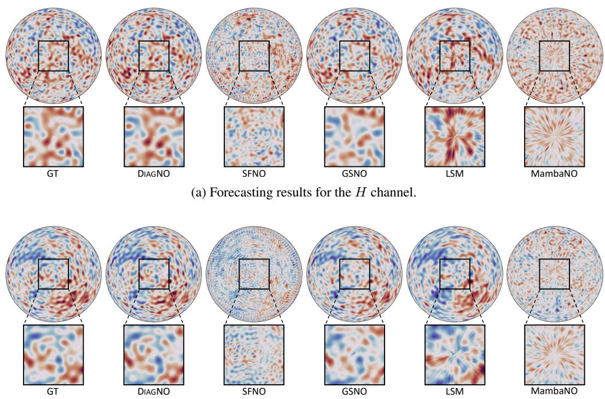  
(b) Forecasting results for the V channel.  
Figure 9: Comparison of forecasting results for SSWE from a north pole perspective.

Table 6: Peak memory consumption (#MEM) of different models across three benchmark datasets.
<table><tr><td rowspan="2">MODEL</td><td colspan="2">#MEM (GB)</td></tr><tr><td>Sea Surface SSWE Forecasting</td><td>Atmospheric Forecasting</td></tr><tr><td>Swin</td><td>2.49 4.50</td><td>2.41</td></tr><tr><td>FNO 2.50</td><td>3.83</td><td>2.40</td></tr><tr><td>LSM 3.92</td><td>6.78</td><td>3.84</td></tr><tr><td>Transolver</td><td>5.61 12.28</td><td>5.54</td></tr><tr><td>MambaNO</td><td>12.14 26.59</td><td>12.06</td></tr><tr><td>AMG 3.06</td><td>5.73</td><td>2.94</td></tr><tr><td>SFNO</td><td>2.30 4.55</td><td>2.22</td></tr><tr><td>GSNO</td><td>9.63 19.42</td><td>9.55</td></tr><tr><td>LangYa</td><td>1.09 -</td><td></td></tr><tr><td>ClimaX</td><td>- 一</td><td>5.06</td></tr><tr><td>DIAGNO</td><td>4.26 7.23</td><td>3.99</td></tr></table>

Table 7: The overall performance comparison for ocean surface prediction.
<table><tr><td rowspan="2">MODEL</td><td rowspan="2">MAE↓</td><td rowspan="2">RMSE↓</td><td colspan="5">ACC(%) ↑</td></tr><tr><td>SSH</td><td>SST</td><td>U</td><td>V</td><td>Average</td></tr><tr><td colspan="8">3 Days</td></tr><tr><td>Swin</td><td>0.2440</td><td>0.5262</td><td>52.12</td><td>26.20</td><td>45.15</td><td>37.50</td><td>40.24</td></tr><tr><td>FNO</td><td>0.2359</td><td>0.3173</td><td>80.09</td><td>56.90</td><td>80.64</td><td>76.81</td><td>73.61</td></tr><tr><td>LSM</td><td>0.1335</td><td>0.1758</td><td>89.98</td><td>83.78</td><td>90.15</td><td>88.85</td><td>88.19</td></tr><tr><td>Transolver</td><td>0.0972</td><td>0.1366</td><td>94.62</td><td>92.05</td><td>90.49</td><td>89.04</td><td>91.55</td></tr><tr><td>MambaNO</td><td>0.1314</td><td>0.1821</td><td>94.29</td><td>81.35</td><td>89.13</td><td>87.54</td><td>88.08</td></tr><tr><td>AMG</td><td>0.1632</td><td>0.3192</td><td>85.83</td><td>56.06</td><td>84.38</td><td>81.62</td><td>76.97</td></tr><tr><td>SFNO</td><td>0.0854</td><td>0.1390</td><td>93.09</td><td>92.88</td><td>84.80</td><td>81.30</td><td>88.02</td></tr><tr><td>GSNO</td><td>0.0862</td><td>0.1357</td><td>94.25</td><td>93.09</td><td>85.16</td><td>82.57</td><td>88.77</td></tr><tr><td>LangYa</td><td>0.1425</td><td>0.2049</td><td>91.09</td><td>79.60</td><td>87.26</td><td>85.38</td><td>85.83</td></tr><tr><td>DIAGNO</td><td>0.0751</td><td>0.1162</td><td>96.06</td><td>94.62</td><td>90.81</td><td>89.56</td><td>92.76</td></tr><tr><td colspan="8">7 Days</td></tr><tr><td>Swin</td><td>0.3446</td><td>0.6603</td><td>37.49</td><td>17.59</td><td>32.80</td><td>23.97</td><td>27.96</td></tr><tr><td>FNO</td><td>0.5057</td><td>0.6771</td><td>43.67</td><td>19.53</td><td>56.09</td><td>52.47</td><td>42.94</td></tr><tr><td>LSM</td><td>0.2606</td><td>0.3557</td><td>73.82</td><td>53.15</td><td>75.27</td><td>72.01</td><td>68.56</td></tr><tr><td>Transolver</td><td>0.1988</td><td>0.2650</td><td>85.78</td><td>71.85</td><td>76.10</td><td>72.06</td><td>76.45</td></tr><tr><td>MambaNO</td><td>0.2498</td><td>0.3468</td><td>81.03</td><td>42.39</td><td>71.59</td><td>69.12</td><td>66.03</td></tr><tr><td>AMG</td><td>0.2791</td><td>0.6436</td><td>68.47</td><td>28.07</td><td>64.18</td><td>59.08</td><td>54.95</td></tr><tr><td>SFNO</td><td>0.1382</td><td>0.2138</td><td>82.69</td><td>82.41</td><td>69.30</td><td>63.21</td><td>74.40</td></tr><tr><td>GSNO</td><td>0.1411</td><td>0.2115</td><td>85.86</td><td>82.20</td><td>70.08</td><td>66.08</td><td>76.06</td></tr><tr><td>LangYa</td><td>0.2566</td><td>0.4023</td><td>75.30</td><td>50.33</td><td>65.08</td><td>62.75</td><td>63.37</td></tr><tr><td>DIAGNO</td><td>0.1294</td><td>0.1921</td><td>88.42</td><td>85.29</td><td>76.42</td><td>73.15</td><td>80.82</td></tr><tr><td colspan="8">10 Days</td></tr><tr><td>Swin</td><td>0.4036</td><td>0.7082</td><td>30.78</td><td>14.97</td><td>27.61</td><td>20.33</td><td>23.42</td></tr><tr><td>FNO</td><td>0.9101</td><td>1.2212</td><td>25.71</td><td>8.33</td><td>35.87</td><td>35.24</td><td>26.29</td></tr><tr><td>LSM</td><td>0.3377</td><td>0.4630</td><td>62.96</td><td>38.74</td><td>65.26</td><td>61.16</td><td>57.03</td></tr><tr><td>Transolver</td><td>0.2378</td><td>0.3194</td><td>77.04</td><td>62.34</td><td>62.32</td><td>57.19</td><td>64.72</td></tr><tr><td>MambaNO</td><td>0.3303</td><td>0.4523</td><td>70.13</td><td>24.21</td><td>58.92</td><td>56.86</td><td>52.53</td></tr><tr><td>AMG</td><td>0.3522</td><td>0.7808</td><td>59.04</td><td>22.85</td><td>52.33</td><td>47.47</td><td>45.42</td></tr><tr><td>SFNO</td><td>0.1682</td><td>0.2539</td><td>74.77</td><td>75.51</td><td>60.05</td><td>53.51</td><td>65.96</td></tr><tr><td>GSNO</td><td>0.1726</td><td>0.2533</td><td>79.66</td><td>74.62</td><td>61.65</td><td>57.76</td><td>68.43</td></tr><tr><td>LangYa</td><td>0.3407</td><td>0.5434</td><td>62.63</td><td>37.88</td><td>49.49</td><td>47.64</td><td>49.41</td></tr><tr><td>DIAGNO</td><td>0.1638</td><td>0.2387</td><td>81.93</td><td>77.57</td><td>65.97</td><td>61.89</td><td>71.84</td></tr></table>

## C.2 Ocean Surface Forecasting

Table 7 details the overall performance comparison for ocean surface prediction across 3-day, 7-day, and 10-day lead times. As shown in the results, spherical neural operators (SFNO, GSNO, and our proposed DIAGNO) generally exhibit superior and more robust performance compared to other standard baseline models (such as Swin, FNO, and MambaNO). This general advantage highlights the critical importance of respecting spherical geometry when modeling global ocean dynamics. However, among these spherical architectures, DIAGNO consistently achieves the best results, recording the lowest MAE and RMSE, alongside the highest Average ACC across all forecasting horizons. The performance gap becomes particularly pronounced at extended lead times. This sustained superiority validates our core architectural design. While conventional spherical operators such as SFNO rely on rotation-equivariant spectral formulations, and GSNO introduces non-equivariant extensions through Green’s functions, DIAGNO follows a distinct route by explicitly parameterizing cross-modal spectral interactions. By doing so, our model is far better equipped to capture the highly heterogeneous dynamics inherent to complex ocean variables such as SSH and SST, ultimately leading to more accurate and stable long-term rollouts.

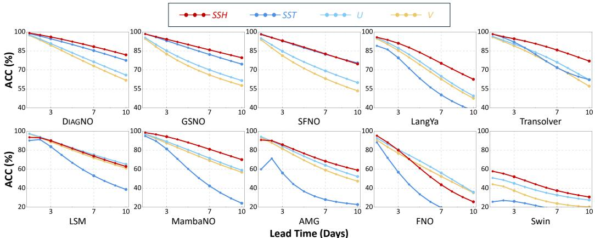

(a) Daily Anomaly Correlation Coefficient (ACC) for four ocean surface variables (SSH, SST, U, V )  
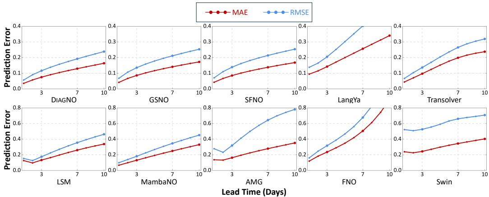  
(b) Daily prediction errors evaluated by MAE and RMSE.  
Figure 10: Day-to-day forecasting performance of different models on global ocean surface variables over a 10-day lead time.

Figure 10 provides a day-to-day evaluation of the autoregressive forecasting stability of various models over a 10-day lead time. As illustrated by the Anomaly Correlation Coefficient (ACC) evolution for SSH, SST, U, and V (Figure 10a), DIAGNO demonstrates remarkable resilience against the inevitable correlation degradation typical of chaotic Earth system predictions. It exhibits the most gradual decay rate among all evaluated architectures, maintaining exceptionally high correlation near the 10-day mark, particularly for thermodynamically-driven variables like SSH and SST. While standard spherical operators (GSNO, SFNO) show competitive short-term results, their accuracy declines more steeply over time. Conversely, general-purpose baselines (FNO, AMG, Swin) suffer severe performance drops. The sustained skill of DIAGNO stems from its capacity to accurately resolve global-scale physical distributions (e.g., latitudinal climate belts) while explicitly preventing the generation and amplification of radial polar artifacts during recursive forecasting steps. This long-term stability is further corroborated by the absolute prediction errors, measured by Mean Absolute Error (MAE) and Root Mean Square Error (RMSE) (Figure 10b). As lead time increases, the error accumulation for DIAGNO grows at a significantly slower and more suppressed rate compared to the baselines. In stark contrast, models like LangYa, FNO, and AMG exhibit an aggressive explosion in error after the third to fifth day, indicating a rapid breakdown in physical consistency during extended autoregressive inference. The tightly bounded error curves of DIAGNO confirm that its internal representation effectively mitigates the exponential growth of numerical errors, establishing it as a highly reliable framework for continuous ocean state estimation.

Figure 11 illustrates the spatial distribution of absolute prediction errors for all four ocean surface variables (SSH, SST, U, and V) at the 10-day lead time. The defining advantage of DIAGNO lies in its robust capacity to significantly reduce error accumulation in universally challenging regions characterized by highly heterogeneous physical dynamics. For example, in the SSH predictions, most standard baselines exhibit severe, concentrated error patches in the Arctic Ocean near Alaska. This specific region is dominated by complex sea ice-ocean interactions and sharp physical gradients along the marginal ice zone, which other models struggle to resolve accurately. DIAGNO successfully mitigates these localized errors, maintaining physical consistency across such steep gradient zones. Furthermore, in the velocity channels (U and V), massive error zones for baseline models are densely clustered along the highly dynamic equatorial current systems. DIAGNO demonstrates notably lighter and cleaner error distributions in these complex circulatory regions. By effectively capturing multi-scale interactions and suppressing numerical instabilities in these notoriously volatile areas, DIAGNO maintains superior global spatial coherence and achieves the most accurate long-term ocean state estimation.

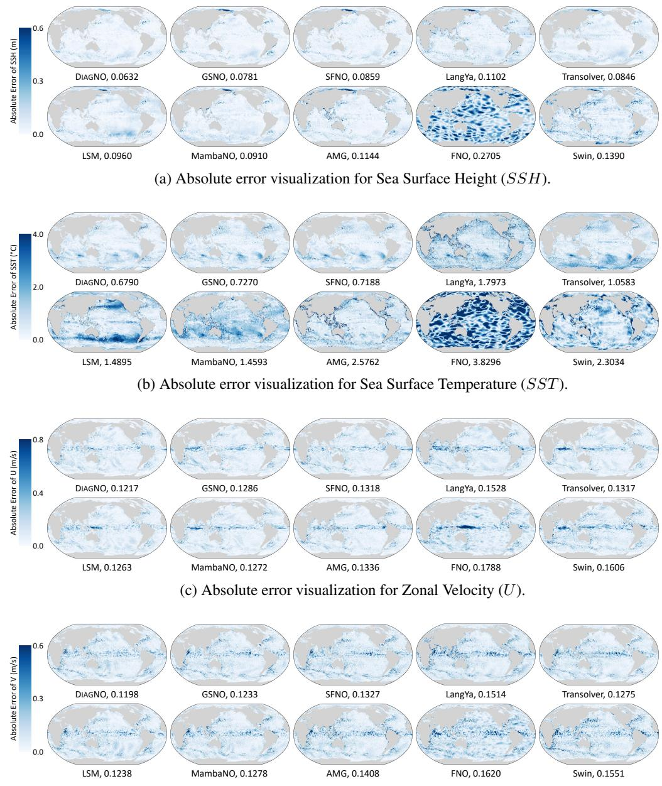  
(d) Absolute error visualization for Meridional Velocity (V).  
Figure 11: Spatial visualizations of 10-day absolute prediction errors for four key ocean surface variables. The corresponding overall Root Mean Square Error (RMSE) for each evaluated model is explicitly annotated beneath its respective spatial error map.

## C.3 Atmospheric Forecasting

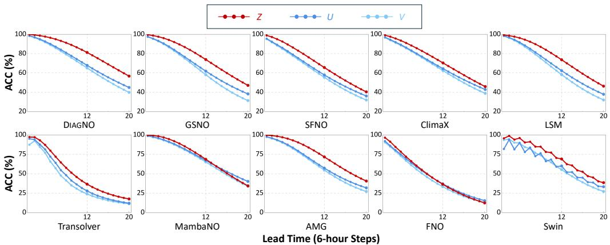  
(a) Step-wise Anomaly Correlation Coefficient (ACC) for three atmospheric variables (Z, U, V).

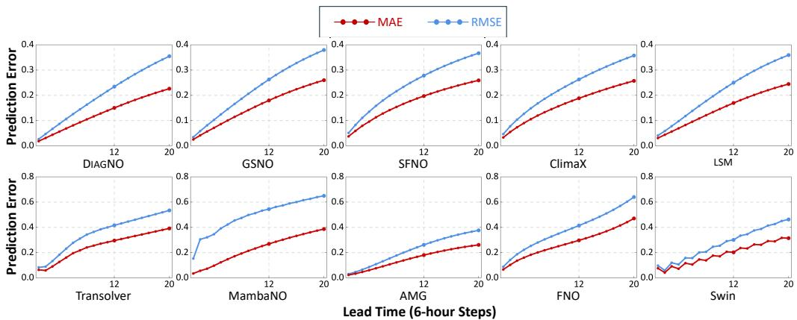  
(b) Step-wise prediction errors evaluated by MAE and RMSE.  
Figure 12: Autoregressive forecasting performance of different models on global atmospheric variables over a 5-day lead time. The x-axis represents the forecast horizon spanning 20 consecutive 6-hour steps.

Figure 12 provides a detailed, step-wise evaluation of the autoregressive forecasting stability for three mid-troposphere (500 hPa) atmospheric variables (Z, U, and V ) over a 5-day lead time. Since the model operates on a 6-hour temporal resolution, the x-axis represents 20 consecutive autoregressive steps.

Figure 12a illustrates the degradation of the Anomaly Correlation Coefficient (ACC) as the forecast horizon extends. While predicting the chaotic dynamics of the atmosphere inherently leads to a decay in correlation skill, DIAGNO exhibits the most gradual and resilient decay curve among all models. By step 20 (Day 5), DIAGNO maintains the highest ACC scores across all three variables, particularly for the geopotential field (Z), which governs large-scale synoptic weather patterns. Advanced baselines like ClimaX, GSNO, and SFNO show competitive performance initially but degrade more rapidly in later steps. Notably, standard vision models like Swin display severe "zigzag" oscillations (sawtooth patterns) during the rollout, indicating severe temporal inconsistencies between consecutive 6-hour steps. DIAGNO, however, produces exceptionally smooth and stable correlation trajectories, proving its structural superiority in maintaining global-scale atmospheric distributions over time.

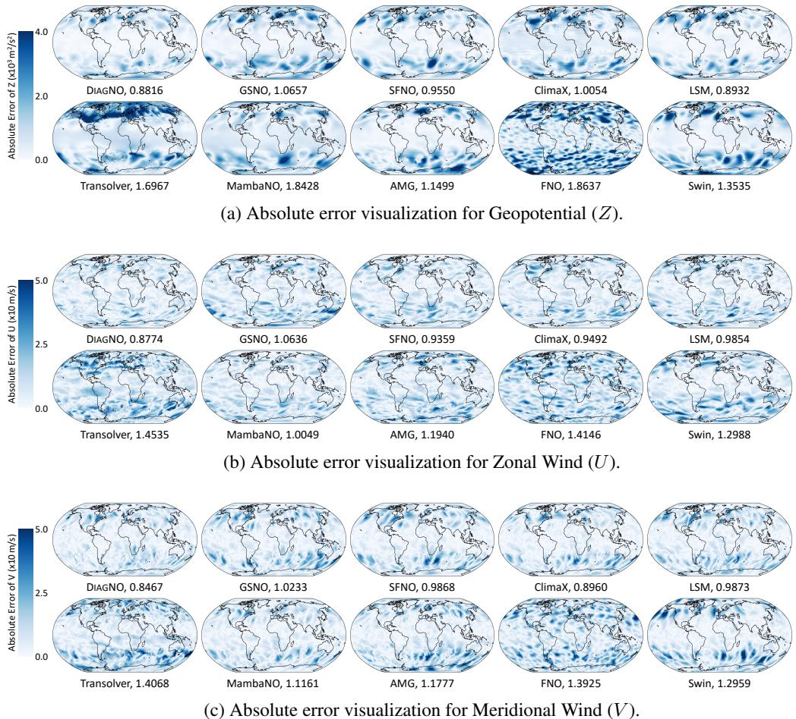  
Figure 13: Spatial visualizations of 20-step (5-day) absolute prediction errors for three key atmospheric variables. The corresponding overall Root Mean Square Error (RMSE) for each evaluated model is explicitly annotated beneath its respective spatial error map. Note that the annotated RMSE values for Z, U, and V are scaled by a factor of 103, 10, and 10, respectively, for visual clarity.

Figure 12b further validates this stability by tracking the accumulation of Mean Absolute Error (MAE) and Root Mean Square Error (RMSE). During the 20-step rollout, DIAGNO consistently suppresses the error growth rate, culminating in the lowest absolute prediction errors at the 5-day mark. In contrast, models such as FNO, Transolver, and MambaNO experience a rapid, non-linear explosion in error after the initial few steps, reflecting a severe breakdown in physical consistency during multi-step inference. The tightly bounded error curves of DIAGNO confirm its robustness in mitigating error accumulation, making it a highly reliable architecture for extended-range atmospheric forecasting.

Figure 13 visualizes the spatial distribution of absolute prediction errors for Geopotential (Z), Zonal Wind (U), and Meridional Wind (V ). Visually, DIAGNO consistently exhibits the lightest error maps across all three variables, which perfectly aligns with its lowest overall RMSE. In contrast, standard models (e.g., FNO, Transolver) show significant error accumulations, particularly in high-latitude regions. While other spherical operators (e.g., SFNO, GSNO) improve upon this, they still exhibit noticeable regional errors in mid-latitudes. This direct comparison demonstrates that DIAGNO’s diagonal interaction mechanism effectively captures global-scale heterogeneous dynamics, leading to superior spatial accuracy.

## C.4 Climate Anomaly

Table 8: RMSE evaluation of different models across ENSO phases.
<table><tr><td rowspan="2">MODEL</td><td rowspan="2">Total</td><td colspan="3">RMSE</td></tr><tr><td>Neutral</td><td>El Niño</td><td>La Niña</td></tr><tr><td>Swin</td><td>0.8713</td><td>0.2618</td><td>0.5053</td><td>0.1042</td></tr><tr><td>FNO</td><td>1.4281</td><td>0.4227</td><td>0.7389</td><td>0.2665</td></tr><tr><td>LSM</td><td>1.8451</td><td>0.4924</td><td>0.6296</td><td>0.7231</td></tr><tr><td>Transolver</td><td>0.5427</td><td>0.1675</td><td>0.1376</td><td>0.2376</td></tr><tr><td>MambaNO</td><td>2.8335</td><td>0.8485</td><td>1.0422</td><td>0.9428</td></tr><tr><td>AMG</td><td>0.7727</td><td>0.2835</td><td>0.0953</td><td>0.3939</td></tr><tr><td>SFNO</td><td>0.1771</td><td>0.0871</td><td>0.0408</td><td>0.0491</td></tr><tr><td>GSNO</td><td>0.3498</td><td>0.1058</td><td>0.1627</td><td>0.0813</td></tr><tr><td>LangYa</td><td>0.4008</td><td>0.1701</td><td>0.1517</td><td>0.0790</td></tr><tr><td>DIAGNO</td><td>0.1254</td><td>0.0579</td><td>0.0535</td><td>0.0140</td></tr></table>

Table 8 presents the detailed evaluation results for Sea Surface Temperature Anomalies (SSTA) at a 7-day lead time.

## D Impact Statement

This paper presents work aimed at advancing machine learning for Earth system modeling, with a specific focus on oceanic and atmospheric sciences. By providing efficient and high-fidelity forecasting for complex, global-scale ocean dynamics, we hope our research draws greater attention to these critical geophysical domains and accelerates vital downstream applications, such as marine monitoring and climate analysis. Ultimately, we aim to inspire further innovations that foster the continued flourishing of the broader AI for Science (AI4S) community. While our framework offers positive societal potential, we acknowledge the inherent limitations of purely data-driven methods—specifically, the risk of prediction failure when encountering unprecedented and extreme climate outliers. We therefore encourage the community to thoughtfully deploy such models as powerful augmentative tools alongside traditional physics-constrained systems.

## NeurIPS Paper Checklist

## 1. Claims

Question: Do the main claims made in the abstract and introduction accurately reflect the paper’s contributions and scope?

Answer: [Yes]

Justification: We discuss the contributions and scope in abstract and introduction.

Guidelines:

• The answer [N/A] means that the abstract and introduction do not include the claims made in the paper.

• The abstract and/or introduction should clearly state the claims made, including the contributions made in the paper and important assumptions and limitations. A [No] or [N/A] answer to this question will not be perceived well by the reviewers.

• The claims made should match theoretical and experimental results, and reflect how much the results can be expected to generalize to other settings.

• It is fine to include aspirational goals as motivation as long as it is clear that these goals are not attained by the paper.

## 2. Limitations

Question: Does the paper discuss the limitations of the work performed by the authors?

Answer: [Yes]

Justification: We discuss the limitations in Section 6.

Guidelines:

• The answer [N/A] means that the paper has no limitation while the answer [No] means that the paper has limitations, but those are not discussed in the paper.

• The authors are encouraged to create a separate “Limitations” section in their paper.

• The paper should point out any strong assumptions and how robust the results are to violations of these assumptions (e.g., independence assumptions, noiseless settings, model well-specification, asymptotic approximations only holding locally). The authors should reflect on how these assumptions might be violated in practice and what the implications would be.

• The authors should reflect on the scope of the claims made, e.g., if the approach was only tested on a few datasets or with a few runs. In general, empirical results often depend on implicit assumptions, which should be articulated.

• The authors should reflect on the factors that influence the performance of the approach. For example, a facial recognition algorithm may perform poorly when image resolution is low or images are taken in low lighting. Or a speech-to-text system might not be used reliably to provide closed captions for online lectures because it fails to handle technical jargon.

• The authors should discuss the computational efficiency of the proposed algorithms and how they scale with dataset size.

• If applicable, the authors should discuss possible limitations of their approach to address problems of privacy and fairness.

• While the authors might fear that complete honesty about limitations might be used by reviewers as grounds for rejection, a worse outcome might be that reviewers discover limitations that aren’t acknowledged in the paper. The authors should use their best judgment and recognize that individual actions in favor of transparency play an important role in developing norms that preserve the integrity of the community. Reviewers will be specifically instructed to not penalize honesty concerning limitations.

## 3. Theory assumptions and proofs

Question: For each theoretical result, does the paper provide the full set of assumptions and a complete (and correct) proof?

Answer: [Yes]

Justification: Theoretical derivations are detailed in Section 4, supported by rigorous proofs for modal isolation under rotational equivariance (Appendix A.1) and optimal reconstruction via conjugate transpose (Appendix A.2).

Guidelines:

• The answer [N/A] means that the paper does not include theoretical results.

• All the theorems, formulas, and proofs in the paper should be numbered and crossreferenced.

• All assumptions should be clearly stated or referenced in the statement of any theorems.

• The proofs can either appear in the main paper or the supplemental material, but if they appear in the supplemental material, the authors are encouraged to provide a short proof sketch to provide intuition.

• Inversely, any informal proof provided in the core of the paper should be complemented by formal proofs provided in appendix or supplemental material.

• Theorems and Lemmas that the proof relies upon should be properly referenced.

## 4. Experimental result reproducibility

Question: Does the paper fully disclose all the information needed to reproduce the main experimental results of the paper to the extent that it affects the main claims and/or conclusions of the paper (regardless of whether the code and data are provided or not)?

Answer: [Yes]

Justification: We provide the training and inference strategies in Appendix B.3, dataset details in Appendix B.1, and hyperparameter configurations in Appendix B.2. Furthermore, the source code is publicly available on GitHub to support reproducibility.

Guidelines:

• The answer [N/A] means that the paper does not include experiments.

• If the paper includes experiments, a [No] answer to this question will not be perceived well by the reviewers: Making the paper reproducible is important, regardless of whether the code and data are provided or not.

• If the contribution is a dataset and/or model, the authors should describe the steps taken to make their results reproducible or verifiable.

• Depending on the contribution, reproducibility can be accomplished in various ways. For example, if the contribution is a novel architecture, describing the architecture fully might suffice, or if the contribution is a specific model and empirical evaluation, it may be necessary to either make it possible for others to replicate the model with the same dataset, or provide access to the model. In general. releasing code and data is often one good way to accomplish this, but reproducibility can also be provided via detailed instructions for how to replicate the results, access to a hosted model (e.g., in the case of a large language model), releasing of a model checkpoint, or other means that are appropriate to the research performed.

• While NeurIPS does not require releasing code, the conference does require all submissions to provide some reasonable avenue for reproducibility, which may depend on the nature of the contribution. For example

(a) If the contribution is primarily a new algorithm, the paper should make it clear how to reproduce that algorithm.

(b) If the contribution is primarily a new model architecture, the paper should describe the architecture clearly and fully.

(c) If the contribution is a new model (e.g., a large language model), then there should either be a way to access this model for reproducing the results or a way to reproduce the model (e.g., with an open-source dataset or instructions for how to construct the dataset).

(d) We recognize that reproducibility may be tricky in some cases, in which case authors are welcome to describe the particular way they provide for reproducibility. In the case of closed-source models, it may be that access to the model is limited in some way (e.g., to registered users), but it should be possible for other researchers to have some path to reproducing or verifying the results.

## 5. Open access to data and code

Question: Does the paper provide open access to the data and code, with sufficient instructions to faithfully reproduce the main experimental results, as described in supplemental material?

Answer: [Yes]

Justification: The source code is publicly available on GitHub, together with instructions for generating the simulated shallow water dataset. Due to copyright restrictions and massive file sizes, the atmospheric and oceanic reanalysis datasets are excluded. However, comprehensive details on dataset processing and variable discretization are explicitly provided in Appendix B.1.

Guidelines:

• The answer [N/A] means that paper does not include experiments requiring code.

• Please see the NeurIPS code and data submission guidelines (https://neurips.cc/ public/guides/CodeSubmissionPolicy) for more details.

• While we encourage the release of code and data, we understand that this might not be possible, so [No] is an acceptable answer. Papers cannot be rejected simply for not including code, unless this is central to the contribution (e.g., for a new open-source benchmark).

• The instructions should contain the exact command and environment needed to run to reproduce the results. See the NeurIPS code and data submission guidelines (https: //neurips.cc/public/guides/CodeSubmissionPolicy) for more details.

• The authors should provide instructions on data access and preparation, including how to access the raw data, preprocessed data, intermediate data, and generated data, etc.

• The authors should provide scripts to reproduce all experimental results for the new proposed method and baselines. If only a subset of experiments are reproducible, they should state which ones are omitted from the script and why.

• At submission time, to preserve anonymity, the authors should release anonymized versions (if applicable).

• Providing as much information as possible in supplemental material (appended to the paper) is recommended, but including URLs to data and code is permitted.

## 6. Experimental setting/details

Question: Does the paper specify all the training and test details (e.g., data splits, hyperparameters, how they were chosen, type of optimizer) necessary to understand the results?

Answer: [Yes]

Justification: We detail the dataset splits in Section 5.1 and discuss hyperparameter selection in Section 5.5. Furthermore, the training methods, inference strategies, and optimizer configurations are explicitly described in Appendix B.3.

Guidelines:

• The answer [N/A] means that the paper does not include experiments.

• The experimental setting should be presented in the core of the paper to a level of detail that is necessary to appreciate the results and make sense of them.

• The full details can be provided either with the code, in appendix, or as supplemental material.

## 7. Experiment statistical significance

Question: Does the paper report error bars suitably and correctly defined or other appropriate information about the statistical significance of the experiments?

Answer: [Yes]

Justification: As detailed in Section 5.1, we ensure statistical significance by conducting multiple independent runs for all experiments.

Guidelines:

• The answer [N/A] means that the paper does not include experiments.

• The authors should answer [Yes] if the results are accompanied by error bars, confidence intervals, or statistical significance tests, at least for the experiments that support the main claims of the paper.

• The factors of variability that the error bars are capturing should be clearly stated (for example, train/test split, initialization, random drawing of some parameter, or overall run with given experimental conditions).

• The method for calculating the error bars should be explained (closed form formula, call to a library function, bootstrap, etc.)

• The assumptions made should be given (e.g., Normally distributed errors).

• It should be clear whether the error bar is the standard deviation or the standard error of the mean.

• It is OK to report 1-sigma error bars, but one should state it. The authors should preferably report a 2-sigma error bar than state that they have a 96% CI, if the hypothesis of Normality of errors is not verified.

• For asymmetric distributions, the authors should be careful not to show in tables or figures symmetric error bars that would yield results that are out of range (e.g., negative error rates).

• If error bars are reported in tables or plots, the authors should explain in the text how they were calculated and reference the corresponding figures or tables in the text.

## 8. Experiments compute resources

Question: For each experiment, does the paper provide sufficient information on the computer resources (type of compute workers, memory, time of execution) needed to reproduce the experiments?

Answer: [Yes]

Justification: We explicitly detail the computational resources required for our experiments in Appendix B.3.

Guidelines:

• The answer [N/A] means that the paper does not include experiments.

• The paper should indicate the type of compute workers CPU or GPU, internal cluster, or cloud provider, including relevant memory and storage.

• The paper should provide the amount of compute required for each of the individual experimental runs as well as estimate the total compute.

• The paper should disclose whether the full research project required more compute than the experiments reported in the paper (e.g., preliminary or failed experiments that didn’t make it into the paper).

## 9. Code of ethics

Question: Does the research conducted in the paper conform, in every respect, with the NeurIPS Code of Ethics https://neurips.cc/public/EthicsGuidelines?

Answer: [Yes]

Justification: This research conforms the NeurIPS Code of Ethics.

Guidelines:

• The answer [N/A] means that the authors have not reviewed the NeurIPS Code of Ethics.

• If the authors answer [No], they should explain the special circumstances that require a deviation from the Code of Ethics.

• The authors should make sure to preserve anonymity (e.g., if there is a special consideration due to laws or regulations in their jurisdiction).

## 10. Broader impacts

Question: Does the paper discuss both potential positive societal impacts and negative societal impacts of the work performed?

Answer: [Yes]

Justification: We discuss the broader impacts in Appendix D, including both positive impacts and negative impacts.

Guidelines:

• The answer [N/A] means that there is no societal impact of the work performed.

• If the authors answer [N/A] or [No], they should explain why their work has no societal impact or why the paper does not address societal impact.

• Examples of negative societal impacts include potential malicious or unintended uses (e.g., disinformation, generating fake profiles, surveillance), fairness considerations (e.g., deployment of technologies that could make decisions that unfairly impact specific groups), privacy considerations, and security considerations.

• The conference expects that many papers will be foundational research and not tied to particular applications, let alone deployments. However, if there is a direct path to any negative applications, the authors should point it out. For example, it is legitimate to point out that an improvement in the quality of generative models could be used to generate Deepfakes for disinformation. On the other hand, it is not needed to point out that a generic algorithm for optimizing neural networks could enable people to train models that generate Deepfakes faster.

• The authors should consider possible harms that could arise when the technology is being used as intended and functioning correctly, harms that could arise when the technology is being used as intended but gives incorrect results, and harms following from (intentional or unintentional) misuse of the technology.

• If there are negative societal impacts, the authors could also discuss possible mitigation strategies (e.g., gated release of models, providing defenses in addition to attacks, mechanisms for monitoring misuse, mechanisms to monitor how a system learns from feedback over time, improving the efficiency and accessibility of ML).

## 11. Safeguards

Question: Does the paper describe safeguards that have been put in place for responsible release of data or models that have a high risk for misuse (e.g., pre-trained language models, image generators, or scraped datasets)?

Answer: [N/A]

Justification: The paper poses no such risks.

Guidelines:

• The answer [N/A] means that the paper poses no such risks.

• Released models that have a high risk for misuse or dual-use should be released with necessary safeguards to allow for controlled use of the model, for example by requiring that users adhere to usage guidelines or restrictions to access the model or implementing safety filters.

• Datasets that have been scraped from the Internet could pose safety risks. The authors should describe how they avoided releasing unsafe images.

• We recognize that providing effective safeguards is challenging, and many papers do not require this, but we encourage authors to take this into account and make a best faith effort.

## 12. Licenses for existing assets

Question: Are the creators or original owners of assets (e.g., code, data, models), used in the paper, properly credited and are the license and terms of use explicitly mentioned and properly respected?

Answer: [Yes]

Justification: We properly cite all existing assets used in our research, including the ERA5 and GLORYS12 reanalysis datasets, as well as the open-source codebases for the baseline models. We strictly respect and adhere to their respective licenses and terms of use for academic research.

Guidelines:

• The answer [N/A] means that the paper does not use existing assets.

• The authors should cite the original paper that produced the code package or dataset.

• The authors should state which version of the asset is used and, if possible, include a URL.

• The name of the license (e.g., CC-BY 4.0) should be included for each asset.

• For scraped data from a particular source (e.g., website), the copyright and terms of service of that source should be provided.

• If assets are released, the license, copyright information, and terms of use in the package should be provided. For popular datasets, paperswithcode.com/datasets has curated licenses for some datasets. Their licensing guide can help determine the license of a dataset.

• For existing datasets that are re-packaged, both the original license and the license of the derived asset (if it has changed) should be provided.

• If this information is not available online, the authors are encouraged to reach out to the asset’s creators.

## 13. New assets

Question: Are new assets introduced in the paper well documented and is the documentation provided alongside the assets?

Answer: [Yes]

Justification: We provide a README file in our public GitHub repository, offering instructions on environment configuration, hyperparameter adjustments, and experimental settings.

Guidelines:

• The answer [N/A] means that the paper does not release new assets.

• Researchers should communicate the details of the dataset/code/model as part of their submissions via structured templates. This includes details about training, license, limitations, etc.

• The paper should discuss whether and how consent was obtained from people whose asset is used.

• At submission time, remember to anonymize your assets (if applicable). You can either create an anonymized URL or include an anonymized zip file.

## 14. Crowdsourcing and research with human subjects

Question: For crowdsourcing experiments and research with human subjects, does the paper include the full text of instructions given to participants and screenshots, if applicable, as well as details about compensation (if any)?

Answer: [N/A]

Justification: This paper does not involve crowdsourcing or any research with human subjects.

Guidelines:

• The answer [N/A] means that the paper does not involve crowdsourcing nor research with human subjects.

• Including this information in the supplemental material is fine, but if the main contribution of the paper involves human subjects, then as much detail as possible should be included in the main paper.

• According to the NeurIPS Code of Ethics, workers involved in data collection, curation, or other labor should be paid at least the minimum wage in the country of the data collector.

## 15. Institutional review board (IRB) approvals or equivalent for research with human subjects

Question: Does the paper describe potential risks incurred by study participants, whether such risks were disclosed to the subjects, and whether Institutional Review Board (IRB) approvals (or an equivalent approval/review based on the requirements of your country or institution) were obtained?

## Answer: [N/A]

Justification: This research does not involve human subjects or any related human experiments.

## Guidelines:

• The answer [N/A] means that the paper does not involve crowdsourcing nor research with human subjects.

• Depending on the country in which research is conducted, IRB approval (or equivalent) may be required for any human subjects research. If you obtained IRB approval, you should clearly state this in the paper.

• We recognize that the procedures for this may vary significantly between institutions and locations, and we expect authors to adhere to the NeurIPS Code of Ethics and the guidelines for their institution.

• For initial submissions, do not include any information that would break anonymity (if applicable), such as the institution conducting the review.

## 16. Declaration of LLM usage

Question: Does the paper describe the usage of LLMs if it is an important, original, or non-standard component of the core methods in this research? Note that if the LLM is used only for writing, editing, or formatting purposes and does not impact the core methodology, scientific rigor, or originality of the research, declaration is not required.

Answer: [N/A]

Justification: The core method development in this research does not involve LLMs as any important, original, or non-standard components.

## Guidelines:

• The answer [N/A] means that the core method development in this research does not involve LLMs as any important, original, or non-standard components.

• Please refer to our LLM policy in the NeurIPS handbook for what should or should not be described.