# DPA: DECENTRALIZED PRIMAL AVERAGING WITH QUASI-GLOBAL MOMENTUM FOR HIGHLY HETEROGENEOUS DATA

A PREPRINT

Diyako Ghaderyan

Stefan Werner<sup>†</sup>

## ABSTRACT

Decentralized training of deep learning models keeps training data local and supports on-device learning over networks. In realistic scenarios, heterogeneity across agents’ local data poses an optimization challenge and can severely degrade test accuracy, especially on sparse communication graphs. Building on recent advances in centralized primal averaging, we propose Decentralized Primal Averaging (DPA), a decentralized learning algorithm that combines primal averaging with a local quasi-global momentum buffer. DPA maintains three coupled sequences for optimization, gradient evaluation, and output averaging, while using consecutive mixed iterates to construct a network-aware momentum direction without transmitting an auxiliary tracking variable. For smooth nonconvex objectives, we establish a convergence bound for DPA and identify conditions for linear speedup in the number of agents for sufficiently many iterations. We also introduce DPA-1G, a variant that uses one communication round per iteration and matches the per-iteration communication cost of DSGD-style baselines. Experiments following the GUT decentralized image-classification benchmark show that DPA compares favorably with DSGD, gradient tracking, QG-DSGDm, momentum tracking, and QG-GUTm across datasets, architectures, topologies, and heterogeneity levels, with the largest gains under high heterogeneity on sparse rings. At the same total communication cost, both DPA variants achieve higher mean test accuracy than the best baseline on CIFAR-10 and CIFAR-100 with ResNet-20. Our code is publicly available.<sup>3</sup>

## 1 Introduction

Training modern machine learning models, especially deep neural networks, often requires large datasets and substantial computational resources. This has motivated distributed training methods, where the workload is split across many agents. Early work on decentralized optimization [Tsitsiklis, 1984] and gossip-style protocols [Xiao and Boyd, 2004] showed how agents can reach agreement without a central coordinator. More recent work has shown that decentralized stochastic gradient methods can be effective for large-scale machine learning [Lian et al., 2017]. In contrast, the classical master–worker setup relies on a centralized parameter server, where workers read model parameters and send gradient updates to shared server shards [Dean et al., 2012]. Although this approach is effective, the server can become a communication bottleneck as the number of workers increases.

Decentralized learning provides an alternative that avoids a central server. It is also useful when data should remain local [Nedic, 2020]. In this setting, agents are connected through a communication graph and exchange messages ´ only with their neighbors. This reduces the per-iteration communication to local peer-to-peer exchanges [Assran et al., 2019]. Under standard assumptions, decentralized stochastic gradient methods can achieve the same $\mathcal { O } ( 1 / \sqrt { n T } )$ rate as centralized mini-batch SGD, giving a linear speedup with respect to the number of agents n for sufficiently many iterations [Koloskova et al., 2020, Lian et al., 2017].

A key step in these methods is gossip averaging. At each iteration, every agent mixes its local model with the models received from neighboring agents, using weights defined by the communication graph [Xiao and Boyd, 2004]. Since this mixing is local, information does not spread through the whole network immediately. As a result, the local models can differ from each other during training, especially in the early iterations. The communication graph therefore affects both the communication cost and the convergence behavior. Dense graphs spread information faster but require more communication per agent, while sparse graphs require less communication per agent but usually mix more slowly [Ghaderyan et al., 2024, Pu and Nedic, 2021].´

The problem becomes harder when the data are heterogeneous across agents. In many practical settings, different agents observe data from different distributions. Then the local objectives may be quite different, and the local gradients may point in different directions. This can increase model drift, slow down training, and reduce test accuracy [Lin et al., 2021, Hsieh et al., 2020]. Several methods have been proposed to reduce this effect. Gradient tracking (GT) [Di Lorenzo and Scutari, 2016, Nedic et al., 2017, Koloskova et al., 2021] and related methods such as´ $D ^ { 2 }$ [Tang et al., 2018] correct local updates using information that better approximates the global descent direction. These methods can obtain convergence guarantees that are less affected by data heterogeneity. However, gradient-tracking methods usually require each agent to communicate an extra model-sized tracking variable, which increases the per-iteration communication cost. Other methods, such as QG-DSGDm [Lin et al., 2021] and RelaySum [Vogels et al., 2021], avoid this extra communication by changing the local update or the communication scheme. QG-DSGDm preserves DSGD’s per-iteration communication cost. RelaySum has the same communication cost as gossip averaging on the same spanning tree.

Motivated by these limitations, we propose a decentralized learning algorithm that combines two ideas. First, inspired by primal averaging and schedule-free optimization [Defazio et al., 2025, 2024], we maintain separate sequences for optimization, gradient evaluation, and output averaging. This allows the output model to move more smoothly than the noisy local optimization sequence. Second, inspired by quasi-global momentum [Lin et al., 2021], we build a local quasi-global momentum buffer from consecutive mixed iterates. This buffer reflects the effect of network mixing, but does not require agents to send an extra momentum or tracking buffer. The resulting method, Decentralized Primal Averaging (DPA), is designed to improve training under heterogeneous data using communication between neighbors. Our main contributions are as follows.

## 1.1 Contributions

• We propose Decentralized Primal Averaging (DPA), which combines primal averaging [Defazio et al., 2024, 2025] with local quasi-global momentum [Lin et al., 2021] for decentralized learning with heterogeneous data. DPA maintains separate optimization, gradient-evaluation, and output sequences, and uses a second communication round to mix the locally averaged models while keeping the momentum buffer local.

• For smooth nonconvex objectives, we establish a convergence bound for the expected squared gradient norm at DPA’s network-average output model, averaged over iterations. The bound explicitly accounts for network connectivity and data heterogeneity and identifies conditions for linear speedup in the number of agents.

• We introduce DPA-1G, a variant that uses one communication round per iteration, matching DSGD’s periteration communication cost. It periodically replaces a stochastic-gradient update with gossip averaging of the output models.

• On CIFAR-10 and CIFAR-100 with ResNet-20 on a 16-agent ring (α = 0.01), DPA reaches high test accuracy in fewer epochs than QG-DSGDm and QG-GUTm, using a constant learning rate after linear warmup. At the full matched communication budget, both DPA variants outperform the strongest baseline, with DPA gains of 7.48 and 16.03 percentage points in mean test accuracy, respectively (Appendix D.6).

## 1.2 Related work

Decentralized Stochastic Gradient Descent (DSGD) [Lian et al., 2017] is one of the standard methods for peer-topeer distributed learning. It alternates between local stochastic-gradient steps and gossip averaging steps [Xiao and Boyd, 2004], and has been widely used for training deep models over decentralized networks [Ying et al., 2021, Lian et al., 2017]. Stochastic Gradient Push (SGP) [Assran et al., 2019] extends this idea to directed and time-varying communication graphs. A unified analysis of decentralized SGD with time-varying topologies and local updates was given in [Koloskova et al., 2020]. For nonconvex problems, NEXT [Di Lorenzo and Scutari, 2016] introduced a tracking mechanism for in-network optimization, which later became a key idea behind gradient-tracking methods for decentralized optimization [Koloskova et al., 2021, Pu and Nedic, 2021]. AdGT [Ghaderyan and Werner, 2026]´ combines gradient tracking with adaptive per-agent learning rates based on local smoothness and a common safety factor. It reduces tuning and often converges faster than gradient tracking with a tuned constant learning rate, without extra communication rounds. The paper also provides a linear convergence guarantee.

A common assumption in the analysis and use of DSGD is that the data are independently and identically distributed (IID) across agents. This assumption is often unrealistic in practical decentralized systems [Hsieh et al., 2020]. In many applications, each agent observes data from a different distribution, which is usually called the heterogeneous or non-IID setting. Data heterogeneity makes the local objectives differ across agents, increases the variation among local gradients, and can lead to unstable training and lower test accuracy [Lin et al., 2021]. Several methods have been proposed to reduce this effect, including $D ^ { 2 }$ [Tang et al., 2018] and gradient tracking [Nedic et al., 2017, Di Lorenzo´ and Scutari, 2016, Koloskova et al., 2021]. These methods correct local updates using extra information and can obtain convergence guarantees that do not depend directly on the heterogeneity parameter $\zeta ^ { 2 }$ [Koloskova et al., 2021]. However, gradient-tracking methods usually require each agent to communicate both the model parameters and an additional tracking variable, which roughly doubles the communication cost per iteration compared with vanilla DSGD.

Momentum-based methods provide another approach to decentralized training with heterogeneous data. A direct momentum extension, DSGD with momentum (DSGDm) [Gao and Huang, 2020], can perform worse than DSGD when the data are heterogeneous, because local momentum buffers can increase model drift. Synchronizing the momentum buffers can improve performance [Assran et al., 2019, Yu et al., 2019], and SlowMo [Wang et al., 2020] uses a slow momentum update on globally averaged parameters. However, these approaches require extra communication. QG-DSGDm [Lin et al., 2021] avoids this by using quasi-global momentum, which estimates a global update direction from consecutive mixed iterates. RelaySum [Vogels et al., 2021] takes a different approach by changing the communication scheme itself, and can be combined with other optimization methods. Momentum tracking (MT) [Takezawa et al., 2023] combines momentum with gradient tracking and has a convergence rate independent of data heterogeneity in the nonconvex stochastic setting. QG-GUTm [Aketi et al., 2023] combines quasi-global momentum with global update tracking, which tracks model updates instead of gradients. This gives a tracking-like correction without extra communication and improves over QG-DSGDm under the same per-iteration communication cost on heterogeneous data.

## 2 Algorithm and setup

We consider a network of n agents connected by an undirected graph $\mathcal { G } = ( \mathcal { N } , \mathcal { E } )$ . An edge $\{ i , j \} \in { \mathcal { E } }$ means that agents i and j can directly exchange messages. We denote by $\breve { \mathscr { N } } ( i )$ the neighbors of agent $i ,$ including i itself. Let $\bar { W } \in \mathbb R ^ { n \times n }$ be the mixing matrix associated with the graph. We assume that $W$ is symmetric and doubly stochastic [Lian et al., 2017, Koloskova et al., 2020]. Communication is synchronous.

Each agent i has a local objective $f _ { i } : \mathbb { R } ^ { d }  \mathbb { R }$ . The goal is to minimize the average objective

$$
\operatorname* { m i n } _ { x \in \mathbb { R } ^ { d } } f ( x ) = \frac { 1 } { n } \sum _ { i = 1 } ^ { n } f _ { i } ( x ) , \qquad f _ { i } ( x ) = \mathbb { E } _ { \xi _ { i } \sim \mathcal { D } _ { i } } \big [ F _ { i } ( x ; \xi _ { i } ) \big ] ,\tag{1}
$$

where $F _ { i }$ is the loss on one data sample, $\xi _ { i }$ is sampled from the local distribution $\mathcal { D } _ { i }$ , and $f _ { i }$ is the expected local loss. At each iteration, agent i can compute a stochastic gradient $\nabla F _ { i } ( x ; \xi _ { i } )$ . We assume that these gradients are unbiased and have bounded variance, as stated in Assumption 2.

## 2.1 Decentralized Primal Averaging

We propose Decentralized Primal Averaging (DPA), a decentralized learning algorithm based on primal averaging. The use of separate sequences for optimization, gradient evaluation, and output averaging follows ideas from primalaveraging and schedule-free methods [Lan, 2012, Defazio et al., 2024]. The closest centralized method is Generalized Primal Averaging (GPA) [Defazio et al., 2025], which separates the point where gradients are evaluated from the output sequence in a centralized setting. ScheduleFree+ [Defazio, 2026], released after our submission, extends centralized schedule-free learning to large language models using inner momentum, a modified Polyak learning rate, and warm-started averaging.

DPA adapts primal averaging to decentralized non-IID learning. This introduces two challenges. First, the output models must stay close across agents. A purely local averaging step need not keep the output models close when the data are heterogeneous. We therefore use a second communication round to mix the locally averaged mode

$$
s _ { i } ^ { k } = ( 1 - a _ { k + 1 } ) x _ { i } ^ { k } + a _ { k + 1 } y _ { i } ^ { k + 1 } .
$$

Algorithm 1 Decentralized Primal Averaging (DPA)   
Input: Initial model $x _ { i } ^ { 0 }$ at agent $\overline { { i , y _ { i } ^ { 0 } = x _ { i } ^ { 0 } , u _ { i } ^ { 0 } = 0 } } ,$ number of iterations T, learning rate $\eta ,$ momentum parameters   
$\bar { \beta _ { 1 } , \beta _ { 2 } } \in ( 0 , 1 )$ , schedules $\{ a _ { k } \} _ { k \ge 1 }$ and $\{ b _ { k } \} _ { k \geq 1 }$ , mixing weights $\{ w _ { i j } \} _ { j \in \mathcal { N } ( i ) }$ , and neighbor set $\mathcal { N } ( i )$ including i.   
1: procedure AGENT-i   
2: for $k = 0 , 1 , \ldots , T - 1$ do   
3: $z _ { i } ^ { k } = \bar { b } _ { k + 1 } y _ { i } ^ { k } + ( 1 - b _ { k + 1 } ) x _ { i } ^ { k }$   
4: Sample $\xi _ { i } ^ { k } \sim { \mathcal { D } } _ { i }$ and compute $g _ { i } ^ { k } = \nabla F _ { i } ( z _ { i } ^ { k } ; \xi _ { i } ^ { k } )$   
5: $v _ { i } ^ { k } = y _ { i } ^ { k } - \eta ( \beta _ { 1 } u _ { i } ^ { k } + g _ { i } ^ { k } )$   
6: $\mathrm { S E N D R E C E I V E } \big ( v _ { i } ^ { k } \big )$   
7: $\begin{array} { r } { y _ { i } ^ { k + 1 } = \sum _ { j \in N ( i ) } \overline { { w _ { i j } } } v _ { j } ^ { k } } \end{array}$   
8: $d _ { i } ^ { k + 1 } = ( y _ { i } ^ { k } - y _ { i } ^ { k + 1 } ) / \eta$   
9: $u _ { i } ^ { \tilde { k } + 1 } = ( \mathbb { 1 } - \beta _ { 2 } ) u _ { i } ^ { k } + \beta _ { 2 } d _ { i } ^ { k + 1 }$   
10: $s _ { i } ^ { \dot { k } } = ( 1 - a _ { k + 1 } ) x _ { i } ^ { k } + a _ { k + 1 } \dot { y } _ { i } ^ { k + 1 }$   
11: $\mathrm { S E N D R E C E I V E } \big ( s _ { i } ^ { k } \big )$   
12: $\begin{array} { r } { x _ { i } ^ { k + 1 } = \sum _ { j \in \mathcal { N } ( i ) } \mathcal { W } _ { i j } s _ { j } ^ { k } } \end{array}$   
13: end for   
14: return $x _ { i } ^ { T }$   
15: end procedure

Second, different local objectives can still lead agents to update their models in different directions. To reduce this drift, DPA uses a local quasi-global momentum buffer $u _ { i } ^ { k }$ [Lin et al., 2021]. Each agent updates this buffer from the difference between its consecutive mixed iterates $y _ { i } ^ { k }$ and ${ \dot { y } } _ { i } ^ { k + 1 }$ , without sending the buffer to its neighbors.

The nonconvex analysis uses a Lyapunov argument to control the consensus errors of $X _ { k } , Y _ { k }$ , and $U _ { k }$ , and to bound the expected squared gradient norm, averaged over iterations, at $\bar { z } _ { k } .$ , the network average of the local gradient-evaluation points. These consensus errors do not arise in centralized primal averaging.

DPA updates We now describe the DPA update. The full procedure is shown in Algorithm 1. At iteration k, agent i first forms the gradient-evaluation point

$$
z _ { i } ^ { k } = b _ { k + 1 } y _ { i } ^ { k } + ( 1 - b _ { k + 1 } ) x _ { i } ^ { k } .
$$

The coefficient $b _ { k + 1 }$ controls where the stochastic gradient is evaluated. Larger values place $z _ { i } ^ { k }$ closer to the current optimization iterate $y _ { i } ^ { k }$ , while smaller values place it closer to the output model $x _ { i } ^ { k }$ . Agent i then computes

$$
g _ { i } ^ { k } = \nabla F _ { i } ( z _ { i } ^ { k } ; \xi _ { i } ^ { k } )
$$

and takes a local update step to obtain

$$
v _ { i } ^ { k } = y _ { i } ^ { k } - \eta ( \beta _ { 1 } u _ { i } ^ { k } + g _ { i } ^ { k } ) .
$$

After one communication round, the optimization sequence is updated as

$$
y _ { i } ^ { k + 1 } = \sum _ { j \in \mathcal { N } ( i ) } w _ { i j } v _ { j } ^ { k } .
$$

The local quasi-global momentum buffer is then updated by

$$
u _ { i } ^ { k + 1 } = ( 1 - \beta _ { 2 } ) u _ { i } ^ { k } + \beta _ { 2 } \frac { y _ { i } ^ { k } - y _ { i } ^ { k + 1 } } { \eta } .
$$

This buffer is not communicated. It depends on the mixed iterate $y _ { i } ^ { k + 1 }$ , so it reflects the effect of the network mixing without sending an extra tracking variable. Finally, agent i updates the output sequence. It first forms

$$
s _ { i } ^ { k } = ( 1 - a _ { k + 1 } ) x _ { i } ^ { k } + a _ { k + 1 } y _ { i } ^ { k + 1 } ,
$$

and then uses a second communication round to obtain $x _ { i } ^ { k + 1 }$ . The averaging coefficient $a _ { k + 1 }$ controls the weights in the local averaging update. Smaller values give greater weight to the previous output model $x _ { i } ^ { k }$ , while larger values give greater weight to the updated optimization iterate $y _ { i } ^ { k + 1 }$

Communication cost DPA uses two communication rounds per iteration. The first round mixes the locally updated model $v _ { i } ^ { k }$ , and the second round mixes the locally averaged model $s _ { i } ^ { k }$ . Thus, each iteration communicates two modelsized vectors to each neighbor. The momentum buffer $u _ { i } ^ { k }$ is kept local and is never sent to neighboring agents. In Section 2.2, we introduce DPA-1G, a variant that uses only one communication round per iteration.

Compact form Stack the local variables as $X _ { k } = [ x _ { 1 } ^ { k } , \ldots , x _ { n } ^ { k } ]$ , and define $Y _ { k } , Z _ { k } , U _ { k }$ in the same way. Let

$$
G _ { k } = [ \nabla F _ { 1 } ( z _ { 1 } ^ { k } ; \xi _ { 1 } ^ { k } ) , \dots , \nabla F _ { n } ( z _ { n } ^ { k } ; \xi _ { n } ^ { k } ) ] .
$$

Then DPA can be written as

$$
Z _ { k } = b _ { k + 1 } Y _ { k } + ( 1 - b _ { k + 1 } ) X _ { k } ,\tag{2}
$$

$$
Y _ { k + 1 } = \left( Y _ { k } - \eta ( \beta _ { 1 } U _ { k } + G _ { k } ) \right) W ,\tag{3}
$$

$$
U _ { k + 1 } = ( 1 - \beta _ { 2 } ) U _ { k } + \beta _ { 2 } \frac { Y _ { k } - Y _ { k + 1 } } { \eta } ,\tag{4}
$$

$$
X _ { k + 1 } = { \big ( } ( 1 - a _ { k + 1 } ) X _ { k } + a _ { k + 1 } Y _ { k + 1 } { \big ) } W ,\tag{5}
$$

with $Y _ { 0 } = X _ { 0 }$ and $U _ { 0 } = 0 $ . Write $\bar { x } _ { k } = n ^ { - 1 } X _ { k } { \bf 1 }$ , and analogously for the other sequences.

Remark 1 (Difference from centralized primal averaging). DPA differs from centralized primal-averaging methods such as schedule-free optimization and GPA in both the optimization setting and the proof technique. Those methods maintain a single set of iterates, so they do not need to control consensus error across agents. Their theoretical guarantees are mainly based on convex stochastic optimization and online-to-batch or regret arguments, whereas our analysis treats the decentralized nonconvex setting. DPA runs on a sparse peer-to-peer graph with heterogeneous local data. The algorithm must therefore control consensus error in the optimization sequence, the gradient-evaluation sequence, the output sequence, and the local quasi-global momentum buffer. This leads to a decentralized nonconvex Lyapunov analysis that controls the consensus errors of $X _ { k } , Y _ { k } , Z _ { k }$ , and $U _ { k }$ , rather than the centralized online-to-batch arguments used in earlier primal-averaging work.

Remark 2 (Role of quasi-global momentum in DPA). DPA also differs from quasi-global momentum methods such as QG-DSGDm and QG-GUTm. In those methods, the quasi-global momentum buffer helps reduce drift under heterogeneous data. In DPA, primal averaging separates the local optimization iterates and the gradient-evaluation points from the output model returned by each agent. The quasi-global momentum buffer adds another correction on top of this structure. Therefore, setting $\beta _ { 1 } = 0$ removes the momentum term but does not reduce DPA to vanilla DSGD; the primal-averaging updates remain active.

Effect of momentum and the $b _ { k }$ schedule Appendix D.4 studies the effect of quasi-global momentum and the $b _ { k }$ schedule. In Figure 2, we compare DPA with several variants on CIFAR-10/ResNet-20 using a ring topology with $n = 1 6$ agents and $\alpha = 0 . 0 1$ . Full DPA, which uses both quasi-global momentum and a decreasing $b _ { k }$ schedule, has higher test accuracy early in training and at the last epoch than the variants without momentum.

Among the variants without momentum, the decreasing $b _ { k }$ schedule performs slightly better than the fixed choices of $b _ { k }$ tested here. Training with $b _ { k } = 0 . 2$ is unstable in this experiment. These results support using a decreasing coefficient in this setting.

## 2.2 Variant with one communication round per iteration

DPA uses two communication rounds per iteration, with one for the optimization sequence and one for the output sequence. To match the per-iteration communication cost of DSGD, QG-DSGDm, and QG-GUTm, we introduce DPA-1G, which performs exactly one SENDRECEIVE operation per iteration.

On most iterations, agents take a local stochastic-gradient step, apply gossip averaging to the resulting optimization iterates, update the quasi-global momentum buffer, and update the output sequence locally. Every $T _ { x }$ iterations, the method skips the stochastic-gradient computation, keeps the optimization sequence and momentum buffer fixed, and uses the communication round to mix the output sequence. In our experiments, we set $T _ { x } = 5$ . Thus, four out of every five iterations perform stochastic-gradient updates, and the remaining iteration is gradient-free and mixes the locally averaged models across neighbors. The full pseudocode is given in Appendix D.1. The convergence analysis covers DPA, not DPA-1G.

## 2.3 Assumptions

The convergence analysis uses a constant learning rate $\eta > 0$ within each run. The coefficients $a _ { k + 1 }$ and $b _ { k + 1 }$ are common to all agents and chosen before sampling. They may change with $k ,$ as long as they stay within the T-independent bounds given in Appendix A.1.

We use the following standard assumptions.

Assumption 1 (Smoothness). Each $f _ { i }$ is L-smooth: for all $x , y \in \mathbb { R } ^ { d }$ and $i \in [ n ]$

$$
\| \nabla f _ { i } ( x ) - \nabla f _ { i } ( y ) \| \leq L \| x - y \| .
$$

Assumption 2 (Unbiased gradients and bounded variance). For every $i \in [ n ]$ and $\boldsymbol { x } \in \mathbb { R } ^ { d }$

$$
\begin{array} { r } { \mathbb { E } [ \nabla F _ { i } ( x ; \xi _ { i } ) ] = \nabla f _ { i } ( x ) , \qquad \mathbb { E } \| \nabla F _ { i } ( x ; \xi _ { i } ) - \nabla f _ { i } ( x ) \| ^ { 2 } \leq \sigma ^ { 2 } . } \end{array}
$$

Given the pre-sampling history $\mathcal { F } _ { k }$ , both statements hold and agents sample independently.

Assumption 3 (Bounded heterogeneity). For al $x \in \mathbb { R } ^ { d }$

$$
{ \frac { 1 } { n } } \sum _ { i = 1 } ^ { n } \| \nabla f _ { i } ( x ) - \nabla f ( x ) \| ^ { 2 } \leq \zeta ^ { 2 } .
$$

Assumption 4 (Mixing matrix). W is fixed, symmetric and doubly stochastic, with $w _ { i j } = 0 \mathrm { f o r } j \notin \mathcal { N } ( i )$ . For some $\rho \in ( 0 , 1 )$ ,

$$
\operatorname* { m a x } \{ | \lambda _ { 2 } ( W ) | , | \lambda _ { n } ( W ) | \} \le 1 - \rho .
$$

Assumption 5 (Lower bound). The global objective satisfies $f ( x ) \geq f ^ { \star } > - \infty$ for all $x \in \mathbb { R } ^ { d }$

Assumption 6 (Consensus initialization). All agents start from the same model: $X _ { 0 } = Y _ { 0 } = x _ { 0 } \mathbf { 1 } ^ { \top }$ and $U _ { 0 } = 0$

## 3 Convergence analysis

We now give the main convergence results for DPA. Since stochastic gradients are evaluated at $Z _ { k }$ , we first bound the expected squared gradient norm at $\bar { z } _ { k } .$ , averaged over iterations. We then transfer this bound to the network-average output model $\bar { x } _ { k }$ . The transfer uses the relation

$$
\bar { z } _ { k } - \bar { x } _ { k } = b _ { k + 1 } ( \bar { y } _ { k } - \bar { x } _ { k } ) ,
$$

which follows directly from the definition of $Z _ { k }$

The proof uses two main ingredients. First, we introduce an auxiliary iterate that removes the network-average quasi-global momentum term, so that the network-average dynamics resemble a centralized stochastic-gradient update. Second, we use a weighted Lyapunov function to control the consensus errors of $X _ { k } , Y _ { k }$ , and $U _ { k }$ . Full proofs and explicit constants are given in Appendix B.

## 3.1 Bound at the network average of the gradient-evaluation points

The constants $\tilde { \eta } , \chi , \lambda _ { X }$ , and $\lambda _ { Y }$ used below are defined in Appendix A.1 and Proposition $2 ; C _ { \Psi }$ is given in (60) and is proportional to $\eta ^ { 2 } ( 4 \zeta ^ { 2 } + 2 \sigma ^ { 2 } )$

Theorem 1 (Bound on the squared gradient norm at $\bar { z } _ { k } )$ . Suppose Assumptions 1–6 hold, with the coefficient conditions of Section 2.3 and $\tilde { \eta } \le 1 \dot { / } ( 8 L )$ , together with the condition on the momentum parameters (66), the consensus learning-rate condition (70), and the learning-rate condition ensuring $K _ { g } > 0 ( 3 4 )$ ). Then,for every $T \geq 1$

$$
\frac { 1 } { T } \sum _ { k = 0 } ^ { T - 1 } \mathbb { E } \| \nabla f ( \bar { z } _ { k } ) \| ^ { 2 } \leq \frac { 1 6 ( f ( \bar { z } _ { 0 } ) - f ^ { \star } ) } { \tilde { \eta } T } + \frac { 6 4 L ^ { 2 } C _ { \Psi } } { \chi \operatorname* { m i n } \{ \lambda x , \lambda _ { Y } \} } + 1 6 \bigg ( \frac { 9 } { 4 a _ { \operatorname* { m i n } } ^ { 2 } } + \frac { 3 \beta _ { 1 } ^ { 2 } } { 4 \beta _ { 2 } ( 1 - \beta _ { 1 } ) } + \frac { 1 } { 2 } \bigg ) \tilde { \eta } L \cdot \frac { \sigma ^ { 2 } } { n } .\tag{6}
$$

In particular, with $\eta = c / \sqrt { T }$ and $0 < c \leq c _ { 0 }$ as in Remark 12,

$$
\frac { 1 } { T } \sum _ { k = 0 } ^ { T - 1 } \mathbb { E } \| \nabla f ( \bar { z } _ { k } ) \| ^ { 2 } \leq \frac { C _ { z , 1 } } { \sqrt { T } } + \frac { C _ { z , 2 } } { T } ,\tag{7}
$$

where $C _ { z , 1 } , C _ { z , 2 }$ depend only on the problem, algorithm, and network parameters; explicit forms are given in $A p \cdot$ pendix B.4.

Choosing $\eta = c \sqrt { n / T }$ gives the following bound for the network average of the gradient-evaluation points.

Corollary 1 (Linear-speedup regime). Suppose all assumptions ofTheorem 1 other than the learning-rate conditions hold, with the learning rate chosen as

$$
\eta = c { \sqrt { \frac { n } { T } } } ,
$$

where $c > 0$ is independent of $n , T .$ . Suppose T is large enough that

$$
\frac { c ^ { 2 } n } { T } \leq \operatorname * { m i n } \bigg \{ \frac { ( 1 - \beta _ { 1 } ) ^ { 2 } } { 6 4 L ^ { 2 } } , \ \frac { a _ { \operatorname* { m i n } } ^ { 2 } \beta _ { 2 } ^ { 2 } ( 1 - \beta _ { 1 } ) ^ { 4 } } { 1 9 2 L ^ { 2 } } , \ \eta _ { \mathrm { c o n s } } ^ { 2 } \bigg \} \ .\tag{8}
$$

Then

$$
\frac { 1 } { T } \sum _ { k = 0 } ^ { T - 1 } \mathbb { E } \| \nabla f ( \bar { z } _ { k } ) \| ^ { 2 } \leq \frac { D _ { 1 } } { \sqrt { n T } } + \frac { D _ { 2 } n } { T } ,\tag{9}
$$

where $D _ { 1 } , D _ { 2 }$ are given in Appendix B.4, and $\eta _ { \mathrm { c o n s } } ^ { 2 }$ is the right-hand side of (70).

The bound gives linear speedup when $D _ { 1 }$ stays bounded as n grows and $T$ is large enough that $D _ { 2 } n / T \le D _ { 1 } / \sqrt { n T }$ The corresponding statement for the network-average output sequence $\bar { x } _ { k }$ is given in Corollary 2 in Appendix C.1.

## 3.2 Guarantee for the network-average output model

We now move from the intermediate bound on $\bar { z } _ { k }$ to the network-average output model $\bar { x } _ { k }$ . Since

$$
\bar { z } _ { k } - \bar { x } _ { k } = b _ { k + 1 } ( \bar { y } _ { k } - \bar { x } _ { k } ) ,
$$

it is enough to control the expected squared distance between $\bar { y } _ { k }$ and $\bar { x } _ { k }$ , averaged over iterations.

Theorem 2 (Main convergence guarantee for the network-average output model). Suppose the assumptions of Theorem 1 hold. $I f \eta = c / \sqrt { T }$ with $0 < c \leq c _ { 0 }$ as in Remark $^ { l 2 , }$ then

$$
{ \frac { 1 } { T } } \sum _ { k = 0 } ^ { T - 1 } \mathbb { E } \| \nabla f ( { \bar { x } } _ { k } ) \| ^ { 2 } \leq { \frac { C _ { x , 1 } } { \sqrt { T } } } + { \frac { C _ { x , 2 } } { T } } + { \frac { C _ { x , 3 } } { T ^ { 3 / 2 } } } ,\tag{10}
$$

where $C _ { x , 1 } , C _ { x , 2 } , C _ { x , 3 }$ depend only on the problem, algorithm, and network parameters. Explicit constants and the transfer inequality from $\bar { z } _ { k }$ to $\bar { x } _ { k }$ are given in Appendix C.

Remark 3. Under the assumptions of Corollary 1, with $\eta = c \sqrt { n / T }$ , Appendix C.1 bounds the expected squared gradient norm at $\bar { x } _ { k }$ , averaged over iterations, by $\scriptstyle { \frac { 7 } { 3 } } ( D _ { 1 } / { \sqrt { n T } } + D _ { 2 } n / T )$ . Therefore, the network-average output sequence $\bar { x } _ { k }$ inherits the same linear-speedup behavior. The residual consensus-error term in (9) is no larger than the leading term for $D _ { 1 } > 0$ when

$$
T \geq \left( { \frac { D _ { 2 } } { D _ { 1 } } } \right) ^ { 2 } n ^ { 3 } .
$$

For smaller $T ,$ , the consensus-error term may be the larger term. Uniform speedup from this bound requires $D _ { 1 }$ to stay bounded as n grows. Appendix C.2 extends the iteration-averaged guarantee to local output models, not the last iterate.

## 4 Numerical experiments

We evaluate DPA on decentralized image classification with heterogeneous data. For fair and reproducible comparisons, we use the public GUT codebase of Aketi et al. [2023]. We follow the GUT benchmark for datasets, architectures, data partitions, and communication topologies. We report results for both DPA and DPA-1G, the variant with one communication round per iteration.

## 4.1 Setup

Datasets and architectures We use Fashion-MNIST with LeNet-5, CIFAR-10 with VGG-11, CIFAR-10 with ResNet-20, and CIFAR-100 with ResNet-20. We use the same preprocessing and data augmentation pipelines as Aketi et al. [2023]. Additional details are given in Appendix D.2.

Heterogeneous data partitioning We partition the training data among agents using a Dirichlet distribution with concentration parameter α. Smaller values of α tend to produce more skewed label distributions across agents and therefore stronger heterogeneity. Following Aketi et al. [2023], we use $\alpha \in \{ 0 . 1 , 0 . 0 1 \}$ to study moderate and strong heterogeneity.

Communication topologies The main results use a ring topology with n = 16 agents. Additional results for other graph topologies and network sizes are reported in Appendix D.5. All graphs use symmetric doubly stochastic mixing matrices, consistent with Assumption 4.

Baselines We compare DPA and DPA-1G with five baselines: DSGD [Lian et al., 2017], GT [Nedic et al., 2017],´ QG-DSGDm [Lin et al., 2021], MT [Takezawa et al., 2023], and QG-GUTm [Aketi et al., 2023]. For DSGD, QG-DSGDm, and QG-GUTm, we adopt the hyperparameters from the public GUT codebase [Aketi et al., 2023], which we also tested in our experimental settings. For DPA and DPA-1G, we tune the optimizer hyperparameters while retaining the same data partitions, topology, and evaluation protocol as the baselines. The learning rates and method-specific hyperparameters are listed in Appendix D.3.

Baseline learning-rate schedule For DSGD, GT, QG-DSGDm, MT, and QG-GUTm, we follow the stepwise learningrate decay used in the GUT benchmark [Aketi et al., 2023]: the learning rate is divided by 10 after 50% and 75% of each run’s training horizon. DPA and DPA-1G do not use this decay schedule. Warmup did not improve baseline test accuracy in our tests, so we retain the baseline schedule without warmup.

Linear warmup for DPA and DPA-1G The theory uses a constant learning rate η. In DPA and DPA-1G experiments, we increase the learning rate linearly to η over $T _ { w }$ iterations and then keep the learning rate constant:

$$
\eta _ { k } = \left\{ \eta \frac { k + 1 } { T _ { w } } , k < T _ { w } , \right.
$$

When warmup is specified as a fraction of a reference training horizon, we multiply the warmup duration in epochs by the number of mini-batches per epoch to obtain $T _ { w } .$ . In the equal-epoch non-IID runs, we use a warmup over 25% of training for $\alpha = 0 . 1$ and over 50% for $\alpha = 0 . 0 1$

For DPA and DPA-1G, we use the exponential coefficient schedules described in Appendix A.2. The coefficient schedule parameters are listed in Appendix D.3.

Evaluation protocol In the equal-epoch comparisons, all methods are trained on identical hardware for 100 epochs on Fashion-MNIST and 200 on CIFAR-10 and CIFAR-100. Each agent evaluates its local model on the full test set. For each seed, we first average test accuracy across agents at the end of each epoch. Unless stated otherwise, tables report both last-epoch accuracy (LE) and the average accuracy over the last five epochs (L5E), computed within each seed. We then report the mean and standard deviation (std) across three random seeds (using a divisor of three for the variance). We use L5E as the main metric because it is less sensitive to fluctuations at the end of training than LE. Boldface indicates the highest mean accuracy for each setting, with LE and L5E compared separately. Test accuracy curves show the mean test accuracy at each epoch, with shaded regions indicating ±1 standard deviation across seeds. Remark 4. After training, the GUT code evaluates the models once more after $K _ { \mathrm { p o s t } } = \mathrm { m i n } ( 5 1$ , len(train\_loader)) communication rounds of gossip averaging with no gradient updates. We refer to this phase as post-training averaging. We exclude this evaluation from LE and L5E and do not count these rounds in the communication budget. For DPA and DPA-1G, the final evaluation simply repeats the last measurement and is also excluded. Appendix D.9 reports the effect of post-training averaging separately.

## 4.2 Accuracy under heterogeneous data

Table 1 reports results on the ring topology with n = 16 agents. Under moderate heterogeneity $( \alpha = 0 . 1 )$ , DPA has the highest mean L5E accuracy on CIFAR-10/ResNet-20 (86.65%) and CIFAR-100/ResNet-20 (54.08%), while DPA-1G has the highest mean L5E accuracy on CIFAR-10/VGG-11 (83.60%). On Fashion-MNIST/LeNet-5, DPA and MT have similar mean L5E accuracies (90.13% and 90.05%, respectively).

Under stronger heterogeneity $( \alpha = 0 . 0 1 )$ , DPA’s largest gains are on the two ResNet-20 tasks. DPA has the highest mean LE and L5E on CIFAR-10/ResNet-20 and CIFAR-100/ResNet-20, improving over QG-GUTm by 16.07 and 16.09 percentage points in L5E, respectively. On CIFAR-10/VGG-11, DPA also has the highest mean LE and L5E, but its L5E gain over QG-GUTm is smaller (1.13 percentage points). With $T _ { x } = 5$ , DPA-1G has a mean L5E accuracy of

Table 1: Test accuracy (%) on a 16-agent ring.
<table><tr><td>Method</td><td>Fashion-MNIST / LeNet-5</td><td>CIFAR-10 / VGG-11</td><td>CIFAR-10 / ResNet-20</td><td>CIFAR-100 / ResNet-20</td></tr><tr><td rowspan="2"></td><td colspan="4"> $\alpha = 0 . 1$ </td></tr><tr><td> $\mathrm { L E } \pm \mathrm { s t d } / \mathrm { L } 5 \mathrm { E } \pm \mathrm { s t d }$ </td><td> $\mathrm { L E } \pm \mathrm { s t d } / \mathrm { L } 5 \mathrm { E } \pm \mathrm { s t d }$ </td><td> $\mathrm { L E } \pm \mathrm { s t d } / \mathrm { L } 5 \mathrm { E } \pm \mathrm { s t d }$ </td><td> $\mathrm { L E } \pm \mathrm { s t d } / \mathrm { L } 5 \mathrm { E } \pm \mathrm { s t d }$ </td></tr><tr><td>DSGD</td><td> $8 5 . 6 0 5 \pm 2 . 9 6 2 / 8 5 . 9 7 4 \pm 2 . 3 7 4$ </td><td> $6 5 . 9 9 \pm 2 . 0 7 / 6 5 . 9 7 \pm 1 . 9 5$ </td><td> $5 7 . 7 1 \pm 3 . 0 8 / 5 7 . 4 9 \pm 3 . 2 4$ </td><td> $2 5 . 5 3 \pm 0 . 4 8 / 2 6 . 1 9 \pm 0 . 6 0$ </td></tr><tr><td>GT</td><td> $8 4 . 5 1 7 \pm 0 . 1 5 6 ^ { ^ { \prime } } 8 4 . 5 1 5 \pm 0 . 1 5 4$ </td><td> $7 6 . 1 3 \pm 1 . 1 6 ^ { ' } / 7 6 . 1 2 \pm 1 . 1 7$ </td><td> $6 9 . 9 0 \pm 2 . 7 3 ^ { ' } 7 0 . 2 5 \pm 2 . 3 3$ </td><td> $4 1 . 9 5 \pm 1 . 3 5 ^ { \prime } / 4 2 . 1 5 \pm 1 . 4 7$ </td></tr><tr><td>QG-DSGDm</td><td> $8 9 . 7 1 7 \pm 0 . 2 3 0 \dot { / } 8 9 . 6 7 8 \pm 0 . 2 7 3$ </td><td> $7 5 . 5 7 \pm 1 . 8 5 / 7 5 . 4 3 \pm 1 . 2 4$ </td><td> $8 1 . 7 3 \pm 1 . 5 8 ^ { ^ { \circ } } / 8 1 . 7 9 \pm 1 . 8 0$ </td><td> $4 4 . 8 9 \pm 1 . 8 5 / 4 4 . 6 4 \pm 1 . 3 9$ </td></tr><tr><td>MT</td><td> $9 0 . 0 6 4 \pm 0 . 0 3 4 / 9 0 . 0 4 8 \pm 0 . 0 5 0$ </td><td> $8 1 . 9 0 \pm 1 . 8 1 ^ { ^ { \cdot } } / 8 2 . 4 4 \pm 1 . 1 8$ </td><td> $7 9 . 8 3 \pm 1 . 6 4 / 7 9 . 7 9 \pm 0 . 9 6$ </td><td>49.18 ± 3.43 / 49.54 ± 3.87</td></tr><tr><td>QG-GUTm</td><td> $8 9 . 6 6 7 \pm 0 . 0 0 2 ^ { ' } / 8 9 . 6 7 1 \pm 0 . 0 4 2$ </td><td> $8 1 . 3 2 \pm 3 . 0 2 / 8 0 . 8 9 \pm 3 . 7 1$ </td><td> $8 5 . 3 4 \pm 1 . 4 2 \mathrm { ~ / ~ } 8 5 . 1 7 \pm 1 . 3 0$ </td><td> $4 5 . 0 4 \pm 0 . 7 3 ^ { ' } / 4 5 . 3 4 \pm 1 . 1 1$ </td></tr><tr><td>DPA-1G</td><td> $8 9 . 3 3 \pm 0 . 6 5 / 8 9 . 3 0 \pm 0 . 6 0$ </td><td> $8 3 . 6 2 \pm 1 . 4 3 / 8 3 . 6 0 \pm 1 . 4 6$ </td><td> $8 6 . 5 8 \pm 0 . 8 5 / 8 6 . 0 8 \pm 1 . 4 6$ </td><td> $5 3 . 9 2 \pm 0 . 5 5 / 5 3 . 9 2 \pm 0 . 5 6$ </td></tr><tr><td>DPA</td><td> $\mathbf { 9 0 . 0 8 \pm 0 . 2 8 } / 9 0 . 1 3 \pm 0 . 2 6$ </td><td> $8 3 . 4 2 \pm 1 . 5 6 ^ { ' } / 8 3 . 4 6 \pm 1 . 5 4$ </td><td> $\mathbf { 8 6 . 7 3 \pm 1 . 1 0 } / 8 6 . 6 5 \pm 1 . 2 1$ </td><td> $\mathbf { 5 4 . 1 2 \pm 0 . 9 7 } / 5 4 . 0 8 \pm 0 . 9 2$ </td></tr><tr><td rowspan="2"> $\alpha = 0 . 0 1$ </td><td colspan="4"></td></tr><tr><td> $\mathrm { L E } \pm \mathrm { s t d } / \mathrm { L } 5 \mathrm { E } \pm \mathrm { s t d }$ </td><td> $\mathrm { L E } \pm \mathrm { s t d } / \mathrm { L } 5 \mathrm { E } \pm \mathrm { s t d }$ </td><td> $\mathrm { L E } \pm \mathrm { s t d } / \mathrm { L } 5 \mathrm { E } \pm \mathrm { s t d }$ </td><td> $\mathrm { L E } \pm \mathrm { s t d } / \mathrm { L } 5 \mathrm { E } \pm \mathrm { s t d }$ </td></tr><tr><td>DSGD</td><td> $7 3 . 9 3 0 \pm 2 . 9 8 5 / 7 4 . 3 1 0 \pm 3 . 0 0 2$ </td><td> $4 1 . 0 0 \pm 3 . 4 4 / 4 0 . 7 2 \pm 3 . 7 2$ </td><td> $2 9 . 7 9 \pm 4 . 6 0 / 3 0 . 2 6 \pm 4 . 4 3$ </td><td> $1 6 . 1 4 \pm 0 . 8 2 / 1 6 . 1 4 \pm 0 . 4 8$ </td></tr><tr><td>GT</td><td> $8 4 . 1 0 2 \pm 0 . 2 2 6 / 8 4 . 0 9 8 \pm 0 . 2 2 7$ </td><td> $7 0 . 6 4 \pm 1 . 7 7 ^ { \prime } / 7 0 . 6 4 \pm 1 . 7 7$ </td><td> $5 8 . 3 8 \pm 0 . 8 1 ^ { \cdot } / 5 8 . 2 9 \pm 0 . 9 5$ </td><td> $3 4 . 2 0 \pm 1 . 8 5 / 3 4 . 4 0 \pm 1 . 8 8$ </td></tr><tr><td>QG-DSGDm</td><td> $7 6 . 4 5 6 \pm 3 . 6 2 4 / 7 6 . 9 7 7 \pm 3 . 1 2 8$ </td><td> $6 2 . 9 2 \pm 2 . 4 7 ^ { \prime } / 6 3 . 1 2 \pm 1 . 1 8$ </td><td> $6 1 . 4 7 \pm 1 . 9 3 ^ { ' } / 6 0 . 2 7 \pm 1 . 4 4$ </td><td> $3 3 . 5 7 \pm 0 . 8 0 ^ { \cdot } / 3 3 . 1 4 \pm 1 . 8 0$ </td></tr><tr><td>MT</td><td> $8 2 . 0 9 0 \pm 4 . 7 9 3 ^ { ' } / 8 3 . 3 8 1 \pm 3 . 4 7 6$ </td><td> $6 5 . 9 7 \pm 3 . 9 2 ^ { ' } / 6 5 . 2 6 \pm 3 . 5 9$ </td><td> $4 8 . 2 0 \pm 2 . 4 9 ^ { ' } / 4 8 . 2 2 \pm 0 . 5 0$ </td><td> $3 0 . 0 9 \pm 2 . 6 3 ^ { ' } / 3 1 . 0 9 \pm 3 . 2 2$ </td></tr><tr><td>QG-GUTm</td><td> $7 6 . 3 6 0 \pm 5 . 1 9 9 ^ { \prime } / 7 6 . 5 1 3 \pm 5 . 8 3 9$ </td><td> $7 5 . 4 9 \pm 1 . 4 9 ^ { ' } / 7 5 . 7 1 \pm 1 . 4 0$ </td><td> $6 6 . 4 7 \pm 1 . 7 4 ^ { ' } / 6 5 . 8 8 \pm 2 . 5 7$ </td><td> $3 5 . 5 4 \pm 1 . 0 1 ^ { ^ { \prime } } / 3 5 . 7 7 \pm 1 . 3 3$ </td></tr><tr><td>DPA-1G</td><td> $8 5 . 6 0 \pm 2 . 4 6 / 8 5 . 5 3 \pm 2 . 4 8$ </td><td> $7 5 . 7 3 \pm 2 . 7 3 ^ { ^ { \prime } } 7 5 . 6 7 \pm 2 . 8 6$ </td><td> $7 8 . 5 7 \pm 4 . 8 9 / 7 8 . 5 0 \pm 4 . 9 4$ </td><td> $4 8 . 7 7 \pm 1 . 1 6 ^ { ^ { \prime } } 4 8 . 7 5 \pm 1 . 1 2$ </td></tr><tr><td>DPA</td><td> $8 4 . 7 3 \pm 3 . 9 7 / 8 3 . 1 5 \pm 5 . 8 0$ </td><td> $7 7 . 0 6 \pm 2 . 4 9 / 7 6 . 8 4 \pm 2 . 5 4$ </td><td> $\mathbf { 8 2 . 0 1 \pm 1 . 4 7 } / 8 1 . 9 5 \pm 1 . 5 1 $ </td><td> $\mathbf { 5 1 . 9 7 \pm 1 . 1 8 } / 5 1 . 8 6 \pm 1 . 1 7$ </td></tr></table>

(a) CIFAR-10 / ResNet-20  
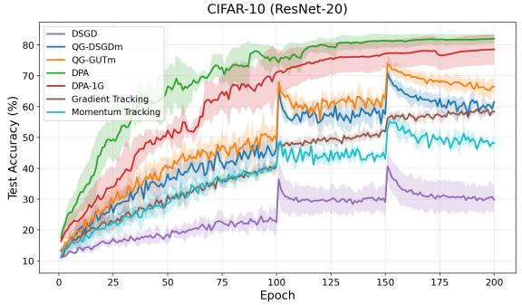

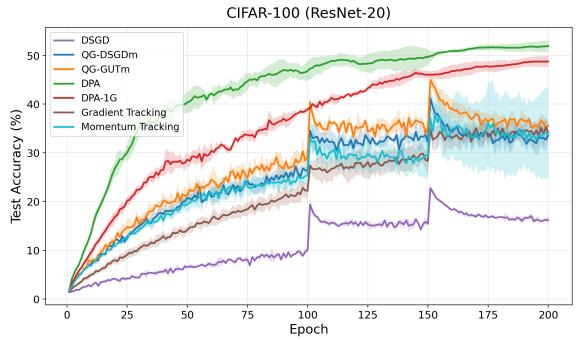  
(b) CIFAR-100 / ResNet-20  
Figure 1: Test accuracy during training on a 16-agent ring (α = 0.01).

75.67%. On Fashion-MNIST/LeNet-5, DPA-1G has the highest mean LE and L5E, improving over GT, the strongest baseline, by 1.43 percentage points in L5E.

Additional results for $n = 3 2$ agents and other graph topologies are given in Appendix D.5. Figure 1 shows the $n = 1 6$ ring test accuracy curves for $\alpha = 0 . 0 1$ . Among the methods that use one communication round per iteration, DPA-1G has the highest mean LE accuracy on CIFAR-100/ResNet-20.

Remark 5. DPA uses two communication rounds per iteration, so DPA sends more data per iteration than DSGD-style methods that use one communication round per iteration. However, Figure 1 shows that on the heterogeneous ring with α = 0.01, DPA reaches high test accuracy in fewer epochs than QG-DSGDm and QG-GUTm. At the full matched communication budget, DPA’s mean test accuracy exceeds that of the strongest baseline by 7.48 percentage points on CIFAR-10 and 16.03 percentage points on CIFAR-100 (Appendix D.6).

See Appendices D.7 and D.8 for IID and timing results.

## 5 Conclusion

We introduced Decentralized Primal Averaging (DPA), a decentralized learning algorithm for heterogeneous data. DPA adapts primal averaging to the gossip-based setting by using three coupled sequences for optimization, gradient evaluation, and output averaging. It also uses a local quasi-global momentum buffer built from consecutive mixed iterates, without sending an extra tracking variable. For smooth nonconvex objectives, we bounded the expected squared gradient norm at the network-average output model, averaged over iterations. The bound gives linear speedup in the number of agents when the network- and heterogeneity-dependent term is no larger than the leading term. We also introduced DPA-1G, a variant with one communication round per iteration that matches the per-iteration communication cost of DSGD-style baselines. Experiments on decentralized image classification show that DPA and DPA-1G improve over strong baselines, with the largest gains in highly heterogeneous settings on sparse ring topologies. Future work includes extending the analysis to DPA-1G, relaxing the conservative condition on the momentum parameters, and adapting primal averaging to time-varying or asynchronous networks.

## Acknowledgments and Disclosure of Funding

This work was partially supported by the Research Council of Finland (Grant 354523). We acknowledge the computational resources provided by the Aalto Science-IT project.

## References

Sai Aparna Aketi, Abolfazl Hashemi, and Kaushik Roy. Global update tracking: a decentralized learning algorithm for heterogeneous data. In Proceedings ofthe 37th International Conference on Neural Information Processing Systems, pages 48939–48961, 2023.

Mahmoud Assran, Nicolas Loizou, Nicolas Ballas, and Mike Rabbat. Stochastic gradient push for distributed deep learning. In International Conference on Machine Learning, pages 344–353. PMLR, 2019.

Jeffrey Dean, Greg S. Corrado, Rajat Monga, Kai Chen, Matthieu Devin, Quoc V. Le, Mark Z. Mao, Marc’Aurelio Ranzato, Andrew Senior, Paul Tucker, Ke Yang, and Andrew Y. Ng. Large scale distributed deep networks. Advances in Neural Information Processing Systems, 25, 2012.

Aaron Defazio. ScheduleFree+: Scaling learning-rate-free & schedule-free learning to large language models. arXiv preprint arXiv:2605.19095, 2026.

Aaron Defazio, Xingyu Yang, Harsh Mehta, Konstantin Mishchenko, Ahmed Khaled, and Ashok Cutkosky. The road less scheduled. Advances in Neural Information Processing Systems, 37:9974–10007, 2024.

Aaron Defazio, Konstantin Mishchenko, Parameswaran Raman, Hao-Jun Michael Shi, and Lin Xiao. Smoothing DiLoCo with primal averaging for faster training of LLMs. arXiv preprint arXiv:2512.17131, 2025.

Paolo Di Lorenzo and Gesualdo Scutari. NEXT: In-network nonconvex optimization. IEEE Transactions on Signal and Information Processing over Networks, 2(2):120–136, 2016.

Hongchang Gao and Heng Huang. Periodic stochastic gradient descent with momentum for decentralized training. arXiv preprint arXiv:2008.10435, 2020.

Diyako Ghaderyan and Stefan Werner. AdGT: Decentralized gradient tracking with adaptive per-agent stepsizes. IEEE Transactions on Signal Processing, 74:4097–4113, 2026. doi: 10.1109/TSP.2026.3733814.

Diyako Ghaderyan, Necdet Serhat Aybat, A. Pedro Aguiar, and Fernando Lobo Pereira. A fast row-stochastic decentralized method for distributed optimization over directed graphs. IEEE Transactions on Automatic Control, 69 (1):275–289, 2024.

Kevin Hsieh, Amar Phanishayee, Onur Mutlu, and Phillip Gibbons. The Non-IID data quagmire of decentralized machine learning. In International Conference on Machine Learning, pages 4387–4398. PMLR, 2020.

Anastasia Koloskova, Nicolas Loizou, Sadra Boreiri, Martin Jaggi, and Sebastian Stich. A unified theory of decentralized SGD with changing topology and local updates. In International Conference on Machine Learning, pages 5381–5393. PMLR, 2020.

Anastasiia Koloskova, Tao Lin, and Sebastian U Stich. An improved analysis of gradient tracking for decentralized machine learning. Advances in Neural Information Processing Systems, 34:11422–11435, 2021.

Guanghui Lan. An optimal method for stochastic composite optimization. Mathematical Programming, 133(1): 365–397, 2012.

Xiangru Lian, Ce Zhang, Huan Zhang, Cho-Jui Hsieh, Wei Zhang, and Ji Liu. Can decentralized algorithms outperform centralized algorithms? A case study for decentralized parallel stochastic gradient descent. Advances in Neural Information Processing Systems, 30, 2017.

Tao Lin, Sai Praneeth Karimireddy, Sebastian U. Stich, and Martin Jaggi. Quasi-global momentum: Accelerating decentralized deep learning on heterogeneous data. In ICML, pages 6654–6665, 2021. URL http://proceedings. mlr.press/v139/lin21c.html.

Angelia Nedic. Distributed gradient methods for convex machine learning problems in networks: Distributed optimiza-´ tion. IEEE Signal Processing Magazine, 37(3):92–101, 2020.

Angelia Nedic, Alex Olshevsky, and Wei Shi. Achieving geometric convergence for distributed optimization over´ time-varying graphs. SIAM Journal on Optimization, 27(4):2597–2633, 2017.

Shi Pu and Angelia Nedic. Distributed stochastic gradient tracking methods. ´ Mathematical Programming, 187(1): 409–457, 2021.

Yuki Takezawa, Han Bao, Kenta Niwa, Ryoma Sato, and Makoto Yamada. Momentum tracking: Momentum acceleration for decentralized deep learning on heterogeneous data. Transactions on Machine Learning Research, 2023. ISSN 2835-8856. URL https://openreview.net/forum?id=8koy8QuTZD.

Hanlin Tang, Xiangru Lian, Ming Yan, Ce Zhang, and Ji Liu. D<sup>2</sup>: Decentralized training over decentralized data. In International Conference on Machine Learning, pages 4848–4856. PMLR, 2018.

John N Tsitsiklis. Problems in decentralized decision making and computation. Technical report, Massachusetts Institute of Technology, Laboratory for Information and Decision Systems, 1984.

Thijs Vogels, Lie He, Anastasiia Koloskova, Sai Praneeth Karimireddy, Tao Lin, Sebastian U Stich, and Martin Jaggi. RelaySum for decentralized deep learning on heterogeneous data. Advances in Neural Information Processing Systems, 34:28004–28015, 2021.

Jianyu Wang, Vinayak Tantia, Nicolas Ballas, and Michael Rabbat. SlowMo: Improving communication-efficient distributed SGD with slow momentum. In International Conference on Learning Representations, 2020. URL https://openreview.net/forum?id=SkxJ8REYPH.

Lin Xiao and Stephen Boyd. Fast linear iterations for distributed averaging. Systems & Control Letters, 53(1):65–78, 2004.

Bicheng Ying, Kun Yuan, Yiming Chen, Hanbin Hu, Pan Pan, and Wotao Yin. Exponential graph is provably efficient for decentralized deep training. Advances in Neural Information Processing Systems, 34:13975–13987, 2021.

Hao Yu, Rong Jin, and Sen Yang. On the linear speedup analysis of communication efficient momentum SGD for distributed non-convex optimization. In International Conference on Machine Learning, pages 7184–7193. PMLR, 2019.

## A Algorithm details and additional notation

The problem statement, algorithm, and standing assumptions are in Section 2. This appendix gives the notation, coefficient bounds, schedule definitions, and technical conditions used in the proofs.

## A.1 Coefficient bounds and notation

Throughout the analysis, we use a constant learning rate $\eta > 0$ . The coefficient schedules ak+1 $\boldsymbol a _ { k + 1 }$ and $b _ { k + 1 }$ may be time-varying, provided they satisfy

$$
0 < b _ { \mathrm { m i n } } \leq b _ { k + 1 } \leq b _ { \mathrm { m a x } } < 1 , \qquad 0 < a _ { \mathrm { m i n } } \leq a _ { k + 1 } \leq a _ { \mathrm { m a x } } < 1 .
$$

The momentum parameters satisfy $\beta _ { 1 } , \beta _ { 2 } \in ( 0 , 1 )$ , and we require

$$
\tilde { \eta } : = \frac { \eta } { 1 - \beta _ { 1 } } \leq \frac { 1 } { 8 L } ,\tag{11}
$$

together with the additional learning-rate conditions stated below when needed.

Let

$$
J : = \frac { 1 } { n } \mathbf { 1 1 } ^ { \top } .
$$

For any $A \in \mathbb { R } ^ { d \times n }$ , define

$$
\bar { a } : = \frac { 1 } { n } A \mathbf { 1 } \in \mathbb { R } ^ { d } , \qquad \bar { A } : = \bar { a } \mathbf { 1 } ^ { \top } = A J .
$$

Thus $\bar { X } _ { k } = \bar { x } _ { k } \mathbf { 1 } ^ { \top }$ , and similarly for $Y _ { k } , Z _ { k } , U _ { k } , G _ { k }$ . We write $\mathbb { E } _ { k } [ \cdot ] = \mathbb { E } [ \cdot \mid \mathcal { F } _ { k } ]$

Remark 6. Under Assumption 4, the mixing matrix satisfies $\| W \| _ { 2 } \leq 1$ and $\left\| I - W \right\| _ { 2 } \leq 2 .$

Remark 7. For every $A \in \mathbb { R } ^ { d \times n }$

$$
\left\| A W - { \bar { A } } \right\| _ { F } \leq ( 1 - \rho ) \left\| A - { \bar { A } } \right\| _ { F } .
$$

## A.2 Schedules for $\boldsymbol a _ { k + 1 }$ and $b _ { k + 1 }$

For each coefficient $c \in \{ a , b \}$ , we use either a linear or an exponential schedule:

$$
c _ { k + 1 } = c _ { \mathrm { s t a r t } } + \left( c _ { \mathrm { e n d } } - c _ { \mathrm { s t a r t } } \right) \operatorname* { m i n } \left( 1 , \frac { k + 1 } { T _ { c } } \right) \qquad \mathrm { ( l i n e a r ) , }
$$

or

$$
c _ { k + 1 } = c _ { \mathrm { s t a r t } } \left( { \frac { c _ { \mathrm { e n d } } } { c _ { \mathrm { s t a r t } } } } \right) ^ { \left( \mathrm { m i n } \left( 1 , { \frac { k + 1 } { T _ { c } } } \right) \right) ^ { q _ { c } } } ( \mathrm { e x p o n e n t i a l } ) .
$$

Here $T _ { c } > 0$ is the schedule length and $q _ { c } > 0$ controls the curvature of the exponential schedule. The start and end values are chosen so that the bounds in Appendix A.1 hold at every iteration.

## B Proof of Theorem 1

Throughout this proof, we use the assumptions of Section 2.3 and the coefficient bounds in Appendix A.1.

## B.1 Step 1: auxiliary iterate and descent

Since W is doubly stochastic, gossip averaging preserves the network average. The auxiliary iterate $\hat { x } _ { k }$ is a shifted version of ${ \bar { y } } _ { k } ,$ , chosen so that its update is driven only by the network-average stochastic gradient $\bar { g } _ { k }$

Lemma 1. Let

$$
\alpha _ { u } : = 1 - \beta _ { 2 } \big ( 1 - \beta _ { 1 } \big ) .
$$

Then, for every $k \geq 0 ,$

$$
\bar { y } _ { k + 1 } = \bar { y } _ { k } - \eta \big ( \beta _ { 1 } \bar { u } _ { k } + \bar { g } _ { k } \big ) ,\tag{12}
$$

$$
\bar { u } _ { k + 1 } = \alpha _ { u } \bar { u } _ { k } + \beta _ { 2 } \bar { g } _ { k } ,\tag{13}
$$

$$
\bar { x } _ { k + 1 } = ( 1 - a _ { k + 1 } ) \bar { x } _ { k } + a _ { k + 1 } \bar { y } _ { k + 1 } .\tag{14}
$$

Proof. Since $W \mathbf { 1 } = \mathbf { 1 }$ , we have $A W { \textstyle { \frac { 1 } { n } } } \mathbf { 1 } = A { \frac { 1 } { n } } \mathbf { 1 }$ for any $A \in \mathbb { R } ^ { d \times n }$ . Averaging the Y -update gives

$$
\bar { y } _ { k + 1 } = \bar { y } _ { k } - \eta \big ( \beta _ { 1 } \bar { u } _ { k } + \bar { g } _ { k } \big ) ,
$$

which proves (12). Similarly, averaging the X-update gives

$$
\bar { x } _ { k + 1 } = ( 1 - a _ { k + 1 } ) \bar { x } _ { k } + a _ { k + 1 } \bar { y } _ { k + 1 } ,
$$

which proves (14). Moreover, writing $\begin{array} { r } { \bar { d } _ { k + 1 } = n ^ { - 1 } \sum _ { i = 1 } ^ { n } d _ { i } ^ { k + 1 } } \end{array}$ , (12) gives

$$
\bar { d } _ { k + 1 } = \frac { \bar { y } _ { k } - \bar { y } _ { k + 1 } } { \eta } = \beta _ { 1 } \bar { u } _ { k } + \bar { g } _ { k } .
$$

Averaging the U-update then yields

$$
\bar { u } _ { k + 1 } = ( 1 - \beta _ { 2 } ) \bar { u } _ { k } + \beta _ { 2 } \bar { d } _ { k + 1 } = \big ( 1 - \beta _ { 2 } ( 1 - \beta _ { 1 } ) \big ) \bar { u } _ { k } + \beta _ { 2 } \bar { g } _ { k } = \alpha _ { u } \bar { u } _ { k } + \beta _ { 2 } \bar { g } _ { k } .
$$

This proves (13) and completes the proof.

## B.1.1 Second-moment bounds

Lemma 2. For every $k \geq 0 ,$

$$
\mathbb { E } _ { k } \left. \bar { g } _ { k } \right. ^ { 2 } \leq 2 \left. \nabla f ( \bar { z } _ { k } ) \right. ^ { 2 } + 2 L ^ { 2 } \left( \frac { 1 } { n } \left. Z _ { k } - \bar { Z } _ { k } \right. _ { F } ^ { 2 } \right) + \frac { \sigma ^ { 2 } } { n } ,\tag{15}
$$

$$
\mathbb { E } _ { k } \left\| \beta _ { 1 } { \bar { u } } _ { k } + { \bar { g } } _ { k } \right\| ^ { 2 } \leq 2 \beta _ { 1 } ^ { 2 } \left\| { \bar { u } } _ { k } \right\| ^ { 2 } + 4 \left\| \nabla f ( { \bar { z } } _ { k } ) \right\| ^ { 2 } + 4 L ^ { 2 } \left( { \frac { 1 } { n } } \left\| Z _ { k } - { \bar { Z } } _ { k } \right\| _ { F } ^ { 2 } \right) + { \frac { 2 \sigma ^ { 2 } } { n } } .\tag{16}
$$

Proof. Since

$$
\mathbb { E } _ { k } [ \bar { g } _ { k } ] = \frac { 1 } { n } \sum _ { i = 1 } ^ { n } \nabla f _ { i } ( z _ { i } ^ { k } ) ,
$$

the bias–variance decomposition gives

$$
\begin{array} { l } { { \displaystyle \mathbb { E } _ { k } \left\| \bar { g } _ { k } \right\| ^ { 2 } = \mathbb { E } _ { k } \left\| \bar { g } _ { k } - \frac { 1 } { n } \sum _ { i = 1 } ^ { n } \nabla f _ { i } ( z _ { i } ^ { k } ) \right\| ^ { 2 } + \left\| \frac { 1 } { n } \sum _ { i = 1 } ^ { n } \nabla f _ { i } ( z _ { i } ^ { k } ) \right\| ^ { 2 } } } \\ { { \displaystyle \quad \leq \frac { \sigma ^ { 2 } } { n } + \left\| \frac { 1 } { n } \sum _ { i = 1 } ^ { n } \nabla f _ { i } ( z _ { i } ^ { k } ) \right\| ^ { 2 } } } \\ { { \displaystyle \quad \leq \frac { \sigma ^ { 2 } } { n } + 2 \left\| \nabla f ( \bar { z } _ { k } ) \right\| ^ { 2 } + 2 \left\| \frac { 1 } { n } \sum _ { i = 1 } ^ { n } \left( \nabla f _ { i } ( z _ { i } ^ { k } ) - \nabla f _ { i } ( \bar { z } _ { k } ) \right) \right\| ^ { 2 } } } \\ { { \displaystyle \quad \leq \frac { \sigma ^ { 2 } } { n } + 2 \left\| \nabla f ( \bar { z } _ { k } ) \right\| ^ { 2 } + 2 L ^ { 2 } \left( \frac { 1 } { n } \left\| Z _ { k } - \bar { Z } _ { k } \right\| _ { F } ^ { 2 } \right) } . }  \end{array}
$$

This proves (15). The first inequality uses Assumption 2 and conditional independence across agents given $\mathcal { F } _ { k } ;$ the second uses $\begin{array} { r } { \| a + b \| ^ { 2 } \leq 2 \| a \| ^ { 2 ^ { \bullet } } + 2 \| \bar { b } \| ^ { 2 } } \end{array}$ ; the last uses Jensen’s inequality and Assumption 1.

For (16), applying $\left. a + b \right. ^ { 2 } \leq 2 \left. a \right. ^ { 2 } + 2 \left. b \right. ^ { 2 }$ and (15) gives

$$
\begin{array} { r l r } {  { \mathbb { E } _ { k } \| \beta _ { 1 } \bar { u } _ { k } + \bar { g } _ { k } \| ^ { 2 } \leq 2 \beta _ { 1 } ^ { 2 } \| \bar { u } _ { k } \| ^ { 2 } + 2 \mathbb { E } _ { k } \| \bar { g } _ { k } \| ^ { 2 } } } \\ & { } & { \leq 2 \beta _ { 1 } ^ { 2 } \| \bar { u } _ { k } \| ^ { 2 } + 4 \| \nabla f ( \bar { z } _ { k } ) \| ^ { 2 } + 4 L ^ { 2 } ( \frac { 1 } { n } \| Z _ { k } - \bar { Z } _ { k } \| _ { F } ^ { 2 } ) + \frac { 2 \sigma ^ { 2 } } { n } . } \end{array}
$$

This proves (16).

## B.1.2 Definition of the auxiliary iterate

We now define the auxiliary iterate and verify the cancellation of the network-average momentum term.

Lemma 3. Let

$$
\tilde { \eta } : = \frac { \eta } { 1 - \beta _ { 1 } } , \qquad c _ { m } : = \frac { \eta \beta _ { 1 } } { \beta _ { 2 } ( 1 - \beta _ { 1 } ) } , \qquad \hat { x } _ { k } : = \bar { y } _ { k } - c _ { m } \bar { u } _ { k } .
$$

Then $\hat { x } _ { 0 } = \bar { x } _ { 0 } ,$ , andfor every $k \geq 0 ,$

$$
\begin{array} { r } { \hat { x } _ { k + 1 } = \hat { x } _ { k } - \tilde { \eta } \bar { g } _ { k } . } \end{array}\tag{17}
$$

Proof. By Lemma 1,

$$
\begin{array} { r l } & { \hat { x } _ { k + 1 } = \bar { y } _ { k + 1 } - c _ { m } \bar { u } _ { k + 1 } } \\ & { \qquad = \bar { y } _ { k } - \eta \big ( \beta _ { 1 } \bar { u } _ { k } + \bar { g } _ { k } \big ) - c _ { m } \big ( \alpha _ { u } \bar { u } _ { k } + \beta _ { 2 } \bar { g } _ { k } \big ) } \\ & { \qquad = \hat { x } _ { k } + \big ( c _ { m } ( 1 - \alpha _ { u } ) - \eta \beta _ { 1 } \big ) \bar { u } _ { k } - ( \eta + c _ { m } \beta _ { 2 } ) \bar { g } _ { k } . } \end{array}
$$

Since $1 - \alpha _ { u } = \beta _ { 2 } ( 1 - \beta _ { 1 } )$ , the definition of $c _ { m }$ gives

$$
c _ { m } ( 1 - \alpha _ { u } ) = \eta \beta _ { 1 } , \qquad \eta + c _ { m } \beta _ { 2 } = \tilde { \eta } .
$$

Thus (17) follows. Finally,

$$
\hat { x } _ { 0 } = \bar { y } _ { 0 } - c _ { m } \bar { u } _ { 0 } = \bar { x } _ { 0 } ,
$$

because $Y _ { 0 } = X _ { 0 }$ and $U _ { 0 } = 0$

The update in (17) has the form of a centralized stochastic-gradient update with learning rate $\tilde { \eta } .$ . Using the smoothness of $f ,$ we obtain the following one-step bound. The bound accounts for the gap between $\hat { x } _ { k }$ and $\bar { z } _ { k }$ , the consensus error of the local gradient-evaluation points, and gradient noise.

Lemma 4. Under (11),for every $k \geq 0$

$$
\begin{array} { l } { \displaystyle \mathbb { E } _ { k } f ( \hat { x } _ { k + 1 } ) \leq f ( \hat { x } _ { k } ) - \frac { \tilde { \eta } } { 8 } \left\| \nabla f ( \bar { z } _ { k } ) \right\| ^ { 2 } + 3 \tilde { \eta } L ^ { 2 } ( 1 - b _ { \operatorname* { m i n } } ) ^ { 2 } \left\| \bar { y } _ { k } - \bar { x } _ { k } \right\| ^ { 2 } } \\ { \displaystyle \qquad + 3 \tilde { \eta } L ^ { 2 } \left( \frac { \eta \beta _ { 1 } } { \beta _ { 2 } ( 1 - \beta _ { 1 } ) } \right) ^ { 2 } \left\| \bar { u } _ { k } \right\| ^ { 2 } } \\ { \displaystyle \qquad + \left( \tilde { \eta } L ^ { 2 } + L ^ { 3 } \tilde { \eta } ^ { 2 } \right) \left( \frac { 1 } { n } \left\| Z _ { k } - \bar { Z } _ { k } \right\| _ { F } ^ { 2 } \right) + \frac { L \tilde { \eta } ^ { 2 } } { 2 } \cdot \frac { \sigma ^ { 2 } } { n } . } \end{array}\tag{18}
$$

Proof. By Lemma $3 , \hat { x } _ { k + 1 } = \hat { x } _ { k } - \tilde { \eta } \bar { g } _ { k }$ . Therefore,

$$
\begin{array} { r l } { \frac { 1 } { 2 } \int ( \hat { z } _ { \pm 1 } ) ^ { k _ { \perp } } - \frac { 1 } { 2 } \left. \hat { z } _ { \pm 1 } ^ { k _ { \perp } } - \hat { z } _ { \pm 1 } ^ { k _ { \perp } } \frac { \hat { z } _ { \pm 1 } ^ { k _ { \perp } } } { n } \hat { z } _ { \pm 1 } ^ { k _ { \perp } } + \frac { \hat { z } _ { \pm 1 } ^ { k _ { \perp } } } { 2 } \hat { z } _ { \pm 1 } | n \right. _ { \pm } ^ { k _ { \perp } } + \frac { \hat { z } _ { \pm 2 } ^ { k _ { \perp } } } { 2 } \left. \hat { z } _ { \pm 1 } | n \right. _ { \pm } ^ { 2 } } & { } \\ { \frac { \hat { z } _ { \pm 1 } ^ { k _ { \perp } } } { 2 } \left. \hat { z } _ { \pm 1 } ^ { k _ { \perp } } - \frac { \hat { z } _ { \pm 1 } ^ { k _ { \perp } } } { 2 } | \nabla \{ ( \hat { z } _ { \pm 1 } ) ^ { k _ { \perp } } \} ^ { k _ { \perp } } \frac { \hat { z } _ { \pm 1 } ^ { k _ { \perp } } } { 2 } \hat { z } _ { \mp 1 } | \hat { z } _ { \mp 1 } ^ { k _ { \perp } } \cdot \nabla \{ ( \hat { z } _ { \pm 1 } ) ^ { k _ { \perp } } \} ^ { k _ { \perp } } \right. _ { \pm } ^ { k _ { \perp } } } & { } \\  \frac { \hat { z } _ { \pm 1 } ^ { k _ { \perp } } } { 2 } \int ( \hat { z } _ { \pm 1 } ^ { k _ { \perp } } - \frac { \hat { z } _ { \pm 1 } ^ { k _ { \perp } } } { 2 } | \nabla \{ ( \hat { z } _ { \pm 1 } ) ^ { k _ { \perp } } \} ^ { k _ { \perp } } \frac { \hat { z } _ { \pm 1 } ^ { k _ { \perp } } } { 2 } | \nabla \{ ( \hat { z } _   \end{array}\tag{19}
$$

where $( a )$ uses Assumption 1 and $\begin{array} { r } { \mathbb { E } _ { k } [ \bar { g } _ { k } ] = \frac { 1 } { n } \sum _ { i = 1 } ^ { n } \nabla f _ { i } ( z _ { i } ^ { k } ) ; ( b ) } \end{array}$ uses $\begin{array} { r } { - \langle a , b \rangle \leq - \frac { 1 } { 2 } \| a \| ^ { 2 } + \frac { 1 } { 2 } \| a - b \| ^ { 2 } ; ( c } \end{array}$ ) uses $\begin{array} { r } { - \frac 1 2 \| a \| ^ { 2 } \leq - \frac 1 4 \| b \| ^ { 2 } + \frac 1 2 \| a - b \| ^ { 2 } ; ( d ) } \end{array}$ uses $\begin{array} { r } { \| p - r \| ^ { 2 } \leq 2 \| p - q \| ^ { 2 } + 2 \| q - r \| ^ { 2 } ; } \end{array}$ and (e) uses Assumption 1 together with the bound derived using Jensen’s inequality in the proof of Lemma 2.

By definition of $\scriptstyle { \hat { x } } _ { k }$ and $\bar { z } _ { k }$ ,

$$
\hat { x } _ { k } - \bar { z } _ { k } = ( 1 - b _ { k + 1 } ) ( \bar { y } _ { k } - \bar { x } _ { k } ) - \frac { \eta \beta _ { 1 } } { \beta _ { 2 } ( 1 - \beta _ { 1 } ) } \bar { u } _ { k } ,
$$

so $\left. a + b \right. ^ { 2 } \leq 2 \left. a \right. ^ { 2 } + 2 \left. b \right. ^ { 2 }$ and $b _ { k + 1 } \geq b _ { \mathrm { m i n } }$ give

$$
\Vert \hat { x } _ { k } - \bar { z } _ { k } \Vert ^ { 2 } \leq 2 ( 1 - b _ { \operatorname* { m i n } } ) ^ { 2 } \Vert \bar { y } _ { k } - \bar { x } _ { k } \Vert ^ { 2 } + 2 \left( \frac { \eta \beta _ { 1 } } { \beta _ { 2 } ( 1 - \beta _ { 1 } ) } \right) ^ { 2 } \Vert \bar { u } _ { k } \Vert ^ { 2 } .\tag{20}
$$

Substituting (20) into (19) and applying (15) to the $\mathbb { E } _ { k } \rVert \bar { g } _ { k } \rVert ^ { 2 }$ term yields

$$
\begin{array} { r l } & { \mathbb { E } _ { k } f ( \hat { x } _ { k + 1 } ) \leq f ( \hat { x } _ { k } ) - \left( \frac { \tilde { \eta } } { 4 } - L \tilde { \eta } ^ { 2 } \right) \| \nabla f ( \bar { z } _ { k } ) \| ^ { 2 } } \\ & { \qquad + 3 \tilde { \eta } L ^ { 2 } ( 1 - b _ { \operatorname* { m i n } } ) ^ { 2 } \| \bar { y } _ { k } - \bar { x } _ { k } \| ^ { 2 } + 3 \tilde { \eta } L ^ { 2 } \left( \frac { \eta \beta _ { 1 } } { \beta _ { 2 } ( 1 - \beta _ { 1 } ) } \right) ^ { 2 } \| \bar { u } _ { k } \| ^ { 2 } } \\ & { \qquad + \left( \tilde { \eta } L ^ { 2 } + L ^ { 3 } \tilde { \eta } ^ { 2 } \right) \left( \frac { 1 } { n } \left\| Z _ { k } - \bar { Z } _ { k } \right\| _ { F } ^ { 2 } \right) + \frac { L \tilde { \eta } ^ { 2 } } { 2 } \cdot \frac { \sigma ^ { 2 } } { n } . } \end{array}
$$

Since $\tilde { \eta } \le 1 / ( 8 L ) , \tilde { \eta } / 4 - L \tilde { \eta } ^ { 2 } \ge \tilde { \eta } / 8 ,$ proving (18).

The one-step bound in Lemma 4 contains $\| \bar { y } _ { k } - \bar { x } _ { k } \| ^ { 2 }$ and $\| \bar { u } _ { k } \| ^ { 2 }$ . The next two lemmas give recursions for these quantities. Proposition 1 then bounds the expected squared gradient norm, averaged over iterations, in terms of the consensus error of $Z _ { k }$ , the initial objective gap, and the gradient variance.

Lemma 5. For every $k \geq 0 ,$

$$
\begin{array} { r l } & { \mathbb { E } _ { k } \| \bar { y } _ { k + 1 } - \bar { x } _ { k + 1 } \| ^ { 2 } \leq ( 1 - a _ { \operatorname* { m i n } } ) \| \bar { y } _ { k } - \bar { x } _ { k } \| ^ { 2 } + \frac { ( 1 - a _ { \operatorname* { m i n } } ) ^ { 2 } } { a _ { \operatorname* { m i n } } } \eta ^ { 2 } \Bigg ( 2 \beta _ { 1 } ^ { 2 } \| \bar { u } _ { k } \| ^ { 2 } + 4 \| \nabla f ( \bar { z } _ { k } ) \| ^ { 2 } } \\ & { \qquad + 4 L ^ { 2 } \left( \frac { 1 } { n } \| Z _ { k } - \bar { Z } _ { k } \| _ { F } ^ { 2 } \right) + \frac { 2 \sigma ^ { 2 } } { n } \Bigg ) . } \end{array}\tag{21}
$$

Proof. By Lemma 1,

$$
\bar { y } _ { k + 1 } - \bar { x } _ { k + 1 } = \left( 1 - a _ { k + 1 } \right) \left( \left( \bar { y } _ { k } - \bar { x } _ { k } \right) - \eta \big ( \beta _ { 1 } \bar { u } _ { k } + \bar { g } _ { k } \big ) \right) .
$$

Young’s inequality with $\tau = { a _ { k + 1 } } / { ( 1 - a _ { k + 1 } ) }$ gives

$$
\left\| { \bar { y } } _ { k + 1 } - { \bar { x } } _ { k + 1 } \right\| ^ { 2 } \leq ( 1 - a _ { k + 1 } ) \| { \bar { y } } _ { k } - { \bar { x } } _ { k } \| ^ { 2 } + { \frac { ( 1 - a _ { k + 1 } ) ^ { 2 } } { a _ { k + 1 } } } \eta ^ { 2 } \left\| \beta _ { 1 } { \bar { u } } _ { k } + { \bar { g } } _ { k } \right\| ^ { 2 } .
$$

Since $a _ { k + 1 } \geq a _ { \operatorname* { m i n } } > 0$ and $t \mapsto ( 1 - t ) ^ { 2 } / t$ is decreasing on (0, 1),

$$
1 - a _ { k + 1 } \leq 1 - a _ { \operatorname* { m i n } } , \qquad \frac { ( 1 - a _ { k + 1 } ) ^ { 2 } } { a _ { k + 1 } } \leq \frac { ( 1 - a _ { \operatorname* { m i n } } ) ^ { 2 } } { a _ { \operatorname* { m i n } } } .
$$

Taking $\mathbb { E } _ { k } [ \cdot ]$ and applying Lemma 2 gives (21).

Lemma 6. For every $k \geq 0 ,$

$$
\begin{array} { r l r } & { } & { \mathbb { E } _ { k } \left\| \bar { u } _ { k + 1 } \right\| ^ { 2 } \leq \frac { 1 + \alpha _ { u } ^ { 2 } } { 2 } \left\| \bar { u } _ { k } \right\| ^ { 2 } + 2 \beta _ { 2 } ^ { 2 } \left( 1 + \frac { 2 \alpha _ { u } ^ { 2 } } { 1 - \alpha _ { u } ^ { 2 } } \right) \left\| \nabla f ( \bar { z } _ { k } ) \right\| ^ { 2 } } \\ & { } & { \quad \quad + 2 L ^ { 2 } \beta _ { 2 } ^ { 2 } \left( 1 + \frac { 2 \alpha _ { u } ^ { 2 } } { 1 - \alpha _ { u } ^ { 2 } } \right) \left( \displaystyle \frac { 1 } { n } \left\| Z _ { k } - \bar { Z } _ { k } \right\| _ { F } ^ { 2 } \right) + \beta _ { 2 } ^ { 2 } \frac { \sigma ^ { 2 } } { n } . } \end{array}\tag{22}
$$

Proof. By Lemma 1 and $\begin{array} { r } { \mathbb { E } _ { k } \big [ \bar { g } _ { k } \big ] = \frac { 1 } { n } \sum _ { i = 1 } ^ { n } \nabla f _ { i } ( z _ { i } ^ { k } ) } \end{array}$

$$
\begin{array} { r l r } & { } & { \displaystyle \mathbb { E } _ { k } \left\| \bar { u } _ { k + 1 } \right\| ^ { 2 } = \alpha _ { u } ^ { 2 } \left\| \bar { u } _ { k } \right\| ^ { 2 } + 2 \alpha _ { u } \beta _ { 2 } \left. \bar { u } _ { k } , \frac { 1 } { n } \displaystyle \sum _ { i = 1 } ^ { n } \nabla f _ { i } ( z _ { i } ^ { k } ) \right. + \beta _ { 2 } ^ { 2 } \mathbb { E } _ { k } \left\| \bar { g } _ { k } \right\| ^ { 2 } } \\ & { } & { \displaystyle \leq \frac { 1 + \alpha _ { u } ^ { 2 } } { 2 } \left\| \bar { u } _ { k } \right\| ^ { 2 } + \frac { 2 \alpha _ { u } ^ { 2 } \beta _ { 2 } ^ { 2 } } { 1 - \alpha _ { u } ^ { 2 } } \left\| \frac { 1 } { n } \displaystyle \sum _ { i = 1 } ^ { n } \nabla f _ { i } ( z _ { i } ^ { k } ) \right\| ^ { 2 } + \beta _ { 2 } ^ { 2 } \mathbb { E } _ { k } \left\| \bar { g } _ { k } \right\| ^ { 2 } , } \end{array}\tag{23}
$$

where we apply Young’s inequality with parameter $( 1 - \alpha _ { u } ^ { 2 } ) / 2$ to the cross term. As in the proof of Lemma 2,

$$
\begin{array} { r } { \left\| \frac { 1 } { n } \displaystyle \sum _ { i = 1 } ^ { n } \nabla f _ { i } ( z _ { i } ^ { k } ) \right\| ^ { 2 } \leq 2 \left\| \nabla f ( \bar { z } _ { k } ) \right\| ^ { 2 } + 2 L ^ { 2 } \left( \frac { 1 } { n } \left\| Z _ { k } - \bar { Z } _ { k } \right\| _ { F } ^ { 2 } \right) . } \end{array}
$$

Combining this bound with (15) in (23) gives (22).

We will use the following lemma several times. It bounds the sum of a sequence satisfying a contractive recursion. We apply it to the expectations of $\| \bar { y } _ { k } - \bar { x } _ { k } \| ^ { 2 } , \| \bar { u } _ { k } \| ^ { 2 }$ , and later to the expected value of the consensus Lyapunov function. Lemma 7. Let $\{ s _ { k } \} _ { k \ge 0 }$ and $\{ r _ { k } \} _ { k \ge 0 }$ be nonnegative sequences such that $s _ { 0 } = 0$ and

$$
s _ { k + 1 } \leq q s _ { k } + r _ { k } , \qquad q \in [ 0 , 1 ) .
$$

Then, for every $T \geq 1$

$$
\sum _ { k = 0 } ^ { T - 1 } s _ { k } \leq { \frac { 1 } { 1 - q } } \sum _ { k = 0 } ^ { T - 1 } r _ { k } .\tag{24}
$$

Proof. Summing $s _ { k + 1 } \leq q s _ { k } + r _ { k }$ over $k = 0 , \ldots , T - 1$ and using $s _ { 0 } = 0$ gives

$$
( 1 - q ) \sum _ { k = 0 } ^ { T - 1 } s _ { k } + s _ { T } \leq \sum _ { k = 0 } ^ { T - 1 } r _ { k } .
$$

Dropping $s _ { T } \geq 0$ and dividing by $1 - q$ yields (24).

Applying Lemma 7 to the two preceding inequalities and substituting the resulting bounds into Lemma 4 gives the following reduction.

Proposition 1. Assume that

$$
\tilde { \eta } = \frac { \eta } { 1 - \beta _ { 1 } } \leq \frac { 1 } { 8 L } .
$$

Let $K _ { g } , K _ { z } , K _ { \sigma }$ be the constants defined below. $I f K _ { g } > 0 ,$ , then for every $T \geq 1$

$$
\frac { 1 } { T } \sum _ { k = 0 } ^ { T - 1 } \mathbb { E } \left. \nabla f ( \bar { z } _ { k } ) \right. ^ { 2 } \leq \frac { f ( \bar { x } _ { 0 } ) - f ^ { \star } } { K _ { g } T } + \frac { K _ { z } } { K _ { g } } \cdot \frac { 1 } { T } \sum _ { k = 0 } ^ { T - 1 } \mathbb { E } \left( \frac { 1 } { n } \left. Z _ { k } - \bar { Z } _ { k } \right. _ { F } ^ { 2 } \right) + \frac { K _ { \sigma } } { K _ { g } } \frac { \sigma ^ { 2 } } { n } ,\tag{25}
$$

where

$$
\begin{array} { r l } & { { E } _ { \mathrm { c } } = \frac { \hbar } { 8 } - 3 \mathrm { i } \lambda \dot { \lambda } ^ { 2 } ( 1 - 8 \sin \alpha ) ^ { 2 } ( \frac { 2 4 \pi } { 1 - \alpha _ { 0 } ^ { 2 } \sin ^ { 2 } } + \frac { 8 2 \theta ^ { 2 } ( 1 - \alpha _ { 0 } ) \sin ^ { 2 } \theta ^ { 2 } } { \alpha _ { 0 } ^ { 2 } \sin ( 1 - \alpha _ { 0 } ^ { 2 } ) } ( 1 + \frac { 2 \alpha _ { 0 } ^ { 2 } } { 1 - \alpha _ { 0 } ^ { 2 } } ) ) } \\ & { \qquad \quad - 3 \theta ^ { 2 } \mathrm { i } ( \frac { \pi } { 1 - \alpha _ { 0 } ^ { 2 } } ) ^ { 2 } ( \frac { 2 \pi } { 1 - \alpha _ { 0 } ^ { 2 } } ) ^ { 2 } + \frac { \sqrt { 2 } \alpha _ { 0 } ^ { 2 } } { \alpha _ { 0 } ^ { 2 } \sin ( 1 - \alpha _ { 0 } ^ { 2 } ) } ( 1 + \frac { 2 \alpha _ { 0 } ^ { 2 } } { 1 - \alpha _ { 0 } ^ { 2 } } ) } \\ & { \qquad \quad - 3 \theta ^ { 2 } \mathrm { i } ( \frac { \pi } { 1 - \alpha _ { 0 } ^ { 2 } } ) ^ { 2 } ( \frac { 2 \pi } { 1 - \alpha _ { 0 } ^ { 2 } } ) ^ { 2 } + \frac { \sqrt { 2 } \alpha _ { 0 } ^ { 2 } } { 1 - \alpha _ { 0 } ^ { 2 } } ( 1 + \frac { 2 \alpha _ { 0 } ^ { 2 } } { 1 - \alpha _ { 0 } ^ { 2 } } ) , } \\ &  { E } _ { \mathrm { c } } \times 3 \mathrm { i } \lambda _ { \mathrm { i } } ^ { 2 } ( 1 - \frac { \pi } { 1 - \alpha _ { 0 } ^ { 2 } \sin ^ { 2 } \theta ^ { 2 } } ( \frac { 2 4 \pi } { 1 - \alpha _ { 0 } ^ { 2 } \cos ^ { 2 } \theta ^ { 2 } } + \frac  8 \pi \theta  \end{array}\tag{26}
$$

(27)

(28)

Proof. Applying Lemma 7 to Lemma 6 with $s _ { k } = \mathbb { E } \left\| \bar { u } _ { k } \right\| ^ { 2 } , q = ( 1 + \alpha _ { u } ^ { 2 } ) / 2$ , and $1 - q = ( 1 - \alpha _ { u } ^ { 2 } ) / 2$ , and using $\bar { u } _ { 0 } = 0 .$ , gives

$$
\begin{array} { r l r } {  { \sum _ { k = 0 } ^ { T - 1 } \mathbb { E } \| \bar { u } _ { k } \| ^ { 2 } \leq \frac { 4 \beta _ { 2 } ^ { 2 } } { 1 - \alpha _ { u } ^ { 2 } } ( 1 + \frac { 2 \alpha _ { u } ^ { 2 } } { 1 - \alpha _ { u } ^ { 2 } } ) \sum _ { k = 0 } ^ { T - 1 } \mathbb { E } \| \nabla f ( \bar { z } _ { k } ) \| ^ { 2 } } } \\ & { } & { \quad + \frac { 4 L ^ { 2 } \beta _ { 2 } ^ { 2 } } { 1 - \alpha _ { u } ^ { 2 } } ( 1 + \frac { 2 \alpha _ { u } ^ { 2 } } { 1 - \alpha _ { u } ^ { 2 } } ) \sum _ { k = 0 } ^ { T - 1 } \mathbb { E } ( \frac { 1 } { n } \| Z _ { k } - \bar { Z } _ { k } \| _ { F } ^ { 2 } ) + \frac { 2 \beta _ { 2 } ^ { 2 } } { 1 - \alpha _ { u } ^ { 2 } } T \frac { \sigma ^ { 2 } } { n } . } \end{array}\tag{29}
$$

Similarly, applying Lemma 7 to Lemma $5$ with $s _ { k } = \mathbb { E } \Vert \bar { y } _ { k } - \bar { x } _ { k } \Vert ^ { 2 } , q = 1 - a _ { \operatorname* { m i n } }$ , and using $\bar { y } _ { 0 } = \bar { x } _ { 0 } ,$ , yields

$$
\begin{array} { r l } { \displaystyle \sum _ { k = 0 } ^ { T - 1 } \mathbb { E } \| \bar { y } _ { k } - \bar { x } _ { k } \| ^ { 2 } \leq \frac { 2 \beta _ { 1 } ^ { 2 } ( 1 - a _ { \operatorname* { m i n } } ) ^ { 2 } \eta ^ { 2 } } { a _ { \operatorname* { m i n } } ^ { 2 } } \displaystyle \sum _ { k = 0 } ^ { T - 1 } \mathbb { E } \left\| \bar { u } _ { k } \right\| ^ { 2 } + \frac { 4 ( 1 - a _ { \operatorname* { m i n } } ) ^ { 2 } \eta ^ { 2 } } { a _ { \operatorname* { m i n } } ^ { 2 } } \displaystyle \sum _ { k = 0 } ^ { T - 1 } \mathbb { E } \left\| \nabla f ( \bar { z } _ { k } ) \right\| ^ { 2 } } & { } \\ { \displaystyle \qquad + \frac { 4 L ^ { 2 } ( 1 - a _ { \operatorname* { m i n } } ) ^ { 2 } \eta ^ { 2 } } { a _ { \operatorname* { m i n } } ^ { 2 } } \displaystyle \sum _ { k = 0 } ^ { T - 1 } \mathbb { E } \left( \frac { 1 } { n } \left\| Z _ { k } - \bar { Z } _ { k } \right\| _ { F } ^ { 2 } \right) + \frac { 2 ( 1 - a _ { \operatorname* { m i n } } ) ^ { 2 } \eta ^ { 2 } } { a _ { \operatorname* { m i n } } ^ { 2 } } T \frac { \sigma ^ { 2 } } { n } . } \end{array}\tag{30}
$$

Substituting (29) into (30) gives

$$
\begin{array} { r l } & { \quad \displaystyle \sum _ { k = 0 } ^ { T - 1 } \mathbb { E } \| \bar { y } _ { k } - \bar { x } _ { k } \| ^ { 2 } } \\ & { \le [ \frac { 4 ( 1 - a _ { \operatorname* { m i n } } ) ^ { 2 } \eta ^ { 2 } } { a _ { \operatorname* { m i n } } ^ { 2 } } + \frac { 8 \beta _ { 1 } ^ { 2 } ( 1 - a _ { \operatorname* { m i n } } ) ^ { 2 } \eta ^ { 2 } \beta _ { 2 } ^ { 2 } } { a _ { \operatorname* { m i n } } ^ { 2 } ( 1 - \alpha _ { u } ^ { 2 } ) } ( 1 + \frac { 2 \alpha _ { u } ^ { 2 } } { 1 - \alpha _ { u } ^ { 2 } } ) ] \displaystyle \sum _ { k = 0 } ^ { T - 1 } \mathbb { E } \| \nabla f ( \bar { z } _ { k } ) \| ^ { 2 } } \\ & { \quad \quad + [ \frac { 4 L ^ { 2 } ( 1 - a _ { \operatorname* { m i n } } ) ^ { 2 } \eta ^ { 2 } } { a _ { \operatorname* { m i n } } ^ { 2 } } + \frac { 8 \beta _ { 1 } ^ { 2 } L ^ { 2 } ( 1 - a _ { \operatorname* { m i n } } ) ^ { 2 } \eta ^ { 2 } \beta _ { 2 } ^ { 2 } } { a _ { \operatorname* { m i n } } ^ { 2 } ( 1 - \alpha _ { u } ^ { 2 } ) } ( 1 + \frac { 2 \alpha _ { u } ^ { 2 } } { 1 - \alpha _ { u } ^ { 2 } } ) ] \displaystyle \sum _ { k = 0 } ^ { T - 1 } \mathbb { E } ( \frac { 1 } { n } \| Z _ { k } - \bar { Z } _ { k } \| _ { F } ^ { 2 } ) } \\ &  \quad \quad + [ \frac { 2 ( 1 - a _ { \operatorname* { m i n } } ) ^ { 2 } \eta ^ { 2 } } { a _ { \operatorname* { m i n } } ^ { 2 } } + \frac  4 \beta _ { 1 } ^ { 2 } ( 1 - a _ { \operatorname* { m i n } } ) ^ { 2 } \eta ^ { 2 } \ \end{array}\tag{31}
$$

Taking total expectations in (18), summing over $k = 0 , \ldots , T - 1$ , and using $\hat { x } _ { 0 } = \bar { x } _ { 0 }$ and $f ( { \hat { x } } _ { T } ) \geq f ^ { \star }$ gives

$$
\begin{array} { r l } & { \displaystyle \frac { \tilde { \eta } } { 8 } \sum _ { k = 0 } ^ { T - 1 } \mathbb { E } \| \nabla f ( \bar { z } _ { k } ) \| ^ { 2 } \leq f ( \bar { x } _ { 0 } ) - f ^ { \star } + 3 \tilde { \eta } L ^ { 2 } ( 1 - b _ { \operatorname* { m i n } } ) ^ { 2 } \sum _ { k = 0 } ^ { T - 1 } \mathbb { E } \| \bar { y } _ { k } - \bar { x } _ { k } \| ^ { 2 } } \\ & { \qquad + 3 \tilde { \eta } L ^ { 2 } \left( \frac { \eta \beta _ { 1 } } { \beta _ { 2 } ( 1 - \beta _ { 1 } ) } \right) ^ { 2 } \sum _ { k = 0 } ^ { T - 1 } \mathbb { E } \| \bar { u } _ { k } \| ^ { 2 } + \big ( \tilde { \eta } L ^ { 2 } + L ^ { 3 } \tilde { \eta } ^ { 2 } \big ) \sum _ { k = 0 } ^ { T - 1 } \mathbb { E } \left( \frac { 1 } { n } \left\| Z _ { k } - \bar { Z } _ { k } \right\| _ { F } ^ { 2 } \right) } \\ & { \qquad + \frac { L \tilde { \eta } ^ { 2 } } { 2 } T \frac { \sigma ^ { 2 } } { n } . } \end{array}\tag{32}
$$

Substituting (29) and (31) into (32), then collecting the coefficients according to (26)–(28), gives

$$
K _ { g } \sum _ { k = 0 } ^ { T - 1 } \mathbb { E } \left\| \nabla f ( \bar { z } _ { k } ) \right\| ^ { 2 } \leq f ( \bar { x } _ { 0 } ) - f ^ { \star } + K _ { z } \sum _ { k = 0 } ^ { T - 1 } \mathbb { E } \left( \frac { 1 } { n } \left\| Z _ { k } - \bar { Z } _ { k } \right\| _ { F } ^ { 2 } \right) + K _ { \sigma } T \frac { \sigma ^ { 2 } } { n } .\tag{33}
$$

Since $K _ { g } > 0$ , dividing (33) by $K _ { g } T$ proves (25).

We next give convenient sufficient conditions under which $K _ { g }$ is positive and the ratios involving $K _ { z }$ and $K _ { \sigma }$ can be bounded by simpler quantities.

Lemma 8. Under the assumptions of Proposition 1, suppose

$$
\eta ^ { 2 } \leq \frac { 1 } { 1 9 2 L ^ { 2 } \left[ \frac { ( 1 - b _ { \operatorname* { m i n } } ) ^ { 2 } ( 1 - a _ { \operatorname* { m i n } } ) ^ { 2 } } { a _ { \operatorname* { m i n } } ^ { 2 } } \left( 1 + \frac { 2 \beta _ { 1 } ^ { 2 } ( 1 + \alpha _ { u } ^ { 2 } ) } { ( 1 - \beta _ { 1 } ) ^ { 2 } ( 1 + \alpha _ { u } ) ^ { 2 } } \right) + \frac { \beta _ { 1 } ^ { 2 } ( 1 + \alpha _ { u } ^ { 2 } ) } { \beta _ { 2 } ^ { 2 } ( 1 - \beta _ { 1 } ) ^ { 4 } ( 1 + \alpha _ { u } ) ^ { 2 } } \right] } .\tag{34}
$$

Then $K _ { g } \ge \tilde { \eta } / 1 6 .$ . In particular, the simpler condition

$$
\eta ^ { 2 } \leq \frac { a _ { \mathrm { m i n } } ^ { 2 } \beta _ { 2 } ^ { 2 } ( 1 - \beta _ { 1 } ) ^ { 4 } } { 1 9 2 L ^ { 2 } }
$$

is sufficient.

Proof. Using

$$
1 - \alpha _ { u } ^ { 2 } = \beta _ { 2 } ( 1 - \beta _ { 1 } ) ( 1 + \alpha _ { u } ) , 1 + \frac { 2 \alpha _ { u } ^ { 2 } } { 1 - \alpha _ { u } ^ { 2 } } = \frac { 1 + \alpha _ { u } ^ { 2 } } { 1 - \alpha _ { u } ^ { 2 } } ,
$$

we have

$$
\frac { 4 \beta _ { 2 } ^ { 2 } } { 1 - \alpha _ { u } ^ { 2 } } \left( 1 + \frac { 2 \alpha _ { u } ^ { 2 } } { 1 - \alpha _ { u } ^ { 2 } } \right) = \frac { 4 ( 1 + \alpha _ { u } ^ { 2 } ) } { ( 1 - \beta _ { 1 } ) ^ { 2 } ( 1 + \alpha _ { u } ) ^ { 2 } } .\tag{35}
$$

Substituting (35) into (26) gives

$$
\begin{array} { r l } & { \frac { \tilde { \eta } } { 8 } - K _ { g } = 1 2 \tilde { \eta } L ^ { 2 } \eta ^ { 2 } \Bigg [ \frac { ( 1 - b _ { \mathrm { m i n } } ) ^ { 2 } ( 1 - a _ { \mathrm { m i n } } ) ^ { 2 } } { a _ { \mathrm { m i n } } ^ { 2 } } \left( 1 + \frac { 2 \beta _ { 1 } ^ { 2 } ( 1 + \alpha _ { u } ^ { 2 } ) } { ( 1 - \beta _ { 1 } ) ^ { 2 } ( 1 + \alpha _ { u } ) ^ { 2 } } \right) } \\ & { \qquad + \frac { \beta _ { 1 } ^ { 2 } ( 1 + \alpha _ { u } ^ { 2 } ) } { \beta _ { 2 } ^ { 2 } ( 1 - \beta _ { 1 } ) ^ { 4 } ( 1 + \alpha _ { u } ) ^ { 2 } } \Bigg ] . } \end{array}\tag{36}
$$

Thus (34) implies

$$
\frac { \tilde { \eta } } { 8 } - K _ { g } \leq \frac { \tilde { \eta } } { 1 6 } ,
$$

and therefore $K _ { g } \ge \tilde { \eta } / 1 6$

It remains to justify the simpler condition. Let B denote the bracket in (34). Since

$$
( 1 - b _ { \operatorname* { m i n } } ) ^ { 2 } \leq 1 , \qquad \frac { 1 + \alpha _ { u } ^ { 2 } } { ( 1 + \alpha _ { u } ) ^ { 2 } } \leq 1 , \qquad \beta _ { 2 } \leq 1 ,
$$

we obtain the chain

$$
\begin{array} { r l } & { a _ { \operatorname* { m i n } } ^ { 2 } \beta _ { 2 } ^ { 2 } ( 1 - \beta _ { 1 } ) ^ { 4 } B \le ( 1 - a _ { \operatorname* { m i n } } ) ^ { 2 } \beta _ { 2 } ^ { 2 } ( 1 - \beta _ { 1 } ) ^ { 4 } + 2 \beta _ { 1 } ^ { 2 } ( 1 - a _ { \operatorname* { m i n } } ) ^ { 2 } \beta _ { 2 } ^ { 2 } ( 1 - \beta _ { 1 } ) ^ { 2 } + a _ { \operatorname* { m i n } } ^ { 2 } \beta _ { 1 } ^ { 2 } } \\ & { \qquad \le ( 1 - a _ { \operatorname* { m i n } } ) ^ { 2 } ( 1 - \beta _ { 1 } ) ^ { 2 } \bigl ( ( 1 - \beta _ { 1 } ) ^ { 2 } + 2 \beta _ { 1 } ^ { 2 } \bigr ) + a _ { \operatorname* { m i n } } ^ { 2 } \beta _ { 1 } ^ { 2 } } \\ & { \qquad \le ( 1 - a _ { \operatorname* { m i n } } ) ^ { 2 } + a _ { \operatorname* { m i n } } ^ { 2 } \le 1 . } \end{array}\tag{37}
$$

Here the third inequality uses

$$
( 1 - \beta _ { 1 } ) ^ { 2 } \bigl ( ( 1 - \beta _ { 1 } ) ^ { 2 } + 2 \beta _ { 1 } ^ { 2 } \bigr ) \leq 1 , \qquad \beta _ { 1 } ^ { 2 } \leq 1 ,
$$

for $\beta _ { 1 } \in [ 0 , 1 ]$ . Hence

$$
B \leq \frac { 1 } { a _ { \operatorname* { m i n } } ^ { 2 } \beta _ { 2 } ^ { 2 } ( 1 - \beta _ { 1 } ) ^ { 4 } } .
$$

Therefore,

$$
\eta ^ { 2 } \leq \frac { a _ { \mathrm { m i n } } ^ { 2 } \beta _ { 2 } ^ { 2 } ( 1 - \beta _ { 1 } ) ^ { 4 } } { 1 9 2 L ^ { 2 } }
$$

implies (34), completing the proof.

Under the same condition, the next lemma gives simple upper bounds on $K _ { z }$ and $K _ { \sigma }$ .

Lemma 9. Under the assumptions ofProposition 1 and the learning-rate condition (34),

$$
K _ { z } \le 2 \tilde { \eta } L ^ { 2 } ,\tag{38}
$$

$$
K _ { \sigma } \leq \left( \frac { 9 } { 4 a _ { \mathrm { m i n } } ^ { 2 } } + \frac { 3 \beta _ { 1 } ^ { 2 } } { 4 \beta _ { 2 } ( 1 - \beta _ { 1 } ) } + \frac { 1 } { 2 } \right) \tilde { \eta } ^ { 2 } L .\tag{39}
$$

Proof. Comparing the definitions of $K _ { z }$ and $K _ { g }$ in (27) and (26), we obtain

$$
K _ { z } = L ^ { 2 } \left( \frac { \tilde { \eta } } { 8 } - K _ { g } \right) + \tilde { \eta } L ^ { 2 } ( 1 + L \tilde { \eta } ) .
$$

Thus,

$$
\begin{array} { r l r } {  { K _ { z } \le \frac { \tilde { \eta } L ^ { 2 } } { 1 6 } + \tilde { \eta } L ^ { 2 } ( 1 + L \tilde { \eta } ) } } \\ & { } & { \stackrel { ( b ) } { \le } \frac { \tilde { \eta } L ^ { 2 } } { 1 6 } + \frac { 9 } { 8 } \tilde { \eta } L ^ { 2 } \le 2 \tilde { \eta } L ^ { 2 } . } \end{array}\tag{40}
$$

Here, (a) uses Lemma $^ { 8 , }$ namely $K _ { g } \ge \tilde { \eta } / 1 6 ,$ , and (b) uses $L \tilde { \eta } \le 1 / 8$ . This proves (38).

For $K _ { \sigma }$ , using $( 1 - b _ { \operatorname* { m i n } } ) ^ { 2 } \leq 1 , ( 1 - a _ { \operatorname* { m i n } } ) ^ { 2 } \leq 1 , 1 - \alpha _ { u } ^ { 2 } \geq \beta _ { 2 } ( 1 - \beta _ { 1 } )$ , and

$$
\left( \frac { \eta \beta _ { 1 } } { \beta _ { 2 } ( 1 - \beta _ { 1 } ) } \right) ^ { 2 } = \frac { \tilde { \eta } ^ { 2 } \beta _ { 1 } ^ { 2 } } { \beta _ { 2 } ^ { 2 } } ,
$$

we have

$$
\begin{array} { r l r } {  { K _ { \sigma } \overset { ( c ) } { \leq } 3 \tilde { \eta } L ^ { 2 } ( \frac { 2 \eta ^ { 2 } } { a _ { \operatorname* { m i n } } ^ { 2 } } + \frac { 4 \beta _ { 1 } ^ { 2 } \beta _ { 2 } \eta ^ { 2 } } { a _ { \operatorname* { m i n } } ^ { 2 } ( 1 - \beta _ { 1 } ) } ) + 3 \tilde { \eta } L ^ { 2 } \frac { \tilde { \eta } ^ { 2 } \beta _ { 1 } ^ { 2 } } { \beta _ { 2 } ^ { 2 } } \cdot \frac { 2 \beta _ { 2 } ^ { 2 } } { \beta _ { 2 } ( 1 - \beta _ { 1 } ) } + \frac { L \tilde { \eta } ^ { 2 } } { 2 } } } \\ & { \overset { ( d ) } { \leq } \frac { 1 8 \tilde { \eta } ^ { 3 } L ^ { 2 } } { a _ { \operatorname* { m i n } } ^ { 2 } } + \frac { 6 \beta _ { 1 } ^ { 2 } \tilde { \eta } ^ { 3 } L ^ { 2 } } { \beta _ { 2 } ( 1 - \beta _ { 1 } ) } + \frac { L \tilde { \eta } ^ { 2 } } { 2 } } \\ & { \overset { ( e ) } { \leq } \frac { 9 \tilde { \eta } ^ { 2 } L } { 4 a _ { \operatorname* { m i n } } ^ { 2 } } + \frac { 3 \beta _ { 1 } ^ { 2 } \tilde { \eta } ^ { 2 } L } { 4 \beta _ { 2 } ( 1 - \beta _ { 1 } ) } + \frac { L \tilde { \eta } ^ { 2 } } { 2 } . } \end{array}\tag{41}
$$

Here, (c) uses the elementary bounds stated above. For $( d )$ , we use

$$
\frac { 2 \eta ^ { 2 } } { a _ { \mathrm { m i n } } ^ { 2 } } + \frac { 4 \beta _ { 1 } ^ { 2 } \beta _ { 2 } \eta ^ { 2 } } { a _ { \mathrm { m i n } } ^ { 2 } ( 1 - \beta _ { 1 } ) } \le \frac { 6 \tilde { \eta } ^ { 2 } } { a _ { \mathrm { m i n } } ^ { 2 } } ,
$$

which follows from

$$
2 ( 1 - \beta _ { 1 } ) ^ { 2 } + 4 \beta _ { 1 } ^ { 2 } \beta _ { 2 } ( 1 - \beta _ { 1 } ) \leq 6 .
$$

Finally, (e) uses $L \tilde { \eta } \le 1 / 8$ . This proves (39).

Remark 8. Under the basic learning-rate condition (11) and the sufficient condition (34), Lemma 8 and Lemma 9 yield

$$
K _ { g } \ge \frac { \tilde { \eta } } { 1 6 } , \qquad K _ { z } \le 2 \tilde { \eta } L ^ { 2 } , \qquad K _ { \sigma } \le \left( \frac { 9 } { 4 a _ { \mathrm { m i n } } ^ { 2 } } + \frac { 3 \beta _ { 1 } ^ { 2 } } { 4 \beta _ { 2 } ( 1 - \beta _ { 1 } ) } + \frac 1 2 \right) \tilde { \eta } ^ { 2 } L .
$$

Consequently,

$$
\frac { K _ { z } } { K _ { g } } \leq 3 2 L ^ { 2 } , \qquad \frac { K _ { \sigma } } { K _ { g } } \leq 1 6 \left( \frac { 9 } { 4 a _ { \mathrm { m i n } } ^ { 2 } } + \frac { 3 \beta _ { 1 } ^ { 2 } } { 4 \beta _ { 2 } ( 1 - \beta _ { 1 } ) } + \frac { 1 } { 2 } \right) \tilde { \eta } L .
$$

These bounds are used in the convergence results below.

Proposition 1 shows that it remains to control the expected consensus error of $Z _ { k } ,$ , averaged over iterations. In particular, an $\dot { \boldsymbol { O } } ( \eta ^ { 2 } )$ bound on

$$
\frac { 1 } { T } \sum _ { k = 0 } ^ { T - 1 } \mathbb { E } \left( \frac { 1 } { n } \lVert Z _ { k } - \bar { Z } _ { k } \rVert _ { F } ^ { 2 } \right)
$$

gives an $O ( 1 / \sqrt { T } )$ bound on the iteration average of $\mathbb { E } \| \nabla f ( \bar { z } _ { k } ) \| ^ { 2 }$ when $\eta = \Theta ( 1 / \sqrt { T } )$ . We now prove such a consensus-error bound.

## B.2 Step 2: consensus error bound

We now control the consensus error of $Z _ { k }$ . Since $Z _ { k }$ is formed from $X _ { k }$ and $Y _ { k } .$ , we first bound the consensus errors of $Y _ { k } , U _ { k }$ , and $X _ { k }$ , and then combine them to control $Z _ { k }$ . For the momentum variable $U _ { k }$ , we use the scaled consensus error

$$
V _ { k } : = \eta ^ { 2 } \left( \frac { 1 } { n } \lVert U _ { k } - \bar { U } _ { k } \rVert _ { F } ^ { 2 } \right) .
$$

These bounds are then combined through a weighted Lyapunov function.

Remark 9. By Assumption $^ { 6 , }$

$$
\frac { 1 } { n } \left\| X _ { 0 } - \bar { X } _ { 0 } \right\| _ { F } ^ { 2 } = \frac { 1 } { n } \left\| Y _ { 0 } - \bar { Y } _ { 0 } \right\| _ { F } ^ { 2 } = \eta ^ { 2 } \frac { 1 } { n } \left\| U _ { 0 } - \bar { U } _ { 0 } \right\| _ { F } ^ { 2 } = 0 .
$$

Thus, the initial consensus errors are zero, as required by Lemma $7 .$

We first bound the deviations of the local stochastic gradients from their network average in terms of the consensus error of $Z _ { k }$ , the gradient variance, and the data heterogeneity.

Lemma 10. For every $k \geq 0 ,$

$$
\mathbb { E } _ { k } \left( \frac { 1 } { n } \left. G _ { k } - \bar { G } _ { k } \right. _ { F } ^ { 2 } \right) \leq 4 L ^ { 2 } \left( \frac { 1 } { n } \left. Z _ { k } - \bar { Z } _ { k } \right. _ { F } ^ { 2 } \right) + 4 \zeta ^ { 2 } + 2 \sigma ^ { 2 } .\tag{42}
$$

Proof. Define $H _ { k } : = [ \nabla f _ { 1 } ( z _ { 1 } ^ { k } ) , \dots , \nabla f _ { n } ( z _ { n } ^ { k } ) ]$ . Since $\bar { G } _ { k } = G _ { k } J$ and $\bar { H } _ { k } = H _ { k } J$ , we have

$$
G _ { k } - { \bar { G } _ { k } } = G _ { k } ( I - J ) = ( G _ { k } - H _ { k } ) ( I - J ) + ( H _ { k } - { \bar { H } _ { k } } ) .
$$

Taking the squared Frobenius norm and then the conditional expectation gives

$$
\begin{array} { l } { { \displaystyle \mathbb { E } _ { k } \| G _ { k } - \bar { G } _ { k } \| _ { F } ^ { 2 } \leq 2 \mathbb { E } _ { k } \| ( G _ { k } - H _ { k } ) ( I - J ) \| _ { F } ^ { 2 } + 2 \| H _ { k } - \bar { H } _ { k } \| _ { F } ^ { 2 } } } \\ { { \displaystyle \leq 2 \mathbb { E } _ { k } \| G _ { k } - H _ { k } \| _ { F } ^ { 2 } + 2 \| H _ { k } - \bar { H } _ { k } \| _ { F } ^ { 2 } } } \\ { { \displaystyle \leq 2 n \sigma ^ { 2 } + 2 \| H _ { k } - \bar { H } _ { k } \| _ { F } ^ { 2 } } } \\ { { \displaystyle \leq 2 n \sigma ^ { 2 } + 2 \sum _ { i = 1 } ^ { n } \| \nabla f _ { i } ( z _ { i } ^ { k } ) - \nabla f ( \bar { z } _ { k } ) \| ^ { 2 } } } \\ { { \displaystyle \leq 2 n \sigma ^ { 2 } + 4 \sum _ { i = 1 } ^ { n } \| \nabla f _ { i } ( z _ { i } ^ { k } ) - \nabla f _ { i } ( \bar { z } _ { k } ) \| ^ { 2 } + 4 \sum _ { i = 1 } ^ { n } \| \nabla f _ { i } ( \bar { z } _ { k } ) - \nabla f ( \bar { z } _ { k } ) \| ^ { 2 } } } \\ { { \displaystyle \leq 2 n \sigma ^ { 2 } + 4 \sum _ { i = 1 } ^ { n } \| \nabla f _ { i } ( z _ { i } ^ { k } ) - \nabla f _ { i } ( \bar { z } _ { k } ) \| ^ { 2 } + 4 \sum _ { i = 1 } ^ { n } \| \nabla f _ { i } ( \bar { z } _ { k } ) - \nabla f ( \bar { z } _ { k } ) \| ^ { 2 } } } \\ { { \displaystyle \leq 2 n \sigma ^ { 2 } + 4 L ^ { 2 } \| Z _ { k } - \bar { Z } _ { k } \| _ { F } ^ { 2 } + 4 n \zeta ^ { 2 } } . } \end{array}\tag{43}
$$

The second inequality uses $\| I - J \| _ { 2 } \leq 1$ , and the third uses Assumption 2. The fourth inequality uses the fact that the column average minimizes the sum of squared distances. The last two inequalities use $\begin{array} { r } { \| \dot { \boldsymbol { a } } + \dot { \boldsymbol { b } } \| ^ { 2 } \leq 2 \| \boldsymbol { a } \| ^ { 2 } + 2 \| \boldsymbol { b } \| ^ { 2 } } \end{array}$ Assumption 1, and Assumption 3. Dividing by n gives (42). □

The next bound tracks how the Y-update affects the consensus error.

Lemma 11. Under Assumption 4, for every $k \geq 0 ,$

$$
\begin{array} { r l r } {  { \mathbb { E } _ { k } ( \frac { 1 } { n } \| Y _ { k + 1 } - \bar { Y } _ { k + 1 } \| _ { F } ^ { 2 } ) } } \\ & { \leq } & { ( 1 - \frac { \rho ( 2 - \rho ) } { 2 } ) ( \frac { 1 } { n } \| Y _ { k } - \bar { Y } _ { k } \| _ { F } ^ { 2 } ) + \frac { 4 \beta _ { 1 } ^ { 2 } } { \rho ( 2 - \rho ) } \eta ^ { 2 } ( \frac { 1 } { n } \| U _ { k } - \bar { U } _ { k } \| _ { F } ^ { 2 } ) } \\ & { } & { + \frac { 4 \eta ^ { 2 } } { \rho ( 2 - \rho ) } \mathbb { E } _ { k } ( \frac { 1 } { n } \| G _ { k } - \bar { G } _ { k } \| _ { F } ^ { 2 } ) . } \end{array}\tag{44}
$$

Proof. From the Y -update (3) and $W \mathbf { 1 } = \mathbf { 1 }$ , we have

$$
Y _ { k + 1 } - { \bar { Y } } _ { k + 1 } = { \big ( } ( Y _ { k } - { \bar { Y } } _ { k } ) - \eta ( \beta _ { 1 } ( U _ { k } - { \bar { U } } _ { k } ) + ( G _ { k } - { \bar { G } } _ { k } ) ) { \big ) } W .\tag{45}
$$

Applying Young’s inequality

$$
\| p + q \| _ { F } ^ { 2 } \leq ( 1 + \tau ) \| p \| _ { F } ^ { 2 } + \left( 1 + \frac { 1 } { \tau } \right) \| q \| _ { F } ^ { 2 }
$$

to (45) with

$$
\tau = \frac { \rho ( 2 - \rho ) } { 2 ( 1 - \rho ) ^ { 2 } } ,
$$

we obtain

$$
\begin{array} { r l } { \| Y _ { k + 1 } - \widetilde Y _ { k + 1 } \| _ { F } ^ { 2 } \le ( 1 + \gamma ) \| ( Y _ { k } - \widetilde Y _ { k } ) W \| _ { F } ^ { 2 } } & { } \\ & { \quad + \left( 1 + \frac 1 \tau \right) \eta ^ { 2 } \| ( \beta _ { 1 } ( U _ { k } - \widetilde U _ { k } ) + ( G _ { k } - \bar { G } _ { k } ) ) W \| _ { F } ^ { 2 } } \\ & { \overset { ( a ) } { \le } ( 1 + \tau ) ( 1 - \rho ) ^ { 2 } \| Y _ { k } - \widetilde Y _ { k } \| _ { F } ^ { 2 } } \\ & { \quad + \left( 1 + \frac 1 \tau \right) \eta ^ { 2 } \| \beta _ { 1 } ( U _ { k } - \widetilde Y _ { k } ) + ( G _ { k } - \bar { G } _ { k } ) \| _ { F } ^ { 2 } } \\ & { \overset { ( a ) } { \le } \left( 1 - \frac { \rho ( 2 - \rho ) } { ( 1 - \rho ) } \right) \| Y _ { k } - \widetilde Y _ { k } \| _ { F } ^ { 2 } + \frac { 2 \eta ^ { 2 } } { \rho ( 2 - \rho ) } \| \beta _ { 1 } ( \widetilde U _ { k } - \bar { U } _ { k } ) + ( G _ { k } - \bar { G } _ { k } ) \| _ { F } ^ { 2 } } \\ & { \overset { ( a ) } { \le } \left( 1 - \frac { \rho ( 2 - \rho ) } { ( 1 - \rho ) } \right) \| Y _ { k } - \widetilde Y _ { k } \| _ { F } ^ { 2 } + \frac { 4 \beta _ { 1 } ^ { 2 } \eta ^ { 2 } } { \rho ( 2 - \rho ) } \| U _ { k } - \bar { U } _ { k } \| _ { F } ^ { 2 } } \\ & { \quad + \frac { 4 \eta ^ { 2 } } { \rho ( 2 - \rho ) } \| G _ { k } - \bar { G } _ { k } \| _ { F } ^ { 2 } . } \end{array}\tag{46}
$$

Here, (a) uses Remark 7 applied to $A = Y _ { k } - { \bar { Y } } _ { k }$ , which is centered, for the first term, and $\| W \| _ { 2 } \leq 1$ from Remark 6 for the second term. (b) follows from the choice of τ, since

$$
( 1 + \tau ) ( 1 - \rho ) ^ { 2 } = 1 - \frac { \rho ( 2 - \rho ) } { 2 } , 1 + \frac { 1 } { \tau } \leq \frac { 2 } { \rho ( 2 - \rho ) } .
$$

(c) uses

$$
\Vert \beta _ { 1 } ( U _ { k } - \bar { U } _ { k } ) + ( G _ { k } - \bar { G } _ { k } ) \Vert _ { F } ^ { 2 } \le 2 \beta _ { 1 } ^ { 2 } \Vert U _ { k } - \bar { U } _ { k } \Vert _ { F } ^ { 2 } + 2 \Vert G _ { k } - \bar { G } _ { k } \Vert _ { F } ^ { 2 } .
$$

Dividing (46) by n and taking $\mathbb { E } _ { k } [ \cdot ]$ gives (44).

We next control the consensus error of the momentum variable.

Lemma 12. Define

$$
V _ { k } : = \eta ^ { 2 } \left( \frac { 1 } { n } \left. U _ { k } - \bar { U } _ { k } \right. _ { F } ^ { 2 } \right) , \qquad \alpha _ { u , \rho } : = ( 1 - \beta _ { 2 } ) + \beta _ { 2 } \beta _ { 1 } ( 1 - \rho ) .
$$

Then, under Assumption 4, for every $k \geq 0 ,$

$$
\begin{array} { r l r } {  { \mathbb { E } _ { k } V _ { k + 1 } \le \frac { 1 + \alpha _ { u , \rho } ^ { 2 } } { 2 } V _ { k } } } \\ & { } & { \quad + \frac { 8 ( 1 + \alpha _ { u , \rho } ^ { 2 } ) \beta _ { 2 } ^ { 2 } } { 1 - \alpha _ { u , \rho } ^ { 2 } } ( \frac { 1 } { n } \| Y _ { k } - \bar { Y } _ { k } \| _ { F } ^ { 2 } ) } \\ & { } & { \quad + \frac { 2 ( 1 + \alpha _ { u , \rho } ^ { 2 } ) \beta _ { 2 } ^ { 2 } } { 1 - \alpha _ { u , \rho } ^ { 2 } } \eta ^ { 2 } \mathbb { E } _ { k } ( \frac { 1 } { n } \| G _ { k } - \bar { G } _ { k } \| _ { F } ^ { 2 } ) . } \end{array}\tag{47}
$$

Proof. Multiplying the U-update by η, we get

$$
\eta U _ { k + 1 } = ( 1 - \beta _ { 2 } ) \eta U _ { k } + \beta _ { 2 } ( Y _ { k } - Y _ { k + 1 } ) .
$$

Using the Y-update (3), this becomes

$$
\eta U _ { k + 1 } = ( 1 - \beta _ { 2 } ) \eta U _ { k } + \beta _ { 2 } Y _ { k } ( I - W ) + \beta _ { 2 } \eta ( \beta _ { 1 } U _ { k } + G _ { k } ) W .
$$

Since $W \mathbf { 1 } = \mathbf { 1 }$ , subtracting the column average from each column gives

$$
\begin{array} { r l } & { \eta ( U _ { k + 1 } - \bar { U } _ { k + 1 } ) = \eta ( U _ { k } - \bar { U } _ { k } ) \bigl ( ( 1 - \beta _ { 2 } ) I + \beta _ { 2 } \beta _ { 1 } W \bigr ) } \\ & { \qquad + \beta _ { 2 } ( Y _ { k } - \bar { Y } _ { k } ) ( I - W ) + \beta _ { 2 } \eta ( G _ { k } - \bar { G } _ { k } ) W . } \end{array}\tag{48}
$$

For the first term in (48), Assumption 4 gives

$$
\begin{array} { r l } & { \left\| \eta ( U _ { k } - \bar { U } _ { k } ) \big ( ( 1 - \beta _ { 2 } ) I + \beta _ { 2 } \beta _ { 1 } W \big ) \right\| _ { F } } \\ & { \quad \leq \eta ( 1 - \beta _ { 2 } ) \| U _ { k } - \bar { U } _ { k } \| _ { F } + \eta \beta _ { 2 } \beta _ { 1 } \| ( U _ { k } - \bar { U } _ { k } ) W \| _ { F } } \\ & { \quad \leq \eta \big ( ( 1 - \beta _ { 2 } ) + \beta _ { 2 } \beta _ { 1 } ( 1 - \rho ) \big ) \| U _ { k } - \bar { U } _ { k } \| _ { F } } \\ & { \quad = \alpha _ { u , \rho } \eta \| U _ { k } - \bar { U } _ { k } \| _ { F } . } \end{array}\tag{49}
$$

The first inequality uses the triangle inequality, and the second uses Remark 7. Applying Young’s inequality in the form

$$
\Vert a + b + c \Vert _ { F } ^ { 2 } \leq ( 1 + \gamma ) \Vert a \Vert _ { F } ^ { 2 } + 2 \left( 1 + \frac { 1 } { \gamma } \right) \left( \Vert b \Vert _ { F } ^ { 2 } + \Vert c \Vert _ { F } ^ { 2 } \right)
$$

to (48), with

$$
\gamma = \frac { 1 - \alpha _ { u , \rho } ^ { 2 } } { 2 \alpha _ { u , \rho } ^ { 2 } } ,
$$

and using (49), we get

$$
\begin{array} { r l } { \eta ^ { 2 } \| U _ { k + 1 } - \bar { U } _ { k + 1 } \| _ { F } ^ { 2 } \leq \frac { 1 + \alpha _ { k , p } ^ { 2 } } { 2 } \eta ^ { 2 } \| U _ { k } - \bar { U } _ { k } \| _ { F } ^ { 2 } } & { } \\ & { \qquad + \frac { 2 ( 1 + \alpha _ { k , p } ^ { 4 } ) \beta _ { 2 } ^ { 2 } } { 1 - \alpha _ { k , p } ^ { 2 } } \| ( Y _ { k } - \bar { Y } _ { k } ) ( I - W ) \| _ { F } ^ { 2 } } \\ & { \qquad + \frac { 2 ( 1 + \alpha _ { k , p } ^ { 4 } ) \beta _ { 2 } ^ { 2 } } { 1 - \alpha _ { k , p } ^ { 2 } } \eta ^ { 2 } \| ( G _ { k } - \bar { H } _ { k } ) W \| _ { F } ^ { 2 } } \\ & { \leq \frac { 1 + \alpha _ { k , p } ^ { 4 } } { 2 } \eta ^ { 2 } \| U _ { k } - \bar { U } _ { k } \| _ { F } ^ { 2 } } \\ & { \qquad + \frac { 8 ( 1 + \alpha _ { k , p } ^ { 4 } ) \beta _ { 2 } ^ { 2 } } { 1 - \alpha _ { k , p } ^ { 2 } } \| Y _ { k } - \bar { Y } _ { k } \| _ { F } ^ { 2 } } \\ & { \qquad + \frac { 2 ( 1 + \alpha _ { k , p } ^ { 4 } ) \beta _ { 2 } ^ { 2 } } { 1 - \alpha _ { k , p } ^ { 2 } } \eta ^ { 2 } \| G _ { k } - \bar { G } _ { k } \| _ { F } ^ { 2 } . } \end{array}\tag{50}
$$

The last inequality uses $\| I - W \| _ { 2 } \leq 2$ and $\| W \| _ { 2 } \leq 1$ . Dividing (50) by n and taking $\mathbb { E } _ { k } [ \cdot ]$ gives (47).

The consensus error of the output sequence X is bounded in terms of the consensus errors of $X _ { k }$ and $Y _ { k + 1 }$

Lemma 13. Under Assumption 4, for every $k \geq 0$

$$
\begin{array} { r } { \mathbb { E } _ { k } \left( \displaystyle \frac { 1 } { n } \left\| X _ { k + 1 } - \bar { X } _ { k + 1 } \right\| _ { F } ^ { 2 } \right) \leq ( 1 - \rho ) ^ { 2 } \Bigg [ ( 1 - a _ { k + 1 } ) \left( \displaystyle \frac { 1 } { n } \left\| X _ { k } - \bar { X } _ { k } \right\| _ { F } ^ { 2 } \right) } \\ { + a _ { k + 1 } \mathbb { E } _ { k } \left( \displaystyle \frac { 1 } { n } \left\| Y _ { k + 1 } - \bar { Y } _ { k + 1 } \right\| _ { F } ^ { 2 } \right) \Bigg ] . } \end{array}\tag{51}
$$

Proof. From the X-update (5) and $W \mathbf { 1 } = \mathbf { 1 }$

$$
X _ { k + 1 } - { \bar { X } } _ { k + 1 } = { \big ( } ( 1 - a _ { k + 1 } ) ( X _ { k } - { \bar { X } } _ { k } ) + a _ { k + 1 } ( Y _ { k + 1 } - { \bar { Y } } _ { k + 1 } ) { \big ) } W .\tag{52}
$$

Moreover,

$$
\big ( ( 1 - a _ { k + 1 } ) ( X _ { k } - \bar { X } _ { k } ) + a _ { k + 1 } ( Y _ { k + 1 } - \bar { Y } _ { k + 1 } ) \big ) \mathbf { 1 } = 0 .
$$

Therefore, by Remark 7,

$$
\begin{array} { r l } & { \| X _ { k + 1 } - \bar { X } _ { k + 1 } \| _ { F } ^ { 2 } \leq ( 1 - \rho ) ^ { 2 } \big \| ( 1 - a _ { k + 1 } ) \big ( X _ { k } - \bar { X } _ { k } \big ) + a _ { k + 1 } \big ( Y _ { k + 1 } - \bar { Y } _ { k + 1 } \big ) \big \| _ { F } ^ { 2 } } \\ & { \qquad \leq ( 1 - \rho ) ^ { 2 } \Big [ ( 1 - a _ { k + 1 } ) \| X _ { k } - \bar { X } _ { k } \| _ { F } ^ { 2 } + a _ { k + 1 } \| Y _ { k + 1 } - \bar { Y } _ { k + 1 } \| _ { F } ^ { 2 } \Big ] . } \end{array}\tag{53}
$$

The second inequality uses convexity of $\| \cdot \| _ { F } ^ { 2 }$ and $a _ { k + 1 } \in [ 0 , 1 ]$ . Dividing by n and taking $\mathbb { E } _ { k } [ \cdot ]$ proves (51).

The definition of $Z _ { k }$ as a weighted average gives the following consensus error bound.

Lemma 14. For every $k \geq 0 ,$

$$
\frac { 1 } { n } \left\| Z _ { k } - \bar { Z } _ { k } \right\| _ { F } ^ { 2 } \leq 2 \left( \frac { 1 } { n } \left\| X _ { k } - \bar { X } _ { k } \right\| _ { F } ^ { 2 } \right) + 2 \left( \frac { 1 } { n } \left\| Y _ { k } - \bar { Y } _ { k } \right\| _ { F } ^ { 2 } \right) .\tag{54}
$$

Proof. From the Z-update (2),

$$
Z _ { k } - \bar { Z } _ { k } = b _ { k + 1 } ( Y _ { k } - \bar { Y } _ { k } ) + ( 1 - b _ { k + 1 } ) ( X _ { k } - \bar { X } _ { k } ) .
$$

Therefore,

$$
\begin{array} { r l } & { \left\| Z _ { k } - \bar { Z } _ { k } \right\| _ { F } ^ { 2 } \leq 2 b _ { k + 1 } ^ { 2 } \left\| Y _ { k } - \bar { Y } _ { k } \right\| _ { F } ^ { 2 } + 2 ( 1 - b _ { k + 1 } ) ^ { 2 } \left\| X _ { k } - \bar { X } _ { k } \right\| _ { F } ^ { 2 } } \\ & { \qquad \leq 2 \left\| Y _ { k } - \bar { Y } _ { k } \right\| _ { F } ^ { 2 } + 2 \left\| X _ { k } - \bar { X } _ { k } \right\| _ { F } ^ { 2 } . } \end{array}\tag{55}
$$

The first inequality uses $\left. p + q \right. _ { F } ^ { 2 } \leq 2 \left. p \right. _ { F } ^ { 2 } + 2 \left. q \right. _ { F } ^ { 2 }$ , and the second uses $b _ { k + 1 } \in [ 0 , 1 ]$ . Dividing by n proves (54). □

## B.3 Weighted Lyapunov bound

We combine the preceding consensus-error inequalities into a single Lyapunov function. The weights are chosen so that the terms involving $X _ { k } , \bar { Y _ { k } }$ , and $V _ { k }$ contract jointly in conditional expectation, up to terms due to gradient variance and data heterogeneity. For weights $\lambda _ { X } , \lambda _ { Y } , \lambda _ { V } > 0$ , define

$$
\begin{array} { r } { \Psi _ { k } : = \lambda _ { X } \Big ( \frac { 1 } { n } \left\| X _ { k } - \bar { X } _ { k } \right\| _ { F } ^ { 2 } \Big ) + \lambda _ { Y } \Big ( \frac { 1 } { n } \left\| Y _ { k } - \bar { Y } _ { k } \right\| _ { F } ^ { 2 } \Big ) + \lambda _ { V } V _ { k } . } \end{array}
$$

Lemma 15 gives a one-step inequality for $\Psi _ { k }$ . Proposition 2 then gives explicit weights for which

$$
\mathbb { E } _ { k } \Psi _ { k + 1 } \leq ( 1 - \chi ) \Psi _ { k } + C _ { \Psi } ,
$$

and Proposition 3 sums this inequality to obtain the bound on the expected consensus error, averaged over iterations. Lemma 15. Under Assumption 4 with $\rho \in ( 0 , 1 )$ , for any $\lambda _ { X } , \lambda _ { Y } , \lambda _ { V } > 0$

$$
\begin{array} { r } { \mathbb { E } _ { k } \Psi _ { k + 1 } \leq \theta _ { X } \left( \frac { 1 } { n } \left\| X _ { k } - \bar { X } _ { k } \right\| _ { F } ^ { 2 } \right) + \theta _ { Y } \left( \frac { 1 } { n } \left\| Y _ { k } - \bar { Y } _ { k } \right\| _ { F } ^ { 2 } \right) + \theta _ { V } V _ { k } + C _ { \Psi } , } \end{array}\tag{56}
$$

where

$$
\theta _ { X } : = \lambda _ { X } ( 1 - \rho ) ^ { 2 } + 8 L ^ { 2 } \eta ^ { 2 } \Biggl [ \left( \lambda _ { X } ( 1 - \rho ) ^ { 2 } + \lambda _ { Y } \right) \frac { 4 } { \rho ( 2 - \rho ) } + \lambda _ { V } \frac { 2 ( 1 + \alpha _ { u , \rho } ^ { 2 } ) \beta _ { 2 } ^ { 2 } } { 1 - \alpha _ { u , \rho } ^ { 2 } } \Biggr ] ,\tag{57}
$$

$$
\theta _ { Y } : = \lambda _ { X } ( 1 - \rho ) ^ { 2 } \left( 1 - \frac { \rho ( 2 - \rho ) } { 2 } \right) + \lambda _ { Y } \left( 1 - \frac { \rho ( 2 - \rho ) } { 2 } \right) + \lambda _ { V } \frac { 8 ( 1 + \alpha _ { u , \rho } ^ { 2 } ) \beta _ { 2 } ^ { 2 } } { 1 - \alpha _ { u , \rho } ^ { 2 } }
$$

$$
+ 8 L ^ { 2 } \eta ^ { 2 } \Biggl [ \lambda _ { X } ( 1 - \rho ) ^ { 2 } \frac { 4 } { \rho ( 2 - \rho ) } + \lambda _ { Y } \frac { 4 } { \rho ( 2 - \rho ) } + \lambda _ { V } \frac { 2 ( 1 + \alpha _ { u , \rho } ^ { 2 } ) \beta _ { 2 } ^ { 2 } } { 1 - \alpha _ { u , \rho } ^ { 2 } } \Biggr ] ,\tag{58}
$$

$$
\theta _ { V } : = \big ( \lambda _ { X } ( 1 - \rho ) ^ { 2 } + \lambda _ { Y } \big ) \frac { 4 \beta _ { 1 } ^ { 2 } } { \rho ( 2 - \rho ) } + \lambda _ { V } \frac { 1 + \alpha _ { u , \rho } ^ { 2 } } { 2 } ,\tag{59}
$$

$$
C _ { \Psi } : = \left[ \left( \lambda _ { X } ( 1 - \rho ) ^ { 2 } + \lambda _ { Y } \right) \frac { 4 } { \rho ( 2 - \rho ) } + \lambda _ { V } \frac { 2 ( 1 + \alpha _ { u , \rho } ^ { 2 } ) \beta _ { 2 } ^ { 2 } } { 1 - \alpha _ { u , \rho } ^ { 2 } } \right] \eta ^ { 2 } ( 4 \zeta ^ { 2 } + 2 \sigma ^ { 2 } ) .\tag{60}
$$

In particular, if for some $\chi \in ( 0 , 1 )$

$$
\theta _ { X } \le ( 1 - \chi ) \lambda _ { X } , \qquad \theta _ { Y } \le ( 1 - \chi ) \lambda _ { Y } , \qquad \theta _ { V } \le ( 1 - \chi ) \lambda _ { V } ,\tag{61}
$$

then

$$
\mathbb { E } _ { k } \Psi _ { k + 1 } \leq ( 1 - \chi ) \Psi _ { k } + C _ { \Psi } .
$$

Proof. Combining Lemma 10 with Lemma 14 gives

$$
\begin{array} { r } { \mathbb { E } _ { k } \bigg ( \frac { 1 } { n } \left\| G _ { k } - { \bar { G } } _ { k } \right\| _ { F } ^ { 2 } \bigg ) \leq 8 L ^ { 2 } \bigg ( \frac { 1 } { n } \left\| X _ { k } - { \bar { X } } _ { k } \right\| _ { F } ^ { 2 } \bigg ) + 8 L ^ { 2 } \bigg ( \frac { 1 } { n } \left\| Y _ { k } - { \bar { Y } } _ { k } \right\| _ { F } ^ { 2 } \bigg ) + 4 \zeta ^ { 2 } + 2 \sigma ^ { 2 } . } \end{array}\tag{62}
$$

Substituting (62) into Lemma 11 gives

$$
\begin{array} { r l } & { \mathbb { E } _ { k } \left( \frac { 1 } { n } \left. Y _ { k + 1 } - \bar { Y } _ { k + 1 } \right. _ { F } ^ { 2 } \right) \leq 8 L ^ { 2 } \eta ^ { 2 } \frac { 4 } { \rho ( 2 - \rho ) } \left( \frac { 1 } { n } \left. X _ { k } - \bar { X } _ { k } \right. _ { F } ^ { 2 } \right) } \\ & { \qquad + \left( 1 - \frac { \rho ( 2 - \rho ) } { 2 } + 8 L ^ { 2 } \eta ^ { 2 } \frac { 4 } { \rho ( 2 - \rho ) } \right) \left( \frac { 1 } { n } \left. Y _ { k } - \bar { Y } _ { k } \right. _ { F } ^ { 2 } \right) } \\ & { \qquad + \frac { 4 \beta _ { 1 } ^ { 2 } } { \rho ( 2 - \rho ) } V _ { k } + \frac { 4 } { \rho ( 2 - \rho ) } \eta ^ { 2 } ( 4 \zeta ^ { 2 } + 2 \sigma ^ { 2 } ) . } \end{array}\tag{63}
$$

Similarly, Lemma 12 and (62) give

$$
\begin{array} { l } { { \displaystyle { \mathbb E } _ { k } V _ { k + 1 } \leq 8 L ^ { 2 } \eta ^ { 2 } \frac { 2 \left( 1 + \alpha _ { u , \rho } ^ { 2 } \right) \beta _ { 2 } ^ { 2 } } { 1 - \alpha _ { u , \rho } ^ { 2 } } \left( \frac { 1 } { n } \left\| X _ { k } - \bar { X } _ { k } \right\| _ { F } ^ { 2 } \right) } \ ~ } \\ { { \displaystyle ~ + \left[ \frac { 8 ( 1 + \alpha _ { u , \rho } ^ { 2 } ) \beta _ { 2 } ^ { 2 } } { 1 - \alpha _ { u , \rho } ^ { 2 } } + 8 L ^ { 2 } \eta ^ { 2 } \frac { 2 ( 1 + \alpha _ { u , \rho } ^ { 2 } ) \beta _ { 2 } ^ { 2 } } { 1 - \alpha _ { u , \rho } ^ { 2 } } \right] \left( \frac { 1 } { n } \left\| Y _ { k } - \bar { Y } _ { k } \right\| _ { F } ^ { 2 } \right) } \ ~ } \\ { { \displaystyle ~ + \frac { 1 + \alpha _ { u , \rho } ^ { 2 } } { 2 } V _ { k } + \frac { 2 ( 1 + \alpha _ { u , \rho } ^ { 2 } ) \beta _ { 2 } ^ { 2 } } { 1 - \alpha _ { u , \rho } ^ { 2 } } \eta ^ { 2 } ( 4 \zeta ^ { 2 } + 2 \sigma ^ { 2 } ) } . } \end{array}\tag{64}
$$

Lemma 13, combined with (63) and the bounds $1 - a _ { k + 1 } \leq 1$ and $a _ { k + 1 } \leq 1$ , gives

$$
\begin{array} { r l } { \mathbb { E } _ { k } \left( \frac { 1 } { n } \left. X _ { k + 1 } - \bar { X } _ { k + 1 } \right. _ { F } ^ { 2 } \right) \le } & { \left( ( 1 - \rho ) ^ { 2 } + 8 L ^ { 2 } \eta ^ { 2 } ( 1 - \rho ) ^ { 2 } \frac { 4 } { \rho ( 2 - \rho ) } \right) \left( \frac { 1 } { n } \left. X _ { k } - \bar { X } _ { k } \right. _ { F } ^ { 2 } \right) } \\ & { \quad + \left( 1 - \rho \right) ^ { 2 } \left( 1 - \frac { \rho ( 2 - \rho ) } { 2 } + 8 L ^ { 2 } \eta ^ { 2 } \frac { 4 } { \rho ( 2 - \rho ) } \right) \left( \frac { 1 } { n } \left. Y _ { k } - \bar { Y } _ { k } \right. _ { F } ^ { 2 } \right) } \\ & { \quad + \left( 1 - \rho \right) ^ { 2 } \frac { 4 \beta _ { 1 } ^ { 2 } } { \rho ( 2 - \rho ) } V _ { k } + \left( 1 - \rho \right) ^ { 2 } \frac { 4 } { \rho ( 2 - \rho ) } \eta ^ { 2 } ( 4 \zeta ^ { 2 } + 2 \sigma ^ { 2 } ) . } \end{array}\tag{65}
$$

Multiplying (65), (63), and (64) by $\lambda _ { X } , \lambda _ { Y } , \lambda _ { V }$ , respectively, and summing gives (56) with the coefficients in (57)–(60). If (61) holds, then the first three terms in (56) are bounded by $( 1 - \chi ) \Psi _ { k }$ . Hence

$$
\mathbb { E } _ { k } \Psi _ { k + 1 } \leq ( 1 - \chi ) \Psi _ { k } + C _ { \Psi } ,
$$

which proves the claim.

Proposition 2. Under Assumption 4, let

$$
\delta _ { \rho } : = \rho ( 2 - \rho ) , \qquad M : = \frac { \frac { 4 \beta _ { 1 } ^ { 2 } } { \delta _ { \rho } } \cdot \frac { 8 ( 1 + \alpha _ { u , \rho } ^ { 2 } ) \beta _ { 2 } ^ { 2 } } { 1 - \alpha _ { u , \rho } ^ { 2 } } } { 1 - \alpha _ { u , \rho } ^ { 2 } } .
$$

Suppose that

$$
6 4 { \ : \mathcal { M } } \leq \delta _ { \rho } .\tag{66}
$$

Choose

$$
\lambda _ { X } : = 1 ,\tag{67}
$$

$$
\lambda _ { Y } : = \frac { 1 6 \left[ ( 1 - \rho ) ^ { 2 } \left( 1 - \frac { \delta _ { \rho } } { 2 } \right) + 8 ( 1 - \rho ) ^ { 2 } \mathcal { M } + \frac { 7 \delta _ { \rho } } { 8 } \right] } { \delta _ { \rho } } ,\tag{68}
$$

$$
\lambda _ { V } : = \frac { 8 \left( ( 1 - \rho ) ^ { 2 } + \lambda _ { Y } \right) \frac { 4 \beta _ { 1 } ^ { 2 } } { \delta _ { \rho } } } { 1 - \alpha _ { u , \rho } ^ { 2 } } .\tag{69}
$$

Suppose further that

$$
\eta ^ { 2 } \leq \operatorname* { m i n } \left\{ \frac { 7 \delta _ { \rho } } { 6 4 L ^ { 2 } \left[ \left( ( 1 - \rho ) ^ { 2 } + \lambda _ { Y } \right) \frac { 4 } { \delta _ { \rho } } + \lambda _ { V } \frac { 2 ( 1 + \alpha _ { u , \rho } ^ { 2 } ) \beta _ { 2 } ^ { 2 } } { 1 - \alpha _ { u , \rho } ^ { 2 } } \right] } , \frac { \lambda _ { Y } \delta _ { \rho } } { 6 4 L ^ { 2 } \left[ \lambda _ { Y } \frac { 4 } { \delta _ { \rho } } + \lambda _ { V } \frac { 2 ( 1 + \alpha _ { u , \rho } ^ { 2 } ) \beta _ { 2 } ^ { 2 } } { 1 - \alpha _ { u , \rho } ^ { 2 } } \right] } \right\} .\tag{70}
$$

Then, with

$$
\chi : = \frac { 1 } { 8 } \operatorname* { m i n } \bigr \{ \delta _ { \rho } , 1 - \alpha _ { u , \rho } ^ { 2 } \bigr \} ,
$$

the contraction conditions (61) hold.

Proof. We verify the three inequalities in (61).

First, we verify the condition for $\theta _ { V }$ . Since $\lambda _ { X } = 1$ , the definition of $\theta _ { V }$ gives

$$
\begin{array} { l } { { \displaystyle \vartheta _ { V } = \left( ( 1 - \rho ) ^ { 2 } + \lambda \gamma \right) \frac { 4 \vartheta _ { 1 } ^ { 2 } } { \delta _ { \nu } } + \lambda \gamma \frac { 1 + \alpha _ { u , \rho } ^ { 2 } } { 2 } } } \\ { { \displaystyle \quad = \frac { 1 - \alpha _ { u , \rho } ^ { 2 } } { 8 } \lambda _ { V } + \lambda _ { V } \frac { 1 + \alpha _ { u , \rho } ^ { 2 } } { 2 } } } \\ { { \displaystyle \quad = \lambda _ { V } \left( \frac { 1 - \alpha _ { u , \rho } ^ { 2 } } { 8 } + \frac { 1 + \alpha _ { u , \rho } ^ { 4 } } { 2 } \right) } } \\ { { \displaystyle \quad = \lambda _ { V } \left( \frac { 5 + 3 \alpha _ { u , \rho } ^ { 2 } } { 8 } \right) } } \\ { { \displaystyle \quad = \lambda _ { V } \left( 1 - \frac { 3 ( 1 - \alpha _ { u , \rho } ^ { 2 } ) } { 8 } \right) } . } \end{array}\tag{71}
$$

Here, the second equality uses the choice of $\lambda _ { V }$ in (69). Therefore, $\theta _ { V } \leq ( 1 - \chi ) \lambda _ { V }$ whenever

$$
\chi \leq \frac { 3 ( 1 - \alpha _ { u , \rho } ^ { 2 } ) } { 8 } .\tag{72}
$$

Next, we verify the condition for $\theta _ { Y }$ . Define

$$
A : = ( 1 - \rho ) ^ { 2 } \left( 1 - \frac { \delta _ { \rho } } { 2 } \right) + 8 ( 1 - \rho ) ^ { 2 } \mathcal { M } .
$$

By the choice of $\lambda _ { V }$ in (69),

$$
\lambda _ { V } \frac { 8 ( 1 + \alpha _ { u , \rho } ^ { 2 } ) \beta _ { 2 } ^ { 2 } } { 1 - \alpha _ { u , \rho } ^ { 2 } } = 8 \bigl ( ( 1 - \rho ) ^ { 2 } + \lambda _ { Y } \bigr ) \mathcal { M } .
$$

Using this identity in the definition of $\theta _ { Y }$ , we get

$$
\begin{array} { r l } & { \vartheta _ { \gamma } = A + \lambda _ { \mathcal { V } } \left( 1 - \frac { \delta _ { \rho } } { 2 } + \mathfrak { s } \mathcal { M } \right) + 8 L ^ { 2 } \eta ^ { 2 } \left[ ( 1 - \rho ) ^ { 2 } \frac { 4 } { \delta _ { \rho } } + \lambda _ { \mathcal { V } } \frac { 4 } { \delta _ { \rho } } + \lambda _ { \mathcal { V } } \frac { 2 ( 1 + \alpha _ { \sigma , \rho } ^ { 2 } ) \delta _ { 2 } ^ { 2 } } { 1 - \alpha _ { \sigma , \rho } ^ { 2 } } \right] } \\ & { \quad \leq A + \lambda _ { \mathcal { V } } \left( 1 - \frac { \delta _ { \rho } } { 2 } + \mathfrak { s } \mathcal { M } \right) + \frac { T \delta _ { \rho } } { 8 } + \frac { \delta _ { \rho } } { 8 } \lambda _ { \mathcal { V } } } \\ & { \quad = A + \frac { T \delta _ { \rho } } { 8 } + \lambda _ { \mathcal { V } } \left( 1 - \frac { 3 \delta _ { \rho } } { 8 } + 8 \mathcal { M } \right) } \\ & { \quad \leq A + \frac { T \delta _ { \rho } } { 8 } + \lambda _ { \mathcal { V } } \left( 1 - \frac { \delta _ { \rho } } { 4 } \right) } \\ & { \quad = \frac { \delta _ { \rho } } { 1 6 } \lambda _ { \mathcal { V } } + \lambda _ { \mathcal { V } } \left( 1 - \frac { \delta _ { \rho } } { 4 } \right) } \\ & { \quad = \frac { \delta _ { \rho } } { 1 6 } \lambda _ { \mathcal { V } } + \lambda _ { \mathcal { V } } \left( 1 - \frac { \delta _ { \rho } } { 4 } \right) } \\ & { \quad = \lambda _ { \mathcal { V } } \left( 1 - \frac { 3 \delta _ { \rho } } { 1 6 } \right) . } \end{array}\tag{73}
$$

Here, the first inequality uses the learning-rate condition (70); the second inequality uses (66), namely $8 \mathcal { M } \leq \delta _ { \rho } / 8 ;$ and the penultimate line uses the definition of $\lambda _ { Y }$ in (68). Therefore, $\theta _ { Y } \le ( 1 - \chi ) \bar { \lambda } _ { Y }$ whenever

$$
\chi \leq \frac { 3 \delta _ { \rho } } { 1 6 } .\tag{74}
$$

Finally, we verify the condition for $\theta _ { X }$ . Since $\lambda _ { X } = 1$ , the definition of $\theta _ { X }$ gives

$$
\begin{array} { r l } & { \theta _ { X } = ( 1 - \rho ) ^ { 2 } + 8 L ^ { 2 } \eta ^ { 2 } \left[ \left( ( 1 - \rho ) ^ { 2 } + \lambda _ { Y } \right) \frac { 4 } { \delta _ { \rho } } + \lambda _ { V } \frac { 2 ( 1 + \alpha _ { u , \rho } ^ { 2 } ) \beta _ { 2 } ^ { 2 } } { 1 - \alpha _ { u , \rho } ^ { 2 } } \right] } \\ & { \quad \quad \quad \leq ( 1 - \rho ) ^ { 2 } + \frac { 7 \delta _ { \rho } } { 8 } } \\ & { \quad \quad = 1 - \delta _ { \rho } + \frac { 7 \delta _ { \rho } } { 8 } } \\ & { \quad \quad \quad = 1 - \frac { \delta _ { \rho } } { 8 } . } \end{array}\tag{75}
$$

Here, the inequality uses the first part of the learning-rate condition (70), and the first equality after it uses $( 1 - \rho ) ^ { 2 } =$ $1 - \delta _ { \rho }$ . Therefore, $\theta _ { X } \leq ( 1 - \chi ) \lambda _ { X }$ whenever

$$
\chi \leq \frac { \delta _ { \rho } } { 8 } .\tag{76}
$$

It remains to check that our choice of $\chi$ satisfies the three requirements. Since

$$
\chi = \frac { 1 } { 8 } \operatorname* { m i n } \bigl \{ \delta _ { \rho } , 1 - \alpha _ { u , \rho } ^ { 2 } \bigr \} ,
$$

we have

$$
\chi \leq \frac { 1 - \alpha _ { u , \rho } ^ { 2 } } { 8 } \leq \frac { 3 ( 1 - \alpha _ { u , \rho } ^ { 2 } ) } { 8 } , \qquad \chi \leq \frac { \delta _ { \rho } } { 8 } \leq \frac { 3 \delta _ { \rho } } { 1 6 } .
$$

Thus (72), (74), and (76) all hold. Moreover, $\delta _ { \rho } > 0$ and $\alpha _ { u , \rho } < 1$ because $\rho , \beta _ { 1 } , \beta _ { 2 } \in ( 0 , 1 )$ , so $\chi > 0$ . Hence (61) holds. □

Remark 10. The condition on the momentum parameters (66) is used only to obtain an explicit contraction factor for the weighted consensus Lyapunov function. It restricts the admissible momentum parameters as a function of the spectral gap $\rho \colon$ as $\rho$ decreases, the condition on the momentum parameters becomes more restrictive. For example, when $\beta _ { 2 }$ is bounded away from zero, it suffices to take $\beta _ { 1 } \leq c _ { \beta } \rho$ with a sufficiently small constant $c _ { \beta } > 0$

Analogous conditions on the momentum parameters also appear in convergence analyses of quasi-global momentum methods [Lin et al., 2021]; for example, QG-DSGDm imposes a condition of the form $\bar { \beta } / ( 1 - \beta ) \lesssim \rho$ . These restrictions are sufficient conditions for the proof, not practical tuning rules. They arise from the particular Lyapunov weights and bounds from Young’s inequality used to obtain a joint contraction.

In experiments, we tune $\beta _ { 1 }$ and $\beta _ { 2 }$ empirically. As is common for momentum methods, training can remain stable and effective outside the range covered by these sufficient conditions; in our experiments, the selected ring values of $\beta _ { 1 }$ are 0.90 and 0.95.

Summing the Lyapunov inequality gives the following bound on the expected consensus error, averaged over iterations. Proposition 3. Suppose Assumptions 4 and 6 and the assumptions ofProposition 2 hold. Then,for every $k \geq 0 ,$

$$
\mathbb { E } _ { k } \Psi _ { k + 1 } \leq ( 1 - \chi ) \Psi _ { k } + C _ { \Psi } ,\tag{77}
$$

and, for every $T \geq 1$

$$
\frac { 1 } { T } \sum _ { k = 0 } ^ { T - 1 } \mathbb { E } \Big ( \frac { 1 } { n } \left. Z _ { k } - { \bar { Z } } _ { k } \right. _ { F } ^ { 2 } \Big ) \leq \frac { 2 C _ { \Psi } } { \chi \operatorname* { m i n } \{ \lambda _ { X } , \lambda _ { Y } \} } .\tag{78}
$$

Proof. By Proposition 2, the contraction conditions (61) hold with the stated $\chi .$ Substituting them into Lemma 15 gives (77).

Taking total expectation in (77) and applying Lemma 7 with

$$
s _ { k } = \mathbb { E } \Psi _ { k } , \qquad q = 1 - \chi , \qquad r _ { k } = C _ { \Psi } ,
$$

and using $\Psi _ { 0 } = 0 ,$ , yields

$$
\sum _ { k = 0 } ^ { T - 1 } \mathbb { E } \Psi _ { k } \leq \frac { C _ { \Psi } } { \chi } T .\tag{79}
$$

Here, $\Psi _ { 0 } = 0$ follows from Assumption 6 and the definition of $\Psi _ { k }$

By Lemma 14,

$$
\begin{array} { r } { \frac { 1 } { n } \left. Z _ { k } - \bar { Z } _ { k } \right. _ { F } ^ { 2 } \leq 2 \left( \frac { 1 } { n } \left. X _ { k } - \bar { X } _ { k } \right. _ { F } ^ { 2 } \right) + 2 \left( \frac { 1 } { n } \left. Y _ { k } - \bar { Y } _ { k } \right. _ { F } ^ { 2 } \right) \leq \frac { 2 } { \operatorname* { m i n } \left\{ \lambda _ { X } , \lambda _ { Y } \right\} } \Psi _ { k } . } \end{array}
$$

Summing over $k = 0 , \ldots , T - 1$ , taking expectation, dividing by $T ,$ and using (79) gives (78).

Remark 11. With the choices in Proposition $2 , \lambda _ { X } , \lambda _ { Y } , \lambda _ { V }$ and $\chi$ depend only on $\rho , \beta _ { 1 } , \beta _ { 2 }$ . Hence, from (60),

$$
C _ { \Psi } = O \bigl ( \eta ^ { 2 } ( \sigma ^ { 2 } + \zeta ^ { 2 } ) \bigr ) ,
$$

where the hidden constant depends only on $\rho , \beta _ { 1 } , \beta _ { 2 }$ . Therefore, under the conditions of Proposition 3,

$$
\frac { 1 } { T } \sum _ { k = 0 } ^ { T - 1 } \mathbb { E } \bigg ( \frac { 1 } { n } \| Z _ { k } - \bar { Z } _ { k } \| _ { F } ^ { 2 } \bigg ) = O \big ( \eta ^ { 2 } ( \sigma ^ { 2 } + \zeta ^ { 2 } ) \big ) .
$$

Remark 12. Let $\eta _ { \mathrm { c o n s } } ^ { 2 }$ denote the right-hand side of (70). Assume the condition on the momentum parameters (66) holds. Let

$$
\eta = \frac { c } { \sqrt { T } } , \qquad 0 < c \leq c _ { 0 } ,
$$

where $c _ { 0 } > 0$ is chosen so that

$$
c _ { 0 } ^ { 2 } \leq \operatorname* { m i n } \Biggl \{ \frac { ( 1 - \beta _ { 1 } ) ^ { 2 } } { 6 4 L ^ { 2 } } , \ \frac { a _ { \mathrm { m i n } } ^ { 2 } \beta _ { 2 } ^ { 2 } ( 1 - \beta _ { 1 } ) ^ { 4 } } { 1 9 2 L ^ { 2 } } , \ \eta _ { \mathrm { c o n s } } ^ { 2 } \Biggr \} \ .
$$

Then, for every $T \geq 1$ , the choice $\eta = c / \sqrt { T }$ satisfies the basic learning-rate condition (11), the sufficient condition (34), and the consensus learning-rate condition (70).

## B.4 Proof of Theorem 1

Proof. By Proposition 1 and (78),

$$
\frac { 1 } { T } \sum _ { k = 0 } ^ { T - 1 } \mathbb { E } \left. \nabla f ( \bar { z } _ { k } ) \right. ^ { 2 } \leq \frac { f ( \bar { x } _ { 0 } ) - f ^ { \star } } { K _ { g } T } + \frac { K _ { z } } { K _ { g } } \cdot \frac { 2 C _ { \Psi } } { \chi \operatorname* { m i n } \{ \lambda _ { X } , \lambda _ { Y } \} } + \frac { K _ { \sigma } } { K _ { g } } \cdot \frac { \sigma ^ { 2 } } { n } .
$$

Under (34), Lemmas 8 and 9 give

$$
\frac { 1 } { K _ { g } } \le \frac { 1 6 } { \tilde { \eta } } , \qquad \frac { K _ { z } } { K _ { g } } \le 3 2 L ^ { 2 } , \qquad \frac { K _ { \sigma } } { K _ { g } } \le 1 6 \biggl ( \frac { 9 } { 4 a _ { \mathrm { m i n } } ^ { 2 } } + \frac { 3 \beta _ { 1 } ^ { 2 } } { 4 \beta _ { 2 } ( 1 - \beta _ { 1 } ) } + \frac { 1 } { 2 } \biggr ) \tilde { \eta } L .
$$

Substituting these bounds proves (6).

Now choose $\eta = c / \sqrt { T }$ . Then

$$
\tilde { \eta } = \frac { c } { ( 1 - \beta _ { 1 } ) \sqrt { T } } , \qquad \eta ^ { 2 } = \frac { c ^ { 2 } } { T } .
$$

With these identities, the term involving the initial objective gap in (6) becomes

$$
\frac { 1 6 ( 1 - \beta _ { 1 } ) ( f ( \bar { x } _ { 0 } ) - f ^ { \star } ) } { c \sqrt { T } } ,
$$

the gradient-variance term becomes

$$
\frac { 1 6 } { 1 - \beta _ { 1 } } \biggl ( \frac { 9 } { 4 a _ { \mathrm { m i n } } ^ { 2 } } + \frac { 3 \beta _ { 1 } ^ { 2 } } { 4 \beta _ { 2 } ( 1 - \beta _ { 1 } ) } + \frac { 1 } { 2 } \biggr ) \frac { L c \sigma ^ { 2 } } { n \sqrt { T } } ,
$$

and the consensus-error term, by (60), becomes

$$
\frac { 6 4 L ^ { 2 } c ^ { 2 } } { \chi \operatorname* { m i n } \{ \lambda _ { X } , \lambda _ { Y } \} T } \Biggl [ \left( \lambda _ { X } ( 1 - \rho ) ^ { 2 } + \lambda _ { Y } \right) \frac { 4 } { \delta _ { \rho } } + \lambda _ { V } \frac { 2 ( 1 + \alpha _ { u , \rho } ^ { 2 } ) \beta _ { 2 } ^ { 2 } } { 1 - \alpha _ { u , \rho } ^ { 2 } } \Biggr ] ( 4 \zeta ^ { 2 } + 2 \sigma ^ { 2 } ) .
$$

Collecting $1 / \sqrt { T }$ terms into $C _ { z , 1 }$ and $1 / T$ terms into $C _ { z , 2 }$ proves (7), where

$$
C _ { z , 1 } : = \frac { 1 6 ( 1 - \beta _ { 1 } ) ( f ( \bar { x } _ { 0 } ) - f ^ { \star } ) } { c } + \frac { 1 6 } { 1 - \beta _ { 1 } } \biggl ( \frac { 9 } { 4 a _ { \mathrm { m i n } } ^ { 2 } } + \frac { 3 \beta _ { 1 } ^ { 2 } } { 4 \beta _ { 2 } ( 1 - \beta _ { 1 } ) } + \frac { 1 } { 2 } \biggr ) \frac { L c \sigma ^ { 2 } } { n } ,\tag{80}
$$

$$
C _ { z , 2 } : = \frac { 6 4 L ^ { 2 } c ^ { 2 } } { \chi \operatorname* { m i n } \{ \lambda _ { X } , \lambda _ { Y } \} } \Biggl [ \left( \lambda _ { X } ( 1 - \rho ) ^ { 2 } + \lambda _ { Y } \right) \frac { 4 } { \delta _ { \rho } } + \lambda _ { V } \frac { 2 ( 1 + \alpha _ { u , \rho } ^ { 2 } ) \beta _ { 2 } ^ { 2 } } { 1 - \alpha _ { u , \rho } ^ { 2 } } \Biggr ] ( 4 \zeta ^ { 2 } + 2 \sigma ^ { 2 } ) .\tag{81}
$$

Proof of Corollary 1. By (8), the choice

$$
\eta = c { \sqrt { \frac { n } { T } } }
$$

satisfies the learning-rate conditions used in Theorem 1. Moreover,

$$
\tilde { \eta } = \frac { c } { 1 - \beta _ { 1 } } \sqrt { \frac { n } { T } } , \qquad \eta ^ { 2 } = \frac { c ^ { 2 } n } { T } .
$$

With these identities, the term involving the initial objective gap in (6) becomes

$$
\frac { 1 6 ( 1 - \beta _ { 1 } ) ( f ( \bar { x } _ { 0 } ) - f ^ { \star } ) } { c \sqrt { n T } } ,
$$

the gradient-variance term becomes

$$
\frac { 1 6 } { 1 - \beta _ { 1 } } \biggl ( \frac { 9 } { 4 a _ { \mathrm { m i n } } ^ { 2 } } + \frac { 3 \beta _ { 1 } ^ { 2 } } { 4 \beta _ { 2 } ( 1 - \beta _ { 1 } ) } + \frac { 1 } { 2 } \biggr ) \frac { c L \sigma ^ { 2 } } { \sqrt { n T } } ,
$$

and, by (60), the consensus-error term becomes

$$
\frac { 6 4 L ^ { 2 } c ^ { 2 } n } { \chi \operatorname* { m i n } \{ \lambda _ { X } , \lambda _ { Y } \} T } \Biggl [ \left( \lambda _ { X } ( 1 - \rho ) ^ { 2 } + \lambda _ { Y } \right) \frac { 4 } { \delta _ { \rho } } + \lambda _ { V } \frac { 2 ( 1 + \alpha _ { u , \rho } ^ { 2 } ) \beta _ { 2 } ^ { 2 } } { 1 - \alpha _ { u , \rho } ^ { 2 } } \Biggr ] ( 4 \zeta ^ { 2 } + 2 \sigma ^ { 2 } ) .
$$

Collecting the first two terms into $D _ { 1 } / \sqrt { n T }$ and the third term into $D _ { 2 } n / T$ gives (9), where

$$
D _ { 1 } : = \frac { 1 6 ( 1 - \beta _ { 1 } ) ( f ( \bar { x } _ { 0 } ) - f ^ { \star } ) } { c } + \frac { 1 6 } { 1 - \beta _ { 1 } } \biggl ( \frac { 9 } { 4 a _ { \operatorname* { m i n } } ^ { 2 } } + \frac { 3 \beta _ { 1 } ^ { 2 } } { 4 \beta _ { 2 } ( 1 - \beta _ { 1 } ) } + \frac { 1 } { 2 } \biggr ) c L \sigma ^ { 2 } ,\tag{82}
$$

$$
D _ { 2 } : = \frac { 6 4 L ^ { 2 } c ^ { 2 } } { \chi \operatorname* { m i n } \{ \lambda _ { X } , \lambda _ { Y } \} } \Biggl [ \left( \lambda _ { X } ( 1 - \rho ) ^ { 2 } + \lambda _ { Y } \right) \frac { 4 } { \delta _ { \rho } } + \lambda _ { V } \frac { 2 ( 1 + \alpha _ { u , \rho } ^ { 2 } ) \beta _ { 2 } ^ { 2 } } { 1 - \alpha _ { u , \rho } ^ { 2 } } \Biggr ] ( 4 \zeta ^ { 2 } + 2 \sigma ^ { 2 } ) .\tag{83}
$$

## C Proof of Theorem 2

We transfer the bound on the expected squared gradient norm, averaged over iterations, from $\bar { z } _ { k }$ to the network-average output model $\bar { x } _ { k }$ . Since

$$
\bar { z } _ { k } - \bar { x } _ { k } = b _ { k + 1 } ( \bar { y } _ { k } - \bar { x } _ { k } ) ,
$$

it remains to control the expected squared distance between $\bar { y } _ { k }$ and $\bar { x } _ { k }$ , averaged over iterations.

For compactness, define

$$
B _ { \Psi } : = \left[ \left( \lambda _ { X } ( 1 - \rho ) ^ { 2 } + \lambda _ { Y } \right) \frac { 4 } { \delta _ { \rho } } + \lambda _ { V } \frac { 2 ( 1 + \alpha _ { u , \rho } ^ { 2 } ) \beta _ { 2 } ^ { 2 } } { 1 - \alpha _ { u , \rho } ^ { 2 } } \right] ( 4 \zeta ^ { 2 } + 2 \sigma ^ { 2 } ) .
$$

Then $C _ { \Psi } = \eta ^ { 2 } B _ { \Psi }$ . Under the choice $\eta = c / \sqrt { T }$ , Proposition 3 gives

$$
\frac { 1 } { T } \sum _ { k = 0 } ^ { T - 1 } \mathbb { E } \bigg ( \frac { 1 } { n } \left\| Z _ { k } - \bar { Z } _ { k } \right\| _ { F } ^ { 2 } \bigg ) \leq \frac { C _ { Z , 2 } } { T } , \qquad C _ { Z , 2 } : = \frac { 2 c ^ { 2 } B _ { \Psi } } { \chi \operatorname* { m i n } \{ \lambda _ { X } , \lambda _ { Y } \} } .
$$

The constants in (10) may be chosen as

$$
C _ { x , 1 } : = 2 C _ { z , 1 } ,\tag{84}
$$

$$
C _ { x , 2 } : = 2 C _ { z , 2 } + \frac { 1 2 L ^ { 2 } b _ { \mathrm { m a x } } ^ { 2 } c ^ { 2 } } { a _ { \mathrm { m i n } } ^ { 2 } ( 1 - \beta _ { 1 } ) ^ { 2 } } \cdot \frac { \sigma ^ { 2 } } { n } ,\tag{85}
$$

$$
C _ { x , 3 } : = \frac { 5 6 L ^ { 2 } b _ { \operatorname* { m a x } } ^ { 2 } c ^ { 2 } } { a _ { \operatorname* { m i n } } ^ { 2 } ( 1 - \beta _ { 1 } ) ^ { 2 } } \left( C _ { z , 1 } + C _ { z , 2 } \right) + \frac { 5 6 L ^ { 4 } b _ { \operatorname* { m a x } } ^ { 2 } c ^ { 2 } } { a _ { \operatorname* { m i n } } ^ { 2 } ( 1 - \beta _ { 1 } ) ^ { 2 } } C _ { Z , 2 } .\tag{86}
$$

Proof. By $\bar { z } _ { k } - \bar { x } _ { k } = b _ { k + 1 } ( \bar { y } _ { k } - \bar { x } _ { k } ) , \| p + q \| ^ { 2 } \leq 2 \| p \| ^ { 2 } + 2 \| q \| ^ { 2 }$ , Assumption 1, and $b _ { k + 1 } \leq b _ { \mathrm { m a x } }$

$$
\left\| \nabla f ( \bar { x } _ { k } ) \right\| ^ { 2 } \leq 2 \left\| \nabla f ( \bar { z } _ { k } ) \right\| ^ { 2 } + 2 L ^ { 2 } b _ { \operatorname* { m a x } } ^ { 2 } \| \bar { y } _ { k } - \bar { x } _ { k } \| ^ { 2 } .
$$

Taking expectation, summing over $k = 0 , \ldots , T - 1$ , and dividing by T gives

$$
\frac { 1 } { T } \sum _ { k = 0 } ^ { T - 1 } \mathbb { E } \| \nabla f ( \bar { x } _ { k } ) \| ^ { 2 } \leq \frac { 2 } { T } \sum _ { k = 0 } ^ { T - 1 } \mathbb { E } \| \nabla f ( \bar { z } _ { k } ) \| ^ { 2 } + 2 L ^ { 2 } b _ { \operatorname* { m a x } } ^ { 2 } \cdot \frac { 1 } { T } \sum _ { k = 0 } ^ { T - 1 } \mathbb { E } \| \bar { y } _ { k } - \bar { x } _ { k } \| ^ { 2 } .\tag{87}
$$

Dividing (31) by T gives

$$
\frac { 1 } { T } \sum _ { k = 0 } ^ { T - 1 } \mathbb { E } \| \bar { y } _ { k } - \bar { x } _ { k } \| ^ { 2 } \leq E _ { 1 } \cdot \frac { 1 } { T } \sum _ { k = 0 } ^ { T - 1 } \mathbb { E } \left\| \nabla f ( \bar { z } _ { k } ) \right\| ^ { 2 } + E _ { 2 } \cdot \frac { 1 } { T } \sum _ { k = 0 } ^ { T - 1 } \mathbb { E } \Big ( \frac { 1 } { n } \left\| Z _ { k } - \bar { Z } _ { k } \right\| _ { F } ^ { 2 } \Big ) + E _ { 3 } \cdot \frac { \sigma ^ { 2 } } { n } ,\tag{88}
$$

where $E _ { 1 } , E _ { 2 } , E _ { 3 }$ are the corresponding coefficients in (31). Using

$$
\frac { ( 1 - a _ { \mathrm { m i n } } ) ^ { 2 } } { a _ { \mathrm { m i n } } } \leq \frac { 1 } { a _ { \mathrm { m i n } } } , \qquad 1 - \alpha _ { u } ^ { 2 } \geq \beta _ { 2 } ( 1 - \beta _ { 1 } ) ,
$$

together with $1 - \alpha _ { u } ^ { 2 } = \beta _ { 2 } ( 1 - \beta _ { 1 } ) ( 1 + \alpha _ { u } )$ and $( 1 + \alpha _ { u } ^ { 2 } ) / ( 1 + \alpha _ { u } ) ^ { 2 } \le 1$ , we obtain

$$
E _ { 1 } \le \frac { 2 8 \eta ^ { 2 } } { a _ { \operatorname* { m i n } } ^ { 2 } ( 1 - \beta _ { 1 } ) ^ { 2 } } , \qquad E _ { 2 } \le \frac { 2 8 L ^ { 2 } \eta ^ { 2 } } { a _ { \operatorname* { m i n } } ^ { 2 } ( 1 - \beta _ { 1 } ) ^ { 2 } } , \qquad E _ { 3 } \le \frac { 6 \eta ^ { 2 } } { a _ { \operatorname* { m i n } } ^ { 2 } ( 1 - \beta _ { 1 } ) ^ { 2 } } .
$$

Now choose $\eta = c / \sqrt { T }$ . By Theorem 1,

$$
\frac { 1 } { T } \sum _ { k = 0 } ^ { T - 1 } \mathbb { E } \left\| \nabla f ( \bar { z } _ { k } ) \right\| ^ { 2 } \leq \frac { C _ { z , 1 } } { \sqrt { T } } + \frac { C _ { z , 2 } } { T } .
$$

Also, by Proposition 3 and $C _ { \Psi } = \eta ^ { 2 } B _ { \Psi }$ ,

$$
\frac { 1 } { T } \sum _ { k = 0 } ^ { T - 1 } \mathbb { E } \Big ( \frac { 1 } { n } \left. Z _ { k } - \bar { Z } _ { k } \right. _ { F } ^ { 2 } \Big ) \leq \frac { C _ { Z , 2 } } { T } .
$$

Moreover,

$$
E _ { 1 } \leq \frac { 2 8 c ^ { 2 } } { a _ { \operatorname* { m i n } } ^ { 2 } ( 1 - \beta _ { 1 } ) ^ { 2 } } \cdot \frac { 1 } { T } , \qquad E _ { 2 } \leq \frac { 2 8 L ^ { 2 } c ^ { 2 } } { a _ { \operatorname* { m i n } } ^ { 2 } ( 1 - \beta _ { 1 } ) ^ { 2 } } \cdot \frac { 1 } { T } , \qquad E _ { 3 } \leq \frac { 6 c ^ { 2 } } { a _ { \operatorname* { m i n } } ^ { 2 } ( 1 - \beta _ { 1 } ) ^ { 2 } } \cdot \frac { 1 } { T } .
$$

Substituting these bounds into (88) gives

$$
\begin{array} { r l } & { \displaystyle \frac { 1 } { T } \sum _ { k = 0 } ^ { T - 1 } \mathbb { E } \| { \bar { y } } _ { k } - { \bar { x } } _ { k } \| ^ { 2 } \leq \frac { 2 8 c ^ { 2 } C _ { z , 1 } } { a _ { \operatorname* { m i n } } ^ { 2 } ( 1 - \beta _ { 1 } ) ^ { 2 } } \cdot \frac { 1 } { T ^ { 3 / 2 } } + \frac { 2 8 c ^ { 2 } C _ { z , 2 } } { a _ { \operatorname* { m i n } } ^ { 2 } ( 1 - \beta _ { 1 } ) ^ { 2 } } \cdot \frac { 1 } { T ^ { 2 } } } \\ & { \quad \quad \quad + \frac { 2 8 L ^ { 2 } c ^ { 2 } C _ { Z , 2 } } { a _ { \operatorname* { m i n } } ^ { 2 } ( 1 - \beta _ { 1 } ) ^ { 2 } } \cdot \frac { 1 } { T ^ { 2 } } + \frac { 6 c ^ { 2 } } { a _ { \operatorname* { m i n } } ^ { 2 } ( 1 - \beta _ { 1 } ) ^ { 2 } } \cdot \frac { \sigma ^ { 2 } } { n } \cdot \frac { 1 } { T } . } \end{array}\tag{89}
$$

Since $T ^ { - 2 } < T ^ { - 3 / 2 }$ for $T \geq 1$ , we obtain

$$
\begin{array} { r l r } {  { \frac { 1 } { T } \sum _ { k = 0 } ^ { T - 1 } \mathbb { E } \| \bar { y } _ { k } - \bar { x } _ { k } \| ^ { 2 } \le \frac { 6 c ^ { 2 } } { a _ { \operatorname* { m i n } } ^ { 2 } ( 1 - \beta _ { 1 } ) ^ { 2 } } \cdot \frac { \sigma ^ { 2 } } { n } \cdot \frac { 1 } { T } } } \\ & { } & { \quad + \frac { 2 8 c ^ { 2 } } { a _ { \operatorname* { m i n } } ^ { 2 } ( 1 - \beta _ { 1 } ) ^ { 2 } } ( C _ { z , 1 } + C _ { z , 2 } + L ^ { 2 } C _ { Z , 2 } ) \frac { 1 } { T ^ { 3 / 2 } } . } \end{array}\tag{90}
$$

Finally, substituting (90) into (87) gives

$$
{ \frac { 1 } { T } } \sum _ { k = 0 } ^ { T - 1 } \mathbb { E } \left\| \nabla f ( { \bar { x } } _ { k } ) \right\| ^ { 2 } \leq { \frac { C _ { x , 1 } } { \sqrt { T } } } + { \frac { C _ { x , 2 } } { T } } + { \frac { C _ { x , 3 } } { T ^ { 3 / 2 } } } ,
$$

with $C _ { x , 1 } , C _ { x , 2 } , C _ { x , 3 }$ defined in (84)–(86). This proves (10).

## C.1 Proof of Corollary 2

Corollary 2 (Linear-speedup bound for the network-average output sequence). Under the assumptions of Corollary 1, including (8), the choice $\eta = c \sqrt { n / T }$ gives

$$
\frac { 1 } { T } \sum _ { k = 0 } ^ { T - 1 } \mathbb { E } \| \nabla f ( \bar { x } _ { k } ) \| ^ { 2 } \leq \frac { 7 } { 3 } \left( \frac { D _ { 1 } } { \sqrt { n T } } + \frac { D _ { 2 } n } { T } \right) .\tag{91}
$$

Proof. Write $\begin{array} { r } { S _ { x , T } = T ^ { - 1 } \sum _ { k = 0 } ^ { T - 1 } \mathbb { E } \| \nabla f ( \bar { x } _ { k } ) \| ^ { 2 } } \end{array}$ , with $S _ { z , T }$ defined analogously. Let $E _ { Z , T }$ be the left-hand side of (78). Equations (87) and (88), together with the bounds on $E _ { 1 } , E _ { 2 } , E _ { 3 }$ , give

$$
S _ { x , T } \leq ( 2 + q ) S _ { z , T } + q L ^ { 2 } E _ { Z , T } + V ,\tag{92}
$$

where

$$
q = \frac { 5 6 L ^ { 2 } b _ { \mathrm { m a x } } ^ { 2 } \tilde { \eta } ^ { 2 } } { a _ { \mathrm { m i n } } ^ { 2 } } , \qquad V = \frac { 1 2 L ^ { 2 } b _ { \mathrm { m a x } } ^ { 2 } \tilde { \eta } ^ { 2 } \sigma ^ { 2 } } { a _ { \mathrm { m i n } } ^ { 2 } n } .
$$

Write $I , N , R$ for the terms involving the initial objective gap, consensus error, and gradient variance in (6), respectively, so that $S _ { z , T } \leq I + N + R$ . By $( 8 ) , q \le ( 7 / 2 4 ) \hat { b } _ { \mathrm { m a x } } ^ { 2 } \beta _ { 2 } ^ { 2 } ( 1 - \beta _ { 1 } ) ^ { 2 } \le 7 / 2 4$ . Also, $L ^ { 2 } E _ { Z , T } \le N / 3 2$ by (78). Since $L \tilde { \eta } \leq 1 / 8$ and $R \geq 3 6 L \tilde { \eta } \sigma ^ { 2 } / ( a _ { \mathrm { m i n } } ^ { 2 } n )$ , we have $V \leq R / 2 4$ . Hence

$$
\begin{array} { r l } & { S _ { x , T } \leq \frac { 5 5 } { 2 4 } I + \left( \frac { 5 5 } { 2 4 } + \frac { 7 } { 7 6 8 } \right) N + \frac { 7 } { 3 } R } \\ & { \qquad \leq \frac { 7 } { 3 } ( I + N + R ) . } \end{array}
$$

For $\eta = c \sqrt { n / T }$ , (82) and (83) give $I + R = D _ { 1 } / \sqrt { n T }$ and $N = D _ { 2 } n / T$ , which proves (91).

Remark 13. Keeping the individual terms in (92) gives, for $\eta = c \sqrt { n / T }$

$$
\begin{array} { l } { S _ { x , T } \leq \displaystyle \frac { 2 D _ { 1 } } { \sqrt { n T } } + \frac { 2 D _ { 2 } n } { T } } \\ { \displaystyle \phantom { \frac { 2 D _ { 1 } } { \sqrt { n T } } + \frac { 2 D _ { 2 } } { T ^ { 2 } } + \frac { 2 D _ { 2 } ^ { 2 } } { T ^ { 2 } } + \frac { 2 D _ { 2 } ^ { 2 } } { T } } + \frac { 2 D _ { 2 } ^ { 2 } } { T } \phantom { \frac { 2 D _ { 1 } ^ { 2 } } { \sqrt { n T } } } ) . } \end{array}\tag{93}
$$

The constants are independent of $T$ for fixed problem, network, and algorithm parameters: $q = O ( n / T ) , E _ { Z , T } =$ $O ( n / T )$ , and $V = { \cal O } ( \sigma ^ { 2 } / T )$ . Remark 3 gives the threshold at which $D _ { 2 } n / T$ is no larger than $D _ { 1 } / \sqrt { n T }$

## C.2 Squared gradient norm at the local output models

Under the assumptions of Theorem 2,

$$
\begin{array} { r l r } & { } & { \displaystyle \frac { 1 } { n T } \sum _ { k = 0 } ^ { T - 1 } \sum _ { i = 1 } ^ { n } \mathbb { E } \| \nabla f ( x _ { i } ^ { k } ) \| ^ { 2 } \leq \frac { 2 } { T } \sum _ { k = 0 } ^ { T - 1 } \mathbb { E } \| \nabla f ( \bar { x } _ { k } ) \| ^ { 2 } } \\ & { } & { \displaystyle + \frac { 2 L ^ { 2 } C _ { \Psi } } { \chi \lambda _ { X } } . } \end{array}\tag{94}
$$

Smoothness of f gives

$$
\frac { 1 } { n } \sum _ { i } \| \nabla f ( x _ { i } ^ { k } ) \| ^ { 2 } \leq 2 \| \nabla f ( \bar { x } _ { k } ) \| ^ { 2 } + \frac { 2 L ^ { 2 } } { n } \| X _ { k } - \bar { X } _ { k } \| _ { F } ^ { 2 } .
$$

The definition of $\Psi _ { k }$ implies $n ^ { - 1 } \| X _ { k } - \bar { X } _ { k } \| _ { F } ^ { 2 } \leq \Psi _ { k } / \lambda _ { X }$ . Taking expectations, averaging over $k ,$ and using (79) proves (94). Because $C _ { \Psi } = \eta ^ { 2 } B _ { \Psi }$ , the consensus-error term is $O ( 1 / T )$ for $\eta = c / \sqrt { T }$ . This bound concerns the globa gradient at the local output models and is averaged over agents and iterations; it is not a last-iterate guarantee.

## D Additional experiments and hyperparameters

## D.1 DPA-1G with one communication round per iteration

DPA uses two communication rounds per iteration, one for the optimization sequence and one for the output sequence. To match the per-iteration communication cost of DSGD, QG-DSGDm, and QG-GUTm, we also study a practical variant called DPA-1G. DPA-1G performs exactly one SENDRECEIVE operation per iteration.

DPA-1G uses an integer period $T _ { x } > 1$ . On optimization iterations, agents update the optimization sequence and apply gossip averaging, update the quasi-global momentum buffer, and update the output sequence locally. Every $T _ { x }$ iterations, the method instead performs a gradient-free iteration. It skips the stochastic-gradient computation, keeps the optimization and momentum variables fixed, and uses the single communication round to mix the output sequence.

On optimization iterations, DPA-1G communicates only the locally updated model $v _ { i } ^ { k }$ . The output sequence is updated locally as

$$
\begin{array} { r } { x _ { i } ^ { k + 1 } = ( 1 - a _ { k + 1 } ) x _ { i } ^ { k } + a _ { k + 1 } y _ { i } ^ { k + 1 } . } \end{array}
$$

No additional communication is used for $x _ { i } ^ { k + 1 }$ on these iterations. On gradient-free iterations, DPA-1G keeps $y _ { i } ^ { k }$ and $u _ { i } ^ { k }$ fixed, skips the stochastic-gradient computation, and uses the single communication round to compute

$$
x _ { i } ^ { k + 1 } = \sum _ { j \in \mathcal { N } ( i ) } w _ { i j } \big ( ( 1 - a _ { k + 1 } ) x _ { j } ^ { k } + a _ { k + 1 } y _ { j } ^ { k } \big ) .
$$

Thus, each agent sends one model-sized vector to each neighbor per iteration. Smaller values of $T _ { x }$ mix the output models more often, while larger values allow more stochastic-gradient updates between gradient-free iterations.

In all reported experiments, we use $T _ { x } = 5 .$ Thus, four out of every five iterations perform a stochastic-gradient update and apply gossip averaging to the optimization sequence, while the remaining iteration is a gradient-free iteration. The iteration counter continues across epoch boundaries. DPA-1G computes $K = \lfloor K / T _ { x } \rfloor$ mini-batch gradients per agent in the first K iterations. The warmup and coefficient schedules advance on every iteration, including gradient-free iterations.

## D.2 Architectures and training details

We follow the architecture and training setup of the public GUT codebase [Aketi et al., 2023]. This includes the model definitions, EvoNorm normalization for the CIFAR models, preprocessing, data augmentation, and the simulated distributed training setup. We use LeNet-5 for Fashion-MNIST, VGG-11 and ResNet-20 for CIFAR-10, and ResNet-20 for CIFAR-100. This matches the setup used for the GUT baselines. LeNet-5 has no normalization layer; VGG-11 uses the benchmark’s reduced-width configuration. Torus neighbors are i ± 1, i ± 4 modulo n. Uniform mixing gives ring, torus, and Dyck self-weights 1/3, 1/5 and $1 / 4 .$ , respectively.

```tcl
Algorithm 2 DPA-1G with one communication round per iteration
Input: Initial model $x _ { i } ^ { 0 }$ at agent $\stackrel { \textstyle . } { i } , y _ { i } ^ { 0 } = x _ { i } ^ { 0 } , u _ { i } ^ { 0 } = 0 ,$ number of iterations T, learning rate $\eta ,$ momentum parameters
$\beta _ { 1 } ^ { - } , \beta _ { 2 } \in ( 0 , 1 )$ , schedules $\{ a _ { k } \} _ { k \ge 1 }$ and $\{ \bar { b } _ { k } \} _ { k \ge 1 }$ , mixing weights $\{ w _ { i j } \} _ { j \in \mathcal { N } ( i ) }$ , neighbor set $\mathcal { N } ( i )$ including i, and
integer period $T _ { x } > 1$
1: procedure AGENT-i
2: for $k = 0 , 1 , \ldots , T - 1$ do
3: if $( k + 1 )$ mod $T _ { x } \neq 0$ then ▷ Optimization iteration with one communication round
4: $z _ { i } ^ { k } = b _ { k + 1 } y _ { i } ^ { k } + ( 1 - b _ { k + 1 } ) x _ { i } ^ { k }$
5: Sample $\xi _ { i } ^ { k } \sim { \mathcal { D } } _ { i }$ and compute $g _ { i } ^ { k } = \nabla F _ { i } ( z _ { i } ^ { k } ; \xi _ { i } ^ { k } )$
6: $v _ { i } ^ { k } = y _ { i } ^ { k } - \eta ( \beta _ { 1 } u _ { i } ^ { k } + g _ { i } ^ { k } )$
7: SENDRECEIVE(v<sup>k</sup>)
8: $\begin{array} { r } { y _ { i } ^ { k + 1 } = \sum _ { j \in N ( i ) } \overline { { w _ { i j } } } v _ { j } ^ { k } } \end{array}$
9: $d _ { i } ^ { k + 1 } = ( y _ { i } ^ { \bar { k } } - \dot { y } _ { i } ^ { \bar { k } + 1 } ) / \eta$
10: $u _ { i } ^ { \bar { k } + 1 } = ( 1 - \beta _ { 2 } ) u _ { i } ^ { k } + \beta _ { 2 } d _ { i } ^ { k + 1 }$
11: $x _ { i } ^ { \check { k } + 1 } = ( 1 - a _ { k + 1 } \mathsf { \bar { ) } } x _ { i } ^ { k } + \bar { a _ { k + 1 } } y _ { i } ^ { k + 1 }$ ▷ Local averaging
12: else ▷ Gradient-free iteration with one communication round
13: $y _ { i } ^ { k + 1 } = y _ { i } ^ { k }$
14: $\bar { u } _ { i } ^ { k + 1 } = \bar { u } _ { i } ^ { k }$
15: $s _ { i } ^ { \check { k } } = ( 1 - \check { a } _ { k + 1 } ) x _ { i } ^ { k } + a _ { k + 1 } y _ { i } ^ { k }$
16: SENDRECEIVE(s<sup>k</sup>)
17: $\begin{array} { r } { \mathbf { \Phi } _ { x _ { i } } ^ { x _ { i } + 1 } = \sum _ { j \in \mathcal { N } ( i ) } { \mathbf { \Phi } } w _ { i j } s _ { j } ^ { k } } \end{array}$
18: end if
19: end for
20: return $x _ { i } ^ { T }$
21: end procedure
```

## D.3 Hyperparameter tables

For DSGD, QG-DSGDm, and QG-GUTm, we adopt the hyperparameters from the public GUT codebase [Aketi et al., 2023], which we also tested in our experimental settings.

For the equal-epoch non-IID comparisons, Table 2 lists the learning rates for the 16-agent ring. Table 3 gives the learning rates for CIFAR-10/ResNet-20 on the 32-agent ring. Table 4 gives the learning rates for the other 32-agent CIFAR-10 comparisons, using VGG-11 on a ring and ResNet-20 on the torus and Dyck graphs. In these three tables, the last column applies to both DPA and DPA-1G.

We train for 100 epochs on Fashion-MNIST and 200 epochs on CIFAR-10 and CIFAR-100. Each agent uses a mini-batch size of 32. The total mini-batch size across agents is 512 for n = 16 and 1024 for n = 32. For these comparisons, we use random seeds 0, 1, and 2.

Table 2: Learning rates on the 16-agent ring.
<table><tr><td>Dataset / Model</td><td>α</td><td>DSGD</td><td>GT</td><td>QG-DSGDm</td><td>MT</td><td>QG-GUTm</td><td>DPA/ DPA-1G</td></tr><tr><td>Fashion-MNIST / LeNet-5</td><td>0.1</td><td>0.1</td><td>0.01</td><td>0.1</td><td>0.05</td><td>0.1</td><td>0.1</td></tr><tr><td>Fashion-MNIST / LeNet-5</td><td>0.01</td><td>0.1</td><td>0.01</td><td>0.1</td><td>0.05</td><td>0.1</td><td>0.1</td></tr><tr><td>CIFAR-10 / VGG-11</td><td>0.1</td><td>0.1</td><td>0.1</td><td>0.1</td><td>0.1</td><td>0.1</td><td>5.0</td></tr><tr><td>CIFAR-10 / VGG-11</td><td>0.01</td><td>0.1</td><td>0.1</td><td>0.1</td><td>0.05</td><td>0.1</td><td>5.0</td></tr><tr><td>CIFAR-10 / ResNet-20</td><td>0.1</td><td>0.1</td><td>0.1</td><td>0.1</td><td>0.1</td><td>0.1</td><td>5.0</td></tr><tr><td>CIFAR-10 / ResNet-20</td><td>0.01</td><td>0.1</td><td>0.1</td><td>0.1</td><td>0.1</td><td>0.1</td><td>5.0</td></tr><tr><td>CIFAR-100 / ResNet-20</td><td>0.1</td><td>0.1</td><td>0.1</td><td>0.1</td><td>0.1</td><td>0.1</td><td>5.0</td></tr><tr><td>CIFAR-100 / ResNet-20</td><td>0.01</td><td>0.1</td><td>0.1</td><td>0.1</td><td>0.05</td><td>0.1</td><td>5.0</td></tr></table>

Table 3: ResNet-20 learning rates on the 32-agent ring.
<table><tr><td>Model / Graph</td><td>α</td><td>DSGD</td><td>GT</td><td>QG-DSGDm</td><td>MT</td><td>QG-GUTm</td><td>DPA/ DPA-1G</td></tr><tr><td>ResNet-20 / Ring</td><td>0.1</td><td>0.1</td><td>0.05</td><td>0.1</td><td>0.05</td><td>0.1</td><td>5.0</td></tr><tr><td>ResNet-20 / Ring</td><td>0.01</td><td>0.1</td><td>0.05</td><td>0.1</td><td>0.05</td><td>0.1</td><td>5.0</td></tr></table>

Table 4: Learning rates for additional 32-agent comparisons.
<table><tr><td colspan="4"></td><td>DPA/</td></tr><tr><td>Model / Graph</td><td>α</td><td>QG-DSGDm</td><td>QG-GUTm</td><td>DPA-1G</td></tr><tr><td>VGG-11 / Ring</td><td>0.1</td><td>0.1</td><td>0.1</td><td>5.0</td></tr><tr><td>VGG-11 / Ring</td><td>0.01</td><td>0.1</td><td>0.1</td><td>5.0</td></tr><tr><td>ResNet-20 / Torus</td><td>0.01</td><td>0.1 0.1</td><td>0.1 0.1</td><td>5.0</td></tr><tr><td>ResNet-20 / Dyck</td><td>0.01</td><td></td><td></td><td>5.0</td></tr></table>

For DSGD, GT, QG-DSGDm, MT, and QG-GUTm, we divide the learning rate by 10 after 50% and 75% of training.   
For DPA and DPA-1G, we increase the learning rate linearly to η during warmup and then keep it constant.

QG-DSGDm and QG-GUTm use a momentum parameter of 0.9. Table 5 lists the QG-GUTm scaling coefficients for the equal-epoch non-IID comparisons.

Table 5: QG-GUTm scaling coefficients.
<table><tr><td>Dataset / Model</td><td>n</td><td>Graph</td><td>α</td><td>Scaling coefficient</td></tr><tr><td>Fashion-MNIST / LeNet-5</td><td>16</td><td>Ring</td><td>0.1</td><td>0.01</td></tr><tr><td>Fashion-MNIST / LeNet-5</td><td>16</td><td>Ring</td><td>0.01</td><td>0.005</td></tr><tr><td>CIFAR-10 / VGG-11</td><td>16</td><td>Ring</td><td>0.1</td><td>0.08</td></tr><tr><td>CIFAR-10 / VGG-11</td><td>16</td><td>Ring</td><td>0.01</td><td>0.09</td></tr><tr><td>CIFAR-10 / ResNet-20</td><td>16</td><td>Ring</td><td>0.1, 0.01</td><td>0.06</td></tr><tr><td>CIFAR-100 / ResNet-20</td><td>16</td><td>Ring</td><td>0.1, 0.01</td><td>0.005</td></tr><tr><td>CIFAR-10 / VGG-11</td><td>32</td><td>Ring</td><td>0.1, 0.01</td><td>0.08</td></tr><tr><td>CIFAR-10 / ResNet-20</td><td>32</td><td>Ring</td><td>0.1, 0.01</td><td>0.04</td></tr><tr><td>CIFAR-10 / ResNet-20</td><td>32</td><td>Torus</td><td>0.01</td><td>0.05</td></tr><tr><td>CIFAR-10 / ResNet-20</td><td>32</td><td>Dyck</td><td>0.01</td><td>0.05</td></tr></table>

MT uses a momentum parameter of 0.9. The implementation settings for GT and MT are specified in the released code. Table 6 lists the training epochs, learning rates, and momentum parameters used in the equal-epoch non-IID comparisons. For DPA and DPA-1G, we use the exponential coefficient schedules for $a _ { k + 1 }$ and $b _ { k + 1 }$ described in Appendix A.2, with

$$
a _ { \mathrm { s t a r t } } = 0 . 0 0 5 , \qquad a _ { \mathrm { e n d } } = 0 . 0 0 0 1 , \qquad b _ { \mathrm { s t a r t } } = 0 . 3 , \qquad b _ { \mathrm { e n d } } = 0 . 1 , \qquad q _ { a } = q _ { b } = 1 .
$$

Let T denote the total number of training iterations. Table 7 gives the coefficient schedule lengths $T _ { a }$ and $T _ { b } ,$ , and the warmup duration $T _ { w } ,$ as fractions of T. For these comparisons, the reference training horizon equals the total training horizon.

DPA uses two communication rounds per iteration, one for the optimization sequence and one for the output sequence. For DPA-1G, we set $T _ { x } ~ = ~ 5$ . The warmup and coefficient schedules advance on every iteration, including the gradient-free iterations of DPA-1G.

The coefficient bounds in Appendix A.1 hold with $a _ { \mathrm { m i n } } = 1 0 ^ { - 4 } , a _ { \mathrm { m a x } } = 5 \times 1 0 ^ { - 3 } , b _ { \mathrm { m i n } } = 0 . 1 , \mathrm { a n d } b _ { \mathrm { m a x } } = 0 . 3 .$

## D.4 Effect of momentum and the $b _ { k }$ schedule

Figure 2 compares DPA with variants without momentum on CIFAR-10/ResNet-20 using a ring topology with $n = 1 6$ agents and $\alpha = 0 . 0 1$ . In the legend, labels starting with DPA\_schedule\_free denote variants without momentum. The label with $b _ { k }$ alone uses a decreasing schedule, and the labels with numerical values use fixed coefficients.

Table 6: DPA and DPA-1G hyperparameters.
<table><tr><td>Dataset / Model</td><td>Graph</td><td>n</td><td>α</td><td>Epochs</td><td>η</td><td> $( \beta _ { 1 } , \beta _ { 2 } )$ </td></tr><tr><td>Fashion-MNIST / LeNet-5</td><td>Ring</td><td>16</td><td>0.1, 0.01</td><td>100</td><td>0.1</td><td>(0.95, 0.85)</td></tr><tr><td>CIFAR-10 / VGG-11</td><td>Ring</td><td>16,32</td><td>0.1, 0.01</td><td>200</td><td>5.0</td><td>(0.95, 0.85)</td></tr><tr><td>CIFAR-10 / ResNet-20</td><td>Ring</td><td>16,32</td><td>0.1, 0.01</td><td>200</td><td>5.0</td><td>(0.90, 0.80)</td></tr><tr><td>CIFAR-100 / ResNet-20</td><td>Ring</td><td>16</td><td>0.1, 0.01</td><td>200</td><td>5.0</td><td>(0.90, 0.80)</td></tr><tr><td>CIFAR-10 / ResNet-20</td><td>Torus</td><td>32</td><td>0.01</td><td>200</td><td>5.0</td><td>(0.90, 0.70)</td></tr><tr><td>CIFAR-10 / ResNet-20</td><td>Dyck</td><td>32</td><td>0.01</td><td>200</td><td>5.0</td><td>(0.95, 0.65)</td></tr></table>

Table 7: Coefficient schedule lengths and warmup.
<table><tr><td>α</td><td> $T _ { a } / T$ </td><td> $T _ { b } / T$ </td><td> $T _ { w } / T$ </td></tr><tr><td>0.1</td><td>1.0</td><td>0.15</td><td>0.25</td></tr><tr><td>0.01</td><td>1.0</td><td>0.30</td><td>0.50</td></tr></table>

DPA has higher test accuracy early in training and at the last epoch than the variants without momentum. Among the variants without momentum, the decreasing $b _ { k }$ schedule gives slightly higher test accuracy than the fixed values tested. Training with $b _ { k } = 0 . 2$ is unstable in this experiment.

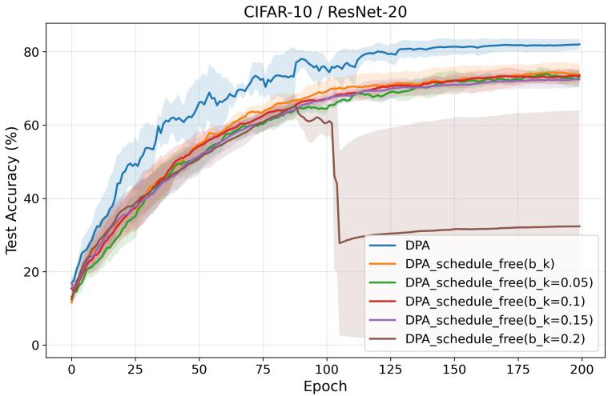  
Figure 2: Effect of quasi-global momentum and the $b _ { k }$ schedule on CIFAR-10/ResNet-20 $( n = 1 6 )$ , ring, $\alpha = 0 . 0 1 )$ .

## D.5 Extended results

Figure 3 shows the test accuracy curves corresponding to Table 8. Under stronger heterogeneity $( \alpha = 0 . 0 1 )$ , DPA-1G has the highest mean LE and L5E, with an L5E of 76.34% versus 76.13% for DPA. At moderate heterogeneity (α = 0.1), DPA gives the best mean LE and L5E accuracy, improving over the strongest baseline, QG-GUTm, by 3.43 percentage points in L5E.

Figure 4 and Table 9 report results on the torus and Dyck graphs at $\alpha = 0 . 0 1$ . DPA achieves the highest mean LE accuracy after choosing the momentum parameters separately for each graph, with QG-GUTm close behind. The mean L5E gap between the two methods is 0.46 percentage points on the torus and 0.09 on the Dyck graph, compared with 15.87 on the 32-agent ring.

Figure 5 shows the CIFAR-10/VGG-11 curves from Table 10. We compare the two QG baselines with DPA and DPA-1G at both heterogeneity levels. At α = 0.01, DPA gives the best mean LE and L5E accuracy, improving over QG-GUTm by about 8 percentage points in L5E. At α = 0.1, QG-GUTm has the highest mean LE and L5E, followed by DPA.

Table 8: CIFAR-10/ResNet-20 test accuracy (%) on a 32-agent ring.
<table><tr><td>α</td><td>Method</td><td> $\mathrm { L E } \pm \mathrm { s t d }$ </td><td> $\mathrm { L } 5 \mathrm { E } \pm \mathrm { s t d }$ </td></tr><tr><td>0.01</td><td>DSGD GT QG-DSGDm MT QG-GUTm DPA-1G DPA</td><td> $2 1 . 5 2 \pm 6 . 7 4$   $4 9 . 1 7 \pm 0 . 5 3$   $5 4 . 5 2 \pm 1 . 2 6$   $4 4 . 5 0 \pm 2 . 6 6$   $6 0 . 3 5 \pm 2 . 5 8$   ${ \bf 7 6 . 6 0 \pm 1 . 8 1 }$   $7 6 . 0 4 \pm 2 . 3 5$ </td><td> $2 1 . 5 0 \pm 6 . 7 0$   $4 9 . 1 6 \pm 0 . 5 3$   $5 5 . 1 5 \pm 1 . 3 4$   $4 4 . 0 1 \pm 3 . 3 4$   $6 0 . 2 6 \pm 2 . 9 7$   ${ \bf 7 6 . 3 4 \pm 1 . 8 1 }$   $7 6 . 1 3 \pm 2 . 2 7$ </td></tr><tr><td>0.1</td><td>DSGD GT QG-DSGDm MT QG-GUTm DPA-1G DPA</td><td> $4 4 . 8 5 \pm 6 . 2 9$   $5 2 . 5 4 \pm 1 . 0 3$   $8 0 . 3 0 \pm 2 . 5 7$   $7 2 . 6 6 \pm 3 . 6 5$   $8 2 . 1 6 \pm 1 . 5 0$   $8 1 . 5 2 \pm 3 . 1 9$   ${ \bf 8 5 . 6 2 \pm 0 . 5 0 }$ </td><td> $4 5 . 1 3 \pm 6 . 3 1$   $5 2 . 5 3 \pm 1 . 0 3$   $8 0 . 3 2 \pm 2 . 5 6$   $7 2 . 3 6 \pm 3 . 5 0$   $8 2 . 1 4 \pm 1 . 5 3$   $8 1 . 4 8 \pm 3 . 1 8$   ${ \bf 8 5 . 5 7 \pm 0 . 4 9 }$ </td></tr></table>

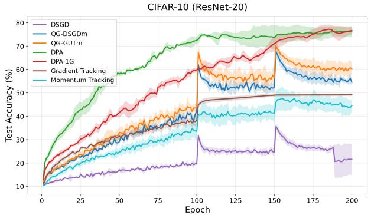

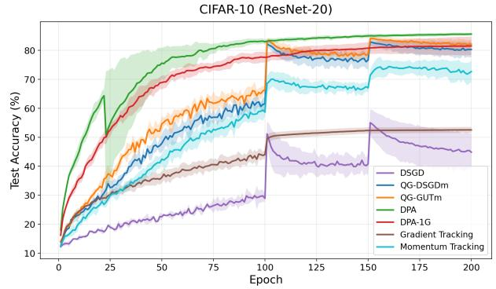  
Figure 3: Test accuracy curves on CIFAR-10/ResNet-20 with $n = 3 2$ agents on the ring topology. Left: $\alpha = 0 . 0 1$ Right: $\alpha = 0 . 1$

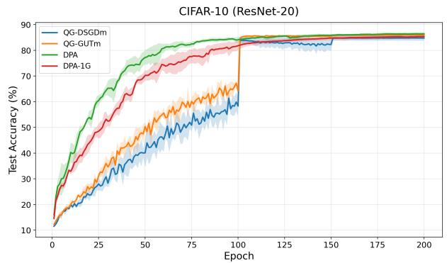

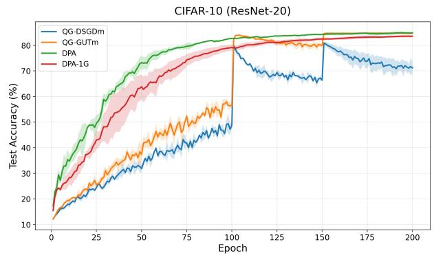  
Figure 4: Test accuracy curves on CIFAR-10/ResNet-20 with $n = 3 2$ agents and $\alpha = 0 . 0 1$ on better-connected topologies. Left: Torus. Right: Dyck.

## D.6 Comparison at the same communication budget

DPA communicates two model-sized vectors per neighbor per iteration, while DSGD, QG-DSGDm, QG-GUTm, and DPA-1G communicate one. GT and MT communicate approximately two model-sized vectors per neighbor per iteration. We therefore compare 200 epochs of DPA, GT, and MT with separate 400-epoch runs of the methods that communicate one model-sized vector per neighbor per iteration. We apply the baseline learning-rate decay after epochs 100 and 150 in the 200-epoch runs and after epochs 200 and 300 in the 400-epoch runs.

Table 9: CIFAR-10/ResNet-20 test accuracy (%) on torus and Dyck graphs $( n = 3 2 ,$ $\alpha = 0 . 0 1 )$ .
<table><tr><td>Graph</td><td>Method</td><td> $\mathrm { L E } \pm \mathrm { s t d }$ </td><td> $\mathrm { L } 5 \mathrm { E } \pm \mathrm { s t d }$ </td></tr><tr><td rowspan="5">Torus</td><td>QG-DSGDm</td><td> $8 4 . 7 7 \pm 1 . 0 5$ </td><td> $8 4 . 7 7 \pm 1 . 0 6$ </td></tr><tr><td>QG-GUTm</td><td> $8 5 . 9 2 \pm 0 . 3 9$ </td><td> $8 5 . 9 4 \pm 0 . 3 6$ </td></tr><tr><td>DPA-1G</td><td> $8 5 . 3 5 \pm 0 . 7 8$ </td><td> $8 5 . 3 3 \pm 0 . 7 9$ </td></tr><tr><td>DPA</td><td> ${ \bf 8 6 . 4 2 \pm 0 . 5 1 }$ </td><td> ${ \bf 8 6 . 4 0 \pm 0 . 5 3 }$ </td></tr><tr><td></td><td></td><td></td></tr><tr><td rowspan="4">Dyck</td><td>QG-DSGDm QG-GUTm</td><td> $7 1 . 1 9 \pm 2 . 5 0$   $8 4 . 7 7 \pm 0 . 2 4$ </td><td> $7 1 . 5 0 \pm 2 . 2 3$ </td></tr><tr><td>DPA-1G</td><td></td><td> $8 4 . 7 3 \pm 0 . 2 4$ </td></tr><tr><td></td><td> $8 3 . 5 4 \pm 0 . 5 1$ </td><td> $8 3 . 5 5 \pm 0 . 5 1$ </td></tr><tr><td>DPA</td><td> ${ \bf 8 4 . 8 3 \pm 0 . 4 8 }$ </td><td> ${ \bf 8 4 . 8 2 \pm 0 . 5 0 }$ </td></tr></table>

Table 10: CIFAR-10/VGG-11 test accuracy (%) on a 32-agent ring.
<table><tr><td>α</td><td>Method</td><td> $\mathrm { L E } \pm \mathrm { s t d }$ </td><td> $\mathrm { L } 5 \mathrm { E } \pm \mathrm { s t d }$ </td></tr><tr><td>0.01</td><td>QG-DSGDm QG-GUTm DPA-1G DPA</td><td> $5 7 . 4 8 \pm 0 . 4 3$   $6 8 . 5 3 \pm 2 . 7 4$   $6 9 . 2 6 \pm 1 . 7 7$   ${ \bf 7 7 . 4 7 \pm 3 . 9 9 }$ </td><td> $5 7 . 8 2 \pm 1 . 3 2$   $6 9 . 0 5 \pm 2 . 4 7$   $6 9 . 1 0 \pm 1 . 8 4$   $\mathbf { 7 7 . 1 0 \pm 4 . 2 4 }$ </td></tr><tr><td>0.1</td><td>QG-DSGDm QG-GUTm DPA-1G DPA</td><td> $7 4 . 7 5 \pm 1 . 0 3$   ${ \bf 8 3 . 5 4 \pm 0 . 3 5 }$   $7 7 . 2 7 \pm 2 . 4 7$   $8 1 . 7 8 \pm 0 . 8 1$ </td><td> $7 4 . 3 8 \pm 0 . 8 5$   ${ \bf 8 3 . 5 6 \pm 0 . 3 4 }$   $7 7 . 2 1 \pm 2 . 4 4$   $8 1 . 7 5 \pm 0 . 8 5$ </td></tr></table>

For the 400-epoch DPA-1G runs, we use the same optimizer hyperparameters as in the corresponding 200-epoch runs in Appendix D.3. The reference horizon for the coefficient schedules and warmup remains 200 epochs.

We measure communication cost by the cumulative number of tensor bytes sent per agent, summed over all neighbors and excluding received bytes, transport overhead, and post-training averaging. For earlier runs, we estimate the bytes sent by the end of each epoch by multiplying the recorded training total by the fraction of epochs completed. For each seed, we average test accuracy across agents. We then estimate accuracy at each communication budget using the straight line connecting the two adjacent epoch-end evaluations. We report the mean and standard deviation across three seeds. The full common budgets are $B = 8 5$ .45 GB/agent on CIFAR-10 and $B = 8 7 . 2 8$ GB/agent on CIFAR-100.

Figure 6 shows all seven methods, with mean curves and shaded regions indicating ±1 standard deviation. Tables 11 and 12 report test accuracy for DPA, DPA-1G, and the baseline with the highest mean at each budget. These entries are accuracies at the specified budgets, not L5E. Boldface marks the highest mean in each column. A run can reach the full common budget between two evaluations, so accuracy at B may differ slightly from last-epoch accuracy (LE).

DPA and DPA-1G have the two highest mean accuracies at every reported budget fraction. At the full budget, DPA improves over the best baseline by 7.48 percentage points on CIFAR-10 and 16.03 percentage points on CIFAR-100.

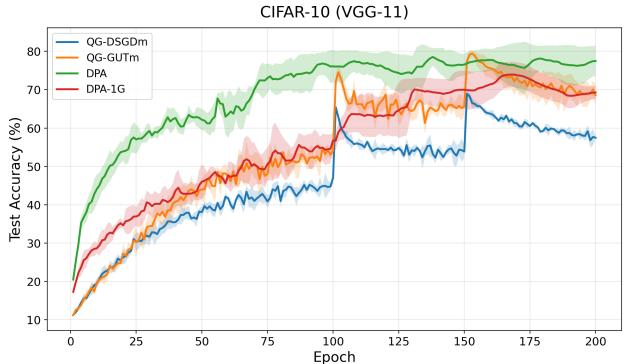

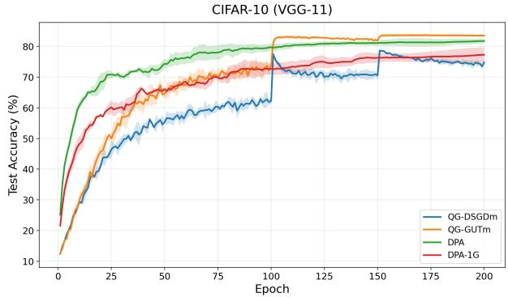  
Figure 5: Test accuracy curves on CIFAR-10/VGG-11 with $n = 3 2$ agents on the ring topology. Left: $\alpha = 0 . 0 1$ . Right: $\alpha = 0 . 1$

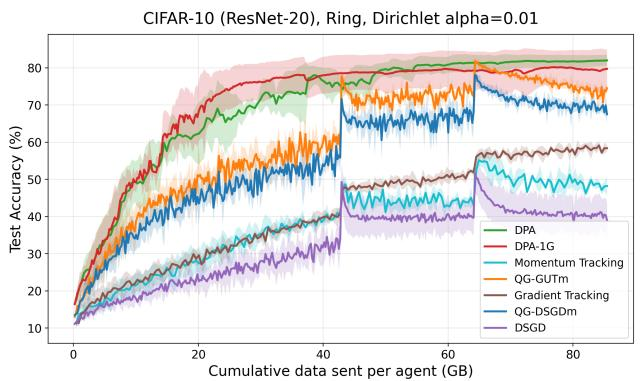  
(a) CIFAR-10 / ResNet-20.

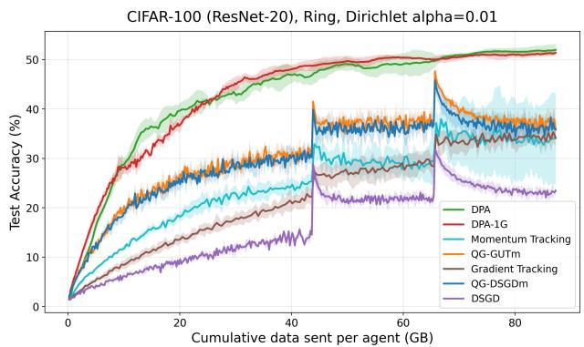  
(b) CIFAR-100 / ResNet-20.  
Figure 6: Test accuracy versus cumulative data sent per agent (GB) on a 16-agent ring (α = 0.01).

Table 11: CIFAR-10/ResNet-20 test accuracy (%) at fractions of B = 85.45 GB/agent.
<table><tr><td>Method</td><td>0.2B</td><td>0.4B</td><td>0.6B</td><td>0.8B</td><td>B</td></tr><tr><td>Best baseline (QG-GUTm)</td><td> $4 6 . 6 1 \pm 5 . 7 1$ </td><td> $5 6 . 0 0 \pm 4 . 5 8$ </td><td> $7 3 . 4 7 \pm 2 . 4 8$ </td><td> $7 8 . 3 9 \pm 0 . 2 7$ </td><td> $7 4 . 5 2 \pm 1 . 1 0$ </td></tr><tr><td>DPA-1G</td><td> ${ \bf 6 7 . 2 2 \pm 7 . 1 1 }$ </td><td> $\pm 7 7 . 4 0 \pm 4 . 7 1$ </td><td> $7 8 . 7 2 \pm 5 . 0 7$ </td><td> $7 8 . 5 8 \pm 6 . 1 0$ </td><td> $7 9 . 7 3 \pm 5 . 2 3$ </td></tr><tr><td>DPA</td><td> $6 1 . 9 9 \pm 4 . 6 2$ </td><td> $7 3 . 4 6 \pm 5 . 6 9$ </td><td> ${ \bf 8 0 . 0 8 \pm 2 . 4 6 }$ </td><td> ${ \bf 8 1 . 3 0 \pm 2 . 2 3 }$ </td><td> $\mathbf { 8 2 . 0 0 \pm 1 . 4 7 }$ </td></tr></table>

Table 12: CIFAR-100/ResNet-20 test accuracy (%) at fractions of B = 87.28 GB/agent.
<table><tr><td>Method</td><td>0.2B</td><td>0.4B</td><td>0.6B</td><td>0.8B</td><td>B</td></tr><tr><td>Best baseline method</td><td> $\mathrm { Q G } { \cdot } \mathrm { D S G D m }$ </td><td>QG-DSGDm</td><td> $Q \mathrm { G } \mathrm { - } \mathrm { G U T m }$ </td><td> $Q \mathrm { G } \mathrm { - } \mathrm { G U T m }$ </td><td> $\mathrm { Q G } { \cdot } \mathrm { D S } \mathrm { G D m }$ </td></tr><tr><td>Best baseline accuracy</td><td> $2 3 . 3 6 \pm 1 . 5 4$ </td><td> $2 9 . 7 6 \pm 0 . 2 2$ </td><td> $3 7 . 8 2 \pm 2 . 9 2$ </td><td> $3 9 . 9 7 \pm 0 . 3 1$ </td><td> $3 5 . 9 4 \pm 1 . 6 9$ </td></tr><tr><td>DPA-1G</td><td> $3 4 . 6 6 \pm 0 . 8 7$ </td><td> ${ \bf 4 6 . 8 2 \pm 1 . 2 8 }$ </td><td> ${ \bf 4 9 . 5 3 \pm 0 . 9 7 }$ </td><td> $5 0 . 5 1 \pm 0 . 6 1$ </td><td> $5 1 . 3 8 \pm 0 . 3 7$ </td></tr><tr><td>DPA</td><td> ${ \bf 3 7 . 9 9 \pm 2 . 6 2 }$ </td><td> $4 5 . 5 7 \pm 1 . 1 4$ </td><td> $4 8 . 6 0 \pm 1 . 2 6$ </td><td> ${ \bf 5 0 . 8 9 \pm 0 . 4 0 }$ </td><td> ${ \bf 5 1 . 9 7 \pm 1 . 1 8 }$ </td></tr></table>

The corresponding gains for DPA-1G are 5.21 and 15.44 percentage points, respectively. Our primary comparison uses the full common budget; intermediate columns show test accuracy at smaller budgets under each method’s own training schedule. Equal communication does not imply identical learning-rate schedules or equal numbers of gradient evaluations.

## D.7 IID evaluation

All four methods train ResNet-20 for 200 epochs on a 16-agent ring, using equal-sized, disjoint random subsets of the CIFAR-10 training data and three random seeds. QG-DSGDm and QG-GUTm use an initial learning rate of 0.1 and a momentum parameter of 0.9. QG-GUTm uses a scaling coefficient of 0.04. DPA and DPA-1G use a base learning rate of 5.0 and momentum parameters $( \beta _ { 1 } , \beta _ { 2 } ) = ( 0 . 9 0 , \mathrm { { \bar { 0 } . 8 0 } } )$ . For both DPA variants, the coefficient schedules for $a _ { k }$ and $b _ { k }$ follow the $\alpha = 0 . 1$ settings in Appendix D.3, while learning-rate warmup covers the first 50% of training. With these IID splits, DPA and DPA-1G reach high test accuracy in fewer epochs than the QG baselines under their selected learning-rate schedules (Figure 7) and exceed QG-GUTm by 1.58 and 1.64 percentage points in mean L5E, respectively (Table 13). Table entries report means ± standard deviations across three seeds. Curves show the means, with shaded regions indicating ±1 standard deviation.

## D.8 Training time and GPU usage

We run all seven methods sequentially on the same four V100-32GB GPUs. Each run uses ResNet-20 on CIFAR-10, a 16-agent ring, $\alpha = 0 . 0 1$ , seed 0, and 200 epochs (Table 14). Total time includes training, evaluation, and scheduled checkpoint saving. Training time covers mini-batch training. GPU-hours include all four GPUs. Communication cost and the number of mini-batch gradient evaluations are reported per agent.

In this timing experiment, DSGD and QG-DSGDm use direct implementations of their published updates. These implementations avoid the GUT reconstruction and tracking code that still runs in the benchmark when the corresponding coefficients are set to zero. For QG-GUTm, we use the original GUT implementation. We report these single-seed timings separately from the benchmark accuracy results, which use three seeds.

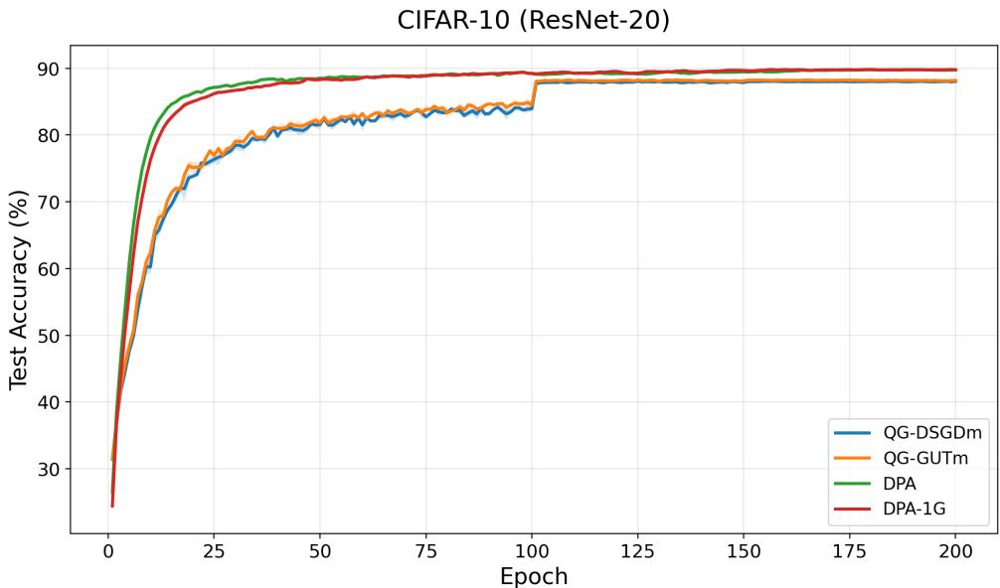  
Figure 7: IID CIFAR-10/ResNet-20 test accuracy on a 16-agent ring.

Table 13: IID CIFAR-10/ResNet-20: test accuracy (%) at selected epochs and L5E.
<table><tr><td>Training progress</td><td>QG-DSGDm</td><td> $\mathrm { Q G } { \mathrm { - G U T m } }$ </td><td>DPA-1G</td><td>DPA</td></tr><tr><td>10% (epoch 20)</td><td> $7 3 . 8 2 \pm 0 . 0 4$ </td><td> $7 5 . 1 0 \pm 0 . 9 5$ </td><td> $8 5 . 0 1 \pm 0 . 3 2$ </td><td> ${ \bf 8 6 . 2 4 \pm 0 . 0 8 }$ </td></tr><tr><td>20% (epoch 40)</td><td> $7 9 . 8 2 \pm 0 . 4 7$ </td><td> $8 1 . 0 2 \pm 0 . 1 7$ </td><td> $8 7 . 7 1 \pm 0 . 3 7$ </td><td> ${ \bf 8 8 . 2 5 \pm 0 . 1 5 }$ </td></tr><tr><td>40% (epoch 80)</td><td> $8 3 . 3 6 \pm 0 . 2 4$ </td><td> $8 3 . 3 3 \pm 0 . 7 6$ </td><td> $8 9 . 0 3 \pm 0 . 0 8$ </td><td> ${ \bf 8 9 . 0 7 \pm 0 . 3 1 }$ </td></tr><tr><td>50% (epoch 100)</td><td> $8 3 . 9 3 \pm 0 . 2 6$ </td><td> $8 4 . 4 7 \pm 0 . 4 7$ </td><td> ${ \bf 8 9 . 2 2 \pm 0 . 0 9 }$ </td><td> $8 9 . 2 0 \pm 0 . 2 9$ </td></tr><tr><td>60% (epoch 120)</td><td> $8 7 . 9 1 \pm 0 . 1 6$ </td><td> $8 8 . 1 4 \pm 0 . 1 0$ </td><td> ${ \bf 8 9 . 5 3 \pm 0 . 1 9 }$ </td><td> $8 9 . 2 1 \pm 0 . 1 2$ </td></tr><tr><td>80% (epoch 160)</td><td> $8 7 . 9 7 \pm 0 . 2 0$ </td><td> $8 8 . 1 9 \pm 0 . 1 3$ </td><td> ${ \bf 8 9 . 8 0 \pm 0 . 1 4 }$ </td><td> $8 9 . 5 8 \pm 0 . 0 5$ </td></tr><tr><td>100% (epoch 200)</td><td> $8 8 . 0 3 \pm 0 . 2 5$ </td><td> $8 8 . 1 7 \pm 0 . 1 0$ </td><td> ${ \bf 8 9 . 7 8 \pm 0 . 1 4 }$ </td><td> $8 9 . 7 3 \pm 0 . 1 7$ </td></tr><tr><td>L5E</td><td> $8 8 . 0 1 \pm 0 . 2 6 $ </td><td> $8 8 . 1 4 \pm 0 . 1 2$ </td><td> ${ \bf 8 9 . 7 8 \pm 0 . 1 4 }$ </td><td> $8 9 . 7 2 \pm 0 . 2 2$ </td></tr></table>

DPA-1G takes 0.8% more total time than direct QG-DSGDm at the same communication cost. DPA takes 15.6% more time than direct QG-DSGDm, but 4.9% and 2.9% more than GT and MT, respectively, which have the same communication cost as DPA. Peak memory varies by less than 0.5% across methods. These measurements apply to the implementations and hardware used in this experiment.

## D.9 Effect of post-training averaging

Table 15 compares the five baselines before and after the post-training averaging described in Remark 4. After training, each baseline performs $K _ { \mathrm { p o s t } }$ communication rounds without taking a gradient step. DPA and DPA-1G do not use this phase; their LE values are shown for reference. Values are means ± standard deviations across three seeds. Dashes indicate that no post-training averaging was used.

We report this evaluation separately because post-training averaging increases communication cost and changes the local models after training ends. The evaluation after post-training averaging is not part of LE or L5E, and these rounds are excluded from the matched training budgets.

Post-training averaging can improve test accuracy, but the effect varies by method and data distribution. $\operatorname { A t } \alpha = 0 . 0 1$ both DPA and DPA-1G have higher mean accuracy without post-training averaging than all five baselines after posttraining averaging on the three tasks shown. On CIFAR-10 and CIFAR-100, DPA exceeds the best baseline after post-training averaging by 4.21 and 3.49 percentage points, respectively. $\mathrm { A t } \alpha = 0 . 1$ on CIFAR-100, MT has a slightly

Table 14: Training costs on four V100 GPUs (200 epochs, seed 0).
<table><tr><td>Method</td><td>Total time</td><td>Training time</td><td>GPU-hours</td><td>GPU util.</td><td>Peak mem.</td><td>GB/agent</td><td>Grad. evals/agent</td></tr><tr><td>DSGD (direct)</td><td>45.84 min</td><td>34.52 min</td><td>3.056</td><td>61.83%</td><td>4982 MiB</td><td>42.72</td><td>19,600</td></tr><tr><td>QG-DSGDm (direct)</td><td>46.81 min</td><td>35.51 min</td><td>3.121</td><td>62.64%</td><td>4990 MiB</td><td>42.72</td><td>19,600</td></tr><tr><td>QG-GUTm</td><td>115.80 min</td><td>104.78 min</td><td>7.720</td><td>84.40%</td><td>5006 MiB</td><td>42.72</td><td>19,600</td></tr><tr><td>GT</td><td>51.62 min</td><td>40.33 min</td><td>3.441</td><td>60.98%</td><td>4990 MiB</td><td>85.45</td><td>19,600</td></tr><tr><td>MT</td><td>52.59 min</td><td>41.23 min</td><td>3.506</td><td>67.42%</td><td>4990 MiB</td><td>85.45</td><td>19,600</td></tr><tr><td>DPA-1G</td><td>47.17 min</td><td>35.79 min</td><td>3.145</td><td>62.79%</td><td>4998 MiB</td><td>42.72</td><td>15,680</td></tr><tr><td>DPA</td><td>54.13 min</td><td>42.82 min</td><td>3.609</td><td>67.89%</td><td>4996 MiB</td><td>85.45</td><td>19,600</td></tr></table>

Table 15: Test accuracy (%) before and after post-training averaging $( n = 1 6 , \mathrm { r i n g } ) .$
<table><tr><td rowspan="2">Method</td><td colspan="2">Fashion-MNIST / LeNet-5</td><td colspan="2">CIFAR-10 / ResNet-20</td><td colspan="2">CIFAR-100 / ResNet-20</td></tr><tr><td>LE</td><td>After averaging</td><td>LE</td><td>After averaging</td><td>LE</td><td>After averaging</td></tr><tr><td colspan="7"> $\alpha = 0 . 1$ </td></tr><tr><td>DSGD</td><td> $8 5 . 6 0 5 \pm 2 . 9 6 2$ </td><td> $8 8 . 6 4 3 \pm 0 . 9 0 6$ </td><td> $5 7 . 7 0 9 \pm 3 . 0 8 1$ </td><td> $7 0 . 0 4 1 \pm 2 . 1 3 0$ </td><td> $2 5 . 5 2 6 \pm 0 . 4 7 5$ </td><td> $3 8 . 6 4 3 \pm 0 . 8 0 3$ </td></tr><tr><td>GT</td><td> $8 4 . 5 1 7 \pm 0 . 1 5 6$ </td><td> $8 4 . 5 2 0 \pm 0 . 1 5 6$ </td><td> $6 9 . 9 0 2 \pm 2 . 7 3 1$ </td><td> $7 1 . 9 2 5 \pm 2 . 2 3 0$ </td><td> $4 1 . 9 4 6 \pm 1 . 3 5 3$ </td><td> $4 3 . 7 9 0 \pm 0 . 9 7 8$ </td></tr><tr><td>QG-DSGDm</td><td> $8 9 . 7 1 7 \pm 0 . 2 3 0$ </td><td> $8 9 . 8 2 0 \pm 0 . 1 9 3$ </td><td> $8 1 . 7 3 2 \pm 1 . 5 7 6$ </td><td> $8 4 . 4 3 0 \pm 1 . 2 4 7$ </td><td> $4 4 . 8 9 2 \pm 1 . 8 4 6$ </td><td> $5 1 . 2 2 7 \pm 3 . 4 8 0$ </td></tr><tr><td>MT</td><td> $9 0 . 0 6 4 \pm 0 . 0 3 4$ </td><td> $9 0 . 0 5 2 \pm 0 . 0 2 5$ </td><td> $7 9 . 8 2 9 \pm 1 . 6 4 4$ </td><td> $8 1 . 4 5 3 \pm 1 . 1 8 5$ </td><td> $4 9 . 1 7 9 \pm 3 . 4 3 2$ </td><td> $5 4 . 2 4 3 \pm 1 . 0 6 6$ </td></tr><tr><td>QG-GUTm</td><td> $8 9 . 6 6 7 \pm 0 . 0 0 2$ </td><td> $8 9 . 8 1 5 \pm 0 . 1 2 1$ </td><td> $8 5 . 3 3 8 \pm 1 . 4 2 2$ </td><td> $8 6 . 3 0 7 \pm 0 . 6 4 5$ </td><td> $4 5 . 0 3 8 \pm 0 . 7 3 1$ </td><td> $5 3 . 3 6 8 \pm 0 . 5 2 8$ </td></tr><tr><td>DPA-1G</td><td> $8 9 . 3 3 \pm 0 . 6 5$ </td><td></td><td> $8 6 . 5 8 2 \pm 0 . 8 5 4$ </td><td></td><td> $5 3 . 9 2 0 \pm 0 . 5 4 6$ </td><td></td></tr><tr><td>DPA</td><td> $9 0 . 0 8 \pm 0 . 2 8$ </td><td></td><td> $8 6 . 7 2 7 \pm 1 . 1 0 3$ </td><td></td><td> $5 4 . 1 2 0 \pm 0 . 9 7 0$ </td><td></td></tr><tr><td colspan="7"> $\alpha = 0 . 0 1$ </td></tr><tr><td>DSGD</td><td> $7 3 . 9 3 0 \pm 2 . 9 8 5$ </td><td> $8 4 . 1 7 9 \pm 0 . 3 4 8$ </td><td> $2 9 . 7 8 6 \pm 4 . 5 9 9$ </td><td> $4 8 . 5 5 8 \pm 4 . 9 6 1$ </td><td> $1 6 . 1 3 6 \pm 0 . 8 1 7$ </td><td> $3 1 . 5 2 5 \pm 1 . 4 5 8$ </td></tr><tr><td>GT</td><td> $8 4 . 1 0 2 \pm 0 . 2 2 6$ </td><td> $8 4 . 1 0 0 \pm 0 . 2 2 0$ </td><td> $5 8 . 3 8 1 \pm 0 . 8 1 1$ </td><td> $6 1 . 3 8 9 \pm 0 . 7 4 1$ </td><td> $3 4 . 1 9 5 \pm 1 . 8 5 2$ </td><td> $3 8 . 9 6 8 \pm 0 . 4 0 7$ </td></tr><tr><td>QG-DSGDm</td><td> $7 6 . 4 5 6 \pm 3 . 6 2 4$ </td><td> $8 2 . 1 7 0 \pm 2 . 6 1 8$ </td><td> $6 1 . 4 7 0 \pm 1 . 9 3 3$ </td><td> $7 4 . 3 6 5 \pm 2 . 6 3 6$ </td><td> $3 3 . 5 6 5 \pm 0 . 7 9 7$ </td><td> $4 8 . 4 8 4 \pm 2 . 8 4 2$ </td></tr><tr><td>MT</td><td> $8 2 . 0 9 0 \pm 4 . 7 9 3$ </td><td> $8 2 . 5 8 5 \pm 4 . 8 2 3$ </td><td> $4 8 . 2 0 4 \pm 2 . 4 9 3$ </td><td> $4 3 . 1 8 0 \pm 5 . 7 8 9$ </td><td> $3 0 . 0 9 0 \pm 2 . 6 2 7$ </td><td> $3 9 . 2 7 8 \pm 3 . 4 6 0$ </td></tr><tr><td>QG-GUTm</td><td> $7 6 . 3 6 0 \pm 5 . 1 9 9$ </td><td> $8 4 . 4 5 9 \pm 1 . 7 1 0$ </td><td> $6 6 . 4 7 4 \pm 1 . 7 4 4$ </td><td> $7 7 . 7 9 5 \pm 1 . 4 8 0$ </td><td> $3 5 . 5 4 4 \pm 1 . 0 0 8$ </td><td> $4 8 . 0 1 8 \pm 1 . 8 8 3$ </td></tr><tr><td>DPA-1G</td><td> $8 5 . 6 0 \pm 2 . 4 6$ </td><td></td><td> $7 8 . 5 7 0 \pm 4 . 8 9 0$ </td><td></td><td></td><td></td></tr><tr><td>DPA</td><td> $8 4 . 7 3 \pm 3 . 9 7$ </td><td></td><td> $8 2 . 0 0 5 \pm 1 . 4 6 7$ </td><td>1</td><td> $4 8 . 7 7 0 \pm 1 . 1 6 4$   $5 1 . 9 7 1 \pm 1 . 1 8 0$ </td><td></td></tr></table>

higher mean accuracy after post-training averaging than DPA’s mean LE accuracy (54.243% versus 54.120%). These differences in mean accuracy do not establish statistical significance. These evaluations do not show whether the gains persist when local gradient updates resume.