# EGOX: EGOCENTRIC CROSS-EMBODIMENT MANIPULATION WITH EMBODIMENT DREAMING

Yaru Niu1,∗, Binghong Chen1,∗, Changwei Yao1,∗, Shangtao Li1,∗, Zhenlong Fang 4 Revanth Krishna Senthilkumaran1,2, Shuai Zhou1, Yuemin Mao1 Kalie Ching1,2, Po-Ju Chao1, Yudong Luo1, Peiqi Yu1, Heng Zhang1 Hao Zhang1,3, Bingqing Chen2, Chen Qiu2, H. Eric Tseng3 Ye Yuan5, Umar Iqbal5, Changliu Liu1, Jonathan Francis1,2, Ding Zhao1

1 Carnegie Mellon University 2 Bosch Center for Artificial Intelligence

3 The University of Texas at Arlington 4 University of California, Berkeley 5 NVIDIA

Equal contribution

https://egox-dream.github.io

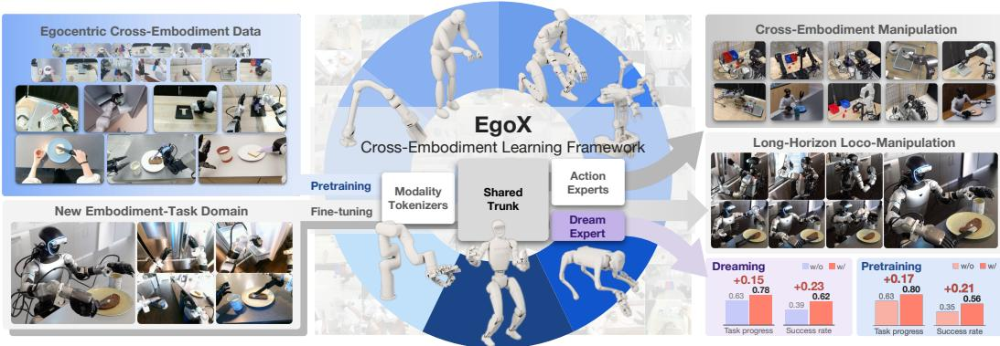

Figure 1: Overview of EgoX. EgoX learns from highly diverse embodiments, including humans, a humanoid, a wheeled bimanual robot, a quadruped, tabletop arms, and a simulated humanoid, with dexterous hands, grippers, and tools as end-effectors. It first pretrains on egocentric cross-embodiment data from humans and robots (top left), then fine-tunes on a new embodiment–task domain (bottom left). Its model, MXT+, routes each embodiment’s observations through modality tokenizers into a shared Transformer trunk and decodes actions with embodiment-specific action experts, while a training-only dreaming expert predicts future embodiment latents (center). The resulting policies perform manipulation across embodiments and long-horizon loco-manipulation on a humanoid (right, top and middle). Embodiment dreaming and cross-embodiment pretraining both improve the average task progress score and success rate (right, bottom).

## ABSTRACT

Generalist manipulation policies can benefit from the complementary experience of humans, real robots, and simulated agents. However, differences in morphology, sensing, and control interfaces make it difficult to learn effectively from their combined demonstrations. We introduce EgoX, an egocentric cross-embodiment learning framework that organizes heterogeneous demonstrations through semantically corresponding observation and action modalities. EgoX pretrains a Modularized Cross-Embodiment Transformer with Embodiment Dreaming (MXT+) on this mixture and fine-tunes it on target-embodiment demonstrations. Within each embodiment, MXT+ assigns a dedicated tokenizer to each observation modality and a dedicated expert to each action modality, with a Transformer trunk shared across embodiments. A training-only embodiment-dreaming objective predicts latent representations of future visual and proprioceptive states, encouraging the shared trunk to model each embodiment’s dynamics. Across 13 task–embodiment pairs spanning five tasks and six robot embodiments, including five physical robots and one simulated humanoid, cross-embodiment pretraining raises MXT+’s average normalized task progress from 0.63 to 0.80 over training from scratch. The

gains are particularly pronounced under out-of-distribution conditions, where average task progress increases from 0.53 to 0.77. Ablations demonstrate the benefits of broader pretraining mixtures, modular interfaces, and embodiment dreaming, with dreaming producing more similar latent geometry across embodiments.

## 1 INTRODUCTION

Large-scale pretraining has driven rapid progress in natural language processing (Devlin et al., 2019; Brown et al., 2020) and computer vision (Radford et al., 2021; Dosovitskiy et al., 2021), demonstrating the potential of learning reusable knowledge from diverse data. A corresponding ambition in robotics is to develop generalist models that accumulate manipulation knowledge across tasks and environments and can be adapted to different robot embodiments. We envision a future populated by robots with complementary physical capabilities: tabletop arms, wheeled mobile manipulators, humanoids, and quadrupeds offer different combinations of mobility, reach, and workspace access, while grippers, dexterous hands, and specialized tools support different forms of object interaction (Pfeifer et al., 2007; Baines et al., 2024; Kirschner et al., 2025). Their different ways of perceiving and interacting with the world also provide complementary experience for learning. However, collecting data and training models separately for every embodiment, task, and scene is costly and limits the reuse of this experience. How can we draw on experience across these embod iments to develop shared manipulation knowledge while allowing each robot to adapt it to its own body and environment?

Several complementary data sources offer a path toward this goal. Cross-embodiment robot learning draws on demonstrations collected across different bodies, sensors, and action spaces (O’Neill et al., 2024; Octo Model Team et al., 2024; Kim et al., 2025; Doshi et al., 2025; Wang et al., 2024; Gemini Robotics Team et al., 2025a). Egocentric human data captures diverse physical interactions in real-world settings beyond existing robot deployment environments (Kareer et al., 2025; Niu et al., 2025; Qiu et al., 2025; Zheng et al., 2026). Simulation enables scalable data collection and has supported policy pretraining, sim-to-real transfer, and co-training with real-world demonstrations (Deshpande et al., 2026; NVIDIA et al., 2025; Maddukuri et al., 2025; Lin et al., 2026b). Together, these sources can broaden the objects, scenes, and interaction strategies available for learn ing beyond the demonstrations collected for any individual robot. Realizing this potential, however, requires training recipes that can make effective use of heterogeneous experience. Demonstrations from different embodiments encode interactions through distinct morphologies, viewpoints, proprioception, action semantics, and motion dynamics, making it challenging to turn their combined experience into useful manipulation capabilities across robots.

Recent work has examined scaling laws and data composition for robot manipulation (Lin et al., 2025; 2026a; TRI LBM Team et al., 2025). Alongside these questions, we focus on how experience from heterogeneous embodiments should be collected, represented, and used for shared learning. Our central concern is the design of representations and learning interfaces that allow diverse demonstrations to contribute to a common manipulation model while preserving the differences that matter for each embodiment’s sensing and control. We treat humans, real robots, and simulated agents as embodiments on equal footing, each contributing its own observations and actions. Through joint pretraining and adaptation to target embodiments, we investigate how this shared experience can improve downstream manipulation across different robot bodies and end-effectors. Fig. 2 illustrates this perspective through corresponding stages of Kitchen-Bread performed by human, real-robot, and simulated embodiments.

We introduce EgoX (Fig. 1), an egocentric cross-embodiment learning framework built around a single methodological premise: transfer should occur through semantically corresponding modalities, while sensing and control interfaces remain embodiment-specific. The framework has three components. First, EgoX organizes human, real-robot, and simulated demonstrations in a unified observation-action representation, grouping heterogeneous signals into anatomically or functionally relevant modalities and expressing poses in a unified egocentric frame system. Second, MXT+, a Modularized Cross-Embodiment Transformer, adopts a fine-grained modular design: within each embodiment, each observation modality has its own tokenizer and each action modality its own expert, while a shared Transformer trunk integrates information across modalities and embodiments. Third, MXT+ uses embodiment dreaming, an auxiliary objective that predicts future embodiment latents from the current shared representation. This training-only branch encourages the trunk to encode how each embodiment’s visual and proprioceptive state evolves, without requiring pixel reconstruction or deployment-time computation.

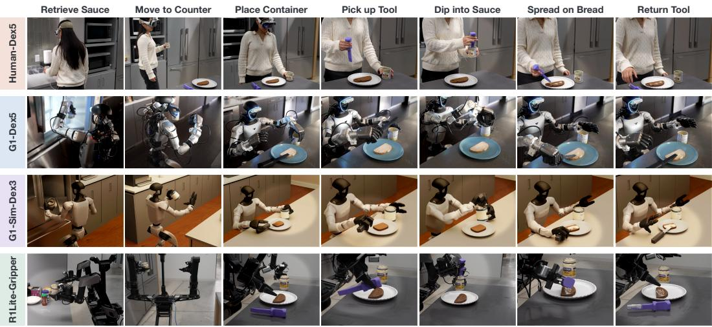  
Figure 2: Shared task structure across heterogeneous embodiments. Rows show a Human-Dex5 demonstration and rollouts of robot policies trained with EgoX for G1-Dex5, G1-Sim-Dex3, and R1Lite-Gripper on Kitchen-Bread. Columns show corresponding task stages. Soft spotlights highlight the active interaction regions.

We evaluate EgoX on five manipulation tasks, from long-horizon loco-manipulation to precise insertion and tool use (Kitchen-Bread, Kitchen-Cleanup, Sort, Insert, and Scoop), across six robot embodiments: G1-Dex5, xArm7-Dex4, G1-Sim-Dex3, LocoMan-Dex2, R1Lite-Gripper, Z1-Tool. Human demonstrations provide an additional pretraining source. Our experiments compare MXT+ variants with baseline policies across all tasks and ablate the pretraining mixture, embodiment dreaming objective, and MXT+’s modular design. Cross-embodiment pretraining raises MXT+’s average task progress from 0.63 to 0.80, yielding the highest average score among the evaluated methods and the best performance on 12 of 13 task–embodiment pairs. The gains from pretraining are particularly pronounced under out-of-distribution (OOD) conditions, where average task progress increases from 0.53 to 0.77. Broader pretraining mixtures transfer better, and embodiment dreaming raises task progress from 0.63 to 0.78 across seven settings while making the trunk’s latent geometry more similar across embodiments. In summary, our contribu tions are:

1. A unified, modality-structured representation for egocentric cross-embodiment manipulation. EgoX organizes human, real-robot, and simulated demonstrations into a common observation–action structure based on anatomically or functionally corresponding modalities, while retaining embodiment-specific sensing and control interfaces.

2. MXT+, a modular cross-embodiment Transformer with embodiment dreaming. Within each embodiment, MXT+ assigns dedicated tokenizers and action experts to individual observation and action modalities, connected through a shared Transformer trunk. Embodiment dreaming encourages the trunk to model each embodiment’s transition dynamics through future-latent prediction used only during training.

3. A systematic study of cross-embodiment transfer. Experiments across five tasks and six diverse robot embodiments demonstrate the benefits of cross-embodiment pretraining, particularly under OOD conditions. Ablations show benefits from broader pretraining mixtures, modular interfaces, and embodiment dreaming, with dreaming also producing more similar latent geometry across embodiments.

## 2 RELATED WORK

Cross-Embodiment Learning for Robotic Manipulation. Cross-embodiment robot learning aims to train policies that benefit from data collected on different bodies, sensors, and control interfaces. Large robot datasets and generalist policies demonstrate the value of scaling policy learning across tasks and robot embodiments (O’Neill et al., 2024; Kim et al., 2025; Black et al., 2025b;a; Gemini Robotics Team et al., 2025b), and recent work extends such pretraining to include human data (Luo et al., 2026a; NVIDIA et al., 2025). Prior methods handle embodiment heterogeneity with shared trunk policies that use embodiment-specific tokenizers or action heads (Doshi et al., 2025; Niu et al., 2025; Wang et al., 2024), with a single embodiment-conditioned action head (Li et al., 2026b), or with image editing that aligns robot appearance across embodiments (Chen et al., 2024; Lepert et al., 2025). Existing methods either cover a relatively narrow range of embodiments and end-effectors or preserve heterogeneity by giving each embodiment a separate interface, leaving the extent of modality-level sharing unclear. In contrast, EgoX covers highly heterogeneous embodiments and end-effectors: it is evaluated on humanoid, wheeled bimanual, tabletop-arm, quadrupedal, and sim ulated platforms, with three- to five-fingered dexterous hands, two-finger and parallel-jaw grippers, and a tool. MXT+ combines embodiment-specific interfaces with modality-level sharing through modular tokenizers and action experts, and adds embodiment dreaming as a training signal through the prediction of future embodiment latents.

Robot Learning from Egocentric Data. Egocentric human data offers a scalable source of manipulation experience spanning diverse tasks, objects, and environments. Recent advances in wearable devices, such as XR headsets and smart glasses, have improved the quality and scale of such data (Chen et al., 2025; Hoque et al., 2026; Punamiya et al., 2026). Human videos have been used to learn transferable priors through visual, affordance, and latent-action objectives (Nair et al., 2023; Srirama et al., 2024; Ye et al., 2025; Bu et al., 2025; Zhang et al., 2026). Other methods use human demonstrations directly for policy learning, through domain adaptation (Punamiya et al., 2025), pretraining or co-training (Kareer et al., 2025; Yuan et al., 2025; Yang et al., 2025; Zheng et al., 2026; Shi et al., 2026; Zhu et al., 2026; Bi et al., 2026; Wei et al., 2026a), and transfer without additional target-robot demonstrations (Xu et al., 2026). Much of this literature emphasizes transferring human experience to target robot embodiments, while EgoX focuses on collecting and jointly learning from egocentric demonstrations across human and heterogeneous robot embodiments, and investigates how this shared training benefits manipulation across diverse platforms.

World Action Models and Embodiment Modeling. World models learn to predict how the world evolves under actions (Assran et al., 2025; Goswami et al., 2025; Gao et al., 2026). World action models couple such prediction with policy learning by jointly predicting actions and future observations, with targets including pixels, pretrained visual features, and 3D motion flow (Li et al., 2026a), embeddings from frozen or separately pretrained encoders (Zheng et al., 2025; Luo et al., 2026b), and future tactile signals or tactile latents (Niu et al., 2026; Lou et al., 2026). These works show that predicting future observations provides a useful training signal for policy learning. Other methods model the embodiment itself, either by predicting its dynamics or kinematics (Fu et al., 2025; Patel & Song, 2025), or by encoding its structure through body graphs, canonical morphology representations, or embodiment-specific functional components in action generation (Sferrazza et al., 2025; Wei et al., 2026b; Li et al., 2026b). EgoX combines the ingredients of world action models and embodiment modeling through embodiment dreaming: alongside actions, MXT+ predicts future embodiment latents from egocentric visual features, robot joint states, and end-effector joint states using exponential-moving-average copies of its own modality encoders. The objective helps the shared trunk learn embodiment-aware dynamics while leaving the deployment-time action policy unchanged.

## 3 EGOX: EGOCENTRIC CROSS-EMBODIMENT MANIPULATION

EgoX makes three key design decisions to enable effective learning across diverse embodiments. First, we organize heterogeneous data into a shared modality structure, with coordinate conventions chosen for each modality (Sec. 3.1). To handle diverse sensing and control interfaces with different robots while facilitating positive transfer, EgoX leverages MXT+ (Fig. 3), where embodimentspecific tokenizers encode each observation modality for a shared Transformer backbone, and modular action experts decode its outputs into each action modality (Sec. 3.2). Finally, the auxiliary objective of embodiment dreaming encourages the Transformer to learn each embodiment’s dynamics (Sec. 3.3). EgoX uses a two-stage training pipeline: pretraining on mixed cross-embodiment data, and fine-tuning on the target embodiment task (Sec. 3.4).

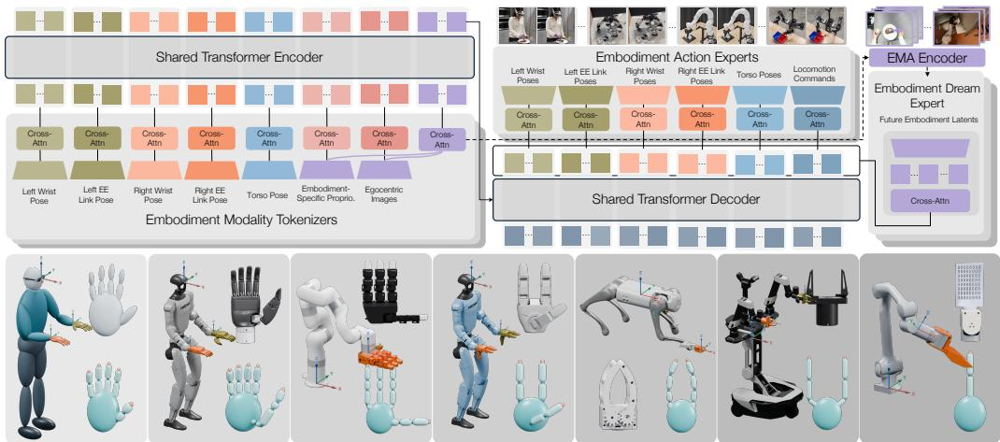  
Figure 3: MXT+ architecture and EgoX embodiments. Top: embodiment-specific modality tokenizers map each embodiment’s observations (egocentric images, embodiment-specific proprioception, and left/right wrist, left/right end-effector-link, and torso poses) into tokens that a shared Transformer encoder-decoder trunk fuses across embodiments. Embodiment action experts decode the trunk output into embodiment-specific action chunks, while embodiment-dreaming experts predict future embodiment latents supervised by EMA copies of the corresponding modality tokenizers. Bottom: the embodiments used in EgoX, from left to right: Human-Dex5, G1-Dex5, xArm7-Dex4, G1-Sim-Dex3, LocoMan-Dex2, R1Lite-Gripper, and Z1-Tool. Each panel marks the egocentric frame $\mathcal { F } _ { \mathrm { e g o } }$ (on the body carrying the main camera, or on the arm base for the fixed-base xArm7-Dex4 and Z1-Tool), in which left/right wrist poses and targets are expressed, and the wrist frames, in which left/right end-effector link poses are expressed. Left and right end-effectors are shown in olive and orange, matching the modality colors above, alongside a close-up of each end-effector and its end-effector-link keypoints.

## 3.1 EGOCENTRIC CROSS-EMBODIMENT DATA REPRESENTATION

Although embodiments differ substantially as whole bodies, many of their parts play corresponding roles. We exploit this by decomposing each embodiment into anatomically or functionally corresponding modalities and organizing their observations and actions in a shared structure. Formally, EgoX collects demonstrations from a set of embodiments $\mathcal { E }$ that includes both humans and robots. For each embodiment $e \in { \mathcal { E } }$ , the dataset

$$
\mathcal { D } _ { e } = \left\{ \tau _ { i } ^ { e } \right\} _ { i = 1 } ^ { N _ { e } } , \qquad \tau _ { i } ^ { e } = \left( o _ { i , t } ^ { e } , { \pmb a } _ { i , t } ^ { e } \right) _ { t = 1 } ^ { T _ { i } ^ { e } } ,\tag{1}
$$

contains $N _ { e }$ trajectories. Trajectory $\tau _ { i } ^ { e }$ has length $T _ { i } ^ { e }$ . The terms $\mathbf { \Delta } _ { o _ { i , t } ^ { e } } ^ { e }$ and $\pmb { a } _ { i , t } ^ { e }$ are the observations and actions at time step t. Both are tuples of named modalities, defined below. When the trajectory is clear from context, we omit the index i.

Unified egocentric frame system. To retain a consistent spatial interpretation across embodiments, EgoX uses common, modality-specific reference-frame conventions (Figs. 3 and 4; Appendix A.6). The root frame $\mathcal { F } _ { \mathrm { r o o t } }$ is the ground projection of a reference body part, such as a humanoid’s feet, a quadruped’s trunk, or, for human data, the head at the start of the episode. The egocentric frame $\mathcal { F } _ { \mathrm { e g o } }$ is attached to the egocentric main camera frame or the rigid body carrying the main camera, and a wrist frame $\mathcal { F } _ { \mathrm { w r i s t } }$ is attached to each wrist. Torso poses and velocity commands are expressed in $\mathcal { F } _ { \mathrm { r o o t } }$ , wrist poses and targets in ${ \mathcal { F } } _ { \mathrm { e g o } } ,$ and end-effector keypoint positions in the corresponding $\mathcal { F } _ { \mathrm { w r i s t } }$ . At reset, $\mathcal { F } _ { \mathrm { r o o t } }$ has the x-axis pointing forward toward the workspace, the y-axis left, and the z-axis upward. Poses are converted from teleoperation, sensing, or control conventions into these frames before data saving and model inference, whereas joint states remain in each embodiment’s joint space.

Observations and action targets. Using these frame conventions, EgoX organizes each embodi ment’s available observations and action targets into a shared modality structure:

$$
\begin{array} { r } { o _ { t } ^ { e } : = \{ I _ { t } ^ { e } , s _ { t } ^ { e } , x _ { \mathrm { t o r s o } , t } ^ { e } , x _ { \mathrm { L } , t } ^ { e } , x _ { \mathrm { R } , t } ^ { e } , p _ { \mathrm { L } , t } ^ { e } , p _ { \mathrm { R } , t } ^ { e } , . . . \} , } \end{array}\tag{2}
$$

$$
\begin{array} { r } { \pmb { a } _ { t } ^ { e } : = \{ \tilde { x } _ { \mathrm { t o r s o } , t } ^ { e } , \tilde { x } _ { \mathrm { L } , t } ^ { e } , \tilde { x } _ { \mathrm { R } , t } ^ { e } , \tilde { p } _ { \mathrm { L } , t } ^ { e } , \tilde { p } _ { \mathrm { R } , t } ^ { e } , . . . \} . } \end{array}\tag{3}
$$

Here, I denotes the egocentric main-camera image, $x _ { \mathrm { { t o r s o } } }$ the torso pose, $x _ { \mathrm { L } }$ and $\scriptstyle { \mathbf { { \mathit { x } } } } _ { \mathrm { { R } } }$ the left and right wrist poses, and $p _ { \mathrm { { L } } }$ and $p _ { \mathrm { R } }$ the corresponding end-effector keypoint positions. The term s collectively denotes the available embodiment-specific proprioceptive streams, mainly robot and end-effector joint states; each stream is tokenized separately. A tilde indicates a commanded target. Colors match the modalities in Figs. 3 and 4. Additional observations may include wrist-camera images and force feedback; additional actions may include velocity commands.

End-effector keypoints are task-relevant 3D positions expressed in the corresponding wrist frame, such as the fingertips of human and robot hands and the contact points of grippers and tools (bottom of Fig. 3). By describing endeffector geometry rather than actuator joint coordinates, they provide comparable geometric descriptions for hands, grippers, and tools with different kinematics.

Shared modality vocabulary. Let $\begin{array} { r l } { \mathcal { M } } & { { } = } \end{array}$ $\mathcal { M } _ { \mathrm { { o b s } } } \cup \mathcal { M } _ { \mathrm { { a c t } } }$ be the modality vocabulary shared by all embodiments, indexed by m: each constituent stream of $\mathbf { \delta } _ { o _ { t } ^ { e } }$ and $\pmb { a } _ { t } ^ { e }$ above, with L and R counted separately, is one modality, written ${ \pmb o } _ { t } ^ { e , m }$ or ${ \pmb a } _ { t } ^ { e , m }$ . Not every embodiment provides every modality, so $\dot { \mathcal { M } } _ { \mathrm { o b s } } ^ { e } \subseteq \mathcal { M } _ { \mathrm { o b s } }$ and $\mathcal { M } _ { \mathrm { a c t } } ^ { e } \subseteq \mathbf { \bar { M } } _ { \mathrm { a c t } }$ denote the modalities available for embodiment $e _ { \cdot }$ Missing observation modalities are omitted or replaced by zero tokens, and missing action modalities are excluded from the loss (Appendix A.1). Figure 4 illustrates how corresponding torso, wrist, and end-effector keypoint modalities across embodiments are expressed in their respective reference frames. Embodiment-specific tokenizers map these modalities, together with the available visual and proprioceptive observations, into a shared token space.

## 3.2 MODULARIZED

## CROSS-EMBODIMENT TRANSFORMER

To learn from heterogeneous human and robot demonstrations, EgoX uses MXT+, a Modularized Cross-Embodiment Transformer with Embodiment Dreaming. Building on the modular tokenization and action decoding of MXT (Niu et al., 2025), MXT+ assigns a dedicated tokenizer to each available observation modality

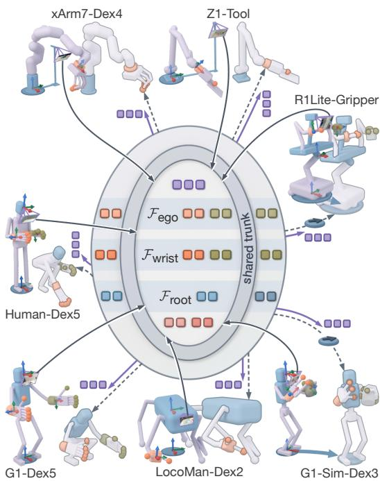  
Figure 4: Unified egocentric frames and shared token spaces (Fig. 3 colors). Solid: now (frames, camera view); translucent: one action chunk later (static bodies shifted sideways). MXT+’s modality tokenizers (solid arrows) map observations into one inner token space: right/left wrists at ${ \mathcal { F } } _ { \mathrm { e g o } } ,$ right/left end-effector links at their $\mathcal { F } _ { \mathrm { w r i s t } } ,$ torso at ${ \mathcal { F } } _ { \mathrm { r o o t } } ;$ pale purple parts (embodiment-specific proprioception, if any) and camera views into frame-free proprioception and image tokens (bottom) and embodiment tokens (top). MXT+’s shared trunk (ring) fuses all into outer action tokens; MXT+’s action (dashed) and dreaming (purple) experts decode the chunk (steel-blue tokens at ${ \mathcal { F } } _ { \mathrm { r o o t } } .$ , arrowed discs: velocity commands, if any) and each body’s training-only future latents.

and a dedicated expert to each action modality within each embodiment. These interfaces connect through a shared encoder-decoder Transformer trunk, which integrates information across modalities and embodiments. Alongside action prediction, an embodiment-dreaming expert predicts future embodiment latents (Sec. 3.3).

Architecture overview. For each embodiment $e \in { \mathcal { E } } .$ , the MXT+ policy is the composition

$$
\pi ^ { e } = \Psi ^ { e } \circ G _ { \theta } \circ \Phi ^ { e } , \qquad \Phi ^ { e } = \{ \phi _ { m } ^ { e } \} _ { m \in \mathcal { M } _ { \mathrm { o b s } } ^ { e } } \cup \{ \phi _ { \mathrm { d r e a m } } ^ { e } \} , \qquad \Psi ^ { e } = \{ \psi _ { m } ^ { e } \} _ { m \in \mathcal { M } _ { \mathrm { n c t } } ^ { e } } ,\tag{4}
$$

where $\phi _ { m } ^ { e }$ is the tokenizer of observation modality m, $\psi _ { m } ^ { e }$ is the action expert of action modality $m ,$ and $G _ { \theta }$ is the shared trunk. Here, $\Phi ^ { e }$ and $\Psi ^ { e }$ denote the collective encoding and decoding operations of the listed modules. The embodiment tokenizer $\phi _ { \mathrm { d r e a m } } ^ { e }$ (Sec. 3.3) aggregates selected modality features into current embodiment tokens, which are concatenated with the modality tokens before entering the shared trunk. Modality tokenizers and action experts are instantiated only for the modalities that e provides. The shared modality vocabulary preserves anatomical or functional correspondences across embodiments, while embodiment-specific tokenizers and experts accommodate differences in sensing and control. The shared trunk serves as the main pathway for crossembodiment learning. Given an observation ${ \pmb O } _ { t } ^ { e } = ( { \pmb O } _ { t } ^ { e , m } ) _ { m \in \mathcal { M } _ { \mathrm { o b s } } ^ { e } }$ , the policy predicts an action chunk, i.e., the next H action targets of every available action modality:

$$
\hat { A } _ { t } ^ { e } = \pi ^ { e } \big ( \pmb { o } _ { t } ^ { e } \big ) = \big ( \hat { A } _ { t } ^ { e , m } \big ) _ { m \in \mathcal { M } _ { \mathrm { a c t } } ^ { e } } , \qquad \hat { A } _ { t } ^ { e , m } = \big ( \hat { \pmb { a } } _ { t + k } ^ { e , m } \big ) _ { k = 0 } ^ { H - 1 } \in \mathbb { R } ^ { H \times d _ { m } ^ { e } } ,\tag{5}
$$

where $d _ { m } ^ { e }$ is the dimension of action modality m for embodiment e. Appendix $\mathrm { A } . 2$ provides details on each module.

## 3.3 EMBODIMENT DREAMING

Behavioral cloning supervises the policy through demonstrated actions, without explicitly requiring it to anticipate how the embodiment’s state evolves. MXT+ adds embodiment dreaming, an auxiliary objective that predicts future embodiment latents: compact representations of selected future visual and proprioceptive observations. This encourages the shared trunk to capture embodiment-specific dynamics without reconstructing high-dimensional observations.

Embodiment latent. For embodiment $e ,$ let $\mathcal { M } _ { \mathrm { d r e a m } } ^ { e } \subseteq \mathcal { M } _ { \mathrm { o b s } } ^ { e }$ be the observation modalities used as dreaming sources: the egocentric image, robot joint states, and end-effector joint states, whichever of them e provides. Robot joint states are not part of the action space, but they carry embodimentspecific state that is informative about body dynamics. Let $f _ { m } ^ { e }$ denote the feature-encoding component of modality tokenizer $\phi _ { m } ^ { e }$ , including positional embeddings, before modality-specific aggregation. An embodiment tokenizer $\phi _ { \mathrm { d r e a m } } ^ { e }$ aggregates the selected features by cross-attention from $L _ { \mathrm { d r e a m } }$ learnable queries into $L _ { \mathrm { d r e a m } }$ latent tokens of dimension d $\left( L _ { \mathrm { d r e a m } } = 8 \right.$ in our experiments). These tokens are retained without pooling. The student embodiment tokenizer summarizes current observation features into tokens used by the policy. Exponential-moving-average (EMA) copies of $f _ { m } ^ { e }$ and $\phi _ { \mathrm { d r e a m } } ^ { e }$ , marked by a bar, summarize future observation features to provide targets for the dreaming expert at offset k:

$$
\begin{array} { r } { Y _ { t + k } ^ { e } = \mathrm { s g } \Big [ \bar { \phi } _ { \mathrm { d r e a m } } ^ { e } \Big ( \big [ \bar { f } _ { m } ^ { e } \big ( \pmb { o } _ { t + k } ^ { e , m } \big ) \big ] _ { m \in \mathcal { M } _ { \mathrm { d r e a m } } ^ { e } } \Big ) \Big ] , } \end{array}\tag{6}
$$

Here $Y _ { t + k } ^ { e } = [ \pmb { y } _ { t + k , j } ^ { e } ] _ { j = 1 } ^ { L _ { \mathrm { d r e a m } } } \in \mathbb { R } ^ { L _ { \mathrm { d r e a m } } \times d }$ is the sequence of target tokens, and $\mathrm { s g } [ \cdot ]$ is the stopgradient operator. As in the JEPA model family (Assran et al., 2025), the stop-gradient prevents the dreaming loss from updating the target, and the EMA update in Eq. (9) makes the target evolve slowly.

Dreaming expert. A dreaming expert $\psi _ { \mathrm { d r e a m } } ^ { e }$ reads the same trunk output as the action experts and predicts the corresponding latent-token sequences at a set of future offsets $\kappa { \mathrm { : } }$

$$
\left( \hat { Y } _ { t + k } ^ { e } \right) _ { k \in \mathcal { K } } = \left( \psi _ { \mathrm { d r e a m } } ^ { e } \circ G _ { \theta } \circ \Phi ^ { e } \right) \left( \pmb { o } _ { t } ^ { e } \right) .\tag{7}
$$

Dreaming targets are sampled from future observations by the same data pipeline as action chunks.

Latent prediction loss. Each predicted token is supervised against its corresponding target token with a cosine alignment loss and an optional magnitude loss, averaged over future offsets and token indices:

$$
\begin{array} { l } { \displaystyle \mathcal { L } _ { \mathrm { d r e a m } } ^ { e } = \frac { 1 } { | K | L _ { \mathrm { d r e a m } } } \sum _ { k \in K } \sum _ { j = 1 } ^ { L _ { \mathrm { d r e a m } } } { \Big [ 1 - \cos \big ( \hat { y } _ { t + k , j } ^ { e } , \pmb { y } _ { t + k , j } ^ { e } \big ) } } \\ { \displaystyle \qquad + \beta \ell _ { \mathrm { s m o o t h - L 1 } } \big ( \| \hat { y } _ { t + k , j } ^ { e } \| _ { 2 } , \| { y } _ { t + k , j } ^ { e } \| _ { 2 } \big ) \Big ] , } \end{array}\tag{8}
$$

where $\beta \geq 0$ weights the magnitude term.

EMA target update. Each teacher in Eq. (6) tracks its corresponding student: $\phi _ { \mathrm { d r e a m } } ^ { e }$ or $f _ { m } ^ { e }$ for $m \in \mathcal { M } _ { \mathrm { d r e a m } } ^ { e } .$ . For student parameters w and their teacher counterparts w¯, after each optimizer step,

$$
\bar { w }  \alpha \bar { w } + ( 1 - \alpha ) w , \qquad \alpha \in ( 0 , 1 ) ,\tag{9}
$$

where α is the EMA decay.

## 3.4 CROSS-EMBODIMENT PRETRAINING AND TARGET FINE-TUNING

EgoX first pretrains MXT+ on a mixture of human and robot embodiments with action prediction and embodiment dreaming, and then fine-tunes it on demonstrations of the target embodiment.

Training objective. For a mini-batch from embodiment e, the action loss is a weighted sum of chunk losses over the available action modalities,

$$
\mathcal { L } _ { \mathrm { a c t } } ^ { e } = \sum _ { m \in \mathcal { M } _ { \mathrm { a c t } } ^ { e } } \lambda _ { m } ^ { e } \ell _ { \mathrm { a c t } } \bigl ( \hat { A } ^ { e , m } , A ^ { e , m } \bigr ) ,\tag{10}
$$

where $\hat { A } ^ { e , m }$ and ${ \pmb A } ^ { e , m }$ collect the predicted and demonstrated action chunks in the mini-batch, and $\lambda _ { m } ^ { e }$ weights action modality m. The loss $\ell _ { \mathrm { a c t } }$ averages elementwise smooth L1 errors over all valid chunk steps and action dimensions in the mini-batch, using standardized actions (Appendix A.3). In both Eq. (10) and Eq. (8), chunk steps and dreaming offsets beyond the end of the trajectory are padded and excluded from the average. The objective for embodiment e on a dataset D is

$$
\begin{array} { r } { \mathcal { L } ^ { e } ( \mathcal { D } ) = \mathbb { E } _ { \mathcal { D } } \big [ \mathcal { L } _ { \mathrm { a c t } } ^ { e } + \lambda _ { \mathrm { d r e a m } } ^ { e } \mathcal { L } _ { \mathrm { d r e a m } } ^ { e } \big ] , } \end{array}\tag{11}
$$

where $\mathbb { E } _ { \mathcal { D } }$ denotes expectation over mini-batches sampled from $\mathcal { D }$ , and $\lambda _ { \mathrm { d r e a m } } ^ { e } \geq 0$ weights embodiment dreaming.

Pretraining. Let $\mathcal { E } _ { \mathrm { p r e } } \subseteq \mathcal { E }$ be the pretraining embodiments, including humans and multiple robots. Each optimizer step accumulates gradients from a mini-batch from every pretraining embodiment, minimizing

$$
\mathcal { L } _ { \mathrm { p r e } } = \sum _ { e \in \mathcal { E } _ { \mathrm { p r e } } } \mathcal { L } ^ { e } ( \mathcal { D } _ { e } ) .\tag{12}
$$

Demonstrations of the target task on the target embodiment are excluded from pretraining. The shared trunk $G _ { \theta }$ receives gradients from all embodiments, whereas the embodiment-specific modules of e are updated only by $\mathcal { D } _ { e }$

Fine-tuning. Given a target embodiment $e ^ { \star }$ and a target-task dataset $\mathcal { D } _ { e ^ { \star } } ^ { \mathrm { t a s k } }$ , we initialize MXT+ from the pretrained checkpoint and continue training with both action prediction and embodiment dreaming:

$$
\begin{array} { r } { \mathcal { L } _ { \mathrm { f t } } = \mathcal { L } ^ { e ^ { \star } } \left( \mathcal { D } _ { e ^ { \star } } ^ { \mathrm { t a s k } } \right) . } \end{array}\tag{13}
$$

We transfer the shared components and any pretrained target-embodiment modules, initializing new modules where needed (Appendix A.3). Fine-tuning adapts the shared representation and targetspecific modules to the target task, building on the manipulation priors learned through crossembodiment pretraining.

Inference. At deployment, MXT+ retains the modality tokenizers and student embodiment tokenizer $\phi _ { \mathrm { d r e a m } } ^ { e ^ { \star } } .$ The latter aggregates current observation features into embodiment tokens, which are concatenated with the modality tokens and passed to the shared trunk. The action experts decode action chunks $\hat { A } _ { t } ^ { e ^ { \star } }$ for low-level control. The dreaming expert $\psi _ { \mathrm { d r e a m } } ^ { e ^ { \star } }$ and EMA teachers are used only during training; inference requires neither future-latent prediction nor EMA target com putation. Algorithm 1 in Appendix A.3 summarizes the training procedure.

## 4 EXPERIMENTS AND RESULTS

## 4.1 EXPERIMENTAL SETUP

Tasks. We evaluate policies on 13 task–embodiment pairs spanning five manipulation tasks and six robot embodiments, covering long-horizon loco-manipulation, semantic object selection, precise alignment, tool use, and contact-rich interaction. In Kitchen-Bread (Sauce Spreading), the robot retrieves sauce containers from a fridge or tabletop, picks up a spreading tool, dips it into the sauce, and spreads the sauce onto bread. In Kitchen-Cleanup (Tool Organization), the robot picks up tools from a tabletop and places them into a container. In Sort (Block Sorting), the robot sorts blocks into containers of the corresponding colors. In Insert (T-shaped Block Insertion), the robot picks up a T-shaped block, aligns it with its base, and inserts it. In Scoop (Cat Litter Scooping), the robot scoops cat litter from a litter box into a disposal bin, then returns the scoop to the edge of the box. Figs. 13–17 in the appendix show example rollouts of each task across the evaluated embodiments.

Embodiments. Our evaluation covers six robot embodiments (five physical robots and one simulated humanoid), spanning diverse morphologies, mobility configurations, end-effectors, and unimanual or bimanual operation. G1-Dex5 is a bimanual Unitree G1 humanoid equipped with five-finger Inspire RH56F1 dexterous hands. xArm7-Dex4 is a tabletop xArm7 equipped with a four-finger LEAP Hand (Shaw et al., 2023); G1-Sim-Dex3 is a simulated Unitree G1 equipped with three-finger Dex3-1 dexterous hands. LocoMan-Dex2 (Lin et al., 2024) is a quadruped with two-finger grippers mounted on its front legs, evaluated in unimanual mode. R1Lite-Gripper is a Galaxea R1 Lite wheeled bimanual mobile manipulator with parallel-jaw grippers. Z1-Tool is a tabletop Unitree Z1 arm with a fixed, non-actuated scoop. Egocentric human demonstrations (Human-Dex5) provide an additional embodiment for cross-embodiment pretraining. Together, these platforms span dexterous hands, grippers, and fixed tools across diverse robot morphologies and mobility configurations.

Baselines and training settings. We compare MXT+ with ACT (Zhao et al., 2023) and $\pi _ { 0 . 5 }$ (Black et al., 2025a), and evaluate MXT+ both with and without cross-embodiment pretraining. ACT is trained on demonstrations from the target embodiment and task, while $\pi _ { 0 . 5 }$ is fine-tuned from its pretrained checkpoint on the same demonstrations (Appendix A.4). MXT+ without pretraining is trained from scratch on these target-task demonstrations. MXT+ with pretraining is first trained on a mixture of human, physical-robot, and simulated demonstrations, excluding demonstrations of the target task on the target embodiment, and then fine-tuned on those held-out demonstrations following Section 3.4. Both MXT+ variants use the same downstream policy architecture and training objective, including embodiment dreaming, to assess the benefit of cross-embodiment pretraining. We additionally ablate the pretraining composition, embodiment dreaming, and modality-level modularity.

Evaluation settings and metrics. For each task–embodiment pair, we assess policies under in distribution (ID) and out-of-distribution (OOD) conditions, defined relative to the target-task demonstrations of the evaluated embodiment. ID settings use similar objects, initial configurations, and environmental conditions to those in these demonstrations, while OOD settings introduce held-out variations in object instances, appearances, poses, or scene configurations. Similar conditions may appear in other embodiments’ pretraining demonstrations, allowing us to assess cross-embodiment transfer. For each method, we run 20 trials (13 ID and 7 OOD) per real-world task–embodiment pair and 50 trials (32 ID and 18 OOD) per simulated pair, using the same trial configurations across methods. We report the mean normalized task progress score separately for ID and OOD conditions. Each trial’s score credits intermediate stages and adds a one-point bonus for successful completion, normalized by the task’s maximum score including the bonus. Task-specific evaluation and scoring criteria are detailed in Appendix A.9; success rates on the same trials are reported in Appendix A.10.

## 4.2 EXPERIMENTAL EVALUATION

Our evaluation aims to address the following questions: (1) Does egocentric cross-embodiment pretraining improve downstream manipulation compared to training from scratch on targetembodiment data? (2) How does pretraining composition affect transfer? (3) Does embodiment dreaming improve cross-embodiment learning? (4) Does modular design enhance crossembodiment transfer? (5) How do cross-embodiment pretraining and embodiment dreaming affect latent geometry across embodiments?

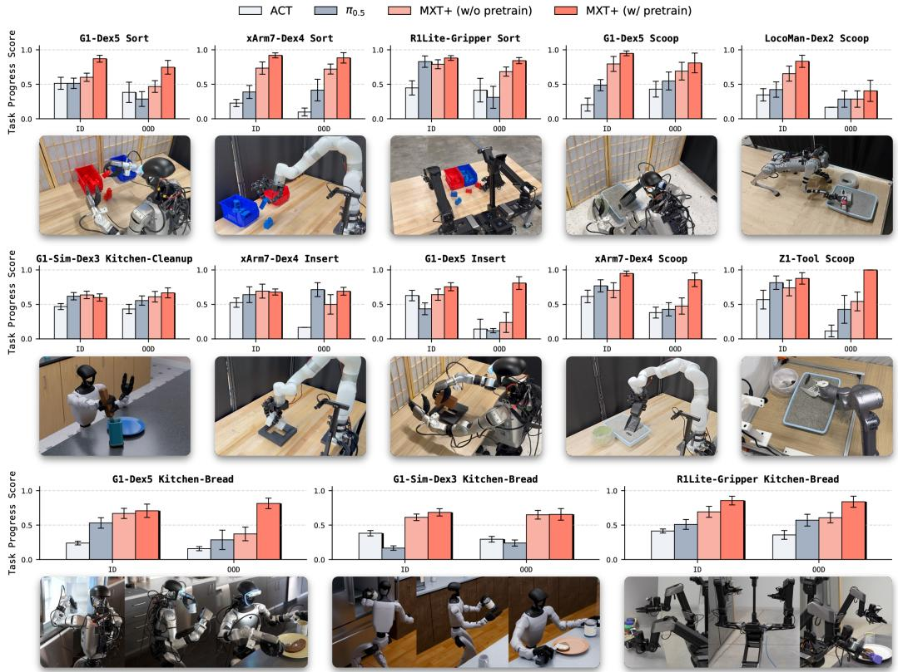  
Figure 5: Manipulation performance across tasks and embodiments. Normalized task progress of ACT, π0.5, MXT+ without pretraining, and MXT+ with cross-embodiment pretraining across 13 task–embodiment pairs spanning five tasks and six embodiments (five physical robots and the simulated G1-Sim-Dex3). Each panel reports ID and OOD performance.

Does egocentric cross-embodiment pretraining outperform training from scratch? Crossembodiment pretraining raises MXT+’s mean normalized task progress from 0.63 to 0.80 across the 13 task–embodiment pairs (Fig. 5), pooling ID and OOD trials within each pair before averaging across pairs. Improvements occur on 11 of 13 pairs under ID evaluation and all 13 pairs under OOD evaluation. The gains are particularly pronounced under OOD conditions, where mean task progress increases from 0.53 to 0.77, with large improvements on G1-Dex5 Insert and Z1-Tool Scoop. Among all evaluated methods, pretrained MXT+ achieves the highest average task progress across the 13 task–embodiment pairs and ranks first on 12 of them. These results suggest that learning from heterogeneous human and robot experience improves downstream manipulation, particularly under conditions absent from the target-task demonstrations of the evaluated embodiment.

How does pretraining composition affect transfer? We next study how the composition of the pretraining mixture affects downstream performance. As shown in Fig. 6, we compare four settings: no pretraining, human-only pretraining, human plus other-robot pretraining, and full crossembodiment pretraining. Human-only pretraining uses egocentric human demonstrations; human plus other-robot pretraining additionally incorporates demonstrations from robot embodiments other than the target robot; and full cross-embodiment pretraining further includes demonstrations from the target embodiment on non-target tasks. All variants use the same target-embodiment, targettask demonstrations for downstream training. We evaluate this ablation across both real-robot and simulation settings, covering Sort on R1Lite-Gripper, Sort and Insert on G1-Dex5 and xArm7-Dex4, as well as Kitchen-Bread on simulated G1-Sim-Dex3.

Every pretraining mixture improves average OOD performance over no pretraining, and the average gains grow as the mixture broadens. Human-only pretraining already improves OOD performance on five of six pairs, most strongly on G1-Dex5 Insert, suggesting that egocentric human demonstrations can provide transferable manipulation priors despite the embodiment gap. Adding other robots’ demonstrations raises ID performance on five of six pairs, and adding the target robot’s demonstrations on other tasks improves OOD performance on every pair. Full cross-embodiment pretraining achieves the highest average task progress, improving over no pretraining by 0.12 on ID and 0.23 on OOD. These results show that combining human demonstrations, other robots’ experi ence, and the target robot’s other tasks improves downstream transfer.

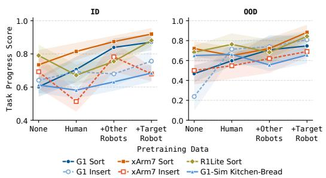  
Figure 6: Pretraining data composition ablation. Task progress as pretraining data is added: human, other robots, then the target robot’s other tasks. ID and OOD use different y ranges. Labels omit end effectors. Shading: ±1 SEM.

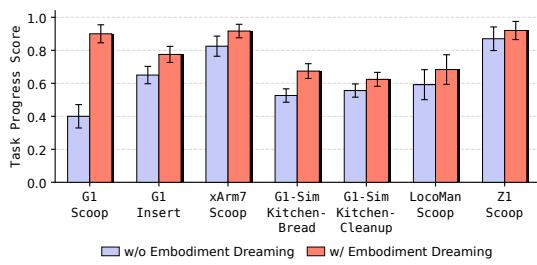  
Figure 7: Embodiment dreaming ablation. Task progress with and without embodiment dreaming across seven task–embodiment pairs. ID and OOD trials are pooled within each pair. Labels omit end effectors. Error bars: ±1 SEM.

Does embodiment dreaming improve cross-embodiment learning? We compare MXT+ with MXT, which removes the embodiment-dreaming components (the embodiment tokenizer, dreaming expert, and EMA teachers) during both pretraining and fine-tuning (Appendix A.3). MXT+ improves average task progress from 0.63 to 0.78 across seven task–embodiment settings spanning five embodiments (Fig. 7). These settings include Scoop on four embodiments (G1-Dex5, xArm7-Dex4, LocoMan-Dex2, and Z1-Tool), Insert on G1-Dex5, and both Kitchen-Bread and Kitchen-Cleanup on G1-Sim-Dex3. Task progress improves in all seven settings, with the largest gain on G1-Dex5 Scoop, supporting the benefit of the embodiment-dreaming components for downstream manipulation.

## Does modular design enhance cross-embodiment transfer?

We compare MXT+ with a coarse variant that uses one tokenizer for all camera views, one for concatenated pose and proprioceptive streams, and one action expert for all action modalities within each embodiment. The image encoders, shared trunk, embodiment dreaming, training objective, and input/output token budgets remain unchanged. Fig. 8 evaluates both variants with and without pretraining on Z1-Tool Scoop, xArm7-Dex4 Scoop, and G1-Sim-Dex3 Kitchen-Bread and Kitchen-Cleanup. These embodiments span progressively richer modality sets, from fixed-tool manipulation to dexterous-hand control and bimanual locomanipulation with multiple camera views. After pretraining, modular MXT+ matches or exceeds the coarse variant in every ID and OOD setting. Both variants benefit from pretraining on Z1-Tool. However, pretraining reduces the

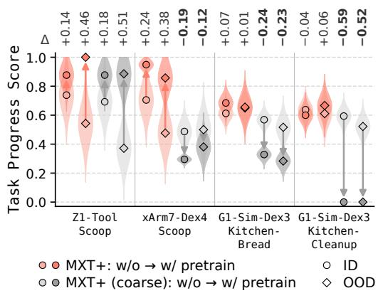  
Figure 8: Coarse ablation. Arrows go from w/o to w/ pretraining; violins show each mean’s uncertainty (from its SEM).

coarse variant’s performance on xArm7-Dex4 Scoop and both simulated kitchen tasks, whereas modular MXT+ improves in most settings and avoids these large drops. These failures also occur on single-camera xArm7-Dex4 Scoop, without additional wrist views.

On Kitchen-Cleanup, the pretrained coarse variant achieves zero task progress, while modular MXT+ retains substantial performance. This task starts with locomotion, making its 3D velocity command critical despite its small share of the 51-dimensional action space. Dedicated action experts may help preserve this modality. Separate camera tokenizers may also help when wrist views are introduced during fine-tuning: MXT+ retains its head-camera tokenizer and adds wrist-camera tokenizers, whereas the coarse variant jointly attends to all views. After pretraining, the performance gap between modular and coarse policies is small on Z1-Tool but substantially larger on xArm7-Dex4 and G1-Sim-Dex3, which involve richer observation and action modalities. Together, these results support modality-level modular design for effective cross-embodiment transfer, particularly for embodiments with diverse observation and action modalities.

How do cross-embodiment pretraining and embodiment dreaming affect latent geometry across embodiments?

To assess pretraining, we compare MXT+ with and without cross-embodiment pretraining. To assess the embodiment-dreaming components, we compare MXT+ with MXT, both pretrained and fine-tuned. For each comparison, we compute Gromov–Wasserstein (GW) distances between embodiment-specific distributions of shared-trunk latent representations extracted from Scoop demonstrations. Within each embodiment, we use matched demonstration samples across conditions, encoded by the corresponding checkpoints. For each sampled time step, we extract the right wrist-pose tokens from the shared-trunk output, before the action experts, and mean-pool them into one 512-dimensional latent vector. We use the right wrist pose because it is the most important action modality for Scoop, where the right end-effector is the only active end-effector shared across embodiments. GW compares the internal distance structures of these distributions using median-normalized within-distribution Euclidean distances in the original latent space. Lower GW distances indicate greater geometric similarity; we report percentage changes relative to the baseline in each comparison. To summarize each comparison, we first average GW over all 10 embodiment pairs for the baseline and for the compared model, and then report the percentage change from the baseline average to the compared model’s average, rather than averaging the per-pair changes.

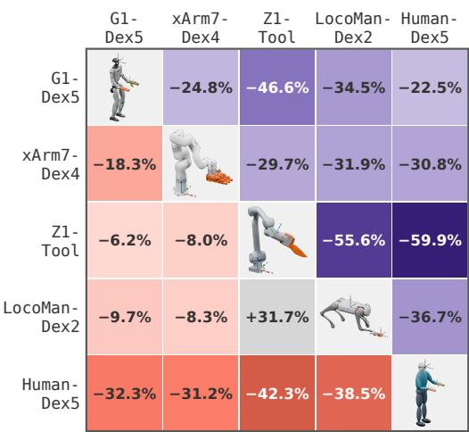  
Figure 9: GW change across embodiment pairs. Pretraining: coral, lower triangle; Embodiment dreaming: purple, upper triangle.

Fig. 9 shows that cross-embodiment pretraining lowers GW for 9 of 10 embodiment pairs and reduces mean GW across the pairs by 21.30%. In the embodiment-dreaming comparison, MXT+ yields lower GW than MXT for all 10 pairs, reducing mean GW across the pairs by 38.52%. Both comparisons therefore show greater average geometric similarity among embodiment-specific latent representations of the same manipulation task.

## 5 CONCLUSION

We presented EgoX, a framework for collecting and learning from egocentric human, physical-robot, and simulated demonstrations through a shared modality structure. Treating these sources as embodiments on equal footing, EgoX pretrains on their combined experience and fine-tunes on each target embodiment and task. Its model, MXT+, connects each embodiment’s modality-specific tokenizers and action experts through a shared Transformer trunk. Embodiment dreaming complements action supervision by predicting latent representations of future visual and proprioceptive observations, en couraging the trunk to capture how each embodiment’s state evolves during interaction. Across 13 task–embodiment pairs spanning five tasks and six robot embodiments, cross-embodiment pretraining improves downstream manipulation, particularly under OOD conditions. Broader pretraining mixtures improve transfer, and embodiment dreaming further improves task performance and yields more similar cross-embodiment latent geometry on Scoop. Modality-level modularity is particularly beneficial for embodiments with diverse observation and action modalities, helping avoid the large performance drops observed when modalities are merged in the coarse variant. These findings support learning shared manipulation knowledge while preserving embodiment-specific sensing and control interfaces.

Several limitations merit further investigation. First, the demonstrations used in our crossembodiment experiments were collected by our team, limiting the available data scale; performance on substantially larger training datasets remains untested. Second, our simulation experiments cover one humanoid embodiment and two kitchen tasks, limiting the diversity of simulated experience. Third, extending EgoX to new embodiments still requires manually specifying modality correspondences and coordinate transforms and integrating embodiment-specific control interfaces. Finally, data availability varies substantially across embodiments, yet pretraining samples an equal-sized mini-batch from each embodiment. Samples from smaller datasets, such as LocoMan-Dex2, are consequently reused more frequently, which may increase overfitting and negatively affect shared pretraining. Larger and more balanced datasets, broader simulation coverage, automated embodiment integration, and sampling strategies that account for data availability and diversity are important directions for future work.

## REFERENCES

Joel A. E. Andersson, Joris Gillis, Greg Horn, James B. Rawlings, and Moritz Diehl. CasADi: A software framework for nonlinear optimization and optimal control. Mathematical Programming Computation, 11(1):1–36, 2019.

Mido Assran, Adrien Bardes, David Fan, Quentin Garrido, Russell Howes, Mojtaba Komeili, Matthew Muckley, Ammar Rizvi, Claire Roberts, Koustuv Sinha, et al. V-JEPA 2: Self-supervised video models enable understanding, prediction and planning. arXiv preprint arXiv:2506.09985, 2025.

Robert Baines, Frank Fish, Josh Bongard, and Rebecca Kramer-Bottiglio. Robots that evolve on demand. Nature Reviews Materials, 9:822–835, 2024. doi: 10.1038/s41578-024-00711-z. URL https://www.nature.com/articles/s41578-024-00711-z.

Hongzhe Bi, Lingxuan Wu, Tianwei Lin, Hengkai Tan, Zhizhong Su, Hang Su, and Jun Zhu. H-RDT: Human manipulation enhanced bimanual robotic manipulation. In Proceedings of the AAAI Conference on Artificial Intelligence, volume 40, pp. 18135–18143, 2026. doi: 10. 1609/aaai.v40i22.38875. URL https://ojs.aaai.org/index.php/AAAI/article/ view/38875.

Kevin Black, Noah Brown, James Darpinian, Karan Dhabalia, Danny Driess, Adnan Esmail, Michael Robert Equi, Chelsea Finn, Niccolo Fusai, Manuel Y. Galliker, et al. π : a visionlanguage-action model with open-world generalization. In Proceedings ofThe 9th Conference on Robot Learning (CoRL), volume 305 of Proceedings ofMachine Learning Research, pp. 17–40. PMLR, 2025a.

Kevin Black, Noah Brown, Danny Driess, Adnan Esmail, Michael Robert Equi, Chelsea Finn, Niccolo Fusai, Lachy Groom, Karol Hausman, Brian Ichter, et al. π0: A vision-language-action flow model for general robot control. In Robotics: Science and Systems (RSS), 2025b.

Kevin Black, Manuel Y. Galliker, and Sergey Levine. Real-time execution of action chunking flow policies. In Advances in Neural Information Processing Systems (NeurIPS), 2025c.

Tom Brown, Benjamin Mann, Nick Ryder, Melanie Subbiah, Jared D Kaplan, Prafulla Dhariwal, Arvind Neelakantan, Pranav Shyam, Girish Sastry, Amanda Askell, et al. Language models are few-shot learners. In Advances in Neural Information Processing Systems (NeurIPS), volume 33, pp. 1877–1901, 2020.

Qingwen Bu, Yanting Yang, Jisong Cai, Shenyuan Gao, Guanghui Ren, Maoqing Yao, Ping Luo, and Hongyang Li. Learning to act anywhere with task-centric latent actions. In Robotics: Science and Systems (RSS), 2025. doi: 10.15607/RSS.2025.XXI.014. URL https://www. roboticsproceedings.org/rss21/p014.html. arXiv:2505.06111.

Justin Carpentier, Guilhem Saurel, Gabriele Buondonno, Joseph Mirabel, Florent Lamiraux, Olivier Stasse, and Nicolas Mansard. The Pinocchio C++ library: A fast and flexible implementation of rigid body dynamics algorithms and their analytical derivatives. In IEEE/SICE International Symposium on System Integration (SII), 2019.

Lawrence Yunliang Chen, Karthik Dharmarajan, Kush Hari, Chenfeng Xu, Quan Vuong, and Ken Goldberg. MIRAGE: Cross-embodiment zero-shot policy transfer with cross-painting. In Robotics: Science and Systems (RSS), 2024.

Sirui Chen, Chen Wang, Kaden Nguyen, Li Fei-Fei, and C Karen Liu. ARCap: Collecting Highquality Human Demonstrations for Robot Learning with Augmented Reality Feedback. In 2025 IEEE International Conference on Robotics and Automation (ICRA), pp. 8291–8298. IEEE, 2025.

Xuxin Cheng, Jialong Li, Shiqi Yang, Ge Yang, and Xiaolong Wang. Open-TeleVision: Teleoperation with immersive active visual feedback. In Conference on Robot Learning (CoRL), 2024.

Abhay Deshpande, Maya Guru, Rose Hendrix, Snehal Jauhri, Ainaz Eftekhar, Rohun Tripathi, Max Argus, Jordi Salvador, Haoquan Fang, Matthew Wallingford, et al. MolmoB0T: Large-scale simulation enables zero-shot manipulation. arXiv preprint arXiv:2603.16861, 2026.

Jacob Devlin, Ming-Wei Chang, Kenton Lee, and Kristina Toutanova. BERT: Pre-training of deep bidirectional transformers for language understanding. In Proceedings ofthe 2019 Conference of the North American Chapter ofthe Associationfor Computational Linguistics: Human Language Technologies (NAACL-HLT), pp. 4171–4186, 2019.

Ria Doshi, Homer Walke, Oier Mees, Sudeep Dasari, and Sergey Levine. Scaling cross-embodied learning: One policy for manipulation, navigation, locomotion and aviation. In Proceedings of The 8th Conference on Robot Learning (CoRL), volume 270 of Proceedings ofMachine Learning Research, pp. 496–512. PMLR, 2025. URL https://proceedings.mlr.press/v270/ doshi25a.html.

Alexey Dosovitskiy, Lucas Beyer, Alexander Kolesnikov, Dirk Weissenborn, Xiaohua Zhai, Thomas Unterthiner, Mostafa Dehghani, Matthias Minderer, Georg Heigold, Sylvain Gelly, Jakob Uszkoreit, and Neil Houlsby. An image is worth 16x16 words: Transformers for image recognition at scale. In International Conference on Learning Representations (ICLR), 2021.

Yankai Fu, Ning Chen, Junkai Zhao, Shaozhe Shan, Guocai Yao, Pengwei Wang, Zhongyuan Wang, and Shanghang Zhang. METIS: Multi-Source Egocentric Training for Integrated Dexterous Vision-Language-Action Model. arXiv preprint arXiv:2511.17366, 2025. doi: 10.48550/ arXiv.2511.17366. URL http://arxiv.org/abs/2511.17366.

Zipeng Fu, Qingqing Zhao, Qi Wu, Gordon Wetzstein, and Chelsea Finn. HumanPlus: Humanoid shadowing and imitation from humans. In Proceedings ofThe 8th Conference on Robot Learning (CoRL), volume 270 of Proceedings of Machine Learning Research, pp. 2828–2844. PMLR, 2024.

Shenyuan Gao, William Liang, Kaiyuan Zheng, Ayaan Malik, Seonghyeon Ye, Sihyun Yu, Wei-Cheng Tseng, Yuzhu Dong, Kaichun Mo, Chen-Hsuan Lin, et al. DreamDojo: A real-time robot world model from large-scale human videos. In Proceedings ofthe 43rd International Conference on Machine Learning (ICML), 2026.

Gemini Robotics Team, Abbas Abdolmaleki, Saminda Abeyruwan, Joshua Ainslie, Jean-Baptiste Alayrac, Montserrat Gonzalez Arenas, Ashwin Balakrishna, Nathan Batchelor, Alex Bewley, Jeff Bingham, et al. Gemini Robotics 1.5: Pushing the frontier of generalist robots with advanced embodied reasoning, thinking, and motion transfer. arXiv preprint arXiv:2510.03342, 2025a.

Gemini Robotics Team, Saminda Abeyruwan, Joshua Ainslie, Jean-Baptiste Alayrac, Montserrat Gonzalez Arenas, Travis Armstrong, Ashwin Balakrishna, Robert Baruch, Maria Bauza, Michiel Blokzijl, et al. Gemini Robotics: Bringing AI into the physical world. arXiv preprint arXiv:2503.20020, 2025b.

Raktim Gautam Goswami, Amir Bar, David Fan, Tsung-Yen Yang, Gaoyue Zhou, Prashanth Krishnamurthy, Michael Rabbat, Farshad Khorrami, and Yann LeCun. World Models for Learning Dexterous Hand-Object Interactions from Human Videos. arXiv preprint arXiv:2512.13644, 2025. doi: 10.48550/arXiv.2512.13644. URL http://arxiv.org/abs/2512.13644.

Ankur Handa, Karl Van Wyk, Wei Yang, Jacky Liang, Yu-Wei Chao, Qian Wan, Stan Birchfield, Nathan Ratliff, and Dieter Fox. DexPilot: Vision-based teleoperation of dexterous robotic handarm system. In IEEE International Conference on Robotics and Automation (ICRA), 2020.

Ryan Hoque, Peide Huang, David J Yoon, Mouli Sivapurapu, and Jian Zhang. EgoDex: Learning dexterous manipulation from large-scale egocentric video. In International Conference on Learning Representations (ICLR), 2026.

Simar Kareer, Dhruv Patel, Ryan Punamiya, Pranay Mathur, Shuo Cheng, Chen Wang, Judy Hoffman, and Danfei Xu. EgoMimic: Scaling imitation learning via egocentric video. In 2025 IEEE International Conference on Robotics and Automation (ICRA), pp. 13226–13233. IEEE, 2025.

Moo Jin Kim, Karl Pertsch, Siddharth Karamcheti, Ted Xiao, Ashwin Balakrishna, Suraj Nair, Rafael Rafailov, Ethan P Foster, Pannag R Sanketi, Quan Vuong, et al. OpenVLA: An opensource vision-language-action model. In Proceedings of The 8th Conference on Robot Learning (CoRL), volume 270 of Proceedings of Machine Learning Research, pp. 2679–2713. PMLR, 2025. URL https://proceedings.mlr.press/v270/kim25c.html.

Robin Jeanne Kirschner, Kubra Karacan, Alessandro Melone, and Sami Haddadin. Categorizing¨ robots by performance fitness into the tree of robots. Nature Machine Intelligence, 7(3):459–470, 2025. doi: 10.1038/s42256-025-00995-y. URL https://www.nature.com/articles/ s42256-025-00995-y.

Marion Lepert, Ria Doshi, and Jeannette Bohg. SHADOW: Leveraging segmentation masks for cross-embodiment policy transfer. In Proceedings of The 8th Conference on Robot Learning (CoRL), volume 270 of Proceedings of Machine Learning Research, pp. 3536–3550. PMLR, 2025. URL https://proceedings.mlr.press/v270/lepert25a.html.

Baoyu Li, Xinchen Yin, Mengying Lin, Yixin Zhang, and Danfei Xu. EgoWAM: World Action Models Beyond Pixels with In-the-Wild Egocentric Human Data. arXiv preprint arXiv:2607.08436, 2026a. doi: 10.48550/arXiv.2607.08436. URL https://arxiv.org/abs/2607.08436.

Boyu Li, Chaoyi Xu, Haoqi Yuan, Xinrun Xu, Borje F. Karlsson, Dongbin Zhao, Haoran Li, and¨ Zongqing Lu. X-DiffVLA: X-embodied diffusion action heads for vision-language-action models. In Robotics: Science and Systems (RSS), 2026b.

Changyi Lin, Xingyu Liu, Yuxiang Yang, Yaru Niu, Wenhao Yu, Tingnan Zhang, Jie Tan, Byron Boots, and Ding Zhao. LocoMan: Advancing versatile quadrupedal dexterity with lightweight loco-manipulators. In 2024 IEEE/RSJ International Conference on Intelligent Robots and Systems (IROS), pp. 6877–6884. IEEE, 2024.

Fanqi Lin, Yingdong Hu, Pingyue Sheng, Chuan Wen, Jiacheng You, and Yang Gao. Data scaling laws in imitation learning for robotic manipulation. In International Conference on Learning Representations (ICLR), 2025.

Fanqi Lin, Kushal Arora, Jean Mercat, Haruki Nishimura, Paarth Shah, Chen Xu, Mengchao Zhang, Mark Zolotas, Maya Angeles, Owen Pfannenstiehl, Andrew Beaulieu, and Jose Barreiros. A systematic study of data modalities and strategies for co-training large behavior models for robot manipulation. In Robotics: Science and Systems (RSS), 2026a.

Kevin Lin, Ajay Mandlekar, Caelan Reed Garrett, Nikita Chernyadev, Yu Fang, Runyu Ding, Yuqi Xie, Justin Tran, Linxi Fan, and Yuke Zhu. HumanoidMimicGen: Data generation for locomanipulation via whole-body planning. arXiv preprint arXiv:2605.27724, 2026b.

Yunfan Lou, Yifan Ye, Yankai Fu, Jun Cen, Xiaowei Chi, Yaoxu Lyu, Peidong Jia, Sirui Han, Zhihe Lu, and Shanghang Zhang. Dream-Tac: A unified tactile world action model for contact-rich robot manipulation. arXiv preprint arXiv:2606.08737, 2026.

Hao Luo, Ye Wang, Wanpeng Zhang, Sipeng Zheng, Ziheng Xi, Chaoyi Xu, Haiweng Xu, Haoqi Yuan, Chi Zhang, Yiqing Wang, Yicheng Feng, and Zongqing Lu. Being-H0.5: Scaling humancentric robot learning for cross-embodiment generalization. arXiv preprint arXiv:2601.12993, 2026a. URL https://arxiv.org/abs/2601.12993.

Hao Luo, Wanpeng Zhang, Yicheng Feng, Sipeng Zheng, Haiweng Xu, Chaoyi Xu, Ziheng Xi, Yuhui Fu, and Zongqing Lu. Being-H0.7: A latent world-action model from egocentric videos. arXiv preprint arXiv:2605.00078, 2026b.

Abhiram Maddukuri, Zhenyu Jiang, Lawrence Yunliang Chen, Soroush Nasiriany, Yuqi Xie, Yu Fang, Wenqi Huang, Zu Wang, Zhenjia Xu, Nikita Chernyadev, Scott Reed, Ken Goldberg, Ajay Mandlekar, Linxi Fan, and Yuke Zhu. Sim-and-real co-training: A simple recipe for visionbased robotic manipulation. In Robotics: Science and Systems (RSS), 2025.

Suraj Nair, Aravind Rajeswaran, Vikash Kumar, Chelsea Finn, and Abhinav Gupta. R3M: A uni versal visual representation for robot manipulation. In Proceedings of The 6th Conference on Robot Learning (CoRL), volume 205 of Proceedings of Machine Learning Research, pp. 892– 909. PMLR, 2023. URL https://proceedings.mlr.press/v205/nair23a.html.

Yaru Niu, Yunzhe Zhang, Mingyang Yu, Changyi Lin, Chenhao Li, Yikai Wang, Yuxiang Yang, Wenhao Yu, Tingnan Zhang, Zhenzhen Li, Jonathan Francis, Bingqing Chen, Jie Tan, and Ding Zhao. Human2LocoMan: Learning versatile quadrupedal manipulation with human pretraining. In Robotics: Science and Systems (RSS), 2025.

Yaru Niu, Zhenlong Fang, Binghong Chen, Shuai Zhou, Revanth Krishna Senthilkumaran, Hao Zhang, Bingqing Chen, Chen Qiu, H Eric Tseng, Jonathan Francis, and Ding Zhao. Learning versatile humanoid manipulation with touch dreaming. arXiv preprint arXiv:2604.13015, 2026.

NVIDIA, Johan Bjorck, Fernando Castaneda, Nikita Cherniadev, Xingye Da, Runyu Ding, Linxi˜ Fan, Yu Fang, Dieter Fox, Fengyuan Hu, Spencer Huang, et al. GR00T N1: An open foundation model for generalist humanoid robots. arXiv preprint arXiv:2503.14734, 2025.

Octo Model Team, Dibya Ghosh, Homer Walke, Karl Pertsch, Kevin Black, Oier Mees, Sudeep Dasari, Joey Hejna, Tobias Kreiman, Charles Xu, et al. Octo: An open-source generalist robot policy. In Robotics: Science and Systems (RSS), 2024.

Abby O’Neill, Abdul Rehman, Abhiram Maddukuri, Abhishek Gupta, Abhishek Padalkar, Abraham Lee, Acorn Pooley, Agrim Gupta, Ajay Mandlekar, Ajinkya Jain, et al. Open X-Embodiment: Robotic learning datasets and RT-X models. In 2024 IEEE International Conference on Robotics and Automation (ICRA), pp. 6892–6903. IEEE, 2024.

Younghyo Park and Pulkit Agrawal. Using Apple Vision Pro to train and control robots. https: //github.com/Improbable-AI/VisionProTeleop, 2024.

Austin Patel and Shuran Song. GET-Zero: Graph embodiment transformer for zero-shot embodiment generalization. In 2025 IEEE International Conference on Robotics andAutomation (ICRA), pp. 14262–14269, 2025.

Rolf Pfeifer, Max Lungarella, and Fumiya Iida. Self-organization, embodiment, and biologically inspired robotics. Science, 318(5853):1088–1093, 2007. doi: 10.1126/science.1145803. URL https://www.science.org/doi/10.1126/science.1145803.

Ryan Punamiya, Dhruv Patel, Patcharapong Aphiwetsa, Pranav Kuppili, Lawrence Y. Zhu, Simar Kareer, Judy Hoffman, and Danfei Xu. EgoBridge: Domain adaptation for generalizable imitation from egocentric human data. In Advances in Neural Information Processing Systems (NeurIPS), volume 38, pp. 47092–47122, 2025. doi: 10.52202/ 085713-1569. URL https://papers.neurips.cc/paper\_files/paper/2025/ hash/434756a76c44e220d5f32d6e0b488c0c-Abstract-Conference.html.

Ryan Punamiya, Simar Kareer, Zeyi Liu, Josh Citron, Ri-Zhao Qiu, Xiongyi Cai, Alexey Gavryushin, Jiaqi Chen, Davide Liconti, Lawrence Y Zhu, et al. EgoVerse: An egocentric human dataset for robot learning from around the world. In Robotics: Science and Systems (RSS), 2026.

Yuzhe Qin, Wei Yang, Binghao Huang, Karl Van Wyk, Hao Su, Xiaolong Wang, Yu-Wei Chao, and Dieter Fox. AnyTeleop: A general vision-based dexterous robot arm-hand teleoperation system. In Robotics: Science and Systems (RSS), 2023.

Ri-Zhao Qiu, Shiqi Yang, Xuxin Cheng, Chaitanya Chawla, Jialong Li, Tairan He, Ge Yan, David J Yoon, Ryan Hoque, Lars Paulsen, et al. Humanoid policy ∼ human policy. In Proceedings of The 9th Conference on Robot Learning (CoRL), volume 305 of Proceedings of Machine Learning Research, pp. 2888–2906. PMLR, 2025.

Alec Radford, Jong Wook Kim, Chris Hallacy, Aditya Ramesh, Gabriel Goh, Sandhini Agarwal, Girish Sastry, Amanda Askell, Pamela Mishkin, Jack Clark, Gretchen Krueger, and Ilya Sutskever. Learning transferable visual models from natural language supervision. In Proceedings of the 38th International Conference on Machine Learning (ICML), volume 139 of Proceedings ofMachine Learning Research, pp. 8748–8763. PMLR, 2021.

Daniel Rakita, Bilge Mutlu, and Michael Gleicher. RelaxedIK: Real-time synthesis of accurate and feasible robot arm motion. In Robotics: Science and Systems (RSS), 2018.

Carmelo Sferrazza, Dun-Ming Huang, Fangchen Liu, Jongmin Lee, and Pieter Abbeel. Body transformer: Leveraging robot embodiment for policy learning. In Proceedings of The 8th Conference on Robot Learning (CoRL), volume 270 of Proceedings of Machine Learning Research, pp. 3407–3424. PMLR, 2025. URL https://proceedings.mlr.press/v270/ sferrazza25a.html.

Kenneth Shaw, Ananye Agarwal, and Deepak Pathak. LEAP Hand: Low-cost, efficient, and anthropomorphic hand for robot learning. In Robotics: Science and Systems (RSS), 2023.

Modi Shi, Shijia Peng, Jin Chen, Haoran Jiang, Tianyu Li, Di Huang, Ping Luo, Hongyang Li, and Li Chen. Unlocking in-the-wild loco-manipulation with robot-free egocentric demonstration. In Robotics: Science and Systems (RSS), 2026. doi: 10.15607/RSS.2026.XXII.204. URL https: //www.roboticsproceedings.org/rss22/p204.html.

Mohan Kumar Srirama, Sudeep Dasari, Shikhar Bahl, and Abhinav Gupta. HRP: Human affordances for robotic pre-training. In Proceedings ofRobotics: Science and Systems, Delft, Netherlands, 2024.

TRI LBM Team, Jose Barreiros, Andrew Beaulieu, Aditya Bhat, Rick Cory, Eric Cousineau, Hongkai Dai, Ching-Hsin Fang, Kunimatsu Hashimoto, Muhammad Zubair Irshad, et al. A careful examination of large behavior models for multitask dexterous manipulation. arXiv preprint arXiv:2507.05331, 2025.

Andreas Wachter and Lorenz T. Biegler. On the implementation of an interior-point filter line-¨ search algorithm for large-scale nonlinear programming. Mathematical Programming, 106(1): 25–57, 2006.

Lirui Wang, Xinlei Chen, Jialiang Zhao, and Kaiming He. Scaling proprioceptive-visual learning with heterogeneous pre-trained transformers. In Advances in Neural Information Processing Systems (NeurIPS), volume 37, pp. 124420–124450, 2024.

Songlin Wei, Hongyi Jing, Boqian Li, Zhenyu Zhao, Jiageng Mao, Zhenhao Ni, Sicheng He, Jie Liu, Xiawei Liu, Kaidi Kang, Sheng Zang, Weiduo Yuan, Marco Pavone, Di Huang, and Yue Wang. Ψ0: An open foundation model towards universal humanoid loco-manipulation. In Robotics: Science and Systems (RSS), 2026a. doi: 10.15607/RSS.2026.XXII.021. URL https://www. roboticsproceedings.org/rss22/p021.html.

Zhenyu Wei, Yunchao Yao, and Mingyu Ding. One hand to rule them all: Canonical representations for unified dexterous manipulation. In Robotics: Science and Systems (RSS), 2026b.

Xiaomeng Xu, Jisang Park, Han Zhang, Eric Cousineau, Aditya Bhat, Jose Barreiros, Dian Wang, Jeannette Bohg, and Shuran Song. HoMMI: Learning whole-body mobile manipulation from human demonstrations. In Robotics: Science and Systems (RSS), 2026.

Ruihan Yang, Qinxi Yu, Yecheng Wu, Rui Yan, Borui Li, An-Chieh Cheng, Xueyan Zou, Yunhao Fang, Xuxin Cheng, Ri-Zhao Qiu, Hongxu Yin, Sifei Liu, Song Han, Yao Lu, and Xiaolong Wang. EgoVLA: Learning Vision-Language-Action Models from Egocentric Human Videos. arXiv preprint arXiv:2507.12440, 2025. URL https://arxiv.org/abs/2507.12440.

Seonghyeon Ye, Joel Jang, Byeongguk Jeon, Sejune Joo, Jianwei Yang, Baolin Peng, Ajay Mandlekar, Reuben Tan, Yu-Wei Chao, Bill Yuchen Lin, et al. Latent action pretraining from videos. In International Conference on Learning Representations (ICLR), 2025.

Chengbo Yuan, Rui Zhou, Mengzhen Liu, Yingdong Hu, Shengjie Wang, Li Yi, Chuan Wen, Shanghang Zhang, and Yang Gao. MotionTrans: Human VR Data Enable Motion-Level Learning for Robotic Manipulation Policies. arXiv preprint arXiv:2509.17759, 2025. URL https: //arxiv.org/abs/2509.17759.

Chubin Zhang, Jianan Wang, Zifeng Gao, Yue Su, Tianru Dai, Cai Zhou, Jiwen Lu, and Yansong Tang. CLAP: Contrastive Latent Action Pretraining for Learning Vision-Language-Action Models from Human Videos. arXiv preprint arXiv:2601.04061, 2026. doi: 10.48550/arXiv.2601. 04061. URL http://arxiv.org/abs/2601.04061.

Tony Z Zhao, Vikash Kumar, Sergey Levine, and Chelsea Finn. Learning fine-grained bimanual manipulation with low-cost hardware. In Robotics: Science and Systems (RSS), 2023.

Ruijie Zheng, Jing Wang, Scott Reed, Johan Bjorck, Yu Fang, Fengyuan Hu, Joel Jang, Kaushil Kundalia, Zongyu Lin, Lo¨ıc Magne, et al. FLARE: Robot learning with implicit world modeling. In Proceedings of The 9th Conference on Robot Learning (CoRL), volume 305 of Proceedings of Machine Learning Research, pp. 3952–3971. PMLR, 2025. URL https://proceedings. mlr.press/v305/zheng25a.html.

Ruijie Zheng, Dantong Niu, Yuqi Xie, Jing Wang, Mengda Xu, Yunfan Jiang, Fernando Castaneda,˜ Fengyuan Hu, You Liang Tan, Letian Fu, et al. EgoScale: Scaling dexterous manipulation with diverse egocentric human data. arXiv preprint arXiv:2602.16710, 2026.

Lawrence Y. Zhu, Pranav Kuppili, Ryan Punamiya, Patcharapong Aphiwetsa, Dhruv Patel, Simar Kareer, Sehoon Ha, and Danfei Xu. EMMA: Scaling Mobile Manipulation via Egocentric Human Data. IEEE Robotics and Automation Letters, 11(3):3087–3094, 2026.

## A APPENDIX

## A.1 HANDLING MISSING MODALITIES

Not every embodiment provides every modality in the shared vocabulary M (Sec. 3.1); for example, single-arm embodiments have no left wrist or left end-effector link. EgoX handles such gaps so that token sequences remain semantically aligned across embodiments. For each embodiment $e ,$ the modality indicator

$$
\delta _ { m } ^ { e } = \mathbb { I } \left[ { m } \mathrm { ~ i s ~ a v a i l a b l e ~ f o r ~ } e \right] \in \{ 0 , 1 \}\tag{14}
$$

defines the available observation modalities $\mathcal { M } _ { \mathrm { o b s } } ^ { e } = \{ m \in \mathcal { M } _ { \mathrm { o b s } } : \delta _ { m } ^ { e } = 1 \}$ , and $\mathcal { M } _ { \mathrm { a c t } } ^ { e }$ is defined analogously. Unavailable observation modalities are omitted from the token sequence in our implementation (Appendix A.2). Alternatively, missing modalities can be kept in the sequence as zero tokens, so that embodiments share the same token layout. In this case, the trunk’s attention adds $\delta _ { m } ^ { e }$ to the logits of keys from modality $m ,$ which down-weights the zero tokens without excluding them. Unavailable action modalities are excluded from the action loss (Sec. 3.4).

## A.2 DETAILS ON MXT+

Modality tokenizers. Each tokenizer $\phi _ { m } ^ { e }$ maps modality m to a fixed number $L _ { m }$ of d-dimensional tokens. Observation modalities are defined at an anatomical or functional level, e.g., egocentric images, torso pose, left/right wrist poses, and left/right end-effector link poses, so embodiments with different morphologies expose compatible interfaces whenever they share a modality. The exception is embodiment-specific proprioception (hereafter, proprioception), mainly robot and end-effector joint states, whose dimensionality and meaning differ across embodiments. Image modalities are encoded by a visual backbone $f _ { \mathrm { v i s } }$ shared across all embodiments, followed by an embodimentspecific cross-attention aggregator $g _ { m } ^ { e } ,$ , so that $\phi _ { m } ^ { e } = g _ { m } ^ { e } \circ f _ { \mathrm { v i s } }$ . Pose and proprioception modalities are encoded by lightweight MLPs followed by cross-attention aggregation. Only the available modalities are tokenized (Appendix A.1). Their tokens are concatenated in a fixed modality order, together with the current embodiment tokens $\boldsymbol { Z } _ { t } ^ { e , \mathrm { d r e a m } }$ produced by the student embodiment tokenizer $\phi _ { \mathrm { d r e a m } } ^ { e }$ from selected modality features (Sec. 3.3):

$$
\begin{array} { r l } & { \pmb { Z } _ { t } ^ { e } = \big [ ( \pmb { Z } _ { t } ^ { e , m } ) _ { m \in \mathcal { M } _ { \mathrm { o b s } } ^ { e } } , Z _ { t } ^ { e , \mathrm { d r e a m } } \big ] \in \mathbb { R } ^ { L ^ { e } \times d } , } \\ & { \pmb { L } ^ { e } = \sum _ { m \in \mathcal { M } _ { \mathrm { o b s } } ^ { e } } L _ { m } + L _ { \mathrm { d r e a m } } . } \end{array}\tag{15}
$$

Here $Z _ { t } ^ { e , \mathrm { d r e a m } } \in \mathbb { R }$ Ldream×d contains current student tokens; the future EMA targets are defined separately in Eq. (6). Tokenizing per modality preserves each modality’s semantic identity and avoids mixing heterogeneous signals too early. The trunk therefore always consumes the same token interface, while the tokenizers absorb embodiment-specific differences in dimensionality, camera availability, and kinematic parameterization.

Shared Transformer trunk. The trunk $G _ { \theta }$ is an encoder-decoder Transformer. The encoder applies self-attention over $\pmb { Z } _ { t } ^ { e }$ , and the decoder cross-attends from $N _ { q }$ learnable query tokens $Q \in \dot { \mathbb { R } } ^ { \hat { N } _ { q } }$ ×d to the encoder outputs:

$$
U _ { t } ^ { e } = G _ { \theta } \big ( Z _ { t } ^ { e } ; \boldsymbol { Q } \big ) \in \mathbb { R } ^ { N _ { q } \times d } .\tag{16}
$$

Because every embodiment is presented through the same token interface, $G _ { \theta }$ is trained on all embodiments without requiring their raw observations or actions to share a dimensionality. The trunk is therefore the main conduit for cross-embodiment transfer, while the tokenizers and experts retain the embodiment-specific details needed for execution.

Modular action experts. For each available action modality $m \in \mathcal { M } _ { \mathrm { a c t } } ^ { e }$ , the action expert decodes the corresponding action chunk from the trunk output:

$$
\hat { \pmb { A } } _ { t } ^ { e , m } = \psi _ { m } ^ { e } \big ( \pmb { U } _ { t } ^ { e } \big ) \in \mathbb { R } ^ { H \times d _ { m } ^ { e } } .\tag{17}
$$

Action modalities are drawn from the shared vocabulary $\mathcal { M } _ { \mathrm { a c t } }$ , so anatomically or functionally corresponding outputs occupy the same modality across embodiments. For example, the wrist pose of a single-arm robot corresponds to the right wrist pose of a bimanual embodiment. The experts remain embodiment-specific to handle differences in control semantics and in which action dimensions an embodiment provides (Appendix A.3), while the structure shared across embodiments is learned by the trunk.

## A.3 TRAINING ALGORITHM

Algorithm 1 details the full EgoX training procedure, including cross-embodiment pretraining, target fine-tuning, embodiment dreaming, and the EMA target update. The rest of this section describes each step, and Table 1 lists the hyperparameters.

Algorithm 1 EgoX pretraining and fine-tuning with embodiment dreaming   
Input: Datasets $\{ \mathcal { D } _ { e } \} _ { e \in \mathcal { E } _ { \mathrm { p r e } } } ,$ target dataset Dtask   
Input: Action horizon $H ,$ dreaming offsets $\dot { \kappa } ,$ EMA decay $\alpha ,$ per-embodiment batch size B   
Output: Target policy $\pi ^ { e ^ { \star } } = \Psi ^ { e ^ { \star } } \circ G _ { \theta } \circ \Phi ^ { e ^ { \star } }$   
1: Initialize tokenizers, trunk $G _ { \theta } ,$ action experts, and dreaming experts   
2: Initialize each EMA teacher as a copy of its corresponding student   
3: for each pretraining step do   
4: for each embodiment $e \in \mathcal { E } _ { \mathrm { p r e } }$ do   
5: Sample B time steps t from $\mathcal { D } _ { e }$ , with observations $o _ { t } ^ { e } .$ , action chunks, and future observa  
tions $\pmb { o } _ { t + k } ^ { e }$ for $k \in \mathcal { K }$   
6: Predict action chunks $\hat { A } _ { t } ^ { e }$ and embodiment latent-token sequences $\hat { Y } _ { t + k } ^ { e }$   
7: Compute dreaming target-token sequences $\mathbfit { Y } _ { t + k } ^ { e }$ with Eq. (6)   
8: Compute $\mathcal { L } ^ { e }$ with Eq. (11) and accumulate its gradient   
9: end for   
10: Update students with the accumulated gradient of $\mathcal { L } _ { \mathrm { p r e } }$ in Eq. (12)   
11: Update teachers with Eq. (9)   
12: end for   
13: Initialize MXT+ from the pretrained checkpoint   
14: for each fine-tuning step do   
15: Sample a batch from $\mathbf { \Delta } ^ { \cdot } \mathcal { D } _ { e ^ { \star } } ^ { \mathrm { t a s k } }$   
16: Compute ${ \mathcal { L } } _ { \mathrm { f t } }$ with Eq. (13) and update students by gradient descent   
17: Update teachers with Eq. (9) if $\lambda _ { \mathrm { d r e a m } } ^ { e ^ { \star } } > 0$   
18: end for   
19: return $\pi ^ { e ^ { \star } }$

Training samples. A training sample is a time step t drawn uniformly from the time steps of the training trajectories. It contains the observations $\mathbf { \delta } _ { o _ { t } ^ { e } }$ , the action chunk of the next $H \stackrel { = } { = } 6 0$ steps, $\mathrm { i . e . , ~ } 2 \mathrm { s }$ at 30 Hz, and the observations of the dreaming modalities $\mathcal { M } _ { \mathrm { d r e a m } } ^ { e }$ at the offsets $\mathcal { K } = \{ 2 0 , 4 0 , 6 0 \}$ . Chunk steps and dreaming offsets beyond the end of the trajectory are marked as padding, and action dimensions that an embodiment does not provide are marked by its action mask; both are excluded from the losses. For example, end-effector link targets have five fingertip slots per hand, of which G1-SIM-DEX3 uses three, XARM7-DEX4 four, and the grippers of LOCOMAN-DEX2 and R1LITE-GRIPPER two (thumb and index); torso-pose components that an embodiment does not control are masked the same way. Non-image observations, actions, and dreaming sources are standardized per embodiment and per field with the mean and standard deviation of that embod iment’s demonstrations.

Embodiment-balanced batches. In pretraining, every optimizer step draws a mini-batch of B samples from each embodiment in $\mathcal { E } _ { \mathrm { p r e } } ,$ so each embodiment contributes the same number of samples to every optimizer step, regardless of dataset sizes. The mini-batches are processed one embodiment at a time, and their gradients are accumulated before a single optimizer step. Because each $\mathcal { L } ^ { e }$ is averaged over its own mini-batch, the update follows the sum in Eq. (12). Fine-tuning and training without pretraining draw mini-batches from the target-task data only.

Losses. The action loss follows Eq. (10) with $\lambda _ { m } ^ { e } = 1$ for every modality and is computed on standardized actions. The chunk loss $\ell _ { \mathrm { a c t } }$ uses elementwise smooth L1 with a threshold of 0.05, which is quadratic for errors below the threshold and linear above it. For each modality, valid chunk-step and action-dimension entries are pooled across the embodiment mini-batch before taking the mean. The dreaming loss follows Eq. (8) with $\lambda _ { \mathrm { d r e a m } } ^ { e } = 0 . 3$ and is averaged over all latent tokens at dreaming offsets that are not padded; $\beta = 0 . 0 1$ for the Kitchen-Bread and $\mathtt { K i t c h e n - C l }$ eanup experiments and $\beta = 0 . 0 \bar { 0 } 5$ for the Scoop, Insert, and Sort experiments. For the Kitchen-Bread and $\mathtt { K i t c h e n - C l }$ eanup experiments, $\mathcal { L } ^ { e }$ also includes a penalty $1 0 ^ { - 5 }$ max $\left( 0 , \| z _ { j } \| _ { 2 } - 1 0 0 \right) ^ { 2 }$ on each latent token $z _ { j }$ produced by the student embodiment tokenizer $\phi _ { \mathrm { d r e a m } } ^ { e } ,$ averaged over valid tokens to discourage large token norms. The teachers are exempt from this penalty.

Optimization. We use AdamW with weight decay $1 0 ^ { - 4 }$ and four parameter groups with separate learning rates: the tokenizers, which include the modality tokenizers, the embodiment tokenizers, and any shared image encoder or tokenizer; the trunk; the action experts; and the dreaming experts. All remaining parameters use the trunk learning rate. The tokenizers, trunk, and action experts share one learning rate, $1 0 ^ { - 4 }$ in pretraining and in training without pretraining and $5 \times 1 0 ^ { - 5 }$ in fine-tuning, while the dreaming experts use a much smaller one (Table 1). Training uses bfloat16 mixed precision without gradient clipping. Pretraining and training without pretraining use a cosine schedule without warmup: at step t of a budget of $T$ steps, every parameter group with initial learning rate η0 uses

$$
\begin{array} { r } { \eta _ { t } = \eta _ { 0 } \Big ( r + ( 1 - r ) \frac { 1 } { 2 } \big ( 1 + \cos ( \pi t / T ) \big ) \Big ) , \qquad r = 0 . 0 5 , } \end{array}\tag{18}
$$

so each learning rate, including that of the dreaming experts, decays to 5% of its initial value at the end of training. Fine-tuning uses constant learning rates.

Image tokenizer sharing. MXT+ shares the image encoder across embodiments, while each embodiment keeps its own adapter, i.e., the cross-attention aggregator $g _ { m } ^ { e }$ with its projection and learnable query tokens (Appendix A.2). Encoders are shared per image modality; for example, one encoder processes the egocentric main-camera images of all embodiments. The shared encoder is trained on the images of every embodiment, which pools visual data that is highly imbalanced across embodiments, with human demonstrations making up 49.4% of all trajectories (Table 6), and lets object features learned from one embodiment’s images, such as those of human demonstrations, be reused by the others. The adapters absorb what differs between embodiments: camera placement, field of view, image resolution, and how each embodiment’s own body appears in the image.

EMA teachers. For each embodiment, the teacher consists of copies of the modality tokenizers of $\mathcal { M } _ { \mathrm { d r e a m } } ^ { e }$ and of the embodiment tokenizer $\phi _ { \mathrm { d r e a m } } ^ { e }$ . The target computation uses the copied featureencoding components ${ \bar { f } } _ { m } ^ { e } ,$ , followed by $\bar { \phi } _ { \mathrm { d r e a m } } ^ { e } ,$ , as in Eq. (6). When the image encoder or the image tokenizer is shared across embodiments, its teacher copy is shared as well, while each embodiment keeps a teacher copy of any image module it does not share, such as its own aggregator. Teachers receive no gradients. After every optimizer step, their parameters are updated with Eq. (9) using $\alpha = 0 . 9 9 9$ , and their batch-normalization statistics are copied from the students.

Pretraining. Each cross-embodiment pretraining run excludes the target embodiment’s demonstrations of the target task, which are used only for fine-tuning. The pretraining-mixture ablations in Sec. 4 follow the same procedure with fewer embodiments in $\mathcal { E } _ { \mathrm { p r e } } \mathrm { : }$ : human-only pretraining uses only human demonstrations, and human-plus-robot pretraining adds demonstrations of the other robots but no data from the target embodiment.

Fine-tuning. Fine-tuning loads the weights of a pretraining checkpoint, initializes a new optimizer state, and recomputes the per-field mean and standard deviation used for data normalization from the target-task demonstrations. If the target embodiment is in $\mathcal { E } _ { \mathrm { p r e } } .$ , its tokenizers, action experts, embodiment tokenizer, dreaming expert, and teachers are restored together with the trunk and any shared image encoder or tokenizer. Otherwise, as in the human-only and human-plus-robot ablations, only the trunk and the shared image encoder or tokenizer, if one is used, are transferred, and the modules of the target embodiment are trained from their initialization. Wrist cameras that are not used during pretraining receive new tokenizers whose backbones are initialized from ImageNet. Embodiment dreaming remains active during fine-tuning with the same $\lambda _ { \mathrm { d r e a m } } ^ { e ^ { \star } }$ and $\beta .$

Training without pretraining and ablations. MXT+ without pretraining is trained from scratch on the target-task data with the same objective, including embodiment dreaming, and with a private image tokenizer. The MXT ablation removes the embodiment tokenizer, the dreaming expert, and the teachers in both pretraining and fine-tuning, and is otherwise trained with the same recipe as MXT+.

Table 1: Training hyperparameters. Shared settings apply to all experiments; the remaining blocks list the task-specific settings. Pretraining batch sizes count the samples drawn from each embodiment per optimizer step. Values in parentheses are for R1LITE-GRIPPER. Parameter counts exclude the EMA teachers and cover the trunk together with the modules of every embodiment in pretraining and of the target embodiment otherwise. The largest per-embodiment counts are for Kitchen-Bread and Kitchen-Cleanup, whose target embodiments add two wrist cameras.
<table><tr><td></td><td>Pretraining</td><td>Fine-tuning</td><td>No pretraining</td></tr><tr><td colspan="4">Shared settings</td></tr><tr><td>Optimizer</td><td colspan="3">AdamW, weight decay  $1 0 ^ { - 4 } .$  no gradient clipping</td></tr><tr><td>Precision</td><td colspan="3">bfloat16 mixed precision</td></tr><tr><td>Learning-rate schedule</td><td>Cosine, no warmup</td><td>Constant</td><td>Cosine, no warmup</td></tr><tr><td>Tokenizer learning rate</td><td> $1 0 ^ { - 4 }$ </td><td> $5 \times 1 0 ^ { - 5 }$ </td><td> $1 0 ^ { - 4 }$ </td></tr><tr><td>Trunk learning rate</td><td> $1 0 ^ { - 4 }$ </td><td> $5 \times 1 0 ^ { - 5 }$ </td><td> $1 0 ^ { - 4 }$ </td></tr><tr><td>Action-expert learning rate</td><td> $1 0 ^ { - 4 }$ </td><td> $5 \times 1 0 ^ { - 5 }$ </td><td> $1 0 ^ { - 4 }$ </td></tr><tr><td>Action horizon H Action loss</td><td colspan="3">60 steps (2 s) Smooth L1 with threshold 0.05 on standardized actions,</td></tr><tr><td>Dreaming offsets K Dreaming loss weight</td><td colspan="3">{20, 40, 60} steps  $\lambda _ { \mathrm { d r e a m } } ^ { e } = 0 . 3$ </td></tr><tr><td>EMA decay α</td><td colspan="3"> $0 . 9 9 9$ </td></tr><tr><td>Image backbone Parameters</td><td colspan="3">ResNet-18 initialized from ImageNet 120M-185M 50M-90M</td></tr><tr><td>Kitchen-Bread and Kitchen-Cleanup</td><td></td><td></td><td></td></tr><tr><td>Batch size</td><td colspan="3">64 per embodiment 128 (72)  $5 \times 1 0 ^ { - 6 }$  in every stage, with the same schedule</td></tr><tr><td>Dreaming-expert learning rate Dreaming magnitude weight</td><td colspan="3"> $\beta = 0 . 0 1$ </td></tr><tr><td>Latent norm penalty</td><td colspan="3">Bound 100, weight  $1 0 ^ { - 5 }$  , in every stage</td></tr><tr><td>Insert</td><td colspan="3">48 per embodiment 32</td></tr><tr><td>Batch size Dreaming-expert learning rate</td><td colspan="3"> $1 0 ^ { - 6 }$  in every stage, with the same schedule</td></tr><tr><td>Dreaming magnitude weight</td><td colspan="3"> $\beta = 0 . 0 0 5$ </td></tr><tr><td>Latent norm penalty</td><td colspan="3">None</td></tr><tr><td>Sort</td><td colspan="3"></td></tr><tr><td>Batch size</td><td colspan="3">48 per embodiment 32</td></tr><tr><td>Dreaming-expert learning rate</td><td colspan="3"> $1 0 ^ { - 6 }$  in every stage, with the same schedule</td></tr><tr><td>Dreaming magnitude weight</td><td colspan="3"> $\beta = 0 . 0 0 5$ </td></tr><tr><td>Latent norm penalty</td><td colspan="3"></td></tr><tr><td></td><td colspan="3">None</td></tr><tr><td>Scoop</td><td colspan="3"></td></tr><tr><td>Batch size</td><td colspan="3">48 per embodiment 32</td></tr><tr><td></td><td colspan="3"></td></tr><tr><td>Dreaming-expert learning rate</td><td colspan="3"> $1 0 ^ { - 6 }$  in every stage, with the same schedule</td></tr><tr><td>Dreaming magnitude weight</td><td colspan="3"> $\beta = 0 . 0 0 5$ </td></tr></table>

Table 2: Baseline hyperparameters. For parameters and batch size, the first value is for Sort, Insert, and Scoop, and the second is for Kitchen-Bread and Kitchen-Cleanup, where ACT adds a ResNet-18 for each of the two wrist cameras.
<table><tr><td>ACT</td><td></td><td> $\pi _ { 0 . 5 }$ </td></tr><tr><td>Initialization</td><td>ResNet-18 from ImageNet; Transformer from scratch</td><td>Pretrained π0.5 (pi05_base)</td></tr><tr><td>Architecture</td><td>Decoder-only, 12 blocks, width 512, 8 heads, dropout 0.1</td><td>PaliGemma + 300M action expert; LoRA ranks: 16 (language), 32 (action expert)</td></tr><tr><td>Parameters</td><td>49M; 72M</td><td>3.4B</td></tr><tr><td>Action horizon</td><td>60 steps (2 s)</td><td>60 steps (2 s)</td></tr><tr><td>Training loss</td><td> $\mathrm { L } 1 + 1 0 ^ { - 3 } \times$  feature prediction</td><td>Flow-matching velocity MSE</td></tr><tr><td>Optimizer Learning rate</td><td> $\mathrm { A d a m W } ,$  weight decay 10−4</td><td>AdamW, weight decay 10−10</td></tr><tr><td>Precision</td><td> $2 \times 1 0 ^ { - 5 } ( 1 0 ^ { - 5 }$  for ResNet-18), constant</td><td> $2 . 5 \times 1 0 ^ { - 5 } \to 2 . 5 \times 1 0 ^ { - 6 }$  , cosine decay</td></tr><tr><td>Batch size</td><td>bfloat16 mixed precision 32; 128 (72 for R1Lite-Gripper)</td><td>bfloat16/float32 mixed precision 32; 128 (72 for R1Lite-Gripper)</td></tr></table>

## A.4 BASELINE IMPLEMENTATIONS

ACT is trained from scratch and $\pi _ { 0 . 5 }$ is fine-tuned from its pretrained checkpoint, both on demonstrations from the target embodiment and task only. Both are deployed with the execution loop and controllers of Appendix $\mathrm { A } . 7 ,$ , and Table 2 lists their hyperparameters. MXT+ without pretraining and the MXT ablation are described in Appendix A.3.

ACT. We use the decoder-only variant of ACT (Zhao et al., 2023) introduced in HumanPlus (Fu et al., 2024), which removes the conditional VAE and the encoder–decoder structure of the original model. A single stack of self-attention blocks processes one state token, the image tokens, and 60 learned action queries, and a linear head maps the outputs at the query positions to a chunk of 60 actions. Image tokens are the ResNet-18 feature maps of each camera view, projected to the model width by a $1 \times 1$ convolution and combined with 2D sinusoidal positional embeddings. The two halves of the side-by-side stereo head-camera image are encoded as two views by a shared backbone; in Kitchen-Bread and Kitchen-Cleanup, the two wrist cameras are added as views with their own backbones. States and actions are standardized with dataset statistics. The training loss is an L1 loss on the action chunk, excluding steps padded past the end of an episode, plus an auxiliary feature-prediction loss: the mean squared error between the outputs at the image-token positions and the projected backbone features of the frame 60 steps ahead. ACT has no embodiment tokenizer, action experts, or dreaming expert, and it is not pretrained on other embodiments.

$\pi _ { 0 . 5 } .$ We use the OpenPI implementation of $\pi _ { 0 . 5 }$ , initialized from pi05 base. LoRA adapts the language backbone and action expert; the visual encoder, action projections, and time-conditioning MLPs are also trainable. Visual inputs comprise the left stereo view and, for Kitchen tasks, both wrist views, resized with aspect-ratio-preserving padding to 224 × 224. We follow the three-camera interface of the pretrained $\pi _ { 0 . 5 }$ model, assigning the left stereo view to the base-camera slot and the wrist views, when available, to their corresponding wrist-camera slots. States are quantilenormalized and discretized into tokens alongside the task instruction. Actions contain wrist poses with fingertip targets for xArm7-Dex4, finger commands for G1-Dex5, or gripper openings for R1Lite-Gripper and LocoMan-Dex2; Z1-Tool predicts wrist poses only. G1 and Loco-Man also predict torso commands, and Kitchen policies include base velocities. Simulated Dex3 hands use one closure fraction per hand. Selected pose targets are encoded relative to the current observation; simulated Kitchen-Cleanup uses SO(3) rotation vectors for relative orientations. Actions are quantile-normalized, and state and action tensors are zero-padded to 32 dimensions. The model predicts 60-action chunks and is trained with a flow-matching velocity MSE loss. Standard fine-tuning follows Table 2, with 500 warmup steps and global batch sizes. At deployment, all $\pi _ { 0 . 5 }$ policies use real-time chunking (RTC) (Black et al., 2025c), overlapping prediction of the next action chunk with execution of the current chunk to reduce discontinuities. The inference server uses 10 Euler integration steps per chunk. Outputs are unnormalized and converted to embodiment-specific controller commands, executed at 30 Hz.

## A.5 EMBODIMENT AND HARDWARE DETAILS

EgoX is evaluated on five physical robot embodiments spanning substantially different morphologies, mobility configurations, and manipulation interfaces, as shown in Fig. 10. The platforms include a bimanual humanoid with dexterous hands (G1-DEX5), a wheeled bimanual mobile manipulator with parallel-jaw grippers (R1LITE-GRIPPER), a tabletop manipulator with a dexterous hand (XARM7-DEX4), a fixed-base arm equipped with a non-actuated tool (Z1-TOOL), and a quadruped with a two-finger gripper (LOCOMAN-DEX2).

Across all embodiments, EgoX represents manipulation actions using a shared set of semantically corresponding geometric action modalities. These include wrist pose targets and, when available, task-relevant end-effector link pose targets. For dexterous hands and grippers, these links correspond to fingertips, while embodiments that do not provide such structure can use only the applicable subset of action modalities. The predicted geometric targets are mapped to each embodiment’s native control space through embodiment-specific retargeting and low-level control interfaces.

G1-Dex5. G1-DEX5 is a Unitree G1 humanoid equipped with two Inspire RH56F1 five-finger dexterous hands. EgoX can predict torso pose, left/right wrist pose targets together with five fingertip targets for each hand and optional velocity commands for the whole robot. These geometric targets are retargeted to the corresponding arm and hand control spaces for execution. For locomotion and whole-body stabilization, we use the low-level whole-body controller from Humanoid Touch Dream (Niu et al., 2026), which is kept fixed throughout our experiments.

R1Lite-Gripper. R1LITE-GRIPPER is a Galaxea R1 Lite wheeled bimanual mobile manipulator equipped with parallel-jaw grippers. EgoX predicts left/right wrist pose targets together with two fingertip targets for each gripper and optional velocity commands. These geometric targets are mapped to the native arm and gripper control spaces of the R1 Lite for execution. Mobile-base commands are handled through the embodiment-specific locomotion interface.

xArm7-Dex4. XARM7-DEX4 consists of an xArm7 tabletop manipulator equipped with a fourfinger LEAP Hand (Shaw et al., 2023). EgoX predicts a wrist pose target together with four fingertip targets. These geometric targets are retargeted to the xArm7 arm and LEAP Hand control spaces for execution. Since the platform has a fixed base, it does not use a locomotion action modality.

Z1-Tool. Z1-TOOL is a Unitree Z1 tabletop manipulator equipped with a fixed, non-actuated scoop. For this embodiment, EgoX predicts only the wrist pose target, which is executed by the underlying arm controller. Since the scoop is rigidly attached to the arm and has no actuated joints, this embodiment does not predict a separate end-effector keypoint or actuation modality.

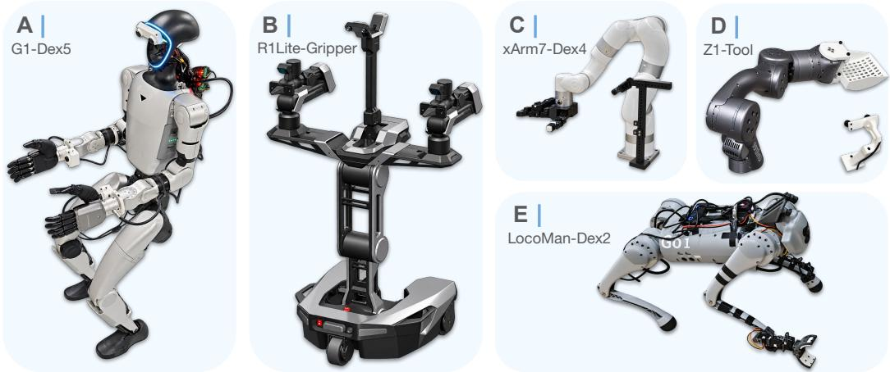  
Figure 10: Physical robot embodiments used in EgoX.

Table 3: Embodiment-specific interfaces used in EgoX. EgoX represents manipulation actions using semantically corresponding geometric modalities while allowing each embodiment to expose only the modalities applicable to its morphology. EEF denotes end effector.
<table><tr><td></td><td>Side</td><td>Robot Joint Dim.</td><td>EEF Joint Dim.</td><td>Torso Action</td><td>Wrist Pose Action</td><td>Fingertip Targets</td></tr><tr><td>Embodiment G1-DEX5</td><td>Bimanual</td><td>29</td><td> $6 + 6$ </td><td>Yes</td><td>L/R</td><td>5 / hand</td></tr><tr><td>R1LITE-GRIPPER</td><td>Bimanual</td><td>15</td><td>1+1</td><td>No</td><td>L/R</td><td>2 / gripper</td></tr><tr><td>XARM7-DEX4</td><td>Right</td><td>7</td><td>16</td><td>No</td><td>Right</td><td>4</td></tr><tr><td>LOCOMAN-DEX2</td><td>Right</td><td>18</td><td>1</td><td>Yes</td><td>Right</td><td>2</td></tr><tr><td>Z1-T00L</td><td>Right</td><td>6</td><td>一</td><td>No</td><td>Right</td><td>一</td></tr></table>

“Robot Joint Dim.” and “EEF Joint Dim.” denote the native proprioceptive dimensions used by each embodiment. EgoX predicts geometric wrist pose and, when applicable, fingertip targets, which are subsequently mapped to each embodiment’s native control space.

LocoMan-Dex2. LOCOMAN-DEX2 is a quadrupedal manipulation platform with two-finger grippers mounted on its front legs (Lin et al., 2024). We evaluate the platform in a unimanual configuration. EgoX predicts a wrist pose target together with two fingertip targets for the active gripper. These geometric targets are mapped to the native control space of the active manipulation limb for execution.

## A.6 UNIFIED EGOCENTRIC FRAME SYSTEM

All frames in EgoX are right-handed, with the x-axis pointing forward, the y-axis to the left, and the z-axis upward, as in IsaacGym and IsaacLab. Table 4 summarizes the frames of each embodiment. The root frame $\mathcal { F } _ { \mathrm { r o o t } }$ is the reference for the torso pose and the velocity commands. It is the gravityaligned projection of a reference body part onto the ground that keeps the part’s heading: the head at the start of the episode for human data, and the feet, trunk, chassis, or arm base for robots. Except for the fixed-base arms, the wrist poses in $\mathcal { F } _ { \mathrm { r o o t } }$ are also provided as observations. The egocentric frame $\mathcal { F } _ { \mathrm { e g o } }$ (Sec. 3.1) is rigidly attached to the body that carries the main camera. Wrist poses and wrist targets are expressed relative to it,

$$
{ } ^ { \mathrm { e g o } } T _ { \mathrm { w r i s t } } = \left( { } ^ { \mathrm { r o o t } } T _ { \mathrm { e g o } } \right) ^ { - 1 } { \mathrm { r o o t } } _ { T _ { \mathrm { w r i s t } } } ,\tag{19}
$$

where $^ A T _ { B } \in S E { ( 3 ) }$ is the pose of frame B in frame A, and end-effector-link keypoints are expressed in the local frame of each end effector. Poses are stored as a position and roll, pitch, and yaw angles in Z–Y–X order. A fixed rotation brings each robot’s native wrist frame to the EgoX wrist convention, $R _ { \mathrm { { w r i s t } } } = R _ { \mathrm { { n a t i v e } } } M ^ { \top }$ , where the rows of M give the native axes that become the EgoX wrist $x \cdot , y \cdot$ , and z-axes (Table 4). Torso-pose components that an embodiment does not use are masked (Appendix A.3).

Human-Dex5. The headset reports head and wrist poses in its own gravity-aligned tracking frame, whose y-axis points up; a fixed rotation maps them to the convention above. When the operator starts an episode (Appendix A.8), this frame is rotated about z by the operator’s head yaw and shifted to the head position, giving a frame with its origin at the head, its x-axis along the horizontal heading of the head, and its z-axis opposite to gravity, all taken at the start of the episode. $\mathcal { F } _ { \mathrm { r o o t } }$ is a pseudo root frame, the projection of this frame onto the ground (Fig. 4). $\mathcal { F } _ { \mathrm { e g o } }$ is the tracked head frame, which carries the headset-mounted stereo camera and follows the full head orientation, including pitch and roll. No head-to-torso offset is applied, so the torso modality of human data is the head pose in $\mathcal { F } _ { \mathrm { r o o t } } .$ , with its height measured from the starting head height. The 25 tracked hand keypoints are expressed in the tracked wrist frame, and the fingertips are taken from them.

G1-Dex5. The controller computes the robot state from the joint encoders by forward kinematics, assuming that both feet are flat on the ground. $\mathcal { F } _ { \mathrm { r o o t } }$ is the resulting stance frame, recomputed at every control step: its origin is the midpoint of the two ankle-roll links, its z-axis is the mean of the two foot z-axes, and its x-axis is the mean forward direction of the feet, made orthogonal to $z . \mathcal { F } _ { \mathrm { e g o } }$ is a virtual head frame rigidly attached to the torso link, which carries the head and its camera. It has the orientation of the torso link, and its origin lies at (0.154, 0, 0.406) m in torso-link coordinates, i.e., (0.15, 0, 0.45) m from the pelvis when the waist joints are at zero. The torso observation is the torso-link pose in $\mathcal { F } _ { \mathrm { r o o t } }$ . The torso target is the operator’s head pose in the human $\mathcal { F } _ { \mathrm { r o o t } } \mathrm { : }$ : the wholebody controller tracks its orientation as the torso orientation and its height change $\Delta z$ since the reset as a torso height of $0 . 7 5 \mathrm { m } + \Delta z$ . Each wrist frame lies 0.05 m beyond the wrist-yaw joint along the joint’s x-axis. For arm inverse kinematics, wrist targets in $\mathcal { F } _ { \mathrm { e g o } }$ are shifted by the same head offset into the pelvis frame.

Table 4: Root and egocentric frames of each embodiment. All frames use x forward, y left, and z up. “Torso pose” lists the torso-pose components marked valid in the recorded data (rpy: roll, pitch, and yaw). “Wrist axes” lists the native wrist axes that become the EgoX wrist $( x , y , z )$ axes; for the human, the tracked wrist frame defines the convention.
<table><tr><td>Embodiment</td><td>Root frame  $\mathcal { F } _ { \mathrm { r o o t } }$ </td><td>Egocentric frame  $\mathcal { F } _ { \mathrm { e g o } }$ </td><td>Torso pose</td><td>Wrist axes</td></tr><tr><td>HUMAN-DEX5</td><td>Ground point below the head at episode start</td><td>Tracked head, carrying the stereo camera</td><td>x, y, z, rpy</td><td>Tracked wrist</td></tr><tr><td>G1-DEX5</td><td>Stance frame at the feet, from leg kinematics</td><td>Torso link, origin shifted by (0.154, 0, 0.406) m</td><td>z, rpy</td><td> $\mathrm { L } \colon ( x , - z , y )$   $\ R \colon ( x , z , - y )$ </td></tr><tr><td>G1-SIM-DEX3 R1LITE-GRIPPER</td><td>Same as G1-DEX5 Wheeled chassis</td><td>Floating base (top torso</td><td>z, pitch</td><td> $\mathrm { L } \colon ( x , - z , y )$ </td></tr><tr><td>LOCOMAN-DEX2</td><td>Ground projection of the</td><td>link) Trunk</td><td>z, rpy</td><td>R: (x, z, −y)  $\left( - z , x , - y \right)$ </td></tr><tr><td>XARM7-DEX4</td><td>trunk at mode entry Arm base</td><td></td><td></td><td></td></tr><tr><td>Z1-T00L</td><td>Arm base rotated by  $- 9 0 ^ { \circ }$  about z</td><td>Arm base (static camera) Same as root frame (static camera)</td><td></td><td> $( x , - y , - z )$  (x, y, z)</td></tr></table>

G1-Sim-Dex3. The simulated G1 with three-finger Dex3 hands follows the same conventions as G1-DEX5.

R1Lite-Gripper. The vendor motion-control stack reports the pose of the floating base, the top torso link that carries the stereo head camera and both arms, in the frame of the wheeled chassis, and the end-effector (wrist) poses relative to the floating base. $\mathcal { F } _ { \mathrm { r o o t } }$ is therefore the chassis frame, and $\mathcal { F } _ { \mathrm { e g o } }$ is the floating-base frame. Only the height and pitch of the torso pose are used; the policy predicts no torso target (Table 3), and the chassis is driven by velocity commands. The wrist frames are the vendor end-effector frames, remapped with the same side-specific rotations as G1-DEX5.

LocoMan-Dex2. The robot is operated in its single-gripper manipulation mode, in which the onboard state estimator expresses the trunk pose relative to the trunk frame at the moment the mode is entered; $\mathcal { F } _ { \mathrm { r o o t } }$ is the projection of that frame onto the ground. Afterwards, the trunk pose is the rigid transform that aligns the current stance-foot positions, obtained from leg kinematics, with their positions at that moment, so $\mathcal { F } _ { \mathrm { r o o t } }$ stays fixed to the stance feet. The gripper pose follows from the trunk pose and the forward kinematics of the manipulating leg and its gripper. $\mathcal { F } _ { \mathrm { e g o } }$ is the trunk frame, which needs no rotation remap in the unimanual configuration. The height and orientation of the torso pose are used, both measured relative to the trunk frame at mode entry.

xArm7-Dex4. The arm has a fixed base and a static main camera, so $\mathcal { F } _ { \mathrm { r o o t } }$ and $\mathcal { F } _ { \mathrm { e g o } }$ coincide with the xArm7 base frame, whose x-axis points forward from the base and whose z-axis points up. The torso pose is identically zero and is not used. The wrist frame is the joint-7 frame without offset, remapped as in Table 4 for the default reset configuration.

Z1-Tool. The Z1 also has a fixed base and a static main camera, so $\mathcal { F } _ { \mathrm { r o o t } }$ and $\mathcal { F } _ { \mathrm { e g o } }$ coincide. Both are the Z1 base frame rotated by $- 9 0 ^ { \circ }$ about z: the unified x-axis is the native −y-axis, the unified y-axis is the native x-axis, and the z-axis is unchanged. Poses reported by the arm are rotated into this frame, and targets are rotated back before inverse kinematics. The wrist frame is the joint-6 frame without offset or remap. The scoop keypoint lies 0.2 m beyond the joint-6 frame along its x-axis.

From operator motion to robot targets. During teleoperation, the operator’s head and wrist poses are first expressed in the human frames above. For G1-DEX5, the wrist poses relative to the head are sent as wrist targets in the robot’s $\mathcal { F } _ { \mathrm { e g o } }$ . For the other physical robots, the operator’s head and wrist displacements and rotations since the reset are applied to the robot’s torso and wrist poses at the reset, expressed in the robot’s $\mathcal { F } _ { \mathrm { r o o t } }$ . For Z1-TOOL, these displacements and rotations are scaled by 0.7 and 0.5, respectively.

## A.7 ROBOT CONTROL AND DEPLOYMENT

Shared control stack. On the physical robots, teleoperation and policy deployment share the same control stack (Fig. 11). A high-level process, either the teleoperation interface or the policy, produces geometric targets in the unified egocentric frame system: wrist pose targets in ${ \mathcal { F } } _ { \mathrm { e g o } } ,$ endeffector link pose targets in the wrist frames, and, when applicable, torso pose targets in $\mathcal { F } _ { \mathrm { r o o t } }$ and velocity commands. Fixed, embodiment-specific transforms map these targets to the robot’s base frame and end-effector convention, and the targets are sent over CycloneDDS to an embodimentspecific controller that converts them into joint commands. The controller publishes the robot state back, which is recorded during teleoperation and used as policy input during deployment. Because demonstrations are collected through the same controllers that later execute the policy, recorded actions and policy outputs are interpreted in the same way. Table 5 summarizes the controller of each embodiment.

Policy execution. At deployment, all methods send actions at 30 Hz, matching the recording rate, and use the same embodiment-specific controllers. MXT+ and ACT predict chunks of 60 actions and execute them open loop without temporal ensembling. By default, these policies execute 60 actions (2 s) before the next query; they execute 45 actions per query in simulation (Appendix A.11), as does pretrained MXT+ on R1Lite-Gripper Kitchen-Bread. The $\pi _ { 0 . 5 }$ policies instead use RTC, overlapping prediction of the next chunk with execution of the current chunk (Appendix A.4). An operator can pause the policy or reset the robot from a keyboard at any time.

Arm control. For G1-DEX5, XARM7-DEX4, and Z1-TOOL, wrist pose targets are converted into arm joint targets by inverse kinematics (IK), solved at every control step with Pinocchio (Carpentier et al., 2019) and CasADi (Andersson et al., 2019) using IPOPT (Wachter & Biegler¨ , 2006) with at most 50 iterations. The objective is a weighted sum of the translation error, the rotation error, a joint regularizer, and a smoothness term toward the previous solution, with weights (50, 1, 0.02, 0.1) for G1-DEX5 and (30, 1, 0.02, 0.2) for XARM7-DEX4 and Z1-TOOL. For G1-DEX5, only the 14 arm joints are optimized and all other joints are locked. Each solution is then smoothed by a weighted moving average over the four most recent solutions, with weights (0.4, 0.3, 0.2, 0.1) from newest to oldest. R1LITE-GRIPPER uses RelaxedIK (Rakita et al., 2018) for its two 6-DoF arms, and LOCOMAN-DEX2 reuses the whole-body controller and finite-state machine of Human2LocoMan (Niu et al., 2025), which convert the end-effector target of the active manipulator into joint commands.

Hand and gripper control. For the Inspire hands of G1-DEX5 and the LEAP Hand of XARM7- DEX4, fingertip targets expressed in the wrist frame are converted into hand joint commands by Dex-Pilot retargeting (Handa et al., 2020), using an implementation adapted from dex-retargeting (Qin et al., 2023). At every control step, the hand joint angles q are obtained by solving

$$
\operatorname* { m i n } _ { \substack { q _ { \mathrm { m i n } } \leq q \leq q _ { \mathrm { m a x } } } } \ \frac { 1 } { N } \sum _ { i = 1 } ^ { N } w _ { i } \ell _ { \mathrm { s m o o t h - L 1 } } \big ( \| v _ { i } ( q ) - \hat { v } _ { i } \| _ { 2 } \big ) + \lambda _ { \mathrm { s } } \| q - q _ { \mathrm { p r e v } } \| _ { 2 } ^ { 2 } + \gamma \| q \| _ { 2 } ^ { 2 } ,\tag{20}
$$

where ${ \pmb v } _ { i } ( { \pmb q } )$ ranges over the $N$ wrist-to-fingertip and fingertip-to-fingertip vectors of the robot hand computed by forward kinematics, $\hat { \mathbf { } } \boldsymbol { v } _ { i }$ is the corresponding target vector, $\ell _ { \mathrm { s m o o t h - L 1 } }$ is the smooth L1 loss with a threshold of 3 cm, and $\pmb { q } _ { \mathrm { p r e v } }$ is the previous solution. Target vectors are the human vectors scaled by 1.2 for the Inspire hands and 1.6 for the LEAP Hand. As in DexPilot, a thumb– finger pair closer than 3 cm is treated as a pinch until the distance exceeds 5 cm. During a pinch, its target vector is shortened to 0.1 mm so that the fingertips make contact, and two fingers that pinch the thumb together while within 3 cm of each other are kept 3 cm apart. These projected vectors are weighted by $w _ { i } = 2 0 0$ and $w _ { i } = 4 0 0$ , respectively, the remaining fingertip-to-fingertip vectors by $w _ { i } = 1$ , and the wrist-to-fingertip vectors by $w _ { i } = 1 5$ for the Inspire hands and $w _ { i } = 1 0$ for the LEAP Hand. The second term, with $\lambda _ { \mathrm { s } } = 4 \times 1 0 ^ { - 3 }$ , keeps consecutive solutions close. The last term is not part of dex-retargeting; following DexPilot, we add it to regularize the joint angles toward zero, which corresponds to an open hand. This reduces redundancy in the solution and keeps the hand out of poor local minima that are difficult to recover from, such as fingers embedded in the palm. We use $\gamma = 1 . 5 \times 1 0 ^ { - 2 }$ , whereas DexPilot uses $\gamma = 2 . 5 \times 1 0 ^ { - 3 }$ for the Allegro hand. The problem is solved with SLSQP, warm-started from the previous solution, and the resulting joint angles are smoothed by a first-order low-pass filter (α = 0.2) before being sent to the hand.

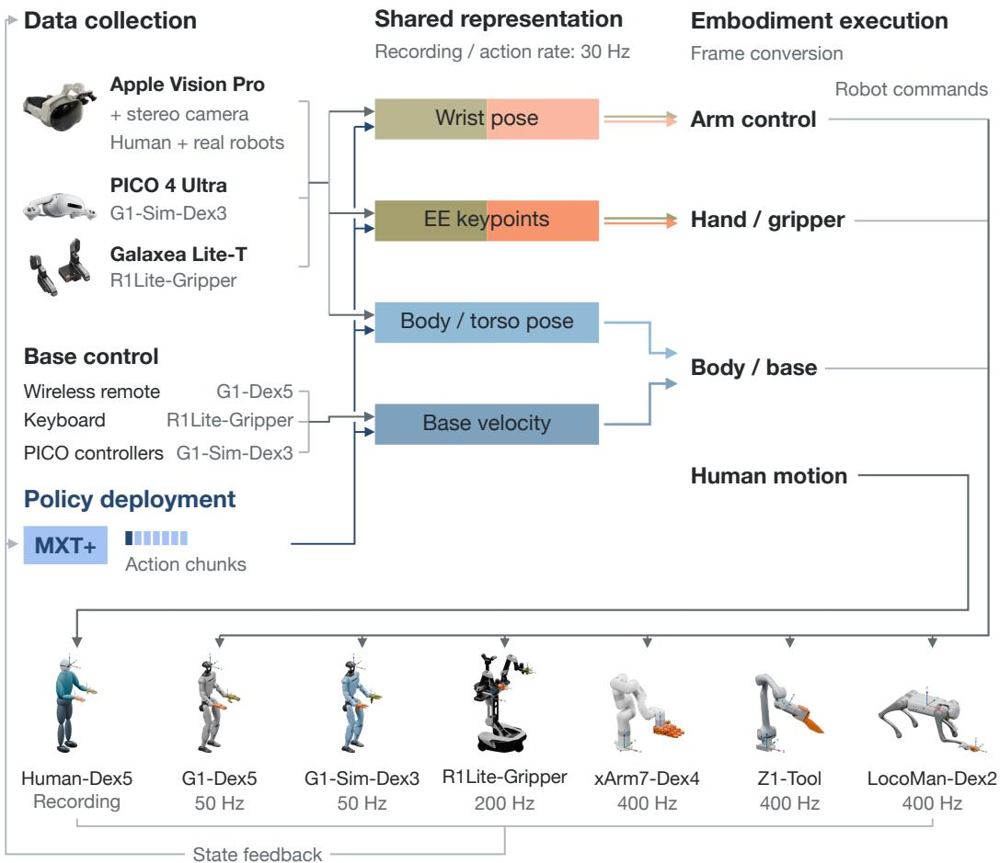  
Figure 11: Shared representation and embodiment-specific execution. HUMAN-DEX5 motion is recorded using an Apple Vision Pro with a mounted stereo camera. Human recordings and robot trajectories share the pose/action representation. Robot teleoperation and policy rollout use embodiment-specific controllers. Colors follow the action experts in Fig. 3 (olive: left, orange: right). Action modalities vary by embodiment; frequencies below each robot indicate its low-level control rate.

For the grippers of R1LITE-GRIPPER and LOCOMAN-DEX2, the controller computes the distance between the two fingertip targets and maps it linearly to a gripper command, using the same map as teleoperation. On LOCOMAN-DEX2, distances from 2 to 15 cm map to gripper angles from 0.01 to 1.8 rad. On R1LITE-GRIPPER, distances from 0.8 to 15 cm map to the full gripper range; the command is low-pass filtered and then binarized, so the gripper opens fully when the distance exceeds about 5 cm and closes otherwise.

Body and base control. On G1-DEX5, the predicted torso pose, consisting of torso height and orientation, and the velocity command, consisting of forward, lateral, and yaw velocities, are passed to the lower-body controller of Humanoid Touch Dream (Niu et al., 2026). This learned policy runs at 50 Hz and outputs targets for the 12 leg joints and 3 waist joints. On R1LITE-GRIPPER, the predicted velocity command drives the mobile chassis and is set to zero whenever the most recent command is older than 0.4 s.

Table 5: Low-level control used for teleoperation and deployment. Every embodiment receives targets at 30 Hz; the listed rate is the frequency of the embodiment controller.
<table><tr><td>Embodiment</td><td>Arm</td><td>Hand / gripper</td><td>Body / base</td><td>Rate</td></tr><tr><td>G1-DEX5</td><td>IK, 14 arm joints</td><td>DexPilot retargeting</td><td>Lower-body policy</td><td>50Hz</td></tr><tr><td>R1LITE-GRIPPER</td><td>RelaxedIK, 2 × 6 joints</td><td>Fingertip distance</td><td>Chassis velocity</td><td>200 Hz</td></tr><tr><td>XARM7-DEX4</td><td>IK, 7 joints</td><td>DexPilot retargeting</td><td></td><td>400 Hz</td></tr><tr><td>LOCOMAN-DEX2</td><td>Whole-body controller</td><td>Fingertip distance</td><td>Whole-body controller</td><td>400 Hz</td></tr><tr><td>Z1-T00L</td><td>IK, 6 joints</td><td></td><td></td><td>400 Hz</td></tr></table>

## A.8 DATASET AND DATA COLLECTION

Dataset overview. EgoX is trained on a heterogeneous collection of egocentric manipulation demonstrations spanning human, physical-robot, and simulated embodiments. In total, the dataset contains 4,851 trajectories corresponding to 34.38 hours of interaction. Table 6 summarizes the dataset composition for each embodiment, while Fig. 12 visualizes the task distribution across embodiments.

Table 6: Dataset statistics. Number of training and validation trajectories and total interaction duration for each embodiment used in EgoX.
<table><tr><td>Embodiment</td><td>Domain</td><td>Tasks</td><td>Train</td><td>Val.</td><td>Total</td><td>Hours</td></tr><tr><td>HUMAN-DEX5</td><td>Human</td><td>Insert, Kitchen-Bread, Scoop, Sort</td><td>2,198</td><td>198</td><td>2,396</td><td>9.26</td></tr><tr><td>G1-DEX5</td><td>Real</td><td>Insert, Kitchen-Bread, Scoop, Sort</td><td>622</td><td>88</td><td>710</td><td>6.70</td></tr><tr><td>XARM7-DEX4</td><td>Real</td><td>Insert, Scoop, Sort</td><td>398</td><td>39</td><td>437</td><td>3.64</td></tr><tr><td>G1-SIM-DEX3</td><td>Sim</td><td>Kitchen-Bread, Kitchen-Cleanup</td><td>691</td><td>58</td><td>749</td><td>7.51</td></tr><tr><td>LOCOMAN-DEX2</td><td>Real</td><td>Scoop</td><td>34</td><td>3</td><td>37</td><td>0.35</td></tr><tr><td>R1LITE-GRIPPER</td><td>Real</td><td>Insert, Kitchen-Bread, Sort</td><td>398</td><td>40</td><td>438</td><td>6.36</td></tr><tr><td>Z1-T00L</td><td>Real</td><td>Scoop</td><td>77</td><td>7</td><td>84</td><td>0.56</td></tr><tr><td>Total</td><td>一</td><td>一</td><td>4,418</td><td>433</td><td>4,851</td><td>34.38</td></tr></table>

Data composition. The dataset is deliberately heterogeneous in both embodiment and task composition. Human demonstrations constitute the largest source, with 2,396 trajectories (49.4% of the full dataset), while demonstrations collected on physical robots contribute 1,706 trajectories (35.2%). The remaining 749 trajectories (15.4%) are collected with the simulated G1 embodiment. Among the robot embodiments, G1-DEX5 and G1-SIM-DEX3 provide the largest individual datasets, with 710 and 749 trajectories, respectively, while the remaining platforms provide smaller but morphologically diverse sources of manipulation experience.

Importantly, the dataset is not constructed by replicating the same task set across every embodiment. Instead, different embodiments contribute different subsets of tasks according to their morphology and manipulation capabilities. Cross-embodiment overlap therefore arises through semantically corresponding observation and action modalities rather than requiring identical tasks or actuator-level action spaces across all platforms.

Data collection. Similar to Human2LocoMan (Niu et al., 2025), both human and real-robot data are collected with an Apple Vision Pro that captures the operator’s head and hand motions, while simulated data are collected by teleoperation in simulation with PICO XR devices (Appendix A.11). The headset tracks the head pose and 25 keypoints per hand, and all streams are recorded at 30 Hz. Operators start and stop each episode with left-hand pinch gestures, thumb to index finger to start and thumb to middle finger to stop and reset, so no additional input device is needed. Each episode is stored as an HDF5 file with the available images, poses, proprioception, and actions.

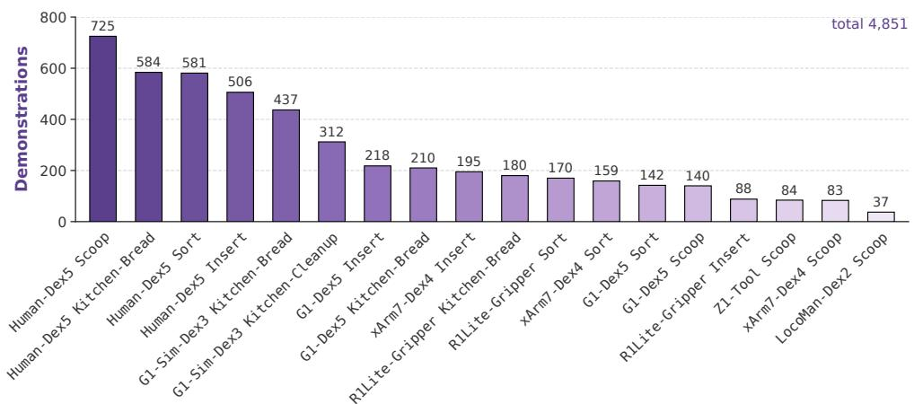

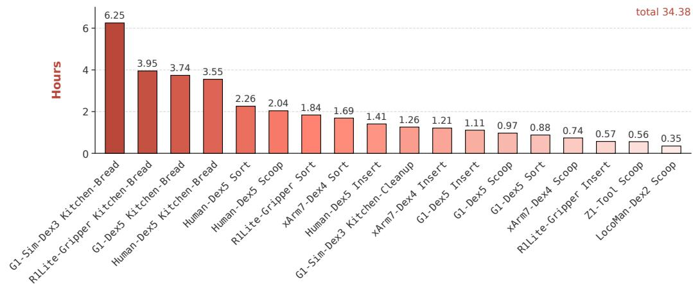  
Figure 12: Composition of the EgoX dataset across embodiments and tasks. Number of demonstrations (top) and hours (bottom) for each task–embodiment pair, sorted from high to low in each panel.

Human demonstrations. For human data, a stereo camera is rigidly mounted on the headset and records egocentric images as side-by-side stereo frames of 1280×480 pixels. The operator performs the task with their own hands while seeing the scene through the headset’s see-through mode (Park & Agrawal, 2024). The tracked wrist poses are expressed in the egocentric frame $\bar { \mathcal { F } } _ { \mathrm { e g o } }$ (Sec. 3.1), and the five fingertips of each hand, expressed in the wrist frame, serve as the end-effector link keypoints.

Robot demonstrations. Physical robots are teleoperated with the same headset. The operator’s wrist poses and hand keypoints are converted into targets in the unified egocentric frame system and streamed at 30 Hz to the robot, where the control stack of Appendix A.7 executes them. For grippers, the thumb–index pinch distance sets the gripper opening, and for G1-DEX5, the operator’s head orientation and changes in head height set the torso orientation and height. Base velocity commands are issued with a separate input device, the wireless remote of G1-DEX5 or a keyboard for the R1LITE-GRIPPER chassis, and are recorded from the robot state. The operator watches the robot’s stereo head-camera stream in the headset through an Open-TeleVision (Cheng et al., 2024) interface. Each recorded step stores the commanded targets as actions, together with the robot’s egocentric images and the poses and proprioception returned by the controller.

## A.9 TASK AND EVALUATION PROTOCOL

We evaluate 13 task–embodiment pairs: Scoop on G1-DEX5, XARM7-DEX4, LOCOMAN-DEX2, and Z1-TOOL; Sort on G1-DEX5, XARM7-DEX4, and R1LITE-GRIPPER; Insert on G1- DEX5 and XARM7-DEX4; Kitchen-Bread on G1-DEX5, R1LITE-GRIPPER, and G1-SIM-DEX3; and Kitchen-Cleanup on G1-SIM-DEX3. Figs. 13–17 show example rollouts of these pairs, grouped by task.

ID and OOD conditions. Both conditions are defined for each task–embodiment pair with respect to its fine-tuning dataset, i.e., the demonstrations of the target task on the target embodiment, which are excluded from pretraining (Appendix A.3). In-distribution (ID) trials use settings drawn from the same distribution as the fine-tuning demonstrations, including the same objects and receptacles and the same range of initial object placements. Out-of-distribution (OOD) trials use configurations that are unseen in the fine-tuning dataset, such as new object shapes, sizes, and colors, a different receptacle, sauce, or plate, or new initial object placement, while the task goal and the stage scoring remain unchanged. The ID and OOD configurations of each pair are given after the description of each task below. Fig. 18 shows the real objects of each task, and Fig. 19 the object appearances in simulation.

OOD evaluation tests cross-embodiment transfer. OOD configurations are absent from the target task–embodiment fine-tuning data. Some occur in the cross-embodiment pretraining mixture: in the demonstrations of other embodiments, most notably the human demonstrations, or in demonstrations of other tasks. A policy trained only on the target-embodiment data, such as ACT or MXT+ without pretraining, has therefore never observed these configurations, whereas a pretrained policy may have observed them while they were handled by a human or another robot. The OOD evaluation is designed to measure exactly this case: whether experience with a configuration on other embodiments, especially humans, transfers to a target robot that has never encountered it. This is the setting that cross-embodiment pretraining targets, and OOD results should be read as a test of cross-embodiment transfer rather than of generalization to configurations that are absent from all training data.

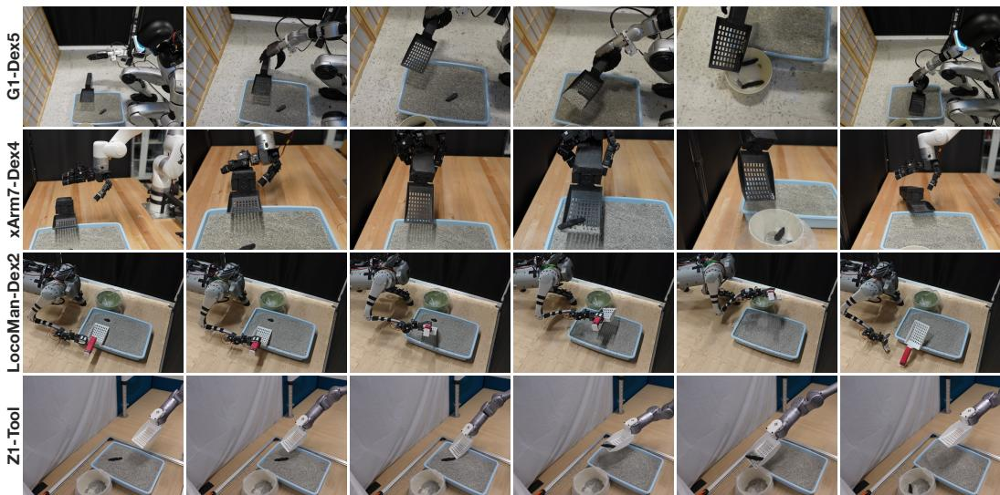  
Figure 13: Scoop across four embodiments. Each row progresses from left to right through grasping or positioning the scoop, collecting waste, emptying it into the disposal bin, and returning the scoop. Z1-TOOL uses a fixed scoop and does not perform a grasp. The LOCOMAN-DEX2 example shows an OOD trial.

Scoop (cat litter scooping). The scene contains a litter box filled with cat litter, a scoop resting on the edge of the box, and a disposal bin next to it. The robot grasps the scoop, moves it to the waste in the box, i.e., the target object, scoops and lifts it, empties it into the disposal bin, and returns the scoop to the edge of the box. On XARM7-DEX4 and Z1-TOOL, the box stands on a table. On

G1-DEX5, it is placed on the floor, so the humanoid lowers its torso to reach it, and LOCOMAN-DEX2 holds the scoop with the gripper on its front leg. Z1-TOOL carries a scoop that is rigidly attached to the arm and therefore skips the grasp. ID and OOD. On all four embodiments, ID trials use a white disposal bin within the position range seen in fine-tuning, and OOD trials replace it with a green disposal bin or move it to new positions. On G1-DEX5, XARM7-DEX4, and Z1-TOOL, whose workspaces are large, OOD trials also place the waste at new positions in the litter box.

Sort (block sorting). Red and blue building blocks lie on the table in front of a red and a blue bin, whose left–right order varies across trials. The robot picks up each block and places it into the bin of the same color. Each block is scored independently, and approaching or placing into the wrong bin earns only partial credit (Table 7). The bimanual G1-DEX5 and R1LITE-GRIPPER use both arms. ID and OOD. ID trials use three blocks of the shapes seen in the fine-tuning data, and each reproduces the initial layout of a recorded demonstration. On all three embodiments, OOD trials use blocks of new shapes, e.g., a four-stud brick. On R1LITE-GRIPPER, OOD trials also change the number of blocks, e.g., to four.

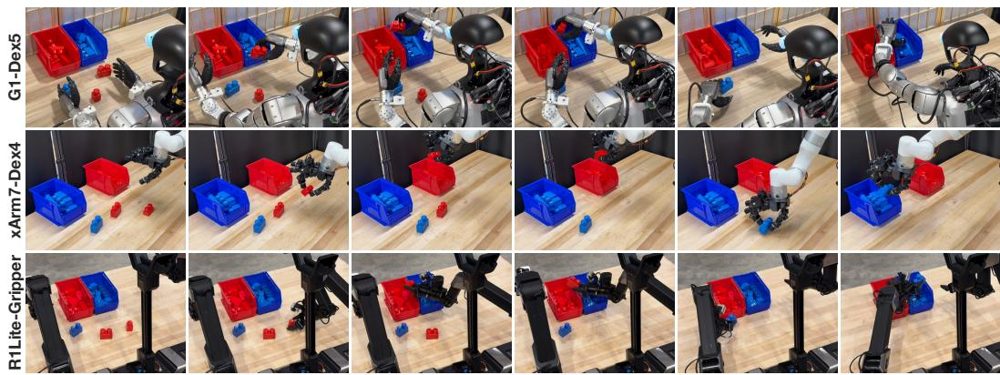  
Figure 14: Sort across three embodiments. Each row shows the robot grasping blocks and placing them into the color-matched bins, with time progressing from left to right.

Insert (T-shaped block insertion). A T-shaped block lies on the table next to a fixed base with a T-shaped slot. The robot approaches and grasps the block, reorients and aligns it with the slot, and inserts it; a near-successful insertion earns partial credit. ID and OOD. ID trials use the block seen in the fine-tuning data, which is light purple on G1-DEX5 and white on XARM7-DEX4. On XARM7- DEX4, the block is placed at nine predefined positions, one of which is repeated four more times. OOD trials on G1-DEX5 use a white block, a dark purple block, or a larger brown block, and OOD trials on XARM7-DEX4 use the light purple block or the larger brown block. For each embodiment, the OOD evaluation uses blocks demonstrated by the other embodiment during cross-embodiment pretraining.

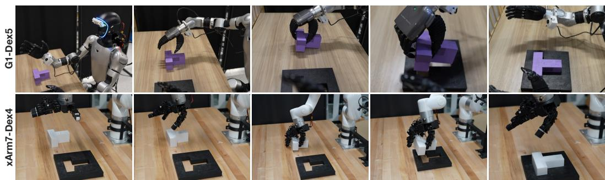  
Figure 15: Insert across two embodiments. Each row shows the robot approaching, grasping, aligning, and inserting the T-shaped block, with time progressing from left to right.

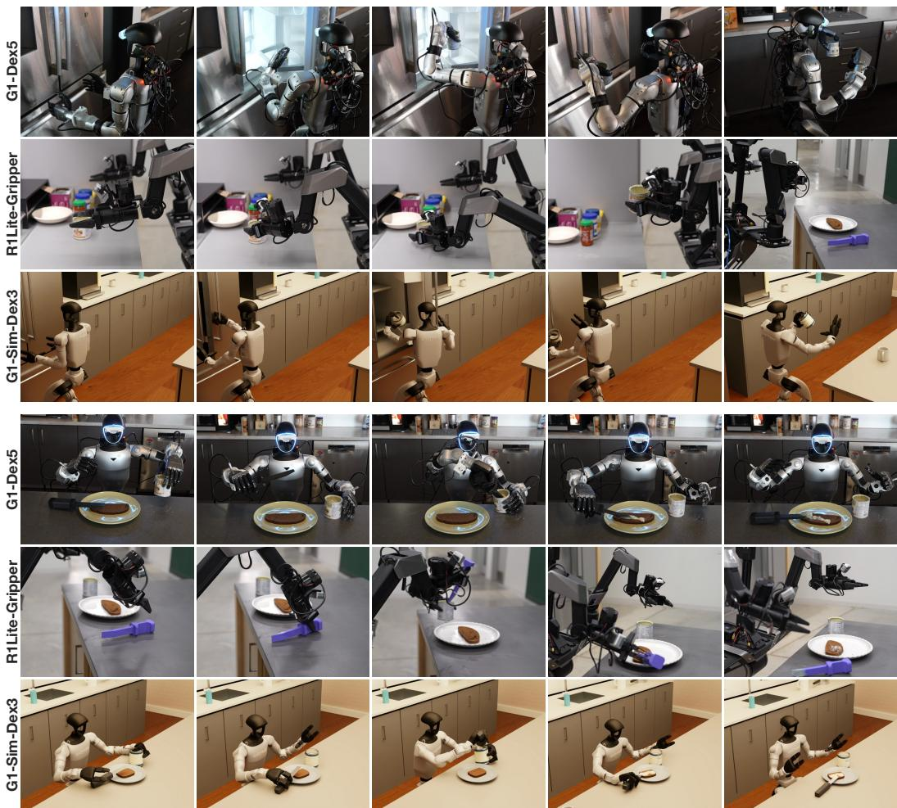  
Figure 16: Kitchen-Bread across three embodiments. The upper three rows show container pickup and transport; the lower three rows continue the same rollouts through container placement, tool pickup, dipping, spreading, and tool return. Time progresses from left to right within each row. R1LITE-GRIPPER retrieves the container from a counter rather than a refrigerator.

Kitchen-Bread (sauce spreading). This long-horizon task combines locomotion with manipulation. On G1-DEX5, the robot opens the refrigerator, grasps the sauce container, closes the refrigerator, walks to the counter, and places the container next to a plate of bread. It then picks up the spreading tool, dips it into the sauce, spreads the sauce onto the bread, and puts the tool back. On R1LITE-GRIPPER, the robot picks up the sauce container from a counter instead of a refrigerator, drives its wheeled base to the table with the bread, places the container, and performs the same spreading steps. G1-SIM-DEX3 performs the G1-DEX5 sequence in the simulated kitchen (Appendix A.11). ID and OOD. On G1-DEX5, ID trials use white condensed milk and brown bread on a green plate, and OOD trials use another kind of condensed milk and a blue plate, with white or brown bread. On R1LITE-GRIPPER, ID trials use white condensed milk and brown bread, and OOD trials use a different sauce, e.g., mayonnaise or strawberry jam, or white condensed milk on white bread; the plate is the same in both conditions. On G1-SIM-DEX3, ID trials sample object appearances and layouts from the demonstration distribution. OOD trials use unseen object and scene appearances, together with unseen plate–spreader layouts (Appendix A.11).

Kitchen-Cleanup (tool organization). This task is evaluated only on G1-SIM-DEX3. A spreader rests on a plate on the counter next to a container, and the robot grasps the spreader and places it into the container. ID and OOD. ID trials sample appearances and layouts from the demonstration distribution. OOD trials use object and scene appearances not present in those demonstrations (Appendix A.11).

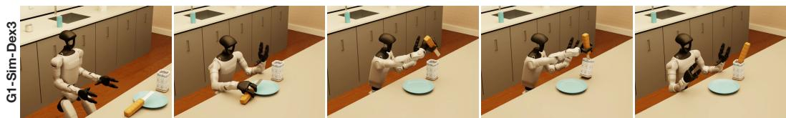  
Figure 17: Kitchen-Cleanup on G1-SIM-DEX3. From left to right, the robot approaches the spreader, grasps and lifts it, and places it into the container.

Trials and scoring. Each real-world pair is evaluated over 20 trials (13 ID and 7 OOD), and each simulated pair over 50 trials (32 ID and 18 OOD). All methods are evaluated on the same trial configurations. We score each trial with a stage-based task progress score that gives partial credit for intermediate stages. For a trial with accumulated stage score s, success indicator $b \in \{ 0 , 1 \}$ , and task-specific maximum score $S _ { \mathrm { m a x } }$ including the success bonus, the normalized task progress score is $P \doteq ( s + b ) / S _ { \mathrm { m a x } }$ . Table 7 lists the stages, points, and success criteria of each task. ID and OOD scores are reported separately.

Table 7: Task progress scoring used for evaluation. A trial earns the points of every stage it completes and a one-point success bonus if it succeeds. $S _ { \mathrm { m a x } }$ is the full stage score plus the bonus, and the normalized task progress score is $P = ( s + b ) / S _ { \mathrm { m a x } }$ (Appendix A.9).
<table><tr><td>Task</td><td>Embodiment</td><td>Stages and points</td><td> $\mathbf { S } _ { \mathrm { m a x } }$ </td></tr><tr><td>Scoop</td><td>G1-DEX5, XARM7-DEX4, LOCOMAN-DEX2 Z1-TOOL</td><td>Grasp the scoop: 1; move the scoop to the target object: 1; scoop and lift the object: 2; drop off the object into the bin: 1. The same stages without the grasp, since the scoop is fixed to the arm: approach: 1; scoop and lift: 2;</td><td>5+1 4+1</td></tr><tr><td>Sort</td><td>G1-DEX5, XARM7-DEX4, R1LITE-GRIPPER</td><td>deposit: 1. Each of the n blocks is scored independently: pick up the block: 1; approach a bin: 3 for the bin of the block&#x27;s color and 1 for the other bin; place the block into a bin: 3 for the bin of the block&#x27;s color and 1 for the other bin. All trials use n = 3 blocks, except R1LITE-GRIPPER OOD trials with more</td><td>7n+ 1</td></tr><tr><td>Insert</td><td>G1-DEX5, XARM7-DEX4</td><td>blocks, e.g., n = 4; each trial is normalized by its own  $S _ { \mathrm { m a x } } .$  Approach the T-shaped block: 1; grasp the block: 2; insert the block into the slot: 2 for a full insertion, 1 for a near-successful insertion, and 0</td><td>5+1</td></tr><tr><td rowspan="2">Kitchen-Bread</td><td>R1LITE-GRIPPER</td><td>otherwise. Pick up the sauce container: 1; drive to the table: 1; place the container: 1; pick up the spreading tool: 1; dip the tool into the sauce: 1; spread the sauce</td><td>7+1</td></tr><tr><td>G1-DEX5, G1-SIM-DEX3</td><td>onto the bread: 1; put the tool back: 1. Open the refrigerator: 1; grasp the sauce container: 1; close the refrigerator: 1; walk to the counter: 1; place the container: 1; pick up the spreading tool: 1; dip the tool into the sauce: 1; spread the sauce</td><td>9+1</td></tr><tr><td>Kitchen-Cleanup</td><td>G1-SIM-DEX3</td><td>onto the bread: 1; put the tool back: 1. Grasp the spreader: 1; lift the spreader: 1; insert the spreader into the container: 1; release the spreader so that it is supported inside the container: 1.</td><td>4+1</td></tr></table>

On the physical robots, a trial succeeds, and earns the bonus, exactly when it completes every stage, so P = 1 if and only if the trial succeeds. In simulation, Kitchen-Bread succeeds when the sauce added to the bread covers at least 5% of it and the spreader ends released and stably supported, and Kitchen-Cleanup succeeds when the spreader is released and supported inside the container (Appendix A.11). A successful simulated Kitchen-Bread trial therefore need not complete every stage; for example, it may leave the refrigerator open.

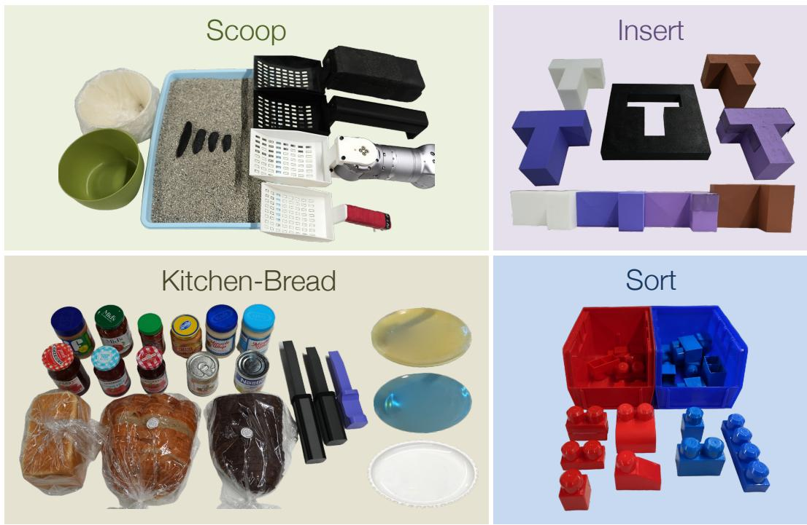

Figure 18: Real objects of the tasks. Each panel shows the objects of one task. The lower Insert photo shows the blocks from the side to compare their sizes. Which objects appear in ID and which in OOD trials differs between embodiments and is given in the description of each task.  
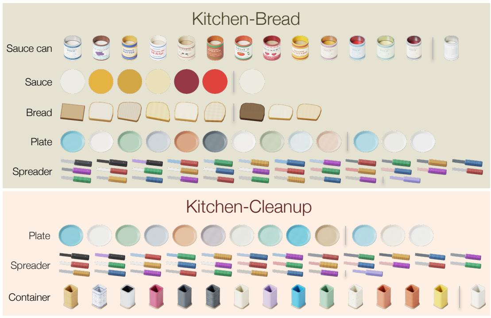  
Figure 19: Simulated objects of the tasks. Each row shows the appearances of one object category in the Kitchen-Bread and Kitchen-Cleanup tasks on G1-SIM-DEX3. Appearances to the right of the divider in each row are used only in OOD trials, and the others are randomized in the demonstrations.

## A.10 SUCCESS RATES

Sec. 4 reports the normalized task progress score P. Fig. 20 reports the success rate on the same trials, i.e., the fraction of trials with b = 1 (Appendix A.9), for each method and task–embodiment pair under ID and OOD conditions.

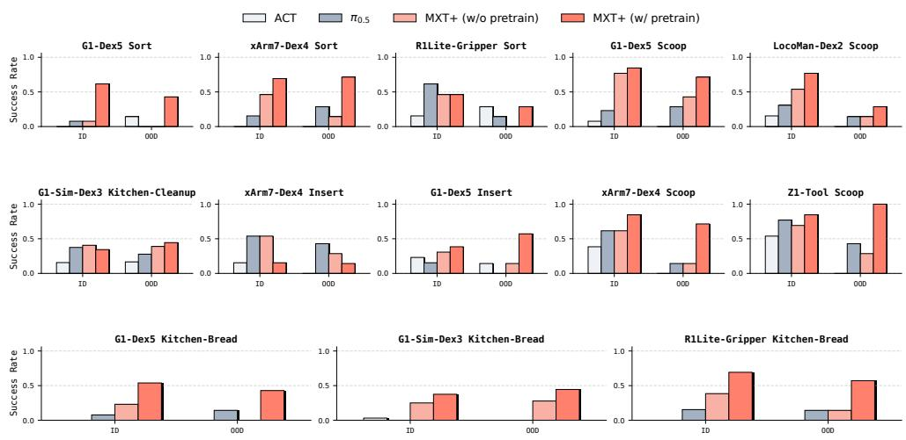  
Figure 20: Success rates. Success rate of ACT, $\pi _ { 0 . 5 } ,$ MXT+ without pretraining, and MXT+ with crossembodiment pretraining on each task–embodiment pair under ID and OOD conditions, evaluated on the same trials as Fig. 5.

Success rates give the same overall ranking as task progress. Averaged over the 13 pairs, crossembodiment pretraining raises the success rate of MXT+ from 0.35 to 0.56 and improves 11 of 13 pairs, while $\pi _ { 0 . 5 }$ and ACT reach 0.27 and 0.11. The gain is largest out of distribution: there, MXT+ without pretraining succeeds no more often than $\pi _ { 0 . 5 }$ (0.18 vs. 0.19), and pretraining raises it to 0.52, compared with a rise from 0.44 to 0.58 in distribution. Embodiment dreaming likewise raises the success rate over MXT in all seven settings of Fig. 7, from 0.39 to 0.62 on average (from 0.46 to 0.63 in distribution and from 0.27 to 0.60 out of distribution), most on G1-Dex5 Scoop (from 3 to 16 of 20 trials).

## A.11 SIMULATION DETAILS

Simulation setup. We simulate G1-Sim-Dex3, a Unitree G1 humanoid with three-finger Dex3 hands, in a kitchen environment built in Isaac Sim and Isaac Lab. In Kitchen-Bread, the robot retrieves a sauce can from the refrigerator, carries it to the worktop, and spreads its contents onto bread; the shorter Kitchen-Cleanup task requires picking up the spreader and placing it in a container. Objects interact through rigid-body contact, while sauce transfer is rendered visually without fluid simulation. Demonstrations are collected by teleoperation with PICO controllers, and the egocentric head-camera and wrist-camera images are rendered offline with RTX. Physics runs at 200 Hz and the locomotion controller at 50 Hz.

Randomization. At reset, we randomize the robot and object positions, object sizes, aisle width, and worktop height, keep the spreader supported by the plate, and check each sampled layout for clearance. We also vary the bread shape and the positions of background objects and furniture. During offline rendering, we randomize object and room materials, lighting, camera poses and fields of view, and image properties such as color, noise, blur, and compression. These visual changes leave the recorded motions and action labels unchanged. Each rendered episode uses a fixed visual configuration, with noise varying across frames, and the dataset also retains variants close to the original appearance. Fig. 19 shows the object appearances, including those used only in OOD trials.

Evaluation. Each task is evaluated on 50 fixed trials: 32 ID and 18 OOD. OOD trials use object and scene appearances excluded from the demonstrations; Kitchen-Bread OOD trials also include plate–spreader arrangements outside the demonstrated range. Trial configurations were refined through pilot evaluations and then fixed for all methods. Kitchen-Bread and Kitchen-Cleanup trials last 90 and 45 simulated seconds, respectively. Actions are executed at 30 Hz. MXT+ and ACT execute 45 actions before each new prediction, while $\pi _ { 0 . 5 }$ uses RTC (Appendix $\mathrm { A . 4 } )$ . Kitchen-Bread success requires spreading sauce onto the bread and, at the end of the trial, a released spreader settled on a support. Kitchen-Cleanup success requires grasping the spreader and placing it inside the container, released and supported, at any point during the trial. We score nine prerequisite-dependent stages for Kitchen-Bread and four for Kitchen-Cleanup, plus one point for success, giving maximum scores of 10 and $5 ;$ normalizing by these maxima gives the task progress score reported in Sec. 4.