# Edge-Gradient Augmentation under Reinforcement Learning for Temporal Graph

Yongqing Zhou, Jiawei Chen, Wenjun Wang, Xinyu Wang, Wei Yu, and Qiyao Peng

Abstract—Temporal link prediction is critical for understanding dynamic interactions in evolving networks, informing applications ranging from social network analysis to recommendation systems. Existing methods typically rely on raw temporal graph data, often neglecting explicit edge-change information that can significantly improve predictive performance. To address this gap, we propose edge-gradient reinforced learning (EG-RL), a framework that explicitly encodes edge-gradient events (edge births and deaths) through dedicated node and link encoding modules. EG-RL uses a policy-driven reinforcement-learning mechanism to dynamically select and augment the most informative edge snapshots, guided by critic-based feedback to optimize prediction accuracy. The model comprises distinct modules for node encoding, link encoding, token mixing, and channel mixing, integrated through global pooling and followed by a two-layer multilayer perceptron classifier. Extensive experiments on multiple dynamic graph datasets demonstrate substantial gains in area under the receiver operating characteristic curve and average precision. Ablation studies further confirm the necessity of adaptive edge-gradient augmentation and validate the effectiveness of the proposed encoding and reinforcement-learning mechanisms. To encourage further exploration, we make our codebase and processed datasets publicly available at https://anonymous.4open.science/r/EG-RL-671D.

Index Terms—dynamic graphs, graph representation learning, reinforcement learning, temporal link prediction

## I. INTRODUCTION

Temporal link prediction forecasts future interactions from time-ordered observations, supporting recommendation, communication analysis, transaction monitoring, and knowledgegraph forecasting [1], [2]. Beyond interaction recency, a predictor must distinguish persistent activity, isolated encounters, and disappearance followed by reappearance. These patterns vary across domains, motivating representations that preserve temporal and structural context without assigning equal relevance to every historical observation.

Existing temporal graph methods model structural evolution through recurrent and snapshot updates [3]–[6], temporal attention and event-driven memory [7], [8], and asynchronous propagation and motif-aware walks [9], [10]. Formation and dissolution are also considered in continuous-time temporal knowledge graphs [11]. We investigate a complementary question: can an explicit, interpretable encoding of observed edge transitions provide a useful inductive bias, and can selecting among the resulting augmented observations improve prediction within a simple temporal encoder?

Pairs with equally recent interactions can have different histories of presence, absence, and reappearance. Edge-Gradient Reinforced Learning (EG-RL) exposes these transitions through constructed edge-weight profiles. Linear interpolation maps a defined 0 → 1 transition to an increasing profile and a 1 → 0 transition to a decreasing profile (Fig. 1). This parameter-free transformation reorganizes historical evidence alongside the original timing information; it adds no new observations.

An edge gradient describes changes in recorded presence, not a measured relationship velocity or latent intensity: a slice without a recorded interaction does not establish that a relationship has ended. Its usefulness may depend on the observation regime. Repeated transitions may provide informative context, whereas interpolation is less well supported for isolated events, irregular coverage, or long gaps. Augmented observations are therefore candidates for selection, not uniformly useful inputs.

EG-RL uses a policy-based selector because retention is discrete, candidate utility depends on the jointly retained observations, and validation AP/AUC are not directly differentiable. The policy observes graph and candidate features within a bounded pool; a clipped relative validation-AUC reward supplies feedback, and a critic baseline aims to reduce policygradient variance. Credit is shared statistically across a selection episode, not observed separately for each decision. Attention, learned weighting, differentiable gates, and temporal sampling remain plausible alternatives; RL should therefore be compared with these and random or heuristic selection under matched candidates, encoders, and budgets. Held-out test scores are excluded from rewards and checkpoint selection.

Temporal validity requires both interpolation endpoints and their features to be available before the prediction cutoff; constructing profiles from the complete sequence before splitting would risk leakage. Original event clocks and observation granularity must remain explicit. Strong scores under easy negatives can also obscure weaknesses in temporal reasoning [12]. Chronological evaluation, historical negative sampling, and new-node inductive evaluation thus provide distinct, noninterchangeable evidence.

We use a GraphMixer-based encoder with node/link features, token/channel mixing, pooling, and an MLP predictor [13], keeping the backbone simple enough to examine augmentation and selection separately. Candidate construction, policy/critic evaluation, and validation feedback nonetheless add overhead, motivating assessment of runtime and peak memory alongside predictive gains. Our eight-dataset study includes baseline comparisons and component ablations.

Our main contributions are summarised as follows:

• We formulate edge-gradient augmentation as an explicit, parameter-free representation of defined binary-presence transitions, distinguishing constructed weights from latent relationship intensities and specifying the endpointavailability condition required for causal prediction.

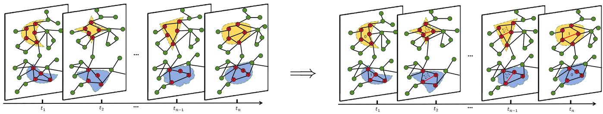  
(a) Original Temporal Graph  
(b) Edge-Gradient Augmentation  
Fig. 1: Illustration of Edge-Gradient Augmentation. (a) Original temporal graph snapshots with binary edges at times $t _ { 1 } , \ldots , t _ { n } .$ (b) Constructed edge-weight profiles between observed transition endpoints. These are modelling signals, not measurements of latent relationship strength; both endpoints must be available before a prediction uses the profile.

• We combine a bounded, discrete policy-based selector with critic feedback and a GraphMixer backbone, separating candidate construction, candidate retention, and temporal encoding so that their individual roles can be examined.

• We study temporal link prediction on eight public datasets with baseline comparisons and component ablations, interpreting the evidence in relation to observation semantics and evaluation protocols. The anonymous code reference is provided to support inspection and reproducibility.

## II. RELATED WORK

## A. Temporal Link Prediction on Dynamic Graphs

CTDNE uses time-respecting walks [14], EvolveGCN recurrently updates GCN parameters [3], and DyRep couples node state evolution with interaction processes [15]. TGN maintains event-driven memory [8], whereas TGAT uses functional time encodings [7]. Recent directions include communityguided walks [16], topology-aware transformers [17], and joint Euclidean–hyperbolic representations [18]. DyGPrompt uses node–time conditional prompts [19]; TAG combines timeaware edge dropping, recent-neighbor sampling, and contrastive learning [20]. TMetaNet guides adaptation across snapshots using dynamic topological features [21]. EG-RL instead constructs and selects explicit edge-transition augmentation.

## B. Edge-Intensity and Gradient Modelling

Time-decayed line graphs weight interactions by temporal proximity [22]. TANGO models continuous-time knowledgegraph embeddings and explicitly encodes edge formation and dissolution [11]; GN-CDE jointly models node and structural dynamics using neural controlled differential equations [23]. TAMI addresses heterogeneous intervals and intermittent interactions through logarithmic time encoding and link-history aggregation [24]. Thus, prior work does model continuous dynamics and edge changes. EG-RL differs by constructing parameter-free linear weights from defined binary-presence transitions, then learning which augmented observations to retain. These weights are modelling signals, not measured latent interaction intensities.

Dynamic augmentation must preserve temporal consistency. DyAug separates rationale and environment representations and augments the latent environment [25]. Conda generates historical-neighbor embeddings using latent conditional diffusion [26]. EG-RL instead interpolates explicit edge weights and retains candidates with a policy. These approaches motivate separate tests of candidate construction, selection, and temporal validity.

## C. Reinforcement Learning and Lightweight Mixers

Reinforcement learning supports graph explanation [27], and continual learning supports streaming graph updates [28]. EG-RL uses policy–critic feedback for augmentation selection. GraphMixer demonstrates effective MLP-based temporal prediction [13]; graph transformers and token mixers provide other encoder designs [29]–[31]. L-STEP combines learnable spatial– temporal positional encoding with an MLP [32], while CRAFT performs target-aware matching [33]. Frequency-domain alternatives include FreeDyG’s interaction-pattern modelling [34] and BandRank’s band-pass disentanglement for candidate ranking [35]. GraphSSM extends state-space modelling to temporal graphs [36], alongside scalable temporal relative positional encodings [37]. EG-RL focuses on augmentation and retention within a lightweight backbone.

## D. Evaluation Protocols and Observation Regimes

TGB-Seq highlights repeated-edge bias and introduces more demanding sequential dynamics [38]; TGB 2.0 extends evaluation to large multi-relational temporal graphs [39]. UTG [40] and TGM [41] bridge event-based and snapshot-based modelling, emphasizing explicit temporal granularity and reproducible pipelines. Our eight-dataset evaluation, however, does not establish performance on these newer benchmark suites or against all recent architectures.

Summary. EG-RL combines explicit transition-based augmentation, reinforcement-guided selection, and a lightweight mixer; its evaluation must distinguish observation semantics from predictive gains.

## III. PROBLEM DEFINITION AND METHODOLOGY

## A. Dynamic-Graph Notation and Task

We model a temporal graph as an ordered sequence $\mathcal { G } _ { 1 : T } =$ $\{ G _ { t } = ( V , E _ { t } ) \} _ { t = 1 } ^ { T }$ , where V is a fixed node set $( | V | = N )$

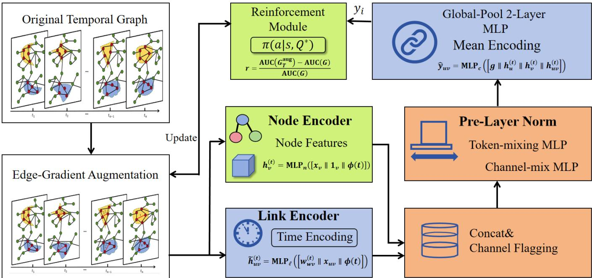  
Fig. 2: Overview of the EG-RL architecture. The original temporal graph (top-left) is first converted into an edge-gradient– augmented sequence (bottom-left) that exposes the pace of interaction changes. Every snapshot is fed to a node encoder (static features + identity) and a link encoder (time encoding + 1-layer MLP with mean pooling). The resulting tokens are concatenated and channel-flagged $( \alpha _ { j } )$ , then processed by a stack of Graph-Mixer blocks that alternate token-mix and channel-mix MLPs under pre-layer normalisation. A global mean pool followed by a two-layer MLP produces the link-existence logit y . A reinforcement module observes graph embeddings and adaptively retains or discards augmented snapshots; its reward signal is fed back (Update) to refine the augmentation loop.

and $E _ { t } \subseteq V \times V$ is the edge set observed at time t. A binary indicator $e _ { u v } ^ { ( t ) } \in \{ 0 , 1 \}$ denotes whether edge $( u , v )$ exists at time t. Given the observed history $\mathcal { G } _ { 1 : T }$ , the temporal link prediction task is to estimate the conditional probability that edge $( u , v )$ exists at a future time step $T + \Delta$

$$
p _ { u v } ^ { ( T + \Delta ) } = \mathrm { P r } \big ( e _ { u v } ^ { ( T + \Delta ) } = 1 \mid \mathcal { G } _ { 1 : T } \big )\tag{1}
$$

where $p _ { u v } ^ { ( T + \Delta ) } \in [ 0 , 1 ]$ denotes the predicted probability of future edge existence. In our experiments, we set $\Delta = 1$ in Eq. (1). Evaluation follows prior work using Area Under the ROC Curve (AUC) and Average Precision (AP) on a held-out set balanced by time-matched negatives.

a) Observation semantics.: For timestamped event sources, each distinct original timestamp $\tau _ { i }$ defines one slice $G _ { i }$ . The index i orders observations; it is not a physical time unit, and $\Delta = 1$ denotes the next supplied slice. Multiple records for the same directed pair within a slice contribute one binary presence. In this representation, absence means no recorded connection within the observed scope, not evidence that a latent relationship has permanently ended. Interpolation is a representation of observed transitions, rather than a measurement of unobserved physical edge dynamics. For prospective use, both transition endpoints and their associated features must already be available before the prediction cutoff; an unobserved endpoint cannot be used to reconstruct the past input of that prediction.

## B. Edge-Gradient Interpolation

Binary snapshots solely record presence or absence, masking how fast interactions strengthen or fade. We explicitly construct edge-intensity curves.

Definition 1 (Edge-gradient). Let $( t _ { s } , t _ { e } )$ be the first and last timestamps of an edge transition $0 \to 1 \ ( 1 \to 0$ is analogous). For every $t _ { s } < t < t _ { e }$ we assign

$$
w _ { u v } ^ { ( t ) } = \left\{ \displaystyle \frac { t - t _ { s } } { t _ { e } - t _ { s } } , ~ \ f o r ~ a ~ 0 \to 1 ~ t r a n s i t i o n , \right. ~ \ t _ { s } < t < t _ { e } ,\tag{2}
$$

yielding a linear ramp from 0 to 1 (or 1 to 0).

The weights form a tensor $W \in \mathbb { R } ^ { N \times N \times T }$ that captures change intensity according to Eq. (2). The corresponding procedure is summarized in Algorithm 1.

The interpolation procedure is $O ( | E | T )$ and parallelisable across edges.

## C. EG-RL Architecture

EG-RL follows the encoder–mixer–classifier paradigm of GraphMixer [13] while extending it along two dimensions: (i) explicit edge-gradient signals III-B; (ii) a reinforcement loop III-D that adaptively selects the most informative edgegradient snapshots. Fig. 2 gives the full pipeline; we detail each component below.

Algorithm 1: Edge-Gradient Interpolation   
Input: snapshots $\{ E _ { t } \} _ { 1 : T }$   
Output: tensor W with intensities   
1 initialise $W _ { u v t }  \mathbf { 1 } [ e _ { u v } ^ { ( t ) } = 1 ]$   
2 foreach edge (u, v) do   
3 identify all birth–death intervals $( t _ { s } , t _ { e } )$   
4 for $t \gets t _ { s } + 1$ to $t _ { e } - 1$ do   
5 if $e _ { u v } ^ { ( t _ { s } ) } = 0$ then   
6 $W _ { u v t }  ( t - t _ { s } ) / ( t _ { e } - t _ { s } )$   
7 else   
8 $W _ { u v t }  1 - ( t - t _ { s } ) / ( t _ { e } - t _ { s } )$

a) Fixed time encoding.: Instead of learning a positional encoder, we adopt the cosine lattice used in GraphMixer. For any timestamp $t \in \mathbb { R } _ { \geq 0 }$ and encoding dimension $d ,$ we define the fixed time encoding as

$$
\phi ( t ) = \left[ \cos ( t \omega _ { i } ) \right] _ { i = 1 } ^ { d } , \qquad \omega _ { i } = \alpha ^ { - \frac { i - 1 } { \beta } } ,\tag{3}
$$

where $\phi ( t ) \in \mathbb { R } ^ { d }$ and $\omega _ { i }$ denotes the i-th frequency. Following GraphMixer, we use the fixed setting $\alpha = \beta = { \sqrt { d } }$ and set $d \ : = \ : 1 0 0$ throughout. Here, α and β control how the frequencies decay across dimensions, while d determines the size of the time encoding. This parameterization yields a smoothly decaying bank of multi-scale frequencies: lowerindex channels vary faster and capture fine-grained temporal differences, whereas higher-index channels vary more slowly and capture coarse temporal patterns. Setting $d = 1 0 0$ keeps the encoding sufficiently expressive while maintaining modest computational overhead. This fixed encoding has two desirable properties: (i) nearby timestamps yield highly correlated $\phi ( t )$ supporting interpolation; (ii) as i grows, $\omega _ { i }  0 .$ , so higherindex channels vary more smoothly and remain distinguishable even for large t.

b) Node & link encoders.: For each node v, we construct three components: a raw node feature $x _ { v } \in \mathbb { R } ^ { d _ { x } }$ , a one-hot identity embedding $\mathbf { 1 } _ { v } \in \{ 0 , 1 \} ^ { | V | }$ , and the fixed time encoding $\phi ( t ) \in \mathbb { R } ^ { d }$ . When no raw node attributes are available, we use the zero vector for $x _ { v }$ . Since all three components are vectors, they can be concatenated into a single input in $\mathbb { R } ^ { d _ { x } + | V | + d }$ and passed to a two-layer MLP:

$$
h _ { v } ^ { ( t ) } = \mathrm { M L P } _ { n } \big ( [ x _ { v } \parallel \mathbf { 1 } _ { v } \parallel \phi ( t ) ] \big ) ,\tag{4}
$$

where the identity embedding provides a lightweight way to distinguish nodes even when raw attributes are weak or unavailable.

For every edge $( u , v )$ , we analogously combine its interpolated gradient weight $w _ { u v } ^ { ( t ) } \in \mathbb { R }$ , optional raw edge feature $x _ { u v } \in \mathbb { R } ^ { d _ { e } }$ , and the same time encoding $\phi ( t ) \in \mathbb { R } ^ { d }$ . If edge attributes are unavailable, we use the zero vector for $x _ { u v }$ . Their concatenation therefore lies in $\mathbb { R } ^ { 1 + d _ { e } + d }$ and is mapped by a one-layer MLP:

$$
\begin{array} { r } { \tilde { h } _ { u v } ^ { ( t ) } = \mathrm { M L P } _ { \ell } \big ( [ w _ { u v } ^ { ( t ) } \parallel x _ { u v } \parallel \phi ( t ) ] \big ) . } \end{array}\tag{5}
$$

Because nodes participate in variable-length interaction sequences, we zero-pad to a fixed window $\bar { K }$ (recent first) and average over k spatial hops:

$$
h _ { u v } ^ { ( t ) } = \mathrm { M e a n P o o l } _ { \leq k \mathrm { h o p s } } \big ( \underbrace { \big [ \tilde { h } _ { u v } ^ { ( t ) } , \dots \big ] } _ { \mathrm { l e n g t h } = K } \big ) ,\tag{6}
$$

where padding length also encodes activity frequency: sparsely interacting nodes receive more zeros, a signal absent from attention-based models.

c) Token/channel mixer.: Stacking L GraphMixer blocks, we alternately mix along the token (axis over nodes/edges) and channel (feature) dimensions. For block ℓ with input matrix $Z \in \mathbb { R } ^ { N \times C }$

$$
Z ^ { \prime } = Z + \mathrm { M L P } _ { \mathrm { t o k e n } } \mathrm { ( L N } ( Z ) \mathrm { ) } ,\tag{7}
$$

$$
Z _ { \ell + 1 } = Z ^ { \prime } + \mathrm { M L P } _ { \mathrm { c h a n } } \mathrm { ( L N } ( Z ^ { \prime } ) \mathrm { ) } ,\tag{8}
$$

where LN is pre-layer normalization and both MLPs use depthwise linear projections and GELU activations. The residual structure (7)–(8) preserves gradient flow and requires no selfattention, yielding $O ( N { + } C )$ parameter cost per block.

d) Graph embedding and classifier.: After L blocks, we mean-pool the token matrix to obtain a compact graph-level summary $g = \mathrm { M e a n } ( Z _ { L } )$ . For a candidate link $( u , v )$ at time $t ,$ we use the endpoint node representations $h _ { u } ^ { ( t ) }$ and ${ \dot { h } } _ { v } ^ { ( t ) }$ from Eq. (4), together with the pair-specific edge representation $h _ { u v } ^ { ( t ) }$ from Eq. (6). A two-layer MLP with hidden size $\frac { 1 } { 2 }$ dim(g) then outputs the link-existence logit:

$$
\begin{array} { r } { \hat { y } _ { u v } = \mathrm { M L P } _ { c } \big ( \left[ g \parallel h _ { u } ^ { ( t ) } \parallel h _ { v } ^ { ( t ) } \parallel h _ { u v } ^ { ( t ) } \right] \big ) . } \end{array}\tag{9}
$$

e) Interface to RL selector.: During each RL epoch the selector proposes a set of candidate edge-gradient snapshots. Accepted edges simply enter (6); rejected ones are masked out by setting $\bar { w _ { u v } ^ { ( t ) } } = 0$ before the mixer. Because time encoding (3) and padding are differentiable, gradients propagate through the selector’s decisions, enabling policy updates via the critic reward.

f) Complexity.: Let $| E |$ be the number of edges in the selected snapshot, C the feature width, and $L$ the mixer depth. Node/edge encoders cost $\mathcal { O } ( | E | )$ , each mixer block $\mathcal { O } ( | E | C )$ , and RL sampling O(kT). The overall $\mathcal { O } ( | E | L C + k T )$ is linear in both edges and snapshots.

## D. Reinforcement-Guided Edge-Gradient Selection

a) Markov decision process (MDP).: Snapshot selection is framed as a Markov decision process, $\mathcal { M } = ( \mathcal { S } , \mathcal { A } , \mathcal { T } , \mathcal { R } )$ . At step t the agent evaluates one candidate gradient $e _ { t } \in E _ { C } ;$ state $s _ { t } = ( G _ { t } ^ { \mathrm { a u g } } , e _ { t } )$ , action $a _ { t } \in \{ 0 , 1 \}$ and $\bar { G } _ { t + 1 } ^ { \mathrm { a u g } } = G _ { t } ^ { \mathrm { a u g } } \cup \{ e _ { t } \}$ if $a _ { t } = 1$

b) Policy πθ & Critic $Q _ { \psi } .$ : Both share graph embedding of $G _ { t } ^ { \mathrm { a u g } }$ concatenated with an edge embedding of $\mathbf { } _ { e _ { t } ; }$ each is a two-layer MLP.

c) Reward.: After an episode we fine-tune the classifier for one epoch with encoder frozen and compute validation AUC. Reward is the relative gain $r ~ = ~ \mathrm { \Gamma } \big ( \mathrm { A U C } ( G _ { T } ^ { \mathrm { a u g } } ) ~ -$ $\operatorname { A U C } ( G ) ) / \operatorname { A U C } ( G )$ , clipped to [−1, 1].

d) Updates.: REINFORCE with baseline:

$$
\nabla _ { \theta } J = \sum _ { t } { \bigl ( } R _ { t } - Q _ { \psi } ( s _ { t } ) { \bigr ) } \nabla _ { \theta } \log \pi _ { \theta } ( a _ { t } \mid s _ { t } ) .\tag{10}
$$

$Q _ { \psi }$ minimises TD(0); both use Adam. Section III-F introduces a distinct terminal-reward extension; it does not replace this relative-reward, TD(0) formulation.

## E. Training Objective and Complexity

The joint loss

$$
\begin{array} { r } { \mathcal { L } = \mathcal { L } _ { \mathrm { B C E } } + \lambda \mathcal { L } _ { \mathrm { R L } } + \beta \| \Theta \| _ { 2 } ^ { 2 } } \end{array}
$$

combines supervised BCE, policy gradient loss and $L _ { 2 }$ regularisation. Forward/ backward cost is $O ( | E | L )$ for the mixer plus O(kT) for RL sampling—linear in edges and snapshots— making EG-RL more scalable than message-passing temporal GNNs.

## F. Terminal-Reward Training Extension

Algorithm 2 gives the extended training loop. It uses the signed, unnormalized validation AUC difference (not its absolute value) and regresses the critic to the episode’s terminal reward, without TD bootstrapping. This differs from the relative-AUC and TD(0) formulation in Section III-D; the two configurations must be identified separately in comparisons. The reward-metric study varies AUC/AP signals, not these critic objectives.

## IV. EXPERIMENTS

We benchmark EG–RL on 8 public dynamic-graph datasets and compare with 12 established baselines spanning recurrent, attention and mixer families. The main prediction results are averaged over three seeds; numbers are reported as mean ± s.d.

## A. Datasets

We evaluate on eight widely-used temporal graph benchmark datasets curated by Yu et al. [42], covering diverse domains including social, interaction, transportation, and proximity networks. Specifically, Wikipedia, Reddit, and MOOC are bipartite interaction graphs with edge features; LastFM models user–song listening events; Enron captures email communications; Social Evolution records mobile proximity with lowdimensional link features; UCI is an online communication network; and Flights tracks airport traffic during COVID-19.

## B. Baselines

We compare twelve baselines: JODIE [4], DyRep [15], and TGN [8] for recurrent/event-state modelling; TGAT [7], CAWN [43], TCL [44], and DyGFormer [42] for temporal attention or walk encoding; NAT [45], PINT [46], GraphMixer [13], and TPNet [47] for neighborhood, expressive, mixer, or walkmatrix representations; and the EdgeBank heuristic [12]. Recent methods discussed in Section II are not additional evaluated baselines.

TPNet [47] uses time-decayed temporal-walk matrices and random-feature propagation. EG-RL instead constructs edge-transition weights and learns which causally available augmentation candidates to retain.

Algorithm 2: Terminal-Reward EG-RL Training Ex   
tension   
Input: dynamic graph $\mathcal { G } _ { 1 : T } ,$ epochs $N _ { \mathrm { e p } } ,$ policy $\pi _ { \theta } ,$   
critic $Q _ { \psi }$   
Output: trained parameters $\Theta , \theta , \psi$   
1 for epoch = 1 to $N _ { e p }$ do   
$/ /$ Stage 0: edge-gradient   
interpolation   
2 W ← EDGEGRADIENTAUGMENTATION $\left( \mathcal { G } _ { 1 : T } \right)$   
$/ /$ Stage I: RL sampling of augmented   
snapshot   
3 $G ^ { \mathrm { a u g } }  G ; B  \emptyset$   
4 foreach candidate edge $e _ { t } \in E _ { C }$ do   
5 $s _ { t } \gets ( G ^ { \mathrm { a u g } } , e _ { t } )$   
6 sample $a _ { t } \sim \pi _ { \theta } ( \cdot \mid s _ { t } )$   
7 if $a _ { t } = 1$ then $/ /$ keep edge   
8 insert $e _ { t }$ with weight $w _ { e _ { t } }$ into $G ^ { \mathrm { a u g } }$   
9 store $\left( { { s _ { t } } , { a _ { t } } } \right)$ in buffer B   
$/ /$ Stage II: supervised update   
(encoder $\Rightarrow$ mixer)   
10 compute logits yˆ on $G ^ { \mathrm { a u g } }$ via Eq. (4)–(8)   
11 $\mathcal { L } _ { \mathrm { B C E } }  \mathrm { B C E } ( \hat { y } , y )$   
12 update encoder & mixer params Θ with Adam on   
$\mathcal { L } _ { \mathrm { B C E } }$   
$/ /$ Stage III: one-step fine-tune &   
reward   
13 freeze Θ; fine-tune classifier 1 epoch on $G ^ { \mathrm { a u g } }$   
14 $r \gets \mathrm { A U C } ( G ^ { \mathrm { a u g } } ) - \mathrm { A U C } ( G )$   
$/ /$ Stage IV: policy & critic update   
(REINFORCE)   
15 foreach $( s _ { t } , a _ { t } ) \in B$ do   
16 $\delta \gets r - Q _ { \psi } ( s _ { t } )$   
17 $\theta \gets \theta + \eta _ { \pi } \delta \nabla _ { \theta } \log \pi _ { \theta } ( a _ { t } \mid s _ { t } )$   
18 $\psi  \psi - \eta _ { Q } \nabla _ { \psi } \big ( Q _ { \psi } ( s _ { t } ) - r \big ) ^ { : 2 }$

These baselines cover a broad spectrum of approaches and represent strong competitors for temporal link prediction.

## C. Experimental Setup and Reproducibility

The main benchmark experiments are implemented in $\mathrm { P y } .$ Torch 2.0 with $\mathrm { P y }$ Torch Geometric 2.3 and torch\_scatter. Encoder and mixer parameters are optimized with Adam (learning rate $1 \times 1 0 ^ { - 3 }$ , dropout 0.1, weight decay $5 \times 1 0 ^ { - 5 } )$ while the policy and critic use separate Adam optimizers with a learning rate of $3 \times 1 0 ^ { - 4 }$ . Temporal edges are time-sorted and processed in mini-batches of 2,000; each positive event is paired with one on-the-fly negative during training and ranked against 100 degree-matched negatives at test time. The RL selector examines at most $0 . 1 \left| E _ { t } \right|$ candidate gradients per snapshot (capped at 512). We report results averaged over three random seeds and release anonymous code and processed datasets at https://anonymous.4open.science/r/EG-RL-671D.

TABLE I: Statistics of the datasets used in experiments. #N&L Feat denotes the dimensions of node and link features.
<table><tr><td>Dataset</td><td>Domain</td><td>#Nodes</td><td>#Links</td><td>#N&amp;L Feat</td><td>Bipartite</td><td>Duration</td><td>Time Granularity</td></tr><tr><td>Wikipedia</td><td>Social</td><td>9,227</td><td>157,474</td><td>- &amp; 172</td><td>True</td><td>1 month</td><td>Unix timestamps</td></tr><tr><td>Reddit</td><td>Social</td><td>10,984</td><td>672,447</td><td>- &amp; 172</td><td>True</td><td>1 month</td><td>Unix timestamps</td></tr><tr><td>MOOC</td><td>Interaction</td><td>7,144</td><td>411,749</td><td>- &amp; 4</td><td>True</td><td>17 months</td><td>Unix timestamps</td></tr><tr><td>LastFM</td><td>Interaction</td><td>1,980</td><td>1,293,103</td><td>- &amp; -</td><td>True</td><td>1 month</td><td>Unix timestamps</td></tr><tr><td>Enron</td><td>Social</td><td>184</td><td>125,235</td><td>- &amp; -</td><td>False</td><td>3 years</td><td>Unix timestamps</td></tr><tr><td>Social Evo.</td><td>Proximity</td><td>74</td><td>2,099,519</td><td>- &amp; 2</td><td>False</td><td>8 months</td><td>Unix timestamps</td></tr><tr><td>UCI</td><td>Social</td><td>1,899</td><td>59,835</td><td>- &amp; -</td><td>False</td><td>196 days</td><td>Unix timestamps</td></tr><tr><td>Flights</td><td>Transport</td><td>13,169</td><td>1,927,145</td><td>- &amp; 1</td><td>False</td><td>4 months</td><td>days</td></tr></table>

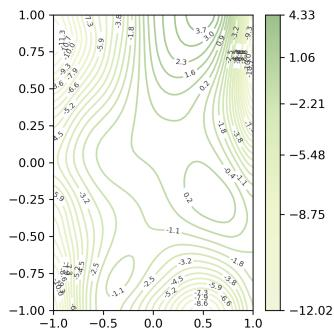  
(a) DyGFormer (2D)

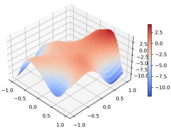  
(b) DyGFormer (3D)

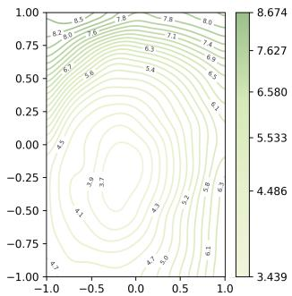  
(c) EG-RL (2D)

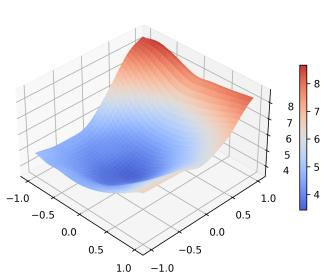

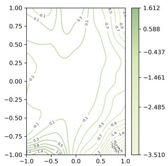  
(e) TPNet (2D)

(d) EG-RL (3D)  
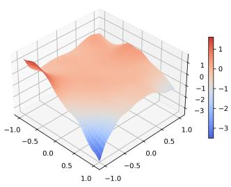  
(f) TPNet (3D)  
Fig. 3: Comparison of loss landscapes on Wikipedia. Rows show DyGFormer, EG-RL, and TPNet, respectively. Left: 2D contour plots; right: 3D surfaces.

a) Compute resources.: The reported training workstation has an Intel i7-13700K CPU, 32 GB RAM, and one RTX 5090 GPU (32 GB). A Reddit epoch takes approximately 12 seconds with 5.3 GB peak GPU memory. Preliminary tuning and ablations require additional compute.

## D. Main Empirical Results

Table II reports the AP and AUC results of EG-RL and twelve strong baselines on eight temporal-graph benchmarks. Overall, EG-RL achieves the best average rank in both metrics and outperforms competing methods on most datasets.

In particular, EG-RL shows especially strong performance on Wikipedia and Reddit, where it achieves the best AP and AUC among all compared methods. It also delivers clear improvements on sparse datasets such as MOOC and UCI, suggesting that edge-gradient augmentation is particularly beneficial when temporal interactions are limited. Even on denser datasets such as Flights, EG-RL remains highly competitive and consistently ranks among the top-performing methods.

The final row of Table II further confirms this trend: EG-RL attains an average rank of 1.75 in AP and 1.88 in AUC, outperforming all baselines overall. These results demonstrate the effectiveness of combining edge-gradient modeling with reinforcement-guided snapshot selection for temporal link prediction.

## E. Ablation Study

To quantify the contribution of each design choice, we compare EG-RL with three simplified variants:

1) w/o Gradient : remove edge–gradient interpolation and use binary edges.

2) w/o RL Selector : keep all interpolated edges, i.e., disable the actor–critic module.

3) Fixed k : keep RL but set the candidate window radius to a fixed k = 1, removing adaptivity.

Table III reports results on eight representative datasets that differ in scale and domain. All models share identical hyperparameters; we repeat each run with three seeds and report mean ± std.

a) Findings.:

• Edge gradients are critical. Removing gradient interpolation reduces AP on Wikipedia from 99.99% to 97.25% (−2.74 percentage points) and on Flights from 96.63% to 93.25% (−3.38 points), confirming that continuous edge-change signals substantially improve prediction.

• Adaptive selection matters. Disabling the RL selector drops AP on Wikipedia by 1.53 points (99.99% → 98.46%) and on Flights by 21.52 points (96.63% → 75.11%), indicating that many interpolated edges introduce noise without learned filtering.

TABLE II: Temporal link prediction on 8 benchmarks. Best result in bold; runner-up underlined.
<table><tr><td>Metric</td><td></td><td>JODIE</td><td>DyRep</td><td>TGAT</td><td>TGN</td><td>CAWN</td><td>EdgeBank</td><td>TCL</td><td>GraphMixer</td><td>NAT</td><td>PINT</td><td>DyGFormer</td><td>TPNet</td><td>EG-RL</td></tr><tr><td></td><td>Wikipedia</td><td>96.50±0.14</td><td>94.86±0.06</td><td>96.94±0.06</td><td>98.45±0.06</td><td>98.76±0.03</td><td>90.37±0.00</td><td>96.47±0.16</td><td>97.25±0.03</td><td>98.03±0.07</td><td>98.45±0.04</td><td>99.03±0.02</td><td>99.32±0.03</td><td>99.99±0.00</td></tr><tr><td></td><td>Reddit</td><td>98.31±0.14</td><td>98.22±0.04</td><td>98.52±0.02</td><td>98.63±0.06</td><td>99.11±0.01</td><td>94.86±0.00</td><td>97.53±0.02</td><td>97.31±0.01</td><td>99.13±0.10</td><td>99.15±0.02</td><td>99.22±0.01</td><td>99.27±0.00</td><td>99.99±0.00</td></tr><tr><td>(%)</td><td>MOOC</td><td>80.23±2.44</td><td>81.97±0.49</td><td>85.84±0.15</td><td>89.15±1.60</td><td>80.15±0.25</td><td>57.97±0.00</td><td>82.38±0.24</td><td> $8 2 . 7 8 { \pm } 0 . 1 5$ </td><td>85.88±0.55</td><td>88.08±0.86</td><td> $8 7 . 5 2 { \scriptstyle \pm 0 . 4 9 }$ </td><td>96.39±0.09</td><td>99.99±0.00</td></tr><tr><td></td><td>LastFM</td><td>70.85±2.13</td><td>71.92±2.21</td><td>73.42±0.21</td><td>77.07±3.97</td><td>86.99±0.06</td><td>79.29±0.00</td><td>67.27±2.16</td><td> $7 5 . 6 1 \pm 0 . 2 4$ </td><td>88.02±1.94</td><td>89.66±1.81</td><td>93.00±0.12</td><td>94.50±0.08</td><td>96.69±0.01</td></tr><tr><td>AV</td><td>Enron</td><td>84.77±0.30</td><td>82.38±3.36</td><td>71.12±0.97</td><td>86.53±1.11</td><td>89.56±0.09</td><td>83.53±0.00</td><td>79.70±0.71</td><td>82.25±0.16</td><td>90.60±0.66</td><td>92.20±0.15</td><td> $9 2 . 4 7 { \pm } 0 . 1 2 $ </td><td>92.90±0.17</td><td>92.41±0.05</td></tr><tr><td></td><td>Social Evo.</td><td>89.89±0.55</td><td>88.87±0.30</td><td>93.16±0.17</td><td>93.57±0.17</td><td>84.96±0.09</td><td>74.95±0.00</td><td>93.13±0.16</td><td> $9 3 . 3 7 { \scriptstyle \pm 0 . 0 7 }$ </td><td>88.92±3.45</td><td>94.42±0.03</td><td>94.73±0.01</td><td>94.73±0.02</td><td>94.54±0.04</td></tr><tr><td></td><td>UCI</td><td>89.43±1.09</td><td>65.14±2.30</td><td>79.63±0.70</td><td>92.34±1.04</td><td>95.18±0.06</td><td>76.20±0.00</td><td>89.57±1.63</td><td> $9 3 . 2 5 { \scriptstyle \pm 0 . 5 7 }$ </td><td> $9 3 . 4 0 { \scriptstyle \pm 0 . 2 6 }$ </td><td> $9 6 . 4 5 { \scriptstyle \pm 0 . 1 1 }$ </td><td> $9 5 . 7 9 2 0 . 1 7 $ </td><td>97.35±0.04</td><td>96.63±0.04</td></tr><tr><td></td><td>Flights</td><td>95.60±1.73</td><td>95.29±0.72</td><td>94.03±0.18</td><td>97.95±0.14</td><td>98.51±0.01</td><td>89.35±0.00</td><td>91.23±0.02</td><td>90.99±0.05</td><td>98.57±0.12</td><td>98.80±0.02</td><td>98.91±0.01</td><td>97.73±0.02</td><td>98.86±0.03</td></tr><tr><td></td><td>Avg. Rank</td><td>9.63</td><td>10.75</td><td>9.38</td><td>6.13</td><td>7.00</td><td>13.00</td><td>10.50</td><td>9.13</td><td>6.00</td><td>3.88</td><td>2.75</td><td>2.25</td><td>1.75</td></tr><tr><td></td><td>Wikipedia</td><td>96.33±0.07</td><td>94.37±0.09</td><td>96.67±0.07</td><td>98.37±0.07</td><td>98.54±0.04</td><td>90.78±0.00</td><td>95.84±0.18</td><td>96.92±0.03</td><td>97.75±0.11</td><td>98.16±0.06</td><td>98.91±0.02</td><td>99.30±0.02</td><td>99.99±0.00</td></tr><tr><td></td><td>Reddit</td><td>98.31±0.05</td><td>98.17±0.05</td><td>98.47±0.02</td><td>98.60±0.06</td><td>99.01±0.01</td><td>95.37±0.00</td><td>97.42±0.02</td><td>97.17±0.02</td><td>99.09±0.10</td><td>99.09±0.03</td><td>99.15±0.01</td><td>99.22±0.00</td><td>99.99±0.00</td></tr><tr><td></td><td>MOOC</td><td>83.81±2.09</td><td>85.03±0.58</td><td>87.11±0.19</td><td>91.21±1.15</td><td>80.38±0.26</td><td>60.86±0.00</td><td>83.12±0.18</td><td>84.01±0.17</td><td>87.42±0.58</td><td>90.55±0.43</td><td>87.91±0.58</td><td>97.17±0.08</td><td>99.99±0.00</td></tr><tr><td>(%)</td><td>LastFM</td><td>70.49±1.66</td><td>71.16±1.89</td><td>71.59±0.18</td><td>78.47±2.94</td><td>85.92±0.10</td><td>83.77±0.00</td><td>64.06±1.16</td><td>73.53±0.12</td><td>86.92±2.72</td><td>89.28±1.63</td><td>93.05±0.10</td><td>94.39±0.04</td><td>97.71±0.02</td></tr><tr><td> AC</td><td>Enron</td><td>87.96±0.52</td><td>84.89±3.00</td><td>68.89±1.10</td><td>88.32±0.99</td><td>90.45±0.14</td><td>87.05±0.00</td><td>75.74±0.72</td><td>84.38±0.21</td><td>91.68±0.83</td><td>92.87±0.34</td><td>93.33±0.13</td><td>93.98±0.26</td><td>93.05±0.05</td></tr><tr><td></td><td>Social Evo.</td><td>92.05±0.46</td><td>90.76±0.21</td><td>94.76±0.16</td><td>95.39±0.17</td><td>87.34±0.08</td><td>81.60±0.00</td><td>94.84±0.17</td><td>95.23±0.07</td><td>90.84±3.72</td><td>96.16±0.02</td><td>96.30±0.01</td><td>96.43±0.02</td><td>95.10±0.01</td></tr><tr><td>UCI</td><td></td><td>90.44±0.49</td><td>68.77±2.34</td><td>78.53±0.74</td><td>92.03±1.13</td><td>93.87±0.08</td><td>77.30±0.00</td><td>87.82±1.36</td><td>91.81±0.67</td><td>92.31±0.37</td><td>95.57±0.16</td><td>94.49±0.26</td><td>96.79±0.05</td><td>96.81±0.03</td></tr><tr><td></td><td>Flights</td><td>96.21±1.42</td><td>95.95±0.62</td><td>94.13±0.17</td><td>98.22±0.13</td><td>98.45±0.01</td><td>90.23±0.00</td><td>91.21±0.02</td><td>91.13±0.01</td><td>98.69±0.10</td><td>98.89±0.02</td><td>98.93±0.01</td><td>97.75±0.02</td><td>98.95±0.05</td></tr><tr><td></td><td>Avg. Rank</td><td>9.38</td><td>10.50</td><td>9.50</td><td>5.88</td><td>7.00</td><td>13.00</td><td>10.75</td><td>9.25</td><td>5.88</td><td>3.88</td><td>3.00</td><td>2.38</td><td>1.88</td></tr></table>

TABLE III: Ablation results on eight representative datasets (AP/AUC, %).
<table><tr><td>Variant</td><td>Wikipedia AP/ÀUC</td><td>Reddit AP/AUC</td><td>MOOC AP/AUC</td><td>LastFM AP/AUC</td><td>Enron AP/AUC</td><td>Social Evo. AP/AUC</td><td>Flights AP/AUC</td><td>UCI AP/AUC</td></tr><tr><td>Full EG-RL w/o RL Selector</td><td>99.99 / 99.99 98.46 / 98.59</td><td>99.99 / 99.99 98.91 / 99.05</td><td>99.99 / 99.99 88.17 / 91.21</td><td>96.69 / 97.71 93.12 / 93.87</td><td>92.41 / 93.05 93.42 / 91.08</td><td>94.54 / 95.10</td><td>96.63 / 96.81</td><td>98.86 / 98.95</td></tr><tr><td>w/o Gradient</td><td>97.25 / 96.92</td><td>97.31 / 97.17</td><td>82.78 / 84.01</td><td>75.61 / 73.53</td><td>82.25 / 84.38</td><td>93.95 / 94.81 93.37 / 95.23</td><td>75.11 / 96.08 93.25 / 91.81</td><td>95.82 / 90.11 90.99 / 91.13</td></tr><tr><td></td><td>98.22 / 98.15</td><td></td><td></td><td></td><td></td><td></td><td></td><td></td></tr><tr><td>Fixed k</td><td></td><td>98.44 / 98.71</td><td>85.09 / 89.77</td><td>92.64 / 93.20</td><td>92.14 / 90.31</td><td>93.12 / 94.02</td><td>73.26 / 95.03</td><td>94.17  / 88.60</td></tr></table>

• Window adaptivity helps. Fixing the candidate window to k = 1 reduces AP on Wikipedia by 1.77 points and on Flights by 23.37 points, showing that a dynamic selection radius is necessary to handle varying temporal densities. These findings verify that both components—explicit edgegradient encoding and adaptive RL-based selection—are indispensable to EG-RL’s state-of-the-art performance.

## F. Loss Landscape Analysis

Figure 3 compares two-parameter-direction loss slices around converged Wikipedia solutions. EG-RL appears smoother than DyGFormer and TPNet within the displayed region; this is a qualitative local observation, not proof of global convexity, better generalization, or causation of prediction gains. Figures 4 and 5 provide 2D and 3D views on six additional datasets, respectively.

On Wikipedia, the nested contours of EG-RL form an elongated basin with a comparatively regular progression from its interior toward the boundary. The corresponding 3D view makes this gradual change in height visible along both plotted directions. In contrast, DyGFormer’s contours show several pronounced bends, and its surface contains alternating ridges and valleys. TPNet exhibits a broad central region together with sharper variation near parts of the boundary.

The additional datasets reveal different local geometries. Social Evolution has approximately elliptical contours and a broad basin, whereas LastFM and Reddit show stronger directional slopes. MOOC and UCI contain more localized undulations, and Enron combines a sloping region with changes in curvature. Thus, the cross-dataset plots do not simply reproduce the Wikipedia pattern: they show how the fitted objective varies with the underlying interaction data.

Each panel has its own color scale, so the visual comparison emphasizes local shape rather than absolute loss values across models or datasets.

## G. Reward Metric Study for the RL Selector

a) Motivation.: In EG-RL, the snapshot selector is optimized by a scalar reward computed after each RL episode. The original implementation uses the validation AUC gain as the reward signal. However, temporal link prediction is commonly reported with both AUC and Average Precision (AP). To examine the sensitivity of the selector to the choice of reward metric, we additionally evaluate (i) AP-based reward and (ii) a joint AUC&&AP reward.

b) Reward variants.: We keep the RL training pipeline unchanged: after an episode, we freeze the encoder, fine-tune the classifier for one epoch on the augmented graph, and compute the reward on the validation split. The only difference is how the scalar reward is computed. Let G denote the original training graph and $G ^ { a u g }$ denote the augmented graph produced by the selector. We define:

$$
r _ { \mathrm { A U C } } = \exp \left( { \frac { \mathrm { A U C } ( G ^ { a u g } ) - \mathrm { A U C } ( G ) } { \mathrm { A U C } ( G ) } } , [ - 1 , 1 ] \right) ,\tag{11}
$$

$$
r _ { \mathrm { A P } } = \mathrm { c l i p } \left( \frac { \mathrm { A P } ( G ^ { a u g } ) - \mathrm { A P } ( G ) } { \mathrm { A P } ( G ) } , [ - 1 , 1 ] \right) ,\tag{12}
$$

$$
\begin{array} { r } { r _ { \mathrm { A U C } \& \& \mathrm { A P } } = \mathrm { c l i p } \left( \frac { 1 } { 2 } r _ { \mathrm { A U C } } + \frac { 1 } { 2 } r _ { \mathrm { A P } } , [ - 1 , 1 ] \right) , } \end{array}\tag{13}
$$

where clip(·, [−1, 1]) truncates values to the interval [−1, 1].

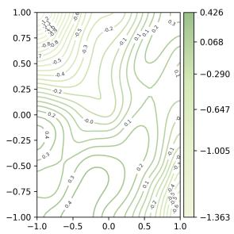  
(a) ENRON

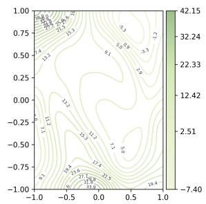  
(b) LASTFM

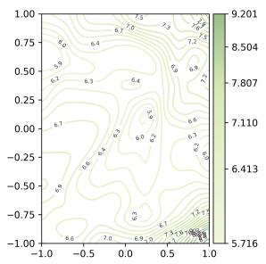  
(c) MOOC

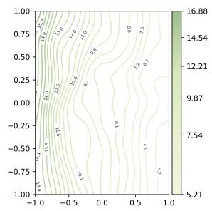

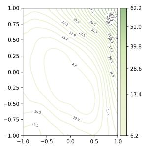  
(e) SOCIALEVO

(d) REDDIT  
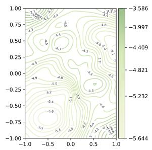  
(f) UCI  
Fig. 4: 2D loss contours of EG-RL on six datasets. Panels (a)–(f): ENRON, LASTFM, MOOC, REDDIT, SOCIALEVO, and UCI. Color bars indicate loss magnitude.

c) Results.: Table IV reports the per-dataset scores. Overall, validation AUC remains the most reliable reward across datasets. The AP-based reward improves Social Evolution, but generally hurts Enron, UCI, and Flights. The joint AUC&&AP reward acts as a compromise, yet it does not consistently surpass the default AUC reward. These results indicate that validation AUC provides the most stable signal for snapshot selection in EG-RL.

TABLE IV: Effect of different reward metrics for the RL selector (Test AP / AUC, %).
<table><tr><td rowspan="2">Reward</td><td colspan="2">Wikipedia AP</td><td colspan="2">Reddit</td><td colspan="2">MOOC</td><td colspan="2">LastFM</td></tr><tr><td></td><td>AUC</td><td>AP</td><td>AUC</td><td>AP</td><td>AUC</td><td>AP</td><td>AUC</td></tr><tr><td>AUC (default)</td><td>99.99</td><td>99.99</td><td>99.99</td><td>99.99</td><td>99.99</td><td>99.99</td><td>96.69</td><td>97.71</td></tr><tr><td>AP</td><td>99.85</td><td>99.87</td><td>99.93</td><td>99.94</td><td>99.91</td><td>99.93</td><td>96.23</td><td>97.36</td></tr><tr><td>AUC&amp;&amp;AP (joint)</td><td>99.84</td><td>99.86</td><td>99.92</td><td>99.94</td><td>99.90</td><td>99.93</td><td>96.13</td><td>97.27</td></tr></table>

<table><tr><td rowspan="2">Reward</td><td colspan="2">Enron</td><td colspan="2">Social Evo.</td><td colspan="2">UCI</td><td colspan="2">Flights</td></tr><tr><td>AP</td><td>AUC</td><td>AP</td><td>AUC</td><td>AP</td><td>AUC</td><td>AP</td><td>AUC</td></tr><tr><td>AUC (default)</td><td>92.41</td><td>93.05</td><td>94.54</td><td>95.10</td><td>96.63</td><td>96.81</td><td>98.86</td><td>98.95</td></tr><tr><td>AP</td><td>90.98</td><td>90.15</td><td>96.98</td><td>97.30</td><td>94.88</td><td>96.15</td><td>96.72</td><td>97.55</td></tr><tr><td>AUC&amp;&amp;AP (joint)</td><td>90.54</td><td>90.11</td><td>96.98</td><td>97.30</td><td>94.46</td><td>96.11</td><td>96.66</td><td>97.47</td></tr></table>

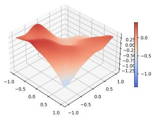  
(a) ENRON

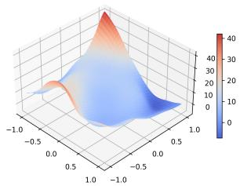  
(b) LASTFM

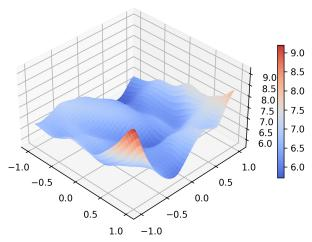

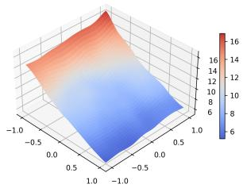

(c) MOOC  
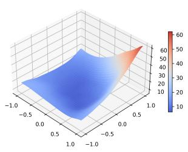

(d) REDDIT  
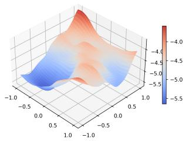  
(e) SOCIALEVO  
(f) UCI  
Fig. 5: 3D loss surfaces of EG-RL on the same six datasets, ordered as in Fig. 4. Color bars indicate loss magnitude.

## H. Transductive Results under Alternative Negative Sampling

a) Motivation.: Beyond the random negative sampling protocol used in the main results, we further evaluate EG-RL under two more challenging transductive settings: historical negatives sampled from previously active nodes, and inductive negatives sampled from nodes that are inactive at the prediction time. These protocols change the candidate distribution and therefore test whether the advantage observed with random negatives persists under alternative evaluation conditions. We examine both the average rank across datasets and the margin over the strongest baseline within each dataset. All margins below are expressed in percentage points.

b) Historical negative sampling.: Table V shows that EG-RL ranks first on all eight datasets in both AP and AUC, yielding an average rank of 1.00 for each metric. The strongest competing average ranks are 3.62 in AP and 3.25 in AUC, both achieved by PINT. The advantage is particularly large on Flights: EG-RL reaches 97.99% AP and 98.17% AUC, exceeding the strongest baselines by 25.61 and 23.53 points, respectively. On Reddit, its AP of 99.94% and AUC of 99.95% improve over PINT by 16.01 and 16.97 points. LastFM also shows substantial gains of 9.24 points in AP and 13.24 points in AUC over TPNet. The gains are not uniform across datasets. On UCI, for example, the AP margin over PINT is 0.51 points, while the AUC margin is 4.08 points. Reporting both metrics thus reveals differences that a single aggregate score would obscure.

c) Inductive negative sampling.: Table VI gives EG-RL the best average ranks of 1.38 in AP and 1.25 in AUC. It achieves the highest AP and AUC on seven of the eight datasets. On MOOC, EG-RL obtains 99.90% AP and 99.93% AUC, exceeding TPNet by 11.72 and 10.86 points. On LastFM, its AP advantage over TPNet is 18.23 points, while its AUC advantage over EdgeBank is 19.98 points. Flights shows improvements of 16.15 and 16.53 points over EdgeBank. Social Evolution provides a contrasting case: EG-RL reaches 96.96% AP and 97.31% AUC, compared with the best scores of 97.68% and 97.59%. The respective gaps are 0.72 and 0.28 points. The strongest competing average ranks are 4.50 in AP for DyGFormer and 5.38 in AUC for TPNet, indicating a substantial separation in overall ranking across the eight datasets.

d) Summary.: Across the three reported protocols, EG-RL maintains the best average rank in both AP and AUC: 1.75/1.88 with random negatives, 1.00/1.00 with historical negatives, and 1.38/1.25 with inductive negatives. The strongest baseline also changes across datasets and protocols; for example, the Flights historical results favor TGAT in AP and EdgeBank in AUC, whereas EdgeBank leads the competing methods in both metrics under inductive sampling. EG-RL’s advantage therefore extends across different competitive reference points. These comparisons complement the ablations: interpolation supplies explicit transition cues, and learned retention selects useful augmented inputs.

## I. Learning Dynamics

We compare EG-RL with its complete edge-gradient augmentation, including the RL-based retention mechanism, against an original-graph control trained without augmentation. Both models start from identical parameter initializations and use the same training examples, frozen negative samples, batch size of 600, and 20 complete epochs. These learning curves assess optimization, whereas the following case study examines the representation of observed edge-state changes. The originalgraph control samples neighborhoods directly from the original binary history, before top-k selection.

Figure 6 reports mean binary cross-entropy (BCE) over all labels of 61,762 fixed validation positives and their paired random negatives. This is a learning-dynamics diagnostic, not a historical-negative test result; no test labels are used. Following the initial loss increase, EG-RL exhibits faster validationloss reduction. At 3,800 encoder updates, validation BCE is 1.920 with augmentation versus 2.469 without it. After five epochs, the augmented model reaches 2.189 in approximately 39 minutes, whereas the original-graph model records a similar value of 2.194 after 20 epochs and approximately 86 minutes. At epoch 20, validation BCE is 1.547 with augmentation versus 2.194 without it.

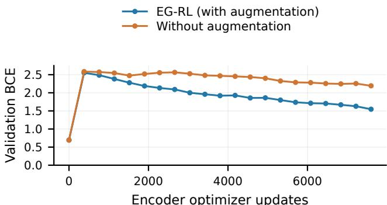  
(a) Validation loss vs. updates

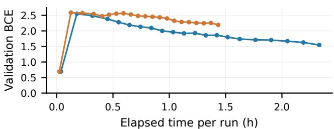  
(b) Validation loss vs. time  
Fig. 6: Validation-loss dynamics on MOOC with and without edge-gradient augmentation. The complete augmentation includes RL-based selection. The same frozen validation set is evaluated before training and after each epoch. (a) BCE against encoder optimizer updates. (b) The same BCE against actual elapsed time for each run.

Overall, RL-guided edge-gradient augmentation yields lower validation BCE at all 20 epoch-end evaluations. The reduction is 22.2% at 3,800 updates and 29.5% after 20 epochs (7,600 updates), demonstrating better validation-loss performance at a fixed update budget. Reaching a comparable BCE of approximately 2.19 in 39 rather than 86 minutes further shows that faster loss reduction can offset the augmentation overhead at this observed loss level.

Figure 7 complements these empirical findings by showing how augmentation encodes the direction and progress of observed edge-state transitions.

## J. Case Study

We examine how edge-gradient augmentation represents observed edge evolution, rather than using the case study as another performance comparison. MOOC records timestamped learner–activity interactions [4]. At each original global timestamp, a pair has state one if an interaction is recorded and zero otherwise. A zero therefore denotes no recorded interaction in that slice, not a verified termination of an underlying relationship.

Figure 7 follows learner 322 and activity 7056. We select the earliest completed appearance–disappearance cycle with a preceding observed interaction and at least two interior observation slices in each transition interval. This source-only rule yields the first of 236 eligible cycles; no prediction score

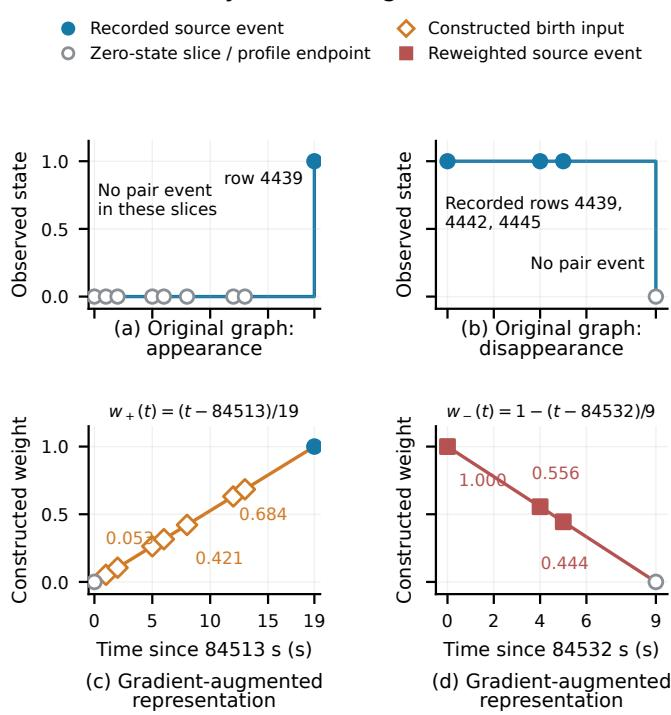

TABLE V: Transductive results for historical negative sampling. Best result in bold; runner-up underlined.
<table><tr><td></td><td>Metric</td><td>JODIE</td><td>DyRep</td><td>TGAT</td><td>TGN</td><td>CAWN</td><td>EdgeBank</td><td>TCL</td><td>GraphMixer</td><td>NAT</td><td>PINT</td><td>DyGFormer</td><td>TPNet</td><td>EG-RL</td></tr><tr><td></td><td>Wikipedia</td><td>83.01±0.66</td><td>79.93±0.56</td><td>87.38±0.22</td><td>86.86±0.33</td><td>71.21±1.67</td><td>73.35±0.00</td><td>89.05±0.39</td><td>90.90±0.10</td><td>68.36±4.47</td><td>91.33±0.76</td><td>82.23±2.54</td><td>81.55±4.10</td><td>99.86±0.02</td></tr><tr><td></td><td>Reddit</td><td>80.03±0.36</td><td>79.83±0.31</td><td>79.55±0.20</td><td>81.22±0.61</td><td>80.82±0.45</td><td>73.59±0.00</td><td>77.14±0.16</td><td>78.44±0.18</td><td>80.58±0.91</td><td> $\underline { { 8 3 . 9 3 } } \pm 1 . 1 1$ </td><td> $8 1 . 5 7 { \scriptstyle \pm 0 . 6 7 }$ </td><td>81.02±1.31</td><td>99.94±0.01</td></tr><tr><td>(%)</td><td>MOOC</td><td>78.94±1.25</td><td> $7 5 . 6 0 { \scriptstyle \pm 1 . 1 2 }$ </td><td>82.19±0.62</td><td>87.06±1.93</td><td>74.05±0.95</td><td>60.71±0.00</td><td>77.06±0.41</td><td> $7 7 . 7 7 { \scriptstyle \pm 0 . 9 2 }$ </td><td> $8 5 . 4 2 \pm 3 . 2 6 $ </td><td> $8 4 . 8 0 { \scriptstyle \pm 1 . 5 7 }$ </td><td> $8 5 . 8 5 { \scriptstyle \pm 0 . 6 6 }$ </td><td>92.69±0.95</td><td>99.92±0.03</td></tr><tr><td rowspan="7">dV</td><td>LastFM</td><td>74.35±3.81</td><td>74.92±2.46</td><td>71.59±0.24</td><td>76.87±4.64</td><td>69.86±0.43</td><td>73.03±0.00</td><td>59.30±2.31</td><td> $7 2 . 4 7 { \scriptstyle \pm 0 . 4 9 }$ </td><td> $7 8 . 7 5 { \scriptstyle \pm 1 . 6 3 }$ </td><td>84.95±0.43</td><td> $8 1 . 5 7 { \pm } 0 . 4 8 $ </td><td>87.74±0.50</td><td>96.98±0.05</td></tr><tr><td>Enron</td><td>69.85±2.70</td><td> $7 1 . 1 9 { \scriptstyle \pm 2 . 7 6 }$ </td><td>64.07±1.05</td><td>73.91±1.76</td><td>64.73±0.36</td><td>76.53±0.00</td><td>70.66±0.39</td><td> $7 7 . 9 8 { \pm } 0 . 9 2 $ </td><td> $7 2 . 9 0 { \scriptstyle \pm 1 . 3 8 }$ </td><td>85.41±0.84</td><td> $7 5 . 6 3 { \pm } 0 . 7 3$ </td><td>80.79±1.68</td><td>90.27±0.12</td></tr><tr><td>Social Evo.</td><td>87.44±6.78</td><td>93.29±0.43</td><td>95.01±0.44</td><td>94.45±0.56</td><td>85.53±0.38</td><td>80.57±0.00</td><td>94.74±0.31</td><td> $9 4 . 9 3 { \pm } 0 . 3 1$ </td><td> $9 1 . 2 9 { \scriptstyle \pm 4 . 8 9 }$ </td><td>96.73±0.29</td><td> $9 7 . 3 8 { \pm } 0 . 1 4 $ </td><td>96.80±0.41</td><td>98.53±0.04</td></tr><tr><td>UCI</td><td>75.24±5.80</td><td>55.10±3.14</td><td> $6 8 . 2 7 { \scriptstyle \pm 1 . 3 7 }$ </td><td>80.43±2.12</td><td>65.30±0.43</td><td>65.50±0.00</td><td>80.25±2.74</td><td> $8 4 . 1 1 \pm 1 . 3 5$ </td><td> $7 5 . 3 8 { \pm } 1 . 2 8 $ </td><td> $9 3 . 9 6 { \pm } 0 . 2 0 $ </td><td> $8 2 . 1 7 { \scriptstyle \pm 0 . 8 2 }$ </td><td>86.34±0.80</td><td>94.47±0.08</td></tr><tr><td>Flights</td><td>66.48±2.59</td><td>67.61±0.99</td><td>72.38±0.18</td><td>66.70±1.64</td><td>64.72±0.97</td><td>70.53±0.00</td><td>70.68±0.24</td><td>71.47±0.26</td><td>64.74±1.83</td><td>66.82±1.44</td><td>66.59±0.49</td><td>69.10±1.27</td><td>97.99±0.04</td></tr><tr><td>Avg. Rank</td><td> $9 . 1 2$ </td><td>9.38</td><td>7.88</td><td>6.12</td><td>11.38</td><td>10.00</td><td>8.38</td><td>6.25</td><td>8.50</td><td>3.62</td><td>5.25</td><td>4.12</td><td>1.00</td></tr><tr><td></td><td></td><td></td><td></td><td></td><td></td><td></td><td></td><td></td><td></td><td></td><td></td><td></td><td></td></tr><tr><td></td><td>Wikipedia</td><td>80.77±0.73</td><td>77.74±0.33</td><td>82.87±0.22</td><td>82.74±0.32</td><td>67.84±0.64</td><td>77.27±0.00</td><td>85.76±0.46</td><td>87.68±0.17</td><td>69.32±2.78</td><td>89.25±0.49</td><td>78.80±1.95</td><td>79.89±2.47</td><td>99.87±0.01</td></tr><tr><td></td><td>Reddit</td><td>80.52±0.32</td><td>80.15±0.18</td><td>79.33±0.16</td><td>81.11±0.19</td><td>80.27±0.30</td><td>78.58±0.00</td><td>76.49±0.16</td><td>77.80±0.12</td><td>79.36±0.31</td><td>82.98±0.63</td><td>80.54±0.29</td><td>81.87±0.49</td><td>99.95±0.01</td></tr><tr><td>(%)</td><td>MOOC</td><td>82.75±0.83</td><td>81.06±0.94</td><td>80.81±0.67</td><td>88.00±1.80</td><td>71.57±1.07</td><td>61.90±0.00</td><td>72.09±0.56</td><td>76.68±1.40</td><td>84.93±2.89</td><td>87.44±1.74</td><td>87.04±0.35</td><td>93.45±0.67</td><td>99.94±0.02</td></tr><tr><td></td><td>LastFM</td><td>75.22±2.36</td><td>74.65±1.98</td><td>64.27±0.26</td><td>77.97±3.04</td><td>67.88±0.24</td><td>78.09±0.00</td><td>47.24±3.13</td><td>64.21±0.73</td><td>75.89±2.21</td><td>81.89±0.96</td><td>78.78±0.35</td><td>84.64±0.45</td><td>97.88±0.04</td></tr><tr><td>AC</td><td>Enron</td><td>75.39±2.37</td><td>74.69±3.55</td><td>61.85±1.43</td><td>77.09±2.22</td><td>65.10±0.34</td><td>79.59±0.00</td><td>67.95±0.88</td><td>75.27±1.14</td><td>73.22±2.18</td><td>83.80±0.68</td><td>76.55±0.52</td><td>81.16±1.28</td><td>89.92±0.10</td></tr><tr><td></td><td>Social Evo.</td><td>90.06±3.15</td><td>93.12±0.34</td><td>93.08±0.59</td><td>94.71±0.53</td><td>87.43±0.15</td><td>85.81±0.00</td><td>93.44±0.68</td><td>94.39±0.31</td><td>91.87±4.52</td><td>96.82±0.24</td><td>97.28±0.07</td><td>97.22±0.30</td><td>98.75±0.03</td></tr><tr><td rowspan="3">UCI</td><td></td><td>78.64±3.50</td><td>57.91±3.12</td><td>58.89±1.57</td><td>77.25±2.68</td><td>57.86±0.15</td><td>69.56±0.00</td><td>72.25±3.46</td><td>77.54±2.02</td><td>71.52±1.61</td><td>92.05±0.36</td><td>76.97±0.24</td><td>80.42±0.64</td><td>96.13±0.07</td></tr><tr><td>Flights</td><td>68.97±1.87</td><td>69.43±0.90</td><td>72.20±0.16</td><td>68.39±0.95</td><td>66.11±0.71</td><td>74.64±0.00</td><td>70.57±0.18</td><td>70.37±0.23</td><td>67.11±2.16</td><td>69.52±0.90</td><td>68.09±0.43</td><td>71.82±0.82</td><td>98.17±0.04</td></tr><tr><td>Avg. Rank</td><td>7.38</td><td>9.00</td><td>8.88</td><td>5.62</td><td>11.50</td><td>8.62</td><td>9.00</td><td>7.75</td><td>9.38</td><td>3.25</td><td>6.12</td><td>3.50</td><td>1.00</td></tr></table>

## Case Study: MOOC edge 322 → 7056

Fig. 7: Case Study: observed edge evolution on MOOC for learner 322 and activity 7056. (a, b) Original binary presence at the actual observation slices. (c) Constructed increasing weights for an observed 0 → 1 transition. Hollow diamonds are virtual inputs, not recorded interactions. (d) Decreasing weights applied to the existing positive event rows for the subsequent 1 → 0 transition. The zero endpoint is a profile boundary, not an inserted event. The profiles are complete only at their closing timestamps and usable only for strictly later queries.

or outcome determines the choice. All timestamps, event rows, and constructed weights are checked against the original event stream and the actual augmentation implementation.

a) Observed appearance, 0 → 1.: After an interaction at 84512 s (source row 4426), the pair is absent from the slice at 84513 s and remains unobserved in the intervening slices until 84532 s, when row 4439 records another interaction. The original representation shows a binary jump (Fig. 7(a)). Over this 19-second interval, the constructed profile is $w _ { + } ( t ) =$ $( t - 8 4 5 1 3 ) / 1 9$ . The seven actual interior slice times receive fractional weights; for example, 84514, 84521, and 84526 s receive 0.0526, 0.4211, and 0.6842, respectively (Fig. 7(c)). These virtual inputs reuse the feature row of the observed endpoint, 4439. They explicitly encode increasing transition phase but are not additional learner actions.

b) Observed disappearance, 1 → 0.: The pair is observed at 84532, 84536, and 84537 s (rows 4439, 4442, and 4445), but not at the next original slice, 84541 s. The binary representation stays at one across those three occupied slices before returning to zero (Fig. 7(b)). The completed ninesecond profile $w _ { - } ( t ) = 1 - ( t - 8 4 5 3 2 ) / 9$ assigns weights 1, 0.5556, and 0.4444 to these same genuine event rows (Fig. 7(d)). Thus, the implementation represents a decreasing phase by reweighting existing observations, without fabricating disappearance events.

c) Relation to learning dynamics.: These phase cues offer a possible representation-level explanation for the faster post-initial validation-loss reduction in Fig. 6, not proof of optimization speedup. Input-weight differences are not training losses. Efficiency is assessed by updates and measured time to comparable validation loss, including augmentation overhead, rather than by profile smoothness alone.

## K. Candidate Budget Sensitivity

We vary the policy examination cap B over 64, 128, 256, and 512 in an independent Enron/UCI study. Chronological splits and historical negatives (with random fallback) are fixed. The 4,206/5,932 test positives involve nodes excluded from positive training, with one negative per positive. Every cap trains for 20 epochs (batch size 600; seeds 0–2), with initial weights and training-negative draws matched within each seed. Uniform training negatives use the full node-ID namespace. We use PyTorch 2.7, causal gradient inputs, onehot node encodings, and original edge features. Encoder Adam uses learning rate $1 0 ^ { - 4 }$ and weight decay $1 0 ^ { - 6 } ;$ actor and

TABLE VI: Transductive results for inductive negative sampling. Best result in bold; runner-up underlined.
<table><tr><td>Metric</td><td></td><td>JODIE</td><td>DyRep</td><td>TGAT</td><td>TGN</td><td>CAWN</td><td>EdgeBank</td><td>TCL</td><td>GraphMixer</td><td>NAT</td><td>PINT</td><td>DyGFormer</td><td>TPNet</td><td>EG-RL</td></tr><tr><td></td><td>Wikipedia</td><td>75.65±0.79</td><td>70.21±1.58</td><td>87.00±0.16</td><td>85.62±0.44</td><td>74.06±2.62</td><td>80.63±0.00</td><td>86.76±0.72</td><td> $8 8 . 5 9 { \scriptstyle \pm 0 . 1 7 }$ </td><td> $5 3 . 8 5 { \scriptstyle \pm 6 . 2 5 }$ </td><td> $8 2 . 3 9 { \pm } 2 . 7 0$ </td><td> $7 8 . 2 9 { \scriptstyle \pm 5 . 3 8 }$ </td><td> $7 9 . 3 5 { \pm } 5 . 5 2 $ </td><td>99.84±0.02</td></tr><tr><td></td><td>Reddit</td><td> $8 6 . 9 8 { \scriptstyle \pm 0 . 1 6 }$ </td><td>86.30±0.26</td><td>89.59±0.24</td><td>88.10±0.24</td><td>91.67±0.24</td><td>85.48±0.00</td><td>87.45±0.29</td><td> $8 5 . 2 6 { \scriptstyle \pm 0 . 1 1 }$ </td><td> $8 1 . 7 1 { \pm } 1 . 0 3 $ </td><td>87.59±0.65</td><td> $9 1 . 1 1 { \pm } 0 . 4 0 $ </td><td>88.19±0.33</td><td>99.92±0.01</td></tr><tr><td>(%)</td><td>MOOC</td><td> $6 5 . 2 3 { \pm } 2 . 1 9$ </td><td> $6 1 . 6 6 { \scriptstyle \pm 0 . 9 5 }$ </td><td>75.95±0.64</td><td>77.50±2.91</td><td>73.51±0.94</td><td>49.43±0.00</td><td>74.65±0.54</td><td> $7 4 . 2 7 { \scriptstyle \pm 0 . 9 2 }$ </td><td> $7 7 . 2 8 { \pm } 1 . 9 4 $ </td><td> $7 5 . 7 0 { \scriptstyle \pm 1 . 4 3 }$ </td><td> $8 1 . 2 4 { \scriptstyle \pm 0 . 6 9 }$ </td><td>88.18±0.97</td><td>99.90±0.02</td></tr><tr><td></td><td>LastFM</td><td> $6 2 . 6 7 { \scriptstyle \pm 4 . 4 9 }$ </td><td>64.41±2.70</td><td>71.13±0.17</td><td>65.95±5.98</td><td>67.48±0.77</td><td>75.49±0.00</td><td>58.21±0.89</td><td> $6 8 . 1 2 { \scriptstyle \pm 0 . 3 3 }$ </td><td> $6 4 . 0 2 { \pm } 1 . 4 8 $ </td><td> $7 2 . 2 4 { \scriptstyle \pm 0 . 9 2 }$ </td><td> $7 3 . 9 7 { \scriptstyle \pm 0 . 5 0 }$ </td><td> $7 7 . 9 9 { \scriptstyle \pm 1 . 3 0 }$ </td><td>96.22±0.05</td></tr><tr><td rowspan="7">dV</td><td>Enron</td><td>68.96±0.98</td><td> $6 7 . 7 9 2 1 . 5 3$ </td><td>63.94±1.36</td><td>70.89±2.72</td><td>75.15±0.58</td><td>73.89±0.00</td><td>71.29±0.32</td><td> $7 5 . 0 1 { \scriptstyle \pm 0 . 7 9 }$ </td><td> $7 0 . 3 4 \pm 1 . 7 3$ </td><td> $\underline { { 8 0 . 2 3 } } \pm 1 . 3 7$ </td><td> $7 7 . 4 1 { \pm } 0 . 8 9$ </td><td> $7 5 . 3 6 { \pm } 1 . 8 1 $ </td><td>89.55±0.10</td></tr><tr><td>Social Evo.</td><td> $8 9 . 8 2 { \scriptstyle \pm 4 . 1 1 }$ </td><td>93.28±0.48</td><td>94.84±0.44</td><td>95.13±0.56</td><td>88.32±0.27</td><td>83.69±0.00</td><td>94.90±0.36</td><td> $9 4 . 7 2 { \scriptstyle \pm 0 . 3 3 }$ </td><td> $9 2 . 1 2 { \pm } 4 . 5 3 $ </td><td> $9 7 . 1 5 { \pm } 0 . 2 5 $ </td><td> $\mathbf { 9 7 . 6 8 { \scriptstyle \pm 0 . 1 0 } }$ </td><td>97.35±0.32</td><td>96.96±0.05</td></tr><tr><td>UCI</td><td> $6 5 . 9 9 { \scriptstyle \pm 1 . 4 0 }$ </td><td> $5 4 . 7 9 { \scriptstyle \pm 1 . 7 6 }$ </td><td>68.67±0.84</td><td>70.94±0.71</td><td>64.61±0.48</td><td>57.43±0.00</td><td> $7 6 . 0 1 { \scriptstyle \pm 1 . 1 1 }$ </td><td>80.10±0.51</td><td> $5 7 . 5 5 { \pm } 0 . 8 1 $ </td><td> $8 3 . 6 1 \pm 0 . 2 3 $ </td><td> $7 2 . 2 5 { \pm } 1 . 7 1 $ </td><td> $7 7 . 2 6 { \pm } 1 . 5 7$ </td><td>94.23±0.08</td></tr><tr><td>Flights</td><td> $6 9 . 0 7 { \scriptstyle \pm 4 . 0 2 }$ </td><td>70.57±1.82</td><td>75.48±0.26</td><td>71.09±2.72</td><td>69.18±1.52</td><td>81.08±0.00</td><td>74.62±0.18</td><td>74.87±0.21</td><td> $5 9 . 1 6 { \pm } 1 . 4 8$ </td><td>61.99±1.70</td><td>70.92±1.78</td><td>64.78±1.50</td><td>97.23±0.04</td></tr><tr><td>Avg. Rank</td><td>10.38</td><td>10.75</td><td>6.25</td><td>6.38</td><td>8.38</td><td>8.50</td><td>7.12</td><td>6.38</td><td>10.75</td><td>5.50</td><td>4.50</td><td>4.75</td><td>1.38</td></tr><tr><td>Wikipedia</td><td>70.96±0.78</td><td>67.36±0.96</td><td>81.93±0.22</td><td>80.97±0.31</td><td>70.95±0.95</td><td>81.73±0.00</td><td>82.19±0.48</td><td>84.28±0.30</td><td></td><td></td><td></td><td></td><td></td></tr><tr><td>Reddit</td><td>83.51±0.15</td><td>82.90±0.31</td><td>87.13±0.20</td><td>84.56±0.24</td><td>88.04±0.29</td><td>85.93±0.00</td><td>84.67±0.29</td><td>82.21±0.13</td><td>52.11±5.83 76.01±1.04</td><td>77.03±1.93</td><td>75.09±3.70</td><td>75.36±3.41</td><td>99.86±0.02</td></tr><tr><td></td><td>MOOC</td><td></td><td></td><td></td><td></td><td></td><td></td><td></td><td></td><td></td><td>81.02±0.68</td><td>86.23±0.51</td><td>81.64±0.42</td><td>99.94±0.01</td></tr><tr><td>(% ((%)</td><td>LastFM</td><td>66.63±2.30</td><td>63.26±1.01</td><td>73.18±0.33</td><td>77.44±2.86</td><td>70.32±1.43</td><td>48.18±0.00</td><td>70.36±0.37</td><td>72.45±0.72</td><td>75.56±2.39</td><td>77.00±2.24</td><td>80.76±0.76</td><td>89.07±0.63</td><td>99.93±0.02</td></tr><tr><td></td><td>Enron</td><td>61.32±3.49</td><td>62.15±2.12</td><td>63.99±0.21</td><td>65.46±4.27</td><td>67.92±0.44</td><td>77.37±0.00</td><td>46.93±2.59</td><td>60.22±0.32</td><td>58.54±2.37</td><td>69.51±0.61</td><td>69.25±0.36</td><td>72.48±0.90</td><td>97.35±0.04</td></tr><tr><td></td><td>Social Evo.</td><td>70.92±1.05</td><td>68.73±1.34</td><td>60.45±2.12</td><td>71.34±2.46</td><td>75.17±0.50</td><td>75.00±0.00 87.88±0.00</td><td>67.64±0.86 93.44±0.72</td><td>71.53±0.85</td><td>69.62±1.12</td><td>78.91±0.96</td><td>74.07±0.64</td><td>75.44±1.38</td><td>89.42±0.09</td></tr><tr><td>UCI</td><td></td><td>90.01±3.19</td><td>93.07±0.38</td><td>92.94±0.61</td><td>95.24±0.56</td><td>89.93±0.15 58.06±0.26</td><td>58.03±0.00</td><td>70.05±1.86</td><td>94.22±0.32</td><td>92.53±4.20 49.73±1.20</td><td>97.10±0.22</td><td>97.51±0.06</td><td>97.59±0.25</td><td>97.31±0.04</td></tr><tr><td rowspan="3"></td><td></td><td>64.14±1.26</td><td>54.25±2.01</td><td>60.80±1.01</td><td>64.11±1.04</td><td></td><td></td><td></td><td>74.59±0.74</td><td></td><td>79.42±0.31</td><td>65.96±1.18</td><td>70.85±0.96</td><td>95.57±0.05</td></tr><tr><td>Flights</td><td>69.99±3.10</td><td>71.13±1.55</td><td>73.47±0.18</td><td>71.63±1.72</td><td>69.70±0.75</td><td>81.10±0.00</td><td>72.54±0.19</td><td>72.21±0.21</td><td>59.73±1.61</td><td>59.61±1.65</td><td>69.53±1.17</td><td></td><td>64.21±1.3097.63±0.03</td></tr><tr><td>Avg. Rank</td><td>9.25</td><td>10.00</td><td>7.00</td><td>6.38</td><td>8.00</td><td>7.00</td><td>7.38</td><td>6.50</td><td>11.12</td><td>6.12</td><td>5.62</td><td>5.38</td><td>1.25</td></tr></table>

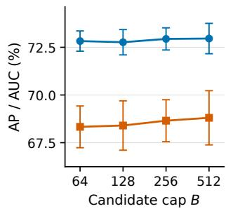

## AP AUC

(a) Enron  
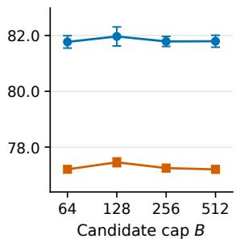  
(b) UCI  
Fig. 8: Candidate-budget sensitivity under the additional heldout protocol. Points show test AP/AUC of validation-selected checkpoints (mean and sample standard deviation, $n = 3 )$ . Retention remains learned.

critic use $3 \times 1 0 ^ { - 4 }$ . Rewards are clipped relative validation-AUC gains from epoch one. Caps apply per batch during training, validation, and testing; unexamined candidates retain constructed weights and recent neighborhoods remain fixed. Validation AP selects matching encoder/policy checkpoints before one test pass. AP/AUC equally weight frozen 200-link batches, including the final partial batch.

Figure 8 shows modest budget sensitivity. Enron mean AP/AUC span 72.77–72.96% and 68.33–68.81%, while UCI spans 81.77–81.97% and 77.20–77.46%. Enron peaks at $B = 5 1 2 .$ , whereas UCI peaks at B = 128 (81.97±0.34% AP; 77.46±0.16% AUC). Increasing the cap thus yields datasetdependent returns. Moderate caps achieve comparable observed scores with fewer candidate examinations; the preferred budget should be selected on validation data.

## V. CONCLUSION

We present EG-RL, a temporal link-prediction framework that enriches binary edge observations with linearly interpolated gradients and uses an actor–critic module to select informative snapshots. A token–channel Mixer encoder yields competitive

AUC and average precision, while the original ablations examine the roles of interpolation and adaptive selection. Local loss-landscape views provide qualitative optimization evidence, not proof of global convexity or generalization. The evaluation on eight benchmarks yields the best average AP and AUC ranks across the reported protocols. Historical and inductive negative-sampling results further demonstrate effectiveness with challenging candidate sets. Ablations confirm the contributions of interpolation and adaptive selection. On MOOC, the matched comparison achieves a 29.5% reduction in final validation BCE at the same update budget and reaches a comparable loss earlier. The edge-evolution case study illustrates how increasing and decreasing weights encode observed appearance and disappearance phases. Together, these findings highlight the value of combining explicit temporal transition cues with learned retention in a lightweight encoder. Future work will investigate more flexible interpolation profiles and lower-cost selection strategies, and evaluate larger temporal graphs with different event densities and observation granularities.

## REFERENCES

[1] S. M. Kazemi, R. Goel, K. Jain, I. Kobyzev, A. Sethi, P. Forsyth, and P. Poupart, “Representation learning for dynamic graphs: A survey,” Journal of Machine Learning Research, vol. 21, pp. 70:1–70:73, 2020.

[2] Z. Wu, S. Pan, F. Chen, G. Long, C. Zhang, and P. S. Yu, “A comprehensive survey on graph neural networks,” IEEE Transactions on Neural Networks and Learning Systems, vol. 32, no. 1, pp. 4–24, 2021.

[3] A. Pareja, G. Domeniconi, J. Chen, T. Ma, T. Suzumura, H. Kanezashi, T. Kaler, T. Schardl, and C. Leiserson, “Evolvegcn: Evolving graph convolutional networks for dynamic graphs,” in Proceedings of the AAAI conference on artificial intelligence, vol. 34, no. 04, 2020, pp. 5363–5370.

[4] S. Kumar, X. Zhang, and J. Leskovec, “Predicting dynamic embedding trajectory in temporal interaction networks,” in Proceedings of the 25th ACM SIGKDD international conference on knowledge discovery & data mining, 2019, pp. 1269–1278.

[5] A. Sankar, Y. Wu, L. Gou, W. Zhang, and H. Yang, “Dysat: Deep neural representation learning on dynamic graphs via self-attention networks,” in Proceedings of the 13th international conference on web search and data mining, 2020, pp. 519–527.

[6] J. You, T. Du, and J. Leskovec, “Roland: graph learning framework for dynamic graphs,” in Proceedings of the 28th ACM SIGKDD conference on knowledge discovery and data mining, 2022, pp. 2358–2366.

[7] D. Xu, C. Ruan, E. Korpeoglu, S. Kumar, and K. Achan, “Inductive representation learning on temporal graphs,” in International Conference on Learning Representations, 2020.

[8] E. Rossi, B. Chamberlain, F. Frasca, D. Eynard, F. Monti, and M. Bronstein, “Temporal graph networks for deep learning on dynamic graphs,” arXiv preprint arXiv:2006.10637, 2020.

[9] X. Wang, D. Lyu, M. Li, Y. Xia, Q. Yang, X. Wang, X. Wang, P. Cui, Y. Yang, B. Sun et al., “Apan: Asynchronous propagation attention network for real-time temporal graph embedding,” in Proceedings of the 2021 international conference on management of data, 2021, pp. 2628–2638.

[10] M. Jin, Y.-F. Li, and S. Pan, “Neural temporal walks: Motif-aware representation learning on continuous-time dynamic graphs,” Advances in Neural Information Processing Systems, vol. 35, pp. 19 874–19 886, 2022.

[11] Z. Han, Z. Ding, Y. Ma, Y. Gu, and V. Tresp, “Learning neural ordinary equations for forecasting future links on temporal knowledge graphs,” in Proceedings of the 2021 Conference on Empirical Methods in Natural Language Processing. Association for Computational Linguistics, 2021, pp. 8352–8364.

[12] F. Poursafaei, S. Huang, K. Pelrine, and R. Rabbany, “Towards better evaluation for dynamic link prediction,” Advances in Neural Information Processing Systems, vol. 35, pp. 32 928–32 941, 2022.

[13] W. Cong, S. Zhang, J. Kang, B. Yuan, H. Wu, X. Zhou, H. Tong, and M. Mahdavi, “Do we really need complicated model architectures for temporal networks?” in International Conference on Learning Representations. ICLR, 2023, pp. 1–15.

[14] G. H. Nguyen, J. B. Lee, R. A. Rossi, N. K. Ahmed, E. Koh, and S. Kim, “Continuous-time dynamic network embeddings,” in Companion proceedings of the the web conference 2018, 2018, pp. 969–976.

[15] R. Trivedi, M. Farajtabar, P. Biswal, and H. Zha, “Dyrep: Learning representations over dynamic graphs,” in International conference on learning representations, 2019.

[16] H. Yu and J. Liu, “Community-enhanced temporal walks: Debiasing locality representation learning on continuous-time dynamic graphs,” IEEE Transactions on Cybernetics, vol. 56, no. 3, pp. 1216–1229, 2026.

[17] X. Zhang, F. Cai, J. Zheng, Z. Pan, W. Chen, H. Chen, and C. Chen, “Triangle matters! TopDyG: Topology-aware transformer for link prediction on dynamic graphs,” in Proceedings of the ACM Web Conference 2025, 2025, pp. 3607–3617.

[18] Y. Sun, X. Cao, I. Tsang, and H. T. Shen, “Analytical construction on geometric architectures: Transitioning from static to temporal link prediction,” in Proceedings of the 42nd International Conference on Machine Learning, vol. 267. PMLR, 2025, pp. 57 336–57 354.

[19] X. Yu, Z. Liu, X. Zhang, and Y. Fang, “Node-time conditional prompt learning in dynamic graphs,” in International Conference on Learning Representations, 2025.

[20] Z. Pan, H. Chen, W. Chen, F. Cai, and X. Liu, “Time-aware graph learning for link prediction on temporal networks,” IEEE Transactions on Neural Networks and Learning Systems, vol. 36, no. 6, pp. 10 619–10 634, 2025.

[21] H. Li, H. Wan, Y. Chen, D. Ye, Y. Gel, and H. Jiang, “TMetaNet: Topological meta-learning framework for dynamic link prediction,” in Proceedings of the 42nd International Conference on Machine Learning, ser. Proceedings of Machine Learning Research, vol. 267. PMLR, 2025, pp. 35 977–35 999.

[22] S. Chanpuriya, R. A. Rossi, S. Kim, T. Yu, J. Hoffswell, N. Lipka, S. Guo, and C. Musco, “Direct embedding of temporal network edges via time-decayed line graphs,” in International Conference on Learning Representations, 2023. [Online]. Available: https://openreview.net/forum?id=Qamz7Q\_Ta1k

[23] T. Qin, B. Walker, T. Lyons, H. Yan, and H. Li, “Learning dynamic graph embeddings with neural controlled differential equations,” IEEE Transactions on Pattern Analysis and Machine Intelligence, vol. 48, no. 2, pp. 2096–2103, 2026.

[24] Z. Yu, J. Wu, Z. Wu, S. Zhong, W. Su, C.-H. Lee, and W. Zhuo, “TAMI: Taming heterogeneity in temporal interactions for temporal graph link prediction,” in Advances in Neural Information Processing Systems, vol. 38, 2025.

[25] G. Zhang, Y. Qi, Z. Cheng, Y. Yue, D. Cheng, and J. Guo, “Rationalizing and augmenting dynamic graph neural networks,” in International Conference on Learning Representations, 2025.

[26] Y. Tian, A. Jiang, Q. Huang, J. Guo, and Y. Qi, “Latent diffusionbased data augmentation for continuous-time dynamic graph model,” in Proceedings of the 30th ACM SIGKDD Conference on Knowledge Discovery and Data Mining. ACM, 2024, pp. 2900–2911.

[27] C. Shan, Y. Shen, Y. Zhang, X. Li, and D. Li, “Reinforcement learning enhanced explainer for graph neural networks,” Advances in Neural Information Processing Systems, vol. 34, pp. 22 523–22 533, 2021.

[28] J. Wang, G. Song, Y. Wu, and L. Wang, “Streaming graph neural networks via continual learning,” in Proceedings of the 29th ACM international

conference on information & knowledge management, 2020, pp. 1515– 1524.

[29] M. S. Hussain, M. J. Zaki, and D. Subramanian, “Global self-attention as a replacement for graph convolution,” in Proceedings of the 28th ACM SIGKDD Conference on Knowledge Discovery and Data Mining (KDD ’22), 2022, pp. 655–665.

[30] G. Mialon, D. Chen, M. Selosse, and J. Mairal, “Graphit: Encoding graph structure in transformers,” arXiv preprint arXiv:2106.05667, 2021.

[31] X. He, B. Hooi, T. Laurent, A. Perold, Y. LeCun, and X. Bresson, “A generalization of vit/mlp-mixer to graphs,” in International conference on machine learning. PMLR, 2023, pp. 12 724–12 745.

[32] K. Tieu, D. Fu, Z. Li, R. Maciejewski, and J. He, “Learnable spatialtemporal positional encoding for link prediction,” in Proceedings of the 42nd International Conference on Machine Learning, vol. 267. PMLR, 2025, pp. 59 570–59 597.

[33] L. Yi, R. Lei, F. Mo, Y. Zheng, Z. Wei, and Y. Ye, “Future link prediction without memory or aggregation,” in Advances in Neural Information Processing Systems, vol. 38, 2025.

[34] Y. Tian, Y. Qi, and F. Guo, “FreeDyG: Frequency enhanced continuoustime dynamic graph model for link prediction,” in International Conference on Learning Representations, 2024.

[35] Y. Li, Y. Xu, X. Lin, W. Zhang, and Y. Zhang, “Ranking on dynamic graphs: An effective and robust band-pass disentangled approach,” in Proceedings of the ACM on Web Conference 2025. ACM, 2025, pp. 3918–3929.

[36] J. Li, R. Wu, X. Jin, B. Ma, L. Chen, and Z. Zheng, “State space models on temporal graphs: A first-principles study,” in Advances in Neural Information Processing Systems, vol. 37, 2024, pp. 127 030–127 058.

[37] K. Cheng, L. Peng, P. Wang, H. Chang, J. Ye, and B. Du, “On the scalability of temporal relative positional encoding for dynamic link prediction,” in Proceedings of the 31st ACM SIGKDD Conference on Knowledge Discovery and Data Mining V.2, 2025, pp. 298–309.

[38] L. Yi, J. Peng, Y. Zheng, F. Mo, Z. Wei, Y. Ye, Z. Yue, and Z. Huang, “TGB-Seq benchmark: Challenging temporal GNNs with complex sequential dynamics,” in International Conference on Learning Representations, 2025.

[39] J. Gastinger, S. Huang, M. Galkin, E. Loghmani, A. Parviz, F. Poursafaei, J. Danovitch, E. Rossi, I. Koutis, H. Stuckenschmidt, R. Rabbany, and G. Rabusseau, “TGB 2.0: A benchmark for learning on temporal knowledge graphs and heterogeneous graphs,” in Advances in Neural Information Processing Systems, vol. 37, 2024.

[40] S. Huang, F. Poursafaei, R. Rabbany, G. Rabusseau, and E. Rossi, “UTG: Towards a unified view of snapshot and event based models for temporal graphs,” in Proceedings of the Third Learning on Graphs Conference, ser. Proceedings of Machine Learning Research, vol. 269. PMLR, 2025, pp. 28:1–28:16.

[41] J. Chmura, S. Huang, T. G. B. Ngo, A. Parviz, F. Poursafaei, J. Leskovec, M. Bronstein, G. Rabusseau, M. Fey, and R. Rabbany, “TGM: A modular and efficient library for machine learning on temporal graphs,” in International Conference on Learning Representations, 2026.

[42] L. Yu, L. Sun, B. Du, and W. Lv, “Towards better dynamic graph learning: New architecture and unified library,” Advances in Neural Information Processing Systems, vol. 36, pp. 67 686–67 700, 2023.

[43] Y. Wang, Y.-Y. Chang, Y. Liu, J. Leskovec, and P. Li, “Inductive representation learning in temporal networks via causal anonymous walks,” in International Conference on Learning Representations, 2021.

[44] L. Wang, X. Chang, S. Li, Y. Chu, H. Li, W. Zhang, X. He, L. Song, J. Zhou, and H. Yang, “Tcl: Transformer-based dynamic graph modelling via contrastive learning,” arXiv preprint arXiv:2105.07944, 2021.

[45] Y. Luo and P. Li, “Neighborhood-aware scalable temporal network representation learning,” in Proceedings of the First Learning on Graphs Conference, vol. 198. PMLR, 2022, pp. 1:1–1:18.

[46] A. Souza, D. Mesquita, S. Kaski, and V. Garg, “Provably expressive temporal graph networks,” Advances in neural information processing systems, vol. 35, pp. 32 257–32 269, 2022.

[47] X. Lu, L. Sun, T. Zhu, and W. Lv, “Improving temporal link prediction via temporal walk matrix projection,” Advances in Neural Information Processing Systems, vol. 37, pp. 141 153–141 182, 2024. [Online]. Available: https://arxiv.org/abs/2410.04013v1