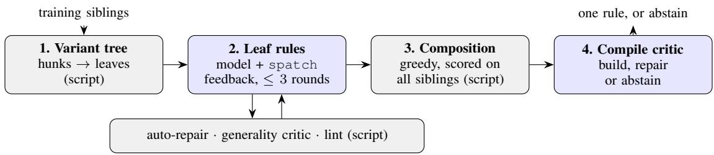

# Guided Generation of Linux Kernel Semantic Patches with Small Local Language Models

Mohanned Ahmed

ECCE School, Faculty of Engineering, Egypt-Japan University of Science and Technology

Alexandria, Egypt

Email: mohanned.hafez@ejust.edu.eg

Abstract—When a Linux kernel API changes, hundreds of drivers are converted by hand over months, and the earlier conversions are reviewed examples for the later ones. We ask whether small open language models running on a laptop can turn such examples into Coccinelle semantic patches, the rules kernel maintainers already use for tree-wide changes. We adapt guided code generation to this task: the training examples are decomposed by script into a tree of change variants, the model writes one small rule per variant under feedback from applying it to the examples, deterministic components repair SmPL syntax and generalise driver-specific names, rules are composed greedily, and a compile critic repairs or rejects a rule whose output does not build. We evaluate on a pre-registered test set of 7 migrations whose new APIs appeared after the training cutoffs of all three models (Qwen2.5-Coder 7B, Llama 3.1 8B, Gemma 3 4B), with 122 held-out driver conversions, counting a conversion as solved only if the rule’s output matches the human fix and compiles. With the framework, Qwen2.5-Coder solves 35.3 conversions on average over three seeds (range 32–41), against 1.0 when prompted directly; Spinfer solves 41 and a frontier LLM agent 66. The local model solves fewer conversions than Spinfer but its rules are the most precise on the test set (0.74 of the files they change are solved, against 0.55 for Spinfer and 0.70 for the frontier agent), and the compile critic removes every output that matches the human fix but does not build. The two general-purpose models stay weak even with guidance (at most 12 solved). All code, prompts, model responses and results are released.

Index Terms—Linux kernel, API migration, semantic patches, Coccinelle, large language models, code generation

## I. INTRODUCTION

When a Linux kernel API changes, the drivers that use it are converted one after another, often over months and by different developers. The earlier conversions are free, reviewed examples for the later ones: in a pilot study of 27 API migrations in Linux v5.10–v6.10, an earlier conversion of another file by the same migration (a sibling migration) existed in the target’s git history for 96.9% of 8,818 conversions [1]. The natural way to reuse such examples in the kernel is a Coccinelle semantic patch [2]: a rule that kernel maintainers can read, review and apply tree-wide, unlike a stream of per-file edits from a language model.

Writing such rules automatically from examples is an old problem. Spinfer [3] infers them with dedicated heuristics, and recent work prompts frontier LLMs to write them [4], finding that LLM-written patches are often syntactically invalid and that both approaches struggle when the examples contain several variants of a change. Frontier APIs are also a poor fit for kernel workflows: maintainers cannot inspect them, and they have likely seen the very migrations they are evaluated on.

We ask whether small open models running on a laptop can write correct migration rules when the work is structured for them. We adapt guided code generation (GCG) [5], a decomposition framework previously shown to help an 8B model on HumanEval, to semantic patches: the training siblings are decomposed into a tree of change variants; the model writes one small rule per variant under test feedback from the siblings themselves; deterministic components repair mechanical SmPL errors and generalise driver-specific names; rules are composed greedily; and a compile critic either repairs or rejects a rule whose output does not build.

On 7 migrations whose APIs postdate all three models, the framework takes Qwen2.5-Coder 7B from 1.0 to 35.3 solved conversions out of 122, close to but below Spinfer (41), with the highest precision of all systems on the test set (0.74). Decomposition and guidance carry most of the gain; the compile critic adds no solved conversions but removes every output that matches the human fix and fails to build. The two general-purpose models, Llama 3.1 8B and Gemma 3 4B, remain weak, mainly because they rarely write SmPL that parses. Changes that span a declaration and its uses, such as a callback whose return type changes, defeat every local model.

a) Contributions.:

• A guided framework for semantic-patch generation with 4–8B local models (Section III), whose every step except rule writing is deterministic and auditable.

• A pre-registered test set beyond the models’ training cutoffs: 7 Linux API migrations whose new API first appeared after all three models’ training cutoffs, with 123 held-out driver conversions (Section IV).

• An evaluation that compiles candidate outputs on x86\_64 allmodconfig and reports an automatic, judgementfree success metric and precision, three seeds per configuration, an ablation of every component, and an analysis of the failures (Section V).

All code, prompts, model responses and results are released.1

## II. RELATED WORK

a) Collateral evolutions and semantic patches.: Padioleau et al. named the driver changes forced by kernel API changes collateral evolutions [6] and introduced Coccinelle and its semantic patch language SmPL to perform them [2]. Such rules are usually written by experts. Our training data are earlier hand conversions of the same migration (sibling migrations).

b) Inferring rules from examples.: spdiff infers a generic patch from a few before/after file pairs [7]. Spinfer [3] infers Coccinelle rules from example changes and already evaluates chronologically, learning from the first changed files and testing on later ones; its evaluation compares inferred rules with expert patches rather than compiling the outputs, and in our runs it inferred no rule for migrations whose change lies in a struct initialiser outside any function (“no code to learn from”). Prequel retrieves relevant porting commits from history [8], and FixMorph synthesises a transformation from one patch for backporting [9].

c) LLMs and semantic patches.: Yusuf et al. compare Spinfer with GPT-4, Claude 3.7 Sonnet and DeepSeek-V3 prompted to write SmPL from change examples [4]. They find that the LLMs produce valid patches from few examples but struggle with syntax, that Spinfer produces overly specific patches, and that both perform poorly on change examples with several variants; among their future directions they list refining abstraction “based on feedback from patch application results”. We build exactly such a feedback loop, add decomposition by variant and a compile critic, use 4–8B models that run on a laptop instead of frontier APIs, and evaluate on a pre-registered test set whose APIs postdate the models.

d) LLMs for kernel evolution.: AutoDriver (DRIVEBENCH) [10] updates drivers with an LLM multiagent loop checked by compilation and QEMU, without retrieving earlier conversions; MigGPT [11] and PortGPT [12] migrate or backport out-of-tree patches with LLMs. These systems edit code directly; we generate a reusable, reviewable rule that kernel maintainers already know how to read and apply tree-wide.

e) Decomposition and critics for code generation.: Our framework adapts guided code generation (GCG) [5], which decomposes a task into a tree, generates bottom-up with tests and adds critic agents, and which improved Llama 3.1 8B on HumanEval. GCG reported no ablations or variance; here each component is ablated over three seeds and three models.

## III. GUIDED SEMANTIC-PATCH GENERATION

The input is a migration M (its id and the old/new API line patterns used to mine it) and its training siblings: pairs $( b _ { i } , a _ { i } )$ of one driver file before and after its hand conversion, all committed before any target was written. The output is one Coccinelle semantic patch for $M ,$ or an explicit abstention. No step reads a held-out target. The design follows guided code generation (GCG) [5]: decompose the task into a tree, generate the leaves bottom-up with tests, and let a critic check the assembled result. Here the “tests” are the training siblings themselves, and the critic is the C compiler. Figure 1 shows the four stages.

a) Units and change hunks.: Both versions of a file are split into statement-level units (cut at ;, {, } and comment ends; preprocessor lines are units of their own) and normalised for whitespace. A hunk is a maximal run of removed and added units. All scoring below counts units: a rule’s output $o _ { i }$ on $b _ { i }$ hits an expected unit if the unit change also appears between $b _ { i }$ and $o _ { i }$ , and makes an extra edit for every unit change between $b _ { i }$ and $o _ { i }$ that the human did not make between $b _ { i }$ and $a _ { i }$

## A. Stage 1: variant tree (decomposition)

Every hunk of every training sibling becomes a leaf candidate. Hunks that touch a migration API name (the first identifier of a match of the old or new pattern) are anchor hunks and are grouped by the API names they contain; the remaining hunks are companion hunks (for example, a function’s return type that changes because the API it is registered with changed) and are grouped by their C keywords and by identifiers that recur in at least two training files. Each group is a leaf. Within a leaf, hunks are abstracted to a shape: identifiers become ID1, ID2, . . . , numbers NUM and strings STR; the minimal edit is the hunk with its common prefix and suffix tokens removed. A leaf is a task if it is an anchor leaf or occurs in at least two training files; companion leaves seen in one file only are treated as possibly unrelated edits.

## B. Stage 2: leaf rules with test feedback

For each task leaf, the model receives a short SmPL primer (a toy kmalloc+memset → kzalloc rule and syntax notes, unrelated to any studied migration) and a task prompt with one example per distinct minimal-edit shape: the enclosing function or struct header (inside), the preceding context, the minimal edit and its abstract pattern. Anchor leaves are generated first. A companion leaf gets an interface: the framework takes the passing rule of the anchor leaf that shares most training files with it, names its first rule, and writes the header of a dependent rule that inherits all its metavariables; the model only writes the body. This is GCG’s “a parent sees only its children’s interfaces”, inverted for rules that must run after their anchor.

Each answer goes through four deterministic steps before spatch runs: (i) auto-repair of mechanical SmPL errors (missing or trailing @@, metavariables used as fields or callees declared as identifier, undeclared ID/NUM/STR placeholders); (ii) the generality critic: a name that the rule matches literally, that the change keeps (it appears on context lines or on both a removed and an added line), that is not called as a function, and that occurs in only one training file is driver-specific and is turned into a metavariable; (iii) a lint for rules without $- / +$ lines, comments used in place of code, and unbalanced brackets; (iv) application to every training file of the leaf. If the rule fails to parse, misses an expected unit, or makes an extra edit, the model gets feedback for up to R = 3 rounds: spatch’s error with a matching generic repair hint, or, per failing file, the missed units with their abstract pattern and the extra edits. A rule identical to an earlier one raises the sampling temperature by 0.3 for the next round. The best round is kept (parses, then most hits, then fewest extra edits, then earliest).

  
Fig. 1. The four stages. Shaded boxes are deterministic scripts; blue boxes call the local model. Only the training siblings are read; held-out targets are never seen.

## C. Stage 3: composition

Leaf rules are renamed so that rule names cannot collide (a companion rule carries its anchor rule with it) and composed greedily: candidates are tried in decreasing order of their own hits minus extra edits, and a candidate is kept only if the composed patch still parses and its score over all training files of the migration strictly increases. Expected units are those of all task leaves, so a leaf that also helps another leaf is rewarded and a leaf whose edits clash with another is dropped.

## D. Stage 4: compile critic

The composed rule is applied to the most recent training files it changes (up to three whose human version compiles), and each output is compiled in a worktree at that training commit’s parent (x86\_64 allmodconfig, CONFIG\_WERROR off). If an output does not compile, the model gets the compiler errors, the converted code around them, and the diff between its output and the human version of that training file, and writes one additional dependent rule through the same interface mechanism (two rounds). Among the rules whose checked outputs compile (the composed rule, the repaired rules, and the composed rule minus one leaf), the one with the best training score is kept; if none compiles, the framework abstains. A migration without a rule is counted as a failure on every target, never silently dropped.

## IV. EXPERIMENTAL SETUP

a) Migrations and split.: A conversion is a (commit, file) pair whose diff removes a line matching the migration’s old-API pattern and adds a line matching its new-API pattern. Per migration, the earliest 30% of .c conversions by commit time (at most 20, one per file) are the training siblings. Targets are conversions written (author time) after the last training commit was committed, in a file and a commit that are not training ones; up to 20 are sampled evenly over time. Every training sibling is therefore in a different file and existed before the target was written.

b) Development set.: 5 migrations from Linux v5.10– v6.10 with 100 targets (Table I). All prompts, hints, thresholds and critic rules were designed on their training siblings, and their held-out targets were evaluated during development, so results on them are development results.

c) Test set (pre-registered).: Before mining any history after v6.10, we fixed 14 candidate migrations whose new API we expected to be recent, and an inclusion rule (committed to the repository before the mined data existed): (1) the new API is absent from include/ at v6.10 and first appears on or after 2024-09-01, after the training cutoff of all three models; (2) at least three conversion commits; (3) verified precision of at least 0.85 on up to eight sampled candidates, each judged by two independent LLM reviewers against the real diff; (4) at least five training siblings and ten eligible targets after the split. Seven migrations qualified (Table I); three of the excluded ones fail rule 4 because almost all of their conversions were written before the last training commit (a patch series posted at once and merged over months). The test set was run once, with the framework frozen at a git tag.

d) Models.: Three open-weight models run locally with Ollama on one 8 GB laptop GPU (RTX 5060, 4-bit quantisation): Qwen2.5-Coder 7B [13] (code data from repositories created before February 2024), Llama 3.1 8B [14] (knowledge cutoff December 2023) and Gemma 3 4B [15] (August 2024). Context 8,192 tokens, temperature 0.4, at most 1,024 output tokens, seeds 1–3.

e) Baselines.: Spinfer [3] (commit c47696a, default settings) on the same training pairs. Frontier LLM: a Claude agent (Anthropic) whose file access was limited to the migration’s training folder writes one rule per migration and may test it with spatch on the training files; a transcript audit checks that it read nothing else. Unlike the local models, this agent’s training data may contain the test migrations, so it is an upper reference, not a fair competitor.

f) Ablations.: Six configurations, each adding one component: ONE-SHOT (one rule for the whole migration from the plain examples, no feedback), +FEEDBACK (three rounds), +DECOMPOSITION (leaf tasks, plain prompts), +GUIDANCE (minimal-edit patterns, context, interface, hints, lint, stall handling), +AUTO-REPAIR, and FULL (+generality critic and compile critic). All configurations are composed by stage 3.

g) Evaluation.: Each rule is applied with spatch 1.1.1 to the target file at the parent of its fix commit and compared with the human fix on whitespace-normalised lines: exact (identical), subset complete (every changed line is one the human changed, and no more old-API uses remain than in the human version), subset incomplete, divergent (an edit the human did not make), no change, spatch error and no rule.

TABLE I  
DATA. New API: FIRST COMMIT THAT ADDS THE NEW API UNDER INCLUDE/ (TEST SET ONLY; ALL AFTER THE MODELS’ TRAINING CUTOFFS). Train: TRAINING SIBLINGS. Buildable: TARGETS WHOSE ORIGINAL FILE COMPILES ON X86\_64 ALLMODCONFIG; THE DENOMINATOR OF EVERY SUCCESS COUNT.
<table><tr><td>Set</td><td>Migration</td><td>New API</td><td>Train</td><td>Targets</td><td>Buildable</td><td>Target dates</td></tr><tr><td>dev</td><td>ida_simple</td><td></td><td>20</td><td>20</td><td>20</td><td>2022-06-2024-05</td></tr><tr><td>dev</td><td>i2c_probe_new</td><td></td><td>20</td><td>20</td><td>19</td><td>2023-05-2023-09</td></tr><tr><td>dev</td><td> $\mathtt { p l a t f o r m \_ r e m o v e \_ n e w }$ </td><td></td><td>20</td><td>20</td><td>20</td><td>2023-03-2024-05</td></tr><tr><td>dev</td><td> $\mathsf { s t r l c p y \_ s t r s c p y }$ </td><td></td><td>20</td><td>20</td><td>15</td><td>2021-01-2023-12</td></tr><tr><td>dev</td><td>pci_dma_wrappers</td><td>1</td><td>20</td><td>20</td><td>20</td><td>2020-12-2022-02</td></tr><tr><td>test</td><td> $\mathsf { s e c s \_ t o \_ j i f f i e s }$ </td><td>2024-10-30</td><td>17</td><td>10</td><td>10</td><td>2025-04–2026-05</td></tr><tr><td>test</td><td>iio_claim_direct</td><td>2025-02-17</td><td>20</td><td>20</td><td>20</td><td>2025-04–2025-04</td></tr><tr><td>test</td><td>iio_push_with_ts</td><td>2025-05-21</td><td>20</td><td>20</td><td>20</td><td>2025-08-2026-08</td></tr><tr><td>test</td><td> $\mathrm { 9 9 ^ { i 0 } - } \mathrm { s e t \mathrm { - } } \mathrm { r v }$ </td><td>2025-02-26</td><td>20</td><td>20</td><td>20</td><td>2025-04–2025-07</td></tr><tr><td>test</td><td> $\mathtt { p c i m \_ r e q u e s t \_ a l l \_ r e g i o n s }$ </td><td>2024-10-30</td><td>18</td><td>17</td><td>16</td><td>2025-04-2026-08</td></tr><tr><td>test</td><td> $\operatorname { e t h t o o l } _ { - \operatorname { r x } _ { - } \operatorname { r i n g } _ { - } \operatorname { c o u n t } }$ </td><td>2025-09-18</td><td>15</td><td>20</td><td>20</td><td>2025-11-2026-01</td></tr><tr><td>test</td><td> $\mathrm { d e v m \_ k m e m d u p \_ a r r a y }$ </td><td>2025-02-24</td><td>7</td><td>16</td><td>16</td><td>2025-02–2025-12</td></tr></table>

TABLE II

TEST SET: HELD-OUT CONVERSIONS SOLVED (OUTPUT MATCHES THE HUMAN FIX EXACTLY OR AS A COMPLETE SUBSET, AND COMPILES). LOCAL MODELS:MEAN OVER THREE SEEDS, [MIN–MAX] WHERE THE SEEDS DIFFER. ONE-SHOT: ONE RULE FROM THE PLAIN EXAMPLES; FULL: THE COMPLETEFRAMEWORK. †A FRONTIER LLM AGENT THAT MAY HAVE SEEN THESE MIGRATIONS DURING TRAINING; A REFERENCE POINT, NOT A LIKE-FOR-LIKECOMPETITOR.
<table><tr><td></td><td colspan="3">Frontier</td><td colspan="2">Qwen2.5-Coder 7B</td><td colspan="2">Llama 3.1 8B</td><td colspan="2">Gemma 3 4B</td></tr><tr><td>Migration</td><td>Bld.</td><td>LLM†</td><td>Spinfer</td><td>one-shot</td><td>FULL</td><td>one-shot</td><td>FULL</td><td>one-shot</td><td>FULL</td></tr><tr><td>devm_kmemdup_array</td><td>16</td><td>1</td><td>2</td><td>0.0</td><td>1.3 [0–2]</td><td>0.0</td><td>0.0</td><td>0.0</td><td>0.0</td></tr><tr><td>ethtool_rx_ring_count</td><td>20</td><td>12</td><td>0</td><td>0.0</td><td>0.0</td><td>0.0</td><td>0.0</td><td>0.0</td><td>0.0</td></tr><tr><td> $\mathrm { 9 9 ^ { i 0 } - } \mathrm { s e t \mathrm { - } } \mathrm { r v }$ </td><td>20</td><td>14</td><td>0</td><td>0.0</td><td>0.0</td><td>0.0</td><td>0.0</td><td>0.0</td><td>0.0</td></tr><tr><td>iio_claim_direct</td><td>20</td><td>17</td><td>16</td><td>0.0</td><td>16.0</td><td>0.0</td><td>0.0</td><td>0.0</td><td>0.0</td></tr><tr><td> $\mathtt { i } \mathtt { i } \mathtt { o } \_ { \mathsf { P } } \mathsf { u } \mathtt { s h } \_ { \mathsf { w i } } \mathtt { t } \mathtt { h } \_ { \mathsf { t } } \mathtt { s }$ </td><td>20</td><td>12</td><td>12</td><td>1.0</td><td>0.7 [0–1]</td><td>0.0</td><td>0.0</td><td>0.0</td><td>0.0</td></tr><tr><td>pcim_request_all_regions</td><td>16</td><td>8</td><td>11</td><td>0.0</td><td>15.0</td><td>0.0</td><td>7.0 [0–12]</td><td>0.0</td><td>2.7 [0–8]</td></tr><tr><td> $\mathsf { s e c s \_ t o \_ j i f f i e s }$ </td><td>10</td><td>2</td><td>0</td><td>0.0</td><td>2.3 [0–7]</td><td>0.0</td><td>0.0</td><td>0.0</td><td>0.0</td></tr><tr><td>All</td><td>122</td><td>66</td><td>41</td><td>1.0</td><td>35.3 [32–41]</td><td>0.0</td><td>7.0 [0–12]</td><td></td><td>0.0 2.7 [0–8]</td></tr></table>

The original, human and rule versions are compiled in that tree (x86\_64 allmodconfig, CONFIG\_WERROR off). A target is buildable if its original file compiles. Success means exact or subset complete and the rule output compiles, counted over buildable targets. This metric needs no human judgement; it undercounts correct rules that differ from the human fix in form (Section VI). We also report precision, the share of targets a rule edits that it solves, since a rule that edits a file wrongly costs a maintainer more than a rule that leaves it alone.

## V. RESULTS

a) Main result.: Table II gives the test-set results. Prompted directly, none of the three local models can turn the training siblings into a working rule: Qwen2.5-Coder solves 1.0 of 122 conversions and the other two none. With the framework, Qwen2.5-Coder solves 35.3 on average (32–41 across seeds), Llama 3.1 8B solves 7.0 and Gemma 3 4B 2.7. Spinfer solves 41 and the frontier LLM agent 66. The local model therefore closes most but not all of the distance to Spinfer, and the frontier agent stays well ahead. The per-migration picture is uneven: the guided Qwen2.5-Coder solves more conversions than Spinfer on pcim\_request\_all\_regions and $\mathtt { s e c s \_ t o \_ j i f f i e s }$ , matches it on iio\_claim\_direct, and falls behind on iio\_push\_with\_ts; on gpio\_set\_rv and ethtool\_rx\_ring\_count neither it nor Spinfer solves anything, while the frontier agent does.

On the development set (Table III), whose migrations shaped the design, Qwen2.5-Coder solves 38.0 of 94 with the framework against 21.3 one-shot, Spinfer 24 and the frontier agent 72. The general-purpose models again stay near zero.

b) Which components matter.: Table IV adds one component at a time. For Qwen2.5-Coder on the test set, test feedback alone changes nothing (1.0 to 1.0): asked for one rule covering every variant at once, the model never produces a rule good enough for feedback to refine. Decomposition into variant leaves is the first large step (18.0), and guidance (minimal edits, context, interfaces, hints, lint and stall handling) roughly doubles it again (35.3). On the development set the order differs: decomposition adds little (21.3 to 21.7), guidance and auto-repair add most (29.0, then 38.0). The general-purpose models fail for a more basic reason: they rarely write SmPL that parses. Without auto-repair, the best rule of 100% of Gemma’s leaf tasks does not parse (43% for Llama, 44% for Qwen2.5- Coder); auto-repair lowers this to 42%, 38% and 29%. For Gemma, auto-repair is what makes any success possible at all; for Llama on the test set it does not help (10.0 before, 7.0 after). Adding the generality critic left the mean number of solved conversions unchanged for every model on both sets.

TABLE III  
DEVELOPMENT SET, SAME LAYOUT AS TABLE II. THESE MIGRATIONS WERE USED TO DESIGN THE FRAMEWORK, SO THE NUMBERS ARE OPTIMISTIC.
<table><tr><td></td><td colspan="3">Frontier</td><td colspan="2">Qwen2.5-Coder 7B</td><td colspan="2">Llama 3.1 8B</td><td colspan="2">Gemma 3 4B</td></tr><tr><td>Migration</td><td>Bld.</td><td>LLM†</td><td>Spinfer</td><td>one-shot</td><td>FULL</td><td>one-shot</td><td>FULL</td><td>one-shot</td><td>FULL</td></tr><tr><td>i2c_probe_new</td><td>19</td><td>19</td><td>0</td><td>12.7 [0–19]</td><td>19.0</td><td>0.0</td><td>0.0</td><td>0.0</td><td>0.0</td></tr><tr><td>ida_simple</td><td>20</td><td>14</td><td>9</td><td>0.0</td><td>5.3 [5–6]</td><td>0.0</td><td>1.7 [0–5]</td><td>0.0</td><td>3.0 [0–9]</td></tr><tr><td>pci_dma_wrappers</td><td>20</td><td>6</td><td>2</td><td>0.0</td><td>1.3 [0–2]</td><td>0.0</td><td>0.0</td><td>0.0</td><td>0.0</td></tr><tr><td>platform_remove_new</td><td>20</td><td>19</td><td>0</td><td>0.0</td><td>0.0</td><td>0.0</td><td>0.0</td><td>0.0</td><td>0.0</td></tr><tr><td>strlcpy_strscpy</td><td>15</td><td>14</td><td>13</td><td>8.7 [0–13]</td><td>12.3 [11–13]</td><td>0.0</td><td>0.0</td><td>0.0</td><td>0.0</td></tr><tr><td>All</td><td>94</td><td>72</td><td>24</td><td>21.3 [13–32]</td><td>38.0 [37–39]</td><td>0.0</td><td>1.7 [0–5]</td><td>0.0</td><td>3.0 [0–9]</td></tr></table>

TABLE IV

ABLATION: CONVERSIONS SOLVED AS COMPONENTS ARE ADDED (MEAN OVER THREE SEEDS, [MIN–MAX]). EVERY CONFIGURATION IS COMPOSED BYSTAGE 3; THE LAST ROW ADDS THE COMPILE CRITIC OF STAGE 4.
<table><tr><td></td><td colspan="3">Development (of 94)</td><td colspan="3">Test (of 122)</td></tr><tr><td>Configuration</td><td>Qwen2.5-Coder</td><td>Llama</td><td>Gemma</td><td>Qwen2.5-Coder</td><td>Llama</td><td>Gemma</td></tr><tr><td>ONE-SHOT</td><td>21.3 [13–32]</td><td>0.0</td><td>0.0</td><td>1.0</td><td>0.0</td><td>0.0</td></tr><tr><td>+ feedback</td><td>21.3 [13–32]</td><td>0.0</td><td>0.0</td><td>1.0</td><td>2.0 [0–6]</td><td>0.0</td></tr><tr><td>+ decomposition</td><td>21.7 [13–32]</td><td>0.0</td><td>0.0</td><td>18.0</td><td>2.0 [0–6]</td><td>0.0</td></tr><tr><td>+ guidance</td><td>29.0 [21–34]</td><td>2.3 [0–7]</td><td>0.0</td><td>35.3 [32–41]</td><td>10.0 [9–12]</td><td>0.0</td></tr><tr><td>+ auto-repair</td><td>38.0 [37–39]</td><td>1.7 [0–5]</td><td>3.0 [0–9]</td><td>35.3 [32–41]</td><td>7.0 [0–12]</td><td>2.7 [0–8]</td></tr><tr><td>+ generality critic</td><td>38.0 [37–39]</td><td>1.7 [0–5]</td><td>3.0 [0–9]</td><td>35.3 [32–41]</td><td>7.0 [0–12]</td><td>2.7 [0–8]</td></tr><tr><td>+ compile critic (FULL)</td><td>38.0 [37–39]</td><td>1.7 [0–5]</td><td>3.0 [0–9]</td><td>35.3 [32–41]</td><td>7.0 [0–12]</td><td>2.7 [0–8]</td></tr></table>

We keep it because it is cheap and did not hurt, but our data give no evidence that it is needed.

c) The compile critic buys precision at no cost.: The compile critic never changes the number of solved conversions (Table IV), but it changes what the rule does to the others (Table V). Before it, Qwen2.5-Coder’s composed rules on the test set produce 13.0 outputs per seed that match the human fix but do not build, and 22.0 divergent ones. The critic either repairs such a rule or abstains for that migration, leaving 0.0 broken and 8.7 divergent outputs and raising precision from 0.48 to 0.74, above Spinfer (0.55, with 13.0 broken outputs) and the frontier agent (0.70). On the development set the frontier agent remains more precise (0.79 against 0.61). For a maintainer, a rule that converts fewer files but rarely needs to be undone, or no rule at all, is easier to adopt than one that has to be checked file by file.

d) Where the framework fails.: Three failure modes account for the test migrations the local models do not solve. (i) Changes that span declarations. gpio\_set\_rv turns a void callback into one returning int, returns the value of its last call, and renames the struct field that registers it; ethtool\_rx\_ring\_count moves a switch case into a new function and registers it in an ethtool\_ops initialiser. Both need several rules that agree on a function name across a file. The framework’s interface mechanism passes metavariables from an anchor rule to its dependants, but whenever a model composed a rule for these migrations, its outputs on the training files did not compile (the compiler reports the registering field renamed while the callback keeps its old type, or a return with a value left in a void function), repair did not fix them, and the critic abstained for all three models on every seed. The development migration platform\_remove\_new has the same shape and the same outcome. (ii) Over-specific patterns. On iio\_push\_with\_ts Qwen2.5-Coder’s rule requires the timestamp argument to be a function call, so it misses the common pf->timestamp form, and it writes sizeof(ID2) where ID2 is the expression &scan: the output computes the size of a pointer. That output compiles, which no compile check can catch; it shows up only as a divergent edit. (iii) Invalid SmPL remains the main failure of the two general-purpose models, as quantified above.

e) Cost.: Table VI reports generation cost. A migration needs ten to twenty model calls and well under a minute of generation (9.7 calls and 15 s for Qwen2.5-Coder on the test set). Stage 4 additionally configures a kernel tree at each training commit it checks and compiles single object files there; build results are cached by commit, file and content.

## VI. THREATS TO VALIDITY

a) What success measures.: Success requires the rule’s output to match the human fix (exactly or as a complete subset) and to compile. It does not test behaviour: a compiled conversion can still be wrong at run time, and we run no driver tests. It also undercounts: a correct rule that converts a site the human converted in a later commit, or writes an equivalent expression, is counted as a failure, and divergent outputs (Table V) include such cases as well as real errors. We did not label them manually; the released outputs and a blind labelling packet (source hidden) allow this check. The undercount affects all systems, but not necessarily equally.

b) Compilation scope.: Outputs are compiled for x86\_64 allmodconfig only. Targets whose original file does not compile there (other architectures, broken intermediate commits) are excluded from the denominator for every system alike. A rule that breaks a configuration we do not build would go unnoticed.

TABLE V  
PRECISION OF THE OUTPUTS ON BUILDABLE TARGETS (LOCAL MODELS: MEAN OVER SEEDS). Changed: TARGETS THE RULE EDITS; Divergent: THE RULE MAKES AN EDIT THE HUMAN DID NOT MAKE; Broken: THE OUTPUT MATCHES THE HUMAN FIX (EXACTLY OR AS A SUBSET) BUT DOES NOT COMPILE; Precision: SOLVED / CHANGED.
<table><tr><td>Set</td><td>Source</td><td>Success</td><td>Changed</td><td>Divergent</td><td>Broken</td><td>Precision</td></tr><tr><td>dev</td><td>Frontier LLM†</td><td>72.0</td><td>91.0</td><td>17.0</td><td>0.0</td><td>0.79</td></tr><tr><td>dev</td><td>Spinfer</td><td>24.0</td><td>47.0</td><td>13.0</td><td>0.0</td><td>0.51</td></tr><tr><td>dev</td><td>Qwen2.5-Coder 7B, before compile critic</td><td>38.0</td><td>82.7</td><td>12.0</td><td>20.0</td><td>0.46</td></tr><tr><td>dev</td><td>Qwen2.5-Coder 7B, FULL</td><td>38.0</td><td>62.7</td><td>12.0</td><td>0.0</td><td>0.61</td></tr><tr><td>dev</td><td>Llama 3.1 8B, before compile critic</td><td>1.7</td><td>22.3</td><td>10.7</td><td>0.0</td><td>0.07</td></tr><tr><td>dev</td><td>Llama 3.1 8B, FULL</td><td>1.7</td><td>20.7</td><td>8.7</td><td>0.0</td><td>0.08</td></tr><tr><td>dev</td><td>Gemma 3 4B, before compile critic</td><td>3.0</td><td>9.3</td><td>2.7</td><td>0.0</td><td>0.32</td></tr><tr><td>dev</td><td>Gemma 3 4B, FULL</td><td>3.0</td><td>9.3</td><td>2.7</td><td>0.0</td><td>0.32</td></tr><tr><td>test</td><td>Frontier LLM†</td><td>66.0</td><td>94.0</td><td>28.0</td><td>0.0</td><td>0.70</td></tr><tr><td>test</td><td>Spinfer</td><td>41.0</td><td>74.0</td><td>18.0</td><td>13.0</td><td>0.55</td></tr><tr><td>test</td><td>Qwen2.5-Coder 7B, before compile critic</td><td>35.3</td><td>74.3</td><td>22.0</td><td>13.0</td><td>0.48</td></tr><tr><td>test</td><td>Qwen2.5-Coder 7B, FULL</td><td>35.3</td><td>48.0</td><td>8.7</td><td>0.0</td><td>0.74</td></tr><tr><td>test</td><td>Llama 3.1 8B, before compile critic</td><td>7.0</td><td>27.3</td><td>0.3</td><td>0.0</td><td>0.26</td></tr><tr><td>test</td><td>Llama 3.1 8B, FULL</td><td>7.0</td><td>27.3</td><td>0.3</td><td>0.0</td><td>0.26</td></tr><tr><td>test</td><td>Gemma 3 4B, before compile critic</td><td>2.7</td><td>34.7</td><td>0.0</td><td>12.0</td><td>0.08</td></tr><tr><td>test</td><td>Gemma 3 4B, FULL</td><td>2.7</td><td>22.7</td><td>0.0</td><td>0.0</td><td>0.12</td></tr></table>

TABLE VI

COST PER MIGRATION OF THE FULL CONFIGURATION ON ONE LAPTOP GPU (RTX 5060, 8 GB): MODEL CALLS AND SECONDS OF GENERATION IN STAGE 2, AND REPAIR CALLS OF THE COMPILE CRITIC (STAGE 4), MEAN OVER MIGRATIONS AND SEEDS. COMPILATION TIME IS EXCLUDED.
<table><tr><td></td><td colspan="3">Development</td><td colspan="3">Test</td></tr><tr><td>Model</td><td>Calls</td><td>Seconds</td><td>Repairs</td><td>Calls</td><td>Seconds</td><td>Repairs</td></tr><tr><td>Qwen2.5-Coder 7B</td><td>13.2</td><td>21</td><td>0.4</td><td>9.7</td><td>15</td><td>0.5</td></tr><tr><td>Llama 3.1 8B</td><td>16.3</td><td>31</td><td>0.1</td><td>9.7</td><td>23</td><td>0.0</td></tr><tr><td>Gemma 3 4B</td><td>17.4</td><td>30</td><td>0.0</td><td>9.7</td><td>16</td><td>0.3</td></tr></table>

c) Contamination.: The local models’ training cutoffs are taken from their vendors’ statements. The test set admits only migrations whose new API first appears in the kernel after all three cutoffs, but a model may still have seen similar older APIs. The frontier-LLM baseline has no such guarantee and, unlike the local models, worked agentically with a test loop of its own design; it is a reference point, not a like-for-like competitor.

d) Test-set construction.: Conversions are mined with line patterns, so the data contain only conversions whose diff matches them, and precision was verified on a sample (at most eight per migration). The verification was planned for one reviewer; we used two independent LLM reviewers instead (a judge and a skeptic) and report this deviation from the pre-registered protocol. They disagreed on no sample’s verdict. The frontier baseline’s rule writers were audited for file access; one agent saw the names (not contents) of another migration’s training folder through a reused scratch script, which we report in the released audit notes.

e) Development reuse.: Prompts, hints, thresholds and both critics were designed while looking at the development migrations and their held-out results. Development numbers are therefore optimistic; only the test-set numbers, obtained once after freezing the framework at a git tag, measure generalisation. The test-set generation run was interrupted during its second configuration, first by the host running out of memory and then when we moved it into a detached container (no output had been evaluated); the interrupted configuration was restarted from scratch for the test migrations with the same seeds, and no completed configuration was rerun.

f) Scale.: The test set has 7 migrations and 122 buildable targets, and three seeds per configuration. Per-migration results swing with whether one leaf rule is right, so we report seed ranges and per-migration tables rather than significance tests. All timings come from one laptop GPU and 4-bit models.

## VII. CONCLUSION

Earlier hand conversions of a kernel API migration are enough material for a 7B code model on a laptop to write working Coccinelle rules, provided the work is structured for it: decomposed by variant, guided by the examples’ minimal edits, checked against the examples, repaired where the errors are mechanical, and gated by the compiler. Prompted directly, the same model solves almost nothing on migrations it cannot have seen; with the framework it approaches Spinfer and, on the test set, is more precise than every other system we tested. The structure does not rescue general-purpose 4–8B models, and no local model handled changes that couple a declaration with its uses.

Three directions follow. Rules that must agree across a declaration and its call sites need an interface the model cannot get wrong, for example a framework-written skeleton that fixes the shared metavariables. A semantic check beyond compilation would catch outputs such as sizeof of a pointer. And a larger pre-registered test set, refreshed as new APIs land, would let such frameworks be compared without contamination.

## USE OF AI ASSISTANTS

The frontier-LLM baseline is a Claude agent (Anthropic), as described in Section IV. The author also used Claude as a programming and writing assistant for the experiment scripts and the text of this paper. Every number in the paper is generated by the released scripts from the released result files, and the author takes full responsibility for the content.

## REFERENCES

[1] M. Ahmed, “Sibling migrations as free supervision for Linux driver updates: A pilot study,” https://github.com/MohannedAhmed67/ kernel-sibling-migrations, 2026, code and data; see RESULTS.md.

[2] Y. Padioleau, J. Lawall, R. R. Hansen, and G. Muller, “Documenting and automating collateral evolutions in Linux device drivers,” in Proceedings of the 2008 EuroSys Conference, 2008.

[3] L. Serrano, V.-A. Nguyen, F. Thung, L. Jiang, D. Lo, J. Lawall, and G. Muller, “SPINFER: Inferring semantic patches for the Linux kernel,” in 2020 USENIX Annual Technical Conference (USENIX ATC 20), 2020.

[4] I. N. B. Yusuf, X. Huang, J. Lawall, L. Jiang, D. Lo, N. D. Q. Bui, C. Li, H. Wu, and Y. Yu, “Deep learning-based automatic semantic patch generation for the Linux kernel: How far are we?” preprint, https: //imamnurby.github.io/assets/files/spatch\_emse.pdf.

[5] A. Almorsi, M. Ahmed, and W. Gomaa, “Guided code generation with LLMs: A multi-agent framework for complex code tasks,” in Proceedings of the 2024 IEEE International Japan-Africa Conference on Electronics, Communications and Computations (JAC-ECC), 2024, arXiv:2501.06625.

[6] Y. Padioleau, J. L. Lawall, and G. Muller, “Understanding collateral evolution in Linux device drivers,” in Proceedings of the 2006 EuroSys Conference, 2006.

[7] J. Andersen and J. L. Lawall, “Generic patch inference,” in 23rd IEEE/ACM International Conference on Automated Software Engineering (ASE), 2008.

[8] J. Lawall, D. Palinski, L. Gnirke, and G. Muller, “Fast and precise retrieval of forward and back porting information for Linux device drivers,” in 2017 USENIX Annual Technical Conference (USENIX ATC 17), 2017.

[9] R. Shariffdeen, X. Gao, G. J. Duck, S. H. Tan, J. Lawall, and A. Roy choudhury, “Automated patch backporting in Linux (experience paper),” in Proceedings of the 30th ACM SIGSOFT International Symposium on Software Testing and Analysis (ISSTA), 2021.

[10] A. Kharlamova, J. Liu, T. Zhang, X. Yang, H. Alqasimi, Y. Sun, and C. J. Xue, “LLM-driven kernel evolution: Automating driver updates in Linux,” 2025, arXiv:2511.18924.

[11] P. Dang, D. Huang, D. Li, K. Chen, Y. Wen, Q. Guo, and X. Hu, “MigGPT: Harnessing large language models for automated migration of out-of-tree Linux kernel patches across versions,” in Advances in Neural Information Processing Systems (NeurIPS), 2025, arXiv:2504.09474.

[12] Z. Li, Z. Yu, J. Song, M. Xu, Y. Luo, and D. Mu, “PortGPT: Towards automated backporting using large language models,” in IEEE Symposium on Security and Privacy (S&P), 2026, arXiv:2510.22396.

[13] B. Hui, J. Yang, Z. Cui et al., “Qwen2.5-coder technical report,” 2024, arXiv:2409.12186.

[14] Llama Team, AI @ Meta, “The Llama 3 herd of models,” 2024, arXiv:2407.21783.

[15] Gemma Team, A. Kamath et al., “Gemma 3 technical report,” 2025, arXiv:2503.19786.