# InertiaMPDD: Multimodal Personalized Depression Detection via Emotional Inertia-Inspired Dynamics Modeling

## A PREPRINT

Changzeng Fu1,2, Songyang Wang2, Chang Gao1, Xinyi Zhang1 Peilin Li1, Mo Meng1, Jiarui Wu1, Mingze Li1 Hongwei Ding1, Shiqi Zhao1, Yong Li4, Lang He3

1Northeastern University 2The University of Osaka 3Xi’an University of Posts and Telecommunications 4Southeast University fuchangzeng@qhd.neu.edu.cn

## ABSTRACT

Multimodal depression screening estimates risk from speech, visual behavior and language. Current methods mainly predict labels, with limited evidence of departures from a non-depressed reference. Recording-level supervision also leaves fine-grained emotional dynamics unannotated. Motivated by emotional inertia, the persistence of affect, InertiaMPDD learns healthy next-state patterns using a world-model-inspired latent predictor. Using pretrained multimodal representations, it predicts from observed history and context. Reference deviation, residual decay rate and a Jacobian spectral descriptor form reference-derived emotional dynamics descriptors, evaluated as candidate proxy biomarkers for standalone screening and personalized decision correction. Across five cohorts from four datasets, fusion reaches 98.41% F1 on D-Vlog and 84.98% on LMVD. Standalone descriptors outperform fixed additive fusion on MPDD but discriminate weakly on AVEC2014. These findings distinguish reference informativeness from fusion benefit and reveal context-dependent utility. An interactive demo is available at https://hacilab.github.io/InertiaMPDD-demo/.

## 1 Introduction

Multimodal depression detection uses language, speech and facial behavior to estimate risk from long recordings. Recent sequence models and multimodal large models learn increasingly effective relationships between these observations and depression labels [1–4]. Some also generate symptom-based rationales [5, 6]. Affective science offers a complementary temporal perspective. Emotional inertia describes the tendency of affective states to persist over time, commonly studied through their lagged autocorrelation and associated with depression [7–9]. This motivates looking for measurable dynamical evidence alongside a recording-level risk prediction

Two limitations make this evidence difficult to obtain. Coarse supervision leaves emotional dynamics unobserved: depression datasets commonly assign one label to an entire recording or participant [10–12], without identifying the informative emotional segments. Emotion benchmarks such as IEMOCAP instead annotate individual utterances [13]. Comparable supervision for directly tracking emotional persistence is usually unavailable in depression recordings. A population prediction also lacks an explicit behavioral reference. Slow speech or limited facial movement may be habitual for one speaker and unusual for another. A useful comparison therefore needs to accommodate context while remaining learnable without segment-level emotion or personality labels (Figure 1).

Motivated by these limitations, we ask whether a pretrained multimodal model can provide measurable evidence of behavioral departures from a non-depressed reference, and whether this evidence can support depression screening. World models and latent predictive architectures learn representations and predict how observations evolve [14–17]. We use this principle to learn a healthy next-state predictor from frozen pretrained representations. It predicts from observed history and context. Comparison with the next observation gives a time-resolved residual. Inspired by emotional inertia, we examine reference deviation, residual persistence and the predictor’s local spectral structure. We call these reference-derived emotional dynamics descriptors: proxies computed from behavioral representations, rather than direct measurements of annotated emotions. Their association with depression labels tests their value as candidate proxy biomarkers. Experiments across recording settings assess their screening utility and applicability.

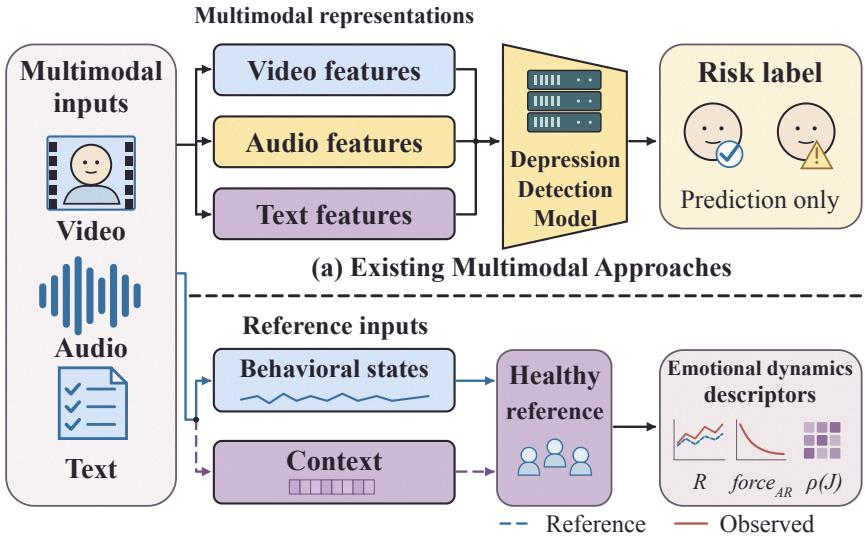  
(b) Our Emotion Dynamics Trait Analysis  
Figure 1: Motivation. (a) Existing Multimodal Approaches. (b) Our Emotion Dynamics Trait Analysis.

We address this question with InertiaMPDD. Our contributions are:

• We formulate reference-based behavioral evidence under recording-level depression supervision, using emotional inertia to motivate measurable descriptions of predictive departure and persistence.

• We introduce the Idiographic Inertia Pathway (IIP), a world-model-inspired healthy predictor that extracts reference deviation, residual decay rate and a Jacobian spectral descriptor. These descriptors support standalone screening and an individual correction to the multimodal Nomothetic Screening Pathway (NSP).

• We evaluate the pathways on five cohorts from four datasets, finding complementary evidence on spontaneous vlogs, stronger standalone IIP than fixed fusion on MPDD and limited reference discrimination on AVEC2014 [10–12, 18]. Feature controls and visualizations distinguish reference informativeness from fusion benefit.

## 2 Related Work

## 2.1 A predictive reference complements population screening

Depression screening has progressed from hand-crafted paralinguistic features to multimodal sequence models. DAIC WOZ and AVEC established interview-based benchmarks [18, 19]. Recent methods model temporal dependencies, cross-modal interactions and individual context. Examples include MMFformer [1], CAF-Mamba [20], DynMultiDep [2], ASYM [21], AttMamba [22] and personality-aware PAVNet [23]. DepressionAgent provides symptom-level explanations through multimodal reasoning [5]. IIP adds a predictive reference against which the observed continuation can be compared. This supplies a time-resolved departure signal alongside the population decision.

Personality-aware benchmark design includes the MPDD challenge [12] and MPDD-AVG, which combines audio-visual interviews with gait analysis [24]. Physiological measurements offer a complementary route: M3ADD organizes multimodal, multitask and multievent depression assessment [25], while M3DEP studies individual differences in EEG–EMG signals [26]. These studies broaden the modalities and individual factors considered in screening. IIP examines recording-dependent variation through a healthy predictive reference in pretrained behavioral representations.

Prediction-based anomaly detection also learns regular behavior and measures future-prediction error [27]. Our question is whether a healthy-trained reference, conditioned on context, yields useful descriptors for depression screening. Counterfactual approaches address related questions about spurious associations, such as gender in acoustic prediction [28]. Here the comparison is operationally between a predicted next target state and the next observation in the same recording.

## 2.2 World-model-inspired prediction supplies a learnable reference

World models learn representations and predict how observations evolve [14]. Joint-embedding predictive architectures apply prediction in representation space [15, 16]. V-JEPA 2 combines action-free predictive pretraining with actionconditioned learning for planning [17]. IIP adapts latent prediction to a healthy behavioral reference for screening, with variance and covariance regularization [29]. The evaluation concerns reference-derived descriptors rather than free-running simulation or planning.

## 2.3 Emotional inertia motivates residual-persistence analysis

Emotional inertia concerns the persistence of affect from one moment to the next, commonly described by lagged autocorrelation. It has been associated with depression [7, 8], and meta-analytic work connects affective dynamics with psychological well-being [9]. Critical slowing down provides a related motivation for examining persistence and recovery around depressive transitions [30]. These findings motivate our residual AR analysis. Its measured sequence is prediction disagreement in learned audiovisual coordinates. We therefore distinguish the affective construct from its computational proxy: the AR analysis describes persistence in prediction disagreement, without assigning that disagreement an emotional valence.

Recovery and reactivity additionally require an identified baseline or eliciting event, neither of which is directly measured here. Context conditioning also does not by itself identify stable psychological traits separately from momentary states [31, 32].

## 3 Method

## 3.1 Problem statement

We observe recordings $\mathcal { X } _ { i } = ( A _ { i } , V _ { i } , L _ { i } )$ containing audio, video and transcript, with recording-level depression labels $y _ { i } \in \{ 0 , 1 \}$ . Let $\mathcal { D } = \{ ( \mathcal { X } _ { i } , y _ { i } ) \} _ { i = 1 } ^ { N }$ denote labeled recordings and $\mathcal { D } _ { \mathrm { t r a i n } }$ their training subset. Segment-level emotion labels are unavailable. Our goal is to predict risk while identifying measurable departures from a non-depressed behavioral reference. NSP maps the multimodal recording to a population margin $m _ { i } = M _ { \phi } ( \mathcal { X } _ { i } )$ . IIP maps its frozen feature sequence $x _ { 1 : T _ { i } }$ to a reference-derived descriptor vector $u _ { i } = U ( x _ { 1 : T _ { i } } )$ . A supervised head converts $u _ { i }$ into an individual correction $b _ { i }$ , giving the screening score $m _ { i } + b _ { i }$

To construct $U ,$ we learn next-state prediction from non-depressed training recordings. The online state $s _ { t } = E ( x _ { t } )$ and context z determine the prediction $\hat { s } _ { t + 1 }$ , which is compared with the independently encoded observation $\tilde { s } _ { t + 1 }$ . This comparison yields recording-level descriptors without assigning emotions to individual segments. Here z conditions the reference, whereas the training-standardized descriptor vector u˜ adjusts the decision. Figure 2 shows this process.

## 3.2 Subject-conditioned healthy-reference modeling

The frozen backbone provides 2048-dimensional audio and visual features, aligned at 1 Hz and concatenated into $x _ { t } \in \mathbb { R } ^ { 4 0 9 6 }$ . The online encoder produces $s _ { t } = E ( x _ { t } ) \in \mathbb { R } ^ { 2 5 6 }$ , a learned audiovisual representation rather than an emotion annotation. Audio tokens are pooled over one-second intervals. 64 sampled visual frames are expanded to the same temporal grid by nearest-neighbor assignment. This gives an audiovisual state sequence for each recording.

Context is encoded from the temporal mean $\mu _ { x }$ and elementwise variance $v _ { x }$ of the backbone features. The concatenated statistics give

$$
z = g _ { \psi } ( [ \mu _ { x } ; v _ { x } ] ) \in \mathbb { R } ^ { 1 6 } ,\tag{1}
$$

where $g _ { \psi }$ is a learnable MLP with widths $8 1 9 2  5 1 2  5 1 2  1 6$ and SiLU activations. The MLP learns jointly with the healthy predictor and is then frozen. No personality labels are required.

For a predictor activation h, FiLM applies $\gamma ( z ) \odot h + \beta ( z )$ , initialized with gain one and bias zero. Here $s _ { < t }$ supplies the changing state history, while z supplies context. Both condition the next-state prediction through shared model parameters. For offline screening, causal attention limits the state-history input, while z summarizes the full recording.

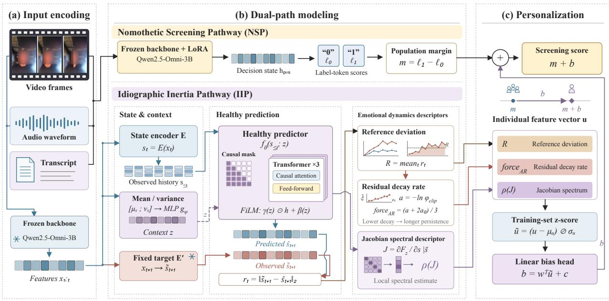  
Figure 2: InertiaMPDD framework. (a) Input encoding. (b) NSP population margin and IIP healthy-reference descriptors. (c) Individual correction and screening. Snowflakes mark frozen parameters. Curves and representations are schematic.

To preserve the feature space used for healthy pretraining, IIP extracts states and conditioning statistics from the unadapted frozen backbone Φ. NSP reads its decision state from the LoRA-adapted configuration $\Phi _ { \phi } .$ . Thus the healthy reference retains its pretraining feature source during supervised NSP adaptation. The adapted NSP decision state is not reused as an IIP trajectory.

We form the reference pool $\mathcal { H } = \{ i : ( \mathcal { X } _ { i } , y _ { i } ) \in \mathcal { D } _ { \operatorname { t r a i n } } , y _ { i } = 0 \}$ from the training set’s non-depressed records. Here “healthy” refers to that dataset label. A shared predictor learns the next-state patterns within this pool. There is no per-subject control matching. Our world-model-inspired latent predictor [14, 15, 17] produces $\hat { s } _ { t + 1 } = f _ { \theta } ( s _ { \le t } ; z )$ from the observed history and context. Independently, the next observation is encoded as $\tilde { s } _ { t + 1 } = E ^ { \prime } ( x _ { t + 1 } )$ . We fit the predictor by

$$
\begin{array} { r l } { \underset { \theta , E , \psi } { \operatorname* { m i n } } } & { \mathbb { E } _ { \mathcal { H } } \big \lVert f _ { \theta } ( s _ { \le t } ; z ) - \mathrm { s g } ( \tilde { s } _ { t + 1 } ) \big \rVert _ { 2 } ^ { 2 } } \\ & { + \lambda \mathcal { R } _ { \mathrm { V I C R e g } } ( E ) , } \end{array}\tag{2}
$$

where sg blocks gradients through the target. The semi-orthogonal encoder $E ^ { \prime }$ stays fixed, so prediction errors are measured against a consistent target space. The squared-error term learns to predict the independently encoded next observation. The variance term $\begin{array} { r } { \sum _ { j } \operatorname* { i n a x } ( 0 , 1 - \operatorname { \dot { s t d } } ( E _ { j } ) ) } \end{array}$ of $\mathcal { R } _ { \mathrm { V I C R e g } }$ discourages low feature variance, while its covariance term reduces redundant coordinates [29].

For fixed representations and conditioning, squared-error learning targets the average next state of healthy training records with that history and context. The learned reference estimates this conditional pattern subject to data coverage and model capacity (Section 3.6). It is a prediction along the same observed recording, not an observed healthy trajectory for that person.

A shared predictor accommodates different contexts without fitting a separate model to each person. It provides a common construction for comparing long recordings without segment-level emotion annotations.

The predictor uses three causal Transformer layers, expanded in Figure 2. Within the state-history input, causal attention restricts each position to its available prefix, while z provides context conditioning. Each prediction is evaluated against the independently encoded next observation. At the following step, the predictor again receives the observed history, rather than recursively feeding back its previous prediction. Thus residual peaks localize one-step disagreement along the recording, without accumulating errors from a free-running rollout.

## 3.3 Reference-derived emotional dynamics descriptors

We describe each recording through three complementary properties: departure from a healthy reference, persistence of residual fluctuations and the predictor’s local spectral structure. These reference-derived emotional dynamics descriptors are recording-level proxies computed from latent behavioral states. Emotional dynamics supplies the theoretical motivation, while the measured quantities remain prediction errors and model properties.

Reference Deviation (R) measures average disagreement with the healthy predictor. For the observed and predicted next states,

$$
\begin{array} { l } { r _ { t } = \| \tilde { s } _ { t + 1 } - \hat { s } _ { t + 1 } \| _ { 2 } , } \\ { \displaystyle R = \frac { 1 } { T - 1 } \sum _ { t = 1 } ^ { T - 1 } \| \tilde { s } _ { t + 1 } - \hat { s } _ { t + 1 } \| _ { 2 } . } \end{array}\tag{3}
$$

A larger R means that the observed continuation is less consistent with the reference. Averaging over transitions keeps the score from increasing simply because a recording is longer. Unlike within-person variability or successivechange measures, it compares observations with predictions, rather than with their own mean or adjacent observations. Predictive disagreement can also contain observation uncertainty, as formalized by the bias–noise decomposition in Section 3.6. Its association with depression is evaluated by the supervised readout rather than assumed from the residual alone.

Residual Decay Rate $\operatorname { ( f o r c e _ { A R } ) }$ characterizes the persistence of fluctuations in prediction disagreement. We center the residuals at their recording median, $e _ { t } = r _ { t } - \mathrm { m e d i a n } _ { \tau } r _ { \tau }$ , and fit a no-intercept $\mathbf { A R } ( 1 )$ coefficient over adjacent valid pairs:

$$
\hat { \varphi } = \frac { \sum _ { t } e _ { t } e _ { t + 1 } } { \sum _ { t } e _ { t } ^ { 2 } } , \qquad a = - \ln \varphi _ { \mathrm { c l i p } } .\tag{4}
$$

We set $\varphi _ { \mathrm { c l i p } } = \mathrm { c l i p } ( \hat { \varphi } , 0 . 0 1 , 0 . 9 9 9 )$ . The resulting decay rate is regularized toward the healthy-training prior $a _ { 0 }$

$$
\mathrm { f o r c e } _ { \mathrm { A R } } = { \frac { a + 2 a _ { 0 } } { 3 } } .\tag{5}
$$

An unavailable fit receives $a _ { 0 }$ . Under a stationary AR(1) interpretation, $\varphi ^ { k } = \exp ( - k a )$ describes decay over k onesecond steps. Thus a smaller decay rate indicates stronger residual persistence, or greater stickiness of predictive departure [7, 8]. Unlike R, it concerns fluctuations around the recording’s residual level. A large but rapidly varying residual need not be persistent. Because the fitted sequence is a residual magnitude, this is an inertia-inspired proxy for predictive-departure persistence, rather than a direct measure of the persistence of positive or negative affect.

Jacobian Spectral Descriptor $( \rho ( J ) )$ summarizes the healthy predictor’s local mapping in its learned coordinates. With mean online state ${ \bar { s } } = T ^ { - 1 } \sum _ { t = 1 } ^ { T } s _ { t }$ and fixed context $z ,$ define the single-token map $F _ { z } ( s ) = f _ { \theta } ( [ s ] ; z )$ . Its Jacobian and spectral radius are

$$
J = \left. \frac { \partial F _ { z } ( s ) } { \partial s } \right| _ { s = \bar { s } } , \qquad \rho ( J ) = \operatorname* { m a x } _ { j } | \lambda _ { j } ( J ) | .\tag{6}
$$

We estimate this property using 30 Jacobian–vector power iterations, avoiding an explicit $2 5 6 \times 2 5 6$ matrix. The estimate describes the reference predictor in its fixed online-to-target coordinates. Section 3.6 explains the distinction from a common-coordinate relaxation model.

## 3.4 Personalized screening with two pathways

NSP adapts the frozen omni-modal backbone with LoRA [33] and casts the risk judgment as the generation of a label token (Figure 3a). Let $h _ { \mathrm { p o s } }$ be the decision state, the hidden state one step before the label is written, and let $W \in \mathbb { R } ^ { d \times 2 }$ give the scores of the two risk tokens, represented by the label tokens 0 and 1. The label $y \in \{ 0 , 1 \}$ is supervised by cross-entropy,

$$
\begin{array} { r } { \mathcal { L } _ { \mathrm { C E } } = - \log p ( \langle \mathrm { r i s k } _ { y } \rangle \ : | \ : h _ { \mathrm { p o s } } ) , } \end{array}\tag{7}
$$

the adapter’s only label-supervised path. Let $\ell _ { j } = h _ { \mathrm { p o s } } ^ { \top } W _ { j }$ be the logit of label token $j .$ The population margin is $m = \ell _ { 1 } - \ell _ { 0 } = h _ { \mathrm { { o o s } } } ^ { \top } ( W _ { 1 } - W _ { 0 } )$ . Reading both scores at the same decision position also gives $m = \log ( p _ { 1 } / p _ { 0 } )$ since their softmax normalizer cancels. Thus $m > 0$ favors the positive label and $m = 0$ marks equal label scores. “Population” refers to the shared readout parameters, not an average across subjects: each recording still produces its own margin. This continuous score retains the relative evidence needed for the additive correction. A thresholded label would discard it.

Algorithm 1 InertiaMPDD: training and inference   
Require: Training data D, healthy pool H, frozen backbone Φ and target encoder $E ^ { \prime }$   
Ensure: IIP modules $( E , g _ { \psi } , f _ { \theta } )$ , LoRA ϕ, head $( w , c )$   
1: 1. Learn the healthy reference   
2: for each healthy minibatch (600 updates) do   
3: Extract and align frozen features $x _ { 1 : T }$ at 1 Hz   
4: $s _ { t } \gets E ( x _ { t } ) , \bar { s _ { t } } \gets E ^ { \prime } ( x _ { t } )$   
5: $z \gets g _ { \psi } ( [ \mu _ { x } ; v _ { x } ] ) , \hat { s } _ { t + 1 } \gets f _ { \theta } ( s _ { \le t } ; z )$   
6: Update $( { \dot { E } } , g _ { \psi } , { \dot { f } } _ { \theta } )$ by Equation (2)   
7: end for   
8: 2. Extract descriptors with frozen IIP modules   
9: Estimate decay prior a from healthy training records   
10: for each training record do   
11: Recompute states, context and next-state prediction   
12: Compute $r _ { t }$ and mean R by Equation (3)   
13: Fit AR(1) to rt − median $\iota _ { \tau } r _ { \tau }$   
14: Clip φ to [0.01, 0.999], set a ← − ln φ   
15: forceAR $\dot {  } ( a + 2 a _ { 0 } ) / 3$ (or a0 if unavailable)   
16: Estimate $\rho ( \dot { J } )$ at s¯ with fixed z, 30 JVP steps   
17: $u  [ R ,$ force $\mathbf { \chi } _ { \mathrm { A R } } , \rho ( J ) ]$   
18: end for   
19: Fit training statistics $( \mu _ { u } , \sigma _ { u } )$ for u˜   
20: 3. Learn screening and correction   
21: for each labeled minibatch do   
22: Read $m = \ell _ { 1 } - \ell _ { 0 }$ from adapted backbone $\Phi _ { \phi }$   
23: $b \gets w ^ { \top } \tilde { u } + c$   
24: Minimize Equation (9): CE updates ϕ, BCE $( w , c )$   
25: end for   
26: Inference: extract u and m using the learned modules   
27: $\widehat { y } \gets \mathbb { K } [ m + w ^ { \top } ( ( u - \mu _ { u } ) \oslash \sigma _ { u } ^ { \smile } ) + c \geq 0 ]$

The population margin becomes personalized by merging it with the three IIP features (Figure 2, right). Writing $u = [ R , { \mathrm { ~ f o r c e } } _ { \mathrm { A R } } , \rho ( J ) ]$ , we standardize it elementwise as $\tilde { u } = ( u - \mu _ { u } ) \oslash \sigma _ { u }$ using training-set statistics. The head converts the three standardized summaries into one correction. Adding this correction to the population score gives

$$
b = w ^ { \top } \tilde { u } + c , \qquad \ell = m + b , \qquad \hat { y } = \nl \mathcal { k } [ \ell \geq 0 ] .\tag{8}
$$

To learn the population score and its correction with separate gradient paths, we use

$$
\mathcal { L } = \mathcal { L } _ { \mathrm { C E } } + \mathrm { B C E } \big ( \sigma ( \mathrm { s g } ( m ) + b ) , y \big ) .\tag{9}
$$

The stop-gradient on m leaves its value available to BCE while blocking its gradient to NSP. The decision can equivalently be written as m $\geq - b \colon$ positive b lowers the required screening margin, whereas negative b raises it. Since $\sigma ( m ) = p _ { 1 } / ( p _ { 0 } + p _ { 1 } )$ is the relative two-label probability, adding b multiplies the corresponding odds by exp(b). Here c is a shared intercept, while $w ^ { \top } \tilde { u }$ supplies the recording-dependent adjustment. Two recordings with the same NSP margin can therefore receive different decisions when their reference features differ. The coefficient of m is fixed at one: the head learns an additive adjustment, without separately learning how much to weight the population margin. The standardized vector $\tilde { u } \in \mathbb { R } ^ { 3 }$ is distinct from the predictor condition $\bar { z } \in \mathbb { R } ^ { 1 6 }$ . IIP alone predicts from u without $m ,$ using its own supervised readout. Table 6 examines the contribution of its feature subsets.

Standardization lets w learn the contribution signs on a common training-defined scale. CE updates LoRA, while BCE learns $( w , c )$ from the current margin without changing the adapter’s CE gradient. The modules $E , E ^ { \prime } , g _ { \psi }$ and $f _ { \theta }$ remain frozen.

The procedure therefore has three stages: healthy labels select the pool for self-supervised prediction, the frozen predictor supplies training-standardized features, and supervised learning fits the screening margin and its correction. Freezing predictor parameters still permits input differentiation for J. Algorithm 1 gives the full training and inference procedure.

## 3.5 Detailed NSP and IIP Computations

Figure 3 expands the two computational routes. In NSP, the highlighted weights $W _ { 0 }$ and $W _ { 1 }$ read label scores from the multimodal state immediately before the output digit. In IIP, history and context feed the healthy predictor, while the next observation follows the independent fixed-target route. The blue dashed and red solid curves show a projection of the prediction and observation. Their residual uses every target-space coordinate.

(a) NSP · label-token margin  
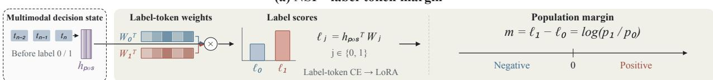  
(b) IIP · healthy-reference descriptors

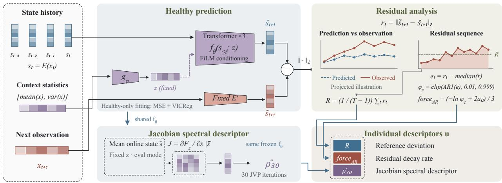  
Figure 3: Detailed pathway computations. (a) NSP label-score readout. (b) IIP healthy prediction, residual analysis, Jacobian spectral estimation and descriptor assembly. Tokens, curves and matrix cells are schematic.

The residual-analysis route supplies R and force . The Jacobian route instead differentiates the frozen predictor at s¯ with z fixed, supplying $\hat { \rho } _ { 3 0 }$ . These routes meet at the descriptor vector $u ,$ whose training-standardized values enter the correction head. Thus z conditions the reference, while u summarizes its predictive comparison and local mapping. The spectral route remains separate from the observed residual sequence.

## 3.6 Analytical properties of the reference

Let $s _ { t } = E ( x _ { t } ) \in \mathbb { R } ^ { 2 5 6 }$ be the online state, $\tilde { s } _ { t } = E ^ { \prime } ( x _ { t } )$ the fixed-target state, and $z \in \mathbb { R } ^ { 1 6 }$ the context vector. The following results explain which mathematical properties motivate the descriptors and how the decision gradients are separated.

## 3.6.1 Residuals combine predictive departure and observation noise

Proposition 1 (Bias–noise decomposition of the residual). Let $\tilde { s } _ { t + 1 } = g ( s _ { \le t } ; z ) + \varepsilon _ { t }$ , with $\mathbb { E } [ \varepsilon _ { t } \mid s _ { \leq t } , z ] = 0$ and conditional covariance $\Sigma _ { \varepsilon } ( s _ { \leq t } , z )$ . Then

$$
\begin{array} { r l } & { \mathbb { E } [ r _ { t } ^ { 2 } \mid s _ { \leq t } , z ] = \underbrace { \| g ( s _ { \leq t } ; z ) - f _ { \theta } ( s _ { \leq t } ; z ) \| _ { 2 } ^ { 2 } } _ { d e p a r t u r e \ t e r m \ \Delta _ { t } ^ { 2 } } } \\ & { \quad \quad \quad \quad + \operatorname { t r } ( \Sigma _ { \varepsilon } ( s _ { \leq t } , z ) ) . } \end{array}\tag{10}
$$

When $g \approx f _ { \theta } ,$ , the expected squared residual approaches the conditional noise trace. A larger departure term increases s̃the expected squared residual at a fixed noise level.

Proof of Proposition 1 (bias–noise decomposition). Substituting the observation model and suppressing the shared function arguments gives

$$
\begin{array} { r l } & { \mathbb { E } \big [ r _ { t } ^ { 2 } \mid s _ { \le t } , z \big ] = \mathbb { E } \big [ \| g + \varepsilon _ { t } - f _ { \theta } \| _ { 2 } ^ { 2 } \mid s _ { \le t } , z \big ] } \\ & { \quad \quad \quad \quad = \| g - f _ { \theta } \| _ { 2 } ^ { 2 } + 2 \mathbb { E } \big [ \varepsilon _ { t } \mid s _ { \le t } , z \big ] ^ { \top } \big ( g - f _ { \theta } \big ) } \\ & { \quad \quad \quad + \mathbb { E } \big [ \| \varepsilon _ { t } \| _ { 2 } ^ { 2 } \mid s _ { \le t } , z \big ] } \\ & { \quad \quad \quad = \| g - f _ { \theta } \| _ { 2 } ^ { 2 } + \mathrm { t r } \big ( \Sigma _ { \varepsilon } \big ( s _ { \le t } , z \big ) \big ) , } \end{array}\tag{11}
$$

where $\mathbb { E } [ \varepsilon _ { t } \mid s _ { \leq t } , z ] = 0$ eliminates the cross term. The recording-level feature R averages the corresponding unsquared norms. □

The decomposition separates mismatch with the learned healthy reference from observation uncertainty. The downstream screening task evaluates the relevance of their combined residual.

## 3.6.2 AR persistence motivates the regularized decay descriptor

Proposition 2 (Residual AR(1) decay). Let the stationary, mean-centered sequence $e _ { t } = r _ { t } - \mathbb { E } [ r _ { t } ] f o l l o w e _ { t + 1 } =$ $\varphi e _ { t } + \eta _ { t }$ with innovations satisfying $\mathbb { E } [ \eta _ { t } \ | \ e _ { t } , e _ { t - 1 } , . . . ] = 0$ and $0 < \varphi < 1$ . Its lag-one autocorrelation is $\varphi ,$ and $\mathbb { E } [ e _ { t + k } ~ \vert ~ e _ { t } ] = \varphi ^ { k } e _ { t } = \exp ( - k a ) e _ { t }$ , where $a = - \ln \varphi$ is the unregularized residual decay rate.

This stationary, mean-centered model motivates the decay interpretation. The implemented median-centering, clipping and shrinkage regularize the empirical descriptor without establishing stationarity.

Proof of Proposition 2. Under the stationary AR(1) and conditional-mean assumptions, $\operatorname { C o v } ( e _ { t + 1 } , e _ { t } ) = \varphi \operatorname { V a r } ( e _ { t } )$ so its lag-one autocorrelation is $\varphi$ . Repeated conditional expectation gives $\mathbb { E } [ e _ { t + k } \ | \ e _ { t } ] = \varphi ^ { k } e _ { t }$ . Substituting $a = - \ln \varphi$ yields the exponential form. Equation (5) then regularizes this estimate toward the healthy-training prior before it enters the screening features. □

## 3.6.3 The Jacobian spectral descriptor depends on the learned coordinates

Proposition 3 (Common-coordinate transition: conditional relaxation result). For afirst-order transition in common state coordinates, let s¯ be a fixed point and $\delta _ { t } = s _ { t } - \bar { s }$ . To first order $\delta _ { t + k } \approx \bar { J } ^ { k } \delta _ { t }$ . For diagonalizable J with $0 < \rho ( J ) < 1$ , its slowest linearized decay has characteristic time $\tau = - 1 / \ln \rho ( J )$ , which diverges as $\rho ( J ) \to 1 ^ { - }$

Proof of Proposition 3. Under the common-coordinate first-order transition assumptions of Proposition 3, a Taylor expansion about the fixed point s¯ gives $\delta _ { t + 1 } \approx J \delta _ { t }$ , hence $\delta _ { t + k } \approx J ^ { k } \delta _ { t }$ . For diagonalizable $J \overset { \cdot } { = } V \Lambda V ^ { - 1 }$ we have $\| \dot { J } ^ { k } \| \le \kappa ( V ) \rho ( J ) ^ { k }$ with $\kappa ( V )$ the condition number of V, which bounds the linearized decay when $0 < \rho ( J ) < 1$ The slowest mode attains this rate. Solving $\rho ( J ) ^ { \tau } = e ^ { - 1 }$ gives $\tau = - 1 / \ln \rho ( J )$ . □

The transition result assumes a common state basis and a fixed point. Our local Jacobian analysis differentiates the online-to-target map $F _ { z }$ at the mean online state. Under independent coordinate changes A and $B ,$ its Jacobian becomes $B J A ^ { - 1 }$ , so eigenvalues can change. We therefore interpret the spectral estimate in the fixed learned coordinates. The mean state need not be an equilibrium, and non-normal transitions can show transient amplification even when their spectral radius is below one.

For IIP, $\rho ( J )$ is therefore reported in the fixed learned coordinates rather than converted to a recovery time. Table 15 evaluates its numerical approximation.

## 3.6.4 Stop-gradient separates adapter and correction learning

Proposition 4 (Role of the stop-gradient on the margin). Assume b is computedfrom thefixed unadapted IIP and is independent ofthe LoRA parameters. Without a stop-gradient on m, BCE contributes an adapter gradient. With $\mathrm { s g } ( m )$ the adapter gradient equals the CE component at the current parameters.

Proof of Proposition 4. Writing $\ell _ { \mathrm { B C E } } = - y \log \sigma ( m + b ) - ( 1 - y ) \log ( 1 - \sigma ( m + b ) )$ , we have $\partial \ell _ { \mathrm { B C E } } / \partial m =$ $\sigma ( m + b ) - y$ . Without a stop-gradient this term reaches the LoRA parameters ϕ through m. With $\operatorname { s g } ( m )$ , BCE reaches only the bias-head parameters, so $\partial \mathcal { L } / \partial \phi = \partial \mathcal { L } _ { \mathrm { C E } } / \partial \phi$ exactly. This identity isolates the two gradients while retaining the dependence of the bias-head update on the screening margin. □

Table 1: Implementation and hyperparameters.
<table><tr><td>Item</td><td>Value</td></tr><tr><td>Backbone</td><td>Qwen2.5-Omni-3B thinker (bf16, frozen)</td></tr><tr><td>LoRA</td><td>rank 8, trained from scratch,  ${ \mathrm { l r ~ } } 1 \times 1 0 ^ { - 4 } .$  , batch 1 × grad-accum 8, linear schedule</td></tr><tr><td>Bias head</td><td>Linear(3 → 1), fp32, AdamW lr  $1 \times 1 0 ^ { - 2 }$  (separate parameter group),  $\mathcal { N } ( 0 , 0 . 1 )$  init</td></tr><tr><td>IIP</td><td>online encoder 4096 → 256, 3-1ayer FiLM causal Transformer, width 256, 4 heads, feed-forward width 512, dropout 0.1, pre-normalization, fixed semi-orthogonal target</td></tr><tr><td>Conditioning MLP</td><td>8192 → 512 → 512 → 16, SiLU, final-layer  $\mathcal { N } ( 0 , 0 . 0 1 )$  initialization</td></tr><tr><td>IIP optimization</td><td>Adam, lr  $3 \times 1 0 ^ { - 4 }$  , batch 4, 600 steps, variance/covariance weights 0.1 each</td></tr><tr><td>Losses</td><td>NSP: CE, bias head: BCE (stop-gradient on the margin), IIP: MSE + VICReg</td></tr><tr><td>Input limits</td><td>audio ≤ 300 s (25 tok/s), IIP visual sampling: 64 frames</td></tr><tr><td>Latent state</td><td>1 Hz pooled concatenation of audio 2048 and visual 2048  $( x _ { t } \in \mathbb { R } ^ { 4 0 9 6 } ) \to s _ { t } \in \mathbb { R } ^ { 2 5 6 }$ </td></tr></table>

## 4 Experiments

## 4.1 Experimental setup

D-Vlog [10] and LMVD [11] contain spontaneous, self-recorded vlogs, evaluated here with binary depression labels. D-Vlog uses English YouTube recordings with the original test assignment restricted to currently available videos. LMVD uses Chinese vlogs and a 7:1:2 split. The healthy predictor is trained only on healthy training recordings, with no uploader shared between training and evaluation. AVEC2014 [18] and MPDD [12] provide interview/task-elicited recordings. Our AVEC2014 evaluation uses a subject-isolated 80:20 split of 83 participants (67 training, 16 test), keeping all recordings and segments from each participant together. MPDD quantitative experiments use cohort-specific retraining with subject-isolated 80:20 splits. Speech is transcribed with Whisper large-v3 [34]. Checkpoints are selected on validation data.

Following the baseline evaluation protocol, we report accuracy and positive-class F1, with depression as the positive class. The pathway and feature results in Tables 2 and 6 are multi-seed summaries over five seeds. Figures show single-run exports. Group differences and feature-performance significance are assessed by permutation tests across all datasets (Section 4.3). Published baselines on the two vlog corpora include Mamba-based sequence models, transformer-based fusion and DepressionAgent, with values from the original papers in the comparison format of Zhu et al. [5]. For AVEC2014/MPDD, baseline entries are selected by best results for each method and cohort.

Implementation settings for Qwen2.5-Omni-3B [35], the predictor and the correction head are summarized in Table 1.

## 4.2 Implementation and Evaluation Settings

## 4.2.1 Temporal alignment and context conditioning

Audio is limited to 300 seconds and provides 25 hidden tokens per second before one-second pooling. Visual alignment follows the grid defined in Section 3.2.

The D-Vlog dynamics pool uses recordings of at least 120 seconds. This length criterion applies to reference learning, while screening evaluation retains the full test cohort.

## 4.2.2 Residual decay and Jacobian spectral estimation

The AR coefficient is fitted without an intercept after subtracting the recording median from the scalar residual sequence. Fewer than ten residuals or a lag-energy sum below $1 0 ^ { - 6 }$ yields an unavailable estimate. Otherwise, the coefficient is clipped to [0.01, 0.999]. Its negative logarithm lies between approximately 0.001 and 4.605 per one-second step. The prior $a _ { 0 }$ is the median available raw decay in the healthy training group, with weight two in the shrinkage formula. An unavailable estimate receives $a _ { 0 } .$ . The training prior is also used on held-out recordings.

For the spectral feature, the predictor is in evaluation mode, with dropout disabled. The input is the single-token state [¯s] and the condition z is fixed. Autograd computes Jacobian–vector products without storing a dense Jacobian. Power iteration starts from a random vector with seed zero. An iterate norm below $1 0 ^ { - 1 2 }$ returns zero. The updates and final

estimate are

$$
v _ { k + 1 } = { \frac { J v _ { k } } { \| J v _ { k } \| _ { 2 } } } , \qquad { \hat { \rho } } _ { 3 0 } = \| J v _ { 2 9 } \| _ { 2 } .\tag{12}
$$

The forward pass uses bf16. The reported descriptor is a finite-iteration spectral-radius estimate at the mean online state. Standalone IIP fits its own supervised binary readout on u, without the NSP margin, with validation-based model selection.

## 4.3 Feature Aggregation and Statistical Tests

## 4.3.1 Group means summarize recording-level descriptors

Each recording i supplies three scalars: time-averaged residual $R _ { i } .$ , shrinkage-adjusted residual decay force $\mathbf { \Delta } _ { \mathrm { A R } } ^ { \left( i \right) }$ , and the power-iteration estimate of $\rho ( J _ { i } )$ at its mean state. Within class $g$ and split S, Table 5 reports

$$
\bar { q } _ { g , S } = \frac { 1 } { N _ { g , S } } \sum _ { i \in \mathcal { T } _ { g , S } } q _ { i } ,\tag{13}
$$

where $q _ { i }$ is one of these extracted, unstandardized features and $N _ { g , S } = \vert \mathcal { T } _ { g , S } \vert$ . Each recording contributes one value, irrespective of its duration. Group means use unstandardized descriptors, while decision readouts standardize each recording separately using training statistics.

## 4.3.2 Group and prediction tests address different hypotheses

The tests in Table 5 assess healthy–depressed differences in descriptor values. The tests in Table 6 assess predictive performance against label permutations. A descriptor can therefore have a group mean contrast but limited individual discrimination. The vlog residual tests use the directional hypothesis of higher values in the depressed group.

## 4.4 Pathway complementarity across recording settings

Vlog gains indicate complementary reference evidence. On D-Vlog, NSP reaches F1 97.38 and IIP alone 69.65, while fusion reaches 98.41 (Table 2). LMVD has more balanced pathways: IIP and NSP reach 75.88 and 74.57, and fusion reaches 84.98, a 9.10-point gain over its stronger pathway. Self-recorded vlogs permit individually chosen topics and spontaneous expression [10, 11]. Direct population cues are already strong on D-Vlog, whereas LMVD leaves more scope for a context-conditioned healthy comparison. Thus standalone reference strength and complementarity with NSP are distinct sources of screening value.

Interview settings can favor reference-derived descriptors. IIP reaches F1 92.31 on MPDD-elder and 90.91 on young, exceeding fusion at 85.71 and 80.00. Elder fusion still improves NSP by 8.79 points. Guided interaction in MPDD [12] can constrain freely expressed topics and behavior, making reference comparison informative alongside population classification. The ordering also motivates examining fusion separately: m has coefficient one in Equation (8), so the correction head shifts the boundary without learning a separate pathway weight.

AVEC2014 reveals a boundary of reference discrimination. Fusion reaches 66.67 F1 versus 50.00 for either pathway, but remains below the largest displayed baseline value of 74.07. Although AVEC2014 and MPDD both use elicited recordings, their pathway orderings differ. Task coverage, age, language and cohort composition therefore matter alongside acquisition setting. A useful healthy reference must cover the evaluated behavior. The group and control experiments below examine where its predictive departures carry discriminative information.

## 4.4.1 Elicited recordings require task-matched references

MPDD uses guided interaction, while AVEC2014 includes prompted responses and reading [12, 18]. Reference coverage must therefore account for task regularities as well as expression, with age, language and cohort composition also varying across datasets.

The unstandardized contrasts retain the same direction across splits on MPDD, whereas AVEC2014 reverses direction.   
This links the screening differences to reference consistency and motivates broader task coverage.

## 4.4.2 Paired intervals quantify decision-level uncertainty

Paired bootstrap intervals quantify uncertainty in fixed-export gains. AVEC2014 and MPDD-young have wider intervals than D-Vlog, consistent with their smaller evaluation cohorts.

Table 2: Depression-screening Accuracy and F1 score (%). Bold: largest displayed value. –: unavailable.
<table><tr><td></td><td colspan="2">D-Vlog</td><td colspan="2">LMVD</td><td colspan="2">AVEC2014</td><td colspan="2">MPDD-elder</td><td colspan="2">MPDD-young</td></tr><tr><td>Method</td><td>Accuracy</td><td>F1 score</td><td>Accuracy F1 score</td><td></td><td>Accuracy</td><td>F1 score</td><td>Accuracy</td><td>F1 score</td><td>Accuracy</td><td>F1 score</td></tr><tr><td>Depression Detector [10]</td><td>一</td><td>63.50</td><td></td><td></td><td>72.00</td><td>74.07</td><td>64.90</td><td>56.90</td><td>59.09</td><td>60.87</td></tr><tr><td>TAMFN [36]</td><td></td><td>65.82</td><td></td><td></td><td>64.00</td><td>70.97</td><td>65.22</td><td>20.00</td><td>59.09</td><td>60.87</td></tr><tr><td>CAIINET [37]</td><td></td><td>66.55</td><td></td><td></td><td>60.00</td><td>53.80</td><td>45.50</td><td>50.00</td><td>81.10</td><td>82.40</td></tr><tr><td>Depressformer [38]</td><td>65.00</td><td>59.00</td><td></td><td></td><td>84.00</td><td>33.33</td><td>55.20</td><td>45.70</td><td>68.18</td><td>74.07</td></tr><tr><td>DepMamba [39]</td><td>68.87</td><td>76.44</td><td>72.13</td><td>73.20</td><td>80.00</td><td>16.67</td><td>78.26</td><td>61.54</td><td>77.27</td><td>80.00</td></tr><tr><td>CMF-Mamba [40]</td><td></td><td></td><td>74.86</td><td>75.53</td><td>46.70</td><td>27.30</td><td>52.30</td><td>44.80</td><td>74.10</td><td>76.00</td></tr><tr><td>STCM-Mamba [41]</td><td>72.64</td><td>77.69</td><td>75.41</td><td>76.49</td><td>62.00</td><td>68.85</td><td>60.87</td><td>30.77</td><td>63.64</td><td>63.64</td></tr><tr><td>MSI-Net [42]</td><td>70.25</td><td>73.91</td><td>74.34</td><td>77.06</td><td>69.05</td><td>38.10</td><td>47.83</td><td>53.85</td><td>72.73</td><td>76.92</td></tr><tr><td>MDDFormer [11]</td><td></td><td></td><td>76.88</td><td>76.85</td><td>74.00</td><td>33.30</td><td>73.91</td><td>66.67</td><td>77.27</td><td>73.68</td></tr><tr><td>BHDD [43]</td><td></td><td>75.94</td><td>78.11</td><td>78.06</td><td>62.00</td><td>67.80</td><td>66.36</td><td>17.78</td><td>52.27</td><td>51.16</td></tr><tr><td>DepressionAgent [5]</td><td>95.26</td><td>95.69</td><td>82.57</td><td>83.04</td><td>56.25</td><td>58.82</td><td>78.26</td><td>44.44</td><td>59.09</td><td>30.77</td></tr><tr><td>NSP (alone)</td><td>97.14</td><td>97.38</td><td>74.30</td><td>74.57</td><td>75.00</td><td>50.00</td><td>86.36</td><td>76.92</td><td>50.00</td><td>66.67</td></tr><tr><td>IIP (alone)</td><td>64.00</td><td>69.65</td><td>73.70</td><td>75.88</td><td>62.50</td><td>50.00</td><td>95.45</td><td>92.31</td><td>90.91</td><td>90.91</td></tr><tr><td>InertiaMPDD</td><td>98.29</td><td>98.41</td><td>84.00</td><td>84.98</td><td>81.25</td><td>66.67</td><td>90.91</td><td>85.71</td><td>81.82</td><td>80.00</td></tr></table>

Table 3: Cross-split reference-deviation contrasts and interpretation. Differences are depressed minus healthy means.
<table><tr><td>Cohort</td><td>Training  $\Delta R$ </td><td>Test  $\Delta R$ </td></tr><tr><td>MPDD-elder</td><td>1.571</td><td>1.976</td></tr><tr><td>MPDD-young</td><td>2.269</td><td>2.554</td></tr><tr><td>AVEC2014</td><td>0.317</td><td>-0.170</td></tr></table>

Table 4: Paired-bootstrap F1 intervals (%). Differences are percentage points.
<table><tr><td>Cohort</td><td>Quantity F1 / ∆F1</td><td>95% CI</td></tr><tr><td rowspan="3">D-Vlog</td><td>NSP Full</td><td>97.38 [94.84, 99.47]</td></tr><tr><td>98.41</td><td>[96.38, 100.00]</td></tr><tr><td>Gain +1.03</td><td>[0.00, +2.76]</td></tr><tr><td rowspan="3">AVEC2014</td><td>NSP</td><td>50.00</td></tr><tr><td>Full</td><td>[0.00, 85.71] 66.67 [0.00, 100.00]</td></tr><tr><td>Gain</td><td>+16.67 [-50.00, +80.00]</td></tr><tr><td rowspan="3">MPDD-young NSP</td><td></td><td>66.67 [42.86, 81.08]</td></tr><tr><td>Full</td><td>80.00 [54.52, 95.65]</td></tr><tr><td>Gain</td><td>+13.33 [-11.52, +37.44]</td></tr></table>

## 4.5 From reference features to screening evidence

Vlog descriptors distinguish group shifts from individual discrimination. D-Vlog and LMVD show higher depressed-group test residuals $( p \ : = \ : 0 . 0 0 0 3$ and 0.0040), yet LMVD’s residual-only screening is nonsignificant $( p = 0 . 5 0 7 )$ . Its Jacobian descriptor is the strongest single feature (F1 69.47), and the combination reaches 75.88. D-Vlog’s combination improves residual-only F1 from 56.77 to 69.65 despite weak marginal temporal and spectral contrasts. Group tests measure class-mean differences, whereas feature-performance tests assess prediction against shuffled labels. Joint descriptor information can therefore improve classification without significant shifts in every marginal mean.

Reference deviation is the clearest recurring MPDD descriptor. Depressed-group R is higher in both training and test for both cohorts, with test $p = 0 . 0 0 0 5$ (elder) and 0.0004 (young). Residual-only F1 reaches 82.35 and 95.65 (Table 6). Combining descriptors raises elder F1 to 92.31 but gives 90.91 on young. The recurring residual contrast supports reference departure as useful evidence, while the value of temporal and spectral additions depends on the cohort.

AVEC2014 lacks a stable cross-split signature. The depressed-minus-healthy residual contrast changes from +0.317 in training to −0.170 in test, with neither significant. The test-only spectral contrast $( p = 0 . 0 2 6 5 )$ does not recur significantly in training, and spectral-only screening remains nonsignificant $( p = 0 . 5 1 1 0 )$ . Combined F1 is 50.00 $( p = 0 . 2 8 4 6 )$ , locating the main difficulty in reference discrimination rather than simply pathway combination.

Table 5: Healthy and depressed group means of unstandardized IIP descriptors. Bold: $\begin{array} { r } { p < 0 . 0 5 . } \end{array}$
<table><tr><td colspan="9">Reference deviation R Residual decay rate forceAR</td></tr><tr><td></td><td>Split</td><td colspan="2">Healthy Depressed</td><td colspan="3">Healthy</td><td colspan="3">descriptor ρ(J) Healthy</td></tr><tr><td>Dataset</td><td></td><td></td><td></td><td>p-value</td><td></td><td>Depressed</td><td>p-value</td><td>Depressed</td><td>p-value</td></tr><tr><td>D-Vlog</td><td>Test</td><td>6.707</td><td>6.901 6.916</td><td>0.0003</td><td>2.103</td><td>1.964 0.998 1.998</td><td>0.716 0.718</td><td>0.710 0.709</td><td>0.467 0.421</td></tr><tr><td rowspan="3">LMVD</td><td>Training</td><td>6.820</td><td></td><td>0.078</td><td>2.090</td><td>0.897 0.0002</td><td>0.938</td><td>0.731</td><td></td></tr><tr><td>Test</td><td>12.510</td><td>12.887</td><td>0.0040</td><td>1.559</td><td>1.409</td><td></td><td></td><td>&lt;0.0001</td></tr><tr><td>Training</td><td>12.487 11.805</td><td>12.966</td><td>&lt;0.0001</td><td>1.547</td><td>1.435 0.0010</td><td>0.898 0.994</td><td>0.750 0.869</td><td>&lt;0.0001 0.0265</td></tr><tr><td rowspan="2">AVEC2014</td><td>Test</td><td></td><td>11.635 11.076</td><td>0.8142</td><td>1.634 2.004</td><td>1.779 1.969</td><td>0.3405 0.5502</td><td>1.364</td><td></td></tr><tr><td>Training</td><td>10.759 7.076</td><td>9.052</td><td>0.3830 0.0005</td><td>0.466</td><td>0.469</td><td></td><td>1.301</td><td>0.2868</td></tr><tr><td>MPDD-elder</td><td>Test</td><td>7.341</td><td>8.912</td><td>&lt;0.0001</td><td></td><td>0.8551 0.479 0.3829</td><td>1.396 1.400</td><td>1.499 1.367</td><td>0.3009 0.4118</td></tr><tr><td rowspan="2">MPDD-young</td><td>Training Test</td><td>8.238</td><td>10.792</td><td>0.0004</td><td>0.467 0.683</td><td>0.679</td><td>0.9047 0.954</td><td>1.091</td><td>0.1359</td></tr><tr><td></td><td>8.313</td><td>10.582</td><td>&lt;0.0001</td><td>0.728</td><td>0.678 0.0119</td><td>1.038</td><td>1.068</td><td>0.5215</td></tr><tr><td></td><td>Training</td><td></td><td></td><td></td><td></td><td></td><td></td><td></td><td></td></tr></table>

Table 6: Feature ablations and duration controls (%). Combined: $R + \mathrm { f o r c e } _ { \mathrm { A R } } + \rho ( J )$ . Bold p-values: $p < 0 . 0 5$
<table><tr><td></td><td colspan="3">D-Vlog</td><td colspan="3">LMVD</td><td colspan="2">AVEC2014</td><td colspan="2">MPDD-elder</td><td colspan="3">MPDD-young</td></tr><tr><td>Features</td><td></td><td>Accuracy F1 score p-value Accuracy F1 score</td><td></td><td></td><td></td><td></td><td></td><td>p-value Accuracy F1 score p-value Accuracy F1 score p-value Accuracy F1 score</td><td></td><td></td><td></td><td></td><td>p-value</td></tr><tr><td>Reference deviation R</td><td>60.36</td><td>56.77 0.0015</td><td></td><td>57.80</td><td>59.69</td><td>0.507</td><td>25.00</td><td>33.33 0.9500</td><td>86.36</td><td>82.35 0.0005</td><td>95.45</td><td>95.65</td><td>0.0001</td></tr><tr><td>Residual decay rate</td><td></td><td></td><td></td><td></td><td></td><td></td><td></td><td></td><td></td><td></td><td></td><td></td><td></td></tr><tr><td>forceAR Jacobian spectral</td><td>54.44</td><td>49.67</td><td>0.092</td><td>54.40</td><td>57.93</td><td>0.023</td><td>62.50</td><td>50.000.2846</td><td>59.09</td><td>47.060.3881</td><td>40.91</td><td>43.48</td><td>0.8969</td></tr><tr><td>descriptor ρ(J)</td><td>46.75</td><td>50.55</td><td>0.877</td><td>68.30</td><td></td><td>69.47 &lt;0.0005</td><td>50.00</td><td>42.860.5110</td><td>68.18</td><td>58.820.1142</td><td>59.09</td><td>57.14</td><td>0.3352</td></tr><tr><td>Combined</td><td>64.00</td><td>69.65</td><td>0.0005</td><td>73.70</td><td></td><td>75.88 &lt;0.0005</td><td>62.50</td><td>50.000.2846</td><td>95.45</td><td>92.31 0.0002</td><td>90.91</td><td></td><td>90.91 &lt;0.0001</td></tr><tr><td>Combined</td><td></td><td></td><td></td><td></td><td></td><td></td><td></td><td></td><td></td><td></td><td></td><td></td><td></td></tr><tr><td>+ duration</td><td>62.72</td><td>72.00</td><td>0.001</td><td>74.70</td><td></td><td>75.18 &lt;0.0005</td><td>62.50</td><td>50.000.2846</td><td>95.45</td><td>93.33 0.0001</td><td>100.00</td><td></td><td>100.00 &lt;0.0001</td></tr><tr><td>Duration</td><td>56.21</td><td>68.64</td><td>0.148</td><td>53.50</td><td>52.32</td><td>0.559</td><td>50.00</td><td>33.33 0.7154</td><td>68.18</td><td>46.150.2646</td><td>63.64</td><td>69.23</td><td>0.1835</td></tr></table>

Duration can interact with the behavioral descriptors. Adding it raises D-Vlog F1 to 72.00 but reduces accuracy, and gives no F1 gain on LMVD. Duration-augmented MPDD readouts reach 93.33 and 100.00 F1 despite weak duration-only performance. We keep duration outside the main IIP definition. Duration-matched and healthy-pool controls further examine these interactions (Table 14).

## 4.5.1 Candidate proxy markers and their scope

The results support reference-derived emotional dynamics as candidate proxy biomarkers: computable behavioral descriptors associated with depression labels under recording-level supervision. Their relevance is established through screening, rather than direct emotion annotations. Stress, fatigue and acquisition conditions may also affect predictive departure. Comparison with alternative conditions can test specificity, while repeated recordings and longitudinal symptom measurements can assess repeatability and sensitivity to change within a defined context of use [44]. The cohort-specific fits evaluate within-cohort utility, while a fixed reference on an unseen cohort requires a distinct test of transfer.

## 4.6 Feature Distributions and Screening Implications

Each row of Figure 4 corresponds to one cohort. Dots summarize recordings and dashed lines indicate class means.   
Tables 5 and 6 provide the group tests and feature readouts.

## 4.6.1 Elicited cohorts differ in reference-deviation consistency

Depressed residuals concentrate at higher values in both MPDD cohorts. Healthy observations sometimes reach the same range, particularly on young. Temporal and spectral ranges overlap substantially. Elder spectral estimates can exceed one within the fixed predictor coordinates. Together, these patterns explain why reference deviation recurs as a strong feature while the remaining descriptors offer cohort-dependent additions.

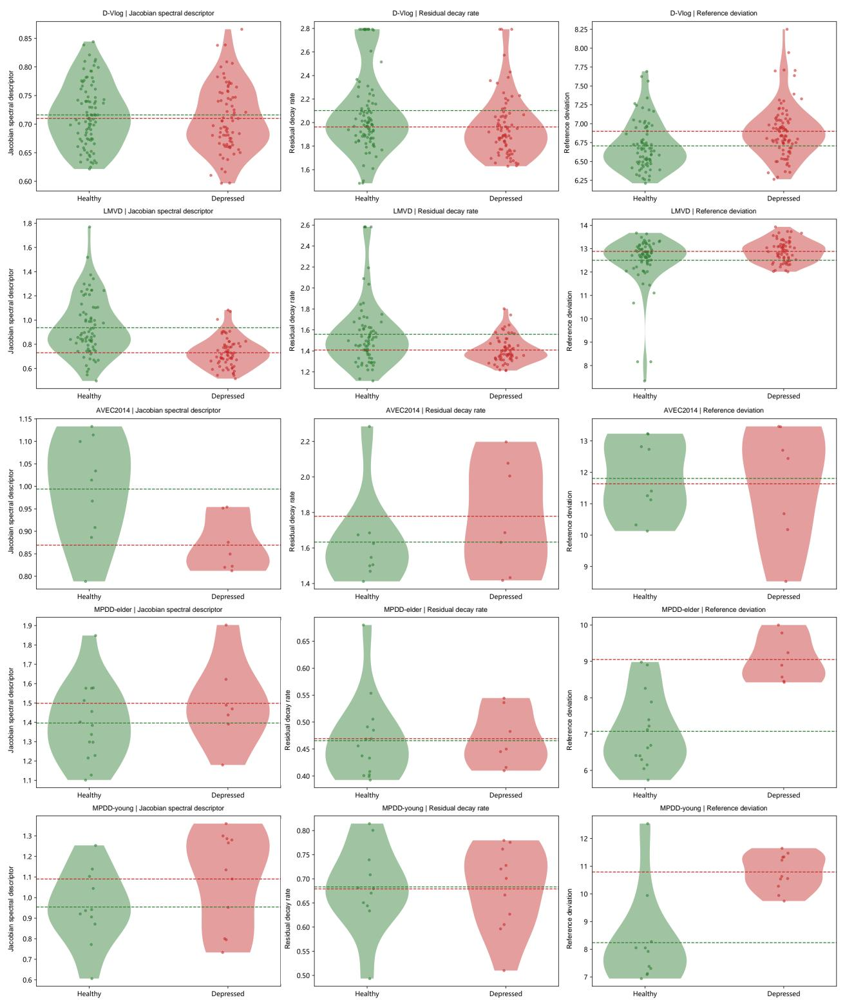  
Figure 4: Test-set IIP feature distributions. Green: healthy. Red: depressed. Violins show distributions, dots recordings, and dashed lines class means.

Table 7: Decision and reference-construction ablations: F1 score (%). Blue: full configurations.
<table><tr><td>Configuration</td><td></td><td>AVEC MPDD 2014</td><td>elder</td><td>MPDD</td></tr><tr><td>InertiaMPDD (full)</td><td>D-Vlog LMVD</td><td>84.98 66.67</td><td>85.71</td><td>young 80.00</td></tr><tr><td>NSP only</td><td>98.41 97.38 74.57</td><td>50.00</td><td>76.92</td><td>66.67</td></tr><tr><td>w/o conditioning</td><td>97.87</td><td>75.07 50.00</td><td>72.73</td><td>66.67</td></tr><tr><td>Global correction</td><td>97.35</td><td>80.84 66.67</td><td>72.73</td><td>66.67</td></tr><tr><td></td><td></td><td></td><td></td><td></td></tr><tr><td>Full IIP (audio + visual) Shuffled history</td><td>69.65</td><td>75.88 50.00</td><td>92.31</td><td>90.91</td></tr><tr><td></td><td>67.02</td><td>59.68 35.29</td><td>77.78</td><td>90.91</td></tr><tr><td>Repeated mean state</td><td>71.92</td><td>74.81 46.15</td><td>60.00</td><td>63.64</td></tr><tr><td>Visual only</td><td>62.50</td><td>62.78 40.00</td><td>82.35</td><td>86.96</td></tr><tr><td>Audio only</td><td>75.68</td><td>64.86 36.36</td><td>77.78</td><td>73.68</td></tr></table>

On AVEC2014, the residual groups occupy a broad shared range. Depressed spectral values tend toward the lower part of the healthy range in test, but that mean contrast does not recur significantly in training or yield significant spectral-only screening. The visualization therefore complements the cross-split evidence for weak reference discrimination.

## 4.6.2 Vlog overlap distinguishes mean shifts from useful combinations

D-Vlog spectral and AR distributions overlap closely. Depressed residuals shift upward with a longer upper tail, while overlap remains. On LMVD, healthy samples extend to larger spectral-radius estimates and decay values and have a lower residual tail. These shapes explain how a residual mean difference can coexist with weak residual-only screening, and why a joint readout can benefit from the other features.

## 4.7 Component ablation

Table 7 summarizes decision and reference-construction ablations. The comparisons below separate the effects of context conditioning, temporal order, modality and pathway combination.

## 4.7.1 Context and correction address different personalization steps

Removing z gives $f _ { \theta _ { 0 } } ( s _ { \le t } )$ . Global context replaces recording-specific conditioning with a shared training-set mean, and context swapping assigns another recording’s context to the observed history. Decision correction is a separate operation: global correction replaces $b = w ^ { \top } \tilde { u } + c \mathrm { w i t h } - \tau ^ { \star }$ , while NSP alone sets b = 0.

Table 8: Conditioning and correction controls: F1 score (%).
<table><tr><td>AVEC MPDD MPDD Configuration D-Vlog LMVD 2014 elder</td></tr><tr><td>young InertiaMPDD 98.41 84.98 66.67 85.71</td></tr><tr><td>80.00 w/o conditioning 97.87 75.07 50.00 72.73 66.67</td></tr><tr><td>Global context 97.87 75.07 54.55 72.73 66.67</td></tr><tr><td>Context swapping 97.35 76.5533.33 77.78 90.91</td></tr><tr><td>Global correction 97.35 80.8466.67 72.73 66.67</td></tr></table>

On LMVD, full F1 is 84.98, versus 75.07 without conditioning and 80.84 with global correction. Elder reaches 85.71 with the full model, compared with 72.73 for both controls. These benefits are not uniform: AVEC2014 ties global correction, and young’s swapped-context result exceeds full fusion.

## 4.7.2 Reference construction benefits from temporal order and multiple modalities

Ordered prediction benefits LMVD and elder. Shuffling preserves the recording’s states while disrupting their order, whereas repeating the mean removes within-recording changes. LMVD reaches 75.88 F1 with full IIP, 59.68 after shuffling and 74.81 with a repeated mean. Elder reaches 92.31, 77.78 and 60.00, respectively. Young’s shuffled history reaches 90.91, matching full IIP. Its strong static control also shows that recording-level state information can be discriminative. AVEC2014 remains weak across predictor designs.

Learned prediction improves on simplified references. On LMVD, full IIP reaches 75.88 F1, compared with 70.36 for a static MLP, 67.82 for persistence and 65.50 for a linear AR predictor. The corresponding elder scores are 92.31,

Table 9: Complete IIP predictor and modality controls (%). Blue: full IIP.
<table><tr><td>Configuration</td><td colspan="2">D-Vlog</td><td colspan="2">LMVD</td><td colspan="2">AVEC2014</td><td colspan="2">MPDD-elder</td><td colspan="2">MPDD-young</td></tr><tr><td></td><td>Accuracy F1 score Accuracy F1 score</td><td></td><td></td><td></td><td></td><td></td><td></td><td></td><td>Accuracy F1 score Accuracy F1 score Accuracy F1 score</td><td></td></tr><tr><td>Full IIP (causal Transformer)</td><td>64.00</td><td>69.65</td><td>73.70</td><td>75.88</td><td>62.50</td><td>50.00</td><td>95.45</td><td>92.31</td><td>90.91</td><td>90.91</td></tr><tr><td>Static MLP</td><td>65.68</td><td>69.15</td><td>67.60</td><td>70.36</td><td>56.25</td><td>0.00</td><td>68.18</td><td>66.67</td><td>100.00</td><td>100.00</td></tr><tr><td>Persistence</td><td>62.72</td><td>63.16</td><td>64.10</td><td>67.82</td><td>56.25</td><td>46.15</td><td>68.18</td><td>58.82</td><td>45.45</td><td>33.33</td></tr><tr><td>Linear AR predictor</td><td>63.31</td><td>67.37</td><td>61.50</td><td>65.50</td><td>75.00</td><td>33.33</td><td>68.18</td><td>53.33</td><td>81.82</td><td>81.82</td></tr><tr><td>Shuffled history</td><td>62.72</td><td>67.02</td><td>57.20</td><td>59.68</td><td>31.25</td><td>35.29</td><td>81.82</td><td>77.78</td><td>90.91</td><td>90.91</td></tr><tr><td>Repeated mean state</td><td>66.27</td><td>71.92</td><td>73.10</td><td>74.81</td><td>56.25</td><td>46.15</td><td>63.64</td><td>60.00</td><td>63.64</td><td>63.64</td></tr><tr><td>Visual only</td><td>53.85</td><td>62.50</td><td>60.70</td><td>62.78</td><td>25.00</td><td>40.00</td><td>86.36</td><td>82.35</td><td>86.36</td><td>86.96</td></tr><tr><td>Audio only</td><td>73.37</td><td>75.68</td><td>60.30</td><td>64.86</td><td>56.25</td><td>36.36</td><td>81.82</td><td>77.78</td><td>77.27</td><td>73.68</td></tr></table>

66.67, 58.82 and 53.33. These contrasts support learning a conditional next-state reference beyond static mapping, state repetition or linear prediction on these cohorts.

Audio and vision provide complementary reference evidence on LMVD and MPDD. Joint IIP reaches 75.88 F1 on LMVD, exceeding visual-only 62.78 and audio-only 64.86, and exceeds either modality on both MPDD cohorts. Reference utility and the need for true temporal order therefore vary across cohorts.

Table 10: D-Vlog NSP modality and correction controls (%).
<table><tr><td>Configuration</td><td>Accuracy F1 score</td></tr><tr><td>Visual-only NSP</td><td>73.14 75.39</td></tr><tr><td>Audio-only NSP</td><td>92.57 92.82</td></tr><tr><td>Audio-visual NSP</td><td>95.43 95.74</td></tr><tr><td>Audio-visual-text NSP</td><td>97.14 97.38</td></tr><tr><td>Audio-visual  $\mathrm { N S P + I I P }$ </td><td>95.43 95.74</td></tr><tr><td>InertiaMPDD</td><td>98.29 98.41</td></tr></table>

D-Vlog has strong direct acoustic and language cues. Adding transcripts to audiovisual NSP raises F1 from 95.74 to 97.38, with correction reaching 98.41.

## 4.7.3 Descriptor informativeness differs from fusion complementarity

Table 11: Fusion feature controls: F1 score (%).
<table><tr><td>Correction input</td><td>AVEC MPDD MPDD D-Vlog 2014 elder young</td></tr><tr><td>NSP only</td><td>97.38 50.00 76.92 66.67</td></tr><tr><td> $\mathrm { N S P } + \dot { R }$ </td><td>97.89 66.67 77.78 85.71</td></tr><tr><td> $\mathrm { N S P + f o r c e _ { A R } }$ </td><td>97.35 54.55 66.67 66.67</td></tr><tr><td> $\mathrm { N S P } + \rho ( J )$ </td><td>97.87 50.00 72.73 70.00</td></tr><tr><td> $\mathrm { N S P } + R , \mathrm { f o r c e } _ { \mathrm { A R } }$ </td><td>97.38 28.57 77.78 85.71</td></tr><tr><td> $\mathsf { N S P } + R , \rho ( J )$ </td><td>97.89 28.57 77.78 85.71</td></tr><tr><td> $\mathrm { N S P } + \mathrm { f o r c e } _ { \mathrm { A R } } , \rho ( J )$ </td><td>97.3528.57 66.67 72.73</td></tr><tr><td> $\mathbf { I n e r t i a M P D D }$ </td><td>98.41 66.67 85.71 80.00</td></tr></table>

A useful descriptor need not require the full feature combination. R alone matches full correction on AVEC2014 and exceeds it on MPDD-young, whereas the full correction is strongest among these inputs on D-Vlog and elder. Standalone informativeness and fusion complementarity are therefore distinct.

## 4.7.4 Pathway weighting changes how reference evidence is used

Scaling learns α in αm + b. Convex fusion uses $\alpha m + ( 1 - \alpha ) q ( u )$ , and feature-dependent gating replaces α with α(u), where q(u) is the standalone IIP score.

Pathway balance matters when IIP is strong. Convex fusion reaches 93.33 F1 on elder and 100.00 on young, compared with 85.71 and 80.00 for fixed additive correction. Allowing the relative pathway weights to change can

Table 12: Pathway-weighting controls: F1 score (%).
<table><tr><td>AVEC MPDD MPDD 2014</td></tr><tr><td>Decision rule D-Vlog LMVD</td></tr><tr><td>young 97.38 74.57 50.00 76.92 66.67</td></tr><tr><td>NSP only IIP only 69.65 75.88 50.00 92.31</td></tr><tr><td>90.91 Global correction 97.35 80.84 66.67 72.73 66.67</td></tr><tr><td>InertiaMPDD 98.41 84.98 66.67 85.71 80.00</td></tr><tr><td>Scaling 97.87 75.20 50.00 48.28 66.67</td></tr><tr><td>Convex fusion 97.38 77.06 60.00 93.33 100.00</td></tr><tr><td>Feature-dependent gating 97.38 77.8536.36 75.00 90.91</td></tr></table>

therefore make better use of the strong standalone IIP scores on MPDD. Fixed additive correction remains strongest among these rules on both vlog cohorts, so a more flexible rule does not uniformly improve screening. These controls separate the informativeness of the reference descriptors from the decision rule used to combine them with NSP.

## 4.7.5 D-Vlog decisions can survive simplified dynamics

These single-run diagnostics hold NSP margins fixed and refit correction heads to test whether simplified references preserve the screening decisions.

Table 13: D-Vlog diagnostic controls with a fixed population margin.
<table><tr><td>Control</td><td>Observed relation to the diagnostic reference</td></tr><tr><td>Zero or global context</td><td>Same test decisions as true context in one setting</td></tr><tr><td>Persistence predictor</td><td>Reproduces the conditional predictor&#x27;s test decisions</td></tr><tr><td>PCA / Mahalanobis scores</td><td>Match confusion counts, each differing on two recordings</td></tr><tr><td>Global / block time shuffling</td><td>Retain screening performance</td></tr><tr><td>Repeated mean-state input</td><td>Retains strong screening performance without temporal variation</td></tr></table>

Strong NSP margins make several reference variants decision-equivalent. Label-independent keyword-aligned masking of cached audiovisual intervals gives 96.84 F1 versus 96.88 for its diagnostic reference, testing those intervals rather than transcript-token removal from the full model.

## 4.7.6 Reference coverage affects descriptor quality

Table 14: IIP controls for duration, interval masking and reference-pool size: F1 score (%).
<table><tr><td>MPDD MPDD Setting LMVD elder</td></tr><tr><td>young IIP reference 75.88 92.31 90.91</td></tr><tr><td>Duration matched 56.07 100.00 90.91</td></tr><tr><td>AV interval masking 80.65 87.50 85.71</td></tr><tr><td>Healthy-pool subsampling 70.54 73.68 95.24</td></tr></table>

Reference coverage affects discrimination. Duration matching preserves strong MPDD IIP performance, whereas healthy-pool subsampling weakens LMVD and elder. The cohort-dependent response to interval masking further supports learning references that cover the available expression patterns.

## 4.8 Numerical accuracy and extraction cost

Thirty JVP steps balance spectral accuracy and cost. Relative errors are 4.25% and 4.53% on D-Vlog and LMVD, with faster extraction than exact eigendecomposition. Further iterations increase runtime without consistently reducing error.

Incremental descriptor-extraction cost IIP extraction from cached backbone features takes approximately 0.23 seconds per recording, including predictor evaluation and JVP iterations, with peak GPU memory below 1 GiB in

Table 15: Jacobian spectral estimation: numerical accuracy and extraction cost.
<table><tr><td>Cohort</td><td>Estimator</td><td>Mean relative error (%)</td><td>Spearman correlation</td><td>Runtime (s)</td><td>Peak memory (GiB)</td></tr><tr><td>D-Vlog</td><td>Exact eigendecomposition</td><td>0</td><td>1</td><td>0.322</td><td>0.059</td></tr><tr><td>D-Vlog</td><td>30 JVP steps</td><td>4.25</td><td>0.6086</td><td>0.204</td><td>0.058</td></tr><tr><td>D-Vlog</td><td>60 JVP steps</td><td>5.32</td><td>0.5547</td><td>0.444</td><td>0.058</td></tr><tr><td>D-Vlog</td><td>120 JVP steps</td><td>4.28</td><td>0.5542</td><td>0.761</td><td>0.058</td></tr><tr><td>LMVD</td><td>Exact eigendecomposition</td><td>0</td><td>1</td><td>0.370</td><td>0.059</td></tr><tr><td>LMVD</td><td>30 JVP steps</td><td>4.53</td><td>0.9423</td><td>0.224</td><td>0.058</td></tr><tr><td>LMVD</td><td>60 JVP steps</td><td>5.56</td><td>0.9221</td><td>0.493</td><td>0.058</td></tr><tr><td>LMVD</td><td>120 JVP steps</td><td>4.08</td><td>0.9557</td><td>0.929</td><td>0.058</td></tr></table>

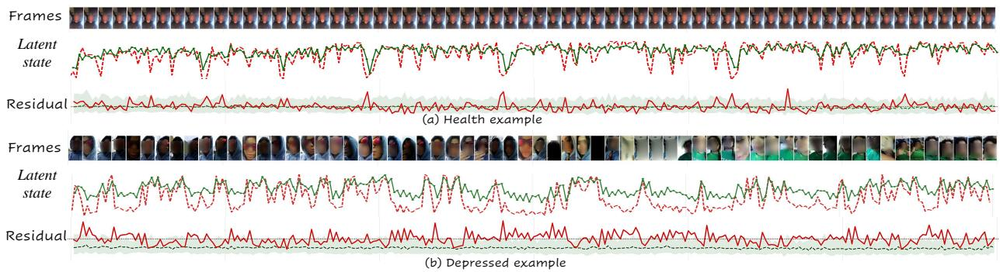  
Figure 5: D-Vlog case studies. Healthy (top) and depressed (bottom) recordings. Green: healthy reference. Red: subject trace or residual. Shading: healthy residual 5–95% range.

the recorded runs. Fitting the correction head takes approximately 0.2–0.3 seconds on CPU. Backbone extraction is excluded from these measurements.

## 4.9 Case studies and visualization

Residual traces localize predictive disagreement. Figure 5 illustrates the temporal information compressed into R. The healthy trajectory follows its reference through marked fluctuations, whereas the depressed example shows sustained residual elevations. Movement alone is insufficient: a changing trajectory can be well predicted, while a smooth one can remain offset from its reference. The full-state residual localizes disagreement even when the displayed projection looks similar. Recording-level labels identify the screening category, while residual traces indicate when the observed continuation differs from the learned reference. These traces guide audiovisual inspection of isolated and recurring disagreement. Averaging these errors yields R, and residual decay summarizes the persistence of their fluctuations. Together with the spectral descriptor, these summaries support recording-level screening. They locate predictive disagreement without segment-level symptom attribution. Section 4.9.1 includes the complete multi-dataset cases.

Correction depends on joint score geometry. Figure 6 connects the descriptors to screening decisions. The top row shows continuous NSP margins. The bottom row places each recording relative to b = −m. D-Vlog separates strongly along m, while its IIP view overlaps substantially. LMVD leaves more scope for adjustment in the plotted run. Table 2 reports the quantitative pathway comparison. In the plotted AVEC2014 run, both classes lie on the negative-score side, so feature variation alone does not ensure a useful decision boundary. On MPDD-elder, correction moves one missed positive across the boundary. It improves NSP without surpassing standalone IIP. Marginal densities describe coordinate separation, whereas the joint (m, b) location determines the additive decision.

For a schematic example, recordings with the same $m = 0 . 4$ but corrections $b = - 0 . 7$ and $b = 0 . 2$ receive final scores −0.3 and 0.6. The recording-dependent correction therefore changes the decision even when population evidence is identical.

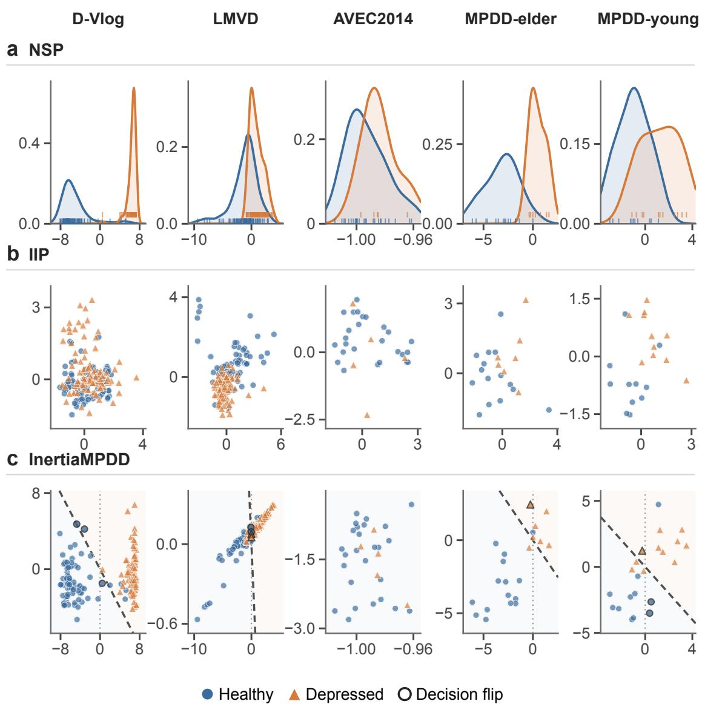  
Figure 6: Test-set pathway views from single-run exports. Columns: cohorts. Rows: NSP margins, IIP features and InertiaMPDD $( m , b )$ with boundary $b = - m$ . Blue circles: healthy. Orange triangles: depressed. Dark outlines: changed decisions.

## 4.9.1 Case Studies across Datasets

Visualization settings D-Vlog bands use healthy test recordings with the displayed case excluded. Pointwise 5th, 50th and 95th percentiles summarize aligned one-second traces. Its two latent curves share a first-principal-component projection fitted to the healthy pool.

The MPDD pair comes from an earlier case-study run using the official partition and contains training-partition examples. Its healthy-training reference band excludes the displayed subject. Quantitative MPDD tables use cohort-specific 80:20 retraining. These cases illustrate prediction agreement under their visualization settings. Reference bands and latent projections are descriptive context for reading the trajectories.

Predictive agreement is more informative than visible stillness LMVD further separates predictive agreement from visible stillness. The healthy recording fluctuates with intermittent residual peaks, whereas the relatively smooth depressed trace remains offset from its reference. The relevant contrast is prediction agreement rather than the amount of visible motion.

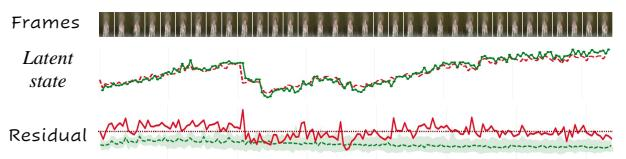

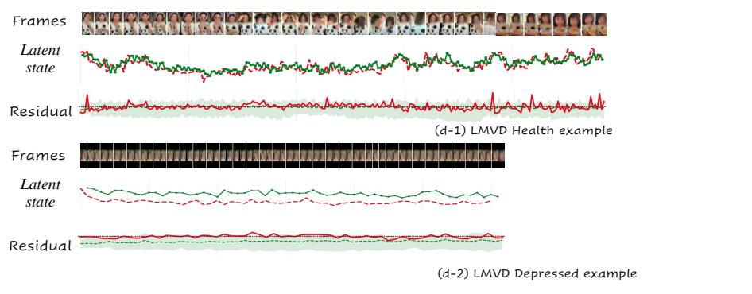

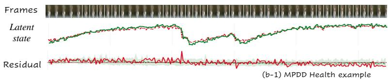

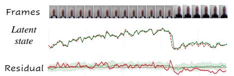

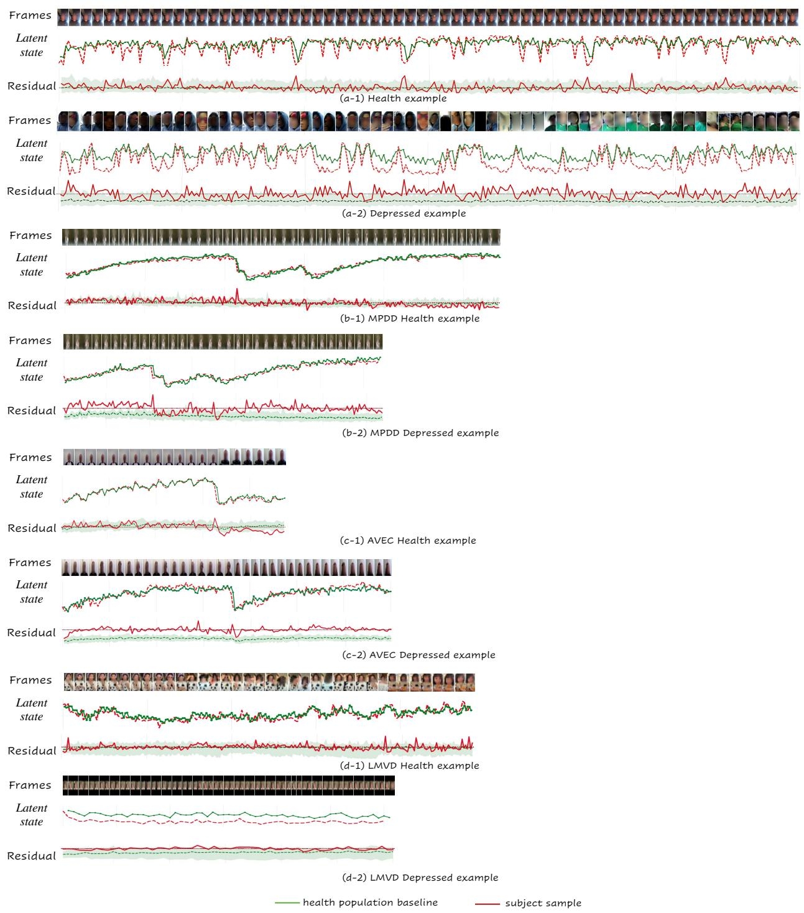

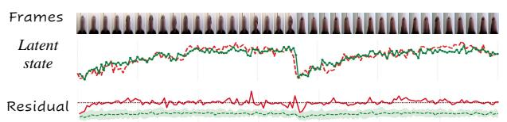  
Figure 7: Case studies across datasets. Healthy/depressed pairs from D-Vlog, MPDD-young, AVEC2014 and LMVD. Green: healthy reference. Red: subject trace or residual. Shading: healthy residual 5–95% range.

Similar projections can conceal full-state disagreement In MPDD-young, the healthy trajectory follows long trends and abrupt changes with mainly local error excursions. The depressed example follows the broad projected shape but has a more persistently elevated residual. The full-state norm captures disagreement beyond the single coordinate shown in the latent curve.

AVEC examples explain the feature without defining the cohort Both AVEC2014 trajectories follow the reference’s large-scale changes, while the depressed example has a residual offset. This illustrates the temporal meaning of R without overriding the cohort’s weak standalone separation.

## 5 Conclusion

InertiaMPDD explores how pretrained multimodal representations can supply measurable evidence for depression screening without fine-grained emotion labels. Its world-model-inspired healthy reference produces reference-derived emotional dynamics descriptors for standalone screening and individual correction. The experiments support three findings. A predictive reference makes behavioral departure useful for screening, with recurring MPDD deviation contrasts and complementary vlog evidence. Reference construction draws on both temporal order and multimodal content: LMVD benefits from ordered prediction and joint audio–visual inputs, while strong static controls on MPDD-young show that informative reference evidence can also reside in recording-level state patterns. Reference informativeness and fusion benefit remain distinct, motivating cohort-sensitive use of the two pathways. AVEC2014’s weak standalone separation identifies reference coverage as a key boundary. These candidate proxy descriptors warrant further validation of their specificity, repeatability and transfer.

## References

[1] Md. Rezwanul Haque, Md. Milon Islam, S. M. Taslim Uddin Raju, Hamdi Altaheri, Lobna Nassar, and Fakhri Karray. MMFformer: Multimodal fusion transformer network for depression detection. arXiv preprint arXiv:2508.06701, 2025.

[2] Jincheng Li, Menglin Zheng, Jiongyi Yang, Yihui Zhan, and Xing Xie. DynMultiDep: A dynamic multimodal fusion and multi-scale time series modeling approach for depression detection. Journal ofImaging, 12(1):29, 2026.

[3] Misha Sadeghi, Robert Richer, Bernhard Egger, Lena Schindler-Gmelch, Lena H. Rupp, Farnaz Rahimi, Matthias Berking, and Bjoern Eskofier. Harnessing multimodal approaches for depression detection using large language models and facial expressions. npj Mental Health Research, 3(1):66, 2024.

[4] Lei Wang, Chao Wang, Chen Li, Tetsuya Murai, Yan Bai, Zhen Song, Shuo Zhang, Qian Zhang, Yan Huang, and Xiaojun Bi. AI-assisted multi-modal information for the screening of depression: A systematic review and meta-analysis. npj Digital Medicine, 8(1):523, 2025.

[5] Fangjie Zhu, Haifeng Lu, Sicheng Zhao, Runhao Zeng, and Xiping Hu. DepressionAgent: Reading, listening, seeing, and deliberating multimodal evidence for depression risk assessment. arXiv preprint arXiv:2608.13891, 2026.

[6] Linhai Zhang, Ziyang Gao, Deyu Zhou, and Yulan He. Explainable depression detection in clinical interviews with personalized retrieval-augmented generation. In Findings ofthe Associationfor Computational Linguistics: ACL 2025, pages 9927–9944, 2025.

[7] Peter Kuppens, Nicholas B. Allen, and Lisa B. Sheeber. Emotional inertia and psychological maladjustment. Psychological Science, 21(7):984–991, 2010.

[8] Peter Koval, Madeline L Pe, Kristof Meers, and Peter Kuppens. Affect dynamics in relation to depressive symptoms: variable, unstable or inert? Emotion, 13(6):1132, 2013.

[9] Marlies Houben, Wim Van Den Noortgate, and Peter Kuppens. The relation between short-term emotion dynamics and psychological well-being: A meta-analysis. Psychological Bulletin, 141(4):901–930, 2015.

[10] Jeewoo Yoon, Chaewon Kang, Seungbae Kim, and Jinyoung Han. D-Vlog: Multimodal vlog dataset for depression detection. In Proceedings ofthe AAAI Conference on Artificial Intelligence, pages 12226–12234, 2022.

[11] Lang He, Kai Chen, Junnan Zhao, Yimeng Wang, Ercheng Pei, Haifeng Chen, Jiewei Jiang, Shiqing Zhang, Jie Zhang, Zhongmin Wang, Tao He, and Prayag Tiwari. LMVD: A large-scale multimodal vlog dataset for depression detection in the wild. Information Fusion, 126:103632, 2026.

[12] Changzeng Fu, Zelin Fu, Qi Zhang, Xinhe Kuang, Jiacheng Dong, Kaifeng Su, Yikai Su, Wenbo Shi, Junfeng Yao, Yuliang Zhao, Shiqi Zhao, Jiadong Wang, Siyang Song, Chaoran Liu, Yuichiro Yoshikawa, Björn Schuller, and Hiroshi Ishiguro. The first MPDD challenge: Multimodal personality-aware depression detection. In Proceedings ofthe 33rd ACM International Conference on Multimedia, pages 13924–13929, 2025.

[13] Carlos Busso, Murtaza Bulut, Chi-Chun Lee, Abe Kazemzadeh, Emily Mower, Samuel Kim, Jeannette Chang, Sungbok Lee, and Shrikanth S. Narayanan. IEMOCAP: Interactive emotional dyadic motion capture database. Language Resources and Evaluation, 42(4):335–359, 2008.

[14] David Ha and Jürgen Schmidhuber. Recurrent world models facilitate policy evolution. In Advances in Neural Information Processing Systems, 2018.

[15] Yann LeCun. A path towards autonomous machine intelligence. OpenReview, 2022.

[16] Mahmoud Assran, Quentin Duval, Ishan Misra, Piotr Bojanowski, Pascal Vincent, Michael Rabbat, Yann LeCun, and Nicolas Ballas. Self-supervised learning from images with a joint-embedding predictive architecture. In Proceedings of the IEEE/CVF Conference on Computer Vision and Pattern Recognition (CVPR), pages 15619–15629, 2023.

[17] Mido Assran, Adrien Bardes, David Fan, Quentin Garrido, et al. V-JEPA 2: Self-supervised video models enable understanding, prediction and planning. arXiv preprint arXiv:2506.09985, 2025.

[18] Michel Valstar, Björn Schuller, Kirsty Smith, Timur Almaev, Florian Eyben, Jarek Krajewski, Roddy Cowie, and Maja Pantic. AVEC 2014: 3D dimensional affect and depression recognition challenge. In Proceedings of the 4th International Workshop on Audio/Visual Emotion Challenge, pages 3–10, 2014.

[19] Jonathan Gratch, Ron Artstein, Gale Lucas, Giota Stratou, Stefan Scherer, Angela Nazarian, Rachel Wood, Jill Boberg, David DeVault, Stacy Marsella, David Traum, Skip Rizzo, and Louis-Philippe Morency. The distress analysis interview corpus of human and computer interviews. In Proceedings ofthe Ninth International Conference on Language Resources and Evaluation (LREC), pages 3123–3128, 2014.

[20] Bowen Zhou, Marc-André Fiedler, and Ayoub Al-Hamadi. CAF-Mamba: Mamba-based cross-modal adaptive attention fusion for multimodal depression detection. In IEEE International Conference on Acoustics, Speech and Signal Processing (ICASSP), pages 12107–12111, 2026.

[21] Caijian Hua, Zhuofu Wen, Liuying Li, and Xia Zhou. ASYM: Multimodal depression recognition via mamba-enhanced attentive feature fusion. Frontiers in Psychiatry, 17:1704005, 2026.

[22] Xiangyun Zheng, Yingjian Liu, Zonghai Zha, Minghuan Lv, and Hao Wang. AttMamba: Mamba with attention mechanism for multimodal depression detection. Neurocomputing, 684:133570, 2026.

[23] S. Liu, Y. Huang, and X. Yuan. PAVNet: A personality-aware audio-visual fusion network for depression detection. In IEEE International Conference on Bioinformatics and Biomedicine (BIBM), pages 5868–5875, 2025.

[24] Changzeng Fu, Yiming Zhang, Ming Shang, Shiqi Zhao, Alexis Meneses, Zhaojie Luo, Chaoran Liu, Yuichiro Yoshikawa, Hiroshi Ishiguro, and Björn Schuller. MPDD-AVG: Multimodal personality-aware depression detection via audio-visual interview and gait analysis. In Proceedings ofthe 34th ACM International Conference on Multimedia, 2026.

[25] Changzeng Fu, Kaifeng Su, Yikai Su, Fengkui Qian, Yixuan Zhang, Chaoran Liu, Siyang Song, Le Yang, Xiaoyong Lv, Peng Shan, et al. M3ADD: A novel benchmark for physiology signal-based automatic depression detection with multimodal multitask multievent framework. In ICASSP 2025–2025 IEEE International Conference on Acoustics, Speech and Signal Processing (ICASSP), pages 1–5. IEEE, 2025.

[26] Changzeng Fu, Yi Wang, Yiming Zhang, Kaifeng Su, Yikai Su, Yunze Zhang, Shiwen Zhao, Chaoran Liu, and Shiqi Zhao. M3DEP: Individual difference-aware depression detection from EEG-EMG signals via multievent-multimodal-multitask learning. In Proceedings of the 34th ACM International Conference on Multimedia, pages 2035–2043, 2026.

[27] Wen Liu, Weixin Luo, Dongze Lian, and Shenghua Gao. Future frame prediction for anomaly detection—a new baseline. In Proceedings ofthe IEEE Conference on Computer Vision and Pattern Recognition, pages 6536–6545, 2018.

[28] Mingxuan Hu, Ziqi Liu, Hongbo Ma, Jiaqi Liu, Xinlan Wu, and Yangbin Chen. Mitigating gender bias in depression detection via counterfactual inference. arXiv preprint arXiv:2512.01834, 2026.

[29] Adrien Bardes, Jean Ponce, and Yann LeCun. VICReg: Variance-invariance-covariance regularization for self-supervised learning. In International Conference on Learning Representations (ICLR), 2022.

[30] Ingrid A. van de Leemput, Marieke Wichers, Angélique O. J. Cramer, Denny Borsboom, Francis Tuerlinckx, Peter Kuppens, Egbert H. van Nes, Wolfgang Viechtbauer, Erik J. Giltay, Steven H. Aggen, Catherine Derom, Nele Jacobs, Kenneth S. Kendler, Han L. J. van der Maas, Michael C. Neale, Frenk Peeters, Evert Thiery, Peter Zachar, and Marten Scheffer. Critical slowing down as early warning for the onset and termination of depression. Proceedings ofthe National Academy ofSciences, 111(1): 87–92, 2014.

[31] Aapo Hyvärinen, Hiroaki Sasaki, and Richard E. Turner. Nonlinear ICA using auxiliary variables and generalized contrastive learning. In Proceedings of the 22nd International Conference on Artificial Intelligence and Statistics (AISTATS), pages 859–868, 2019.

[32] Bernhard Schölkopf, Francesco Locatello, Stefan Bauer, Nan Rosemary Ke, Nal Kalchbrenner, Anirudh Goyal, and Yoshua Bengio. Toward causal representation learning. Proceedings ofthe IEEE, 109(5):612–634, 2021.

[33] Edward J. Hu, Yelong Shen, Phillip Wallis, Zeyuan Allen-Zhu, Yuanzhi Li, Shean Wang, Lu Wang, and Weizhu Chen. LoRA: Low-rank adaptation of large language models. In International Conference on Learning Representations (ICLR), 2022.

[34] OpenAI. Whisper large-v3 model card. Accessed November 7, 2026.

[35] Qwen Team. Qwen2.5-Omni technical report. arXiv preprint arXiv:2503.20215, 2025.

[36] Licai Zhou, Zhenyu Liu, Zixuan Shangguan, Xiaoyan Yuan, Yang Li, and Bin Hu. TAMFN: Time-aware attention multimodal fusion network for depression detection. IEEE Transactions on Neural Systems and Rehabilitation Engineering, 31:669–679, 2022.

[37] Licai Zhou, Zhenyu Liu, Xiaoyan Yuan, Zixuan Shangguan, Yang Li, and Bin Hu. CAIINET: Neural network based on contextual attention and information interaction mechanism for depression detection. Digital Signal Processing, 137:103986, 2023.

[38] Lang He, Zheng Li, Prayag Tiwari, Cui Cao, Jingjing Xue, Feng Zhu, and Di Wu. Depressformer: Leveraging video swin transformer and fine-grained local features for depression scale estimation. Biomedical Signal Processing and Control, 96: 106490, 2024.

[39] Jiaxin Ye, Junjie Zhang, and Hongming Shan. DepMamba: Progressive fusion mamba for multimodal depression detection. In ICASSP 2025 – IEEE International Conference on Acoustics, Speech and Signal Processing, pages 1–5, 2025.

[40] Bowen Zhou, Marc-André Fiedler, and Ayoub Al-Hamadi. Cross-modal fusion mamba for multimodal depression detection. In 2025 14th International Symposium on Image and Signal Processing and Analysis (ISPA), pages 225–230. IEEE, 2025.

[41] Bowen Zhou, Marc-André Fiedler, and Ayoub Al-Hamadi. STCM-Mamba: Multimodal spatio-temporal cross-modal mamba for depression detection. IEEE Access, 13:189494–189505, 2025.

[42] Min Shi, Xin Qiao, Lang He, and Rui Gao. An interaction network based on multiscale spatiotemporal feature fusion for depression prediction. IEEE Transactions on Affective Computing, 2026.

[43] Meng Ma, Chao Wang, Shuai Liu, Wei Zhao, and Xin Jiang. BHDD: Facial behaviors modeling and hierarchical multimodal fusion for depression detection from vlog data. IEEE Transactions on Affective Computing, 2026.

[44] U.S. Food and Drug Administration. About biomarkers and qualification. Biomarker Qualification Program. Accessed November 7, 2026.